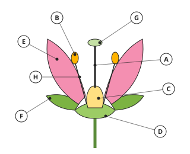
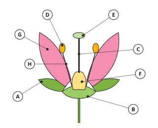
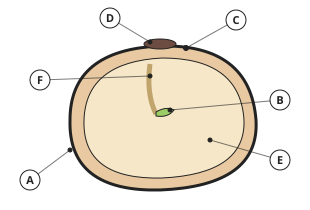

# Biology Form 2, Batch B2-1: authored answers for review

Every answer fixed by a person, not computed. Part 1: the tables, conventions and rules that computed answers come from.
Part 2: every authored question template, with all its data (keys, statements, pairs, choices and feedback) and sources.
Regenerate with `npm run review:f2-biology`. Item IDs (TR-…) match `docs/teacher-review.md`.

## Part 1: drawings (src/engine/lib/science2.js)

- **Flower (TR-V01)**: eight lettered parts: petal, sepal, anther, filament, stigma, style, ovary, receptacle. **Bean seed (TR-V02)**: testa, hilum, micropyle, cotyledon, plumule, radicle. The letters are shuffled by the question's numbers; the code that draws a letter also gives the answer.

## Part 2: authored question templates

| # | Template | Lesson | Type, level | Sources |
|---|---|---|---|---|
| 1 | `b2-1-why` | 1 | multiple choice, 1 | plant-reproduction |
| 2 | `b2-1-kind` | 1 | matching, 1 | plant-reproduction |
| 3 | `b2-1-compare` | 1 | multiple choice, 2 | plant-reproduction |
| 4 | `b2-1-spot` | 1 | spot the error, 3 | plant-reproduction |
| 5 | `b2-1-compare-card` (card c1-3) | 1 | multiple choice, 1 | plant-reproduction |
| 6 | `b2-2-organ` | 2 | matching, 1 | plant-reproduction |
| 7 | `b2-2-store` | 2 | multiple choice, 1 | plant-reproduction |
| 8 | `b2-2-leaf` | 2 | multiple choice, 2 | plant-reproduction |
| 9 | `b2-2-spot` | 2 | spot the error, 3 | plant-reproduction |
| 10 | `b2-2-leaf-card` (card c2-3) | 2 | multiple choice, 1 | plant-reproduction |
| 11 | `b2-3-method` | 3 | matching, 1 | plant-reproduction |
| 12 | `b2-3-graft` | 3 | multiple choice, 1 | plant-reproduction |
| 13 | `b2-3-crop` | 3 | multiple choice, 2 | plant-reproduction |
| 14 | `b2-3-spot` | 3 | spot the error, 3 | plant-reproduction |
| 15 | `b2-3-crop-card` (card c3-3) | 3 | multiple choice, 1 | plant-reproduction |
| 16 | `b2-4-steps` | 4 | ordering, 1 | plant-reproduction |
| 17 | `b2-4-see` | 4 | multiple choice, 1 | plant-reproduction |
| 18 | `b2-4-why` | 4 | multiple choice, 2 | plant-reproduction |
| 19 | `b2-4-spot` | 4 | spot the error, 3 | plant-reproduction |
| 20 | `b2-4-why-card` (card c4-3) | 4 | multiple choice, 1 | plant-reproduction |
| 21 | `b2-5-steps` | 5 | ordering, 1 | plant-reproduction |
| 22 | `b2-5-plant` | 5 | multiple choice, 1 | plant-reproduction |
| 23 | `b2-5-result` | 5 | multiple choice, 2 | plant-reproduction |
| 24 | `b2-5-spot` | 5 | spot the error, 3 | plant-reproduction |
| 25 | `b2-5-result-card` (card c5-3) | 5 | multiple choice, 1 | plant-reproduction |
| 26 | `b2-6-sort` | 6 | matching, 1 | plant-reproduction |
| 27 | `b2-6-why` | 6 | multiple choice, 1 | plant-reproduction |
| 28 | `b2-6-crowd` | 6 | multiple choice, 2 | plant-reproduction |
| 29 | `b2-6-spot` | 6 | spot the error, 3 | plant-reproduction |
| 30 | `b2-6-crowd-card` (card c6-3) | 6 | multiple choice, 1 | plant-reproduction |
| 31 | `b2-7-label` | 7 | multiple choice, 1 | flower |
| 32 | `b2-7-job` | 7 | matching, 1 | flower |
| 33 | `b2-7-sex` | 7 | multiple choice, 2 | flower |
| 34 | `b2-7-spot` | 7 | spot the error, 3 | flower |
| 35 | `b2-7-sex-card` (card c7-3) | 7 | multiple choice, 1 | flower |
| 36 | `b2-8-kind` | 8 | multiple choice, 1 | flower |
| 37 | `b2-8-insect` | 8 | matching, 1 | flower |
| 38 | `b2-8-agent` | 8 | multiple choice, 2 | flower |
| 39 | `b2-8-spot` | 8 | spot the error, 3 | flower |
| 40 | `b2-8-agent-card` (card c8-3) | 8 | multiple choice, 1 | flower |
| 41 | `b2-9-steps` | 9 | ordering, 1 | flower |
| 42 | `b2-9-see` | 9 | multiple choice, 1 | flower |
| 43 | `b2-9-label` | 9 | multiple choice, 2 | flower |
| 44 | `b2-9-draw` | 9 | spot the error, 3 | flower |
| 45 | `b2-9-draw-card` (card c9-3) | 9 | spot the error, 1 | flower |
| 46 | `b2-13-order` | 13 | ordering, 1 | seeds |
| 47 | `b2-13-what` | 13 | multiple choice, 1 | seeds |
| 48 | `b2-13-fate` | 13 | matching, 2 | seeds |
| 49 | `b2-13-spot` | 13 | spot the error, 3 | seeds |
| 50 | `b2-13-fate-card` (card c13-3) | 13 | matching, 1 | seeds |
| 51 | `b2-14-label` | 14 | multiple choice, 1 | seeds |
| 52 | `b2-14-job` | 14 | matching, 1 | seeds |
| 53 | `b2-14-kind` | 14 | multiple choice, 2 | seeds |
| 54 | `b2-14-spot` | 14 | spot the error, 3 | seeds |
| 55 | `b2-14-kind-card` (card c14-3) | 14 | multiple choice, 1 | seeds |
| 56 | `b2-15-why` | 15 | multiple choice, 1 | seeds |
| 57 | `b2-15-agent` | 15 | matching, 1 | seeds |
| 58 | `b2-15-animal` | 15 | multiple choice, 2 | seeds |
| 59 | `b2-15-spot` | 15 | spot the error, 3 | seeds |
| 60 | `b2-15-animal-card` (card c15-3) | 15 | multiple choice, 1 | seeds |
| 61 | `b2-16-match` | 16 | matching, 1 | seeds |
| 62 | `b2-16-why` | 16 | multiple choice, 1 | seeds |
| 63 | `b2-16-which` | 16 | multiple choice, 2 | seeds |
| 64 | `b2-16-spot` | 16 | spot the error, 3 | seeds |
| 65 | `b2-16-which-card` (card c16-3) | 16 | multiple choice, 1 | seeds |
| 66 | `b2-17-what` | 17 | multiple choice, 1 | seeds |
| 67 | `b2-17-need` | 17 | multiple choice, 1 | seeds |
| 68 | `b2-17-type` | 17 | matching, 2 | seeds |
| 69 | `b2-17-spot` | 17 | spot the error, 3 | seeds |
| 70 | `b2-17-type-card` (card c17-3) | 17 | matching, 1 | seeds |
| 71 | `b2-18-steps` | 18 | ordering, 1 | seeds |
| 72 | `b2-18-bean` | 18 | multiple choice, 1 | seeds |
| 73 | `b2-18-maize` | 18 | multiple choice, 2 | seeds |
| 74 | `b2-18-spot` | 18 | spot the error, 3 | seeds |
| 75 | `b2-18-maize-card` (card c18-3) | 18 | multiple choice, 1 | seeds |
| 76 | `b2-19-tube` | 19 | multiple choice, 1 | seeds |
| 77 | `b2-19-result` | 19 | multiple choice, 1 | seeds |
| 78 | `b2-19-control` | 19 | multiple choice, 2 | seeds |
| 79 | `b2-19-spot` | 19 | spot the error, 3 | seeds |
| 80 | `b2-19-control-card` (card c19-3) | 19 | multiple choice, 1 | seeds |
| 81 | `b2-20-sort` | 20 | matching, 1 | plant-pests |
| 82 | `b2-20-prevent` | 20 | multiple choice, 1 | plant-pests |
| 83 | `b2-20-act` | 20 | multiple choice, 2 | plant-pests |
| 84 | `b2-20-spot` | 20 | spot the error, 3 | plant-pests |
| 85 | `b2-20-act-card` (card c20-3) | 20 | multiple choice, 1 | plant-pests |
| 86 | `b2-21-sort` | 21 | matching, 1 | plant-pests |
| 87 | `b2-21-name` | 21 | matching, 1 | plant-pests |
| 88 | `b2-21-safe` | 21 | multiple choice, 2 | plant-pests |
| 89 | `b2-21-spot` | 21 | spot the error, 3 | plant-pests |
| 90 | `b2-21-safe-card` (card c21-3) | 21 | multiple choice, 1 | plant-pests |

### `b2-1-why` · Lesson 1 · multiple choice, level 1

Prompt: {X.q}

Table `X` (one row is picked each time):

| q | r | w | e | y |
|---|---|---|---|---|
| Why do living things need to reproduce? | so that their species does not die out | to grow taller · to get more food · to make oxygen | Growth is not reproduction. · Feeding is not reproduction. · That is photosynthesis. | Reproduction replaces individuals that die. |
| What is reproduction? | making new individuals of the same kind | making food from sunlight · taking in oxygen · removing waste | That is photosynthesis. · That is respiration. · That is excretion. | Reproduction produces offspring. |

Right answer: `{X.r}`; wrong choices: `{X.w[0]}`, `{X.w[1]}`, `{X.w[2]}`

- Feedback `w0`: “{X.e[0]}”
- Feedback `w1`: “{X.e[1]}”
- Feedback `w2`: “{X.e[2]}”

Three generated variants:

> Why do living things need to reproduce?

- ◻️ to make oxygen  
  _↳ feedback if chosen: That is photosynthesis._
- ◻️ to grow taller  
  _↳ feedback if chosen: Growth is not reproduction._
- ◻️ to get more food  
  _↳ feedback if chosen: Feeding is not reproduction._
- ✅ so that their species does not die out

Full working after a second miss:

> Reproduction replaces individuals that die.  
> So the answer is “so that their species does not die out”.  

> Why do living things need to reproduce?

- ✅ so that their species does not die out
- ◻️ to grow taller  
  _↳ feedback if chosen: Growth is not reproduction._
- ◻️ to get more food  
  _↳ feedback if chosen: Feeding is not reproduction._
- ◻️ to make oxygen  
  _↳ feedback if chosen: That is photosynthesis._

Full working after a second miss:

> Reproduction replaces individuals that die.  
> So the answer is “so that their species does not die out”.  

> What is reproduction?

- ◻️ removing waste  
  _↳ feedback if chosen: That is excretion._
- ◻️ making food from sunlight  
  _↳ feedback if chosen: That is photosynthesis._
- ◻️ taking in oxygen  
  _↳ feedback if chosen: That is respiration._
- ✅ making new individuals of the same kind

Full working after a second miss:

> Reproduction produces offspring.  
> So the answer is “making new individuals of the same kind”.  

Sources: plant-reproduction (Asexual and sexual reproduction in flowering plants; natural and artificial vegetative propagation (as in Cameroonian Form 2 biology textbooks))

### `b2-1-kind` · Lesson 1 · matching, level 1

Prompt: Sort the examples: sexual or asexual reproduction?

Pairs (4 shown each time, sorted into groups):

- planting a banana sucker → **asexual**
- an onion bulb making new bulbs → **asexual**
- planting a cassava stem cutting → **asexual**
- a potato tuber sprouting → **asexual**
- growing maize from seeds → **sexual**
- pollen fertilising an egg cell in a flower → **sexual**
- a mango seed growing into a tree → **sexual**
- bean seeds forming in a pod → **sexual**

Three generated variants:

> Sort the examples: sexual or asexual reproduction?

Groups: sexual · asexual
- planting a cassava stem cutting → **asexual**
- planting a banana sucker → **asexual**
- bean seeds forming in a pod → **sexual**
- a potato tuber sprouting → **asexual**

Full working after a second miss:

> The right pairs are:  
> planting a cassava stem cutting → asexual  
> planting a banana sucker → asexual  
> bean seeds forming in a pod → sexual  
> a potato tuber sprouting → asexual  

> Sort the examples: sexual or asexual reproduction?

Groups: sexual · asexual
- growing maize from seeds → **sexual**
- a potato tuber sprouting → **asexual**
- a mango seed growing into a tree → **sexual**
- planting a banana sucker → **asexual**

Full working after a second miss:

> The right pairs are:  
> growing maize from seeds → sexual  
> a potato tuber sprouting → asexual  
> a mango seed growing into a tree → sexual  
> planting a banana sucker → asexual  

> Sort the examples: sexual or asexual reproduction?

Groups: sexual · asexual
- planting a banana sucker → **asexual**
- a mango seed growing into a tree → **sexual**
- an onion bulb making new bulbs → **asexual**
- planting a cassava stem cutting → **asexual**

Full working after a second miss:

> The right pairs are:  
> planting a banana sucker → asexual  
> a mango seed growing into a tree → sexual  
> an onion bulb making new bulbs → asexual  
> planting a cassava stem cutting → asexual  

Sources: plant-reproduction (Asexual and sexual reproduction in flowering plants; natural and artificial vegetative propagation (as in Cameroonian Form 2 biology textbooks))

### `b2-1-compare` · Lesson 1 · multiple choice, level 2

Prompt: {X.q}

Table `X` (one row is picked each time):

| q | r | w | e | y |
|---|---|---|---|---|
| Which kind of reproduction gives offspring identical to the parent? | asexual reproduction | sexual reproduction · both kinds · neither kind | Sexual reproduction gives variation. · Only asexual gives clones. · Asexual does. | One parent, no gametes: identical offspring. |
| What joins in sexual reproduction? | a male and a female sex cell | two roots · two leaves · a stem and a root | Roots do not join. · Leaves do not join. · These are not sex cells. | Gametes join in fertilisation. |
| Which is an advantage of sexual reproduction? | variation among the offspring | only one parent is needed · offspring identical to the parent · no flowers are needed | That describes asexual reproduction. · That describes asexual reproduction. · Flowering plants need flowers for it. | Variation helps a species survive changes. |

Right answer: `{X.r}`; wrong choices: `{X.w[0]}`, `{X.w[1]}`, `{X.w[2]}`

- Feedback `w0`: “{X.e[0]}”
- Feedback `w1`: “{X.e[1]}”
- Feedback `w2`: “{X.e[2]}”

Three generated variants:

> Which is an advantage of sexual reproduction?

- ✅ variation among the offspring
- ◻️ only one parent is needed  
  _↳ feedback if chosen: That describes asexual reproduction._
- ◻️ no flowers are needed  
  _↳ feedback if chosen: Flowering plants need flowers for it._
- ◻️ offspring identical to the parent  
  _↳ feedback if chosen: That describes asexual reproduction._

Full working after a second miss:

> Variation helps a species survive changes.  
> So the answer is “variation among the offspring”.  

> Which kind of reproduction gives offspring identical to the parent?

- ✅ asexual reproduction
- ◻️ sexual reproduction  
  _↳ feedback if chosen: Sexual reproduction gives variation._
- ◻️ neither kind  
  _↳ feedback if chosen: Asexual does._
- ◻️ both kinds  
  _↳ feedback if chosen: Only asexual gives clones._

Full working after a second miss:

> One parent, no gametes: identical offspring.  
> So the answer is “asexual reproduction”.  

> Which kind of reproduction gives offspring identical to the parent?

- ◻️ both kinds  
  _↳ feedback if chosen: Only asexual gives clones._
- ◻️ neither kind  
  _↳ feedback if chosen: Asexual does._
- ✅ asexual reproduction
- ◻️ sexual reproduction  
  _↳ feedback if chosen: Sexual reproduction gives variation._

Full working after a second miss:

> One parent, no gametes: identical offspring.  
> So the answer is “asexual reproduction”.  

Sources: plant-reproduction (Asexual and sexual reproduction in flowering plants; natural and artificial vegetative propagation (as in Cameroonian Form 2 biology textbooks))

### `b2-1-spot` · Lesson 1 · spot the error, level 3

Prompt: Which statement is wrong?

Shows 3 correct and 1 wrong statement(s), drawn from:

- ✅ Asexual reproduction needs only one parent.
- ✅ Sexual reproduction gives variation.
- ✅ The flower is the organ of sexual reproduction.
- ✅ Reproduction keeps a species alive.
- ❌ Asexual reproduction needs two sex cells.  
  _↳ Asexual reproduction has no sex cells._
- ❌ Offspring of sexual reproduction are always identical.  
  _↳ They vary: they are not identical._
- ❌ A banana sucker is sexual reproduction.  
  _↳ A sucker comes from one parent: asexual._

Three generated variants:

> Which statement is wrong?

- ◻️ The flower is the organ of sexual reproduction.
- ◻️ Sexual reproduction gives variation.
- ✅ Offspring of sexual reproduction are always identical.  
  _↳ explanation: They vary: they are not identical._
- ◻️ Reproduction keeps a species alive.

Full working after a second miss:

> The wrong statement is “Offspring of sexual reproduction are always identical.”.  
> They vary: they are not identical.  

> Which statement is wrong?

- ◻️ Sexual reproduction gives variation.
- ◻️ Asexual reproduction needs only one parent.
- ✅ A banana sucker is sexual reproduction.  
  _↳ explanation: A sucker comes from one parent: asexual._
- ◻️ Reproduction keeps a species alive.

Full working after a second miss:

> The wrong statement is “A banana sucker is sexual reproduction.”.  
> A sucker comes from one parent: asexual.  

> Which statement is wrong?

- ◻️ Sexual reproduction gives variation.
- ◻️ Asexual reproduction needs only one parent.
- ◻️ The flower is the organ of sexual reproduction.
- ✅ Asexual reproduction needs two sex cells.  
  _↳ explanation: Asexual reproduction has no sex cells._

Full working after a second miss:

> The wrong statement is “Asexual reproduction needs two sex cells.”.  
> Asexual reproduction has no sex cells.  

Sources: plant-reproduction (Asexual and sexual reproduction in flowering plants; natural and artificial vegetative propagation (as in Cameroonian Form 2 biology textbooks))

### `b2-1-compare-card` · Lesson 1 · multiple choice, level 1

Prompt: {X.q}

Table `X` (one row is picked each time):

| q | r | w | e | y |
|---|---|---|---|---|
| Which kind of reproduction gives offspring identical to the parent? | asexual reproduction | sexual reproduction · both kinds · neither kind | Sexual reproduction gives variation. · Only asexual gives clones. · Asexual does. | One parent, no gametes: identical offspring. |
| What joins in sexual reproduction? | a male and a female sex cell | two roots · two leaves · a stem and a root | Roots do not join. · Leaves do not join. · These are not sex cells. | Gametes join in fertilisation. |
| Which is an advantage of sexual reproduction? | variation among the offspring | only one parent is needed · offspring identical to the parent · no flowers are needed | That describes asexual reproduction. · That describes asexual reproduction. · Flowering plants need flowers for it. | Variation helps a species survive changes. |

Right answer: `{X.r}`; wrong choices: `{X.w[0]}`, `{X.w[1]}`, `{X.w[2]}`

- Feedback `w0`: “{X.e[0]}”
- Feedback `w1`: “{X.e[1]}”
- Feedback `w2`: “{X.e[2]}”

Three generated variants:

> Which is an advantage of sexual reproduction?

- ✅ variation among the offspring
- ◻️ offspring identical to the parent  
  _↳ feedback if chosen: That describes asexual reproduction._
- ◻️ no flowers are needed  
  _↳ feedback if chosen: Flowering plants need flowers for it._
- ◻️ only one parent is needed  
  _↳ feedback if chosen: That describes asexual reproduction._

Full working after a second miss:

> Variation helps a species survive changes.  
> So the answer is “variation among the offspring”.  

> Which kind of reproduction gives offspring identical to the parent?

- ◻️ sexual reproduction  
  _↳ feedback if chosen: Sexual reproduction gives variation._
- ✅ asexual reproduction
- ◻️ neither kind  
  _↳ feedback if chosen: Asexual does._
- ◻️ both kinds  
  _↳ feedback if chosen: Only asexual gives clones._

Full working after a second miss:

> One parent, no gametes: identical offspring.  
> So the answer is “asexual reproduction”.  

> Which is an advantage of sexual reproduction?

- ◻️ offspring identical to the parent  
  _↳ feedback if chosen: That describes asexual reproduction._
- ◻️ no flowers are needed  
  _↳ feedback if chosen: Flowering plants need flowers for it._
- ◻️ only one parent is needed  
  _↳ feedback if chosen: That describes asexual reproduction._
- ✅ variation among the offspring

Full working after a second miss:

> Variation helps a species survive changes.  
> So the answer is “variation among the offspring”.  

Sources: plant-reproduction (Asexual and sexual reproduction in flowering plants; natural and artificial vegetative propagation (as in Cameroonian Form 2 biology textbooks))

### `b2-2-organ` · Lesson 2 · matching, level 1

Prompt: Match each plant to the organ it uses for natural vegetative propagation.

Pairs (4 shown each time):

- onion → **bulb**
- garlic → **bulb**
- cocoyam → **corm**
- ginger → **rhizome**
- Irish potato → **stem tuber**
- sweet potato → **root tuber**
- banana → **sucker**
- plantain → **sucker**
- Bryophyllum → **leaf buds**
- spear grass → **rhizome**

Three generated variants:

> Match each plant to the organ it uses for natural vegetative propagation.

Right-hand side (shuffled): sucker · stem tuber · rhizome · corm
- Irish potato → **stem tuber**
- cocoyam → **corm**
- banana → **sucker**
- ginger → **rhizome**

Full working after a second miss:

> The right pairs are:  
> Irish potato → stem tuber  
> cocoyam → corm  
> banana → sucker  
> ginger → rhizome  

> Match each plant to the organ it uses for natural vegetative propagation.

Right-hand side (shuffled): root tuber · rhizome · sucker · stem tuber
- sweet potato → **root tuber**
- ginger → **rhizome**
- Irish potato → **stem tuber**
- plantain → **sucker**

Full working after a second miss:

> The right pairs are:  
> sweet potato → root tuber  
> ginger → rhizome  
> Irish potato → stem tuber  
> plantain → sucker  

> Match each plant to the organ it uses for natural vegetative propagation.

Right-hand side (shuffled): corm · bulb · sucker · root tuber
- banana → **sucker**
- onion → **bulb**
- cocoyam → **corm**
- sweet potato → **root tuber**

Full working after a second miss:

> The right pairs are:  
> banana → sucker  
> onion → bulb  
> cocoyam → corm  
> sweet potato → root tuber  

Sources: plant-reproduction (Asexual and sexual reproduction in flowering plants; natural and artificial vegetative propagation (as in Cameroonian Form 2 biology textbooks))

### `b2-2-store` · Lesson 2 · multiple choice, level 1

Prompt: {X.q}

Table `X` (one row is picked each time):

| q | r | w | e | y |
|---|---|---|---|---|
| What is an Irish potato? | a stem tuber | a root tuber · a bulb · a seed | A root tuber is a swollen root, like sweet potato. · A bulb has fleshy leaves, like onion. · It is not a seed. | It is a swollen stem with buds (eyes). |
| What is a sweet potato? | a root tuber | a stem tuber · a corm · a rhizome | Sweet potato is a swollen root. · A corm is a short swollen stem. · A rhizome is a horizontal stem. | It is a swollen root. |
| Why do most vegetative organs contain stored food? | to feed the new plant until it can make its own food | to attract insects · to make seeds · to keep the soil wet | That is the job of petals. · Seeds come from flowers. · That is not their job. | Stored food feeds the young shoots. |

Right answer: `{X.r}`; wrong choices: `{X.w[0]}`, `{X.w[1]}`, `{X.w[2]}`

- Feedback `w0`: “{X.e[0]}”
- Feedback `w1`: “{X.e[1]}”
- Feedback `w2`: “{X.e[2]}”

Three generated variants:

> Why do most vegetative organs contain stored food?

- ◻️ to keep the soil wet  
  _↳ feedback if chosen: That is not their job._
- ◻️ to make seeds  
  _↳ feedback if chosen: Seeds come from flowers._
- ◻️ to attract insects  
  _↳ feedback if chosen: That is the job of petals._
- ✅ to feed the new plant until it can make its own food

Full working after a second miss:

> Stored food feeds the young shoots.  
> So the answer is “to feed the new plant until it can make its own food”.  

> What is an Irish potato?

- ◻️ a seed  
  _↳ feedback if chosen: It is not a seed._
- ◻️ a bulb  
  _↳ feedback if chosen: A bulb has fleshy leaves, like onion._
- ✅ a stem tuber
- ◻️ a root tuber  
  _↳ feedback if chosen: A root tuber is a swollen root, like sweet potato._

Full working after a second miss:

> It is a swollen stem with buds (eyes).  
> So the answer is “a stem tuber”.  

> What is a sweet potato?

- ◻️ a corm  
  _↳ feedback if chosen: A corm is a short swollen stem._
- ◻️ a rhizome  
  _↳ feedback if chosen: A rhizome is a horizontal stem._
- ◻️ a stem tuber  
  _↳ feedback if chosen: Sweet potato is a swollen root._
- ✅ a root tuber

Full working after a second miss:

> It is a swollen root.  
> So the answer is “a root tuber”.  

Sources: plant-reproduction (Asexual and sexual reproduction in flowering plants; natural and artificial vegetative propagation (as in Cameroonian Form 2 biology textbooks))

### `b2-2-leaf` · Lesson 2 · multiple choice, level 2

Prompt: {X.q}

Table `X` (one row is picked each time):

| q | r | w | e | y |
|---|---|---|---|---|
| Which plant forms new plantlets on the edges of its leaves? | Bryophyllum | maize · mango · groundnut | Maize grows from seeds. · Mango grows from seeds or grafts. · Groundnut grows from seeds. | Bryophyllum has buds on its leaf edges. |
| Banana and plantain reproduce naturally by … | suckers | seeds · bulbs · leaves | Cultivated bananas have no good seeds. · They have no bulbs. · Their leaves do not make plantlets. | Suckers grow from the base of the stem. |
| Spear grass is hard to get rid of because it spreads by … | underground rhizomes | bulbs · fruits · flowers only | It has no bulbs. · It spreads mainly by rhizomes. · Its rhizomes spread it. | Pieces of rhizome left in the soil grow again. |

Right answer: `{X.r}`; wrong choices: `{X.w[0]}`, `{X.w[1]}`, `{X.w[2]}`

- Feedback `w0`: “{X.e[0]}”
- Feedback `w1`: “{X.e[1]}”
- Feedback `w2`: “{X.e[2]}”

Three generated variants:

> Spear grass is hard to get rid of because it spreads by …

- ◻️ bulbs  
  _↳ feedback if chosen: It has no bulbs._
- ✅ underground rhizomes
- ◻️ fruits  
  _↳ feedback if chosen: It spreads mainly by rhizomes._
- ◻️ flowers only  
  _↳ feedback if chosen: Its rhizomes spread it._

Full working after a second miss:

> Pieces of rhizome left in the soil grow again.  
> So the answer is “underground rhizomes”.  

> Banana and plantain reproduce naturally by …

- ◻️ seeds  
  _↳ feedback if chosen: Cultivated bananas have no good seeds._
- ◻️ bulbs  
  _↳ feedback if chosen: They have no bulbs._
- ✅ suckers
- ◻️ leaves  
  _↳ feedback if chosen: Their leaves do not make plantlets._

Full working after a second miss:

> Suckers grow from the base of the stem.  
> So the answer is “suckers”.  

> Spear grass is hard to get rid of because it spreads by …

- ✅ underground rhizomes
- ◻️ bulbs  
  _↳ feedback if chosen: It has no bulbs._
- ◻️ fruits  
  _↳ feedback if chosen: It spreads mainly by rhizomes._
- ◻️ flowers only  
  _↳ feedback if chosen: Its rhizomes spread it._

Full working after a second miss:

> Pieces of rhizome left in the soil grow again.  
> So the answer is “underground rhizomes”.  

Sources: plant-reproduction (Asexual and sexual reproduction in flowering plants; natural and artificial vegetative propagation (as in Cameroonian Form 2 biology textbooks))

### `b2-2-spot` · Lesson 2 · spot the error, level 3

Prompt: Which statement is wrong?

Shows 3 correct and 1 wrong statement(s), drawn from:

- ✅ Onion reproduces by bulbs.
- ✅ Ginger has a rhizome.
- ✅ Cocoyam has a corm.
- ✅ Plantain reproduces by suckers.
- ❌ Sweet potato is a stem tuber.  
  _↳ Sweet potato is a root tuber; Irish potato is a stem tuber._
- ❌ Vegetative propagation uses flowers.  
  _↳ It uses stems, roots or leaves, not flowers._
- ❌ A bulb is a swollen root.  
  _↳ A bulb is a short stem with fleshy leaves._

Three generated variants:

> Which statement is wrong?

- ◻️ Plantain reproduces by suckers.
- ◻️ Onion reproduces by bulbs.
- ✅ Vegetative propagation uses flowers.  
  _↳ explanation: It uses stems, roots or leaves, not flowers._
- ◻️ Cocoyam has a corm.

Full working after a second miss:

> The wrong statement is “Vegetative propagation uses flowers.”.  
> It uses stems, roots or leaves, not flowers.  

> Which statement is wrong?

- ◻️ Onion reproduces by bulbs.
- ◻️ Cocoyam has a corm.
- ✅ Sweet potato is a stem tuber.  
  _↳ explanation: Sweet potato is a root tuber; Irish potato is a stem tuber._
- ◻️ Ginger has a rhizome.

Full working after a second miss:

> The wrong statement is “Sweet potato is a stem tuber.”.  
> Sweet potato is a root tuber; Irish potato is a stem tuber.  

> Which statement is wrong?

- ◻️ Ginger has a rhizome.
- ◻️ Onion reproduces by bulbs.
- ◻️ Cocoyam has a corm.
- ✅ A bulb is a swollen root.  
  _↳ explanation: A bulb is a short stem with fleshy leaves._

Full working after a second miss:

> The wrong statement is “A bulb is a swollen root.”.  
> A bulb is a short stem with fleshy leaves.  

Sources: plant-reproduction (Asexual and sexual reproduction in flowering plants; natural and artificial vegetative propagation (as in Cameroonian Form 2 biology textbooks))

### `b2-2-leaf-card` · Lesson 2 · multiple choice, level 1

Prompt: {X.q}

Table `X` (one row is picked each time):

| q | r | w | e | y |
|---|---|---|---|---|
| Which plant forms new plantlets on the edges of its leaves? | Bryophyllum | maize · mango · groundnut | Maize grows from seeds. · Mango grows from seeds or grafts. · Groundnut grows from seeds. | Bryophyllum has buds on its leaf edges. |
| Banana and plantain reproduce naturally by … | suckers | seeds · bulbs · leaves | Cultivated bananas have no good seeds. · They have no bulbs. · Their leaves do not make plantlets. | Suckers grow from the base of the stem. |
| Spear grass is hard to get rid of because it spreads by … | underground rhizomes | bulbs · fruits · flowers only | It has no bulbs. · It spreads mainly by rhizomes. · Its rhizomes spread it. | Pieces of rhizome left in the soil grow again. |

Right answer: `{X.r}`; wrong choices: `{X.w[0]}`, `{X.w[1]}`, `{X.w[2]}`

- Feedback `w0`: “{X.e[0]}”
- Feedback `w1`: “{X.e[1]}”
- Feedback `w2`: “{X.e[2]}”

Three generated variants:

> Banana and plantain reproduce naturally by …

- ◻️ leaves  
  _↳ feedback if chosen: Their leaves do not make plantlets._
- ◻️ seeds  
  _↳ feedback if chosen: Cultivated bananas have no good seeds._
- ✅ suckers
- ◻️ bulbs  
  _↳ feedback if chosen: They have no bulbs._

Full working after a second miss:

> Suckers grow from the base of the stem.  
> So the answer is “suckers”.  

> Which plant forms new plantlets on the edges of its leaves?

- ✅ Bryophyllum
- ◻️ groundnut  
  _↳ feedback if chosen: Groundnut grows from seeds._
- ◻️ mango  
  _↳ feedback if chosen: Mango grows from seeds or grafts._
- ◻️ maize  
  _↳ feedback if chosen: Maize grows from seeds._

Full working after a second miss:

> Bryophyllum has buds on its leaf edges.  
> So the answer is “Bryophyllum”.  

> Banana and plantain reproduce naturally by …

- ◻️ seeds  
  _↳ feedback if chosen: Cultivated bananas have no good seeds._
- ◻️ bulbs  
  _↳ feedback if chosen: They have no bulbs._
- ✅ suckers
- ◻️ leaves  
  _↳ feedback if chosen: Their leaves do not make plantlets._

Full working after a second miss:

> Suckers grow from the base of the stem.  
> So the answer is “suckers”.  

Sources: plant-reproduction (Asexual and sexual reproduction in flowering plants; natural and artificial vegetative propagation (as in Cameroonian Form 2 biology textbooks))

### `b2-3-method` · Lesson 3 · matching, level 1

Prompt: Match each method to what is done.

Pairs (4 shown each time):

- cutting → **a piece of stem is planted and grows roots**
- grafting → **a shoot (scion) is joined onto a rooted plant (stock)**
- budding → **a single bud is joined onto a stock**
- layering → **a branch is bent down and covered with soil until it roots**
- marcotting → **a branch is wrapped in moist soil while still on the tree until it roots**
- tissue culture → **tiny pieces of plant are grown on special food in a laboratory**

Three generated variants:

> Match each method to what is done.

Right-hand side (shuffled): a branch is bent down and covered with soil until it roots · tiny pieces of plant are grown on special food in a laboratory · a single bud is joined onto a stock · a branch is wrapped in moist soil while still on the tree until it roots
- marcotting → **a branch is wrapped in moist soil while still on the tree until it roots**
- tissue culture → **tiny pieces of plant are grown on special food in a laboratory**
- layering → **a branch is bent down and covered with soil until it roots**
- budding → **a single bud is joined onto a stock**

Full working after a second miss:

> The right pairs are:  
> marcotting → a branch is wrapped in moist soil while still on the tree until it roots  
> tissue culture → tiny pieces of plant are grown on special food in a laboratory  
> layering → a branch is bent down and covered with soil until it roots  
> budding → a single bud is joined onto a stock  

> Match each method to what is done.

Right-hand side (shuffled): a branch is bent down and covered with soil until it roots · a shoot (scion) is joined onto a rooted plant (stock) · a single bud is joined onto a stock · a piece of stem is planted and grows roots
- layering → **a branch is bent down and covered with soil until it roots**
- budding → **a single bud is joined onto a stock**
- cutting → **a piece of stem is planted and grows roots**
- grafting → **a shoot (scion) is joined onto a rooted plant (stock)**

Full working after a second miss:

> The right pairs are:  
> layering → a branch is bent down and covered with soil until it roots  
> budding → a single bud is joined onto a stock  
> cutting → a piece of stem is planted and grows roots  
> grafting → a shoot (scion) is joined onto a rooted plant (stock)  

> Match each method to what is done.

Right-hand side (shuffled): a piece of stem is planted and grows roots · a branch is wrapped in moist soil while still on the tree until it roots · a single bud is joined onto a stock · tiny pieces of plant are grown on special food in a laboratory
- budding → **a single bud is joined onto a stock**
- marcotting → **a branch is wrapped in moist soil while still on the tree until it roots**
- tissue culture → **tiny pieces of plant are grown on special food in a laboratory**
- cutting → **a piece of stem is planted and grows roots**

Full working after a second miss:

> The right pairs are:  
> budding → a single bud is joined onto a stock  
> marcotting → a branch is wrapped in moist soil while still on the tree until it roots  
> tissue culture → tiny pieces of plant are grown on special food in a laboratory  
> cutting → a piece of stem is planted and grows roots  

Sources: plant-reproduction (Asexual and sexual reproduction in flowering plants; natural and artificial vegetative propagation (as in Cameroonian Form 2 biology textbooks))

### `b2-3-graft` · Lesson 3 · multiple choice, level 1

Prompt: {X.q}

Table `X` (one row is picked each time):

| q | r | w | e | y |
|---|---|---|---|---|
| In grafting, what is the scion? | the shoot from the good variety | the rooted plant · the soil · the seed | That is the stock. · Soil is not part of the graft. · Grafting does not use seeds. | The scion is the shoot joined on. |
| In grafting, what does the stock give? | strong roots | the fruits · the flowers · the seeds | The fruits come from the scion. · Flowers grow on the scion. · Seeds are not used. | The stock is the rooted plant. |

Right answer: `{X.r}`; wrong choices: `{X.w[0]}`, `{X.w[1]}`, `{X.w[2]}`

- Feedback `w0`: “{X.e[0]}”
- Feedback `w1`: “{X.e[1]}”
- Feedback `w2`: “{X.e[2]}”

Three generated variants:

> In grafting, what does the stock give?

- ◻️ the seeds  
  _↳ feedback if chosen: Seeds are not used._
- ✅ strong roots
- ◻️ the flowers  
  _↳ feedback if chosen: Flowers grow on the scion._
- ◻️ the fruits  
  _↳ feedback if chosen: The fruits come from the scion._

Full working after a second miss:

> The stock is the rooted plant.  
> So the answer is “strong roots”.  

> In grafting, what is the scion?

- ◻️ the rooted plant  
  _↳ feedback if chosen: That is the stock._
- ✅ the shoot from the good variety
- ◻️ the seed  
  _↳ feedback if chosen: Grafting does not use seeds._
- ◻️ the soil  
  _↳ feedback if chosen: Soil is not part of the graft._

Full working after a second miss:

> The scion is the shoot joined on.  
> So the answer is “the shoot from the good variety”.  

> In grafting, what is the scion?

- ◻️ the soil  
  _↳ feedback if chosen: Soil is not part of the graft._
- ◻️ the rooted plant  
  _↳ feedback if chosen: That is the stock._
- ◻️ the seed  
  _↳ feedback if chosen: Grafting does not use seeds._
- ✅ the shoot from the good variety

Full working after a second miss:

> The scion is the shoot joined on.  
> So the answer is “the shoot from the good variety”.  

Sources: plant-reproduction (Asexual and sexual reproduction in flowering plants; natural and artificial vegetative propagation (as in Cameroonian Form 2 biology textbooks))

### `b2-3-crop` · Lesson 3 · multiple choice, level 2

Prompt: Which method is usually used to grow {X.q}?

Table `X` (one row is picked each time):

| q | r | w | e | y |
|---|---|---|---|---|
| cassava | stem cuttings | grafting · seeds only · tissue culture only | Cassava is not grafted. · Farmers plant stem pieces. · Farmers plant stem pieces. | Cassava stems are cut and planted. |
| improved mango varieties | grafting | stem cuttings · bulbs · rhizomes | Mango cuttings root poorly. · Mango has no bulbs. · Mango has no rhizomes. | A good scion is grafted onto a stock. |
| sugarcane | stem cuttings | budding · bulbs · corms | Sugarcane is grown from stem pieces. · It has no bulbs. · It has no corms. | Stem pieces with nodes are planted. |
| thousands of identical banana plantlets | tissue culture | layering · grafting · seeds | Layering makes only a few. · Bananas are not grafted. · Seeds give variation. | Tissue culture makes many identical plants quickly. |

Right answer: `{X.r}`; wrong choices: `{X.w[0]}`, `{X.w[1]}`, `{X.w[2]}`

- Feedback `w0`: “{X.e[0]}”
- Feedback `w1`: “{X.e[1]}”
- Feedback `w2`: “{X.e[2]}”

Three generated variants:

> Which method is usually used to grow sugarcane?

- ✅ stem cuttings
- ◻️ budding  
  _↳ feedback if chosen: Sugarcane is grown from stem pieces._
- ◻️ corms  
  _↳ feedback if chosen: It has no corms._
- ◻️ bulbs  
  _↳ feedback if chosen: It has no bulbs._

Full working after a second miss:

> Stem pieces with nodes are planted.  
> So the answer is “stem cuttings”.  

> Which method is usually used to grow thousands of identical banana plantlets?

- ◻️ layering  
  _↳ feedback if chosen: Layering makes only a few._
- ◻️ seeds  
  _↳ feedback if chosen: Seeds give variation._
- ◻️ grafting  
  _↳ feedback if chosen: Bananas are not grafted._
- ✅ tissue culture

Full working after a second miss:

> Tissue culture makes many identical plants quickly.  
> So the answer is “tissue culture”.  

> Which method is usually used to grow sugarcane?

- ◻️ budding  
  _↳ feedback if chosen: Sugarcane is grown from stem pieces._
- ◻️ corms  
  _↳ feedback if chosen: It has no corms._
- ◻️ bulbs  
  _↳ feedback if chosen: It has no bulbs._
- ✅ stem cuttings

Full working after a second miss:

> Stem pieces with nodes are planted.  
> So the answer is “stem cuttings”.  

Sources: plant-reproduction (Asexual and sexual reproduction in flowering plants; natural and artificial vegetative propagation (as in Cameroonian Form 2 biology textbooks))

### `b2-3-spot` · Lesson 3 · spot the error, level 3

Prompt: Which statement is wrong?

Shows 3 correct and 1 wrong statement(s), drawn from:

- ✅ Cassava is grown from stem cuttings.
- ✅ Grafting joins a scion to a stock.
- ✅ Marcotting is done while the branch is on the tree.
- ✅ Tissue culture is done in a laboratory.
- ❌ In grafting, the stock gives the fruits.  
  _↳ The fruits come from the scion; the stock gives the roots._
- ❌ Layering uses seeds.  
  _↳ Layering roots a branch; no seeds._
- ❌ Artificial propagation gives offspring that all differ.  
  _↳ It gives identical offspring (clones)._

Three generated variants:

> Which statement is wrong?

- ✅ Layering uses seeds.  
  _↳ explanation: Layering roots a branch; no seeds._
- ◻️ Marcotting is done while the branch is on the tree.
- ◻️ Tissue culture is done in a laboratory.
- ◻️ Cassava is grown from stem cuttings.

Full working after a second miss:

> The wrong statement is “Layering uses seeds.”.  
> Layering roots a branch; no seeds.  

> Which statement is wrong?

- ✅ Artificial propagation gives offspring that all differ.  
  _↳ explanation: It gives identical offspring (clones)._
- ◻️ Cassava is grown from stem cuttings.
- ◻️ Tissue culture is done in a laboratory.
- ◻️ Marcotting is done while the branch is on the tree.

Full working after a second miss:

> The wrong statement is “Artificial propagation gives offspring that all differ.”.  
> It gives identical offspring (clones).  

> Which statement is wrong?

- ✅ Layering uses seeds.  
  _↳ explanation: Layering roots a branch; no seeds._
- ◻️ Tissue culture is done in a laboratory.
- ◻️ Cassava is grown from stem cuttings.
- ◻️ Marcotting is done while the branch is on the tree.

Full working after a second miss:

> The wrong statement is “Layering uses seeds.”.  
> Layering roots a branch; no seeds.  

Sources: plant-reproduction (Asexual and sexual reproduction in flowering plants; natural and artificial vegetative propagation (as in Cameroonian Form 2 biology textbooks))

### `b2-3-crop-card` · Lesson 3 · multiple choice, level 1

Prompt: Which method is usually used to grow {X.q}?

Table `X` (one row is picked each time):

| q | r | w | e | y |
|---|---|---|---|---|
| cassava | stem cuttings | grafting · seeds only · tissue culture only | Cassava is not grafted. · Farmers plant stem pieces. · Farmers plant stem pieces. | Cassava stems are cut and planted. |
| improved mango varieties | grafting | stem cuttings · bulbs · rhizomes | Mango cuttings root poorly. · Mango has no bulbs. · Mango has no rhizomes. | A good scion is grafted onto a stock. |
| sugarcane | stem cuttings | budding · bulbs · corms | Sugarcane is grown from stem pieces. · It has no bulbs. · It has no corms. | Stem pieces with nodes are planted. |
| thousands of identical banana plantlets | tissue culture | layering · grafting · seeds | Layering makes only a few. · Bananas are not grafted. · Seeds give variation. | Tissue culture makes many identical plants quickly. |

Right answer: `{X.r}`; wrong choices: `{X.w[0]}`, `{X.w[1]}`, `{X.w[2]}`

- Feedback `w0`: “{X.e[0]}”
- Feedback `w1`: “{X.e[1]}”
- Feedback `w2`: “{X.e[2]}”

Three generated variants:

> Which method is usually used to grow improved mango varieties?

- ◻️ bulbs  
  _↳ feedback if chosen: Mango has no bulbs._
- ✅ grafting
- ◻️ stem cuttings  
  _↳ feedback if chosen: Mango cuttings root poorly._
- ◻️ rhizomes  
  _↳ feedback if chosen: Mango has no rhizomes._

Full working after a second miss:

> A good scion is grafted onto a stock.  
> So the answer is “grafting”.  

> Which method is usually used to grow sugarcane?

- ✅ stem cuttings
- ◻️ bulbs  
  _↳ feedback if chosen: It has no bulbs._
- ◻️ budding  
  _↳ feedback if chosen: Sugarcane is grown from stem pieces._
- ◻️ corms  
  _↳ feedback if chosen: It has no corms._

Full working after a second miss:

> Stem pieces with nodes are planted.  
> So the answer is “stem cuttings”.  

> Which method is usually used to grow cassava?

- ✅ stem cuttings
- ◻️ grafting  
  _↳ feedback if chosen: Cassava is not grafted._
- ◻️ seeds only  
  _↳ feedback if chosen: Farmers plant stem pieces._
- ◻️ tissue culture only  
  _↳ feedback if chosen: Farmers plant stem pieces._

Full working after a second miss:

> Cassava stems are cut and planted.  
> So the answer is “stem cuttings”.  

Sources: plant-reproduction (Asexual and sexual reproduction in flowering plants; natural and artificial vegetative propagation (as in Cameroonian Form 2 biology textbooks))

### `b2-4-steps` · Lesson 4 · ordering, level 1

Prompt: Put the steps of the experiment in order.

Items in the right order:

1. Fill the pots with moist soil
2. Plant the onion, the potato and the Bryophyllum leaf
3. Water lightly every day and keep the pots warm
4. Observe and record every two days
5. Write a conclusion

Three generated variants:

> Put the steps of the experiment in order.

Shown as: Observe and record every two days · Water lightly every day and keep the pots warm · Fill the pots with moist soil · Plant the onion, the potato and the Bryophyllum leaf · Write a conclusion
Correct order: Fill the pots with moist soil → Plant the onion, the potato and the Bryophyllum leaf → Water lightly every day and keep the pots warm → Observe and record every two days → Write a conclusion

Full working after a second miss:

> The correct order is: Fill the pots with moist soil → Plant the onion, the potato and the Bryophyllum leaf → Water lightly every day and keep the pots warm → Observe and record every two days → Write a conclusion.  

> Put the steps of the experiment in order.

Shown as: Fill the pots with moist soil · Plant the onion, the potato and the Bryophyllum leaf · Observe and record every two days · Write a conclusion · Water lightly every day and keep the pots warm
Correct order: Fill the pots with moist soil → Plant the onion, the potato and the Bryophyllum leaf → Water lightly every day and keep the pots warm → Observe and record every two days → Write a conclusion

Full working after a second miss:

> The correct order is: Fill the pots with moist soil → Plant the onion, the potato and the Bryophyllum leaf → Water lightly every day and keep the pots warm → Observe and record every two days → Write a conclusion.  

> Put the steps of the experiment in order.

Shown as: Observe and record every two days · Water lightly every day and keep the pots warm · Write a conclusion · Fill the pots with moist soil · Plant the onion, the potato and the Bryophyllum leaf
Correct order: Fill the pots with moist soil → Plant the onion, the potato and the Bryophyllum leaf → Water lightly every day and keep the pots warm → Observe and record every two days → Write a conclusion

Full working after a second miss:

> The correct order is: Fill the pots with moist soil → Plant the onion, the potato and the Bryophyllum leaf → Water lightly every day and keep the pots warm → Observe and record every two days → Write a conclusion.  

Sources: plant-reproduction (Asexual and sexual reproduction in flowering plants; natural and artificial vegetative propagation (as in Cameroonian Form 2 biology textbooks))

### `b2-4-see` · Lesson 4 · multiple choice, level 1

Prompt: {X.q}

Table `X` (one row is picked each time):

| q | r | w | e | y |
|---|---|---|---|---|
| Where do new shoots grow on an Irish potato? | from the eyes (buds) | from the skin everywhere · from the roots of the old plant · from seeds inside it | They grow only from the eyes. · The tuber has no old roots here. · A potato tuber has no seeds. | The eyes are buds. |
| Where do new plantlets grow on a Bryophyllum leaf? | in the notches on the leaf edge | from the leaf stalk only · from flowers · from the middle of the leaf | They grow on the edges. · No flowers are involved. · They grow on the edges. | Buds in the notches grow into plantlets. |
| From which part of an onion do the roots grow? | the flat base (stem plate) | the top · the dry outer skin · the fleshy leaves | Leaves grow from the top. · The skin is dead. · They store food. | Roots grow from the stem plate at the base. |

Right answer: `{X.r}`; wrong choices: `{X.w[0]}`, `{X.w[1]}`, `{X.w[2]}`

- Feedback `w0`: “{X.e[0]}”
- Feedback `w1`: “{X.e[1]}”
- Feedback `w2`: “{X.e[2]}”

Three generated variants:

> Where do new plantlets grow on a Bryophyllum leaf?

- ✅ in the notches on the leaf edge
- ◻️ from the leaf stalk only  
  _↳ feedback if chosen: They grow on the edges._
- ◻️ from the middle of the leaf  
  _↳ feedback if chosen: They grow on the edges._
- ◻️ from flowers  
  _↳ feedback if chosen: No flowers are involved._

Full working after a second miss:

> Buds in the notches grow into plantlets.  
> So the answer is “in the notches on the leaf edge”.  

> Where do new plantlets grow on a Bryophyllum leaf?

- ◻️ from flowers  
  _↳ feedback if chosen: No flowers are involved._
- ◻️ from the middle of the leaf  
  _↳ feedback if chosen: They grow on the edges._
- ◻️ from the leaf stalk only  
  _↳ feedback if chosen: They grow on the edges._
- ✅ in the notches on the leaf edge

Full working after a second miss:

> Buds in the notches grow into plantlets.  
> So the answer is “in the notches on the leaf edge”.  

> Where do new shoots grow on an Irish potato?

- ◻️ from the roots of the old plant  
  _↳ feedback if chosen: The tuber has no old roots here._
- ✅ from the eyes (buds)
- ◻️ from seeds inside it  
  _↳ feedback if chosen: A potato tuber has no seeds._
- ◻️ from the skin everywhere  
  _↳ feedback if chosen: They grow only from the eyes._

Full working after a second miss:

> The eyes are buds.  
> So the answer is “from the eyes (buds)”.  

Sources: plant-reproduction (Asexual and sexual reproduction in flowering plants; natural and artificial vegetative propagation (as in Cameroonian Form 2 biology textbooks))

### `b2-4-why` · Lesson 4 · multiple choice, level 2

Prompt: {X.q}

Table `X` (one row is picked each time):

| q | r | w | e | y |
|---|---|---|---|---|
| Why are the pots watered lightly and not flooded? | Too much water stops air reaching the roots and makes the organs rot. | Water kills all plants. · The plants do not need water. · To make them grow seeds. | Plants need some water. · They need water. · No seeds are involved. | Roots and organs need air too. |
| What does this experiment show? | New plants can grow from stems, roots or leaves without seeds. | Plants need seeds to reproduce. · Onions are seeds. · Plants grow only in the dark. | The experiment shows the opposite. · An onion is a bulb. · That is not what it shows. | That is natural vegetative propagation. |

Right answer: `{X.r}`; wrong choices: `{X.w[0]}`, `{X.w[1]}`, `{X.w[2]}`

- Feedback `w0`: “{X.e[0]}”
- Feedback `w1`: “{X.e[1]}”
- Feedback `w2`: “{X.e[2]}”

Three generated variants:

> What does this experiment show?

- ◻️ Onions are seeds.  
  _↳ feedback if chosen: An onion is a bulb._
- ◻️ Plants need seeds to reproduce.  
  _↳ feedback if chosen: The experiment shows the opposite._
- ◻️ Plants grow only in the dark.  
  _↳ feedback if chosen: That is not what it shows._
- ✅ New plants can grow from stems, roots or leaves without seeds.

Full working after a second miss:

> That is natural vegetative propagation.  
> So the answer is “New plants can grow from stems, roots or leaves without seeds.”.  

> What does this experiment show?

- ◻️ Plants need seeds to reproduce.  
  _↳ feedback if chosen: The experiment shows the opposite._
- ◻️ Plants grow only in the dark.  
  _↳ feedback if chosen: That is not what it shows._
- ◻️ Onions are seeds.  
  _↳ feedback if chosen: An onion is a bulb._
- ✅ New plants can grow from stems, roots or leaves without seeds.

Full working after a second miss:

> That is natural vegetative propagation.  
> So the answer is “New plants can grow from stems, roots or leaves without seeds.”.  

> What does this experiment show?

- ◻️ Plants grow only in the dark.  
  _↳ feedback if chosen: That is not what it shows._
- ◻️ Plants need seeds to reproduce.  
  _↳ feedback if chosen: The experiment shows the opposite._
- ✅ New plants can grow from stems, roots or leaves without seeds.
- ◻️ Onions are seeds.  
  _↳ feedback if chosen: An onion is a bulb._

Full working after a second miss:

> That is natural vegetative propagation.  
> So the answer is “New plants can grow from stems, roots or leaves without seeds.”.  

Sources: plant-reproduction (Asexual and sexual reproduction in flowering plants; natural and artificial vegetative propagation (as in Cameroonian Form 2 biology textbooks))

### `b2-4-spot` · Lesson 4 · spot the error, level 3

Prompt: Which step or result is wrong?

Shows 3 correct and 1 wrong statement(s), drawn from:

- ✅ Plant the onion with its base in the soil.
- ✅ Keep the soil moist.
- ✅ Shoots grow from the potato's eyes.
- ✅ Record observations with dates.
- ❌ Plant the onion upside down, with its leaves in the soil.  
  _↳ The base (stem plate) goes in the soil; leaves grow upwards._
- ❌ Flood the pots with water every hour.  
  _↳ Water lightly: flooding makes the organs rot._
- ❌ Plantlets grow from the Bryophyllum leaf stalk only.  
  _↳ They grow from the notches on the leaf edge._

Three generated variants:

> Which step or result is wrong?

- ✅ Plantlets grow from the Bryophyllum leaf stalk only.  
  _↳ explanation: They grow from the notches on the leaf edge._
- ◻️ Shoots grow from the potato's eyes.
- ◻️ Keep the soil moist.
- ◻️ Plant the onion with its base in the soil.

Full working after a second miss:

> The wrong statement is “Plantlets grow from the Bryophyllum leaf stalk only.”.  
> They grow from the notches on the leaf edge.  

> Which step or result is wrong?

- ◻️ Keep the soil moist.
- ◻️ Record observations with dates.
- ✅ Flood the pots with water every hour.  
  _↳ explanation: Water lightly: flooding makes the organs rot._
- ◻️ Shoots grow from the potato's eyes.

Full working after a second miss:

> The wrong statement is “Flood the pots with water every hour.”.  
> Water lightly: flooding makes the organs rot.  

> Which step or result is wrong?

- ◻️ Shoots grow from the potato's eyes.
- ◻️ Plant the onion with its base in the soil.
- ◻️ Keep the soil moist.
- ✅ Plantlets grow from the Bryophyllum leaf stalk only.  
  _↳ explanation: They grow from the notches on the leaf edge._

Full working after a second miss:

> The wrong statement is “Plantlets grow from the Bryophyllum leaf stalk only.”.  
> They grow from the notches on the leaf edge.  

Sources: plant-reproduction (Asexual and sexual reproduction in flowering plants; natural and artificial vegetative propagation (as in Cameroonian Form 2 biology textbooks))

### `b2-4-why-card` · Lesson 4 · multiple choice, level 1

Prompt: {X.q}

Table `X` (one row is picked each time):

| q | r | w | e | y |
|---|---|---|---|---|
| Why are the pots watered lightly and not flooded? | Too much water stops air reaching the roots and makes the organs rot. | Water kills all plants. · The plants do not need water. · To make them grow seeds. | Plants need some water. · They need water. · No seeds are involved. | Roots and organs need air too. |
| What does this experiment show? | New plants can grow from stems, roots or leaves without seeds. | Plants need seeds to reproduce. · Onions are seeds. · Plants grow only in the dark. | The experiment shows the opposite. · An onion is a bulb. · That is not what it shows. | That is natural vegetative propagation. |

Right answer: `{X.r}`; wrong choices: `{X.w[0]}`, `{X.w[1]}`, `{X.w[2]}`

- Feedback `w0`: “{X.e[0]}”
- Feedback `w1`: “{X.e[1]}”
- Feedback `w2`: “{X.e[2]}”

Three generated variants:

> What does this experiment show?

- ◻️ Onions are seeds.  
  _↳ feedback if chosen: An onion is a bulb._
- ✅ New plants can grow from stems, roots or leaves without seeds.
- ◻️ Plants grow only in the dark.  
  _↳ feedback if chosen: That is not what it shows._
- ◻️ Plants need seeds to reproduce.  
  _↳ feedback if chosen: The experiment shows the opposite._

Full working after a second miss:

> That is natural vegetative propagation.  
> So the answer is “New plants can grow from stems, roots or leaves without seeds.”.  

> Why are the pots watered lightly and not flooded?

- ◻️ To make them grow seeds.  
  _↳ feedback if chosen: No seeds are involved._
- ◻️ The plants do not need water.  
  _↳ feedback if chosen: They need water._
- ◻️ Water kills all plants.  
  _↳ feedback if chosen: Plants need some water._
- ✅ Too much water stops air reaching the roots and makes the organs rot.

Full working after a second miss:

> Roots and organs need air too.  
> So the answer is “Too much water stops air reaching the roots and makes the organs rot.”.  

> Why are the pots watered lightly and not flooded?

- ✅ Too much water stops air reaching the roots and makes the organs rot.
- ◻️ The plants do not need water.  
  _↳ feedback if chosen: They need water._
- ◻️ To make them grow seeds.  
  _↳ feedback if chosen: No seeds are involved._
- ◻️ Water kills all plants.  
  _↳ feedback if chosen: Plants need some water._

Full working after a second miss:

> Roots and organs need air too.  
> So the answer is “Too much water stops air reaching the roots and makes the organs rot.”.  

Sources: plant-reproduction (Asexual and sexual reproduction in flowering plants; natural and artificial vegetative propagation (as in Cameroonian Form 2 biology textbooks))

### `b2-5-steps` · Lesson 5 · ordering, level 1

Prompt: Put the steps of growing cassava from cuttings in order.

Items in the right order:

1. Choose a healthy mature stem
2. Cut pieces with several nodes
3. Plant them the right way up, slanted
4. Water regularly and protect them
5. Observe roots and shoots appearing

Three generated variants:

> Put the steps of growing cassava from cuttings in order.

Shown as: Plant them the right way up, slanted · Choose a healthy mature stem · Cut pieces with several nodes · Observe roots and shoots appearing · Water regularly and protect them
Correct order: Choose a healthy mature stem → Cut pieces with several nodes → Plant them the right way up, slanted → Water regularly and protect them → Observe roots and shoots appearing

Full working after a second miss:

> The correct order is: Choose a healthy mature stem → Cut pieces with several nodes → Plant them the right way up, slanted → Water regularly and protect them → Observe roots and shoots appearing.  

> Put the steps of growing cassava from cuttings in order.

Shown as: Cut pieces with several nodes · Water regularly and protect them · Observe roots and shoots appearing · Plant them the right way up, slanted · Choose a healthy mature stem
Correct order: Choose a healthy mature stem → Cut pieces with several nodes → Plant them the right way up, slanted → Water regularly and protect them → Observe roots and shoots appearing

Full working after a second miss:

> The correct order is: Choose a healthy mature stem → Cut pieces with several nodes → Plant them the right way up, slanted → Water regularly and protect them → Observe roots and shoots appearing.  

> Put the steps of growing cassava from cuttings in order.

Shown as: Water regularly and protect them · Plant them the right way up, slanted · Choose a healthy mature stem · Observe roots and shoots appearing · Cut pieces with several nodes
Correct order: Choose a healthy mature stem → Cut pieces with several nodes → Plant them the right way up, slanted → Water regularly and protect them → Observe roots and shoots appearing

Full working after a second miss:

> The correct order is: Choose a healthy mature stem → Cut pieces with several nodes → Plant them the right way up, slanted → Water regularly and protect them → Observe roots and shoots appearing.  

Sources: plant-reproduction (Asexual and sexual reproduction in flowering plants; natural and artificial vegetative propagation (as in Cameroonian Form 2 biology textbooks))

### `b2-5-plant` · Lesson 5 · multiple choice, level 1

Prompt: {X.q}

Table `X` (one row is picked each time):

| q | r | w | e | y |
|---|---|---|---|---|
| Why must each cutting have nodes? | Roots and shoots grow from the nodes. | Nodes make it heavier. · Nodes store water only. · Nodes are not needed. | Weight is not the reason. · They carry buds. · Without nodes, nothing grows. | Nodes carry the buds. |
| Which stem should you choose for cuttings? | a healthy, mature stem | a diseased stem · a very young green tip · a dry dead stem | Disease is passed on. · It is too soft and rots. · It cannot grow. | A healthy mature stem has stored food and good buds. |

Right answer: `{X.r}`; wrong choices: `{X.w[0]}`, `{X.w[1]}`, `{X.w[2]}`

- Feedback `w0`: “{X.e[0]}”
- Feedback `w1`: “{X.e[1]}”
- Feedback `w2`: “{X.e[2]}”

Three generated variants:

> Which stem should you choose for cuttings?

- ✅ a healthy, mature stem
- ◻️ a dry dead stem  
  _↳ feedback if chosen: It cannot grow._
- ◻️ a very young green tip  
  _↳ feedback if chosen: It is too soft and rots._
- ◻️ a diseased stem  
  _↳ feedback if chosen: Disease is passed on._

Full working after a second miss:

> A healthy mature stem has stored food and good buds.  
> So the answer is “a healthy, mature stem”.  

> Which stem should you choose for cuttings?

- ✅ a healthy, mature stem
- ◻️ a dry dead stem  
  _↳ feedback if chosen: It cannot grow._
- ◻️ a diseased stem  
  _↳ feedback if chosen: Disease is passed on._
- ◻️ a very young green tip  
  _↳ feedback if chosen: It is too soft and rots._

Full working after a second miss:

> A healthy mature stem has stored food and good buds.  
> So the answer is “a healthy, mature stem”.  

> Which stem should you choose for cuttings?

- ✅ a healthy, mature stem
- ◻️ a very young green tip  
  _↳ feedback if chosen: It is too soft and rots._
- ◻️ a dry dead stem  
  _↳ feedback if chosen: It cannot grow._
- ◻️ a diseased stem  
  _↳ feedback if chosen: Disease is passed on._

Full working after a second miss:

> A healthy mature stem has stored food and good buds.  
> So the answer is “a healthy, mature stem”.  

Sources: plant-reproduction (Asexual and sexual reproduction in flowering plants; natural and artificial vegetative propagation (as in Cameroonian Form 2 biology textbooks))

### `b2-5-result` · Lesson 5 · multiple choice, level 2

Prompt: {X.q}

Table `X` (one row is picked each time):

| q | r | w | e | y |
|---|---|---|---|---|
| Where do the roots of a cassava cutting grow from? | the nodes under the soil | the cut top · the leaves · the seeds | The top stays above the soil. · The cutting has no leaves at first. · No seeds are involved. | Roots grow from the buried nodes. |
| How will the new cassava plants compare with the parent? | They will be identical to it. | They will all be different. · They will be smaller for ever. · They will be a different crop. | Vegetative propagation gives clones. · They grow normally. · They are cassava. | Cuttings make clones of the parent. |

Right answer: `{X.r}`; wrong choices: `{X.w[0]}`, `{X.w[1]}`, `{X.w[2]}`

- Feedback `w0`: “{X.e[0]}”
- Feedback `w1`: “{X.e[1]}”
- Feedback `w2`: “{X.e[2]}”

Three generated variants:

> How will the new cassava plants compare with the parent?

- ◻️ They will all be different.  
  _↳ feedback if chosen: Vegetative propagation gives clones._
- ◻️ They will be smaller for ever.  
  _↳ feedback if chosen: They grow normally._
- ✅ They will be identical to it.
- ◻️ They will be a different crop.  
  _↳ feedback if chosen: They are cassava._

Full working after a second miss:

> Cuttings make clones of the parent.  
> So the answer is “They will be identical to it.”.  

> Where do the roots of a cassava cutting grow from?

- ◻️ the seeds  
  _↳ feedback if chosen: No seeds are involved._
- ✅ the nodes under the soil
- ◻️ the leaves  
  _↳ feedback if chosen: The cutting has no leaves at first._
- ◻️ the cut top  
  _↳ feedback if chosen: The top stays above the soil._

Full working after a second miss:

> Roots grow from the buried nodes.  
> So the answer is “the nodes under the soil”.  

> How will the new cassava plants compare with the parent?

- ◻️ They will be a different crop.  
  _↳ feedback if chosen: They are cassava._
- ◻️ They will all be different.  
  _↳ feedback if chosen: Vegetative propagation gives clones._
- ✅ They will be identical to it.
- ◻️ They will be smaller for ever.  
  _↳ feedback if chosen: They grow normally._

Full working after a second miss:

> Cuttings make clones of the parent.  
> So the answer is “They will be identical to it.”.  

Sources: plant-reproduction (Asexual and sexual reproduction in flowering plants; natural and artificial vegetative propagation (as in Cameroonian Form 2 biology textbooks))

### `b2-5-spot` · Lesson 5 · spot the error, level 3

Prompt: Which step is wrong?

Shows 3 correct and 1 wrong statement(s), drawn from:

- ✅ Choose a healthy, mature stem.
- ✅ Cut pieces with several nodes.
- ✅ Plant the cuttings slanted.
- ✅ Water them regularly.
- ❌ Plant the cuttings upside down.  
  _↳ Buds must point upwards._
- ❌ Use pieces without any nodes.  
  _↳ Without nodes no roots or shoots grow._
- ❌ Take cuttings from a diseased plant.  
  _↳ Diseases would be passed on._

Three generated variants:

> Which step is wrong?

- ◻️ Plant the cuttings slanted.
- ◻️ Cut pieces with several nodes.
- ✅ Use pieces without any nodes.  
  _↳ explanation: Without nodes no roots or shoots grow._
- ◻️ Choose a healthy, mature stem.

Full working after a second miss:

> The wrong statement is “Use pieces without any nodes.”.  
> Without nodes no roots or shoots grow.  

> Which step is wrong?

- ◻️ Choose a healthy, mature stem.
- ✅ Take cuttings from a diseased plant.  
  _↳ explanation: Diseases would be passed on._
- ◻️ Plant the cuttings slanted.
- ◻️ Cut pieces with several nodes.

Full working after a second miss:

> The wrong statement is “Take cuttings from a diseased plant.”.  
> Diseases would be passed on.  

> Which step is wrong?

- ◻️ Cut pieces with several nodes.
- ◻️ Plant the cuttings slanted.
- ◻️ Water them regularly.
- ✅ Take cuttings from a diseased plant.  
  _↳ explanation: Diseases would be passed on._

Full working after a second miss:

> The wrong statement is “Take cuttings from a diseased plant.”.  
> Diseases would be passed on.  

Sources: plant-reproduction (Asexual and sexual reproduction in flowering plants; natural and artificial vegetative propagation (as in Cameroonian Form 2 biology textbooks))

### `b2-5-result-card` · Lesson 5 · multiple choice, level 1

Prompt: {X.q}

Table `X` (one row is picked each time):

| q | r | w | e | y |
|---|---|---|---|---|
| Where do the roots of a cassava cutting grow from? | the nodes under the soil | the cut top · the leaves · the seeds | The top stays above the soil. · The cutting has no leaves at first. · No seeds are involved. | Roots grow from the buried nodes. |
| How will the new cassava plants compare with the parent? | They will be identical to it. | They will all be different. · They will be smaller for ever. · They will be a different crop. | Vegetative propagation gives clones. · They grow normally. · They are cassava. | Cuttings make clones of the parent. |

Right answer: `{X.r}`; wrong choices: `{X.w[0]}`, `{X.w[1]}`, `{X.w[2]}`

- Feedback `w0`: “{X.e[0]}”
- Feedback `w1`: “{X.e[1]}”
- Feedback `w2`: “{X.e[2]}”

Three generated variants:

> Where do the roots of a cassava cutting grow from?

- ◻️ the cut top  
  _↳ feedback if chosen: The top stays above the soil._
- ◻️ the seeds  
  _↳ feedback if chosen: No seeds are involved._
- ◻️ the leaves  
  _↳ feedback if chosen: The cutting has no leaves at first._
- ✅ the nodes under the soil

Full working after a second miss:

> Roots grow from the buried nodes.  
> So the answer is “the nodes under the soil”.  

> How will the new cassava plants compare with the parent?

- ◻️ They will be smaller for ever.  
  _↳ feedback if chosen: They grow normally._
- ◻️ They will be a different crop.  
  _↳ feedback if chosen: They are cassava._
- ✅ They will be identical to it.
- ◻️ They will all be different.  
  _↳ feedback if chosen: Vegetative propagation gives clones._

Full working after a second miss:

> Cuttings make clones of the parent.  
> So the answer is “They will be identical to it.”.  

> How will the new cassava plants compare with the parent?

- ◻️ They will be a different crop.  
  _↳ feedback if chosen: They are cassava._
- ◻️ They will be smaller for ever.  
  _↳ feedback if chosen: They grow normally._
- ◻️ They will all be different.  
  _↳ feedback if chosen: Vegetative propagation gives clones._
- ✅ They will be identical to it.

Full working after a second miss:

> Cuttings make clones of the parent.  
> So the answer is “They will be identical to it.”.  

Sources: plant-reproduction (Asexual and sexual reproduction in flowering plants; natural and artificial vegetative propagation (as in Cameroonian Form 2 biology textbooks))

### `b2-6-sort` · Lesson 6 · matching, level 1

Prompt: Sort: advantage or disadvantage of vegetative propagation?

Pairs (4 shown each time, sorted into groups):

- good qualities of the parent are kept → **advantage**
- plants mature faster than from seeds → **advantage**
- works for plants without good seeds → **advantage**
- stored food helps the young plant → **advantage**
- no variation in the offspring → **disadvantage**
- diseases are passed on from the parent → **disadvantage**
- overcrowding near the parent → **disadvantage**
- organs are bulky and may rot → **disadvantage**

Three generated variants:

> Sort: advantage or disadvantage of vegetative propagation?

Groups: advantage · disadvantage
- good qualities of the parent are kept → **advantage**
- plants mature faster than from seeds → **advantage**
- no variation in the offspring → **disadvantage**
- organs are bulky and may rot → **disadvantage**

Full working after a second miss:

> The right pairs are:  
> good qualities of the parent are kept → advantage  
> plants mature faster than from seeds → advantage  
> no variation in the offspring → disadvantage  
> organs are bulky and may rot → disadvantage  

> Sort: advantage or disadvantage of vegetative propagation?

Groups: advantage · disadvantage
- diseases are passed on from the parent → **disadvantage**
- overcrowding near the parent → **disadvantage**
- organs are bulky and may rot → **disadvantage**
- works for plants without good seeds → **advantage**

Full working after a second miss:

> The right pairs are:  
> diseases are passed on from the parent → disadvantage  
> overcrowding near the parent → disadvantage  
> organs are bulky and may rot → disadvantage  
> works for plants without good seeds → advantage  

> Sort: advantage or disadvantage of vegetative propagation?

Groups: advantage · disadvantage
- overcrowding near the parent → **disadvantage**
- works for plants without good seeds → **advantage**
- good qualities of the parent are kept → **advantage**
- diseases are passed on from the parent → **disadvantage**

Full working after a second miss:

> The right pairs are:  
> overcrowding near the parent → disadvantage  
> works for plants without good seeds → advantage  
> good qualities of the parent are kept → advantage  
> diseases are passed on from the parent → disadvantage  

Sources: plant-reproduction (Asexual and sexual reproduction in flowering plants; natural and artificial vegetative propagation (as in Cameroonian Form 2 biology textbooks))

### `b2-6-why` · Lesson 6 · multiple choice, level 1

Prompt: {X.q}

Table `X` (one row is picked each time):

| q | r | w | e | y |
|---|---|---|---|---|
| Why can one disease destroy a whole field of plants grown from cuttings of one plant? | They are all identical, with no variation. | They are too tall. · They have too many seeds. · They grow too slowly. | Height is not the reason. · Cuttings do not involve seeds. · Speed is not the reason. | Identical plants have the same weaknesses. |
| Why do farmers grow plantain from suckers? | Plantain has no good seeds, and suckers grow fast. | Suckers give variation. · Plantain seeds are too big. · Suckers need no water. | Suckers give identical plants. · Plantain has no good seeds. · They need water. | Suckers are quick and keep the variety. |

Right answer: `{X.r}`; wrong choices: `{X.w[0]}`, `{X.w[1]}`, `{X.w[2]}`

- Feedback `w0`: “{X.e[0]}”
- Feedback `w1`: “{X.e[1]}”
- Feedback `w2`: “{X.e[2]}”

Three generated variants:

> Why do farmers grow plantain from suckers?

- ✅ Plantain has no good seeds, and suckers grow fast.
- ◻️ Suckers give variation.  
  _↳ feedback if chosen: Suckers give identical plants._
- ◻️ Suckers need no water.  
  _↳ feedback if chosen: They need water._
- ◻️ Plantain seeds are too big.  
  _↳ feedback if chosen: Plantain has no good seeds._

Full working after a second miss:

> Suckers are quick and keep the variety.  
> So the answer is “Plantain has no good seeds, and suckers grow fast.”.  

> Why do farmers grow plantain from suckers?

- ◻️ Suckers need no water.  
  _↳ feedback if chosen: They need water._
- ◻️ Suckers give variation.  
  _↳ feedback if chosen: Suckers give identical plants._
- ✅ Plantain has no good seeds, and suckers grow fast.
- ◻️ Plantain seeds are too big.  
  _↳ feedback if chosen: Plantain has no good seeds._

Full working after a second miss:

> Suckers are quick and keep the variety.  
> So the answer is “Plantain has no good seeds, and suckers grow fast.”.  

> Why do farmers grow plantain from suckers?

- ◻️ Suckers need no water.  
  _↳ feedback if chosen: They need water._
- ◻️ Suckers give variation.  
  _↳ feedback if chosen: Suckers give identical plants._
- ◻️ Plantain seeds are too big.  
  _↳ feedback if chosen: Plantain has no good seeds._
- ✅ Plantain has no good seeds, and suckers grow fast.

Full working after a second miss:

> Suckers are quick and keep the variety.  
> So the answer is “Plantain has no good seeds, and suckers grow fast.”.  

Sources: plant-reproduction (Asexual and sexual reproduction in flowering plants; natural and artificial vegetative propagation (as in Cameroonian Form 2 biology textbooks))

### `b2-6-crowd` · Lesson 6 · multiple choice, level 2

Prompt: {X.q}

Table `X` (one row is picked each time):

| q | r | w | e | y |
|---|---|---|---|---|
| Why should a farmer separate banana suckers from the parent plant? | To avoid overcrowding and competition. | To make them identical. · To give them seeds. · To stop photosynthesis. | They are already identical. · Bananas do not need seeds. · Plants need photosynthesis. | Crowded plants compete for light, water and minerals. |
| Why should cuttings be taken only from healthy plants? | Diseases of the parent are passed on. | Healthy plants have no nodes. · Diseased plants grow faster. · It does not matter. | Healthy plants have nodes. · Diseased plants do not grow better. · It matters a lot. | A sick parent gives sick offspring. |

Right answer: `{X.r}`; wrong choices: `{X.w[0]}`, `{X.w[1]}`, `{X.w[2]}`

- Feedback `w0`: “{X.e[0]}”
- Feedback `w1`: “{X.e[1]}”
- Feedback `w2`: “{X.e[2]}”

Three generated variants:

> Why should a farmer separate banana suckers from the parent plant?

- ◻️ To stop photosynthesis.  
  _↳ feedback if chosen: Plants need photosynthesis._
- ◻️ To give them seeds.  
  _↳ feedback if chosen: Bananas do not need seeds._
- ✅ To avoid overcrowding and competition.
- ◻️ To make them identical.  
  _↳ feedback if chosen: They are already identical._

Full working after a second miss:

> Crowded plants compete for light, water and minerals.  
> So the answer is “To avoid overcrowding and competition.”.  

> Why should a farmer separate banana suckers from the parent plant?

- ✅ To avoid overcrowding and competition.
- ◻️ To stop photosynthesis.  
  _↳ feedback if chosen: Plants need photosynthesis._
- ◻️ To make them identical.  
  _↳ feedback if chosen: They are already identical._
- ◻️ To give them seeds.  
  _↳ feedback if chosen: Bananas do not need seeds._

Full working after a second miss:

> Crowded plants compete for light, water and minerals.  
> So the answer is “To avoid overcrowding and competition.”.  

> Why should cuttings be taken only from healthy plants?

- ✅ Diseases of the parent are passed on.
- ◻️ It does not matter.  
  _↳ feedback if chosen: It matters a lot._
- ◻️ Healthy plants have no nodes.  
  _↳ feedback if chosen: Healthy plants have nodes._
- ◻️ Diseased plants grow faster.  
  _↳ feedback if chosen: Diseased plants do not grow better._

Full working after a second miss:

> A sick parent gives sick offspring.  
> So the answer is “Diseases of the parent are passed on.”.  

Sources: plant-reproduction (Asexual and sexual reproduction in flowering plants; natural and artificial vegetative propagation (as in Cameroonian Form 2 biology textbooks))

### `b2-6-spot` · Lesson 6 · spot the error, level 3

Prompt: Which statement is wrong?

Shows 3 correct and 1 wrong statement(s), drawn from:

- ✅ Vegetative propagation keeps good qualities.
- ✅ It is faster than growing from seeds.
- ✅ It gives no variation.
- ✅ It can pass on diseases.
- ❌ Vegetative propagation gives a lot of variation.  
  _↳ It gives identical plants: no variation._
- ❌ Plants from cuttings take longer to fruit than from seeds.  
  _↳ They usually fruit sooner._
- ❌ A diseased parent always gives healthy cuttings.  
  _↳ Diseases are passed on in cuttings._

Three generated variants:

> Which statement is wrong?

- ◻️ It can pass on diseases.
- ◻️ It gives no variation.
- ✅ Plants from cuttings take longer to fruit than from seeds.  
  _↳ explanation: They usually fruit sooner._
- ◻️ It is faster than growing from seeds.

Full working after a second miss:

> The wrong statement is “Plants from cuttings take longer to fruit than from seeds.”.  
> They usually fruit sooner.  

> Which statement is wrong?

- ◻️ It gives no variation.
- ◻️ Vegetative propagation keeps good qualities.
- ◻️ It is faster than growing from seeds.
- ✅ Vegetative propagation gives a lot of variation.  
  _↳ explanation: It gives identical plants: no variation._

Full working after a second miss:

> The wrong statement is “Vegetative propagation gives a lot of variation.”.  
> It gives identical plants: no variation.  

> Which statement is wrong?

- ◻️ It is faster than growing from seeds.
- ◻️ It gives no variation.
- ✅ Vegetative propagation gives a lot of variation.  
  _↳ explanation: It gives identical plants: no variation._
- ◻️ Vegetative propagation keeps good qualities.

Full working after a second miss:

> The wrong statement is “Vegetative propagation gives a lot of variation.”.  
> It gives identical plants: no variation.  

Sources: plant-reproduction (Asexual and sexual reproduction in flowering plants; natural and artificial vegetative propagation (as in Cameroonian Form 2 biology textbooks))

### `b2-6-crowd-card` · Lesson 6 · multiple choice, level 1

Prompt: {X.q}

Table `X` (one row is picked each time):

| q | r | w | e | y |
|---|---|---|---|---|
| Why should a farmer separate banana suckers from the parent plant? | To avoid overcrowding and competition. | To make them identical. · To give them seeds. · To stop photosynthesis. | They are already identical. · Bananas do not need seeds. · Plants need photosynthesis. | Crowded plants compete for light, water and minerals. |
| Why should cuttings be taken only from healthy plants? | Diseases of the parent are passed on. | Healthy plants have no nodes. · Diseased plants grow faster. · It does not matter. | Healthy plants have nodes. · Diseased plants do not grow better. · It matters a lot. | A sick parent gives sick offspring. |

Right answer: `{X.r}`; wrong choices: `{X.w[0]}`, `{X.w[1]}`, `{X.w[2]}`

- Feedback `w0`: “{X.e[0]}”
- Feedback `w1`: “{X.e[1]}”
- Feedback `w2`: “{X.e[2]}”

Three generated variants:

> Why should a farmer separate banana suckers from the parent plant?

- ◻️ To make them identical.  
  _↳ feedback if chosen: They are already identical._
- ◻️ To stop photosynthesis.  
  _↳ feedback if chosen: Plants need photosynthesis._
- ✅ To avoid overcrowding and competition.
- ◻️ To give them seeds.  
  _↳ feedback if chosen: Bananas do not need seeds._

Full working after a second miss:

> Crowded plants compete for light, water and minerals.  
> So the answer is “To avoid overcrowding and competition.”.  

> Why should a farmer separate banana suckers from the parent plant?

- ✅ To avoid overcrowding and competition.
- ◻️ To give them seeds.  
  _↳ feedback if chosen: Bananas do not need seeds._
- ◻️ To stop photosynthesis.  
  _↳ feedback if chosen: Plants need photosynthesis._
- ◻️ To make them identical.  
  _↳ feedback if chosen: They are already identical._

Full working after a second miss:

> Crowded plants compete for light, water and minerals.  
> So the answer is “To avoid overcrowding and competition.”.  

> Why should a farmer separate banana suckers from the parent plant?

- ✅ To avoid overcrowding and competition.
- ◻️ To stop photosynthesis.  
  _↳ feedback if chosen: Plants need photosynthesis._
- ◻️ To make them identical.  
  _↳ feedback if chosen: They are already identical._
- ◻️ To give them seeds.  
  _↳ feedback if chosen: Bananas do not need seeds._

Full working after a second miss:

> Crowded plants compete for light, water and minerals.  
> So the answer is “To avoid overcrowding and competition.”.  

Sources: plant-reproduction (Asexual and sexual reproduction in flowering plants; natural and artificial vegetative propagation (as in Cameroonian Form 2 biology textbooks))

### `b2-7-label` · Lesson 7 · multiple choice, level 1

Prompt: Which letter shows the {flowerPart(i)}?

Right answer: `{bioLetter(k, 8, i)}`; wrong choices: `{bioLetter(k, 8, (i + 1) % 8)}`, `{bioLetter(k, 8, (i + 2) % 8)}`, `{bioLetter(k, 8, (i + 3) % 8)}`

- Feedback `w1`: “{bioLetter(k, 8, (i + 1) % 8)} is the {flowerPart((i + 1) % 8)}.”
- Feedback `w2`: “{bioLetter(k, 8, (i + 2) % 8)} is the {flowerPart((i + 2) % 8)}.”
- Feedback `w3`: “{bioLetter(k, 8, (i + 3) % 8)} is the {flowerPart((i + 3) % 8)}.”

Three generated variants:

> Which letter shows the filament?

- ◻️ A  
  _↳ feedback if chosen: A is the stigma._
- ◻️ E  
  _↳ feedback if chosen: E is the ovary._
- ✅ C
- ◻️ H  
  _↳ feedback if chosen: H is the style._

Full working after a second miss:

> The filament is labelled C.  

> Which letter shows the receptacle?

- ◻️ F  
  _↳ feedback if chosen: F is the sepal._
- ◻️ E  
  _↳ feedback if chosen: E is the petal._
- ◻️ B  
  _↳ feedback if chosen: B is the anther._
- ✅ D

Full working after a second miss:

> The receptacle is labelled D.  

> Which letter shows the stigma?

- ◻️ E  
  _↳ feedback if chosen: E is the receptacle._
- ✅ D
- ◻️ F  
  _↳ feedback if chosen: F is the style._
- ◻️ A  
  _↳ feedback if chosen: A is the ovary._

Full working after a second miss:

> The stigma is labelled D.  

Sources: flower (Structure of a flower and pollination (insect and wind pollination))

### `b2-7-job` · Lesson 7 · matching, level 1

Prompt: Match each part of the flower to its job.

Pairs (4 shown each time):

- petal → **attracts insects with its colour and scent**
- sepal → **protects the flower when it is a bud**
- anther → **makes pollen grains**
- filament → **holds up the anther**
- stigma → **receives pollen**
- style → **joins the stigma to the ovary**
- ovary → **contains the ovules, which become seeds**
- receptacle → **holds all the parts of the flower**

Three generated variants:

> Match each part of the flower to its job.

Right-hand side (shuffled): holds all the parts of the flower · contains the ovules, which become seeds · makes pollen grains · attracts insects with its colour and scent
- receptacle → **holds all the parts of the flower**
- petal → **attracts insects with its colour and scent**
- ovary → **contains the ovules, which become seeds**
- anther → **makes pollen grains**

Full working after a second miss:

> The right pairs are:  
> receptacle → holds all the parts of the flower  
> petal → attracts insects with its colour and scent  
> ovary → contains the ovules, which become seeds  
> anther → makes pollen grains  

> Match each part of the flower to its job.

Right-hand side (shuffled): holds all the parts of the flower · holds up the anther · contains the ovules, which become seeds · attracts insects with its colour and scent
- ovary → **contains the ovules, which become seeds**
- filament → **holds up the anther**
- petal → **attracts insects with its colour and scent**
- receptacle → **holds all the parts of the flower**

Full working after a second miss:

> The right pairs are:  
> ovary → contains the ovules, which become seeds  
> filament → holds up the anther  
> petal → attracts insects with its colour and scent  
> receptacle → holds all the parts of the flower  

> Match each part of the flower to its job.

Right-hand side (shuffled): attracts insects with its colour and scent · protects the flower when it is a bud · makes pollen grains · holds up the anther
- anther → **makes pollen grains**
- filament → **holds up the anther**
- sepal → **protects the flower when it is a bud**
- petal → **attracts insects with its colour and scent**

Full working after a second miss:

> The right pairs are:  
> anther → makes pollen grains  
> filament → holds up the anther  
> sepal → protects the flower when it is a bud  
> petal → attracts insects with its colour and scent  

Sources: flower (Structure of a flower and pollination (insect and wind pollination))

### `b2-7-sex` · Lesson 7 · multiple choice, level 2

Prompt: {X.q}

Table `X` (one row is picked each time):

| q | r | w | e | y |
|---|---|---|---|---|
| Which parts are the male parts of a flower? | the stamens (anthers and filaments) | the carpels · the sepals · the petals | Carpels are female. · Sepals protect the bud. · Petals attract insects. | Stamens make pollen. |
| Which parts form the carpel? | stigma, style and ovary | anther and filament · sepals and petals · receptacle and stalk | Those form the stamen. · Those are the outer parts. · Those hold the flower. | The carpel is the female part. |
| What is a bisexual flower? | a flower with both stamens and carpels | a flower with only stamens · a flower with no petals · two flowers joined together | That is a male flower. · Petals do not decide it. · It is one flower. | It has both male and female parts. |
| What do the ovules become after fertilisation? | seeds | petals · pollen · roots | Petals wither. · Pollen comes from anthers. · Roots grow from the seed later. | Fertilised ovules become seeds. |

Right answer: `{X.r}`; wrong choices: `{X.w[0]}`, `{X.w[1]}`, `{X.w[2]}`

- Feedback `w0`: “{X.e[0]}”
- Feedback `w1`: “{X.e[1]}”
- Feedback `w2`: “{X.e[2]}”

Three generated variants:

> What do the ovules become after fertilisation?

- ◻️ petals  
  _↳ feedback if chosen: Petals wither._
- ✅ seeds
- ◻️ roots  
  _↳ feedback if chosen: Roots grow from the seed later._
- ◻️ pollen  
  _↳ feedback if chosen: Pollen comes from anthers._

Full working after a second miss:

> Fertilised ovules become seeds.  
> So the answer is “seeds”.  

> What do the ovules become after fertilisation?

- ◻️ petals  
  _↳ feedback if chosen: Petals wither._
- ◻️ pollen  
  _↳ feedback if chosen: Pollen comes from anthers._
- ◻️ roots  
  _↳ feedback if chosen: Roots grow from the seed later._
- ✅ seeds

Full working after a second miss:

> Fertilised ovules become seeds.  
> So the answer is “seeds”.  

> What do the ovules become after fertilisation?

- ✅ seeds
- ◻️ pollen  
  _↳ feedback if chosen: Pollen comes from anthers._
- ◻️ petals  
  _↳ feedback if chosen: Petals wither._
- ◻️ roots  
  _↳ feedback if chosen: Roots grow from the seed later._

Full working after a second miss:

> Fertilised ovules become seeds.  
> So the answer is “seeds”.  

Sources: flower (Structure of a flower and pollination (insect and wind pollination))

### `b2-7-spot` · Lesson 7 · spot the error, level 3

Prompt: Which statement is wrong?

Shows 3 correct and 1 wrong statement(s), drawn from:

- ✅ The anther makes pollen.
- ✅ The stigma receives pollen.
- ✅ Petals attract insects.
- ✅ The ovary contains ovules.
- ❌ Sepals make pollen.  
  _↳ Pollen is made by the anthers._
- ❌ The style contains the ovules.  
  _↳ The ovules are in the ovary._
- ❌ The filament is part of the carpel.  
  _↳ The filament is part of the stamen._

Three generated variants:

> Which statement is wrong?

- ✅ The style contains the ovules.  
  _↳ explanation: The ovules are in the ovary._
- ◻️ The stigma receives pollen.
- ◻️ Petals attract insects.
- ◻️ The anther makes pollen.

Full working after a second miss:

> The wrong statement is “The style contains the ovules.”.  
> The ovules are in the ovary.  

> Which statement is wrong?

- ◻️ The anther makes pollen.
- ◻️ Petals attract insects.
- ◻️ The ovary contains ovules.
- ✅ The filament is part of the carpel.  
  _↳ explanation: The filament is part of the stamen._

Full working after a second miss:

> The wrong statement is “The filament is part of the carpel.”.  
> The filament is part of the stamen.  

> Which statement is wrong?

- ✅ The style contains the ovules.  
  _↳ explanation: The ovules are in the ovary._
- ◻️ The anther makes pollen.
- ◻️ The stigma receives pollen.
- ◻️ Petals attract insects.

Full working after a second miss:

> The wrong statement is “The style contains the ovules.”.  
> The ovules are in the ovary.  

Sources: flower (Structure of a flower and pollination (insect and wind pollination))

### `b2-7-sex-card` · Lesson 7 · multiple choice, level 1

Prompt: {X.q}

Table `X` (one row is picked each time):

| q | r | w | e | y |
|---|---|---|---|---|
| Which parts are the male parts of a flower? | the stamens (anthers and filaments) | the carpels · the sepals · the petals | Carpels are female. · Sepals protect the bud. · Petals attract insects. | Stamens make pollen. |
| Which parts form the carpel? | stigma, style and ovary | anther and filament · sepals and petals · receptacle and stalk | Those form the stamen. · Those are the outer parts. · Those hold the flower. | The carpel is the female part. |
| What is a bisexual flower? | a flower with both stamens and carpels | a flower with only stamens · a flower with no petals · two flowers joined together | That is a male flower. · Petals do not decide it. · It is one flower. | It has both male and female parts. |
| What do the ovules become after fertilisation? | seeds | petals · pollen · roots | Petals wither. · Pollen comes from anthers. · Roots grow from the seed later. | Fertilised ovules become seeds. |

Right answer: `{X.r}`; wrong choices: `{X.w[0]}`, `{X.w[1]}`, `{X.w[2]}`

- Feedback `w0`: “{X.e[0]}”
- Feedback `w1`: “{X.e[1]}”
- Feedback `w2`: “{X.e[2]}”

Three generated variants:

> What do the ovules become after fertilisation?

- ◻️ petals  
  _↳ feedback if chosen: Petals wither._
- ✅ seeds
- ◻️ roots  
  _↳ feedback if chosen: Roots grow from the seed later._
- ◻️ pollen  
  _↳ feedback if chosen: Pollen comes from anthers._

Full working after a second miss:

> Fertilised ovules become seeds.  
> So the answer is “seeds”.  

> What is a bisexual flower?

- ✅ a flower with both stamens and carpels
- ◻️ two flowers joined together  
  _↳ feedback if chosen: It is one flower._
- ◻️ a flower with no petals  
  _↳ feedback if chosen: Petals do not decide it._
- ◻️ a flower with only stamens  
  _↳ feedback if chosen: That is a male flower._

Full working after a second miss:

> It has both male and female parts.  
> So the answer is “a flower with both stamens and carpels”.  

> Which parts are the male parts of a flower?

- ◻️ the carpels  
  _↳ feedback if chosen: Carpels are female._
- ◻️ the sepals  
  _↳ feedback if chosen: Sepals protect the bud._
- ✅ the stamens (anthers and filaments)
- ◻️ the petals  
  _↳ feedback if chosen: Petals attract insects._

Full working after a second miss:

> Stamens make pollen.  
> So the answer is “the stamens (anthers and filaments)”.  

Sources: flower (Structure of a flower and pollination (insect and wind pollination))

### `b2-8-kind` · Lesson 8 · multiple choice, level 1

Prompt: {X.q}

Table `X` (one row is picked each time):

| q | r | w | e | y |
|---|---|---|---|---|
| What is pollination? | the transfer of pollen from an anther to a stigma | the joining of sex cells · the spreading of seeds · the growth of a seed | That is fertilisation. · That is dispersal. · That is germination. | Pollination moves pollen. |
| Pollen from one maize plant lands on the stigma of another maize plant. This is … | cross-pollination | self-pollination · fertilisation · germination | Self is within one plant. · Fertilisation comes later. · Germination is a seed growing. | Between two plants of the same kind: cross-pollination. |
| Which kind of pollination gives more variation? | cross-pollination | self-pollination · neither · both the same | Self uses one plant's cells only. · Cross gives more. · Cross gives more. | Two different parent plants give more variation. |

Right answer: `{X.r}`; wrong choices: `{X.w[0]}`, `{X.w[1]}`, `{X.w[2]}`

- Feedback `w0`: “{X.e[0]}”
- Feedback `w1`: “{X.e[1]}”
- Feedback `w2`: “{X.e[2]}”

Three generated variants:

> Pollen from one maize plant lands on the stigma of another maize plant. This is …

- ✅ cross-pollination
- ◻️ self-pollination  
  _↳ feedback if chosen: Self is within one plant._
- ◻️ fertilisation  
  _↳ feedback if chosen: Fertilisation comes later._
- ◻️ germination  
  _↳ feedback if chosen: Germination is a seed growing._

Full working after a second miss:

> Between two plants of the same kind: cross-pollination.  
> So the answer is “cross-pollination”.  

> What is pollination?

- ◻️ the growth of a seed  
  _↳ feedback if chosen: That is germination._
- ◻️ the spreading of seeds  
  _↳ feedback if chosen: That is dispersal._
- ✅ the transfer of pollen from an anther to a stigma
- ◻️ the joining of sex cells  
  _↳ feedback if chosen: That is fertilisation._

Full working after a second miss:

> Pollination moves pollen.  
> So the answer is “the transfer of pollen from an anther to a stigma”.  

> Pollen from one maize plant lands on the stigma of another maize plant. This is …

- ◻️ fertilisation  
  _↳ feedback if chosen: Fertilisation comes later._
- ◻️ germination  
  _↳ feedback if chosen: Germination is a seed growing._
- ◻️ self-pollination  
  _↳ feedback if chosen: Self is within one plant._
- ✅ cross-pollination

Full working after a second miss:

> Between two plants of the same kind: cross-pollination.  
> So the answer is “cross-pollination”.  

Sources: flower (Structure of a flower and pollination (insect and wind pollination))

### `b2-8-insect` · Lesson 8 · matching, level 1

Prompt: Sort the features: insect-pollinated or wind-pollinated flowers?

Pairs (4 shown each time, sorted into groups):

- large, colourful petals → **insect-pollinated**
- scent and nectar → **insect-pollinated**
- sticky or rough pollen → **insect-pollinated**
- stigma inside the flower → **insect-pollinated**
- small, dull petals or none → **wind-pollinated**
- light, smooth pollen in large amounts → **wind-pollinated**
- feathery stigmas hanging outside → **wind-pollinated**
- anthers on long filaments hanging out → **wind-pollinated**

Three generated variants:

> Sort the features: insect-pollinated or wind-pollinated flowers?

Groups: insect-pollinated · wind-pollinated
- anthers on long filaments hanging out → **wind-pollinated**
- small, dull petals or none → **wind-pollinated**
- light, smooth pollen in large amounts → **wind-pollinated**
- sticky or rough pollen → **insect-pollinated**

Full working after a second miss:

> The right pairs are:  
> anthers on long filaments hanging out → wind-pollinated  
> small, dull petals or none → wind-pollinated  
> light, smooth pollen in large amounts → wind-pollinated  
> sticky or rough pollen → insect-pollinated  

> Sort the features: insect-pollinated or wind-pollinated flowers?

Groups: insect-pollinated · wind-pollinated
- scent and nectar → **insect-pollinated**
- anthers on long filaments hanging out → **wind-pollinated**
- stigma inside the flower → **insect-pollinated**
- small, dull petals or none → **wind-pollinated**

Full working after a second miss:

> The right pairs are:  
> scent and nectar → insect-pollinated  
> anthers on long filaments hanging out → wind-pollinated  
> stigma inside the flower → insect-pollinated  
> small, dull petals or none → wind-pollinated  

> Sort the features: insect-pollinated or wind-pollinated flowers?

Groups: insect-pollinated · wind-pollinated
- feathery stigmas hanging outside → **wind-pollinated**
- scent and nectar → **insect-pollinated**
- large, colourful petals → **insect-pollinated**
- small, dull petals or none → **wind-pollinated**

Full working after a second miss:

> The right pairs are:  
> feathery stigmas hanging outside → wind-pollinated  
> scent and nectar → insect-pollinated  
> large, colourful petals → insect-pollinated  
> small, dull petals or none → wind-pollinated  

Sources: flower (Structure of a flower and pollination (insect and wind pollination))

### `b2-8-agent` · Lesson 8 · multiple choice, level 2

Prompt: How is {X.q} most likely pollinated?

Table `X` (one row is picked each time):

| q | r | w | e | y |
|---|---|---|---|---|
| a large red flower with scent and nectar | by insects | by wind · by water · it is never pollinated | Wind flowers are dull and scentless. · Few flowers use water. · All flowers need pollination to make seeds. | Colour, scent and nectar attract insects. |
| maize, with tassels and silks | by wind | by bees only · by bats · by water | Maize flowers do not attract bees with nectar. · Bats visit large flowers. · Maize uses wind. | Hanging anthers and feathery stigmas suit wind. |
| grass flowers with no petals | by wind | by butterflies · by birds · by people only | No petals: nothing attracts butterflies. · Birds visit large colourful flowers. · Grasses do not need people. | Small, dull flowers are wind-pollinated. |

Right answer: `{X.r}`; wrong choices: `{X.w[0]}`, `{X.w[1]}`, `{X.w[2]}`

- Feedback `w0`: “{X.e[0]}”
- Feedback `w1`: “{X.e[1]}”
- Feedback `w2`: “{X.e[2]}”

Three generated variants:

> How is a large red flower with scent and nectar most likely pollinated?

- ◻️ it is never pollinated  
  _↳ feedback if chosen: All flowers need pollination to make seeds._
- ◻️ by wind  
  _↳ feedback if chosen: Wind flowers are dull and scentless._
- ◻️ by water  
  _↳ feedback if chosen: Few flowers use water._
- ✅ by insects

Full working after a second miss:

> Colour, scent and nectar attract insects.  
> So the answer is “by insects”.  

> How is grass flowers with no petals most likely pollinated?

- ◻️ by butterflies  
  _↳ feedback if chosen: No petals: nothing attracts butterflies._
- ◻️ by birds  
  _↳ feedback if chosen: Birds visit large colourful flowers._
- ✅ by wind
- ◻️ by people only  
  _↳ feedback if chosen: Grasses do not need people._

Full working after a second miss:

> Small, dull flowers are wind-pollinated.  
> So the answer is “by wind”.  

> How is a large red flower with scent and nectar most likely pollinated?

- ◻️ by water  
  _↳ feedback if chosen: Few flowers use water._
- ◻️ by wind  
  _↳ feedback if chosen: Wind flowers are dull and scentless._
- ✅ by insects
- ◻️ it is never pollinated  
  _↳ feedback if chosen: All flowers need pollination to make seeds._

Full working after a second miss:

> Colour, scent and nectar attract insects.  
> So the answer is “by insects”.  

Sources: flower (Structure of a flower and pollination (insect and wind pollination))

### `b2-8-spot` · Lesson 8 · spot the error, level 3

Prompt: Which statement is wrong?

Shows 3 correct and 1 wrong statement(s), drawn from:

- ✅ Pollination moves pollen to a stigma.
- ✅ Insect-pollinated flowers have nectar.
- ✅ Maize is wind-pollinated.
- ✅ Cross-pollination gives more variation.
- ❌ Wind-pollinated flowers have large colourful petals.  
  _↳ They are small and dull; colourful petals attract insects._
- ❌ Pollination is the joining of sex cells.  
  _↳ That is fertilisation; pollination is the transfer of pollen._
- ❌ Wind-pollinated flowers have sticky pollen.  
  _↳ Their pollen is light and smooth._

Three generated variants:

> Which statement is wrong?

- ◻️ Insect-pollinated flowers have nectar.
- ◻️ Maize is wind-pollinated.
- ◻️ Pollination moves pollen to a stigma.
- ✅ Wind-pollinated flowers have large colourful petals.  
  _↳ explanation: They are small and dull; colourful petals attract insects._

Full working after a second miss:

> The wrong statement is “Wind-pollinated flowers have large colourful petals.”.  
> They are small and dull; colourful petals attract insects.  

> Which statement is wrong?

- ◻️ Insect-pollinated flowers have nectar.
- ◻️ Cross-pollination gives more variation.
- ✅ Wind-pollinated flowers have sticky pollen.  
  _↳ explanation: Their pollen is light and smooth._
- ◻️ Maize is wind-pollinated.

Full working after a second miss:

> The wrong statement is “Wind-pollinated flowers have sticky pollen.”.  
> Their pollen is light and smooth.  

> Which statement is wrong?

- ✅ Wind-pollinated flowers have large colourful petals.  
  _↳ explanation: They are small and dull; colourful petals attract insects._
- ◻️ Maize is wind-pollinated.
- ◻️ Insect-pollinated flowers have nectar.
- ◻️ Pollination moves pollen to a stigma.

Full working after a second miss:

> The wrong statement is “Wind-pollinated flowers have large colourful petals.”.  
> They are small and dull; colourful petals attract insects.  

Sources: flower (Structure of a flower and pollination (insect and wind pollination))

### `b2-8-agent-card` · Lesson 8 · multiple choice, level 1

Prompt: How is {X.q} most likely pollinated?

Table `X` (one row is picked each time):

| q | r | w | e | y |
|---|---|---|---|---|
| a large red flower with scent and nectar | by insects | by wind · by water · it is never pollinated | Wind flowers are dull and scentless. · Few flowers use water. · All flowers need pollination to make seeds. | Colour, scent and nectar attract insects. |
| maize, with tassels and silks | by wind | by bees only · by bats · by water | Maize flowers do not attract bees with nectar. · Bats visit large flowers. · Maize uses wind. | Hanging anthers and feathery stigmas suit wind. |
| grass flowers with no petals | by wind | by butterflies · by birds · by people only | No petals: nothing attracts butterflies. · Birds visit large colourful flowers. · Grasses do not need people. | Small, dull flowers are wind-pollinated. |

Right answer: `{X.r}`; wrong choices: `{X.w[0]}`, `{X.w[1]}`, `{X.w[2]}`

- Feedback `w0`: “{X.e[0]}”
- Feedback `w1`: “{X.e[1]}”
- Feedback `w2`: “{X.e[2]}”

Three generated variants:

> How is a large red flower with scent and nectar most likely pollinated?

- ◻️ it is never pollinated  
  _↳ feedback if chosen: All flowers need pollination to make seeds._
- ✅ by insects
- ◻️ by water  
  _↳ feedback if chosen: Few flowers use water._
- ◻️ by wind  
  _↳ feedback if chosen: Wind flowers are dull and scentless._

Full working after a second miss:

> Colour, scent and nectar attract insects.  
> So the answer is “by insects”.  

> How is grass flowers with no petals most likely pollinated?

- ✅ by wind
- ◻️ by butterflies  
  _↳ feedback if chosen: No petals: nothing attracts butterflies._
- ◻️ by birds  
  _↳ feedback if chosen: Birds visit large colourful flowers._
- ◻️ by people only  
  _↳ feedback if chosen: Grasses do not need people._

Full working after a second miss:

> Small, dull flowers are wind-pollinated.  
> So the answer is “by wind”.  

> How is a large red flower with scent and nectar most likely pollinated?

- ◻️ by water  
  _↳ feedback if chosen: Few flowers use water._
- ◻️ it is never pollinated  
  _↳ feedback if chosen: All flowers need pollination to make seeds._
- ✅ by insects
- ◻️ by wind  
  _↳ feedback if chosen: Wind flowers are dull and scentless._

Full working after a second miss:

> Colour, scent and nectar attract insects.  
> So the answer is “by insects”.  

Sources: flower (Structure of a flower and pollination (insect and wind pollination))

### `b2-9-steps` · Lesson 9 · ordering, level 1

Prompt: Put the steps of the flower dissection in order.

Items in the right order:

1. Remove the sepals
2. Remove the petals
3. Remove the stamens and look at an anther
4. Cut the ovary and look at the ovules
5. Stick, label and draw the parts

Three generated variants:

> Put the steps of the flower dissection in order.

Shown as: Remove the sepals · Remove the stamens and look at an anther · Stick, label and draw the parts · Remove the petals · Cut the ovary and look at the ovules
Correct order: Remove the sepals → Remove the petals → Remove the stamens and look at an anther → Cut the ovary and look at the ovules → Stick, label and draw the parts

Full working after a second miss:

> The correct order is: Remove the sepals → Remove the petals → Remove the stamens and look at an anther → Cut the ovary and look at the ovules → Stick, label and draw the parts.  

> Put the steps of the flower dissection in order.

Shown as: Cut the ovary and look at the ovules · Remove the stamens and look at an anther · Remove the petals · Stick, label and draw the parts · Remove the sepals
Correct order: Remove the sepals → Remove the petals → Remove the stamens and look at an anther → Cut the ovary and look at the ovules → Stick, label and draw the parts

Full working after a second miss:

> The correct order is: Remove the sepals → Remove the petals → Remove the stamens and look at an anther → Cut the ovary and look at the ovules → Stick, label and draw the parts.  

> Put the steps of the flower dissection in order.

Shown as: Cut the ovary and look at the ovules · Remove the sepals · Stick, label and draw the parts · Remove the petals · Remove the stamens and look at an anther
Correct order: Remove the sepals → Remove the petals → Remove the stamens and look at an anther → Cut the ovary and look at the ovules → Stick, label and draw the parts

Full working after a second miss:

> The correct order is: Remove the sepals → Remove the petals → Remove the stamens and look at an anther → Cut the ovary and look at the ovules → Stick, label and draw the parts.  

Sources: flower (Structure of a flower and pollination (insect and wind pollination))

### `b2-9-see` · Lesson 9 · multiple choice, level 1

Prompt: {X.q}

Table `X` (one row is picked each time):

| q | r | w | e | y |
|---|---|---|---|---|
| Which tool helps you see pollen grains and ovules? | a hand lens | a thermometer · a ruler · a measuring cylinder | It measures temperature. · It measures length. · It measures volume. | A hand lens magnifies. |
| Where will you find the ovules? | inside the ovary | on the anther · on the petals · in the sepals | The anther has pollen. · Petals have no ovules. · Sepals have no ovules. | The ovary contains the ovules. |
| What is the powder on the anthers? | pollen | nectar · ovules · scent | Nectar is a sweet liquid. · Ovules are in the ovary. · Scent is a smell. | Anthers make pollen. |

Right answer: `{X.r}`; wrong choices: `{X.w[0]}`, `{X.w[1]}`, `{X.w[2]}`

- Feedback `w0`: “{X.e[0]}”
- Feedback `w1`: “{X.e[1]}”
- Feedback `w2`: “{X.e[2]}”

Three generated variants:

> Where will you find the ovules?

- ◻️ on the anther  
  _↳ feedback if chosen: The anther has pollen._
- ✅ inside the ovary
- ◻️ in the sepals  
  _↳ feedback if chosen: Sepals have no ovules._
- ◻️ on the petals  
  _↳ feedback if chosen: Petals have no ovules._

Full working after a second miss:

> The ovary contains the ovules.  
> So the answer is “inside the ovary”.  

> What is the powder on the anthers?

- ◻️ ovules  
  _↳ feedback if chosen: Ovules are in the ovary._
- ◻️ scent  
  _↳ feedback if chosen: Scent is a smell._
- ✅ pollen
- ◻️ nectar  
  _↳ feedback if chosen: Nectar is a sweet liquid._

Full working after a second miss:

> Anthers make pollen.  
> So the answer is “pollen”.  

> Where will you find the ovules?

- ✅ inside the ovary
- ◻️ on the anther  
  _↳ feedback if chosen: The anther has pollen._
- ◻️ in the sepals  
  _↳ feedback if chosen: Sepals have no ovules._
- ◻️ on the petals  
  _↳ feedback if chosen: Petals have no ovules._

Full working after a second miss:

> The ovary contains the ovules.  
> So the answer is “inside the ovary”.  

Sources: flower (Structure of a flower and pollination (insect and wind pollination))

### `b2-9-label` · Lesson 9 · multiple choice, level 2

Prompt: In the drawing, which letter shows the {flowerPart(i)}?

Right answer: `{bioLetter(k, 8, i)}`; wrong choices: `{bioLetter(k, 8, (i + 4) % 8)}`, `{bioLetter(k, 8, (i + 5) % 8)}`, `{bioLetter(k, 8, (i + 6) % 8)}`

- Feedback `w1`: “{bioLetter(k, 8, (i + 4) % 8)} is the {flowerPart((i + 4) % 8)}.”
- Feedback `w2`: “{bioLetter(k, 8, (i + 5) % 8)} is the {flowerPart((i + 5) % 8)}.”
- Feedback `w3`: “{bioLetter(k, 8, (i + 6) % 8)} is the {flowerPart((i + 6) % 8)}.”

Three generated variants:

> In the drawing, which letter shows the receptacle?

- ◻️ C  
  _↳ feedback if chosen: C is the style._
- ◻️ E  
  _↳ feedback if chosen: E is the stigma._
- ◻️ H  
  _↳ feedback if chosen: H is the filament._
- ✅ B

Full working after a second miss:

> The receptacle is labelled B.  

> In the drawing, which letter shows the petal?

- ✅ G
- ◻️ E  
  _↳ feedback if chosen: E is the style._
- ◻️ A  
  _↳ feedback if chosen: A is the ovary._
- ◻️ C  
  _↳ feedback if chosen: C is the stigma._

Full working after a second miss:

> The petal is labelled G.  

> In the drawing, which letter shows the receptacle?

- ◻️ E  
  _↳ feedback if chosen: E is the stigma._
- ◻️ G  
  _↳ feedback if chosen: G is the filament._
- ◻️ A  
  _↳ feedback if chosen: A is the style._
- ✅ F

Full working after a second miss:

> The receptacle is labelled F.  

Sources: flower (Structure of a flower and pollination (insect and wind pollination))

### `b2-9-draw` · Lesson 9 · spot the error, level 3

Prompt: Which rule for a biological drawing is wrong?

Shows 3 correct and 1 wrong statement(s), drawn from:

- ✅ Give the drawing a title.
- ✅ Use clear single lines.
- ✅ Label lines must not cross.
- ✅ State the magnification.
- ❌ Shade the drawing heavily.  
  _↳ Do not shade a biological drawing._
- ❌ Draw label lines that cross each other.  
  _↳ Label lines must not cross._
- ❌ Use arrows with colours instead of labels.  
  _↳ Use straight label lines and words._

Three generated variants:

> Which rule for a biological drawing is wrong?

- ◻️ Label lines must not cross.
- ◻️ Give the drawing a title.
- ◻️ State the magnification.
- ✅ Draw label lines that cross each other.  
  _↳ explanation: Label lines must not cross._

Full working after a second miss:

> The wrong statement is “Draw label lines that cross each other.”.  
> Label lines must not cross.  

> Which rule for a biological drawing is wrong?

- ◻️ Use clear single lines.
- ✅ Draw label lines that cross each other.  
  _↳ explanation: Label lines must not cross._
- ◻️ Label lines must not cross.
- ◻️ State the magnification.

Full working after a second miss:

> The wrong statement is “Draw label lines that cross each other.”.  
> Label lines must not cross.  

> Which rule for a biological drawing is wrong?

- ◻️ State the magnification.
- ◻️ Label lines must not cross.
- ◻️ Use clear single lines.
- ✅ Shade the drawing heavily.  
  _↳ explanation: Do not shade a biological drawing._

Full working after a second miss:

> The wrong statement is “Shade the drawing heavily.”.  
> Do not shade a biological drawing.  

Sources: flower (Structure of a flower and pollination (insect and wind pollination))

### `b2-9-draw-card` · Lesson 9 · spot the error, level 1

Prompt: Which rule for a biological drawing is wrong?

Shows 3 correct and 1 wrong statement(s), drawn from:

- ✅ Give the drawing a title.
- ✅ Use clear single lines.
- ✅ Label lines must not cross.
- ✅ State the magnification.
- ❌ Shade the drawing heavily.  
  _↳ Do not shade a biological drawing._
- ❌ Draw label lines that cross each other.  
  _↳ Label lines must not cross._
- ❌ Use arrows with colours instead of labels.  
  _↳ Use straight label lines and words._

Three generated variants:

> Which rule for a biological drawing is wrong?

- ◻️ Give the drawing a title.
- ◻️ State the magnification.
- ✅ Draw label lines that cross each other.  
  _↳ explanation: Label lines must not cross._
- ◻️ Label lines must not cross.

Full working after a second miss:

> The wrong statement is “Draw label lines that cross each other.”.  
> Label lines must not cross.  

> Which rule for a biological drawing is wrong?

- ◻️ Give the drawing a title.
- ◻️ Use clear single lines.
- ✅ Shade the drawing heavily.  
  _↳ explanation: Do not shade a biological drawing._
- ◻️ State the magnification.

Full working after a second miss:

> The wrong statement is “Shade the drawing heavily.”.  
> Do not shade a biological drawing.  

> Which rule for a biological drawing is wrong?

- ◻️ Use clear single lines.
- ✅ Shade the drawing heavily.  
  _↳ explanation: Do not shade a biological drawing._
- ◻️ State the magnification.
- ◻️ Label lines must not cross.

Full working after a second miss:

> The wrong statement is “Shade the drawing heavily.”.  
> Do not shade a biological drawing.  

Sources: flower (Structure of a flower and pollination (insect and wind pollination))

### `b2-13-order` · Lesson 13 · ordering, level 1

Prompt: Put the stages in order.

Items in the right order:

1. Pollen lands on the stigma
2. A pollen tube grows down the style
3. The tube enters an ovule through the micropyle
4. A male nucleus fuses with the egg nucleus
5. The ovule becomes a seed

Three generated variants:

> Put the stages in order.

Shown as: A male nucleus fuses with the egg nucleus · A pollen tube grows down the style · Pollen lands on the stigma · The tube enters an ovule through the micropyle · The ovule becomes a seed
Correct order: Pollen lands on the stigma → A pollen tube grows down the style → The tube enters an ovule through the micropyle → A male nucleus fuses with the egg nucleus → The ovule becomes a seed

Full working after a second miss:

> The correct order is: Pollen lands on the stigma → A pollen tube grows down the style → The tube enters an ovule through the micropyle → A male nucleus fuses with the egg nucleus → The ovule becomes a seed.  

> Put the stages in order.

Shown as: A male nucleus fuses with the egg nucleus · The tube enters an ovule through the micropyle · The ovule becomes a seed · A pollen tube grows down the style · Pollen lands on the stigma
Correct order: Pollen lands on the stigma → A pollen tube grows down the style → The tube enters an ovule through the micropyle → A male nucleus fuses with the egg nucleus → The ovule becomes a seed

Full working after a second miss:

> The correct order is: Pollen lands on the stigma → A pollen tube grows down the style → The tube enters an ovule through the micropyle → A male nucleus fuses with the egg nucleus → The ovule becomes a seed.  

> Put the stages in order.

Shown as: A male nucleus fuses with the egg nucleus · A pollen tube grows down the style · The ovule becomes a seed · Pollen lands on the stigma · The tube enters an ovule through the micropyle
Correct order: Pollen lands on the stigma → A pollen tube grows down the style → The tube enters an ovule through the micropyle → A male nucleus fuses with the egg nucleus → The ovule becomes a seed

Full working after a second miss:

> The correct order is: Pollen lands on the stigma → A pollen tube grows down the style → The tube enters an ovule through the micropyle → A male nucleus fuses with the egg nucleus → The ovule becomes a seed.  

Sources: seeds (Fertilisation, the seed, dispersal and germination in flowering plants)

### `b2-13-what` · Lesson 13 · multiple choice, level 1

Prompt: {X.q}

Table `X` (one row is picked each time):

| q | r | w | e | y |
|---|---|---|---|---|
| What is fertilisation in a flowering plant? | the fusion of a male nucleus with the egg nucleus | the transfer of pollen to a stigma · the spreading of seeds · the opening of the flower | That is pollination. · That is dispersal. · That is not fertilisation. | Two sex cells join. |
| What is formed when the nuclei fuse? | a zygote | a pollen grain · a petal · a stigma | Pollen comes from anthers. · Petals are not formed by fusion. · The stigma was already there. | The fertilised egg is a zygote. |
| Which happens first? | pollination | fertilisation · seed formation · fruit ripening | Fertilisation needs pollen first. · Seeds form after fertilisation. · That comes last. | Pollen must arrive before fertilisation. |

Right answer: `{X.r}`; wrong choices: `{X.w[0]}`, `{X.w[1]}`, `{X.w[2]}`

- Feedback `w0`: “{X.e[0]}”
- Feedback `w1`: “{X.e[1]}”
- Feedback `w2`: “{X.e[2]}”

Three generated variants:

> Which happens first?

- ✅ pollination
- ◻️ fertilisation  
  _↳ feedback if chosen: Fertilisation needs pollen first._
- ◻️ seed formation  
  _↳ feedback if chosen: Seeds form after fertilisation._
- ◻️ fruit ripening  
  _↳ feedback if chosen: That comes last._

Full working after a second miss:

> Pollen must arrive before fertilisation.  
> So the answer is “pollination”.  

> Which happens first?

- ◻️ seed formation  
  _↳ feedback if chosen: Seeds form after fertilisation._
- ◻️ fruit ripening  
  _↳ feedback if chosen: That comes last._
- ✅ pollination
- ◻️ fertilisation  
  _↳ feedback if chosen: Fertilisation needs pollen first._

Full working after a second miss:

> Pollen must arrive before fertilisation.  
> So the answer is “pollination”.  

> What is fertilisation in a flowering plant?

- ◻️ the spreading of seeds  
  _↳ feedback if chosen: That is dispersal._
- ◻️ the opening of the flower  
  _↳ feedback if chosen: That is not fertilisation._
- ✅ the fusion of a male nucleus with the egg nucleus
- ◻️ the transfer of pollen to a stigma  
  _↳ feedback if chosen: That is pollination._

Full working after a second miss:

> Two sex cells join.  
> So the answer is “the fusion of a male nucleus with the egg nucleus”.  

Sources: seeds (Fertilisation, the seed, dispersal and germination in flowering plants)

### `b2-13-fate` · Lesson 13 · matching, level 2

Prompt: What does each part become after fertilisation?

Pairs (4 shown each time):

- ovule → **seed**
- ovary → **fruit**
- ovary wall → **fruit wall (pericarp)**
- zygote → **embryo**
- integuments of the ovule → **seed coat (testa)**
- petals and stamens → **wither and fall off**

Three generated variants:

> What does each part become after fertilisation?

Right-hand side (shuffled): seed coat (testa) · fruit wall (pericarp) · seed · embryo
- ovule → **seed**
- integuments of the ovule → **seed coat (testa)**
- zygote → **embryo**
- ovary wall → **fruit wall (pericarp)**

Full working after a second miss:

> The right pairs are:  
> ovule → seed  
> integuments of the ovule → seed coat (testa)  
> zygote → embryo  
> ovary wall → fruit wall (pericarp)  

> What does each part become after fertilisation?

Right-hand side (shuffled): wither and fall off · seed · fruit wall (pericarp) · fruit
- ovule → **seed**
- petals and stamens → **wither and fall off**
- ovary → **fruit**
- ovary wall → **fruit wall (pericarp)**

Full working after a second miss:

> The right pairs are:  
> ovule → seed  
> petals and stamens → wither and fall off  
> ovary → fruit  
> ovary wall → fruit wall (pericarp)  

> What does each part become after fertilisation?

Right-hand side (shuffled): fruit · fruit wall (pericarp) · seed coat (testa) · seed
- integuments of the ovule → **seed coat (testa)**
- ovule → **seed**
- ovary → **fruit**
- ovary wall → **fruit wall (pericarp)**

Full working after a second miss:

> The right pairs are:  
> integuments of the ovule → seed coat (testa)  
> ovule → seed  
> ovary → fruit  
> ovary wall → fruit wall (pericarp)  

Sources: seeds (Fertilisation, the seed, dispersal and germination in flowering plants)

### `b2-13-spot` · Lesson 13 · spot the error, level 3

Prompt: Which statement is wrong?

Shows 3 correct and 1 wrong statement(s), drawn from:

- ✅ The pollen tube grows down the style.
- ✅ The zygote becomes the embryo.
- ✅ The ovary becomes the fruit.
- ✅ Petals wither after fertilisation.
- ❌ The ovule becomes the fruit.  
  _↳ The ovule becomes the seed; the ovary becomes the fruit._
- ❌ Fertilisation happens before pollination.  
  _↳ Pollination comes first._
- ❌ The pollen tube enters the ovule through the anther.  
  _↳ It enters through the micropyle._

Three generated variants:

> Which statement is wrong?

- ◻️ The ovary becomes the fruit.
- ◻️ Petals wither after fertilisation.
- ◻️ The pollen tube grows down the style.
- ✅ The ovule becomes the fruit.  
  _↳ explanation: The ovule becomes the seed; the ovary becomes the fruit._

Full working after a second miss:

> The wrong statement is “The ovule becomes the fruit.”.  
> The ovule becomes the seed; the ovary becomes the fruit.  

> Which statement is wrong?

- ◻️ Petals wither after fertilisation.
- ◻️ The ovary becomes the fruit.
- ◻️ The zygote becomes the embryo.
- ✅ Fertilisation happens before pollination.  
  _↳ explanation: Pollination comes first._

Full working after a second miss:

> The wrong statement is “Fertilisation happens before pollination.”.  
> Pollination comes first.  

> Which statement is wrong?

- ◻️ Petals wither after fertilisation.
- ✅ Fertilisation happens before pollination.  
  _↳ explanation: Pollination comes first._
- ◻️ The pollen tube grows down the style.
- ◻️ The ovary becomes the fruit.

Full working after a second miss:

> The wrong statement is “Fertilisation happens before pollination.”.  
> Pollination comes first.  

Sources: seeds (Fertilisation, the seed, dispersal and germination in flowering plants)

### `b2-13-fate-card` · Lesson 13 · matching, level 1

Prompt: What does each part become after fertilisation?

Pairs (4 shown each time):

- ovule → **seed**
- ovary → **fruit**
- ovary wall → **fruit wall (pericarp)**
- zygote → **embryo**
- integuments of the ovule → **seed coat (testa)**
- petals and stamens → **wither and fall off**

Three generated variants:

> What does each part become after fertilisation?

Right-hand side (shuffled): wither and fall off · seed · fruit wall (pericarp) · seed coat (testa)
- ovule → **seed**
- ovary wall → **fruit wall (pericarp)**
- petals and stamens → **wither and fall off**
- integuments of the ovule → **seed coat (testa)**

Full working after a second miss:

> The right pairs are:  
> ovule → seed  
> ovary wall → fruit wall (pericarp)  
> petals and stamens → wither and fall off  
> integuments of the ovule → seed coat (testa)  

> What does each part become after fertilisation?

Right-hand side (shuffled): seed coat (testa) · seed · fruit wall (pericarp) · fruit
- integuments of the ovule → **seed coat (testa)**
- ovary wall → **fruit wall (pericarp)**
- ovule → **seed**
- ovary → **fruit**

Full working after a second miss:

> The right pairs are:  
> integuments of the ovule → seed coat (testa)  
> ovary wall → fruit wall (pericarp)  
> ovule → seed  
> ovary → fruit  

> What does each part become after fertilisation?

Right-hand side (shuffled): fruit wall (pericarp) · fruit · embryo · seed
- ovary → **fruit**
- zygote → **embryo**
- ovule → **seed**
- ovary wall → **fruit wall (pericarp)**

Full working after a second miss:

> The right pairs are:  
> ovary → fruit  
> zygote → embryo  
> ovule → seed  
> ovary wall → fruit wall (pericarp)  

Sources: seeds (Fertilisation, the seed, dispersal and germination in flowering plants)

### `b2-14-label` · Lesson 14 · multiple choice, level 1

Prompt: Which letter shows the {seedPart(i)}?

Right answer: `{bioLetter(k, 6, i)}`; wrong choices: `{bioLetter(k, 6, (i + 1) % 6)}`, `{bioLetter(k, 6, (i + 2) % 6)}`, `{bioLetter(k, 6, (i + 3) % 6)}`

- Feedback `w1`: “{bioLetter(k, 6, (i + 1) % 6)} is the {seedPart((i + 1) % 6)}.”
- Feedback `w2`: “{bioLetter(k, 6, (i + 2) % 6)} is the {seedPart((i + 2) % 6)}.”
- Feedback `w3`: “{bioLetter(k, 6, (i + 3) % 6)} is the {seedPart((i + 3) % 6)}.”

Three generated variants:

> Which letter shows the hilum?

- ✅ D
- ◻️ A  
  _↳ feedback if chosen: A is the micropyle._
- ◻️ C  
  _↳ feedback if chosen: C is the plumule._
- ◻️ E  
  _↳ feedback if chosen: E is the cotyledon._

Full working after a second miss:

> The hilum is labelled D.  

> Which letter shows the plumule?

- ✅ B
- ◻️ A  
  _↳ feedback if chosen: A is the testa._
- ◻️ F  
  _↳ feedback if chosen: F is the radicle._
- ◻️ D  
  _↳ feedback if chosen: D is the hilum._

Full working after a second miss:

> The plumule is labelled B.  

> Which letter shows the cotyledon?

- ◻️ C  
  _↳ feedback if chosen: C is the plumule._
- ✅ B
- ◻️ F  
  _↳ feedback if chosen: F is the testa._
- ◻️ A  
  _↳ feedback if chosen: A is the radicle._

Full working after a second miss:

> The cotyledon is labelled B.  

Sources: seeds (Fertilisation, the seed, dispersal and germination in flowering plants)

### `b2-14-job` · Lesson 14 · matching, level 1

Prompt: Match each part of a bean seed to its job.

Pairs (4 shown each time):

- testa → **protects the seed**
- hilum → **scar where the seed was attached to the pod**
- micropyle → **small hole that lets in water**
- cotyledon → **stores food for the young plant**
- plumule → **grows into the shoot**
- radicle → **grows into the root**

Three generated variants:

> Match each part of a bean seed to its job.

Right-hand side (shuffled): small hole that lets in water · scar where the seed was attached to the pod · grows into the root · grows into the shoot
- hilum → **scar where the seed was attached to the pod**
- micropyle → **small hole that lets in water**
- radicle → **grows into the root**
- plumule → **grows into the shoot**

Full working after a second miss:

> The right pairs are:  
> hilum → scar where the seed was attached to the pod  
> micropyle → small hole that lets in water  
> radicle → grows into the root  
> plumule → grows into the shoot  

> Match each part of a bean seed to its job.

Right-hand side (shuffled): grows into the root · protects the seed · grows into the shoot · scar where the seed was attached to the pod
- hilum → **scar where the seed was attached to the pod**
- radicle → **grows into the root**
- testa → **protects the seed**
- plumule → **grows into the shoot**

Full working after a second miss:

> The right pairs are:  
> hilum → scar where the seed was attached to the pod  
> radicle → grows into the root  
> testa → protects the seed  
> plumule → grows into the shoot  

> Match each part of a bean seed to its job.

Right-hand side (shuffled): scar where the seed was attached to the pod · grows into the root · small hole that lets in water · protects the seed
- hilum → **scar where the seed was attached to the pod**
- testa → **protects the seed**
- micropyle → **small hole that lets in water**
- radicle → **grows into the root**

Full working after a second miss:

> The right pairs are:  
> hilum → scar where the seed was attached to the pod  
> testa → protects the seed  
> micropyle → small hole that lets in water  
> radicle → grows into the root  

Sources: seeds (Fertilisation, the seed, dispersal and germination in flowering plants)

### `b2-14-kind` · Lesson 14 · multiple choice, level 2

Prompt: {X.q}

Table `X` (one row is picked each time):

| q | r | w | e | y |
|---|---|---|---|---|
| How many cotyledons does a maize grain have? | one | two · three · none | Bean has two. · No common seed has three. · It has one. | Maize is a monocotyledon. |
| Where is food stored in a bean seed? | in the cotyledons | in the testa · in the hilum · in the micropyle | The testa protects. · The hilum is a scar. · The micropyle is a hole. | Bean cotyledons are thick with food. |
| Why are seeds important to people? | They are food and grow into new crops. | They make oxygen at night. · They clean water. · They are only for decoration. | Seeds do not do that. · Seeds do not do that. · They are mainly food and new plants. | Maize, beans and groundnuts are seeds we eat. |

Right answer: `{X.r}`; wrong choices: `{X.w[0]}`, `{X.w[1]}`, `{X.w[2]}`

- Feedback `w0`: “{X.e[0]}”
- Feedback `w1`: “{X.e[1]}”
- Feedback `w2`: “{X.e[2]}”

Three generated variants:

> How many cotyledons does a maize grain have?

- ◻️ none  
  _↳ feedback if chosen: It has one._
- ✅ one
- ◻️ two  
  _↳ feedback if chosen: Bean has two._
- ◻️ three  
  _↳ feedback if chosen: No common seed has three._

Full working after a second miss:

> Maize is a monocotyledon.  
> So the answer is “one”.  

> Where is food stored in a bean seed?

- ✅ in the cotyledons
- ◻️ in the testa  
  _↳ feedback if chosen: The testa protects._
- ◻️ in the micropyle  
  _↳ feedback if chosen: The micropyle is a hole._
- ◻️ in the hilum  
  _↳ feedback if chosen: The hilum is a scar._

Full working after a second miss:

> Bean cotyledons are thick with food.  
> So the answer is “in the cotyledons”.  

> Why are seeds important to people?

- ◻️ They make oxygen at night.  
  _↳ feedback if chosen: Seeds do not do that._
- ✅ They are food and grow into new crops.
- ◻️ They clean water.  
  _↳ feedback if chosen: Seeds do not do that._
- ◻️ They are only for decoration.  
  _↳ feedback if chosen: They are mainly food and new plants._

Full working after a second miss:

> Maize, beans and groundnuts are seeds we eat.  
> So the answer is “They are food and grow into new crops.”.  

Sources: seeds (Fertilisation, the seed, dispersal and germination in flowering plants)

### `b2-14-spot` · Lesson 14 · spot the error, level 3

Prompt: Which statement is wrong?

Shows 3 correct and 1 wrong statement(s), drawn from:

- ✅ The testa protects the seed.
- ✅ The radicle grows into the root.
- ✅ Bean has two cotyledons.
- ✅ The micropyle lets in water.
- ❌ The plumule grows into the root.  
  _↳ The plumule grows into the shoot; the radicle into the root._
- ❌ Maize has two cotyledons.  
  _↳ Maize has one cotyledon._
- ❌ The hilum stores food for the embryo.  
  _↳ The hilum is a scar; the cotyledons store food._

Three generated variants:

> Which statement is wrong?

- ✅ Maize has two cotyledons.  
  _↳ explanation: Maize has one cotyledon._
- ◻️ The radicle grows into the root.
- ◻️ Bean has two cotyledons.
- ◻️ The testa protects the seed.

Full working after a second miss:

> The wrong statement is “Maize has two cotyledons.”.  
> Maize has one cotyledon.  

> Which statement is wrong?

- ◻️ The testa protects the seed.
- ◻️ The micropyle lets in water.
- ✅ The hilum stores food for the embryo.  
  _↳ explanation: The hilum is a scar; the cotyledons store food._
- ◻️ The radicle grows into the root.

Full working after a second miss:

> The wrong statement is “The hilum stores food for the embryo.”.  
> The hilum is a scar; the cotyledons store food.  

> Which statement is wrong?

- ◻️ Bean has two cotyledons.
- ✅ The plumule grows into the root.  
  _↳ explanation: The plumule grows into the shoot; the radicle into the root._
- ◻️ The micropyle lets in water.
- ◻️ The testa protects the seed.

Full working after a second miss:

> The wrong statement is “The plumule grows into the root.”.  
> The plumule grows into the shoot; the radicle into the root.  

Sources: seeds (Fertilisation, the seed, dispersal and germination in flowering plants)

### `b2-14-kind-card` · Lesson 14 · multiple choice, level 1

Prompt: {X.q}

Table `X` (one row is picked each time):

| q | r | w | e | y |
|---|---|---|---|---|
| How many cotyledons does a maize grain have? | one | two · three · none | Bean has two. · No common seed has three. · It has one. | Maize is a monocotyledon. |
| Where is food stored in a bean seed? | in the cotyledons | in the testa · in the hilum · in the micropyle | The testa protects. · The hilum is a scar. · The micropyle is a hole. | Bean cotyledons are thick with food. |
| Why are seeds important to people? | They are food and grow into new crops. | They make oxygen at night. · They clean water. · They are only for decoration. | Seeds do not do that. · Seeds do not do that. · They are mainly food and new plants. | Maize, beans and groundnuts are seeds we eat. |

Right answer: `{X.r}`; wrong choices: `{X.w[0]}`, `{X.w[1]}`, `{X.w[2]}`

- Feedback `w0`: “{X.e[0]}”
- Feedback `w1`: “{X.e[1]}”
- Feedback `w2`: “{X.e[2]}”

Three generated variants:

> Where is food stored in a bean seed?

- ◻️ in the hilum  
  _↳ feedback if chosen: The hilum is a scar._
- ◻️ in the micropyle  
  _↳ feedback if chosen: The micropyle is a hole._
- ◻️ in the testa  
  _↳ feedback if chosen: The testa protects._
- ✅ in the cotyledons

Full working after a second miss:

> Bean cotyledons are thick with food.  
> So the answer is “in the cotyledons”.  

> Why are seeds important to people?

- ✅ They are food and grow into new crops.
- ◻️ They are only for decoration.  
  _↳ feedback if chosen: They are mainly food and new plants._
- ◻️ They make oxygen at night.  
  _↳ feedback if chosen: Seeds do not do that._
- ◻️ They clean water.  
  _↳ feedback if chosen: Seeds do not do that._

Full working after a second miss:

> Maize, beans and groundnuts are seeds we eat.  
> So the answer is “They are food and grow into new crops.”.  

> Where is food stored in a bean seed?

- ◻️ in the hilum  
  _↳ feedback if chosen: The hilum is a scar._
- ◻️ in the micropyle  
  _↳ feedback if chosen: The micropyle is a hole._
- ✅ in the cotyledons
- ◻️ in the testa  
  _↳ feedback if chosen: The testa protects._

Full working after a second miss:

> Bean cotyledons are thick with food.  
> So the answer is “in the cotyledons”.  

Sources: seeds (Fertilisation, the seed, dispersal and germination in flowering plants)

### `b2-15-why` · Lesson 15 · multiple choice, level 1

Prompt: {X.q}

Table `X` (one row is picked each time):

| q | r | w | e | y |
|---|---|---|---|---|
| Why is it useful for seeds to be dispersed? | It prevents overcrowding and competition with the parent. | It makes the seeds bigger. · It stops the seeds from growing. · It makes the parent grow faster. | Dispersal does not change size. · Dispersed seeds can grow. · That is not the reason. | Young plants need space, light, water and minerals. |
| What is dispersal? | the spreading of seeds and fruits away from the parent | the joining of sex cells · the growth of a seed · the transfer of pollen | That is fertilisation. · That is germination. · That is pollination. | Dispersal carries seeds away. |

Right answer: `{X.r}`; wrong choices: `{X.w[0]}`, `{X.w[1]}`, `{X.w[2]}`

- Feedback `w0`: “{X.e[0]}”
- Feedback `w1`: “{X.e[1]}”
- Feedback `w2`: “{X.e[2]}”

Three generated variants:

> What is dispersal?

- ◻️ the transfer of pollen  
  _↳ feedback if chosen: That is pollination._
- ✅ the spreading of seeds and fruits away from the parent
- ◻️ the joining of sex cells  
  _↳ feedback if chosen: That is fertilisation._
- ◻️ the growth of a seed  
  _↳ feedback if chosen: That is germination._

Full working after a second miss:

> Dispersal carries seeds away.  
> So the answer is “the spreading of seeds and fruits away from the parent”.  

> Why is it useful for seeds to be dispersed?

- ◻️ It makes the seeds bigger.  
  _↳ feedback if chosen: Dispersal does not change size._
- ✅ It prevents overcrowding and competition with the parent.
- ◻️ It stops the seeds from growing.  
  _↳ feedback if chosen: Dispersed seeds can grow._
- ◻️ It makes the parent grow faster.  
  _↳ feedback if chosen: That is not the reason._

Full working after a second miss:

> Young plants need space, light, water and minerals.  
> So the answer is “It prevents overcrowding and competition with the parent.”.  

> What is dispersal?

- ✅ the spreading of seeds and fruits away from the parent
- ◻️ the growth of a seed  
  _↳ feedback if chosen: That is germination._
- ◻️ the transfer of pollen  
  _↳ feedback if chosen: That is pollination._
- ◻️ the joining of sex cells  
  _↳ feedback if chosen: That is fertilisation._

Full working after a second miss:

> Dispersal carries seeds away.  
> So the answer is “the spreading of seeds and fruits away from the parent”.  

Sources: seeds (Fertilisation, the seed, dispersal and germination in flowering plants)

### `b2-15-agent` · Lesson 15 · matching, level 1

Prompt: Sort the examples by their agent of dispersal.

Pairs (5 shown each time, sorted into groups):

- kapok fluff → **wind**
- winged fruits of Combretum → **wind**
- tiny light orchid seeds → **wind**
- coconut → **water**
- raffia palm fruits along rivers → **water**
- mango eaten by people and animals → **animals**
- hooked fruits of Bidens sticking to clothes → **animals**
- guava eaten by birds → **animals**
- pods of pea or beans that burst open → **self (explosive)**
- castor fruits that split and throw seeds → **self (explosive)**

Three generated variants:

> Sort the examples by their agent of dispersal.

Groups: wind · water · animals · self (explosive)
- coconut → **water**
- tiny light orchid seeds → **wind**
- castor fruits that split and throw seeds → **self (explosive)**
- pods of pea or beans that burst open → **self (explosive)**
- guava eaten by birds → **animals**

Full working after a second miss:

> The right pairs are:  
> coconut → water  
> tiny light orchid seeds → wind  
> castor fruits that split and throw seeds → self (explosive)  
> pods of pea or beans that burst open → self (explosive)  
> guava eaten by birds → animals  

> Sort the examples by their agent of dispersal.

Groups: wind · water · self (explosive)
- coconut → **water**
- kapok fluff → **wind**
- tiny light orchid seeds → **wind**
- castor fruits that split and throw seeds → **self (explosive)**
- raffia palm fruits along rivers → **water**

Full working after a second miss:

> The right pairs are:  
> coconut → water  
> kapok fluff → wind  
> tiny light orchid seeds → wind  
> castor fruits that split and throw seeds → self (explosive)  
> raffia palm fruits along rivers → water  

> Sort the examples by their agent of dispersal.

Groups: wind · water · animals · self (explosive)
- tiny light orchid seeds → **wind**
- castor fruits that split and throw seeds → **self (explosive)**
- coconut → **water**
- pods of pea or beans that burst open → **self (explosive)**
- guava eaten by birds → **animals**

Full working after a second miss:

> The right pairs are:  
> tiny light orchid seeds → wind  
> castor fruits that split and throw seeds → self (explosive)  
> coconut → water  
> pods of pea or beans that burst open → self (explosive)  
> guava eaten by birds → animals  

Sources: seeds (Fertilisation, the seed, dispersal and germination in flowering plants)

### `b2-15-animal` · Lesson 15 · multiple choice, level 2

Prompt: {X.q}

Table `X` (one row is picked each time):

| q | r | w | e | y |
|---|---|---|---|---|
| How do hooked fruits like Bidens get dispersed? | They stick to animal fur and people's clothes. | They float on rivers. · They are blown by wind. · They explode. | They do not float well. · They are not winged or hairy. · They do not burst. | Hooks catch on fur and clothes. |
| Why are many fruits fleshy and sweet? | To attract animals that eat them and carry the seeds away. | To protect them from animals. · To help them float. · To make them heavier so they stay. | Sweetness attracts animals. · Flesh does not help floating. · Dispersal moves seeds away. | Animals eat the fruit and drop or pass out the seeds. |

Right answer: `{X.r}`; wrong choices: `{X.w[0]}`, `{X.w[1]}`, `{X.w[2]}`

- Feedback `w0`: “{X.e[0]}”
- Feedback `w1`: “{X.e[1]}”
- Feedback `w2`: “{X.e[2]}”

Three generated variants:

> Why are many fruits fleshy and sweet?

- ◻️ To help them float.  
  _↳ feedback if chosen: Flesh does not help floating._
- ✅ To attract animals that eat them and carry the seeds away.
- ◻️ To make them heavier so they stay.  
  _↳ feedback if chosen: Dispersal moves seeds away._
- ◻️ To protect them from animals.  
  _↳ feedback if chosen: Sweetness attracts animals._

Full working after a second miss:

> Animals eat the fruit and drop or pass out the seeds.  
> So the answer is “To attract animals that eat them and carry the seeds away.”.  

> Why are many fruits fleshy and sweet?

- ◻️ To help them float.  
  _↳ feedback if chosen: Flesh does not help floating._
- ◻️ To protect them from animals.  
  _↳ feedback if chosen: Sweetness attracts animals._
- ◻️ To make them heavier so they stay.  
  _↳ feedback if chosen: Dispersal moves seeds away._
- ✅ To attract animals that eat them and carry the seeds away.

Full working after a second miss:

> Animals eat the fruit and drop or pass out the seeds.  
> So the answer is “To attract animals that eat them and carry the seeds away.”.  

> Why are many fruits fleshy and sweet?

- ✅ To attract animals that eat them and carry the seeds away.
- ◻️ To protect them from animals.  
  _↳ feedback if chosen: Sweetness attracts animals._
- ◻️ To make them heavier so they stay.  
  _↳ feedback if chosen: Dispersal moves seeds away._
- ◻️ To help them float.  
  _↳ feedback if chosen: Flesh does not help floating._

Full working after a second miss:

> Animals eat the fruit and drop or pass out the seeds.  
> So the answer is “To attract animals that eat them and carry the seeds away.”.  

Sources: seeds (Fertilisation, the seed, dispersal and germination in flowering plants)

### `b2-15-spot` · Lesson 15 · spot the error, level 3

Prompt: Which statement is wrong?

Shows 3 correct and 1 wrong statement(s), drawn from:

- ✅ Kapok seeds are dispersed by wind.
- ✅ Coconuts are dispersed by water.
- ✅ Birds disperse guava seeds.
- ✅ Bean pods burst to throw their seeds.
- ❌ Mango seeds are dispersed by wind.  
  _↳ Mango is fleshy: animals and people disperse it._
- ❌ Dispersal increases overcrowding.  
  _↳ It reduces overcrowding._
- ❌ Coconuts are dispersed by explosion.  
  _↳ Coconuts float: water disperses them._

Three generated variants:

> Which statement is wrong?

- ✅ Coconuts are dispersed by explosion.  
  _↳ explanation: Coconuts float: water disperses them._
- ◻️ Birds disperse guava seeds.
- ◻️ Bean pods burst to throw their seeds.
- ◻️ Coconuts are dispersed by water.

Full working after a second miss:

> The wrong statement is “Coconuts are dispersed by explosion.”.  
> Coconuts float: water disperses them.  

> Which statement is wrong?

- ◻️ Kapok seeds are dispersed by wind.
- ◻️ Coconuts are dispersed by water.
- ◻️ Birds disperse guava seeds.
- ✅ Dispersal increases overcrowding.  
  _↳ explanation: It reduces overcrowding._

Full working after a second miss:

> The wrong statement is “Dispersal increases overcrowding.”.  
> It reduces overcrowding.  

> Which statement is wrong?

- ◻️ Kapok seeds are dispersed by wind.
- ◻️ Bean pods burst to throw their seeds.
- ◻️ Birds disperse guava seeds.
- ✅ Coconuts are dispersed by explosion.  
  _↳ explanation: Coconuts float: water disperses them._

Full working after a second miss:

> The wrong statement is “Coconuts are dispersed by explosion.”.  
> Coconuts float: water disperses them.  

Sources: seeds (Fertilisation, the seed, dispersal and germination in flowering plants)

### `b2-15-animal-card` · Lesson 15 · multiple choice, level 1

Prompt: {X.q}

Table `X` (one row is picked each time):

| q | r | w | e | y |
|---|---|---|---|---|
| How do hooked fruits like Bidens get dispersed? | They stick to animal fur and people's clothes. | They float on rivers. · They are blown by wind. · They explode. | They do not float well. · They are not winged or hairy. · They do not burst. | Hooks catch on fur and clothes. |
| Why are many fruits fleshy and sweet? | To attract animals that eat them and carry the seeds away. | To protect them from animals. · To help them float. · To make them heavier so they stay. | Sweetness attracts animals. · Flesh does not help floating. · Dispersal moves seeds away. | Animals eat the fruit and drop or pass out the seeds. |

Right answer: `{X.r}`; wrong choices: `{X.w[0]}`, `{X.w[1]}`, `{X.w[2]}`

- Feedback `w0`: “{X.e[0]}”
- Feedback `w1`: “{X.e[1]}”
- Feedback `w2`: “{X.e[2]}”

Three generated variants:

> Why are many fruits fleshy and sweet?

- ✅ To attract animals that eat them and carry the seeds away.
- ◻️ To make them heavier so they stay.  
  _↳ feedback if chosen: Dispersal moves seeds away._
- ◻️ To help them float.  
  _↳ feedback if chosen: Flesh does not help floating._
- ◻️ To protect them from animals.  
  _↳ feedback if chosen: Sweetness attracts animals._

Full working after a second miss:

> Animals eat the fruit and drop or pass out the seeds.  
> So the answer is “To attract animals that eat them and carry the seeds away.”.  

> Why are many fruits fleshy and sweet?

- ◻️ To make them heavier so they stay.  
  _↳ feedback if chosen: Dispersal moves seeds away._
- ◻️ To protect them from animals.  
  _↳ feedback if chosen: Sweetness attracts animals._
- ✅ To attract animals that eat them and carry the seeds away.
- ◻️ To help them float.  
  _↳ feedback if chosen: Flesh does not help floating._

Full working after a second miss:

> Animals eat the fruit and drop or pass out the seeds.  
> So the answer is “To attract animals that eat them and carry the seeds away.”.  

> How do hooked fruits like Bidens get dispersed?

- ◻️ They are blown by wind.  
  _↳ feedback if chosen: They are not winged or hairy._
- ✅ They stick to animal fur and people's clothes.
- ◻️ They float on rivers.  
  _↳ feedback if chosen: They do not float well._
- ◻️ They explode.  
  _↳ feedback if chosen: They do not burst._

Full working after a second miss:

> Hooks catch on fur and clothes.  
> So the answer is “They stick to animal fur and people's clothes.”.  

Sources: seeds (Fertilisation, the seed, dispersal and germination in flowering plants)

### `b2-16-match` · Lesson 16 · matching, level 1

Prompt: Match each adaptation to the agent of dispersal.

Pairs (4 shown each time, sorted into groups):

- light, with hairs or a parachute → **wind**
- flat wings → **wind**
- very small and light → **wind**
- fibrous coat full of air, waterproof outside → **water**
- brightly coloured, juicy and sweet → **animals**
- hooks or spines → **animals**
- hard seed coat that survives digestion → **animals**
- pod that dries and splits suddenly → **self (explosive)**

Three generated variants:

> Match each adaptation to the agent of dispersal.

Groups: wind · animals · self (explosive)
- brightly coloured, juicy and sweet → **animals**
- flat wings → **wind**
- pod that dries and splits suddenly → **self (explosive)**
- very small and light → **wind**

Full working after a second miss:

> The right pairs are:  
> brightly coloured, juicy and sweet → animals  
> flat wings → wind  
> pod that dries and splits suddenly → self (explosive)  
> very small and light → wind  

> Match each adaptation to the agent of dispersal.

Groups: wind · animals · self (explosive)
- pod that dries and splits suddenly → **self (explosive)**
- hard seed coat that survives digestion → **animals**
- flat wings → **wind**
- hooks or spines → **animals**

Full working after a second miss:

> The right pairs are:  
> pod that dries and splits suddenly → self (explosive)  
> hard seed coat that survives digestion → animals  
> flat wings → wind  
> hooks or spines → animals  

> Match each adaptation to the agent of dispersal.

Groups: wind · animals · self (explosive)
- hard seed coat that survives digestion → **animals**
- light, with hairs or a parachute → **wind**
- very small and light → **wind**
- pod that dries and splits suddenly → **self (explosive)**

Full working after a second miss:

> The right pairs are:  
> hard seed coat that survives digestion → animals  
> light, with hairs or a parachute → wind  
> very small and light → wind  
> pod that dries and splits suddenly → self (explosive)  

Sources: seeds (Fertilisation, the seed, dispersal and germination in flowering plants)

### `b2-16-why` · Lesson 16 · multiple choice, level 1

Prompt: {X.q}

Table `X` (one row is picked each time):

| q | r | w | e | y |
|---|---|---|---|---|
| Why does a coconut float? | Its fibrous husk is full of air. | It is very small. · It has hooks. · It is sweet. | Coconuts are large. · Coconuts have no hooks. · Sweetness does not help floating. | The air-filled husk makes it float. |
| Why do some seeds have a hard coat when inside sweet fruits? | So they pass through an animal's gut unharmed. | So they float. · So the wind carries them. · So they explode. | That is for water dispersal. · Wind seeds are light. · That is a pod's job. | The coat protects the seed during digestion. |
| What does a wing on a fruit help it to do? | spin and travel far in the wind | float on water · stick to fur · taste sweet | Wings work in air. · Hooks stick to fur. · Wings have no taste. | Wings slow the fall so the wind carries the fruit. |

Right answer: `{X.r}`; wrong choices: `{X.w[0]}`, `{X.w[1]}`, `{X.w[2]}`

- Feedback `w0`: “{X.e[0]}”
- Feedback `w1`: “{X.e[1]}”
- Feedback `w2`: “{X.e[2]}”

Three generated variants:

> What does a wing on a fruit help it to do?

- ◻️ float on water  
  _↳ feedback if chosen: Wings work in air._
- ◻️ stick to fur  
  _↳ feedback if chosen: Hooks stick to fur._
- ◻️ taste sweet  
  _↳ feedback if chosen: Wings have no taste._
- ✅ spin and travel far in the wind

Full working after a second miss:

> Wings slow the fall so the wind carries the fruit.  
> So the answer is “spin and travel far in the wind”.  

> Why do some seeds have a hard coat when inside sweet fruits?

- ◻️ So the wind carries them.  
  _↳ feedback if chosen: Wind seeds are light._
- ✅ So they pass through an animal's gut unharmed.
- ◻️ So they explode.  
  _↳ feedback if chosen: That is a pod's job._
- ◻️ So they float.  
  _↳ feedback if chosen: That is for water dispersal._

Full working after a second miss:

> The coat protects the seed during digestion.  
> So the answer is “So they pass through an animal's gut unharmed.”.  

> Why does a coconut float?

- ✅ Its fibrous husk is full of air.
- ◻️ It is very small.  
  _↳ feedback if chosen: Coconuts are large._
- ◻️ It has hooks.  
  _↳ feedback if chosen: Coconuts have no hooks._
- ◻️ It is sweet.  
  _↳ feedback if chosen: Sweetness does not help floating._

Full working after a second miss:

> The air-filled husk makes it float.  
> So the answer is “Its fibrous husk is full of air.”.  

Sources: seeds (Fertilisation, the seed, dispersal and germination in flowering plants)

### `b2-16-which` · Lesson 16 · multiple choice, level 2

Prompt: A fruit has {X.q}. How is it most likely dispersed?

Table `X` (one row is picked each time):

| q | r | w | e | y |
|---|---|---|---|---|
| many tiny hooks | by animals carrying it on their fur | by wind · by water · by exploding | Hooks are not for wind. · Hooks are not for floating. · Hooks are not for bursting. | Hooks catch on fur. |
| a fluffy parachute of hairs | by wind | by animals eating it · by water · by exploding | It is not juicy. · Hairs help in air. · It does not burst. | Hairs catch the wind. |
| a pod whose walls twist and split when dry | by explosion (self-dispersal) | by wind · by water · by animals eating it | The pod throws the seeds itself. · It does not float far. · It is not eaten. | The drying pod splits and throws the seeds. |

Right answer: `{X.r}`; wrong choices: `{X.w[0]}`, `{X.w[1]}`, `{X.w[2]}`

- Feedback `w0`: “{X.e[0]}”
- Feedback `w1`: “{X.e[1]}”
- Feedback `w2`: “{X.e[2]}”

Three generated variants:

> A fruit has a pod whose walls twist and split when dry. How is it most likely dispersed?

- ✅ by explosion (self-dispersal)
- ◻️ by water  
  _↳ feedback if chosen: It does not float far._
- ◻️ by wind  
  _↳ feedback if chosen: The pod throws the seeds itself._
- ◻️ by animals eating it  
  _↳ feedback if chosen: It is not eaten._

Full working after a second miss:

> The drying pod splits and throws the seeds.  
> So the answer is “by explosion (self-dispersal)”.  

> A fruit has a pod whose walls twist and split when dry. How is it most likely dispersed?

- ◻️ by water  
  _↳ feedback if chosen: It does not float far._
- ◻️ by wind  
  _↳ feedback if chosen: The pod throws the seeds itself._
- ◻️ by animals eating it  
  _↳ feedback if chosen: It is not eaten._
- ✅ by explosion (self-dispersal)

Full working after a second miss:

> The drying pod splits and throws the seeds.  
> So the answer is “by explosion (self-dispersal)”.  

> A fruit has a pod whose walls twist and split when dry. How is it most likely dispersed?

- ◻️ by water  
  _↳ feedback if chosen: It does not float far._
- ✅ by explosion (self-dispersal)
- ◻️ by animals eating it  
  _↳ feedback if chosen: It is not eaten._
- ◻️ by wind  
  _↳ feedback if chosen: The pod throws the seeds itself._

Full working after a second miss:

> The drying pod splits and throws the seeds.  
> So the answer is “by explosion (self-dispersal)”.  

Sources: seeds (Fertilisation, the seed, dispersal and germination in flowering plants)

### `b2-16-spot` · Lesson 16 · spot the error, level 3

Prompt: Which statement is wrong?

Shows 3 correct and 1 wrong statement(s), drawn from:

- ✅ Wind-dispersed seeds are light.
- ✅ Coconut husks are full of air.
- ✅ Hooked fruits stick to fur.
- ✅ Juicy fruits attract animals.
- ❌ Wind-dispersed seeds are large and heavy.  
  _↳ They are small and light._
- ❌ Fruits with hooks are dispersed by water.  
  _↳ Hooks are an adaptation for animals._
- ❌ Explosive pods are sweet and juicy.  
  _↳ Explosive pods dry and split; juicy fruits are eaten._

Three generated variants:

> Which statement is wrong?

- ◻️ Juicy fruits attract animals.
- ✅ Fruits with hooks are dispersed by water.  
  _↳ explanation: Hooks are an adaptation for animals._
- ◻️ Coconut husks are full of air.
- ◻️ Hooked fruits stick to fur.

Full working after a second miss:

> The wrong statement is “Fruits with hooks are dispersed by water.”.  
> Hooks are an adaptation for animals.  

> Which statement is wrong?

- ✅ Wind-dispersed seeds are large and heavy.  
  _↳ explanation: They are small and light._
- ◻️ Hooked fruits stick to fur.
- ◻️ Juicy fruits attract animals.
- ◻️ Wind-dispersed seeds are light.

Full working after a second miss:

> The wrong statement is “Wind-dispersed seeds are large and heavy.”.  
> They are small and light.  

> Which statement is wrong?

- ✅ Explosive pods are sweet and juicy.  
  _↳ explanation: Explosive pods dry and split; juicy fruits are eaten._
- ◻️ Juicy fruits attract animals.
- ◻️ Wind-dispersed seeds are light.
- ◻️ Hooked fruits stick to fur.

Full working after a second miss:

> The wrong statement is “Explosive pods are sweet and juicy.”.  
> Explosive pods dry and split; juicy fruits are eaten.  

Sources: seeds (Fertilisation, the seed, dispersal and germination in flowering plants)

### `b2-16-which-card` · Lesson 16 · multiple choice, level 1

Prompt: A fruit has {X.q}. How is it most likely dispersed?

Table `X` (one row is picked each time):

| q | r | w | e | y |
|---|---|---|---|---|
| many tiny hooks | by animals carrying it on their fur | by wind · by water · by exploding | Hooks are not for wind. · Hooks are not for floating. · Hooks are not for bursting. | Hooks catch on fur. |
| a fluffy parachute of hairs | by wind | by animals eating it · by water · by exploding | It is not juicy. · Hairs help in air. · It does not burst. | Hairs catch the wind. |
| a pod whose walls twist and split when dry | by explosion (self-dispersal) | by wind · by water · by animals eating it | The pod throws the seeds itself. · It does not float far. · It is not eaten. | The drying pod splits and throws the seeds. |

Right answer: `{X.r}`; wrong choices: `{X.w[0]}`, `{X.w[1]}`, `{X.w[2]}`

- Feedback `w0`: “{X.e[0]}”
- Feedback `w1`: “{X.e[1]}”
- Feedback `w2`: “{X.e[2]}”

Three generated variants:

> A fruit has a fluffy parachute of hairs. How is it most likely dispersed?

- ◻️ by exploding  
  _↳ feedback if chosen: It does not burst._
- ◻️ by water  
  _↳ feedback if chosen: Hairs help in air._
- ◻️ by animals eating it  
  _↳ feedback if chosen: It is not juicy._
- ✅ by wind

Full working after a second miss:

> Hairs catch the wind.  
> So the answer is “by wind”.  

> A fruit has a fluffy parachute of hairs. How is it most likely dispersed?

- ◻️ by exploding  
  _↳ feedback if chosen: It does not burst._
- ◻️ by water  
  _↳ feedback if chosen: Hairs help in air._
- ✅ by wind
- ◻️ by animals eating it  
  _↳ feedback if chosen: It is not juicy._

Full working after a second miss:

> Hairs catch the wind.  
> So the answer is “by wind”.  

> A fruit has many tiny hooks. How is it most likely dispersed?

- ◻️ by exploding  
  _↳ feedback if chosen: Hooks are not for bursting._
- ◻️ by water  
  _↳ feedback if chosen: Hooks are not for floating._
- ✅ by animals carrying it on their fur
- ◻️ by wind  
  _↳ feedback if chosen: Hooks are not for wind._

Full working after a second miss:

> Hooks catch on fur.  
> So the answer is “by animals carrying it on their fur”.  

Sources: seeds (Fertilisation, the seed, dispersal and germination in flowering plants)

### `b2-17-what` · Lesson 17 · multiple choice, level 1

Prompt: {X.q}

Table `X` (one row is picked each time):

| q | r | w | e | y |
|---|---|---|---|---|
| What is germination? | the growth of a seed into a seedling | the spreading of seeds · the making of pollen · the ripening of fruit | That is dispersal. · Anthers make pollen. · That is ripening. | A seed starts to grow. |
| Which part comes out of the seed first? | the radicle | the plumule · the leaves · the flower | The plumule comes after. · Leaves come later. · Flowers come much later. | The radicle grows out first and anchors the seedling. |

Right answer: `{X.r}`; wrong choices: `{X.w[0]}`, `{X.w[1]}`, `{X.w[2]}`

- Feedback `w0`: “{X.e[0]}”
- Feedback `w1`: “{X.e[1]}”
- Feedback `w2`: “{X.e[2]}”

Three generated variants:

> What is germination?

- ◻️ the ripening of fruit  
  _↳ feedback if chosen: That is ripening._
- ◻️ the making of pollen  
  _↳ feedback if chosen: Anthers make pollen._
- ◻️ the spreading of seeds  
  _↳ feedback if chosen: That is dispersal._
- ✅ the growth of a seed into a seedling

Full working after a second miss:

> A seed starts to grow.  
> So the answer is “the growth of a seed into a seedling”.  

> What is germination?

- ◻️ the spreading of seeds  
  _↳ feedback if chosen: That is dispersal._
- ◻️ the making of pollen  
  _↳ feedback if chosen: Anthers make pollen._
- ✅ the growth of a seed into a seedling
- ◻️ the ripening of fruit  
  _↳ feedback if chosen: That is ripening._

Full working after a second miss:

> A seed starts to grow.  
> So the answer is “the growth of a seed into a seedling”.  

> Which part comes out of the seed first?

- ◻️ the leaves  
  _↳ feedback if chosen: Leaves come later._
- ◻️ the flower  
  _↳ feedback if chosen: Flowers come much later._
- ◻️ the plumule  
  _↳ feedback if chosen: The plumule comes after._
- ✅ the radicle

Full working after a second miss:

> The radicle grows out first and anchors the seedling.  
> So the answer is “the radicle”.  

Sources: seeds (Fertilisation, the seed, dispersal and germination in flowering plants)

### `b2-17-need` · Lesson 17 · multiple choice, level 1

Prompt: Which condition does a seed need to germinate?

Shows 1 true and 2 false statement(s), drawn from:

- ✅ water
- ✅ oxygen
- ✅ a suitable temperature
- ❌ light  
  _↳ Seeds germinate in the dark soil; the seedling needs light later._
- ❌ fertiliser  
  _↳ The seed uses its stored food._
- ❌ darkness only  
  _↳ Darkness is not needed either; water, oxygen and warmth are._

Three generated variants:

> Which condition does a seed need to germinate?

- ◻️ darkness only  
  _↳ feedback if chosen: Darkness is not needed either; water, oxygen and warmth are._
- ◻️ light  
  _↳ feedback if chosen: Seeds germinate in the dark soil; the seedling needs light later._
- ✅ oxygen

Full working after a second miss:

> The true statement is “oxygen”.  
> “darkness only” is false: Darkness is not needed either; water, oxygen and warmth are.  
> “light” is false: Seeds germinate in the dark soil; the seedling needs light later.  

> Which condition does a seed need to germinate?

- ✅ oxygen
- ◻️ fertiliser  
  _↳ feedback if chosen: The seed uses its stored food._
- ◻️ light  
  _↳ feedback if chosen: Seeds germinate in the dark soil; the seedling needs light later._

Full working after a second miss:

> The true statement is “oxygen”.  
> “fertiliser” is false: The seed uses its stored food.  
> “light” is false: Seeds germinate in the dark soil; the seedling needs light later.  

> Which condition does a seed need to germinate?

- ◻️ fertiliser  
  _↳ feedback if chosen: The seed uses its stored food._
- ✅ oxygen
- ◻️ darkness only  
  _↳ feedback if chosen: Darkness is not needed either; water, oxygen and warmth are._

Full working after a second miss:

> The true statement is “oxygen”.  
> “fertiliser” is false: The seed uses its stored food.  
> “darkness only” is false: Darkness is not needed either; water, oxygen and warmth are.  

Sources: seeds (Fertilisation, the seed, dispersal and germination in flowering plants)

### `b2-17-type` · Lesson 17 · matching, level 2

Prompt: Sort the seeds by their type of germination.

Pairs (4 shown each time, sorted into groups):

- bean → **epigeal**
- groundnut → **epigeal**
- pawpaw → **epigeal**
- maize → **hypogeal**
- pea → **hypogeal**
- mango → **hypogeal**

Three generated variants:

> Sort the seeds by their type of germination.

Groups: epigeal · hypogeal
- groundnut → **epigeal**
- pawpaw → **epigeal**
- mango → **hypogeal**
- pea → **hypogeal**

Full working after a second miss:

> The right pairs are:  
> groundnut → epigeal  
> pawpaw → epigeal  
> mango → hypogeal  
> pea → hypogeal  

> Sort the seeds by their type of germination.

Groups: epigeal · hypogeal
- bean → **epigeal**
- groundnut → **epigeal**
- pea → **hypogeal**
- mango → **hypogeal**

Full working after a second miss:

> The right pairs are:  
> bean → epigeal  
> groundnut → epigeal  
> pea → hypogeal  
> mango → hypogeal  

> Sort the seeds by their type of germination.

Groups: epigeal · hypogeal
- pawpaw → **epigeal**
- pea → **hypogeal**
- bean → **epigeal**
- mango → **hypogeal**

Full working after a second miss:

> The right pairs are:  
> pawpaw → epigeal  
> pea → hypogeal  
> bean → epigeal  
> mango → hypogeal  

Sources: seeds (Fertilisation, the seed, dispersal and germination in flowering plants)

### `b2-17-spot` · Lesson 17 · spot the error, level 3

Prompt: Which statement is wrong?

Shows 3 correct and 1 wrong statement(s), drawn from:

- ✅ Seeds need water to germinate.
- ✅ Seeds need oxygen to germinate.
- ✅ Bean germination is epigeal.
- ✅ The radicle grows downwards.
- ❌ Seeds need light to germinate.  
  _↳ They germinate in the dark; light is needed later._
- ❌ Maize germination is epigeal.  
  _↳ Maize is hypogeal: its cotyledon stays underground._
- ❌ The plumule grows into the root.  
  _↳ The plumule becomes the shoot._

Three generated variants:

> Which statement is wrong?

- ✅ Maize germination is epigeal.  
  _↳ explanation: Maize is hypogeal: its cotyledon stays underground._
- ◻️ The radicle grows downwards.
- ◻️ Bean germination is epigeal.
- ◻️ Seeds need water to germinate.

Full working after a second miss:

> The wrong statement is “Maize germination is epigeal.”.  
> Maize is hypogeal: its cotyledon stays underground.  

> Which statement is wrong?

- ◻️ The radicle grows downwards.
- ◻️ Seeds need water to germinate.
- ✅ Maize germination is epigeal.  
  _↳ explanation: Maize is hypogeal: its cotyledon stays underground._
- ◻️ Seeds need oxygen to germinate.

Full working after a second miss:

> The wrong statement is “Maize germination is epigeal.”.  
> Maize is hypogeal: its cotyledon stays underground.  

> Which statement is wrong?

- ✅ Maize germination is epigeal.  
  _↳ explanation: Maize is hypogeal: its cotyledon stays underground._
- ◻️ The radicle grows downwards.
- ◻️ Seeds need oxygen to germinate.
- ◻️ Seeds need water to germinate.

Full working after a second miss:

> The wrong statement is “Maize germination is epigeal.”.  
> Maize is hypogeal: its cotyledon stays underground.  

Sources: seeds (Fertilisation, the seed, dispersal and germination in flowering plants)

### `b2-17-type-card` · Lesson 17 · matching, level 1

Prompt: Sort the seeds by their type of germination.

Pairs (4 shown each time, sorted into groups):

- bean → **epigeal**
- groundnut → **epigeal**
- pawpaw → **epigeal**
- maize → **hypogeal**
- pea → **hypogeal**
- mango → **hypogeal**

Three generated variants:

> Sort the seeds by their type of germination.

Groups: epigeal · hypogeal
- mango → **hypogeal**
- maize → **hypogeal**
- groundnut → **epigeal**
- pea → **hypogeal**

Full working after a second miss:

> The right pairs are:  
> mango → hypogeal  
> maize → hypogeal  
> groundnut → epigeal  
> pea → hypogeal  

> Sort the seeds by their type of germination.

Groups: epigeal · hypogeal
- pea → **hypogeal**
- groundnut → **epigeal**
- pawpaw → **epigeal**
- bean → **epigeal**

Full working after a second miss:

> The right pairs are:  
> pea → hypogeal  
> groundnut → epigeal  
> pawpaw → epigeal  
> bean → epigeal  

> Sort the seeds by their type of germination.

Groups: epigeal · hypogeal
- pea → **hypogeal**
- maize → **hypogeal**
- pawpaw → **epigeal**
- bean → **epigeal**

Full working after a second miss:

> The right pairs are:  
> pea → hypogeal  
> maize → hypogeal  
> pawpaw → epigeal  
> bean → epigeal  

Sources: seeds (Fertilisation, the seed, dispersal and germination in flowering plants)

### `b2-18-steps` · Lesson 18 · ordering, level 1

Prompt: Put the steps of the experiment in order.

Items in the right order:

1. Soak the bean and maize seeds overnight
2. Plant them in rows in moist soil
3. Water lightly and keep them warm
4. Dig up a seedling of each and look at the cotyledons
5. Measure, draw and record

Three generated variants:

> Put the steps of the experiment in order.

Shown as: Dig up a seedling of each and look at the cotyledons · Plant them in rows in moist soil · Measure, draw and record · Water lightly and keep them warm · Soak the bean and maize seeds overnight
Correct order: Soak the bean and maize seeds overnight → Plant them in rows in moist soil → Water lightly and keep them warm → Dig up a seedling of each and look at the cotyledons → Measure, draw and record

Full working after a second miss:

> The correct order is: Soak the bean and maize seeds overnight → Plant them in rows in moist soil → Water lightly and keep them warm → Dig up a seedling of each and look at the cotyledons → Measure, draw and record.  

> Put the steps of the experiment in order.

Shown as: Water lightly and keep them warm · Measure, draw and record · Soak the bean and maize seeds overnight · Dig up a seedling of each and look at the cotyledons · Plant them in rows in moist soil
Correct order: Soak the bean and maize seeds overnight → Plant them in rows in moist soil → Water lightly and keep them warm → Dig up a seedling of each and look at the cotyledons → Measure, draw and record

Full working after a second miss:

> The correct order is: Soak the bean and maize seeds overnight → Plant them in rows in moist soil → Water lightly and keep them warm → Dig up a seedling of each and look at the cotyledons → Measure, draw and record.  

> Put the steps of the experiment in order.

Shown as: Dig up a seedling of each and look at the cotyledons · Soak the bean and maize seeds overnight · Water lightly and keep them warm · Plant them in rows in moist soil · Measure, draw and record
Correct order: Soak the bean and maize seeds overnight → Plant them in rows in moist soil → Water lightly and keep them warm → Dig up a seedling of each and look at the cotyledons → Measure, draw and record

Full working after a second miss:

> The correct order is: Soak the bean and maize seeds overnight → Plant them in rows in moist soil → Water lightly and keep them warm → Dig up a seedling of each and look at the cotyledons → Measure, draw and record.  

Sources: seeds (Fertilisation, the seed, dispersal and germination in flowering plants)

### `b2-18-bean` · Lesson 18 · multiple choice, level 1

Prompt: {X.q}

Table `X` (one row is picked each time):

| q | r | w | e | y |
|---|---|---|---|---|
| Where are the bean's cotyledons after germination? | above the soil | deep under the soil · inside the root · in the flower | That is maize (hypogeal). · Cotyledons are not in the root. · There is no flower yet. | Bean germination is epigeal. |
| What colour do the bean's cotyledons turn above the soil? | green | black · white · red | They turn green in the light. · They turn green. · They turn green. | In the light they make chlorophyll. |

Right answer: `{X.r}`; wrong choices: `{X.w[0]}`, `{X.w[1]}`, `{X.w[2]}`

- Feedback `w0`: “{X.e[0]}”
- Feedback `w1`: “{X.e[1]}”
- Feedback `w2`: “{X.e[2]}”

Three generated variants:

> What colour do the bean's cotyledons turn above the soil?

- ◻️ red  
  _↳ feedback if chosen: They turn green._
- ◻️ white  
  _↳ feedback if chosen: They turn green._
- ✅ green
- ◻️ black  
  _↳ feedback if chosen: They turn green in the light._

Full working after a second miss:

> In the light they make chlorophyll.  
> So the answer is “green”.  

> What colour do the bean's cotyledons turn above the soil?

- ✅ green
- ◻️ red  
  _↳ feedback if chosen: They turn green._
- ◻️ white  
  _↳ feedback if chosen: They turn green._
- ◻️ black  
  _↳ feedback if chosen: They turn green in the light._

Full working after a second miss:

> In the light they make chlorophyll.  
> So the answer is “green”.  

> Where are the bean's cotyledons after germination?

- ◻️ deep under the soil  
  _↳ feedback if chosen: That is maize (hypogeal)._
- ✅ above the soil
- ◻️ inside the root  
  _↳ feedback if chosen: Cotyledons are not in the root._
- ◻️ in the flower  
  _↳ feedback if chosen: There is no flower yet._

Full working after a second miss:

> Bean germination is epigeal.  
> So the answer is “above the soil”.  

Sources: seeds (Fertilisation, the seed, dispersal and germination in flowering plants)

### `b2-18-maize` · Lesson 18 · multiple choice, level 2

Prompt: {X.q}

Table `X` (one row is picked each time):

| q | r | w | e | y |
|---|---|---|---|---|
| Where is the maize grain after its shoot appears? | still under the soil | above the soil · on the leaf · it disappears at once | That would be epigeal. · It stays underground. · It stays and feeds the seedling. | Maize germination is hypogeal. |
| What protects the young maize shoot as it grows up through the soil? | a sheath (the coleoptile) | the testa · the cotyledons above it · a flower | The testa stays with the grain. · The cotyledon stays below. · There is no flower. | The coleoptile protects the shoot. |

Right answer: `{X.r}`; wrong choices: `{X.w[0]}`, `{X.w[1]}`, `{X.w[2]}`

- Feedback `w0`: “{X.e[0]}”
- Feedback `w1`: “{X.e[1]}”
- Feedback `w2`: “{X.e[2]}”

Three generated variants:

> What protects the young maize shoot as it grows up through the soil?

- ✅ a sheath (the coleoptile)
- ◻️ a flower  
  _↳ feedback if chosen: There is no flower._
- ◻️ the testa  
  _↳ feedback if chosen: The testa stays with the grain._
- ◻️ the cotyledons above it  
  _↳ feedback if chosen: The cotyledon stays below._

Full working after a second miss:

> The coleoptile protects the shoot.  
> So the answer is “a sheath (the coleoptile)”.  

> Where is the maize grain after its shoot appears?

- ◻️ it disappears at once  
  _↳ feedback if chosen: It stays and feeds the seedling._
- ✅ still under the soil
- ◻️ above the soil  
  _↳ feedback if chosen: That would be epigeal._
- ◻️ on the leaf  
  _↳ feedback if chosen: It stays underground._

Full working after a second miss:

> Maize germination is hypogeal.  
> So the answer is “still under the soil”.  

> Where is the maize grain after its shoot appears?

- ◻️ above the soil  
  _↳ feedback if chosen: That would be epigeal._
- ◻️ it disappears at once  
  _↳ feedback if chosen: It stays and feeds the seedling._
- ✅ still under the soil
- ◻️ on the leaf  
  _↳ feedback if chosen: It stays underground._

Full working after a second miss:

> Maize germination is hypogeal.  
> So the answer is “still under the soil”.  

Sources: seeds (Fertilisation, the seed, dispersal and germination in flowering plants)

### `b2-18-spot` · Lesson 18 · spot the error, level 3

Prompt: Which observation is wrong?

Shows 3 correct and 1 wrong statement(s), drawn from:

- ✅ The bean's cotyledons came above the soil.
- ✅ The maize grain stayed underground.
- ✅ The bean shoot was hook-shaped.
- ✅ The maize shoot grew inside a sheath.
- ❌ The maize cotyledon came above the soil.  
  _↳ Maize is hypogeal: the grain stays underground._
- ❌ The bean's cotyledons stayed underground.  
  _↳ Bean is epigeal: they come above the soil._
- ❌ No roots grew in either seedling.  
  _↳ The radicle of each seed grew into a root._

Three generated variants:

> Which observation is wrong?

- ✅ No roots grew in either seedling.  
  _↳ explanation: The radicle of each seed grew into a root._
- ◻️ The bean shoot was hook-shaped.
- ◻️ The bean's cotyledons came above the soil.
- ◻️ The maize shoot grew inside a sheath.

Full working after a second miss:

> The wrong statement is “No roots grew in either seedling.”.  
> The radicle of each seed grew into a root.  

> Which observation is wrong?

- ✅ The maize cotyledon came above the soil.  
  _↳ explanation: Maize is hypogeal: the grain stays underground._
- ◻️ The bean's cotyledons came above the soil.
- ◻️ The maize shoot grew inside a sheath.
- ◻️ The bean shoot was hook-shaped.

Full working after a second miss:

> The wrong statement is “The maize cotyledon came above the soil.”.  
> Maize is hypogeal: the grain stays underground.  

> Which observation is wrong?

- ◻️ The maize shoot grew inside a sheath.
- ✅ No roots grew in either seedling.  
  _↳ explanation: The radicle of each seed grew into a root._
- ◻️ The bean shoot was hook-shaped.
- ◻️ The maize grain stayed underground.

Full working after a second miss:

> The wrong statement is “No roots grew in either seedling.”.  
> The radicle of each seed grew into a root.  

Sources: seeds (Fertilisation, the seed, dispersal and germination in flowering plants)

### `b2-18-maize-card` · Lesson 18 · multiple choice, level 1

Prompt: {X.q}

Table `X` (one row is picked each time):

| q | r | w | e | y |
|---|---|---|---|---|
| Where is the maize grain after its shoot appears? | still under the soil | above the soil · on the leaf · it disappears at once | That would be epigeal. · It stays underground. · It stays and feeds the seedling. | Maize germination is hypogeal. |
| What protects the young maize shoot as it grows up through the soil? | a sheath (the coleoptile) | the testa · the cotyledons above it · a flower | The testa stays with the grain. · The cotyledon stays below. · There is no flower. | The coleoptile protects the shoot. |

Right answer: `{X.r}`; wrong choices: `{X.w[0]}`, `{X.w[1]}`, `{X.w[2]}`

- Feedback `w0`: “{X.e[0]}”
- Feedback `w1`: “{X.e[1]}”
- Feedback `w2`: “{X.e[2]}”

Three generated variants:

> What protects the young maize shoot as it grows up through the soil?

- ✅ a sheath (the coleoptile)
- ◻️ the testa  
  _↳ feedback if chosen: The testa stays with the grain._
- ◻️ a flower  
  _↳ feedback if chosen: There is no flower._
- ◻️ the cotyledons above it  
  _↳ feedback if chosen: The cotyledon stays below._

Full working after a second miss:

> The coleoptile protects the shoot.  
> So the answer is “a sheath (the coleoptile)”.  

> Where is the maize grain after its shoot appears?

- ✅ still under the soil
- ◻️ on the leaf  
  _↳ feedback if chosen: It stays underground._
- ◻️ it disappears at once  
  _↳ feedback if chosen: It stays and feeds the seedling._
- ◻️ above the soil  
  _↳ feedback if chosen: That would be epigeal._

Full working after a second miss:

> Maize germination is hypogeal.  
> So the answer is “still under the soil”.  

> What protects the young maize shoot as it grows up through the soil?

- ◻️ the cotyledons above it  
  _↳ feedback if chosen: The cotyledon stays below._
- ✅ a sheath (the coleoptile)
- ◻️ the testa  
  _↳ feedback if chosen: The testa stays with the grain._
- ◻️ a flower  
  _↳ feedback if chosen: There is no flower._

Full working after a second miss:

> The coleoptile protects the shoot.  
> So the answer is “a sheath (the coleoptile)”.  

Sources: seeds (Fertilisation, the seed, dispersal and germination in flowering plants)

### `b2-19-tube` · Lesson 19 · multiple choice, level 1

Prompt: Tube {T[0]}: {T[1]}. Do the seeds germinate?

Table `T` (one row is picked each time):

| 0 | 1 | 2 | 3 |
|---|---|---|---|
| A | moist cotton wool, open to the air, warm room | yes | it has water, oxygen and warmth (the control) |
| B | dry cotton wool, open to the air, warm room | no | it has no water |
| C | boiled cooled water with a layer of oil on top, warm room | no | it has no oxygen: boiling removed the air, the oil keeps it out |
| D | moist cotton wool, open to the air, in a refrigerator | no | it is too cold |

Right answer: `{T[2] == 'yes' ? 'Yes' : 'No'}`; wrong choices: `{T[2] == 'yes' ? 'No' : 'Yes'}`

- Feedback `flip`: “In tube {T[0]}, {T[3]}.”

Three generated variants:

> Tube B: dry cotton wool, open to the air, warm room. Do the seeds germinate?

- ◻️ Yes  
  _↳ feedback if chosen: In tube B, it has no water._
- ✅ No

Full working after a second miss:

> In tube B, it has no water.  
> So the answer is No.  

> Tube C: boiled cooled water with a layer of oil on top, warm room. Do the seeds germinate?

- ◻️ Yes  
  _↳ feedback if chosen: In tube C, it has no oxygen: boiling removed the air, the oil keeps it out._
- ✅ No

Full working after a second miss:

> In tube C, it has no oxygen: boiling removed the air, the oil keeps it out.  
> So the answer is No.  

> Tube D: moist cotton wool, open to the air, in a refrigerator. Do the seeds germinate?

- ✅ No
- ◻️ Yes  
  _↳ feedback if chosen: In tube D, it is too cold._

Full working after a second miss:

> In tube D, it is too cold.  
> So the answer is No.  

Sources: seeds (Fertilisation, the seed, dispersal and germination in flowering plants)

### `b2-19-result` · Lesson 19 · multiple choice, level 1

Prompt: {X.q}

Table `X` (one row is picked each time):

| q | r | w | e | y |
|---|---|---|---|---|
| In which tube do the seeds germinate? | A (moist, open to air, warm) | B (dry) · C (boiled water and oil) · D (refrigerator) | B has no water. · C has no oxygen. · D is too cold. | Only A has every condition. |
| Which tube shows that seeds need oxygen? | C, compared with A | B, compared with A · D, compared with A · A alone | B lacks water. · D lacks warmth. · A has everything; compare a tube lacking oxygen. | C lacks only oxygen. |
| Which tube shows that seeds need warmth? | D, compared with A | B, compared with A · C, compared with A · A alone | B lacks water. · C lacks oxygen. · Compare a tube lacking warmth. | D lacks only warmth. |

Right answer: `{X.r}`; wrong choices: `{X.w[0]}`, `{X.w[1]}`, `{X.w[2]}`

- Feedback `w0`: “{X.e[0]}”
- Feedback `w1`: “{X.e[1]}”
- Feedback `w2`: “{X.e[2]}”

Three generated variants:

> Which tube shows that seeds need warmth?

- ◻️ B, compared with A  
  _↳ feedback if chosen: B lacks water._
- ✅ D, compared with A
- ◻️ A alone  
  _↳ feedback if chosen: Compare a tube lacking warmth._
- ◻️ C, compared with A  
  _↳ feedback if chosen: C lacks oxygen._

Full working after a second miss:

> D lacks only warmth.  
> So the answer is “D, compared with A”.  

> Which tube shows that seeds need oxygen?

- ◻️ D, compared with A  
  _↳ feedback if chosen: D lacks warmth._
- ✅ C, compared with A
- ◻️ A alone  
  _↳ feedback if chosen: A has everything; compare a tube lacking oxygen._
- ◻️ B, compared with A  
  _↳ feedback if chosen: B lacks water._

Full working after a second miss:

> C lacks only oxygen.  
> So the answer is “C, compared with A”.  

> In which tube do the seeds germinate?

- ✅ A (moist, open to air, warm)
- ◻️ D (refrigerator)  
  _↳ feedback if chosen: D is too cold._
- ◻️ B (dry)  
  _↳ feedback if chosen: B has no water._
- ◻️ C (boiled water and oil)  
  _↳ feedback if chosen: C has no oxygen._

Full working after a second miss:

> Only A has every condition.  
> So the answer is “A (moist, open to air, warm)”.  

Sources: seeds (Fertilisation, the seed, dispersal and germination in flowering plants)

### `b2-19-control` · Lesson 19 · multiple choice, level 2

Prompt: {X.q}

Table `X` (one row is picked each time):

| q | r | w | e | y |
|---|---|---|---|---|
| Why is tube A needed? | It is the control: it shows the seeds can germinate when nothing is missing. | It has no water. · It is kept cold. · It is not needed. | A has water. · A is warm. · Without it we could not compare. | The control is for comparison. |
| Why is oil poured on the water in tube C? | To stop air dissolving back into the water. | To feed the seeds. · To keep them warm. · To make them float. | Oil is not food for them. · Oil does not warm them. · That is not the reason. | The oil keeps oxygen out. |

Right answer: `{X.r}`; wrong choices: `{X.w[0]}`, `{X.w[1]}`, `{X.w[2]}`

- Feedback `w0`: “{X.e[0]}”
- Feedback `w1`: “{X.e[1]}”
- Feedback `w2`: “{X.e[2]}”

Three generated variants:

> Why is oil poured on the water in tube C?

- ✅ To stop air dissolving back into the water.
- ◻️ To keep them warm.  
  _↳ feedback if chosen: Oil does not warm them._
- ◻️ To feed the seeds.  
  _↳ feedback if chosen: Oil is not food for them._
- ◻️ To make them float.  
  _↳ feedback if chosen: That is not the reason._

Full working after a second miss:

> The oil keeps oxygen out.  
> So the answer is “To stop air dissolving back into the water.”.  

> Why is tube A needed?

- ◻️ It has no water.  
  _↳ feedback if chosen: A has water._
- ◻️ It is not needed.  
  _↳ feedback if chosen: Without it we could not compare._
- ◻️ It is kept cold.  
  _↳ feedback if chosen: A is warm._
- ✅ It is the control: it shows the seeds can germinate when nothing is missing.

Full working after a second miss:

> The control is for comparison.  
> So the answer is “It is the control: it shows the seeds can germinate when nothing is missing.”.  

> Why is tube A needed?

- ✅ It is the control: it shows the seeds can germinate when nothing is missing.
- ◻️ It is kept cold.  
  _↳ feedback if chosen: A is warm._
- ◻️ It is not needed.  
  _↳ feedback if chosen: Without it we could not compare._
- ◻️ It has no water.  
  _↳ feedback if chosen: A has water._

Full working after a second miss:

> The control is for comparison.  
> So the answer is “It is the control: it shows the seeds can germinate when nothing is missing.”.  

Sources: seeds (Fertilisation, the seed, dispersal and germination in flowering plants)

### `b2-19-spot` · Lesson 19 · spot the error, level 3

Prompt: Which conclusion is wrong?

Shows 3 correct and 1 wrong statement(s), drawn from:

- ✅ Seeds need water to germinate.
- ✅ Seeds need oxygen to germinate.
- ✅ Seeds need a suitable temperature.
- ✅ Tube A is the control.
- ❌ Seeds need light to germinate.  
  _↳ No tube tested light; and seeds germinate in the dark soil._
- ❌ Seeds germinate best in a refrigerator.  
  _↳ Tube D was too cold: no germination._
- ❌ Seeds germinate without water.  
  _↳ Tube B, without water, did not germinate._

Three generated variants:

> Which conclusion is wrong?

- ✅ Seeds germinate best in a refrigerator.  
  _↳ explanation: Tube D was too cold: no germination._
- ◻️ Seeds need a suitable temperature.
- ◻️ Seeds need water to germinate.
- ◻️ Seeds need oxygen to germinate.

Full working after a second miss:

> The wrong statement is “Seeds germinate best in a refrigerator.”.  
> Tube D was too cold: no germination.  

> Which conclusion is wrong?

- ✅ Seeds germinate best in a refrigerator.  
  _↳ explanation: Tube D was too cold: no germination._
- ◻️ Seeds need water to germinate.
- ◻️ Seeds need oxygen to germinate.
- ◻️ Tube A is the control.

Full working after a second miss:

> The wrong statement is “Seeds germinate best in a refrigerator.”.  
> Tube D was too cold: no germination.  

> Which conclusion is wrong?

- ◻️ Tube A is the control.
- ◻️ Seeds need a suitable temperature.
- ◻️ Seeds need water to germinate.
- ✅ Seeds need light to germinate.  
  _↳ explanation: No tube tested light; and seeds germinate in the dark soil._

Full working after a second miss:

> The wrong statement is “Seeds need light to germinate.”.  
> No tube tested light; and seeds germinate in the dark soil.  

Sources: seeds (Fertilisation, the seed, dispersal and germination in flowering plants)

### `b2-19-control-card` · Lesson 19 · multiple choice, level 1

Prompt: {X.q}

Table `X` (one row is picked each time):

| q | r | w | e | y |
|---|---|---|---|---|
| Why is tube A needed? | It is the control: it shows the seeds can germinate when nothing is missing. | It has no water. · It is kept cold. · It is not needed. | A has water. · A is warm. · Without it we could not compare. | The control is for comparison. |
| Why is oil poured on the water in tube C? | To stop air dissolving back into the water. | To feed the seeds. · To keep them warm. · To make them float. | Oil is not food for them. · Oil does not warm them. · That is not the reason. | The oil keeps oxygen out. |

Right answer: `{X.r}`; wrong choices: `{X.w[0]}`, `{X.w[1]}`, `{X.w[2]}`

- Feedback `w0`: “{X.e[0]}”
- Feedback `w1`: “{X.e[1]}”
- Feedback `w2`: “{X.e[2]}”

Three generated variants:

> Why is tube A needed?

- ✅ It is the control: it shows the seeds can germinate when nothing is missing.
- ◻️ It is not needed.  
  _↳ feedback if chosen: Without it we could not compare._
- ◻️ It is kept cold.  
  _↳ feedback if chosen: A is warm._
- ◻️ It has no water.  
  _↳ feedback if chosen: A has water._

Full working after a second miss:

> The control is for comparison.  
> So the answer is “It is the control: it shows the seeds can germinate when nothing is missing.”.  

> Why is tube A needed?

- ✅ It is the control: it shows the seeds can germinate when nothing is missing.
- ◻️ It is kept cold.  
  _↳ feedback if chosen: A is warm._
- ◻️ It has no water.  
  _↳ feedback if chosen: A has water._
- ◻️ It is not needed.  
  _↳ feedback if chosen: Without it we could not compare._

Full working after a second miss:

> The control is for comparison.  
> So the answer is “It is the control: it shows the seeds can germinate when nothing is missing.”.  

> Why is oil poured on the water in tube C?

- ✅ To stop air dissolving back into the water.
- ◻️ To feed the seeds.  
  _↳ feedback if chosen: Oil is not food for them._
- ◻️ To make them float.  
  _↳ feedback if chosen: That is not the reason._
- ◻️ To keep them warm.  
  _↳ feedback if chosen: Oil does not warm them._

Full working after a second miss:

> The oil keeps oxygen out.  
> So the answer is “To stop air dissolving back into the water.”.  

Sources: seeds (Fertilisation, the seed, dispersal and germination in flowering plants)

### `b2-20-sort` · Lesson 20 · matching, level 1

Prompt: Sort: pest or disease?

Pairs (4 shown each time, sorted into groups):

- aphids → **pest**
- locusts → **pest**
- weevils in stored maize → **pest**
- rats in the barn → **pest**
- caterpillars eating cabbage leaves → **pest**
- cocoa black pod → **disease**
- cassava mosaic → **disease**
- maize streak → **disease**
- leaf blight → **disease**

Three generated variants:

> Sort: pest or disease?

Groups: pest · disease
- leaf blight → **disease**
- weevils in stored maize → **pest**
- cassava mosaic → **disease**
- maize streak → **disease**

Full working after a second miss:

> The right pairs are:  
> leaf blight → disease  
> weevils in stored maize → pest  
> cassava mosaic → disease  
> maize streak → disease  

> Sort: pest or disease?

Groups: pest · disease
- weevils in stored maize → **pest**
- aphids → **pest**
- cocoa black pod → **disease**
- rats in the barn → **pest**

Full working after a second miss:

> The right pairs are:  
> weevils in stored maize → pest  
> aphids → pest  
> cocoa black pod → disease  
> rats in the barn → pest  

> Sort: pest or disease?

Groups: pest · disease
- cocoa black pod → **disease**
- locusts → **pest**
- caterpillars eating cabbage leaves → **pest**
- rats in the barn → **pest**

Full working after a second miss:

> The right pairs are:  
> cocoa black pod → disease  
> locusts → pest  
> caterpillars eating cabbage leaves → pest  
> rats in the barn → pest  

Sources: plant-pests (Crop pests and diseases in Cameroon and their control (biological and chemical); safe use of pesticides)

### `b2-20-prevent` · Lesson 20 · multiple choice, level 1

Prompt: {X.q}

Table `X` (one row is picked each time):

| q | r | w | e | y |
|---|---|---|---|---|
| Which is a good way to prevent plant diseases? | planting resistant varieties | planting the same crop every year · using cuttings from sick plants · leaving infected plants in the field | That helps pests and germs build up. · That passes on disease. · That spreads the disease. | Resistant varieties are not easily infected. |
| Why is crop rotation useful? | It breaks the life cycle of pests and germs. | It makes the soil hotter. · It uses more fertiliser. · It spreads diseases. | That is not the reason. · That is not the reason. · It reduces them. | Pests of one crop find no food the next year. |

Right answer: `{X.r}`; wrong choices: `{X.w[0]}`, `{X.w[1]}`, `{X.w[2]}`

- Feedback `w0`: “{X.e[0]}”
- Feedback `w1`: “{X.e[1]}”
- Feedback `w2`: “{X.e[2]}”

Three generated variants:

> Which is a good way to prevent plant diseases?

- ◻️ leaving infected plants in the field  
  _↳ feedback if chosen: That spreads the disease._
- ✅ planting resistant varieties
- ◻️ using cuttings from sick plants  
  _↳ feedback if chosen: That passes on disease._
- ◻️ planting the same crop every year  
  _↳ feedback if chosen: That helps pests and germs build up._

Full working after a second miss:

> Resistant varieties are not easily infected.  
> So the answer is “planting resistant varieties”.  

> Which is a good way to prevent plant diseases?

- ◻️ leaving infected plants in the field  
  _↳ feedback if chosen: That spreads the disease._
- ◻️ planting the same crop every year  
  _↳ feedback if chosen: That helps pests and germs build up._
- ◻️ using cuttings from sick plants  
  _↳ feedback if chosen: That passes on disease._
- ✅ planting resistant varieties

Full working after a second miss:

> Resistant varieties are not easily infected.  
> So the answer is “planting resistant varieties”.  

> Why is crop rotation useful?

- ◻️ It spreads diseases.  
  _↳ feedback if chosen: It reduces them._
- ✅ It breaks the life cycle of pests and germs.
- ◻️ It uses more fertiliser.  
  _↳ feedback if chosen: That is not the reason._
- ◻️ It makes the soil hotter.  
  _↳ feedback if chosen: That is not the reason._

Full working after a second miss:

> Pests of one crop find no food the next year.  
> So the answer is “It breaks the life cycle of pests and germs.”.  

Sources: plant-pests (Crop pests and diseases in Cameroon and their control (biological and chemical); safe use of pesticides)

### `b2-20-act` · Lesson 20 · multiple choice, level 2

Prompt: {X.q}

Table `X` (one row is picked each time):

| q | r | w | e | y |
|---|---|---|---|---|
| What causes cassava mosaic disease? | a virus spread by whiteflies | too much rain · a lack of sunlight · rats | Rain is not the cause. · Light is not the cause. · Rats are pests, not the cause. | A virus carried by whiteflies. |
| What should a farmer do with cocoa pods that have black pod disease? | remove and destroy them quickly | leave them on the tree · eat them · sell them as seeds | That spreads the fungus. · They are diseased. · That spreads the disease. | Removing them stops the fungus spreading. |
| How can weevils in stored maize be prevented? | dry the grain well and store it in clean, sealed containers | store it wet · leave it open · mix it with old infested grain | Wet grain is easily attacked. · Open grain lets pests in. · That spreads the weevils. | Dry, clean, sealed storage keeps weevils out. |

Right answer: `{X.r}`; wrong choices: `{X.w[0]}`, `{X.w[1]}`, `{X.w[2]}`

- Feedback `w0`: “{X.e[0]}”
- Feedback `w1`: “{X.e[1]}”
- Feedback `w2`: “{X.e[2]}”

Three generated variants:

> How can weevils in stored maize be prevented?

- ◻️ leave it open  
  _↳ feedback if chosen: Open grain lets pests in._
- ◻️ store it wet  
  _↳ feedback if chosen: Wet grain is easily attacked._
- ◻️ mix it with old infested grain  
  _↳ feedback if chosen: That spreads the weevils._
- ✅ dry the grain well and store it in clean, sealed containers

Full working after a second miss:

> Dry, clean, sealed storage keeps weevils out.  
> So the answer is “dry the grain well and store it in clean, sealed containers”.  

> How can weevils in stored maize be prevented?

- ◻️ mix it with old infested grain  
  _↳ feedback if chosen: That spreads the weevils._
- ✅ dry the grain well and store it in clean, sealed containers
- ◻️ store it wet  
  _↳ feedback if chosen: Wet grain is easily attacked._
- ◻️ leave it open  
  _↳ feedback if chosen: Open grain lets pests in._

Full working after a second miss:

> Dry, clean, sealed storage keeps weevils out.  
> So the answer is “dry the grain well and store it in clean, sealed containers”.  

> How can weevils in stored maize be prevented?

- ◻️ store it wet  
  _↳ feedback if chosen: Wet grain is easily attacked._
- ✅ dry the grain well and store it in clean, sealed containers
- ◻️ leave it open  
  _↳ feedback if chosen: Open grain lets pests in._
- ◻️ mix it with old infested grain  
  _↳ feedback if chosen: That spreads the weevils._

Full working after a second miss:

> Dry, clean, sealed storage keeps weevils out.  
> So the answer is “dry the grain well and store it in clean, sealed containers”.  

Sources: plant-pests (Crop pests and diseases in Cameroon and their control (biological and chemical); safe use of pesticides)

### `b2-20-spot` · Lesson 20 · spot the error, level 3

Prompt: Which statement is wrong?

Shows 3 correct and 1 wrong statement(s), drawn from:

- ✅ Aphids are pests.
- ✅ Cassava mosaic is caused by a virus.
- ✅ Crop rotation helps control pests.
- ✅ Infected plants should be removed.
- ❌ Planting the same crop every year reduces pests.  
  _↳ It lets pests and germs build up; rotation reduces them._
- ❌ Cocoa black pod is caused by rats.  
  _↳ It is caused by a fungus._
- ❌ Cuttings from diseased plants give healthy crops.  
  _↳ Diseases are passed on in cuttings._

Three generated variants:

> Which statement is wrong?

- ◻️ Cassava mosaic is caused by a virus.
- ◻️ Crop rotation helps control pests.
- ◻️ Infected plants should be removed.
- ✅ Planting the same crop every year reduces pests.  
  _↳ explanation: It lets pests and germs build up; rotation reduces them._

Full working after a second miss:

> The wrong statement is “Planting the same crop every year reduces pests.”.  
> It lets pests and germs build up; rotation reduces them.  

> Which statement is wrong?

- ◻️ Cassava mosaic is caused by a virus.
- ◻️ Aphids are pests.
- ✅ Cocoa black pod is caused by rats.  
  _↳ explanation: It is caused by a fungus._
- ◻️ Infected plants should be removed.

Full working after a second miss:

> The wrong statement is “Cocoa black pod is caused by rats.”.  
> It is caused by a fungus.  

> Which statement is wrong?

- ◻️ Crop rotation helps control pests.
- ◻️ Aphids are pests.
- ✅ Cuttings from diseased plants give healthy crops.  
  _↳ explanation: Diseases are passed on in cuttings._
- ◻️ Infected plants should be removed.

Full working after a second miss:

> The wrong statement is “Cuttings from diseased plants give healthy crops.”.  
> Diseases are passed on in cuttings.  

Sources: plant-pests (Crop pests and diseases in Cameroon and their control (biological and chemical); safe use of pesticides)

### `b2-20-act-card` · Lesson 20 · multiple choice, level 1

Prompt: {X.q}

Table `X` (one row is picked each time):

| q | r | w | e | y |
|---|---|---|---|---|
| What causes cassava mosaic disease? | a virus spread by whiteflies | too much rain · a lack of sunlight · rats | Rain is not the cause. · Light is not the cause. · Rats are pests, not the cause. | A virus carried by whiteflies. |
| What should a farmer do with cocoa pods that have black pod disease? | remove and destroy them quickly | leave them on the tree · eat them · sell them as seeds | That spreads the fungus. · They are diseased. · That spreads the disease. | Removing them stops the fungus spreading. |
| How can weevils in stored maize be prevented? | dry the grain well and store it in clean, sealed containers | store it wet · leave it open · mix it with old infested grain | Wet grain is easily attacked. · Open grain lets pests in. · That spreads the weevils. | Dry, clean, sealed storage keeps weevils out. |

Right answer: `{X.r}`; wrong choices: `{X.w[0]}`, `{X.w[1]}`, `{X.w[2]}`

- Feedback `w0`: “{X.e[0]}”
- Feedback `w1`: “{X.e[1]}”
- Feedback `w2`: “{X.e[2]}”

Three generated variants:

> What causes cassava mosaic disease?

- ✅ a virus spread by whiteflies
- ◻️ rats  
  _↳ feedback if chosen: Rats are pests, not the cause._
- ◻️ a lack of sunlight  
  _↳ feedback if chosen: Light is not the cause._
- ◻️ too much rain  
  _↳ feedback if chosen: Rain is not the cause._

Full working after a second miss:

> A virus carried by whiteflies.  
> So the answer is “a virus spread by whiteflies”.  

> How can weevils in stored maize be prevented?

- ◻️ leave it open  
  _↳ feedback if chosen: Open grain lets pests in._
- ✅ dry the grain well and store it in clean, sealed containers
- ◻️ store it wet  
  _↳ feedback if chosen: Wet grain is easily attacked._
- ◻️ mix it with old infested grain  
  _↳ feedback if chosen: That spreads the weevils._

Full working after a second miss:

> Dry, clean, sealed storage keeps weevils out.  
> So the answer is “dry the grain well and store it in clean, sealed containers”.  

> What causes cassava mosaic disease?

- ◻️ a lack of sunlight  
  _↳ feedback if chosen: Light is not the cause._
- ◻️ rats  
  _↳ feedback if chosen: Rats are pests, not the cause._
- ◻️ too much rain  
  _↳ feedback if chosen: Rain is not the cause._
- ✅ a virus spread by whiteflies

Full working after a second miss:

> A virus carried by whiteflies.  
> So the answer is “a virus spread by whiteflies”.  

Sources: plant-pests (Crop pests and diseases in Cameroon and their control (biological and chemical); safe use of pesticides)

### `b2-21-sort` · Lesson 21 · matching, level 1

Prompt: Sort the methods: biological or chemical control?

Pairs (4 shown each time, sorted into groups):

- ladybirds released to eat aphids → **biological**
- cats or owls to catch rats → **biological**
- tiny wasps that lay eggs in pest caterpillars → **biological**
- ducks eating insects in rice fields → **biological**
- spraying an insecticide on cabbages → **chemical**
- spraying a fungicide on cocoa pods → **chemical**
- putting rat poison in a barn → **chemical**
- spraying a herbicide on weeds → **chemical**

Three generated variants:

> Sort the methods: biological or chemical control?

Groups: biological · chemical
- spraying an insecticide on cabbages → **chemical**
- ducks eating insects in rice fields → **biological**
- spraying a fungicide on cocoa pods → **chemical**
- ladybirds released to eat aphids → **biological**

Full working after a second miss:

> The right pairs are:  
> spraying an insecticide on cabbages → chemical  
> ducks eating insects in rice fields → biological  
> spraying a fungicide on cocoa pods → chemical  
> ladybirds released to eat aphids → biological  

> Sort the methods: biological or chemical control?

Groups: biological · chemical
- spraying a herbicide on weeds → **chemical**
- tiny wasps that lay eggs in pest caterpillars → **biological**
- cats or owls to catch rats → **biological**
- ducks eating insects in rice fields → **biological**

Full working after a second miss:

> The right pairs are:  
> spraying a herbicide on weeds → chemical  
> tiny wasps that lay eggs in pest caterpillars → biological  
> cats or owls to catch rats → biological  
> ducks eating insects in rice fields → biological  

> Sort the methods: biological or chemical control?

Groups: biological · chemical
- spraying a herbicide on weeds → **chemical**
- spraying an insecticide on cabbages → **chemical**
- tiny wasps that lay eggs in pest caterpillars → **biological**
- putting rat poison in a barn → **chemical**

Full working after a second miss:

> The right pairs are:  
> spraying a herbicide on weeds → chemical  
> spraying an insecticide on cabbages → chemical  
> tiny wasps that lay eggs in pest caterpillars → biological  
> putting rat poison in a barn → chemical  

Sources: plant-pests (Crop pests and diseases in Cameroon and their control (biological and chemical); safe use of pesticides)

### `b2-21-name` · Lesson 21 · matching, level 1

Prompt: Match each pesticide to what it kills.

Pairs (4 shown each time):

- insecticide → **insects**
- fungicide → **fungi**
- herbicide → **weeds**
- rodenticide → **rats and mice**

Three generated variants:

> Match each pesticide to what it kills.

Right-hand side (shuffled): fungi · weeds · rats and mice · insects
- insecticide → **insects**
- rodenticide → **rats and mice**
- fungicide → **fungi**
- herbicide → **weeds**

Full working after a second miss:

> The right pairs are:  
> insecticide → insects  
> rodenticide → rats and mice  
> fungicide → fungi  
> herbicide → weeds  

> Match each pesticide to what it kills.

Right-hand side (shuffled): weeds · insects · rats and mice · fungi
- fungicide → **fungi**
- insecticide → **insects**
- herbicide → **weeds**
- rodenticide → **rats and mice**

Full working after a second miss:

> The right pairs are:  
> fungicide → fungi  
> insecticide → insects  
> herbicide → weeds  
> rodenticide → rats and mice  

> Match each pesticide to what it kills.

Right-hand side (shuffled): insects · rats and mice · weeds · fungi
- insecticide → **insects**
- fungicide → **fungi**
- herbicide → **weeds**
- rodenticide → **rats and mice**

Full working after a second miss:

> The right pairs are:  
> insecticide → insects  
> fungicide → fungi  
> herbicide → weeds  
> rodenticide → rats and mice  

Sources: plant-pests (Crop pests and diseases in Cameroon and their control (biological and chemical); safe use of pesticides)

### `b2-21-safe` · Lesson 21 · multiple choice, level 2

Prompt: {X.q}

Table `X` (one row is picked each time):

| q | r | w | e | y |
|---|---|---|---|---|
| Which is a safe way to use a pesticide? | Wear gloves and a mask, and read the label. | Spray on a windy day. · Store it with food. · Use the empty container for drinking water. | The wind blows the poison onto people. · It can poison the food. · Traces of poison remain. | Protect yourself and follow the label. |
| Which is a disadvantage of chemical control? | It can poison people, bees and water. | It is very slow. · It uses natural enemies. · It never works. | It is usually fast. · That is biological control. · It often works well. | Pesticides are poisons. |
| Which is an advantage of biological control? | No poison is left on food or in water. | It works in one hour. · It kills every insect. · It needs strong chemicals. | It is usually slow. · It targets the pest. · It uses living things. | Natural enemies leave no poison. |

Right answer: `{X.r}`; wrong choices: `{X.w[0]}`, `{X.w[1]}`, `{X.w[2]}`

- Feedback `w0`: “{X.e[0]}”
- Feedback `w1`: “{X.e[1]}”
- Feedback `w2`: “{X.e[2]}”

Three generated variants:

> Which is a disadvantage of chemical control?

- ◻️ It uses natural enemies.  
  _↳ feedback if chosen: That is biological control._
- ✅ It can poison people, bees and water.
- ◻️ It never works.  
  _↳ feedback if chosen: It often works well._
- ◻️ It is very slow.  
  _↳ feedback if chosen: It is usually fast._

Full working after a second miss:

> Pesticides are poisons.  
> So the answer is “It can poison people, bees and water.”.  

> Which is a disadvantage of chemical control?

- ✅ It can poison people, bees and water.
- ◻️ It uses natural enemies.  
  _↳ feedback if chosen: That is biological control._
- ◻️ It never works.  
  _↳ feedback if chosen: It often works well._
- ◻️ It is very slow.  
  _↳ feedback if chosen: It is usually fast._

Full working after a second miss:

> Pesticides are poisons.  
> So the answer is “It can poison people, bees and water.”.  

> Which is a disadvantage of chemical control?

- ◻️ It never works.  
  _↳ feedback if chosen: It often works well._
- ◻️ It uses natural enemies.  
  _↳ feedback if chosen: That is biological control._
- ✅ It can poison people, bees and water.
- ◻️ It is very slow.  
  _↳ feedback if chosen: It is usually fast._

Full working after a second miss:

> Pesticides are poisons.  
> So the answer is “It can poison people, bees and water.”.  

Sources: plant-pests (Crop pests and diseases in Cameroon and their control (biological and chemical); safe use of pesticides)

### `b2-21-spot` · Lesson 21 · spot the error, level 3

Prompt: Which statement is wrong?

Shows 3 correct and 1 wrong statement(s), drawn from:

- ✅ Ladybirds eat aphids.
- ✅ A fungicide kills fungi.
- ✅ Pesticides must be kept away from children.
- ✅ Biological control uses natural enemies.
- ❌ A herbicide kills insects.  
  _↳ A herbicide kills weeds; an insecticide kills insects._
- ❌ Empty pesticide containers are good for storing water.  
  _↳ Never reuse them: traces of poison remain._
- ❌ Biological control leaves poison on food.  
  _↳ It uses living things, not poison._

Three generated variants:

> Which statement is wrong?

- ✅ Empty pesticide containers are good for storing water.  
  _↳ explanation: Never reuse them: traces of poison remain._
- ◻️ A fungicide kills fungi.
- ◻️ Biological control uses natural enemies.
- ◻️ Pesticides must be kept away from children.

Full working after a second miss:

> The wrong statement is “Empty pesticide containers are good for storing water.”.  
> Never reuse them: traces of poison remain.  

> Which statement is wrong?

- ◻️ Ladybirds eat aphids.
- ◻️ Pesticides must be kept away from children.
- ◻️ A fungicide kills fungi.
- ✅ Biological control leaves poison on food.  
  _↳ explanation: It uses living things, not poison._

Full working after a second miss:

> The wrong statement is “Biological control leaves poison on food.”.  
> It uses living things, not poison.  

> Which statement is wrong?

- ✅ Biological control leaves poison on food.  
  _↳ explanation: It uses living things, not poison._
- ◻️ Biological control uses natural enemies.
- ◻️ Pesticides must be kept away from children.
- ◻️ Ladybirds eat aphids.

Full working after a second miss:

> The wrong statement is “Biological control leaves poison on food.”.  
> It uses living things, not poison.  

Sources: plant-pests (Crop pests and diseases in Cameroon and their control (biological and chemical); safe use of pesticides)

### `b2-21-safe-card` · Lesson 21 · multiple choice, level 1

Prompt: {X.q}

Table `X` (one row is picked each time):

| q | r | w | e | y |
|---|---|---|---|---|
| Which is a safe way to use a pesticide? | Wear gloves and a mask, and read the label. | Spray on a windy day. · Store it with food. · Use the empty container for drinking water. | The wind blows the poison onto people. · It can poison the food. · Traces of poison remain. | Protect yourself and follow the label. |
| Which is a disadvantage of chemical control? | It can poison people, bees and water. | It is very slow. · It uses natural enemies. · It never works. | It is usually fast. · That is biological control. · It often works well. | Pesticides are poisons. |
| Which is an advantage of biological control? | No poison is left on food or in water. | It works in one hour. · It kills every insect. · It needs strong chemicals. | It is usually slow. · It targets the pest. · It uses living things. | Natural enemies leave no poison. |

Right answer: `{X.r}`; wrong choices: `{X.w[0]}`, `{X.w[1]}`, `{X.w[2]}`

- Feedback `w0`: “{X.e[0]}”
- Feedback `w1`: “{X.e[1]}”
- Feedback `w2`: “{X.e[2]}”

Three generated variants:

> Which is an advantage of biological control?

- ◻️ It kills every insect.  
  _↳ feedback if chosen: It targets the pest._
- ✅ No poison is left on food or in water.
- ◻️ It needs strong chemicals.  
  _↳ feedback if chosen: It uses living things._
- ◻️ It works in one hour.  
  _↳ feedback if chosen: It is usually slow._

Full working after a second miss:

> Natural enemies leave no poison.  
> So the answer is “No poison is left on food or in water.”.  

> Which is a safe way to use a pesticide?

- ◻️ Spray on a windy day.  
  _↳ feedback if chosen: The wind blows the poison onto people._
- ◻️ Use the empty container for drinking water.  
  _↳ feedback if chosen: Traces of poison remain._
- ✅ Wear gloves and a mask, and read the label.
- ◻️ Store it with food.  
  _↳ feedback if chosen: It can poison the food._

Full working after a second miss:

> Protect yourself and follow the label.  
> So the answer is “Wear gloves and a mask, and read the label.”.  

> Which is an advantage of biological control?

- ◻️ It needs strong chemicals.  
  _↳ feedback if chosen: It uses living things._
- ✅ No poison is left on food or in water.
- ◻️ It kills every insect.  
  _↳ feedback if chosen: It targets the pest._
- ◻️ It works in one hour.  
  _↳ feedback if chosen: It is usually slow._

Full working after a second miss:

> Natural enemies leave no poison.  
> So the answer is “No poison is left on food or in water.”.  

Sources: plant-pests (Crop pests and diseases in Cameroon and their control (biological and chemical); safe use of pesticides)

