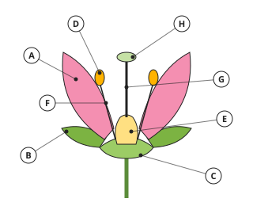
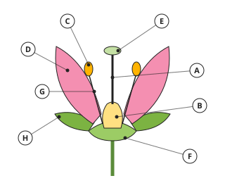
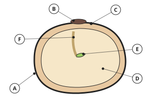

# Biology Form 2, Batches B2-1, B2-2: drafts for review (Lessons 1–9, 13–21, 25–33, 37–46, Terms 1 and 2)

Generated by `npm run review:f2-biology` from `content/form-2/biology/*.json`. Every question and drawing below was built by the engine.
All notes, teach cards, worked examples and paper tasks are **status: draft**. “Authored key” means a person fixed the
right answer (see `AUTHORED.md`); “computed by rule” means code worked it out (a formula, a conversion, a spelling rule).

Teach mode: cards (idea + example + 1 level-1 check) → worked example → practice (levels 1–3) → the note as a summary.

## Sample rendered lesson: Lesson 7 in teach mode

### Lesson 7: Sexual reproduction in plants: The flower

**Card c7-1** (draft)

> The male part of a flower is the stamen: an anther on a filament. The anther makes pollen.
>
> _Stamen = anther + filament._  
> _Pollen grains carry the male sex cells._  

Check question: `b2-7-label` · multiple choice, level 1 · **authored key**, reused from practice

> Which letter shows the filament?

- ◻️ H  
  _↳ feedback if chosen: H is the style._
- ◻️ G  
  _↳ feedback if chosen: G is the stigma._
- ◻️ E  
  _↳ feedback if chosen: E is the ovary._
- ✅ D

Full working after a second miss:

> The filament is labelled D.  

**Card c7-2** (draft)

> The female part is the carpel: stigma, style and ovary. The ovary contains the ovules.
>
> _The stigma receives pollen._  
> _Ovules become seeds._  

Check question: `b2-7-job` · matching, level 1 · **authored key**, reused from practice

> Match each part of the flower to its job.

Right-hand side (shuffled): receives pollen · protects the flower when it is a bud · contains the ovules, which become seeds · holds up the anther
- sepal → **protects the flower when it is a bud**
- ovary → **contains the ovules, which become seeds**
- filament → **holds up the anther**
- stigma → **receives pollen**

Full working after a second miss:

> The right pairs are:  
> sepal → protects the flower when it is a bud  
> ovary → contains the ovules, which become seeds  
> filament → holds up the anther  
> stigma → receives pollen  

**Card c7-3** (draft)

> Sepals protect the bud; petals attract insects.
>
> _Sepals are usually green._  
> _Petals are often brightly coloured and scented._  

Check question: `b2-7-sex-card` · multiple choice, level 1 · **authored key**

> What is a bisexual flower?

- ◻️ a flower with only stamens  
  _↳ feedback if chosen: That is a male flower._
- ◻️ two flowers joined together  
  _↳ feedback if chosen: It is one flower._
- ✅ a flower with both stamens and carpels
- ◻️ a flower with no petals  
  _↳ feedback if chosen: Petals do not decide it._

Full working after a second miss:

> It has both male and female parts.  
> So the answer is “a flower with both stamens and carpels”.  

**Worked example** (draft)

> In the drawing, the anther is labelled E. What does it do, and which part holds it up?

1. The anther is the top of the stamen: it makes pollen grains, the male sex cells.
2. It is held up by the filament, labelled H.

**Answer:** It makes pollen; the filament (H) holds it up.

**Practice** (one generated question per template, easiest first)

Practice 1: `b2-7-label` · multiple choice, level 1 · **authored key**

> Which letter shows the anther?

- ◻️ D  
  _↳ feedback if chosen: D is the stigma._
- ✅ F
- ◻️ H  
  _↳ feedback if chosen: H is the filament._
- ◻️ C  
  _↳ feedback if chosen: C is the style._

Full working after a second miss:

> The anther is labelled F.  

Practice 2: `b2-7-job` · matching, level 1 · **authored key**

> Match each part of the flower to its job.

Right-hand side (shuffled): receives pollen · makes pollen grains · holds up the anther · joins the stigma to the ovary
- stigma → **receives pollen**
- anther → **makes pollen grains**
- style → **joins the stigma to the ovary**
- filament → **holds up the anther**

Full working after a second miss:

> The right pairs are:  
> stigma → receives pollen  
> anther → makes pollen grains  
> style → joins the stigma to the ovary  
> filament → holds up the anther  

Practice 3: `b2-7-sex` · multiple choice, level 2 · **authored key**

> Which parts are the male parts of a flower?

- ✅ the stamens (anthers and filaments)
- ◻️ the carpels  
  _↳ feedback if chosen: Carpels are female._
- ◻️ the petals  
  _↳ feedback if chosen: Petals attract insects._
- ◻️ the sepals  
  _↳ feedback if chosen: Sepals protect the bud._

Full working after a second miss:

> Stamens make pollen.  
> So the answer is “the stamens (anthers and filaments)”.  

Practice 4: `b2-7-spot` · spot the error, level 3 · **authored key**

> Which statement is wrong?

- ◻️ Petals attract insects.
- ◻️ The stigma receives pollen.
- ◻️ The ovary contains ovules.
- ✅ The style contains the ovules.  
  _↳ explanation: The ovules are in the ovary._

Full working after a second miss:

> The wrong statement is “The style contains the ovules.”.  
> The ovules are in the ovary.  

**Summary (the note)**

> The flower is the organ of sexual reproduction of flowering plants. Its parts, from outside to inside:
> • sepals (green): protect the flower bud; together they form the calyx;
> • petals (often coloured and scented): attract insects; together they form the corolla;
> • stamens, the male parts: each has a filament holding up an anther, which makes pollen grains (male sex cells);
> • carpels (pistil), the female part: the stigma receives pollen, the style joins it to the ovary, and the ovary contains ovules (with the female sex cells).
> All these parts sit on the receptacle, at the top of the flower stalk.
> A flower with both stamens and carpels is bisexual (hibiscus); some flowers have only one sex (maize has separate male and female flowers).

## All drafts

| Lesson | Title (sheet) | Status | Cards | Practice | Paper task |
|---|---|---|---|---|---|
| 1 | Notion of reproduction | draft | 3 | 4 | — |
| 2 | Asexual reproduction in plants: Natural vegetative multiplication | draft | 3 | 4 | — |
| 3 | Asexual reproduction in plants: Artificial vegetative multiplication | draft | 3 | 4 | — |
| 4 | Experiment 1- Practising natural vegetative propagation | draft | 3 | 4 | — |
| 5 | Experiment 2- Practising artificial vegetative propagation | draft | 3 | 4 | — |
| 6 | Advantages and disadvantages of vegetative propagation | draft | 3 | 4 | — |
| 7 | Sexual reproduction in plants: The flower | draft | 3 | 4 | — |
| 8 | Sexual reproduction in plants: Pollination | draft | 3 | 4 | — |
| 9 | Experiment 3: Flower dissection | draft | 3 | 4 | — |
| 13 | Sexual reproduction in plants - Fertilisation (notion, process, fate) | draft | 3 | 4 | — |
| 14 | Sexual reproduction in plants: The seed (Notion, structure, functions of parts, importance) | draft | 3 | 4 | — |
| 15 | Seed and Fruit Dispersal (notion, agents, types, importance) | draft | 3 | 4 | — |
| 16 | Adaptation of seed and fruits to their methods of dispersal | draft | 3 | 4 | — |
| 17 | Seed germination (notion, types, conditions) | draft | 3 | 4 | — |
| 18 | Experiment 4- Hypogeal and Epigeal germination | draft | 3 | 4 | — |
| 19 | Experiment 5 - Conditions necessary for seed germination | draft | 3 | 4 | — |
| 20 | Prevention and elimination of plant pests and diseases | draft | 3 | 4 | — |
| 21 | Biological/Chemical control of pests | draft | 3 | 4 | — |
| 25 | Notion, importance, advantages and disadvantages | draft | 3 | 4 | — |
| 26 | Transformation of common foodstuff (Cassava, corn, millet, milk) | draft | 3 | 4 | — |
| 27 | Experiment 7- Transformation of milk into yoghurt | draft | 3 | 4 | — |
| 28 | Notion, methods and importance of food preservation | draft | 3 | 4 | — |
| 29 | Notion, methods and importance of food preparation | draft | 3 | 4 | — |
| 30 | Basic notions of nutrition-related diseases, e.g., obesity (causes, effects, and prevention) | draft | 3 | 4 | — |
| 31 | Body Mass Index | draft | 3 | 4 | — |
| 32 | Calorific value of food | draft | 3 | 3 | — |
| 33 | Healthy eating habits | draft | 3 | 4 | — |
| 37 | Project to combat an identified nutrition- related disease | draft | 3 | 4 | — |
| 38 | Management of solid wastes - avoid, reduce, reuse, recycle, incineration, composting | draft | 3 | 4 | — |
| 39 | Notion and importance of exercise to the body | draft | 3 | 4 | — |
| 40 | Notion and importance of rest to the body | draft | 3 | 4 | — |
| 41 | Health and social effects of drug abuse (alcohol consumption) | draft | 3 | 4 | — |
| 42 | Health and social effects of drug abuse (cigarette smoking) | draft | 3 | 4 | — |
| 43 | Health and social effects of drug abuse (marijuana and tramadol) | draft | 3 | 4 | — |
| 44 | Early marriage and female genital mutilation: Notion, cause and consequences | draft | 3 | 4 | — |
| 45 | Breast ironing and induced abortion: Notion, cause and consequences | draft | 3 | 4 | — |
| 46 | Notion, causes, effects, and prevention of climate change | draft | 3 | 4 | — |
| 50 | Ozone Layer: Notion, role and causes of ozone layer depletion and prevention | draft | 3 | 4 | — |
| 51 | Management of liquid waste e.g., urine and faeces (notion of latrine and types) | draft | 3 | 4 | — |
| 52 | Care and management of pit latrine and water closet | draft | 3 | 4 | — |

## Lesson 1: Notion of reproduction

Prerequisites: none · Skill: b2-1 (The notion of reproduction)

**Note** (draft)

> Reproduction is the making of new individuals of the same kind by living things. Without it a species would die out when its members die.
> There are two kinds:
> • Asexual reproduction: one parent, no sex cells. The offspring are identical to the parent (a clone). Examples: a banana sucker, an onion bulb, a cassava stem cutting.
> • Sexual reproduction: two sex cells (gametes), a male and a female, join (fertilisation). The offspring are similar to the parents but not identical: there is variation. In flowering plants the flower is the organ of sexual reproduction, and it produces seeds.

**Card c1-1** (draft)

> Reproduction makes new individuals, so that the species continues.
>
> _Maize plants make seeds that grow into new maize plants._  
> _Without reproduction a species would die out._  

Check question: `b2-1-why` · multiple choice, level 1 · **authored key**, reused from practice

> Why do living things need to reproduce?

- ◻️ to grow taller  
  _↳ feedback if chosen: Growth is not reproduction._
- ◻️ to make oxygen  
  _↳ feedback if chosen: That is photosynthesis._
- ◻️ to get more food  
  _↳ feedback if chosen: Feeding is not reproduction._
- ✅ so that their species does not die out

Full working after a second miss:

> Reproduction replaces individuals that die.  
> So the answer is “so that their species does not die out”.  

**Card c1-2** (draft)

> Asexual reproduction has one parent and gives identical offspring.
>
> _An onion bulb grows into new onions._  
> _A cassava cutting grows into a new cassava plant._  

Check question: `b2-1-kind` · matching, level 1 · **authored key**, reused from practice

> Sort the examples: sexual or asexual reproduction?

Groups: sexual · asexual
- planting a cassava stem cutting → **asexual**
- bean seeds forming in a pod → **sexual**
- an onion bulb making new bulbs → **asexual**
- a mango seed growing into a tree → **sexual**

Full working after a second miss:

> The right pairs are:  
> planting a cassava stem cutting → asexual  
> bean seeds forming in a pod → sexual  
> an onion bulb making new bulbs → asexual  
> a mango seed growing into a tree → sexual  

**Card c1-3** (draft)

> Sexual reproduction joins a male and a female sex cell, and gives offspring that vary.
>
> _In a flower, pollen (male) and the egg cell (female) join._  
> _The seeds grow into plants that are not all the same._  

Check question: `b2-1-compare-card` · multiple choice, level 1 · **authored key**

> Which kind of reproduction gives offspring identical to the parent?

- ◻️ sexual reproduction  
  _↳ feedback if chosen: Sexual reproduction gives variation._
- ◻️ both kinds  
  _↳ feedback if chosen: Only asexual gives clones._
- ✅ asexual reproduction
- ◻️ neither kind  
  _↳ feedback if chosen: Asexual does._

Full working after a second miss:

> One parent, no gametes: identical offspring.  
> So the answer is “asexual reproduction”.  

**Worked example** (draft)

> A farmer plants suckers from his best plantain tree. Is this sexual or asexual reproduction? What will the new plants be like?

1. A sucker grows from one parent plant, with no sex cells: this is asexual reproduction.
2. The new plants are clones: identical to the parent, so they keep its good qualities.

**Answer:** Asexual reproduction; the new plants are identical to the parent.

**Practice** `b2-1-why` · multiple choice, level 1 · **authored key**

> What is reproduction?

- ◻️ removing waste  
  _↳ feedback if chosen: That is excretion._
- ◻️ making food from sunlight  
  _↳ feedback if chosen: That is photosynthesis._
- ◻️ taking in oxygen  
  _↳ feedback if chosen: That is respiration._
- ✅ making new individuals of the same kind

Full working after a second miss:

> Reproduction produces offspring.  
> So the answer is “making new individuals of the same kind”.  

> What is reproduction?

- ◻️ removing waste  
  _↳ feedback if chosen: That is excretion._
- ✅ making new individuals of the same kind
- ◻️ making food from sunlight  
  _↳ feedback if chosen: That is photosynthesis._
- ◻️ taking in oxygen  
  _↳ feedback if chosen: That is respiration._

Full working after a second miss:

> Reproduction produces offspring.  
> So the answer is “making new individuals of the same kind”.  

**Practice** `b2-1-kind` · matching, level 1 · **authored key**

> Sort the examples: sexual or asexual reproduction?

Groups: sexual · asexual
- planting a banana sucker → **asexual**
- a mango seed growing into a tree → **sexual**
- an onion bulb making new bulbs → **asexual**
- planting a cassava stem cutting → **asexual**

Full working after a second miss:

> The right pairs are:  
> planting a banana sucker → asexual  
> a mango seed growing into a tree → sexual  
> an onion bulb making new bulbs → asexual  
> planting a cassava stem cutting → asexual  

> Sort the examples: sexual or asexual reproduction?

Groups: sexual · asexual
- a potato tuber sprouting → **asexual**
- bean seeds forming in a pod → **sexual**
- growing maize from seeds → **sexual**
- an onion bulb making new bulbs → **asexual**

Full working after a second miss:

> The right pairs are:  
> a potato tuber sprouting → asexual  
> bean seeds forming in a pod → sexual  
> growing maize from seeds → sexual  
> an onion bulb making new bulbs → asexual  

**Practice** `b2-1-compare` · multiple choice, level 2 · **authored key**

> Which kind of reproduction gives offspring identical to the parent?

- ◻️ both kinds  
  _↳ feedback if chosen: Only asexual gives clones._
- ◻️ neither kind  
  _↳ feedback if chosen: Asexual does._
- ✅ asexual reproduction
- ◻️ sexual reproduction  
  _↳ feedback if chosen: Sexual reproduction gives variation._

Full working after a second miss:

> One parent, no gametes: identical offspring.  
> So the answer is “asexual reproduction”.  

> What joins in sexual reproduction?

- ✅ a male and a female sex cell
- ◻️ two leaves  
  _↳ feedback if chosen: Leaves do not join._
- ◻️ two roots  
  _↳ feedback if chosen: Roots do not join._
- ◻️ a stem and a root  
  _↳ feedback if chosen: These are not sex cells._

Full working after a second miss:

> Gametes join in fertilisation.  
> So the answer is “a male and a female sex cell”.  

**Practice** `b2-1-spot` · spot the error, level 3 · **authored key**

> Which statement is wrong?

- ◻️ Sexual reproduction gives variation.
- ◻️ Asexual reproduction needs only one parent.
- ◻️ The flower is the organ of sexual reproduction.
- ✅ Asexual reproduction needs two sex cells.  
  _↳ explanation: Asexual reproduction has no sex cells._

Full working after a second miss:

> The wrong statement is “Asexual reproduction needs two sex cells.”.  
> Asexual reproduction has no sex cells.  

> Which statement is wrong?

- ◻️ The flower is the organ of sexual reproduction.
- ◻️ Reproduction keeps a species alive.
- ✅ Asexual reproduction needs two sex cells.  
  _↳ explanation: Asexual reproduction has no sex cells._
- ◻️ Asexual reproduction needs only one parent.

Full working after a second miss:

> The wrong statement is “Asexual reproduction needs two sex cells.”.  
> Asexual reproduction has no sex cells.  

## Lesson 2: Asexual reproduction in plants: Natural vegetative multiplication

Prerequisites: 1 · Skill: b2-2 (Natural vegetative multiplication)

**Note** (draft)

> Vegetative propagation is asexual reproduction from a part of the plant that is not a flower (a stem, root or leaf). It happens naturally through special organs:
> • bulb: a short stem with fleshy leaves storing food (onion, garlic);
> • corm: a short swollen underground stem (cocoyam);
> • rhizome: a horizontal underground stem (ginger, spear grass);
> • stem tuber: a swollen underground stem tip with buds called eyes (Irish potato);
> • root tuber: a swollen root (sweet potato);
> • sucker: a shoot from the base of the stem (banana, plantain);
> • runner (stolon): a stem growing along the ground (some grasses);
> • leaves: buds on the leaf edge grow into plantlets (Bryophyllum).
> Most of these organs store food, which feeds the new plant.

**Card c2-1** (draft)

> Vegetative propagation grows new plants from stems, roots or leaves, not from seeds.
>
> _A banana sucker becomes a new banana plant._  
> _A ginger rhizome grows new shoots._  

Check question: `b2-2-organ` · matching, level 1 · **authored key**, reused from practice

> Match each plant to the organ it uses for natural vegetative propagation.

Right-hand side (shuffled): corm · bulb · sucker · rhizome
- banana → **sucker**
- cocoyam → **corm**
- garlic → **bulb**
- spear grass → **rhizome**

Full working after a second miss:

> The right pairs are:  
> banana → sucker  
> cocoyam → corm  
> garlic → bulb  
> spear grass → rhizome  

**Card c2-2** (draft)

> Underground storage organs feed the new plant: bulbs, corms, rhizomes, tubers.
>
> _Onion: bulb. Cocoyam: corm._  
> _Irish potato: stem tuber. Sweet potato: root tuber._  

Check question: `b2-2-store` · multiple choice, level 1 · **authored key**, reused from practice

> Why do most vegetative organs contain stored food?

- ◻️ to make seeds  
  _↳ feedback if chosen: Seeds come from flowers._
- ✅ to feed the new plant until it can make its own food
- ◻️ to keep the soil wet  
  _↳ feedback if chosen: That is not their job._
- ◻️ to attract insects  
  _↳ feedback if chosen: That is the job of petals._

Full working after a second miss:

> Stored food feeds the young shoots.  
> So the answer is “to feed the new plant until it can make its own food”.  

**Card c2-3** (draft)

> Some plants make new plants from their leaves or from runners.
>
> _Bryophyllum: plantlets on the leaf edges._  
> _Some grasses: runners along the ground._  

Check question: `b2-2-leaf-card` · multiple choice, level 1 · **authored key**

> Banana and plantain reproduce naturally by …

- ◻️ bulbs  
  _↳ feedback if chosen: They have no bulbs._
- ◻️ seeds  
  _↳ feedback if chosen: Cultivated bananas have no good seeds._
- ◻️ leaves  
  _↳ feedback if chosen: Their leaves do not make plantlets._
- ✅ suckers

Full working after a second miss:

> Suckers grow from the base of the stem.  
> So the answer is “suckers”.  

**Worked example** (draft)

> How does an Irish potato reproduce naturally without seeds?

1. An Irish potato is a stem tuber: a swollen underground stem full of stored food.
2. Its buds (eyes) grow into new shoots, using the stored food, and each forms a new plant.

**Answer:** By stem tubers: the buds (eyes) grow into new plants.

**Practice** `b2-2-organ` · matching, level 1 · **authored key**

> Match each plant to the organ it uses for natural vegetative propagation.

Right-hand side (shuffled): corm · bulb · sucker · root tuber
- banana → **sucker**
- onion → **bulb**
- cocoyam → **corm**
- sweet potato → **root tuber**

Full working after a second miss:

> The right pairs are:  
> banana → sucker  
> onion → bulb  
> cocoyam → corm  
> sweet potato → root tuber  

> Match each plant to the organ it uses for natural vegetative propagation.

Right-hand side (shuffled): stem tuber · rhizome · bulb · sucker
- ginger → **rhizome**
- garlic → **bulb**
- Irish potato → **stem tuber**
- plantain → **sucker**

Full working after a second miss:

> The right pairs are:  
> ginger → rhizome  
> garlic → bulb  
> Irish potato → stem tuber  
> plantain → sucker  

**Practice** `b2-2-store` · multiple choice, level 1 · **authored key**

> What is a sweet potato?

- ◻️ a corm  
  _↳ feedback if chosen: A corm is a short swollen stem._
- ◻️ a rhizome  
  _↳ feedback if chosen: A rhizome is a horizontal stem._
- ◻️ a stem tuber  
  _↳ feedback if chosen: Sweet potato is a swollen root._
- ✅ a root tuber

Full working after a second miss:

> It is a swollen root.  
> So the answer is “a root tuber”.  

> What is a sweet potato?

- ◻️ a corm  
  _↳ feedback if chosen: A corm is a short swollen stem._
- ◻️ a rhizome  
  _↳ feedback if chosen: A rhizome is a horizontal stem._
- ◻️ a stem tuber  
  _↳ feedback if chosen: Sweet potato is a swollen root._
- ✅ a root tuber

Full working after a second miss:

> It is a swollen root.  
> So the answer is “a root tuber”.  

**Practice** `b2-2-leaf` · multiple choice, level 2 · **authored key**

> Spear grass is hard to get rid of because it spreads by …

- ✅ underground rhizomes
- ◻️ bulbs  
  _↳ feedback if chosen: It has no bulbs._
- ◻️ fruits  
  _↳ feedback if chosen: It spreads mainly by rhizomes._
- ◻️ flowers only  
  _↳ feedback if chosen: Its rhizomes spread it._

Full working after a second miss:

> Pieces of rhizome left in the soil grow again.  
> So the answer is “underground rhizomes”.  

> Banana and plantain reproduce naturally by …

- ◻️ leaves  
  _↳ feedback if chosen: Their leaves do not make plantlets._
- ✅ suckers
- ◻️ bulbs  
  _↳ feedback if chosen: They have no bulbs._
- ◻️ seeds  
  _↳ feedback if chosen: Cultivated bananas have no good seeds._

Full working after a second miss:

> Suckers grow from the base of the stem.  
> So the answer is “suckers”.  

**Practice** `b2-2-spot` · spot the error, level 3 · **authored key**

> Which statement is wrong?

- ◻️ Ginger has a rhizome.
- ◻️ Onion reproduces by bulbs.
- ◻️ Cocoyam has a corm.
- ✅ A bulb is a swollen root.  
  _↳ explanation: A bulb is a short stem with fleshy leaves._

Full working after a second miss:

> The wrong statement is “A bulb is a swollen root.”.  
> A bulb is a short stem with fleshy leaves.  

> Which statement is wrong?

- ◻️ Ginger has a rhizome.
- ◻️ Onion reproduces by bulbs.
- ✅ Sweet potato is a stem tuber.  
  _↳ explanation: Sweet potato is a root tuber; Irish potato is a stem tuber._
- ◻️ Plantain reproduces by suckers.

Full working after a second miss:

> The wrong statement is “Sweet potato is a stem tuber.”.  
> Sweet potato is a root tuber; Irish potato is a stem tuber.  

## Lesson 3: Asexual reproduction in plants: Artificial vegetative multiplication

Prerequisites: 2 · Skill: b2-3 (Artificial vegetative propagation)

**Note** (draft)

> Farmers and gardeners use vegetative propagation on purpose:
> • Cuttings: a piece of stem is planted and grows roots (cassava, sugarcane, hibiscus, Irish potato pieces with an eye).
> • Grafting: a shoot (the scion) of a good variety is joined onto a rooted plant (the stock), and they grow together (mango, orange, avocado).
> • Budding: like grafting, but with a single bud (oranges, roses).
> • Layering: a low branch is bent and covered with soil; when it has roots it is cut off.
> • Marcotting (air layering): a ring of bark is removed and the place is wrapped in moist soil while still on the tree.
> • Tissue culture: tiny pieces are grown in a laboratory to make thousands of identical plants.
> The scion gives the fruit quality; the stock gives strong roots.

**Card c3-1** (draft)

> A cutting is a piece of stem planted to grow a new plant.
>
> _Cassava is grown from stem cuttings._  
> _Sugarcane too._  

Check question: `b2-3-method` · matching, level 1 · **authored key**, reused from practice

> Match each method to what is done.

Right-hand side (shuffled): tiny pieces of plant are grown on special food in a laboratory · a single bud is joined onto a stock · a shoot (scion) is joined onto a rooted plant (stock) · a branch is wrapped in moist soil while still on the tree until it roots
- grafting → **a shoot (scion) is joined onto a rooted plant (stock)**
- budding → **a single bud is joined onto a stock**
- tissue culture → **tiny pieces of plant are grown on special food in a laboratory**
- marcotting → **a branch is wrapped in moist soil while still on the tree until it roots**

Full working after a second miss:

> The right pairs are:  
> grafting → a shoot (scion) is joined onto a rooted plant (stock)  
> budding → a single bud is joined onto a stock  
> tissue culture → tiny pieces of plant are grown on special food in a laboratory  
> marcotting → a branch is wrapped in moist soil while still on the tree until it roots  

**Card c3-2** (draft)

> In grafting, a scion from a good plant is joined onto a stock with good roots.
>
> _Scion: gives the fruit._  
> _Stock: gives the roots._  

Check question: `b2-3-graft` · multiple choice, level 1 · **authored key**, reused from practice

> In grafting, what is the scion?

- ✅ the shoot from the good variety
- ◻️ the seed  
  _↳ feedback if chosen: Grafting does not use seeds._
- ◻️ the soil  
  _↳ feedback if chosen: Soil is not part of the graft._
- ◻️ the rooted plant  
  _↳ feedback if chosen: That is the stock._

Full working after a second miss:

> The scion is the shoot joined on.  
> So the answer is “the shoot from the good variety”.  

**Card c3-3** (draft)

> Layering and marcotting make a branch grow roots before it is cut off.
>
> _Layering: branch bent into the soil._  
> _Marcotting: soil wrapped round the branch on the tree._  

Check question: `b2-3-crop-card` · multiple choice, level 1 · **authored key**

> Which method is usually used to grow sugarcane?

- ◻️ bulbs  
  _↳ feedback if chosen: It has no bulbs._
- ◻️ corms  
  _↳ feedback if chosen: It has no corms._
- ✅ stem cuttings
- ◻️ budding  
  _↳ feedback if chosen: Sugarcane is grown from stem pieces._

Full working after a second miss:

> Stem pieces with nodes are planted.  
> So the answer is “stem cuttings”.  

**Worked example** (draft)

> A farmer has a mango tree with big sweet fruits and a young mango seedling with strong roots. How can he get the good fruits quickly on a strong plant?

1. Graft: cut a shoot (the scion) from the tree with good fruits.
2. Join it onto the seedling (the stock) and tie them so they grow together.
3. The plant will have the strong roots of the stock and the good fruits of the scion.

**Answer:** By grafting the good variety (scion) onto the seedling (stock).

**Practice** `b2-3-method` · matching, level 1 · **authored key**

> Match each method to what is done.

Right-hand side (shuffled): a piece of stem is planted and grows roots · a branch is wrapped in moist soil while still on the tree until it roots · a single bud is joined onto a stock · tiny pieces of plant are grown on special food in a laboratory
- budding → **a single bud is joined onto a stock**
- marcotting → **a branch is wrapped in moist soil while still on the tree until it roots**
- tissue culture → **tiny pieces of plant are grown on special food in a laboratory**
- cutting → **a piece of stem is planted and grows roots**

Full working after a second miss:

> The right pairs are:  
> budding → a single bud is joined onto a stock  
> marcotting → a branch is wrapped in moist soil while still on the tree until it roots  
> tissue culture → tiny pieces of plant are grown on special food in a laboratory  
> cutting → a piece of stem is planted and grows roots  

> Match each method to what is done.

Right-hand side (shuffled): a branch is wrapped in moist soil while still on the tree until it roots · a branch is bent down and covered with soil until it roots · tiny pieces of plant are grown on special food in a laboratory · a piece of stem is planted and grows roots
- cutting → **a piece of stem is planted and grows roots**
- layering → **a branch is bent down and covered with soil until it roots**
- marcotting → **a branch is wrapped in moist soil while still on the tree until it roots**
- tissue culture → **tiny pieces of plant are grown on special food in a laboratory**

Full working after a second miss:

> The right pairs are:  
> cutting → a piece of stem is planted and grows roots  
> layering → a branch is bent down and covered with soil until it roots  
> marcotting → a branch is wrapped in moist soil while still on the tree until it roots  
> tissue culture → tiny pieces of plant are grown on special food in a laboratory  

**Practice** `b2-3-graft` · multiple choice, level 1 · **authored key**

> In grafting, what is the scion?

- ◻️ the soil  
  _↳ feedback if chosen: Soil is not part of the graft._
- ◻️ the rooted plant  
  _↳ feedback if chosen: That is the stock._
- ◻️ the seed  
  _↳ feedback if chosen: Grafting does not use seeds._
- ✅ the shoot from the good variety

Full working after a second miss:

> The scion is the shoot joined on.  
> So the answer is “the shoot from the good variety”.  

> In grafting, what is the scion?

- ✅ the shoot from the good variety
- ◻️ the soil  
  _↳ feedback if chosen: Soil is not part of the graft._
- ◻️ the seed  
  _↳ feedback if chosen: Grafting does not use seeds._
- ◻️ the rooted plant  
  _↳ feedback if chosen: That is the stock._

Full working after a second miss:

> The scion is the shoot joined on.  
> So the answer is “the shoot from the good variety”.  

**Practice** `b2-3-crop` · multiple choice, level 2 · **authored key**

> Which method is usually used to grow sugarcane?

- ◻️ budding  
  _↳ feedback if chosen: Sugarcane is grown from stem pieces._
- ◻️ corms  
  _↳ feedback if chosen: It has no corms._
- ◻️ bulbs  
  _↳ feedback if chosen: It has no bulbs._
- ✅ stem cuttings

Full working after a second miss:

> Stem pieces with nodes are planted.  
> So the answer is “stem cuttings”.  

> Which method is usually used to grow cassava?

- ◻️ tissue culture only  
  _↳ feedback if chosen: Farmers plant stem pieces._
- ◻️ seeds only  
  _↳ feedback if chosen: Farmers plant stem pieces._
- ✅ stem cuttings
- ◻️ grafting  
  _↳ feedback if chosen: Cassava is not grafted._

Full working after a second miss:

> Cassava stems are cut and planted.  
> So the answer is “stem cuttings”.  

**Practice** `b2-3-spot` · spot the error, level 3 · **authored key**

> Which statement is wrong?

- ✅ Layering uses seeds.  
  _↳ explanation: Layering roots a branch; no seeds._
- ◻️ Tissue culture is done in a laboratory.
- ◻️ Cassava is grown from stem cuttings.
- ◻️ Marcotting is done while the branch is on the tree.

Full working after a second miss:

> The wrong statement is “Layering uses seeds.”.  
> Layering roots a branch; no seeds.  

> Which statement is wrong?

- ◻️ Marcotting is done while the branch is on the tree.
- ✅ Layering uses seeds.  
  _↳ explanation: Layering roots a branch; no seeds._
- ◻️ Grafting joins a scion to a stock.
- ◻️ Cassava is grown from stem cuttings.

Full working after a second miss:

> The wrong statement is “Layering uses seeds.”.  
> Layering roots a branch; no seeds.  

## Lesson 4: Experiment 1- Practising natural vegetative propagation

Prerequisites: 2 · Skill: b2-4 (Experiment 1: practising natural vegetative propagation)

**Note** (draft)

> Aim: to observe new plants growing from natural vegetative organs.
> Materials: an onion bulb, an Irish potato with eyes, a Bryophyllum leaf, pots or tins with moist soil, water.
> Method:
> 1. Fill the pots with moist soil.
> 2. Plant the onion with its base (the flat stem) in the soil, the potato a few centimetres deep, and lay the Bryophyllum leaf on the soil.
> 3. Water lightly every day and keep the pots in a warm place out of direct sun.
> 4. Observe every two days for two to three weeks, and record what you see in a table with dates.
> Results: roots grow from the onion's base and green leaves from its top; shoots grow from the potato's eyes; plantlets grow from the notches of the Bryophyllum leaf.
> Conclusion: new plants grow from the plant's own organs, without seeds.

**Card c4-1** (draft)

> Plant each organ the right way: the onion's base in the soil, the potato buried, the Bryophyllum leaf on the soil.
>
> _Keep the soil moist, not flooded._  
> _Keep the pots warm, out of direct sun._  

Check question: `b2-4-steps` · ordering, level 1 · **authored key**, reused from practice

> Put the steps of the experiment in order.

Shown as: Water lightly every day and keep the pots warm · Fill the pots with moist soil · Observe and record every two days · Write a conclusion · Plant the onion, the potato and the Bryophyllum leaf
Correct order: Fill the pots with moist soil → Plant the onion, the potato and the Bryophyllum leaf → Water lightly every day and keep the pots warm → Observe and record every two days → Write a conclusion

Full working after a second miss:

> The correct order is: Fill the pots with moist soil → Plant the onion, the potato and the Bryophyllum leaf → Water lightly every day and keep the pots warm → Observe and record every two days → Write a conclusion.  

**Card c4-2** (draft)

> Record observations every two days in a table with the date.
>
> _Day 2: no change. Day 6: roots on the onion._  
> _Day 10: shoots from the potato eyes._  

Check question: `b2-4-see` · multiple choice, level 1 · **authored key**, reused from practice

> From which part of an onion do the roots grow?

- ◻️ the fleshy leaves  
  _↳ feedback if chosen: They store food._
- ◻️ the top  
  _↳ feedback if chosen: Leaves grow from the top._
- ◻️ the dry outer skin  
  _↳ feedback if chosen: The skin is dead._
- ✅ the flat base (stem plate)

Full working after a second miss:

> Roots grow from the stem plate at the base.  
> So the answer is “the flat base (stem plate)”.  

**Card c4-3** (draft)

> The conclusion: new plants can grow from stems, roots or leaves, without seeds.
>
> _The onion, potato and Bryophyllum all made new plants._  

Check question: `b2-4-why-card` · multiple choice, level 1 · **authored key**

> What does this experiment show?

- ◻️ Plants grow only in the dark.  
  _↳ feedback if chosen: That is not what it shows._
- ◻️ Plants need seeds to reproduce.  
  _↳ feedback if chosen: The experiment shows the opposite._
- ◻️ Onions are seeds.  
  _↳ feedback if chosen: An onion is a bulb._
- ✅ New plants can grow from stems, roots or leaves without seeds.

Full working after a second miss:

> That is natural vegetative propagation.  
> So the answer is “New plants can grow from stems, roots or leaves without seeds.”.  

**Worked example** (draft)

> After a week, what will you see on the onion bulb, and what does it show?

1. Roots grow from the flat base (the stem plate) into the soil.
2. Green leaves grow from the top, using the food stored in the fleshy leaves.
3. A new plant grows without a seed: natural vegetative propagation.

**Answer:** Roots at the base, leaves at the top: a new plant from the bulb.

**Practice** `b2-4-steps` · ordering, level 1 · **authored key**

> Put the steps of the experiment in order.

Shown as: Observe and record every two days · Water lightly every day and keep the pots warm · Write a conclusion · Fill the pots with moist soil · Plant the onion, the potato and the Bryophyllum leaf
Correct order: Fill the pots with moist soil → Plant the onion, the potato and the Bryophyllum leaf → Water lightly every day and keep the pots warm → Observe and record every two days → Write a conclusion

Full working after a second miss:

> The correct order is: Fill the pots with moist soil → Plant the onion, the potato and the Bryophyllum leaf → Water lightly every day and keep the pots warm → Observe and record every two days → Write a conclusion.  

> Put the steps of the experiment in order.

Shown as: Water lightly every day and keep the pots warm · Fill the pots with moist soil · Write a conclusion · Observe and record every two days · Plant the onion, the potato and the Bryophyllum leaf
Correct order: Fill the pots with moist soil → Plant the onion, the potato and the Bryophyllum leaf → Water lightly every day and keep the pots warm → Observe and record every two days → Write a conclusion

Full working after a second miss:

> The correct order is: Fill the pots with moist soil → Plant the onion, the potato and the Bryophyllum leaf → Water lightly every day and keep the pots warm → Observe and record every two days → Write a conclusion.  

**Practice** `b2-4-see` · multiple choice, level 1 · **authored key**

> Where do new shoots grow on an Irish potato?

- ◻️ from the roots of the old plant  
  _↳ feedback if chosen: The tuber has no old roots here._
- ✅ from the eyes (buds)
- ◻️ from seeds inside it  
  _↳ feedback if chosen: A potato tuber has no seeds._
- ◻️ from the skin everywhere  
  _↳ feedback if chosen: They grow only from the eyes._

Full working after a second miss:

> The eyes are buds.  
> So the answer is “from the eyes (buds)”.  

> From which part of an onion do the roots grow?

- ✅ the flat base (stem plate)
- ◻️ the top  
  _↳ feedback if chosen: Leaves grow from the top._
- ◻️ the dry outer skin  
  _↳ feedback if chosen: The skin is dead._
- ◻️ the fleshy leaves  
  _↳ feedback if chosen: They store food._

Full working after a second miss:

> Roots grow from the stem plate at the base.  
> So the answer is “the flat base (stem plate)”.  

**Practice** `b2-4-why` · multiple choice, level 2 · **authored key**

> What does this experiment show?

- ◻️ Plants grow only in the dark.  
  _↳ feedback if chosen: That is not what it shows._
- ◻️ Plants need seeds to reproduce.  
  _↳ feedback if chosen: The experiment shows the opposite._
- ✅ New plants can grow from stems, roots or leaves without seeds.
- ◻️ Onions are seeds.  
  _↳ feedback if chosen: An onion is a bulb._

Full working after a second miss:

> That is natural vegetative propagation.  
> So the answer is “New plants can grow from stems, roots or leaves without seeds.”.  

> What does this experiment show?

- ◻️ Plants need seeds to reproduce.  
  _↳ feedback if chosen: The experiment shows the opposite._
- ◻️ Plants grow only in the dark.  
  _↳ feedback if chosen: That is not what it shows._
- ✅ New plants can grow from stems, roots or leaves without seeds.
- ◻️ Onions are seeds.  
  _↳ feedback if chosen: An onion is a bulb._

Full working after a second miss:

> That is natural vegetative propagation.  
> So the answer is “New plants can grow from stems, roots or leaves without seeds.”.  

**Practice** `b2-4-spot` · spot the error, level 3 · **authored key**

> Which step or result is wrong?

- ◻️ Shoots grow from the potato's eyes.
- ◻️ Plant the onion with its base in the soil.
- ◻️ Keep the soil moist.
- ✅ Plantlets grow from the Bryophyllum leaf stalk only.  
  _↳ explanation: They grow from the notches on the leaf edge._

Full working after a second miss:

> The wrong statement is “Plantlets grow from the Bryophyllum leaf stalk only.”.  
> They grow from the notches on the leaf edge.  

> Which step or result is wrong?

- ✅ Flood the pots with water every hour.  
  _↳ explanation: Water lightly: flooding makes the organs rot._
- ◻️ Keep the soil moist.
- ◻️ Shoots grow from the potato's eyes.
- ◻️ Record observations with dates.

Full working after a second miss:

> The wrong statement is “Flood the pots with water every hour.”.  
> Water lightly: flooding makes the organs rot.  

## Lesson 5: Experiment 2- Practising artificial vegetative propagation

Prerequisites: 3 · Skill: b2-5 (Experiment 2: practising artificial vegetative propagation)

**Note** (draft)

> Aim: to grow new plants from stem cuttings.
> Materials: healthy mature stems of cassava (or hibiscus), a sharp cutlass or knife, a nursery bed or pots with moist soil.
> Method:
> 1. Choose a healthy, mature stem from a good plant.
> 2. Cut pieces about 20–25 cm long, each with several nodes (buds), with a slanting cut.
> 3. Plant each piece the right way up (buds pointing up), slanted, with about two thirds in the soil.
> 4. Water regularly and protect from animals.
> 5. Observe for three to four weeks and record when roots and shoots appear.
> Results: roots grow from the nodes under the soil; shoots grow from the buds above it.
> Conclusion: a piece of stem with nodes can grow into a whole new plant, identical to its parent.

**Card c5-1** (draft)

> Choose a healthy, mature stem, and cut pieces with several nodes.
>
> _The nodes carry buds._  
> _Use a sharp blade and a slanting cut._  

Check question: `b2-5-steps` · ordering, level 1 · **authored key**, reused from practice

> Put the steps of growing cassava from cuttings in order.

Shown as: Cut pieces with several nodes · Plant them the right way up, slanted · Choose a healthy mature stem · Water regularly and protect them · Observe roots and shoots appearing
Correct order: Choose a healthy mature stem → Cut pieces with several nodes → Plant them the right way up, slanted → Water regularly and protect them → Observe roots and shoots appearing

Full working after a second miss:

> The correct order is: Choose a healthy mature stem → Cut pieces with several nodes → Plant them the right way up, slanted → Water regularly and protect them → Observe roots and shoots appearing.  

**Card c5-2** (draft)

> Plant the cutting the right way up, slanted, with most of it in the soil.
>
> _Buds point upwards._  
> _Water regularly._  

Check question: `b2-5-plant` · multiple choice, level 1 · **authored key**, reused from practice

> Which stem should you choose for cuttings?

- ◻️ a dry dead stem  
  _↳ feedback if chosen: It cannot grow._
- ◻️ a diseased stem  
  _↳ feedback if chosen: Disease is passed on._
- ✅ a healthy, mature stem
- ◻️ a very young green tip  
  _↳ feedback if chosen: It is too soft and rots._

Full working after a second miss:

> A healthy mature stem has stored food and good buds.  
> So the answer is “a healthy, mature stem”.  

**Card c5-3** (draft)

> Roots grow from the nodes in the soil, shoots from the buds above.
>
> _The new plant is identical to the parent._  

Check question: `b2-5-result-card` · multiple choice, level 1 · **authored key**

> Where do the roots of a cassava cutting grow from?

- ◻️ the leaves  
  _↳ feedback if chosen: The cutting has no leaves at first._
- ◻️ the seeds  
  _↳ feedback if chosen: No seeds are involved._
- ◻️ the cut top  
  _↳ feedback if chosen: The top stays above the soil._
- ✅ the nodes under the soil

Full working after a second miss:

> Roots grow from the buried nodes.  
> So the answer is “the nodes under the soil”.  

**Worked example** (draft)

> Why must a cassava cutting have nodes, and why is it planted the right way up?

1. New roots and shoots grow from the nodes (buds); a piece without nodes cannot grow.
2. Buds pointing up grow into shoots towards the light; upside down, the cutting grows poorly or dies.

**Answer:** Nodes carry the buds; the right way up lets shoots grow upwards.

**Practice** `b2-5-steps` · ordering, level 1 · **authored key**

> Put the steps of growing cassava from cuttings in order.

Shown as: Water regularly and protect them · Plant them the right way up, slanted · Choose a healthy mature stem · Observe roots and shoots appearing · Cut pieces with several nodes
Correct order: Choose a healthy mature stem → Cut pieces with several nodes → Plant them the right way up, slanted → Water regularly and protect them → Observe roots and shoots appearing

Full working after a second miss:

> The correct order is: Choose a healthy mature stem → Cut pieces with several nodes → Plant them the right way up, slanted → Water regularly and protect them → Observe roots and shoots appearing.  

> Put the steps of growing cassava from cuttings in order.

Shown as: Water regularly and protect them · Cut pieces with several nodes · Observe roots and shoots appearing · Plant them the right way up, slanted · Choose a healthy mature stem
Correct order: Choose a healthy mature stem → Cut pieces with several nodes → Plant them the right way up, slanted → Water regularly and protect them → Observe roots and shoots appearing

Full working after a second miss:

> The correct order is: Choose a healthy mature stem → Cut pieces with several nodes → Plant them the right way up, slanted → Water regularly and protect them → Observe roots and shoots appearing.  

**Practice** `b2-5-plant` · multiple choice, level 1 · **authored key**

> Which stem should you choose for cuttings?

- ✅ a healthy, mature stem
- ◻️ a very young green tip  
  _↳ feedback if chosen: It is too soft and rots._
- ◻️ a dry dead stem  
  _↳ feedback if chosen: It cannot grow._
- ◻️ a diseased stem  
  _↳ feedback if chosen: Disease is passed on._

Full working after a second miss:

> A healthy mature stem has stored food and good buds.  
> So the answer is “a healthy, mature stem”.  

> Why must each cutting have nodes?

- ◻️ Nodes make it heavier.  
  _↳ feedback if chosen: Weight is not the reason._
- ✅ Roots and shoots grow from the nodes.
- ◻️ Nodes are not needed.  
  _↳ feedback if chosen: Without nodes, nothing grows._
- ◻️ Nodes store water only.  
  _↳ feedback if chosen: They carry buds._

Full working after a second miss:

> Nodes carry the buds.  
> So the answer is “Roots and shoots grow from the nodes.”.  

**Practice** `b2-5-result` · multiple choice, level 2 · **authored key**

> How will the new cassava plants compare with the parent?

- ◻️ They will be a different crop.  
  _↳ feedback if chosen: They are cassava._
- ◻️ They will all be different.  
  _↳ feedback if chosen: Vegetative propagation gives clones._
- ✅ They will be identical to it.
- ◻️ They will be smaller for ever.  
  _↳ feedback if chosen: They grow normally._

Full working after a second miss:

> Cuttings make clones of the parent.  
> So the answer is “They will be identical to it.”.  

> Where do the roots of a cassava cutting grow from?

- ✅ the nodes under the soil
- ◻️ the seeds  
  _↳ feedback if chosen: No seeds are involved._
- ◻️ the cut top  
  _↳ feedback if chosen: The top stays above the soil._
- ◻️ the leaves  
  _↳ feedback if chosen: The cutting has no leaves at first._

Full working after a second miss:

> Roots grow from the buried nodes.  
> So the answer is “the nodes under the soil”.  

**Practice** `b2-5-spot` · spot the error, level 3 · **authored key**

> Which step is wrong?

- ◻️ Cut pieces with several nodes.
- ◻️ Plant the cuttings slanted.
- ◻️ Water them regularly.
- ✅ Take cuttings from a diseased plant.  
  _↳ explanation: Diseases would be passed on._

Full working after a second miss:

> The wrong statement is “Take cuttings from a diseased plant.”.  
> Diseases would be passed on.  

> Which step is wrong?

- ✅ Use pieces without any nodes.  
  _↳ explanation: Without nodes no roots or shoots grow._
- ◻️ Water them regularly.
- ◻️ Choose a healthy, mature stem.
- ◻️ Plant the cuttings slanted.

Full working after a second miss:

> The wrong statement is “Use pieces without any nodes.”.  
> Without nodes no roots or shoots grow.  

## Lesson 6: Advantages and disadvantages of vegetative propagation

Prerequisites: 2, 3 · Skill: b2-6 (Advantages and disadvantages of vegetative propagation)

**Note** (draft)

> Advantages:
> • The new plants are identical to the parent, so good qualities (big fruits, sweetness, resistance) are kept.
> • It is faster: plants mature and bear fruit sooner than from seeds.
> • It works for plants with no good seeds (banana, plantain, cassava).
> • The stored food helps the new plant survive bad conditions.
> Disadvantages:
> • No variation: if a disease attacks, all the plants may be destroyed.
> • Diseases of the parent are passed on (cassava mosaic in cuttings).
> • New plants grow close to the parent: overcrowding and competition.
> • Organs are bulky and heavy to store and carry, and they can rot.

**Card c6-1** (draft)

> Vegetative propagation keeps the parent's good qualities and is faster than seeds.
>
> _A grafted orange tree bears fruit sooner._  
> _Its fruits are as sweet as the parent's._  

Check question: `b2-6-sort` · matching, level 1 · **authored key**, reused from practice

> Sort: advantage or disadvantage of vegetative propagation?

Groups: advantage · disadvantage
- good qualities of the parent are kept → **advantage**
- diseases are passed on from the parent → **disadvantage**
- plants mature faster than from seeds → **advantage**
- no variation in the offspring → **disadvantage**

Full working after a second miss:

> The right pairs are:  
> good qualities of the parent are kept → advantage  
> diseases are passed on from the parent → disadvantage  
> plants mature faster than from seeds → advantage  
> no variation in the offspring → disadvantage  

**Card c6-2** (draft)

> Its main danger is no variation: one disease can destroy every plant.
>
> _Diseases in the parent are passed on in cuttings._  

Check question: `b2-6-why` · multiple choice, level 1 · **authored key**, reused from practice

> Why can one disease destroy a whole field of plants grown from cuttings of one plant?

- ✅ They are all identical, with no variation.
- ◻️ They are too tall.  
  _↳ feedback if chosen: Height is not the reason._
- ◻️ They grow too slowly.  
  _↳ feedback if chosen: Speed is not the reason._
- ◻️ They have too many seeds.  
  _↳ feedback if chosen: Cuttings do not involve seeds._

Full working after a second miss:

> Identical plants have the same weaknesses.  
> So the answer is “They are all identical, with no variation.”.  

**Card c6-3** (draft)

> New plants grow close to the parent, so they compete for light, water and minerals.
>
> _Suckers crowd round a banana plant._  

Check question: `b2-6-crowd-card` · multiple choice, level 1 · **authored key**

> Why should cuttings be taken only from healthy plants?

- ◻️ It does not matter.  
  _↳ feedback if chosen: It matters a lot._
- ◻️ Diseased plants grow faster.  
  _↳ feedback if chosen: Diseased plants do not grow better._
- ✅ Diseases of the parent are passed on.
- ◻️ Healthy plants have no nodes.  
  _↳ feedback if chosen: Healthy plants have nodes._

Full working after a second miss:

> A sick parent gives sick offspring.  
> So the answer is “Diseases of the parent are passed on.”.  

**Worked example** (draft)

> A farmer grows all his cassava from cuttings of one plant. Give one advantage and one danger.

1. Advantage: all the plants keep the good qualities of the parent and grow quickly.
2. Danger: they are identical, so a disease such as cassava mosaic could destroy them all, and an infected parent passes it on.

**Answer:** Advantage: good qualities kept; danger: no variation, diseases spread to all.

**Practice** `b2-6-sort` · matching, level 1 · **authored key**

> Sort: advantage or disadvantage of vegetative propagation?

Groups: advantage · disadvantage
- overcrowding near the parent → **disadvantage**
- works for plants without good seeds → **advantage**
- good qualities of the parent are kept → **advantage**
- diseases are passed on from the parent → **disadvantage**

Full working after a second miss:

> The right pairs are:  
> overcrowding near the parent → disadvantage  
> works for plants without good seeds → advantage  
> good qualities of the parent are kept → advantage  
> diseases are passed on from the parent → disadvantage  

> Sort: advantage or disadvantage of vegetative propagation?

Groups: advantage · disadvantage
- stored food helps the young plant → **advantage**
- plants mature faster than from seeds → **advantage**
- works for plants without good seeds → **advantage**
- overcrowding near the parent → **disadvantage**

Full working after a second miss:

> The right pairs are:  
> stored food helps the young plant → advantage  
> plants mature faster than from seeds → advantage  
> works for plants without good seeds → advantage  
> overcrowding near the parent → disadvantage  

**Practice** `b2-6-why` · multiple choice, level 1 · **authored key**

> Why do farmers grow plantain from suckers?

- ◻️ Suckers need no water.  
  _↳ feedback if chosen: They need water._
- ◻️ Suckers give variation.  
  _↳ feedback if chosen: Suckers give identical plants._
- ◻️ Plantain seeds are too big.  
  _↳ feedback if chosen: Plantain has no good seeds._
- ✅ Plantain has no good seeds, and suckers grow fast.

Full working after a second miss:

> Suckers are quick and keep the variety.  
> So the answer is “Plantain has no good seeds, and suckers grow fast.”.  

> Why do farmers grow plantain from suckers?

- ◻️ Suckers need no water.  
  _↳ feedback if chosen: They need water._
- ✅ Plantain has no good seeds, and suckers grow fast.
- ◻️ Plantain seeds are too big.  
  _↳ feedback if chosen: Plantain has no good seeds._
- ◻️ Suckers give variation.  
  _↳ feedback if chosen: Suckers give identical plants._

Full working after a second miss:

> Suckers are quick and keep the variety.  
> So the answer is “Plantain has no good seeds, and suckers grow fast.”.  

**Practice** `b2-6-crowd` · multiple choice, level 2 · **authored key**

> Why should cuttings be taken only from healthy plants?

- ✅ Diseases of the parent are passed on.
- ◻️ It does not matter.  
  _↳ feedback if chosen: It matters a lot._
- ◻️ Healthy plants have no nodes.  
  _↳ feedback if chosen: Healthy plants have nodes._
- ◻️ Diseased plants grow faster.  
  _↳ feedback if chosen: Diseased plants do not grow better._

Full working after a second miss:

> A sick parent gives sick offspring.  
> So the answer is “Diseases of the parent are passed on.”.  

> Why should cuttings be taken only from healthy plants?

- ✅ Diseases of the parent are passed on.
- ◻️ Healthy plants have no nodes.  
  _↳ feedback if chosen: Healthy plants have nodes._
- ◻️ Diseased plants grow faster.  
  _↳ feedback if chosen: Diseased plants do not grow better._
- ◻️ It does not matter.  
  _↳ feedback if chosen: It matters a lot._

Full working after a second miss:

> A sick parent gives sick offspring.  
> So the answer is “Diseases of the parent are passed on.”.  

**Practice** `b2-6-spot` · spot the error, level 3 · **authored key**

> Which statement is wrong?

- ◻️ It is faster than growing from seeds.
- ◻️ It gives no variation.
- ✅ Vegetative propagation gives a lot of variation.  
  _↳ explanation: It gives identical plants: no variation._
- ◻️ Vegetative propagation keeps good qualities.

Full working after a second miss:

> The wrong statement is “Vegetative propagation gives a lot of variation.”.  
> It gives identical plants: no variation.  

> Which statement is wrong?

- ✅ Vegetative propagation gives a lot of variation.  
  _↳ explanation: It gives identical plants: no variation._
- ◻️ It can pass on diseases.
- ◻️ Vegetative propagation keeps good qualities.
- ◻️ It is faster than growing from seeds.

Full working after a second miss:

> The wrong statement is “Vegetative propagation gives a lot of variation.”.  
> It gives identical plants: no variation.  

## Lesson 7: Sexual reproduction in plants: The flower

Prerequisites: 1 · Skill: b2-7 (Sexual reproduction in plants: the flower)

**Note** (draft)

> The flower is the organ of sexual reproduction of flowering plants. Its parts, from outside to inside:
> • sepals (green): protect the flower bud; together they form the calyx;
> • petals (often coloured and scented): attract insects; together they form the corolla;
> • stamens, the male parts: each has a filament holding up an anther, which makes pollen grains (male sex cells);
> • carpels (pistil), the female part: the stigma receives pollen, the style joins it to the ovary, and the ovary contains ovules (with the female sex cells).
> All these parts sit on the receptacle, at the top of the flower stalk.
> A flower with both stamens and carpels is bisexual (hibiscus); some flowers have only one sex (maize has separate male and female flowers).

**Card c7-1** (draft)

> The male part of a flower is the stamen: an anther on a filament. The anther makes pollen.
>
> _Stamen = anther + filament._  
> _Pollen grains carry the male sex cells._  

Check question: `b2-7-label` · multiple choice, level 1 · **authored key**, reused from practice

> Which letter shows the stigma?

- ✅ F
- ◻️ G  
  _↳ feedback if chosen: G is the style._
- ◻️ D  
  _↳ feedback if chosen: D is the receptacle._
- ◻️ H  
  _↳ feedback if chosen: H is the ovary._

Full working after a second miss:

> The stigma is labelled F.  

**Card c7-2** (draft)

> The female part is the carpel: stigma, style and ovary. The ovary contains the ovules.
>
> _The stigma receives pollen._  
> _Ovules become seeds._  

Check question: `b2-7-job` · matching, level 1 · **authored key**, reused from practice

> Match each part of the flower to its job.

Right-hand side (shuffled): protects the flower when it is a bud · joins the stigma to the ovary · contains the ovules, which become seeds · attracts insects with its colour and scent
- style → **joins the stigma to the ovary**
- ovary → **contains the ovules, which become seeds**
- sepal → **protects the flower when it is a bud**
- petal → **attracts insects with its colour and scent**

Full working after a second miss:

> The right pairs are:  
> style → joins the stigma to the ovary  
> ovary → contains the ovules, which become seeds  
> sepal → protects the flower when it is a bud  
> petal → attracts insects with its colour and scent  

**Card c7-3** (draft)

> Sepals protect the bud; petals attract insects.
>
> _Sepals are usually green._  
> _Petals are often brightly coloured and scented._  

Check question: `b2-7-sex-card` · multiple choice, level 1 · **authored key**

> Which parts form the carpel?

- ✅ stigma, style and ovary
- ◻️ sepals and petals  
  _↳ feedback if chosen: Those are the outer parts._
- ◻️ receptacle and stalk  
  _↳ feedback if chosen: Those hold the flower._
- ◻️ anther and filament  
  _↳ feedback if chosen: Those form the stamen._

Full working after a second miss:

> The carpel is the female part.  
> So the answer is “stigma, style and ovary”.  

**Worked example** (draft)

> In the drawing, the anther is labelled E. What does it do, and which part holds it up?

1. The anther is the top of the stamen: it makes pollen grains, the male sex cells.
2. It is held up by the filament, labelled H.

**Answer:** It makes pollen; the filament (H) holds it up.

**Practice** `b2-7-label` · multiple choice, level 1 · **authored key**

> Which letter shows the stigma?

- ◻️ E  
  _↳ feedback if chosen: E is the receptacle._
- ✅ D
- ◻️ F  
  _↳ feedback if chosen: F is the style._
- ◻️ A  
  _↳ feedback if chosen: A is the ovary._

Full working after a second miss:

> The stigma is labelled D.  

> Which letter shows the stigma?

- ◻️ C  
  _↳ feedback if chosen: C is the receptacle._
- ◻️ E  
  _↳ feedback if chosen: E is the ovary._
- ◻️ G  
  _↳ feedback if chosen: G is the style._
- ✅ H

Full working after a second miss:

> The stigma is labelled H.  

**Practice** `b2-7-job` · matching, level 1 · **authored key**

> Match each part of the flower to its job.

Right-hand side (shuffled): attracts insects with its colour and scent · protects the flower when it is a bud · makes pollen grains · holds up the anther
- anther → **makes pollen grains**
- filament → **holds up the anther**
- sepal → **protects the flower when it is a bud**
- petal → **attracts insects with its colour and scent**

Full working after a second miss:

> The right pairs are:  
> anther → makes pollen grains  
> filament → holds up the anther  
> sepal → protects the flower when it is a bud  
> petal → attracts insects with its colour and scent  

> Match each part of the flower to its job.

Right-hand side (shuffled): protects the flower when it is a bud · holds up the anther · holds all the parts of the flower · contains the ovules, which become seeds
- filament → **holds up the anther**
- receptacle → **holds all the parts of the flower**
- sepal → **protects the flower when it is a bud**
- ovary → **contains the ovules, which become seeds**

Full working after a second miss:

> The right pairs are:  
> filament → holds up the anther  
> receptacle → holds all the parts of the flower  
> sepal → protects the flower when it is a bud  
> ovary → contains the ovules, which become seeds  

**Practice** `b2-7-sex` · multiple choice, level 2 · **authored key**

> What do the ovules become after fertilisation?

- ✅ seeds
- ◻️ pollen  
  _↳ feedback if chosen: Pollen comes from anthers._
- ◻️ petals  
  _↳ feedback if chosen: Petals wither._
- ◻️ roots  
  _↳ feedback if chosen: Roots grow from the seed later._

Full working after a second miss:

> Fertilised ovules become seeds.  
> So the answer is “seeds”.  

> What do the ovules become after fertilisation?

- ◻️ pollen  
  _↳ feedback if chosen: Pollen comes from anthers._
- ◻️ petals  
  _↳ feedback if chosen: Petals wither._
- ✅ seeds
- ◻️ roots  
  _↳ feedback if chosen: Roots grow from the seed later._

Full working after a second miss:

> Fertilised ovules become seeds.  
> So the answer is “seeds”.  

**Practice** `b2-7-spot` · spot the error, level 3 · **authored key**

> Which statement is wrong?

- ✅ The style contains the ovules.  
  _↳ explanation: The ovules are in the ovary._
- ◻️ The anther makes pollen.
- ◻️ The stigma receives pollen.
- ◻️ Petals attract insects.

Full working after a second miss:

> The wrong statement is “The style contains the ovules.”.  
> The ovules are in the ovary.  

> Which statement is wrong?

- ✅ The filament is part of the carpel.  
  _↳ explanation: The filament is part of the stamen._
- ◻️ The ovary contains ovules.
- ◻️ The anther makes pollen.
- ◻️ The stigma receives pollen.

Full working after a second miss:

> The wrong statement is “The filament is part of the carpel.”.  
> The filament is part of the stamen.  

## Lesson 8: Sexual reproduction in plants: Pollination

Prerequisites: 7 · Skill: b2-8 (Sexual reproduction in plants: pollination)

**Note** (draft)

> Pollination is the transfer of pollen grains from an anther to a stigma.
> • Self-pollination: pollen goes to the stigma of the same flower or another flower on the same plant.
> • Cross-pollination: pollen goes to a flower on another plant of the same kind; it gives more variation.
> Agents of pollination: insects (bees, butterflies), wind, birds, bats, and people (hand pollination of vanilla or oil palm).
> Insect-pollinated flowers: large, colourful petals, scent and nectar, sticky or rough pollen, anthers and stigmas inside the flower (hibiscus, flamboyant).
> Wind-pollinated flowers: small, dull, no scent or nectar, lots of light smooth pollen, long filaments and feathery stigmas hanging outside (maize, grasses).

**Card c8-1** (draft)

> Pollination moves pollen from an anther to a stigma.
>
> _Self-pollination: within one plant._  
> _Cross-pollination: between two plants._  

Check question: `b2-8-kind` · multiple choice, level 1 · **authored key**, reused from practice

> Which kind of pollination gives more variation?

- ◻️ self-pollination  
  _↳ feedback if chosen: Self uses one plant's cells only._
- ◻️ neither  
  _↳ feedback if chosen: Cross gives more._
- ✅ cross-pollination
- ◻️ both the same  
  _↳ feedback if chosen: Cross gives more._

Full working after a second miss:

> Two different parent plants give more variation.  
> So the answer is “cross-pollination”.  

**Card c8-2** (draft)

> Insect-pollinated flowers are colourful and scented, with nectar and sticky pollen.
>
> _Hibiscus attracts bees and butterflies._  

Check question: `b2-8-insect` · matching, level 1 · **authored key**, reused from practice

> Sort the features: insect-pollinated or wind-pollinated flowers?

Groups: insect-pollinated · wind-pollinated
- small, dull petals or none → **wind-pollinated**
- light, smooth pollen in large amounts → **wind-pollinated**
- scent and nectar → **insect-pollinated**
- feathery stigmas hanging outside → **wind-pollinated**

Full working after a second miss:

> The right pairs are:  
> small, dull petals or none → wind-pollinated  
> light, smooth pollen in large amounts → wind-pollinated  
> scent and nectar → insect-pollinated  
> feathery stigmas hanging outside → wind-pollinated  

**Card c8-3** (draft)

> Wind-pollinated flowers are small and dull, with light pollen and feathery stigmas outside.
>
> _Maize tassels release pollen into the wind._  

Check question: `b2-8-agent-card` · multiple choice, level 1 · **authored key**

> How is grass flowers with no petals most likely pollinated?

- ✅ by wind
- ◻️ by birds  
  _↳ feedback if chosen: Birds visit large colourful flowers._
- ◻️ by people only  
  _↳ feedback if chosen: Grasses do not need people._
- ◻️ by butterflies  
  _↳ feedback if chosen: No petals: nothing attracts butterflies._

Full working after a second miss:

> Small, dull flowers are wind-pollinated.  
> So the answer is “by wind”.  

**Worked example** (draft)

> maize flowers are small and dull, with feathery stigmas (the silks) and anthers hanging outside. How are they pollinated? Explain.

1. These features suit the wind: there is no need to attract insects.
2. Anthers hanging out let the wind blow the light pollen away; feathery stigmas catch pollen from the air.

**Answer:** By wind: hanging anthers release pollen; feathery stigmas catch it.

**Practice** `b2-8-kind` · multiple choice, level 1 · **authored key**

> Pollen from one maize plant lands on the stigma of another maize plant. This is …

- ◻️ fertilisation  
  _↳ feedback if chosen: Fertilisation comes later._
- ◻️ germination  
  _↳ feedback if chosen: Germination is a seed growing._
- ◻️ self-pollination  
  _↳ feedback if chosen: Self is within one plant._
- ✅ cross-pollination

Full working after a second miss:

> Between two plants of the same kind: cross-pollination.  
> So the answer is “cross-pollination”.  

> What is pollination?

- ◻️ the growth of a seed  
  _↳ feedback if chosen: That is germination._
- ◻️ the joining of sex cells  
  _↳ feedback if chosen: That is fertilisation._
- ◻️ the spreading of seeds  
  _↳ feedback if chosen: That is dispersal._
- ✅ the transfer of pollen from an anther to a stigma

Full working after a second miss:

> Pollination moves pollen.  
> So the answer is “the transfer of pollen from an anther to a stigma”.  

**Practice** `b2-8-insect` · matching, level 1 · **authored key**

> Sort the features: insect-pollinated or wind-pollinated flowers?

Groups: insect-pollinated · wind-pollinated
- feathery stigmas hanging outside → **wind-pollinated**
- scent and nectar → **insect-pollinated**
- large, colourful petals → **insect-pollinated**
- small, dull petals or none → **wind-pollinated**

Full working after a second miss:

> The right pairs are:  
> feathery stigmas hanging outside → wind-pollinated  
> scent and nectar → insect-pollinated  
> large, colourful petals → insect-pollinated  
> small, dull petals or none → wind-pollinated  

> Sort the features: insect-pollinated or wind-pollinated flowers?

Groups: insect-pollinated · wind-pollinated
- light, smooth pollen in large amounts → **wind-pollinated**
- large, colourful petals → **insect-pollinated**
- anthers on long filaments hanging out → **wind-pollinated**
- feathery stigmas hanging outside → **wind-pollinated**

Full working after a second miss:

> The right pairs are:  
> light, smooth pollen in large amounts → wind-pollinated  
> large, colourful petals → insect-pollinated  
> anthers on long filaments hanging out → wind-pollinated  
> feathery stigmas hanging outside → wind-pollinated  

**Practice** `b2-8-agent` · multiple choice, level 2 · **authored key**

> How is a large red flower with scent and nectar most likely pollinated?

- ◻️ by water  
  _↳ feedback if chosen: Few flowers use water._
- ◻️ by wind  
  _↳ feedback if chosen: Wind flowers are dull and scentless._
- ✅ by insects
- ◻️ it is never pollinated  
  _↳ feedback if chosen: All flowers need pollination to make seeds._

Full working after a second miss:

> Colour, scent and nectar attract insects.  
> So the answer is “by insects”.  

> How is maize, with tassels and silks most likely pollinated?

- ✅ by wind
- ◻️ by water  
  _↳ feedback if chosen: Maize uses wind._
- ◻️ by bats  
  _↳ feedback if chosen: Bats visit large flowers._
- ◻️ by bees only  
  _↳ feedback if chosen: Maize flowers do not attract bees with nectar._

Full working after a second miss:

> Hanging anthers and feathery stigmas suit wind.  
> So the answer is “by wind”.  

**Practice** `b2-8-spot` · spot the error, level 3 · **authored key**

> Which statement is wrong?

- ✅ Wind-pollinated flowers have large colourful petals.  
  _↳ explanation: They are small and dull; colourful petals attract insects._
- ◻️ Maize is wind-pollinated.
- ◻️ Insect-pollinated flowers have nectar.
- ◻️ Pollination moves pollen to a stigma.

Full working after a second miss:

> The wrong statement is “Wind-pollinated flowers have large colourful petals.”.  
> They are small and dull; colourful petals attract insects.  

> Which statement is wrong?

- ✅ Wind-pollinated flowers have large colourful petals.  
  _↳ explanation: They are small and dull; colourful petals attract insects._
- ◻️ Insect-pollinated flowers have nectar.
- ◻️ Maize is wind-pollinated.
- ◻️ Cross-pollination gives more variation.

Full working after a second miss:

> The wrong statement is “Wind-pollinated flowers have large colourful petals.”.  
> They are small and dull; colourful petals attract insects.  

## Lesson 9: Experiment 3: Flower dissection

Prerequisites: 7 · Skill: b2-9 (Experiment 3: dissecting a flower)

**Note** (draft)

> Aim: to identify the parts of a flower.
> Materials: a large flower (hibiscus or flamboyant), a sharp razor blade or scalpel, a hand lens, white paper, glue or tape.
> Method:
> 1. Count and remove the sepals, from the outside.
> 2. Remove the petals, one by one.
> 3. Remove the stamens and look at an anther with the hand lens; touch it to see the pollen.
> 4. Cut the ovary across (or along) with the blade and look at the ovules with the hand lens.
> 5. Stick each kind of part on the paper and label it; draw the flower cut in half.
> Safety: cut away from your fingers; wash your hands afterwards.
> A good biological drawing: a title, clear single lines, no shading, label lines that do not cross, and the magnification.

**Card c9-1** (draft)

> Remove the parts from the outside in: sepals, petals, stamens, then cut the ovary.
>
> _Count the parts as you remove them._  

Check question: `b2-9-steps` · ordering, level 1 · **authored key**, reused from practice

> Put the steps of the flower dissection in order.

Shown as: Remove the petals · Remove the stamens and look at an anther · Stick, label and draw the parts · Cut the ovary and look at the ovules · Remove the sepals
Correct order: Remove the sepals → Remove the petals → Remove the stamens and look at an anther → Cut the ovary and look at the ovules → Stick, label and draw the parts

Full working after a second miss:

> The correct order is: Remove the sepals → Remove the petals → Remove the stamens and look at an anther → Cut the ovary and look at the ovules → Stick, label and draw the parts.  

**Card c9-2** (draft)

> Use a hand lens to see pollen on the anthers and ovules in the ovary.
>
> _Pollen looks like fine powder._  
> _Ovules are small round bodies._  

Check question: `b2-9-see` · multiple choice, level 1 · **authored key**, reused from practice

> Which tool helps you see pollen grains and ovules?

- ◻️ a ruler  
  _↳ feedback if chosen: It measures length._
- ◻️ a thermometer  
  _↳ feedback if chosen: It measures temperature._
- ◻️ a measuring cylinder  
  _↳ feedback if chosen: It measures volume._
- ✅ a hand lens

Full working after a second miss:

> A hand lens magnifies.  
> So the answer is “a hand lens”.  

**Card c9-3** (draft)

> A biological drawing has a title, clear lines, no shading and labels that do not cross.
>
> _Label lines are straight and drawn with a ruler._  

Check question: `b2-9-draw-card` · spot the error, level 1 · **authored key**

> Which rule for a biological drawing is wrong?

- ✅ Draw label lines that cross each other.  
  _↳ explanation: Label lines must not cross._
- ◻️ State the magnification.
- ◻️ Use clear single lines.
- ◻️ Give the drawing a title.

Full working after a second miss:

> The wrong statement is “Draw label lines that cross each other.”.  
> Label lines must not cross.  

**Worked example** (draft)

> After cutting a flower in half, Ngwa sees small round bodies inside a swollen part at the base of the style. What are they?

1. The swollen part at the base of the style is the ovary.
2. The small round bodies inside it are the ovules, which become seeds after fertilisation.

**Answer:** Ovules, inside the ovary.

**Practice** `b2-9-steps` · ordering, level 1 · **authored key**

> Put the steps of the flower dissection in order.

Shown as: Cut the ovary and look at the ovules · Remove the sepals · Stick, label and draw the parts · Remove the petals · Remove the stamens and look at an anther
Correct order: Remove the sepals → Remove the petals → Remove the stamens and look at an anther → Cut the ovary and look at the ovules → Stick, label and draw the parts

Full working after a second miss:

> The correct order is: Remove the sepals → Remove the petals → Remove the stamens and look at an anther → Cut the ovary and look at the ovules → Stick, label and draw the parts.  

> Put the steps of the flower dissection in order.

Shown as: Remove the petals · Stick, label and draw the parts · Remove the sepals · Remove the stamens and look at an anther · Cut the ovary and look at the ovules
Correct order: Remove the sepals → Remove the petals → Remove the stamens and look at an anther → Cut the ovary and look at the ovules → Stick, label and draw the parts

Full working after a second miss:

> The correct order is: Remove the sepals → Remove the petals → Remove the stamens and look at an anther → Cut the ovary and look at the ovules → Stick, label and draw the parts.  

**Practice** `b2-9-see` · multiple choice, level 1 · **authored key**

> Where will you find the ovules?

- ✅ inside the ovary
- ◻️ on the anther  
  _↳ feedback if chosen: The anther has pollen._
- ◻️ in the sepals  
  _↳ feedback if chosen: Sepals have no ovules._
- ◻️ on the petals  
  _↳ feedback if chosen: Petals have no ovules._

Full working after a second miss:

> The ovary contains the ovules.  
> So the answer is “inside the ovary”.  

> What is the powder on the anthers?

- ◻️ nectar  
  _↳ feedback if chosen: Nectar is a sweet liquid._
- ◻️ ovules  
  _↳ feedback if chosen: Ovules are in the ovary._
- ◻️ scent  
  _↳ feedback if chosen: Scent is a smell._
- ✅ pollen

Full working after a second miss:

> Anthers make pollen.  
> So the answer is “pollen”.  

**Practice** `b2-9-label` · multiple choice, level 2 · **authored key**

> In the drawing, which letter shows the receptacle?

- ◻️ E  
  _↳ feedback if chosen: E is the stigma._
- ◻️ G  
  _↳ feedback if chosen: G is the filament._
- ◻️ A  
  _↳ feedback if chosen: A is the style._
- ✅ F

Full working after a second miss:

> The receptacle is labelled F.  

> In the drawing, which letter shows the receptacle?

- ◻️ G  
  _↳ feedback if chosen: G is the style._
- ◻️ E  
  _↳ feedback if chosen: E is the filament._
- ✅ A
- ◻️ H  
  _↳ feedback if chosen: H is the stigma._

Full working after a second miss:

> The receptacle is labelled A.  

**Practice** `b2-9-draw` · spot the error, level 3 · **authored key**

> Which rule for a biological drawing is wrong?

- ◻️ State the magnification.
- ◻️ Label lines must not cross.
- ◻️ Use clear single lines.
- ✅ Shade the drawing heavily.  
  _↳ explanation: Do not shade a biological drawing._

Full working after a second miss:

> The wrong statement is “Shade the drawing heavily.”.  
> Do not shade a biological drawing.  

> Which rule for a biological drawing is wrong?

- ◻️ Label lines must not cross.
- ◻️ State the magnification.
- ✅ Shade the drawing heavily.  
  _↳ explanation: Do not shade a biological drawing._
- ◻️ Give the drawing a title.

Full working after a second miss:

> The wrong statement is “Shade the drawing heavily.”.  
> Do not shade a biological drawing.  

## Lesson 13: Sexual reproduction in plants - Fertilisation (notion, process, fate)

Prerequisites: 8 · Skill: b2-13 (Sexual reproduction in plants: fertilisation)

**Note** (draft)

> Fertilisation is the joining of a male sex cell with a female sex cell.
> In a flowering plant:
> 1. After pollination, a pollen grain on the stigma grows a pollen tube.
> 2. The tube grows down through the style to the ovary and enters an ovule through the micropyle.
> 3. A male nucleus from the pollen tube joins (fuses) with the egg cell nucleus in the ovule: this is fertilisation. The result is a zygote.
> After fertilisation (the fate of the parts):
> • the zygote grows into the embryo; the ovule becomes the seed; its coverings become the seed coat (testa);
> • the ovary becomes the fruit and its wall the fruit wall (pericarp);
> • petals, stamens, stigma and style wither and fall off.

**Card c13-1** (draft)

> A pollen tube grows from the stigma down the style to an ovule.
>
> _It enters the ovule through the micropyle._  

Check question: `b2-13-order` · ordering, level 1 · **authored key**, reused from practice

> Put the stages in order.

Shown as: A male nucleus fuses with the egg nucleus · The ovule becomes a seed · The tube enters an ovule through the micropyle · A pollen tube grows down the style · Pollen lands on the stigma
Correct order: Pollen lands on the stigma → A pollen tube grows down the style → The tube enters an ovule through the micropyle → A male nucleus fuses with the egg nucleus → The ovule becomes a seed

Full working after a second miss:

> The correct order is: Pollen lands on the stigma → A pollen tube grows down the style → The tube enters an ovule through the micropyle → A male nucleus fuses with the egg nucleus → The ovule becomes a seed.  

**Card c13-2** (draft)

> Fertilisation is the fusion of a male nucleus with the egg nucleus, forming a zygote.
>
> _Pollination comes first; fertilisation follows._  

Check question: `b2-13-what` · multiple choice, level 1 · **authored key**, reused from practice

> What is formed when the nuclei fuse?

- ◻️ a stigma  
  _↳ feedback if chosen: The stigma was already there._
- ◻️ a pollen grain  
  _↳ feedback if chosen: Pollen comes from anthers._
- ✅ a zygote
- ◻️ a petal  
  _↳ feedback if chosen: Petals are not formed by fusion._

Full working after a second miss:

> The fertilised egg is a zygote.  
> So the answer is “a zygote”.  

**Card c13-3** (draft)

> After fertilisation the ovule becomes a seed and the ovary a fruit.
>
> _Zygote → embryo._  
> _Petals and stamens wither._  

Check question: `b2-13-fate-card` · matching, level 1 · **authored key**

> What does each part become after fertilisation?

Right-hand side (shuffled): embryo · seed coat (testa) · seed · fruit wall (pericarp)
- integuments of the ovule → **seed coat (testa)**
- zygote → **embryo**
- ovule → **seed**
- ovary wall → **fruit wall (pericarp)**

Full working after a second miss:

> The right pairs are:  
> integuments of the ovule → seed coat (testa)  
> zygote → embryo  
> ovule → seed  
> ovary wall → fruit wall (pericarp)  

**Worked example** (draft)

> Describe what happens in a bean flower from the moment a pollen grain lands on the stigma until a seed forms.

1. The pollen grain grows a pollen tube down the style into the ovary.
2. The tube enters an ovule through the micropyle, and a male nucleus fuses with the egg nucleus: fertilisation, forming a zygote.
3. The zygote becomes the embryo, the ovule the seed, and the ovary the pod (fruit).

**Answer:** Pollen tube → fusion of male and egg nuclei → zygote → embryo inside a seed, ovary → fruit.

**Practice** `b2-13-order` · ordering, level 1 · **authored key**

> Put the stages in order.

Shown as: A male nucleus fuses with the egg nucleus · A pollen tube grows down the style · The ovule becomes a seed · Pollen lands on the stigma · The tube enters an ovule through the micropyle
Correct order: Pollen lands on the stigma → A pollen tube grows down the style → The tube enters an ovule through the micropyle → A male nucleus fuses with the egg nucleus → The ovule becomes a seed

Full working after a second miss:

> The correct order is: Pollen lands on the stigma → A pollen tube grows down the style → The tube enters an ovule through the micropyle → A male nucleus fuses with the egg nucleus → The ovule becomes a seed.  

> Put the stages in order.

Shown as: The ovule becomes a seed · A pollen tube grows down the style · A male nucleus fuses with the egg nucleus · The tube enters an ovule through the micropyle · Pollen lands on the stigma
Correct order: Pollen lands on the stigma → A pollen tube grows down the style → The tube enters an ovule through the micropyle → A male nucleus fuses with the egg nucleus → The ovule becomes a seed

Full working after a second miss:

> The correct order is: Pollen lands on the stigma → A pollen tube grows down the style → The tube enters an ovule through the micropyle → A male nucleus fuses with the egg nucleus → The ovule becomes a seed.  

**Practice** `b2-13-what` · multiple choice, level 1 · **authored key**

> What is fertilisation in a flowering plant?

- ◻️ the spreading of seeds  
  _↳ feedback if chosen: That is dispersal._
- ◻️ the opening of the flower  
  _↳ feedback if chosen: That is not fertilisation._
- ✅ the fusion of a male nucleus with the egg nucleus
- ◻️ the transfer of pollen to a stigma  
  _↳ feedback if chosen: That is pollination._

Full working after a second miss:

> Two sex cells join.  
> So the answer is “the fusion of a male nucleus with the egg nucleus”.  

> What is formed when the nuclei fuse?

- ◻️ a stigma  
  _↳ feedback if chosen: The stigma was already there._
- ◻️ a petal  
  _↳ feedback if chosen: Petals are not formed by fusion._
- ◻️ a pollen grain  
  _↳ feedback if chosen: Pollen comes from anthers._
- ✅ a zygote

Full working after a second miss:

> The fertilised egg is a zygote.  
> So the answer is “a zygote”.  

**Practice** `b2-13-fate` · matching, level 2 · **authored key**

> What does each part become after fertilisation?

Right-hand side (shuffled): fruit · fruit wall (pericarp) · seed coat (testa) · seed
- integuments of the ovule → **seed coat (testa)**
- ovule → **seed**
- ovary → **fruit**
- ovary wall → **fruit wall (pericarp)**

Full working after a second miss:

> The right pairs are:  
> integuments of the ovule → seed coat (testa)  
> ovule → seed  
> ovary → fruit  
> ovary wall → fruit wall (pericarp)  

> What does each part become after fertilisation?

Right-hand side (shuffled): fruit · fruit wall (pericarp) · wither and fall off · embryo
- ovary → **fruit**
- zygote → **embryo**
- ovary wall → **fruit wall (pericarp)**
- petals and stamens → **wither and fall off**

Full working after a second miss:

> The right pairs are:  
> ovary → fruit  
> zygote → embryo  
> ovary wall → fruit wall (pericarp)  
> petals and stamens → wither and fall off  

**Practice** `b2-13-spot` · spot the error, level 3 · **authored key**

> Which statement is wrong?

- ◻️ Petals wither after fertilisation.
- ✅ Fertilisation happens before pollination.  
  _↳ explanation: Pollination comes first._
- ◻️ The pollen tube grows down the style.
- ◻️ The ovary becomes the fruit.

Full working after a second miss:

> The wrong statement is “Fertilisation happens before pollination.”.  
> Pollination comes first.  

> Which statement is wrong?

- ◻️ The ovary becomes the fruit.
- ◻️ Petals wither after fertilisation.
- ✅ Fertilisation happens before pollination.  
  _↳ explanation: Pollination comes first._
- ◻️ The zygote becomes the embryo.

Full working after a second miss:

> The wrong statement is “Fertilisation happens before pollination.”.  
> Pollination comes first.  

## Lesson 14: Sexual reproduction in plants: The seed (Notion, structure, functions of parts, importance)

Prerequisites: 13 · Skill: b2-14 (Sexual reproduction in plants: the seed)

**Note** (draft)

> A seed is a fertilised ovule. It contains a young plant (the embryo) and a store of food, inside a protective coat.
> Structure of a bean seed:
> • testa (seed coat): protects the seed;
> • hilum: the scar where the seed was attached to the pod;
> • micropyle: a tiny hole near the hilum that lets in water;
> • two cotyledons: seed leaves that store food;
> • embryo: the plumule (grows into the shoot) and the radicle (grows into the root).
> Bean, groundnut: two cotyledons (dicotyledons). Maize: one cotyledon (monocotyledon), with food stored in the endosperm.
> Importance of seeds: they grow into new plants; they can wait (stay dormant) until conditions are good; they are food for people and animals (maize, beans, groundnuts) and give oils (palm kernel, groundnut).

**Card c14-1** (draft)

> A seed has a coat (testa), stored food (cotyledons) and an embryo (plumule and radicle).
>
> _The testa protects._  
> _The cotyledons feed the embryo._  

Check question: `b2-14-label` · multiple choice, level 1 · **authored key**, reused from practice

> Which letter shows the hilum?

- ◻️ D  
  _↳ feedback if chosen: D is the micropyle._
- ◻️ A  
  _↳ feedback if chosen: A is the plumule._
- ✅ E
- ◻️ F  
  _↳ feedback if chosen: F is the cotyledon._

Full working after a second miss:

> The hilum is labelled E.  

**Card c14-2** (draft)

> Each part of the seed has a job.
>
> _Micropyle: lets in water._  
> _Radicle: becomes the root._  

Check question: `b2-14-job` · matching, level 1 · **authored key**, reused from practice

> Match each part of a bean seed to its job.

Right-hand side (shuffled): grows into the shoot · scar where the seed was attached to the pod · grows into the root · stores food for the young plant
- cotyledon → **stores food for the young plant**
- radicle → **grows into the root**
- hilum → **scar where the seed was attached to the pod**
- plumule → **grows into the shoot**

Full working after a second miss:

> The right pairs are:  
> cotyledon → stores food for the young plant  
> radicle → grows into the root  
> hilum → scar where the seed was attached to the pod  
> plumule → grows into the shoot  

**Card c14-3** (draft)

> Bean has two cotyledons (a dicot); maize has one (a monocot), with an endosperm.
>
> _Groundnut: two cotyledons._  
> _Maize: one cotyledon._  

Check question: `b2-14-kind-card` · multiple choice, level 1 · **authored key**

> Where is food stored in a bean seed?

- ◻️ in the hilum  
  _↳ feedback if chosen: The hilum is a scar._
- ✅ in the cotyledons
- ◻️ in the micropyle  
  _↳ feedback if chosen: The micropyle is a hole._
- ◻️ in the testa  
  _↳ feedback if chosen: The testa protects._

Full working after a second miss:

> Bean cotyledons are thick with food.  
> So the answer is “in the cotyledons”.  

**Worked example** (draft)

> Ayuk soaks a bean seed and opens it. Which parts form the embryo, and what does each become?

1. The embryo is the young plant between the cotyledons.
2. The plumule (F in the drawing) grows into the shoot; the radicle (A) grows into the root.

**Answer:** The plumule (shoot) and the radicle (root).

**Practice** `b2-14-label` · multiple choice, level 1 · **authored key**

> Which letter shows the cotyledon?

- ◻️ C  
  _↳ feedback if chosen: C is the plumule._
- ✅ B
- ◻️ F  
  _↳ feedback if chosen: F is the testa._
- ◻️ A  
  _↳ feedback if chosen: A is the radicle._

Full working after a second miss:

> The cotyledon is labelled B.  

> Which letter shows the testa?

- ◻️ D  
  _↳ feedback if chosen: D is the micropyle._
- ◻️ B  
  _↳ feedback if chosen: B is the hilum._
- ◻️ C  
  _↳ feedback if chosen: C is the cotyledon._
- ✅ A

Full working after a second miss:

> The testa is labelled A.  

**Practice** `b2-14-job` · matching, level 1 · **authored key**

> Match each part of a bean seed to its job.

Right-hand side (shuffled): scar where the seed was attached to the pod · grows into the root · small hole that lets in water · protects the seed
- hilum → **scar where the seed was attached to the pod**
- testa → **protects the seed**
- micropyle → **small hole that lets in water**
- radicle → **grows into the root**

Full working after a second miss:

> The right pairs are:  
> hilum → scar where the seed was attached to the pod  
> testa → protects the seed  
> micropyle → small hole that lets in water  
> radicle → grows into the root  

> Match each part of a bean seed to its job.

Right-hand side (shuffled): grows into the root · stores food for the young plant · small hole that lets in water · grows into the shoot
- micropyle → **small hole that lets in water**
- radicle → **grows into the root**
- plumule → **grows into the shoot**
- cotyledon → **stores food for the young plant**

Full working after a second miss:

> The right pairs are:  
> micropyle → small hole that lets in water  
> radicle → grows into the root  
> plumule → grows into the shoot  
> cotyledon → stores food for the young plant  

**Practice** `b2-14-kind` · multiple choice, level 2 · **authored key**

> Why are seeds important to people?

- ◻️ They make oxygen at night.  
  _↳ feedback if chosen: Seeds do not do that._
- ✅ They are food and grow into new crops.
- ◻️ They clean water.  
  _↳ feedback if chosen: Seeds do not do that._
- ◻️ They are only for decoration.  
  _↳ feedback if chosen: They are mainly food and new plants._

Full working after a second miss:

> Maize, beans and groundnuts are seeds we eat.  
> So the answer is “They are food and grow into new crops.”.  

> Where is food stored in a bean seed?

- ◻️ in the micropyle  
  _↳ feedback if chosen: The micropyle is a hole._
- ◻️ in the hilum  
  _↳ feedback if chosen: The hilum is a scar._
- ✅ in the cotyledons
- ◻️ in the testa  
  _↳ feedback if chosen: The testa protects._

Full working after a second miss:

> Bean cotyledons are thick with food.  
> So the answer is “in the cotyledons”.  

**Practice** `b2-14-spot` · spot the error, level 3 · **authored key**

> Which statement is wrong?

- ◻️ Bean has two cotyledons.
- ✅ The plumule grows into the root.  
  _↳ explanation: The plumule grows into the shoot; the radicle into the root._
- ◻️ The micropyle lets in water.
- ◻️ The testa protects the seed.

Full working after a second miss:

> The wrong statement is “The plumule grows into the root.”.  
> The plumule grows into the shoot; the radicle into the root.  

> Which statement is wrong?

- ◻️ Bean has two cotyledons.
- ◻️ The testa protects the seed.
- ✅ The hilum stores food for the embryo.  
  _↳ explanation: The hilum is a scar; the cotyledons store food._
- ◻️ The radicle grows into the root.

Full working after a second miss:

> The wrong statement is “The hilum stores food for the embryo.”.  
> The hilum is a scar; the cotyledons store food.  

## Lesson 15: Seed and Fruit Dispersal (notion, agents, types, importance)

Prerequisites: 14 · Skill: b2-15 (Seed and fruit dispersal)

**Note** (draft)

> Dispersal is the spreading of seeds and fruits away from the parent plant.
> Why it matters: it prevents overcrowding and competition for light, water and minerals; it lets plants colonise new places; it lowers the spread of disease between parent and young.
> Agents of dispersal:
> • wind: light seeds, hairs, wings (kapok, Combretum, orchids);
> • water: fruits that float, with fibrous or waterproof coats (coconut, raffia);
> • animals: fleshy, tasty fruits eaten and the seeds dropped or passed out (mango, guava, pawpaw), or hooks that stick to fur and clothes (Bidens, Desmodium);
> • self (explosive): pods that dry, split and throw the seeds (beans, pea, castor).

**Card c15-1** (draft)

> Dispersal spreads seeds away from the parent plant.
>
> _Seeds that fall under the parent compete with it._  
> _Dispersed seeds can colonise new places._  

Check question: `b2-15-why` · multiple choice, level 1 · **authored key**, reused from practice

> Why is it useful for seeds to be dispersed?

- ✅ It prevents overcrowding and competition with the parent.
- ◻️ It makes the parent grow faster.  
  _↳ feedback if chosen: That is not the reason._
- ◻️ It makes the seeds bigger.  
  _↳ feedback if chosen: Dispersal does not change size._
- ◻️ It stops the seeds from growing.  
  _↳ feedback if chosen: Dispersed seeds can grow._

Full working after a second miss:

> Young plants need space, light, water and minerals.  
> So the answer is “It prevents overcrowding and competition with the parent.”.  

**Card c15-2** (draft)

> The agents of dispersal are wind, water, animals and the plant itself.
>
> _Kapok: wind. Coconut: water._  
> _Mango: animals. Bean pods: self._  

Check question: `b2-15-agent` · matching, level 1 · **authored key**, reused from practice

> Sort the examples by their agent of dispersal.

Groups: water · animals · self (explosive)
- castor fruits that split and throw seeds → **self (explosive)**
- mango eaten by people and animals → **animals**
- hooked fruits of Bidens sticking to clothes → **animals**
- coconut → **water**
- guava eaten by birds → **animals**

Full working after a second miss:

> The right pairs are:  
> castor fruits that split and throw seeds → self (explosive)  
> mango eaten by people and animals → animals  
> hooked fruits of Bidens sticking to clothes → animals  
> coconut → water  
> guava eaten by birds → animals  

**Card c15-3** (draft)

> Fleshy fruits are eaten by animals; hooked fruits stick to fur and clothes.
>
> _Birds eat guavas and drop the seeds._  
> _Bidens fruits stick to socks._  

Check question: `b2-15-animal-card` · multiple choice, level 1 · **authored key**

> How do hooked fruits like Bidens get dispersed?

- ✅ They stick to animal fur and people's clothes.
- ◻️ They are blown by wind.  
  _↳ feedback if chosen: They are not winged or hairy._
- ◻️ They float on rivers.  
  _↳ feedback if chosen: They do not float well._
- ◻️ They explode.  
  _↳ feedback if chosen: They do not burst._

Full working after a second miss:

> Hooks catch on fur and clothes.  
> So the answer is “They stick to animal fur and people's clothes.”.  

**Worked example** (draft)

> How is the seed of a mango dispersed, and why is this useful?

1. Mango is a fleshy, sweet fruit: animals and people eat it and drop the stone far from the tree.
2. The new tree then grows away from the parent, without competing with it for light, water and minerals.

**Answer:** By animals (and people); it avoids overcrowding and competition.

**Practice** `b2-15-why` · multiple choice, level 1 · **authored key**

> What is dispersal?

- ✅ the spreading of seeds and fruits away from the parent
- ◻️ the growth of a seed  
  _↳ feedback if chosen: That is germination._
- ◻️ the transfer of pollen  
  _↳ feedback if chosen: That is pollination._
- ◻️ the joining of sex cells  
  _↳ feedback if chosen: That is fertilisation._

Full working after a second miss:

> Dispersal carries seeds away.  
> So the answer is “the spreading of seeds and fruits away from the parent”.  

> Why is it useful for seeds to be dispersed?

- ◻️ It makes the seeds bigger.  
  _↳ feedback if chosen: Dispersal does not change size._
- ✅ It prevents overcrowding and competition with the parent.
- ◻️ It stops the seeds from growing.  
  _↳ feedback if chosen: Dispersed seeds can grow._
- ◻️ It makes the parent grow faster.  
  _↳ feedback if chosen: That is not the reason._

Full working after a second miss:

> Young plants need space, light, water and minerals.  
> So the answer is “It prevents overcrowding and competition with the parent.”.  

**Practice** `b2-15-agent` · matching, level 1 · **authored key**

> Sort the examples by their agent of dispersal.

Groups: wind · water · animals · self (explosive)
- tiny light orchid seeds → **wind**
- castor fruits that split and throw seeds → **self (explosive)**
- coconut → **water**
- pods of pea or beans that burst open → **self (explosive)**
- guava eaten by birds → **animals**

Full working after a second miss:

> The right pairs are:  
> tiny light orchid seeds → wind  
> castor fruits that split and throw seeds → self (explosive)  
> coconut → water  
> pods of pea or beans that burst open → self (explosive)  
> guava eaten by birds → animals  

> Sort the examples by their agent of dispersal.

Groups: wind · animals
- kapok fluff → **wind**
- hooked fruits of Bidens sticking to clothes → **animals**
- winged fruits of Combretum → **wind**
- tiny light orchid seeds → **wind**
- mango eaten by people and animals → **animals**

Full working after a second miss:

> The right pairs are:  
> kapok fluff → wind  
> hooked fruits of Bidens sticking to clothes → animals  
> winged fruits of Combretum → wind  
> tiny light orchid seeds → wind  
> mango eaten by people and animals → animals  

**Practice** `b2-15-animal` · multiple choice, level 2 · **authored key**

> Why are many fruits fleshy and sweet?

- ✅ To attract animals that eat them and carry the seeds away.
- ◻️ To protect them from animals.  
  _↳ feedback if chosen: Sweetness attracts animals._
- ◻️ To make them heavier so they stay.  
  _↳ feedback if chosen: Dispersal moves seeds away._
- ◻️ To help them float.  
  _↳ feedback if chosen: Flesh does not help floating._

Full working after a second miss:

> Animals eat the fruit and drop or pass out the seeds.  
> So the answer is “To attract animals that eat them and carry the seeds away.”.  

> Why are many fruits fleshy and sweet?

- ◻️ To help them float.  
  _↳ feedback if chosen: Flesh does not help floating._
- ✅ To attract animals that eat them and carry the seeds away.
- ◻️ To protect them from animals.  
  _↳ feedback if chosen: Sweetness attracts animals._
- ◻️ To make them heavier so they stay.  
  _↳ feedback if chosen: Dispersal moves seeds away._

Full working after a second miss:

> Animals eat the fruit and drop or pass out the seeds.  
> So the answer is “To attract animals that eat them and carry the seeds away.”.  

**Practice** `b2-15-spot` · spot the error, level 3 · **authored key**

> Which statement is wrong?

- ◻️ Kapok seeds are dispersed by wind.
- ◻️ Bean pods burst to throw their seeds.
- ◻️ Birds disperse guava seeds.
- ✅ Coconuts are dispersed by explosion.  
  _↳ explanation: Coconuts float: water disperses them._

Full working after a second miss:

> The wrong statement is “Coconuts are dispersed by explosion.”.  
> Coconuts float: water disperses them.  

> Which statement is wrong?

- ◻️ Coconuts are dispersed by water.
- ✅ Dispersal increases overcrowding.  
  _↳ explanation: It reduces overcrowding._
- ◻️ Birds disperse guava seeds.
- ◻️ Kapok seeds are dispersed by wind.

Full working after a second miss:

> The wrong statement is “Dispersal increases overcrowding.”.  
> It reduces overcrowding.  

## Lesson 16: Adaptation of seed and fruits to their methods of dispersal

Prerequisites: 15 · Skill: b2-16 (Adaptations of seeds and fruits for dispersal)

**Note** (draft)

> Each method of dispersal needs special features (adaptations):
> • Wind: small and light; hairs or a parachute (kapok, Tridax); wings that spin (Combretum, mahogany). They are blown far.
> • Water: a light, fibrous, air-filled layer so the fruit floats, and a waterproof coat (coconut).
> • Animals (eaten): bright colour, scent, juicy sweet flesh; hard seed coats that pass through the gut unharmed (guava, tomato).
> • Animals (carried outside): hooks, spines or sticky surfaces (Bidens, Desmodium).
> • Self (explosive): pods with walls that dry unevenly, then twist and split, throwing the seeds (beans, castor, Bauhinia).

**Card c16-1** (draft)

> Wind-dispersed seeds are light, with hairs or wings.
>
> _Kapok: hairs._  
> _Combretum: wings._  

Check question: `b2-16-match` · matching, level 1 · **authored key**, reused from practice

> Match each adaptation to the agent of dispersal.

Groups: wind · animals · self (explosive)
- brightly coloured, juicy and sweet → **animals**
- light, with hairs or a parachute → **wind**
- hooks or spines → **animals**
- pod that dries and splits suddenly → **self (explosive)**

Full working after a second miss:

> The right pairs are:  
> brightly coloured, juicy and sweet → animals  
> light, with hairs or a parachute → wind  
> hooks or spines → animals  
> pod that dries and splits suddenly → self (explosive)  

**Card c16-2** (draft)

> Water-dispersed fruits float and keep water out.
>
> _Coconut: air-filled husk._  

Check question: `b2-16-why` · multiple choice, level 1 · **authored key**, reused from practice

> What does a wing on a fruit help it to do?

- ✅ spin and travel far in the wind
- ◻️ taste sweet  
  _↳ feedback if chosen: Wings have no taste._
- ◻️ stick to fur  
  _↳ feedback if chosen: Hooks stick to fur._
- ◻️ float on water  
  _↳ feedback if chosen: Wings work in air._

Full working after a second miss:

> Wings slow the fall so the wind carries the fruit.  
> So the answer is “spin and travel far in the wind”.  

**Card c16-3** (draft)

> Animal-dispersed fruits are tasty or hooked; explosive pods split suddenly.
>
> _Guava: sweet flesh._  
> _Beans: pods twist and split._  

Check question: `b2-16-which-card` · multiple choice, level 1 · **authored key**

> A fruit has a pod whose walls twist and split when dry. How is it most likely dispersed?

- ✅ by explosion (self-dispersal)
- ◻️ by wind  
  _↳ feedback if chosen: The pod throws the seeds itself._
- ◻️ by animals eating it  
  _↳ feedback if chosen: It is not eaten._
- ◻️ by water  
  _↳ feedback if chosen: It does not float far._

Full working after a second miss:

> The drying pod splits and throws the seeds.  
> So the answer is “by explosion (self-dispersal)”.  

**Worked example** (draft)

> Explain how a coconut is adapted to dispersal by water.

1. Its thick fibrous husk is full of air, so the fruit floats.
2. Its hard waterproof shell keeps sea water out, so the seed survives long journeys and grows on a new beach.

**Answer:** Air-filled fibrous husk to float; hard waterproof shell.

**Practice** `b2-16-match` · matching, level 1 · **authored key**

> Match each adaptation to the agent of dispersal.

Groups: wind · animals · self (explosive)
- hard seed coat that survives digestion → **animals**
- light, with hairs or a parachute → **wind**
- very small and light → **wind**
- pod that dries and splits suddenly → **self (explosive)**

Full working after a second miss:

> The right pairs are:  
> hard seed coat that survives digestion → animals  
> light, with hairs or a parachute → wind  
> very small and light → wind  
> pod that dries and splits suddenly → self (explosive)  

> Match each adaptation to the agent of dispersal.

Groups: wind · animals
- hard seed coat that survives digestion → **animals**
- hooks or spines → **animals**
- brightly coloured, juicy and sweet → **animals**
- very small and light → **wind**

Full working after a second miss:

> The right pairs are:  
> hard seed coat that survives digestion → animals  
> hooks or spines → animals  
> brightly coloured, juicy and sweet → animals  
> very small and light → wind  

**Practice** `b2-16-why` · multiple choice, level 1 · **authored key**

> Why does a coconut float?

- ✅ Its fibrous husk is full of air.
- ◻️ It is very small.  
  _↳ feedback if chosen: Coconuts are large._
- ◻️ It has hooks.  
  _↳ feedback if chosen: Coconuts have no hooks._
- ◻️ It is sweet.  
  _↳ feedback if chosen: Sweetness does not help floating._

Full working after a second miss:

> The air-filled husk makes it float.  
> So the answer is “Its fibrous husk is full of air.”.  

> Why do some seeds have a hard coat when inside sweet fruits?

- ◻️ So they float.  
  _↳ feedback if chosen: That is for water dispersal._
- ◻️ So they explode.  
  _↳ feedback if chosen: That is a pod's job._
- ◻️ So the wind carries them.  
  _↳ feedback if chosen: Wind seeds are light._
- ✅ So they pass through an animal's gut unharmed.

Full working after a second miss:

> The coat protects the seed during digestion.  
> So the answer is “So they pass through an animal's gut unharmed.”.  

**Practice** `b2-16-which` · multiple choice, level 2 · **authored key**

> A fruit has a pod whose walls twist and split when dry. How is it most likely dispersed?

- ◻️ by water  
  _↳ feedback if chosen: It does not float far._
- ✅ by explosion (self-dispersal)
- ◻️ by animals eating it  
  _↳ feedback if chosen: It is not eaten._
- ◻️ by wind  
  _↳ feedback if chosen: The pod throws the seeds itself._

Full working after a second miss:

> The drying pod splits and throws the seeds.  
> So the answer is “by explosion (self-dispersal)”.  

> A fruit has a pod whose walls twist and split when dry. How is it most likely dispersed?

- ◻️ by wind  
  _↳ feedback if chosen: The pod throws the seeds itself._
- ◻️ by animals eating it  
  _↳ feedback if chosen: It is not eaten._
- ◻️ by water  
  _↳ feedback if chosen: It does not float far._
- ✅ by explosion (self-dispersal)

Full working after a second miss:

> The drying pod splits and throws the seeds.  
> So the answer is “by explosion (self-dispersal)”.  

**Practice** `b2-16-spot` · spot the error, level 3 · **authored key**

> Which statement is wrong?

- ✅ Explosive pods are sweet and juicy.  
  _↳ explanation: Explosive pods dry and split; juicy fruits are eaten._
- ◻️ Juicy fruits attract animals.
- ◻️ Wind-dispersed seeds are light.
- ◻️ Hooked fruits stick to fur.

Full working after a second miss:

> The wrong statement is “Explosive pods are sweet and juicy.”.  
> Explosive pods dry and split; juicy fruits are eaten.  

> Which statement is wrong?

- ✅ Wind-dispersed seeds are large and heavy.  
  _↳ explanation: They are small and light._
- ◻️ Wind-dispersed seeds are light.
- ◻️ Juicy fruits attract animals.
- ◻️ Coconut husks are full of air.

Full working after a second miss:

> The wrong statement is “Wind-dispersed seeds are large and heavy.”.  
> They are small and light.  

## Lesson 17: Seed germination (notion, types, conditions)

Prerequisites: 14 · Skill: b2-17 (Seed germination)

**Note** (draft)

> Germination is the growth of a seed into a seedling. The seed takes in water through the micropyle, swells, the testa splits, the radicle grows down and the plumule grows up.
> Conditions needed:
> • water (to soften the testa and start the enzymes that use the stored food);
> • oxygen (air), for respiration to release energy;
> • a suitable temperature (warmth), for the enzymes to work.
> Light is not needed for germination (seeds germinate in the dark soil), but the seedling needs it later to make food.
> Types of germination:
> • epigeal: the cotyledons are carried above the ground (bean, groundnut, pawpaw);
> • hypogeal: the cotyledons stay below the ground (maize, pea, mango).

**Card c17-1** (draft)

> Germination is the growth of a seed into a seedling.
>
> _The radicle comes out first and grows down._  
> _Then the plumule grows up._  

Check question: `b2-17-what` · multiple choice, level 1 · **authored key**, reused from practice

> What is germination?

- ◻️ the ripening of fruit  
  _↳ feedback if chosen: That is ripening._
- ◻️ the making of pollen  
  _↳ feedback if chosen: Anthers make pollen._
- ✅ the growth of a seed into a seedling
- ◻️ the spreading of seeds  
  _↳ feedback if chosen: That is dispersal._

Full working after a second miss:

> A seed starts to grow.  
> So the answer is “the growth of a seed into a seedling”.  

**Card c17-2** (draft)

> A seed needs water, oxygen and warmth to germinate. It does not need light.
>
> _Seeds germinate in the dark soil._  

Check question: `b2-17-need` · multiple choice, level 1 · **authored key**, reused from practice

> Which condition does a seed need to germinate?

- ◻️ light  
  _↳ feedback if chosen: Seeds germinate in the dark soil; the seedling needs light later._
- ◻️ fertiliser  
  _↳ feedback if chosen: The seed uses its stored food._
- ✅ oxygen

Full working after a second miss:

> The true statement is “oxygen”.  
> “light” is false: Seeds germinate in the dark soil; the seedling needs light later.  
> “fertiliser” is false: The seed uses its stored food.  

**Card c17-3** (draft)

> Epigeal: cotyledons above the ground. Hypogeal: cotyledons below.
>
> _Bean: epigeal._  
> _Maize: hypogeal._  

Check question: `b2-17-type-card` · matching, level 1 · **authored key**

> Sort the seeds by their type of germination.

Groups: epigeal · hypogeal
- groundnut → **epigeal**
- mango → **hypogeal**
- pawpaw → **epigeal**
- pea → **hypogeal**

Full working after a second miss:

> The right pairs are:  
> groundnut → epigeal  
> mango → hypogeal  
> pawpaw → epigeal  
> pea → hypogeal  

**Worked example** (draft)

> Seeds of maize are planted in dry sand in a warm room. They do not germinate. Explain, and say what must be added.

1. Germination needs water, oxygen and warmth.
2. The sand is dry, so the seeds cannot take in water and start using their stored food.
3. Water must be added (with air in the soil and warmth already there).

**Answer:** No water; add water.

**Practice** `b2-17-what` · multiple choice, level 1 · **authored key**

> Which part comes out of the seed first?

- ◻️ the leaves  
  _↳ feedback if chosen: Leaves come later._
- ◻️ the flower  
  _↳ feedback if chosen: Flowers come much later._
- ◻️ the plumule  
  _↳ feedback if chosen: The plumule comes after._
- ✅ the radicle

Full working after a second miss:

> The radicle grows out first and anchors the seedling.  
> So the answer is “the radicle”.  

> What is germination?

- ◻️ the spreading of seeds  
  _↳ feedback if chosen: That is dispersal._
- ◻️ the ripening of fruit  
  _↳ feedback if chosen: That is ripening._
- ✅ the growth of a seed into a seedling
- ◻️ the making of pollen  
  _↳ feedback if chosen: Anthers make pollen._

Full working after a second miss:

> A seed starts to grow.  
> So the answer is “the growth of a seed into a seedling”.  

**Practice** `b2-17-need` · multiple choice, level 1 · **authored key**

> Which condition does a seed need to germinate?

- ◻️ fertiliser  
  _↳ feedback if chosen: The seed uses its stored food._
- ✅ oxygen
- ◻️ darkness only  
  _↳ feedback if chosen: Darkness is not needed either; water, oxygen and warmth are._

Full working after a second miss:

> The true statement is “oxygen”.  
> “fertiliser” is false: The seed uses its stored food.  
> “darkness only” is false: Darkness is not needed either; water, oxygen and warmth are.  

> Which condition does a seed need to germinate?

- ◻️ fertiliser  
  _↳ feedback if chosen: The seed uses its stored food._
- ◻️ darkness only  
  _↳ feedback if chosen: Darkness is not needed either; water, oxygen and warmth are._
- ✅ oxygen

Full working after a second miss:

> The true statement is “oxygen”.  
> “fertiliser” is false: The seed uses its stored food.  
> “darkness only” is false: Darkness is not needed either; water, oxygen and warmth are.  

**Practice** `b2-17-type` · matching, level 2 · **authored key**

> Sort the seeds by their type of germination.

Groups: epigeal · hypogeal
- pawpaw → **epigeal**
- pea → **hypogeal**
- bean → **epigeal**
- mango → **hypogeal**

Full working after a second miss:

> The right pairs are:  
> pawpaw → epigeal  
> pea → hypogeal  
> bean → epigeal  
> mango → hypogeal  

> Sort the seeds by their type of germination.

Groups: epigeal · hypogeal
- bean → **epigeal**
- maize → **hypogeal**
- pawpaw → **epigeal**
- groundnut → **epigeal**

Full working after a second miss:

> The right pairs are:  
> bean → epigeal  
> maize → hypogeal  
> pawpaw → epigeal  
> groundnut → epigeal  

**Practice** `b2-17-spot` · spot the error, level 3 · **authored key**

> Which statement is wrong?

- ✅ Maize germination is epigeal.  
  _↳ explanation: Maize is hypogeal: its cotyledon stays underground._
- ◻️ The radicle grows downwards.
- ◻️ Seeds need oxygen to germinate.
- ◻️ Seeds need water to germinate.

Full working after a second miss:

> The wrong statement is “Maize germination is epigeal.”.  
> Maize is hypogeal: its cotyledon stays underground.  

> Which statement is wrong?

- ✅ The plumule grows into the root.  
  _↳ explanation: The plumule becomes the shoot._
- ◻️ The radicle grows downwards.
- ◻️ Bean germination is epigeal.
- ◻️ Seeds need oxygen to germinate.

Full working after a second miss:

> The wrong statement is “The plumule grows into the root.”.  
> The plumule becomes the shoot.  

## Lesson 18: Experiment 4- Hypogeal and Epigeal germination

Prerequisites: 17 · Skill: b2-18 (Experiment 4: epigeal and hypogeal germination)

**Note** (draft)

> Aim: to compare epigeal and hypogeal germination.
> Materials: bean seeds and maize grains soaked overnight, two pots or a box with moist soil, water, a ruler.
> Method:
> 1. Plant the bean seeds and the maize grains about 2 cm deep in moist soil, in two separate rows.
> 2. Water lightly every day and keep the soil warm.
> 3. After one week, then every two days, dig up one seedling of each and look where the cotyledons are.
> 4. Measure the height of the shoots and draw the seedlings.
> Results: the bean's hook-shaped shoot pushes the cotyledons above the soil, where they turn green (epigeal). The maize shoot grows up straight inside a protective sheath (the coleoptile), and the grain stays under the soil (hypogeal).

**Card c18-1** (draft)

> Plant soaked bean and maize seeds in moist soil and observe them every two days.
>
> _Dig up one seedling of each to look at it._  

Check question: `b2-18-steps` · ordering, level 1 · **authored key**, reused from practice

> Put the steps of the experiment in order.

Shown as: Soak the bean and maize seeds overnight · Dig up a seedling of each and look at the cotyledons · Measure, draw and record · Plant them in rows in moist soil · Water lightly and keep them warm
Correct order: Soak the bean and maize seeds overnight → Plant them in rows in moist soil → Water lightly and keep them warm → Dig up a seedling of each and look at the cotyledons → Measure, draw and record

Full working after a second miss:

> The correct order is: Soak the bean and maize seeds overnight → Plant them in rows in moist soil → Water lightly and keep them warm → Dig up a seedling of each and look at the cotyledons → Measure, draw and record.  

**Card c18-2** (draft)

> In bean, the cotyledons come above the soil and turn green.
>
> _The shoot is hook-shaped as it pushes up._  

Check question: `b2-18-bean` · multiple choice, level 1 · **authored key**, reused from practice

> Where are the bean's cotyledons after germination?

- ◻️ deep under the soil  
  _↳ feedback if chosen: That is maize (hypogeal)._
- ◻️ inside the root  
  _↳ feedback if chosen: Cotyledons are not in the root._
- ◻️ in the flower  
  _↳ feedback if chosen: There is no flower yet._
- ✅ above the soil

Full working after a second miss:

> Bean germination is epigeal.  
> So the answer is “above the soil”.  

**Card c18-3** (draft)

> In maize, the grain stays below the soil.
>
> _The shoot grows up inside a sheath (the coleoptile)._  

Check question: `b2-18-maize-card` · multiple choice, level 1 · **authored key**

> What protects the young maize shoot as it grows up through the soil?

- ✅ a sheath (the coleoptile)
- ◻️ the cotyledons above it  
  _↳ feedback if chosen: The cotyledon stays below._
- ◻️ the testa  
  _↳ feedback if chosen: The testa stays with the grain._
- ◻️ a flower  
  _↳ feedback if chosen: There is no flower._

Full working after a second miss:

> The coleoptile protects the shoot.  
> So the answer is “a sheath (the coleoptile)”.  

**Worked example** (draft)

> After ten days, where are the cotyledons of the bean and the maize seedlings, and what does this show?

1. The bean's cotyledons are above the soil and green: epigeal germination.
2. The maize grain, with its cotyledon, is still under the soil: hypogeal germination.

**Answer:** bean: epigeal; maize: hypogeal.

**Practice** `b2-18-steps` · ordering, level 1 · **authored key**

> Put the steps of the experiment in order.

Shown as: Dig up a seedling of each and look at the cotyledons · Soak the bean and maize seeds overnight · Water lightly and keep them warm · Plant them in rows in moist soil · Measure, draw and record
Correct order: Soak the bean and maize seeds overnight → Plant them in rows in moist soil → Water lightly and keep them warm → Dig up a seedling of each and look at the cotyledons → Measure, draw and record

Full working after a second miss:

> The correct order is: Soak the bean and maize seeds overnight → Plant them in rows in moist soil → Water lightly and keep them warm → Dig up a seedling of each and look at the cotyledons → Measure, draw and record.  

> Put the steps of the experiment in order.

Shown as: Water lightly and keep them warm · Plant them in rows in moist soil · Soak the bean and maize seeds overnight · Measure, draw and record · Dig up a seedling of each and look at the cotyledons
Correct order: Soak the bean and maize seeds overnight → Plant them in rows in moist soil → Water lightly and keep them warm → Dig up a seedling of each and look at the cotyledons → Measure, draw and record

Full working after a second miss:

> The correct order is: Soak the bean and maize seeds overnight → Plant them in rows in moist soil → Water lightly and keep them warm → Dig up a seedling of each and look at the cotyledons → Measure, draw and record.  

**Practice** `b2-18-bean` · multiple choice, level 1 · **authored key**

> Where are the bean's cotyledons after germination?

- ◻️ deep under the soil  
  _↳ feedback if chosen: That is maize (hypogeal)._
- ✅ above the soil
- ◻️ inside the root  
  _↳ feedback if chosen: Cotyledons are not in the root._
- ◻️ in the flower  
  _↳ feedback if chosen: There is no flower yet._

Full working after a second miss:

> Bean germination is epigeal.  
> So the answer is “above the soil”.  

> What colour do the bean's cotyledons turn above the soil?

- ◻️ red  
  _↳ feedback if chosen: They turn green._
- ◻️ black  
  _↳ feedback if chosen: They turn green in the light._
- ◻️ white  
  _↳ feedback if chosen: They turn green._
- ✅ green

Full working after a second miss:

> In the light they make chlorophyll.  
> So the answer is “green”.  

**Practice** `b2-18-maize` · multiple choice, level 2 · **authored key**

> Where is the maize grain after its shoot appears?

- ◻️ above the soil  
  _↳ feedback if chosen: That would be epigeal._
- ◻️ it disappears at once  
  _↳ feedback if chosen: It stays and feeds the seedling._
- ✅ still under the soil
- ◻️ on the leaf  
  _↳ feedback if chosen: It stays underground._

Full working after a second miss:

> Maize germination is hypogeal.  
> So the answer is “still under the soil”.  

> Where is the maize grain after its shoot appears?

- ◻️ on the leaf  
  _↳ feedback if chosen: It stays underground._
- ✅ still under the soil
- ◻️ above the soil  
  _↳ feedback if chosen: That would be epigeal._
- ◻️ it disappears at once  
  _↳ feedback if chosen: It stays and feeds the seedling._

Full working after a second miss:

> Maize germination is hypogeal.  
> So the answer is “still under the soil”.  

**Practice** `b2-18-spot` · spot the error, level 3 · **authored key**

> Which observation is wrong?

- ◻️ The maize shoot grew inside a sheath.
- ✅ No roots grew in either seedling.  
  _↳ explanation: The radicle of each seed grew into a root._
- ◻️ The bean shoot was hook-shaped.
- ◻️ The maize grain stayed underground.

Full working after a second miss:

> The wrong statement is “No roots grew in either seedling.”.  
> The radicle of each seed grew into a root.  

> Which observation is wrong?

- ✅ The bean's cotyledons stayed underground.  
  _↳ explanation: Bean is epigeal: they come above the soil._
- ◻️ The bean shoot was hook-shaped.
- ◻️ The bean's cotyledons came above the soil.
- ◻️ The maize grain stayed underground.

Full working after a second miss:

> The wrong statement is “The bean's cotyledons stayed underground.”.  
> Bean is epigeal: they come above the soil.  

## Lesson 19: Experiment 5 - Conditions necessary for seed germination

Prerequisites: 17 · Skill: b2-19 (Experiment 5: the conditions needed for germination)

**Note** (draft)

> Aim: to show that seeds need water, oxygen and warmth to germinate.
> Set up four test tubes, each with a few soaked bean seeds:
> • A: moist cotton wool, open to the air, warm room (the control: every condition present);
> • B: dry cotton wool, warm room (no water);
> • C: seeds covered with boiled and cooled water and a layer of oil on top (no oxygen);
> • D: moist cotton wool, in a refrigerator (no warmth).
> Leave them for about a week.
> Results: only the seeds in A germinate.
> Conclusion: seeds need water, oxygen and a suitable temperature. Each tube lacks one condition: comparing it with A shows that condition is needed.

**Card c19-1** (draft)

> Each test tube lacks one condition; tube A has all of them and is the control.
>
> _B: no water. C: no oxygen. D: too cold._  

Check question: `b2-19-tube` · multiple choice, level 1 · **authored key**, reused from practice

> Tube A: moist cotton wool, open to the air, warm room. Do the seeds germinate?

- ◻️ No  
  _↳ feedback if chosen: In tube A, it has water, oxygen and warmth (the control)._
- ✅ Yes

Full working after a second miss:

> In tube A, it has water, oxygen and warmth (the control).  
> So the answer is Yes.  

**Card c19-2** (draft)

> Only the seeds with water, oxygen and warmth germinate.
>
> _Only tube A germinates._  

Check question: `b2-19-result` · multiple choice, level 1 · **authored key**, reused from practice

> In which tube do the seeds germinate?

- ✅ A (moist, open to air, warm)
- ◻️ B (dry)  
  _↳ feedback if chosen: B has no water._
- ◻️ C (boiled water and oil)  
  _↳ feedback if chosen: C has no oxygen._
- ◻️ D (refrigerator)  
  _↳ feedback if chosen: D is too cold._

Full working after a second miss:

> Only A has every condition.  
> So the answer is “A (moist, open to air, warm)”.  

**Card c19-3** (draft)

> The control shows that the seeds could germinate when nothing is missing.
>
> _Without a control, we could not tell whether the seeds were dead._  

Check question: `b2-19-control-card` · multiple choice, level 1 · **authored key**

> Why is oil poured on the water in tube C?

- ◻️ To make them float.  
  _↳ feedback if chosen: That is not the reason._
- ✅ To stop air dissolving back into the water.
- ◻️ To feed the seeds.  
  _↳ feedback if chosen: Oil is not food for them._
- ◻️ To keep them warm.  
  _↳ feedback if chosen: Oil does not warm them._

Full working after a second miss:

> The oil keeps oxygen out.  
> So the answer is “To stop air dissolving back into the water.”.  

**Worked example** (draft)

> Why is the water in tube C boiled, and why is oil poured on top?

1. Boiling drives the dissolved air (oxygen) out of the water.
2. The layer of oil stops air from dissolving back in.
3. So tube C has water and warmth but no oxygen.

**Answer:** To remove oxygen and keep it out, so the tube tests whether oxygen is needed.

**Practice** `b2-19-tube` · multiple choice, level 1 · **authored key**

> Tube D: moist cotton wool, open to the air, in a refrigerator. Do the seeds germinate?

- ✅ No
- ◻️ Yes  
  _↳ feedback if chosen: In tube D, it is too cold._

Full working after a second miss:

> In tube D, it is too cold.  
> So the answer is No.  

> Tube C: boiled cooled water with a layer of oil on top, warm room. Do the seeds germinate?

- ✅ No
- ◻️ Yes  
  _↳ feedback if chosen: In tube C, it has no oxygen: boiling removed the air, the oil keeps it out._

Full working after a second miss:

> In tube C, it has no oxygen: boiling removed the air, the oil keeps it out.  
> So the answer is No.  

**Practice** `b2-19-result` · multiple choice, level 1 · **authored key**

> In which tube do the seeds germinate?

- ✅ A (moist, open to air, warm)
- ◻️ D (refrigerator)  
  _↳ feedback if chosen: D is too cold._
- ◻️ B (dry)  
  _↳ feedback if chosen: B has no water._
- ◻️ C (boiled water and oil)  
  _↳ feedback if chosen: C has no oxygen._

Full working after a second miss:

> Only A has every condition.  
> So the answer is “A (moist, open to air, warm)”.  

> Which tube shows that seeds need oxygen?

- ◻️ B, compared with A  
  _↳ feedback if chosen: B lacks water._
- ✅ C, compared with A
- ◻️ D, compared with A  
  _↳ feedback if chosen: D lacks warmth._
- ◻️ A alone  
  _↳ feedback if chosen: A has everything; compare a tube lacking oxygen._

Full working after a second miss:

> C lacks only oxygen.  
> So the answer is “C, compared with A”.  

**Practice** `b2-19-control` · multiple choice, level 2 · **authored key**

> Why is tube A needed?

- ✅ It is the control: it shows the seeds can germinate when nothing is missing.
- ◻️ It is kept cold.  
  _↳ feedback if chosen: A is warm._
- ◻️ It is not needed.  
  _↳ feedback if chosen: Without it we could not compare._
- ◻️ It has no water.  
  _↳ feedback if chosen: A has water._

Full working after a second miss:

> The control is for comparison.  
> So the answer is “It is the control: it shows the seeds can germinate when nothing is missing.”.  

> Why is tube A needed?

- ✅ It is the control: it shows the seeds can germinate when nothing is missing.
- ◻️ It is kept cold.  
  _↳ feedback if chosen: A is warm._
- ◻️ It has no water.  
  _↳ feedback if chosen: A has water._
- ◻️ It is not needed.  
  _↳ feedback if chosen: Without it we could not compare._

Full working after a second miss:

> The control is for comparison.  
> So the answer is “It is the control: it shows the seeds can germinate when nothing is missing.”.  

**Practice** `b2-19-spot` · spot the error, level 3 · **authored key**

> Which conclusion is wrong?

- ◻️ Tube A is the control.
- ◻️ Seeds need a suitable temperature.
- ◻️ Seeds need water to germinate.
- ✅ Seeds need light to germinate.  
  _↳ explanation: No tube tested light; and seeds germinate in the dark soil._

Full working after a second miss:

> The wrong statement is “Seeds need light to germinate.”.  
> No tube tested light; and seeds germinate in the dark soil.  

> Which conclusion is wrong?

- ◻️ Seeds need oxygen to germinate.
- ◻️ Tube A is the control.
- ✅ Seeds germinate without water.  
  _↳ explanation: Tube B, without water, did not germinate._
- ◻️ Seeds need a suitable temperature.

Full working after a second miss:

> The wrong statement is “Seeds germinate without water.”.  
> Tube B, without water, did not germinate.  

## Lesson 20: Prevention and elimination of plant pests and diseases

Prerequisites: none · Skill: b2-20 (Preventing and eliminating plant pests and diseases)

**Note** (draft)

> Pests are animals that damage crops: insects (aphids, locusts, caterpillars, weevils in stored grain), rodents (rats), birds, nematodes.
> Plant diseases are caused by germs: fungi (cocoa black pod), viruses (cassava mosaic, spread by whiteflies; maize streak, spread by leafhoppers) and bacteria.
> Signs: holes in leaves, wilting, yellow patterns (mosaic), rotting pods, poor yields.
> Prevention:
> • plant resistant varieties and clean, healthy seeds or cuttings;
> • crop rotation (do not plant the same crop on the same land every year);
> • weeding and good spacing; good drainage;
> • removing and burning infected plants (roguing), and harvesting black pods quickly;
> • drying and storing grain well.

**Card c20-1** (draft)

> Pests are animals that damage crops; diseases are caused by germs.
>
> _Pest: weevils in stored maize._  
> _Disease: cocoa black pod (a fungus)._  

Check question: `b2-20-sort` · matching, level 1 · **authored key**, reused from practice

> Sort: pest or disease?

Groups: pest · disease
- locusts → **pest**
- cassava mosaic → **disease**
- rats in the barn → **pest**
- cocoa black pod → **disease**

Full working after a second miss:

> The right pairs are:  
> locusts → pest  
> cassava mosaic → disease  
> rats in the barn → pest  
> cocoa black pod → disease  

**Card c20-2** (draft)

> Prevent damage with resistant varieties, clean planting material and crop rotation.
>
> _Crop rotation breaks the life cycle of pests and germs._  

Check question: `b2-20-prevent` · multiple choice, level 1 · **authored key**, reused from practice

> Why is crop rotation useful?

- ✅ It breaks the life cycle of pests and germs.
- ◻️ It uses more fertiliser.  
  _↳ feedback if chosen: That is not the reason._
- ◻️ It spreads diseases.  
  _↳ feedback if chosen: It reduces them._
- ◻️ It makes the soil hotter.  
  _↳ feedback if chosen: That is not the reason._

Full working after a second miss:

> Pests of one crop find no food the next year.  
> So the answer is “It breaks the life cycle of pests and germs.”.  

**Card c20-3** (draft)

> Remove and burn infected plants so the disease does not spread.
>
> _Harvest black pods of cocoa quickly and destroy them._  

Check question: `b2-20-act-card` · multiple choice, level 1 · **authored key**

> What should a farmer do with cocoa pods that have black pod disease?

- ◻️ eat them  
  _↳ feedback if chosen: They are diseased._
- ✅ remove and destroy them quickly
- ◻️ leave them on the tree  
  _↳ feedback if chosen: That spreads the fungus._
- ◻️ sell them as seeds  
  _↳ feedback if chosen: That spreads the disease._

Full working after a second miss:

> Removing them stops the fungus spreading.  
> So the answer is “remove and destroy them quickly”.  

**Worked example** (draft)

> A farmer's cassava leaves show yellow and green patches and are twisted. What is the disease, and how can he stop it spreading?

1. Yellow-green patches and twisted leaves are signs of cassava mosaic, a virus spread by whiteflies.
2. He should pull up and burn the infected plants and plant clean cuttings of a resistant variety next time.

**Answer:** Cassava mosaic; remove infected plants and use clean, resistant cuttings.

**Practice** `b2-20-sort` · matching, level 1 · **authored key**

> Sort: pest or disease?

Groups: pest · disease
- cocoa black pod → **disease**
- locusts → **pest**
- caterpillars eating cabbage leaves → **pest**
- rats in the barn → **pest**

Full working after a second miss:

> The right pairs are:  
> cocoa black pod → disease  
> locusts → pest  
> caterpillars eating cabbage leaves → pest  
> rats in the barn → pest  

> Sort: pest or disease?

Groups: pest · disease
- maize streak → **disease**
- caterpillars eating cabbage leaves → **pest**
- rats in the barn → **pest**
- leaf blight → **disease**

Full working after a second miss:

> The right pairs are:  
> maize streak → disease  
> caterpillars eating cabbage leaves → pest  
> rats in the barn → pest  
> leaf blight → disease  

**Practice** `b2-20-prevent` · multiple choice, level 1 · **authored key**

> Why is crop rotation useful?

- ◻️ It spreads diseases.  
  _↳ feedback if chosen: It reduces them._
- ✅ It breaks the life cycle of pests and germs.
- ◻️ It uses more fertiliser.  
  _↳ feedback if chosen: That is not the reason._
- ◻️ It makes the soil hotter.  
  _↳ feedback if chosen: That is not the reason._

Full working after a second miss:

> Pests of one crop find no food the next year.  
> So the answer is “It breaks the life cycle of pests and germs.”.  

> Which is a good way to prevent plant diseases?

- ◻️ planting the same crop every year  
  _↳ feedback if chosen: That helps pests and germs build up._
- ◻️ using cuttings from sick plants  
  _↳ feedback if chosen: That passes on disease._
- ◻️ leaving infected plants in the field  
  _↳ feedback if chosen: That spreads the disease._
- ✅ planting resistant varieties

Full working after a second miss:

> Resistant varieties are not easily infected.  
> So the answer is “planting resistant varieties”.  

**Practice** `b2-20-act` · multiple choice, level 2 · **authored key**

> How can weevils in stored maize be prevented?

- ◻️ store it wet  
  _↳ feedback if chosen: Wet grain is easily attacked._
- ✅ dry the grain well and store it in clean, sealed containers
- ◻️ leave it open  
  _↳ feedback if chosen: Open grain lets pests in._
- ◻️ mix it with old infested grain  
  _↳ feedback if chosen: That spreads the weevils._

Full working after a second miss:

> Dry, clean, sealed storage keeps weevils out.  
> So the answer is “dry the grain well and store it in clean, sealed containers”.  

> How can weevils in stored maize be prevented?

- ◻️ leave it open  
  _↳ feedback if chosen: Open grain lets pests in._
- ◻️ store it wet  
  _↳ feedback if chosen: Wet grain is easily attacked._
- ✅ dry the grain well and store it in clean, sealed containers
- ◻️ mix it with old infested grain  
  _↳ feedback if chosen: That spreads the weevils._

Full working after a second miss:

> Dry, clean, sealed storage keeps weevils out.  
> So the answer is “dry the grain well and store it in clean, sealed containers”.  

**Practice** `b2-20-spot` · spot the error, level 3 · **authored key**

> Which statement is wrong?

- ◻️ Crop rotation helps control pests.
- ◻️ Aphids are pests.
- ✅ Cuttings from diseased plants give healthy crops.  
  _↳ explanation: Diseases are passed on in cuttings._
- ◻️ Infected plants should be removed.

Full working after a second miss:

> The wrong statement is “Cuttings from diseased plants give healthy crops.”.  
> Diseases are passed on in cuttings.  

> Which statement is wrong?

- ◻️ Aphids are pests.
- ✅ Planting the same crop every year reduces pests.  
  _↳ explanation: It lets pests and germs build up; rotation reduces them._
- ◻️ Cassava mosaic is caused by a virus.
- ◻️ Infected plants should be removed.

Full working after a second miss:

> The wrong statement is “Planting the same crop every year reduces pests.”.  
> It lets pests and germs build up; rotation reduces them.  

## Lesson 21: Biological/Chemical control of pests

Prerequisites: 20 · Skill: b2-21 (Biological and chemical control of pests)

**Note** (draft)

> Biological control uses living things to control pests: a natural enemy (predator or parasite) eats or kills the pest. Examples: ladybirds eat aphids; cats and owls catch rats; tiny wasps lay their eggs in caterpillars.
> Advantages: no poison on food or in water, cheap once started, lasts long. Disadvantages: slow, and the new animal may become a pest itself.
> Chemical control uses pesticides: insecticides (insects), fungicides (fungi), herbicides (weeds), rodenticides (rats).
> Advantages: fast and effective. Disadvantages: they can poison people, animals, bees and water; pests can become resistant; they cost money.
> Safe use: read the label; wear gloves, boots and a mask; do not spray in the wind; keep away from children and food; wash after use; never reuse pesticide containers for water or food.

**Card c21-1** (draft)

> Biological control uses natural enemies of the pest.
>
> _Ladybirds eat aphids._  
> _Owls catch rats._  

Check question: `b2-21-sort` · matching, level 1 · **authored key**, reused from practice

> Sort the methods: biological or chemical control?

Groups: biological · chemical
- ducks eating insects in rice fields → **biological**
- spraying an insecticide on cabbages → **chemical**
- spraying a fungicide on cocoa pods → **chemical**
- tiny wasps that lay eggs in pest caterpillars → **biological**

Full working after a second miss:

> The right pairs are:  
> ducks eating insects in rice fields → biological  
> spraying an insecticide on cabbages → chemical  
> spraying a fungicide on cocoa pods → chemical  
> tiny wasps that lay eggs in pest caterpillars → biological  

**Card c21-2** (draft)

> Chemical control uses pesticides: insecticides, fungicides, herbicides, rodenticides.
>
> _A fungicide kills fungi._  
> _A herbicide kills weeds._  

Check question: `b2-21-name` · matching, level 1 · **authored key**, reused from practice

> Match each pesticide to what it kills.

Right-hand side (shuffled): insects · rats and mice · weeds · fungi
- fungicide → **fungi**
- insecticide → **insects**
- herbicide → **weeds**
- rodenticide → **rats and mice**

Full working after a second miss:

> The right pairs are:  
> fungicide → fungi  
> insecticide → insects  
> herbicide → weeds  
> rodenticide → rats and mice  

**Card c21-3** (draft)

> Pesticides are poisons: use them safely.
>
> _Wear gloves and a mask._  
> _Never reuse the containers for water._  

Check question: `b2-21-safe-card` · multiple choice, level 1 · **authored key**

> Which is a disadvantage of chemical control?

- ◻️ It uses natural enemies.  
  _↳ feedback if chosen: That is biological control._
- ◻️ It is very slow.  
  _↳ feedback if chosen: It is usually fast._
- ◻️ It never works.  
  _↳ feedback if chosen: It often works well._
- ✅ It can poison people, bees and water.

Full working after a second miss:

> Pesticides are poisons.  
> So the answer is “It can poison people, bees and water.”.  

**Worked example** (draft)

> Give one biological and one chemical way to control aphids on a vegetable farm, with an advantage of each.

1. Biological: release ladybirds, which eat aphids; no poison is left on the vegetables.
2. Chemical: spray an insecticide; it kills the aphids quickly.

**Answer:** Ladybirds (no poison) or an insecticide (fast).

**Practice** `b2-21-sort` · matching, level 1 · **authored key**

> Sort the methods: biological or chemical control?

Groups: biological · chemical
- spraying a herbicide on weeds → **chemical**
- spraying an insecticide on cabbages → **chemical**
- tiny wasps that lay eggs in pest caterpillars → **biological**
- putting rat poison in a barn → **chemical**

Full working after a second miss:

> The right pairs are:  
> spraying a herbicide on weeds → chemical  
> spraying an insecticide on cabbages → chemical  
> tiny wasps that lay eggs in pest caterpillars → biological  
> putting rat poison in a barn → chemical  

> Sort the methods: biological or chemical control?

Groups: biological · chemical
- spraying an insecticide on cabbages → **chemical**
- ladybirds released to eat aphids → **biological**
- spraying a fungicide on cocoa pods → **chemical**
- ducks eating insects in rice fields → **biological**

Full working after a second miss:

> The right pairs are:  
> spraying an insecticide on cabbages → chemical  
> ladybirds released to eat aphids → biological  
> spraying a fungicide on cocoa pods → chemical  
> ducks eating insects in rice fields → biological  

**Practice** `b2-21-name` · matching, level 1 · **authored key**

> Match each pesticide to what it kills.

Right-hand side (shuffled): insects · rats and mice · weeds · fungi
- insecticide → **insects**
- fungicide → **fungi**
- herbicide → **weeds**
- rodenticide → **rats and mice**

Full working after a second miss:

> The right pairs are:  
> insecticide → insects  
> fungicide → fungi  
> herbicide → weeds  
> rodenticide → rats and mice  

> Match each pesticide to what it kills.

Right-hand side (shuffled): fungi · insects · weeds · rats and mice
- insecticide → **insects**
- herbicide → **weeds**
- rodenticide → **rats and mice**
- fungicide → **fungi**

Full working after a second miss:

> The right pairs are:  
> insecticide → insects  
> herbicide → weeds  
> rodenticide → rats and mice  
> fungicide → fungi  

**Practice** `b2-21-safe` · multiple choice, level 2 · **authored key**

> Which is a disadvantage of chemical control?

- ◻️ It never works.  
  _↳ feedback if chosen: It often works well._
- ◻️ It uses natural enemies.  
  _↳ feedback if chosen: That is biological control._
- ✅ It can poison people, bees and water.
- ◻️ It is very slow.  
  _↳ feedback if chosen: It is usually fast._

Full working after a second miss:

> Pesticides are poisons.  
> So the answer is “It can poison people, bees and water.”.  

> Which is an advantage of biological control?

- ◻️ It needs strong chemicals.  
  _↳ feedback if chosen: It uses living things._
- ✅ No poison is left on food or in water.
- ◻️ It works in one hour.  
  _↳ feedback if chosen: It is usually slow._
- ◻️ It kills every insect.  
  _↳ feedback if chosen: It targets the pest._

Full working after a second miss:

> Natural enemies leave no poison.  
> So the answer is “No poison is left on food or in water.”.  

**Practice** `b2-21-spot` · spot the error, level 3 · **authored key**

> Which statement is wrong?

- ✅ Biological control leaves poison on food.  
  _↳ explanation: It uses living things, not poison._
- ◻️ Biological control uses natural enemies.
- ◻️ Pesticides must be kept away from children.
- ◻️ Ladybirds eat aphids.

Full working after a second miss:

> The wrong statement is “Biological control leaves poison on food.”.  
> It uses living things, not poison.  

> Which statement is wrong?

- ✅ Empty pesticide containers are good for storing water.  
  _↳ explanation: Never reuse them: traces of poison remain._
- ◻️ Pesticides must be kept away from children.
- ◻️ Biological control uses natural enemies.
- ◻️ A fungicide kills fungi.

Full working after a second miss:

> The wrong statement is “Empty pesticide containers are good for storing water.”.  
> Never reuse them: traces of poison remain.  

## Lesson 25: Notion, importance, advantages and disadvantages

Prerequisites: none · Skill: b2-25 (Transformation of foodstuffs: notion and importance)

**Note** (draft)

> Transformation (processing) of foodstuffs is changing raw farm products into new food products, for example cassava into garri, maize into flour, milk into yoghurt, cocoa into chocolate, groundnuts into oil.
> Importance and advantages:
> • food keeps longer and wastes less after harvest;
> • it is easier to store, carry and sell;
> • it makes new tastes and a varied diet;
> • some poisons are removed (soaking cassava removes cyanide);
> • it creates jobs and income.
> Disadvantages:
> • some vitamins and fibre can be lost (refined flour, polished rice);
> • too much salt, sugar or fat may be added;
> • poor hygiene can contaminate food;
> • machines and packaging cost money.

**Card c25-1** (draft)

> Transformation changes raw farm products into new food products.
>
> _Cassava → garri, water fufu, bobolo._  
> _Milk → yoghurt, cheese._  

Check question: `b2-25-what` · multiple choice, level 1 · **authored key**, reused from practice

> What is yoghurt made from?

- ◻️ cassava  
  _↳ feedback if chosen: Cassava gives garri._
- ◻️ maize  
  _↳ feedback if chosen: Maize gives flour and pap._
- ◻️ groundnuts  
  _↳ feedback if chosen: Groundnuts give oil and paste._
- ✅ milk

Full working after a second miss:

> Bacteria turn milk into yoghurt.  
> So the answer is “milk”.  

**Card c25-2** (draft)

> Processing makes food keep longer, easier to sell and safer, and creates jobs.
>
> _Dry garri keeps for months._  
> _Soaking cassava removes cyanide._  

Check question: `b2-25-good` · multiple choice, level 1 · **authored key**, reused from practice

> Why is bitter cassava soaked before eating?

- ✅ to remove its poison (cyanide)
- ◻️ to make it sweeter only  
  _↳ feedback if chosen: The main reason is safety._
- ◻️ to add protein  
  _↳ feedback if chosen: Soaking does not add protein._
- ◻️ to make it grow  
  _↳ feedback if chosen: Harvested cassava does not grow._

Full working after a second miss:

> Soaking and fermenting remove cyanide.  
> So the answer is “to remove its poison (cyanide)”.  

**Card c25-3** (draft)

> Processing can remove vitamins and fibre, or add too much salt, sugar or fat.
>
> _White bread has less fibre than whole wheat._  
> _Sweets have a lot of added sugar._  

Check question: `b2-25-bad-card` · multiple choice, level 1 · **authored key**

> Why can some processed snacks be bad for health?

- ◻️ They contain no energy.  
  _↳ feedback if chosen: They often have a lot of energy._
- ◻️ They are always raw.  
  _↳ feedback if chosen: They are processed._
- ✅ They may have too much salt, sugar or fat.
- ◻️ They are too fresh.  
  _↳ feedback if chosen: That is not the problem._

Full working after a second miss:

> Added salt, sugar and fat cause diseases when eaten often.  
> So the answer is “They may have too much salt, sugar or fat.”.  

**Worked example** (draft)

> Give two reasons why cassava is processed into garri.

1. Fresh cassava rots within a few days, but dry garri keeps for months.
2. Soaking and fermenting removes the poison (cyanide) in bitter cassava.

**Answer:** Garri keeps longer, and the poison is removed.

**Practice** `b2-25-what` · multiple choice, level 1 · **authored key**

> Which is an example of transformation of a foodstuff?

- ◻️ planting maize  
  _↳ feedback if chosen: Planting is farming, not processing._
- ◻️ harvesting cassava  
  _↳ feedback if chosen: Harvesting does not change the food._
- ✅ making garri from cassava
- ◻️ watering tomatoes  
  _↳ feedback if chosen: Watering is farming._

Full working after a second miss:

> Garri is a new product made from cassava.  
> So the answer is “making garri from cassava”.  

> What is made from cocoa beans?

- ◻️ palm oil  
  _↳ feedback if chosen: Palm oil is from oil palm fruit._
- ◻️ garri  
  _↳ feedback if chosen: Garri is from cassava._
- ◻️ yoghurt  
  _↳ feedback if chosen: Yoghurt is from milk._
- ✅ chocolate

Full working after a second miss:

> Cocoa beans are roasted and ground into chocolate.  
> So the answer is “chocolate”.  

**Practice** `b2-25-good` · multiple choice, level 1 · **authored key**

> Why is bitter cassava soaked before eating?

- ◻️ to add protein  
  _↳ feedback if chosen: Soaking does not add protein._
- ◻️ to make it sweeter only  
  _↳ feedback if chosen: The main reason is safety._
- ◻️ to make it grow  
  _↳ feedback if chosen: Harvested cassava does not grow._
- ✅ to remove its poison (cyanide)

Full working after a second miss:

> Soaking and fermenting remove cyanide.  
> So the answer is “to remove its poison (cyanide)”.  

> What is one advantage of processing food?

- ◻️ It always adds vitamins.  
  _↳ feedback if chosen: Processing often removes some vitamins._
- ◻️ It makes food free.  
  _↳ feedback if chosen: Processing costs money._
- ◻️ It stops all diseases.  
  _↳ feedback if chosen: It does not stop all diseases._
- ✅ It keeps the food longer.

Full working after a second miss:

> Processed food stores well.  
> So the answer is “It keeps the food longer.”.  

**Practice** `b2-25-bad` · multiple choice, level 2 · **authored key**

> What is one disadvantage of processing food?

- ◻️ The food keeps longer.  
  _↳ feedback if chosen: That is an advantage._
- ◻️ It is easier to sell.  
  _↳ feedback if chosen: That is an advantage._
- ✅ Some vitamins and fibre may be lost.
- ◻️ It creates jobs.  
  _↳ feedback if chosen: That is an advantage._

Full working after a second miss:

> Refining can remove nutrients.  
> So the answer is “Some vitamins and fibre may be lost.”.  

> What is one disadvantage of processing food?

- ◻️ It is easier to sell.  
  _↳ feedback if chosen: That is an advantage._
- ✅ Some vitamins and fibre may be lost.
- ◻️ It creates jobs.  
  _↳ feedback if chosen: That is an advantage._
- ◻️ The food keeps longer.  
  _↳ feedback if chosen: That is an advantage._

Full working after a second miss:

> Refining can remove nutrients.  
> So the answer is “Some vitamins and fibre may be lost.”.  

**Practice** `b2-25-spot` · spot the error, level 3 · **authored key**

> Which statement is wrong?

- ◻️ Poor hygiene during processing can contaminate food.
- ✅ Processing food has no disadvantages.  
  _↳ explanation: It can lose nutrients, add salt or sugar, and cost money._
- ◻️ Processing creates jobs.
- ◻️ Processing helps food keep longer.

Full working after a second miss:

> The wrong statement is “Processing food has no disadvantages.”.  
> It can lose nutrients, add salt or sugar, and cost money.  

> Which statement is wrong?

- ◻️ Processing creates jobs.
- ✅ Processing food has no disadvantages.  
  _↳ explanation: It can lose nutrients, add salt or sugar, and cost money._
- ◻️ Poor hygiene during processing can contaminate food.
- ◻️ Groundnuts can be processed into oil.

Full working after a second miss:

> The wrong statement is “Processing food has no disadvantages.”.  
> It can lose nutrients, add salt or sugar, and cost money.  

## Lesson 26: Transformation of common foodstuff (Cassava, corn, millet, milk)

Prerequisites: 25 · Skill: b2-26 (Transformation of common foodstuffs)

**Note** (draft)

> Cassava: peel, wash, soak (ferment) for some days, grate, press out the water, then fry or dry → garri; or ferment and cook in leaves → bobolo (miondo), water fufu, kumkum.
> Maize (corn): dry, remove the grains, mill → corn flour for corn fufu (couscous) and pap; soak and ferment → corn chaff, akamu; roast or boil fresh cobs; brew → local beer.
> Millet and sorghum: dry, thresh, winnow, grind → flour for fufu and porridge (bouillie); ferment → bil-bil (local beer).
> Milk: boil or pasteurise to kill germs; add a little yoghurt (lactic acid bacteria) → yoghurt; separate the cream → butter; curdle → cheese (wagashi).
> Good hygiene (clean hands, water and tools) is needed at every step.

**Card c26-1** (draft)

> Cassava is peeled, soaked, grated, pressed and fried to make garri.
>
> _Bobolo is fermented cassava cooked in leaves._  
> _Water fufu is also from cassava._  

Check question: `b2-26-cassava` · multiple choice, level 1 · **authored key**, reused from practice

> Which foodstuff is bouillie (porridge) in the North made from?

- ◻️ cocoa  
  _↳ feedback if chosen: Cocoa gives chocolate._
- ◻️ cassava leaves  
  _↳ feedback if chosen: Leaves are a vegetable._
- ◻️ milk  
  _↳ feedback if chosen: Milk may be added, but the flour is millet._
- ✅ millet

Full working after a second miss:

> Millet flour is cooked into porridge.  
> So the answer is “millet”.  

**Card c26-2** (draft)

> Maize and millet are dried and milled into flour for fufu and porridge, or fermented for pap and local drinks.
>
> _Corn fufu from maize flour._  
> _Bouillie from millet._  

Check question: `b2-26-grain` · multiple choice, level 1 · **authored key**, reused from practice

> What is done to dry maize grains to make corn flour?

- ◻️ They are fried.  
  _↳ feedback if chosen: Frying is for garri._
- ◻️ They are planted.  
  _↳ feedback if chosen: Planting grows new maize._
- ✅ They are milled (ground).
- ◻️ They are boiled in oil.  
  _↳ feedback if chosen: That does not make flour._

Full working after a second miss:

> Milling turns grains into flour.  
> So the answer is “They are milled (ground).”.  

**Card c26-3** (draft)

> Milk is boiled to kill germs, then turned into yoghurt, butter or cheese.
>
> _Yoghurt: add lactic acid bacteria._  
> _Wagashi is a local cheese._  

Check question: `b2-26-milk-card` · multiple choice, level 1 · **authored key**

> What turns milk into yoghurt?

- ◻️ sunlight  
  _↳ feedback if chosen: Sunlight does not do it._
- ✅ lactic acid bacteria
- ◻️ yeast in bread  
  _↳ feedback if chosen: Yeast is used for bread and beer._
- ◻️ salt  
  _↳ feedback if chosen: Salt does not make yoghurt._

Full working after a second miss:

> The bacteria change milk sugar into lactic acid.  
> So the answer is “lactic acid bacteria”.  

**Worked example** (draft)

> Name two products made from maize and the main step for each.

1. Dry grains are milled into flour for corn fufu.
2. Grains are soaked and fermented, then ground, to make pap (akamu).

**Answer:** Corn fufu (milling) and pap (fermenting).

**Practice** `b2-26-cassava` · multiple choice, level 1 · **authored key**

> Which foodstuff is pap (akamu) made from?

- ◻️ cassava  
  _↳ feedback if chosen: Cassava gives garri._
- ✅ maize
- ◻️ milk  
  _↳ feedback if chosen: Milk gives yoghurt._
- ◻️ plantain  
  _↳ feedback if chosen: Plantain is eaten boiled or fried._

Full working after a second miss:

> Pap is fermented maize.  
> So the answer is “maize”.  

> Which foodstuff is bobolo (miondo) made from?

- ◻️ maize  
  _↳ feedback if chosen: Maize gives corn fufu._
- ◻️ milk  
  _↳ feedback if chosen: Milk gives cheese._
- ◻️ groundnuts  
  _↳ feedback if chosen: Groundnuts give oil._
- ✅ cassava

Full working after a second miss:

> Bobolo is fermented cassava.  
> So the answer is “cassava”.  

**Practice** `b2-26-grain` · multiple choice, level 1 · **authored key**

> What is done to dry maize grains to make corn flour?

- ◻️ They are boiled in oil.  
  _↳ feedback if chosen: That does not make flour._
- ◻️ They are fried.  
  _↳ feedback if chosen: Frying is for garri._
- ✅ They are milled (ground).
- ◻️ They are planted.  
  _↳ feedback if chosen: Planting grows new maize._

Full working after a second miss:

> Milling turns grains into flour.  
> So the answer is “They are milled (ground).”.  

> What is done to dry maize grains to make corn flour?

- ◻️ They are fried.  
  _↳ feedback if chosen: Frying is for garri._
- ◻️ They are boiled in oil.  
  _↳ feedback if chosen: That does not make flour._
- ◻️ They are planted.  
  _↳ feedback if chosen: Planting grows new maize._
- ✅ They are milled (ground).

Full working after a second miss:

> Milling turns grains into flour.  
> So the answer is “They are milled (ground).”.  

**Practice** `b2-26-milk` · multiple choice, level 2 · **authored key**

> Why is milk boiled before making yoghurt?

- ◻️ to add bacteria  
  _↳ feedback if chosen: Boiling kills bacteria._
- ◻️ to turn it to cheese  
  _↳ feedback if chosen: Curdling makes cheese._
- ◻️ to make it sour  
  _↳ feedback if chosen: The bacteria make it sour later._
- ✅ to kill harmful germs

Full working after a second miss:

> Boiling (pasteurising) kills germs.  
> So the answer is “to kill harmful germs”.  

> Why is milk boiled before making yoghurt?

- ◻️ to add bacteria  
  _↳ feedback if chosen: Boiling kills bacteria._
- ✅ to kill harmful germs
- ◻️ to turn it to cheese  
  _↳ feedback if chosen: Curdling makes cheese._
- ◻️ to make it sour  
  _↳ feedback if chosen: The bacteria make it sour later._

Full working after a second miss:

> Boiling (pasteurising) kills germs.  
> So the answer is “to kill harmful germs”.  

**Practice** `b2-26-order` · ordering, level 3 · **authored key**

> Put the steps for making garri in order.

Shown as: Peel and wash the cassava · Fry the grated cassava · Grate it · Press out the water · Soak or ferment it
Correct order: Peel and wash the cassava → Soak or ferment it → Grate it → Press out the water → Fry the grated cassava

Full working after a second miss:

> The correct order is: Peel and wash the cassava → Soak or ferment it → Grate it → Press out the water → Fry the grated cassava.  

> Put the steps for making garri in order.

Shown as: Peel and wash the cassava · Fry the grated cassava · Soak or ferment it · Grate it · Press out the water
Correct order: Peel and wash the cassava → Soak or ferment it → Grate it → Press out the water → Fry the grated cassava

Full working after a second miss:

> The correct order is: Peel and wash the cassava → Soak or ferment it → Grate it → Press out the water → Fry the grated cassava.  

## Lesson 27: Experiment 7- Transformation of milk into yoghurt

Prerequisites: 26 · Skill: b2-27 (Experiment 7: transformation of milk into yoghurt)

**Note** (draft)

> Aim: to make yoghurt from milk using lactic acid bacteria.
> Materials: one litre of fresh milk (or powdered milk mixed with clean water), two spoons of plain yoghurt (the starter), a pot, a clean jar with a lid, a thermometer, a clean cloth.
> Method:
> 1. Wash hands and all tools well.
> 2. Boil the milk to kill germs, then let it cool to about 40–45 °C (warm, not hot).
> 3. Stir in the starter yoghurt.
> 4. Pour into the jar, close it and wrap it in a cloth to keep it warm.
> 5. Leave for 6–8 hours, then keep it cool.
> Results: the milk thickens and tastes sour.
> Conclusion: lactic acid bacteria change the milk sugar (lactose) into lactic acid, which thickens the milk.

**Card c27-1** (draft)

> Boil the milk first to kill germs, then cool it until it is warm.
>
> _About 40–45 °C._  
> _Clean hands and tools._  

Check question: `b2-27-steps` · ordering, level 1 · **authored key**, reused from practice

> Put the steps of the experiment in order.

Shown as: Cool it until warm · Wash hands and tools · Keep the closed jar warm for some hours · Stir in the starter yoghurt · Boil the milk
Correct order: Wash hands and tools → Boil the milk → Cool it until warm → Stir in the starter yoghurt → Keep the closed jar warm for some hours

Full working after a second miss:

> The correct order is: Wash hands and tools → Boil the milk → Cool it until warm → Stir in the starter yoghurt → Keep the closed jar warm for some hours.  

**Card c27-2** (draft)

> The starter yoghurt adds the lactic acid bacteria.
>
> _Two spoons of plain yoghurt._  
> _Stir it in well._  

Check question: `b2-27-starter` · multiple choice, level 1 · **authored key**, reused from practice

> Why is the jar wrapped in a cloth?

- ◻️ to cool it quickly  
  _↳ feedback if chosen: It should stay warm._
- ✅ to keep it warm for the bacteria
- ◻️ to keep out light only  
  _↳ feedback if chosen: Warmth is the main reason._
- ◻️ to make it heavier  
  _↳ feedback if chosen: That is not why._

Full working after a second miss:

> The bacteria work best when warm.  
> So the answer is “to keep it warm for the bacteria”.  

**Card c27-3** (draft)

> The bacteria change milk sugar into lactic acid, which makes the milk thick and sour.
>
> _Keep the jar warm for some hours._  
> _Then keep it cool._  

Check question: `b2-27-why-card` · multiple choice, level 1 · **authored key**

> What makes the yoghurt taste sour?

- ◻️ the boiling  
  _↳ feedback if chosen: Boiling does not make it sour._
- ◻️ the salt added  
  _↳ feedback if chosen: No salt is added._
- ◻️ the cloth  
  _↳ feedback if chosen: The cloth only keeps it warm._
- ✅ lactic acid made by the bacteria

Full working after a second miss:

> Lactic acid is sour.  
> So the answer is “lactic acid made by the bacteria”.  

**Worked example** (draft)

> Why is the starter not added while the milk is still boiling hot?

1. The starter contains living bacteria.
2. Very hot milk would kill them, so no yoghurt would form.

**Answer:** The heat would kill the bacteria in the starter.

**Practice** `b2-27-steps` · ordering, level 1 · **authored key**

> Put the steps of the experiment in order.

Shown as: Wash hands and tools · Stir in the starter yoghurt · Keep the closed jar warm for some hours · Boil the milk · Cool it until warm
Correct order: Wash hands and tools → Boil the milk → Cool it until warm → Stir in the starter yoghurt → Keep the closed jar warm for some hours

Full working after a second miss:

> The correct order is: Wash hands and tools → Boil the milk → Cool it until warm → Stir in the starter yoghurt → Keep the closed jar warm for some hours.  

> Put the steps of the experiment in order.

Shown as: Boil the milk · Cool it until warm · Wash hands and tools · Keep the closed jar warm for some hours · Stir in the starter yoghurt
Correct order: Wash hands and tools → Boil the milk → Cool it until warm → Stir in the starter yoghurt → Keep the closed jar warm for some hours

Full working after a second miss:

> The correct order is: Wash hands and tools → Boil the milk → Cool it until warm → Stir in the starter yoghurt → Keep the closed jar warm for some hours.  

**Practice** `b2-27-starter` · multiple choice, level 1 · **authored key**

> What is the starter in this experiment?

- ◻️ salt  
  _↳ feedback if chosen: Salt does not contain the bacteria._
- ◻️ sugar  
  _↳ feedback if chosen: Sugar does not contain the bacteria._
- ✅ a little plain yoghurt
- ◻️ lemon juice  
  _↳ feedback if chosen: Lemon juice curdles milk but is not a starter._

Full working after a second miss:

> The yoghurt contains living lactic acid bacteria.  
> So the answer is “a little plain yoghurt”.  

> Why is the jar wrapped in a cloth?

- ◻️ to make it heavier  
  _↳ feedback if chosen: That is not why._
- ◻️ to cool it quickly  
  _↳ feedback if chosen: It should stay warm._
- ◻️ to keep out light only  
  _↳ feedback if chosen: Warmth is the main reason._
- ✅ to keep it warm for the bacteria

Full working after a second miss:

> The bacteria work best when warm.  
> So the answer is “to keep it warm for the bacteria”.  

**Practice** `b2-27-why` · multiple choice, level 2 · **authored key**

> What makes the yoghurt taste sour?

- ◻️ the boiling  
  _↳ feedback if chosen: Boiling does not make it sour._
- ✅ lactic acid made by the bacteria
- ◻️ the salt added  
  _↳ feedback if chosen: No salt is added._
- ◻️ the cloth  
  _↳ feedback if chosen: The cloth only keeps it warm._

Full working after a second miss:

> Lactic acid is sour.  
> So the answer is “lactic acid made by the bacteria”.  

> What do the bacteria feed on in the milk?

- ◻️ the thermometer  
  _↳ feedback if chosen: That is only for measuring._
- ◻️ the cloth  
  _↳ feedback if chosen: The cloth only keeps it warm._
- ✅ milk sugar (lactose)
- ◻️ the jar  
  _↳ feedback if chosen: The jar is glass._

Full working after a second miss:

> Lactose is changed into lactic acid.  
> So the answer is “milk sugar (lactose)”.  

**Practice** `b2-27-spot` · spot the error, level 3 · **authored key**

> Which step or result is wrong?

- ✅ Add the starter to boiling milk.  
  _↳ explanation: Boiling milk kills the bacteria: cool it first._
- ◻️ Keep the jar warm for some hours.
- ◻️ Boil the milk first.
- ◻️ The milk becomes thick and sour.

Full working after a second miss:

> The wrong statement is “Add the starter to boiling milk.”.  
> Boiling milk kills the bacteria: cool it first.  

> Which step or result is wrong?

- ◻️ Add the starter when the milk is warm.
- ✅ Put the jar straight into the fridge after adding the starter.  
  _↳ explanation: The bacteria need warmth for some hours first._
- ◻️ The milk becomes thick and sour.
- ◻️ Boil the milk first.

Full working after a second miss:

> The wrong statement is “Put the jar straight into the fridge after adding the starter.”.  
> The bacteria need warmth for some hours first.  

## Lesson 28: Notion, methods and importance of food preservation

Prerequisites: 25 · Skill: b2-28 (Food preservation)

**Note** (draft)

> Food preservation is treating food so that it does not go bad, by stopping the growth of microorganisms (bacteria, moulds) and the action of enzymes.
> Microorganisms need water, warmth, air and food. Methods remove one of these:
> • drying (sun-drying fish, cocoa, maize, cassava) removes water;
> • smoking (fish, meat) dries and adds chemicals that kill germs;
> • salting and sugaring (salted fish, jam) draw out water;
> • cooling and freezing (fridge, freezer) slow germs;
> • heating: boiling, pasteurising (milk), canning (sealed tins);
> • adding preservatives such as vinegar (pickling).
> Importance: less waste, food available all year, food can be carried far, and it prevents food poisoning.

**Card c28-1** (draft)

> Food goes bad because bacteria and moulds grow in it; they need water, warmth, air and food.
>
> _Bread left out gets mould._  
> _Fish rots quickly in the heat._  

Check question: `b2-28-why` · multiple choice, level 1 · **authored key**, reused from practice

> What makes food go bad?

- ◻️ cold weather  
  _↳ feedback if chosen: Cold slows decay._
- ✅ the growth of bacteria and moulds
- ◻️ drying in the sun  
  _↳ feedback if chosen: Drying preserves food._
- ◻️ too much salt  
  _↳ feedback if chosen: Salt preserves food._

Full working after a second miss:

> Microorganisms spoil food.  
> So the answer is “the growth of bacteria and moulds”.  

**Card c28-2** (draft)

> Drying, smoking and salting remove water; cooling slows germs; heating kills them.
>
> _Sun-dried maize keeps for months._  
> _Milk is pasteurised._  

Check question: `b2-28-method` · multiple choice, level 1 · **authored key**, reused from practice

> Which method of preservation is used for maize grains spread out in the sun?

- ◻️ sugaring  
  _↳ feedback if chosen: No sugar is added._
- ◻️ canning  
  _↳ feedback if chosen: No tin is used._
- ✅ drying
- ◻️ freezing  
  _↳ feedback if chosen: The sun warms, not freezes._

Full working after a second miss:

> The sun removes water.  
> So the answer is “drying”.  

**Card c28-3** (draft)

> Preservation reduces waste, gives food all year and prevents food poisoning.
>
> _Dried fish is sold far from the sea._  
> _Less food is thrown away._  

Check question: `b2-28-use-card` · multiple choice, level 1 · **authored key**

> Why does salting preserve fish?

- ◻️ Salt feeds the germs.  
  _↳ feedback if chosen: Salt stops them._
- ◻️ Salt makes fish warm.  
  _↳ feedback if chosen: Salt does not warm food._
- ◻️ Salt adds air.  
  _↳ feedback if chosen: It does not add air._
- ✅ Salt draws water out, so germs cannot grow.

Full working after a second miss:

> Without water, germs cannot grow.  
> So the answer is “Salt draws water out, so germs cannot grow.”.  

**Worked example** (draft)

> How does smoking preserve fish?

1. Smoke and heat dry the fish, removing the water that germs need.
2. The smoke also contains chemicals that kill germs.

**Answer:** It removes water and kills germs.

**Practice** `b2-28-why` · multiple choice, level 1 · **authored key**

> What makes food go bad?

- ◻️ too much salt  
  _↳ feedback if chosen: Salt preserves food._
- ✅ the growth of bacteria and moulds
- ◻️ drying in the sun  
  _↳ feedback if chosen: Drying preserves food._
- ◻️ cold weather  
  _↳ feedback if chosen: Cold slows decay._

Full working after a second miss:

> Microorganisms spoil food.  
> So the answer is “the growth of bacteria and moulds”.  

> Which of these do microorganisms need to grow in food?

- ◻️ vinegar  
  _↳ feedback if chosen: Vinegar is too acidic for them._
- ◻️ salt  
  _↳ feedback if chosen: Salt draws water out and stops them._
- ✅ water
- ◻️ freezing cold  
  _↳ feedback if chosen: Freezing stops their growth._

Full working after a second miss:

> Removing water is how drying works.  
> So the answer is “water”.  

**Practice** `b2-28-method` · multiple choice, level 1 · **authored key**

> Which method of preservation is used for fish hung over a fire?

- ◻️ pickling  
  _↳ feedback if chosen: There is no vinegar._
- ◻️ canning  
  _↳ feedback if chosen: There is no tin._
- ◻️ freezing  
  _↳ feedback if chosen: There is no freezer._
- ✅ smoking

Full working after a second miss:

> Smoke and heat dry the fish.  
> So the answer is “smoking”.  

> Which method of preservation is used for fish hung over a fire?

- ◻️ pickling  
  _↳ feedback if chosen: There is no vinegar._
- ◻️ freezing  
  _↳ feedback if chosen: There is no freezer._
- ◻️ canning  
  _↳ feedback if chosen: There is no tin._
- ✅ smoking

Full working after a second miss:

> Smoke and heat dry the fish.  
> So the answer is “smoking”.  

**Practice** `b2-28-use` · multiple choice, level 2 · **authored key**

> Why does a fridge keep food longer?

- ◻️ It adds salt to food.  
  _↳ feedback if chosen: A fridge adds nothing._
- ✅ The cold slows the growth of germs.
- ◻️ It dries food completely.  
  _↳ feedback if chosen: Food in a fridge still has water._
- ◻️ The cold kills all germs.  
  _↳ feedback if chosen: Cold slows them; it does not kill them all._

Full working after a second miss:

> Germs grow slowly when cold.  
> So the answer is “The cold slows the growth of germs.”.  

> Why does salting preserve fish?

- ◻️ Salt makes fish warm.  
  _↳ feedback if chosen: Salt does not warm food._
- ✅ Salt draws water out, so germs cannot grow.
- ◻️ Salt feeds the germs.  
  _↳ feedback if chosen: Salt stops them._
- ◻️ Salt adds air.  
  _↳ feedback if chosen: It does not add air._

Full working after a second miss:

> Without water, germs cannot grow.  
> So the answer is “Salt draws water out, so germs cannot grow.”.  

**Practice** `b2-28-spot` · spot the error, level 3 · **authored key**

> Which statement is wrong?

- ◻️ Preservation reduces food waste.
- ◻️ Smoking dries fish.
- ◻️ Freezing slows the growth of germs.
- ✅ Salting adds water to food.  
  _↳ explanation: Salt draws water out._

Full working after a second miss:

> The wrong statement is “Salting adds water to food.”.  
> Salt draws water out.  

> Which statement is wrong?

- ◻️ Preservation reduces food waste.
- ◻️ Canning seals heated food in tins.
- ◻️ Smoking dries fish.
- ✅ Keeping fish warm and wet preserves it.  
  _↳ explanation: Warmth and water help germs grow._

Full working after a second miss:

> The wrong statement is “Keeping fish warm and wet preserves it.”.  
> Warmth and water help germs grow.  

## Lesson 29: Notion, methods and importance of food preparation

Prerequisites: 28 · Skill: b2-29 (Food preparation)

**Note** (draft)

> Food preparation is making food ready to eat: cleaning, cutting, mixing and cooking.
> Methods of cooking: boiling, steaming (bobolo, koki), frying, roasting or grilling (soya, roasted plantain and corn), baking (bread), stewing.
> Importance of cooking:
> • kills germs and parasites (in meat, fish, eggs);
> • softens food so it is easier to chew and digest;
> • improves taste and smell;
> • removes some poisons (cassava, some beans).
> Good habits: wash hands; wash fruit and vegetables in clean water; cook meat well; do not overcook vegetables (vitamins are lost) — steam or cook them for a short time; keep cooked food covered; do not reuse frying oil many times.

**Card c29-1** (draft)

> Cooking methods include boiling, steaming, frying, roasting, baking and stewing.
>
> _Koki is steamed._  
> _Soya (suya) is grilled._  

Check question: `b2-29-method` · multiple choice, level 1 · **authored key**, reused from practice

> Which cooking method is used for puff-puff in hot oil?

- ◻️ baking  
  _↳ feedback if chosen: Not in an oven._
- ◻️ boiling  
  _↳ feedback if chosen: Oil, not water._
- ✅ frying
- ◻️ steaming  
  _↳ feedback if chosen: Not steam._

Full working after a second miss:

> Cooking in hot oil is frying.  
> So the answer is “frying”.  

**Card c29-2** (draft)

> Cooking kills germs, softens food, improves taste and removes some poisons.
>
> _Well-cooked meat is safe._  
> _Cooked rice is soft._  

Check question: `b2-29-why` · multiple choice, level 1 · **authored key**, reused from practice

> Why should meat be cooked well?

- ✅ to kill germs and worms in it
- ◻️ to add vitamins  
  _↳ feedback if chosen: Cooking does not add vitamins._
- ◻️ to make it heavier  
  _↳ feedback if chosen: Cooking does not add mass._
- ◻️ to make it raw  
  _↳ feedback if chosen: Cooking is the opposite of raw._

Full working after a second miss:

> Heat kills germs and parasites.  
> So the answer is “to kill germs and worms in it”.  

**Card c29-3** (draft)

> Wash hands and food, cook meat well and do not overcook vegetables.
>
> _Steam vegetables for a short time._  
> _Cover cooked food._  

Check question: `b2-29-habit-card` · multiple choice, level 1 · **authored key**

> Why should frying oil not be reused many times?

- ◻️ It gets too cold.  
  _↳ feedback if chosen: That is not the problem._
- ◻️ It becomes water.  
  _↳ feedback if chosen: Oil does not become water._
- ◻️ It gains vitamins.  
  _↳ feedback if chosen: It does not gain vitamins._
- ✅ Old oil forms harmful substances.

Full working after a second miss:

> Reheated oil breaks down into harmful substances.  
> So the answer is “Old oil forms harmful substances.”.  

**Worked example** (draft)

> Why should green vegetables not be boiled for a long time?

1. Some vitamins (like vitamin C) are destroyed by long heating.
2. They also dissolve into the water, which is thrown away.

**Answer:** Long boiling destroys and washes out the vitamins.

**Practice** `b2-29-method` · multiple choice, level 1 · **authored key**

> Which cooking method is used for bread in an oven?

- ◻️ boiling  
  _↳ feedback if chosen: No water._
- ◻️ frying  
  _↳ feedback if chosen: No oil._
- ✅ baking
- ◻️ steaming  
  _↳ feedback if chosen: No steam._

Full working after a second miss:

> Dry heat in an oven is baking.  
> So the answer is “baking”.  

> Which cooking method is used for koki (beans cooked in leaves over boiling water)?

- ◻️ baking  
  _↳ feedback if chosen: It is not in an oven._
- ◻️ grilling  
  _↳ feedback if chosen: It is not over open flames._
- ◻️ frying  
  _↳ feedback if chosen: No oil is used._
- ✅ steaming

Full working after a second miss:

> The steam cooks it.  
> So the answer is “steaming”.  

**Practice** `b2-29-why` · multiple choice, level 1 · **authored key**

> Why should meat be cooked well?

- ◻️ to make it raw  
  _↳ feedback if chosen: Cooking is the opposite of raw._
- ✅ to kill germs and worms in it
- ◻️ to make it heavier  
  _↳ feedback if chosen: Cooking does not add mass._
- ◻️ to add vitamins  
  _↳ feedback if chosen: Cooking does not add vitamins._

Full working after a second miss:

> Heat kills germs and parasites.  
> So the answer is “to kill germs and worms in it”.  

> Which is a reason for cooking food?

- ◻️ It removes all water.  
  _↳ feedback if chosen: Many cooked foods are still moist._
- ✅ It makes food easier to digest.
- ◻️ It makes food go bad.  
  _↳ feedback if chosen: Cooking helps food keep._
- ◻️ It always adds protein.  
  _↳ feedback if chosen: Cooking does not add protein._

Full working after a second miss:

> Cooking softens food.  
> So the answer is “It makes food easier to digest.”.  

**Practice** `b2-29-habit` · multiple choice, level 2 · **authored key**

> Why should frying oil not be reused many times?

- ◻️ It gets too cold.  
  _↳ feedback if chosen: That is not the problem._
- ✅ Old oil forms harmful substances.
- ◻️ It gains vitamins.  
  _↳ feedback if chosen: It does not gain vitamins._
- ◻️ It becomes water.  
  _↳ feedback if chosen: Oil does not become water._

Full working after a second miss:

> Reheated oil breaks down into harmful substances.  
> So the answer is “Old oil forms harmful substances.”.  

> Why should frying oil not be reused many times?

- ◻️ It gains vitamins.  
  _↳ feedback if chosen: It does not gain vitamins._
- ◻️ It gets too cold.  
  _↳ feedback if chosen: That is not the problem._
- ✅ Old oil forms harmful substances.
- ◻️ It becomes water.  
  _↳ feedback if chosen: Oil does not become water._

Full working after a second miss:

> Reheated oil breaks down into harmful substances.  
> So the answer is “Old oil forms harmful substances.”.  

**Practice** `b2-29-spot` · spot the error, level 3 · **authored key**

> Which statement is wrong?

- ◻️ Wash fruit in clean water.
- ◻️ Wash your hands before cooking.
- ◻️ Cooking kills germs.
- ✅ Meat is safest when eaten half-cooked.  
  _↳ explanation: Meat should be cooked well._

Full working after a second miss:

> The wrong statement is “Meat is safest when eaten half-cooked.”.  
> Meat should be cooked well.  

> Which statement is wrong?

- ◻️ Cooking kills germs.
- ◻️ Cover cooked food.
- ✅ Meat is safest when eaten half-cooked.  
  _↳ explanation: Meat should be cooked well._
- ◻️ Wash fruit in clean water.

Full working after a second miss:

> The wrong statement is “Meat is safest when eaten half-cooked.”.  
> Meat should be cooked well.  

## Lesson 30: Basic notions of nutrition-related diseases, e.g., obesity (causes, effects, and prevention)

Prerequisites: 29 · Skill: b2-30 (Nutrition-related diseases: obesity)

**Note** (draft)

> Nutrition-related diseases are caused by eating too little, too much or the wrong kinds of food.
> • Too little: kwashiorkor (lack of protein: swollen belly and feet, reddish hair), marasmus (lack of energy food: very thin), anaemia (lack of iron), goitre (lack of iodine), night blindness (lack of vitamin A).
> • Too much: obesity, diabetes, high blood pressure, tooth decay.
> Obesity is having far too much body fat.
> Causes: eating more energy than the body uses (fatty and sugary foods, sweet drinks), little exercise, and sometimes heredity or illness.
> Effects: high blood pressure, heart disease, type 2 diabetes, joint pain, breathing problems, low self-esteem.
> Prevention: a balanced diet with fruit and vegetables, fewer sweet drinks and fried foods, regular exercise, and checking weight.

**Card c30-1** (draft)

> Nutrition-related diseases come from too little, too much or the wrong kind of food.
>
> _Kwashiorkor: too little protein._  
> _Obesity: too much energy food._  

Check question: `b2-30-kind` · multiple choice, level 1 · **authored key**, reused from practice

> Which disease is caused by a lack of iron?

- ◻️ obesity  
  _↳ feedback if chosen: Obesity is from too much food._
- ◻️ night blindness  
  _↳ feedback if chosen: Night blindness is from lack of vitamin A._
- ◻️ goitre  
  _↳ feedback if chosen: Goitre is from lack of iodine._
- ✅ anaemia

Full working after a second miss:

> Iron is needed for red blood cells.  
> So the answer is “anaemia”.  

**Card c30-2** (draft)

> Obesity is caused by taking in more energy than the body uses.
>
> _Sweet drinks and fried foods._  
> _Little exercise._  

Check question: `b2-30-cause` · multiple choice, level 1 · **authored key**, reused from practice

> What happens to extra energy food the body does not use?

- ◻️ It becomes protein.  
  _↳ feedback if chosen: It is not made into protein._
- ◻️ It disappears.  
  _↳ feedback if chosen: Energy is not lost._
- ✅ It is stored as fat.
- ◻️ It is changed into water.  
  _↳ feedback if chosen: It is not changed into water._

Full working after a second miss:

> Stored fat causes obesity.  
> So the answer is “It is stored as fat.”.  

**Card c30-3** (draft)

> Obesity can lead to high blood pressure, heart disease and diabetes; it is prevented by a balanced diet and exercise.
>
> _Walk or play sport every day._  
> _Drink water instead of soda._  

Check question: `b2-30-prevent-card` · multiple choice, level 1 · **authored key**

> Which is the best way to prevent obesity?

- ✅ a balanced diet and regular exercise
- ◻️ sleeping all day  
  _↳ feedback if chosen: Rest without exercise does not help._
- ◻️ eating only fried food  
  _↳ feedback if chosen: Fried food adds fat._
- ◻️ skipping all meals  
  _↳ feedback if chosen: Skipping meals is unhealthy._

Full working after a second miss:

> Balance energy in with energy used.  
> So the answer is “a balanced diet and regular exercise”.  

**Worked example** (draft)

> Why may he become obese if a boy drinks three sweet sodas a day and plays video games instead of sport?

1. Sweet drinks give a lot of energy (sugar).
2. With little exercise the body stores the extra energy as fat.

**Answer:** He takes in more energy than he uses, and the extra is stored as fat.

**Practice** `b2-30-kind` · multiple choice, level 1 · **authored key**

> Which disease is caused by a lack of iodine?

- ◻️ obesity  
  _↳ feedback if chosen: Obesity is from too much food._
- ✅ goitre
- ◻️ anaemia  
  _↳ feedback if chosen: Anaemia is from lack of iron._
- ◻️ kwashiorkor  
  _↳ feedback if chosen: Kwashiorkor is from lack of protein._

Full working after a second miss:

> Goitre is a swelling in the neck.  
> So the answer is “goitre”.  

> Which disease is caused by a lack of iodine?

- ◻️ anaemia  
  _↳ feedback if chosen: Anaemia is from lack of iron._
- ◻️ obesity  
  _↳ feedback if chosen: Obesity is from too much food._
- ◻️ kwashiorkor  
  _↳ feedback if chosen: Kwashiorkor is from lack of protein._
- ✅ goitre

Full working after a second miss:

> Goitre is a swelling in the neck.  
> So the answer is “goitre”.  

**Practice** `b2-30-cause` · multiple choice, level 1 · **authored key**

> Which habit can lead to obesity?

- ◻️ drinking water  
  _↳ feedback if chosen: Water has no energy._
- ◻️ eating fruit and vegetables  
  _↳ feedback if chosen: These help prevent obesity._
- ✅ drinking many sweet drinks and exercising little
- ◻️ walking to school  
  _↳ feedback if chosen: Exercise helps._

Full working after a second miss:

> Too much energy in, too little used.  
> So the answer is “drinking many sweet drinks and exercising little”.  

> Which habit can lead to obesity?

- ✅ drinking many sweet drinks and exercising little
- ◻️ eating fruit and vegetables  
  _↳ feedback if chosen: These help prevent obesity._
- ◻️ walking to school  
  _↳ feedback if chosen: Exercise helps._
- ◻️ drinking water  
  _↳ feedback if chosen: Water has no energy._

Full working after a second miss:

> Too much energy in, too little used.  
> So the answer is “drinking many sweet drinks and exercising little”.  

**Practice** `b2-30-prevent` · multiple choice, level 2 · **authored key**

> Which is a health effect of obesity?

- ◻️ night blindness  
  _↳ feedback if chosen: That is from lack of vitamin A._
- ◻️ kwashiorkor  
  _↳ feedback if chosen: That is from lack of protein._
- ✅ high blood pressure
- ◻️ goitre  
  _↳ feedback if chosen: Goitre is from lack of iodine._

Full working after a second miss:

> Obesity strains the heart and blood vessels.  
> So the answer is “high blood pressure”.  

> Which is a health effect of obesity?

- ◻️ goitre  
  _↳ feedback if chosen: Goitre is from lack of iodine._
- ◻️ kwashiorkor  
  _↳ feedback if chosen: That is from lack of protein._
- ◻️ night blindness  
  _↳ feedback if chosen: That is from lack of vitamin A._
- ✅ high blood pressure

Full working after a second miss:

> Obesity strains the heart and blood vessels.  
> So the answer is “high blood pressure”.  

**Practice** `b2-30-spot` · spot the error, level 3 · **authored key**

> Which statement is wrong?

- ✅ Obesity is caused by eating too little food.  
  _↳ explanation: Obesity comes from too much energy food and little exercise._
- ◻️ Goitre is caused by a lack of iodine.
- ◻️ Kwashiorkor is caused by a lack of protein.
- ◻️ Obesity can lead to diabetes.

Full working after a second miss:

> The wrong statement is “Obesity is caused by eating too little food.”.  
> Obesity comes from too much energy food and little exercise.  

> Which statement is wrong?

- ✅ Sweet drinks help prevent obesity.  
  _↳ explanation: Sweet drinks add a lot of sugar._
- ◻️ Obesity can lead to diabetes.
- ◻️ Exercise helps prevent obesity.
- ◻️ Kwashiorkor is caused by a lack of protein.

Full working after a second miss:

> The wrong statement is “Sweet drinks help prevent obesity.”.  
> Sweet drinks add a lot of sugar.  

## Lesson 31: Body Mass Index

Prerequisites: 30 · Skill: b2-31 (Body Mass Index (BMI))

**Note** (draft)

> The Body Mass Index (BMI) tells whether an adult's weight is healthy for their height.
> BMI = mass (kg) ÷ height² (m²)
> Example: mass 60 kg, height 1.6 m: BMI = 60 ÷ (1.6 × 1.6) = 60 ÷ 2.56 = 23.4.
> Adult classes (World Health Organization):
> • below 18.5: underweight
> • 18.5 to 24.9: normal (healthy) weight
> • 25 to 29.9: overweight
> • 30 and above: obese
> For children and teenagers, the BMI is compared with charts for their age and sex, because they are still growing.
> The BMI is only a guide: a muscular athlete can have a high BMI without too much fat.

**Card c31-1** (draft)

> BMI = mass (kg) ÷ height² (m²).
>
> _Square the height first._  
> _Then divide the mass by it._  

Check question: `b2-31-calc` · number, level 1 · computed by rule, reused from practice

> A man has mass 71 kg and height 1.8 m. Find his BMI to one decimal place.

Answer: **21.9**
- Typed **39.4** (noSquare) → “Square the height first: divide by height × height.”
- Typed **230** (times) → “Divide the mass by height², do not multiply.”

Full working after a second miss:

> Height² = 1.8 × 1.8 = 3.24.  
> BMI = 71 ÷ 3.24 = 21.9.  

**Card c31-2** (draft)

> Below 18.5 is underweight; 18.5–24.9 normal; 25–29.9 overweight; 30 and above obese.
>
> _BMI 22: normal weight._  
> _BMI 31: obese._  

Check question: `b2-31-class` · multiple choice, level 1 · computed by rule, reused from practice

> An adult has a BMI of 31.4. Which class is this?

- ✅ obese
- ◻️ normal weight  
  _↳ feedback if chosen: Compare the BMI with the limits 18.5, 25 and 30._
- ◻️ underweight  
  _↳ feedback if chosen: Compare the BMI with the limits 18.5, 25 and 30._
- ◻️ overweight  
  _↳ feedback if chosen: Compare the BMI with the limits 18.5, 25 and 30._

Full working after a second miss:

> Below 18.5 underweight; 18.5–24.9 normal; 25–29.9 overweight; 30 and above obese.  
> 31.4 is obese.  

**Card c31-3** (draft)

> For teenagers, BMI is compared with age charts; it is only a guide.
>
> _Children are still growing._  
> _Muscle is heavy too._  

Check question: `b2-31-guide-card` · multiple choice, level 1 · **authored key**

> Why is a teenager's BMI compared with charts for their age?

- ◻️ Their height never changes.  
  _↳ feedback if chosen: Teenagers grow taller._
- ◻️ Teenagers have no mass.  
  _↳ feedback if chosen: Everyone has mass._
- ◻️ BMI cannot be calculated for them.  
  _↳ feedback if chosen: It can be calculated._
- ✅ Teenagers are still growing.

Full working after a second miss:

> Healthy BMI changes with age while growing.  
> So the answer is “Teenagers are still growing.”.  

**Worked example** (draft)

> A woman has mass 60 kg and height 1.6 m. Find her BMI and say which class she is in.

1. Height² = 1.6 × 1.6 = 2.56.
2. BMI = 60 ÷ 2.56 = 23.4; this is between 18.5 and 24.9.

**Answer:** 23.4: normal weight

**Practice** `b2-31-calc` · number, level 1 · computed by rule

> A man has mass 71 kg and height 1.8 m. Find his BMI to one decimal place.

Answer: **21.9**
- Typed **39.4** (noSquare) → “Square the height first: divide by height × height.”
- Typed **230** (times) → “Divide the mass by height², do not multiply.”

Full working after a second miss:

> Height² = 1.8 × 1.8 = 3.24.  
> BMI = 71 ÷ 3.24 = 21.9.  

> A man has mass 100 kg and height 1.7 m. Find his BMI to one decimal place.

Answer: **34.6**
- Typed **58.8** (noSquare) → “Square the height first: divide by height × height.”
- Typed **289** (times) → “Divide the mass by height², do not multiply.”

Full working after a second miss:

> Height² = 1.7 × 1.7 = 2.89.  
> BMI = 100 ÷ 2.89 = 34.6.  

**Practice** `b2-31-class` · multiple choice, level 1 · computed by rule

> An adult has a BMI of 17.8. Which class is this?

- ◻️ obese  
  _↳ feedback if chosen: Compare the BMI with the limits 18.5, 25 and 30._
- ◻️ overweight  
  _↳ feedback if chosen: Compare the BMI with the limits 18.5, 25 and 30._
- ◻️ normal weight  
  _↳ feedback if chosen: Compare the BMI with the limits 18.5, 25 and 30._
- ✅ underweight

Full working after a second miss:

> Below 18.5 underweight; 18.5–24.9 normal; 25–29.9 overweight; 30 and above obese.  
> 17.8 is underweight.  

> An adult has a BMI of 29.2. Which class is this?

- ◻️ obese  
  _↳ feedback if chosen: Compare the BMI with the limits 18.5, 25 and 30._
- ✅ overweight
- ◻️ normal weight  
  _↳ feedback if chosen: Compare the BMI with the limits 18.5, 25 and 30._
- ◻️ underweight  
  _↳ feedback if chosen: Compare the BMI with the limits 18.5, 25 and 30._

Full working after a second miss:

> Below 18.5 underweight; 18.5–24.9 normal; 25–29.9 overweight; 30 and above obese.  
> 29.2 is overweight.  

**Practice** `b2-31-guide` · multiple choice, level 2 · **authored key**

> Why can a strong athlete have a high BMI and still be healthy?

- ◻️ BMI measures only fat.  
  _↳ feedback if chosen: BMI uses only mass and height._
- ◻️ Athletes have no height.  
  _↳ feedback if chosen: That is not true._
- ◻️ Athletes are always obese.  
  _↳ feedback if chosen: They are usually not._
- ✅ Muscle is heavy, and BMI does not separate muscle from fat.

Full working after a second miss:

> BMI is only a guide.  
> So the answer is “Muscle is heavy, and BMI does not separate muscle from fat.”.  

> Why can a strong athlete have a high BMI and still be healthy?

- ◻️ BMI measures only fat.  
  _↳ feedback if chosen: BMI uses only mass and height._
- ✅ Muscle is heavy, and BMI does not separate muscle from fat.
- ◻️ Athletes are always obese.  
  _↳ feedback if chosen: They are usually not._
- ◻️ Athletes have no height.  
  _↳ feedback if chosen: That is not true._

Full working after a second miss:

> BMI is only a guide.  
> So the answer is “Muscle is heavy, and BMI does not separate muscle from fat.”.  

**Practice** `b2-31-mass` · number, level 3 · computed by rule

> A girl of height 1.6 m wants her BMI to be 20. What mass (kg) would that be? Give your answer to one decimal place.

Answer: **51.2 kg**
- Typed **7.8** (div) → “Mass = BMI × height²: multiply.”

Full working after a second miss:

> Mass = BMI × height².  
> 20 × 1.6 × 1.6 = 51.2 kg.  

> A girl of height 1.5 m wants her BMI to be 20. What mass (kg) would that be? Give your answer to one decimal place.

Answer: **45 kg**
- Typed **8.9** (div) → “Mass = BMI × height²: multiply.”

Full working after a second miss:

> Mass = BMI × height².  
> 20 × 1.5 × 1.5 = 45 kg.  

## Lesson 32: Calorific value of food

Prerequisites: 31 · Skill: b2-32 (Calorific (energy) value of food)

**Note** (draft)

> The calorific (energy) value of a food is the energy one gram of it gives the body. It is measured in kilojoules (kJ) or kilocalories (kcal); 1 kcal ≈ 4.2 kJ.
> Energy values: fat about 37 kJ per gram, carbohydrate about 17 kJ per gram, protein about 17 kJ per gram. Fat gives about twice as much energy as the others.
> Energy from a food = mass (g) × energy per gram.
> Experiment: burn a known mass of food (a groundnut) under a tube of water. The heat taken in by the water = mass of water (g) × 4.2 × temperature rise (J). Dividing by the mass of food gives the energy per gram. The result is lower than the true value because some heat escapes into the air.

**Card c32-1** (draft)

> Fat gives about 37 kJ per gram; carbohydrate and protein about 17 kJ per gram.
>
> _Fat gives about twice as much energy._  
> _Groundnuts and palm oil are rich in fat._  

Check question: `b2-32-value` · multiple choice, level 1 · **authored key**, reused from practice

> Which food type gives the most energy per gram?

- ✅ fat
- ◻️ carbohydrate  
  _↳ feedback if chosen: Carbohydrate gives about 17 kJ per gram._
- ◻️ protein  
  _↳ feedback if chosen: Protein gives about 17 kJ per gram._
- ◻️ water  
  _↳ feedback if chosen: Water gives no energy._

Full working after a second miss:

> Fat gives about 37 kJ per gram.  
> So the answer is “fat”.  

**Card c32-2** (draft)

> Energy from a food = mass (g) × energy per gram.
>
> _20 g of sugar × 17 kJ = 340 kJ._  
> _Check the units: g × kJ per g = kJ._  

Check question: `b2-32-calc-card` · number, level 1 · computed by rule

> How much energy is in 34 g of sugar (17 kJ per gram)?

Answer: **578 kJ**
- Typed **51** (add) → “Multiply the mass by the energy per gram.”

Full working after a second miss:

> Energy = mass × energy per gram.  
> 34 × 17 = 578 kJ.  

**Card c32-3** (draft)

> Heat taken in by water = mass of water (g) × 4.2 × temperature rise (J).
>
> _20 g of water rises 10 °C: 20 × 4.2 × 10 = 840 J._  
> _Some heat escapes, so the result is too low._  

Check question: `b2-32-heat-card` · number, level 1 · computed by rule

> A groundnut of mass 0.5 g is burned under a tube holding 20 g of water. The water's temperature rises by 5 °C. How much heat did the water take in (in J)?

Answer: **420 J**
- Typed **100** (no42) → “Multiply by 4.2 too (the energy to warm 1 g of water by 1 °C).”
- Typed **10.5** (food) → “Use the mass of the water, not of the groundnut.”

Full working after a second miss:

> Heat = mass of water × 4.2 × temperature rise.  
> 20 × 4.2 × 5 = 420 J.  

**Worked example** (draft)

> How much energy is in 10 g of fat (37 kJ per gram)?

1. Energy = mass × energy per gram.
2. 10 × 37 = 370 kJ.

**Answer:** 370 kJ

**Practice** `b2-32-value` · multiple choice, level 1 · **authored key**

> Which food type gives the most energy per gram?

- ✅ fat
- ◻️ carbohydrate  
  _↳ feedback if chosen: Carbohydrate gives about 17 kJ per gram._
- ◻️ protein  
  _↳ feedback if chosen: Protein gives about 17 kJ per gram._
- ◻️ water  
  _↳ feedback if chosen: Water gives no energy._

Full working after a second miss:

> Fat gives about 37 kJ per gram.  
> So the answer is “fat”.  

> In what unit is the energy value of food measured?

- ◻️ kilograms (kg)  
  _↳ feedback if chosen: That is mass._
- ◻️ metres (m)  
  _↳ feedback if chosen: That is length._
- ✅ kilojoules (kJ)
- ◻️ litres (l)  
  _↳ feedback if chosen: That is volume._

Full working after a second miss:

> Energy is measured in joules or kilojoules.  
> So the answer is “kilojoules (kJ)”.  

**Practice** `b2-32-calc` · number, level 2 · computed by rule

> How much energy is in 25 g of fat (37 kJ per gram)?

Answer: **925 kJ**
- Typed **62** (add) → “Multiply the mass by the energy per gram.”

Full working after a second miss:

> Energy = mass × energy per gram.  
> 25 × 37 = 925 kJ.  

> How much energy is in 38 g of fat (37 kJ per gram)?

Answer: **1406 kJ**
- Typed **75** (add) → “Multiply the mass by the energy per gram.”

Full working after a second miss:

> Energy = mass × energy per gram.  
> 38 × 37 = 1406 kJ.  

**Practice** `b2-32-heat` · number, level 3 · computed by rule

> A groundnut of mass 0.5 g is burned under a tube holding 10 g of water. The water's temperature rises by 14 °C. How much heat did the water take in (in J)?

Answer: **588 J**
- Typed **140** (no42) → “Multiply by 4.2 too (the energy to warm 1 g of water by 1 °C).”
- Typed **29.4** (food) → “Use the mass of the water, not of the groundnut.”

Full working after a second miss:

> Heat = mass of water × 4.2 × temperature rise.  
> 10 × 4.2 × 14 = 588 J.  

> A groundnut of mass 1 g is burned under a tube holding 20 g of water. The water's temperature rises by 14 °C. How much heat did the water take in (in J)?

Answer: **1176 J**
- Typed **280** (no42) → “Multiply by 4.2 too (the energy to warm 1 g of water by 1 °C).”
- Typed **58.8** (food) → “Use the mass of the water, not of the groundnut.”

Full working after a second miss:

> Heat = mass of water × 4.2 × temperature rise.  
> 20 × 4.2 × 14 = 1176 J.  

## Lesson 33: Healthy eating habits

Prerequisites: 32 · Skill: b2-33 (Healthy eating habits)

**Note** (draft)

> A balanced diet contains all the food classes in the right amounts: carbohydrates (energy), proteins (growth and repair), fats (energy, warmth), vitamins and mineral salts (protection), fibre (roughage, against constipation) and water.
> Healthy habits:
> • eat three regular meals and never skip breakfast;
> • eat fruit and vegetables every day;
> • choose whole grains (brown rice, whole maize) and beans;
> • limit sugar, salt, fried and fatty foods and sweet drinks;
> • drink plenty of clean water;
> • do not overeat; eat slowly;
> • wash hands before eating;
> • eat local foods that are fresh and cheap: ndolé, beans, plantain, eru, fish, fruits in season.

**Card c33-1** (draft)

> A balanced diet has all the food classes in the right amounts.
>
> _Carbohydrates, proteins, fats, vitamins, minerals, fibre, water._  
> _Beans and fish give protein._  

Check question: `b2-33-class` · multiple choice, level 1 · **authored key**, reused from practice

> Which food class is mainly found in rice, cassava and plantain?

- ◻️ proteins  
  _↳ feedback if chosen: Proteins are in beans and fish._
- ✅ carbohydrates
- ◻️ minerals  
  _↳ feedback if chosen: Minerals are in vegetables and salt._
- ◻️ vitamins  
  _↳ feedback if chosen: Vitamins are in fruit._

Full working after a second miss:

> Carbohydrates give energy.  
> So the answer is “carbohydrates”.  

**Card c33-2** (draft)

> Eat regular meals with fruit and vegetables; limit sugar, salt and fried food.
>
> _Never skip breakfast._  
> _Drink water instead of soda._  

Check question: `b2-33-habit` · multiple choice, level 1 · **authored key**, reused from practice

> Which is a healthy eating habit?

- ◻️ skipping breakfast  
  _↳ feedback if chosen: Breakfast gives energy for the morning._
- ✅ eating fruit and vegetables every day
- ◻️ eating fried food at every meal  
  _↳ feedback if chosen: Too much fat is unhealthy._
- ◻️ drinking soda with every meal  
  _↳ feedback if chosen: Soda has a lot of sugar._

Full working after a second miss:

> Fruit and vegetables give vitamins and fibre.  
> So the answer is “eating fruit and vegetables every day”.  

**Card c33-3** (draft)

> Fibre (roughage) prevents constipation; vitamins and minerals protect the body.
>
> _Fruit, vegetables and whole grains give fibre._  
> _Oranges give vitamin C._  

Check question: `b2-33-fibre-card` · multiple choice, level 1 · **authored key**

> What does fibre (roughage) do in the diet?

- ◻️ It builds muscles.  
  _↳ feedback if chosen: That is protein._
- ✅ It helps prevent constipation.
- ◻️ It makes bones strong.  
  _↳ feedback if chosen: That is calcium._
- ◻️ It gives most of our energy.  
  _↳ feedback if chosen: That is carbohydrate and fat._

Full working after a second miss:

> Fibre helps food move through the gut.  
> So the answer is “It helps prevent constipation.”.  

**Worked example** (draft)

> A pupil's lunch is rice and fried plantain only. Is it balanced? How can it be improved?

1. Rice and plantain are mostly carbohydrate; frying adds fat.
2. There is no protein and few vitamins or fibre.

**Answer:** Not balanced: add beans or fish (protein) and vegetables or fruit (vitamins, fibre).

**Practice** `b2-33-class` · multiple choice, level 1 · **authored key**

> Which food class is mainly found in beans, fish and eggs?

- ◻️ fibre only  
  _↳ feedback if chosen: Fibre is in fruit and vegetables._
- ✅ proteins
- ◻️ carbohydrates  
  _↳ feedback if chosen: Carbohydrates are in rice and cassava._
- ◻️ fats  
  _↳ feedback if chosen: Fats are in oil and butter._

Full working after a second miss:

> Proteins are for growth and repair.  
> So the answer is “proteins”.  

> Which food class is mainly found in rice, cassava and plantain?

- ◻️ minerals  
  _↳ feedback if chosen: Minerals are in vegetables and salt._
- ◻️ vitamins  
  _↳ feedback if chosen: Vitamins are in fruit._
- ✅ carbohydrates
- ◻️ proteins  
  _↳ feedback if chosen: Proteins are in beans and fish._

Full working after a second miss:

> Carbohydrates give energy.  
> So the answer is “carbohydrates”.  

**Practice** `b2-33-habit` · multiple choice, level 1 · **authored key**

> Which is a healthy eating habit?

- ◻️ eating fried food at every meal  
  _↳ feedback if chosen: Too much fat is unhealthy._
- ✅ eating fruit and vegetables every day
- ◻️ drinking soda with every meal  
  _↳ feedback if chosen: Soda has a lot of sugar._
- ◻️ skipping breakfast  
  _↳ feedback if chosen: Breakfast gives energy for the morning._

Full working after a second miss:

> Fruit and vegetables give vitamins and fibre.  
> So the answer is “eating fruit and vegetables every day”.  

> Which is a healthy eating habit?

- ◻️ drinking soda with every meal  
  _↳ feedback if chosen: Soda has a lot of sugar._
- ✅ eating fruit and vegetables every day
- ◻️ eating fried food at every meal  
  _↳ feedback if chosen: Too much fat is unhealthy._
- ◻️ skipping breakfast  
  _↳ feedback if chosen: Breakfast gives energy for the morning._

Full working after a second miss:

> Fruit and vegetables give vitamins and fibre.  
> So the answer is “eating fruit and vegetables every day”.  

**Practice** `b2-33-fibre` · multiple choice, level 2 · **authored key**

> A lunch is rice and fried plantain. What should be added to balance it?

- ◻️ a sweet drink  
  _↳ feedback if chosen: That adds sugar only._
- ✅ beans or fish and some vegetables
- ◻️ more rice  
  _↳ feedback if chosen: More carbohydrate does not balance it._
- ◻️ more fried plantain  
  _↳ feedback if chosen: That adds fat and carbohydrate._

Full working after a second miss:

> Add protein, vitamins and fibre.  
> So the answer is “beans or fish and some vegetables”.  

> A lunch is rice and fried plantain. What should be added to balance it?

- ◻️ more fried plantain  
  _↳ feedback if chosen: That adds fat and carbohydrate._
- ◻️ more rice  
  _↳ feedback if chosen: More carbohydrate does not balance it._
- ◻️ a sweet drink  
  _↳ feedback if chosen: That adds sugar only._
- ✅ beans or fish and some vegetables

Full working after a second miss:

> Add protein, vitamins and fibre.  
> So the answer is “beans or fish and some vegetables”.  

**Practice** `b2-33-spot` · spot the error, level 3 · **authored key**

> Which statement is wrong?

- ◻️ A balanced diet has all the food classes.
- ✅ Fried food should be eaten at every meal.  
  _↳ explanation: Too much fat leads to obesity and heart disease._
- ◻️ Drink plenty of clean water.
- ◻️ Fibre helps prevent constipation.

Full working after a second miss:

> The wrong statement is “Fried food should be eaten at every meal.”.  
> Too much fat leads to obesity and heart disease.  

> Which statement is wrong?

- ◻️ Fibre helps prevent constipation.
- ◻️ Limit sugar, salt and fat.
- ◻️ Drink plenty of clean water.
- ✅ Skipping breakfast is a healthy habit.  
  _↳ explanation: Breakfast gives energy for the school day._

Full working after a second miss:

> The wrong statement is “Skipping breakfast is a healthy habit.”.  
> Breakfast gives energy for the school day.  

## Lesson 37: Project to combat an identified nutrition- related disease

Prerequisites: 33 · Skill: b2-37 (Project: fighting a nutrition-related disease)

**Note** (draft)

> A health project tackles a real problem in the school or community. Steps:
> 1. Identify the problem: for example, many pupils buy sweets and sodas and few eat fruit (risk of obesity and tooth decay); or young children in a village show signs of kwashiorkor.
> 2. Collect facts: a survey (questionnaire) of what people eat; count, record and make a table or bar chart.
> 3. Find the causes from the results.
> 4. Plan actions: talks, posters, a school garden, fruit sold at break, cooking demonstrations with beans, soya and groundnuts.
> 5. Carry out the plan with the help of teachers, parents and health workers.
> 6. Evaluate: repeat the survey after some weeks and compare.

**Card c37-1** (draft)

> A project starts by identifying a problem and collecting facts with a survey.
>
> _Ask pupils what they eat at break._  
> _Record the answers in a table._  

Check question: `b2-37-steps` · ordering, level 1 · **authored key**, reused from practice

> Put the steps of a health project in order.

Shown as: Repeat the survey and compare · Find the causes · Plan and carry out actions · Identify the problem · Collect facts with a survey
Correct order: Identify the problem → Collect facts with a survey → Find the causes → Plan and carry out actions → Repeat the survey and compare

Full working after a second miss:

> The correct order is: Identify the problem → Collect facts with a survey → Find the causes → Plan and carry out actions → Repeat the survey and compare.  

**Card c37-2** (draft)

> Actions can be talks, posters, a school garden or cooking demonstrations.
>
> _Show how to cook beans and soya._  
> _Sell fruit at break._  

Check question: `b2-37-act` · multiple choice, level 1 · **authored key**, reused from practice

> Many young children in a village have kwashiorkor. Which action would help most?

- ◻️ give the children soda  
  _↳ feedback if chosen: Soda has only sugar._
- ◻️ sell more sweets  
  _↳ feedback if chosen: Sweets have no protein._
- ◻️ stop all meals  
  _↳ feedback if chosen: That would make it worse._
- ✅ teach mothers to cook protein foods such as beans, soya and eggs

Full working after a second miss:

> Kwashiorkor is a lack of protein.  
> So the answer is “teach mothers to cook protein foods such as beans, soya and eggs”.  

**Card c37-3** (draft)

> Evaluate by repeating the survey later and comparing the results.
>
> _Before: many pupils eat sweets daily._  
> _After: fewer do._  

Check question: `b2-37-eval-card` · multiple choice, level 1 · **authored key**

> Why is a survey done at the start of a project?

- ◻️ to make posters  
  _↳ feedback if chosen: Posters are an action, later._
- ◻️ to finish the project  
  _↳ feedback if chosen: It is the beginning._
- ◻️ to cook food  
  _↳ feedback if chosen: Cooking is an action, later._
- ✅ to collect facts about the problem

Full working after a second miss:

> Facts show the size and causes of the problem.  
> So the answer is “to collect facts about the problem”.  

**Worked example** (draft)

> A survey shows many pupils drink sodas every day. Suggest two actions for a school project.

1. Give talks and make posters on the sugar in sodas and its effects.
2. Ask the canteen to sell water and fruit, and start a school fruit garden.

**Answer:** Teach (talks, posters) and change what is available (water and fruit at break).

**Practice** `b2-37-steps` · ordering, level 1 · **authored key**

> Put the steps of a health project in order.

Shown as: Identify the problem · Plan and carry out actions · Collect facts with a survey · Repeat the survey and compare · Find the causes
Correct order: Identify the problem → Collect facts with a survey → Find the causes → Plan and carry out actions → Repeat the survey and compare

Full working after a second miss:

> The correct order is: Identify the problem → Collect facts with a survey → Find the causes → Plan and carry out actions → Repeat the survey and compare.  

> Put the steps of a health project in order.

Shown as: Repeat the survey and compare · Identify the problem · Collect facts with a survey · Plan and carry out actions · Find the causes
Correct order: Identify the problem → Collect facts with a survey → Find the causes → Plan and carry out actions → Repeat the survey and compare

Full working after a second miss:

> The correct order is: Identify the problem → Collect facts with a survey → Find the causes → Plan and carry out actions → Repeat the survey and compare.  

**Practice** `b2-37-act` · multiple choice, level 1 · **authored key**

> Which action would help pupils eat less sugar at school?

- ✅ selling water and fruit at break
- ◻️ selling more sodas  
  _↳ feedback if chosen: That adds sugar._
- ◻️ giving sweets as prizes  
  _↳ feedback if chosen: That adds sugar._
- ◻️ closing the school garden  
  _↳ feedback if chosen: The garden gives fruit and vegetables._

Full working after a second miss:

> Make healthy choices easy.  
> So the answer is “selling water and fruit at break”.  

> Which action would help pupils eat less sugar at school?

- ✅ selling water and fruit at break
- ◻️ selling more sodas  
  _↳ feedback if chosen: That adds sugar._
- ◻️ closing the school garden  
  _↳ feedback if chosen: The garden gives fruit and vegetables._
- ◻️ giving sweets as prizes  
  _↳ feedback if chosen: That adds sugar._

Full working after a second miss:

> Make healthy choices easy.  
> So the answer is “selling water and fruit at break”.  

**Practice** `b2-37-eval` · multiple choice, level 2 · **authored key**

> Why is a survey done at the start of a project?

- ◻️ to finish the project  
  _↳ feedback if chosen: It is the beginning._
- ✅ to collect facts about the problem
- ◻️ to make posters  
  _↳ feedback if chosen: Posters are an action, later._
- ◻️ to cook food  
  _↳ feedback if chosen: Cooking is an action, later._

Full working after a second miss:

> Facts show the size and causes of the problem.  
> So the answer is “to collect facts about the problem”.  

> Why is a survey done at the start of a project?

- ✅ to collect facts about the problem
- ◻️ to finish the project  
  _↳ feedback if chosen: It is the beginning._
- ◻️ to make posters  
  _↳ feedback if chosen: Posters are an action, later._
- ◻️ to cook food  
  _↳ feedback if chosen: Cooking is an action, later._

Full working after a second miss:

> Facts show the size and causes of the problem.  
> So the answer is “to collect facts about the problem”.  

**Practice** `b2-37-spot` · spot the error, level 3 · **authored key**

> Which step of a health project is wrong?

- ◻️ Collect facts with a questionnaire.
- ◻️ Identify a real problem.
- ✅ Start the actions before finding out what the problem is.  
  _↳ explanation: First identify the problem and collect facts._
- ◻️ Work with teachers and health workers.

Full working after a second miss:

> The wrong statement is “Start the actions before finding out what the problem is.”.  
> First identify the problem and collect facts.  

> Which step of a health project is wrong?

- ◻️ Identify a real problem.
- ◻️ Collect facts with a questionnaire.
- ◻️ Compare the results before and after.
- ✅ Use sweets as prizes in a project against tooth decay.  
  _↳ explanation: That adds sugar._

Full working after a second miss:

> The wrong statement is “Use sweets as prizes in a project against tooth decay.”.  
> That adds sugar.  

## Lesson 38: Management of solid wastes - avoid, reduce, reuse, recycle, incineration, composting

Prerequisites: none · Skill: b2-38 (Management of solid wastes)

**Note** (draft)

> Solid wastes are unwanted solid materials: food remains, paper, plastic bags and bottles, tins, glass, old clothes, broken phones.
> Dumped anywhere, they block gutters (floods), breed flies, rats and mosquitoes (cholera, malaria), smell, and pollute soil and water.
> The waste hierarchy, best first:
> • Avoid: do not create waste (refuse plastic bags, carry a basket).
> • Reduce: use less (buy in bulk, repair things).
> • Reuse: use again (bottles as containers, old clothes as rags).
> • Recycle: make new things from old materials (plastic into pavement tiles, paper into new paper, metal cans).
> • Compost: turn food and plant waste into manure.
> • Incineration: burning at high temperature in an incinerator (hospital waste); it can pollute the air.
> Sort waste into biodegradable (rots) and non-biodegradable (plastic, glass, metal).

**Card c38-1** (draft)

> Dumped waste blocks gutters, breeds flies and rats, and pollutes soil and water.
>
> _Blocked gutters cause floods._  
> _Flies spread cholera._  

Check question: `b2-38-harm` · multiple choice, level 1 · **authored key**, reused from practice

> Why is dumping plastic bags in gutters harmful?

- ◻️ They become soil quickly.  
  _↳ feedback if chosen: Plastic takes hundreds of years to break down._
- ◻️ They feed fish.  
  _↳ feedback if chosen: They kill animals that eat them._
- ◻️ They make the water clean.  
  _↳ feedback if chosen: They pollute water._
- ✅ They block the gutters and cause floods.

Full working after a second miss:

> Blocked gutters overflow.  
> So the answer is “They block the gutters and cause floods.”.  

**Card c38-2** (draft)

> The best order: avoid, reduce, reuse, recycle; then compost or incinerate.
>
> _Carry a basket instead of taking a plastic bag._  
> _Reuse bottles as containers._  

Check question: `b2-38-r` · multiple choice, level 1 · **authored key**, reused from practice

> Which way of managing waste is this? Using an empty bottle to store palm oil.

- ◻️ incinerate  
  _↳ feedback if chosen: Nothing is burned._
- ✅ reuse
- ◻️ recycle  
  _↳ feedback if chosen: Recycling makes a new material._
- ◻️ compost  
  _↳ feedback if chosen: A bottle does not rot._

Full working after a second miss:

> The same object is used again.  
> So the answer is “reuse”.  

**Card c38-3** (draft)

> Biodegradable waste rots and can be composted; plastic, glass and metal do not rot and should be recycled.
>
> _Peels and leaves: compost._  
> _Plastic bottles: recycle._  

Check question: `b2-38-sort-card` · multiple choice, level 1 · **authored key**

> Which waste is biodegradable?

- ✅ cassava peels
- ◻️ a glass jar  
  _↳ feedback if chosen: Glass does not rot._
- ◻️ a plastic bottle  
  _↳ feedback if chosen: Plastic does not rot._
- ◻️ an empty tin  
  _↳ feedback if chosen: Metal rusts slowly but does not rot._

Full working after a second miss:

> Peels are broken down by microorganisms.  
> So the answer is “cassava peels”.  

**Worked example** (draft)

> What is the best way to manage banana peels and leftover food at home?

1. They are biodegradable: microorganisms break them down.
2. In a compost heap they become manure for the garden.

**Answer:** Composting.

**Practice** `b2-38-harm` · multiple choice, level 1 · **authored key**

> Which disease is spread by flies breeding in rubbish?

- ◻️ obesity  
  _↳ feedback if chosen: Obesity is from too much food._
- ✅ cholera
- ◻️ anaemia  
  _↳ feedback if chosen: Anaemia is from lack of iron._
- ◻️ goitre  
  _↳ feedback if chosen: Goitre is from lack of iodine._

Full working after a second miss:

> Flies carry germs from waste to food.  
> So the answer is “cholera”.  

> Why is dumping plastic bags in gutters harmful?

- ◻️ They feed fish.  
  _↳ feedback if chosen: They kill animals that eat them._
- ✅ They block the gutters and cause floods.
- ◻️ They make the water clean.  
  _↳ feedback if chosen: They pollute water._
- ◻️ They become soil quickly.  
  _↳ feedback if chosen: Plastic takes hundreds of years to break down._

Full working after a second miss:

> Blocked gutters overflow.  
> So the answer is “They block the gutters and cause floods.”.  

**Practice** `b2-38-r` · multiple choice, level 1 · **authored key**

> Which way of managing waste is this? Melting old plastic to make pavement tiles.

- ◻️ avoid  
  _↳ feedback if chosen: The waste already exists._
- ◻️ reuse  
  _↳ feedback if chosen: Reuse keeps the same object._
- ✅ recycle
- ◻️ compost  
  _↳ feedback if chosen: Plastic does not rot._

Full working after a second miss:

> A new product from old material.  
> So the answer is “recycle”.  

> Which way of managing waste is this? Burning hospital waste at a very high temperature.

- ◻️ compost  
  _↳ feedback if chosen: Compost is rotting plant waste._
- ◻️ reduce  
  _↳ feedback if chosen: The waste is burned._
- ◻️ reuse  
  _↳ feedback if chosen: It is destroyed, not reused._
- ✅ incinerate

Full working after a second miss:

> Incineration destroys germs too.  
> So the answer is “incinerate”.  

**Practice** `b2-38-sort` · multiple choice, level 2 · **authored key**

> Why is avoiding waste better than recycling it?

- ✅ No waste is made, so nothing needs to be treated.
- ◻️ Recycling is illegal.  
  _↳ feedback if chosen: Recycling is legal and useful._
- ◻️ Avoiding makes more plastic.  
  _↳ feedback if chosen: Avoiding means less plastic._
- ◻️ Recycling is always harmful.  
  _↳ feedback if chosen: Recycling is good, but it uses energy._

Full working after a second miss:

> Avoiding is at the top of the hierarchy.  
> So the answer is “No waste is made, so nothing needs to be treated.”.  

> Why is avoiding waste better than recycling it?

- ◻️ Recycling is illegal.  
  _↳ feedback if chosen: Recycling is legal and useful._
- ✅ No waste is made, so nothing needs to be treated.
- ◻️ Avoiding makes more plastic.  
  _↳ feedback if chosen: Avoiding means less plastic._
- ◻️ Recycling is always harmful.  
  _↳ feedback if chosen: Recycling is good, but it uses energy._

Full working after a second miss:

> Avoiding is at the top of the hierarchy.  
> So the answer is “No waste is made, so nothing needs to be treated.”.  

**Practice** `b2-38-spot` · spot the error, level 3 · **authored key**

> Which statement is wrong?

- ✅ Recycling is better than avoiding waste.  
  _↳ explanation: Avoiding waste is best: nothing needs treating._
- ◻️ Plastic is non-biodegradable.
- ◻️ Dumped waste breeds flies and rats.
- ◻️ Composting turns food waste into manure.

Full working after a second miss:

> The wrong statement is “Recycling is better than avoiding waste.”.  
> Avoiding waste is best: nothing needs treating.  

> Which statement is wrong?

- ◻️ Recycling makes new things from old materials.
- ✅ Burning plastic in the open is safe.  
  _↳ explanation: It gives off poisonous smoke._
- ◻️ Composting turns food waste into manure.
- ◻️ Plastic is non-biodegradable.

Full working after a second miss:

> The wrong statement is “Burning plastic in the open is safe.”.  
> It gives off poisonous smoke.  

## Lesson 39: Notion and importance of exercise to the body

Prerequisites: none · Skill: b2-39 (Exercise and the body)

**Note** (draft)

> Exercise is physical activity that makes the body work harder than at rest: running, football, dancing, swimming, skipping, farm work, walking to school.
> Importance:
> • strengthens the heart and lungs, so blood and oxygen reach the body better;
> • builds strong muscles and bones and keeps joints flexible;
> • uses energy and helps prevent obesity, diabetes and high blood pressure;
> • improves sleep, mood and concentration; reduces stress;
> • team sports build friendship and discipline.
> Teenagers should be active for about one hour a day.
> Exercise safely: warm up first and cool down after, drink water, wear suitable shoes, rest when tired or ill, and increase slowly.

**Card c39-1** (draft)

> Exercise is physical activity that makes the body work harder than at rest.
>
> _Football, dancing, skipping._  
> _Farm work and walking count too._  

Check question: `b2-39-what` · multiple choice, level 1 · **authored key**, reused from practice

> Which of these is exercise?

- ◻️ watching television  
  _↳ feedback if chosen: The body is at rest._
- ◻️ sleeping  
  _↳ feedback if chosen: That is rest._
- ✅ skipping rope
- ◻️ sitting in class  
  _↳ feedback if chosen: The body is at rest._

Full working after a second miss:

> Skipping makes the body work hard.  
> So the answer is “skipping rope”.  

**Card c39-2** (draft)

> Exercise strengthens the heart, lungs, muscles and bones, and helps prevent obesity.
>
> _The heart pumps more blood with each beat._  
> _It uses energy._  

Check question: `b2-39-good` · multiple choice, level 1 · **authored key**, reused from practice

> What does regular exercise do to the heart?

- ◻️ It stops it.  
  _↳ feedback if chosen: The heart keeps beating._
- ◻️ It makes it smaller and slower to work.  
  _↳ feedback if chosen: That is not true._
- ◻️ It makes it weaker.  
  _↳ feedback if chosen: Exercise strengthens it._
- ✅ It makes it stronger.

Full working after a second miss:

> The heart muscle gets stronger.  
> So the answer is “It makes it stronger.”.  

**Card c39-3** (draft)

> Warm up first, cool down after, drink water and increase exercise slowly.
>
> _Stretch before running._  
> _Rest when you are ill._  

Check question: `b2-39-safe-card` · multiple choice, level 1 · **authored key**

> Why should you warm up before running?

- ◻️ to get tired faster  
  _↳ feedback if chosen: That is not the aim._
- ◻️ to make the muscles cold  
  _↳ feedback if chosen: Warming up warms the muscles._
- ◻️ to stop sweating  
  _↳ feedback if chosen: That is not why._
- ✅ to prepare the muscles and avoid injury

Full working after a second miss:

> Warm muscles are less easily injured.  
> So the answer is “to prepare the muscles and avoid injury”.  

**Worked example** (draft)

> Give two benefits for a pupil who decides to walk to school every day.

1. Walking makes the heart and lungs work, so they get stronger.
2. It uses energy, which helps keep a healthy weight.

**Answer:** A stronger heart and lungs, and a healthy weight.

**Practice** `b2-39-what` · multiple choice, level 1 · **authored key**

> About how long should teenagers be active each day?

- ◻️ about ten hours  
  _↳ feedback if chosen: That is too much and leaves no rest._
- ✅ about one hour
- ◻️ about one minute  
  _↳ feedback if chosen: That is far too little._
- ◻️ never  
  _↳ feedback if chosen: Exercise is needed._

Full working after a second miss:

> About an hour a day.  
> So the answer is “about one hour”.  

> Which of these is exercise?

- ◻️ sleeping  
  _↳ feedback if chosen: That is rest._
- ◻️ watching television  
  _↳ feedback if chosen: The body is at rest._
- ✅ skipping rope
- ◻️ sitting in class  
  _↳ feedback if chosen: The body is at rest._

Full working after a second miss:

> Skipping makes the body work hard.  
> So the answer is “skipping rope”.  

**Practice** `b2-39-good` · multiple choice, level 1 · **authored key**

> Which disease does exercise help to prevent?

- ✅ obesity
- ◻️ malaria  
  _↳ feedback if chosen: Malaria is spread by mosquitoes._
- ◻️ goitre  
  _↳ feedback if chosen: Goitre is from lack of iodine._
- ◻️ cholera  
  _↳ feedback if chosen: Cholera is from dirty water._

Full working after a second miss:

> Exercise uses energy.  
> So the answer is “obesity”.  

> What does regular exercise do to the heart?

- ◻️ It stops it.  
  _↳ feedback if chosen: The heart keeps beating._
- ◻️ It makes it smaller and slower to work.  
  _↳ feedback if chosen: That is not true._
- ✅ It makes it stronger.
- ◻️ It makes it weaker.  
  _↳ feedback if chosen: Exercise strengthens it._

Full working after a second miss:

> The heart muscle gets stronger.  
> So the answer is “It makes it stronger.”.  

**Practice** `b2-39-safe` · multiple choice, level 2 · **authored key**

> What should you do during long exercise in the hot season?

- ◻️ wear heavy clothes  
  _↳ feedback if chosen: That makes you overheat._
- ✅ drink water
- ◻️ drink no water  
  _↳ feedback if chosen: You lose water by sweating._
- ◻️ run faster and faster  
  _↳ feedback if chosen: That is unsafe._

Full working after a second miss:

> Replace the water lost in sweat.  
> So the answer is “drink water”.  

> What should you do during long exercise in the hot season?

- ✅ drink water
- ◻️ drink no water  
  _↳ feedback if chosen: You lose water by sweating._
- ◻️ run faster and faster  
  _↳ feedback if chosen: That is unsafe._
- ◻️ wear heavy clothes  
  _↳ feedback if chosen: That makes you overheat._

Full working after a second miss:

> Replace the water lost in sweat.  
> So the answer is “drink water”.  

**Practice** `b2-39-spot` · spot the error, level 3 · **authored key**

> Which statement is wrong?

- ◻️ Team sports build friendship.
- ◻️ Exercise improves sleep.
- ✅ Exercise makes the heart weaker.  
  _↳ explanation: Exercise makes it stronger._
- ◻️ Exercise strengthens bones.

Full working after a second miss:

> The wrong statement is “Exercise makes the heart weaker.”.  
> Exercise makes it stronger.  

> Which statement is wrong?

- ◻️ Exercise improves sleep.
- ◻️ Team sports build friendship.
- ✅ Exercise makes the heart weaker.  
  _↳ explanation: Exercise makes it stronger._
- ◻️ Warm up before exercise.

Full working after a second miss:

> The wrong statement is “Exercise makes the heart weaker.”.  
> Exercise makes it stronger.  

## Lesson 40: Notion and importance of rest to the body

Prerequisites: 39 · Skill: b2-40 (Rest and sleep)

**Note** (draft)

> Rest is a time when the body and mind relax after work or exercise. Sleep is the deepest form of rest.
> Importance:
> • the body repairs tissues and grows (growth hormone is released in sleep);
> • muscles recover from tiredness;
> • the brain sorts and stores what was learned, so memory and concentration improve;
> • it strengthens the body's defence against disease;
> • it improves mood.
> Teenagers need about 8–10 hours of sleep each night.
> Too little sleep causes tiredness, poor marks, bad temper, accidents and illness.
> Good habits: a regular bedtime, no phone or screen just before bed, a quiet dark room, no coffee or energy drinks in the evening, and short rests between study periods.

**Card c40-1** (draft)

> Rest lets the body and mind relax; sleep is the deepest rest.
>
> _Sitting quietly after games is rest._  
> _At night we sleep._  

Check question: `b2-40-what` · multiple choice, level 1 · **authored key**, reused from practice

> What is the deepest form of rest?

- ✅ sleep
- ◻️ studying  
  _↳ feedback if chosen: The brain is working._
- ◻️ watching a film  
  _↳ feedback if chosen: The brain is still busy._
- ◻️ running  
  _↳ feedback if chosen: Running is exercise._

Full working after a second miss:

> In sleep the body and mind rest most.  
> So the answer is “sleep”.  

**Card c40-2** (draft)

> During sleep the body repairs and grows, and the brain stores what was learned.
>
> _Growth hormone is released in sleep._  
> _Memory improves after a good night's sleep._  

Check question: `b2-40-why` · multiple choice, level 1 · **authored key**, reused from practice

> How does sleep help learning?

- ✅ The brain stores what was learned.
- ◻️ It makes the brain smaller.  
  _↳ feedback if chosen: That is not true._
- ◻️ It deletes lessons.  
  _↳ feedback if chosen: Sleep keeps memories._
- ◻️ It has no effect.  
  _↳ feedback if chosen: Sleep has a big effect._

Full working after a second miss:

> Memory improves after sleep.  
> So the answer is “The brain stores what was learned.”.  

**Card c40-3** (draft)

> Teenagers need about 8–10 hours of sleep; avoid screens and coffee before bed.
>
> _A regular bedtime._  
> _A quiet, dark room._  

Check question: `b2-40-habit-card` · multiple choice, level 1 · **authored key**

> Which habit helps you sleep well?

- ◻️ using a phone in bed  
  _↳ feedback if chosen: Screen light keeps the brain awake._
- ◻️ drinking coffee at night  
  _↳ feedback if chosen: Coffee keeps you awake._
- ◻️ sleeping with loud music  
  _↳ feedback if chosen: Noise disturbs sleep._
- ✅ keeping a regular bedtime

Full working after a second miss:

> A regular routine helps.  
> So the answer is “keeping a regular bedtime”.  

**Worked example** (draft)

> What may happen if a pupil plays on a phone until two in the morning before an exam?

1. He gets far less than 8 hours of sleep.
2. His brain has not rested to store what he learned, so he is tired and cannot concentrate.

**Answer:** Tiredness and poor concentration in the exam.

**Practice** `b2-40-what` · multiple choice, level 1 · **authored key**

> What is the deepest form of rest?

- ◻️ running  
  _↳ feedback if chosen: Running is exercise._
- ✅ sleep
- ◻️ watching a film  
  _↳ feedback if chosen: The brain is still busy._
- ◻️ studying  
  _↳ feedback if chosen: The brain is working._

Full working after a second miss:

> In sleep the body and mind rest most.  
> So the answer is “sleep”.  

> What is the deepest form of rest?

- ◻️ studying  
  _↳ feedback if chosen: The brain is working._
- ◻️ watching a film  
  _↳ feedback if chosen: The brain is still busy._
- ◻️ running  
  _↳ feedback if chosen: Running is exercise._
- ✅ sleep

Full working after a second miss:

> In sleep the body and mind rest most.  
> So the answer is “sleep”.  

**Practice** `b2-40-why` · multiple choice, level 1 · **authored key**

> How does sleep help learning?

- ◻️ It makes the brain smaller.  
  _↳ feedback if chosen: That is not true._
- ◻️ It has no effect.  
  _↳ feedback if chosen: Sleep has a big effect._
- ✅ The brain stores what was learned.
- ◻️ It deletes lessons.  
  _↳ feedback if chosen: Sleep keeps memories._

Full working after a second miss:

> Memory improves after sleep.  
> So the answer is “The brain stores what was learned.”.  

> What does the body do during sleep?

- ◻️ It stops all work.  
  _↳ feedback if chosen: The heart and lungs keep working._
- ◻️ It loses all memory.  
  _↳ feedback if chosen: Sleep helps memory._
- ◻️ It digests nothing ever.  
  _↳ feedback if chosen: That is not true._
- ✅ It repairs tissues and grows.

Full working after a second miss:

> Growth and repair happen in sleep.  
> So the answer is “It repairs tissues and grows.”.  

**Practice** `b2-40-habit` · multiple choice, level 2 · **authored key**

> Which is an effect of too little sleep?

- ◻️ better marks  
  _↳ feedback if chosen: Tiredness lowers marks._
- ✅ poor concentration in class
- ◻️ fewer accidents  
  _↳ feedback if chosen: Tired people have more accidents._
- ◻️ more energy  
  _↳ feedback if chosen: You have less energy._

Full working after a second miss:

> The brain needs rest to work well.  
> So the answer is “poor concentration in class”.  

> Which is an effect of too little sleep?

- ◻️ fewer accidents  
  _↳ feedback if chosen: Tired people have more accidents._
- ✅ poor concentration in class
- ◻️ better marks  
  _↳ feedback if chosen: Tiredness lowers marks._
- ◻️ more energy  
  _↳ feedback if chosen: You have less energy._

Full working after a second miss:

> The brain needs rest to work well.  
> So the answer is “poor concentration in class”.  

**Practice** `b2-40-spot` · spot the error, level 3 · **authored key**

> Which statement is wrong?

- ✅ Energy drinks at bedtime help you sleep.  
  _↳ explanation: They contain caffeine, which keeps you awake._
- ◻️ Too little sleep causes tiredness.
- ◻️ A dark, quiet room helps sleep.
- ◻️ Sleep helps the body grow.

Full working after a second miss:

> The wrong statement is “Energy drinks at bedtime help you sleep.”.  
> They contain caffeine, which keeps you awake.  

> Which statement is wrong?

- ◻️ Sleep helps the body grow.
- ◻️ A dark, quiet room helps sleep.
- ◻️ Rest helps muscles recover.
- ✅ Energy drinks at bedtime help you sleep.  
  _↳ explanation: They contain caffeine, which keeps you awake._

Full working after a second miss:

> The wrong statement is “Energy drinks at bedtime help you sleep.”.  
> They contain caffeine, which keeps you awake.  

## Lesson 41: Health and social effects of drug abuse (alcohol consumption)

Prerequisites: none · Skill: b2-41 (Drug abuse: alcohol)

**Note** (draft)

> A drug is a substance that changes how the body or mind works. Drug abuse is using a drug in a harmful way or without a doctor's advice.
> Alcohol is found in beer, wine, spirits and local drinks (palm wine, kwacha, sha, odontol). It slows down the brain and nerves.
> Health effects: poor judgement and slow reactions (road accidents), vomiting, liver damage (cirrhosis), stomach ulcers, high blood pressure, brain damage, addiction; in pregnancy it harms the baby.
> Social effects: fights and violence at home, money wasted, poor school work and dropping out, crime, unsafe sex, loss of respect and jobs.
> The sale of alcohol to young people is forbidden. Young people should refuse it and choose friends who do not drink.

**Card c41-1** (draft)

> Drug abuse is using a drug in a harmful way or without medical advice; alcohol is a drug.
>
> _Palm wine and beer contain alcohol._  
> _Alcohol slows the brain._  

Check question: `b2-41-what` · multiple choice, level 1 · **authored key**, reused from practice

> What is drug abuse?

- ◻️ eating a balanced diet  
  _↳ feedback if chosen: That is healthy eating._
- ◻️ taking medicine as the doctor says  
  _↳ feedback if chosen: That is correct use._
- ◻️ drinking clean water  
  _↳ feedback if chosen: That is healthy._
- ✅ using a drug in a harmful way or without medical advice

Full working after a second miss:

> Harmful or non-medical use.  
> So the answer is “using a drug in a harmful way or without medical advice”.  

**Card c41-2** (draft)

> Alcohol damages the liver, stomach and brain, and causes accidents and addiction.
>
> _Cirrhosis is liver damage._  
> _Drunk driving causes crashes._  

Check question: `b2-41-health` · multiple choice, level 1 · **authored key**, reused from practice

> Which organ is badly damaged by drinking a lot of alcohol for years?

- ◻️ the eyes only  
  _↳ feedback if chosen: The liver is the main organ harmed._
- ◻️ the hair  
  _↳ feedback if chosen: Hair is not the main organ harmed._
- ✅ the liver
- ◻️ the teeth only  
  _↳ feedback if chosen: The liver is the main organ harmed._

Full working after a second miss:

> Cirrhosis of the liver.  
> So the answer is “the liver”.  

**Card c41-3** (draft)

> Alcohol abuse brings violence, wasted money, school failure and crime.
>
> _Fights at home._  
> _Money spent on drink, not food._  

Check question: `b2-41-social-card` · multiple choice, level 1 · **authored key**

> A friend offers you a drink of alcohol after school. What is the best response?

- ◻️ Drink it to please him.  
  _↳ feedback if chosen: Do not let others decide for you._
- ✅ Refuse politely and suggest something else to do.
- ◻️ Drink only a little every day.  
  _↳ feedback if chosen: That can lead to addiction._
- ◻️ Hide it from your parents and drink later.  
  _↳ feedback if chosen: That is still harmful._

Full working after a second miss:

> Say no and choose a healthy activity.  
> So the answer is “Refuse politely and suggest something else to do.”.  

**Worked example** (draft)

> Why is a driver who has drunk alcohol dangerous on the road?

1. Alcohol slows down the brain and nerves.
2. Judgement is poor and reactions are slow, so the driver cannot stop in time.

**Answer:** He reacts slowly and judges badly, so accidents happen.

**Practice** `b2-41-what` · multiple choice, level 1 · **authored key**

> What is drug abuse?

- ◻️ eating a balanced diet  
  _↳ feedback if chosen: That is healthy eating._
- ◻️ taking medicine as the doctor says  
  _↳ feedback if chosen: That is correct use._
- ◻️ drinking clean water  
  _↳ feedback if chosen: That is healthy._
- ✅ using a drug in a harmful way or without medical advice

Full working after a second miss:

> Harmful or non-medical use.  
> So the answer is “using a drug in a harmful way or without medical advice”.  

> Which drink contains alcohol?

- ◻️ milk  
  _↳ feedback if chosen: Milk has no alcohol._
- ◻️ orange juice  
  _↳ feedback if chosen: Fresh juice has no alcohol._
- ✅ palm wine
- ◻️ clean water  
  _↳ feedback if chosen: Water has no alcohol._

Full working after a second miss:

> Palm wine ferments and contains alcohol.  
> So the answer is “palm wine”.  

**Practice** `b2-41-health` · multiple choice, level 1 · **authored key**

> Which organ is badly damaged by drinking a lot of alcohol for years?

- ✅ the liver
- ◻️ the hair  
  _↳ feedback if chosen: Hair is not the main organ harmed._
- ◻️ the teeth only  
  _↳ feedback if chosen: The liver is the main organ harmed._
- ◻️ the eyes only  
  _↳ feedback if chosen: The liver is the main organ harmed._

Full working after a second miss:

> Cirrhosis of the liver.  
> So the answer is “the liver”.  

> How does alcohol affect the brain?

- ◻️ It makes it faster and sharper.  
  _↳ feedback if chosen: It slows reactions._
- ◻️ It has no effect.  
  _↳ feedback if chosen: It has a strong effect._
- ◻️ It makes it grow.  
  _↳ feedback if chosen: It damages it._
- ✅ It slows it down.

Full working after a second miss:

> Alcohol is a depressant.  
> So the answer is “It slows it down.”.  

**Practice** `b2-41-social` · multiple choice, level 2 · **authored key**

> Which is a social effect of alcohol abuse?

- ◻️ stomach ulcers  
  _↳ feedback if chosen: That is a health effect._
- ◻️ liver damage  
  _↳ feedback if chosen: That is a health effect._
- ◻️ high blood pressure  
  _↳ feedback if chosen: That is a health effect._
- ✅ violence and fights at home

Full working after a second miss:

> Social effects affect family and community.  
> So the answer is “violence and fights at home”.  

> Which is a social effect of alcohol abuse?

- ◻️ liver damage  
  _↳ feedback if chosen: That is a health effect._
- ◻️ high blood pressure  
  _↳ feedback if chosen: That is a health effect._
- ◻️ stomach ulcers  
  _↳ feedback if chosen: That is a health effect._
- ✅ violence and fights at home

Full working after a second miss:

> Social effects affect family and community.  
> So the answer is “violence and fights at home”.  

**Practice** `b2-41-spot` · spot the error, level 3 · **authored key**

> Which statement is wrong?

- ◻️ Alcohol can damage the liver.
- ◻️ Drunk driving causes accidents.
- ✅ Alcohol makes drivers safer.  
  _↳ explanation: It slows reactions and causes accidents._
- ◻️ Alcohol in pregnancy harms the baby.

Full working after a second miss:

> The wrong statement is “Alcohol makes drivers safer.”.  
> It slows reactions and causes accidents.  

> Which statement is wrong?

- ◻️ Alcohol in pregnancy harms the baby.
- ◻️ Alcohol slows reactions.
- ◻️ Alcohol can damage the liver.
- ✅ Palm wine contains no alcohol.  
  _↳ explanation: Palm wine ferments and contains alcohol._

Full working after a second miss:

> The wrong statement is “Palm wine contains no alcohol.”.  
> Palm wine ferments and contains alcohol.  

## Lesson 42: Health and social effects of drug abuse (cigarette smoking)

Prerequisites: 41 · Skill: b2-42 (Drug abuse: cigarette smoking)

**Note** (draft)

> Cigarette smoke contains thousands of chemicals, including:
> • nicotine: makes smokers addicted and raises the heart rate and blood pressure;
> • tar: sticky, coats the lungs and causes cancer;
> • carbon monoxide: takes the place of oxygen in the blood.
> Health effects: lung cancer and cancers of the mouth and throat, bronchitis and coughing, emphysema (damaged air sacs), heart disease, stained teeth, bad breath, less fitness. Babies of smoking mothers are often small.
> Passive smoking: people near a smoker breathe in the smoke and are harmed too.
> Social effects: money wasted, bad smell, fires, setting a bad example.
> Smoking in public places is forbidden in Cameroon, and the sale of tobacco to minors is forbidden. Shisha (water pipe) is also harmful.

**Card c42-1** (draft)

> Nicotine is addictive; tar causes cancer; carbon monoxide takes the place of oxygen.
>
> _Smokers find it hard to stop because of nicotine._  
> _Tar blackens the lungs._  

Check question: `b2-42-chem` · multiple choice, level 1 · **authored key**, reused from practice

> Which substance in cigarette smoke makes smokers addicted?

- ✅ nicotine
- ◻️ tar  
  _↳ feedback if chosen: Tar causes cancer._
- ◻️ oxygen  
  _↳ feedback if chosen: Oxygen is not from smoke._
- ◻️ carbon monoxide  
  _↳ feedback if chosen: Carbon monoxide replaces oxygen._

Full working after a second miss:

> Nicotine is the addictive drug.  
> So the answer is “nicotine”.  

**Card c42-2** (draft)

> Smoking causes lung cancer, bronchitis, emphysema and heart disease.
>
> _Smoker's cough._  
> _Damaged air sacs make breathing hard._  

Check question: `b2-42-health` · multiple choice, level 1 · **authored key**, reused from practice

> Which disease is caused mainly by smoking?

- ◻️ malaria  
  _↳ feedback if chosen: Malaria is spread by mosquitoes._
- ✅ lung cancer
- ◻️ cholera  
  _↳ feedback if chosen: Cholera is from dirty water._
- ◻️ goitre  
  _↳ feedback if chosen: Goitre is from lack of iodine._

Full working after a second miss:

> Tar causes lung cancer.  
> So the answer is “lung cancer”.  

**Card c42-3** (draft)

> Passive smoking harms people who breathe in other people's smoke.
>
> _Children of smokers get more chest infections._  
> _Smoking in public places is forbidden._  

Check question: `b2-42-passive-card` · multiple choice, level 1 · **authored key**

> Why is smoking forbidden in public places?

- ◻️ to sell more cigarettes  
  _↳ feedback if chosen: That is not why._
- ◻️ to make streets warm  
  _↳ feedback if chosen: That is not why._
- ✅ to protect non-smokers from the smoke
- ◻️ because smoke is healthy  
  _↳ feedback if chosen: Smoke is harmful._

Full working after a second miss:

> Passive smoking is harmful.  
> So the answer is “to protect non-smokers from the smoke”.  

**Worked example** (draft)

> How does carbon monoxide in cigarette smoke harm the body?

1. It joins the red blood cells in place of oxygen.
2. Less oxygen reaches the body, so the smoker is short of breath and the heart works harder.

**Answer:** It reduces the oxygen carried by the blood.

**Practice** `b2-42-chem` · multiple choice, level 1 · **authored key**

> Which substance in cigarette smoke coats the lungs and causes cancer?

- ◻️ nitrogen  
  _↳ feedback if chosen: Nitrogen is in air._
- ✅ tar
- ◻️ nicotine  
  _↳ feedback if chosen: Nicotine is the addictive drug._
- ◻️ water  
  _↳ feedback if chosen: Water is not the harm._

Full working after a second miss:

> Tar contains cancer-causing chemicals.  
> So the answer is “tar”.  

> Which substance in cigarette smoke coats the lungs and causes cancer?

- ◻️ water  
  _↳ feedback if chosen: Water is not the harm._
- ◻️ nicotine  
  _↳ feedback if chosen: Nicotine is the addictive drug._
- ✅ tar
- ◻️ nitrogen  
  _↳ feedback if chosen: Nitrogen is in air._

Full working after a second miss:

> Tar contains cancer-causing chemicals.  
> So the answer is “tar”.  

**Practice** `b2-42-health` · multiple choice, level 1 · **authored key**

> Which disease is caused mainly by smoking?

- ✅ lung cancer
- ◻️ malaria  
  _↳ feedback if chosen: Malaria is spread by mosquitoes._
- ◻️ goitre  
  _↳ feedback if chosen: Goitre is from lack of iodine._
- ◻️ cholera  
  _↳ feedback if chosen: Cholera is from dirty water._

Full working after a second miss:

> Tar causes lung cancer.  
> So the answer is “lung cancer”.  

> Why are smokers often short of breath?

- ◻️ Smoke adds oxygen.  
  _↳ feedback if chosen: Smoke reduces oxygen._
- ◻️ Smoking makes lungs bigger.  
  _↳ feedback if chosen: It damages them._
- ✅ Their lungs are damaged and their blood carries less oxygen.
- ◻️ Nicotine is food.  
  _↳ feedback if chosen: Nicotine is a drug._

Full working after a second miss:

> Carbon monoxide and damaged air sacs.  
> So the answer is “Their lungs are damaged and their blood carries less oxygen.”.  

**Practice** `b2-42-passive` · multiple choice, level 2 · **authored key**

> Why is smoking forbidden in public places?

- ◻️ because smoke is healthy  
  _↳ feedback if chosen: Smoke is harmful._
- ✅ to protect non-smokers from the smoke
- ◻️ to make streets warm  
  _↳ feedback if chosen: That is not why._
- ◻️ to sell more cigarettes  
  _↳ feedback if chosen: That is not why._

Full working after a second miss:

> Passive smoking is harmful.  
> So the answer is “to protect non-smokers from the smoke”.  

> Why is smoking forbidden in public places?

- ◻️ because smoke is healthy  
  _↳ feedback if chosen: Smoke is harmful._
- ◻️ to sell more cigarettes  
  _↳ feedback if chosen: That is not why._
- ✅ to protect non-smokers from the smoke
- ◻️ to make streets warm  
  _↳ feedback if chosen: That is not why._

Full working after a second miss:

> Passive smoking is harmful.  
> So the answer is “to protect non-smokers from the smoke”.  

**Practice** `b2-42-spot` · spot the error, level 3 · **authored key**

> Which statement is wrong?

- ✅ Shisha is a safe way to smoke.  
  _↳ explanation: Shisha smoke is harmful too._
- ◻️ Passive smoking is harmful.
- ◻️ Smoking stains the teeth.
- ◻️ Nicotine is addictive.

Full working after a second miss:

> The wrong statement is “Shisha is a safe way to smoke.”.  
> Shisha smoke is harmful too.  

> Which statement is wrong?

- ◻️ Passive smoking is harmful.
- ◻️ Tar causes cancer.
- ✅ Smoking makes athletes fitter.  
  _↳ explanation: Smoking reduces fitness._
- ◻️ Nicotine is addictive.

Full working after a second miss:

> The wrong statement is “Smoking makes athletes fitter.”.  
> Smoking reduces fitness.  

## Lesson 43: Health and social effects of drug abuse (marijuana and tramadol)

Prerequisites: 42 · Skill: b2-43 (Drug abuse: marijuana and tramadol)

**Note** (draft)

> Marijuana (cannabis, “banga”, “weed”) is an illegal drug from the leaves of the cannabis plant. It is smoked or eaten.
> Effects: poor memory and concentration, anxiety and fear, hallucinations, mental illness (psychosis), lung damage, laziness and school failure, dependence.
> Tramadol is a strong painkiller that must only be taken on a doctor's prescription. Young people abuse it, sometimes mixed with energy drinks or alcohol, to feel “high” or strong.
> Effects of tramadol abuse: addiction, seizures (fits), breathing problems, and death from overdose; violence and crime.
> Social effects of drug abuse: dropping out of school, theft, prison (selling and using marijuana are crimes), broken families.
> Help: talk to a parent, teacher, counsellor or health worker. Refuse firmly, avoid places where drugs are used, and choose good friends and activities.

**Card c43-1** (draft)

> Marijuana is an illegal drug that harms memory and can cause mental illness.
>
> _Using or selling it is a crime._  
> _It harms school work._  

Check question: `b2-43-weed` · multiple choice, level 1 · **authored key**, reused from practice

> Is marijuana legal in Cameroon?

- ◻️ Yes, for everyone.  
  _↳ feedback if chosen: It is illegal._
- ◻️ Yes, if you are tired.  
  _↳ feedback if chosen: That is not true._
- ✅ No, using and selling it are crimes.
- ◻️ Yes, for pupils only.  
  _↳ feedback if chosen: It is illegal for all._

Full working after a second miss:

> It is an illegal drug.  
> So the answer is “No, using and selling it are crimes.”.  

**Card c43-2** (draft)

> Tramadol is a prescription painkiller; abusing it causes addiction, fits and even death.
>
> _Only take it when a doctor prescribes it._  
> _Mixing it with drinks is dangerous._  

Check question: `b2-43-tram` · multiple choice, level 1 · **authored key**, reused from practice

> When may tramadol be taken?

- ◻️ whenever you feel tired  
  _↳ feedback if chosen: That is abuse._
- ✅ only when a doctor prescribes it
- ◻️ with energy drinks at parties  
  _↳ feedback if chosen: That is very dangerous._
- ◻️ before sport to feel strong  
  _↳ feedback if chosen: That is abuse and dangerous._

Full working after a second miss:

> It is a prescription painkiller.  
> So the answer is “only when a doctor prescribes it”.  

**Card c43-3** (draft)

> To stay safe: refuse firmly, avoid drug places and talk to a trusted adult.
>
> _Say “No, thank you” and leave._  
> _A counsellor can help._  

Check question: `b2-43-help-card` · multiple choice, level 1 · **authored key**

> A classmate offers you marijuana. What should you do?

- ✅ Refuse firmly, leave, and tell a trusted adult.
- ◻️ Buy some for later.  
  _↳ feedback if chosen: That is a crime._
- ◻️ Try it once.  
  _↳ feedback if chosen: Even once is risky and illegal._
- ◻️ Keep it secret and say nothing.  
  _↳ feedback if chosen: A trusted adult can help._

Full working after a second miss:

> Refuse and get help.  
> So the answer is “Refuse firmly, leave, and tell a trusted adult.”.  

**Worked example** (draft)

> A friend says tramadol mixed with an energy drink makes you strong. Why is this dangerous?

1. Tramadol is a strong painkiller to be used only on prescription.
2. Abuse can cause fits, breathing problems, addiction and death.

**Answer:** It is not a strength drink: it can cause addiction, fits and death.

**Practice** `b2-43-weed` · multiple choice, level 1 · **authored key**

> Is marijuana legal in Cameroon?

- ◻️ Yes, for everyone.  
  _↳ feedback if chosen: It is illegal._
- ◻️ Yes, if you are tired.  
  _↳ feedback if chosen: That is not true._
- ✅ No, using and selling it are crimes.
- ◻️ Yes, for pupils only.  
  _↳ feedback if chosen: It is illegal for all._

Full working after a second miss:

> It is an illegal drug.  
> So the answer is “No, using and selling it are crimes.”.  

> Which is an effect of marijuana use?

- ◻️ stronger lungs  
  _↳ feedback if chosen: Smoking damages the lungs._
- ✅ poor memory and concentration
- ◻️ better marks  
  _↳ feedback if chosen: It lowers marks._
- ◻️ a sharper memory  
  _↳ feedback if chosen: It harms memory._

Full working after a second miss:

> Marijuana affects the brain.  
> So the answer is “poor memory and concentration”.  

**Practice** `b2-43-tram` · multiple choice, level 1 · **authored key**

> When may tramadol be taken?

- ◻️ before sport to feel strong  
  _↳ feedback if chosen: That is abuse and dangerous._
- ◻️ whenever you feel tired  
  _↳ feedback if chosen: That is abuse._
- ◻️ with energy drinks at parties  
  _↳ feedback if chosen: That is very dangerous._
- ✅ only when a doctor prescribes it

Full working after a second miss:

> It is a prescription painkiller.  
> So the answer is “only when a doctor prescribes it”.  

> When may tramadol be taken?

- ◻️ whenever you feel tired  
  _↳ feedback if chosen: That is abuse._
- ✅ only when a doctor prescribes it
- ◻️ with energy drinks at parties  
  _↳ feedback if chosen: That is very dangerous._
- ◻️ before sport to feel strong  
  _↳ feedback if chosen: That is abuse and dangerous._

Full working after a second miss:

> It is a prescription painkiller.  
> So the answer is “only when a doctor prescribes it”.  

**Practice** `b2-43-help` · multiple choice, level 2 · **authored key**

> Who can help a pupil who is using drugs?

- ✅ a counsellor, teacher, parent or health worker
- ◻️ nobody  
  _↳ feedback if chosen: Help is available._
- ◻️ a friend who also uses drugs  
  _↳ feedback if chosen: That keeps the habit going._
- ◻️ the drug seller  
  _↳ feedback if chosen: The seller profits from it._

Full working after a second miss:

> Trusted adults and health workers help.  
> So the answer is “a counsellor, teacher, parent or health worker”.  

> Who can help a pupil who is using drugs?

- ◻️ a friend who also uses drugs  
  _↳ feedback if chosen: That keeps the habit going._
- ✅ a counsellor, teacher, parent or health worker
- ◻️ nobody  
  _↳ feedback if chosen: Help is available._
- ◻️ the drug seller  
  _↳ feedback if chosen: The seller profits from it._

Full working after a second miss:

> Trusted adults and health workers help.  
> So the answer is “a counsellor, teacher, parent or health worker”.  

**Practice** `b2-43-spot` · spot the error, level 3 · **authored key**

> Which statement is wrong?

- ✅ Marijuana improves memory.  
  _↳ explanation: It harms memory and concentration._
- ◻️ Marijuana can cause mental illness.
- ◻️ Tramadol should be used only on prescription.
- ◻️ Talking to a counsellor can help.

Full working after a second miss:

> The wrong statement is “Marijuana improves memory.”.  
> It harms memory and concentration.  

> Which statement is wrong?

- ✅ Marijuana improves memory.  
  _↳ explanation: It harms memory and concentration._
- ◻️ Drug abuse can lead to school failure.
- ◻️ Talking to a counsellor can help.
- ◻️ Marijuana can cause mental illness.

Full working after a second miss:

> The wrong statement is “Marijuana improves memory.”.  
> It harms memory and concentration.  

## Lesson 44: Early marriage and female genital mutilation: Notion, cause and consequences

Prerequisites: none · Skill: b2-44 (Harmful practices: early marriage and female genital mutilation)

**Note** (draft)

> Some traditional practices harm the health and rights of girls.
> Early (child) marriage is the marriage of a child under 18. International agreements signed by Cameroon and its Penal Code protect children from forced marriage.
> Causes: poverty (bride price), tradition, wanting to “protect” girls, low value placed on girls' education.
> Consequences: the girl leaves school; early pregnancy is dangerous for a young body (obstetric fistula, death in childbirth); violence; poverty continues.
> Female genital mutilation (FGM) is cutting or removing part of a girl's external genital organs for non-medical reasons. It is forbidden by law in Cameroon.
> Consequences: severe pain and bleeding, infections (including HIV from shared blades), problems in passing urine, problems in childbirth, and lasting emotional harm.
> Girls at risk can tell a teacher, health worker or social worker.

**Card c44-1** (draft)

> Early marriage is the marriage of a child under 18; it stops girls' education.
>
> _A child is anyone under 18._  
> _Poverty and tradition are causes._  

Check question: `b2-44-early` · multiple choice, level 1 · **authored key**, reused from practice

> A girl of 15 is married. What is this called?

- ◻️ a legal adult choice  
  _↳ feedback if chosen: She is a child, under 18._
- ◻️ adult marriage  
  _↳ feedback if chosen: She is under 18: a child._
- ◻️ a balanced marriage  
  _↳ feedback if chosen: That is not a term used._
- ✅ early (child) marriage

Full working after a second miss:

> Marriage under 18 is child marriage.  
> So the answer is “early (child) marriage”.  

**Card c44-2** (draft)

> Early pregnancy is dangerous: the young body is not ready for childbirth.
>
> _Risk of obstetric fistula._  
> _Risk of death in childbirth._  

Check question: `b2-44-preg` · multiple choice, level 1 · **authored key**, reused from practice

> Why is pregnancy dangerous for a girl of 14?

- ✅ Her body is not yet ready for childbirth.
- ◻️ It is never dangerous.  
  _↳ feedback if chosen: It is very dangerous._
- ◻️ She is too old.  
  _↳ feedback if chosen: She is too young._
- ◻️ Babies need no care.  
  _↳ feedback if chosen: Babies need a lot of care._

Full working after a second miss:

> Risk of fistula and death.  
> So the answer is “Her body is not yet ready for childbirth.”.  

**Card c44-3** (draft)

> FGM is cutting a girl's genital organs for non-medical reasons; it causes pain, bleeding and infection, and is forbidden by law.
>
> _Shared blades can spread HIV._  
> _It causes problems in childbirth._  

Check question: `b2-44-fgm-card` · multiple choice, level 1 · **authored key**

> A girl fears she will be cut or married early. Who can she tell?

- ✅ a teacher, health worker or social worker
- ◻️ nobody  
  _↳ feedback if chosen: Help is available._
- ◻️ a stranger online  
  _↳ feedback if chosen: That is not safe._
- ◻️ only the person planning it  
  _↳ feedback if chosen: That will not protect her._

Full working after a second miss:

> Trusted adults can protect her.  
> So the answer is “a teacher, health worker or social worker”.  

**Worked example** (draft)

> Give two consequences for her health and education if a girl of 14 is to be married.

1. She will probably stop going to school.
2. Pregnancy in a young body is dangerous: it can cause fistula or death in childbirth.

**Answer:** She leaves school, and early pregnancy endangers her life.

**Practice** `b2-44-early` · multiple choice, level 1 · **authored key**

> What is early marriage?

- ◻️ a marriage in the morning  
  _↳ feedback if chosen: It is about age, not time of day._
- ◻️ a marriage after 30  
  _↳ feedback if chosen: That is not early._
- ✅ the marriage of a child under 18
- ◻️ a marriage of two adults  
  _↳ feedback if chosen: Adults are 18 or over._

Full working after a second miss:

> A child bride or groom under 18.  
> So the answer is “the marriage of a child under 18”.  

> What is early marriage?

- ◻️ a marriage after 30  
  _↳ feedback if chosen: That is not early._
- ✅ the marriage of a child under 18
- ◻️ a marriage of two adults  
  _↳ feedback if chosen: Adults are 18 or over._
- ◻️ a marriage in the morning  
  _↳ feedback if chosen: It is about age, not time of day._

Full working after a second miss:

> A child bride or groom under 18.  
> So the answer is “the marriage of a child under 18”.  

**Practice** `b2-44-preg` · multiple choice, level 1 · **authored key**

> Why is pregnancy dangerous for a girl of 14?

- ◻️ She is too old.  
  _↳ feedback if chosen: She is too young._
- ◻️ Babies need no care.  
  _↳ feedback if chosen: Babies need a lot of care._
- ◻️ It is never dangerous.  
  _↳ feedback if chosen: It is very dangerous._
- ✅ Her body is not yet ready for childbirth.

Full working after a second miss:

> Risk of fistula and death.  
> So the answer is “Her body is not yet ready for childbirth.”.  

> Why is pregnancy dangerous for a girl of 14?

- ◻️ Babies need no care.  
  _↳ feedback if chosen: Babies need a lot of care._
- ◻️ She is too old.  
  _↳ feedback if chosen: She is too young._
- ✅ Her body is not yet ready for childbirth.
- ◻️ It is never dangerous.  
  _↳ feedback if chosen: It is very dangerous._

Full working after a second miss:

> Risk of fistula and death.  
> So the answer is “Her body is not yet ready for childbirth.”.  

**Practice** `b2-44-fgm` · multiple choice, level 2 · **authored key**

> What does the law in Cameroon say about FGM?

- ◻️ It is allowed for all girls.  
  _↳ feedback if chosen: It is forbidden._
- ◻️ It is required.  
  _↳ feedback if chosen: It is not required._
- ◻️ It is a medical treatment.  
  _↳ feedback if chosen: It has no medical purpose._
- ✅ It is forbidden.

Full working after a second miss:

> FGM is a crime.  
> So the answer is “It is forbidden.”.  

> A girl fears she will be cut or married early. Who can she tell?

- ◻️ only the person planning it  
  _↳ feedback if chosen: That will not protect her._
- ◻️ a stranger online  
  _↳ feedback if chosen: That is not safe._
- ✅ a teacher, health worker or social worker
- ◻️ nobody  
  _↳ feedback if chosen: Help is available._

Full working after a second miss:

> Trusted adults can protect her.  
> So the answer is “a teacher, health worker or social worker”.  

**Practice** `b2-44-spot` · spot the error, level 3 · **authored key**

> Which statement is wrong?

- ✅ Early marriage protects girls' health.  
  _↳ explanation: Early pregnancy endangers their health._
- ◻️ FGM can spread infections.
- ◻️ Early pregnancy can cause fistula.
- ◻️ Child marriage is the marriage of someone under 18.

Full working after a second miss:

> The wrong statement is “Early marriage protects girls' health.”.  
> Early pregnancy endangers their health.  

> Which statement is wrong?

- ◻️ Early pregnancy can cause fistula.
- ◻️ FGM can spread infections.
- ✅ A girl of 13 is old enough to marry.  
  _↳ explanation: Under 18 is a child._
- ◻️ Early marriage often ends a girl's education.

Full working after a second miss:

> The wrong statement is “A girl of 13 is old enough to marry.”.  
> Under 18 is a child.  

## Lesson 45: Breast ironing and induced abortion: Notion, cause and consequences

Prerequisites: 44 · Skill: b2-45 (Harmful practices: breast ironing and induced abortion)

**Note** (draft)

> Breast ironing (breast flattening) is pressing or massaging a girl's developing breasts with hot objects (stones, pestles, spatulas) to stop them growing. It is done by some families in Cameroon in the belief that it delays sexual attention.
> Consequences: pain, burns, infections, cysts and lumps, breasts that develop unevenly, problems with breastfeeding later, and shame and fear. It does not prevent pregnancy. It is a form of violence against girls.
> Induced abortion is ending a pregnancy on purpose. Unsafe abortion, done by untrained people or with dangerous methods, is a major cause of death of young women.
> Consequences of unsafe abortion: severe bleeding, infection, damage to the womb, infertility, death. In Cameroon, abortion is illegal except in limited cases.
> Prevention: education, open talk with parents, abstinence, and getting help early from a health worker.

**Card c45-1** (draft)

> Breast ironing is pressing a girl's growing breasts with hot objects; it is harmful violence.
>
> _It causes burns and infections._  
> _It can cause problems with breastfeeding._  

Check question: `b2-45-iron` · multiple choice, level 1 · **authored key**, reused from practice

> Which is a consequence of breast ironing?

- ◻️ protection from disease  
  _↳ feedback if chosen: It can cause infection._
- ✅ burns and infections
- ◻️ stronger bones  
  _↳ feedback if chosen: It does not help bones._
- ◻️ better marks  
  _↳ feedback if chosen: It does not help school work._

Full working after a second miss:

> It harms the girl's body and mind.  
> So the answer is “burns and infections”.  

**Card c45-2** (draft)

> Breast ironing does not prevent pregnancy; education does.
>
> _Talk openly with daughters._  
> _Keep girls in school._  

Check question: `b2-45-myth` · multiple choice, level 1 · **authored key**, reused from practice

> What really helps protect girls from early pregnancy?

- ✅ education and open talk with parents
- ◻️ keeping them out of school  
  _↳ feedback if chosen: Education protects them._
- ◻️ early marriage  
  _↳ feedback if chosen: That causes early pregnancy._
- ◻️ breast ironing  
  _↳ feedback if chosen: It does not work and causes harm._

Full working after a second miss:

> Knowledge and support protect girls.  
> So the answer is “education and open talk with parents”.  

**Card c45-3** (draft)

> Unsafe abortion can cause bleeding, infection, infertility and death.
>
> _Done by untrained people._  
> _Get help early from a health worker._  

Check question: `b2-45-abort-card` · multiple choice, level 1 · **authored key**

> Why is unsafe abortion so dangerous?

- ◻️ It is done in hospitals by doctors.  
  _↳ feedback if chosen: That would be safer care._
- ◻️ It is a kind of exercise.  
  _↳ feedback if chosen: It is not exercise._
- ✅ It is done by untrained people or with dangerous methods.
- ◻️ It uses clean tools always.  
  _↳ feedback if chosen: Tools are often dirty._

Full working after a second miss:

> Lack of skill and hygiene causes injury and infection.  
> So the answer is “It is done by untrained people or with dangerous methods.”.  

**Worked example** (draft)

> A mother believes breast ironing will stop a girl getting pregnant. What is the truth?

1. Breast ironing does not change the girl's ability to get pregnant.
2. It causes pain, burns, infections and lasting harm.

**Answer:** It does not prevent pregnancy; it only harms the girl.

**Practice** `b2-45-iron` · multiple choice, level 1 · **authored key**

> What is breast ironing?

- ◻️ a kind of exercise  
  _↳ feedback if chosen: It is not exercise._
- ◻️ ironing clothes for school  
  _↳ feedback if chosen: It is a harmful practice on girls._
- ✅ pressing a girl's growing breasts with hot objects
- ◻️ a breast examination by a doctor  
  _↳ feedback if chosen: Doctors do not do this._

Full working after a second miss:

> It is meant to stop breasts growing.  
> So the answer is “pressing a girl's growing breasts with hot objects”.  

> What is breast ironing?

- ✅ pressing a girl's growing breasts with hot objects
- ◻️ a breast examination by a doctor  
  _↳ feedback if chosen: Doctors do not do this._
- ◻️ a kind of exercise  
  _↳ feedback if chosen: It is not exercise._
- ◻️ ironing clothes for school  
  _↳ feedback if chosen: It is a harmful practice on girls._

Full working after a second miss:

> It is meant to stop breasts growing.  
> So the answer is “pressing a girl's growing breasts with hot objects”.  

**Practice** `b2-45-myth` · multiple choice, level 1 · **authored key**

> Does breast ironing prevent pregnancy?

- ◻️ Yes, if done every day.  
  _↳ feedback if chosen: Repeating it only causes more harm._
- ◻️ Yes, always.  
  _↳ feedback if chosen: It has no effect on pregnancy._
- ✅ No.
- ◻️ Yes, for a year.  
  _↳ feedback if chosen: It has no effect on pregnancy._

Full working after a second miss:

> It only harms the girl.  
> So the answer is “No.”.  

> Does breast ironing prevent pregnancy?

- ◻️ Yes, for a year.  
  _↳ feedback if chosen: It has no effect on pregnancy._
- ◻️ Yes, always.  
  _↳ feedback if chosen: It has no effect on pregnancy._
- ✅ No.
- ◻️ Yes, if done every day.  
  _↳ feedback if chosen: Repeating it only causes more harm._

Full working after a second miss:

> It only harms the girl.  
> So the answer is “No.”.  

**Practice** `b2-45-abort` · multiple choice, level 2 · **authored key**

> Why is unsafe abortion so dangerous?

- ◻️ It is a kind of exercise.  
  _↳ feedback if chosen: It is not exercise._
- ✅ It is done by untrained people or with dangerous methods.
- ◻️ It is done in hospitals by doctors.  
  _↳ feedback if chosen: That would be safer care._
- ◻️ It uses clean tools always.  
  _↳ feedback if chosen: Tools are often dirty._

Full working after a second miss:

> Lack of skill and hygiene causes injury and infection.  
> So the answer is “It is done by untrained people or with dangerous methods.”.  

> Why is unsafe abortion so dangerous?

- ◻️ It is a kind of exercise.  
  _↳ feedback if chosen: It is not exercise._
- ◻️ It uses clean tools always.  
  _↳ feedback if chosen: Tools are often dirty._
- ◻️ It is done in hospitals by doctors.  
  _↳ feedback if chosen: That would be safer care._
- ✅ It is done by untrained people or with dangerous methods.

Full working after a second miss:

> Lack of skill and hygiene causes injury and infection.  
> So the answer is “It is done by untrained people or with dangerous methods.”.  

**Practice** `b2-45-spot` · spot the error, level 3 · **authored key**

> Which statement is wrong?

- ✅ Breast ironing is a health treatment.  
  _↳ explanation: It is a harmful practice with no health benefit._
- ◻️ Breast ironing causes pain and burns.
- ◻️ Unsafe abortion can cause death.
- ◻️ Girls at risk can tell a health worker.

Full working after a second miss:

> The wrong statement is “Breast ironing is a health treatment.”.  
> It is a harmful practice with no health benefit.  

> Which statement is wrong?

- ◻️ Girls at risk can tell a health worker.
- ◻️ Education helps prevent early pregnancy.
- ◻️ Breast ironing causes pain and burns.
- ✅ Breast ironing protects girls from pregnancy.  
  _↳ explanation: It does not prevent pregnancy._

Full working after a second miss:

> The wrong statement is “Breast ironing protects girls from pregnancy.”.  
> It does not prevent pregnancy.  

## Lesson 46: Notion, causes, effects, and prevention of climate change

Prerequisites: none · Skill: b2-46 (Climate change: causes, effects and prevention)

**Note** (draft)

> Climate change is a long-term change in the Earth's weather patterns, mainly global warming (a rise in average temperature).
> Cause: the greenhouse effect is increased. Greenhouse gases (carbon dioxide, methane, nitrous oxide, water vapour) trap heat in the atmosphere. Humans add more by:
> • burning fossil fuels (petrol, diesel, coal, gas) in cars, factories and generators;
> • cutting and burning forests (deforestation, bush fires) — trees take in carbon dioxide;
> • rotting rubbish and rice fields and cattle (methane).
> Effects: hotter weather, droughts (the Sahel, Lake Chad shrinking), floods, rising sea levels, crop failure and hunger, spread of diseases like malaria, loss of plants and animals.
> Prevention: plant trees, stop bush fires, save energy, use solar and hydroelectric power, walk or cycle, reduce and recycle waste.

**Card c46-1** (draft)

> Climate change is a long-term change in weather patterns, mainly global warming.
>
> _Hotter years._  
> _Rainy seasons that change._  

Check question: `b2-46-what` · multiple choice, level 1 · **authored key**, reused from practice

> Which is a greenhouse gas?

- ◻️ argon  
  _↳ feedback if chosen: Argon does not trap heat._
- ◻️ nitrogen  
  _↳ feedback if chosen: Nitrogen does not trap much heat._
- ◻️ oxygen  
  _↳ feedback if chosen: Oxygen does not trap much heat._
- ✅ carbon dioxide

Full working after a second miss:

> Carbon dioxide traps heat.  
> So the answer is “carbon dioxide”.  

**Card c46-2** (draft)

> Burning fossil fuels and cutting forests add carbon dioxide, a greenhouse gas that traps heat.
>
> _Cars and generators burn petrol and diesel._  
> _Bush fires release carbon dioxide._  

Check question: `b2-46-cause` · multiple choice, level 1 · **authored key**, reused from practice

> Why does deforestation add to global warming?

- ◻️ Trees make methane.  
  _↳ feedback if chosen: That is not the main reason._
- ◻️ Trees give out heat.  
  _↳ feedback if chosen: That is not the reason._
- ✅ Fewer trees take in carbon dioxide.
- ◻️ Trees cool the sun.  
  _↳ feedback if chosen: That is not true._

Full working after a second miss:

> Trees remove carbon dioxide by photosynthesis.  
> So the answer is “Fewer trees take in carbon dioxide.”.  

**Card c46-3** (draft)

> Effects include droughts, floods and crop failure; we can prevent it by planting trees and saving energy.
>
> _Lake Chad is shrinking._  
> _Use solar energy._  

Check question: `b2-46-prevent-card` · multiple choice, level 1 · **authored key**

> Which is an effect of climate change in northern Cameroon?

- ◻️ colder harmattan for ever  
  _↳ feedback if chosen: It is getting hotter._
- ◻️ more forests  
  _↳ feedback if chosen: Forests are being lost._
- ◻️ more snow  
  _↳ feedback if chosen: There is no snow._
- ✅ longer droughts and a shrinking Lake Chad

Full working after a second miss:

> Hotter, drier conditions.  
> So the answer is “longer droughts and a shrinking Lake Chad”.  

**Worked example** (draft)

> Explain how cutting down forests adds to global warming.

1. Trees take in carbon dioxide for photosynthesis; fewer trees take in less.
2. Burning the cut trees also releases carbon dioxide.

**Answer:** More carbon dioxide stays in the air and traps more heat.

**Practice** `b2-46-what` · multiple choice, level 1 · **authored key**

> What is global warming?

- ◻️ the warming of food  
  _↳ feedback if chosen: That is cooking._
- ✅ a rise in the Earth's average temperature
- ◻️ a cold rainy day  
  _↳ feedback if chosen: One day is weather, not climate._
- ◻️ a fall in sea level  
  _↳ feedback if chosen: Sea levels are rising._

Full working after a second miss:

> The Earth is getting warmer on average.  
> So the answer is “a rise in the Earth's average temperature”.  

> Which is a greenhouse gas?

- ◻️ oxygen  
  _↳ feedback if chosen: Oxygen does not trap much heat._
- ◻️ argon  
  _↳ feedback if chosen: Argon does not trap heat._
- ◻️ nitrogen  
  _↳ feedback if chosen: Nitrogen does not trap much heat._
- ✅ carbon dioxide

Full working after a second miss:

> Carbon dioxide traps heat.  
> So the answer is “carbon dioxide”.  

**Practice** `b2-46-cause` · multiple choice, level 1 · **authored key**

> Why does deforestation add to global warming?

- ✅ Fewer trees take in carbon dioxide.
- ◻️ Trees give out heat.  
  _↳ feedback if chosen: That is not the reason._
- ◻️ Trees cool the sun.  
  _↳ feedback if chosen: That is not true._
- ◻️ Trees make methane.  
  _↳ feedback if chosen: That is not the main reason._

Full working after a second miss:

> Trees remove carbon dioxide by photosynthesis.  
> So the answer is “Fewer trees take in carbon dioxide.”.  

> Why does deforestation add to global warming?

- ◻️ Trees give out heat.  
  _↳ feedback if chosen: That is not the reason._
- ◻️ Trees cool the sun.  
  _↳ feedback if chosen: That is not true._
- ◻️ Trees make methane.  
  _↳ feedback if chosen: That is not the main reason._
- ✅ Fewer trees take in carbon dioxide.

Full working after a second miss:

> Trees remove carbon dioxide by photosynthesis.  
> So the answer is “Fewer trees take in carbon dioxide.”.  

**Practice** `b2-46-prevent` · multiple choice, level 2 · **authored key**

> Which action helps to fight climate change?

- ◻️ burning plastic  
  _↳ feedback if chosen: Burning adds gases and smoke._
- ✅ planting trees
- ◻️ starting bush fires  
  _↳ feedback if chosen: Fires release carbon dioxide._
- ◻️ leaving lights on  
  _↳ feedback if chosen: That wastes energy._

Full working after a second miss:

> Trees take in carbon dioxide.  
> So the answer is “planting trees”.  

> Which action helps to fight climate change?

- ◻️ leaving lights on  
  _↳ feedback if chosen: That wastes energy._
- ✅ planting trees
- ◻️ starting bush fires  
  _↳ feedback if chosen: Fires release carbon dioxide._
- ◻️ burning plastic  
  _↳ feedback if chosen: Burning adds gases and smoke._

Full working after a second miss:

> Trees take in carbon dioxide.  
> So the answer is “planting trees”.  

**Practice** `b2-46-spot` · spot the error, level 3 · **authored key**

> Which statement is wrong?

- ◻️ Methane is a greenhouse gas.
- ◻️ Climate change can cause floods.
- ◻️ Burning fossil fuels causes global warming.
- ✅ Bush fires reduce global warming.  
  _↳ explanation: They release carbon dioxide._

Full working after a second miss:

> The wrong statement is “Bush fires reduce global warming.”.  
> They release carbon dioxide.  

> Which statement is wrong?

- ◻️ Climate change can cause floods.
- ◻️ Planting trees helps fight climate change.
- ✅ Climate change has no effect on farming.  
  _↳ explanation: It causes crop failure and hunger._
- ◻️ Methane is a greenhouse gas.

Full working after a second miss:

> The wrong statement is “Climate change has no effect on farming.”.  
> It causes crop failure and hunger.  

## Lesson 50: Ozone Layer: Notion, role and causes of ozone layer depletion and prevention

Prerequisites: none · Skill: b2-50 (The ozone layer)

**Note** (draft)

> Ozone (O₃) is a gas made of three oxygen atoms. The ozone layer is a thin layer of ozone in the upper atmosphere (the stratosphere), about 15 to 35 km above the Earth.
> Role: it absorbs most of the harmful ultraviolet (UV) rays from the sun, protecting living things.
> Depletion (thinning) of the ozone layer is caused mainly by chemicals released by humans: chlorofluorocarbons (CFCs) from old refrigerators, air conditioners and aerosol sprays; halons from some fire extinguishers.
> Effects of more UV reaching the Earth: skin cancer, cataracts (eye damage), weakened immunity, damage to crops and to sea plankton.
> Prevention: the Montreal Protocol (1987) banned most CFCs; use CFC-free fridges and sprays; recycle old fridges properly; protect yourself from strong sun.

**Card c50-1** (draft)

> Ozone (O₃) is a gas of three oxygen atoms; the ozone layer is high in the atmosphere.
>
> _About 15–35 km up._  

Check question: `b2-50-what` · multiple choice, level 1 · **authored key**, reused from practice

> Where is the ozone layer?

- ◻️ in the oceans  
  _↳ feedback if chosen: Not there._
- ✅ high in the atmosphere (the stratosphere)
- ◻️ inside the sun  
  _↳ feedback if chosen: Not there._
- ◻️ under the ground  
  _↳ feedback if chosen: Not there._

Full working after a second miss:

> About 15–35 km above the Earth.  
> So the answer is “high in the atmosphere (the stratosphere)”.  

**Card c50-2** (draft)

> The ozone layer absorbs harmful ultraviolet rays from the sun.
>
> _It protects living things._  

Check question: `b2-50-role` · multiple choice, level 1 · **authored key**, reused from practice

> What does the ozone layer do?

- ◻️ It produces oxygen for breathing.  
  _↳ feedback if chosen: Plants produce our oxygen._
- ✅ It absorbs harmful ultraviolet rays from the sun.
- ◻️ It makes rain.  
  _↳ feedback if chosen: Not its role._
- ◻️ It causes earthquakes.  
  _↳ feedback if chosen: Not its role._

Full working after a second miss:

> It is the Earth's sunscreen.  
> So the answer is “It absorbs harmful ultraviolet rays from the sun.”.  

**Card c50-3** (draft)

> CFCs from old fridges and sprays destroy ozone; the Montreal Protocol banned most of them.
>
> _Use CFC-free products._  

Check question: `b2-50-cause-card` · multiple choice, level 1 · **authored key**

> Which international agreement banned most CFCs?

- ◻️ the Treaty of Versailles  
  _↳ feedback if chosen: That ended World War One._
- ✅ the Montreal Protocol
- ◻️ the Port Louis treaty  
  _↳ feedback if chosen: That is OHADA._
- ◻️ the OHADA treaty  
  _↳ feedback if chosen: That is business law._

Full working after a second miss:

> Signed in 1987.  
> So the answer is “the Montreal Protocol”.  

**Worked example** (draft)

> Why is the thinning of the ozone layer dangerous for people?

1. The ozone layer absorbs harmful ultraviolet rays.
2. When it is thin, more UV reaches us, causing skin cancer and eye damage.

**Answer:** More UV rays reach the Earth and cause skin cancer and eye damage.

**Practice** `b2-50-what` · multiple choice, level 1 · **authored key**

> What is ozone?

- ◻️ a metal  
  _↳ feedback if chosen: It is not a metal._
- ◻️ water vapour  
  _↳ feedback if chosen: That is H₂O._
- ✅ a gas made of three oxygen atoms (O₃)
- ◻️ a kind of cloud  
  _↳ feedback if chosen: It is a gas, not a cloud._

Full working after a second miss:

> O₃.  
> So the answer is “a gas made of three oxygen atoms (O₃)”.  

> What is ozone?

- ◻️ a kind of cloud  
  _↳ feedback if chosen: It is a gas, not a cloud._
- ✅ a gas made of three oxygen atoms (O₃)
- ◻️ a metal  
  _↳ feedback if chosen: It is not a metal._
- ◻️ water vapour  
  _↳ feedback if chosen: That is H₂O._

Full working after a second miss:

> O₃.  
> So the answer is “a gas made of three oxygen atoms (O₃)”.  

**Practice** `b2-50-role` · multiple choice, level 1 · **authored key**

> What does the ozone layer do?

- ◻️ It causes earthquakes.  
  _↳ feedback if chosen: Not its role._
- ◻️ It makes rain.  
  _↳ feedback if chosen: Not its role._
- ◻️ It produces oxygen for breathing.  
  _↳ feedback if chosen: Plants produce our oxygen._
- ✅ It absorbs harmful ultraviolet rays from the sun.

Full working after a second miss:

> It is the Earth's sunscreen.  
> So the answer is “It absorbs harmful ultraviolet rays from the sun.”.  

> Which disease can increase when the ozone layer thins?

- ◻️ cholera  
  _↳ feedback if chosen: Spread by dirty water._
- ✅ skin cancer
- ◻️ malaria  
  _↳ feedback if chosen: Spread by mosquitoes._
- ◻️ goitre  
  _↳ feedback if chosen: Lack of iodine._

Full working after a second miss:

> More UV damages the skin.  
> So the answer is “skin cancer”.  

**Practice** `b2-50-cause` · multiple choice, level 2 · **authored key**

> Which chemicals destroy the ozone layer?

- ◻️ sugar and starch  
  _↳ feedback if chosen: Not involved._
- ◻️ oxygen and nitrogen  
  _↳ feedback if chosen: Natural gases of the air._
- ✅ CFCs (chlorofluorocarbons)
- ◻️ water and salt  
  _↳ feedback if chosen: Not involved._

Full working after a second miss:

> From old fridges and sprays.  
> So the answer is “CFCs (chlorofluorocarbons)”.  

> Which chemicals destroy the ozone layer?

- ◻️ water and salt  
  _↳ feedback if chosen: Not involved._
- ◻️ oxygen and nitrogen  
  _↳ feedback if chosen: Natural gases of the air._
- ✅ CFCs (chlorofluorocarbons)
- ◻️ sugar and starch  
  _↳ feedback if chosen: Not involved._

Full working after a second miss:

> From old fridges and sprays.  
> So the answer is “CFCs (chlorofluorocarbons)”.  

**Practice** `b2-50-spot` · spot the error, level 3 · **authored key**

> Which statement is wrong?

- ◻️ Ozone is O₃.
- ◻️ Ozone absorbs ultraviolet rays.
- ✅ CFCs protect the ozone layer.  
  _↳ explanation: They destroy it._
- ◻️ CFCs damage the ozone layer.

Full working after a second miss:

> The wrong statement is “CFCs protect the ozone layer.”.  
> They destroy it.  

> Which statement is wrong?

- ◻️ UV rays can cause cataracts.
- ◻️ Ozone absorbs ultraviolet rays.
- ◻️ CFCs damage the ozone layer.
- ✅ CFCs protect the ozone layer.  
  _↳ explanation: They destroy it._

Full working after a second miss:

> The wrong statement is “CFCs protect the ozone layer.”.  
> They destroy it.  

## Lesson 51: Management of liquid waste e.g., urine and faeces (notion of latrine and types)

Prerequisites: 38 · Skill: b2-51 (Management of liquid waste: latrines)

**Note** (draft)

> Human liquid waste (urine) and faeces must be disposed of safely, because they contain germs that cause cholera, typhoid, dysentery and worms. Open defecation spreads these diseases through flies, water and soil.
> A latrine is a place built to collect human waste safely.
> Types:
> • simple pit latrine: a deep hole covered with a slab with a squat hole;
> • VIP latrine (ventilated improved pit): has a vent pipe with a fly screen, so it smells less and traps flies;
> • pour-flush latrine: a water seal (bend) is flushed with a bucket of water;
> • water closet (WC, flush toilet): uses piped water to flush waste into a septic tank or sewer;
> • ecological (eco-san) latrine: separates urine and faeces to make manure.
> A latrine should be at least 30 m from a well or spring and downhill from it.

**Card c51-1** (draft)

> Human waste contains germs of cholera, typhoid and worms.
>
> _Open defecation spreads disease._  

Check question: `b2-51-why` · multiple choice, level 1 · **authored key**, reused from practice

> Which disease is spread by poor disposal of faeces?

- ✅ cholera
- ◻️ night blindness  
  _↳ feedback if chosen: Lack of vitamin A._
- ◻️ obesity  
  _↳ feedback if chosen: Too much food._
- ◻️ goitre  
  _↳ feedback if chosen: Lack of iodine._

Full working after a second miss:

> Faecal germs in water.  
> So the answer is “cholera”.  

**Card c51-2** (draft)

> Types: pit latrine, VIP latrine, pour-flush latrine, water closet, eco-san latrine.
>
> _A VIP latrine has a vent pipe._  

Check question: `b2-51-type` · matching, level 1 · **authored key**, reused from practice

> Match each latrine to its feature.

Right-hand side (shuffled): a vent pipe with a fly screen · flushed with piped water · separates urine and faeces to make manure · a deep hole covered with a slab
- water closet → **flushed with piped water**
- VIP latrine → **a vent pipe with a fly screen**
- simple pit latrine → **a deep hole covered with a slab**
- eco-san latrine → **separates urine and faeces to make manure**

Full working after a second miss:

> The right pairs are:  
> water closet → flushed with piped water  
> VIP latrine → a vent pipe with a fly screen  
> simple pit latrine → a deep hole covered with a slab  
> eco-san latrine → separates urine and faeces to make manure  

**Card c51-3** (draft)

> Build latrines at least 30 m from a well, and downhill from it.
>
> _Protect drinking water._  

Check question: `b2-51-site-card` · multiple choice, level 1 · **authored key**

> What is the minimum distance between a latrine and a well?

- ✅ about 30 m
- ◻️ about 1 m  
  _↳ feedback if chosen: Far too close._
- ◻️ it does not matter  
  _↳ feedback if chosen: It matters for health._
- ◻️ about 3 m  
  _↳ feedback if chosen: Too close._

Full working after a second miss:

> To protect the water.  
> So the answer is “about 30 m”.  

**Worked example** (draft)

> Why must a pit latrine be built far from a well and downhill from it?

1. Germs from the waste can soak through the soil.
2. If the latrine is close to or above the well, the germs can reach the drinking water.

**Answer:** So that germs from the waste do not reach the drinking water.

**Practice** `b2-51-why` · multiple choice, level 1 · **authored key**

> Which disease is spread by poor disposal of faeces?

- ✅ cholera
- ◻️ goitre  
  _↳ feedback if chosen: Lack of iodine._
- ◻️ night blindness  
  _↳ feedback if chosen: Lack of vitamin A._
- ◻️ obesity  
  _↳ feedback if chosen: Too much food._

Full working after a second miss:

> Faecal germs in water.  
> So the answer is “cholera”.  

> Which disease is spread by poor disposal of faeces?

- ◻️ night blindness  
  _↳ feedback if chosen: Lack of vitamin A._
- ◻️ obesity  
  _↳ feedback if chosen: Too much food._
- ◻️ goitre  
  _↳ feedback if chosen: Lack of iodine._
- ✅ cholera

Full working after a second miss:

> Faecal germs in water.  
> So the answer is “cholera”.  

**Practice** `b2-51-type` · matching, level 1 · **authored key**

> Match each latrine to its feature.

Right-hand side (shuffled): flushed with a bucket of water · a deep hole covered with a slab · separates urine and faeces to make manure · a vent pipe with a fly screen
- VIP latrine → **a vent pipe with a fly screen**
- pour-flush latrine → **flushed with a bucket of water**
- simple pit latrine → **a deep hole covered with a slab**
- eco-san latrine → **separates urine and faeces to make manure**

Full working after a second miss:

> The right pairs are:  
> VIP latrine → a vent pipe with a fly screen  
> pour-flush latrine → flushed with a bucket of water  
> simple pit latrine → a deep hole covered with a slab  
> eco-san latrine → separates urine and faeces to make manure  

> Match each latrine to its feature.

Right-hand side (shuffled): flushed with a bucket of water · a vent pipe with a fly screen · flushed with piped water · separates urine and faeces to make manure
- VIP latrine → **a vent pipe with a fly screen**
- water closet → **flushed with piped water**
- eco-san latrine → **separates urine and faeces to make manure**
- pour-flush latrine → **flushed with a bucket of water**

Full working after a second miss:

> The right pairs are:  
> VIP latrine → a vent pipe with a fly screen  
> water closet → flushed with piped water  
> eco-san latrine → separates urine and faeces to make manure  
> pour-flush latrine → flushed with a bucket of water  

**Practice** `b2-51-site` · multiple choice, level 2 · **authored key**

> What is the vent pipe of a VIP latrine for?

- ◻️ to bring in water  
  _↳ feedback if chosen: Not its role._
- ✅ to remove smells and trap flies
- ◻️ to store waste  
  _↳ feedback if chosen: Not its role._
- ◻️ to light the latrine  
  _↳ feedback if chosen: Not its role._

Full working after a second miss:

> Air flows up; flies are trapped by the screen.  
> So the answer is “to remove smells and trap flies”.  

> What is the minimum distance between a latrine and a well?

- ✅ about 30 m
- ◻️ about 1 m  
  _↳ feedback if chosen: Far too close._
- ◻️ about 3 m  
  _↳ feedback if chosen: Too close._
- ◻️ it does not matter  
  _↳ feedback if chosen: It matters for health._

Full working after a second miss:

> To protect the water.  
> So the answer is “about 30 m”.  

**Practice** `b2-51-spot` · spot the error, level 3 · **authored key**

> Which statement is wrong?

- ✅ A latrine should be built right next to the well.  
  _↳ explanation: At least 30 m away and downhill._
- ◻️ A WC uses water to flush.
- ◻️ Faeces contain germs.
- ◻️ Latrines should be far from wells.

Full working after a second miss:

> The wrong statement is “A latrine should be built right next to the well.”.  
> At least 30 m away and downhill.  

> Which statement is wrong?

- ◻️ A WC uses water to flush.
- ◻️ A VIP latrine has a vent pipe.
- ✅ Open defecation keeps a village healthy.  
  _↳ explanation: It spreads disease._
- ◻️ Latrines should be far from wells.

Full working after a second miss:

> The wrong statement is “Open defecation keeps a village healthy.”.  
> It spreads disease.  

## Lesson 52: Care and management of pit latrine and water closet

Prerequisites: 51 · Skill: b2-52 (Care and management of pit latrines and water closets)

**Note** (draft)

> Care of a pit latrine:
> • sweep and wash the slab every day; keep the hole covered with a lid to keep flies out;
> • sprinkle ash or lime to reduce smell and flies;
> • do not throw plastic, bottles or rags into the pit;
> • keep the door and roof in good repair; when the pit is nearly full, close it and dig a new one.
> Care of a water closet (WC):
> • flush after each use; clean the bowl with a brush and disinfectant;
> • use only toilet paper: no plastics, sanitary pads or nappies (they block the pipes);
> • repair leaks; empty the septic tank when full.
> For both: wash hands with soap after use; put a hand-washing device (a tippy-tap) near the latrine.

**Card c52-1** (draft)

> Keep the pit latrine clean, covered, and sprinkle ash to reduce flies and smell.
>
> _A lid on the hole._  

Check question: `b2-52-pit` · multiple choice, level 1 · **authored key**, reused from practice

> What should be done when a pit latrine is nearly full?

- ◻️ throw plastics in it  
  _↳ feedback if chosen: That makes it worse._
- ✅ close it and dig a new one
- ◻️ pour water in it  
  _↳ feedback if chosen: That makes it worse._
- ◻️ keep using it until it overflows  
  _↳ feedback if chosen: Dangerous to health._

Full working after a second miss:

> Then build a new pit.  
> So the answer is “close it and dig a new one”.  

**Card c52-2** (draft)

> In a WC, flush after use and throw only toilet paper.
>
> _Plastics block the pipes._  

Check question: `b2-52-wc` · multiple choice, level 1 · **authored key**, reused from practice

> How is the bowl of a WC cleaned?

- ✅ with a brush and disinfectant
- ◻️ with cooking oil  
  _↳ feedback if chosen: Not suitable._
- ◻️ with sand and leaves  
  _↳ feedback if chosen: Not suitable._
- ◻️ it never needs cleaning  
  _↳ feedback if chosen: It must be cleaned._

Full working after a second miss:

> Keep it clean and germ-free.  
> So the answer is “with a brush and disinfectant”.  

**Card c52-3** (draft)

> Always wash hands with soap after using the toilet.
>
> _A tippy-tap near the latrine._  

Check question: `b2-52-hands-card` · multiple choice, level 1 · **authored key**

> What is a tippy-tap?

- ◻️ a toilet brush  
  _↳ feedback if chosen: Not a brush._
- ◻️ a vent pipe  
  _↳ feedback if chosen: Not a pipe._
- ◻️ a kind of latrine  
  _↳ feedback if chosen: It is for washing hands._
- ✅ a simple hand-washing device made with a container of water

Full working after a second miss:

> Often a jerrycan tipped with a foot pedal.  
> So the answer is “a simple hand-washing device made with a container of water”.  

**Worked example** (draft)

> Give two ways to keep flies away from a pit latrine.

1. Keep the squat hole covered with a lid.
2. Sprinkle ash or lime and keep the slab clean.

**Answer:** Cover the hole with a lid; sprinkle ash or lime and keep it clean.

**Practice** `b2-52-pit` · multiple choice, level 1 · **authored key**

> What should be done when a pit latrine is nearly full?

- ✅ close it and dig a new one
- ◻️ pour water in it  
  _↳ feedback if chosen: That makes it worse._
- ◻️ keep using it until it overflows  
  _↳ feedback if chosen: Dangerous to health._
- ◻️ throw plastics in it  
  _↳ feedback if chosen: That makes it worse._

Full working after a second miss:

> Then build a new pit.  
> So the answer is “close it and dig a new one”.  

> What should be done when a pit latrine is nearly full?

- ◻️ pour water in it  
  _↳ feedback if chosen: That makes it worse._
- ◻️ keep using it until it overflows  
  _↳ feedback if chosen: Dangerous to health._
- ✅ close it and dig a new one
- ◻️ throw plastics in it  
  _↳ feedback if chosen: That makes it worse._

Full working after a second miss:

> Then build a new pit.  
> So the answer is “close it and dig a new one”.  

**Practice** `b2-52-wc` · multiple choice, level 1 · **authored key**

> How is the bowl of a WC cleaned?

- ◻️ it never needs cleaning  
  _↳ feedback if chosen: It must be cleaned._
- ✅ with a brush and disinfectant
- ◻️ with cooking oil  
  _↳ feedback if chosen: Not suitable._
- ◻️ with sand and leaves  
  _↳ feedback if chosen: Not suitable._

Full working after a second miss:

> Keep it clean and germ-free.  
> So the answer is “with a brush and disinfectant”.  

> How is the bowl of a WC cleaned?

- ✅ with a brush and disinfectant
- ◻️ with cooking oil  
  _↳ feedback if chosen: Not suitable._
- ◻️ with sand and leaves  
  _↳ feedback if chosen: Not suitable._
- ◻️ it never needs cleaning  
  _↳ feedback if chosen: It must be cleaned._

Full working after a second miss:

> Keep it clean and germ-free.  
> So the answer is “with a brush and disinfectant”.  

**Practice** `b2-52-hands` · multiple choice, level 2 · **authored key**

> What is a tippy-tap?

- ◻️ a vent pipe  
  _↳ feedback if chosen: Not a pipe._
- ◻️ a kind of latrine  
  _↳ feedback if chosen: It is for washing hands._
- ◻️ a toilet brush  
  _↳ feedback if chosen: Not a brush._
- ✅ a simple hand-washing device made with a container of water

Full working after a second miss:

> Often a jerrycan tipped with a foot pedal.  
> So the answer is “a simple hand-washing device made with a container of water”.  

> Why should hands be washed with soap after using the toilet?

- ✅ to remove germs that cause diarrhoea and cholera
- ◻️ to make them smell of soap only  
  _↳ feedback if chosen: The main reason is germs._
- ◻️ to warm them  
  _↳ feedback if chosen: Not the reason._
- ◻️ it is not necessary  
  _↳ feedback if chosen: It is necessary._

Full working after a second miss:

> Soap removes germs.  
> So the answer is “to remove germs that cause diarrhoea and cholera”.  

**Practice** `b2-52-spot` · spot the error, level 3 · **authored key**

> Which statement is wrong?

- ✅ Plastic bags can be thrown into the pit latrine.  
  _↳ explanation: They fill the pit and do not rot._
- ◻️ Wash hands after the toilet.
- ◻️ Flush the WC after use.
- ◻️ Keep the latrine covered.

Full working after a second miss:

> The wrong statement is “Plastic bags can be thrown into the pit latrine.”.  
> They fill the pit and do not rot.  

> Which statement is wrong?

- ◻️ Wash hands after the toilet.
- ◻️ Keep the latrine covered.
- ✅ Washing hands after the toilet is not useful.  
  _↳ explanation: It removes germs._
- ◻️ Flush the WC after use.

Full working after a second miss:

> The wrong statement is “Washing hands after the toilet is not useful.”.  
> It removes germs.  

