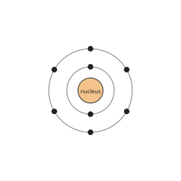
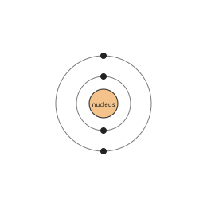
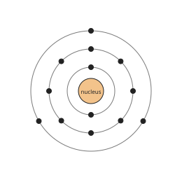

# Chemistry Form 2, Batches C2-1, C2-2: drafts for review (Lessons 1–4, 6–11, 13–17, 20–27, 29–38, 40–45, Terms 1 and 2)

Generated by `npm run review:f2-chemistry` from `content/form-2/chemistry/*.json`. Every question and drawing below was built by the engine.
All notes, teach cards, worked examples and paper tasks are **status: draft**. “Authored key” means a person fixed the
right answer (see `AUTHORED.md`); “computed by rule” means code worked it out (a formula, a conversion, a spelling rule).

Teach mode: cards (idea + example + 1 level-1 check) → worked example → practice (levels 1–3) → the note as a summary.

## Sample rendered lesson: Lesson 10 in teach mode

### Lesson 10: Use of tables to derive chemical formulae

**Card c10-1** (draft)

> Swap the valencies and write them as small numbers after the symbols.
>
> _Al 3, O 2 → Al₂O₃_  

Check question: `k2-10-two` · multiple choice, level 1 · computed by rule, reused from practice

> Using valencies (Li 1, S 2), what is the formula of lithium sulfide?

- ◻️ LiS₂  
  _↳ feedback if chosen: Swap the valencies: each one goes to the other symbol._
- ◻️ LiS  
  _↳ feedback if chosen: The valencies are not both 1: swap them._
- ✅ Li₂S
- ◻️ SLi  
  _↳ feedback if chosen: The metal is written first._

Full working after a second miss:

> Swap the valencies: Li₂S.  
> The formula is Li₂S.  

**Card c10-2** (draft)

> Simplify when both numbers share a factor.
>
> _Ca 2, O 2 → Ca₂O₂ → CaO_  

Check question: `k2-10-simplify` · multiple choice, level 1 · computed by rule, reused from practice

> Which is the correct formula of calcium sulfate?

- ◻️ Ca₂(SO₄)₂  
  _↳ feedback if chosen: Both numbers can be divided by 2: simplify._
- ◻️ Ca₂SO₄  
  _↳ feedback if chosen: Swap and simplify the valencies of both parts._
- ◻️ SO₄Ca  
  _↳ feedback if chosen: The metal is written first._
- ✅ CaSO₄

Full working after a second miss:

> Swap the valencies (2 and 2): Ca₂(SO₄)₂.  
> Simplify: CaSO₄.  

**Card c10-3** (draft)

> Put a radical in brackets when there is more than one of it.
>
> _Ca 2, OH 1 → Ca(OH)₂_  

Check question: `k2-10-radical-card` · multiple choice, level 1 · computed by rule

> What is the formula of calcium hydroxide?

- ◻️ CaOH  
  _↳ feedback if chosen: The valencies are not both 1: swap them._
- ✅ Ca(OH)₂
- ◻️ CaOH₂  
  _↳ feedback if chosen: When a radical appears more than once, put it in brackets._
- ◻️ OHCa  
  _↳ feedback if chosen: The metal is written first._

Full working after a second miss:

> Valencies: Ca 2, OH 1.  
> Swap, with brackets round a radical used more than once: Ca(OH)₂.  

**Worked example** (draft)

> Write the formula of aluminium sulfate from the valencies.

1. Valencies: Al 3, SO₄ 2.
2. Swap: 2 Al and 3 SO₄; the radical goes in brackets.
3. Formula: Al₂(SO₄)₃.

**Answer:** Al₂(SO₄)₃

**Practice** (one generated question per template, easiest first)

Practice 1: `k2-10-two` · multiple choice, level 1 · computed by rule

> Using valencies (Al 3, F 1), what is the formula of aluminium fluoride?

- ✅ AlF₃
- ◻️ AlF  
  _↳ feedback if chosen: The valencies are not both 1: swap them._
- ◻️ Al₃F  
  _↳ feedback if chosen: Swap the valencies: each one goes to the other symbol._
- ◻️ FAl  
  _↳ feedback if chosen: The metal is written first._

Full working after a second miss:

> Swap the valencies: AlF₃.  
> The formula is AlF₃.  

Practice 2: `k2-10-simplify` · multiple choice, level 1 · computed by rule

> Which is the correct formula of zinc sulfate?

- ✅ ZnSO₄
- ◻️ Zn₂SO₄  
  _↳ feedback if chosen: Swap and simplify the valencies of both parts._
- ◻️ SO₄Zn  
  _↳ feedback if chosen: The metal is written first._
- ◻️ Zn₂(SO₄)₂  
  _↳ feedback if chosen: Both numbers can be divided by 2: simplify._

Full working after a second miss:

> Swap the valencies (2 and 2): Zn₂(SO₄)₂.  
> Simplify: ZnSO₄.  

Practice 3: `k2-10-radical` · multiple choice, level 2 · computed by rule

> What is the formula of calcium nitrate?

- ✅ Ca(NO₃)₂
- ◻️ NO₃Ca  
  _↳ feedback if chosen: The metal is written first._
- ◻️ CaNO₃₂  
  _↳ feedback if chosen: When a radical appears more than once, put it in brackets._
- ◻️ CaNO₃  
  _↳ feedback if chosen: The valencies are not both 1: swap them._

Full working after a second miss:

> Valencies: Ca 2, NO₃ 1.  
> Swap, with brackets round a radical used more than once: Ca(NO₃)₂.  

Practice 4: `k2-10-count` · number, level 3 · computed by rule

> In the formula of calcium phosphate written from the valencies, how many atoms are there in total?

Answer: **13**

Full working after a second miss:

> The formula is Ca₃(PO₄)₂: Ca: 3, P: 2, O: 8.  
> Total: 13 atoms.  

**Summary (the note)**

> To write the formula of a compound from a table of valencies:
> 1. Write the symbols (metal or positive part first): Al O.
> 2. Write each valency above its symbol: Al 3, O 2.
> 3. Swap the valencies and write them as small numbers: Al₂O₃.
> 4. Simplify if both numbers can be divided by the same number: Mg 2, O 2 → Mg₂O₂ → MgO.
> 5. Put a radical in brackets when there is more than one of it: Ca 2, OH 1 → Ca(OH)₂.
> A number 1 is not written.
> Check: the total valency of each part is the same (Al₂O₃: 2 × 3 = 6 and 3 × 2 = 6).

## All drafts

| Lesson | Title (sheet) | Status | Cards | Practice | Paper task |
|---|---|---|---|---|---|
| 1 | Dalton’s Atomic theory | draft | 3 | 4 | — |
| 2 | Composition of the atom | draft | 3 | 5 | — |
| 3 | Structure of the Atom (Bohr’s model) | draft | 3 | 4 | — |
| 4 | Relationship between subatomic particles | draft | 3 | 4 | — |
| 6 | Chemical symbols and names of elements | draft | 3 | 4 | — |
| 7 | Names and formulae of radicals | draft | 3 | 4 | — |
| 8 | Valency of elements and Radicals | draft | 3 | 4 | — |
| 9 | Chemical symbols and formulae | draft | 3 | 5 | — |
| 10 | Use of tables to derive chemical formulae | draft | 3 | 4 | — |
| 11 | Names of compounds | draft | 3 | 4 | — |
| 13 | The Periodic Table: Brief history and purpose to classify elements | draft | 3 | 4 | — |
| 14 | The modern periodic table | draft | 3 | 5 | — |
| 15 | families of elements: Names | draft | 3 | 4 | — |
| 16 | families of elements: Properties | draft | 3 | 4 | — |
| 17 | Reactivity of families | draft | 3 | 4 | — |
| 20 | Chemical changes (Review) | draft | 3 | 4 | — |
| 21 | Examples of chemical reactions | draft | 3 | 4 | — |
| 22 | Writing chemical equations ( word equations) | draft | 3 | 4 | — |
| 23 | Writing chemical equations (Symbolic equations) | draft | 3 | 4 | — |
| 24 | Balancing chemical equations (Binary compound formation) | draft | 3 | 4 | — |
| 25 | Balancing chemical equations ( Complex compounds formed) | draft | 3 | 3 | — |
| 26 | Law of conservation of mass : Types of changes in matter | draft | 3 | 3 | — |
| 27 | Law of conservation of mass : Definition and Experimental demonstration | draft | 3 | 3 | — |
| 29 | The composition of air (determination of percentage composition by volume nitrogen and oxygen) | draft | 3 | 4 | — |
| 30 | Uses of active and inactive air | draft | 3 | 4 | — |
| 31 | Air as a mixture | draft | 3 | 4 | — |
| 32 | Separation of components of air by fractional distillation | draft | 3 | 4 | — |
| 33 | Reaction of substances with oxygen of air (burning paper and cooking gas) | draft | 3 | 4 | — |
| 34 | Reaction of substances with oxygen of air (burning wood and cloths) | draft | 3 | 4 | — |
| 35 | Reaction of substances with oxygen of air (burning metals and non-metals) | draft | 3 | 4 | — |
| 36 | Rusting (Definition and conditions) | draft | 3 | 4 | — |
| 37 | Iron rusting (composition and examples) | draft | 3 | 4 | — |
| 38 | Disadvantages of rusting and methods of prevention | draft | 3 | 4 | — |
| 40 | States of Matter : Summary review | draft | 3 | 4 | — |
| 41 | Techniques for separation: review | draft | 3 | 4 | — |
| 42 | Techniques of separation - Distillation | draft | 3 | 4 | — |
| 43 | Techniques of separation: paper and column chromatography | draft | 3 | 4 | — |
| 44 | Definitions: sublimation, melting point and boiling points | draft | 3 | 4 | — |
| 45 | Criteria for purity | draft | 3 | 3 | — |
| 47 | Sources of energy: fossil fuels | draft | 3 | 4 | — |
| 48 | Uses of fossil fuels | draft | 3 | 4 | — |
| 49 | Action of heat on substances: hydrates and oxides (with balanced equations) | draft | 3 | 4 | — |
| 50 | Action of heat on substances:carbonates and nitrates ( with balanced equations) | draft | 3 | 4 | — |
| 51 | Experimental study of change in mass resulting from heating of substances (carbonates) | draft | 3 | 3 | — |
| 52 | Concept of reversibility (action of heat on hydrated copper(II) sulphate | draft | 3 | 4 | — |
| 55 | Action of electricity on metals and non- metals | draft | 3 | 4 | — |
| 56 | Action of electricity on solid compounds | draft | 3 | 4 | — |
| 57 | Action of electricity on aqueous solutions | draft | 3 | 4 | — |
| 58 | Conductors and non-conductors | draft | 3 | 4 | — |
| 59 | Electrolytes and non-electrolytes | draft | 3 | 4 | — |

## Lesson 1: Dalton’s Atomic theory

Prerequisites: none · Skill: k2-1 (Dalton's atomic theory)

**Note** (draft)

> In 1803–1808 the English chemist John Dalton proposed his atomic theory:
> 1. All matter is made of very small particles called atoms.
> 2. Atoms cannot be divided, created or destroyed.
> 3. All the atoms of one element are identical (same mass, same properties); atoms of different elements are different.
> 4. Atoms combine in simple whole-number ratios to form compounds (water: two hydrogen atoms to one oxygen atom).
> 5. In a chemical reaction atoms are rearranged, not created or destroyed.
> Later discoveries changed two points: atoms CAN be divided (into protons, neutrons and electrons), and atoms of one element can have different masses (isotopes).

**Card c1-1** (draft)

> Dalton said that all matter is made of tiny atoms that cannot be divided, created or destroyed.
>
> _A grain of salt contains a huge number of atoms._  
> _In a reaction the atoms are only rearranged._  

Check question: `k2-1-true` · multiple choice, level 1 · **authored key**, reused from practice

> Which statement is part of Dalton's atomic theory?

- ◻️ New atoms are created in every reaction.  
  _↳ feedback if chosen: Dalton said atoms are not created or destroyed._
- ✅ In a chemical reaction, atoms are rearranged.
- ◻️ Matter is a continuous substance with no particles.  
  _↳ feedback if chosen: Dalton said matter is made of atoms._

Full working after a second miss:

> The true statement is “In a chemical reaction, atoms are rearranged.”.  
> “New atoms are created in every reaction.” is false: Dalton said atoms are not created or destroyed.  
> “Matter is a continuous substance with no particles.” is false: Dalton said matter is made of atoms.  

**Card c1-2** (draft)

> Atoms of one element are all alike; atoms of different elements are different. Atoms join in simple whole-number ratios.
>
> _All carbon atoms are carbon atoms._  
> _Water: two H atoms to one O atom._  

Check question: `k2-1-ratio` · multiple choice, level 1 · **authored key**, reused from practice

> Who proposed the atomic theory in the early 1800s?

- ◻️ Dmitri Mendeleev  
  _↳ feedback if chosen: Mendeleev made the periodic table later._
- ◻️ Isaac Newton  
  _↳ feedback if chosen: Newton worked on forces and motion._
- ✅ John Dalton
- ◻️ Charles Darwin  
  _↳ feedback if chosen: Darwin studied evolution._

Full working after a second miss:

> John Dalton, an English chemist.  
> So the answer is “John Dalton”.  

**Card c1-3** (draft)

> Two of Dalton's ideas were later changed: atoms can be divided, and atoms of one element can have different masses.
>
> _Atoms contain protons, neutrons and electrons._  
> _Atoms of one element with different masses are isotopes._  

Check question: `k2-1-changed-card` · multiple choice, level 1 · **authored key**

> What are atoms of one element with different masses called?

- ◻️ compounds  
  _↳ feedback if chosen: Compounds contain different elements._
- ◻️ ions  
  _↳ feedback if chosen: Ions are charged particles._
- ✅ isotopes
- ◻️ molecules  
  _↳ feedback if chosen: Molecules are atoms joined together._

Full working after a second miss:

> Isotopes have the same number of protons but different numbers of neutrons.  
> So the answer is “isotopes”.  

**Worked example** (draft)

> Use Dalton's theory to explain what happens to the atoms when hydrogen burns in oxygen to make water.

1. The hydrogen and oxygen atoms are not destroyed and no new atoms are made.
2. They are rearranged: they join in a simple whole-number ratio, two hydrogen atoms to one oxygen atom.

**Answer:** The atoms are rearranged into water, in the ratio two H to one O; none is created or destroyed.

**Practice** `k2-1-true` · multiple choice, level 1 · **authored key**

> Which statement is part of Dalton's atomic theory?

- ◻️ New atoms are created in every reaction.  
  _↳ feedback if chosen: Dalton said atoms are not created or destroyed._
- ✅ Atoms combine in simple whole-number ratios to form compounds.
- ◻️ Matter is a continuous substance with no particles.  
  _↳ feedback if chosen: Dalton said matter is made of atoms._

Full working after a second miss:

> The true statement is “Atoms combine in simple whole-number ratios to form compounds.”.  
> “New atoms are created in every reaction.” is false: Dalton said atoms are not created or destroyed.  
> “Matter is a continuous substance with no particles.” is false: Dalton said matter is made of atoms.  

> Which statement is part of Dalton's atomic theory?

- ✅ Atoms combine in simple whole-number ratios to form compounds.
- ◻️ New atoms are created in every reaction.  
  _↳ feedback if chosen: Dalton said atoms are not created or destroyed._
- ◻️ Matter is a continuous substance with no particles.  
  _↳ feedback if chosen: Dalton said matter is made of atoms._

Full working after a second miss:

> The true statement is “Atoms combine in simple whole-number ratios to form compounds.”.  
> “New atoms are created in every reaction.” is false: Dalton said atoms are not created or destroyed.  
> “Matter is a continuous substance with no particles.” is false: Dalton said matter is made of atoms.  

**Practice** `k2-1-ratio` · multiple choice, level 1 · **authored key**

> Water has two hydrogen atoms for every oxygen atom. Which idea of Dalton does this show?

- ◻️ All atoms are the same.  
  _↳ feedback if chosen: Atoms of different elements differ._
- ✅ Atoms combine in simple whole-number ratios.
- ◻️ Atoms can be divided.  
  _↳ feedback if chosen: Dalton said they cannot be divided._
- ◻️ Atoms are destroyed in reactions.  
  _↳ feedback if chosen: Dalton said they are not destroyed._

Full working after a second miss:

> Two to one is a simple whole-number ratio.  
> So the answer is “Atoms combine in simple whole-number ratios.”.  

> Water has two hydrogen atoms for every oxygen atom. Which idea of Dalton does this show?

- ✅ Atoms combine in simple whole-number ratios.
- ◻️ Atoms can be divided.  
  _↳ feedback if chosen: Dalton said they cannot be divided._
- ◻️ Atoms are destroyed in reactions.  
  _↳ feedback if chosen: Dalton said they are not destroyed._
- ◻️ All atoms are the same.  
  _↳ feedback if chosen: Atoms of different elements differ._

Full working after a second miss:

> Two to one is a simple whole-number ratio.  
> So the answer is “Atoms combine in simple whole-number ratios.”.  

**Practice** `k2-1-changed` · multiple choice, level 2 · **authored key**

> What are atoms of one element with different masses called?

- ◻️ compounds  
  _↳ feedback if chosen: Compounds contain different elements._
- ◻️ ions  
  _↳ feedback if chosen: Ions are charged particles._
- ✅ isotopes
- ◻️ molecules  
  _↳ feedback if chosen: Molecules are atoms joined together._

Full working after a second miss:

> Isotopes have the same number of protons but different numbers of neutrons.  
> So the answer is “isotopes”.  

> Which of Dalton's ideas is no longer accepted?

- ◻️ Matter is made of atoms.  
  _↳ feedback if chosen: That is still accepted._
- ◻️ Atoms join in whole-number ratios.  
  _↳ feedback if chosen: That is still accepted._
- ✅ Atoms cannot be divided.
- ◻️ Atoms are rearranged in reactions.  
  _↳ feedback if chosen: That is still accepted._

Full working after a second miss:

> Atoms are made of smaller particles.  
> So the answer is “Atoms cannot be divided.”.  

**Practice** `k2-1-spot` · spot the error, level 3 · **authored key**

> Which statement does NOT agree with Dalton's theory?

- ◻️ Matter is made of atoms.
- ◻️ Atoms of one element are identical.
- ◻️ Atoms combine in whole-number ratios.
- ✅ Half an atom of oxygen joins with one atom of hydrogen.  
  _↳ explanation: Dalton said atoms join in whole-number ratios; atoms cannot be split._

Full working after a second miss:

> The wrong statement is “Half an atom of oxygen joins with one atom of hydrogen.”.  
> Dalton said atoms join in whole-number ratios; atoms cannot be split.  

> Which statement does NOT agree with Dalton's theory?

- ◻️ Matter is made of atoms.
- ✅ Half an atom of oxygen joins with one atom of hydrogen.  
  _↳ explanation: Dalton said atoms join in whole-number ratios; atoms cannot be split._
- ◻️ Atoms are not destroyed in reactions.
- ◻️ Atoms combine in whole-number ratios.

Full working after a second miss:

> The wrong statement is “Half an atom of oxygen joins with one atom of hydrogen.”.  
> Dalton said atoms join in whole-number ratios; atoms cannot be split.  

## Lesson 2: Composition of the atom

Prerequisites: 1 · Skill: k2-2 (The composition of the atom)

**Note** (draft)

> An atom has a tiny central nucleus and electrons around it.
> • Protons: in the nucleus, positive charge (+1), relative mass 1.
> • Neutrons: in the nucleus, no charge (0), relative mass 1.
> • Electrons: moving around the nucleus in shells, negative charge (−1), very small mass (about 1/1840).
> Almost all the mass of an atom is in its nucleus; most of the atom is empty space.
> An atom has as many electrons as protons, so the charges cancel: the atom is neutral (no overall charge).

**Card c2-1** (draft)

> Protons (+) and neutrons (no charge) are in the nucleus; electrons (−) move around it.
>
> _Nucleus: protons and neutrons._  
> _Shells: electrons._  

Check question: `k2-2-particle` · matching, level 1 · **authored key**, reused from practice

> Match each particle to its charge.

Right-hand side (shuffled): negative (−1) · positive (+1) · no charge (0)
- electron → **negative (−1)**
- neutron → **no charge (0)**
- proton → **positive (+1)**

Full working after a second miss:

> The right pairs are:  
> electron → negative (−1)  
> neutron → no charge (0)  
> proton → positive (+1)  

**Card c2-2** (draft)

> Protons and neutrons have about the same mass; an electron is about 1840 times lighter.
>
> _So the mass of an atom is almost all in its nucleus._  

Check question: `k2-2-mass` · multiple choice, level 1 · **authored key**, reused from practice

> Which particle has the smallest mass?

- ◻️ the neutron  
  _↳ feedback if chosen: A neutron is about as heavy as a proton._
- ✅ the electron
- ◻️ the nucleus  
  _↳ feedback if chosen: The nucleus contains protons and neutrons._
- ◻️ the proton  
  _↳ feedback if chosen: A proton is about 1840 times heavier._

Full working after a second miss:

> An electron is about 1840 times lighter than a proton.  
> So the answer is “the electron”.  

**Card c2-3** (draft)

> An atom has equal numbers of protons and electrons, so it is neutral.
>
> _6 protons, 6 electrons: no overall charge._  

Check question: `k2-2-neutral` · number, level 1 · computed by rule, reused from practice

> A argon atom has 18 protons. How many electrons does it have?

Answer: **18**
- Typed **22** (neutrons) → “That is the number of neutrons. Electrons equal protons.”

Full working after a second miss:

> An atom is neutral: electrons = protons.  
> So it has 18 electrons.  

**Worked example** (draft)

> A sodium atom has 11 protons. How many electrons does it have, and what is its overall charge?

1. An atom is neutral: electrons = protons = 11.
2. Charge: +11 from the protons and −11 from the electrons add up to 0.

**Answer:** 11 electrons; the atom has no overall charge.

**Practice** `k2-2-particle` · matching, level 1 · **authored key**

> Match each particle to its charge.

Right-hand side (shuffled): positive (+1) · negative (−1) · no charge (0)
- proton → **positive (+1)**
- neutron → **no charge (0)**
- electron → **negative (−1)**

Full working after a second miss:

> The right pairs are:  
> proton → positive (+1)  
> neutron → no charge (0)  
> electron → negative (−1)  

> Match each particle to its charge.

Right-hand side (shuffled): negative (−1) · no charge (0) · positive (+1)
- electron → **negative (−1)**
- proton → **positive (+1)**
- neutron → **no charge (0)**

Full working after a second miss:

> The right pairs are:  
> electron → negative (−1)  
> proton → positive (+1)  
> neutron → no charge (0)  

**Practice** `k2-2-mass` · multiple choice, level 1 · **authored key**

> Which particle has the smallest mass?

- ◻️ the proton  
  _↳ feedback if chosen: A proton is about 1840 times heavier._
- ◻️ the nucleus  
  _↳ feedback if chosen: The nucleus contains protons and neutrons._
- ◻️ the neutron  
  _↳ feedback if chosen: A neutron is about as heavy as a proton._
- ✅ the electron

Full working after a second miss:

> An electron is about 1840 times lighter than a proton.  
> So the answer is “the electron”.  

> Which particles are in the nucleus?

- ◻️ electrons only  
  _↳ feedback if chosen: Electrons are outside the nucleus._
- ◻️ neutrons and electrons  
  _↳ feedback if chosen: Electrons are outside the nucleus._
- ◻️ protons and electrons  
  _↳ feedback if chosen: Electrons are outside the nucleus._
- ✅ protons and neutrons

Full working after a second miss:

> The nucleus has protons and neutrons.  
> So the answer is “protons and neutrons”.  

**Practice** `k2-2-neutral` · number, level 1 · computed by rule

> A magnesium atom has 12 protons. How many electrons does it have?

Answer: **12**

Full working after a second miss:

> An atom is neutral: electrons = protons.  
> So it has 12 electrons.  

> A sulfur atom has 16 protons. How many electrons does it have?

Answer: **16**

Full working after a second miss:

> An atom is neutral: electrons = protons.  
> So it has 16 electrons.  

**Practice** `k2-2-charge` · multiple choice, level 2 · **authored key**

> What charge does the nucleus have?

- ◻️ none  
  _↳ feedback if chosen: It contains positive protons._
- ◻️ negative  
  _↳ feedback if chosen: Electrons are negative, but they are outside._
- ◻️ it changes  
  _↳ feedback if chosen: It is always positive._
- ✅ positive

Full working after a second miss:

> The nucleus has positive protons and neutral neutrons.  
> So the answer is “positive”.  

> What charge does the nucleus have?

- ◻️ none  
  _↳ feedback if chosen: It contains positive protons._
- ◻️ negative  
  _↳ feedback if chosen: Electrons are negative, but they are outside._
- ◻️ it changes  
  _↳ feedback if chosen: It is always positive._
- ✅ positive

Full working after a second miss:

> The nucleus has positive protons and neutral neutrons.  
> So the answer is “positive”.  

**Practice** `k2-2-spot` · spot the error, level 3 · **authored key**

> Which statement is wrong?

- ◻️ Protons are positive.
- ✅ An electron is heavier than a proton.  
  _↳ explanation: An electron is about 1840 times lighter._
- ◻️ An atom is neutral.
- ◻️ Neutrons have no charge.

Full working after a second miss:

> The wrong statement is “An electron is heavier than a proton.”.  
> An electron is about 1840 times lighter.  

> Which statement is wrong?

- ◻️ An atom is neutral.
- ◻️ Protons are positive.
- ✅ An electron is heavier than a proton.  
  _↳ explanation: An electron is about 1840 times lighter._
- ◻️ Neutrons have no charge.

Full working after a second miss:

> The wrong statement is “An electron is heavier than a proton.”.  
> An electron is about 1840 times lighter.  

## Lesson 3: Structure of the Atom (Bohr’s model)

Prerequisites: 2 · Skill: k2-3 (The structure of the atom: Bohr's model)

**Note** (draft)

> In Bohr's model, electrons move around the nucleus in fixed shells (energy levels).
> For the first 20 elements, fill the shells in order: the first shell holds up to 2 electrons, the second up to 8, the third up to 8, then the fourth.
> Electron arrangement (configuration): sodium, 11 electrons: 2, 8, 1. Chlorine, 17: 2, 8, 7. Calcium, 20: 2, 8, 8, 2.
> The electrons in the outer shell decide how an element reacts.
> Draw the model: the nucleus in the middle, a circle for each shell, and dots or crosses for the electrons.

**Card c3-1** (draft)

> Electrons fill shells in order: up to 2, then up to 8, then up to 8.
>
> _Sodium, 11 electrons: 2, 8, 1._  
> _Chlorine, 17 electrons: 2, 8, 7._  

Check question: `k2-3-config` · multiple choice, level 1 · computed by rule, reused from practice

> What is the electron arrangement of oxygen (atomic number 8)?

- ◻️ 1, 2, 5  
  _↳ feedback if chosen: The first shell holds 2 electrons when the atom has more than 2._
- ◻️ 2, 7  
  _↳ feedback if chosen: Count again: oxygen has 8 electrons._
- ✅ 2, 6
- ◻️ 2, 5  
  _↳ feedback if chosen: Count again: oxygen has 8 electrons._

Full working after a second miss:

> 8 electrons: up to 2 in the first shell, up to 8 in the next, then up to 8.  
> So the arrangement is 2, 6.  

**Card c3-2** (draft)

> A Bohr diagram shows the nucleus and each shell with its electrons.
>
> _This is oxygen: 2, 6._  

Check question: `k2-3-draw` · number, level 1 · computed by rule, reused from practice

> This Bohr model shows an atom. How many electrons does it have?

Answer: **6**

Full working after a second miss:

> Count the dots on every shell: 2, 4.  
> Total: 6 electrons.  

**Card c3-3** (draft)

> The outer shell is the last shell; its electrons decide how the element reacts.
>
> _Magnesium 2, 8, 2: 2 outer electrons._  

Check question: `k2-3-outer-card` · number, level 1 · computed by rule

> How many electrons are in the outer shell of aluminium (atomic number 13)?

Answer: **3**

Full working after a second miss:

> Arrangement: 2, 8, 3.  
> The last number is the outer shell: 3.  

**Worked example** (draft)

> Write the electron arrangement of aluminium (atomic number 13) and draw its Bohr model.

1. 13 electrons. First shell: 2. Second shell: 8. That uses 10.
2. The third shell gets the rest: 13 − 10 = 3.
3. Arrangement: 2, 8, 3.

**Answer:** 2, 8, 3

**Practice** `k2-3-config` · multiple choice, level 1 · computed by rule

> What is the electron arrangement of aluminium (atomic number 13)?

- ✅ 2, 8, 3
- ◻️ 2, 8, 2  
  _↳ feedback if chosen: Count again: aluminium has 13 electrons._
- ◻️ 2, 8, 4  
  _↳ feedback if chosen: Count again: aluminium has 13 electrons._
- ◻️ 1, 2, 8, 2  
  _↳ feedback if chosen: The first shell holds 2 electrons when the atom has more than 2._

Full working after a second miss:

> 13 electrons: up to 2 in the first shell, up to 8 in the next, then up to 8.  
> So the arrangement is 2, 8, 3.  

> What is the electron arrangement of chlorine (atomic number 17)?

- ◻️ 2, 8, 6  
  _↳ feedback if chosen: Count again: chlorine has 17 electrons._
- ✅ 2, 8, 7
- ◻️ 1, 2, 8, 6  
  _↳ feedback if chosen: The first shell holds 2 electrons when the atom has more than 2._
- ◻️ 2, 8, 8  
  _↳ feedback if chosen: Count again: chlorine has 17 electrons._

Full working after a second miss:

> 17 electrons: up to 2 in the first shell, up to 8 in the next, then up to 8.  
> So the arrangement is 2, 8, 7.  

**Practice** `k2-3-draw` · number, level 1 · computed by rule

> This Bohr model shows an atom. How many electrons does it have?

Answer: **4**

Full working after a second miss:

> Count the dots on every shell: 2, 2.  
> Total: 4 electrons.  

> This Bohr model shows an atom. How many electrons does it have?

Answer: **13**

Full working after a second miss:

> Count the dots on every shell: 2, 8, 3.  
> Total: 13 electrons.  

**Practice** `k2-3-outer` · number, level 2 · computed by rule

> How many electrons are in the outer shell of sulfur (atomic number 16)?

Answer: **6**
- Typed **3** (shells) → “That is the number of shells; count the electrons in the last one.”

Full working after a second miss:

> Arrangement: 2, 8, 6.  
> The last number is the outer shell: 6.  

> How many electrons are in the outer shell of silicon (atomic number 14)?

Answer: **4**
- Typed **3** (shells) → “That is the number of shells; count the electrons in the last one.”

Full working after a second miss:

> Arrangement: 2, 8, 4.  
> The last number is the outer shell: 4.  

**Practice** `k2-3-shells` · number, level 3 · computed by rule

> An atom has the arrangement 2, 8, 5. What is its atomic number?

Answer: **15**
- Typed **5** (outer) → “That is only the outer shell; add all the shells.”

Full working after a second miss:

> Add the electrons in every shell.  
> The total is 15, and protons = electrons.  

> An atom has the arrangement 2, 3. What is its atomic number?

Answer: **5**
- Typed **3** (outer) → “That is only the outer shell; add all the shells.”

Full working after a second miss:

> Add the electrons in every shell.  
> The total is 5, and protons = electrons.  

## Lesson 4: Relationship between subatomic particles

Prerequisites: 2, 3 · Skill: k2-4 (Atomic number and mass number)

**Note** (draft)

> The atomic number (Z) is the number of protons. It identifies the element: every atom with 6 protons is carbon.
> In a neutral atom, the number of electrons = the atomic number.
> The mass number (A) is the number of protons + neutrons (the particles in the nucleus).
> Number of neutrons = A − Z.
> Notation: the mass number is written at the top left of the symbol and the atomic number at the bottom left, for example ²³₁₁Na: 11 protons, 11 electrons, 23 − 11 = 12 neutrons.
> Isotopes are atoms of the same element (same Z) with different numbers of neutrons (different A), such as chlorine-35 and chlorine-37.

**Card c4-1** (draft)

> The atomic number is the number of protons. Electrons = protons in a neutral atom.
>
> _Oxygen: atomic number 8, so 8 protons and 8 electrons._  

Check question: `k2-4-protons` · number, level 1 · computed by rule, reused from practice

> An atom of sodium has atomic number 11 and mass number 23. How many protons does it have?

Answer: **11**
- Typed **23** (mass) → “The mass number counts protons and neutrons together; protons = atomic number.”

Full working after a second miss:

> Protons = atomic number.  
> So 11 protons.  

**Card c4-2** (draft)

> Mass number = protons + neutrons.
>
> _Sodium: 11 protons + 12 neutrons = 23._  

Check question: `k2-4-mass` · number, level 1 · computed by rule, reused from practice

> An atom has 14 protons and 14 neutrons. What is its mass number?

Answer: **28**
- Typed **14** (protons) → “Add the neutrons too.”

Full working after a second miss:

> Mass number = protons + neutrons.  
> 14 + 14 = 28.  

**Card c4-3** (draft)

> Neutrons = mass number − atomic number.
>
> _Aluminium: 27 − 13 = 14 neutrons._  

Check question: `k2-4-neutrons-card` · number, level 1 · computed by rule

> Sodium has atomic number 11 and mass number 23. How many neutrons are in its atom?

Answer: **12**
- Typed **34** (added) → “Subtract the atomic number from the mass number.”

Full working after a second miss:

> Neutrons = mass number − atomic number.  
> 23 − 11 = 12.  

**Worked example** (draft)

> Chlorine has atomic number 17 and mass number 35. Find its protons, electrons and neutrons.

1. Protons = atomic number = 17.
2. Electrons = protons = 17 (a neutral atom).
3. Neutrons = 35 − 17 = 18.

**Answer:** 17 protons, 17 electrons, 18 neutrons.

**Practice** `k2-4-protons` · number, level 1 · computed by rule

> An atom of nitrogen has atomic number 7 and mass number 14. How many protons does it have?

Answer: **7**
- Typed **14** (mass) → “The mass number counts protons and neutrons together; protons = atomic number.”

Full working after a second miss:

> Protons = atomic number.  
> So 7 protons.  

> An atom of hydrogen has atomic number 1 and mass number 1. How many protons does it have?

Answer: **1**

Full working after a second miss:

> Protons = atomic number.  
> So 1 protons.  

**Practice** `k2-4-mass` · number, level 1 · computed by rule

> An atom has 17 protons and 18 neutrons. What is its mass number?

Answer: **35**
- Typed **17** (protons) → “Add the neutrons too.”

Full working after a second miss:

> Mass number = protons + neutrons.  
> 17 + 18 = 35.  

> An atom has 16 protons and 16 neutrons. What is its mass number?

Answer: **32**
- Typed **16** (protons) → “Add the neutrons too.”

Full working after a second miss:

> Mass number = protons + neutrons.  
> 16 + 16 = 32.  

**Practice** `k2-4-neutrons` · number, level 2 · computed by rule

> Phosphorus has atomic number 15 and mass number 31. How many neutrons are in its atom?

Answer: **16**
- Typed **46** (added) → “Subtract the atomic number from the mass number.”

Full working after a second miss:

> Neutrons = mass number − atomic number.  
> 31 − 15 = 16.  

> Argon has atomic number 18 and mass number 40. How many neutrons are in its atom?

Answer: **22**
- Typed **58** (added) → “Subtract the atomic number from the mass number.”

Full working after a second miss:

> Neutrons = mass number − atomic number.  
> 40 − 18 = 22.  

**Practice** `k2-4-isotope` · multiple choice, level 3 · **authored key**

> Chlorine-35 and chlorine-37 are isotopes. What is different between their atoms?

- ◻️ the number of protons  
  _↳ feedback if chosen: Both are chlorine: same protons._
- ◻️ the element  
  _↳ feedback if chosen: Both are chlorine._
- ◻️ the number of electrons  
  _↳ feedback if chosen: Both are neutral chlorine atoms: same electrons._
- ✅ the number of neutrons

Full working after a second miss:

> Isotopes differ only in neutrons.  
> So the answer is “the number of neutrons”.  

> Which number tells you which element an atom is?

- ✅ the atomic number
- ◻️ the mass number  
  _↳ feedback if chosen: Isotopes of one element have different mass numbers._
- ◻️ the number of shells  
  _↳ feedback if chosen: Many elements share the same number of shells._
- ◻️ the number of neutrons  
  _↳ feedback if chosen: Neutrons can vary._

Full working after a second miss:

> The number of protons identifies the element.  
> So the answer is “the atomic number”.  

## Lesson 6: Chemical symbols and names of elements

Prerequisites: none · Skill: k2-6 (Chemical symbols and names of elements)

**Note** (draft)

> Every element has a symbol of one or two letters. The first letter is a capital; the second is small: H hydrogen, He helium, C carbon, Ca calcium, Cl chlorine.
> Most symbols come from the English name. Some come from the Latin name: Na sodium (natrium), K potassium (kalium), Fe iron (ferrum), Cu copper (cuprum), Ag silver (argentum), Pb lead (plumbum), Au gold (aurum), Hg mercury (hydrargyrum), Sn tin (stannum).
> The first 20 elements, in order: H, He, Li, Be, B, C, N, O, F, Ne, Na, Mg, Al, Si, P, S, Cl, Ar, K, Ca.

**Card c6-1** (draft)

> A symbol has one capital letter, sometimes followed by one small letter.
>
> _Mg: magnesium_  
> _Cl: chlorine_  

Check question: `k2-6-name` · multiple choice, level 1 · computed by rule, reused from practice

> What is the name of the element with symbol Mg?

- ◻️ oxygen  
  _↳ feedback if chosen: oxygen has the symbol O._
- ◻️ aluminium  
  _↳ feedback if chosen: aluminium has the symbol Al._
- ◻️ argon  
  _↳ feedback if chosen: argon has the symbol Ar._
- ✅ magnesium

Full working after a second miss:

> Mg is the symbol of magnesium.  

**Card c6-2** (draft)

> Some symbols come from Latin names.
>
> _Na: sodium (Latin natrium)_  
> _Fe: iron (Latin ferrum)_  

Check question: `k2-6-latin` · multiple choice, level 1 · **authored key**, reused from practice

> What is the symbol of gold?

- ◻️ Go  
  _↳ feedback if chosen: This symbol comes from the Latin name, aurum, not the English name._
- ◻️ AU  
  _↳ feedback if chosen: Only the first letter is a capital._
- ✅ Au

Full working after a second miss:

> gold comes from the Latin aurum.  
> Its symbol is Au.  

**Card c6-3** (draft)

> Learn the first twenty elements in order of atomic number.
>
> _H, He, Li, Be, B, C, N, O, F, Ne, Na, Mg, Al, Si, P, S, Cl, Ar, K, Ca_  

Check question: `k2-6-order-card` · ordering, level 1 · computed by rule

> Put these elements in order of atomic number, smallest first.

Shown as: hydrogen · phosphorus · fluorine · lithium
Correct order: hydrogen → lithium → fluorine → phosphorus

Full working after a second miss:

> The correct order is: hydrogen → lithium → fluorine → phosphorus.  

**Worked example** (draft)

> Explain the difference between Co and CO.

1. Co: one capital and one small letter, so one symbol: cobalt, an element.
2. CO: two capitals, so two symbols: C (carbon) and O (oxygen), the compound carbon monoxide.

**Answer:** Co is the element cobalt; CO is a compound of carbon and oxygen.

**Practice** `k2-6-name` · multiple choice, level 1 · computed by rule

> What is the name of the element with symbol Ar?

- ◻️ nitrogen  
  _↳ feedback if chosen: nitrogen has the symbol N._
- ◻️ hydrogen  
  _↳ feedback if chosen: hydrogen has the symbol H._
- ✅ argon
- ◻️ sodium  
  _↳ feedback if chosen: sodium has the symbol Na._

Full working after a second miss:

> Ar is the symbol of argon.  

> What is the name of the element with symbol F?

- ◻️ chlorine  
  _↳ feedback if chosen: chlorine has the symbol Cl._
- ◻️ phosphorus  
  _↳ feedback if chosen: phosphorus has the symbol P._
- ✅ fluorine
- ◻️ carbon  
  _↳ feedback if chosen: carbon has the symbol C._

Full working after a second miss:

> F is the symbol of fluorine.  

**Practice** `k2-6-latin` · multiple choice, level 1 · **authored key**

> What is the symbol of gold?

- ◻️ AU  
  _↳ feedback if chosen: Only the first letter is a capital._
- ✅ Au
- ◻️ Go  
  _↳ feedback if chosen: This symbol comes from the Latin name, aurum, not the English name._

Full working after a second miss:

> gold comes from the Latin aurum.  
> Its symbol is Au.  

> What is the symbol of silver?

- ◻️ Si  
  _↳ feedback if chosen: This symbol comes from the Latin name, argentum, not the English name._
- ◻️ AG  
  _↳ feedback if chosen: Only the first letter is a capital._
- ✅ Ag

Full working after a second miss:

> silver comes from the Latin argentum.  
> Its symbol is Ag.  

**Practice** `k2-6-order` · ordering, level 2 · computed by rule

> Put these elements in order of atomic number, smallest first.

Shown as: fluorine · lithium · calcium · helium
Correct order: helium → lithium → fluorine → calcium

Full working after a second miss:

> The correct order is: helium → lithium → fluorine → calcium.  

> Put these elements in order of atomic number, smallest first.

Shown as: calcium · boron · sodium · chlorine
Correct order: boron → sodium → chlorine → calcium

Full working after a second miss:

> The correct order is: boron → sodium → chlorine → calcium.  

**Practice** `k2-6-spot` · spot the error, level 3 · **authored key**

> One symbol is written wrongly. Which one?

- ◻️ Ca for calcium
- ◻️ K for potassium
- ✅ So for sodium  
  _↳ explanation: Sodium's symbol comes from Latin natrium: Na._
- ◻️ Fe for iron

Full working after a second miss:

> The wrong statement is “So for sodium”.  
> Sodium's symbol comes from Latin natrium: Na.  

> One symbol is written wrongly. Which one?

- ✅ mg for magnesium  
  _↳ explanation: The first letter is a capital: Mg._
- ◻️ Na for sodium
- ◻️ Fe for iron
- ◻️ Cl for chlorine

Full working after a second miss:

> The wrong statement is “mg for magnesium”.  
> The first letter is a capital: Mg.  

## Lesson 7: Names and formulae of radicals

Prerequisites: 6 · Skill: k2-7 (Names and formulae of radicals)

**Note** (draft)

> A radical is a group of atoms that stays together and acts like one unit in many compounds. It carries a charge.
> Common radicals:
> • hydroxide OH (−1)   • nitrate NO₃ (−1)   • hydrogencarbonate HCO₃ (−1)
> • sulfate SO₄ (−2)   • carbonate CO₃ (−2)
> • phosphate PO₄ (−3)
> • ammonium NH₄ (+1), the only common positive radical.
> Names ending in -ate contain oxygen. When a compound has more than one radical, put the radical in brackets: Ca(OH)₂, Al₂(SO₄)₃.

**Card c7-1** (draft)

> A radical is a group of atoms that acts as one unit.
>
> _hydroxide: OH_  
> _carbonate: CO₃_  

Check question: `k2-7-match` · matching, level 1 · **authored key**, reused from practice

> Match each radical to its formula.

Right-hand side (shuffled): NH₄ · OH · SO₄ · CO₃
- hydroxide → **OH**
- ammonium → **NH₄**
- sulfate → **SO₄**
- carbonate → **CO₃**

Full working after a second miss:

> The right pairs are:  
> hydroxide → OH  
> ammonium → NH₄  
> sulfate → SO₄  
> carbonate → CO₃  

**Card c7-2** (draft)

> Each radical has a charge, which is its valency.
>
> _nitrate NO₃: valency 1_  
> _phosphate PO₄: valency 3_  

Check question: `k2-7-valency` · number, level 1 · computed by rule, reused from practice

> What is the valency of the nitrate radical, NO₃?

Answer: **1**
- Typed **4** (atoms) → “Valency is the combining power, not the number of atoms.”

Full working after a second miss:

> The nitrate radical has a charge of 1.  
> So its valency is 1.  

**Card c7-3** (draft)

> Names ending in -ate contain oxygen. Ammonium is the positive radical.
>
> _nitrate NO₃, sulfate SO₄_  
> _ammonium NH₄_  

Check question: `k2-7-ate-card` · multiple choice, level 1 · **authored key**

> Which formula needs brackets?

- ✅ Ca(OH)₂
- ◻️ KNO₃  
  _↳ feedback if chosen: One nitrate: no brackets._
- ◻️ NaOH  
  _↳ feedback if chosen: One hydroxide: no brackets._
- ◻️ CaCO₃  
  _↳ feedback if chosen: One carbonate: no brackets._

Full working after a second miss:

> Two hydroxide radicals: (OH)₂.  
> So the answer is “Ca(OH)₂”.  

**Worked example** (draft)

> How many atoms of each element are in one sulfate radical, SO₄?

1. SO₄: S has no number after it, so one sulfur atom.
2. O has the small number 4: four oxygen atoms.

**Answer:** One sulfur atom and four oxygen atoms.

**Practice** `k2-7-match` · matching, level 1 · **authored key**

> Match each radical to its formula.

Right-hand side (shuffled): SO₄ · NO₃ · CO₃ · NH₄
- ammonium → **NH₄**
- sulfate → **SO₄**
- nitrate → **NO₃**
- carbonate → **CO₃**

Full working after a second miss:

> The right pairs are:  
> ammonium → NH₄  
> sulfate → SO₄  
> nitrate → NO₃  
> carbonate → CO₃  

> Match each radical to its formula.

Right-hand side (shuffled): OH · NO₃ · CO₃ · HCO₃
- carbonate → **CO₃**
- nitrate → **NO₃**
- hydrogencarbonate → **HCO₃**
- hydroxide → **OH**

Full working after a second miss:

> The right pairs are:  
> carbonate → CO₃  
> nitrate → NO₃  
> hydrogencarbonate → HCO₃  
> hydroxide → OH  

**Practice** `k2-7-valency` · number, level 1 · computed by rule

> What is the valency of the hydrogencarbonate radical, HCO₃?

Answer: **1**
- Typed **5** (atoms) → “Valency is the combining power, not the number of atoms.”

Full working after a second miss:

> The hydrogencarbonate radical has a charge of 1.  
> So its valency is 1.  

> What is the valency of the hydroxide radical, OH?

Answer: **1**
- Typed **2** (atoms) → “Valency is the combining power, not the number of atoms.”

Full working after a second miss:

> The hydroxide radical has a charge of 1.  
> So its valency is 1.  

**Practice** `k2-7-ate` · multiple choice, level 2 · **authored key**

> Which formula needs brackets?

- ✅ Ca(OH)₂
- ◻️ KNO₃  
  _↳ feedback if chosen: One nitrate: no brackets._
- ◻️ CaCO₃  
  _↳ feedback if chosen: One carbonate: no brackets._
- ◻️ NaOH  
  _↳ feedback if chosen: One hydroxide: no brackets._

Full working after a second miss:

> Two hydroxide radicals: (OH)₂.  
> So the answer is “Ca(OH)₂”.  

> What do the radicals sulfate, nitrate and carbonate all contain?

- ✅ oxygen
- ◻️ chlorine  
  _↳ feedback if chosen: They have no chlorine._
- ◻️ sodium  
  _↳ feedback if chosen: They have no sodium._
- ◻️ hydrogen  
  _↳ feedback if chosen: They have no hydrogen._

Full working after a second miss:

> Names ending in -ate contain oxygen.  
> So the answer is “oxygen”.  

**Practice** `k2-7-spot` · spot the error, level 3 · **authored key**

> One radical is written with the wrong formula. Which one?

- ◻️ sulfate: SO₄
- ◻️ nitrate: NO₃
- ✅ carbonate: CO₄  
  _↳ explanation: Carbonate is CO₃._
- ◻️ ammonium: NH₄

Full working after a second miss:

> The wrong statement is “carbonate: CO₄”.  
> Carbonate is CO₃.  

> One radical is written with the wrong formula. Which one?

- ◻️ ammonium: NH₄
- ◻️ hydroxide: OH
- ✅ ammonium: NH₃  
  _↳ explanation: NH₃ is ammonia; the ammonium radical is NH₄._
- ◻️ phosphate: PO₄

Full working after a second miss:

> The wrong statement is “ammonium: NH₃”.  
> NH₃ is ammonia; the ammonium radical is NH₄.  

## Lesson 8: Valency of elements and Radicals

Prerequisites: 3, 7 · Skill: k2-8 (Valency of elements and radicals)

**Note** (draft)

> Valency is the combining power of an element or radical: the number of hydrogen atoms (or other atoms of valency 1) it can combine with.
> For elements, the valency comes from the outer electrons:
> • groups 1, 2, 3 (metals): valency 1, 2, 3 (they lose these electrons);
> • group 4: valency 4;
> • groups 5, 6, 7 (non-metals): valency 3, 2, 1 (8 minus the outer electrons);
> • group 8 (noble gases): valency 0, they hardly combine.
> Examples: Na 1, Mg 2, Al 3, C 4, N 3, O 2, Cl 1. Hydrogen has valency 1.
> Some metals have more than one valency (iron 2 or 3; copper 1 or 2): the name shows it, iron(III) oxide.

**Card c8-1** (draft)

> Valency is the combining power: how many hydrogen atoms an atom can hold.
>
> _Oxygen holds two H: H₂O, valency 2._  
> _Chlorine holds one H: HCl, valency 1._  

Check question: `k2-8-element` · number, level 1 · computed by rule, reused from practice

> What is the valency of sulfur (S)?

Answer: **2**

Full working after a second miss:

> sulfur has valency 2.  

**Card c8-2** (draft)

> Metals in groups 1, 2, 3 have valency 1, 2, 3; non-metals in groups 5, 6, 7 have valency 3, 2, 1.
>
> _Mg (group 2): valency 2_  
> _N (group 5): valency 3_  

Check question: `k2-8-group` · multiple choice, level 1 · computed by rule, reused from practice

> An element is in group 3. What is its valency?

- ◻️ 5  
  _↳ feedback if chosen: For groups 1 to 4, the valency is the group number._
- ◻️ 4  
  _↳ feedback if chosen: The valency is not the group number plus one._
- ✅ 3

Full working after a second miss:

> Groups 1 to 4: valency = the group number.  
> So the valency is 3.  

**Card c8-3** (draft)

> Noble gases have a full outer shell: valency zero.
>
> _Neon 2, 8: it does not combine._  

Check question: `k2-8-noble-card` · multiple choice, level 1 · **authored key**

> Iron(III) oxide: what does the (III) tell you?

- ◻️ It is the third oxide ever made.  
  _↳ feedback if chosen: It shows the valency._
- ◻️ Iron is in group 3.  
  _↳ feedback if chosen: Iron is not in group 3._
- ◻️ There are three oxygen atoms only.  
  _↳ feedback if chosen: It is about iron's valency._
- ✅ Iron has valency 3 in this compound.

Full working after a second miss:

> The Roman number gives the metal's valency.  
> So the answer is “Iron has valency 3 in this compound.”.  

**Worked example** (draft)

> Find the valency of sulfur (atomic number 16) from its electron arrangement.

1. Arrangement: 2, 8, 6, so 6 outer electrons (group 6).
2. A non-metal: valency = 8 − 6 = 2.

**Answer:** Valency 2.

**Practice** `k2-8-element` · number, level 1 · computed by rule

> What is the valency of fluorine (F)?

Answer: **1**

Full working after a second miss:

> fluorine has valency 1.  

> What is the valency of nitrogen (N)?

Answer: **3**

Full working after a second miss:

> nitrogen has valency 3.  

**Practice** `k2-8-group` · multiple choice, level 1 · computed by rule

> An element is in group 2. What is its valency?

- ◻️ 3  
  _↳ feedback if chosen: The valency is not the group number plus one._
- ✅ 2
- ◻️ 6  
  _↳ feedback if chosen: For groups 1 to 4, the valency is the group number._

Full working after a second miss:

> Groups 1 to 4: valency = the group number.  
> So the valency is 2.  

> An element is in group 7. What is its valency?

- ◻️ 8  
  _↳ feedback if chosen: The valency is not the group number plus one._
- ◻️ 7  
  _↳ feedback if chosen: For groups 5 to 7, the valency is 8 minus the group number._
- ✅ 1

Full working after a second miss:

> Groups 5 to 7: valency = 8 − the group number.  
> So the valency is 1.  

**Practice** `k2-8-noble` · multiple choice, level 2 · **authored key**

> Why do noble gases hardly form compounds?

- ◻️ They are liquids.  
  _↳ feedback if chosen: They are gases._
- ✅ Their outer shell is full.
- ◻️ They are metals.  
  _↳ feedback if chosen: They are non-metals._
- ◻️ They have no electrons.  
  _↳ feedback if chosen: They have electrons._

Full working after a second miss:

> A full outer shell makes them stable: valency zero.  
> So the answer is “Their outer shell is full.”.  

> Why do noble gases hardly form compounds?

- ◻️ They have no electrons.  
  _↳ feedback if chosen: They have electrons._
- ◻️ They are metals.  
  _↳ feedback if chosen: They are non-metals._
- ✅ Their outer shell is full.
- ◻️ They are liquids.  
  _↳ feedback if chosen: They are gases._

Full working after a second miss:

> A full outer shell makes them stable: valency zero.  
> So the answer is “Their outer shell is full.”.  

**Practice** `k2-8-hydrogen` · number, level 3 · computed by rule

> How many hydrogen atoms combine with one atom of sulfur?

Answer: **2**
- Typed **6** (group) → “That is the group; the valency of a non-metal is 8 minus the group number.”

Full working after a second miss:

> sulfur has valency 2.  
> So one atom holds 2 hydrogen atoms.  

> How many hydrogen atoms combine with one atom of sulfur?

Answer: **2**
- Typed **6** (group) → “That is the group; the valency of a non-metal is 8 minus the group number.”

Full working after a second miss:

> sulfur has valency 2.  
> So one atom holds 2 hydrogen atoms.  

## Lesson 9: Chemical symbols and formulae

Prerequisites: 6, 7 · Skill: k2-9 (Chemical symbols and formulae)

**Note** (draft)

> A chemical formula shows which elements are in a substance and how many atoms of each are in one unit of it.
> • The small number after a symbol counts the atoms of that element: H₂O has 2 hydrogen atoms and 1 oxygen atom.
> • No number means one atom.
> • A number after a bracket multiplies everything inside: Ca(OH)₂ has 1 Ca, 2 O and 2 H.
> • A big number in front counts whole units: 3H₂O means three water molecules (6 H and 3 O).
> Elements: one kind of atom (O₂, Fe). Compounds: two or more elements joined (H₂O, NaCl).

**Card c9-1** (draft)

> The small number after a symbol counts that element's atoms; no number means one.
>
> _H₂SO₄: H: 2, S: 1, O: 4._  

Check question: `k2-9-count` · number, level 1 · computed by rule, reused from practice

> How many oxygen atoms are in one unit of CaCO₃?

Answer: **3**

Full working after a second miss:

> CaCO₃: Ca: 1, C: 1, O: 3.  
> So 3 oxygen atoms.  

**Card c9-2** (draft)

> A number after a bracket multiplies everything inside the bracket.
>
> _Ca(OH)₂: Ca: 1, O: 2, H: 2._  

Check question: `k2-9-bracket` · number, level 1 · computed by rule, reused from practice

> How many oxygen atoms are in one unit of Ca₃(PO₄)₂?

Answer: **8**
- Typed **4** (no-multiply) → “Multiply by the number after the bracket.”

Full working after a second miss:

> The number after the bracket multiplies everything inside it.  
> Ca₃(PO₄)₂: Ca: 3, P: 2, O: 8, so 8.  

**Card c9-3** (draft)

> An element has one kind of atom; a compound has two or more elements.
>
> _Element: O₂._  
> _Compound: CO₂._  

Check question: `k2-9-kind` · multiple choice, level 1 · computed by rule, reused from practice

> Is NaCl an element or a compound?

- ◻️ an element  
  _↳ feedback if chosen: Count the different elements: one kind of atom is an element; two or more is a compound._
- ✅ a compound

Full working after a second miss:

> NaCl contains sodium and chlorine.  
> So it is a compound.  

**Worked example** (draft)

> How many atoms of each element are in Al₂(SO₄)₃, and how many atoms in total?

1. Al₂: 2 aluminium atoms.
2. (SO₄) three times: 3 sulfur and 12 oxygen atoms.
3. Total: 17 atoms.

**Answer:** Al: 2, S: 3, O: 12; 17 atoms in all.

**Practice** `k2-9-count` · number, level 1 · computed by rule

> How many oxygen atoms are in one unit of Al₂O₃?

Answer: **3**

Full working after a second miss:

> Al₂O₃: Al: 2, O: 3.  
> So 3 oxygen atoms.  

> How many oxygen atoms are in one unit of MgO?

Answer: **1**

Full working after a second miss:

> MgO: Mg: 1, O: 1.  
> So 1 oxygen atoms.  

**Practice** `k2-9-bracket` · number, level 1 · computed by rule

> How many hydrogen atoms are in one unit of (NH₄)₂SO₄?

Answer: **8**
- Typed **4** (no-multiply) → “Multiply by the number after the bracket.”

Full working after a second miss:

> The number after the bracket multiplies everything inside it.  
> (NH₄)₂SO₄: N: 2, H: 8, S: 1, O: 4, so 8.  

> How many oxygen atoms are in one unit of Mg(NO₃)₂?

Answer: **6**
- Typed **3** (no-multiply) → “Multiply by the number after the bracket.”

Full working after a second miss:

> The number after the bracket multiplies everything inside it.  
> Mg(NO₃)₂: Mg: 1, N: 2, O: 6, so 6.  

**Practice** `k2-9-kind` · multiple choice, level 1 · computed by rule

> Is N₂ an element or a compound?

- ◻️ a compound  
  _↳ feedback if chosen: Count the different elements: one kind of atom is an element; two or more is a compound._
- ✅ an element

Full working after a second miss:

> N₂ contains only nitrogen.  
> So it is an element.  

> Is H₂O an element or a compound?

- ✅ a compound
- ◻️ an element  
  _↳ feedback if chosen: Count the different elements: one kind of atom is an element; two or more is a compound._

Full working after a second miss:

> H₂O contains hydrogen and oxygen.  
> So it is a compound.  

**Practice** `k2-9-total` · number, level 2 · computed by rule

> How many atoms in total are in one unit of Al₂O₃?

Answer: **5**
- Typed **2** (elements) → “That counts the elements; count every atom.”

Full working after a second miss:

> Al₂O₃: Al: 2, O: 3.  
> Total: 5 atoms.  

> How many atoms in total are in one unit of Al₂(SO₄)₃?

Answer: **17**
- Typed **3** (elements) → “That counts the elements; count every atom.”

Full working after a second miss:

> Al₂(SO₄)₃: Al: 2, S: 3, O: 12.  
> Total: 17 atoms.  

**Practice** `k2-9-many` · number, level 3 · computed by rule

> How many hydrogen atoms are in 2NaOH?

Answer: **2**
- Typed **1** (one) → “The big number 2 counts whole units: multiply.”

Full working after a second miss:

> One unit of NaOH has 1 hydrogen atoms.  
> 2 units: 2 × 1 = 2.  

> How many hydrogen atoms are in 2H₂SO₄?

Answer: **4**
- Typed **2** (one) → “The big number 2 counts whole units: multiply.”

Full working after a second miss:

> One unit of H₂SO₄ has 2 hydrogen atoms.  
> 2 units: 2 × 2 = 4.  

## Lesson 10: Use of tables to derive chemical formulae

Prerequisites: 8, 9 · Skill: k2-10 (Using valencies to write chemical formulae)

**Note** (draft)

> To write the formula of a compound from a table of valencies:
> 1. Write the symbols (metal or positive part first): Al O.
> 2. Write each valency above its symbol: Al 3, O 2.
> 3. Swap the valencies and write them as small numbers: Al₂O₃.
> 4. Simplify if both numbers can be divided by the same number: Mg 2, O 2 → Mg₂O₂ → MgO.
> 5. Put a radical in brackets when there is more than one of it: Ca 2, OH 1 → Ca(OH)₂.
> A number 1 is not written.
> Check: the total valency of each part is the same (Al₂O₃: 2 × 3 = 6 and 3 × 2 = 6).

**Card c10-1** (draft)

> Swap the valencies and write them as small numbers after the symbols.
>
> _Al 3, O 2 → Al₂O₃_  

Check question: `k2-10-two` · multiple choice, level 1 · computed by rule, reused from practice

> Using valencies (Li 1, O 2), what is the formula of lithium oxide?

- ◻️ LiO₂  
  _↳ feedback if chosen: Swap the valencies: each one goes to the other symbol._
- ◻️ OLi  
  _↳ feedback if chosen: The metal is written first._
- ✅ Li₂O
- ◻️ LiO  
  _↳ feedback if chosen: The valencies are not both 1: swap them._

Full working after a second miss:

> Swap the valencies: Li₂O.  
> The formula is Li₂O.  

**Card c10-2** (draft)

> Simplify when both numbers share a factor.
>
> _Ca 2, O 2 → Ca₂O₂ → CaO_  

Check question: `k2-10-simplify` · multiple choice, level 1 · computed by rule, reused from practice

> Which is the correct formula of magnesium sulfide?

- ◻️ SMg  
  _↳ feedback if chosen: The metal is written first._
- ◻️ Mg₂S  
  _↳ feedback if chosen: Swap and simplify the valencies of both parts._
- ✅ MgS
- ◻️ Mg₂S₂  
  _↳ feedback if chosen: Both numbers can be divided by 2: simplify._

Full working after a second miss:

> Swap the valencies (2 and 2): Mg₂S₂.  
> Simplify: MgS.  

**Card c10-3** (draft)

> Put a radical in brackets when there is more than one of it.
>
> _Ca 2, OH 1 → Ca(OH)₂_  

Check question: `k2-10-radical-card` · multiple choice, level 1 · computed by rule

> What is the formula of calcium phosphate?

- ✅ Ca₃(PO₄)₂
- ◻️ PO₄Ca  
  _↳ feedback if chosen: The metal is written first._
- ◻️ CaPO₄  
  _↳ feedback if chosen: The valencies are not both 1: swap them._
- ◻️ Ca₃PO₄₂  
  _↳ feedback if chosen: When a radical appears more than once, put it in brackets._

Full working after a second miss:

> Valencies: Ca 2, PO₄ 3.  
> Swap, with brackets round a radical used more than once: Ca₃(PO₄)₂.  

**Worked example** (draft)

> Write the formula of aluminium sulfate from the valencies.

1. Valencies: Al 3, SO₄ 2.
2. Swap: 2 Al and 3 SO₄; the radical goes in brackets.
3. Formula: Al₂(SO₄)₃.

**Answer:** Al₂(SO₄)₃

**Practice** `k2-10-two` · multiple choice, level 1 · computed by rule

> Using valencies (Mg 2, I 1), what is the formula of magnesium iodide?

- ✅ MgI₂
- ◻️ MgI  
  _↳ feedback if chosen: The valencies are not both 1: swap them._
- ◻️ Mg₂I  
  _↳ feedback if chosen: Swap the valencies: each one goes to the other symbol._
- ◻️ IMg  
  _↳ feedback if chosen: The metal is written first._

Full working after a second miss:

> Swap the valencies: MgI₂.  
> The formula is MgI₂.  

> Using valencies (Zn 2, F 1), what is the formula of zinc fluoride?

- ◻️ ZnF  
  _↳ feedback if chosen: The valencies are not both 1: swap them._
- ✅ ZnF₂
- ◻️ FZn  
  _↳ feedback if chosen: The metal is written first._
- ◻️ Zn₂F  
  _↳ feedback if chosen: Swap the valencies: each one goes to the other symbol._

Full working after a second miss:

> Swap the valencies: ZnF₂.  
> The formula is ZnF₂.  

**Practice** `k2-10-simplify` · multiple choice, level 1 · computed by rule

> Which is the correct formula of zinc oxide?

- ◻️ OZn  
  _↳ feedback if chosen: The metal is written first._
- ◻️ Zn₂O₂  
  _↳ feedback if chosen: Both numbers can be divided by 2: simplify._
- ◻️ Zn₂O  
  _↳ feedback if chosen: Swap and simplify the valencies of both parts._
- ✅ ZnO

Full working after a second miss:

> Swap the valencies (2 and 2): Zn₂O₂.  
> Simplify: ZnO.  

> Which is the correct formula of calcium carbonate?

- ◻️ CO₃Ca  
  _↳ feedback if chosen: The metal is written first._
- ◻️ Ca₂(CO₃)₂  
  _↳ feedback if chosen: Both numbers can be divided by 2: simplify._
- ✅ CaCO₃
- ◻️ Ca₂CO₃  
  _↳ feedback if chosen: Swap and simplify the valencies of both parts._

Full working after a second miss:

> Swap the valencies (2 and 2): Ca₂(CO₃)₂.  
> Simplify: CaCO₃.  

**Practice** `k2-10-radical` · multiple choice, level 2 · computed by rule

> What is the formula of aluminium nitrate?

- ◻️ NO₃Al  
  _↳ feedback if chosen: The metal is written first._
- ◻️ AlNO₃₃  
  _↳ feedback if chosen: When a radical appears more than once, put it in brackets._
- ◻️ AlNO₃  
  _↳ feedback if chosen: The valencies are not both 1: swap them._
- ✅ Al(NO₃)₃

Full working after a second miss:

> Valencies: Al 3, NO₃ 1.  
> Swap, with brackets round a radical used more than once: Al(NO₃)₃.  

> What is the formula of calcium nitrate?

- ◻️ CaNO₃  
  _↳ feedback if chosen: The valencies are not both 1: swap them._
- ◻️ CaNO₃₂  
  _↳ feedback if chosen: When a radical appears more than once, put it in brackets._
- ✅ Ca(NO₃)₂
- ◻️ NO₃Ca  
  _↳ feedback if chosen: The metal is written first._

Full working after a second miss:

> Valencies: Ca 2, NO₃ 1.  
> Swap, with brackets round a radical used more than once: Ca(NO₃)₂.  

**Practice** `k2-10-count` · number, level 3 · computed by rule

> In the formula of sodium carbonate written from the valencies, how many atoms are there in total?

Answer: **6**

Full working after a second miss:

> The formula is Na₂CO₃: Na: 2, C: 1, O: 3.  
> Total: 6 atoms.  

> In the formula of ammonium sulfate written from the valencies, how many atoms are there in total?

Answer: **15**

Full working after a second miss:

> The formula is (NH₄)₂SO₄: N: 2, H: 8, S: 1, O: 4.  
> Total: 15 atoms.  

## Lesson 11: Names of compounds

Prerequisites: 10 · Skill: k2-11 (Names of compounds)

**Note** (draft)

> Naming a compound of two parts: the metal (or ammonium, or hydrogen) first, then the other part.
> • Two elements: the second name changes its ending to -ide: oxygen → oxide, chlorine → chloride, sulfur → sulfide, nitrogen → nitride, iodine → iodide. NaCl: sodium chloride. MgO: magnesium oxide.
> • With a radical, use the radical's name: Na₂CO₃ sodium carbonate, CuSO₄ copper sulfate, KNO₃ potassium nitrate, NaOH sodium hydroxide, (NH₄)₂SO₄ ammonium sulfate.
> • -ate names contain oxygen; -ide names (except hydroxide) contain only the two elements.
> Some common names: H₂O water, NH₃ ammonia, CH₄ methane.

**Card c11-1** (draft)

> With two elements, the second name ends in -ide.
>
> _NaCl: sodium chloride_  
> _MgO: magnesium oxide_  

Check question: `k2-11-ide` · multiple choice, level 1 · computed by rule, reused from practice

> What is the name of MgS?

- ✅ magnesium sulfide
- ◻️ magnesium sulfurate  
  _↳ feedback if chosen: -ate names contain oxygen in a radical; here use -ide._
- ◻️ sulfide magnesium  
  _↳ feedback if chosen: The metal's name comes first._
- ◻️ magnesium sulfur  
  _↳ feedback if chosen: The second element's name changes to -ide: sulfide._

Full working after a second miss:

> The metal first: magnesium.  
> The second element ends in -ide: sulfide. So: magnesium sulfide.  

**Card c11-2** (draft)

> With a radical, use the radical's name.
>
> _CaCO₃: calcium carbonate_  
> _KNO₃: potassium nitrate_  

Check question: `k2-11-radical` · multiple choice, level 1 · **authored key**, reused from practice

> What is the name of NaOH?

- ◻️ sodium oxide  
  _↳ feedback if chosen: Use the name of the radical: hydroxide._
- ◻️ hydroxide sodium  
  _↳ feedback if chosen: The positive part's name comes first._
- ✅ sodium hydroxide

Full working after a second miss:

> The positive part first: sodium.  
> Then the radical: hydroxide. So: sodium hydroxide.  

**Card c11-3** (draft)

> Some compounds have common names: water, ammonia, methane.
>
> _H₂O: water_  
> _NH₃: ammonia_  

Check question: `k2-11-common-card` · multiple choice, level 1 · **authored key**

> What is the common name of H₂O?

- ◻️ ammonia  
  _↳ feedback if chosen: Ammonia is NH₃._
- ◻️ methane  
  _↳ feedback if chosen: Methane is CH₄._
- ◻️ hydrogen oxide only  
  _↳ feedback if chosen: We call it water._
- ✅ water

Full working after a second miss:

> H₂O is water.  
> So the answer is “water”.  

**Worked example** (draft)

> Name CaCl₂.

1. The metal comes first: Ca is calcium.
2. The second element, chlorine, changes its ending to -ide: chloride.

**Answer:** calcium chloride

**Practice** `k2-11-ide` · multiple choice, level 1 · computed by rule

> What is the name of AlN?

- ✅ aluminium nitride
- ◻️ nitride aluminium  
  _↳ feedback if chosen: The metal's name comes first._
- ◻️ aluminium nitrogen  
  _↳ feedback if chosen: The second element's name changes to -ide: nitride._
- ◻️ aluminium nitrogenate  
  _↳ feedback if chosen: -ate names contain oxygen in a radical; here use -ide._

Full working after a second miss:

> The metal first: aluminium.  
> The second element ends in -ide: nitride. So: aluminium nitride.  

> What is the name of KF?

- ◻️ potassium fluorine  
  _↳ feedback if chosen: The second element's name changes to -ide: fluoride._
- ◻️ potassium fluorineate  
  _↳ feedback if chosen: -ate names contain oxygen in a radical; here use -ide._
- ◻️ fluoride potassium  
  _↳ feedback if chosen: The metal's name comes first._
- ✅ potassium fluoride

Full working after a second miss:

> The metal first: potassium.  
> The second element ends in -ide: fluoride. So: potassium fluoride.  

**Practice** `k2-11-radical` · multiple choice, level 1 · **authored key**

> What is the name of NH₄Cl?

- ◻️ chloride ammonium  
  _↳ feedback if chosen: The positive part's name comes first._
- ✅ ammonium chloride
- ◻️ ammonium chlorate  
  _↳ feedback if chosen: Use the name of the radical: chloride._

Full working after a second miss:

> The positive part first: ammonium.  
> Then the radical: chloride. So: ammonium chloride.  

> What is the name of CaCO₃?

- ◻️ calcium carbide  
  _↳ feedback if chosen: Use the name of the radical: carbonate._
- ◻️ carbonate calcium  
  _↳ feedback if chosen: The positive part's name comes first._
- ✅ calcium carbonate

Full working after a second miss:

> The positive part first: calcium.  
> Then the radical: carbonate. So: calcium carbonate.  

**Practice** `k2-11-common` · multiple choice, level 2 · **authored key**

> Which name contains oxygen?

- ◻️ calcium chloride  
  _↳ feedback if chosen: Chloride: no oxygen._
- ✅ calcium carbonate
- ◻️ sodium sulfide  
  _↳ feedback if chosen: Sulfide: no oxygen._
- ◻️ magnesium nitride  
  _↳ feedback if chosen: Nitride: no oxygen._

Full working after a second miss:

> -ate radicals contain oxygen.  
> So the answer is “calcium carbonate”.  

> Which name contains oxygen?

- ✅ calcium carbonate
- ◻️ sodium sulfide  
  _↳ feedback if chosen: Sulfide: no oxygen._
- ◻️ calcium chloride  
  _↳ feedback if chosen: Chloride: no oxygen._
- ◻️ magnesium nitride  
  _↳ feedback if chosen: Nitride: no oxygen._

Full working after a second miss:

> -ate radicals contain oxygen.  
> So the answer is “calcium carbonate”.  

**Practice** `k2-11-formula` · multiple choice, level 3 · computed by rule

> What is the formula of magnesium chloride?

- ◻️ ClMg  
  _↳ feedback if chosen: The positive part comes first._
- ◻️ MgCl  
  _↳ feedback if chosen: Swap the valencies._
- ✅ MgCl₂
- ◻️ Mg₂Cl  
  _↳ feedback if chosen: Swap the valencies: each one goes to the other part._

Full working after a second miss:

> Valencies: Mg 2, Cl 1.  
> Swap: MgCl₂.  

> What is the formula of aluminium oxide?

- ◻️ OAl  
  _↳ feedback if chosen: The positive part comes first._
- ◻️ AlO  
  _↳ feedback if chosen: Swap the valencies._
- ◻️ Al₃O₂  
  _↳ feedback if chosen: Swap the valencies: each one goes to the other part._
- ✅ Al₂O₃

Full working after a second miss:

> Valencies: Al 3, O 2.  
> Swap: Al₂O₃.  

## Lesson 13: The Periodic Table: Brief history and purpose to classify elements

Prerequisites: 6 · Skill: k2-13 (The periodic table: brief history and purpose)

**Note** (draft)

> Chemists looked for a way to classify the elements, to study them more easily and to predict their properties.
> • Döbereiner (1829) noticed groups of three similar elements (triads), such as lithium, sodium and potassium.
> • Newlands (1864) arranged elements by mass and saw that every eighth element was similar (the law of octaves).
> • Mendeleev (1869) arranged the elements in order of atomic mass, put elements with similar properties in the same column, and left gaps for elements not yet discovered. He predicted their properties, and when they were found (such as gallium and germanium) he was right.
> • Today the elements are arranged in order of atomic number (Moseley, 1913).
> Purpose: to classify elements and to predict their properties and reactions.

**Card c13-1** (draft)

> The periodic table classifies the elements, so we can study them and predict their properties.
>
> _Similar elements are in the same column._  
> _Lithium, sodium and potassium are alike._  

Check question: `k2-13-purpose` · multiple choice, level 1 · **authored key**, reused from practice

> In the periodic table, where are elements with similar properties?

- ◻️ always next to hydrogen  
  _↳ feedback if chosen: That is not the rule._
- ✅ in the same column (group)
- ◻️ in the same row only  
  _↳ feedback if chosen: Similar properties are in columns._
- ◻️ in random places  
  _↳ feedback if chosen: They are placed by a rule._

Full working after a second miss:

> Similar elements share a group.  
> So the answer is “in the same column (group)”.  

**Card c13-2** (draft)

> Mendeleev arranged elements by atomic mass and left gaps for undiscovered elements.
>
> _He predicted the properties of gallium and germanium before they were found._  

Check question: `k2-13-who` · matching, level 1 · **authored key**, reused from practice

> Match each scientist to the work.

Right-hand side (shuffled): a table by atomic mass with gaps for unknown elements · triads: groups of three similar elements · order by atomic number
- Mendeleev → **a table by atomic mass with gaps for unknown elements**
- Moseley → **order by atomic number**
- Döbereiner → **triads: groups of three similar elements**

Full working after a second miss:

> The right pairs are:  
> Mendeleev → a table by atomic mass with gaps for unknown elements  
> Moseley → order by atomic number  
> Döbereiner → triads: groups of three similar elements  

**Card c13-3** (draft)

> The modern table is in order of atomic number, not atomic mass.
>
> _Moseley showed the order by atomic number._  

Check question: `k2-13-order-card` · multiple choice, level 1 · **authored key**

> Why did Mendeleev leave gaps in his table?

- ✅ for elements not yet discovered
- ◻️ to make it look nicer  
  _↳ feedback if chosen: They had a scientific reason._
- ◻️ for compounds  
  _↳ feedback if chosen: The table is for elements._
- ◻️ because he made mistakes  
  _↳ feedback if chosen: The gaps were deliberate._

Full working after a second miss:

> He predicted elements that were found later.  
> So the answer is “for elements not yet discovered”.  

**Worked example** (draft)

> Why was Mendeleev's table so useful?

1. He put elements with similar properties in the same column.
2. He left gaps for unknown elements and predicted their properties; later discoveries matched his predictions.

**Answer:** It classified the elements and correctly predicted elements not yet discovered.

**Practice** `k2-13-purpose` · multiple choice, level 1 · **authored key**

> In the periodic table, where are elements with similar properties?

- ◻️ always next to hydrogen  
  _↳ feedback if chosen: That is not the rule._
- ◻️ in the same row only  
  _↳ feedback if chosen: Similar properties are in columns._
- ◻️ in random places  
  _↳ feedback if chosen: They are placed by a rule._
- ✅ in the same column (group)

Full working after a second miss:

> Similar elements share a group.  
> So the answer is “in the same column (group)”.  

> What is the main purpose of the periodic table?

- ◻️ to list elements by colour  
  _↳ feedback if chosen: Colour is not the basis._
- ◻️ to show the price of elements  
  _↳ feedback if chosen: It has nothing to do with price._
- ✅ to classify the elements and predict their properties
- ◻️ to name compounds  
  _↳ feedback if chosen: That is not its main purpose._

Full working after a second miss:

> It groups similar elements and allows predictions.  
> So the answer is “to classify the elements and predict their properties”.  

**Practice** `k2-13-who` · matching, level 1 · **authored key**

> Match each scientist to the work.

Right-hand side (shuffled): triads: groups of three similar elements · a table by atomic mass with gaps for unknown elements · order by atomic number
- Moseley → **order by atomic number**
- Döbereiner → **triads: groups of three similar elements**
- Mendeleev → **a table by atomic mass with gaps for unknown elements**

Full working after a second miss:

> The right pairs are:  
> Moseley → order by atomic number  
> Döbereiner → triads: groups of three similar elements  
> Mendeleev → a table by atomic mass with gaps for unknown elements  

> Match each scientist to the work.

Right-hand side (shuffled): a table by atomic mass with gaps for unknown elements · the law of octaves · order by atomic number
- Moseley → **order by atomic number**
- Mendeleev → **a table by atomic mass with gaps for unknown elements**
- Newlands → **the law of octaves**

Full working after a second miss:

> The right pairs are:  
> Moseley → order by atomic number  
> Mendeleev → a table by atomic mass with gaps for unknown elements  
> Newlands → the law of octaves  

**Practice** `k2-13-order` · multiple choice, level 2 · **authored key**

> Why did Mendeleev leave gaps in his table?

- ✅ for elements not yet discovered
- ◻️ because he made mistakes  
  _↳ feedback if chosen: The gaps were deliberate._
- ◻️ for compounds  
  _↳ feedback if chosen: The table is for elements._
- ◻️ to make it look nicer  
  _↳ feedback if chosen: They had a scientific reason._

Full working after a second miss:

> He predicted elements that were found later.  
> So the answer is “for elements not yet discovered”.  

> Why did Mendeleev leave gaps in his table?

- ◻️ because he made mistakes  
  _↳ feedback if chosen: The gaps were deliberate._
- ◻️ to make it look nicer  
  _↳ feedback if chosen: They had a scientific reason._
- ✅ for elements not yet discovered
- ◻️ for compounds  
  _↳ feedback if chosen: The table is for elements._

Full working after a second miss:

> He predicted elements that were found later.  
> So the answer is “for elements not yet discovered”.  

**Practice** `k2-13-spot` · spot the error, level 3 · **authored key**

> Which statement is wrong?

- ✅ The modern table is in order of atomic mass.  
  _↳ explanation: The modern table uses atomic number._
- ◻️ The modern table is in order of atomic number.
- ◻️ Mendeleev left gaps for undiscovered elements.
- ◻️ Similar elements are in the same group.

Full working after a second miss:

> The wrong statement is “The modern table is in order of atomic mass.”.  
> The modern table uses atomic number.  

> Which statement is wrong?

- ◻️ The modern table is in order of atomic number.
- ✅ The periodic table was made to show the prices of metals.  
  _↳ explanation: It classifies elements and predicts properties._
- ◻️ Mendeleev predicted properties of unknown elements.
- ◻️ Mendeleev left gaps for undiscovered elements.

Full working after a second miss:

> The wrong statement is “The periodic table was made to show the prices of metals.”.  
> It classifies elements and predicts properties.  

## Lesson 14: The modern periodic table

Prerequisites: 3, 13 · Skill: k2-14 (The modern periodic table)

**Note** (draft)

> In the modern periodic table:
> • Elements are in order of atomic number.
> • Columns are groups (1 to 8; group 8 is also called group 0). Elements in a group have the same number of outer electrons, so they react in similar ways.
> • Rows are periods. The period number is the number of electron shells.
> Example: sodium, 2, 8, 1: group 1 (one outer electron), period 3 (three shells).
> Metals are on the left and in the middle; non-metals are on the right; metalloids (silicon, boron) are between them.
> Hydrogen is often placed on its own at the top.

**Card c14-1** (draft)

> The group number is the number of outer electrons.
>
> _Magnesium 2, 8, 2: group 2._  

Check question: `k2-14-group` · number, level 1 · computed by rule, reused from practice

> Boron has the electron arrangement 2, 3. In which group is it?

Answer: **3**
- Typed **2** (period) → “That is the number of shells (the period).”

Full working after a second miss:

> The outer shell has 3 electrons.  
> So it is in group 3.  

**Card c14-2** (draft)

> The period number is the number of shells.
>
> _Potassium 2, 8, 8, 1: period 4._  

Check question: `k2-14-period` · number, level 1 · computed by rule, reused from practice

> Aluminium has the electron arrangement 2, 8, 3. In which period is it?

Answer: **3**

Full working after a second miss:

> Count the shells.  
> There are 3, so period 3.  

**Card c14-3** (draft)

> Metals are on the left, non-metals on the right.
>
> _Sodium (left): a metal._  
> _Chlorine (right): a non-metal._  

Check question: `k2-14-side` · multiple choice, level 1 · computed by rule, reused from practice

> Nitrogen is on the right of the periodic table. Is it a metal or a non-metal?

- ◻️ metal  
  _↳ feedback if chosen: Metals are on the left and non-metals on the right._
- ✅ non-metal

Full working after a second miss:

> Metals are on the left; non-metals on the right.  
> So nitrogen is a non-metal.  

**Worked example** (draft)

> Find the group and period of chlorine (atomic number 17).

1. Arrangement: 2, 8, 7.
2. Outer electrons: 7, so group 7.
3. Shells: 3, so period 3.

**Answer:** Group 7, period 3.

**Practice** `k2-14-group` · number, level 1 · computed by rule

> Beryllium has the electron arrangement 2, 2. In which group is it?

Answer: **2**

Full working after a second miss:

> The outer shell has 2 electrons.  
> So it is in group 2.  

> Neon has the electron arrangement 2, 8. In which group is it?

Answer: **8**
- Typed **2** (period) → “That is the number of shells (the period).”

Full working after a second miss:

> The outer shell has 8 electrons.  
> So it is in group 8.  

**Practice** `k2-14-period` · number, level 1 · computed by rule

> Lithium has the electron arrangement 2, 1. In which period is it?

Answer: **2**
- Typed **1** (group) → “That is the group (outer electrons); the period is the number of shells.”

Full working after a second miss:

> Count the shells.  
> There are 2, so period 2.  

> Fluorine has the electron arrangement 2, 7. In which period is it?

Answer: **2**
- Typed **7** (group) → “That is the group (outer electrons); the period is the number of shells.”

Full working after a second miss:

> Count the shells.  
> There are 2, so period 2.  

**Practice** `k2-14-side` · multiple choice, level 1 · computed by rule

> Fluorine is on the right of the periodic table. Is it a metal or a non-metal?

- ◻️ metal  
  _↳ feedback if chosen: Metals are on the left and non-metals on the right._
- ✅ non-metal

Full working after a second miss:

> Metals are on the left; non-metals on the right.  
> So fluorine is a non-metal.  

> Fluorine is on the right of the periodic table. Is it a metal or a non-metal?

- ✅ non-metal
- ◻️ metal  
  _↳ feedback if chosen: Metals are on the left and non-metals on the right._

Full working after a second miss:

> Metals are on the left; non-metals on the right.  
> So fluorine is a non-metal.  

**Practice** `k2-14-place` · multiple choice, level 2 · computed by rule

> An element is in group 7, period 2. Which element is it?

- ◻️ chlorine  
  _↳ feedback if chosen: Check the period: count the shells._
- ✅ fluorine
- ◻️ oxygen  
  _↳ feedback if chosen: That element has one electron fewer._
- ◻️ neon  
  _↳ feedback if chosen: That element has one more electron._

Full working after a second miss:

> Period 2: 2 shells. Group 7: 7 outer electrons.  
> Arrangement 2, 7, atomic number 9: fluorine.  

> An element is in group 2, period 2. Which element is it?

- ✅ beryllium
- ◻️ boron  
  _↳ feedback if chosen: That element has one more electron._
- ◻️ magnesium  
  _↳ feedback if chosen: Check the period: count the shells._
- ◻️ lithium  
  _↳ feedback if chosen: That element has one electron fewer._

Full working after a second miss:

> Period 2: 2 shells. Group 2: 2 outer electrons.  
> Arrangement 2, 2, atomic number 4: beryllium.  

**Practice** `k2-14-number` · number, level 3 · computed by rule

> An element is in period 3 and group 3. What is its atomic number?

Answer: **13**
- Typed **6** (add) → “Do not add the group and period: build the arrangement shell by shell.”

Full working after a second miss:

> Period 3: the inner shells are full, then 3 electrons in the outer shell.  
> Arrangement 2, 8, 3: atomic number 13.  

> An element is in period 3 and group 5. What is its atomic number?

Answer: **15**
- Typed **8** (add) → “Do not add the group and period: build the arrangement shell by shell.”

Full working after a second miss:

> Period 3: the inner shells are full, then 5 electrons in the outer shell.  
> Arrangement 2, 8, 5: atomic number 15.  

## Lesson 15: families of elements: Names

Prerequisites: 14 · Skill: k2-15 (Families of elements: names)

**Note** (draft)

> A group of elements with similar properties is called a family. Four families have special names:
> • group 1: the alkali metals (lithium, sodium, potassium …);
> • group 2: the alkaline earth metals (beryllium, magnesium, calcium …);
> • group 7: the halogens (fluorine, chlorine, bromine, iodine);
> • group 8 (or 0): the noble gases (helium, neon, argon, krypton …).
> The elements of a family have the same number of outer electrons. Hydrogen is in group 1 but is not an alkali metal: it is a non-metal gas.

**Card c15-1** (draft)

> Group 1: alkali metals; group 2: alkaline earth metals.
>
> _Sodium is an alkali metal._  
> _Calcium is an alkaline earth metal._  

Check question: `k2-15-family` · matching, level 1 · **authored key**, reused from practice

> Sort the elements into their families.

Groups: alkali metals · alkaline earth metals · halogens · noble gases
- helium → **noble gases**
- magnesium → **alkaline earth metals**
- calcium → **alkaline earth metals**
- fluorine → **halogens**
- beryllium → **alkaline earth metals**
- lithium → **alkali metals**

Full working after a second miss:

> The right pairs are:  
> helium → noble gases  
> magnesium → alkaline earth metals  
> calcium → alkaline earth metals  
> fluorine → halogens  
> beryllium → alkaline earth metals  
> lithium → alkali metals  

**Card c15-2** (draft)

> Group 7: halogens; group 8: noble gases.
>
> _Chlorine is a halogen._  
> _Neon is a noble gas._  

Check question: `k2-15-group` · multiple choice, level 1 · computed by rule, reused from practice

> Which family is group 1?

- ◻️ alkaline earth metals  
  _↳ feedback if chosen: Group 1 is the alkali metals._
- ✅ alkali metals
- ◻️ halogens  
  _↳ feedback if chosen: Group 1 is the alkali metals._
- ◻️ noble gases  
  _↳ feedback if chosen: Group 1 is the alkali metals._

Full working after a second miss:

> Group 1 is the alkali metals.  

**Card c15-3** (draft)

> Hydrogen is in group 1 but it is not an alkali metal.
>
> _Hydrogen is a non-metal gas._  
> _Alkali metals are soft, shiny metals._  

Check question: `k2-15-hydrogen-card` · multiple choice, level 1 · **authored key**

> What do the members of one family have in common?

- ◻️ the same number of shells  
  _↳ feedback if chosen: That would be a period._
- ✅ the same number of outer electrons
- ◻️ the same colour  
  _↳ feedback if chosen: Colour is not the rule._
- ◻️ the same mass  
  _↳ feedback if chosen: Their masses differ._

Full working after a second miss:

> Same outer electrons, similar reactions.  
> So the answer is “the same number of outer electrons”.  

**Worked example** (draft)

> Which family does potassium (atomic number 19) belong to? Explain.

1. Arrangement: 2, 8, 8, 1: one outer electron, so group 1.
2. Group 1 metals are the alkali metals.

**Answer:** alkali metals

**Practice** `k2-15-family` · matching, level 1 · **authored key**

> Sort the elements into their families.

Groups: alkali metals · alkaline earth metals · halogens · noble gases
- argon → **noble gases**
- lithium → **alkali metals**
- sodium → **alkali metals**
- beryllium → **alkaline earth metals**
- fluorine → **halogens**
- helium → **noble gases**

Full working after a second miss:

> The right pairs are:  
> argon → noble gases  
> lithium → alkali metals  
> sodium → alkali metals  
> beryllium → alkaline earth metals  
> fluorine → halogens  
> helium → noble gases  

> Sort the elements into their families.

Groups: alkali metals · alkaline earth metals · halogens · noble gases
- argon → **noble gases**
- sodium → **alkali metals**
- fluorine → **halogens**
- lithium → **alkali metals**
- beryllium → **alkaline earth metals**
- magnesium → **alkaline earth metals**

Full working after a second miss:

> The right pairs are:  
> argon → noble gases  
> sodium → alkali metals  
> fluorine → halogens  
> lithium → alkali metals  
> beryllium → alkaline earth metals  
> magnesium → alkaline earth metals  

**Practice** `k2-15-group` · multiple choice, level 1 · computed by rule

> Which family is group 7?

- ✅ halogens
- ◻️ noble gases  
  _↳ feedback if chosen: Group 7 is the halogens._
- ◻️ alkaline earth metals  
  _↳ feedback if chosen: Group 7 is the halogens._
- ◻️ alkali metals  
  _↳ feedback if chosen: Group 7 is the halogens._

Full working after a second miss:

> Group 7 is the halogens.  

> Which family is group 2?

- ✅ alkaline earth metals
- ◻️ halogens  
  _↳ feedback if chosen: Group 2 is the alkaline earth metals._
- ◻️ alkali metals  
  _↳ feedback if chosen: Group 2 is the alkaline earth metals._
- ◻️ noble gases  
  _↳ feedback if chosen: Group 2 is the alkaline earth metals._

Full working after a second miss:

> Group 2 is the alkaline earth metals.  

**Practice** `k2-15-hydrogen` · multiple choice, level 2 · **authored key**

> What do the members of one family have in common?

- ✅ the same number of outer electrons
- ◻️ the same colour  
  _↳ feedback if chosen: Colour is not the rule._
- ◻️ the same number of shells  
  _↳ feedback if chosen: That would be a period._
- ◻️ the same mass  
  _↳ feedback if chosen: Their masses differ._

Full working after a second miss:

> Same outer electrons, similar reactions.  
> So the answer is “the same number of outer electrons”.  

> Why is hydrogen not an alkali metal although it is in group 1?

- ◻️ It is a liquid.  
  _↳ feedback if chosen: It is a gas._
- ◻️ It has two outer electrons.  
  _↳ feedback if chosen: It has one electron._
- ✅ It is a non-metal gas.
- ◻️ It is a noble gas.  
  _↳ feedback if chosen: It reacts, unlike noble gases._

Full working after a second miss:

> Hydrogen is a non-metal.  
> So the answer is “It is a non-metal gas.”.  

**Practice** `k2-15-outer` · number, level 3 · computed by rule

> How many outer electrons do the halogens have?

Answer: **7**

Full working after a second miss:

> The halogens are group 7.  
> So they have 7 outer electrons.  

> How many outer electrons do the alkali metals have?

Answer: **1**

Full working after a second miss:

> The alkali metals are group 1.  
> So they have 1 outer electrons.  

## Lesson 16: families of elements: Properties

Prerequisites: 15 · Skill: k2-16 (Families of elements: properties)

**Note** (draft)

> Alkali metals (group 1): soft enough to cut with a knife, shiny when freshly cut, low density (lithium, sodium and potassium float on water). They react with water, giving hydrogen gas and an alkaline solution (sodium + water → sodium hydroxide + hydrogen). They are kept under oil.
> Alkaline earth metals (group 2): harder and less reactive than group 1; calcium reacts slowly with water; magnesium burns with a bright white flame.
> Halogens (group 7): coloured non-metals, poisonous, made of two-atom molecules (Cl₂). Chlorine is a green-yellow gas used to kill germs in water; iodine is a dark solid used as an antiseptic.
> Noble gases (group 8): colourless and very unreactive. Uses: helium in balloons, neon in advertising signs, argon in light bulbs.

**Card c16-1** (draft)

> Alkali metals are soft, light and react with water to give hydrogen and an alkali.
>
> _They are stored under oil._  
> _Sodium + water → sodium hydroxide + hydrogen._  

Check question: `k2-16-alkali` · multiple choice, level 1 · **authored key**, reused from practice

> Which statement about the alkali metals is true?

- ✅ They are soft enough to cut with a knife.
- ◻️ They are coloured gases.  
  _↳ feedback if chosen: That describes the halogens._
- ◻️ They are hard and do not react with water.  
  _↳ feedback if chosen: Alkali metals are soft and react with water._

Full working after a second miss:

> The true statement is “They are soft enough to cut with a knife.”.  
> “They are coloured gases.” is false: That describes the halogens.  
> “They are hard and do not react with water.” is false: Alkali metals are soft and react with water.  

**Card c16-2** (draft)

> Halogens are coloured, poisonous non-metals made of two-atom molecules.
>
> _Chlorine, Cl₂, is a green-yellow gas._  
> _Iodine is a dark solid._  

Check question: `k2-16-halogen` · matching, level 1 · **authored key**, reused from practice

> Match each element to a property or use.

Right-hand side (shuffled): light gas used to fill balloons · soft metal kept under oil · dark solid used as an antiseptic · glows in advertising signs
- helium → **light gas used to fill balloons**
- sodium → **soft metal kept under oil**
- neon → **glows in advertising signs**
- iodine → **dark solid used as an antiseptic**

Full working after a second miss:

> The right pairs are:  
> helium → light gas used to fill balloons  
> sodium → soft metal kept under oil  
> neon → glows in advertising signs  
> iodine → dark solid used as an antiseptic  

**Card c16-3** (draft)

> Noble gases are very unreactive and are used in balloons, signs and bulbs.
>
> _Helium fills balloons._  
> _Neon glows in advertising signs._  

Check question: `k2-16-noble-card` · multiple choice, level 1 · **authored key**

> Why is chlorine added to drinking water?

- ◻️ It makes the water sweet.  
  _↳ feedback if chosen: It does not sweeten._
- ◻️ It makes the water heavier.  
  _↳ feedback if chosen: That is not the reason._
- ◻️ It adds colour.  
  _↳ feedback if chosen: Only a little is added, with no colour._
- ✅ It kills germs.

Full working after a second miss:

> Chlorine kills germs.  
> So the answer is “It kills germs.”.  

**Worked example** (draft)

> Why is sodium kept under oil, and what happens when a small piece is put in water?

1. Sodium reacts quickly with air and water, so it is kept under oil.
2. In water it floats, moves about, fizzes and gives hydrogen gas; the water becomes alkaline (sodium hydroxide).

**Answer:** It reacts with air and water; in water it gives hydrogen and sodium hydroxide.

**Practice** `k2-16-alkali` · multiple choice, level 1 · **authored key**

> Which statement about the alkali metals is true?

- ◻️ They are hard and do not react with water.  
  _↳ feedback if chosen: Alkali metals are soft and react with water._
- ✅ They are kept under oil.
- ◻️ They are kept in water.  
  _↳ feedback if chosen: They react with water, so they are kept under oil._

Full working after a second miss:

> The true statement is “They are kept under oil.”.  
> “They are hard and do not react with water.” is false: Alkali metals are soft and react with water.  
> “They are kept in water.” is false: They react with water, so they are kept under oil.  

> Which statement about the alkali metals is true?

- ◻️ They are hard and do not react with water.  
  _↳ feedback if chosen: Alkali metals are soft and react with water._
- ✅ They are kept under oil.
- ◻️ They are kept in water.  
  _↳ feedback if chosen: They react with water, so they are kept under oil._

Full working after a second miss:

> The true statement is “They are kept under oil.”.  
> “They are hard and do not react with water.” is false: Alkali metals are soft and react with water.  
> “They are kept in water.” is false: They react with water, so they are kept under oil.  

**Practice** `k2-16-halogen` · matching, level 1 · **authored key**

> Match each element to a property or use.

Right-hand side (shuffled): glows in advertising signs · soft metal kept under oil · fills light bulbs · green-yellow gas that kills germs in water
- neon → **glows in advertising signs**
- chlorine → **green-yellow gas that kills germs in water**
- sodium → **soft metal kept under oil**
- argon → **fills light bulbs**

Full working after a second miss:

> The right pairs are:  
> neon → glows in advertising signs  
> chlorine → green-yellow gas that kills germs in water  
> sodium → soft metal kept under oil  
> argon → fills light bulbs  

> Match each element to a property or use.

Right-hand side (shuffled): dark solid used as an antiseptic · green-yellow gas that kills germs in water · light gas used to fill balloons · glows in advertising signs
- iodine → **dark solid used as an antiseptic**
- neon → **glows in advertising signs**
- chlorine → **green-yellow gas that kills germs in water**
- helium → **light gas used to fill balloons**

Full working after a second miss:

> The right pairs are:  
> iodine → dark solid used as an antiseptic  
> neon → glows in advertising signs  
> chlorine → green-yellow gas that kills germs in water  
> helium → light gas used to fill balloons  

**Practice** `k2-16-noble` · multiple choice, level 2 · **authored key**

> Why is chlorine added to drinking water?

- ◻️ It makes the water heavier.  
  _↳ feedback if chosen: That is not the reason._
- ◻️ It makes the water sweet.  
  _↳ feedback if chosen: It does not sweeten._
- ✅ It kills germs.
- ◻️ It adds colour.  
  _↳ feedback if chosen: Only a little is added, with no colour._

Full working after a second miss:

> Chlorine kills germs.  
> So the answer is “It kills germs.”.  

> Which family reacts with water to give an alkaline solution and hydrogen?

- ◻️ the halogens  
  _↳ feedback if chosen: Halogens are non-metals._
- ✅ the alkali metals
- ◻️ the noble gases  
  _↳ feedback if chosen: They do not react._
- ◻️ the alkaline earth metals only  
  _↳ feedback if chosen: Group 2 reacts more slowly; group 1 is the family named for it._

Full working after a second miss:

> Group 1 metals are named for the alkalis they make.  
> So the answer is “the alkali metals”.  

**Practice** `k2-16-spot` · spot the error, level 3 · **authored key**

> Which statement is wrong?

- ◻️ Chlorine is a halogen.
- ◻️ Halogen molecules have two atoms.
- ✅ Noble gases react violently with water.  
  _↳ explanation: Noble gases are very unreactive._
- ◻️ Sodium is kept under oil.

Full working after a second miss:

> The wrong statement is “Noble gases react violently with water.”.  
> Noble gases are very unreactive.  

> Which statement is wrong?

- ◻️ Chlorine is a halogen.
- ◻️ Halogen molecules have two atoms.
- ✅ Alkali metals are too hard to cut.  
  _↳ explanation: They are soft enough to cut with a knife._
- ◻️ Neon is used in advertising signs.

Full working after a second miss:

> The wrong statement is “Alkali metals are too hard to cut.”.  
> They are soft enough to cut with a knife.  

## Lesson 17: Reactivity of families

Prerequisites: 16 · Skill: k2-17 (Reactivity of families)

**Note** (draft)

> Within a family, reactivity changes in a regular way going down the group:
> • Alkali metals become MORE reactive down the group: lithium < sodium < potassium. The outer electron is further from the nucleus and is lost more easily. Lithium fizzes gently in water; potassium burns with a lilac flame.
> • Halogens become LESS reactive down the group: fluorine > chlorine > bromine > iodine. A more reactive halogen displaces a less reactive one from its compounds (chlorine + potassium iodide → potassium chloride + iodine).
> • Noble gases are unreactive because their outer shell is full.

**Card c17-1** (draft)

> Alkali metals get more reactive down the group.
>
> _Lithium: gentle fizzing in water._  
> _Potassium: bursts into a lilac flame._  

Check question: `k2-17-alkali` · ordering, level 1 · **authored key**, reused from practice

> Put the alkali metals in order of reactivity, MOST reactive first.

Shown as: lithium · potassium · sodium
Correct order: potassium → sodium → lithium

Full working after a second miss:

> The correct order is: potassium → sodium → lithium.  

**Card c17-2** (draft)

> Halogens get less reactive down the group.
>
> _Fluorine is the most reactive._  
> _Iodine is the least reactive of the four._  

Check question: `k2-17-halogen` · ordering, level 1 · **authored key**, reused from practice

> Put the halogens in order of reactivity, MOST reactive first.

Shown as: iodine · chlorine · fluorine · bromine
Correct order: fluorine → chlorine → bromine → iodine

Full working after a second miss:

> The correct order is: fluorine → chlorine → bromine → iodine.  

**Card c17-3** (draft)

> A more reactive halogen pushes a less reactive one out of its compound.
>
> _Chlorine + potassium iodide → potassium chloride + iodine._  
> _Iodine cannot push out chlorine._  

Check question: `k2-17-displace-card` · multiple choice, level 1 · **authored key**

> Chlorine is bubbled into potassium iodide solution. What happens?

- ◻️ Potassium becomes a gas.  
  _↳ feedback if chosen: Potassium stays in the compound._
- ◻️ Nothing, because iodine is more reactive.  
  _↳ feedback if chosen: Chlorine is more reactive than iodine._
- ✅ Iodine is pushed out, because chlorine is more reactive.
- ◻️ Chlorine is pushed out.  
  _↳ feedback if chosen: Chlorine displaces iodine, not the reverse._

Full working after a second miss:

> A more reactive halogen displaces a less reactive one.  
> So the answer is “Iodine is pushed out, because chlorine is more reactive.”.  

**Worked example** (draft)

> Put lithium, sodium and potassium in order of reactivity with water, most reactive first, and explain.

1. Reactivity of alkali metals increases down the group.
2. Order: potassium, sodium, lithium.
3. Down the group the outer electron is further from the nucleus, so it is lost more easily.

**Answer:** potassium > sodium > lithium

**Practice** `k2-17-alkali` · ordering, level 1 · **authored key**

> Put the alkali metals in order of reactivity, MOST reactive first.

Shown as: potassium · lithium · sodium
Correct order: potassium → sodium → lithium

Full working after a second miss:

> The correct order is: potassium → sodium → lithium.  

> Put the alkali metals in order of reactivity, MOST reactive first.

Shown as: sodium · potassium · lithium
Correct order: potassium → sodium → lithium

Full working after a second miss:

> The correct order is: potassium → sodium → lithium.  

**Practice** `k2-17-halogen` · ordering, level 1 · **authored key**

> Put the halogens in order of reactivity, MOST reactive first.

Shown as: iodine · chlorine · fluorine · bromine
Correct order: fluorine → chlorine → bromine → iodine

Full working after a second miss:

> The correct order is: fluorine → chlorine → bromine → iodine.  

> Put the halogens in order of reactivity, MOST reactive first.

Shown as: chlorine · fluorine · iodine · bromine
Correct order: fluorine → chlorine → bromine → iodine

Full working after a second miss:

> The correct order is: fluorine → chlorine → bromine → iodine.  

**Practice** `k2-17-displace` · multiple choice, level 2 · **authored key**

> Why do noble gases not react?

- ◻️ They are too heavy.  
  _↳ feedback if chosen: Mass is not the reason._
- ✅ Their outer shell is full.
- ◻️ They are metals.  
  _↳ feedback if chosen: They are non-metals._
- ◻️ They have no electrons.  
  _↳ feedback if chosen: They have electrons._

Full working after a second miss:

> A full outer shell is stable.  
> So the answer is “Their outer shell is full.”.  

> Why do noble gases not react?

- ◻️ They are metals.  
  _↳ feedback if chosen: They are non-metals._
- ✅ Their outer shell is full.
- ◻️ They have no electrons.  
  _↳ feedback if chosen: They have electrons._
- ◻️ They are too heavy.  
  _↳ feedback if chosen: Mass is not the reason._

Full working after a second miss:

> A full outer shell is stable.  
> So the answer is “Their outer shell is full.”.  

**Practice** `k2-17-spot` · spot the error, level 3 · **authored key**

> Which statement is wrong?

- ✅ Lithium is more reactive than potassium.  
  _↳ explanation: Alkali metals get more reactive down the group: potassium is more reactive._
- ◻️ Potassium is more reactive than lithium.
- ◻️ Fluorine is more reactive than iodine.
- ◻️ Noble gases are unreactive.

Full working after a second miss:

> The wrong statement is “Lithium is more reactive than potassium.”.  
> Alkali metals get more reactive down the group: potassium is more reactive.  

> Which statement is wrong?

- ◻️ Chlorine displaces iodine from potassium iodide.
- ✅ Iodine is the most reactive halogen.  
  _↳ explanation: Fluorine is the most reactive; iodine the least of the four._
- ◻️ Potassium is more reactive than lithium.
- ◻️ Fluorine is more reactive than iodine.

Full working after a second miss:

> The wrong statement is “Iodine is the most reactive halogen.”.  
> Fluorine is the most reactive; iodine the least of the four.  

## Lesson 20: Chemical changes (Review)

Prerequisites: none · Skill: k2-20 (Chemical changes)

**Note** (draft)

> A physical change makes no new substance and is usually easy to reverse: melting ice, dissolving sugar, boiling water, breaking glass.
> A chemical change (a chemical reaction) makes one or more new substances and is usually hard to reverse: burning wood, rusting iron, cooking an egg, souring milk.
> Signs of a chemical change:
> • a new substance with new properties is formed;
> • heat or light is given out (or taken in);
> • a gas is given off (bubbles);
> • a change of colour;
> • a solid (precipitate) appears in a solution.
> The substances we start with are the reactants; the new substances are the products.

**Card c20-1** (draft)

> In a chemical change new substances are made; in a physical change no new substance is made.
>
> _Melting butter: still butter, a physical change._  
> _Burning charcoal: ash and gases, a chemical change._  

Check question: `k2-20-kind` · multiple choice, level 1 · **authored key**, reused from practice

> Is cooking an egg a physical or a chemical change?

- ◻️ a physical change  
  _↳ feedback if chosen: The cooked egg is a new substance; it cannot become raw again._
- ✅ a chemical change
- ◻️ both at once  
  _↳ feedback if chosen: A new substance is made, so it is chemical._
- ◻️ neither  
  _↳ feedback if chosen: The egg does change._

Full working after a second miss:

> The cooked egg cannot be turned back: a new substance was made.  
> So the answer is “a chemical change”.  

**Card c20-2** (draft)

> Signs of a chemical change: heat or light, a gas given off, a change of colour, a solid appearing.
>
> _Bubbles when a tablet is put in water._  
> _A cut banana turning brown._  

Check question: `k2-20-sign` · multiple choice, level 1 · **authored key**, reused from practice

> When two clear solutions are mixed, a yellow solid appears. What is this solid called?

- ◻️ a reactant  
  _↳ feedback if chosen: It is a product, not a reactant._
- ◻️ a crystal of ice  
  _↳ feedback if chosen: It is not frozen water._
- ◻️ a solvent  
  _↳ feedback if chosen: The solvent is the liquid that dissolves things._
- ✅ a precipitate

Full working after a second miss:

> A solid formed in a solution is a precipitate.  
> So the answer is “a precipitate”.  

**Card c20-3** (draft)

> The substances we start with are the reactants; the new substances formed are the products.
>
> _Wood + oxygen are the reactants._  
> _Ash, carbon dioxide and water are products._  

Check question: `k2-20-terms-card` · multiple choice, level 1 · **authored key**

> Charcoal burns in oxygen to form carbon dioxide. What are the reactants?

- ◻️ carbon dioxide and oxygen  
  _↳ feedback if chosen: Carbon dioxide is made; it is not a starting substance._
- ◻️ carbon dioxide only  
  _↳ feedback if chosen: Carbon dioxide is the product._
- ✅ charcoal (carbon) and oxygen
- ◻️ ash and smoke  
  _↳ feedback if chosen: Those are not named in this reaction._

Full working after a second miss:

> Reactants are the starting substances.  
> So the answer is “charcoal (carbon) and oxygen”.  

**Worked example** (draft)

> Is it a physical or a chemical change when a piece of paper burns?

1. New substances are made: ash, smoke, carbon dioxide and water vapour.
2. Heat and light are given out, and the ash cannot be turned back into paper.

**Answer:** A chemical change.

**Practice** `k2-20-kind` · multiple choice, level 1 · **authored key**

> Is melting ice a physical or a chemical change?

- ◻️ neither  
  _↳ feedback if chosen: The state changes._
- ◻️ a reaction  
  _↳ feedback if chosen: No new substance is made, so it is not a reaction._
- ◻️ a chemical change  
  _↳ feedback if chosen: Water is still water; no new substance._
- ✅ a physical change

Full working after a second miss:

> Ice and water are the same substance in different states.  
> So the answer is “a physical change”.  

> Is rusting of iron a physical or a chemical change?

- ◻️ a physical change  
  _↳ feedback if chosen: Rust is a new brown substance._
- ◻️ a change of state  
  _↳ feedback if chosen: Rust is a new substance, not iron in another state._
- ✅ a chemical change
- ◻️ neither  
  _↳ feedback if chosen: The iron does change._

Full working after a second miss:

> Rust is a new substance.  
> So the answer is “a chemical change”.  

**Practice** `k2-20-sign` · multiple choice, level 1 · **authored key**

> Which of these is a sign of a chemical reaction?

- ◻️ A change of position  
  _↳ feedback if chosen: Moving does not make a new substance._
- ✅ A change of colour
- ◻️ A change of shape  
  _↳ feedback if chosen: Shape alone shows no new substance._
- ◻️ A change of size  
  _↳ feedback if chosen: Size alone shows no new substance._

Full working after a second miss:

> A new colour often means a new substance.  
> So the answer is “A change of colour”.  

> Which of these is a sign of a chemical reaction?

- ◻️ A change of position  
  _↳ feedback if chosen: Moving does not make a new substance._
- ◻️ A change of shape  
  _↳ feedback if chosen: Shape alone shows no new substance._
- ✅ A change of colour
- ◻️ A change of size  
  _↳ feedback if chosen: Size alone shows no new substance._

Full working after a second miss:

> A new colour often means a new substance.  
> So the answer is “A change of colour”.  

**Practice** `k2-20-terms` · multiple choice, level 2 · **authored key**

> Which statement about a chemical change is true?

- ◻️ No energy change happens.  
  _↳ feedback if chosen: Heat or light is usually given out or taken in._
- ◻️ The substances only change state.  
  _↳ feedback if chosen: A change of state is physical._
- ◻️ It is always easy to reverse.  
  _↳ feedback if chosen: Most chemical changes are hard to reverse._
- ✅ New substances are formed.

Full working after a second miss:

> A chemical change always makes new substances.  
> So the answer is “New substances are formed.”.  

> Which statement about a chemical change is true?

- ◻️ It is always easy to reverse.  
  _↳ feedback if chosen: Most chemical changes are hard to reverse._
- ◻️ The substances only change state.  
  _↳ feedback if chosen: A change of state is physical._
- ◻️ No energy change happens.  
  _↳ feedback if chosen: Heat or light is usually given out or taken in._
- ✅ New substances are formed.

Full working after a second miss:

> A chemical change always makes new substances.  
> So the answer is “New substances are formed.”.  

**Practice** `k2-20-spot` · spot the error, level 3 · **authored key**

> Which statement is wrong?

- ◻️ Burning wood is a chemical change.
- ◻️ Boiling water is a physical change.
- ◻️ Souring of milk is a chemical change.
- ✅ Melting candle wax is a chemical change.  
  _↳ explanation: Melting makes no new substance: it is physical (only the burning of the wick and wax is chemical)._

Full working after a second miss:

> The wrong statement is “Melting candle wax is a chemical change.”.  
> Melting makes no new substance: it is physical (only the burning of the wick and wax is chemical).  

> Which statement is wrong?

- ✅ Dissolving sugar is a chemical change.  
  _↳ explanation: The sugar can be got back by evaporation: physical._
- ◻️ Boiling water is a physical change.
- ◻️ Burning wood is a chemical change.
- ◻️ Souring of milk is a chemical change.

Full working after a second miss:

> The wrong statement is “Dissolving sugar is a chemical change.”.  
> The sugar can be got back by evaporation: physical.  

## Lesson 21: Examples of chemical reactions

Prerequisites: 20 · Skill: k2-21 (Examples of chemical reactions)

**Note** (draft)

> Some important types of chemical reaction:
> • Combination (synthesis): two substances join to make one. Iron + sulphur → iron sulphide.
> • Decomposition: one substance breaks into simpler ones, often by heating. Calcium carbonate → calcium oxide + carbon dioxide.
> • Combustion (burning): a substance reacts with oxygen and gives out heat and light. Methane (gas) + oxygen → carbon dioxide + water.
> • Displacement: a more reactive element pushes a less reactive one out of its compound. Zinc + copper sulphate → zinc sulphate + copper.
> • Neutralisation: an acid reacts with a base to give a salt and water. Sodium hydroxide + hydrochloric acid → sodium chloride + water.
> Everyday examples: cooking, digestion, respiration, photosynthesis, rusting, souring of food.

**Card c21-1** (draft)

> Combination: two substances join to make one product. Decomposition: one substance breaks into simpler substances.
>
> _Iron + sulphur → iron sulphide (combination)._  
> _Heating limestone gives lime and carbon dioxide (decomposition)._  

Check question: `k2-21-type` · multiple choice, level 1 · **authored key**, reused from practice

> What type of reaction is this? iron + sulphur → iron sulphide

- ✅ combination
- ◻️ neutralisation  
  _↳ feedback if chosen: No acid or base is used._
- ◻️ displacement  
  _↳ feedback if chosen: No element is pushed out._
- ◻️ decomposition  
  _↳ feedback if chosen: Nothing breaks down; two substances join._

Full working after a second miss:

> Two substances join to make one.  
> So the answer is “combination”.  

**Card c21-2** (draft)

> Combustion is burning in oxygen, giving out heat and light. Neutralisation is acid + base → salt + water.
>
> _Cooking gas burning on a stove._  
> _Sodium hydroxide + hydrochloric acid → salt + water._  

Check question: `k2-21-burn` · multiple choice, level 1 · **authored key**, reused from practice

> What is given out when a substance burns?

- ◻️ nothing  
  _↳ feedback if chosen: Burning gives out heat and light._
- ◻️ only water  
  _↳ feedback if chosen: Water may form, but heat and light are always given out._
- ✅ heat and light
- ◻️ oxygen  
  _↳ feedback if chosen: Oxygen is used up when things burn._

Full working after a second miss:

> Combustion gives out heat and light.  
> So the answer is “heat and light”.  

**Card c21-3** (draft)

> Displacement: a more reactive metal takes the place of a less reactive one in its compound.
>
> _Zinc + copper sulphate → zinc sulphate + copper._  
> _Copper cannot push zinc out._  

Check question: `k2-21-disp-card` · multiple choice, level 1 · **authored key**

> Zinc is more reactive than copper. What happens when zinc is put in copper sulphate solution?

- ◻️ Oxygen is given off.  
  _↳ feedback if chosen: No oxygen is made here._
- ◻️ Zinc is displaced.  
  _↳ feedback if chosen: The more reactive metal stays in the compound, not out of it._
- ✅ Copper is displaced and zinc sulphate forms.
- ◻️ Nothing happens.  
  _↳ feedback if chosen: Zinc is more reactive, so it does react._

Full working after a second miss:

> The more reactive metal takes the place of the less reactive one.  
> So the answer is “Copper is displaced and zinc sulphate forms.”.  

**Worked example** (draft)

> What type of reaction is calcium carbonate → calcium oxide + carbon dioxide?

1. One substance (calcium carbonate) breaks down.
2. It gives two simpler substances.

**Answer:** Decomposition.

**Practice** `k2-21-type` · multiple choice, level 1 · **authored key**

> What type of reaction is this? zinc + copper sulphate → zinc sulphate + copper

- ◻️ decomposition  
  _↳ feedback if chosen: Two substances react._
- ◻️ combination  
  _↳ feedback if chosen: Two products are made, not one._
- ✅ displacement
- ◻️ neutralisation  
  _↳ feedback if chosen: No acid or base._

Full working after a second miss:

> Zinc pushes copper out of its compound.  
> So the answer is “displacement”.  

> What type of reaction is this? zinc + copper sulphate → zinc sulphate + copper

- ◻️ decomposition  
  _↳ feedback if chosen: Two substances react._
- ✅ displacement
- ◻️ combination  
  _↳ feedback if chosen: Two products are made, not one._
- ◻️ neutralisation  
  _↳ feedback if chosen: No acid or base._

Full working after a second miss:

> Zinc pushes copper out of its compound.  
> So the answer is “displacement”.  

**Practice** `k2-21-burn` · multiple choice, level 1 · **authored key**

> What does an acid react with in neutralisation?

- ✅ a base (alkali)
- ◻️ a noble gas  
  _↳ feedback if chosen: Noble gases do not react._
- ◻️ oxygen  
  _↳ feedback if chosen: That is combustion._
- ◻️ another acid  
  _↳ feedback if chosen: Two acids do not neutralise each other._

Full working after a second miss:

> Acid + base → salt + water.  
> So the answer is “a base (alkali)”.  

> What does an acid react with in neutralisation?

- ✅ a base (alkali)
- ◻️ another acid  
  _↳ feedback if chosen: Two acids do not neutralise each other._
- ◻️ a noble gas  
  _↳ feedback if chosen: Noble gases do not react._
- ◻️ oxygen  
  _↳ feedback if chosen: That is combustion._

Full working after a second miss:

> Acid + base → salt + water.  
> So the answer is “a base (alkali)”.  

**Practice** `k2-21-disp` · multiple choice, level 2 · **authored key**

> Zinc is more reactive than copper. What happens when zinc is put in copper sulphate solution?

- ◻️ Oxygen is given off.  
  _↳ feedback if chosen: No oxygen is made here._
- ✅ Copper is displaced and zinc sulphate forms.
- ◻️ Zinc is displaced.  
  _↳ feedback if chosen: The more reactive metal stays in the compound, not out of it._
- ◻️ Nothing happens.  
  _↳ feedback if chosen: Zinc is more reactive, so it does react._

Full working after a second miss:

> The more reactive metal takes the place of the less reactive one.  
> So the answer is “Copper is displaced and zinc sulphate forms.”.  

> Zinc is more reactive than copper. What happens when zinc is put in copper sulphate solution?

- ◻️ Oxygen is given off.  
  _↳ feedback if chosen: No oxygen is made here._
- ◻️ Nothing happens.  
  _↳ feedback if chosen: Zinc is more reactive, so it does react._
- ◻️ Zinc is displaced.  
  _↳ feedback if chosen: The more reactive metal stays in the compound, not out of it._
- ✅ Copper is displaced and zinc sulphate forms.

Full working after a second miss:

> The more reactive metal takes the place of the less reactive one.  
> So the answer is “Copper is displaced and zinc sulphate forms.”.  

**Practice** `k2-21-spot` · spot the error, level 3 · **authored key**

> Which statement is wrong?

- ✅ Combination: one substance breaks into two.  
  _↳ explanation: That is decomposition; combination joins substances._
- ◻️ Respiration is a chemical reaction.
- ◻️ Burning is a reaction with oxygen.
- ◻️ Heating limestone is a decomposition reaction.

Full working after a second miss:

> The wrong statement is “Combination: one substance breaks into two.”.  
> That is decomposition; combination joins substances.  

> Which statement is wrong?

- ◻️ Neutralisation gives a salt and water.
- ◻️ Burning is a reaction with oxygen.
- ✅ Combination: one substance breaks into two.  
  _↳ explanation: That is decomposition; combination joins substances._
- ◻️ Heating limestone is a decomposition reaction.

Full working after a second miss:

> The wrong statement is “Combination: one substance breaks into two.”.  
> That is decomposition; combination joins substances.  

## Lesson 22: Writing chemical equations ( word equations)

Prerequisites: 21 · Skill: k2-22 (Word equations)

**Note** (draft)

> A word equation shows a reaction using the names of the substances:
> reactants → products
> • The arrow means “react to form” or “give”.
> • A plus sign (+) on the left means “reacts with”; on the right it means “and”.
> • Reactants are on the left, products on the right.
> Example: magnesium + oxygen → magnesium oxide.
> Naming products: a metal with a non-metal gives a compound ending in -ide (sodium + chlorine → sodium chloride). Burning a substance in oxygen gives its oxide. An acid + metal gives a salt + hydrogen.

**Card c22-1** (draft)

> A word equation is written reactants → products, with the names of the substances.
>
> _carbon + oxygen → carbon dioxide_  
> _Reactants on the left, products on the right._  

Check question: `k2-22-word` · multiple choice, level 1 · computed by rule, reused from practice

> Which is the word equation for 2KClO₃ → 2KCl + 3O₂?

- ◻️ iron + oxygen → iron(III) oxide  
  _↳ feedback if chosen: That is a different reaction: compare the formulae with the names._
- ◻️ magnesium + hydrochloric acid → magnesium chloride + hydrogen  
  _↳ feedback if chosen: That is a different reaction: compare the formulae with the names._
- ✅ potassium chlorate → potassium chloride + oxygen
- ◻️ sodium + oxygen → sodium oxide  
  _↳ feedback if chosen: That is a different reaction: compare the formulae with the names._

Full working after a second miss:

> Read each formula as a name: the reactants are on the left, the products on the right.  
> So the word equation is potassium chlorate → potassium chloride + oxygen.  

**Card c22-2** (draft)

> The arrow means “gives” or “forms”. The plus sign separates two substances on the same side.
>
> _hydrogen + oxygen → water_  
> _Read it: hydrogen reacts with oxygen to give water._  

Check question: `k2-22-read` · multiple choice, level 1 · **authored key**, reused from practice

> In copper + oxygen → copper oxide, which side shows the reactants?

- ◻️ both sides  
  _↳ feedback if chosen: Products are only on the right._
- ◻️ the right side  
  _↳ feedback if chosen: The right side shows the products._
- ◻️ neither side  
  _↳ feedback if chosen: The reactants are written on the left._
- ✅ the left side

Full working after a second miss:

> Reactants are always on the left.  
> So the answer is “the left side”.  

**Card c22-3** (draft)

> A metal burned in oxygen gives the metal oxide; a metal with chlorine gives the metal chloride.
>
> _calcium + oxygen → calcium oxide_  
> _sodium + chlorine → sodium chloride_  

Check question: `k2-22-name-card` · multiple choice, level 1 · **authored key**

> Complete the word equation: carbon + oxygen → ___

- ◻️ carbonate  
  _↳ feedback if chosen: A carbonate has a metal too._
- ✅ carbon dioxide
- ◻️ water  
  _↳ feedback if chosen: There is no hydrogen._
- ◻️ carbon oxygen  
  _↳ feedback if chosen: Name the compound: carbon dioxide._

Full working after a second miss:

> Carbon burns to carbon dioxide.  
> So the answer is “carbon dioxide”.  

**Worked example** (draft)

> Write a word equation: Zinc reacts with hydrochloric acid to give zinc chloride and hydrogen.

1. The reactants (left) are zinc and hydrochloric acid.
2. The products (right) are zinc chloride and hydrogen.

**Answer:** zinc + hydrochloric acid → zinc chloride + hydrogen

**Practice** `k2-22-word` · multiple choice, level 1 · computed by rule

> Which is the word equation for 2H₂ + O₂ → 2H₂O?

- ◻️ copper + oxygen → copper(II) oxide  
  _↳ feedback if chosen: That is a different reaction: compare the formulae with the names._
- ✅ hydrogen + oxygen → water
- ◻️ nitrogen + hydrogen → ammonia  
  _↳ feedback if chosen: That is a different reaction: compare the formulae with the names._
- ◻️ carbon + oxygen → carbon dioxide  
  _↳ feedback if chosen: That is a different reaction: compare the formulae with the names._

Full working after a second miss:

> Read each formula as a name: the reactants are on the left, the products on the right.  
> So the word equation is hydrogen + oxygen → water.  

> Which is the word equation for CaO + H₂O → Ca(OH)₂?

- ◻️ potassium chlorate → potassium chloride + oxygen  
  _↳ feedback if chosen: That is a different reaction: compare the formulae with the names._
- ✅ calcium oxide + water → calcium hydroxide
- ◻️ calcium + oxygen → calcium oxide  
  _↳ feedback if chosen: That is a different reaction: compare the formulae with the names._
- ◻️ hydrogen peroxide → water + oxygen  
  _↳ feedback if chosen: That is a different reaction: compare the formulae with the names._

Full working after a second miss:

> Read each formula as a name: the reactants are on the left, the products on the right.  
> So the word equation is calcium oxide + water → calcium hydroxide.  

**Practice** `k2-22-read` · multiple choice, level 1 · **authored key**

> In hydrogen + oxygen → water, how many products are there?

- ◻️ three  
  _↳ feedback if chosen: Count only the right side._
- ◻️ two  
  _↳ feedback if chosen: Hydrogen and oxygen are reactants._
- ✅ one
- ◻️ none  
  _↳ feedback if chosen: Water is a product._

Full working after a second miss:

> Only water is on the right.  
> So the answer is “one”.  

> In a word equation, what does the arrow (→) mean?

- ✅ gives (forms)
- ◻️ is mixed with  
  _↳ feedback if chosen: The substances react; they are not just mixed._
- ◻️ equals exactly  
  _↳ feedback if chosen: It shows a change, not equal quantities._
- ◻️ and  
  _↳ feedback if chosen: That is what + means on the right._

Full working after a second miss:

> The arrow means react to form.  
> So the answer is “gives (forms)”.  

**Practice** `k2-22-name` · multiple choice, level 2 · **authored key**

> Complete the word equation: zinc + hydrochloric acid → zinc chloride + ___

- ✅ hydrogen
- ◻️ chlorine  
  _↳ feedback if chosen: The chlorine is in the zinc chloride._
- ◻️ water  
  _↳ feedback if chosen: Metal + acid gives hydrogen, not water._
- ◻️ oxygen  
  _↳ feedback if chosen: No oxygen is in the reactants._

Full working after a second miss:

> Metal + acid → salt + hydrogen.  
> So the answer is “hydrogen”.  

> Complete the word equation: zinc + hydrochloric acid → zinc chloride + ___

- ◻️ oxygen  
  _↳ feedback if chosen: No oxygen is in the reactants._
- ✅ hydrogen
- ◻️ water  
  _↳ feedback if chosen: Metal + acid gives hydrogen, not water._
- ◻️ chlorine  
  _↳ feedback if chosen: The chlorine is in the zinc chloride._

Full working after a second miss:

> Metal + acid → salt + hydrogen.  
> So the answer is “hydrogen”.  

**Practice** `k2-22-spot` · spot the error, level 3 · **authored key**

> Which word equation is written wrongly?

- ◻️ calcium + oxygen → calcium oxide
- ◻️ magnesium + hydrochloric acid → magnesium chloride + hydrogen
- ◻️ methane + oxygen → carbon dioxide + water
- ✅ carbon + oxygen → carbon + oxygen  
  _↳ explanation: The product, carbon dioxide, must be on the right._

Full working after a second miss:

> The wrong statement is “carbon + oxygen → carbon + oxygen”.  
> The product, carbon dioxide, must be on the right.  

> Which word equation is written wrongly?

- ◻️ calcium + oxygen → calcium oxide
- ✅ magnesium oxide → magnesium + oxygen when magnesium burns  
  _↳ explanation: Magnesium and oxygen are the reactants: they go on the left._
- ◻️ iron + sulphur → iron sulphide
- ◻️ magnesium + hydrochloric acid → magnesium chloride + hydrogen

Full working after a second miss:

> The wrong statement is “magnesium oxide → magnesium + oxygen when magnesium burns”.  
> Magnesium and oxygen are the reactants: they go on the left.  

## Lesson 23: Writing chemical equations (Symbolic equations)

Prerequisites: 22 · Skill: k2-23 (Symbolic equations)

**Note** (draft)

> A symbolic (chemical) equation uses symbols and formulae instead of names.
> Steps:
> 1. Write the word equation.
> 2. Write the correct formula of each substance (use valencies).
> 3. Balance the equation (next lessons).
> Gases like hydrogen, oxygen, nitrogen and chlorine exist as molecules of two atoms: H₂, O₂, N₂, Cl₂.
> Example: hydrogen + oxygen → water becomes H₂ + O₂ → H₂O (not yet balanced).
> State symbols may be added: (s) solid, (l) liquid, (g) gas, (aq) dissolved in water.
> Atoms are counted from the formula: in Ca(OH)₂ there is one Ca, two O and two H.

**Card c23-1** (draft)

> In a symbolic equation each substance is written as its symbol or formula.
>
> _carbon + oxygen → carbon dioxide_  
> _C + O₂ → CO₂_  

Check question: `k2-23-word` · multiple choice, level 1 · computed by rule, reused from practice

> Which symbolic equation matches copper + oxygen → copper(II) oxide?

- ✅ 2Cu + O₂ → 2CuO
- ◻️ H₂ + Cl₂ → 2HCl  
  _↳ feedback if chosen: That equation has other substances: match each name to its formula._
- ◻️ 4Al + 3O₂ → 2Al₂O₃  
  _↳ feedback if chosen: That equation has other substances: match each name to its formula._
- ◻️ 4Fe + 3O₂ → 2Fe₂O₃  
  _↳ feedback if chosen: That equation has other substances: match each name to its formula._

Full working after a second miss:

> Write the formula of each named substance.  
> So the equation is 2Cu + O₂ → 2CuO.  

**Card c23-2** (draft)

> Hydrogen, oxygen, nitrogen and chlorine gases are written H₂, O₂, N₂ and Cl₂.
>
> _Oxygen gas is O₂, not O._  
> _Chlorine gas is Cl₂._  

Check question: `k2-23-gas` · multiple choice, level 1 · **authored key**, reused from practice

> What is the formula of nitrogen gas?

- ◻️ Ni  
  _↳ feedback if chosen: Ni is nickel._
- ✅ N₂
- ◻️ NO₂  
  _↳ feedback if chosen: NO₂ is nitrogen dioxide._
- ◻️ N  
  _↳ feedback if chosen: Nitrogen gas is diatomic._

Full working after a second miss:

> Nitrogen gas is N₂.  
> So the answer is “N₂”.  

**Card c23-3** (draft)

> State symbols: (s) solid, (l) liquid, (g) gas, (aq) dissolved in water.
>
> _Mg(s) + O₂(g) → MgO(s)_  
> _Salt dissolved in water: NaCl(aq)._  

Check question: `k2-23-state-card` · multiple choice, level 1 · **authored key**

> What does (aq) mean after a formula?

- ◻️ a solid  
  _↳ feedback if chosen: A solid is (s)._
- ◻️ a liquid  
  _↳ feedback if chosen: A pure liquid is (l)._
- ✅ dissolved in water
- ◻️ a gas  
  _↳ feedback if chosen: A gas is (g)._

Full working after a second miss:

> aq is from aqua, water.  
> So the answer is “dissolved in water”.  

**Worked example** (draft)

> How many atoms of each element are in Ca(OH)₂?

1. The bracket (OH) is taken twice.
2. Ca: 1, O: 1 × 2 = 2, H: 1 × 2 = 2.

**Answer:** Ca: 1, O: 2, H: 2

**Practice** `k2-23-word` · multiple choice, level 1 · computed by rule

> Which symbolic equation matches sodium hydroxide + hydrochloric acid → sodium chloride + water?

- ◻️ CaCO₃ → CaO + CO₂  
  _↳ feedback if chosen: That equation has other substances: match each name to its formula._
- ✅ NaOH + HCl → NaCl + H₂O
- ◻️ Fe + S → FeS  
  _↳ feedback if chosen: That equation has other substances: match each name to its formula._
- ◻️ 4Fe + 3O₂ → 2Fe₂O₃  
  _↳ feedback if chosen: That equation has other substances: match each name to its formula._

Full working after a second miss:

> Write the formula of each named substance.  
> So the equation is NaOH + HCl → NaCl + H₂O.  

> Which symbolic equation matches iron + oxygen → iron(III) oxide?

- ◻️ CH₄ + 2O₂ → CO₂ + 2H₂O  
  _↳ feedback if chosen: That equation has other substances: match each name to its formula._
- ◻️ Zn + 2HCl → ZnCl₂ + H₂  
  _↳ feedback if chosen: That equation has other substances: match each name to its formula._
- ◻️ S + O₂ → SO₂  
  _↳ feedback if chosen: That equation has other substances: match each name to its formula._
- ✅ 4Fe + 3O₂ → 2Fe₂O₃

Full working after a second miss:

> Write the formula of each named substance.  
> So the equation is 4Fe + 3O₂ → 2Fe₂O₃.  

**Practice** `k2-23-gas` · multiple choice, level 1 · **authored key**

> What is the formula of nitrogen gas?

- ◻️ Ni  
  _↳ feedback if chosen: Ni is nickel._
- ◻️ N  
  _↳ feedback if chosen: Nitrogen gas is diatomic._
- ◻️ NO₂  
  _↳ feedback if chosen: NO₂ is nitrogen dioxide._
- ✅ N₂

Full working after a second miss:

> Nitrogen gas is N₂.  
> So the answer is “N₂”.  

> What is the formula of nitrogen gas?

- ◻️ NO₂  
  _↳ feedback if chosen: NO₂ is nitrogen dioxide._
- ◻️ N  
  _↳ feedback if chosen: Nitrogen gas is diatomic._
- ◻️ Ni  
  _↳ feedback if chosen: Ni is nickel._
- ✅ N₂

Full working after a second miss:

> Nitrogen gas is N₂.  
> So the answer is “N₂”.  

**Practice** `k2-23-state` · multiple choice, level 2 · **authored key**

> Which state symbol is used for water as a liquid?

- ◻️ (aq)  
  _↳ feedback if chosen: (aq) means dissolved in water._
- ◻️ (w)  
  _↳ feedback if chosen: There is no symbol (w)._
- ◻️ (s)  
  _↳ feedback if chosen: (s) is a solid._
- ✅ (l)

Full working after a second miss:

> (l) means liquid.  
> So the answer is “(l)”.  

> Which state symbol is used for water as a liquid?

- ◻️ (w)  
  _↳ feedback if chosen: There is no symbol (w)._
- ◻️ (s)  
  _↳ feedback if chosen: (s) is a solid._
- ✅ (l)
- ◻️ (aq)  
  _↳ feedback if chosen: (aq) means dissolved in water._

Full working after a second miss:

> (l) means liquid.  
> So the answer is “(l)”.  

**Practice** `k2-23-count` · number, level 3 · computed by rule

> How many hydrogen atoms are there on the left side of 2H₂O₂ → 2H₂O + O₂?

Answer: **4**
- Typed **2** (nocoef) → “Multiply by the big number in front of each formula too.”

Full working after a second miss:

> Multiply the small number after H by the big number in front of each formula.  
> Add them for the left side: 4.  

> How many calcium atoms are there on the left side of CaCO₃ → CaO + CO₂?

Answer: **1**

Full working after a second miss:

> Multiply the small number after Ca by the big number in front of each formula.  
> Add them for the left side: 1.  

## Lesson 24: Balancing chemical equations (Binary compound formation)

Prerequisites: 23 · Skill: k2-24 (Balancing equations: binary compounds)

**Note** (draft)

> Atoms are not created or destroyed in a reaction, so an equation must have the same number of each kind of atom on both sides. This is balancing.
> Steps:
> 1. Write the correct formulae. Never change a formula to balance.
> 2. Count the atoms of each element on each side.
> 3. Put numbers (coefficients) in front of formulae to make the counts equal.
> 4. Check every element again.
> Example: Mg + O₂ → MgO has two O on the left and one on the right. Put 2 before MgO: Mg + O₂ → 2MgO. Now there are two Mg on the right, so put 2 before Mg: 2Mg + O₂ → 2MgO.
> A binary compound has two elements (MgO, H₂O, NaCl).

**Card c24-1** (draft)

> A balanced equation has the same number of each kind of atom on both sides.
>
> _2H₂ + O₂ → 2H₂O: four H and two O on each side._  
> _Count each element separately._  

Check question: `k2-24-check` · multiple choice, level 1 · computed by rule, reused from practice

> Which equation is balanced?

- ◻️ 3Cu + O₂ → 2CuO  
  _↳ feedback if chosen: Too many: count that element again on both sides._
- ◻️ 4Cu + O₂ → 2CuO  
  _↳ feedback if chosen: Too many: count that element again on both sides._
- ◻️ Cu + O₂ → CuO  
  _↳ feedback if chosen: Count the atoms: they are not equal on both sides yet._
- ✅ 2Cu + O₂ → 2CuO

Full working after a second miss:

> Count each element on both sides.  
> Only 2Cu + O₂ → 2CuO has equal numbers of every atom.  

**Card c24-2** (draft)

> Balance by writing numbers in front of formulae. Never change the small numbers in a formula.
>
> _Write 2H₂O, never H₂O₂._  
> _H₂O₂ is a different substance._  

Check question: `k2-24-rule` · multiple choice, level 1 · **authored key**, reused from practice

> Why must an equation be balanced?

- ◻️ Because gases have no mass  
  _↳ feedback if chosen: Gases do have mass._
- ◻️ Because products are heavier  
  _↳ feedback if chosen: The total mass stays the same._
- ✅ Atoms are not created or destroyed in a reaction.
- ◻️ To make it look tidy  
  _↳ feedback if chosen: It shows a real rule of nature._

Full working after a second miss:

> The same atoms are only rearranged.  
> So the answer is “Atoms are not created or destroyed in a reaction.”.  

**Card c24-3** (draft)

> Find the missing number by counting the atoms that are not yet equal.
>
> _Mg + O₂ → 2MgO needs two Mg on the left._  
> _So 2Mg + O₂ → 2MgO._  

Check question: `k2-24-coef-card` · number, level 1 · computed by rule

> Find the missing number: ___Mg + O₂ → 2MgO

Answer: **2**
- Typed **1** (one) → “With one, the atoms are not equal on both sides: count again.”

Full working after a second miss:

> Count each element on both sides.  
> The number that makes them equal is 2.  

**Worked example** (draft)

> Balance: H₂ + O₂ → H₂O

1. Oxygen: 2 on the left, 1 on the right. Put 2 in front of H₂O.
2. Now hydrogen: 4 on the right, so put 2 in front of H₂.

**Answer:** 2H₂ + O₂ → 2H₂O

**Practice** `k2-24-check` · multiple choice, level 1 · computed by rule

> Which equation is balanced?

- ◻️ 4Ca + O₂ → 2CaO  
  _↳ feedback if chosen: Too many: count that element again on both sides._
- ◻️ Ca + O₂ → CaO  
  _↳ feedback if chosen: Count the atoms: they are not equal on both sides yet._
- ◻️ 3Ca + O₂ → 2CaO  
  _↳ feedback if chosen: Too many: count that element again on both sides._
- ✅ 2Ca + O₂ → 2CaO

Full working after a second miss:

> Count each element on both sides.  
> Only 2Ca + O₂ → 2CaO has equal numbers of every atom.  

> Which equation is balanced?

- ◻️ 5Fe + 3O₂ → 2Fe₂O₃  
  _↳ feedback if chosen: Too many: count that element again on both sides._
- ◻️ 6Fe + 3O₂ → 2Fe₂O₃  
  _↳ feedback if chosen: Too many: count that element again on both sides._
- ◻️ Fe + O₂ → Fe₂O₃  
  _↳ feedback if chosen: Count the atoms: they are not equal on both sides yet._
- ✅ 4Fe + 3O₂ → 2Fe₂O₃

Full working after a second miss:

> Count each element on both sides.  
> Only 4Fe + 3O₂ → 2Fe₂O₃ has equal numbers of every atom.  

**Practice** `k2-24-rule` · multiple choice, level 1 · **authored key**

> To balance H₂ + O₂ → H₂O, what may you change?

- ◻️ the small numbers in the formulae  
  _↳ feedback if chosen: Changing H₂O to H₂O₂ makes a different substance._
- ◻️ the arrow  
  _↳ feedback if chosen: The arrow is not a number._
- ◻️ the symbols  
  _↳ feedback if chosen: The substances must stay the same._
- ✅ the numbers in front of the formulae

Full working after a second miss:

> Only coefficients are changed.  
> So the answer is “the numbers in front of the formulae”.  

> To balance H₂ + O₂ → H₂O, what may you change?

- ◻️ the small numbers in the formulae  
  _↳ feedback if chosen: Changing H₂O to H₂O₂ makes a different substance._
- ✅ the numbers in front of the formulae
- ◻️ the symbols  
  _↳ feedback if chosen: The substances must stay the same._
- ◻️ the arrow  
  _↳ feedback if chosen: The arrow is not a number._

Full working after a second miss:

> Only coefficients are changed.  
> So the answer is “the numbers in front of the formulae”.  

**Practice** `k2-24-coef` · number, level 2 · computed by rule

> Find the missing number: ___H₂ + O₂ → 2H₂O

Answer: **2**
- Typed **1** (one) → “With one, the atoms are not equal on both sides: count again.”

Full working after a second miss:

> Count each element on both sides.  
> The number that makes them equal is 2.  

> Find the missing number: H₂ + Cl₂ → ___HCl

Answer: **2**
- Typed **1** (one) → “With one, the atoms are not equal on both sides: count again.”

Full working after a second miss:

> Count each element on both sides.  
> The number that makes them equal is 2.  

**Practice** `k2-24-coef2` · number, level 3 · computed by rule

> Balance the equation H₂ + Cl₂ → HCl. What number goes in front of HCl?

Answer: **2**
- Typed **1** (one) → “Count the atoms again: with one they are not equal.”

Full working after a second miss:

> Balance step by step, counting each element: H₂ + Cl₂ → 2HCl.  
> So the number in front is 2.  

> Balance the equation Fe + O₂ → Fe₂O₃. What number goes in front of Fe?

Answer: **4**
- Typed **1** (one) → “Count the atoms again: with one they are not equal.”

Full working after a second miss:

> Balance step by step, counting each element: 4Fe + 3O₂ → 2Fe₂O₃.  
> So the number in front is 4.  

## Lesson 25: Balancing chemical equations ( Complex compounds formed)

Prerequisites: 24 · Skill: k2-25 (Balancing equations: more complex compounds)

**Note** (draft)

> The same method works when there are radicals (groups of atoms) or several products.
> Tips:
> • Balance metals first, then non-metals, and leave hydrogen and oxygen to the end.
> • A radical that stays the same on both sides (SO₄, CO₃, NO₃, OH) can be counted as one unit.
> • Check every element at the end.
> Examples:
> Zn + 2HCl → ZnCl₂ + H₂ (two Cl and two H on each side).
> CH₄ + 2O₂ → CO₂ + 2H₂O (C: one; H: four; O: four on each side).
> 2KClO₃ → 2KCl + 3O₂ (K: two; Cl: two; O: six on each side).

**Card c25-1** (draft)

> Balance metals first, then non-metals; leave hydrogen and oxygen to the end.
>
> _Zn + HCl → ZnCl₂ + H₂: zinc is already equal._  
> _Then chlorine: put 2 before HCl._  

Check question: `k2-25-coef` · number, level 1 · computed by rule, reused from practice

> Find the missing number: CH₄ + ___O₂ → CO₂ + 2H₂O

Answer: **2**
- Typed **1** (one) → “With one, the atoms are not equal on both sides: count again.”

Full working after a second miss:

> Count each element on both sides.  
> The number that makes them equal is 2.  

**Card c25-2** (draft)

> Count every element on both sides at the end, including the oxygen in every formula.
>
> _CH₄ + 2O₂ → CO₂ + 2H₂O_  
> _O: four on the left; two in CO₂ and two in 2H₂O._  

Check question: `k2-25-count-card` · number, level 1 · computed by rule

> How many chlorine atoms are on the right side of Zn + 2HCl → ZnCl₂ + H₂?

Answer: **2**

Full working after a second miss:

> Multiply the small number after Cl by the big number in front of each formula.  
> Add them for the right side: 2.  

**Card c25-3** (draft)

> A balanced equation keeps the correct formulae; only the numbers in front change.
>
> _2KClO₃ → 2KCl + 3O₂_  
> _KClO₃ stays KClO₃._  

Check question: `k2-25-check-card` · multiple choice, level 1 · computed by rule

> Which equation is correctly balanced?

- ◻️ CH₄ + 4O₂ → CO₂ + 2H₂O  
  _↳ feedback if chosen: Too many: count that element again on both sides._
- ✅ CH₄ + 2O₂ → CO₂ + 2H₂O
- ◻️ CH₄ + O₂ → CO₂ + H₂O  
  _↳ feedback if chosen: Count the atoms: they are not equal on both sides yet._
- ◻️ CH₄ + 3O₂ → CO₂ + 2H₂O  
  _↳ feedback if chosen: Too many: count that element again on both sides._

Full working after a second miss:

> Count each element on both sides.  
> Only CH₄ + 2O₂ → CO₂ + 2H₂O has equal numbers of every atom.  

**Worked example** (draft)

> Balance: CH₄ + O₂ → CO₂ + H₂O

1. Carbon is balanced (1 each side). Hydrogen: 4 on the left, so put 2 in front of H₂O.
2. Oxygen on the right is now 2 + 2 = 4, so put 2 in front of O₂.

**Answer:** CH₄ + 2O₂ → CO₂ + 2H₂O

**Practice** `k2-25-coef` · number, level 1 · computed by rule

> Find the missing number: ___H₂O₂ → 2H₂O + O₂

Answer: **2**
- Typed **1** (one) → “With one, the atoms are not equal on both sides: count again.”

Full working after a second miss:

> Count each element on both sides.  
> The number that makes them equal is 2.  

> Find the missing number: Mg + ___HCl → MgCl₂ + H₂

Answer: **2**
- Typed **1** (one) → “With one, the atoms are not equal on both sides: count again.”

Full working after a second miss:

> Count each element on both sides.  
> The number that makes them equal is 2.  

**Practice** `k2-25-count` · number, level 2 · computed by rule

> How many hydrogen atoms are on the right side of 2H₂O₂ → 2H₂O + O₂?

Answer: **4**
- Typed **2** (nocoef) → “Multiply by the big number in front of each formula too.”

Full working after a second miss:

> Multiply the small number after H by the big number in front of each formula.  
> Add them for the right side: 4.  

> How many oxygen atoms are on the right side of CH₄ + 2O₂ → CO₂ + 2H₂O?

Answer: **4**
- Typed **3** (nocoef) → “Multiply by the big number in front of each formula too.”

Full working after a second miss:

> Multiply the small number after O by the big number in front of each formula.  
> Add them for the right side: 4.  

**Practice** `k2-25-check` · multiple choice, level 3 · computed by rule

> Which equation is correctly balanced?

- ◻️ H₂O₂ → H₂O + O₂  
  _↳ feedback if chosen: Count the atoms: they are not equal on both sides yet._
- ◻️ 4H₂O₂ → 2H₂O + O₂  
  _↳ feedback if chosen: Too many: count that element again on both sides._
- ✅ 2H₂O₂ → 2H₂O + O₂
- ◻️ 3H₂O₂ → 2H₂O + O₂  
  _↳ feedback if chosen: Too many: count that element again on both sides._

Full working after a second miss:

> Count each element on both sides.  
> Only 2H₂O₂ → 2H₂O + O₂ has equal numbers of every atom.  

> Which equation is correctly balanced?

- ✅ Mg + 2HCl → MgCl₂ + H₂
- ◻️ Mg + 3HCl → MgCl₂ + H₂  
  _↳ feedback if chosen: Too many: count that element again on both sides._
- ◻️ Mg + 4HCl → MgCl₂ + H₂  
  _↳ feedback if chosen: Too many: count that element again on both sides._
- ◻️ Mg + HCl → MgCl₂ + H₂  
  _↳ feedback if chosen: Count the atoms: they are not equal on both sides yet._

Full working after a second miss:

> Count each element on both sides.  
> Only Mg + 2HCl → MgCl₂ + H₂ has equal numbers of every atom.  

## Lesson 26: Law of conservation of mass : Types of changes in matter

Prerequisites: 25 · Skill: k2-26 (Conservation of mass and types of change)

**Note** (draft)

> In every change, physical or chemical, matter is not created or destroyed.
> • Physical change (melting, dissolving, freezing): the mass stays the same. Ice of mass 50 g melts to 50 g of water.
> • Chemical change in a closed container: the total mass of the products equals the total mass of the reactants.
> • In an open container a gas may escape, so the mass seems to go down (burning wood, heating limestone); or a gas from the air may join, so the mass seems to go up (burning magnesium, rusting iron). The atoms are still all there.
> Mass of reactants = mass of products.

**Card c26-1** (draft)

> In a physical change the mass stays the same.
>
> _Ice melts: the water has the same mass as the ice._  
> _Sugar dissolved in tea adds its mass to the tea._  

Check question: `k2-26-phys` · number, level 1 · computed by rule, reused from practice

> 15 g of ice melts completely. What is the mass of the water formed?

Answer: **15 g**

Full working after a second miss:

> Melting is a physical change.  
> The mass stays the same: 15 g.  

**Card c26-2** (draft)

> In a chemical change the total mass of the products equals the total mass of the reactants.
>
> _Iron + sulphur in a closed tube: the mass does not change._  
> _The atoms are only rearranged._  

Check question: `k2-26-mass-card` · number, level 1 · computed by rule

> 14 g of iron and 8 g of sulphur react completely in a closed tube. What is the mass of iron sulphide formed?

Answer: **22 g**
- Typed **6** (diff) → “Nothing escapes from a closed tube: add the masses.”

Full working after a second miss:

> Mass of products = mass of reactants.  
> 14 + 8 = 22 g.  

**Card c26-3** (draft)

> In an open container a gas can escape (mass seems to fall) or oxygen from the air can join (mass seems to rise).
>
> _Burning wood: smoke and gases escape._  
> _Burning magnesium: oxygen joins, the ash is heavier._  

Check question: `k2-26-open-card` · multiple choice, level 1 · **authored key**

> Magnesium ribbon is burned in an open crucible. Why is the ash heavier than the magnesium?

- ◻️ The flame added mass.  
  _↳ feedback if chosen: Heat has no mass._
- ◻️ Mass was created in the reaction.  
  _↳ feedback if chosen: Mass is never created._
- ✅ Oxygen from the air has joined the magnesium.
- ◻️ Magnesium is lighter when hot.  
  _↳ feedback if chosen: The ash was weighed cold._

Full working after a second miss:

> Magnesium + oxygen → magnesium oxide: the oxygen adds mass.  
> So the answer is “Oxygen from the air has joined the magnesium.”.  

**Worked example** (draft)

> 20 g of calcium carbonate is heated. 11 g of calcium oxide is left. What mass of carbon dioxide escaped?

1. Mass of reactants = mass of products.
2. Carbon dioxide = 20 − 11 = 9 g.

**Answer:** 9 g

**Practice** `k2-26-phys` · number, level 1 · computed by rule

> 80 g of ice melts completely. What is the mass of the water formed?

Answer: **80 g**

Full working after a second miss:

> Melting is a physical change.  
> The mass stays the same: 80 g.  

> 48 g of ice melts completely. What is the mass of the water formed?

Answer: **48 g**

Full working after a second miss:

> Melting is a physical change.  
> The mass stays the same: 48 g.  

**Practice** `k2-26-mass` · number, level 2 · computed by rule

> 14 g of iron and 8 g of sulphur react completely in a closed tube. What is the mass of iron sulphide formed?

Answer: **22 g**
- Typed **6** (diff) → “Nothing escapes from a closed tube: add the masses.”

Full working after a second miss:

> Mass of products = mass of reactants.  
> 14 + 8 = 22 g.  

> 56 g of iron and 32 g of sulphur react completely in a closed tube. What is the mass of iron sulphide formed?

Answer: **88 g**
- Typed **24** (diff) → “Nothing escapes from a closed tube: add the masses.”

Full working after a second miss:

> Mass of products = mass of reactants.  
> 56 + 32 = 88 g.  

**Practice** `k2-26-open` · multiple choice, level 3 · **authored key**

> A piece of wood is burned in the open. Why is the ash lighter than the wood?

- ◻️ The ash is a different element.  
  _↳ feedback if chosen: The ash is not lighter for that reason._
- ◻️ Mass was destroyed.  
  _↳ feedback if chosen: Mass is never destroyed._
- ✅ Gases and smoke escaped into the air.
- ◻️ Wood has no mass when dry.  
  _↳ feedback if chosen: Wood has mass._

Full working after a second miss:

> The products include gases that escaped.  
> So the answer is “Gases and smoke escaped into the air.”.  

> A piece of wood is burned in the open. Why is the ash lighter than the wood?

- ◻️ Mass was destroyed.  
  _↳ feedback if chosen: Mass is never destroyed._
- ◻️ The ash is a different element.  
  _↳ feedback if chosen: The ash is not lighter for that reason._
- ✅ Gases and smoke escaped into the air.
- ◻️ Wood has no mass when dry.  
  _↳ feedback if chosen: Wood has mass._

Full working after a second miss:

> The products include gases that escaped.  
> So the answer is “Gases and smoke escaped into the air.”.  

## Lesson 27: Law of conservation of mass : Definition and Experimental demonstration

Prerequisites: 26 · Skill: k2-27 (The law of conservation of mass)

**Note** (draft)

> The law of conservation of mass (Lavoisier): in a chemical reaction matter is neither created nor destroyed; the total mass of the products equals the total mass of the reactants.
> Experiment: put a solution of lead nitrate in a small tube inside a conical flask of potassium iodide solution. Close the flask and weigh it. Tip the flask so the solutions mix: a yellow precipitate forms. Weigh again: the mass is the same.
> Using the law: if some masses are known, the missing one can be found.
> Total mass of reactants = total mass of products.

**Card c27-1** (draft)

> The law of conservation of mass: matter is neither created nor destroyed in a chemical reaction.
>
> _Lavoisier stated the law._  
> _Mass of reactants = mass of products._  

Check question: `k2-27-law` · multiple choice, level 1 · **authored key**, reused from practice

> Which scientist stated the law of conservation of mass?

- ◻️ Isaac Newton  
  _↳ feedback if chosen: Newton studied forces._
- ◻️ Dmitri Mendeleev  
  _↳ feedback if chosen: Mendeleev made the periodic table._
- ◻️ John Dalton  
  _↳ feedback if chosen: Dalton gave the atomic theory._
- ✅ Antoine Lavoisier

Full working after a second miss:

> Lavoisier, the French chemist.  
> So the answer is “Antoine Lavoisier”.  

**Card c27-2** (draft)

> To test the law, the reaction is done in a closed flask so that nothing can escape, and weighed before and after.
>
> _Lead nitrate and potassium iodide in a closed flask._  
> _A yellow precipitate forms; the mass does not change._  

Check question: `k2-27-exp-card` · multiple choice, level 1 · **authored key**

> The closed flask weighed 150 g before mixing. What does it weigh after the yellow precipitate forms?

- ✅ 150 g
- ◻️ less than 150 g  
  _↳ feedback if chosen: Nothing escaped from the flask._
- ◻️ more than 150 g  
  _↳ feedback if chosen: Nothing entered the flask._
- ◻️ 0 g  
  _↳ feedback if chosen: The flask still has its contents._

Full working after a second miss:

> Mass is conserved.  
> So the answer is “150 g”.  

**Card c27-3** (draft)

> A missing mass is found by subtraction: one reactant = product − the other reactant.
>
> _Carbon + oxygen → carbon dioxide_  
> _If carbon dioxide and carbon are known, oxygen = the difference._  

Check question: `k2-27-find-card` · number, level 1 · computed by rule

> 6 g of carbon burns completely and gives 22 g of carbon dioxide. What mass of oxygen reacted?

Answer: **16 g**
- Typed **28** (add) → “Oxygen is a reactant: subtract the carbon from the carbon dioxide.”

Full working after a second miss:

> Carbon + oxygen = carbon dioxide.  
> Oxygen = 22 − 6 = 16 g.  

**Worked example** (draft)

> 24 g of magnesium burns to give 40 g of magnesium oxide. What mass of oxygen reacted?

1. Magnesium + oxygen = magnesium oxide.
2. Oxygen = 40 − 24 = 16 g.

**Answer:** 16 g

**Practice** `k2-27-law` · multiple choice, level 1 · **authored key**

> What does the law of conservation of mass say?

- ◻️ Gases have no mass.  
  _↳ feedback if chosen: Gases have mass._
- ◻️ Products are always heavier than reactants.  
  _↳ feedback if chosen: The total mass is equal._
- ◻️ Mass is lost as heat.  
  _↳ feedback if chosen: Heat has no mass._
- ✅ Matter is neither created nor destroyed in a chemical reaction.

Full working after a second miss:

> Total mass of reactants = total mass of products.  
> So the answer is “Matter is neither created nor destroyed in a chemical reaction.”.  

> What does the law of conservation of mass say?

- ◻️ Gases have no mass.  
  _↳ feedback if chosen: Gases have mass._
- ✅ Matter is neither created nor destroyed in a chemical reaction.
- ◻️ Products are always heavier than reactants.  
  _↳ feedback if chosen: The total mass is equal._
- ◻️ Mass is lost as heat.  
  _↳ feedback if chosen: Heat has no mass._

Full working after a second miss:

> Total mass of reactants = total mass of products.  
> So the answer is “Matter is neither created nor destroyed in a chemical reaction.”.  

**Practice** `k2-27-exp` · multiple choice, level 2 · **authored key**

> The closed flask weighed 150 g before mixing. What does it weigh after the yellow precipitate forms?

- ◻️ less than 150 g  
  _↳ feedback if chosen: Nothing escaped from the flask._
- ✅ 150 g
- ◻️ more than 150 g  
  _↳ feedback if chosen: Nothing entered the flask._
- ◻️ 0 g  
  _↳ feedback if chosen: The flask still has its contents._

Full working after a second miss:

> Mass is conserved.  
> So the answer is “150 g”.  

> Why is the flask closed in the experiment on conservation of mass?

- ◻️ To keep it warm  
  _↳ feedback if chosen: Temperature is not the reason._
- ◻️ To stop the precipitate forming  
  _↳ feedback if chosen: The precipitate forms anyway._
- ✅ So that nothing can escape or enter.
- ◻️ To make it lighter  
  _↳ feedback if chosen: A stopper does not make it lighter._

Full working after a second miss:

> All the matter must stay inside to be weighed.  
> So the answer is “So that nothing can escape or enter.”.  

**Practice** `k2-27-find` · number, level 3 · computed by rule

> 12 g of carbon burns completely and gives 44 g of carbon dioxide. What mass of oxygen reacted?

Answer: **32 g**
- Typed **56** (add) → “Oxygen is a reactant: subtract the carbon from the carbon dioxide.”

Full working after a second miss:

> Carbon + oxygen = carbon dioxide.  
> Oxygen = 44 − 12 = 32 g.  

> 12 g of carbon burns completely and gives 44 g of carbon dioxide. What mass of oxygen reacted?

Answer: **32 g**
- Typed **56** (add) → “Oxygen is a reactant: subtract the carbon from the carbon dioxide.”

Full working after a second miss:

> Carbon + oxygen = carbon dioxide.  
> Oxygen = 44 − 12 = 32 g.  

## Lesson 29: The composition of air (determination of percentage composition by volume nitrogen and oxygen)

Prerequisites: none · Skill: k2-29 (The composition of air)

**Note** (draft)

> Air is a mixture of gases. By volume, dry air is about:
> • nitrogen 78%
> • oxygen 21%
> • argon and other noble gases about 0.9%
> • carbon dioxide about 0.04%
> It also contains water vapour and dust, which vary.
> Finding the percentage of oxygen: pass a known volume of air (for example 100 cm³) many times over heated copper in a tube between two gas syringes. The copper turns black (copper oxide) as it takes the oxygen. When cool, the volume left is about 79 cm³.
> Oxygen used = volume at start − volume at end.
> Percentage of oxygen = oxygen used ÷ volume at start × 100.

**Card c29-1** (draft)

> Air is a mixture: about 78% nitrogen, 21% oxygen and small amounts of argon, carbon dioxide and water vapour.
>
> _Nitrogen is the largest part._  
> _Oxygen is about one fifth._  

Check question: `k2-29-parts` · multiple choice, level 1 · **authored key**, reused from practice

> Which noble gas is found in air (about 0.9%)?

- ◻️ chlorine  
  _↳ feedback if chosen: Chlorine is not a noble gas._
- ◻️ fluorine  
  _↳ feedback if chosen: Fluorine is a halogen._
- ✅ argon
- ◻️ hydrogen  
  _↳ feedback if chosen: Hydrogen is not a noble gas._

Full working after a second miss:

> Argon is the main noble gas in air.  
> So the answer is “argon”.  

**Card c29-2** (draft)

> Heated copper takes the oxygen from the air and turns black; the volume of gas goes down.
>
> _Copper + oxygen → copper(II) oxide._  
> _The gas left is mainly nitrogen._  

Check question: `k2-29-copper` · multiple choice, level 1 · **authored key**, reused from practice

> Which gas is mainly left in the syringe at the end?

- ◻️ oxygen  
  _↳ feedback if chosen: The oxygen was used by the copper._
- ✅ nitrogen
- ◻️ carbon dioxide  
  _↳ feedback if chosen: Carbon dioxide is a tiny part._
- ◻️ hydrogen  
  _↳ feedback if chosen: Air has almost no hydrogen._

Full working after a second miss:

> Nitrogen does not react with copper.  
> So the answer is “nitrogen”.  

**Card c29-3** (draft)

> Oxygen used = volume at start − volume at end; percentage = oxygen used ÷ start volume × 100.
>
> _Start 100 cm³, end 79 cm³: oxygen 21 cm³._  
> _21 ÷ 100 × 100 = 21%._  

Check question: `k2-29-used-card` · number, level 1 · computed by rule

> 200 cm³ of air is passed over heated copper. 158 cm³ of gas is left. What volume of oxygen was used?

Answer: **42 cm³**
- Typed **158** (left) → “That is the gas left: subtract it from the start volume.”

Full working after a second miss:

> Oxygen used = volume at start − volume at end.  
> 200 − 158 = 42 cm³.  

**Worked example** (draft)

> 200 cm³ of air is passed over heated copper until no more change. 158 cm³ of gas is left. Find the percentage of oxygen.

1. Oxygen used = 200 − 158 = 42 cm³.
2. Percentage = 42 ÷ 200 × 100 = 21%.

**Answer:** 21%

**Practice** `k2-29-parts` · multiple choice, level 1 · **authored key**

> Which noble gas is found in air (about 0.9%)?

- ◻️ hydrogen  
  _↳ feedback if chosen: Hydrogen is not a noble gas._
- ✅ argon
- ◻️ fluorine  
  _↳ feedback if chosen: Fluorine is a halogen._
- ◻️ chlorine  
  _↳ feedback if chosen: Chlorine is not a noble gas._

Full working after a second miss:

> Argon is the main noble gas in air.  
> So the answer is “argon”.  

> Which noble gas is found in air (about 0.9%)?

- ◻️ hydrogen  
  _↳ feedback if chosen: Hydrogen is not a noble gas._
- ◻️ chlorine  
  _↳ feedback if chosen: Chlorine is not a noble gas._
- ◻️ fluorine  
  _↳ feedback if chosen: Fluorine is a halogen._
- ✅ argon

Full working after a second miss:

> Argon is the main noble gas in air.  
> So the answer is “argon”.  

**Practice** `k2-29-copper` · multiple choice, level 1 · **authored key**

> In the experiment, what happens to the heated copper?

- ◻️ It turns white.  
  _↳ feedback if chosen: Copper oxide is black._
- ◻️ Nothing happens.  
  _↳ feedback if chosen: It reacts with oxygen._
- ✅ It turns black.
- ◻️ It melts.  
  _↳ feedback if chosen: The tube is not hot enough to melt copper._

Full working after a second miss:

> Copper(II) oxide is black.  
> So the answer is “It turns black.”.  

> Which gas is mainly left in the syringe at the end?

- ✅ nitrogen
- ◻️ hydrogen  
  _↳ feedback if chosen: Air has almost no hydrogen._
- ◻️ oxygen  
  _↳ feedback if chosen: The oxygen was used by the copper._
- ◻️ carbon dioxide  
  _↳ feedback if chosen: Carbon dioxide is a tiny part._

Full working after a second miss:

> Nitrogen does not react with copper.  
> So the answer is “nitrogen”.  

**Practice** `k2-29-used` · number, level 2 · computed by rule

> 200 cm³ of air is passed over heated copper. 158 cm³ of gas is left. What volume of oxygen was used?

Answer: **42 cm³**
- Typed **158** (left) → “That is the gas left: subtract it from the start volume.”

Full working after a second miss:

> Oxygen used = volume at start − volume at end.  
> 200 − 158 = 42 cm³.  

> 300 cm³ of air is passed over heated copper. 237 cm³ of gas is left. What volume of oxygen was used?

Answer: **63 cm³**
- Typed **237** (left) → “That is the gas left: subtract it from the start volume.”

Full working after a second miss:

> Oxygen used = volume at start − volume at end.  
> 300 − 237 = 63 cm³.  

**Practice** `k2-29-pct` · number, level 3 · computed by rule

> 100 cm³ of air is passed over heated copper until no more change. 79 cm³ of gas is left. What percentage of the air was oxygen?

Answer: **21 %**
- Typed **79** (leftpct) → “That is the gas left (mainly nitrogen): use the oxygen used.”

Full working after a second miss:

> Oxygen used = 100 − 79 = 21 cm³.  
> Percentage = 21 ÷ 100 × 100 = 21%.  

> 500 cm³ of air is passed over heated copper until no more change. 395 cm³ of gas is left. What percentage of the air was oxygen?

Answer: **21 %**
- Typed **105** (volume) → “That is the volume: divide by the start volume and × 100.”
- Typed **79** (leftpct) → “That is the gas left (mainly nitrogen): use the oxygen used.”

Full working after a second miss:

> Oxygen used = 500 − 395 = 105 cm³.  
> Percentage = 105 ÷ 500 × 100 = 21%.  

## Lesson 30: Uses of active and inactive air

Prerequisites: 29 · Skill: k2-30 (Uses of active and inactive air)

**Note** (draft)

> Oxygen is the active part of air: it takes part in burning, rusting and breathing. Nitrogen is the inactive part: it does not react easily.
> Uses of oxygen:
> • breathing (respiration) of plants and animals;
> • in hospitals for patients with breathing problems;
> • divers and mountain climbers carry it;
> • burning fuels; welding and cutting metals (oxy-acetylene flame).
> Uses of nitrogen:
> • to make ammonia and fertilisers;
> • to keep food fresh in packets (it does not react);
> • liquid nitrogen for freezing.
> Argon fills light bulbs; carbon dioxide is used by plants in photosynthesis and in fire extinguishers.

**Card c30-1** (draft)

> Oxygen is the active part of air: it is used in burning, rusting and breathing.
>
> _A candle goes out when its oxygen is used up._  
> _Patients in hospital may be given oxygen._  

Check question: `k2-30-active` · multiple choice, level 1 · **authored key**, reused from practice

> Which part of air is called the active part?

- ◻️ argon  
  _↳ feedback if chosen: Argon is a noble gas: it hardly reacts._
- ◻️ nitrogen  
  _↳ feedback if chosen: Nitrogen is inactive._
- ◻️ water vapour  
  _↳ feedback if chosen: Water vapour is not the active part._
- ✅ oxygen

Full working after a second miss:

> Oxygen takes part in burning, rusting and breathing.  
> So the answer is “oxygen”.  

**Card c30-2** (draft)

> Nitrogen is the inactive part of air: it does not react easily.
>
> _Food packets are filled with nitrogen._  
> _Nitrogen dilutes the oxygen so burning is not too fast._  

Check question: `k2-30-inactive` · multiple choice, level 1 · **authored key**, reused from practice

> Why is nitrogen put in packets of groundnuts?

- ◻️ It kills the groundnuts.  
  _↳ feedback if chosen: The groundnuts are already dried._
- ◻️ It makes the packet heavier.  
  _↳ feedback if chosen: That is not the reason._
- ◻️ It adds taste.  
  _↳ feedback if chosen: Nitrogen has no taste._
- ✅ It does not react, so the food stays fresh.

Full working after a second miss:

> Without oxygen the oil does not go bad.  
> So the answer is “It does not react, so the food stays fresh.”.  

**Card c30-3** (draft)

> Nitrogen is used to make fertilisers; argon fills bulbs; carbon dioxide is used in fire extinguishers.
>
> _Ammonia is made from nitrogen._  
> _Argon does not react with the hot filament._  

Check question: `k2-30-use-card` · multiple choice, level 1 · **authored key**

> Which gas is used to make fertilisers?

- ◻️ argon  
  _↳ feedback if chosen: Argon does not react._
- ◻️ neon  
  _↳ feedback if chosen: Neon is used in signs._
- ◻️ oxygen  
  _↳ feedback if chosen: Fertilisers need nitrogen compounds._
- ✅ nitrogen

Full working after a second miss:

> Nitrogen → ammonia → fertilisers.  
> So the answer is “nitrogen”.  

**Worked example** (draft)

> Why is a crisp packet is filled with nitrogen?

1. Nitrogen is inactive: it does not react with the food.
2. Oxygen would make the oil in the crisps go bad.

**Answer:** Nitrogen keeps the food fresh because it does not react.

**Practice** `k2-30-active` · multiple choice, level 1 · **authored key**

> Why are patients with breathing problems given oxygen?

- ◻️ To make them sleep  
  _↳ feedback if chosen: Oxygen is not a sleeping gas._
- ✅ Their cells need oxygen for respiration.
- ◻️ To put out fires  
  _↳ feedback if chosen: Oxygen helps burning._
- ◻️ To cool them  
  _↳ feedback if chosen: Oxygen is not used for cooling._

Full working after a second miss:

> Respiration needs oxygen.  
> So the answer is “Their cells need oxygen for respiration.”.  

> Which part of air is called the active part?

- ◻️ argon  
  _↳ feedback if chosen: Argon is a noble gas: it hardly reacts._
- ✅ oxygen
- ◻️ nitrogen  
  _↳ feedback if chosen: Nitrogen is inactive._
- ◻️ water vapour  
  _↳ feedback if chosen: Water vapour is not the active part._

Full working after a second miss:

> Oxygen takes part in burning, rusting and breathing.  
> So the answer is “oxygen”.  

**Practice** `k2-30-inactive` · multiple choice, level 1 · **authored key**

> Why is nitrogen put in packets of groundnuts?

- ✅ It does not react, so the food stays fresh.
- ◻️ It makes the packet heavier.  
  _↳ feedback if chosen: That is not the reason._
- ◻️ It adds taste.  
  _↳ feedback if chosen: Nitrogen has no taste._
- ◻️ It kills the groundnuts.  
  _↳ feedback if chosen: The groundnuts are already dried._

Full working after a second miss:

> Without oxygen the oil does not go bad.  
> So the answer is “It does not react, so the food stays fresh.”.  

> Why is nitrogen put in packets of groundnuts?

- ◻️ It kills the groundnuts.  
  _↳ feedback if chosen: The groundnuts are already dried._
- ◻️ It adds taste.  
  _↳ feedback if chosen: Nitrogen has no taste._
- ◻️ It makes the packet heavier.  
  _↳ feedback if chosen: That is not the reason._
- ✅ It does not react, so the food stays fresh.

Full working after a second miss:

> Without oxygen the oil does not go bad.  
> So the answer is “It does not react, so the food stays fresh.”.  

**Practice** `k2-30-use` · multiple choice, level 2 · **authored key**

> Which gas is used to make fertilisers?

- ◻️ argon  
  _↳ feedback if chosen: Argon does not react._
- ◻️ neon  
  _↳ feedback if chosen: Neon is used in signs._
- ✅ nitrogen
- ◻️ oxygen  
  _↳ feedback if chosen: Fertilisers need nitrogen compounds._

Full working after a second miss:

> Nitrogen → ammonia → fertilisers.  
> So the answer is “nitrogen”.  

> Which gas is used to fill electric light bulbs?

- ◻️ hydrogen  
  _↳ feedback if chosen: Hydrogen is flammable._
- ✅ argon
- ◻️ oxygen  
  _↳ feedback if chosen: Oxygen would make the filament burn._
- ◻️ chlorine  
  _↳ feedback if chosen: Chlorine is poisonous and reactive._

Full working after a second miss:

> Argon does not react with the hot filament.  
> So the answer is “argon”.  

**Practice** `k2-30-spot` · spot the error, level 3 · **authored key**

> Which statement is wrong?

- ✅ Food packets are filled with oxygen to keep food fresh.  
  _↳ explanation: Oxygen spoils food; nitrogen is used._
- ◻️ Argon is used in light bulbs.
- ◻️ Nitrogen is used to make ammonia.
- ◻️ Oxygen is used by divers.

Full working after a second miss:

> The wrong statement is “Food packets are filled with oxygen to keep food fresh.”.  
> Oxygen spoils food; nitrogen is used.  

> Which statement is wrong?

- ✅ Carbon dioxide is used to help fires burn.  
  _↳ explanation: Carbon dioxide puts fires out._
- ◻️ Nitrogen is used to make ammonia.
- ◻️ Plants use carbon dioxide in photosynthesis.
- ◻️ Oxygen is used by divers.

Full working after a second miss:

> The wrong statement is “Carbon dioxide is used to help fires burn.”.  
> Carbon dioxide puts fires out.  

## Lesson 31: Air as a mixture

Prerequisites: 29 · Skill: k2-31 (Air as a mixture)

**Note** (draft)

> Air is a mixture, not a compound. Evidence:
> • Its composition varies from place to place (more water vapour near the sea, more carbon dioxide in a crowded room).
> • Its gases can be separated by physical methods (fractional distillation of liquid air).
> • Each gas keeps its own properties (oxygen in air still supports burning).
> • Air can be made by mixing the gases with no heat change and no reaction.
> • Air has no fixed formula, and liquid air has no single boiling point.
> A compound, by contrast, has a fixed composition and a formula, and can only be separated by a chemical reaction.

**Card c31-1** (draft)

> Air is a mixture because its composition varies and it has no formula.
>
> _Air in a crowded room has more carbon dioxide._  
> _Air near the sea has more water vapour._  

Check question: `k2-31-why` · multiple choice, level 1 · **authored key**, reused from practice

> Which observation shows that air is a mixture?

- ✅ Its composition varies from place to place.
- ◻️ It has mass.  
  _↳ feedback if chosen: All matter has mass._
- ◻️ It can be compressed.  
  _↳ feedback if chosen: All gases can be compressed._
- ◻️ It is invisible.  
  _↳ feedback if chosen: Many pure gases are invisible._

Full working after a second miss:

> A compound always has the same composition.  
> So the answer is “Its composition varies from place to place.”.  

**Card c31-2** (draft)

> The gases in air keep their own properties and can be separated by physical methods.
>
> _Oxygen in air still relights a glowing splint slowly._  
> _Fractional distillation separates liquid air._  

Check question: `k2-31-props-card` · multiple choice, level 1 · **authored key**

> Air can be made by mixing nitrogen and oxygen. What is observed?

- ◻️ A precipitate forms  
  _↳ feedback if chosen: Nothing reacts._
- ◻️ The gases turn brown  
  _↳ feedback if chosen: No new substance is made._
- ✅ No heat change and no new substance
- ◻️ A flame appears  
  _↳ feedback if chosen: No reaction happens._

Full working after a second miss:

> Mixing gases is a physical process.  
> So the answer is “No heat change and no new substance”.  

**Card c31-3** (draft)

> A compound has a fixed composition and a formula; it is separated only by a chemical reaction.
>
> _Water is always H₂O._  
> _Air has no formula._  

Check question: `k2-31-compound` · multiple choice, level 1 · **authored key**, reused from practice

> Which is true of a compound but not of air?

- ✅ It has a fixed composition and a formula.
- ◻️ It is a gas.  
  _↳ feedback if chosen: Air is a gas too._
- ◻️ It has mass.  
  _↳ feedback if chosen: Air has mass too._
- ◻️ It contains oxygen.  
  _↳ feedback if chosen: Air contains oxygen too._

Full working after a second miss:

> Air has no formula; its composition varies.  
> So the answer is “It has a fixed composition and a formula.”.  

**Worked example** (draft)

> What does it show that liquid air boils over a range of temperatures?

1. A pure substance (an element or compound) has one fixed boiling point.
2. A mixture boils over a range because its parts boil at different temperatures.

**Answer:** Air is a mixture.

**Practice** `k2-31-why` · multiple choice, level 1 · **authored key**

> Which observation shows that air is a mixture?

- ◻️ It can be compressed.  
  _↳ feedback if chosen: All gases can be compressed._
- ◻️ It has mass.  
  _↳ feedback if chosen: All matter has mass._
- ◻️ It is invisible.  
  _↳ feedback if chosen: Many pure gases are invisible._
- ✅ Its composition varies from place to place.

Full working after a second miss:

> A compound always has the same composition.  
> So the answer is “Its composition varies from place to place.”.  

> Is air an element, a compound or a mixture?

- ◻️ an element  
  _↳ feedback if chosen: Air contains several substances._
- ◻️ a compound  
  _↳ feedback if chosen: A compound has a fixed formula; air has none._
- ✅ a mixture
- ◻️ a pure substance  
  _↳ feedback if chosen: Air contains several gases._

Full working after a second miss:

> Air is a mixture of gases.  
> So the answer is “a mixture”.  

**Practice** `k2-31-compound` · multiple choice, level 1 · **authored key**

> Which is true of a compound but not of air?

- ◻️ It is a gas.  
  _↳ feedback if chosen: Air is a gas too._
- ◻️ It has mass.  
  _↳ feedback if chosen: Air has mass too._
- ✅ It has a fixed composition and a formula.
- ◻️ It contains oxygen.  
  _↳ feedback if chosen: Air contains oxygen too._

Full working after a second miss:

> Air has no formula; its composition varies.  
> So the answer is “It has a fixed composition and a formula.”.  

> Which of these is a compound?

- ◻️ soil  
  _↳ feedback if chosen: Soil is a mixture._
- ◻️ sea water  
  _↳ feedback if chosen: Sea water is salt mixed with water._
- ✅ water
- ◻️ air  
  _↳ feedback if chosen: Air is a mixture of gases._

Full working after a second miss:

> Water has a fixed formula, H₂O.  
> So the answer is “water”.  

**Practice** `k2-31-props` · multiple choice, level 2 · **authored key**

> How are the gases of air separated?

- ◻️ by filtration  
  _↳ feedback if chosen: Filtration separates solids from liquids._
- ◻️ by a chemical reaction only  
  _↳ feedback if chosen: Air is a mixture, so physical methods work._
- ◻️ by chromatography  
  _↳ feedback if chosen: Chromatography separates dyes._
- ✅ by fractional distillation of liquid air

Full working after a second miss:

> A physical method separates a mixture.  
> So the answer is “by fractional distillation of liquid air”.  

> How are the gases of air separated?

- ◻️ by chromatography  
  _↳ feedback if chosen: Chromatography separates dyes._
- ✅ by fractional distillation of liquid air
- ◻️ by filtration  
  _↳ feedback if chosen: Filtration separates solids from liquids._
- ◻️ by a chemical reaction only  
  _↳ feedback if chosen: Air is a mixture, so physical methods work._

Full working after a second miss:

> A physical method separates a mixture.  
> So the answer is “by fractional distillation of liquid air”.  

**Practice** `k2-31-spot` · spot the error, level 3 · **authored key**

> Which statement is wrong?

- ◻️ Oxygen in air keeps its own properties.
- ◻️ Air has no chemical formula.
- ✅ Liquid air boils at one fixed temperature.  
  _↳ explanation: It boils over a range: it is a mixture._
- ◻️ Water is a compound with a fixed composition.

Full working after a second miss:

> The wrong statement is “Liquid air boils at one fixed temperature.”.  
> It boils over a range: it is a mixture.  

> Which statement is wrong?

- ◻️ Air has no chemical formula.
- ✅ Liquid air boils at one fixed temperature.  
  _↳ explanation: It boils over a range: it is a mixture._
- ◻️ The parts of air can be separated physically.
- ◻️ Oxygen in air keeps its own properties.

Full working after a second miss:

> The wrong statement is “Liquid air boils at one fixed temperature.”.  
> It boils over a range: it is a mixture.  

## Lesson 32: Separation of components of air by fractional distillation

Prerequisites: 31 · Skill: k2-32 (Fractional distillation of liquid air)

**Note** (draft)

> The gases of air are separated in industry by fractional distillation of liquid air.
> 1. Air is filtered to remove dust.
> 2. Water vapour and carbon dioxide are removed (they would freeze and block the pipes).
> 3. The air is compressed and cooled until it becomes liquid at about −200 °C.
> 4. The liquid air is warmed slowly in a fractionating column. Each gas boils off at its own boiling point: nitrogen (−196 °C) first, then argon (−186 °C), then oxygen (−183 °C).
> The gas with the lowest boiling point boils off first and is collected at the top of the column.

**Card c32-1** (draft)

> Air is cleaned, then dust, water vapour and carbon dioxide are removed before it is cooled.
>
> _Water and carbon dioxide would freeze and block the pipes._  
> _Dust is removed by filters._  

Check question: `k2-32-steps` · multiple choice, level 1 · **authored key**, reused from practice

> What is the first step in separating air?

- ✅ Filter out the dust.
- ◻️ Burn the air.  
  _↳ feedback if chosen: Burning would use the oxygen._
- ◻️ Add water to the air.  
  _↳ feedback if chosen: Water must be removed._
- ◻️ Boil the air.  
  _↳ feedback if chosen: Air is already a gas; it is cooled, not boiled._

Full working after a second miss:

> Dust is removed first.  
> So the answer is “Filter out the dust.”.  

**Card c32-2** (draft)

> Air is compressed and cooled until it becomes liquid, at about −200 °C.
>
> _Gases turn to liquid when cold enough._  
> _Liquid air is very cold._  

Check question: `k2-32-cool` · multiple choice, level 1 · **authored key**, reused from practice

> What is the name of the method used to separate liquid air?

- ✅ fractional distillation
- ◻️ chromatography  
  _↳ feedback if chosen: Chromatography separates dyes._
- ◻️ filtration  
  _↳ feedback if chosen: Filtration separates a solid from a liquid._
- ◻️ evaporation  
  _↳ feedback if chosen: Evaporation leaves a solid behind._

Full working after a second miss:

> Each gas boils off at its own boiling point.  
> So the answer is “fractional distillation”.  

**Card c32-3** (draft)

> When liquid air warms, the gas with the lowest boiling point boils off first.
>
> _Nitrogen −196 °C, argon −186 °C, oxygen −183 °C._  
> _Nitrogen comes off first, oxygen last._  

Check question: `k2-32-first-card` · multiple choice, level 1 · computed by rule

> Liquid air is warmed slowly. Which boils off first: nitrogen (−196 °C) or oxygen (−183 °C)?

- ◻️ They boil off together.  
  _↳ feedback if chosen: Each gas boils at its own boiling point, so they come off one after another._
- ◻️ oxygen  
  _↳ feedback if chosen: That gas has the higher boiling point, so it boils later: −183 is warmer than −196._
- ✅ nitrogen

Full working after a second miss:

> The lower boiling point is reached first as the liquid warms.  
> So nitrogen boils off first.  

**Worked example** (draft)

> Liquid air is warmed. Which boils off first, nitrogen (boiling point −196 °C) or oxygen (−183 °C)?

1. As the liquid warms, it reaches −196 °C before −183 °C.
2. The lower boiling point is reached first.

**Answer:** nitrogen

**Practice** `k2-32-steps` · multiple choice, level 1 · **authored key**

> What is the first step in separating air?

- ◻️ Boil the air.  
  _↳ feedback if chosen: Air is already a gas; it is cooled, not boiled._
- ◻️ Burn the air.  
  _↳ feedback if chosen: Burning would use the oxygen._
- ◻️ Add water to the air.  
  _↳ feedback if chosen: Water must be removed._
- ✅ Filter out the dust.

Full working after a second miss:

> Dust is removed first.  
> So the answer is “Filter out the dust.”.  

> Why are water vapour and carbon dioxide removed before air is cooled?

- ◻️ They are poisonous.  
  _↳ feedback if chosen: That is not the reason in the plant._
- ◻️ They make the air too heavy.  
  _↳ feedback if chosen: Their mass is not the problem._
- ✅ They would freeze and block the pipes.
- ◻️ They are needed later.  
  _↳ feedback if chosen: They are removed, not used._

Full working after a second miss:

> Ice and solid carbon dioxide would block the pipes.  
> So the answer is “They would freeze and block the pipes.”.  

**Practice** `k2-32-cool` · multiple choice, level 1 · **authored key**

> How is air turned into a liquid?

- ◻️ by filtering it  
  _↳ feedback if chosen: Filtering only removes dust._
- ✅ by compressing and cooling it
- ◻️ by heating it  
  _↳ feedback if chosen: Heating keeps it a gas._
- ◻️ by adding salt  
  _↳ feedback if chosen: Salt has nothing to do with it._

Full working after a second miss:

> Compressed and cooled to about −200 °C.  
> So the answer is “by compressing and cooling it”.  

> What is the name of the method used to separate liquid air?

- ◻️ filtration  
  _↳ feedback if chosen: Filtration separates a solid from a liquid._
- ✅ fractional distillation
- ◻️ evaporation  
  _↳ feedback if chosen: Evaporation leaves a solid behind._
- ◻️ chromatography  
  _↳ feedback if chosen: Chromatography separates dyes._

Full working after a second miss:

> Each gas boils off at its own boiling point.  
> So the answer is “fractional distillation”.  

**Practice** `k2-32-first` · multiple choice, level 2 · computed by rule

> Liquid air is warmed slowly. Which boils off first: nitrogen (−196 °C) or oxygen (−183 °C)?

- ✅ nitrogen
- ◻️ They boil off together.  
  _↳ feedback if chosen: Each gas boils at its own boiling point, so they come off one after another._
- ◻️ oxygen  
  _↳ feedback if chosen: That gas has the higher boiling point, so it boils later: −183 is warmer than −196._

Full working after a second miss:

> The lower boiling point is reached first as the liquid warms.  
> So nitrogen boils off first.  

> Liquid air is warmed slowly. Which boils off first: nitrogen (−196 °C) or oxygen (−183 °C)?

- ◻️ oxygen  
  _↳ feedback if chosen: That gas has the higher boiling point, so it boils later: −183 is warmer than −196._
- ◻️ They boil off together.  
  _↳ feedback if chosen: Each gas boils at its own boiling point, so they come off one after another._
- ✅ nitrogen

Full working after a second miss:

> The lower boiling point is reached first as the liquid warms.  
> So nitrogen boils off first.  

**Practice** `k2-32-order` · ordering, level 3 · computed by rule

> Put the gases in the order they boil off as liquid air warms (first at the top).

Shown as: oxygen (−183 °C) · argon (−186 °C) · nitrogen (−196 °C)
Correct order: nitrogen (−196 °C) → argon (−186 °C) → oxygen (−183 °C)

Full working after a second miss:

> The correct order is: nitrogen (−196 °C) → argon (−186 °C) → oxygen (−183 °C).  

> Put the gases in the order they boil off as liquid air warms (first at the top).

Shown as: argon (−186 °C) · nitrogen (−196 °C) · oxygen (−183 °C)
Correct order: nitrogen (−196 °C) → argon (−186 °C) → oxygen (−183 °C)

Full working after a second miss:

> The correct order is: nitrogen (−196 °C) → argon (−186 °C) → oxygen (−183 °C).  

## Lesson 33: Reaction of substances with oxygen of air (burning paper and cooking gas)

Prerequisites: none · Skill: k2-33 (Burning: paper and cooking gas)

**Note** (draft)

> Burning (combustion) is a reaction of a substance with oxygen that gives out heat and light.
> Three things are needed for a fire (the fire triangle): fuel, oxygen (air) and heat (to reach the ignition temperature). Remove any one and the fire goes out.
> Paper is made of cellulose, which contains carbon, hydrogen and oxygen. When it burns: paper + oxygen → carbon dioxide + water (+ ash).
> Cooking gas (butane, propane) and methane burn with a blue flame when there is enough air:
> methane + oxygen → carbon dioxide + water
> With too little air the flame is yellow and smoky, and poisonous carbon monoxide and soot (carbon) form. Always cook in a well-aired room.

**Card c33-1** (draft)

> A fire needs fuel, oxygen and heat. Taking away any one puts the fire out.
>
> _Water cools a wood fire (removes heat)._  
> _Sand on a fire cuts off oxygen._  

Check question: `k2-33-triangle` · multiple choice, level 1 · **authored key**, reused from practice

> Which three things are needed for burning?

- ✅ fuel, oxygen and heat
- ◻️ fuel, water and heat  
  _↳ feedback if chosen: Water puts fires out._
- ◻️ oxygen, nitrogen and fuel  
  _↳ feedback if chosen: Nitrogen does not support burning; heat is needed._
- ◻️ heat, light and water  
  _↳ feedback if chosen: Fuel and oxygen are needed._

Full working after a second miss:

> The fire triangle.  
> So the answer is “fuel, oxygen and heat”.  

**Card c33-2** (draft)

> Paper and cooking gas contain carbon and hydrogen; they burn to carbon dioxide and water.
>
> _methane + oxygen → carbon dioxide + water_  
> _Paper leaves a little ash._  

Check question: `k2-33-products` · multiple choice, level 1 · **authored key**, reused from practice

> What are the products when cooking gas burns in plenty of air?

- ◻️ oxygen and hydrogen  
  _↳ feedback if chosen: Oxygen is used, not made._
- ◻️ carbon and oxygen  
  _↳ feedback if chosen: Carbon is only formed with too little air._
- ✅ carbon dioxide and water
- ◻️ nitrogen and water  
  _↳ feedback if chosen: Nitrogen is not formed._

Full working after a second miss:

> Fuels with carbon and hydrogen give carbon dioxide and water.  
> So the answer is “carbon dioxide and water”.  

**Card c33-3** (draft)

> With too little air a flame is yellow and smoky, and poisonous carbon monoxide forms.
>
> _A blue gas flame has enough air._  
> _Never burn charcoal in a closed room._  

Check question: `k2-33-air-card` · multiple choice, level 1 · **authored key**

> A gas cooker burns with a yellow, smoky flame. What does this show?

- ✅ There is not enough air.
- ◻️ The flame is very clean.  
  _↳ feedback if chosen: Smoke shows unburnt carbon._
- ◻️ There is too much air.  
  _↳ feedback if chosen: Plenty of air gives a blue flame._
- ◻️ The gas is water.  
  _↳ feedback if chosen: Cooking gas is a fuel._

Full working after a second miss:

> Too little air gives a yellow, sooty flame.  
> So the answer is “There is not enough air.”.  

**Worked example** (draft)

> Why does the fire go out when a lid is put on a pan of burning oil?

1. A fire needs fuel, oxygen and heat.
2. The lid stops oxygen from reaching the oil.

**Answer:** The oxygen is removed, so the fire triangle is broken.

**Practice** `k2-33-triangle` · multiple choice, level 1 · **authored key**

> Which three things are needed for burning?

- ◻️ fuel, water and heat  
  _↳ feedback if chosen: Water puts fires out._
- ✅ fuel, oxygen and heat
- ◻️ oxygen, nitrogen and fuel  
  _↳ feedback if chosen: Nitrogen does not support burning; heat is needed._
- ◻️ heat, light and water  
  _↳ feedback if chosen: Fuel and oxygen are needed._

Full working after a second miss:

> The fire triangle.  
> So the answer is “fuel, oxygen and heat”.  

> Sand is thrown on a small fire. Which side of the fire triangle is removed?

- ◻️ nitrogen  
  _↳ feedback if chosen: Nitrogen is not part of the triangle._
- ◻️ fuel  
  _↳ feedback if chosen: The fuel is still there under the sand._
- ◻️ heat  
  _↳ feedback if chosen: Sand mainly cuts off the air._
- ✅ oxygen

Full working after a second miss:

> Sand stops air reaching the fuel.  
> So the answer is “oxygen”.  

**Practice** `k2-33-products` · multiple choice, level 1 · **authored key**

> Which elements does paper mainly contain?

- ◻️ sodium and chlorine  
  _↳ feedback if chosen: That is common salt._
- ◻️ nitrogen only  
  _↳ feedback if chosen: Paper is mostly cellulose._
- ✅ carbon, hydrogen and oxygen
- ◻️ iron and oxygen  
  _↳ feedback if chosen: Paper is not a metal compound._

Full working after a second miss:

> Paper is cellulose: C, H and O.  
> So the answer is “carbon, hydrogen and oxygen”.  

> What are the products when cooking gas burns in plenty of air?

- ◻️ carbon and oxygen  
  _↳ feedback if chosen: Carbon is only formed with too little air._
- ◻️ oxygen and hydrogen  
  _↳ feedback if chosen: Oxygen is used, not made._
- ✅ carbon dioxide and water
- ◻️ nitrogen and water  
  _↳ feedback if chosen: Nitrogen is not formed._

Full working after a second miss:

> Fuels with carbon and hydrogen give carbon dioxide and water.  
> So the answer is “carbon dioxide and water”.  

**Practice** `k2-33-air` · multiple choice, level 2 · **authored key**

> A gas cooker burns with a yellow, smoky flame. What does this show?

- ✅ There is not enough air.
- ◻️ The gas is water.  
  _↳ feedback if chosen: Cooking gas is a fuel._
- ◻️ There is too much air.  
  _↳ feedback if chosen: Plenty of air gives a blue flame._
- ◻️ The flame is very clean.  
  _↳ feedback if chosen: Smoke shows unburnt carbon._

Full working after a second miss:

> Too little air gives a yellow, sooty flame.  
> So the answer is “There is not enough air.”.  

> Why is it dangerous to burn charcoal in a closed room?

- ◻️ It makes the room cold.  
  _↳ feedback if chosen: Burning gives out heat._
- ✅ Poisonous carbon monoxide forms.
- ◻️ It makes nitrogen.  
  _↳ feedback if chosen: Nitrogen is not formed._
- ◻️ It makes too much oxygen.  
  _↳ feedback if chosen: Burning uses oxygen._

Full working after a second miss:

> With little air, carbon monoxide forms; it can kill.  
> So the answer is “Poisonous carbon monoxide forms.”.  

**Practice** `k2-33-spot` · spot the error, level 3 · **authored key**

> Which statement is wrong?

- ◻️ Removing the fuel stops a fire.
- ◻️ A blue flame shows there is enough air.
- ◻️ Cooking gas burns to carbon dioxide and water.
- ✅ A yellow smoky flame burns more cleanly than a blue one.  
  _↳ explanation: The yellow flame has soot and carbon monoxide._

Full working after a second miss:

> The wrong statement is “A yellow smoky flame burns more cleanly than a blue one.”.  
> The yellow flame has soot and carbon monoxide.  

> Which statement is wrong?

- ◻️ Burning gives out heat and light.
- ◻️ Removing the fuel stops a fire.
- ✅ A yellow smoky flame burns more cleanly than a blue one.  
  _↳ explanation: The yellow flame has soot and carbon monoxide._
- ◻️ Cooking gas burns to carbon dioxide and water.

Full working after a second miss:

> The wrong statement is “A yellow smoky flame burns more cleanly than a blue one.”.  
> The yellow flame has soot and carbon monoxide.  

## Lesson 34: Reaction of substances with oxygen of air (burning wood and cloths)

Prerequisites: 33 · Skill: k2-34 (Burning: wood and cloth)

**Note** (draft)

> Wood and cotton cloth are made mainly of cellulose (carbon, hydrogen and oxygen). When they burn in air:
> wood + oxygen → carbon dioxide + water (+ ash and smoke)
> • The ash is the mineral part that does not burn.
> • Smoke is tiny unburnt carbon particles; it shows burning is not complete.
> • Heating wood without air (as when charcoal is made) drives off gases and leaves charcoal (carbon).
> Synthetic cloth (nylon, polyester) melts and drips as it burns and can stick to skin; cotton burns with a smell of burning paper and leaves a soft ash.
> Safety: do not wear loose synthetic clothes near open fires; if clothes catch fire: stop, drop and roll.

**Card c34-1** (draft)

> Wood and cotton burn to carbon dioxide and water, leaving ash; smoke is unburnt carbon.
>
> _Ash does not burn._  
> _Smoke shows incomplete burning._  

Check question: `k2-34-wood` · multiple choice, level 1 · **authored key**, reused from practice

> What does black smoke from a wood fire show?

- ◻️ The wood is iron.  
  _↳ feedback if chosen: Wood is not a metal._
- ◻️ The fire has too much air.  
  _↳ feedback if chosen: Plenty of air gives little smoke._
- ✅ The burning is not complete.
- ◻️ The fire is out.  
  _↳ feedback if chosen: Smoke comes from a burning fire._

Full working after a second miss:

> Smoke is unburnt carbon.  
> So the answer is “The burning is not complete.”.  

**Card c34-2** (draft)

> Heating wood with little air gives charcoal, which is nearly pure carbon.
>
> _Charcoal is made in earth kilns._  
> _Charcoal burns with little smoke._  

Check question: `k2-34-charcoal` · multiple choice, level 1 · **authored key**, reused from practice

> How is charcoal made from wood?

- ✅ by heating wood with very little air
- ◻️ by soaking wood in water  
  _↳ feedback if chosen: Water does not make charcoal._
- ◻️ by drying wood in the sun  
  _↳ feedback if chosen: Sun-dried wood is still wood._
- ◻️ by burning wood in plenty of air  
  _↳ feedback if chosen: Plenty of air turns the wood to ash._

Full working after a second miss:

> Little air: the gases leave and carbon stays.  
> So the answer is “by heating wood with very little air”.  

**Card c34-3** (draft)

> Synthetic cloth melts and sticks to skin when it burns; if clothes catch fire: stop, drop and roll.
>
> _Nylon melts and drips._  
> _Cotton leaves a soft ash._  

Check question: `k2-34-safe-card` · multiple choice, level 1 · **authored key**

> Why are nylon clothes dangerous near an open fire?

- ◻️ They give out oxygen.  
  _↳ feedback if chosen: Cloth does not give out oxygen._
- ✅ They melt and stick to the skin.
- ◻️ They cannot burn at all.  
  _↳ feedback if chosen: Nylon does burn and melt._
- ◻️ They are too heavy.  
  _↳ feedback if chosen: Weight is not the danger._

Full working after a second miss:

> Melting synthetic cloth causes deep burns.  
> So the answer is “They melt and stick to the skin.”.  

**Worked example** (draft)

> What should be done if someone's clothes catch fire?

1. Running fans the flames with more air.
2. Rolling on the ground smothers the flames (cuts off oxygen).

**Answer:** Stop, drop and roll (or wrap the person in a blanket).

**Practice** `k2-34-wood` · multiple choice, level 1 · **authored key**

> What is the ash left after wood burns?

- ◻️ pure oxygen  
  _↳ feedback if chosen: Oxygen is used up._
- ◻️ unburnt carbon  
  _↳ feedback if chosen: That is soot or smoke._
- ◻️ water  
  _↳ feedback if chosen: Water leaves as vapour._
- ✅ the mineral part that does not burn

Full working after a second miss:

> Ash is the mineral part of the wood.  
> So the answer is “the mineral part that does not burn”.  

> What is the ash left after wood burns?

- ◻️ unburnt carbon  
  _↳ feedback if chosen: That is soot or smoke._
- ◻️ pure oxygen  
  _↳ feedback if chosen: Oxygen is used up._
- ◻️ water  
  _↳ feedback if chosen: Water leaves as vapour._
- ✅ the mineral part that does not burn

Full working after a second miss:

> Ash is the mineral part of the wood.  
> So the answer is “the mineral part that does not burn”.  

**Practice** `k2-34-charcoal` · multiple choice, level 1 · **authored key**

> How is charcoal made from wood?

- ✅ by heating wood with very little air
- ◻️ by burning wood in plenty of air  
  _↳ feedback if chosen: Plenty of air turns the wood to ash._
- ◻️ by soaking wood in water  
  _↳ feedback if chosen: Water does not make charcoal._
- ◻️ by drying wood in the sun  
  _↳ feedback if chosen: Sun-dried wood is still wood._

Full working after a second miss:

> Little air: the gases leave and carbon stays.  
> So the answer is “by heating wood with very little air”.  

> How is charcoal made from wood?

- ✅ by heating wood with very little air
- ◻️ by soaking wood in water  
  _↳ feedback if chosen: Water does not make charcoal._
- ◻️ by drying wood in the sun  
  _↳ feedback if chosen: Sun-dried wood is still wood._
- ◻️ by burning wood in plenty of air  
  _↳ feedback if chosen: Plenty of air turns the wood to ash._

Full working after a second miss:

> Little air: the gases leave and carbon stays.  
> So the answer is “by heating wood with very little air”.  

**Practice** `k2-34-safe` · multiple choice, level 2 · **authored key**

> Why are nylon clothes dangerous near an open fire?

- ◻️ They cannot burn at all.  
  _↳ feedback if chosen: Nylon does burn and melt._
- ◻️ They give out oxygen.  
  _↳ feedback if chosen: Cloth does not give out oxygen._
- ✅ They melt and stick to the skin.
- ◻️ They are too heavy.  
  _↳ feedback if chosen: Weight is not the danger._

Full working after a second miss:

> Melting synthetic cloth causes deep burns.  
> So the answer is “They melt and stick to the skin.”.  

> Why are nylon clothes dangerous near an open fire?

- ◻️ They cannot burn at all.  
  _↳ feedback if chosen: Nylon does burn and melt._
- ◻️ They are too heavy.  
  _↳ feedback if chosen: Weight is not the danger._
- ◻️ They give out oxygen.  
  _↳ feedback if chosen: Cloth does not give out oxygen._
- ✅ They melt and stick to the skin.

Full working after a second miss:

> Melting synthetic cloth causes deep burns.  
> So the answer is “They melt and stick to the skin.”.  

**Practice** `k2-34-spot` · spot the error, level 3 · **authored key**

> Which statement is wrong?

- ◻️ Cotton burns and leaves a soft ash.
- ◻️ Charcoal is made by heating wood with little air.
- ✅ Ash is the carbon of the wood.  
  _↳ explanation: The carbon burns away; ash is the mineral part._
- ◻️ Rolling on the ground smothers burning clothes.

Full working after a second miss:

> The wrong statement is “Ash is the carbon of the wood.”.  
> The carbon burns away; ash is the mineral part.  

> Which statement is wrong?

- ◻️ Charcoal is made by heating wood with little air.
- ◻️ Wood burns to carbon dioxide and water.
- ◻️ Rolling on the ground smothers burning clothes.
- ✅ Running helps to put out burning clothes.  
  _↳ explanation: Running brings more air to the flames._

Full working after a second miss:

> The wrong statement is “Running helps to put out burning clothes.”.  
> Running brings more air to the flames.  

## Lesson 35: Reaction of substances with oxygen of air (burning metals and non-metals)

Prerequisites: 34 · Skill: k2-35 (Burning metals and non-metals)

**Note** (draft)

> Many elements burn in oxygen to form oxides.
> Metals:
> • magnesium burns with a dazzling white flame → magnesium oxide (white powder);
> • sodium burns with a yellow flame; calcium with a brick-red flame; iron wool gives sparks; copper turns black (copper oxide).
> Metal oxides are basic: those that dissolve give alkaline solutions (they turn red litmus blue).
> Non-metals:
> • carbon glows red → carbon dioxide;
> • sulphur burns with a blue flame → sulphur dioxide (choking smell);
> • phosphorus burns with a yellow flame and white smoke.
> Non-metal oxides are acidic: they dissolve in water to give acidic solutions (they turn blue litmus red).
> (Aluminium and zinc oxides are amphoteric: they react with both acids and bases.)

**Card c35-1** (draft)

> Elements burn in oxygen to form oxides: magnesium gives magnesium oxide, sulphur gives sulphur dioxide.
>
> _Magnesium: a dazzling white flame._  
> _Sulphur: a blue flame and a choking smell._  

Check question: `k2-35-flame` · multiple choice, level 1 · **authored key**, reused from practice

> What is formed when carbon burns in plenty of oxygen?

- ✅ carbon dioxide
- ◻️ carbon monoxide only  
  _↳ feedback if chosen: Carbon monoxide forms only with too little oxygen._
- ◻️ water  
  _↳ feedback if chosen: There is no hydrogen._
- ◻️ carbonate  
  _↳ feedback if chosen: A carbonate also contains a metal._

Full working after a second miss:

> Carbon + oxygen → carbon dioxide.  
> So the answer is “carbon dioxide”.  

**Card c35-2** (draft)

> Metal oxides are basic; non-metal oxides are acidic.
>
> _Calcium oxide: basic._  
> _Carbon dioxide: acidic._  

Check question: `k2-35-type` · multiple choice, level 1 · computed by rule, reused from practice

> Magnesium is burned in oxygen. What kind of oxide is formed?

- ◻️ acidic oxide  
  _↳ feedback if chosen: Metals give basic oxides; non-metals give acidic oxides. Magnesium is a metal._
- ✅ basic oxide
- ◻️ neutral oxide  
  _↳ feedback if chosen: Only a few oxides (like water and carbon monoxide) are neutral._

Full working after a second miss:

> Magnesium is a metal.  
> A metal gives a basic oxide; a non-metal gives an acidic oxide. So: basic oxide.  

**Card c35-3** (draft)

> An alkaline solution turns red litmus blue; an acidic solution turns blue litmus red.
>
> _Sodium oxide in water: blue litmus._  
> _Sulphur dioxide in water: red litmus._  

Check question: `k2-35-litmus-card` · multiple choice, level 1 · computed by rule

> The oxide of phosphorus is dissolved in water. What does the solution do to litmus?

- ◻️ It turns red litmus blue.  
  _↳ feedback if chosen: Metal oxides give alkalis (blue litmus); non-metal oxides give acids (red litmus)._
- ◻️ It has no effect on litmus.  
  _↳ feedback if chosen: This oxide dissolves and changes litmus._
- ✅ It turns blue litmus red.

Full working after a second miss:

> Phosphorus is a non-metal, so its oxide is acidic.  
> So: It turns blue litmus red.  

**Worked example** (draft)

> Magnesium is burned in oxygen and the product is shaken with water. What does the solution do to litmus?

1. Magnesium is a metal, so its oxide is basic.
2. A basic oxide that dissolves gives an alkaline solution.

**Answer:** It turns red litmus blue.

**Practice** `k2-35-flame` · multiple choice, level 1 · **authored key**

> Which element burns with a blue flame and a choking smell?

- ✅ sulphur
- ◻️ sodium  
  _↳ feedback if chosen: Sodium gives a yellow flame._
- ◻️ iron  
  _↳ feedback if chosen: Iron gives sparks._
- ◻️ magnesium  
  _↳ feedback if chosen: Magnesium gives a white flame._

Full working after a second miss:

> Sulphur dioxide has a choking smell.  
> So the answer is “sulphur”.  

> What is formed when carbon burns in plenty of oxygen?

- ◻️ carbon monoxide only  
  _↳ feedback if chosen: Carbon monoxide forms only with too little oxygen._
- ◻️ carbonate  
  _↳ feedback if chosen: A carbonate also contains a metal._
- ✅ carbon dioxide
- ◻️ water  
  _↳ feedback if chosen: There is no hydrogen._

Full working after a second miss:

> Carbon + oxygen → carbon dioxide.  
> So the answer is “carbon dioxide”.  

**Practice** `k2-35-type` · multiple choice, level 1 · computed by rule

> Magnesium is burned in oxygen. What kind of oxide is formed?

- ✅ basic oxide
- ◻️ acidic oxide  
  _↳ feedback if chosen: Metals give basic oxides; non-metals give acidic oxides. Magnesium is a metal._
- ◻️ neutral oxide  
  _↳ feedback if chosen: Only a few oxides (like water and carbon monoxide) are neutral._

Full working after a second miss:

> Magnesium is a metal.  
> A metal gives a basic oxide; a non-metal gives an acidic oxide. So: basic oxide.  

> Calcium is burned in oxygen. What kind of oxide is formed?

- ◻️ neutral oxide  
  _↳ feedback if chosen: Only a few oxides (like water and carbon monoxide) are neutral._
- ✅ basic oxide
- ◻️ acidic oxide  
  _↳ feedback if chosen: Metals give basic oxides; non-metals give acidic oxides. Calcium is a metal._

Full working after a second miss:

> Calcium is a metal.  
> A metal gives a basic oxide; a non-metal gives an acidic oxide. So: basic oxide.  

**Practice** `k2-35-litmus` · multiple choice, level 2 · computed by rule

> The oxide of phosphorus is dissolved in water. What does the solution do to litmus?

- ✅ It turns blue litmus red.
- ◻️ It has no effect on litmus.  
  _↳ feedback if chosen: This oxide dissolves and changes litmus._
- ◻️ It turns red litmus blue.  
  _↳ feedback if chosen: Metal oxides give alkalis (blue litmus); non-metal oxides give acids (red litmus)._

Full working after a second miss:

> Phosphorus is a non-metal, so its oxide is acidic.  
> So: It turns blue litmus red.  

> The oxide of sodium is dissolved in water. What does the solution do to litmus?

- ◻️ It has no effect on litmus.  
  _↳ feedback if chosen: This oxide dissolves and changes litmus._
- ✅ It turns red litmus blue.
- ◻️ It turns blue litmus red.  
  _↳ feedback if chosen: Metal oxides give alkalis (blue litmus); non-metal oxides give acids (red litmus)._

Full working after a second miss:

> Sodium is a metal, so its oxide is basic.  
> So: It turns red litmus blue.  

**Practice** `k2-35-spot` · spot the error, level 3 · **authored key**

> Which statement is wrong?

- ◻️ Magnesium oxide is a basic oxide.
- ◻️ Sulphur dioxide is an acidic oxide.
- ✅ Sodium oxide turns blue litmus red.  
  _↳ explanation: Sodium oxide is basic: it turns red litmus blue._
- ◻️ Copper turns black when heated in air.

Full working after a second miss:

> The wrong statement is “Sodium oxide turns blue litmus red.”.  
> Sodium oxide is basic: it turns red litmus blue.  

> Which statement is wrong?

- ✅ Sodium oxide turns blue litmus red.  
  _↳ explanation: Sodium oxide is basic: it turns red litmus blue._
- ◻️ Magnesium oxide is a basic oxide.
- ◻️ Copper turns black when heated in air.
- ◻️ Calcium burns with a brick-red flame.

Full working after a second miss:

> The wrong statement is “Sodium oxide turns blue litmus red.”.  
> Sodium oxide is basic: it turns red litmus blue.  

## Lesson 36: Rusting (Definition and conditions)

Prerequisites: 35 · Skill: k2-36 (Rusting: definition and conditions)

**Note** (draft)

> Rusting is the slow reaction of iron (or steel) with oxygen and water to form a reddish-brown substance called rust. Only iron and steel rust; other metals corrode.
> Both air (oxygen) and water are needed. Experiment with three iron nails:
> • Tube A: nail in tap water open to air → it rusts.
> • Tube B: nail in boiled water with a layer of oil on top (no air) → no rust.
> • Tube C: nail in dry air with calcium chloride (a drying agent) → no rust.
> Salt water and acid rain make rusting faster. This is why cars and roofs near the sea, as in Limbe and Douala, rust quickly.

**Card c36-1** (draft)

> Rusting is the reaction of iron with oxygen and water, forming reddish-brown rust.
>
> _An iron roof sheet turns brown._  
> _Only iron and steel rust._  

Check question: `k2-36-def` · multiple choice, level 1 · **authored key**, reused from practice

> What colour is rust?

- ◻️ black  
  _↳ feedback if chosen: Black is copper oxide or iron oxide formed by heating._
- ✅ reddish-brown
- ◻️ white  
  _↳ feedback if chosen: White is the colour of aluminium or zinc oxide._
- ◻️ green  
  _↳ feedback if chosen: Green is corroded copper._

Full working after a second miss:

> Rust is reddish-brown.  
> So the answer is “reddish-brown”.  

**Card c36-2** (draft)

> Both oxygen (air) and water are needed for rusting.
>
> _Boiled water under oil: no air, no rust._  
> _Dry air with calcium chloride: no water, no rust._  

Check question: `k2-36-need` · multiple choice, level 1 · **authored key**, reused from practice

> Which two things are needed for iron to rust?

- ◻️ nitrogen and water  
  _↳ feedback if chosen: Nitrogen does not cause rusting._
- ◻️ oxygen and heat  
  _↳ feedback if chosen: Heat is not needed._
- ◻️ salt and sunlight  
  _↳ feedback if chosen: Salt speeds it up but is not needed._
- ✅ oxygen and water

Full working after a second miss:

> Both air (oxygen) and water.  
> So the answer is “oxygen and water”.  

**Card c36-3** (draft)

> Salt and acids make iron rust faster.
>
> _Cars near the sea rust quickly._  
> _Acid rain speeds up rusting._  

Check question: `k2-36-fast-card` · multiple choice, level 1 · **authored key**

> Why do iron roofs in Limbe rust faster than those in Garoua?

- ◻️ There is less oxygen in Limbe.  
  _↳ feedback if chosen: Air everywhere has about the same oxygen._
- ◻️ It is colder in Limbe.  
  _↳ feedback if chosen: Cold slows reactions._
- ◻️ Limbe has more nitrogen.  
  _↳ feedback if chosen: Nitrogen does not cause rusting._
- ✅ The sea air is wet and salty.

Full working after a second miss:

> Water and salt speed up rusting.  
> So the answer is “The sea air is wet and salty.”.  

**Worked example** (draft)

> Will a nail in boiled water covered with oil rust?

1. Boiling removes the dissolved air, and the oil stops air entering.
2. Water is present but oxygen is not.

**Answer:** No: rusting needs both oxygen and water.

**Practice** `k2-36-def` · multiple choice, level 1 · **authored key**

> What colour is rust?

- ◻️ green  
  _↳ feedback if chosen: Green is corroded copper._
- ◻️ white  
  _↳ feedback if chosen: White is the colour of aluminium or zinc oxide._
- ✅ reddish-brown
- ◻️ black  
  _↳ feedback if chosen: Black is copper oxide or iron oxide formed by heating._

Full working after a second miss:

> Rust is reddish-brown.  
> So the answer is “reddish-brown”.  

> What colour is rust?

- ◻️ black  
  _↳ feedback if chosen: Black is copper oxide or iron oxide formed by heating._
- ✅ reddish-brown
- ◻️ white  
  _↳ feedback if chosen: White is the colour of aluminium or zinc oxide._
- ◻️ green  
  _↳ feedback if chosen: Green is corroded copper._

Full working after a second miss:

> Rust is reddish-brown.  
> So the answer is “reddish-brown”.  

**Practice** `k2-36-need` · multiple choice, level 1 · **authored key**

> Why is the water boiled in the rusting experiment?

- ✅ to remove the dissolved air
- ◻️ to add oxygen  
  _↳ feedback if chosen: Boiling drives oxygen out._
- ◻️ to make it salty  
  _↳ feedback if chosen: Boiling does not add salt._
- ◻️ to kill germs  
  _↳ feedback if chosen: Germs do not matter here._

Full working after a second miss:

> Then the nail has water but no oxygen.  
> So the answer is “to remove the dissolved air”.  

> A nail is kept in a dry tube with calcium chloride. Does it rust?

- ◻️ No, there is no nitrogen.  
  _↳ feedback if chosen: Nitrogen is not needed._
- ✅ No, there is no water.
- ◻️ Yes, quickly.  
  _↳ feedback if chosen: Calcium chloride takes up the water._
- ◻️ Yes, because air is present.  
  _↳ feedback if chosen: Air alone is not enough._

Full working after a second miss:

> Rusting needs water too.  
> So the answer is “No, there is no water.”.  

**Practice** `k2-36-fast` · multiple choice, level 2 · **authored key**

> Why do iron roofs in Limbe rust faster than those in Garoua?

- ✅ The sea air is wet and salty.
- ◻️ It is colder in Limbe.  
  _↳ feedback if chosen: Cold slows reactions._
- ◻️ Limbe has more nitrogen.  
  _↳ feedback if chosen: Nitrogen does not cause rusting._
- ◻️ There is less oxygen in Limbe.  
  _↳ feedback if chosen: Air everywhere has about the same oxygen._

Full working after a second miss:

> Water and salt speed up rusting.  
> So the answer is “The sea air is wet and salty.”.  

> Which makes rusting faster?

- ✅ salt water
- ◻️ paint  
  _↳ feedback if chosen: Paint protects iron._
- ◻️ dry air  
  _↳ feedback if chosen: Dry air has no water._
- ◻️ oil  
  _↳ feedback if chosen: Oil keeps air and water out._

Full working after a second miss:

> Salt speeds up rusting.  
> So the answer is “salt water”.  

**Practice** `k2-36-spot` · spot the error, level 3 · **authored key**

> Which statement about the rusting experiment is wrong?

- ✅ A nail in dry air rusts because oxygen is present.  
  _↳ explanation: There is no water, so it does not rust._
- ◻️ A nail in dry air does not rust.
- ◻️ A nail in boiled water under oil does not rust.
- ◻️ A nail in tap water open to the air rusts.

Full working after a second miss:

> The wrong statement is “A nail in dry air rusts because oxygen is present.”.  
> There is no water, so it does not rust.  

> Which statement about the rusting experiment is wrong?

- ◻️ A nail in tap water open to the air rusts.
- ◻️ A nail in dry air does not rust.
- ✅ Oil on the water speeds up rusting.  
  _↳ explanation: The oil keeps air out._
- ◻️ A nail in boiled water under oil does not rust.

Full working after a second miss:

> The wrong statement is “Oil on the water speeds up rusting.”.  
> The oil keeps air out.  

## Lesson 37: Iron rusting (composition and examples)

Prerequisites: 36 · Skill: k2-37 (Rust: composition and examples)

**Note** (draft)

> Rust is hydrated iron(III) oxide, written Fe₂O₃·xH₂O (x varies).
> iron + oxygen + water → hydrated iron(III) oxide (rust)
> Rust is soft and flaky. It falls off and exposes fresh iron underneath, so rusting goes on until all the iron is eaten away. (On aluminium, the oxide layer sticks and protects the metal.)
> Rusting is an oxidation: iron gains oxygen. It is slow.
> Everyday examples: roofing sheets, bicycle chains, iron gates, nails, cars, tools left in the rain, cooking pots, railway lines, bridges and ships.

**Card c37-1** (draft)

> Rust is hydrated iron(III) oxide, Fe₂O₃·xH₂O.
>
> _It contains iron, oxygen and water._  
> _x is the number of water molecules; it varies._  

Check question: `k2-37-comp` · multiple choice, level 1 · **authored key**, reused from practice

> What is the chemical name of rust?

- ◻️ iron sulphide  
  _↳ feedback if chosen: There is no sulphur in rust._
- ✅ hydrated iron(III) oxide
- ◻️ iron chloride  
  _↳ feedback if chosen: There is no chlorine in rust._
- ◻️ copper oxide  
  _↳ feedback if chosen: Rust is from iron, not copper._

Full working after a second miss:

> Rust is Fe₂O₃·xH₂O.  
> So the answer is “hydrated iron(III) oxide”.  

**Card c37-2** (draft)

> Rust is flaky: it falls off and exposes fresh iron, so rusting goes on.
>
> _A rusty nail gets thinner._  
> _Aluminium oxide sticks and protects; rust does not._  

Check question: `k2-37-flaky-card` · multiple choice, level 1 · **authored key**

> Why does rusting not stop once a thin layer of rust forms?

- ◻️ Rust gives out oxygen.  
  _↳ feedback if chosen: Rust does not give out oxygen._
- ◻️ Rust is a gas.  
  _↳ feedback if chosen: Rust is a solid._
- ◻️ Rust is a catalyst.  
  _↳ feedback if chosen: That is not the reason._
- ✅ Rust is flaky and falls off, exposing fresh iron.

Full working after a second miss:

> Rust does not protect the iron beneath.  
> So the answer is “Rust is flaky and falls off, exposing fresh iron.”.  

**Card c37-3** (draft)

> Rusting is oxidation: iron gains oxygen. It is a slow chemical change.
>
> _Iron → rust over weeks or months._  
> _Rust is a new substance._  

Check question: `k2-37-ox` · multiple choice, level 1 · **authored key**, reused from practice

> When iron rusts, what does it gain?

- ◻️ carbon  
  _↳ feedback if chosen: There is no carbon in rust._
- ◻️ nitrogen  
  _↳ feedback if chosen: Nitrogen does not react._
- ✅ oxygen
- ◻️ hydrogen  
  _↳ feedback if chosen: Rust contains no extra hydrogen gas._

Full working after a second miss:

> Gaining oxygen is oxidation.  
> So the answer is “oxygen”.  

**Worked example** (draft)

> Why rust keeps eating into an iron gate once it starts?

1. Rust is flaky and falls off.
2. Fresh iron underneath meets air and water and rusts too.

**Answer:** Rust does not protect the iron, so rusting continues.

**Practice** `k2-37-comp` · multiple choice, level 1 · **authored key**

> Which formula is used for rust?

- ◻️ CuO  
  _↳ feedback if chosen: CuO is copper oxide._
- ✅ Fe₂O₃·xH₂O
- ◻️ FeS  
  _↳ feedback if chosen: FeS is iron sulphide._
- ◻️ Fe  
  _↳ feedback if chosen: Fe is iron itself._

Full working after a second miss:

> Hydrated iron(III) oxide.  
> So the answer is “Fe₂O₃·xH₂O”.  

> Which formula is used for rust?

- ◻️ Fe  
  _↳ feedback if chosen: Fe is iron itself._
- ◻️ CuO  
  _↳ feedback if chosen: CuO is copper oxide._
- ✅ Fe₂O₃·xH₂O
- ◻️ FeS  
  _↳ feedback if chosen: FeS is iron sulphide._

Full working after a second miss:

> Hydrated iron(III) oxide.  
> So the answer is “Fe₂O₃·xH₂O”.  

**Practice** `k2-37-flaky` · multiple choice, level 2 · **authored key**

> Why does aluminium not keep corroding like iron?

- ✅ Its oxide layer sticks and protects it.
- ◻️ It does not react with oxygen at all.  
  _↳ feedback if chosen: Aluminium does react, forming a thin oxide._
- ◻️ It is heavier than iron.  
  _↳ feedback if chosen: Weight is not the reason._
- ◻️ It is a non-metal.  
  _↳ feedback if chosen: Aluminium is a metal._

Full working after a second miss:

> The aluminium oxide layer does not flake off.  
> So the answer is “Its oxide layer sticks and protects it.”.  

> Why does rusting not stop once a thin layer of rust forms?

- ✅ Rust is flaky and falls off, exposing fresh iron.
- ◻️ Rust is a gas.  
  _↳ feedback if chosen: Rust is a solid._
- ◻️ Rust gives out oxygen.  
  _↳ feedback if chosen: Rust does not give out oxygen._
- ◻️ Rust is a catalyst.  
  _↳ feedback if chosen: That is not the reason._

Full working after a second miss:

> Rust does not protect the iron beneath.  
> So the answer is “Rust is flaky and falls off, exposing fresh iron.”.  

**Practice** `k2-37-ox` · multiple choice, level 1 · **authored key**

> When iron rusts, what does it gain?

- ◻️ hydrogen  
  _↳ feedback if chosen: Rust contains no extra hydrogen gas._
- ◻️ carbon  
  _↳ feedback if chosen: There is no carbon in rust._
- ◻️ nitrogen  
  _↳ feedback if chosen: Nitrogen does not react._
- ✅ oxygen

Full working after a second miss:

> Gaining oxygen is oxidation.  
> So the answer is “oxygen”.  

> When iron rusts, what does it gain?

- ◻️ carbon  
  _↳ feedback if chosen: There is no carbon in rust._
- ◻️ hydrogen  
  _↳ feedback if chosen: Rust contains no extra hydrogen gas._
- ✅ oxygen
- ◻️ nitrogen  
  _↳ feedback if chosen: Nitrogen does not react._

Full working after a second miss:

> Gaining oxygen is oxidation.  
> So the answer is “oxygen”.  

**Practice** `k2-37-spot` · spot the error, level 3 · **authored key**

> Which statement is wrong?

- ◻️ Rusting is a slow chemical change.
- ✅ Rust protects the iron underneath.  
  _↳ explanation: Rust flakes off, so the iron keeps rusting._
- ◻️ Rust is flaky and falls off.
- ◻️ Rust is hydrated iron(III) oxide.

Full working after a second miss:

> The wrong statement is “Rust protects the iron underneath.”.  
> Rust flakes off, so the iron keeps rusting.  

> Which statement is wrong?

- ✅ Rust protects the iron underneath.  
  _↳ explanation: Rust flakes off, so the iron keeps rusting._
- ◻️ Bicycle chains can rust.
- ◻️ Rusting is a slow chemical change.
- ◻️ Rust is flaky and falls off.

Full working after a second miss:

> The wrong statement is “Rust protects the iron underneath.”.  
> Rust flakes off, so the iron keeps rusting.  

## Lesson 38: Disadvantages of rusting and methods of prevention

Prerequisites: 37 · Skill: k2-38 (Disadvantages of rusting and its prevention)

**Note** (draft)

> Disadvantages of rusting: it weakens bridges, cars, ships and roofs (they can break); it costs money to repair and replace; rusty roofs leak; rusty nails can cause tetanus if they cut the skin.
> Prevention keeps out air and water, or uses a more reactive metal:
> • painting (gates, bridges, cars);
> • oiling or greasing (machines, bicycle chains, tools);
> • coating with plastic (dish racks, fences);
> • galvanising: coating with zinc (roofing sheets, buckets); the zinc protects even when scratched;
> • tin plating (food cans);
> • chromium plating (bicycle handlebars, taps);
> • sacrificial protection: blocks of a more reactive metal (zinc or magnesium) fixed to ships' hulls corrode instead of the iron;
> • using stainless steel (spoons, sinks).

**Card c38-1** (draft)

> Rusting weakens iron structures and costs money to repair; rusty nails can cause tetanus.
>
> _A rusty bridge can collapse._  
> _Rusty roofs leak._  

Check question: `k2-38-bad` · multiple choice, level 1 · **authored key**, reused from practice

> Why should a cut from a rusty nail be treated quickly?

- ✅ It can cause tetanus.
- ◻️ Rust is magnetic.  
  _↳ feedback if chosen: That is not the danger._
- ◻️ Rust makes blood blue.  
  _↳ feedback if chosen: That is not true._
- ◻️ Rust is sweet.  
  _↳ feedback if chosen: That is not true._

Full working after a second miss:

> Tetanus germs live in soil and on dirty, rusty objects.  
> So the answer is “It can cause tetanus.”.  

**Card c38-2** (draft)

> Painting, oiling, greasing and plastic coating keep out air and water.
>
> _Paint on an iron gate._  
> _Grease on a bicycle chain._  

Check question: `k2-38-way` · multiple choice, level 1 · **authored key**, reused from practice

> Which is the best way to protect an iron gate from rusting?

- ◻️ keeping it in water  
  _↳ feedback if chosen: Water causes rusting._
- ✅ painting
- ◻️ oiling  
  _↳ feedback if chosen: Oil would be wiped off and collect dust._
- ◻️ tin plating  
  _↳ feedback if chosen: Too costly for a gate._

Full working after a second miss:

> Paint keeps out air and water.  
> So the answer is “painting”.  

**Card c38-3** (draft)

> Galvanising coats iron with zinc; zinc is more reactive, so it corrodes instead of the iron.
>
> _Roofing sheets are galvanised._  
> _Zinc blocks protect ships' hulls._  

Check question: `k2-38-zinc-card` · multiple choice, level 1 · **authored key**

> Why does a galvanised sheet not rust even when scratched?

- ◻️ Zinc absorbs water.  
  _↳ feedback if chosen: That is not the reason._
- ◻️ Zinc is less reactive than iron.  
  _↳ feedback if chosen: Zinc is more reactive than iron._
- ◻️ Zinc is a non-metal.  
  _↳ feedback if chosen: Zinc is a metal._
- ✅ Zinc is more reactive, so it corrodes instead of the iron.

Full working after a second miss:

> Sacrificial protection by the more reactive zinc.  
> So the answer is “Zinc is more reactive, so it corrodes instead of the iron.”.  

**Worked example** (draft)

> How is a bicycle chain protected from rusting, and why not by painting?

1. The chain moves, so paint would crack and wear off.
2. Oil or grease keeps out air and water and lets the chain move.

**Answer:** By oiling or greasing it.

**Practice** `k2-38-bad` · multiple choice, level 1 · **authored key**

> Why should a cut from a rusty nail be treated quickly?

- ✅ It can cause tetanus.
- ◻️ Rust makes blood blue.  
  _↳ feedback if chosen: That is not true._
- ◻️ Rust is magnetic.  
  _↳ feedback if chosen: That is not the danger._
- ◻️ Rust is sweet.  
  _↳ feedback if chosen: That is not true._

Full working after a second miss:

> Tetanus germs live in soil and on dirty, rusty objects.  
> So the answer is “It can cause tetanus.”.  

> Why should a cut from a rusty nail be treated quickly?

- ◻️ Rust is sweet.  
  _↳ feedback if chosen: That is not true._
- ◻️ Rust makes blood blue.  
  _↳ feedback if chosen: That is not true._
- ◻️ Rust is magnetic.  
  _↳ feedback if chosen: That is not the danger._
- ✅ It can cause tetanus.

Full working after a second miss:

> Tetanus germs live in soil and on dirty, rusty objects.  
> So the answer is “It can cause tetanus.”.  

**Practice** `k2-38-way` · multiple choice, level 1 · **authored key**

> Which is the best way to protect a food can from rusting?

- ◻️ painting the inside  
  _↳ feedback if chosen: Paint could poison the food._
- ◻️ greasing  
  _↳ feedback if chosen: Grease would spoil the food._
- ✅ tin plating
- ◻️ galvanising the inside  
  _↳ feedback if chosen: Zinc can react with acidic foods._

Full working after a second miss:

> Tin is not poisonous and does not react with the food.  
> So the answer is “tin plating”.  

> Which is the best way to protect a roofing sheet from rusting?

- ◻️ chromium plating  
  _↳ feedback if chosen: Chromium is too costly for roofs._
- ◻️ oiling  
  _↳ feedback if chosen: Rain would wash oil off._
- ◻️ plastic coating  
  _↳ feedback if chosen: Plastic would be damaged by the sun._
- ✅ galvanising (coating with zinc)

Full working after a second miss:

> Zinc protects the iron even when scratched.  
> So the answer is “galvanising (coating with zinc)”.  

**Practice** `k2-38-zinc` · multiple choice, level 2 · **authored key**

> Blocks of magnesium are fixed to the iron hull of a ship. Why?

- ✅ Magnesium corrodes instead of the iron.
- ◻️ To make the ship float  
  _↳ feedback if chosen: Blocks do not make it float._
- ◻️ To make the ship heavier  
  _↳ feedback if chosen: Weight is not the reason._
- ◻️ To paint the ship  
  _↳ feedback if chosen: They are not paint._

Full working after a second miss:

> Magnesium is more reactive than iron: sacrificial protection.  
> So the answer is “Magnesium corrodes instead of the iron.”.  

> Blocks of magnesium are fixed to the iron hull of a ship. Why?

- ◻️ To make the ship float  
  _↳ feedback if chosen: Blocks do not make it float._
- ✅ Magnesium corrodes instead of the iron.
- ◻️ To make the ship heavier  
  _↳ feedback if chosen: Weight is not the reason._
- ◻️ To paint the ship  
  _↳ feedback if chosen: They are not paint._

Full working after a second miss:

> Magnesium is more reactive than iron: sacrificial protection.  
> So the answer is “Magnesium corrodes instead of the iron.”.  

**Practice** `k2-38-spot` · spot the error, level 3 · **authored key**

> Which statement is wrong?

- ◻️ Paint keeps out air and water.
- ◻️ Galvanising is coating iron with zinc.
- ✅ Copper blocks protect a ship's hull by corroding instead of the iron.  
  _↳ explanation: Copper is less reactive than iron; zinc or magnesium is used._
- ◻️ Greasing protects moving parts.

Full working after a second miss:

> The wrong statement is “Copper blocks protect a ship's hull by corroding instead of the iron.”.  
> Copper is less reactive than iron; zinc or magnesium is used.  

> Which statement is wrong?

- ◻️ Paint keeps out air and water.
- ◻️ Greasing protects moving parts.
- ✅ Keeping iron tools in a wet place prevents rusting.  
  _↳ explanation: Water causes rusting._
- ◻️ Food cans are plated with tin.

Full working after a second miss:

> The wrong statement is “Keeping iron tools in a wet place prevents rusting.”.  
> Water causes rusting.  

## Lesson 40: States of Matter : Summary review

Prerequisites: none · Skill: k2-40 (States of matter: review)

**Note** (draft)

> Matter exists as solid, liquid or gas, depending on how its particles are arranged and move.
> • Solid: particles close together in a regular pattern; they only vibrate. Fixed shape and volume.
> • Liquid: particles close together but able to move past each other. Fixed volume, takes the shape of its container.
> • Gas: particles far apart, moving fast in all directions. No fixed shape or volume; easily compressed.
> Changes of state: melting (solid → liquid), freezing (liquid → solid), evaporation or boiling (liquid → gas), condensation (gas → liquid), sublimation (solid → gas directly).
> A substance is solid below its melting point, liquid between its melting and boiling points, and gas above its boiling point.

**Card c40-1** (draft)

> In a solid the particles only vibrate; in a liquid they slide past each other; in a gas they move fast and far apart.
>
> _Ice: fixed shape._  
> _Water: takes the shape of the cup._  

Check question: `k2-40-part` · multiple choice, level 1 · **authored key**, reused from practice

> Which state has a fixed volume but no fixed shape?

- ◻️ gas  
  _↳ feedback if chosen: A gas has no fixed volume._
- ◻️ solid  
  _↳ feedback if chosen: A solid has a fixed shape._
- ✅ liquid
- ◻️ none  
  _↳ feedback if chosen: A liquid has a fixed volume._

Full working after a second miss:

> A liquid takes the shape of its container.  
> So the answer is “liquid”.  

**Card c40-2** (draft)

> Melting, freezing, evaporation, condensation and sublimation are changes of state.
>
> _Water vapour on a cold glass condenses._  
> _Camphor balls sublime._  

Check question: `k2-40-change` · multiple choice, level 1 · **authored key**, reused from practice

> What is this change of state called? A camphor ball gets smaller without melting.

- ◻️ freezing  
  _↳ feedback if chosen: Freezing is liquid to solid._
- ✅ sublimation
- ◻️ melting  
  _↳ feedback if chosen: No liquid forms._
- ◻️ condensation  
  _↳ feedback if chosen: Condensation is gas to liquid._

Full working after a second miss:

> Solid straight to gas.  
> So the answer is “sublimation”.  

**Card c40-3** (draft)

> Below the melting point a substance is solid; between melting and boiling point, liquid; above the boiling point, gas.
>
> _Water at 50 °C is liquid._  
> _Water at 120 °C is steam._  

Check question: `k2-40-state-card` · multiple choice, level 1 · computed by rule

> Mercury melts at −39 °C and boils at 357 °C. What is its state at 400 °C?

- ◻️ liquid  
  _↳ feedback if chosen: Compare the temperature with both the melting point and the boiling point._
- ✅ gas
- ◻️ solid  
  _↳ feedback if chosen: Compare the temperature with both the melting point and the boiling point._

Full working after a second miss:

> Compare 400 °C with the melting point (−39 °C) and the boiling point (357 °C).  
> Below the melting point: solid; between: liquid; above the boiling point: gas. So: gas.  

**Worked example** (draft)

> Ethanol melts at −114 °C and boils at 78 °C. What is its state at 25 °C?

1. 25 °C is above the melting point (−114 °C) and below the boiling point (78 °C).
2. Between the two it is a liquid.

**Answer:** liquid

**Practice** `k2-40-part` · multiple choice, level 1 · **authored key**

> In which state are the particles far apart and moving fast?

- ◻️ all three  
  _↳ feedback if chosen: Only in a gas are they far apart._
- ◻️ liquid  
  _↳ feedback if chosen: In a liquid they are close together._
- ✅ gas
- ◻️ solid  
  _↳ feedback if chosen: In a solid they only vibrate._

Full working after a second miss:

> Gas particles are far apart.  
> So the answer is “gas”.  

> In which state are the particles far apart and moving fast?

- ✅ gas
- ◻️ solid  
  _↳ feedback if chosen: In a solid they only vibrate._
- ◻️ liquid  
  _↳ feedback if chosen: In a liquid they are close together._
- ◻️ all three  
  _↳ feedback if chosen: Only in a gas are they far apart._

Full working after a second miss:

> Gas particles are far apart.  
> So the answer is “gas”.  

**Practice** `k2-40-change` · multiple choice, level 1 · **authored key**

> What is this change of state called? Palm oil turns solid in the cold harmattan mornings.

- ◻️ sublimation  
  _↳ feedback if chosen: Sublimation is solid to gas._
- ◻️ boiling  
  _↳ feedback if chosen: Boiling is liquid to gas._
- ✅ freezing (solidification)
- ◻️ melting  
  _↳ feedback if chosen: Melting is solid to liquid._

Full working after a second miss:

> Liquid to solid.  
> So the answer is “freezing (solidification)”.  

> What is this change of state called? A camphor ball gets smaller without melting.

- ◻️ condensation  
  _↳ feedback if chosen: Condensation is gas to liquid._
- ◻️ freezing  
  _↳ feedback if chosen: Freezing is liquid to solid._
- ✅ sublimation
- ◻️ melting  
  _↳ feedback if chosen: No liquid forms._

Full working after a second miss:

> Solid straight to gas.  
> So the answer is “sublimation”.  

**Practice** `k2-40-state` · multiple choice, level 2 · computed by rule

> Sulphur melts at 115 °C and boils at 445 °C. What is its state at 500 °C?

- ✅ gas
- ◻️ liquid  
  _↳ feedback if chosen: Compare the temperature with both the melting point and the boiling point._
- ◻️ solid  
  _↳ feedback if chosen: Compare the temperature with both the melting point and the boiling point._

Full working after a second miss:

> Compare 500 °C with the melting point (115 °C) and the boiling point (445 °C).  
> Below the melting point: solid; between: liquid; above the boiling point: gas. So: gas.  

> Naphthalene melts at 80 °C and boils at 218 °C. What is its state at 50 °C?

- ◻️ gas  
  _↳ feedback if chosen: Compare the temperature with both the melting point and the boiling point._
- ✅ solid
- ◻️ liquid  
  _↳ feedback if chosen: Compare the temperature with both the melting point and the boiling point._

Full working after a second miss:

> Compare 50 °C with the melting point (80 °C) and the boiling point (218 °C).  
> Below the melting point: solid; between: liquid; above the boiling point: gas. So: solid.  

**Practice** `k2-40-spot` · spot the error, level 3 · **authored key**

> Which statement is wrong?

- ◻️ Condensation is gas → liquid.
- ◻️ A gas fills its container.
- ✅ Water at 50 °C is a gas because it is warm.  
  _↳ explanation: 50 °C is below the boiling point (100 °C): water is liquid._
- ◻️ Solid particles vibrate in fixed positions.

Full working after a second miss:

> The wrong statement is “Water at 50 °C is a gas because it is warm.”.  
> 50 °C is below the boiling point (100 °C): water is liquid.  

> Which statement is wrong?

- ✅ Water at 50 °C is a gas because it is warm.  
  _↳ explanation: 50 °C is below the boiling point (100 °C): water is liquid._
- ◻️ Condensation is gas → liquid.
- ◻️ A liquid takes the shape of its container.
- ◻️ A gas fills its container.

Full working after a second miss:

> The wrong statement is “Water at 50 °C is a gas because it is warm.”.  
> 50 °C is below the boiling point (100 °C): water is liquid.  

## Lesson 41: Techniques for separation: review

Prerequisites: 40 · Skill: k2-41 (Separation techniques: review)

**Note** (draft)

> Mixtures are separated by physical methods that use a difference in properties:
> • Picking or sieving: different sizes (stones from beans, sand from gravel).
> • Decanting: pouring a liquid off a settled solid.
> • Filtration: an insoluble solid from a liquid (sand from water). The solid left is the residue; the liquid through is the filtrate.
> • Evaporation: a dissolved solid from a solution (salt from salt water).
> • Crystallisation: heating a solution until saturated, then cooling to form crystals (sugar, copper sulphate).
> • Magnetic separation: iron filings from sulphur or sand.
> • Separating funnel: two liquids that do not mix (oil and water).
> • Winnowing: chaff from grain using wind.

**Card c41-1** (draft)

> Filtration separates an insoluble solid from a liquid: the residue stays on the filter paper, the filtrate passes through.
>
> _Sand and water: filter._  
> _Sand is the residue._  

Check question: `k2-41-filter` · multiple choice, level 1 · **authored key**, reused from practice

> Sand and water are filtered. What is the sand on the filter paper called?

- ✅ the residue
- ◻️ the solution  
  _↳ feedback if chosen: A solution has a dissolved solid._
- ◻️ the solvent  
  _↳ feedback if chosen: The solvent is the dissolving liquid._
- ◻️ the filtrate  
  _↳ feedback if chosen: The filtrate is the liquid that passes through._

Full working after a second miss:

> The solid left behind is the residue.  
> So the answer is “the residue”.  

**Card c41-2** (draft)

> Evaporation or crystallisation gets a dissolved solid back from its solution.
>
> _Salt from sea water by evaporation._  
> _Copper sulphate crystals by crystallisation._  

Check question: `k2-41-evap` · multiple choice, level 1 · **authored key**, reused from practice

> Which method gives large, well-shaped crystals of copper sulphate?

- ✅ crystallisation
- ◻️ filtration  
  _↳ feedback if chosen: Filtration removes insoluble solids._
- ◻️ evaporation to dryness  
  _↳ feedback if chosen: Heating to dryness gives a powder._
- ◻️ decanting  
  _↳ feedback if chosen: Decanting pours off a liquid._

Full working after a second miss:

> Cool a saturated solution slowly.  
> So the answer is “crystallisation”.  

**Card c41-3** (draft)

> Choose the method from the difference: size, solubility, magnetism or liquids that do not mix.
>
> _Iron filings: a magnet._  
> _Oil and water: a separating funnel._  

Check question: `k2-41-method-card` · multiple choice, level 1 · **authored key**

> Which method separates chaff from rice grains?

- ◻️ evaporation  
  _↳ feedback if chosen: Nothing is dissolved._
- ◻️ crystallisation  
  _↳ feedback if chosen: There is no solution._
- ◻️ filtration  
  _↳ feedback if chosen: There is no liquid._
- ✅ winnowing

Full working after a second miss:

> The wind blows away the light chaff.  
> So the answer is “winnowing”.  

**Worked example** (draft)

> How can sand and salt be separated?

1. Add water and stir: the salt dissolves, the sand does not.
2. Filter to remove the sand (residue), then evaporate the filtrate to get the salt.

**Answer:** Dissolve, filter, then evaporate.

**Practice** `k2-41-filter` · multiple choice, level 1 · **authored key**

> What is the liquid that passes through the filter paper called?

- ✅ the filtrate
- ◻️ the crystal  
  _↳ feedback if chosen: Crystals are solid._
- ◻️ the residue  
  _↳ feedback if chosen: The residue stays on the paper._
- ◻️ the precipitate  
  _↳ feedback if chosen: A precipitate is a solid._

Full working after a second miss:

> The filtrate passes through.  
> So the answer is “the filtrate”.  

> What is the liquid that passes through the filter paper called?

- ✅ the filtrate
- ◻️ the crystal  
  _↳ feedback if chosen: Crystals are solid._
- ◻️ the precipitate  
  _↳ feedback if chosen: A precipitate is a solid._
- ◻️ the residue  
  _↳ feedback if chosen: The residue stays on the paper._

Full working after a second miss:

> The filtrate passes through.  
> So the answer is “the filtrate”.  

**Practice** `k2-41-evap` · multiple choice, level 1 · **authored key**

> How is salt obtained from salt water?

- ◻️ by sieving  
  _↳ feedback if chosen: Dissolved salt passes through a sieve._
- ◻️ by filtration  
  _↳ feedback if chosen: Dissolved salt passes through filter paper._
- ✅ by evaporation
- ◻️ with a magnet  
  _↳ feedback if chosen: Salt is not magnetic._

Full working after a second miss:

> Evaporate the water; the salt is left.  
> So the answer is “by evaporation”.  

> How is salt obtained from salt water?

- ◻️ with a magnet  
  _↳ feedback if chosen: Salt is not magnetic._
- ✅ by evaporation
- ◻️ by sieving  
  _↳ feedback if chosen: Dissolved salt passes through a sieve._
- ◻️ by filtration  
  _↳ feedback if chosen: Dissolved salt passes through filter paper._

Full working after a second miss:

> Evaporate the water; the salt is left.  
> So the answer is “by evaporation”.  

**Practice** `k2-41-method` · multiple choice, level 2 · **authored key**

> Which method separates iron filings from sulphur powder?

- ◻️ evaporation  
  _↳ feedback if chosen: Neither is dissolved._
- ✅ a magnet
- ◻️ a separating funnel  
  _↳ feedback if chosen: That is for two liquids._
- ◻️ filtration  
  _↳ feedback if chosen: Both are insoluble solids._

Full working after a second miss:

> Iron is magnetic; sulphur is not.  
> So the answer is “a magnet”.  

> Which method separates iron filings from sulphur powder?

- ◻️ evaporation  
  _↳ feedback if chosen: Neither is dissolved._
- ◻️ a separating funnel  
  _↳ feedback if chosen: That is for two liquids._
- ✅ a magnet
- ◻️ filtration  
  _↳ feedback if chosen: Both are insoluble solids._

Full working after a second miss:

> Iron is magnetic; sulphur is not.  
> So the answer is “a magnet”.  

**Practice** `k2-41-order` · ordering, level 3 · computed by rule

> Put the steps for separating a mixture of sand and salt in order.

Shown as: Evaporate the filtrate to get the salt. · Add water and stir. · Collect the sand on the filter paper. · Filter the mixture.
Correct order: Add water and stir. → Filter the mixture. → Collect the sand on the filter paper. → Evaporate the filtrate to get the salt.

Full working after a second miss:

> The correct order is: Add water and stir. → Filter the mixture. → Collect the sand on the filter paper. → Evaporate the filtrate to get the salt..  

> Put the steps for separating a mixture of sand and salt in order.

Shown as: Collect the sand on the filter paper. · Filter the mixture. · Evaporate the filtrate to get the salt. · Add water and stir.
Correct order: Add water and stir. → Filter the mixture. → Collect the sand on the filter paper. → Evaporate the filtrate to get the salt.

Full working after a second miss:

> The correct order is: Add water and stir. → Filter the mixture. → Collect the sand on the filter paper. → Evaporate the filtrate to get the salt..  

## Lesson 42: Techniques of separation - Distillation

Prerequisites: 41 · Skill: k2-42 (Distillation)

**Note** (draft)

> Simple distillation separates a liquid (the solvent) from a solution, keeping the liquid.
> The solution is boiled in a flask; the vapour passes into a Liebig condenser cooled by cold water (in at the bottom, out at the top); it condenses and drips into a receiver as the distillate. The dissolved solid stays in the flask.
> Use: pure (distilled) water from salt water or tap water.
> Fractional distillation separates liquids that mix but have different boiling points, using a fractionating column. The liquid with the lower boiling point distils first.
> Uses: ethanol (78 °C) from water (100 °C); petrol, kerosene and diesel from crude oil; gases from liquid air.
> The thermometer bulb is placed at the side arm to read the temperature of the vapour.

**Card c42-1** (draft)

> Simple distillation gets the liquid back from a solution: boil, then condense the vapour.
>
> _Distilled water from salt water._  
> _The salt stays in the flask._  

Check question: `k2-42-simple` · multiple choice, level 1 · **authored key**, reused from practice

> Which method gives pure water from salt water?

- ✅ simple distillation
- ◻️ decanting  
  _↳ feedback if chosen: Decanting does not remove dissolved salt._
- ◻️ filtration  
  _↳ feedback if chosen: Salt passes through filter paper._
- ◻️ evaporation  
  _↳ feedback if chosen: Evaporation loses the water._

Full working after a second miss:

> Boil, then condense the steam.  
> So the answer is “simple distillation”.  

**Card c42-2** (draft)

> In the condenser, cold water goes in at the bottom and out at the top; the vapour condenses to the distillate.
>
> _The condenser is a Liebig condenser._  
> _The liquid collected is the distillate._  

Check question: `k2-42-parts` · multiple choice, level 1 · **authored key**, reused from practice

> Where does the cold water enter the condenser?

- ◻️ at the top  
  _↳ feedback if chosen: Entering at the bottom fills the jacket completely._
- ◻️ in the receiver  
  _↳ feedback if chosen: The receiver collects the distillate._
- ◻️ in the flask  
  _↳ feedback if chosen: The flask holds the solution._
- ✅ at the bottom

Full working after a second miss:

> In at the bottom, out at the top.  
> So the answer is “at the bottom”.  

**Card c42-3** (draft)

> Fractional distillation separates liquids that mix; the lower boiling point comes off first.
>
> _Ethanol before water._  
> _Petrol from crude oil._  

Check question: `k2-42-first-card` · multiple choice, level 1 · computed by rule

> A mixture of water (boiling point 100 °C) and methanol (65 °C) is fractionally distilled. Which distils first?

- ✅ methanol
- ◻️ water  
  _↳ feedback if chosen: That liquid has the higher boiling point; it distils later._
- ◻️ both at the same time  
  _↳ feedback if chosen: They have different boiling points, so they distil one after the other._

Full working after a second miss:

> The lower boiling point is reached first.  
> So methanol distils first.  

**Worked example** (draft)

> A mixture of ethanol (boiling point 78 °C) and water (100 °C) is fractionally distilled. Which distils first?

1. The liquid with the lower boiling point boils first.
2. 78 °C is lower than 100 °C.

**Answer:** ethanol

**Practice** `k2-42-simple` · multiple choice, level 1 · **authored key**

> Which method gives pure water from salt water?

- ◻️ decanting  
  _↳ feedback if chosen: Decanting does not remove dissolved salt._
- ◻️ filtration  
  _↳ feedback if chosen: Salt passes through filter paper._
- ◻️ evaporation  
  _↳ feedback if chosen: Evaporation loses the water._
- ✅ simple distillation

Full working after a second miss:

> Boil, then condense the steam.  
> So the answer is “simple distillation”.  

> Which method gives pure water from salt water?

- ◻️ decanting  
  _↳ feedback if chosen: Decanting does not remove dissolved salt._
- ✅ simple distillation
- ◻️ filtration  
  _↳ feedback if chosen: Salt passes through filter paper._
- ◻️ evaporation  
  _↳ feedback if chosen: Evaporation loses the water._

Full working after a second miss:

> Boil, then condense the steam.  
> So the answer is “simple distillation”.  

**Practice** `k2-42-parts` · multiple choice, level 1 · **authored key**

> Where should the thermometer bulb be in distillation?

- ◻️ in the cooling water  
  _↳ feedback if chosen: That only shows the cooling water._
- ✅ at the side arm of the flask
- ◻️ in the receiver  
  _↳ feedback if chosen: The receiver is cold._
- ◻️ in the liquid at the bottom  
  _↳ feedback if chosen: It must read the vapour temperature._

Full working after a second miss:

> It reads the temperature of the vapour leaving.  
> So the answer is “at the side arm of the flask”.  

> Where does the cold water enter the condenser?

- ◻️ in the receiver  
  _↳ feedback if chosen: The receiver collects the distillate._
- ◻️ in the flask  
  _↳ feedback if chosen: The flask holds the solution._
- ✅ at the bottom
- ◻️ at the top  
  _↳ feedback if chosen: Entering at the bottom fills the jacket completely._

Full working after a second miss:

> In at the bottom, out at the top.  
> So the answer is “at the bottom”.  

**Practice** `k2-42-first` · multiple choice, level 2 · computed by rule

> A mixture of propanone (boiling point 56 °C) and water (100 °C) is fractionally distilled. Which distils first?

- ◻️ water  
  _↳ feedback if chosen: That liquid has the higher boiling point; it distils later._
- ✅ propanone
- ◻️ both at the same time  
  _↳ feedback if chosen: They have different boiling points, so they distil one after the other._

Full working after a second miss:

> The lower boiling point is reached first.  
> So propanone distils first.  

> A mixture of water (boiling point 100 °C) and ethanol (78 °C) is fractionally distilled. Which distils first?

- ✅ ethanol
- ◻️ water  
  _↳ feedback if chosen: That liquid has the higher boiling point; it distils later._
- ◻️ both at the same time  
  _↳ feedback if chosen: They have different boiling points, so they distil one after the other._

Full working after a second miss:

> The lower boiling point is reached first.  
> So ethanol distils first.  

**Practice** `k2-42-spot` · spot the error, level 3 · **authored key**

> Which statement is wrong?

- ◻️ Distilled water is made by simple distillation.
- ✅ The thermometer bulb is put in the boiling liquid.  
  _↳ explanation: It is placed at the side arm to read the vapour temperature._
- ◻️ The distillate is collected in the receiver.
- ◻️ The liquid with the lower boiling point distils first.

Full working after a second miss:

> The wrong statement is “The thermometer bulb is put in the boiling liquid.”.  
> It is placed at the side arm to read the vapour temperature.  

> Which statement is wrong?

- ◻️ The liquid with the lower boiling point distils first.
- ◻️ Distilled water is made by simple distillation.
- ◻️ Crude oil is separated by fractional distillation.
- ✅ Filtration gives pure water from salt water.  
  _↳ explanation: The dissolved salt passes through the filter._

Full working after a second miss:

> The wrong statement is “Filtration gives pure water from salt water.”.  
> The dissolved salt passes through the filter.  

## Lesson 43: Techniques of separation: paper and column chromatography

Prerequisites: 42 · Skill: k2-43 (Paper and column chromatography)

**Note** (draft)

> Chromatography separates substances in a mixture that dissolve in the same solvent, such as the dyes in ink.
> Paper chromatography: put a spot of the mixture on a pencil line near the bottom of filter paper. Stand the paper in a solvent (water or ethanol) below the line. The solvent rises and carries the dyes; the more soluble dyes move further. The result is a chromatogram.
> • The line is drawn in pencil (ink would run).
> • The spot is above the solvent (or it would dissolve away).
> Rf value = distance moved by the spot ÷ distance moved by the solvent. It is always less than 1.
> Column chromatography: the mixture moves down a glass column packed with a solid (such as chalk powder), and the parts come out at different times.
> Uses: testing food colours, inks and drugs.

**Card c43-1** (draft)

> Chromatography separates dissolved substances such as dyes: the more soluble ones move further up the paper.
>
> _Black ink can contain blue, red and yellow dyes._  
> _The result is a chromatogram._  

Check question: `k2-43-use` · multiple choice, level 1 · **authored key**, reused from practice

> In paper chromatography, which dye moves furthest?

- ◻️ the least soluble one  
  _↳ feedback if chosen: It stays nearer the start._
- ◻️ the darkest one  
  _↳ feedback if chosen: Colour is not what decides._
- ◻️ the heaviest one  
  _↳ feedback if chosen: Mass is not what decides._
- ✅ the most soluble one

Full working after a second miss:

> The solvent carries the most soluble dye furthest.  
> So the answer is “the most soluble one”.  

**Card c43-2** (draft)

> The start line is in pencil and the spot is placed above the solvent level.
>
> _Pencil does not dissolve._  
> _A spot under the solvent would wash away._  

Check question: `k2-43-setup` · multiple choice, level 1 · **authored key**, reused from practice

> Why must the spot be above the level of the solvent?

- ◻️ To make it darker  
  _↳ feedback if chosen: That is not why._
- ✅ Otherwise the dyes would dissolve into the solvent.
- ◻️ So that it moves faster  
  _↳ feedback if chosen: That is not why._
- ◻️ To keep it dry for ever  
  _↳ feedback if chosen: The solvent must reach it by rising._

Full working after a second miss:

> The dyes must be carried up, not washed away.  
> So the answer is “Otherwise the dyes would dissolve into the solvent.”.  

**Card c43-3** (draft)

> Rf = distance moved by the spot ÷ distance moved by the solvent; it is less than 1.
>
> _Spot 2 cm, solvent 8 cm: Rf = 0.25._  
> _Measure both from the start line._  

Check question: `k2-43-rf-card` · number, level 1 · computed by rule

> In paper chromatography a dye moves 3 cm and the solvent moves 5 cm from the start line. Find the Rf value.

Answer: **0.6**
- Typed **1.67** (upside) → “Divide the spot's distance by the solvent's distance: Rf is less than 1.”

Full working after a second miss:

> Rf = distance moved by the spot ÷ distance moved by the solvent.  
> Rf = 3 ÷ 5 = 0.6.  

**Worked example** (draft)

> A dye moves 3 cm and the solvent moves 6 cm. Find the Rf value.

1. Rf = distance moved by the spot ÷ distance moved by the solvent.
2. Rf = 3 ÷ 6 = 0.5.

**Answer:** 0.5

**Practice** `k2-43-use` · multiple choice, level 1 · **authored key**

> Which mixture is best separated by chromatography?

- ◻️ oil and water  
  _↳ feedback if chosen: Use a separating funnel._
- ✅ the dyes in black ink
- ◻️ iron and sulphur  
  _↳ feedback if chosen: Use a magnet._
- ◻️ sand and water  
  _↳ feedback if chosen: Use filtration._

Full working after a second miss:

> Chromatography separates dissolved dyes.  
> So the answer is “the dyes in black ink”.  

> In paper chromatography, which dye moves furthest?

- ✅ the most soluble one
- ◻️ the heaviest one  
  _↳ feedback if chosen: Mass is not what decides._
- ◻️ the least soluble one  
  _↳ feedback if chosen: It stays nearer the start._
- ◻️ the darkest one  
  _↳ feedback if chosen: Colour is not what decides._

Full working after a second miss:

> The solvent carries the most soluble dye furthest.  
> So the answer is “the most soluble one”.  

**Practice** `k2-43-setup` · multiple choice, level 1 · **authored key**

> Why must the spot be above the level of the solvent?

- ✅ Otherwise the dyes would dissolve into the solvent.
- ◻️ To make it darker  
  _↳ feedback if chosen: That is not why._
- ◻️ To keep it dry for ever  
  _↳ feedback if chosen: The solvent must reach it by rising._
- ◻️ So that it moves faster  
  _↳ feedback if chosen: That is not why._

Full working after a second miss:

> The dyes must be carried up, not washed away.  
> So the answer is “Otherwise the dyes would dissolve into the solvent.”.  

> Why is the start line drawn in pencil?

- ◻️ Pencil is darker.  
  _↳ feedback if chosen: Darkness is not the reason._
- ◻️ Ink is not allowed in school.  
  _↳ feedback if chosen: That is not the reason._
- ✅ Pencil does not dissolve in the solvent.
- ◻️ Pencil is cheaper.  
  _↳ feedback if chosen: Cost is not the reason._

Full working after a second miss:

> Ink would run and mix with the dyes.  
> So the answer is “Pencil does not dissolve in the solvent.”.  

**Practice** `k2-43-rf` · number, level 2 · computed by rule

> In paper chromatography a dye moves 1 cm and the solvent moves 10 cm from the start line. Find the Rf value.

Answer: **0.1**
- Typed **10** (upside) → “Divide the spot's distance by the solvent's distance: Rf is less than 1.”

Full working after a second miss:

> Rf = distance moved by the spot ÷ distance moved by the solvent.  
> Rf = 1 ÷ 10 = 0.1.  

> In paper chromatography a dye moves 3 cm and the solvent moves 4 cm from the start line. Find the Rf value.

Answer: **0.75**
- Typed **1.33** (upside) → “Divide the spot's distance by the solvent's distance: Rf is less than 1.”

Full working after a second miss:

> Rf = distance moved by the spot ÷ distance moved by the solvent.  
> Rf = 3 ÷ 4 = 0.75.  

**Practice** `k2-43-dist` · number, level 3 · computed by rule

> A dye has Rf value 0.5. The solvent moves 10 cm. How far does the dye move?

Answer: **5 cm**
- Typed **20** (div) → “The dye moves less than the solvent: multiply Rf by the solvent distance.”

Full working after a second miss:

> Rf = spot ÷ solvent, so spot = Rf × solvent.  
> 0.5 × 10 = 5 cm.  

> A dye has Rf value 0.5. The solvent moves 5 cm. How far does the dye move?

Answer: **2.5 cm**
- Typed **10** (div) → “The dye moves less than the solvent: multiply Rf by the solvent distance.”

Full working after a second miss:

> Rf = spot ÷ solvent, so spot = Rf × solvent.  
> 0.5 × 5 = 2.5 cm.  

## Lesson 44: Definitions: sublimation, melting point and boiling points

Prerequisites: 40 · Skill: k2-44 (Sublimation, melting point and boiling point)

**Note** (draft)

> Melting point: the temperature at which a solid turns into a liquid. Ice melts at 0 °C.
> Boiling point: the temperature at which a liquid boils, turning into a gas throughout. Pure water boils at 100 °C at sea level (lower on a high mountain such as Mount Cameroon, where the air pressure is lower).
> Sublimation: a solid turns directly into a gas without melting, and the gas turns back to a solid on cooling. Examples: iodine, ammonium chloride, camphor (naphthalene balls), solid carbon dioxide (dry ice).
> Sublimation separates a solid that sublimes from one that does not, for example ammonium chloride from salt: heat the mixture; ammonium chloride sublimes and collects on a cool surface; the salt stays.

**Card c44-1** (draft)

> Melting point: solid → liquid; boiling point: liquid → gas throughout.
>
> _Ice melts at 0 °C._  
> _Pure water boils at 100 °C at sea level._  

Check question: `k2-44-points` · multiple choice, level 1 · **authored key**, reused from practice

> At what temperature does pure water boil at sea level?

- ✅ 100 °C
- ◻️ 78 °C  
  _↳ feedback if chosen: 78 °C is the boiling point of ethanol._
- ◻️ 37 °C  
  _↳ feedback if chosen: 37 °C is body temperature._
- ◻️ 0 °C  
  _↳ feedback if chosen: 0 °C is its melting point._

Full working after a second miss:

> Pure water boils at 100 °C.  
> So the answer is “100 °C”.  

**Card c44-2** (draft)

> Sublimation is solid → gas directly; iodine, camphor and ammonium chloride sublime.
>
> _Naphthalene balls in a wardrobe get smaller._  
> _Iodine gives a purple vapour._  

Check question: `k2-44-sub` · multiple choice, level 1 · **authored key**, reused from practice

> Which substance sublimes when heated?

- ◻️ sugar  
  _↳ feedback if chosen: Sugar melts and burns._
- ◻️ common salt  
  _↳ feedback if chosen: Salt melts at a high temperature._
- ✅ iodine
- ◻️ sand  
  _↳ feedback if chosen: Sand does not sublime._

Full working after a second miss:

> Iodine turns straight to a purple vapour.  
> So the answer is “iodine”.  

**Card c44-3** (draft)

> Sublimation separates a solid that sublimes from one that does not.
>
> _Ammonium chloride from salt._  
> _Iodine from sand._  

Check question: `k2-44-sep-card` · multiple choice, level 1 · **authored key**

> How is ammonium chloride separated from salt?

- ◻️ by a magnet  
  _↳ feedback if chosen: Neither is magnetic._
- ◻️ by filtration  
  _↳ feedback if chosen: Both dissolve in water._
- ✅ by sublimation
- ◻️ by distillation  
  _↳ feedback if chosen: Neither is a liquid._

Full working after a second miss:

> Ammonium chloride sublimes; salt does not.  
> So the answer is “by sublimation”.  

**Worked example** (draft)

> How can ammonium chloride and common salt be separated?

1. Heat the mixture with a cold funnel or dish above it.
2. Ammonium chloride sublimes and forms a solid on the cold surface; salt does not sublime.

**Answer:** By sublimation.

**Practice** `k2-44-points` · multiple choice, level 1 · **authored key**

> Why does water boil below 100 °C on top of Mount Cameroon?

- ◻️ It is hotter there.  
  _↳ feedback if chosen: It is colder there._
- ✅ The air pressure is lower.
- ◻️ The water is salty.  
  _↳ feedback if chosen: Salt would raise the boiling point._
- ◻️ There is more oxygen.  
  _↳ feedback if chosen: There is less air, not more oxygen._

Full working after a second miss:

> Lower pressure, lower boiling point.  
> So the answer is “The air pressure is lower.”.  

> What is the melting point of a substance?

- ◻️ the temperature at which the liquid turns to gas  
  _↳ feedback if chosen: That is the boiling point._
- ✅ the temperature at which the solid turns to liquid
- ◻️ the highest temperature it can reach  
  _↳ feedback if chosen: That is not a definition._
- ◻️ the temperature at which a gas turns to liquid  
  _↳ feedback if chosen: That is condensation._

Full working after a second miss:

> Solid → liquid.  
> So the answer is “the temperature at which the solid turns to liquid”.  

**Practice** `k2-44-sub` · multiple choice, level 1 · **authored key**

> What is sublimation?

- ◻️ a solid turning into a liquid  
  _↳ feedback if chosen: That is melting._
- ◻️ a liquid turning into a gas  
  _↳ feedback if chosen: That is evaporation or boiling._
- ✅ a solid turning directly into a gas
- ◻️ a gas turning into a liquid  
  _↳ feedback if chosen: That is condensation._

Full working after a second miss:

> No liquid is formed.  
> So the answer is “a solid turning directly into a gas”.  

> Which substance sublimes when heated?

- ◻️ common salt  
  _↳ feedback if chosen: Salt melts at a high temperature._
- ◻️ sugar  
  _↳ feedback if chosen: Sugar melts and burns._
- ◻️ sand  
  _↳ feedback if chosen: Sand does not sublime._
- ✅ iodine

Full working after a second miss:

> Iodine turns straight to a purple vapour.  
> So the answer is “iodine”.  

**Practice** `k2-44-sep` · multiple choice, level 2 · **authored key**

> When a mixture of iodine and sand is heated under a cold funnel, where does the iodine collect?

- ✅ on the cold funnel
- ◻️ in the air only  
  _↳ feedback if chosen: The vapour turns back to solid on the cold surface._
- ◻️ in the flame  
  _↳ feedback if chosen: It does not collect in the flame._
- ◻️ at the bottom with the sand  
  _↳ feedback if chosen: The iodine leaves the sand as vapour._

Full working after a second miss:

> The vapour sublimes back to solid on cooling.  
> So the answer is “on the cold funnel”.  

> When a mixture of iodine and sand is heated under a cold funnel, where does the iodine collect?

- ◻️ at the bottom with the sand  
  _↳ feedback if chosen: The iodine leaves the sand as vapour._
- ✅ on the cold funnel
- ◻️ in the air only  
  _↳ feedback if chosen: The vapour turns back to solid on the cold surface._
- ◻️ in the flame  
  _↳ feedback if chosen: It does not collect in the flame._

Full working after a second miss:

> The vapour sublimes back to solid on cooling.  
> So the answer is “on the cold funnel”.  

**Practice** `k2-44-state` · multiple choice, level 3 · computed by rule

> Ethanol melts at −114 °C and boils at 78 °C. What is its state at 25 °C?

- ◻️ solid  
  _↳ feedback if chosen: Compare the temperature with both the melting point and the boiling point._
- ✅ liquid
- ◻️ gas  
  _↳ feedback if chosen: Compare the temperature with both the melting point and the boiling point._

Full working after a second miss:

> Compare 25 °C with the melting point (−114 °C) and the boiling point (78 °C).  
> Below the melting point: solid; between: liquid; above the boiling point: gas. So: liquid.  

> Naphthalene melts at 80 °C and boils at 218 °C. What is its state at 25 °C?

- ◻️ liquid  
  _↳ feedback if chosen: Compare the temperature with both the melting point and the boiling point._
- ◻️ gas  
  _↳ feedback if chosen: Compare the temperature with both the melting point and the boiling point._
- ✅ solid

Full working after a second miss:

> Compare 25 °C with the melting point (80 °C) and the boiling point (218 °C).  
> Below the melting point: solid; between: liquid; above the boiling point: gas. So: solid.  

## Lesson 45: Criteria for purity

Prerequisites: 44 · Skill: k2-45 (Criteria for purity)

**Note** (draft)

> A pure substance contains only one substance. Tests of purity:
> • A pure solid melts at one sharp, fixed temperature. An impure solid melts over a range of temperatures, below the true melting point.
> • A pure liquid boils at one fixed temperature. Impurities raise the boiling point (salt water boils above 100 °C) and lower the freezing point (salt water freezes below 0 °C).
> • A pure substance gives a single spot in chromatography; a mixture gives several spots.
> Purity matters for medicines, foods and drinking water: impurities can be harmful.

**Card c45-1** (draft)

> A pure substance has a sharp, fixed melting point and boiling point.
>
> _Pure ice melts at exactly 0 °C._  
> _Pure water boils at 100 °C at sea level._  

Check question: `k2-45-pure` · multiple choice, level 1 · **authored key**, reused from practice

> How does a pure solid melt?

- ◻️ over a wide range of temperatures  
  _↳ feedback if chosen: That shows an impure solid._
- ◻️ only in sunlight  
  _↳ feedback if chosen: Light does not decide it._
- ◻️ at any temperature  
  _↳ feedback if chosen: It has a fixed melting point._
- ✅ at one sharp, fixed temperature

Full working after a second miss:

> A sharp melting point shows purity.  
> So the answer is “at one sharp, fixed temperature”.  

**Card c45-2** (draft)

> Impurities lower the melting (freezing) point and raise the boiling point; impure solids melt over a range.
>
> _Salt water boils above 100 °C._  
> _Salt on ice makes it melt below 0 °C._  

Check question: `k2-45-imp-card` · multiple choice, level 1 · **authored key**

> What happens to the boiling point of water when salt is dissolved in it?

- ◻️ It stays at 100 °C.  
  _↳ feedback if chosen: Impurities change it._
- ◻️ It falls below 100 °C.  
  _↳ feedback if chosen: Impurities raise the boiling point._
- ✅ It rises above 100 °C.
- ◻️ The water cannot boil.  
  _↳ feedback if chosen: Salt water does boil._

Full working after a second miss:

> Dissolved impurities raise the boiling point.  
> So the answer is “It rises above 100 °C.”.  

**Card c45-3** (draft)

> In chromatography a pure substance gives one spot; a mixture gives several.
>
> _Pure dye: one spot._  
> _Black ink: several spots._  

Check question: `k2-45-spot-card` · multiple choice, level 1 · **authored key**

> A food colour gives three spots on a chromatogram. What does this show?

- ◻️ It is a gas.  
  _↳ feedback if chosen: It is a dye solution._
- ◻️ It is a pure dye.  
  _↳ feedback if chosen: A pure dye gives one spot._
- ✅ It is a mixture of at least three dyes.
- ◻️ The paper is dirty.  
  _↳ feedback if chosen: That is not the likely reason._

Full working after a second miss:

> Each spot is a different substance.  
> So the answer is “It is a mixture of at least three dyes.”.  

**Worked example** (draft)

> What does it show that a sample of water boils at 102 °C?

1. Pure water boils at exactly 100 °C at sea level.
2. Dissolved impurities raise the boiling point.

**Answer:** The water is not pure (it contains dissolved substances).

**Practice** `k2-45-pure` · multiple choice, level 1 · **authored key**

> A liquid boils at exactly 100 °C at sea level. What is it likely to be?

- ◻️ palm oil  
  _↳ feedback if chosen: Palm oil does not boil at 100 °C._
- ◻️ salt water  
  _↳ feedback if chosen: Salt water boils above 100 °C._
- ◻️ sugar solution  
  _↳ feedback if chosen: A sugar solution boils above 100 °C._
- ✅ pure water

Full working after a second miss:

> Pure water boils at 100 °C.  
> So the answer is “pure water”.  

> A liquid boils at exactly 100 °C at sea level. What is it likely to be?

- ◻️ palm oil  
  _↳ feedback if chosen: Palm oil does not boil at 100 °C._
- ✅ pure water
- ◻️ salt water  
  _↳ feedback if chosen: Salt water boils above 100 °C._
- ◻️ sugar solution  
  _↳ feedback if chosen: A sugar solution boils above 100 °C._

Full working after a second miss:

> Pure water boils at 100 °C.  
> So the answer is “pure water”.  

**Practice** `k2-45-imp` · multiple choice, level 2 · **authored key**

> What happens to the boiling point of water when salt is dissolved in it?

- ◻️ The water cannot boil.  
  _↳ feedback if chosen: Salt water does boil._
- ◻️ It falls below 100 °C.  
  _↳ feedback if chosen: Impurities raise the boiling point._
- ◻️ It stays at 100 °C.  
  _↳ feedback if chosen: Impurities change it._
- ✅ It rises above 100 °C.

Full working after a second miss:

> Dissolved impurities raise the boiling point.  
> So the answer is “It rises above 100 °C.”.  

> A solid melts slowly between 75 °C and 79 °C. Its true melting point is 80 °C. What does this show?

- ✅ It is impure.
- ◻️ It is pure.  
  _↳ feedback if chosen: A pure solid melts sharply at 80 °C._
- ◻️ It is a liquid.  
  _↳ feedback if chosen: It is a solid before it melts._
- ◻️ It is a gas.  
  _↳ feedback if chosen: It is a solid that melts._

Full working after a second miss:

> Impurities lower the melting point and give a range.  
> So the answer is “It is impure.”.  

**Practice** `k2-45-spot` · multiple choice, level 3 · **authored key**

> A sample gives one spot in chromatography and melts sharply at its known melting point. What can you say?

- ✅ It is very likely pure.
- ◻️ It is a mixture.  
  _↳ feedback if chosen: A mixture gives several spots and a range._
- ◻️ It is a solution.  
  _↳ feedback if chosen: It melts as a solid._
- ◻️ It is impure.  
  _↳ feedback if chosen: Both tests show purity._

Full working after a second miss:

> Both purity tests agree.  
> So the answer is “It is very likely pure.”.  

> A sample gives one spot in chromatography and melts sharply at its known melting point. What can you say?

- ◻️ It is impure.  
  _↳ feedback if chosen: Both tests show purity._
- ◻️ It is a mixture.  
  _↳ feedback if chosen: A mixture gives several spots and a range._
- ✅ It is very likely pure.
- ◻️ It is a solution.  
  _↳ feedback if chosen: It melts as a solid._

Full working after a second miss:

> Both purity tests agree.  
> So the answer is “It is very likely pure.”.  

## Lesson 47: Sources of energy: fossil fuels

Prerequisites: none · Skill: k2-47 (Sources of energy: fossil fuels)

**Note** (draft)

> A fuel is a substance that burns in oxygen to release energy (heat and light).
> Fossil fuels formed over millions of years from the remains of plants and animals buried under mud and rock, under heat and pressure:
> • coal: from ancient forests (a solid);
> • crude oil (petroleum): from tiny sea organisms (a liquid); it is refined into petrol, kerosene, diesel, gas and bitumen (SONARA refines oil at Limbe);
> • natural gas: mainly methane, found with oil (Cameroon produces gas off Kribi).
> Fossil fuels are non-renewable: they are used up much faster than they form. Renewable sources (sun, wind, water, firewood if trees are replanted) can be replaced.

**Card c47-1** (draft)

> A fuel burns in oxygen to release heat and light.
>
> _Charcoal, kerosene and gas are fuels._  

Check question: `k2-47-fuel` · multiple choice, level 1 · **authored key**, reused from practice

> What is a fuel?

- ◻️ a kind of water  
  _↳ feedback if chosen: Water does not burn._
- ◻️ a substance that puts out fires  
  _↳ feedback if chosen: That is an extinguisher._
- ◻️ a metal that rusts  
  _↳ feedback if chosen: Rusting is not burning._
- ✅ a substance that burns to release energy

Full working after a second miss:

> Fuels burn in oxygen.  
> So the answer is “a substance that burns to release energy”.  

**Card c47-2** (draft)

> Fossil fuels (coal, oil, gas) formed from buried plants and animals over millions of years.
>
> _Coal came from ancient forests._  

Check question: `k2-47-form` · multiple choice, level 1 · **authored key**, reused from practice

> Which company refines crude oil at Limbe?

- ✅ SONARA
- ◻️ SODECOTON  
  _↳ feedback if chosen: It processes cotton._
- ◻️ CDC  
  _↳ feedback if chosen: It runs plantations._
- ◻️ CAMRAIL  
  _↳ feedback if chosen: It runs the railway._

Full working after a second miss:

> The national refinery.  
> So the answer is “SONARA”.  

**Card c47-3** (draft)

> Fossil fuels are non-renewable: they will run out.
>
> _The sun and wind are renewable._  

Check question: `k2-47-renew-card` · multiple choice, level 1 · **authored key**

> Which energy source is renewable?

- ◻️ coal  
  _↳ feedback if chosen: Fossil fuel._
- ◻️ natural gas  
  _↳ feedback if chosen: Fossil fuel._
- ◻️ petrol  
  _↳ feedback if chosen: Made from crude oil._
- ✅ the sun

Full working after a second miss:

> The sun shines every day.  
> So the answer is “the sun”.  

**Worked example** (draft)

> Why is crude oil called a non-renewable fuel?

1. It took millions of years to form from buried sea organisms.
2. We use it much faster than it can form, so it will run out.

**Answer:** It forms over millions of years but is used up quickly.

**Practice** `k2-47-fuel` · multiple choice, level 1 · **authored key**

> Which of these is a fossil fuel?

- ◻️ wind  
  _↳ feedback if chosen: That is renewable._
- ◻️ firewood  
  _↳ feedback if chosen: Wood is renewable if trees are replanted._
- ✅ coal
- ◻️ solar energy  
  _↳ feedback if chosen: That is renewable._

Full working after a second miss:

> Coal formed from ancient forests.  
> So the answer is “coal”.  

> Which of these is a fossil fuel?

- ✅ coal
- ◻️ firewood  
  _↳ feedback if chosen: Wood is renewable if trees are replanted._
- ◻️ solar energy  
  _↳ feedback if chosen: That is renewable._
- ◻️ wind  
  _↳ feedback if chosen: That is renewable._

Full working after a second miss:

> Coal formed from ancient forests.  
> So the answer is “coal”.  

**Practice** `k2-47-form` · multiple choice, level 1 · **authored key**

> From what did crude oil form?

- ◻️ volcanic lava  
  _↳ feedback if chosen: Not the origin._
- ◻️ melted rocks  
  _↳ feedback if chosen: Not the origin._
- ✅ the remains of tiny sea organisms buried for millions of years
- ◻️ rain water  
  _↳ feedback if chosen: Not the origin._

Full working after a second miss:

> Heat and pressure changed them.  
> So the answer is “the remains of tiny sea organisms buried for millions of years”.  

> Which company refines crude oil at Limbe?

- ◻️ SODECOTON  
  _↳ feedback if chosen: It processes cotton._
- ◻️ CAMRAIL  
  _↳ feedback if chosen: It runs the railway._
- ✅ SONARA
- ◻️ CDC  
  _↳ feedback if chosen: It runs plantations._

Full working after a second miss:

> The national refinery.  
> So the answer is “SONARA”.  

**Practice** `k2-47-renew` · multiple choice, level 2 · **authored key**

> Which energy source is renewable?

- ◻️ petrol  
  _↳ feedback if chosen: Made from crude oil._
- ◻️ coal  
  _↳ feedback if chosen: Fossil fuel._
- ◻️ natural gas  
  _↳ feedback if chosen: Fossil fuel._
- ✅ the sun

Full working after a second miss:

> The sun shines every day.  
> So the answer is “the sun”.  

> Which energy source is renewable?

- ◻️ natural gas  
  _↳ feedback if chosen: Fossil fuel._
- ✅ the sun
- ◻️ coal  
  _↳ feedback if chosen: Fossil fuel._
- ◻️ petrol  
  _↳ feedback if chosen: Made from crude oil._

Full working after a second miss:

> The sun shines every day.  
> So the answer is “the sun”.  

**Practice** `k2-47-spot` · spot the error, level 3 · **authored key**

> Which statement is wrong?

- ◻️ Crude oil is refined into petrol.
- ◻️ Coal is a fossil fuel.
- ✅ Solar energy is a fossil fuel.  
  _↳ explanation: It is renewable._
- ◻️ Fossil fuels are non-renewable.

Full working after a second miss:

> The wrong statement is “Solar energy is a fossil fuel.”.  
> It is renewable.  

> Which statement is wrong?

- ✅ Petrol comes from coal.  
  _↳ explanation: It comes from crude oil._
- ◻️ Crude oil is refined into petrol.
- ◻️ Natural gas is mainly methane.
- ◻️ Coal is a fossil fuel.

Full working after a second miss:

> The wrong statement is “Petrol comes from coal.”.  
> It comes from crude oil.  

## Lesson 48: Uses of fossil fuels

Prerequisites: 47 · Skill: k2-48 (Uses of fossil fuels)

**Note** (draft)

> Crude oil is separated by fractional distillation into fractions with different boiling points:
> • refinery gas (cooking gas, butane): cooking and heating;
> • petrol: fuel for cars and motorbikes;
> • kerosene (paraffin): lamps, cooking stoves, aircraft fuel;
> • diesel: lorries, buses, generators, trains;
> • lubricating oil and wax: machines, candles;
> • bitumen: tarring roads and roofs.
> Coal: power stations, iron making. Natural gas: cooking, electricity (Kribi gas power station), making fertilisers.
> Problems: burning fossil fuels releases carbon dioxide (global warming), carbon monoxide and smoke (air pollution); oil spills harm sea life.

**Card c48-1** (draft)

> Fractions of crude oil: gas, petrol, kerosene, diesel, oil, bitumen.
>
> _Petrol for cars; diesel for lorries._  

Check question: `k2-48-use` · matching, level 1 · **authored key**, reused from practice

> Match each fraction to its use.

Right-hand side (shuffled): tarring roads · fuel for cars · fuel for lorries and generators · lamps and aircraft fuel
- diesel → **fuel for lorries and generators**
- kerosene → **lamps and aircraft fuel**
- bitumen → **tarring roads**
- petrol → **fuel for cars**

Full working after a second miss:

> The right pairs are:  
> diesel → fuel for lorries and generators  
> kerosene → lamps and aircraft fuel  
> bitumen → tarring roads  
> petrol → fuel for cars  

**Card c48-2** (draft)

> Natural gas is used for cooking and to produce electricity.
>
> _The Kribi gas power station._  

Check question: `k2-48-gas` · multiple choice, level 1 · **authored key**, reused from practice

> What is natural gas used for in Cameroon?

- ✅ cooking and producing electricity
- ◻️ making iron rust  
  _↳ feedback if chosen: Not a use._
- ◻️ making bitumen  
  _↳ feedback if chosen: Bitumen comes from crude oil._
- ◻️ tarring roads  
  _↳ feedback if chosen: That uses bitumen._

Full working after a second miss:

> The Kribi gas power station.  
> So the answer is “cooking and producing electricity”.  

**Card c48-3** (draft)

> Burning fossil fuels releases carbon dioxide and pollutes the air.
>
> _Oil spills harm sea life._  

Check question: `k2-48-harm-card` · multiple choice, level 1 · **authored key**

> Which gas from burning fossil fuels causes global warming?

- ✅ carbon dioxide
- ◻️ argon  
  _↳ feedback if chosen: A noble gas._
- ◻️ nitrogen  
  _↳ feedback if chosen: Not from burning._
- ◻️ oxygen  
  _↳ feedback if chosen: Oxygen is used up._

Full working after a second miss:

> A greenhouse gas.  
> So the answer is “carbon dioxide”.  

**Worked example** (draft)

> Which fraction of crude oil is used to tar roads, and why?

1. Bitumen is the thick, sticky residue left at the bottom of the column.
2. It is waterproof and binds stones together, so it makes road surfaces.

**Answer:** Bitumen: it is thick, sticky and waterproof.

**Practice** `k2-48-use` · matching, level 1 · **authored key**

> Match each fraction to its use.

Right-hand side (shuffled): tarring roads · lamps and aircraft fuel · fuel for lorries and generators · cooking
- kerosene → **lamps and aircraft fuel**
- diesel → **fuel for lorries and generators**
- bitumen → **tarring roads**
- cooking gas → **cooking**

Full working after a second miss:

> The right pairs are:  
> kerosene → lamps and aircraft fuel  
> diesel → fuel for lorries and generators  
> bitumen → tarring roads  
> cooking gas → cooking  

> Match each fraction to its use.

Right-hand side (shuffled): fuel for lorries and generators · lamps and aircraft fuel · fuel for cars · tarring roads
- diesel → **fuel for lorries and generators**
- petrol → **fuel for cars**
- kerosene → **lamps and aircraft fuel**
- bitumen → **tarring roads**

Full working after a second miss:

> The right pairs are:  
> diesel → fuel for lorries and generators  
> petrol → fuel for cars  
> kerosene → lamps and aircraft fuel  
> bitumen → tarring roads  

**Practice** `k2-48-gas` · multiple choice, level 1 · **authored key**

> How is crude oil separated into fractions?

- ◻️ by chromatography  
  _↳ feedback if chosen: That separates dyes._
- ◻️ by magnetism  
  _↳ feedback if chosen: Oil is not magnetic._
- ◻️ by filtration  
  _↳ feedback if chosen: Filtration separates solids._
- ✅ by fractional distillation

Full working after a second miss:

> Fractions have different boiling points.  
> So the answer is “by fractional distillation”.  

> How is crude oil separated into fractions?

- ◻️ by magnetism  
  _↳ feedback if chosen: Oil is not magnetic._
- ◻️ by chromatography  
  _↳ feedback if chosen: That separates dyes._
- ✅ by fractional distillation
- ◻️ by filtration  
  _↳ feedback if chosen: Filtration separates solids._

Full working after a second miss:

> Fractions have different boiling points.  
> So the answer is “by fractional distillation”.  

**Practice** `k2-48-harm` · multiple choice, level 2 · **authored key**

> Which gas from burning fossil fuels causes global warming?

- ◻️ argon  
  _↳ feedback if chosen: A noble gas._
- ◻️ oxygen  
  _↳ feedback if chosen: Oxygen is used up._
- ◻️ nitrogen  
  _↳ feedback if chosen: Not from burning._
- ✅ carbon dioxide

Full working after a second miss:

> A greenhouse gas.  
> So the answer is “carbon dioxide”.  

> Which gas from burning fossil fuels causes global warming?

- ◻️ argon  
  _↳ feedback if chosen: A noble gas._
- ✅ carbon dioxide
- ◻️ oxygen  
  _↳ feedback if chosen: Oxygen is used up._
- ◻️ nitrogen  
  _↳ feedback if chosen: Not from burning._

Full working after a second miss:

> A greenhouse gas.  
> So the answer is “carbon dioxide”.  

**Practice** `k2-48-spot` · spot the error, level 3 · **authored key**

> Which statement is wrong?

- ✅ Kerosene is used to tar roads.  
  _↳ explanation: Bitumen is used for roads; kerosene for lamps._
- ◻️ Petrol is used in cars.
- ◻️ Diesel runs generators.
- ◻️ Burning fuels releases carbon dioxide.

Full working after a second miss:

> The wrong statement is “Kerosene is used to tar roads.”.  
> Bitumen is used for roads; kerosene for lamps.  

> Which statement is wrong?

- ◻️ Burning fuels releases carbon dioxide.
- ◻️ Diesel runs generators.
- ◻️ Bitumen is used on roads.
- ✅ Cooking gas comes from melted iron.  
  _↳ explanation: It is a fraction of crude oil or natural gas._

Full working after a second miss:

> The wrong statement is “Cooking gas comes from melted iron.”.  
> It is a fraction of crude oil or natural gas.  

## Lesson 49: Action of heat on substances: hydrates and oxides (with balanced equations)

Prerequisites: 24 · Skill: k2-49 (Action of heat on hydrates and oxides)

**Note** (draft)

> Heating can change substances.
> Hydrates are crystals that contain water of crystallisation. On heating they lose this water and become anhydrous:
> • blue hydrated copper(II) sulphate (CuSO₄·5H₂O) → white anhydrous copper(II) sulphate (CuSO₄) + water;
> • washing soda (Na₂CO₃·10H₂O) loses water.
> Most metal oxides do not change on heating (CaO, MgO, CuO). A few decompose:
> • mercury(II) oxide (red) → mercury + oxygen: 2HgO → 2Hg + O₂.
> Some change colour while hot: zinc oxide is yellow when hot and white when cold.

**Card c49-1** (draft)

> Hydrates contain water of crystallisation; heating drives it off.
>
> _Blue CuSO₄·5H₂O → white CuSO₄._  

Check question: `k2-49-hyd` · multiple choice, level 1 · **authored key**, reused from practice

> What colour is anhydrous copper(II) sulphate?

- ◻️ red  
  _↳ feedback if chosen: Not its colour._
- ✅ white
- ◻️ green  
  _↳ feedback if chosen: Not its colour._
- ◻️ blue  
  _↳ feedback if chosen: Blue is the hydrated form._

Full working after a second miss:

> Without water it is white.  
> So the answer is “white”.  

**Card c49-2** (draft)

> Most metal oxides do not change on heating; mercury(II) oxide decomposes.
>
> _2HgO → 2Hg + O₂_  

Check question: `k2-49-ox-card` · number, level 1 · computed by rule

> Balance this decomposition: ___HgO → 2Hg + O₂. What number goes in the blank?

Answer: **2**
- Typed **1** (one) → “With one, the oxygen atoms are not equal.”

Full working after a second miss:

> Count the oxygen atoms on both sides: 2HgO → 2Hg + O₂.  
> The number that balances it is 2.  

**Card c49-3** (draft)

> Zinc oxide is yellow when hot and white when cold.
>
> _A colour change that is reversed on cooling._  

Check question: `k2-49-zno` · multiple choice, level 1 · **authored key**, reused from practice

> Which oxide decomposes on heating to give a metal and oxygen?

- ◻️ copper(II) oxide  
  _↳ feedback if chosen: Stable to heat._
- ◻️ magnesium oxide  
  _↳ feedback if chosen: Stable to heat._
- ✅ mercury(II) oxide
- ◻️ calcium oxide  
  _↳ feedback if chosen: Stable to heat._

Full working after a second miss:

> 2HgO → 2Hg + O₂.  
> So the answer is “mercury(II) oxide”.  

**Worked example** (draft)

> What do you observe when blue copper(II) sulphate crystals are heated?

1. The water of crystallisation is driven off as steam.
2. The crystals turn into a white powder (anhydrous copper(II) sulphate).

**Answer:** Steam is given off and the blue crystals turn white.

**Practice** `k2-49-hyd` · multiple choice, level 1 · **authored key**

> What is water of crystallisation?

- ◻️ water used to wash crystals  
  _↳ feedback if chosen: Not the meaning._
- ✅ water that is part of the structure of a crystal
- ◻️ steam from a kettle  
  _↳ feedback if chosen: Not the meaning._
- ◻️ rain water  
  _↳ feedback if chosen: Not the meaning._

Full working after a second miss:

> It is driven off by heat.  
> So the answer is “water that is part of the structure of a crystal”.  

> What colour is anhydrous copper(II) sulphate?

- ◻️ red  
  _↳ feedback if chosen: Not its colour._
- ◻️ blue  
  _↳ feedback if chosen: Blue is the hydrated form._
- ✅ white
- ◻️ green  
  _↳ feedback if chosen: Not its colour._

Full working after a second miss:

> Without water it is white.  
> So the answer is “white”.  

**Practice** `k2-49-ox` · number, level 2 · computed by rule

> Balance this decomposition: ___HgO → 2Hg + O₂. What number goes in the blank?

Answer: **2**
- Typed **1** (one) → “With one, the oxygen atoms are not equal.”

Full working after a second miss:

> Count the oxygen atoms on both sides: 2HgO → 2Hg + O₂.  
> The number that balances it is 2.  

> Balance this decomposition: ___KNO₃ → 2KNO₂ + O₂. What number goes in the blank?

Answer: **2**
- Typed **1** (one) → “With one, the oxygen atoms are not equal.”

Full working after a second miss:

> Count the oxygen atoms on both sides: 2KNO₃ → 2KNO₂ + O₂.  
> The number that balances it is 2.  

**Practice** `k2-49-zno` · multiple choice, level 1 · **authored key**

> Which oxide decomposes on heating to give a metal and oxygen?

- ◻️ copper(II) oxide  
  _↳ feedback if chosen: Stable to heat._
- ◻️ magnesium oxide  
  _↳ feedback if chosen: Stable to heat._
- ✅ mercury(II) oxide
- ◻️ calcium oxide  
  _↳ feedback if chosen: Stable to heat._

Full working after a second miss:

> 2HgO → 2Hg + O₂.  
> So the answer is “mercury(II) oxide”.  

> Which oxide decomposes on heating to give a metal and oxygen?

- ◻️ calcium oxide  
  _↳ feedback if chosen: Stable to heat._
- ◻️ copper(II) oxide  
  _↳ feedback if chosen: Stable to heat._
- ◻️ magnesium oxide  
  _↳ feedback if chosen: Stable to heat._
- ✅ mercury(II) oxide

Full working after a second miss:

> 2HgO → 2Hg + O₂.  
> So the answer is “mercury(II) oxide”.  

**Practice** `k2-49-spot` · spot the error, level 3 · **authored key**

> Which statement is wrong?

- ◻️ Mercury(II) oxide gives oxygen on heating.
- ◻️ Heating drives off water of crystallisation.
- ◻️ Hydrated copper(II) sulphate is blue.
- ✅ All metal oxides decompose easily on heating.  
  _↳ explanation: Most are stable._

Full working after a second miss:

> The wrong statement is “All metal oxides decompose easily on heating.”.  
> Most are stable.  

> Which statement is wrong?

- ✅ Heating a hydrate adds more water to it.  
  _↳ explanation: It removes water._
- ◻️ Mercury(II) oxide gives oxygen on heating.
- ◻️ Heating drives off water of crystallisation.
- ◻️ Zinc oxide is yellow when hot.

Full working after a second miss:

> The wrong statement is “Heating a hydrate adds more water to it.”.  
> It removes water.  

## Lesson 50: Action of heat on substances:carbonates and nitrates ( with balanced equations)

Prerequisites: 49 · Skill: k2-50 (Action of heat on carbonates and nitrates)

**Note** (draft)

> Carbonates: most metal carbonates decompose on heating into the metal oxide and carbon dioxide:
> • CaCO₃ → CaO + CO₂ (limestone → quicklime); CuCO₃ → CuO + CO₂ (green → black); ZnCO₃ → ZnO + CO₂.
> Sodium and potassium carbonates do not decompose at the temperature of a Bunsen burner.
> Test for CO₂: it turns lime water milky.
> Nitrates:
> • sodium and potassium nitrates give the nitrite and oxygen: 2NaNO₃ → 2NaNO₂ + O₂;
> • most other nitrates give the metal oxide, brown nitrogen dioxide and oxygen: 2Cu(NO₃)₂ → 2CuO + 4NO₂ + O₂.
> Test for O₂: it relights a glowing splint.

**Card c50-1** (draft)

> Most carbonates → metal oxide + carbon dioxide on heating.
>
> _CaCO₃ → CaO + CO₂_  

Check question: `k2-50-carb` · multiple choice, level 1 · computed by rule, reused from practice

> Which is the symbol equation for: potassium nitrate → potassium nitrite + oxygen?

- ✅ 2KNO₃ → 2KNO₂ + O₂
- ◻️ ZnCO₃ → ZnO + CO₂  
  _↳ feedback if chosen: That is a different decomposition: match each name to its formula._
- ◻️ MgCO₃ → MgO + CO₂  
  _↳ feedback if chosen: That is a different decomposition: match each name to its formula._

Full working after a second miss:

> Write the formula of each substance named.  
> So: 2KNO₃ → 2KNO₂ + O₂.  

**Card c50-2** (draft)

> Carbon dioxide turns lime water milky; oxygen relights a glowing splint.
>
> _The gas tests._  

Check question: `k2-50-test` · multiple choice, level 1 · **authored key**, reused from practice

> Which gas relights a glowing splint?

- ◻️ carbon dioxide  
  _↳ feedback if chosen: It puts the splint out._
- ◻️ hydrogen  
  _↳ feedback if chosen: It pops._
- ✅ oxygen
- ◻️ nitrogen  
  _↳ feedback if chosen: It does not support burning._

Full working after a second miss:

> Oxygen supports burning.  
> So the answer is “oxygen”.  

**Card c50-3** (draft)

> Sodium and potassium nitrates give nitrite + oxygen; most others give oxide + NO₂ + oxygen.
>
> _Brown fumes of NO₂._  

Check question: `k2-50-bal-card` · number, level 1 · computed by rule

> Find the missing number: ___Cu(NO₃)₂ → 2CuO + 4NO₂ + O₂

Answer: **2**
- Typed **1** (one) → “With one, the atoms are not equal on both sides.”

Full working after a second miss:

> Count each element on both sides.  
> The number that makes them equal is 2.  

**Worked example** (draft)

> Write the word and symbol equations for heating copper(II) carbonate.

1. Word equation: copper(II) carbonate → copper(II) oxide + carbon dioxide.
2. Symbol equation: CuCO₃ → CuO + CO₂; the green powder turns black.

**Answer:** CuCO₃ → CuO + CO₂

**Practice** `k2-50-carb` · multiple choice, level 1 · computed by rule

> Which is the symbol equation for: potassium nitrate → potassium nitrite + oxygen?

- ◻️ MgCO₃ → MgO + CO₂  
  _↳ feedback if chosen: That is a different decomposition: match each name to its formula._
- ✅ 2KNO₃ → 2KNO₂ + O₂
- ◻️ CuCO₃ → CuO + CO₂  
  _↳ feedback if chosen: That is a different decomposition: match each name to its formula._

Full working after a second miss:

> Write the formula of each substance named.  
> So: 2KNO₃ → 2KNO₂ + O₂.  

> Which is the symbol equation for: copper(II) nitrate → copper(II) oxide + nitrogen dioxide + oxygen?

- ✅ 2Cu(NO₃)₂ → 2CuO + 4NO₂ + O₂
- ◻️ 2KNO₃ → 2KNO₂ + O₂  
  _↳ feedback if chosen: That is a different decomposition: match each name to its formula._
- ◻️ CaCO₃ → CaO + CO₂  
  _↳ feedback if chosen: That is a different decomposition: match each name to its formula._

Full working after a second miss:

> Write the formula of each substance named.  
> So: 2Cu(NO₃)₂ → 2CuO + 4NO₂ + O₂.  

**Practice** `k2-50-test` · multiple choice, level 1 · **authored key**

> How do you test for carbon dioxide?

- ✅ it turns lime water milky
- ◻️ it pops with a lighted splint  
  _↳ feedback if chosen: That tests hydrogen._
- ◻️ it relights a glowing splint  
  _↳ feedback if chosen: That tests oxygen._
- ◻️ it turns blue litmus green  
  _↳ feedback if chosen: Not a test._

Full working after a second miss:

> Lime water turns milky.  
> So the answer is “it turns lime water milky”.  

> How do you test for carbon dioxide?

- ◻️ it turns blue litmus green  
  _↳ feedback if chosen: Not a test._
- ◻️ it relights a glowing splint  
  _↳ feedback if chosen: That tests oxygen._
- ✅ it turns lime water milky
- ◻️ it pops with a lighted splint  
  _↳ feedback if chosen: That tests hydrogen._

Full working after a second miss:

> Lime water turns milky.  
> So the answer is “it turns lime water milky”.  

**Practice** `k2-50-bal` · number, level 2 · computed by rule

> Find the missing number: ___Pb(NO₃)₂ → 2PbO + 4NO₂ + O₂

Answer: **2**
- Typed **1** (one) → “With one, the atoms are not equal on both sides.”

Full working after a second miss:

> Count each element on both sides.  
> The number that makes them equal is 2.  

> Find the missing number: ___NaNO₃ → 2NaNO₂ + O₂

Answer: **2**
- Typed **1** (one) → “With one, the atoms are not equal on both sides.”

Full working after a second miss:

> Count each element on both sides.  
> The number that makes them equal is 2.  

**Practice** `k2-50-spot` · spot the error, level 3 · **authored key**

> Which statement is wrong?

- ◻️ Carbon dioxide turns lime water milky.
- ◻️ Copper(II) carbonate turns black on heating.
- ◻️ Heating sodium nitrate gives oxygen.
- ✅ Sodium carbonate decomposes easily in a Bunsen flame.  
  _↳ explanation: It does not decompose at that temperature._

Full working after a second miss:

> The wrong statement is “Sodium carbonate decomposes easily in a Bunsen flame.”.  
> It does not decompose at that temperature.  

> Which statement is wrong?

- ◻️ Heating sodium nitrate gives oxygen.
- ✅ Heating copper(II) nitrate gives no gas.  
  _↳ explanation: It gives brown NO₂ and oxygen._
- ◻️ Copper(II) carbonate turns black on heating.
- ◻️ Heating calcium carbonate gives calcium oxide.

Full working after a second miss:

> The wrong statement is “Heating copper(II) nitrate gives no gas.”.  
> It gives brown NO₂ and oxygen.  

## Lesson 51: Experimental study of change in mass resulting from heating of substances (carbonates)

Prerequisites: 50, 27 · Skill: k2-51 (Change in mass when carbonates are heated)

**Note** (draft)

> When a carbonate is heated in an open crucible, carbon dioxide escapes, so the mass of the solid decreases.
> Method: weigh the empty crucible; add the carbonate and weigh again; heat strongly; cool and weigh; heat, cool and weigh again until the mass stops changing (constant mass).
> Mass of carbon dioxide lost = mass before heating − mass after heating.
> Percentage loss = mass lost ÷ mass of carbonate × 100.
> For calcium carbonate: 100 g gives 56 g of calcium oxide and 44 g of carbon dioxide, so the loss is always 44%.
> The total mass is conserved: the missing mass is the gas that escaped.

**Card c51-1** (draft)

> Heating a carbonate in an open crucible makes it lighter: carbon dioxide escapes.
>
> _The solid left is the oxide._  

Check question: `k2-51-why` · multiple choice, level 1 · **authored key**, reused from practice

> Why do we heat to constant mass?

- ◻️ to make the crucible heavier  
  _↳ feedback if chosen: Not the reason._
- ◻️ to add water  
  _↳ feedback if chosen: Not the reason._
- ◻️ to cool the solid  
  _↳ feedback if chosen: Not the reason._
- ✅ to make sure all the carbonate has decomposed

Full working after a second miss:

> When the mass stops changing, the reaction is complete.  
> So the answer is “to make sure all the carbonate has decomposed”.  

**Card c51-2** (draft)

> Mass lost = mass before − mass after.
>
> _20 g → 11.2 g: 8.8 g lost._  

Check question: `k2-51-lost-card` · number, level 1 · computed by rule

> A carbonate of mass 20 g is heated to constant mass. 11.2 g of solid remains. What mass of carbon dioxide was lost?

Answer: **8.8 g**
- Typed **31.2** (sum) → “Subtract: the gas that escaped is the difference.”

Full working after a second miss:

> Mass lost = before − after.  
> 20 − 11.2 = 8.8 g.  

**Card c51-3** (draft)

> Heat to constant mass to make sure all the carbonate has decomposed.
>
> _Weigh, heat, cool, weigh again._  

Check question: `k2-51-pct-card` · number, level 1 · computed by rule

> 10 g of calcium carbonate loses 4.4 g on heating. What is the percentage loss?

Answer: **44 %**
- Typed **4.4** (mass) → “That is the mass; divide by the starting mass and × 100.”

Full working after a second miss:

> Percentage = mass lost ÷ starting mass × 100.  
> 4.4 ÷ 10 × 100 = 44%.  

**Worked example** (draft)

> 25 g of calcium carbonate is heated to constant mass. 14 g of solid remains. Find the mass lost and the percentage loss.

1. Mass lost (carbon dioxide) = 25 − 14 = 11 g.
2. Percentage loss = 11 ÷ 25 × 100 = 44%.

**Answer:** 11 g; 44%

**Practice** `k2-51-why` · multiple choice, level 1 · **authored key**

> Why does the mass of calcium carbonate decrease when heated in an open crucible?

- ◻️ The crucible melts.  
  _↳ feedback if chosen: It does not melt._
- ✅ Carbon dioxide gas escapes.
- ◻️ Oxygen from the air is added.  
  _↳ feedback if chosen: That would increase the mass._
- ◻️ Matter is destroyed.  
  _↳ feedback if chosen: Mass is conserved._

Full working after a second miss:

> The gas leaves the crucible.  
> So the answer is “Carbon dioxide gas escapes.”.  

> Why do we heat to constant mass?

- ◻️ to add water  
  _↳ feedback if chosen: Not the reason._
- ◻️ to cool the solid  
  _↳ feedback if chosen: Not the reason._
- ✅ to make sure all the carbonate has decomposed
- ◻️ to make the crucible heavier  
  _↳ feedback if chosen: Not the reason._

Full working after a second miss:

> When the mass stops changing, the reaction is complete.  
> So the answer is “to make sure all the carbonate has decomposed”.  

**Practice** `k2-51-lost` · number, level 2 · computed by rule

> A carbonate of mass 25 g is heated to constant mass. 14 g of solid remains. What mass of carbon dioxide was lost?

Answer: **11 g**
- Typed **39** (sum) → “Subtract: the gas that escaped is the difference.”

Full working after a second miss:

> Mass lost = before − after.  
> 25 − 14 = 11 g.  

> A carbonate of mass 20 g is heated to constant mass. 11.2 g of solid remains. What mass of carbon dioxide was lost?

Answer: **8.8 g**
- Typed **31.2** (sum) → “Subtract: the gas that escaped is the difference.”

Full working after a second miss:

> Mass lost = before − after.  
> 20 − 11.2 = 8.8 g.  

**Practice** `k2-51-pct` · number, level 3 · computed by rule

> 10 g of calcium carbonate loses 4.4 g on heating. What is the percentage loss?

Answer: **44 %**
- Typed **4.4** (mass) → “That is the mass; divide by the starting mass and × 100.”

Full working after a second miss:

> Percentage = mass lost ÷ starting mass × 100.  
> 4.4 ÷ 10 × 100 = 44%.  

> 10 g of calcium carbonate loses 4.4 g on heating. What is the percentage loss?

Answer: **44 %**
- Typed **4.4** (mass) → “That is the mass; divide by the starting mass and × 100.”

Full working after a second miss:

> Percentage = mass lost ÷ starting mass × 100.  
> 4.4 ÷ 10 × 100 = 44%.  

## Lesson 52: Concept of reversibility (action of heat on hydrated copper(II) sulphate

Prerequisites: 49 · Skill: k2-52 (Reversible reactions: heating hydrated copper(II) sulphate)

**Note** (draft)

> A reversible reaction can go both ways: the products can change back into the reactants. We write it with a double arrow ⇌.
> Heating blue hydrated copper(II) sulphate gives white anhydrous copper(II) sulphate and water (steam).
> Adding water back to the white powder turns it blue again, and heat is given out (it gets warm).
> CuSO₄·5H₂O ⇌ CuSO₄ + 5H₂O
> This is used as a test for water: white anhydrous copper(II) sulphate turns blue with water. (Cobalt chloride paper turns from blue to pink with water.)
> Most burning reactions are not reversible: ash cannot become wood again.

**Card c52-1** (draft)

> A reversible reaction can go both ways (⇌).
>
> _Blue ⇌ white copper(II) sulphate._  

Check question: `k2-52-rev` · multiple choice, level 1 · **authored key**, reused from practice

> What is a reversible reaction?

- ◻️ a reaction that destroys matter  
  _↳ feedback if chosen: Matter is conserved._
- ◻️ a reaction that only gives gases  
  _↳ feedback if chosen: Not the meaning._
- ✅ a reaction that can go both ways
- ◻️ a reaction that never happens  
  _↳ feedback if chosen: It does happen._

Full working after a second miss:

> Products can change back.  
> So the answer is “a reaction that can go both ways”.  

**Card c52-2** (draft)

> White anhydrous copper(II) sulphate turns blue with water: a test for water.
>
> _It also gets warm._  

Check question: `k2-52-test-card` · multiple choice, level 1 · **authored key**

> What do you see when water is added to white anhydrous copper(II) sulphate?

- ◻️ It turns red and cold.  
  _↳ feedback if chosen: Not the change._
- ✅ It turns blue and gets warm.
- ◻️ It explodes.  
  _↳ feedback if chosen: No explosion._
- ◻️ Nothing happens.  
  _↳ feedback if chosen: It changes._

Full working after a second miss:

> Heat is given out.  
> So the answer is “It turns blue and gets warm.”.  

**Card c52-3** (draft)

> Burning is not reversible: ash cannot become wood again.
>
> _Melting ice is a reversible physical change._  

Check question: `k2-52-not` · multiple choice, level 1 · **authored key**, reused from practice

> Is it reversible? Burning paper.

- ✅ no
- ◻️ only if cold  
  _↳ feedback if chosen: Not the rule._
- ◻️ yes  
  _↳ feedback if chosen: Ash cannot become paper._
- ◻️ only if wet  
  _↳ feedback if chosen: Not the rule._

Full working after a second miss:

> Burning is not reversible.  
> So the answer is “no”.  

**Worked example** (draft)

> A few drops of a colourless liquid are added to white anhydrous copper(II) sulphate. It turns blue. What does this show?

1. White anhydrous copper(II) sulphate turns blue when water is added.
2. So the liquid contains water.

**Answer:** The liquid contains water.

**Practice** `k2-52-rev` · multiple choice, level 1 · **authored key**

> What is a reversible reaction?

- ◻️ a reaction that never happens  
  _↳ feedback if chosen: It does happen._
- ✅ a reaction that can go both ways
- ◻️ a reaction that only gives gases  
  _↳ feedback if chosen: Not the meaning._
- ◻️ a reaction that destroys matter  
  _↳ feedback if chosen: Matter is conserved._

Full working after a second miss:

> Products can change back.  
> So the answer is “a reaction that can go both ways”.  

> What is a reversible reaction?

- ◻️ a reaction that only gives gases  
  _↳ feedback if chosen: Not the meaning._
- ◻️ a reaction that destroys matter  
  _↳ feedback if chosen: Matter is conserved._
- ✅ a reaction that can go both ways
- ◻️ a reaction that never happens  
  _↳ feedback if chosen: It does happen._

Full working after a second miss:

> Products can change back.  
> So the answer is “a reaction that can go both ways”.  

**Practice** `k2-52-test` · multiple choice, level 2 · **authored key**

> What do you see when water is added to white anhydrous copper(II) sulphate?

- ◻️ It explodes.  
  _↳ feedback if chosen: No explosion._
- ◻️ It turns red and cold.  
  _↳ feedback if chosen: Not the change._
- ◻️ Nothing happens.  
  _↳ feedback if chosen: It changes._
- ✅ It turns blue and gets warm.

Full working after a second miss:

> Heat is given out.  
> So the answer is “It turns blue and gets warm.”.  

> What is white anhydrous copper(II) sulphate used to test for?

- ◻️ carbon dioxide  
  _↳ feedback if chosen: Lime water tests CO₂._
- ◻️ hydrogen  
  _↳ feedback if chosen: A lighted splint tests hydrogen._
- ✅ water
- ◻️ oxygen  
  _↳ feedback if chosen: A glowing splint tests oxygen._

Full working after a second miss:

> It turns blue with water.  
> So the answer is “water”.  

**Practice** `k2-52-not` · multiple choice, level 1 · **authored key**

> Is it reversible? Burning paper.

- ✅ no
- ◻️ yes  
  _↳ feedback if chosen: Ash cannot become paper._
- ◻️ only if cold  
  _↳ feedback if chosen: Not the rule._
- ◻️ only if wet  
  _↳ feedback if chosen: Not the rule._

Full working after a second miss:

> Burning is not reversible.  
> So the answer is “no”.  

> Is it reversible? Heating blue copper(II) sulphate, then adding water.

- ✅ yes
- ◻️ only on Mondays  
  _↳ feedback if chosen: Not a rule._
- ◻️ only in the dark  
  _↳ feedback if chosen: Not a rule._
- ◻️ no  
  _↳ feedback if chosen: It can go back._

Full working after a second miss:

> Blue ⇌ white.  
> So the answer is “yes”.  

**Practice** `k2-52-spot` · spot the error, level 3 · **authored key**

> Which statement is wrong?

- ◻️ Hydrated copper(II) sulphate is blue.
- ◻️ ⇌ shows a reversible reaction.
- ◻️ Adding water to the white powder gives out heat.
- ✅ White copper(II) sulphate turns blue with oxygen.  
  _↳ explanation: It turns blue with water._

Full working after a second miss:

> The wrong statement is “White copper(II) sulphate turns blue with oxygen.”.  
> It turns blue with water.  

> Which statement is wrong?

- ◻️ Anhydrous copper(II) sulphate is white.
- ◻️ Adding water to the white powder gives out heat.
- ✅ Burning wood is a reversible reaction.  
  _↳ explanation: Ash cannot turn back into wood._
- ◻️ ⇌ shows a reversible reaction.

Full working after a second miss:

> The wrong statement is “Burning wood is a reversible reaction.”.  
> Ash cannot turn back into wood.  

## Lesson 55: Action of electricity on metals and non- metals

Prerequisites: none · Skill: k2-55 (Action of electricity on metals and non-metals)

**Note** (draft)

> A conductor allows electric current to pass; an insulator does not.
> Test: connect a cell, a bulb and two wires with a gap; put the material in the gap. If the bulb lights, the material conducts.
> • Metals (copper, iron, aluminium, zinc) conduct electricity in the solid state because they have free electrons. They are not changed by the current (only warmed).
> • Most non-metals (sulphur, phosphorus, wood, plastic, glass, rubber) do not conduct: they are insulators.
> • Graphite (a form of carbon) is the exception: it is a non-metal that conducts; it is used for electrodes and pencil leads.
> Uses: copper wires carry current; plastic and rubber cover them for safety.

**Card c55-1** (draft)

> A conductor lets current pass; an insulator does not.
>
> _Copper conducts; plastic does not._  

Check question: `k2-55-cond` · multiple choice, level 1 · computed by rule, reused from practice

> Does dry wood conduct electricity?

- ✅ no
- ◻️ yes  
  _↳ feedback if chosen: Metals and graphite conduct; most non-metals do not._

Full working after a second miss:

> Dry wood is an insulator.  
> So: no.  

**Card c55-2** (draft)

> Metals conduct because they have free electrons; most non-metals do not.
>
> _Iron conducts; sulphur does not._  

Check question: `k2-55-kind` · multiple choice, level 1 · **authored key**, reused from practice

> Why do metals conduct electricity?

- ✅ They have free electrons that can move.
- ◻️ They are shiny only.  
  _↳ feedback if chosen: Shine is not the reason._
- ◻️ They contain water.  
  _↳ feedback if chosen: They do not._
- ◻️ They are heavy.  
  _↳ feedback if chosen: Mass is not the reason._

Full working after a second miss:

> Free electrons carry the current.  
> So the answer is “They have free electrons that can move.”.  

**Card c55-3** (draft)

> Graphite is a non-metal that conducts.
>
> _Used for electrodes._  

Check question: `k2-55-test-card` · ordering, level 1 · **authored key**

> Put the steps of the conduction test in order.

Shown as: If it lights, the material conducts · Connect a cell, a bulb and two wires with a gap · Place the material across the gap · Watch the bulb
Correct order: Connect a cell, a bulb and two wires with a gap → Place the material across the gap → Watch the bulb → If it lights, the material conducts

Full working after a second miss:

> The correct order is: Connect a cell, a bulb and two wires with a gap → Place the material across the gap → Watch the bulb → If it lights, the material conducts.  

**Worked example** (draft)

> A pupil puts a pencil lead (graphite) in the gap of the circuit and the bulb lights. What does this show?

1. The bulb lights only when current flows through the material.
2. So graphite conducts, although it is a non-metal.

**Answer:** Graphite conducts electricity.

**Practice** `k2-55-cond` · multiple choice, level 1 · computed by rule

> Does sulphur conduct electricity?

- ◻️ yes  
  _↳ feedback if chosen: Metals and graphite conduct; most non-metals do not._
- ✅ no

Full working after a second miss:

> Sulphur is a non-metal.  
> So: no.  

> Does plastic conduct electricity?

- ◻️ yes  
  _↳ feedback if chosen: Metals and graphite conduct; most non-metals do not._
- ✅ no

Full working after a second miss:

> Plastic is an insulator.  
> So: no.  

**Practice** `k2-55-kind` · multiple choice, level 1 · **authored key**

> Why do metals conduct electricity?

- ✅ They have free electrons that can move.
- ◻️ They are heavy.  
  _↳ feedback if chosen: Mass is not the reason._
- ◻️ They contain water.  
  _↳ feedback if chosen: They do not._
- ◻️ They are shiny only.  
  _↳ feedback if chosen: Shine is not the reason._

Full working after a second miss:

> Free electrons carry the current.  
> So the answer is “They have free electrons that can move.”.  

> Why do metals conduct electricity?

- ◻️ They are shiny only.  
  _↳ feedback if chosen: Shine is not the reason._
- ◻️ They are heavy.  
  _↳ feedback if chosen: Mass is not the reason._
- ◻️ They contain water.  
  _↳ feedback if chosen: They do not._
- ✅ They have free electrons that can move.

Full working after a second miss:

> Free electrons carry the current.  
> So the answer is “They have free electrons that can move.”.  

**Practice** `k2-55-test` · ordering, level 2 · **authored key**

> Put the steps of the conduction test in order.

Shown as: Watch the bulb · Connect a cell, a bulb and two wires with a gap · Place the material across the gap · If it lights, the material conducts
Correct order: Connect a cell, a bulb and two wires with a gap → Place the material across the gap → Watch the bulb → If it lights, the material conducts

Full working after a second miss:

> The correct order is: Connect a cell, a bulb and two wires with a gap → Place the material across the gap → Watch the bulb → If it lights, the material conducts.  

> Put the steps of the conduction test in order.

Shown as: Place the material across the gap · Watch the bulb · If it lights, the material conducts · Connect a cell, a bulb and two wires with a gap
Correct order: Connect a cell, a bulb and two wires with a gap → Place the material across the gap → Watch the bulb → If it lights, the material conducts

Full working after a second miss:

> The correct order is: Connect a cell, a bulb and two wires with a gap → Place the material across the gap → Watch the bulb → If it lights, the material conducts.  

**Practice** `k2-55-spot` · spot the error, level 3 · **authored key**

> Which statement is wrong?

- ◻️ Graphite conducts.
- ✅ A metal is decomposed by the current.  
  _↳ explanation: A metal only warms up; it is not changed._
- ◻️ Copper conducts electricity.
- ◻️ Plastic is an insulator.

Full working after a second miss:

> The wrong statement is “A metal is decomposed by the current.”.  
> A metal only warms up; it is not changed.  

> Which statement is wrong?

- ◻️ Plastic is an insulator.
- ◻️ Copper conducts electricity.
- ✅ All non-metals conduct electricity.  
  _↳ explanation: Most do not; graphite is the exception._
- ◻️ Graphite conducts.

Full working after a second miss:

> The wrong statement is “All non-metals conduct electricity.”.  
> Most do not; graphite is the exception.  

## Lesson 56: Action of electricity on solid compounds

Prerequisites: 55 · Skill: k2-56 (Action of electricity on solid compounds)

**Note** (draft)

> Ionic compounds such as common salt (sodium chloride), lead(II) bromide and copper(II) chloride are made of charged particles called ions.
> • In the solid state the ions are held in fixed positions, so the solid does not conduct.
> • When the compound is melted (molten) or dissolved in water, the ions are free to move, so it conducts and is decomposed by the current. This decomposition by electricity is called electrolysis.
> Covalent compounds such as sugar, wax and ethanol do not conduct, even when melted.
> Example: molten sodium chloride → sodium (at the negative electrode) + chlorine (at the positive electrode): 2NaCl → 2Na + Cl₂.

**Card c56-1** (draft)

> Ionic compounds are made of charged particles called ions.
>
> _Sodium chloride is ionic._  

Check question: `k2-56-ion` · multiple choice, level 1 · **authored key**, reused from practice

> Which compound is ionic?

- ◻️ ethanol  
  _↳ feedback if chosen: Covalent._
- ◻️ wax  
  _↳ feedback if chosen: Covalent._
- ◻️ sugar  
  _↳ feedback if chosen: Covalent._
- ✅ sodium chloride

Full working after a second miss:

> Made of Na⁺ and Cl⁻ ions.  
> So the answer is “sodium chloride”.  

**Card c56-2** (draft)

> A solid ionic compound does not conduct; molten or dissolved, it does.
>
> _Molten salt conducts._  

Check question: `k2-56-state-card` · multiple choice, level 1 · computed by rule

> Does solid copper(II) chloride conduct electricity?

- ◻️ yes  
  _↳ feedback if chosen: Ionic compounds conduct only when molten or dissolved; covalent compounds do not conduct._
- ✅ no

Full working after a second miss:

> The ions are fixed in the solid.  
> So: no.  

**Card c56-3** (draft)

> Electrolysis is the decomposition of a compound by electricity.
>
> _2NaCl → 2Na + Cl₂_  

Check question: `k2-56-elec` · number, level 1 · computed by rule, reused from practice

> Balance this electrolysis: ___H₂O → 2H₂ + O₂. What number goes in the blank?

Answer: **2**
- Typed **1** (one) → “With one, the atoms are not equal on both sides.”

Full working after a second miss:

> Count each element on both sides: 2H₂O → 2H₂ + O₂.  
> The number that balances it is 2.  

**Worked example** (draft)

> Why does solid salt not conduct electricity, while molten salt does?

1. Salt is made of ions.
2. In the solid the ions cannot move; in the melt they are free to move and carry the current.

**Answer:** In the solid the ions are fixed; when molten they can move.

**Practice** `k2-56-ion` · multiple choice, level 1 · **authored key**

> What are ions?

- ◻️ drops of water  
  _↳ feedback if chosen: Not the meaning._
- ◻️ neutral atoms only  
  _↳ feedback if chosen: Ions carry a charge._
- ◻️ metal wires  
  _↳ feedback if chosen: Not the meaning._
- ✅ charged particles

Full working after a second miss:

> Positive or negative charges.  
> So the answer is “charged particles”.  

> Which compound is ionic?

- ◻️ ethanol  
  _↳ feedback if chosen: Covalent._
- ◻️ wax  
  _↳ feedback if chosen: Covalent._
- ◻️ sugar  
  _↳ feedback if chosen: Covalent._
- ✅ sodium chloride

Full working after a second miss:

> Made of Na⁺ and Cl⁻ ions.  
> So the answer is “sodium chloride”.  

**Practice** `k2-56-state` · multiple choice, level 2 · computed by rule

> Does molten sugar conduct electricity?

- ◻️ yes  
  _↳ feedback if chosen: Ionic compounds conduct only when molten or dissolved; covalent compounds do not conduct._
- ✅ no

Full working after a second miss:

> Sugar is covalent: no ions.  
> So: no.  

> Does molten lead(II) bromide conduct electricity?

- ✅ yes
- ◻️ no  
  _↳ feedback if chosen: Ionic compounds conduct only when molten or dissolved; covalent compounds do not conduct._

Full working after a second miss:

> Ions can move in the melt.  
> So: yes.  

**Practice** `k2-56-elec` · number, level 1 · computed by rule

> Balance this electrolysis: ___H₂O → 2H₂ + O₂. What number goes in the blank?

Answer: **2**
- Typed **1** (one) → “With one, the atoms are not equal on both sides.”

Full working after a second miss:

> Count each element on both sides: 2H₂O → 2H₂ + O₂.  
> The number that balances it is 2.  

> Balance this electrolysis: ___H₂O → 2H₂ + O₂. What number goes in the blank?

Answer: **2**
- Typed **1** (one) → “With one, the atoms are not equal on both sides.”

Full working after a second miss:

> Count each element on both sides: 2H₂O → 2H₂ + O₂.  
> The number that balances it is 2.  

**Practice** `k2-56-spot` · spot the error, level 3 · **authored key**

> Which statement is wrong?

- ◻️ Solid salt does not conduct.
- ✅ Solid sodium chloride conducts because it has ions.  
  _↳ explanation: The ions are fixed in the solid._
- ◻️ Molten salt conducts.
- ◻️ Sugar is covalent.

Full working after a second miss:

> The wrong statement is “Solid sodium chloride conducts because it has ions.”.  
> The ions are fixed in the solid.  

> Which statement is wrong?

- ◻️ Sugar is covalent.
- ✅ Solid sodium chloride conducts because it has ions.  
  _↳ explanation: The ions are fixed in the solid._
- ◻️ Electrolysis decomposes a compound.
- ◻️ Molten salt conducts.

Full working after a second miss:

> The wrong statement is “Solid sodium chloride conducts because it has ions.”.  
> The ions are fixed in the solid.  

## Lesson 57: Action of electricity on aqueous solutions

Prerequisites: 56 · Skill: k2-57 (Action of electricity on aqueous solutions)

**Note** (draft)

> In electrolysis, two rods called electrodes carry the current into the liquid (the electrolyte).
> • The cathode is the negative electrode: positive ions (metal ions, H⁺) go to it and metals or hydrogen are produced there.
> • The anode is the positive electrode: negative ions go to it and non-metals such as chlorine or oxygen are produced there.
> Examples (carbon electrodes):
> • copper(II) chloride solution: copper (pink-brown) at the cathode, chlorine (bleaches damp litmus) at the anode: CuCl₂ → Cu + Cl₂;
> • acidified water: hydrogen at the cathode and oxygen at the anode, twice as much hydrogen: 2H₂O → 2H₂ + O₂.
> Uses: electroplating, purifying copper, extracting aluminium.

**Card c57-1** (draft)

> The cathode is negative; the anode is positive.
>
> _Metals form at the cathode._  

Check question: `k2-57-elec` · multiple choice, level 1 · **authored key**, reused from practice

> At which electrode are metals produced?

- ◻️ the anode  
  _↳ feedback if chosen: Non-metals form there._
- ◻️ neither  
  _↳ feedback if chosen: They do form._
- ✅ the cathode
- ◻️ both equally  
  _↳ feedback if chosen: Metals form at one._

Full working after a second miss:

> Metal ions are positive.  
> So the answer is “the cathode”.  

**Card c57-2** (draft)

> Copper(II) chloride solution gives copper at the cathode and chlorine at the anode.
>
> _Chlorine bleaches damp litmus._  

Check question: `k2-57-cucl` · multiple choice, level 1 · **authored key**, reused from practice

> In the electrolysis of copper(II) chloride solution, what forms at the cathode?

- ◻️ oxygen  
  _↳ feedback if chosen: Not here._
- ✅ copper
- ◻️ chlorine  
  _↳ feedback if chosen: Chlorine forms at the anode._
- ◻️ sodium  
  _↳ feedback if chosen: No sodium present._

Full working after a second miss:

> A pink-brown coating.  
> So the answer is “copper”.  

**Card c57-3** (draft)

> Water gives hydrogen at the cathode and oxygen at the anode, in the ratio 2 : 1.
>
> _20 cm³ of H₂ and 10 cm³ of O₂._  

Check question: `k2-57-water-card` · number, level 1 · computed by rule

> In the electrolysis of acidified water, 40 cm³ of hydrogen is collected. What volume of oxygen is collected?

Answer: **20 cm³**
- Typed **80** (double) → “There is LESS oxygen: half the hydrogen.”
- Typed **40** (same) → “The volumes are in the ratio 2 : 1.”

Full working after a second miss:

> 2H₂O → 2H₂ + O₂: hydrogen is twice the oxygen.  
> 40 ÷ 2 = 20 cm³.  

**Worked example** (draft)

> In the electrolysis of acidified water, 20 cm³ of hydrogen is collected. What volume of oxygen is collected at the same time?

1. 2H₂O → 2H₂ + O₂: twice as much hydrogen as oxygen.
2. Oxygen = 20 ÷ 2 = 10 cm³.

**Answer:** 10 cm³

**Practice** `k2-57-elec` · multiple choice, level 1 · **authored key**

> At which electrode are metals produced?

- ◻️ the anode  
  _↳ feedback if chosen: Non-metals form there._
- ✅ the cathode
- ◻️ neither  
  _↳ feedback if chosen: They do form._
- ◻️ both equally  
  _↳ feedback if chosen: Metals form at one._

Full working after a second miss:

> Metal ions are positive.  
> So the answer is “the cathode”.  

> At which electrode are metals produced?

- ◻️ neither  
  _↳ feedback if chosen: They do form._
- ◻️ both equally  
  _↳ feedback if chosen: Metals form at one._
- ✅ the cathode
- ◻️ the anode  
  _↳ feedback if chosen: Non-metals form there._

Full working after a second miss:

> Metal ions are positive.  
> So the answer is “the cathode”.  

**Practice** `k2-57-cucl` · multiple choice, level 1 · **authored key**

> In the electrolysis of copper(II) chloride solution, what forms at the cathode?

- ◻️ sodium  
  _↳ feedback if chosen: No sodium present._
- ✅ copper
- ◻️ oxygen  
  _↳ feedback if chosen: Not here._
- ◻️ chlorine  
  _↳ feedback if chosen: Chlorine forms at the anode._

Full working after a second miss:

> A pink-brown coating.  
> So the answer is “copper”.  

> In the electrolysis of copper(II) chloride solution, what forms at the anode?

- ◻️ carbon  
  _↳ feedback if chosen: The electrode is carbon; it does not form._
- ◻️ hydrogen  
  _↳ feedback if chosen: Not here._
- ✅ chlorine
- ◻️ copper  
  _↳ feedback if chosen: Copper forms at the cathode._

Full working after a second miss:

> A gas that bleaches damp litmus.  
> So the answer is “chlorine”.  

**Practice** `k2-57-water` · number, level 2 · computed by rule

> In the electrolysis of acidified water, 40 cm³ of hydrogen is collected. What volume of oxygen is collected?

Answer: **20 cm³**
- Typed **80** (double) → “There is LESS oxygen: half the hydrogen.”
- Typed **40** (same) → “The volumes are in the ratio 2 : 1.”

Full working after a second miss:

> 2H₂O → 2H₂ + O₂: hydrogen is twice the oxygen.  
> 40 ÷ 2 = 20 cm³.  

> In the electrolysis of acidified water, 26 cm³ of hydrogen is collected. What volume of oxygen is collected?

Answer: **13 cm³**
- Typed **52** (double) → “There is LESS oxygen: half the hydrogen.”
- Typed **26** (same) → “The volumes are in the ratio 2 : 1.”

Full working after a second miss:

> 2H₂O → 2H₂ + O₂: hydrogen is twice the oxygen.  
> 26 ÷ 2 = 13 cm³.  

**Practice** `k2-57-spot` · spot the error, level 3 · **authored key**

> Which statement is wrong?

- ✅ Oxygen forms at the cathode in water electrolysis.  
  _↳ explanation: Hydrogen forms at the cathode; oxygen at the anode._
- ◻️ Copper forms at the cathode.
- ◻️ Chlorine bleaches damp litmus.
- ◻️ Water gives twice as much hydrogen as oxygen.

Full working after a second miss:

> The wrong statement is “Oxygen forms at the cathode in water electrolysis.”.  
> Hydrogen forms at the cathode; oxygen at the anode.  

> Which statement is wrong?

- ✅ The cathode is the positive electrode.  
  _↳ explanation: It is negative._
- ◻️ The anode is positive.
- ◻️ Copper forms at the cathode.
- ◻️ Chlorine bleaches damp litmus.

Full working after a second miss:

> The wrong statement is “The cathode is the positive electrode.”.  
> It is negative.  

## Lesson 58: Conductors and non-conductors

Prerequisites: 55 · Skill: k2-58 (Conductors and non-conductors (insulators))

**Note** (draft)

> Summary of how substances behave with electricity:
> • Conductors that are not changed: metals and graphite (solid). Electrons carry the current.
> • Conductors that are decomposed (electrolytes): molten ionic compounds and solutions of acids, bases and salts. Ions carry the current.
> • Non-conductors (insulators): non-metals (except graphite), plastics, rubber, glass, dry wood, porcelain; covalent liquids such as ethanol, kerosene, pure (distilled) water and sugar solution.
> Pure water is a very poor conductor, but tap water and rain water conduct a little because they contain dissolved salts. That is why it is dangerous to touch switches with wet hands.

**Card c58-1** (draft)

> Metals and graphite conduct without being changed.
>
> _Copper wires._  

Check question: `k2-58-class` · multiple choice, level 1 · computed by rule, reused from practice

> How does a graphite rod behave with electricity?

- ◻️ an electrolyte that is decomposed  
  _↳ feedback if chosen: Metals and graphite conduct unchanged; ionic liquids conduct and decompose; the rest insulate._
- ◻️ an insulator  
  _↳ feedback if chosen: Metals and graphite conduct unchanged; ionic liquids conduct and decompose; the rest insulate._
- ✅ a conductor that is not changed

Full working after a second miss:

> Metals and graphite: conductors not changed; molten or dissolved ionic compounds: electrolytes; the rest: insulators.  
> So: a conductor that is not changed.  

**Card c58-2** (draft)

> Insulators: plastics, rubber, glass, dry wood, most non-metals.
>
> _Porcelain holds power lines._  

Check question: `k2-58-ins` · multiple choice, level 1 · **authored key**, reused from practice

> Why are power-line holders made of porcelain?

- ✅ Porcelain is an insulator.
- ◻️ Porcelain is decomposed by current.  
  _↳ feedback if chosen: It is not._
- ◻️ Porcelain conducts well.  
  _↳ feedback if chosen: It does not conduct._
- ◻️ Porcelain is a metal.  
  _↳ feedback if chosen: It is a ceramic._

Full working after a second miss:

> It stops current leaking to the pole.  
> So the answer is “Porcelain is an insulator.”.  

**Card c58-3** (draft)

> Tap water conducts a little because it contains dissolved salts.
>
> _Never touch switches with wet hands._  

Check question: `k2-58-water-card` · multiple choice, level 1 · **authored key**

> Why does tap water conduct a little, while distilled water hardly conducts?

- ◻️ Tap water is metal.  
  _↳ feedback if chosen: It is not a metal._
- ✅ Tap water contains dissolved salts (ions).
- ◻️ Tap water has no ions.  
  _↳ feedback if chosen: It has ions._
- ◻️ Distilled water is hotter.  
  _↳ feedback if chosen: Temperature is not the reason._

Full working after a second miss:

> Ions carry the current.  
> So the answer is “Tap water contains dissolved salts (ions).”.  

**Worked example** (draft)

> Why is it dangerous to use an electric appliance with wet hands, although pure water is a poor conductor?

1. Tap water and sweat contain dissolved salts.
2. These ions let the water conduct, so current can pass through you.

**Answer:** Because ordinary water contains dissolved salts and conducts.

**Practice** `k2-58-class` · multiple choice, level 1 · computed by rule

> How does an iron nail behave with electricity?

- ◻️ an insulator  
  _↳ feedback if chosen: Metals and graphite conduct unchanged; ionic liquids conduct and decompose; the rest insulate._
- ◻️ an electrolyte that is decomposed  
  _↳ feedback if chosen: Metals and graphite conduct unchanged; ionic liquids conduct and decompose; the rest insulate._
- ✅ a conductor that is not changed

Full working after a second miss:

> Metals and graphite: conductors not changed; molten or dissolved ionic compounds: electrolytes; the rest: insulators.  
> So: a conductor that is not changed.  

> How does kerosene behave with electricity?

- ◻️ an electrolyte that is decomposed  
  _↳ feedback if chosen: Metals and graphite conduct unchanged; ionic liquids conduct and decompose; the rest insulate._
- ◻️ a conductor that is not changed  
  _↳ feedback if chosen: Metals and graphite conduct unchanged; ionic liquids conduct and decompose; the rest insulate._
- ✅ an insulator

Full working after a second miss:

> Metals and graphite: conductors not changed; molten or dissolved ionic compounds: electrolytes; the rest: insulators.  
> So: an insulator.  

**Practice** `k2-58-ins` · multiple choice, level 1 · **authored key**

> Which material is an insulator?

- ◻️ graphite  
  _↳ feedback if chosen: Conducts._
- ◻️ aluminium  
  _↳ feedback if chosen: A metal conductor._
- ✅ glass
- ◻️ copper  
  _↳ feedback if chosen: A metal conductor._

Full working after a second miss:

> Glass does not conduct.  
> So the answer is “glass”.  

> Which material is an insulator?

- ◻️ copper  
  _↳ feedback if chosen: A metal conductor._
- ✅ glass
- ◻️ graphite  
  _↳ feedback if chosen: Conducts._
- ◻️ aluminium  
  _↳ feedback if chosen: A metal conductor._

Full working after a second miss:

> Glass does not conduct.  
> So the answer is “glass”.  

**Practice** `k2-58-water` · multiple choice, level 2 · **authored key**

> Which safety rule follows from this?

- ◻️ Always wash appliances while plugged in.  
  _↳ feedback if chosen: Dangerous._
- ◻️ Pour water on electric fires.  
  _↳ feedback if chosen: Dangerous._
- ✅ Never touch switches with wet hands.
- ◻️ Swim during a lightning storm.  
  _↳ feedback if chosen: Dangerous._

Full working after a second miss:

> Water can carry current through you.  
> So the answer is “Never touch switches with wet hands.”.  

> Why does tap water conduct a little, while distilled water hardly conducts?

- ◻️ Tap water has no ions.  
  _↳ feedback if chosen: It has ions._
- ✅ Tap water contains dissolved salts (ions).
- ◻️ Distilled water is hotter.  
  _↳ feedback if chosen: Temperature is not the reason._
- ◻️ Tap water is metal.  
  _↳ feedback if chosen: It is not a metal._

Full working after a second miss:

> Ions carry the current.  
> So the answer is “Tap water contains dissolved salts (ions).”.  

**Practice** `k2-58-spot` · spot the error, level 3 · **authored key**

> Which statement is wrong?

- ✅ Plastic conducts better than copper.  
  _↳ explanation: Plastic is an insulator._
- ◻️ Metals conduct electricity.
- ◻️ Rubber is an insulator.
- ◻️ Kerosene does not conduct.

Full working after a second miss:

> The wrong statement is “Plastic conducts better than copper.”.  
> Plastic is an insulator.  

> Which statement is wrong?

- ✅ Plastic conducts better than copper.  
  _↳ explanation: Plastic is an insulator._
- ◻️ Kerosene does not conduct.
- ◻️ Salt solution is an electrolyte.
- ◻️ Rubber is an insulator.

Full working after a second miss:

> The wrong statement is “Plastic conducts better than copper.”.  
> Plastic is an insulator.  

## Lesson 59: Electrolytes and non-electrolytes

Prerequisites: 57, 58 · Skill: k2-59 (Electrolytes and non-electrolytes)

**Note** (draft)

> An electrolyte is a compound that conducts electricity when molten or dissolved in water, and is decomposed by it. It contains ions.
> • Strong electrolytes: solutions of salts (sodium chloride, copper(II) sulphate), strong acids (hydrochloric acid, sulphuric acid) and strong alkalis (sodium hydroxide); molten salts.
> • Weak electrolytes: vinegar (ethanoic acid), lime juice, ammonia solution: the bulb glows dimly.
> A non-electrolyte does not conduct, in any state: sugar solution, ethanol (alcohol), kerosene, distilled water, urea solution.
> Electrolytes in the body: blood contains sodium, potassium and chloride ions; oral rehydration solution (ORS) replaces lost electrolytes after diarrhoea.

**Card c59-1** (draft)

> An electrolyte conducts when molten or dissolved and is decomposed; it contains ions.
>
> _Salt solution._  

Check question: `k2-59-class` · multiple choice, level 1 · computed by rule, reused from practice

> Is sugar solution an electrolyte or a non-electrolyte?

- ✅ a non-electrolyte
- ◻️ an electrolyte  
  _↳ feedback if chosen: Salts, acids and alkalis in water are electrolytes; sugar, alcohol and kerosene are not._

Full working after a second miss:

> Electrolytes contain ions (salts, acids, alkalis); non-electrolytes do not (sugar, alcohol, kerosene).  
> So: a non-electrolyte.  

**Card c59-2** (draft)

> A strong electrolyte makes the bulb bright; a weak one makes it dim.
>
> _Vinegar is weak._  

Check question: `k2-59-strong-card` · multiple choice, level 1 · **authored key**

> With vinegar in the circuit, the bulb glows dimly. What kind of electrolyte is vinegar?

- ◻️ an insulator  
  _↳ feedback if chosen: The bulb does glow._
- ◻️ a strong electrolyte  
  _↳ feedback if chosen: The bulb would be bright._
- ✅ a weak electrolyte
- ◻️ a metal  
  _↳ feedback if chosen: It is a liquid acid._

Full working after a second miss:

> Few ions: dim light.  
> So the answer is “a weak electrolyte”.  

**Card c59-3** (draft)

> Non-electrolytes do not conduct: sugar solution, ethanol, kerosene.
>
> _Sugar has no ions._  

Check question: `k2-59-body` · multiple choice, level 1 · **authored key**, reused from practice

> Why is oral rehydration solution (ORS) given after diarrhoea?

- ◻️ to make the blood colder  
  _↳ feedback if chosen: Not the reason._
- ◻️ to stop all eating  
  _↳ feedback if chosen: Not the reason._
- ✅ to replace lost water and electrolytes (salts)
- ◻️ to add sugar only for taste  
  _↳ feedback if chosen: It replaces salts too._

Full working after a second miss:

> The body loses salts in diarrhoea.  
> So the answer is “to replace lost water and electrolytes (salts)”.  

**Worked example** (draft)

> A bulb lights brightly with salt solution, dimly with vinegar and not at all with sugar solution. Classify each liquid.

1. Bright: many ions — a strong electrolyte (salt solution).
2. Dim: few ions — a weak electrolyte (vinegar). No light: no ions — a non-electrolyte (sugar solution).

**Answer:** Salt solution: strong; vinegar: weak; sugar solution: non-electrolyte.

**Practice** `k2-59-class` · multiple choice, level 1 · computed by rule

> Is dilute sulphuric acid an electrolyte or a non-electrolyte?

- ◻️ a non-electrolyte  
  _↳ feedback if chosen: Salts, acids and alkalis in water are electrolytes; sugar, alcohol and kerosene are not._
- ✅ an electrolyte

Full working after a second miss:

> Electrolytes contain ions (salts, acids, alkalis); non-electrolytes do not (sugar, alcohol, kerosene).  
> So: an electrolyte.  

> Is sodium chloride solution an electrolyte or a non-electrolyte?

- ◻️ a non-electrolyte  
  _↳ feedback if chosen: Salts, acids and alkalis in water are electrolytes; sugar, alcohol and kerosene are not._
- ✅ an electrolyte

Full working after a second miss:

> Electrolytes contain ions (salts, acids, alkalis); non-electrolytes do not (sugar, alcohol, kerosene).  
> So: an electrolyte.  

**Practice** `k2-59-strong` · multiple choice, level 2 · **authored key**

> Which gives the brightest bulb?

- ✅ salt solution
- ◻️ kerosene  
  _↳ feedback if chosen: Insulator._
- ◻️ sugar solution  
  _↳ feedback if chosen: Non-electrolyte._
- ◻️ distilled water  
  _↳ feedback if chosen: Very poor conductor._

Full working after a second miss:

> A strong electrolyte.  
> So the answer is “salt solution”.  

> Which gives the brightest bulb?

- ◻️ distilled water  
  _↳ feedback if chosen: Very poor conductor._
- ◻️ sugar solution  
  _↳ feedback if chosen: Non-electrolyte._
- ✅ salt solution
- ◻️ kerosene  
  _↳ feedback if chosen: Insulator._

Full working after a second miss:

> A strong electrolyte.  
> So the answer is “salt solution”.  

**Practice** `k2-59-body` · multiple choice, level 1 · **authored key**

> Why is oral rehydration solution (ORS) given after diarrhoea?

- ◻️ to add sugar only for taste  
  _↳ feedback if chosen: It replaces salts too._
- ◻️ to make the blood colder  
  _↳ feedback if chosen: Not the reason._
- ◻️ to stop all eating  
  _↳ feedback if chosen: Not the reason._
- ✅ to replace lost water and electrolytes (salts)

Full working after a second miss:

> The body loses salts in diarrhoea.  
> So the answer is “to replace lost water and electrolytes (salts)”.  

> Which is a non-electrolyte?

- ◻️ lime juice  
  _↳ feedback if chosen: A weak electrolyte._
- ◻️ hydrochloric acid  
  _↳ feedback if chosen: A strong electrolyte._
- ◻️ sea water  
  _↳ feedback if chosen: Contains salt._
- ✅ sugar solution

Full working after a second miss:

> Sugar has no ions.  
> So the answer is “sugar solution”.  

**Practice** `k2-59-spot` · spot the error, level 3 · **authored key**

> Which statement is wrong?

- ✅ Blood contains no ions.  
  _↳ explanation: It contains sodium, potassium and chloride ions._
- ◻️ Vinegar is a weak electrolyte.
- ◻️ Salt solution is an electrolyte.
- ◻️ Ethanol is a non-electrolyte.

Full working after a second miss:

> The wrong statement is “Blood contains no ions.”.  
> It contains sodium, potassium and chloride ions.  

> Which statement is wrong?

- ◻️ Ethanol is a non-electrolyte.
- ✅ A non-electrolyte is decomposed by electricity.  
  _↳ explanation: It does not conduct, so it is not decomposed._
- ◻️ Electrolytes contain ions.
- ◻️ Salt solution is an electrolyte.

Full working after a second miss:

> The wrong statement is “A non-electrolyte is decomposed by electricity.”.  
> It does not conduct, so it is not decomposed.  

