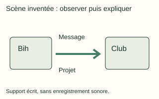
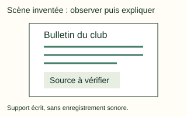

# Français intensif Form 2, Batches FI2-1, FI2-2, FI2-3: drafts for review (Lessons 1–25, 27–51, 53–76, 78–102, 104–128, Terms 1–3)

Generated by `npm run review:f2-francais-intensif` from `content/form-2/francais-intensif/*.json`. Every question and drawing below was built by the engine.
All notes, teach cards, worked examples and paper tasks are **status: draft**. “Authored key” means a person fixed the
right answer (see `AUTHORED.md`); “computed by rule” means code worked it out (a formula, a conversion, a spelling rule).

Teach mode: cards (idea + example + 1 level-1 check) → worked example → practice (levels 1–3) → the note as a summary.

## Sample rendered lesson: Lesson 28 in teach mode

### Lesson 28: Conjugaison : Le passé simple

**Card c28-1** (draft)

> Premier groupe au passé simple : il parla, ils parlèrent.
>
> _Il marcha longtemps ; ils arrivèrent le soir._  

Check question: `fi2-28-er` · multiple choice, level 1 · computed by rule, reused from practice

> Conjugue « commencer » au passé simple avec « elle ».

- ✅ elle commença
- ◻️ elle commençait  
  _↳ feedback if chosen: Cette forme est à l’imparfait._
- ◻️ elle commencèrent  
  _↳ feedback if chosen: Cette forme ne va pas avec « elle »._
- ◻️ elle commencit  
  _↳ feedback if chosen: « commencer » est du premier groupe : -a, -èrent (pas -it, -irent)._

Full working after a second miss:

> Premier groupe : -a avec il / elle, -èrent avec ils / elles.  
> Donc : elle commença.  

**Card c28-2** (draft)

> Deuxième groupe : il finit, ils finirent ; être : il fut ; faire : il fit.
>
> _Elle choisit une robe ; ils firent la fête._  

Check question: `fi2-28-ir` · multiple choice, level 1 · computed by rule, reused from practice

> Conjugue « être » au passé simple avec « elle ».

- ◻️ elle furent  
  _↳ feedback if chosen: Cette forme ne va pas avec « elle »._
- ◻️ elle est  
  _↳ feedback if chosen: Cette forme est au présent._
- ✅ elle fut
- ◻️ elle était  
  _↳ feedback if chosen: Cette forme est à l’imparfait._

Full working after a second miss:

> Au passé simple, « être » fait : il fut, ils furent.  
> Donc : elle fut.  

**Card c28-3** (draft)

> Le passé simple raconte les actions principales d’un récit écrit ; l’imparfait donne le décor.
>
> _Il faisait nuit. Le lion sortit de la forêt._  

Check question: `fi2-28-emploi-card` · multiple choice, level 1 · **authored key**

> Pourquoi ce temps ? « Le village était calme et les enfants dormaient. (était) »

- ◻️ passé simple : une action soudaine  
  _↳ feedback if chosen: Il n’y a pas d’action soudaine._
- ◻️ présent : maintenant  
  _↳ feedback if chosen: Le récit est au passé._
- ✅ imparfait : le décor
- ◻️ passé simple : une action principale  
  _↳ feedback if chosen: « était » décrit._

Full working after a second miss:

> L’imparfait décrit le décor.  
> Donc la réponse est « imparfait : le décor ».  

**Worked example** (draft)

> Conjugue « manger » au passé simple avec « il » et « ils ».

1. « manger » est du premier groupe : -a, -èrent.
2. Devant a, on garde le e : il mangea.
3. Devant è, pas besoin : ils mangèrent.

**Answer:** il mangea, ils mangèrent

**Practice** (one generated question per template, easiest first)

Practice 1: `fi2-28-er` · multiple choice, level 1 · computed by rule

> Conjugue « arriver » au passé simple avec « elle ».

- ✅ elle arriva
- ◻️ elle arrivèrent  
  _↳ feedback if chosen: Cette forme ne va pas avec « elle »._
- ◻️ elle arrivait  
  _↳ feedback if chosen: Cette forme est à l’imparfait._
- ◻️ elle arrivit  
  _↳ feedback if chosen: « arriver » est du premier groupe : -a, -èrent (pas -it, -irent)._

Full working after a second miss:

> Premier groupe : -a avec il / elle, -èrent avec ils / elles.  
> Donc : elle arriva.  

Practice 2: `fi2-28-ir` · multiple choice, level 1 · computed by rule

> Conjugue « être » au passé simple avec « elles ».

- ◻️ elles étaient  
  _↳ feedback if chosen: Cette forme est à l’imparfait._
- ◻️ elles sont  
  _↳ feedback if chosen: Cette forme est au présent._
- ◻️ elles fut  
  _↳ feedback if chosen: Cette forme ne va pas avec « elles »._
- ✅ elles furent

Full working after a second miss:

> Au passé simple, « être » fait : il fut, ils furent.  
> Donc : elles furent.  

Practice 3: `fi2-28-emploi` · multiple choice, level 2 · **authored key**

> Pourquoi ce temps ? « Le village était calme et les enfants dormaient. (était) »

- ◻️ passé simple : une action principale  
  _↳ feedback if chosen: « était » décrit._
- ✅ imparfait : le décor
- ◻️ passé simple : une action soudaine  
  _↳ feedback if chosen: Il n’y a pas d’action soudaine._
- ◻️ présent : maintenant  
  _↳ feedback if chosen: Le récit est au passé._

Full working after a second miss:

> L’imparfait décrit le décor.  
> Donc la réponse est « imparfait : le décor ».  

Practice 4: `fi2-28-type` · fill the blank, level 3 · computed by rule

> Écris le verbe au passé simple.

Sentence: **La tortue ___ (manger) tout le festin.**
Typed answer accepted (case and extra spaces ignored): **mangea**
- Typed **mangeait** (imp) → “Cette forme est à l’imparfait ; il faut le passé simple.”

Full working after a second miss:

> Au passé simple, « manger » : il mangea, ils mangèrent.  
> On écrit : mangea.  

**Summary (the note)**

> Le passé simple est le temps des récits écrits (contes, romans) : il raconte les actions principales, terminées, dans le passé. L’imparfait donne le décor.
> • Premier groupe (-er) : -ai, -as, -a, -âmes, -âtes, -èrent : il parla, ils parlèrent. Il mangea, il commença (le e et la cédille restent devant a).
> • Deuxième groupe : -is, -is, -it, -îmes, -îtes, -irent : il finit, ils finirent.
> • Quelques verbes irréguliers : être → il fut, ils furent ; avoir → il eut ; faire → il fit ; dire → il dit ; prendre → il prit ; voir → il vit ; venir → il vint, ils vinrent ; aller → il alla.
> On l’emploie surtout à la troisième personne (il, elle, ils, elles).

## All drafts

| Lesson | Title (sheet) | Status | Cards | Practice | Paper task |
|---|---|---|---|---|---|
| 1 | Grammaire : L’adjectif qualificatif : emploi | draft | 3 | 4 | — |
| 2 | Conjugaison : L’imparfait de l’indicatif : formation et emploi | draft | 3 | 4 | — |
| 3 | Orthographe : La ponctuation | draft | 3 | 4 | — |
| 4 | Vocabulaire : lexique de la famille élargie | draft | 3 | 4 | — |
| 5 | Expression orale : récitation, poème /comptines/chants | draft | 3 | 4 | — |
| 6 | Lecture : texte adossé au sous module | draft | 3 | 4 | — |
| 7 | Expression écrite : Construction des phrases simples | draft | 3 | 4 | — |
| 8 | Initiation à la littérature : Lecture suivie de courts textes littéraires liés au sous-module (ou voir œuvre au programme) | draft | 3 | 4 | — |
| 9 | Grammaire : Les conjonctions de coordination | draft | 3 | 4 | — |
| 10 | Conjugaison : le passé composé : formation et emploie | draft | 3 | 4 | — |
| 11 | Orthographe : les doubles consonnes | draft | 3 | 4 | — |
| 12 | Vocabulaire : L’arbre généalogique | draft | 3 | 4 | — |
| 13 | Expression orale : Jeux de rôle | draft | 3 | 4 | — |
| 14 | Expression écrite : Construction de courts paragraphes | draft | 3 | 4 | — |
| 15 | Grammaire : Expansion du groupe nominal | draft | 3 | 4 | — |
| 16 | Orthographe : Les liaisons | draft | 3 | 4 | — |
| 17 | Vocabulaire : Vocabulaire de l’école, du voisinage | draft | 3 | 4 | — |
| 18 | Expression orale : Interprétation d’image | draft | 3 | 4 | — |
| 19 | Expression écrite : Production de courts textes à partir d’image | draft | 3 | 4 | — |
| 20 | Grammaire : Accord du participe passé | draft | 3 | 4 | — |
| 21 | Orthographe : les sons : [f] (fée, trophée) [3] (Juge, Gisèle), [e] (mangerai, nez) | draft | 3 | 4 | — |
| 22 | Identification et utilisation des points | draft | 3 | 4 | — |
| 23 | Lecture suivie de courts textes littéraires | draft | 3 | 4 | — |
| 24 | Technique de lecture expressive | draft | 3 | 4 | — |
| 25 | Production d’écrit à partir d’images | draft | 3 | 4 | — |
| 27 | Grammaire : Pluriel des noms en « al, « ail », etc | draft | 3 | 4 | — |
| 28 | Conjugaison : Le passé simple | draft | 3 | 4 | — |
| 29 | Orthographe : Les homophones : Quels, qu’elles, son, sont… | draft | 3 | 4 | — |
| 30 | Vocabulaire : Lexique lié aux épidémies /endémies/pandémies | draft | 3 | 4 | — |
| 31 | Expression orale : récitation, poème /comptines/chants | draft | 3 | 4 | — |
| 32 | Lecture : Texte adossés au sous-module | draft | 3 | 4 | — |
| 33 | Expression écrite : Initiation à la description et au portrait | draft | 3 | 4 | — |
| 34 | Initiation à la littérature | draft | 3 | 4 | — |
| 35 | Grammaire : Adverbes (lieu, manière) | draft | 3 | 4 | — |
| 36 | Conjugaison : Le gérondif /participe présent | draft | 3 | 4 | — |
| 37 | Orthographe : Les homophones : le son/ᴓ/ Ex. feu | draft | 3 | 4 | — |
| 38 | Vocabulaire : Lexique lié à l’hygiène, à la salubrité et la protection de l’environnement | draft | 3 | 4 | — |
| 39 | Expression oral : Jeux de rôle | draft | 3 | 4 | — |
| 40 | Expression écrite : Initiation à la narration | draft | 3 | 4 | — |
| 41 | Grammaire : Phrase exclamative | draft | 3 | 4 | — |
| 42 | Orthographe : Les homophones : le son /ә/ Ex. côte | draft | 3 | 4 | — |
| 43 | Vocabulaire : Lexique lié aux tourismes | draft | 3 | 4 | — |
| 44 | Expression orale : Interprétation d’image | draft | 3 | 4 | — |
| 45 | Expression écrite : Production de courts textes à partir d’images | draft | 3 | 4 | — |
| 46 | Orthographe : Les homophones : le son /p/ Ex. Paludisme | draft | 3 | 4 | — |
| 47 | Identification et utilisation des points grammaticaux et temps verbaux étudiés | draft | 3 | 4 | — |
| 48 | Lecture suivie de courts textes littéraires | draft | 3 | 4 | — |
| 49 | Technique de lecture expressive | draft | 3 | 4 | — |
| 50 | Technique de la description, portrait, narration | draft | 3 | 4 | — |
| 51 | Production d’écrits à partir d’images | draft | 3 | 4 | — |
| 53 | Grammaire : Pluriels des noms en « ou » | draft | 3 | 4 | — |
| 54 | Conjugaison : Le plus-que-parfait | draft | 3 | 4 | — |
| 55 | Orthographe : La liaison | draft | 3 | 4 | — |
| 56 | Vocabulaire : Lexique lié aux unités administratives (suite) | draft | 3 | 4 | — |
| 57 | Expression orale : récitation, poème /comptine/chants | draft | 3 | 4 | — |
| 58 | Lecture : Textes adossés au sous- module | draft | 3 | 4 | — |
| 59 | Expression écrite : Initiation à la description et au portrait (suite) | draft | 3 | 4 | — |
| 60 | Initiation à la littérature : Lecture suivie de courts textes littéraires liés au sous-module (voir œuvres au programme) | draft | 3 | 4 | — |
| 61 | Grammaire : Pronoms indéfinis | draft | 3 | 4 | — |
| 62 | Conjugaison : Le passé simple | draft | 3 | 4 | — |
| 63 | Orthographe : s→/z/ dans l’organisation | draft | 3 | 4 | — |
| 64 | Vocabulaire : Lexique liés aux cultures d’ailleurs | draft | 3 | 4 | — |
| 65 | Expression orale : Jeux de rôle | draft | 3 | 4 | — |
| 66 | Expression écrite : Initiation à la narration (suite) | draft | 3 | 4 | — |
| 67 | Grammaire : Adjectif indéfinis | draft | 3 | 4 | — |
| 68 | Orthographe : d→/t/ dans quand ͡ on entend-il ? | draft | 3 | 4 | — |
| 69 | Vocabulaire : Lexique liés aux conflits sociaux (discrimination et ségrégation raciale, tribalisme, népotisme…) | draft | 3 | 4 | — |
| 70 | Expression orale : Interprétation d’images | draft | 3 | 4 | — |
| 71 | Expression écrite : Production de courts textes à partir d’images | draft | 3 | 4 | — |
| 72 | Grammaire : Phrase interro-négative | draft | 3 | 4 | — |
| 73 | Orthographe : Les sons /i/ Ex : punir; /e/ Ex : voyager, Morphée ; /b/ Ex : bannir | draft | 3 | 4 | — |
| 74 | Vocabulaire : Lexique lié aux violences faites aux femmes et aux enfants | draft | 3 | 4 | — |
| 75 | Vocabulaire : Lexique lié aux activités sportives (sports de compétition) | draft | 3 | 4 | — |
| 76 | Vocabulaire : Champs lexical et sémantique de l’hymne | draft | 3 | 4 | — |
| 78 | Grammaire : phrase composée | draft | 3 | 4 | — |
| 79 | Conjugaison : Le subjonctif présent | draft | 3 | 4 | — |
| 80 | Orthographe : Le son [ε] Ex. mais, Eve | draft | 3 | 4 | — |
| 81 | Vocabulaire : Lexique lié à la publicité | draft | 3 | 4 | — |
| 82 | Expression Orale : récitation, poème /comptine/chants | draft | 3 | 4 | — |
| 83 | Lecture : Textes adossés au sous- module | draft | 3 | 4 | — |
| 84 | Expression écrite : Description | draft | 3 | 4 | — |
| 85 | Initiation à la littérature : Lecture suivie de courts textes littéraires liés au sous-module (ou voir œuvres au programme) | draft | 3 | 4 | — |
| 86 | Conjugaison : Le conditionnel présent | draft | 3 | 4 | — |
| 87 | Orthographe : s→/œ/ Ex. œuf | draft | 3 | 4 | — |
| 88 | Vocabulaire : Lexique lié aux obligations du travail (contrat, congés, grèves, augmentation, salaires etc…) | draft | 3 | 4 | — |
| 89 | Expression orale : Jeux de rôle | draft | 3 | 4 | — |
| 90 | Expression écrite : Portrait | draft | 3 | 4 | — |
| 91 | Grammaire : Noms composés | draft | 3 | 4 | — |
| 92 | Orthographe : Le son /m/ Ex. maçon | draft | 3 | 4 | — |
| 93 | Vocabulaire : Lexique lié aux activités bancaire | draft | 3 | 4 | — |
| 94 | Expression Orale : Interprétation d’image | draft | 3 | 4 | — |
| 95 | Expression écrite : Narration | draft | 3 | 4 | — |
| 96 | Expression écrite : Production écrites à partir d’images | draft | 3 | 4 | — |
| 97 | Identification et utilisation des points grammaticaux et temps verbaux étudiés | draft | 3 | 4 | — |
| 98 | Lecture suivie de courts textes littéraires | draft | 3 | 4 | — |
| 99 | Technique de lecture expressive | draft | 3 | 4 | — |
| 100 | description, portrait et narration | draft | 3 | 4 | — |
| 101 | Production d’écrits à partir d’images | draft | 3 | 4 | — |
| 102 | Conjugaison : Le conditionnel présent : Révision | draft | 3 | 4 | — |
| 104 | Grammaire : Le nom comme sujet | draft | 3 | 5 | — |
| 105 | Conjugaison : Le futur simple et le conditionnel présent | draft | 3 | 5 | — |
| 106 | Orthographe : Le son /œ/ Ex. parfum, un | draft | 3 | 5 | — |
| 107 | Vocabulaire : Lexique lié aux médias : Radio, télé, Presse écrite Internet | draft | 3 | 5 | — |
| 108 | Expression Orale : Récitation, poèmes/Comptines/chants | draft | 3 | 5 | — |
| 109 | Lecture : Textes adossés au sous- module | draft | 3 | 5 | — |
| 110 | Expression écrite : Description | draft | 3 | 5 | yes |
| 111 | Initiation à la littérature : Lecture suivie de courts textes littéraires liés au sous-module (ou voir œuvres au programme) | draft | 3 | 5 | — |
| 112 | Grammaire : Les sujets multiples (no+ nom ; nom+ pronom…) | draft | 3 | 5 | — |
| 113 | Conjugaison : Le passé antérieur | draft | 3 | 5 | — |
| 114 | Orthographe : Le son /n/ Ex. nature | draft | 3 | 5 | — |
| 115 | Vocabulaire : Lexique lié aux réseaux sociaux Facebook, Twitter etc.) | draft | 3 | 5 | — |
| 116 | Expression Orale : Jeux de rôle | draft | 3 | 5 | — |
| 117 | Expression écrite : Portrait | draft | 3 | 5 | yes |
| 118 | Grammaire : Les pronoms possessifs sujets | draft | 3 | 5 | — |
| 119 | Orthographe : Le son /ε/ Ex. vin, pain | draft | 3 | 5 | — |
| 120 | Vocabulaire : Lexique lié aux correspondances (privées et officielles, demandes, requêtes) | draft | 3 | 5 | — |
| 121 | Expression orale : Interprétation d’images | draft | 3 | 5 | — |
| 122 | Expression écrite : Narration | draft | 3 | 5 | yes |
| 123 | Vocabulaire : Lexique lié à la communication téléphonique (suite) | draft | 3 | 5 | — |
| 124 | Expression écrite : Production d’écrits à partir d’images | draft | 3 | 5 | yes |
| 125 | Vocabulaire : Lexique lié à la recherche sur internet | draft | 3 | 5 | — |
| 126 | Identification et utilisation des points grammaticaux et temps verbaux étudiés | draft | 3 | 5 | — |
| 127 | Lecture suivie de courts textes littéraires | draft | 3 | 5 | — |
| 128 | Description portrait narration | draft | 3 | 5 | yes |

## Lesson 1: Grammaire : L’adjectif qualificatif : emploi

Prerequisites: none · Skill: fi2-1 (L’adjectif qualificatif : épithète et attribut)

**Note** (draft)

> L’adjectif qualificatif dit comment est un nom (une qualité, une couleur, une forme …). Il s’accorde avec ce nom.
> • Épithète : il est placé juste à côté du nom, sans verbe : une robe rouge, un petit village.
> • Attribut du sujet : il est relié au sujet par un verbe d’état (être, sembler, paraître, devenir, rester) : Le village est petit. Ma tante semble fatiguée.
> Place de l’épithète : la plupart se placent après le nom (une maison propre, un élève sérieux). Quelques adjectifs courts se placent souvent avant : petit, grand, beau, joli, jeune, vieux, bon, mauvais, gros (un bon repas, une jolie case).

**Card c1-1** (draft)

> L’adjectif épithète est placé à côté du nom, sans verbe.
>
> _une cour propre, un grand arbre_  

Check question: `fi2-1-epi` · multiple choice, level 1 · **authored key**, reused from practice

> Quelle est la fonction de l’adjectif entre parenthèses ? « Les élèves sérieux réussissent. (sérieux) »

- ◻️ attribut du sujet  
  _↳ feedback if chosen: « sérieux » n’est pas après un verbe d’état._
- ◻️ verbe  
  _↳ feedback if chosen: Le verbe est « réussissent »._
- ◻️ complément  
  _↳ feedback if chosen: C’est un adjectif._
- ✅ épithète

Full working after a second miss:

> « sérieux » est à côté du nom « élèves ».  
> Donc la réponse est « épithète ».  

**Card c1-2** (draft)

> L’adjectif attribut est relié au sujet par un verbe d’état : être, sembler, paraître, devenir, rester.
>
> _Le ciel devient gris._  

Check question: `fi2-1-attr` · multiple choice, level 1 · **authored key**, reused from practice

> Quelle est la fonction de l’adjectif entre parenthèses ? « Le marché est propre. (propre) »

- ✅ attribut du sujet
- ◻️ sujet  
  _↳ feedback if chosen: Le sujet est « Le marché »._
- ◻️ épithète  
  _↳ feedback if chosen: Il est relié au sujet par le verbe « est »._
- ◻️ verbe  
  _↳ feedback if chosen: Le verbe est « est »._

Full working after a second miss:

> « propre » est relié au sujet par le verbe d’état « est ».  
> Donc la réponse est « attribut du sujet ».  

**Card c1-3** (draft)

> Petit, grand, beau, jeune, vieux, bon se placent souvent avant le nom.
>
> _un beau pagne, une jeune fille_  

Check question: `fi2-1-place-card` · multiple choice, level 1 · **authored key**

> Quelle phrase place bien l’adjectif ?

- ◻️ Mon oncle grande a une maison.  
  _↳ feedback if chosen: L’adjectif doit être à côté du nom._
- ✅ Mon oncle a une grande maison.
- ◻️ Mon oncle a grande une maison.  
  _↳ feedback if chosen: L’adjectif ne se place pas avant le déterminant._
- ◻️ Mon oncle a une maison grande.  
  _↳ feedback if chosen: « grand » se place avant le nom._

Full working after a second miss:

> « grand » se place avant le nom.  
> Donc la réponse est « Mon oncle a une grande maison. ».  

**Worked example** (draft)

> Dans « Le vieux chef semble content », quelle est la fonction de chaque adjectif ?

1. « vieux » est à côté du nom « chef », sans verbe : épithète.
2. « content » est relié au sujet par le verbe d’état « semble » : attribut du sujet.

**Answer:** vieux : épithète ; content : attribut du sujet.

**Subject activity: Du dialogue à une phrase originale** (draft)

**Lire le dialogue**

> BIH : Regarde la cour propre !
> NJI : Oui, la cour est propre.
> Dans « la cour propre », quelle est la fonction de « propre » ?

- ◻️ Verbe.  
  _↳ feedback if chosen: « Propre » est placé à côté du nom « cour », sans verbe : épithète._
- ✅ Épithète.
- ◻️ Attribut du sujet.  
  _↳ feedback if chosen: « Propre » est placé à côté du nom « cour », sans verbe : épithète._

Full working after a second miss:

> « Propre » est placé à côté du nom « cour », sans verbe : épithète.  

**Comparer les structures**

> Dans « La cour est propre », pourquoi « propre » est-il attribut du sujet ?

- ◻️ Il est placé directement à côté du nom, sans verbe.  
  _↳ feedback if chosen: Le verbe d’état « est » relie l’adjectif « propre » au sujet « la cour »._
- ✅ Il est relié au sujet par le verbe être.
- ◻️ Il remplace le nom cour.  
  _↳ feedback if chosen: Le verbe d’état « est » relie l’adjectif « propre » au sujet « la cour »._

Full working after a second miss:

> Le verbe d’état « est » relie l’adjectif « propre » au sujet « la cour ».  

**Paper task** (draft; not marked by the app, mastery stays unknown)

> Choisis un nom et un adjectif. Écris une phrase originale avec cet adjectif attribut du sujet, en utilisant le verbe être.

Model answer, shown after the pupil has written:

> Un exemple, pas la seule réponse possible : Le village est calme.  

Self-check list:

- [ ] J’ai écrit une phrase de mon choix.
- [ ] J’ai relié mon adjectif au sujet avec être.
- [ ] J’ai accordé l’adjectif avec le sujet.

**Practice** `fi2-1-epi` · multiple choice, level 1 · **authored key**

> Quelle est la fonction de l’adjectif entre parenthèses ? « Nous habitons un petit village. (petit) »

- ◻️ complément  
  _↳ feedback if chosen: C’est un adjectif, pas un complément._
- ◻️ attribut du sujet  
  _↳ feedback if chosen: Il n’y a pas de verbe d’état._
- ◻️ sujet  
  _↳ feedback if chosen: Le sujet est « Nous »._
- ✅ épithète

Full working after a second miss:

> « petit » est à côté du nom « village ».  
> Donc la réponse est « épithète ».  

> Quelle est la fonction de l’adjectif entre parenthèses ? « Ma mère a acheté une robe verte. (verte) »

- ◻️ sujet  
  _↳ feedback if chosen: Le sujet est « Ma mère »._
- ◻️ verbe  
  _↳ feedback if chosen: Le verbe est « a acheté »._
- ◻️ attribut du sujet  
  _↳ feedback if chosen: Il n’y a pas de verbe d’état entre « robe » et « verte »._
- ✅ épithète

Full working after a second miss:

> « verte » est à côté du nom « robe ».  
> Donc la réponse est « épithète ».  

**Practice** `fi2-1-attr` · multiple choice, level 1 · **authored key**

> Quelle est la fonction de l’adjectif entre parenthèses ? « Le marché est propre. (propre) »

- ✅ attribut du sujet
- ◻️ épithète  
  _↳ feedback if chosen: Il est relié au sujet par le verbe « est »._
- ◻️ verbe  
  _↳ feedback if chosen: Le verbe est « est »._
- ◻️ sujet  
  _↳ feedback if chosen: Le sujet est « Le marché »._

Full working after a second miss:

> « propre » est relié au sujet par le verbe d’état « est ».  
> Donc la réponse est « attribut du sujet ».  

> Quelle est la fonction de l’adjectif entre parenthèses ? « Ma grand-mère semble fatiguée. (fatiguée) »

- ◻️ complément  
  _↳ feedback if chosen: C’est un adjectif._
- ◻️ épithète  
  _↳ feedback if chosen: Il est relié au sujet par « semble »._
- ◻️ sujet  
  _↳ feedback if chosen: Le sujet est « Ma grand-mère »._
- ✅ attribut du sujet

Full working after a second miss:

> « semble » est un verbe d’état.  
> Donc la réponse est « attribut du sujet ».  

**Practice** `fi2-1-place` · multiple choice, level 2 · **authored key**

> Quelle phrase place bien l’adjectif ?

- ✅ Mon oncle a une grande maison.
- ◻️ Mon oncle grande a une maison.  
  _↳ feedback if chosen: L’adjectif doit être à côté du nom._
- ◻️ Mon oncle a grande une maison.  
  _↳ feedback if chosen: L’adjectif ne se place pas avant le déterminant._
- ◻️ Mon oncle a une maison grande.  
  _↳ feedback if chosen: « grand » se place avant le nom._

Full working after a second miss:

> « grand » se place avant le nom.  
> Donc la réponse est « Mon oncle a une grande maison. ».  

> Quelle phrase place bien l’adjectif ?

- ◻️ Il blanche porte une chemise.  
  _↳ feedback if chosen: L’adjectif doit être à côté du nom._
- ◻️ Il porte blanche une chemise.  
  _↳ feedback if chosen: L’adjectif ne se place pas avant le déterminant._
- ◻️ Il porte une blanche chemise.  
  _↳ feedback if chosen: Les couleurs se placent après le nom._
- ✅ Il porte une chemise blanche.

Full working after a second miss:

> Les couleurs se placent après le nom.  
> Donc la réponse est « Il porte une chemise blanche. ».  

**Practice** `fi2-1-spot` · spot the error, level 3 · **authored key**

> Quelle phrase est fausse ?

- ◻️ « sembler » est un verbe d’état.
- ◻️ Dans « La case est jolie », « jolie » est attribut.
- ✅ « manger » est un verbe d’état.  
  _↳ explanation: Les verbes d’état sont être, sembler, paraître, devenir, rester._
- ◻️ Dans « une jolie case », « jolie » est épithète.

Full working after a second miss:

> La phrase fausse est « « manger » est un verbe d’état. ».  
> Les verbes d’état sont être, sembler, paraître, devenir, rester.  

> Quelle phrase est fausse ?

- ◻️ Dans « La case est jolie », « jolie » est attribut.
- ◻️ « sembler » est un verbe d’état.
- ✅ « manger » est un verbe d’état.  
  _↳ explanation: Les verbes d’état sont être, sembler, paraître, devenir, rester._
- ◻️ Dans « une jolie case », « jolie » est épithète.

Full working after a second miss:

> La phrase fausse est « « manger » est un verbe d’état. ».  
> Les verbes d’état sont être, sembler, paraître, devenir, rester.  

## Lesson 2: Conjugaison : L’imparfait de l’indicatif : formation et emploi

Prerequisites: 1 · Skill: fi2-2 (L’imparfait de l’indicatif : formation et emploi)

**Note** (draft)

> Formation : on prend le radical de « nous » au présent et on ajoute -ais, -ais, -ait, -ions, -iez, -aient.
> nous parlons → je parlais ; nous finissons → je finissais ; nous faisons → je faisais ; nous avons → j’avais.
> Seule exception : être → j’étais, nous étions.
> Attention : manger → je mangeais (on garde le e devant a), mais nous mangions ; commencer → je commençais, mais nous commencions.
> Emploi : l’imparfait sert, dans le passé,
> • à décrire (le décor, les personnes) : Il faisait chaud, le ciel était bleu ;
> • à dire une habitude : Chaque soir, grand-père racontait un conte ;
> • à dire une action en train de se faire, quand une autre arrive (au passé composé) : Je mangeais quand l’orage a éclaté.

**Card c2-1** (draft)

> Imparfait : radical de « nous » au présent + -ais, -ais, -ait, -ions, -iez, -aient.
>
> _nous jouons → je jouais, ils jouaient_  

Check question: `fi2-2-form` · multiple choice, level 1 · computed by rule, reused from practice

> Conjugue « parler » à l’imparfait avec « je ».

- ✅ je parlais
- ◻️ je parle  
  _↳ feedback if chosen: Cette forme est au présent ; l’imparfait finit par -ais, -ait, -ions …_
- ◻️ je parlions  
  _↳ feedback if chosen: Cette forme ne va pas avec « je »._

Full working after a second miss:

> Le radical vient de « nous » au présent : nous parlons.  
> Donc : je parlais.  

**Card c2-2** (draft)

> Manger, commencer : je mangeais, je commençais, mais nous mangions, nous commencions.
>
> _Il nageait. Vous commenciez._  

Check question: `fi2-2-ger` · multiple choice, level 1 · computed by rule, reused from practice

> Conjugue « avancer » à l’imparfait avec « elle ».

- ◻️ elle avance  
  _↳ feedback if chosen: Cette forme est au présent._
- ◻️ elle avancions  
  _↳ feedback if chosen: Cette forme ne va pas avec « elle »._
- ◻️ elle avancait  
  _↳ feedback if chosen: Devant a, il faut garder le e (je mangeais) ou la cédille (je commençais), comme dans « nous avançons »._
- ✅ elle avançait

Full working after a second miss:

> Le radical vient de « nous avançons » : on garde le e (ou la cédille) devant a, mais pas devant i (nous avancions).  
> Donc : elle avançait.  

**Card c2-3** (draft)

> L’imparfait décrit, dit une habitude passée ou une action en cours dans le passé.
>
> _Chaque matin, ma mère allait au marché._  

Check question: `fi2-2-emploi-card` · multiple choice, level 1 · **authored key**

> Pourquoi le verbe est-il à l’imparfait ? « Il faisait chaud et le ciel était bleu. »

- ✅ c’est une description
- ◻️ c’est une action unique et terminée  
  _↳ feedback if chosen: On décrit le décor._
- ◻️ c’est une habitude du futur  
  _↳ feedback if chosen: Le texte est au passé._
- ◻️ c’est un ordre  
  _↳ feedback if chosen: Ce n’est pas un ordre._

Full working after a second miss:

> L’imparfait décrit le décor.  
> Donc la réponse est « c’est une description ».  

**Worked example** (draft)

> Conjugue « finir » à l’imparfait avec « je » et « nous ».

1. Au présent : nous finissons ; on enlève -ons : le radical est « finiss- ».
2. On ajoute -ais et -ions.

**Answer:** je finissais, nous finissions

**Practice** `fi2-2-form` · multiple choice, level 1 · computed by rule

> Conjugue « finir » à l’imparfait avec « elle ».

- ◻️ elle finissaient  
  _↳ feedback if chosen: Cette forme ne va pas avec « elle »._
- ◻️ elle finait  
  _↳ feedback if chosen: Le radical vient de « nous » au présent : nous finissons._
- ✅ elle finissait
- ◻️ elle finit  
  _↳ feedback if chosen: Cette forme est au présent ; l’imparfait finit par -ais, -ait, -ions …_

Full working after a second miss:

> Le radical vient de « nous » au présent : nous finissons.  
> Donc : elle finissait.  

> Conjugue « commencer » à l’imparfait avec « tu ».

- ◻️ tu commenciez  
  _↳ feedback if chosen: Cette forme ne va pas avec « tu »._
- ◻️ tu commences  
  _↳ feedback if chosen: Cette forme est au présent ; l’imparfait finit par -ais, -ait, -ions …_
- ✅ tu commençais
- ◻️ tu commencais  
  _↳ feedback if chosen: Le radical vient de « nous » au présent : nous commençons._

Full working after a second miss:

> Le radical vient de « nous » au présent : nous commençons.  
> Donc : tu commençais.  

**Practice** `fi2-2-ger` · multiple choice, level 1 · computed by rule

> Conjugue « ranger » à l’imparfait avec « elles ».

- ✅ elles rangeaient
- ◻️ elles rangent  
  _↳ feedback if chosen: Cette forme est au présent._
- ◻️ elles rangaient  
  _↳ feedback if chosen: Devant a, il faut garder le e (je mangeais) ou la cédille (je commençais), comme dans « nous rangeons »._
- ◻️ elles rangions  
  _↳ feedback if chosen: Cette forme ne va pas avec « elles »._

Full working after a second miss:

> Le radical vient de « nous rangeons » : on garde le e (ou la cédille) devant a, mais pas devant i (nous rangions).  
> Donc : elles rangeaient.  

> Conjugue « avancer » à l’imparfait avec « elle ».

- ◻️ elle avance  
  _↳ feedback if chosen: Cette forme est au présent._
- ◻️ elle avancions  
  _↳ feedback if chosen: Cette forme ne va pas avec « elle »._
- ◻️ elle avancait  
  _↳ feedback if chosen: Devant a, il faut garder le e (je mangeais) ou la cédille (je commençais), comme dans « nous avançons »._
- ✅ elle avançait

Full working after a second miss:

> Le radical vient de « nous avançons » : on garde le e (ou la cédille) devant a, mais pas devant i (nous avancions).  
> Donc : elle avançait.  

**Practice** `fi2-2-emploi` · multiple choice, level 2 · **authored key**

> Pourquoi le verbe est-il à l’imparfait ? « Chaque soir, grand-père racontait un conte. »

- ◻️ c’est un ordre  
  _↳ feedback if chosen: Ce n’est pas un ordre._
- ✅ c’est une habitude dans le passé
- ◻️ c’est une action unique et terminée  
  _↳ feedback if chosen: « Chaque soir » montre une habitude._
- ◻️ c’est une action future  
  _↳ feedback if chosen: L’action est passée._

Full working after a second miss:

> « Chaque soir » annonce une habitude.  
> Donc la réponse est « c’est une habitude dans le passé ».  

> Pourquoi le verbe est-il à l’imparfait ? « Chaque soir, grand-père racontait un conte. »

- ◻️ c’est une action future  
  _↳ feedback if chosen: L’action est passée._
- ◻️ c’est un ordre  
  _↳ feedback if chosen: Ce n’est pas un ordre._
- ◻️ c’est une action unique et terminée  
  _↳ feedback if chosen: « Chaque soir » montre une habitude._
- ✅ c’est une habitude dans le passé

Full working after a second miss:

> « Chaque soir » annonce une habitude.  
> Donc la réponse est « c’est une habitude dans le passé ».  

**Practice** `fi2-2-type` · fill the blank, level 3 · computed by rule

> Écris le verbe à l’imparfait.

Sentence: **Vous ___ (être) fatigués après le match.**
Typed answer accepted (case and extra spaces ignored): **étiez**
- Typed **êtiez** (stem) → “« être » est une exception : radical ét- (j’étais).”
- Typed **êtes** (pres) → “Cette forme est au présent ; il faut l’imparfait.”

Full working after a second miss:

> « être » : radical ét-, puis la terminaison de l’imparfait.  
> On écrit : étiez.  

> Écris le verbe à l’imparfait.

Sentence: **Il ___ (faire) très chaud ce jour-là.**
Typed answer accepted (case and extra spaces ignored): **faisait**
- Typed **faiait** (stem) → “Le radical vient de « nous » au présent : nous faisons.”
- Typed **fait** (pres) → “Cette forme est au présent ; il faut l’imparfait.”

Full working after a second miss:

> Radical de « nous faisons », sans -ons, puis la terminaison de l’imparfait.  
> On écrit : faisait.  

## Lesson 3: Orthographe : La ponctuation

Prerequisites: none · Skill: fi2-3 (La ponctuation)

**Note** (draft)

> Les signes de ponctuation aident à lire et à comprendre.
> • Le point (.) termine une phrase déclarative. • Le point d’interrogation (?) termine une question. • Le point d’exclamation (!) exprime un sentiment fort ou un ordre.
> • La virgule (,) sépare les éléments d’une liste ou marque une petite pause : J’achète du riz, des tomates et du sel.
> • Le point-virgule (;) sépare deux parties d’une phrase liées par le sens. • Les deux-points (:) annoncent une explication ou une liste.
> • Les guillemets (« ») encadrent les paroles d’un personnage ; le tiret (—) marque le changement de personne qui parle dans un dialogue.
> Après . ? ! on met une majuscule.

**Card c3-1** (draft)

> Le point termine une phrase ; le point d’interrogation termine une question ; le point d’exclamation dit un sentiment fort.
>
> _Il pleut. Pleut-il ? Quelle pluie !_  

Check question: `fi2-3-fin` · fill the blank, level 1 · **authored key**, reused from practice

> Choisis le signe qui termine la phrase.

Sentence: **Où habites-tu ___**
- ✅ ?
- ◻️ .  
  _↳ feedback if chosen: C’est une question : il faut un point d’interrogation._
- ◻️ !  
  _↳ feedback if chosen: C’est une question, pas une exclamation._

Full working after a second miss:

> Le mot qui manque est « ? ».  
> Où habites-tu ?  

**Card c3-2** (draft)

> La virgule sépare les éléments d’une liste.
>
> _J’ai un cahier, un stylo et une règle._  

Check question: `fi2-3-virg` · multiple choice, level 1 · **authored key**, reused from practice

> Quelle phrase est bien ponctuée ?

- ◻️ Le matin Paul balaie Marie lave et Junior range  
  _↳ feedback if chosen: Il manque les virgules et le point._
- ◻️ Le matin Paul, balaie Marie, lave et Junior range.  
  _↳ feedback if chosen: Les virgules sont mal placées._
- ✅ Le matin, Paul balaie, Marie lave et Junior range.
- ◻️ Le matin, Paul balaie. Marie lave et Junior range ?  
  _↳ feedback if chosen: Ce n’est pas une question._

Full working after a second miss:

> Les virgules séparent les actions.  
> Donc la réponse est « Le matin, Paul balaie, Marie lave et Junior range. ».  

**Card c3-3** (draft)

> Les deux-points et les guillemets annoncent et encadrent les paroles.
>
> _Il dit : « Bonjour ! »_  

Check question: `fi2-3-paroles-card` · multiple choice, level 1 · **authored key**

> Quelle phrase est bien ponctuée ?

- ◻️ Le maître dit, « sortez vos cahiers ? »  
  _↳ feedback if chosen: Ce n’est pas une question, et il faut deux-points._
- ✅ Le maître dit : « Sortez vos cahiers. »
- ◻️ Le maître dit : Sortez vos cahiers.  
  _↳ feedback if chosen: Il manque les guillemets._
- ◻️ Le maître dit « Sortez vos cahiers ».  
  _↳ feedback if chosen: Il manque les deux-points._

Full working after a second miss:

> Deux-points, puis les paroles entre guillemets.  
> Donc la réponse est « Le maître dit : « Sortez vos cahiers. » ».  

**Worked example** (draft)

> Ponctue : « maman demande as tu fini tes devoirs »

1. Une majuscule au début : Maman.
2. « demande » annonce les paroles : deux-points et guillemets.
3. Les paroles sont une question : point d’interrogation.
4. Maman demande : « As-tu fini tes devoirs ? »

**Answer:** Maman demande : « As-tu fini tes devoirs ? »

**Practice** `fi2-3-fin` · fill the blank, level 1 · **authored key**

> Choisis le signe qui termine la phrase.

Sentence: **Comment s’appelle ta tante ___**
- ◻️ .  
  _↳ feedback if chosen: C’est une question._
- ◻️ !  
  _↳ feedback if chosen: C’est une question._
- ✅ ?

Full working after a second miss:

> Le mot qui manque est « ? ».  
> Comment s’appelle ta tante ?  

> Choisis le signe qui termine la phrase.

Sentence: **Quelle belle fête ___**
- ✅ !
- ◻️ .  
  _↳ feedback if chosen: La phrase exprime un sentiment fort._
- ◻️ ?  
  _↳ feedback if chosen: Ce n’est pas une question._

Full working after a second miss:

> Le mot qui manque est « ! ».  
> Quelle belle fête !  

**Practice** `fi2-3-virg` · multiple choice, level 1 · **authored key**

> Quelle phrase est bien ponctuée ?

- ✅ Au marché, j’achète du riz, des tomates et du sel.
- ◻️ Au marché, j’achète du riz ; des tomates ; et du sel ?  
  _↳ feedback if chosen: Ce n’est pas une question._
- ◻️ Au marché j’achète, du riz des tomates, et du sel.  
  _↳ feedback if chosen: Les virgules sont mal placées._
- ◻️ Au marché. j’achète du riz des tomates et du sel  
  _↳ feedback if chosen: Le point coupe la phrase._

Full working after a second miss:

> Les virgules séparent les éléments de la liste.  
> Donc la réponse est « Au marché, j’achète du riz, des tomates et du sel. ».  

> Quelle phrase est bien ponctuée ?

- ◻️ Au marché j’achète, du riz des tomates, et du sel.  
  _↳ feedback if chosen: Les virgules sont mal placées._
- ◻️ Au marché. j’achète du riz des tomates et du sel  
  _↳ feedback if chosen: Le point coupe la phrase._
- ◻️ Au marché, j’achète du riz ; des tomates ; et du sel ?  
  _↳ feedback if chosen: Ce n’est pas une question._
- ✅ Au marché, j’achète du riz, des tomates et du sel.

Full working after a second miss:

> Les virgules séparent les éléments de la liste.  
> Donc la réponse est « Au marché, j’achète du riz, des tomates et du sel. ».  

**Practice** `fi2-3-paroles` · multiple choice, level 2 · **authored key**

> Quelle phrase est bien ponctuée ?

- ◻️ Le maître dit : Sortez vos cahiers.  
  _↳ feedback if chosen: Il manque les guillemets._
- ◻️ Le maître dit, « sortez vos cahiers ? »  
  _↳ feedback if chosen: Ce n’est pas une question, et il faut deux-points._
- ◻️ Le maître dit « Sortez vos cahiers ».  
  _↳ feedback if chosen: Il manque les deux-points._
- ✅ Le maître dit : « Sortez vos cahiers. »

Full working after a second miss:

> Deux-points, puis les paroles entre guillemets.  
> Donc la réponse est « Le maître dit : « Sortez vos cahiers. » ».  

> Quelle phrase est bien ponctuée ?

- ◻️ Le maître dit, « sortez vos cahiers ? »  
  _↳ feedback if chosen: Ce n’est pas une question, et il faut deux-points._
- ✅ Le maître dit : « Sortez vos cahiers. »
- ◻️ Le maître dit « Sortez vos cahiers ».  
  _↳ feedback if chosen: Il manque les deux-points._
- ◻️ Le maître dit : Sortez vos cahiers.  
  _↳ feedback if chosen: Il manque les guillemets._

Full working after a second miss:

> Deux-points, puis les paroles entre guillemets.  
> Donc la réponse est « Le maître dit : « Sortez vos cahiers. » ».  

**Practice** `fi2-3-spot` · spot the error, level 3 · **authored key**

> Quelle phrase est mal ponctuée ?

- ✅ Où vas-tu.  
  _↳ explanation: C’est une question : il faut « ? »._
- ◻️ J’ai deux frères : Ewane et Tabi.
- ◻️ As-tu vu mon cahier ?
- ◻️ Il pleut beaucoup aujourd’hui.

Full working after a second miss:

> La phrase fausse est « Où vas-tu. ».  
> C’est une question : il faut « ? ».  

> Quelle phrase est mal ponctuée ?

- ◻️ Quelle chaleur !
- ◻️ J’ai deux frères : Ewane et Tabi.
- ✅ Où vas-tu.  
  _↳ explanation: C’est une question : il faut « ? »._
- ◻️ Il pleut beaucoup aujourd’hui.

Full working after a second miss:

> La phrase fausse est « Où vas-tu. ».  
> C’est une question : il faut « ? ».  

## Lesson 4: Vocabulaire : lexique de la famille élargie

Prerequisites: none · Skill: fi2-4 (Le lexique de la famille élargie)

**Note** (draft)

> La famille élargie comprend plusieurs générations :
> • les arrière-grands-parents (les parents des grands-parents), les grands-parents, les parents, les enfants, les petits-enfants ;
> • l’oncle, la tante, le cousin, la cousine, le neveu, la nièce ;
> • par le mariage : le beau-père, la belle-mère, le gendre (le mari de ma fille), la belle-fille ou la bru (la femme de mon fils), le beau-frère, la belle-sœur ;
> • le demi-frère, la demi-sœur : ils ont un seul parent en commun avec moi ;
> • l’aîné (le plus âgé des enfants), le cadet (le plus jeune), les jumeaux (nés le même jour de la même mère) ;
> • un orphelin a perdu ses parents ; un veuf a perdu sa femme, une veuve a perdu son mari ;
> • le parrain, la marraine, le filleul.

**Card c4-1** (draft)

> Le gendre est le mari de ma fille ; la belle-fille (la bru) est la femme de mon fils.
>
> _Le mari de ma sœur aînée est le gendre de mes parents._  

Check question: `fi2-4-mariage` · multiple choice, level 1 · **authored key**, reused from practice

> Qui sont les parents de mes grands-parents ?

- ◻️ mes beaux-parents  
  _↳ feedback if chosen: Les beaux-parents sont les parents de mon mari ou de ma femme._
- ◻️ mes petits-enfants  
  _↳ feedback if chosen: C’est le contraire._
- ✅ mes arrière-grands-parents
- ◻️ mes oncles  
  _↳ feedback if chosen: Les oncles sont les frères de mes parents._

Full working after a second miss:

> Arrière- : une génération plus haut.  
> Donc la réponse est « mes arrière-grands-parents ».  

**Card c4-2** (draft)

> L’aîné est l’enfant le plus âgé ; le cadet est le plus jeune.
>
> _Ewane, quinze ans, est l’aîné ; Tabi, huit ans, est le cadet._  

Check question: `fi2-4-age` · multiple choice, level 1 · **authored key**, reused from practice

> Comment appelle-t-on l’enfant le plus âgé d’une famille ?

- ◻️ le filleul  
  _↳ feedback if chosen: Le filleul a un parrain._
- ◻️ le jumeau  
  _↳ feedback if chosen: Les jumeaux sont nés le même jour._
- ◻️ le cadet  
  _↳ feedback if chosen: Le cadet est le plus jeune._
- ✅ l’aîné

Full working after a second miss:

> L’aîné est le premier né.  
> Donc la réponse est « l’aîné ».  

**Card c4-3** (draft)

> Un orphelin a perdu ses parents ; une veuve a perdu son mari.
>
> _Après la mort de son mari, ma tante est veuve._  

Check question: `fi2-4-mots-card` · matching, level 1 · **authored key**

> Relie chaque mot à sa définition.

Right-hand side (shuffled): une femme qui a perdu son mari · un enfant qui a perdu ses parents · un frère avec un seul parent en commun · un homme qui a perdu sa femme
- un veuf → **un homme qui a perdu sa femme**
- un orphelin → **un enfant qui a perdu ses parents**
- une veuve → **une femme qui a perdu son mari**
- un demi-frère → **un frère avec un seul parent en commun**

Full working after a second miss:

> Les bonnes paires sont :  
> un veuf → un homme qui a perdu sa femme  
> un orphelin → un enfant qui a perdu ses parents  
> une veuve → une femme qui a perdu son mari  
> un demi-frère → un frère avec un seul parent en commun  

**Worked example** (draft)

> Mon père s’est marié une deuxième fois et a eu un fils avec sa nouvelle femme. Qui est ce garçon pour moi ?

1. Nous avons le même père, mais pas la même mère.
2. Un seul parent en commun : c’est mon demi-frère.

**Answer:** C’est mon demi-frère.

**Practice** `fi2-4-mariage` · multiple choice, level 1 · **authored key**

> Qui sont les parents de mes grands-parents ?

- ◻️ mes beaux-parents  
  _↳ feedback if chosen: Les beaux-parents sont les parents de mon mari ou de ma femme._
- ◻️ mes petits-enfants  
  _↳ feedback if chosen: C’est le contraire._
- ✅ mes arrière-grands-parents
- ◻️ mes oncles  
  _↳ feedback if chosen: Les oncles sont les frères de mes parents._

Full working after a second miss:

> Arrière- : une génération plus haut.  
> Donc la réponse est « mes arrière-grands-parents ».  

> Qui est la femme de mon fils ?

- ◻️ ma nièce  
  _↳ feedback if chosen: La nièce est la fille de mon frère ou de ma sœur._
- ✅ ma belle-fille
- ◻️ ma petite-fille  
  _↳ feedback if chosen: La petite-fille est l’enfant de mon enfant._
- ◻️ ma belle-mère  
  _↳ feedback if chosen: La belle-mère est la mère de mon mari ou de ma femme._

Full working after a second miss:

> La femme de mon fils est ma belle-fille (ma bru).  
> Donc la réponse est « ma belle-fille ».  

**Practice** `fi2-4-age` · multiple choice, level 1 · **authored key**

> Comment appelle-t-on l’enfant le plus âgé d’une famille ?

- ◻️ le cadet  
  _↳ feedback if chosen: Le cadet est le plus jeune._
- ◻️ le jumeau  
  _↳ feedback if chosen: Les jumeaux sont nés le même jour._
- ◻️ le filleul  
  _↳ feedback if chosen: Le filleul a un parrain._
- ✅ l’aîné

Full working after a second miss:

> L’aîné est le premier né.  
> Donc la réponse est « l’aîné ».  

> Comment appelle-t-on deux enfants nés le même jour de la même mère ?

- ◻️ des neveux  
  _↳ feedback if chosen: Les neveux sont les enfants de mon frère ou de ma sœur._
- ◻️ des cousins  
  _↳ feedback if chosen: Les cousins n’ont pas les mêmes parents._
- ✅ des jumeaux
- ◻️ des demi-frères  
  _↳ feedback if chosen: Les demi-frères n’ont qu’un parent en commun._

Full working after a second miss:

> Les jumeaux naissent ensemble.  
> Donc la réponse est « des jumeaux ».  

**Practice** `fi2-4-mots` · matching, level 2 · **authored key**

> Relie chaque mot à sa définition.

Right-hand side (shuffled): une femme qui s’engage à aider un enfant, son filleul · un homme qui a perdu sa femme · un frère avec un seul parent en commun · une femme qui a perdu son mari
- une veuve → **une femme qui a perdu son mari**
- un demi-frère → **un frère avec un seul parent en commun**
- un veuf → **un homme qui a perdu sa femme**
- une marraine → **une femme qui s’engage à aider un enfant, son filleul**

Full working after a second miss:

> Les bonnes paires sont :  
> une veuve → une femme qui a perdu son mari  
> un demi-frère → un frère avec un seul parent en commun  
> un veuf → un homme qui a perdu sa femme  
> une marraine → une femme qui s’engage à aider un enfant, son filleul  

> Relie chaque mot à sa définition.

Right-hand side (shuffled): une femme qui s’engage à aider un enfant, son filleul · une femme qui a perdu son mari · un frère avec un seul parent en commun · un enfant qui a perdu ses parents
- un demi-frère → **un frère avec un seul parent en commun**
- un orphelin → **un enfant qui a perdu ses parents**
- une marraine → **une femme qui s’engage à aider un enfant, son filleul**
- une veuve → **une femme qui a perdu son mari**

Full working after a second miss:

> Les bonnes paires sont :  
> un demi-frère → un frère avec un seul parent en commun  
> un orphelin → un enfant qui a perdu ses parents  
> une marraine → une femme qui s’engage à aider un enfant, son filleul  
> une veuve → une femme qui a perdu son mari  

**Practice** `fi2-4-spot` · spot the error, level 3 · **authored key**

> Quelle phrase est fausse ?

- ◻️ Le cadet est le plus jeune.
- ✅ L’aîné est le plus jeune des enfants.  
  _↳ explanation: L’aîné est le plus âgé._
- ◻️ Les arrière-grands-parents sont les parents des grands-parents.
- ◻️ Le gendre est le mari de ma fille.

Full working after a second miss:

> La phrase fausse est « L’aîné est le plus jeune des enfants. ».  
> L’aîné est le plus âgé.  

> Quelle phrase est fausse ?

- ◻️ Le gendre est le mari de ma fille.
- ◻️ Le cadet est le plus jeune.
- ◻️ Les arrière-grands-parents sont les parents des grands-parents.
- ✅ Un orphelin a deux parents vivants.  
  _↳ explanation: Un orphelin a perdu ses parents._

Full working after a second miss:

> La phrase fausse est « Un orphelin a deux parents vivants. ».  
> Un orphelin a perdu ses parents.  

## Lesson 5: Expression orale : récitation, poème /comptines/chants

Prerequisites: none · Skill: fi2-5 (Réciter un poème, une comptine, un chant)

**Note** (draft)

> Un poème est écrit en vers (les lignes) regroupés en strophes (les paragraphes). Les mots à la fin des vers ont souvent le même son : c’est la rime (douces / mousse).
> Une comptine est un petit poème rythmé pour les enfants ; un chant a souvent un refrain (des vers qui reviennent).
> Pour bien réciter : apprendre strophe par strophe ; se tenir droit et regarder le public ; articuler ; respirer aux virgules et aux points ; mettre le ton (joie, tristesse).
> 
> Poème : Ma grand-mère
> Ma grand-mère a les mains douces,
> Elle sent le feu et la citronnelle,
> Sous le manguier, sur la mousse,
> Elle conte des histoires belles.
> 
> Quand vient la nuit et que tout dort,
> Sa voix chante comme un ruisseau ;
> Je garde au cœur, comme un trésor,
> Ses mots plus doux que le miel nouveau.

**Card c5-1** (draft)

> Un poème est fait de vers (les lignes) regroupés en strophes.
>
> _Une strophe de quatre vers s’appelle un quatrain._  

Check question: `fi2-5-mots` · multiple choice, level 1 · **authored key**, reused from practice

> Comment appelle-t-on une ligne d’un poème ?

- ◻️ une rime  
  _↳ feedback if chosen: La rime est un son répété._
- ◻️ un refrain  
  _↳ feedback if chosen: Le refrain revient dans un chant._
- ✅ un vers
- ◻️ une strophe  
  _↳ feedback if chosen: La strophe est un groupe de vers._

Full working after a second miss:

> Chaque ligne est un vers.  
> Donc la réponse est « un vers ».  

**Card c5-2** (draft)

> La rime est le même son à la fin de deux vers.
>
> _nuit / bruit, dort / trésor_  

Check question: `fi2-5-rime` · multiple choice, level 1 · **authored key**, reused from practice

> Quel mot rime avec « ruisseau » ?

- ◻️ nuit  
  _↳ feedback if chosen: Le son final est [i]._
- ◻️ miel  
  _↳ feedback if chosen: Le son final est [ɛl]._
- ◻️ cœur  
  _↳ feedback if chosen: Le son final est [œr]._
- ✅ nouveau

Full working after a second miss:

> ruisseau / nouveau : même son [o].  
> Donc la réponse est « nouveau ».  

**Card c5-3** (draft)

> Pour réciter : se tenir droit, regarder le public, articuler et respirer aux pauses.
>
> _On respire à la virgule et au point._  

Check question: `fi2-5-dire-card` · multiple choice, level 1 · **authored key**

> Où respire-t-on quand on récite ?

- ◻️ jamais  
  _↳ feedback if chosen: Il faut respirer._
- ✅ aux virgules et aux points
- ◻️ après chaque syllabe  
  _↳ feedback if chosen: Cela casse le rythme._
- ◻️ au milieu de chaque mot  
  _↳ feedback if chosen: Cela coupe les mots._

Full working after a second miss:

> La ponctuation montre les pauses.  
> Donc la réponse est « aux virgules et aux points ».  

**Worked example** (draft)

> Dans le poème « Ma grand-mère », combien y a-t-il de strophes et de vers dans chaque strophe ? Donne une rime.

1. Les strophes sont séparées par une ligne blanche : il y en a deux.
2. Chaque strophe a quatre lignes : quatre vers.
3. Rime : « dort » et « trésor » finissent par le même son.

**Answer:** Deux strophes de quatre vers ; « dort » rime avec « trésor ».

**Practice** `fi2-5-mots` · multiple choice, level 1 · **authored key**

> Comment appelle-t-on une ligne d’un poème ?

- ✅ un vers
- ◻️ une rime  
  _↳ feedback if chosen: La rime est un son répété._
- ◻️ un refrain  
  _↳ feedback if chosen: Le refrain revient dans un chant._
- ◻️ une strophe  
  _↳ feedback if chosen: La strophe est un groupe de vers._

Full working after a second miss:

> Chaque ligne est un vers.  
> Donc la réponse est « un vers ».  

> Dans un chant, comment appelle-t-on les vers qui reviennent plusieurs fois ?

- ◻️ la rime  
  _↳ feedback if chosen: La rime est un son._
- ◻️ la strophe  
  _↳ feedback if chosen: Une strophe ne revient pas forcément._
- ✅ le refrain
- ◻️ le titre  
  _↳ feedback if chosen: Le titre est au début._

Full working after a second miss:

> Le refrain revient.  
> Donc la réponse est « le refrain ».  

**Practice** `fi2-5-rime` · multiple choice, level 1 · **authored key**

> Quel mot rime avec « dort » ?

- ◻️ nuit  
  _↳ feedback if chosen: Le son final est [i]._
- ◻️ voix  
  _↳ feedback if chosen: Le son final est [wa]._
- ◻️ ruisseau  
  _↳ feedback if chosen: Le son final est [o]._
- ✅ trésor

Full working after a second miss:

> dort / trésor : même son [ɔr].  
> Donc la réponse est « trésor ».  

> Quel mot rime avec « dort » ?

- ◻️ ruisseau  
  _↳ feedback if chosen: Le son final est [o]._
- ✅ trésor
- ◻️ voix  
  _↳ feedback if chosen: Le son final est [wa]._
- ◻️ nuit  
  _↳ feedback if chosen: Le son final est [i]._

Full working after a second miss:

> dort / trésor : même son [ɔr].  
> Donc la réponse est « trésor ».  

**Practice** `fi2-5-dire` · multiple choice, level 2 · **authored key**

> Quel conseil aide à bien réciter ?

- ✅ regarder le public et articuler
- ◻️ parler très vite  
  _↳ feedback if chosen: On parle à un rythme calme._
- ◻️ lire en regardant ses pieds  
  _↳ feedback if chosen: On regarde le public._
- ◻️ s’arrêter au milieu des mots  
  _↳ feedback if chosen: On respire aux virgules et aux points._

Full working after a second miss:

> On regarde le public et on articule.  
> Donc la réponse est « regarder le public et articuler ».  

> Quel conseil aide à bien réciter ?

- ◻️ s’arrêter au milieu des mots  
  _↳ feedback if chosen: On respire aux virgules et aux points._
- ✅ regarder le public et articuler
- ◻️ parler très vite  
  _↳ feedback if chosen: On parle à un rythme calme._
- ◻️ lire en regardant ses pieds  
  _↳ feedback if chosen: On regarde le public._

Full working after a second miss:

> On regarde le public et on articule.  
> Donc la réponse est « regarder le public et articuler ».  

**Practice** `fi2-5-spot` · spot the error, level 3 · **authored key**

> Poème « Ma grand-mère ». Quelle phrase est fausse ?

- ◻️ La grand-mère conte des histoires sous le manguier.
- ◻️ Le poème a deux strophes.
- ◻️ Chaque strophe a quatre vers.
- ✅ La grand-mère conte des histoires le matin à l’école.  
  _↳ explanation: Elle conte sous le manguier ; la nuit, sa voix chante._

Full working after a second miss:

> La phrase fausse est « La grand-mère conte des histoires le matin à l’école. ».  
> Elle conte sous le manguier ; la nuit, sa voix chante.  

> Poème « Ma grand-mère ». Quelle phrase est fausse ?

- ✅ Le poème a six strophes.  
  _↳ explanation: Il y a deux strophes._
- ◻️ La grand-mère conte des histoires sous le manguier.
- ◻️ Le poème a deux strophes.
- ◻️ Chaque strophe a quatre vers.

Full working after a second miss:

> La phrase fausse est « Le poème a six strophes. ».  
> Il y a deux strophes.  

## Lesson 6: Lecture : texte adossé au sous module

Prerequisites: 4 · Skill: fi2-6 (Lire un texte sur la famille)

**Note** (draft)

> Texte : La lettre de Biloa
> Yaoundé, le 3 octobre
> Chère tante Ngo,
> Je t’écris pour te donner des nouvelles. Depuis que maman est partie travailler à Douala, j’habite chez grand-père avec mon cousin Eric. Grand-père est sévère mais juste : il veut que nous rentrions avant la nuit et que nos cahiers soient propres. Le soir, Eric m’aide en mathématiques et moi je l’aide en français. Le mois prochain, toute la famille se retrouvera pour le mariage de l’oncle Simon. J’ai hâte de te revoir !
> Ta nièce qui t’aime,
> Biloa
> 
> Une lettre a un lieu et une date, une formule d’appel (Chère tante), un corps (les nouvelles), une formule de fin et une signature.

**Card c6-1** (draft)

> Une lettre a un lieu et une date, une formule d’appel, un corps, une formule de fin et une signature.
>
> _Formule d’appel : « Chère tante Ngo »._  

Check question: `fi2-6-lettre` · multiple choice, level 1 · **authored key**, reused from practice

> Lettre de Biloa : quelle est la formule d’appel ?

- ◻️ Biloa  
  _↳ feedback if chosen: C’est la signature._
- ◻️ Yaoundé, le 3 octobre  
  _↳ feedback if chosen: Ce sont le lieu et la date._
- ◻️ Ta nièce qui t’aime  
  _↳ feedback if chosen: C’est la formule de fin._
- ✅ Chère tante Ngo

Full working after a second miss:

> La formule d’appel salue la personne au début.  
> Donc la réponse est « Chère tante Ngo ».  

**Card c6-2** (draft)

> On répond aux questions avec les mots du texte.
>
> _« j’habite chez grand-père » : Biloa habite chez son grand-père._  

Check question: `fi2-6-texte` · multiple choice, level 1 · **authored key**, reused from practice

> Lettre de Biloa : quelle fête réunira la famille ?

- ◻️ la rentrée  
  _↳ feedback if chosen: Le texte parle d’un mariage._
- ◻️ un anniversaire  
  _↳ feedback if chosen: Le texte parle d’un mariage._
- ◻️ la fête de Noël  
  _↳ feedback if chosen: Le texte parle d’un mariage._
- ✅ le mariage de l’oncle Simon

Full working after a second miss:

> « pour le mariage de l’oncle Simon ».  
> Donc la réponse est « le mariage de l’oncle Simon ».  

**Card c6-3** (draft)

> On peut deviner les sentiments d’un personnage par ses mots.
>
> _« J’ai hâte de te revoir ! » : Biloa est impatiente._  

Check question: `fi2-6-sent-card` · multiple choice, level 1 · **authored key**

> Lettre de Biloa : comment Eric et Biloa s’entraident-ils ?

- ✅ Eric l’aide en mathématiques et elle l’aide en français
- ◻️ Biloa fait la cuisine pour Eric  
  _↳ feedback if chosen: Le texte ne le dit pas._
- ◻️ Eric fait tous les devoirs de Biloa  
  _↳ feedback if chosen: Ils s’aident l’un l’autre._
- ◻️ ils ne s’aident pas  
  _↳ feedback if chosen: Ils s’aident le soir._

Full working after a second miss:

> Chacun aide l’autre dans sa matière forte.  
> Donc la réponse est « Eric l’aide en mathématiques et elle l’aide en français ».  

**Worked example** (draft)

> Qui écrit la lettre, à qui, et pourquoi ?

1. La signature est « Biloa » : c’est elle qui écrit.
2. La formule d’appel est « Chère tante Ngo » : elle écrit à sa tante.
3. Elle écrit « pour te donner des nouvelles ».

**Answer:** Biloa écrit à sa tante Ngo pour lui donner des nouvelles.

**Practice** `fi2-6-lettre` · multiple choice, level 1 · **authored key**

> Lettre de Biloa : quelle est la formule de fin ?

- ◻️ J’ai hâte de te revoir  
  _↳ feedback if chosen: C’est la dernière phrase du corps._
- ◻️ Chère tante Ngo  
  _↳ feedback if chosen: C’est la formule d’appel._
- ◻️ Yaoundé  
  _↳ feedback if chosen: C’est le lieu._
- ✅ Ta nièce qui t’aime

Full working after a second miss:

> Elle vient juste avant la signature.  
> Donc la réponse est « Ta nièce qui t’aime ».  

> Lettre de Biloa : quelle est la formule d’appel ?

- ◻️ Biloa  
  _↳ feedback if chosen: C’est la signature._
- ✅ Chère tante Ngo
- ◻️ Yaoundé, le 3 octobre  
  _↳ feedback if chosen: Ce sont le lieu et la date._
- ◻️ Ta nièce qui t’aime  
  _↳ feedback if chosen: C’est la formule de fin._

Full working after a second miss:

> La formule d’appel salue la personne au début.  
> Donc la réponse est « Chère tante Ngo ».  

**Practice** `fi2-6-texte` · multiple choice, level 1 · **authored key**

> Lettre de Biloa : quelle fête réunira la famille ?

- ◻️ la fête de Noël  
  _↳ feedback if chosen: Le texte parle d’un mariage._
- ◻️ un anniversaire  
  _↳ feedback if chosen: Le texte parle d’un mariage._
- ◻️ la rentrée  
  _↳ feedback if chosen: Le texte parle d’un mariage._
- ✅ le mariage de l’oncle Simon

Full working after a second miss:

> « pour le mariage de l’oncle Simon ».  
> Donc la réponse est « le mariage de l’oncle Simon ».  

> Lettre de Biloa : avec qui Biloa habite-t-elle ?

- ◻️ avec l’oncle Simon  
  _↳ feedback if chosen: Le texte ne le dit pas._
- ✅ avec grand-père et son cousin Eric
- ◻️ avec sa maman  
  _↳ feedback if chosen: Sa maman est à Douala._
- ◻️ avec tante Ngo  
  _↳ feedback if chosen: Elle lui écrit._

Full working after a second miss:

> « j’habite chez grand-père avec mon cousin Eric ».  
> Donc la réponse est « avec grand-père et son cousin Eric ».  

**Practice** `fi2-6-sent` · multiple choice, level 2 · **authored key**

> Lettre de Biloa : comment Eric et Biloa s’entraident-ils ?

- ✅ Eric l’aide en mathématiques et elle l’aide en français
- ◻️ Biloa fait la cuisine pour Eric  
  _↳ feedback if chosen: Le texte ne le dit pas._
- ◻️ ils ne s’aident pas  
  _↳ feedback if chosen: Ils s’aident le soir._
- ◻️ Eric fait tous les devoirs de Biloa  
  _↳ feedback if chosen: Ils s’aident l’un l’autre._

Full working after a second miss:

> Chacun aide l’autre dans sa matière forte.  
> Donc la réponse est « Eric l’aide en mathématiques et elle l’aide en français ».  

> Lettre de Biloa : comment Eric et Biloa s’entraident-ils ?

- ✅ Eric l’aide en mathématiques et elle l’aide en français
- ◻️ Eric fait tous les devoirs de Biloa  
  _↳ feedback if chosen: Ils s’aident l’un l’autre._
- ◻️ Biloa fait la cuisine pour Eric  
  _↳ feedback if chosen: Le texte ne le dit pas._
- ◻️ ils ne s’aident pas  
  _↳ feedback if chosen: Ils s’aident le soir._

Full working after a second miss:

> Chacun aide l’autre dans sa matière forte.  
> Donc la réponse est « Eric l’aide en mathématiques et elle l’aide en français ».  

**Practice** `fi2-6-spot` · spot the error, level 3 · **authored key**

> Lettre de Biloa. Quelle phrase est fausse ?

- ◻️ Biloa est la nièce de tante Ngo.
- ✅ Biloa écrit à son oncle Simon.  
  _↳ explanation: Elle écrit à sa tante Ngo._
- ◻️ Eric est le cousin de Biloa.
- ◻️ Biloa habite à Yaoundé.

Full working after a second miss:

> La phrase fausse est « Biloa écrit à son oncle Simon. ».  
> Elle écrit à sa tante Ngo.  

> Lettre de Biloa. Quelle phrase est fausse ?

- ◻️ Eric est le cousin de Biloa.
- ◻️ Biloa est la nièce de tante Ngo.
- ✅ Biloa écrit à son oncle Simon.  
  _↳ explanation: Elle écrit à sa tante Ngo._
- ◻️ Biloa habite à Yaoundé.

Full working after a second miss:

> La phrase fausse est « Biloa écrit à son oncle Simon. ».  
> Elle écrit à sa tante Ngo.  

## Lesson 7: Expression écrite : Construction des phrases simples

Prerequisites: 1 · Skill: fi2-7 (Construire des phrases simples)

**Note** (draft)

> Une phrase simple a un seul verbe conjugué. Elle est formée d’un sujet (qui fait l’action), d’un verbe et souvent d’un complément.
> Il y a quatre types de phrases :
> • déclarative : elle donne une information (Le soleil brille.) ;
> • interrogative : elle pose une question (Le soleil brille-t-il ?) ;
> • exclamative : elle exprime un sentiment fort (Comme le soleil brille !) ;
> • impérative (injonctive) : elle donne un ordre ou un conseil (Ferme la porte.).
> On peut ajouter un complément de lieu, de temps ou de manière : Le matin, Paul balaie la cour avec soin.

**Card c7-1** (draft)

> Une phrase simple a un seul verbe conjugué : sujet + verbe (+ complément).
>
> _Les enfants jouent au ballon._  

Check question: `fi2-7-sv` · multiple choice, level 1 · **authored key**, reused from practice

> Quel est le sujet dans « Le matin, mon oncle ouvre sa boutique. » ?

- ✅ mon oncle
- ◻️ sa boutique  
  _↳ feedback if chosen: C’est le complément._
- ◻️ ouvre  
  _↳ feedback if chosen: C’est le verbe._
- ◻️ Le matin  
  _↳ feedback if chosen: C’est un complément de temps._

Full working after a second miss:

> Qui ouvre ? mon oncle.  
> Donc la réponse est « mon oncle ».  

**Card c7-2** (draft)

> Il y a quatre types de phrases : déclarative, interrogative, exclamative, impérative.
>
> _Viens ici. (impérative)_  

Check question: `fi2-7-type` · multiple choice, level 1 · **authored key**, reused from practice

> Quel est le type de la phrase : « Comme ce gâteau est bon ! » ?

- ✅ exclamative
- ◻️ déclarative  
  _↳ feedback if chosen: Elle exprime un sentiment fort._
- ◻️ interrogative  
  _↳ feedback if chosen: Ce n’est pas une question._
- ◻️ impérative  
  _↳ feedback if chosen: Ce n’est pas un ordre._

Full working after a second miss:

> « Comme … ! » exprime un sentiment fort.  
> Donc la réponse est « exclamative ».  

**Card c7-3** (draft)

> Un complément de temps ou de lieu peut se placer au début de la phrase, suivi d’une virgule.
>
> _Au marché, ma mère vend des légumes._  

Check question: `fi2-7-wo-card` · word order, level 1 · **authored key**

> Remets les mots dans l’ordre pour faire une phrase simple.

Tiles: Au · des · marché, · ma · vend · mère · légumes (then “.”)
Answer: **Au marché, ma mère vend des légumes.**

Full working after a second miss:

> La phrase est : Au marché, ma mère vend des légumes.  

**Worked example** (draft)

> Construis une phrase simple avec : la cour / balaie / chaque matin / ma sœur.

1. Le sujet : ma sœur ; le verbe : balaie ; le complément : la cour.
2. Le complément de temps peut aller au début : Chaque matin, ma sœur balaie la cour.

**Answer:** Chaque matin, ma sœur balaie la cour.

**Practice** `fi2-7-sv` · multiple choice, level 1 · **authored key**

> Quel est le sujet dans « Le matin, mon oncle ouvre sa boutique. » ?

- ◻️ ouvre  
  _↳ feedback if chosen: C’est le verbe._
- ◻️ sa boutique  
  _↳ feedback if chosen: C’est le complément._
- ◻️ Le matin  
  _↳ feedback if chosen: C’est un complément de temps._
- ✅ mon oncle

Full working after a second miss:

> Qui ouvre ? mon oncle.  
> Donc la réponse est « mon oncle ».  

> Quel est le sujet dans « Le matin, mon oncle ouvre sa boutique. » ?

- ◻️ Le matin  
  _↳ feedback if chosen: C’est un complément de temps._
- ◻️ sa boutique  
  _↳ feedback if chosen: C’est le complément._
- ✅ mon oncle
- ◻️ ouvre  
  _↳ feedback if chosen: C’est le verbe._

Full working after a second miss:

> Qui ouvre ? mon oncle.  
> Donc la réponse est « mon oncle ».  

**Practice** `fi2-7-type` · multiple choice, level 1 · **authored key**

> Quel est le type de la phrase : « Ferme la fenêtre. » ?

- ✅ impérative
- ◻️ exclamative  
  _↳ feedback if chosen: Elle n’exprime pas un sentiment fort._
- ◻️ interrogative  
  _↳ feedback if chosen: Ce n’est pas une question._
- ◻️ déclarative  
  _↳ feedback if chosen: Elle donne un ordre, pas une information._

Full working after a second miss:

> Elle donne un ordre.  
> Donc la réponse est « impérative ».  

> Quel est le type de la phrase : « Comme ce gâteau est bon ! » ?

- ◻️ impérative  
  _↳ feedback if chosen: Ce n’est pas un ordre._
- ◻️ déclarative  
  _↳ feedback if chosen: Elle exprime un sentiment fort._
- ✅ exclamative
- ◻️ interrogative  
  _↳ feedback if chosen: Ce n’est pas une question._

Full working after a second miss:

> « Comme … ! » exprime un sentiment fort.  
> Donc la réponse est « exclamative ».  

**Practice** `fi2-7-wo` · word order, level 2 · **authored key**

> Remets les mots dans l’ordre pour faire une phrase simple.

Tiles: son · répare · vélo · cour · cousin · la · Mon · dans (then “.”)
Answer: **Mon cousin répare son vélo dans la cour.**

Full working after a second miss:

> La phrase est : Mon cousin répare son vélo dans la cour.  

> Remets les mots dans l’ordre pour faire une phrase simple.

Tiles: mère · vend · Au · ma · légumes · marché, · des (then “.”)
Answer: **Au marché, ma mère vend des légumes.**

Full working after a second miss:

> La phrase est : Au marché, ma mère vend des légumes.  

**Practice** `fi2-7-spot` · spot the error, level 3 · **authored key**

> Quelle phrase est fausse ?

- ◻️ « Où vas-tu ? » est une phrase interrogative.
- ✅ Dans « Paul mange », le sujet est « mange ».  
  _↳ explanation: « mange » est le verbe ; le sujet est Paul._
- ◻️ « Range ta chambre. » est une phrase impérative.
- ◻️ Une phrase simple a un seul verbe conjugué.

Full working after a second miss:

> La phrase fausse est « Dans « Paul mange », le sujet est « mange ». ».  
> « mange » est le verbe ; le sujet est Paul.  

> Quelle phrase est fausse ?

- ◻️ « Où vas-tu ? » est une phrase interrogative.
- ◻️ Le sujet fait l’action.
- ◻️ Une phrase simple a un seul verbe conjugué.
- ✅ Dans « Paul mange », le sujet est « mange ».  
  _↳ explanation: « mange » est le verbe ; le sujet est Paul._

Full working after a second miss:

> La phrase fausse est « Dans « Paul mange », le sujet est « mange ». ».  
> « mange » est le verbe ; le sujet est Paul.  

## Lesson 8: Initiation à la littérature : Lecture suivie de courts textes littéraires liés au sous-module (ou voir œuvre au programme)

Prerequisites: 6 · Skill: fi2-8 (Découvrir la littérature : le conte et la fable)

**Note** (draft)

> Genres littéraires : le conte (récit merveilleux, souvent oral), la fable (court récit avec des animaux et une morale), le poème, le roman (long récit), le théâtre (écrit pour être joué).
> 
> Texte : La chèvre et le chien
> Une chèvre se moquait chaque jour du chien de la ferme : « Tu passes tes nuits à veiller, lui disait-elle, pendant que je dors bien au chaud. Quelle vie stupide ! » Le chien ne répondait pas. Une nuit, un léopard s’approcha de l’enclos. Le chien aboya si fort que le fermier sortit avec sa lampe et le léopard s’enfuit. Au matin, la chèvre tremblante vint remercier le chien. « Chacun a son travail, répondit-il ; le mien te paraissait inutile, il t’a sauvé la vie. »
> (texte original écrit pour l’application)

**Card c8-1** (draft)

> La fable est un court récit, souvent avec des animaux, qui donne une leçon : la morale.
>
> _Dans la fable, les animaux parlent comme des hommes._  

Check question: `fi2-8-genre` · multiple choice, level 1 · **authored key**, reused from practice

> Quel genre est un texte écrit pour être joué sur une scène ?

- ✅ le théâtre
- ◻️ le poème  
  _↳ feedback if chosen: Le poème est en vers._
- ◻️ la fable  
  _↳ feedback if chosen: La fable est un récit._
- ◻️ le roman  
  _↳ feedback if chosen: Le roman est un long récit._

Full working after a second miss:

> Les acteurs jouent les pièces de théâtre.  
> Donc la réponse est « le théâtre ».  

**Card c8-2** (draft)

> Pour lire un récit : les personnages, le lieu, le problème, la fin, la leçon.
>
> _Le problème : un léopard s’approche de l’enclos._  

Check question: `fi2-8-recit` · multiple choice, level 1 · **authored key**, reused from practice

> Fable « La chèvre et le chien » : qui fait fuir le léopard ?

- ✅ le chien, en aboyant, puis le fermier
- ◻️ personne  
  _↳ feedback if chosen: Le chien aboie._
- ◻️ la chèvre  
  _↳ feedback if chosen: Elle dormait._
- ◻️ le léopard part tout seul  
  _↳ feedback if chosen: Il s’enfuit à cause du bruit et du fermier._

Full working after a second miss:

> Le chien aboie, le fermier sort, le léopard s’enfuit.  
> Donc la réponse est « le chien, en aboyant, puis le fermier ».  

**Card c8-3** (draft)

> La morale est la leçon que l’auteur veut donner.
>
> _Il ne faut pas se moquer du travail des autres._  

Check question: `fi2-8-morale-card` · multiple choice, level 1 · **authored key**

> Fable « La chèvre et le chien » : pourquoi la chèvre tremble-t-elle au matin ?

- ◻️ elle a froid  
  _↳ feedback if chosen: Le texte parle de la peur du léopard._
- ◻️ elle est malade  
  _↳ feedback if chosen: Le texte ne le dit pas._
- ◻️ elle est en colère contre le chien  
  _↳ feedback if chosen: Elle vient le remercier._
- ✅ elle a eu peur du léopard

Full working after a second miss:

> Le léopard a failli l’attaquer.  
> Donc la réponse est « elle a eu peur du léopard ».  

**Worked example** (draft)

> Quels sont les personnages de « La chèvre et le chien », et quelle est la morale ?

1. Personnages : la chèvre, le chien, le léopard, le fermier.
2. Le chien, dont la chèvre se moquait, la sauve.
3. Morale : chaque travail est utile ; il ne faut pas se moquer des autres.

**Answer:** La chèvre, le chien, le léopard, le fermier ; morale : chaque travail est utile, il ne faut pas se moquer.

**Practice** `fi2-8-genre` · multiple choice, level 1 · **authored key**

> Quel genre est un texte écrit pour être joué sur une scène ?

- ✅ le théâtre
- ◻️ le poème  
  _↳ feedback if chosen: Le poème est en vers._
- ◻️ le roman  
  _↳ feedback if chosen: Le roman est un long récit._
- ◻️ la fable  
  _↳ feedback if chosen: La fable est un récit._

Full working after a second miss:

> Les acteurs jouent les pièces de théâtre.  
> Donc la réponse est « le théâtre ».  

> Quel genre est un court récit avec des animaux qui donne une leçon ?

- ◻️ le théâtre  
  _↳ feedback if chosen: Le théâtre est écrit pour être joué._
- ◻️ le roman  
  _↳ feedback if chosen: Le roman est un long récit._
- ✅ la fable
- ◻️ la lettre  
  _↳ feedback if chosen: La lettre n’est pas un récit littéraire de ce type._

Full working after a second miss:

> La fable finit par une morale.  
> Donc la réponse est « la fable ».  

**Practice** `fi2-8-recit` · multiple choice, level 1 · **authored key**

> Fable « La chèvre et le chien » : qui fait fuir le léopard ?

- ◻️ personne  
  _↳ feedback if chosen: Le chien aboie._
- ◻️ le léopard part tout seul  
  _↳ feedback if chosen: Il s’enfuit à cause du bruit et du fermier._
- ✅ le chien, en aboyant, puis le fermier
- ◻️ la chèvre  
  _↳ feedback if chosen: Elle dormait._

Full working after a second miss:

> Le chien aboie, le fermier sort, le léopard s’enfuit.  
> Donc la réponse est « le chien, en aboyant, puis le fermier ».  

> Fable « La chèvre et le chien » : qui fait fuir le léopard ?

- ◻️ personne  
  _↳ feedback if chosen: Le chien aboie._
- ◻️ la chèvre  
  _↳ feedback if chosen: Elle dormait._
- ✅ le chien, en aboyant, puis le fermier
- ◻️ le léopard part tout seul  
  _↳ feedback if chosen: Il s’enfuit à cause du bruit et du fermier._

Full working after a second miss:

> Le chien aboie, le fermier sort, le léopard s’enfuit.  
> Donc la réponse est « le chien, en aboyant, puis le fermier ».  

**Practice** `fi2-8-morale` · multiple choice, level 2 · **authored key**

> Fable « La chèvre et le chien » : quelle est la morale ?

- ◻️ les chiens n’aiment pas les chèvres  
  _↳ feedback if chosen: Le chien sauve la chèvre._
- ✅ chaque travail est utile ; il ne faut pas se moquer des autres
- ◻️ il faut dormir beaucoup  
  _↳ feedback if chosen: Ce n’est pas la leçon._
- ◻️ les léopards sont gentils  
  _↳ feedback if chosen: Le léopard est un danger._

Full working after a second miss:

> Le chien dit : « Chacun a son travail ».  
> Donc la réponse est « chaque travail est utile ; il ne faut pas se moquer des autres ».  

> Fable « La chèvre et le chien » : quelle est la morale ?

- ✅ chaque travail est utile ; il ne faut pas se moquer des autres
- ◻️ les léopards sont gentils  
  _↳ feedback if chosen: Le léopard est un danger._
- ◻️ il faut dormir beaucoup  
  _↳ feedback if chosen: Ce n’est pas la leçon._
- ◻️ les chiens n’aiment pas les chèvres  
  _↳ feedback if chosen: Le chien sauve la chèvre._

Full working after a second miss:

> Le chien dit : « Chacun a son travail ».  
> Donc la réponse est « chaque travail est utile ; il ne faut pas se moquer des autres ».  

**Practice** `fi2-8-spot` · spot the error, level 3 · **authored key**

> Quelle phrase est fausse ?

- ✅ Le roman est toujours un poème de quatre vers.  
  _↳ explanation: Le roman est un long récit en prose._
- ◻️ Une fable donne une leçon.
- ◻️ Le conte est souvent transmis oralement.
- ◻️ Le théâtre est écrit pour être joué.

Full working after a second miss:

> La phrase fausse est « Le roman est toujours un poème de quatre vers. ».  
> Le roman est un long récit en prose.  

> Quelle phrase est fausse ?

- ✅ La morale est le nom du personnage principal.  
  _↳ explanation: La morale est la leçon du texte._
- ◻️ Le conte est souvent transmis oralement.
- ◻️ Dans la fable, le chien sauve la chèvre.
- ◻️ Une fable donne une leçon.

Full working after a second miss:

> La phrase fausse est « La morale est le nom du personnage principal. ».  
> La morale est la leçon du texte.  

## Lesson 9: Grammaire : Les conjonctions de coordination

Prerequisites: 7 · Skill: fi2-9 (Les conjonctions de coordination)

**Note** (draft)

> Les conjonctions de coordination relient deux mots ou deux propositions de même nature : mais, ou, et, donc, or, ni, car (« Mais où est donc Ornicar ? »).
> • et : ajoute (Paul lave et Marie essuie).
> • mais : oppose (Il est petit mais fort).
> • ou : propose un choix (Du riz ou du plantain ?).
> • donc : annonce une conséquence (Il pleut, donc je prends le parapluie).
> • car : donne une cause (Je reste à la maison, car je suis malade).
> • ni : relie deux éléments négatifs (Il n’aime ni le poisson ni la viande).
> • or : introduit un élément nouveau dans un raisonnement (Tous les élèves doivent venir ; or Paul est absent).

**Card c9-1** (draft)

> Les conjonctions de coordination sont : mais, ou, et, donc, or, ni, car.
>
> _« Mais où est donc Ornicar ? » aide à les retenir._  

Check question: `fi2-9-liste` · multiple choice, level 1 · **authored key**, reused from practice

> Quel mot est une conjonction de coordination ?

- ◻️ très  
  _↳ feedback if chosen: « très » est un adverbe._
- ✅ car
- ◻️ quand  
  _↳ feedback if chosen: « quand » est une conjonction de subordination._
- ◻️ parce  
  _↳ feedback if chosen: « parce » n’est pas un mot seul (on dit « parce que »)._

Full working after a second miss:

> car fait partie de « mais, ou, et, donc, or, ni, car ».  
> Donc la réponse est « car ».  

**Card c9-2** (draft)

> car donne la cause ; donc donne la conséquence.
>
> _Il a faim, car il n’a pas mangé. Il n’a pas mangé, donc il a faim._  

Check question: `fi2-9-sens` · fill the blank, level 1 · **authored key**, reused from practice

> Choisis la conjonction qui convient.

Sentence: **Il pleut, ___ je prends mon parapluie.**
- ✅ donc
- ◻️ ni  
  _↳ feedback if chosen: « ni » relie deux négations._
- ◻️ car  
  _↳ feedback if chosen: Prendre le parapluie est la conséquence : donc._

Full working after a second miss:

> Le mot qui manque est « donc ».  
> Il pleut, donc je prends mon parapluie.  

**Card c9-3** (draft)

> mais oppose ; ou propose un choix ; ni relie deux négations.
>
> _Il est petit mais rapide._  

Check question: `fi2-9-choix-card` · fill the blank, level 1 · **authored key**

> Choisis la conjonction qui convient.

Sentence: **Ma sœur lave les assiettes ___ mon frère les essuie.**
- ✅ et
- ◻️ car  
  _↳ feedback if chosen: On ajoute une action : et._
- ◻️ or  
  _↳ feedback if chosen: « or » introduit un élément de raisonnement._

Full working after a second miss:

> Le mot qui manque est « et ».  
> Ma sœur lave les assiettes et mon frère les essuie.  

**Worked example** (draft)

> Relie les deux propositions avec la bonne conjonction : « Je n’irai pas au match » / « je suis malade ».

1. La deuxième proposition explique pourquoi : c’est une cause.
2. La cause est introduite par « car ».

**Answer:** Je n’irai pas au match, car je suis malade.

**Practice** `fi2-9-liste` · multiple choice, level 1 · **authored key**

> Quel mot est une conjonction de coordination ?

- ◻️ ne  
  _↳ feedback if chosen: « ne » fait partie de la négation._
- ✅ ni
- ◻️ pas  
  _↳ feedback if chosen: « pas » fait partie de la négation._
- ◻️ non  
  _↳ feedback if chosen: « non » est un adverbe._

Full working after a second miss:

> ni fait partie de la liste.  
> Donc la réponse est « ni ».  

> Quel mot est une conjonction de coordination ?

- ◻️ si  
  _↳ feedback if chosen: « si » est une conjonction de subordination._
- ✅ donc
- ◻️ bien  
  _↳ feedback if chosen: « bien » est un adverbe._
- ◻️ avec  
  _↳ feedback if chosen: « avec » est une préposition._

Full working after a second miss:

> donc fait partie de la liste.  
> Donc la réponse est « donc ».  

**Practice** `fi2-9-sens` · fill the blank, level 1 · **authored key**

> Choisis la conjonction qui convient.

Sentence: **Je prends mon parapluie, ___ il pleut.**
- ◻️ donc  
  _↳ feedback if chosen: La pluie est la cause : car._
- ◻️ ou  
  _↳ feedback if chosen: Ce n’est pas un choix._
- ✅ car

Full working after a second miss:

> Le mot qui manque est « car ».  
> Je prends mon parapluie, car il pleut.  

> Choisis la conjonction qui convient.

Sentence: **Le léopard est fort, ___ le chien est courageux.**
- ✅ mais
- ◻️ car  
  _↳ feedback if chosen: Ce n’est pas une cause._
- ◻️ donc  
  _↳ feedback if chosen: On oppose deux idées : mais._

Full working after a second miss:

> Le mot qui manque est « mais ».  
> Le léopard est fort, mais le chien est courageux.  

**Practice** `fi2-9-choix` · fill the blank, level 2 · **authored key**

> Choisis la conjonction qui convient.

Sentence: **Il n’aime ___ le poisson ni la viande.**
- ◻️ ou  
  _↳ feedback if chosen: Avec une négation, on emploie ni … ni._
- ✅ ni
- ◻️ et  
  _↳ feedback if chosen: Avec une négation, on emploie ni … ni._

Full working after a second miss:

> Le mot qui manque est « ni ».  
> Il n’aime ni le poisson ni la viande.  

> Choisis la conjonction qui convient.

Sentence: **Tous les élèves doivent venir ; ___ Paul est absent.**
- ✅ or
- ◻️ car  
  _↳ feedback if chosen: On introduit un fait nouveau qui pose problème : or._
- ◻️ et  
  _↳ feedback if chosen: « et » ajoute simplement._

Full working after a second miss:

> Le mot qui manque est « or ».  
> Tous les élèves doivent venir ; or Paul est absent.  

**Practice** `fi2-9-spot` · spot the error, level 3 · **authored key**

> Quelle phrase emploie mal la conjonction ?

- ◻️ Veux-tu du thé ou du café ?
- ◻️ Il fait nuit, donc j’allume la lampe.
- ✅ J’allume la lampe, donc il fait nuit.  
  _↳ explanation: La nuit est la cause : « car il fait nuit »._
- ◻️ Il est riche mais il n’est pas heureux.

Full working after a second miss:

> La phrase fausse est « J’allume la lampe, donc il fait nuit. ».  
> La nuit est la cause : « car il fait nuit ».  

> Quelle phrase emploie mal la conjonction ?

- ✅ Il n’aime ni le riz et le plantain.  
  _↳ explanation: Avec ni, on répète ni : ni le riz ni le plantain._
- ◻️ Je suis fatigué, car j’ai beaucoup marché.
- ◻️ Il fait nuit, donc j’allume la lampe.
- ◻️ Il est riche mais il n’est pas heureux.

Full working after a second miss:

> La phrase fausse est « Il n’aime ni le riz et le plantain. ».  
> Avec ni, on répète ni : ni le riz ni le plantain.  

## Lesson 10: Conjugaison : le passé composé : formation et emploie

Prerequisites: 2 · Skill: fi2-10 (Le passé composé : formation et emploi)

**Note** (draft)

> Formation : auxiliaire avoir ou être au présent + participe passé (j’ai mangé, nous avons fini, ils ont pris).
> Avec être se conjuguent aller, venir, partir, arriver, entrer, sortir, rester, tomber, monter, descendre, naître, mourir … ; le participe s’accorde alors avec le sujet : elle est sortie, ils sont venus.
> Emploi : le passé composé raconte une action passée, terminée, souvent à un moment précis (hier, ce matin, soudain).
> Dans un récit, l’imparfait donne le décor et les habitudes ; le passé composé donne les actions principales : Il pleuvait (décor) ; soudain, la porte s’est ouverte (action).

**Card c10-1** (draft)

> Passé composé : avoir ou être au présent + participe passé.
>
> _nous avons dormi, tu as écrit_  

Check question: `fi2-10-form` · multiple choice, level 1 · computed by rule, reused from practice

> Conjugue « choisir » au passé composé avec « elles ».

- ◻️ elles sont choisi  
  _↳ feedback if chosen: « choisir » se conjugue avec avoir._
- ◻️ elles ont choisir  
  _↳ feedback if chosen: Après l’auxiliaire, on met le participe passé (« choisi »)._
- ◻️ elles choisissaient  
  _↳ feedback if chosen: Cette forme est à l’imparfait ; le passé composé a deux mots._
- ✅ elles ont choisi

Full working after a second miss:

> « choisir » se conjugue avec avoir ; son participe passé est « choisi ».  
> Donc : elles ont choisi.  

**Card c10-2** (draft)

> Avec être, le participe passé s’accorde avec le sujet.
>
> _elles sont sorties, il est tombé_  

Check question: `fi2-10-etre` · multiple choice, level 1 · computed by rule, reused from practice

> Conjugue « entrer » au passé composé avec « nous ».

- ◻️ nous avons entré  
  _↳ feedback if chosen: « entrer » se conjugue avec être._
- ✅ nous sommes entrés
- ◻️ nous sommes entré  
  _↳ feedback if chosen: Avec être, le participe s’accorde avec « nous »._
- ◻️ nous sommes entrer  
  _↳ feedback if chosen: Après l’auxiliaire, on met le participe passé._

Full working after a second miss:

> « entrer » se conjugue avec être : on accorde avec « nous ».  
> Donc : nous sommes entrés.  

**Card c10-3** (draft)

> Dans un récit, l’imparfait décrit le décor ; le passé composé dit les actions principales.
>
> _Il pleuvait ; soudain, l’électricité s’est coupée._  

Check question: `fi2-10-emploi-card` · fill the blank, level 1 · **authored key**

> Choisis le temps qui convient dans ce récit.

Sentence: **Il pleuvait depuis le matin. Soudain, la porte ___.**
- ◻️ s’ouvre  
  _↳ feedback if chosen: Le récit est au passé._
- ✅ s’est ouverte
- ◻️ s’ouvrait  
  _↳ feedback if chosen: « Soudain » annonce une action principale : passé composé._

Full working after a second miss:

> Les mots qui manquent sont « s’est ouverte ».  
> Il pleuvait depuis le matin. Soudain, la porte s’est ouverte.  

**Worked example** (draft)

> Conjugue « sortir » au passé composé avec « elles ».

1. « sortir » se conjugue avec être.
2. Le participe passé est « sorti » ; il s’accorde avec « elles » : sorties.

**Answer:** elles sont sorties

**Practice** `fi2-10-form` · multiple choice, level 1 · computed by rule

> Conjugue « laver » au passé composé avec « il ».

- ◻️ il est lavé  
  _↳ feedback if chosen: « laver » se conjugue avec avoir._
- ◻️ il lavait  
  _↳ feedback if chosen: Cette forme est à l’imparfait ; le passé composé a deux mots._
- ✅ il a lavé
- ◻️ il a laver  
  _↳ feedback if chosen: Après l’auxiliaire, on met le participe passé (« lavé »)._

Full working after a second miss:

> « laver » se conjugue avec avoir ; son participe passé est « lavé ».  
> Donc : il a lavé.  

> Conjugue « écrire » au passé composé avec « elles ».

- ◻️ elles ont écrire  
  _↳ feedback if chosen: Après l’auxiliaire, on met le participe passé (« écrit »)._
- ◻️ elles sont écrit  
  _↳ feedback if chosen: « écrire » se conjugue avec avoir._
- ◻️ elles écrivaient  
  _↳ feedback if chosen: Cette forme est à l’imparfait ; le passé composé a deux mots._
- ✅ elles ont écrit

Full working after a second miss:

> « écrire » se conjugue avec avoir ; son participe passé est « écrit ».  
> Donc : elles ont écrit.  

**Practice** `fi2-10-etre` · multiple choice, level 1 · computed by rule

> Conjugue « venir » au passé composé avec « elles ».

- ✅ elles sont venues
- ◻️ elles sont venir  
  _↳ feedback if chosen: Après l’auxiliaire, on met le participe passé._
- ◻️ elles ont venu  
  _↳ feedback if chosen: « venir » se conjugue avec être._
- ◻️ elles sont venu  
  _↳ feedback if chosen: Avec être, le participe s’accorde avec « elles »._

Full working after a second miss:

> « venir » se conjugue avec être : on accorde avec « elles ».  
> Donc : elles sont venues.  

> Conjugue « partir » au passé composé avec « elle ».

- ◻️ elle est partir  
  _↳ feedback if chosen: Après l’auxiliaire, on met le participe passé._
- ◻️ elle a parti  
  _↳ feedback if chosen: « partir » se conjugue avec être._
- ✅ elle est partie
- ◻️ elle est parti  
  _↳ feedback if chosen: Avec être, le participe s’accorde avec « elle »._

Full working after a second miss:

> « partir » se conjugue avec être : on accorde avec « elle ».  
> Donc : elle est partie.  

**Practice** `fi2-10-emploi` · fill the blank, level 2 · **authored key**

> Choisis le temps qui convient dans ce récit.

Sentence: **Le ciel ___ gris et le vent soufflait.**
- ◻️ sera  
  _↳ feedback if chosen: Le récit est au passé._
- ◻️ a été  
  _↳ feedback if chosen: C’est une description : imparfait._
- ✅ était

Full working after a second miss:

> Le mot qui manque est « était ».  
> Le ciel était gris et le vent soufflait.  

> Choisis le temps qui convient dans ce récit.

Sentence: **Quand j’étais petit, je ___ chaque soir chez ma grand-mère.**
- ◻️ ai dîné  
  _↳ feedback if chosen: « chaque soir » est une habitude : imparfait._
- ◻️ dînerai  
  _↳ feedback if chosen: Le récit est au passé._
- ✅ dînais

Full working after a second miss:

> Le mot qui manque est « dînais ».  
> Quand j’étais petit, je dînais chaque soir chez ma grand-mère.  

**Practice** `fi2-10-type` · fill the blank, level 3 · computed by rule

> Écris le verbe au passé composé.

Sentence: **La semaine dernière, ___ (elles, partir) au village.**
Typed answer accepted (case and extra spaces ignored): **elles sont parties**
- Typed **elles sont parti** (agree) → “Avec être, le participe s’accorde avec le sujet.”
- Typed **elles ont parti** (aux) → “« partir » se conjugue avec être.”

Full working after a second miss:

> « partir » : auxiliaire être, participe « parti ».  
> On écrit : elles sont parties.  

> Écris le verbe au passé composé.

Sentence: **Ce matin, ___ (elle, sortir) très tôt.**
Typed answer accepted (case and extra spaces ignored): **elle est sortie**
- Typed **elle est sorti** (agree) → “Avec être, le participe s’accorde avec le sujet.”
- Typed **elle a sorti** (aux) → “« sortir » se conjugue avec être.”

Full working after a second miss:

> « sortir » : auxiliaire être, participe « sorti ».  
> On écrit : elle est sortie.  

## Lesson 11: Orthographe : les doubles consonnes

Prerequisites: 3 · Skill: fi2-11 (Les doubles consonnes)

**Note** (draft)

> Certains mots doublent une consonne. Quelques repères :
> • après ac-, af-, ap-, at-, ef-, of- au début du mot, la consonne est souvent doublée : accrocher, affaire, apporter, attendre, effort, offrir (mais : acheter, afin, après, atelier) ;
> • les mots qui commencent par ill-, imm-, irr- : illisible, immense, irrégulier ;
> • au féminin, -el, -en, -on doublent la consonne : cruel → cruelle, ancien → ancienne, bon → bonne ; et on écrit -ette, -elle : une fillette, une poubelle ;
> • entre deux voyelles, deux s donnent le son [s] : une tasse, un poisson (un seul s se lit [z] : une rose).
> En cas de doute, on vérifie dans le dictionnaire.

**Card c11-1** (draft)

> Après ac-, af-, ap-, at- au début du mot, la consonne est souvent doublée.
>
> _accrocher, apporter, attendre_  

Check question: `fi2-11-debut` · fill the blank, level 1 · **authored key**, reused from practice

> Choisis la bonne écriture.

Sentence: **J’___ mon frère devant l’école.**
- ◻️ atends  
  _↳ feedback if chosen: Après at- au début, on double le t._
- ✅ attends
- ◻️ attands  
  _↳ feedback if chosen: Le son [ɑ̃] s’écrit ici en._

Full working after a second miss:

> Le mot qui manque est « attends ».  
> J’attends mon frère devant l’école.  

**Card c11-2** (draft)

> Au féminin, -el, -en, -on doublent la consonne : cruelle, ancienne, bonne.
>
> _un bon repas, une bonne soupe_  

Check question: `fi2-11-fem` · fill the blank, level 1 · **authored key**, reused from practice

> Choisis la bonne forme au féminin.

Sentence: **C’est une maison très ___.**
- ◻️ anciene  
  _↳ feedback if chosen: Au féminin, ancien devient ancienne (nn)._
- ◻️ anciènne  
  _↳ feedback if chosen: Pas d’accent ici._
- ✅ ancienne

Full working after a second miss:

> Le mot qui manque est « ancienne ».  
> C’est une maison très ancienne.  

**Card c11-3** (draft)

> Entre deux voyelles, ss se lit [s] ; un seul s se lit [z].
>
> _un poisson (son [s]), un poison (son [z])_  

Check question: `fi2-11-ss-card` · multiple choice, level 1 · **authored key**

> Dans quel mot entend-on [z] ?

- ◻️ une tasse  
  _↳ feedback if chosen: ss se lit [s]._
- ◻️ une brosse  
  _↳ feedback if chosen: ss se lit [s]._
- ◻️ un poisson  
  _↳ feedback if chosen: ss se lit [s]._
- ✅ une rose

Full working after a second miss:

> Un seul s entre deux voyelles se lit [z].  
> Donc la réponse est « une rose ».  

**Worked example** (draft)

> Complète : « Le chien a___endu son maître devant la ma___on ; il est bo_ et fidèle. »

1. « attendre » : après at- au début, on double le t.
2. « maison » : un seul s entre deux voyelles pour le son [z].
3. « bon » au masculin : un seul n.

**Answer:** Le chien a attendu son maître devant la maison ; il est bon et fidèle.

**Practice** `fi2-11-debut` · fill the blank, level 1 · **authored key**

> Choisis la bonne écriture.

Sentence: **J’___ mon frère devant l’école.**
- ◻️ atends  
  _↳ feedback if chosen: Après at- au début, on double le t._
- ✅ attends
- ◻️ attands  
  _↳ feedback if chosen: Le son [ɑ̃] s’écrit ici en._

Full working after a second miss:

> Le mot qui manque est « attends ».  
> J’attends mon frère devant l’école.  

> Choisis la bonne écriture.

Sentence: **Peux-tu ___ ce tableau au mur ?**
- ◻️ acrocher  
  _↳ feedback if chosen: Après ac- au début, on double le c._
- ◻️ akrocher  
  _↳ feedback if chosen: On écrit cc._
- ✅ accrocher

Full working after a second miss:

> Le mot qui manque est « accrocher ».  
> Peux-tu accrocher ce tableau au mur ?  

**Practice** `fi2-11-fem` · fill the blank, level 1 · **authored key**

> Choisis la bonne forme au féminin.

Sentence: **La sorcière du conte est ___.**
- ◻️ cruèle  
  _↳ feedback if chosen: Pas d’accent, on double le l._
- ✅ cruelle
- ◻️ cruele  
  _↳ feedback if chosen: Au féminin, cruel devient cruelle (ll)._

Full working after a second miss:

> Le mot qui manque est « cruelle ».  
> La sorcière du conte est cruelle.  

> Choisis la bonne forme au féminin.

Sentence: **C’est une maison très ___.**
- ◻️ anciene  
  _↳ feedback if chosen: Au féminin, ancien devient ancienne (nn)._
- ◻️ anciènne  
  _↳ feedback if chosen: Pas d’accent ici._
- ✅ ancienne

Full working after a second miss:

> Le mot qui manque est « ancienne ».  
> C’est une maison très ancienne.  

**Practice** `fi2-11-ss` · multiple choice, level 2 · **authored key**

> Quel mot désigne un animal qui vit dans l’eau ?

- ◻️ un poison  
  _↳ feedback if chosen: Un poison est un produit dangereux._
- ◻️ un poisone  
  _↳ feedback if chosen: Ce mot n’existe pas._
- ◻️ un poissson  
  _↳ feedback if chosen: Il y a trop de s._
- ✅ un poisson

Full working after a second miss:

> poisson : ss pour le son [s].  
> Donc la réponse est « un poisson ».  

> Quel mot désigne un animal qui vit dans l’eau ?

- ◻️ un poisone  
  _↳ feedback if chosen: Ce mot n’existe pas._
- ◻️ un poison  
  _↳ feedback if chosen: Un poison est un produit dangereux._
- ✅ un poisson
- ◻️ un poissson  
  _↳ feedback if chosen: Il y a trop de s._

Full working after a second miss:

> poisson : ss pour le son [s].  
> Donc la réponse est « un poisson ».  

**Practice** `fi2-11-spot` · spot the error, level 3 · **authored key**

> Quelle phrase contient une faute ?

- ◻️ Ce devoir est irrégulier.
- ✅ Le pêcheur a pris un gros poison.  
  _↳ explanation: L’animal s’écrit poisson (ss)._
- ◻️ Il boit une tasse de thé.
- ◻️ C’est une bonne idée.

Full working after a second miss:

> La phrase fausse est « Le pêcheur a pris un gros poison. ».  
> L’animal s’écrit poisson (ss).  

> Quelle phrase contient une faute ?

- ◻️ Nous attendons le car.
- ◻️ Ce devoir est irrégulier.
- ✅ Le pêcheur a pris un gros poison.  
  _↳ explanation: L’animal s’écrit poisson (ss)._
- ◻️ Il boit une tasse de thé.

Full working after a second miss:

> La phrase fausse est « Le pêcheur a pris un gros poison. ».  
> L’animal s’écrit poisson (ss).  

## Lesson 12: Vocabulaire : L’arbre généalogique

Prerequisites: 4 · Skill: fi2-12 (L’arbre généalogique)

**Note** (draft)

> Un arbre généalogique montre les membres d’une famille sur plusieurs générations. Les plus anciens (les ancêtres) sont en haut ; leurs descendants sont en dessous.
> Une génération est un « étage » de l’arbre : les grands-parents, puis les parents, puis les enfants.
> Lire un arbre : deux personnes sur la même ligne, reliées à un même parent, sont frères et sœurs ; les enfants de frères et sœurs sont cousins.
> 
> Exemple : Dans la famille Ewane : Papa Ewane et Mama Enanga ont deux enfants, Paul et Rose. Paul a une fille, Linda. Rose a un fils, Tom.

**Card c12-1** (draft)

> Un arbre généalogique montre une famille sur plusieurs générations ; les ancêtres sont en haut.
>
> _Grands-parents en haut, petits-enfants en bas._  

Check question: `fi2-12-mot` · multiple choice, level 1 · **authored key**, reused from practice

> Que montre un arbre généalogique ?

- ◻️ les élèves d’une classe  
  _↳ feedback if chosen: Il montre une famille._
- ✅ les membres d’une famille sur plusieurs générations
- ◻️ les arbres d’une forêt  
  _↳ feedback if chosen: Ce n’est pas un vrai arbre._
- ◻️ les rues d’un quartier  
  _↳ feedback if chosen: Il montre une famille._

Full working after a second miss:

> Il montre les liens de parenté.  
> Donc la réponse est « les membres d’une famille sur plusieurs générations ».  

**Card c12-2** (draft)

> Les enfants de deux frères et sœurs sont cousins.
>
> _Linda et Tom sont cousins._  

Check question: `fi2-12-lire` · multiple choice, level 1 · **authored key**, reused from practice

> Dans la famille Ewane : Papa Ewane et Mama Enanga ont deux enfants, Paul et Rose. Paul a une fille, Linda. Rose a un fils, Tom. Qui est Papa Ewane pour Tom ?

- ◻️ son cousin  
  _↳ feedback if chosen: Il est deux générations plus haut._
- ◻️ son oncle  
  _↳ feedback if chosen: Papa Ewane est le père de Rose._
- ✅ son grand-père
- ◻️ son père  
  _↳ feedback if chosen: Le père de Tom n’est pas nommé ; sa mère est Rose._

Full working after a second miss:

> Papa Ewane est le père de Rose, la mère de Tom.  
> Donc la réponse est « son grand-père ».  

**Card c12-3** (draft)

> Une génération est un étage de l’arbre.
>
> _Paul et Rose sont de la même génération._  

Check question: `fi2-12-gen-card` · multiple choice, level 1 · **authored key**

> Dans la famille Ewane : Papa Ewane et Mama Enanga ont deux enfants, Paul et Rose. Paul a une fille, Linda. Rose a un fils, Tom. Combien de générations y a-t-il dans cet arbre ?

- ✅ trois
- ◻️ quatre  
  _↳ feedback if chosen: Il n’y a pas d’arrière-grands-parents._
- ◻️ deux  
  _↳ feedback if chosen: Il y a aussi les petits-enfants._
- ◻️ cinq  
  _↳ feedback if chosen: Il n’y en a pas autant._

Full working after a second miss:

> Grands-parents, parents, petits-enfants.  
> Donc la réponse est « trois ».  

**Worked example** (draft)

> D’après l’exemple, combien de générations y a-t-il, et qui est Tom pour Linda ?

1. Génération des grands-parents : Papa Ewane et Mama Enanga ; des parents : Paul et Rose ; des petits-enfants : Linda et Tom.
2. Linda est la fille de Paul, Tom le fils de Rose ; Paul et Rose sont frère et sœur.

**Answer:** Trois générations ; Tom est le cousin de Linda.

**Practice** `fi2-12-mot` · multiple choice, level 1 · **authored key**

> Comment appelle-t-on les personnes d’une famille qui ont vécu avant nous ?

- ✅ les ancêtres
- ◻️ les voisins  
  _↳ feedback if chosen: Les voisins ne sont pas de la famille._
- ◻️ les descendants  
  _↳ feedback if chosen: Les descendants viennent après._
- ◻️ les jumeaux  
  _↳ feedback if chosen: Les jumeaux naissent ensemble._

Full working after a second miss:

> Les ancêtres sont en haut de l’arbre.  
> Donc la réponse est « les ancêtres ».  

> Comment appelle-t-on les personnes d’une famille qui ont vécu avant nous ?

- ◻️ les voisins  
  _↳ feedback if chosen: Les voisins ne sont pas de la famille._
- ✅ les ancêtres
- ◻️ les descendants  
  _↳ feedback if chosen: Les descendants viennent après._
- ◻️ les jumeaux  
  _↳ feedback if chosen: Les jumeaux naissent ensemble._

Full working after a second miss:

> Les ancêtres sont en haut de l’arbre.  
> Donc la réponse est « les ancêtres ».  

**Practice** `fi2-12-lire` · multiple choice, level 1 · **authored key**

> Dans la famille Ewane : Papa Ewane et Mama Enanga ont deux enfants, Paul et Rose. Paul a une fille, Linda. Rose a un fils, Tom. Qui est Papa Ewane pour Tom ?

- ✅ son grand-père
- ◻️ son cousin  
  _↳ feedback if chosen: Il est deux générations plus haut._
- ◻️ son oncle  
  _↳ feedback if chosen: Papa Ewane est le père de Rose._
- ◻️ son père  
  _↳ feedback if chosen: Le père de Tom n’est pas nommé ; sa mère est Rose._

Full working after a second miss:

> Papa Ewane est le père de Rose, la mère de Tom.  
> Donc la réponse est « son grand-père ».  

> Dans la famille Ewane : Papa Ewane et Mama Enanga ont deux enfants, Paul et Rose. Paul a une fille, Linda. Rose a un fils, Tom. Qui est Papa Ewane pour Tom ?

- ◻️ son cousin  
  _↳ feedback if chosen: Il est deux générations plus haut._
- ◻️ son oncle  
  _↳ feedback if chosen: Papa Ewane est le père de Rose._
- ◻️ son père  
  _↳ feedback if chosen: Le père de Tom n’est pas nommé ; sa mère est Rose._
- ✅ son grand-père

Full working after a second miss:

> Papa Ewane est le père de Rose, la mère de Tom.  
> Donc la réponse est « son grand-père ».  

**Practice** `fi2-12-gen` · multiple choice, level 2 · **authored key**

> Dans la famille Ewane : Papa Ewane et Mama Enanga ont deux enfants, Paul et Rose. Paul a une fille, Linda. Rose a un fils, Tom. Combien de générations y a-t-il dans cet arbre ?

- ◻️ quatre  
  _↳ feedback if chosen: Il n’y a pas d’arrière-grands-parents._
- ◻️ deux  
  _↳ feedback if chosen: Il y a aussi les petits-enfants._
- ✅ trois
- ◻️ cinq  
  _↳ feedback if chosen: Il n’y en a pas autant._

Full working after a second miss:

> Grands-parents, parents, petits-enfants.  
> Donc la réponse est « trois ».  

> Dans la famille Ewane : Papa Ewane et Mama Enanga ont deux enfants, Paul et Rose. Paul a une fille, Linda. Rose a un fils, Tom. Qui est de la même génération que Paul ?

- ✅ Rose
- ◻️ Papa Ewane  
  _↳ feedback if chosen: C’est le père de Paul._
- ◻️ Linda  
  _↳ feedback if chosen: Linda est la fille de Paul._
- ◻️ Tom  
  _↳ feedback if chosen: Tom est le fils de Rose._

Full working after a second miss:

> Paul et Rose sont frère et sœur.  
> Donc la réponse est « Rose ».  

**Practice** `fi2-12-spot` · spot the error, level 3 · **authored key**

> Dans la famille Ewane : Papa Ewane et Mama Enanga ont deux enfants, Paul et Rose. Paul a une fille, Linda. Rose a un fils, Tom. Quelle phrase est fausse ?

- ◻️ Linda est la petite-fille de Mama Enanga.
- ◻️ Tom et Linda sont cousins.
- ✅ Paul est le grand-père de Linda.  
  _↳ explanation: Paul est le père de Linda._
- ◻️ Rose est la tante de Linda.

Full working after a second miss:

> La phrase fausse est « Paul est le grand-père de Linda. ».  
> Paul est le père de Linda.  

> Dans la famille Ewane : Papa Ewane et Mama Enanga ont deux enfants, Paul et Rose. Paul a une fille, Linda. Rose a un fils, Tom. Quelle phrase est fausse ?

- ◻️ Paul est l’oncle de Tom.
- ◻️ Tom et Linda sont cousins.
- ◻️ Linda est la petite-fille de Mama Enanga.
- ✅ Paul est le grand-père de Linda.  
  _↳ explanation: Paul est le père de Linda._

Full working after a second miss:

> La phrase fausse est « Paul est le grand-père de Linda. ».  
> Paul est le père de Linda.  

## Lesson 13: Expression orale : Jeux de rôle

Prerequisites: none · Skill: fi2-13 (Les jeux de rôle)

**Note** (draft)

> Dans un jeu de rôle, chaque élève joue un personnage dans une situation de la vie (au marché, à l’hôpital, chez le chef, à la maison).
> Pour bien jouer : connaître la situation et son personnage (son âge, son caractère) ; parler comme lui ; écouter l’autre pour répondre.
> Formules utiles :
> • accueillir : « Bonjour, soyez le bienvenu. Que puis-je faire pour vous ? »
> • demander poliment : « Pourriez-vous … ? », « Je voudrais … »
> • accepter : « D’accord, avec plaisir. » ; refuser poliment : « Je suis désolé, mais je ne peux pas. »
> • conclure : « Merci beaucoup. Au revoir. »

**Card c13-1** (draft)

> Dans un jeu de rôle, on joue un personnage dans une situation de la vie.
>
> _Un élève joue le médecin, un autre le malade._  

Check question: `fi2-13-role` · multiple choice, level 1 · **authored key**, reused from practice

> Qu’est-ce qu’un jeu de rôle ?

- ✅ une scène où chacun joue un personnage dans une situation de la vie
- ◻️ une dictée  
  _↳ feedback if chosen: Ce n’est pas un exercice d’écriture._
- ◻️ un poème appris par cœur  
  _↳ feedback if chosen: On ne récite pas, on improvise un dialogue._
- ◻️ un match de football  
  _↳ feedback if chosen: Ce n’est pas un sport._

Full working after a second miss:

> On joue un personnage.  
> Donc la réponse est « une scène où chacun joue un personnage dans une situation de la vie ».  

**Card c13-2** (draft)

> Pour demander poliment : « Je voudrais … », « Pourriez-vous … ? ».
>
> _Pourriez-vous m’aider, s’il vous plaît ?_  

Check question: `fi2-13-formule` · multiple choice, level 1 · **authored key**, reused from practice

> Quelle phrase demande poliment ?

- ◻️ Je prends le riz, c’est tout.  
  _↳ feedback if chosen: Ce n’est pas une demande polie._
- ◻️ Du riz, vite !  
  _↳ feedback if chosen: Ce n’est pas poli._
- ✅ Je voudrais un kilo de riz, s’il vous plaît.
- ◻️ Donne-moi du riz !  
  _↳ feedback if chosen: C’est un ordre._

Full working after a second miss:

> « Je voudrais … s’il vous plaît ».  
> Donc la réponse est « Je voudrais un kilo de riz, s’il vous plaît. ».  

**Card c13-3** (draft)

> Pour refuser poliment : « Je suis désolé, mais je ne peux pas. »
>
> _Je suis désolée, mais je n’ai plus de pain._  

Check question: `fi2-13-ordre-card` · multiple choice, level 1 · **authored key**

> Quelle phrase termine poliment la scène ?

- ✅ Merci beaucoup, Madame. Au revoir.
- ◻️ Je voudrais des tomates.  
  _↳ feedback if chosen: C’est une demande._
- ◻️ Combien coûtent les tomates ?  
  _↳ feedback if chosen: C’est une question._
- ◻️ Bonjour, Madame.  
  _↳ feedback if chosen: C’est une salutation de début._

Full working after a second miss:

> On remercie et on prend congé.  
> Donc la réponse est « Merci beaucoup, Madame. Au revoir. ».  

**Worked example** (draft)

> Au marché, tu veux acheter des tomates. Écris deux répliques polies, une pour toi et une pour la vendeuse.

1. L’acheteur demande poliment : « Bonjour, Madame. Je voudrais un tas de tomates, s’il vous plaît. »
2. La vendeuse accueille et répond : « Bonjour, mon fils. Voilà, c’est cinq cents francs. »

**Answer:** « Bonjour, Madame. Je voudrais un tas de tomates, s’il vous plaît. » — « Bonjour, mon fils. Voilà, c’est cinq cents francs. »

**Practice** `fi2-13-role` · multiple choice, level 1 · **authored key**

> Qu’est-ce qu’un jeu de rôle ?

- ◻️ un match de football  
  _↳ feedback if chosen: Ce n’est pas un sport._
- ◻️ un poème appris par cœur  
  _↳ feedback if chosen: On ne récite pas, on improvise un dialogue._
- ◻️ une dictée  
  _↳ feedback if chosen: Ce n’est pas un exercice d’écriture._
- ✅ une scène où chacun joue un personnage dans une situation de la vie

Full working after a second miss:

> On joue un personnage.  
> Donc la réponse est « une scène où chacun joue un personnage dans une situation de la vie ».  

> Qu’est-ce qu’un jeu de rôle ?

- ◻️ un match de football  
  _↳ feedback if chosen: Ce n’est pas un sport._
- ◻️ un poème appris par cœur  
  _↳ feedback if chosen: On ne récite pas, on improvise un dialogue._
- ✅ une scène où chacun joue un personnage dans une situation de la vie
- ◻️ une dictée  
  _↳ feedback if chosen: Ce n’est pas un exercice d’écriture._

Full working after a second miss:

> On joue un personnage.  
> Donc la réponse est « une scène où chacun joue un personnage dans une situation de la vie ».  

**Practice** `fi2-13-formule` · multiple choice, level 1 · **authored key**

> Quelle phrase accueille un client ?

- ◻️ Je suis fermé pour toujours.  
  _↳ feedback if chosen: Ce n’est pas un accueil._
- ◻️ Partez d’ici.  
  _↳ feedback if chosen: Ce n’est pas accueillant._
- ✅ Bonjour, soyez le bienvenu. Que puis-je faire pour vous ?
- ◻️ Qu’est-ce que tu veux encore ?  
  _↳ feedback if chosen: Ce n’est pas poli._

Full working after a second miss:

> On salue et on propose son aide.  
> Donc la réponse est « Bonjour, soyez le bienvenu. Que puis-je faire pour vous ? ».  

> Quelle phrase demande poliment ?

- ✅ Je voudrais un kilo de riz, s’il vous plaît.
- ◻️ Du riz, vite !  
  _↳ feedback if chosen: Ce n’est pas poli._
- ◻️ Je prends le riz, c’est tout.  
  _↳ feedback if chosen: Ce n’est pas une demande polie._
- ◻️ Donne-moi du riz !  
  _↳ feedback if chosen: C’est un ordre._

Full working after a second miss:

> « Je voudrais … s’il vous plaît ».  
> Donc la réponse est « Je voudrais un kilo de riz, s’il vous plaît. ».  

**Practice** `fi2-13-ordre` · multiple choice, level 2 · **authored key**

> Quelle phrase termine poliment la scène ?

- ◻️ Bonjour, Madame.  
  _↳ feedback if chosen: C’est une salutation de début._
- ◻️ Je voudrais des tomates.  
  _↳ feedback if chosen: C’est une demande._
- ◻️ Combien coûtent les tomates ?  
  _↳ feedback if chosen: C’est une question._
- ✅ Merci beaucoup, Madame. Au revoir.

Full working after a second miss:

> On remercie et on prend congé.  
> Donc la réponse est « Merci beaucoup, Madame. Au revoir. ».  

> Quelle phrase refuse poliment ?

- ◻️ Laisse-moi tranquille.  
  _↳ feedback if chosen: Ce n’est pas poli._
- ◻️ Non !  
  _↳ feedback if chosen: C’est trop sec._
- ◻️ Jamais de la vie !  
  _↳ feedback if chosen: Ce n’est pas poli._
- ✅ Je suis désolé, mais je ne peux pas venir.

Full working after a second miss:

> On s’excuse avant de refuser.  
> Donc la réponse est « Je suis désolé, mais je ne peux pas venir. ».  

**Practice** `fi2-13-dial` · ordering, level 3 · **authored key**

> Remets les répliques du jeu de rôle dans l’ordre.

Shown as: Infirmier : Bonjour. Soyez le bienvenu. · Malade : Merci beaucoup. · Malade : Bonjour. Pourriez-vous m’aider ? J’ai mal à la tête. · Infirmier : Asseyez-vous, je prends votre température.
Correct order: Infirmier : Bonjour. Soyez le bienvenu. → Malade : Bonjour. Pourriez-vous m’aider ? J’ai mal à la tête. → Infirmier : Asseyez-vous, je prends votre température. → Malade : Merci beaucoup.

Full working after a second miss:

> Le bon ordre est : Infirmier : Bonjour. Soyez le bienvenu. → Malade : Bonjour. Pourriez-vous m’aider ? J’ai mal à la tête. → Infirmier : Asseyez-vous, je prends votre température. → Malade : Merci beaucoup..  

> Remets les répliques du jeu de rôle dans l’ordre.

Shown as: Infirmier : Asseyez-vous, je prends votre température. · Malade : Merci beaucoup. · Malade : Bonjour. Pourriez-vous m’aider ? J’ai mal à la tête. · Infirmier : Bonjour. Soyez le bienvenu.
Correct order: Infirmier : Bonjour. Soyez le bienvenu. → Malade : Bonjour. Pourriez-vous m’aider ? J’ai mal à la tête. → Infirmier : Asseyez-vous, je prends votre température. → Malade : Merci beaucoup.

Full working after a second miss:

> Le bon ordre est : Infirmier : Bonjour. Soyez le bienvenu. → Malade : Bonjour. Pourriez-vous m’aider ? J’ai mal à la tête. → Infirmier : Asseyez-vous, je prends votre température. → Malade : Merci beaucoup..  

## Lesson 14: Expression écrite : Construction de courts paragraphes

Prerequisites: 7 · Skill: fi2-14 (Écrire un court paragraphe)

**Note** (draft)

> Un paragraphe est un groupe de phrases qui parlent d’une même idée. Il commence par un alinéa (un retrait au début de la ligne).
> Plan d’un paragraphe :
> • une phrase d’introduction qui annonce l’idée principale ;
> • deux ou trois phrases qui donnent des détails ou des exemples ;
> • une phrase de conclusion.
> Les mots de liaison organisent les idées : d’abord, ensuite, puis, de plus, enfin, en conclusion.
> Exemple : Mon quartier est très animé. D’abord, le marché attire beaucoup de monde le matin. Ensuite, les enfants jouent au football dans la rue. Enfin, le soir, les voisins causent devant les maisons. J’aime vivre dans ce quartier.

**Card c14-1** (draft)

> Un paragraphe parle d’une seule idée et commence par un alinéa.
>
> _Idée : mon école est belle._  

Check question: `fi2-14-mot` · multiple choice, level 1 · **authored key**, reused from practice

> Qu’est-ce qu’un paragraphe ?

- ◻️ une liste de verbes  
  _↳ feedback if chosen: Ce n’est pas une liste._
- ✅ un groupe de phrases sur une même idée
- ◻️ un seul mot  
  _↳ feedback if chosen: Un paragraphe a plusieurs phrases._
- ◻️ une ligne de poème  
  _↳ feedback if chosen: C’est un vers._

Full working after a second miss:

> Un paragraphe développe une idée.  
> Donc la réponse est « un groupe de phrases sur une même idée ».  

**Card c14-2** (draft)

> Plan : une phrase d’introduction, des détails, une conclusion.
>
> _Conclusion : « J’aime vivre dans ce quartier. »_  

Check question: `fi2-14-plan` · multiple choice, level 1 · **authored key**, reused from practice

> Quelle phrase peut être une phrase d’introduction ?

- ◻️ Ensuite, la cloche sonne.  
  _↳ feedback if chosen: « Ensuite » annonce un détail._
- ✅ Mon école est très agréable.
- ◻️ Enfin, je rentre à la maison.  
  _↳ feedback if chosen: « Enfin » annonce la fin._
- ◻️ C’est pourquoi j’aime mon école.  
  _↳ feedback if chosen: C’est une conclusion._

Full working after a second miss:

> Elle annonce l’idée principale.  
> Donc la réponse est « Mon école est très agréable. ».  

**Card c14-3** (draft)

> Les mots de liaison : d’abord, ensuite, puis, enfin.
>
> _D’abord je me lave, ensuite je m’habille._  

Check question: `fi2-14-ordre-card` · ordering, level 1 · **authored key**

> Remets les phrases du paragraphe dans l’ordre.

Shown as: D’abord, le marché attire beaucoup de monde le matin. · Mon quartier est très animé. · Ensuite, les enfants jouent au football dans la rue. · Enfin, le soir, les voisins causent devant les maisons.
Correct order: Mon quartier est très animé. → D’abord, le marché attire beaucoup de monde le matin. → Ensuite, les enfants jouent au football dans la rue. → Enfin, le soir, les voisins causent devant les maisons.

Full working after a second miss:

> Le bon ordre est : Mon quartier est très animé. → D’abord, le marché attire beaucoup de monde le matin. → Ensuite, les enfants jouent au football dans la rue. → Enfin, le soir, les voisins causent devant les maisons..  

**Worked example** (draft)

> Quelle est la phrase d’introduction du paragraphe-exemple, et quels mots de liaison emploie-t-il ?

1. La première phrase annonce l’idée : « Mon quartier est très animé. »
2. Mots de liaison : d’abord, ensuite, enfin.

**Answer:** « Mon quartier est très animé. » ; d’abord, ensuite, enfin.

**Practice** `fi2-14-mot` · multiple choice, level 1 · **authored key**

> Qu’est-ce qu’un paragraphe ?

- ◻️ une liste de verbes  
  _↳ feedback if chosen: Ce n’est pas une liste._
- ✅ un groupe de phrases sur une même idée
- ◻️ un seul mot  
  _↳ feedback if chosen: Un paragraphe a plusieurs phrases._
- ◻️ une ligne de poème  
  _↳ feedback if chosen: C’est un vers._

Full working after a second miss:

> Un paragraphe développe une idée.  
> Donc la réponse est « un groupe de phrases sur une même idée ».  

> Qu’est-ce qu’un paragraphe ?

- ✅ un groupe de phrases sur une même idée
- ◻️ une ligne de poème  
  _↳ feedback if chosen: C’est un vers._
- ◻️ un seul mot  
  _↳ feedback if chosen: Un paragraphe a plusieurs phrases._
- ◻️ une liste de verbes  
  _↳ feedback if chosen: Ce n’est pas une liste._

Full working after a second miss:

> Un paragraphe développe une idée.  
> Donc la réponse est « un groupe de phrases sur une même idée ».  

**Practice** `fi2-14-plan` · multiple choice, level 1 · **authored key**

> Quelle phrase peut être une phrase d’introduction ?

- ✅ Mon école est très agréable.
- ◻️ C’est pourquoi j’aime mon école.  
  _↳ feedback if chosen: C’est une conclusion._
- ◻️ Enfin, je rentre à la maison.  
  _↳ feedback if chosen: « Enfin » annonce la fin._
- ◻️ Ensuite, la cloche sonne.  
  _↳ feedback if chosen: « Ensuite » annonce un détail._

Full working after a second miss:

> Elle annonce l’idée principale.  
> Donc la réponse est « Mon école est très agréable. ».  

> Quelle phrase peut être une phrase d’introduction ?

- ✅ Mon école est très agréable.
- ◻️ Enfin, je rentre à la maison.  
  _↳ feedback if chosen: « Enfin » annonce la fin._
- ◻️ Ensuite, la cloche sonne.  
  _↳ feedback if chosen: « Ensuite » annonce un détail._
- ◻️ C’est pourquoi j’aime mon école.  
  _↳ feedback if chosen: C’est une conclusion._

Full working after a second miss:

> Elle annonce l’idée principale.  
> Donc la réponse est « Mon école est très agréable. ».  

**Practice** `fi2-14-ordre` · ordering, level 2 · **authored key**

> Remets les phrases du paragraphe dans l’ordre.

Shown as: Ensuite, elle travaille au champ toute la matinée. · Ma grand-mère est une femme courageuse. · D’abord, elle se lève avant le soleil. · Enfin, le soir, elle prépare le repas pour toute la famille.
Correct order: Ma grand-mère est une femme courageuse. → D’abord, elle se lève avant le soleil. → Ensuite, elle travaille au champ toute la matinée. → Enfin, le soir, elle prépare le repas pour toute la famille.

Full working after a second miss:

> Le bon ordre est : Ma grand-mère est une femme courageuse. → D’abord, elle se lève avant le soleil. → Ensuite, elle travaille au champ toute la matinée. → Enfin, le soir, elle prépare le repas pour toute la famille..  

> Remets les phrases du paragraphe dans l’ordre.

Shown as: Mon quartier est très animé. · Ensuite, les enfants jouent au football dans la rue. · Enfin, le soir, les voisins causent devant les maisons. · D’abord, le marché attire beaucoup de monde le matin.
Correct order: Mon quartier est très animé. → D’abord, le marché attire beaucoup de monde le matin. → Ensuite, les enfants jouent au football dans la rue. → Enfin, le soir, les voisins causent devant les maisons.

Full working after a second miss:

> Le bon ordre est : Mon quartier est très animé. → D’abord, le marché attire beaucoup de monde le matin. → Ensuite, les enfants jouent au football dans la rue. → Enfin, le soir, les voisins causent devant les maisons..  

**Practice** `fi2-14-spot` · spot the error, level 3 · **authored key**

> Quel conseil pour écrire un paragraphe est faux ?

- ◻️ On commence par un alinéa.
- ◻️ Un paragraphe parle d’une seule idée.
- ✅ On commence le paragraphe par « enfin ».  
  _↳ explanation: « Enfin » annonce la dernière idée._
- ◻️ On organise les idées avec d’abord, ensuite, enfin.

Full working after a second miss:

> La phrase fausse est « On commence le paragraphe par « enfin ». ».  
> « Enfin » annonce la dernière idée.  

> Quel conseil pour écrire un paragraphe est faux ?

- ◻️ On organise les idées avec d’abord, ensuite, enfin.
- ◻️ On commence par un alinéa.
- ◻️ Un paragraphe parle d’une seule idée.
- ✅ On commence le paragraphe par « enfin ».  
  _↳ explanation: « Enfin » annonce la dernière idée._

Full working after a second miss:

> La phrase fausse est « On commence le paragraphe par « enfin ». ».  
> « Enfin » annonce la dernière idée.  

## Lesson 15: Grammaire : Expansion du groupe nominal

Prerequisites: 1, 9 · Skill: fi2-15 (L’expansion du groupe nominal)

**Note** (draft)

> Le groupe nominal minimal est un déterminant + un nom : un village. On peut l’enrichir (l’« étendre ») avec des expansions :
> • un adjectif épithète : un petit village, un village calme ;
> • un complément du nom, introduit par une préposition (de, à, en …) : un village de pêcheurs, une tasse à café, une chaise en bois ;
> • une proposition relative, introduite par qui ou que : un village qui se trouve au bord de la mer ; le village que j’aime.
> « qui » est sujet du verbe qui suit (le garçon qui chante) ; « que » est complément (le garçon que je vois).

**Card c15-1** (draft)

> On enrichit un nom avec un adjectif, un complément du nom ou une proposition relative.
>
> _une maison en terre qui a un toit de paille_  

Check question: `fi2-15-type` · multiple choice, level 1 · **authored key**, reused from practice

> Quelle est la nature de l’expansion entre parenthèses ? « une case ronde (ronde) »

- ✅ un adjectif épithète
- ◻️ une proposition relative  
  _↳ feedback if chosen: Il n’y a pas de qui ou que._
- ◻️ un verbe  
  _↳ feedback if chosen: « ronde » dit comment est la case._
- ◻️ un complément du nom  
  _↳ feedback if chosen: Il n’y a pas de préposition._

Full working after a second miss:

> « ronde » est un adjectif à côté du nom.  
> Donc la réponse est « un adjectif épithète ».  

**Card c15-2** (draft)

> Le complément du nom est introduit par une préposition : de, à, en.
>
> _une chaise en bois, une machine à coudre_  

Check question: `fi2-15-cdn` · fill the blank, level 1 · **authored key**, reused from practice

> Choisis la préposition qui convient.

Sentence: **Ma tante a acheté une machine ___ coudre.**
- ◻️ que  
  _↳ feedback if chosen: « que » introduit une relative._
- ✅ à
- ◻️ en  
  _↳ feedback if chosen: Pour l’usage, on dit « à coudre »._

Full working after a second miss:

> Le mot qui manque est « à ».  
> Ma tante a acheté une machine à coudre.  

**Card c15-3** (draft)

> « qui » est sujet du verbe qui suit ; « que » est complément.
>
> _le livre qui est sur la table ; le livre que je lis_  

Check question: `fi2-15-qui-card` · fill the blank, level 1 · **authored key**

> Choisis « qui » ou « que ».

Sentence: **Le bus ___ va à Bafoussam part à six heures.**
- ◻️ que  
  _↳ feedback if chosen: « qui » est sujet de « va »._
- ✅ qui
- ◻️ quoi  
  _↳ feedback if chosen: « quoi » ne convient pas ici._

Full working after a second miss:

> Le mot qui manque est « qui ».  
> Le bus qui va à Bafoussam part à six heures.  

**Worked example** (draft)

> Quelles expansions enrichissent « un village » dans « un petit village de pêcheurs qui vit de la mer » ?

1. « petit » : adjectif épithète.
2. « de pêcheurs » : complément du nom.
3. « qui vit de la mer » : proposition relative.

**Answer:** un adjectif (petit), un complément du nom (de pêcheurs), une relative (qui vit de la mer).

**Practice** `fi2-15-type` · multiple choice, level 1 · **authored key**

> Quelle est la nature de l’expansion entre parenthèses ? « une tasse à café (à café) »

- ◻️ un adjectif épithète  
  _↳ feedback if chosen: « café » est un nom._
- ◻️ un sujet  
  _↳ feedback if chosen: Ce n’est pas un sujet._
- ✅ un complément du nom
- ◻️ une proposition relative  
  _↳ feedback if chosen: Il n’y a pas de qui ou que._

Full working after a second miss:

> Préposition « à » + nom : complément du nom.  
> Donc la réponse est « un complément du nom ».  

> Quelle est la nature de l’expansion entre parenthèses ? « le garçon qui chante (qui chante) »

- ◻️ un déterminant  
  _↳ feedback if chosen: Le déterminant est « le »._
- ◻️ un adjectif épithète  
  _↳ feedback if chosen: Elle contient un verbe._
- ✅ une proposition relative
- ◻️ un complément du nom  
  _↳ feedback if chosen: Il n’y a pas de préposition._

Full working after a second miss:

> Elle commence par « qui » et a un verbe.  
> Donc la réponse est « une proposition relative ».  

**Practice** `fi2-15-cdn` · fill the blank, level 1 · **authored key**

> Choisis la préposition qui convient.

Sentence: **Mon père a fabriqué une table ___ bois.**
- ◻️ qui  
  _↳ feedback if chosen: « qui » introduit une relative._
- ✅ en
- ◻️ à  
  _↳ feedback if chosen: Pour la matière, on dit « en » bois._

Full working after a second miss:

> Le mot qui manque est « en ».  
> Mon père a fabriqué une table en bois.  

> Choisis la préposition qui convient.

Sentence: **Nous visitons un village ___ pêcheurs.**
- ✅ de
- ◻️ qui  
  _↳ feedback if chosen: « qui » introduit une relative._
- ◻️ en  
  _↳ feedback if chosen: On dit « un village de pêcheurs »._

Full working after a second miss:

> Le mot qui manque est « de ».  
> Nous visitons un village de pêcheurs.  

**Practice** `fi2-15-qui` · fill the blank, level 2 · **authored key**

> Choisis « qui » ou « que ».

Sentence: **La fille ___ chante est ma cousine.**
- ✅ qui
- ◻️ que  
  _↳ feedback if chosen: « qui » est sujet de « chante »._
- ◻️ quoi  
  _↳ feedback if chosen: « quoi » ne convient pas ici._

Full working after a second miss:

> Le mot qui manque est « qui ».  
> La fille qui chante est ma cousine.  

> Choisis « qui » ou « que ».

Sentence: **Le manguier ___ mon grand-père a planté donne beaucoup de fruits.**
- ◻️ quoi  
  _↳ feedback if chosen: « quoi » ne convient pas ici._
- ✅ que
- ◻️ qui  
  _↳ feedback if chosen: Le sujet de « a planté » est « mon grand-père » : il faut « que »._

Full working after a second miss:

> Le mot qui manque est « que ».  
> Le manguier que mon grand-père a planté donne beaucoup de fruits.  

**Practice** `fi2-15-wo` · word order, level 3 · **authored key**

> Remets les mots dans l’ordre pour faire une phrase.

Tiles: ballon · joue · garçon · est · qui · frère · au · Le · mon (then “.”)
Answer: **Le garçon qui joue au ballon est mon frère.**

Full working after a second miss:

> La phrase est : Le garçon qui joue au ballon est mon frère.  

> Remets les mots dans l’ordre pour faire une phrase.

Tiles: en · maison · oncle · briques · habite · une · grande · Mon (then “.”)
Answer: **Mon oncle habite une grande maison en briques.**

Full working after a second miss:

> La phrase est : Mon oncle habite une grande maison en briques.  

## Lesson 16: Orthographe : Les liaisons

Prerequisites: 11 · Skill: fi2-16 (Les liaisons)

**Note** (draft)

> On fait une liaison quand la consonne finale d’un mot, muette d’habitude, se prononce devant un mot qui commence par une voyelle ou un h muet : les‿enfants [lezɑ̃fɑ̃].
> Sons de liaison : s, x, z → [z] (les‿amis, deux‿heures, chez‿elle) ; t, d → [t] (petit‿ami, grand‿homme) ; n → [n] (un‿ami, on‿arrive).
> Liaisons obligatoires : déterminant + nom (les‿élèves, un‿oiseau) ; pronom + verbe (nous‿avons, ils‿ont) ; adjectif + nom (petit‿enfant) ; après des petits mots (dans‿un, en‿été, très‿utile).
> Liaisons interdites : après « et » (et | ensuite) ; devant un h aspiré (les | haricots, les | héros) ; après un nom singulier (un enfant | intelligent).

**Card c16-1** (draft)

> La liaison fait entendre la consonne finale devant une voyelle : les‿amis [z].
>
> _deux‿oranges [z], un‿ami [n]_  

Check question: `fi2-16-son` · multiple choice, level 1 · **authored key**, reused from practice

> Quel son de liaison entend-on dans « un ami » ?

- ◻️ [z]  
  _↳ feedback if chosen: Il n’y a pas de s._
- ◻️ aucun  
  _↳ feedback if chosen: On fait la liaison entre déterminant et nom._
- ✅ [n]
- ◻️ [t]  
  _↳ feedback if chosen: Il n’y a pas de t._

Full working after a second miss:

> n → [n].  
> Donc la réponse est « [n] ».  

**Card c16-2** (draft)

> Liaison obligatoire entre le déterminant et le nom, et entre le pronom et le verbe.
>
> _les‿élèves, nous‿avons_  

Check question: `fi2-16-oblig` · multiple choice, level 1 · **authored key**, reused from practice

> Dans quel groupe la liaison est-elle obligatoire ?

- ◻️ les hiboux  
  _↳ feedback if chosen: « hibou » commence par un h aspiré._
- ✅ ils ont
- ◻️ un livre ancien  
  _↳ feedback if chosen: « livre » finit par une voyelle muette ; il n’y a pas de consonne de liaison._
- ◻️ et alors  
  _↳ feedback if chosen: Pas de liaison après « et »._

Full working after a second miss:

> Pronom + verbe : liaison obligatoire.  
> Donc la réponse est « ils ont ».  

**Card c16-3** (draft)

> Pas de liaison après « et », ni devant un h aspiré : les | haricots.
>
> _les | héros, et | ensuite_  

Check question: `fi2-16-interdit-card` · multiple choice, level 1 · **authored key**

> Dans quel groupe la liaison est-elle interdite ?

- ✅ les | héros
- ◻️ un‿ami  
  _↳ feedback if chosen: Liaison obligatoire._
- ◻️ les‿hommes  
  _↳ feedback if chosen: « homme » a un h muet : liaison._
- ◻️ deux‿heures  
  _↳ feedback if chosen: « heure » a un h muet : liaison._

Full working after a second miss:

> « héros » commence par un h aspiré.  
> Donc la réponse est « les | héros ».  

**Worked example** (draft)

> Où fait-on la liaison dans « Les enfants ont un ami » ?

1. « Les‿enfants » : déterminant + nom : liaison obligatoire en [z].
2. « enfants‿ont » : après un nom, on ne la fait pas d’habitude.
3. « un‿ami » : déterminant + nom : liaison en [n].

**Answer:** Les‿enfants ont un‿ami : [z] et [n].

**Practice** `fi2-16-son` · multiple choice, level 1 · **authored key**

> Quel son de liaison entend-on dans « deux oranges » ?

- ◻️ [t]  
  _↳ feedback if chosen: Il n’y a pas de t._
- ◻️ [s]  
  _↳ feedback if chosen: Le x de liaison se prononce [z]._
- ◻️ [n]  
  _↳ feedback if chosen: Il n’y a pas de n._
- ✅ [z]

Full working after a second miss:

> x → [z].  
> Donc la réponse est « [z] ».  

> Quel son de liaison entend-on dans « un petit enfant » ?

- ✅ [t]
- ◻️ [d]  
  _↳ feedback if chosen: Le t se prononce [t]._
- ◻️ [z]  
  _↳ feedback if chosen: Il n’y a pas de s._
- ◻️ [n]  
  _↳ feedback if chosen: Le son entre « petit » et « enfant » est [t]._

Full working after a second miss:

> t → [t].  
> Donc la réponse est « [t] ».  

**Practice** `fi2-16-oblig` · multiple choice, level 1 · **authored key**

> Dans quel groupe la liaison est-elle obligatoire ?

- ✅ ils ont
- ◻️ un livre ancien  
  _↳ feedback if chosen: « livre » finit par une voyelle muette ; il n’y a pas de consonne de liaison._
- ◻️ et alors  
  _↳ feedback if chosen: Pas de liaison après « et »._
- ◻️ les hiboux  
  _↳ feedback if chosen: « hibou » commence par un h aspiré._

Full working after a second miss:

> Pronom + verbe : liaison obligatoire.  
> Donc la réponse est « ils ont ».  

> Dans quel groupe la liaison est-elle obligatoire ?

- ◻️ les hiboux  
  _↳ feedback if chosen: « hibou » commence par un h aspiré._
- ◻️ et alors  
  _↳ feedback if chosen: Pas de liaison après « et »._
- ✅ ils ont
- ◻️ un livre ancien  
  _↳ feedback if chosen: « livre » finit par une voyelle muette ; il n’y a pas de consonne de liaison._

Full working after a second miss:

> Pronom + verbe : liaison obligatoire.  
> Donc la réponse est « ils ont ».  

**Practice** `fi2-16-interdit` · multiple choice, level 2 · **authored key**

> Dans quel groupe la liaison est-elle interdite ?

- ◻️ un‿oiseau  
  _↳ feedback if chosen: Liaison obligatoire._
- ◻️ nous‿allons  
  _↳ feedback if chosen: Liaison obligatoire._
- ✅ et | ensuite
- ◻️ les‿amis  
  _↳ feedback if chosen: Liaison obligatoire._

Full working after a second miss:

> On ne fait jamais la liaison après « et ».  
> Donc la réponse est « et | ensuite ».  

> Dans quel groupe la liaison est-elle interdite ?

- ◻️ un‿ami  
  _↳ feedback if chosen: Liaison obligatoire._
- ◻️ deux‿heures  
  _↳ feedback if chosen: « heure » a un h muet : liaison._
- ◻️ les‿hommes  
  _↳ feedback if chosen: « homme » a un h muet : liaison._
- ✅ les | héros

Full working after a second miss:

> « héros » commence par un h aspiré.  
> Donc la réponse est « les | héros ».  

**Practice** `fi2-16-spot` · spot the error, level 3 · **authored key**

> Quelle phrase est fausse ?

- ◻️ On fait la liaison dans « nous avons ».
- ◻️ On ne fait pas la liaison après « et ».
- ◻️ Dans « un ami », on entend [n].
- ✅ On fait la liaison dans « les haricots ».  
  _↳ explanation: « haricot » a un h aspiré : pas de liaison._

Full working after a second miss:

> La phrase fausse est « On fait la liaison dans « les haricots ». ».  
> « haricot » a un h aspiré : pas de liaison.  

> Quelle phrase est fausse ?

- ◻️ On ne fait pas la liaison après « et ».
- ✅ On fait la liaison dans « les haricots ».  
  _↳ explanation: « haricot » a un h aspiré : pas de liaison._
- ◻️ Dans « un ami », on entend [n].
- ◻️ On fait la liaison dans « nous avons ».

Full working after a second miss:

> La phrase fausse est « On fait la liaison dans « les haricots ». ».  
> « haricot » a un h aspiré : pas de liaison.  

## Lesson 17: Vocabulaire : Vocabulaire de l’école, du voisinage

Prerequisites: none · Skill: fi2-17 (Le vocabulaire de l’école et du voisinage)

**Note** (draft)

> À l’école : la salle de classe, le tableau, la craie, l’éponge, la table-banc, le cartable, la trousse, le cahier de textes, le bulletin (les notes du trimestre), la cour de récréation, la bibliothèque, le laboratoire, l’emploi du temps, la sonnerie, la composition (l’examen du trimestre).
> Le voisinage, ce sont les gens et les lieux autour de chez nous : les voisins, le quartier, la boutique, le carrefour, la borne-fontaine, le chef de quartier, la pharmacie, le centre de santé, le lieu de culte.
> Bon voisinage : saluer ses voisins, s’entraider, ne pas faire de bruit la nuit, garder propre le devant de sa maison.

**Card c17-1** (draft)

> À l’école : le tableau, la craie, la table-banc, le cartable, le bulletin.
>
> _Le bulletin donne les notes du trimestre._  

Check question: `fi2-17-ecole` · matching, level 1 · **authored key**, reused from practice

> Relie chaque mot à sa définition.

Right-hand side (shuffled): le sac où l’élève range ses affaires · l’horaire des cours de la semaine · la petite pochette des stylos et crayons · l’examen du trimestre
- le cartable → **le sac où l’élève range ses affaires**
- la trousse → **la petite pochette des stylos et crayons**
- la composition → **l’examen du trimestre**
- l’emploi du temps → **l’horaire des cours de la semaine**

Full working after a second miss:

> Les bonnes paires sont :  
> le cartable → le sac où l’élève range ses affaires  
> la trousse → la petite pochette des stylos et crayons  
> la composition → l’examen du trimestre  
> l’emploi du temps → l’horaire des cours de la semaine  

**Card c17-2** (draft)

> Le voisinage : les voisins et les lieux autour de chez nous.
>
> _La boutique du coin, le carrefour, la borne-fontaine._  

Check question: `fi2-17-quartier` · multiple choice, level 1 · **authored key**, reused from practice

> Comment appelle-t-on l’endroit où deux routes se croisent ?

- ✅ le carrefour
- ◻️ la borne-fontaine  
  _↳ feedback if chosen: On y puise l’eau._
- ◻️ la boutique  
  _↳ feedback if chosen: On y achète des choses._
- ◻️ le trottoir  
  _↳ feedback if chosen: C’est le bord de la route pour les piétons._

Full working after a second miss:

> Au carrefour, les routes se croisent.  
> Donc la réponse est « le carrefour ».  

**Card c17-3** (draft)

> Un bon voisin salue, aide et respecte le calme des autres.
>
> _On ne met pas la musique fort la nuit._  

Check question: `fi2-17-voisin-card` · multiple choice, level 1 · **authored key**

> Quel comportement est celui d’un bon élève ?

- ◻️ arriver en retard chaque jour  
  _↳ feedback if chosen: Il faut être ponctuel._
- ◻️ déchirer son cahier de textes  
  _↳ feedback if chosen: On en prend soin._
- ◻️ écrire sur la table-banc  
  _↳ feedback if chosen: On abîme le matériel de l’école._
- ✅ écouter le professeur et respecter ses camarades

Full working after a second miss:

> Il écoute et respecte les autres.  
> Donc la réponse est « écouter le professeur et respecter ses camarades ».  

**Worked example** (draft)

> Classe ces mots : la craie, le carrefour, le cartable, la borne-fontaine.

1. École : la craie (pour écrire au tableau), le cartable (pour porter ses affaires).
2. Voisinage : le carrefour (où les routes se croisent), la borne-fontaine (où l’on puise l’eau).

**Answer:** École : craie, cartable ; voisinage : carrefour, borne-fontaine.

**Practice** `fi2-17-ecole` · matching, level 1 · **authored key**

> Relie chaque mot à sa définition.

Right-hand side (shuffled): les notes du trimestre · le sac où l’élève range ses affaires · la petite pochette des stylos et crayons · l’horaire des cours de la semaine
- le cartable → **le sac où l’élève range ses affaires**
- la trousse → **la petite pochette des stylos et crayons**
- l’emploi du temps → **l’horaire des cours de la semaine**
- le bulletin → **les notes du trimestre**

Full working after a second miss:

> Les bonnes paires sont :  
> le cartable → le sac où l’élève range ses affaires  
> la trousse → la petite pochette des stylos et crayons  
> l’emploi du temps → l’horaire des cours de la semaine  
> le bulletin → les notes du trimestre  

> Relie chaque mot à sa définition.

Right-hand side (shuffled): l’examen du trimestre · la petite pochette des stylos et crayons · l’horaire des cours de la semaine · les notes du trimestre
- le bulletin → **les notes du trimestre**
- la composition → **l’examen du trimestre**
- l’emploi du temps → **l’horaire des cours de la semaine**
- la trousse → **la petite pochette des stylos et crayons**

Full working after a second miss:

> Les bonnes paires sont :  
> le bulletin → les notes du trimestre  
> la composition → l’examen du trimestre  
> l’emploi du temps → l’horaire des cours de la semaine  
> la trousse → la petite pochette des stylos et crayons  

**Practice** `fi2-17-quartier` · multiple choice, level 1 · **authored key**

> Qui représente l’autorité dans un quartier ?

- ◻️ le délégué de classe  
  _↳ feedback if chosen: Il représente une classe._
- ✅ le chef de quartier
- ◻️ le boutiquier  
  _↳ feedback if chosen: Il vend des produits._
- ◻️ le voisin d’en face  
  _↳ feedback if chosen: Ce n’est pas une autorité._

Full working after a second miss:

> Le chef de quartier règle les problèmes du quartier.  
> Donc la réponse est « le chef de quartier ».  

> Qui représente l’autorité dans un quartier ?

- ◻️ le délégué de classe  
  _↳ feedback if chosen: Il représente une classe._
- ◻️ le voisin d’en face  
  _↳ feedback if chosen: Ce n’est pas une autorité._
- ✅ le chef de quartier
- ◻️ le boutiquier  
  _↳ feedback if chosen: Il vend des produits._

Full working after a second miss:

> Le chef de quartier règle les problèmes du quartier.  
> Donc la réponse est « le chef de quartier ».  

**Practice** `fi2-17-voisin` · multiple choice, level 2 · **authored key**

> Quel comportement est celui d’un bon voisin ?

- ◻️ jeter ses ordures devant la porte du voisin  
  _↳ feedback if chosen: Cela salit et fâche le voisin._
- ◻️ mettre la musique très fort à minuit  
  _↳ feedback if chosen: Cela empêche les autres de dormir._
- ◻️ ne jamais saluer ses voisins  
  _↳ feedback if chosen: Ce n’est pas poli._
- ✅ aider son voisin malade à aller au centre de santé

Full working after a second miss:

> Un bon voisin aide les autres.  
> Donc la réponse est « aider son voisin malade à aller au centre de santé ».  

> Quel comportement est celui d’un bon voisin ?

- ◻️ mettre la musique très fort à minuit  
  _↳ feedback if chosen: Cela empêche les autres de dormir._
- ◻️ ne jamais saluer ses voisins  
  _↳ feedback if chosen: Ce n’est pas poli._
- ◻️ jeter ses ordures devant la porte du voisin  
  _↳ feedback if chosen: Cela salit et fâche le voisin._
- ✅ aider son voisin malade à aller au centre de santé

Full working after a second miss:

> Un bon voisin aide les autres.  
> Donc la réponse est « aider son voisin malade à aller au centre de santé ».  

**Practice** `fi2-17-spot` · spot the error, level 3 · **authored key**

> Quelle phrase est fausse ?

- ✅ Le carrefour est l’endroit où l’on achète des médicaments.  
  _↳ explanation: C’est la pharmacie ; le carrefour est un croisement de routes._
- ◻️ On puise l’eau à la borne-fontaine.
- ◻️ On écrit au tableau avec la craie.
- ◻️ Le chef de quartier représente l’autorité du quartier.

Full working after a second miss:

> La phrase fausse est « Le carrefour est l’endroit où l’on achète des médicaments. ».  
> C’est la pharmacie ; le carrefour est un croisement de routes.  

> Quelle phrase est fausse ?

- ◻️ On puise l’eau à la borne-fontaine.
- ◻️ Le chef de quartier représente l’autorité du quartier.
- ◻️ Le bulletin donne les notes du trimestre.
- ✅ Le cartable est l’examen du trimestre.  
  _↳ explanation: C’est la composition ; le cartable est un sac._

Full working after a second miss:

> La phrase fausse est « Le cartable est l’examen du trimestre. ».  
> C’est la composition ; le cartable est un sac.  

## Lesson 18: Expression orale : Interprétation d’image

Prerequisites: none · Skill: fi2-18 (Interpréter une image)

**Note** (draft)

> Il existe plusieurs sortes d’images : la photo, le dessin, l’affiche (image + slogan, pour informer ou convaincre), la caricature (dessin qui exagère pour faire rire ou critiquer), la bande dessinée.
> Pour l’interpréter à l’oral :
> 1. dire de quel type d’image il s’agit et ce qui est écrit (le titre, la légende, le slogan) ;
> 2. décrire en situant : au premier plan, à l’arrière-plan, à gauche, à droite, au centre ; remarquer les couleurs et les expressions des visages ;
> 3. dire le message : « Cette affiche veut nous dire que … », « L’auteur dénonce / conseille … » ;
> 4. donner son avis : « À mon avis … ».

**Card c18-1** (draft)

> Une affiche associe une image et un slogan pour informer ou convaincre.
>
> _« Dormons sous moustiquaire ! »_  

Check question: `fi2-18-type` · multiple choice, level 1 · **authored key**, reused from practice

> Quel type d’image exagère les traits d’une personne pour faire rire ou critiquer ?

- ◻️ une photo d’identité  
  _↳ feedback if chosen: Elle montre la personne telle qu’elle est._
- ◻️ un plan de maison  
  _↳ feedback if chosen: Ce n’est pas un portrait._
- ◻️ une affiche de santé  
  _↳ feedback if chosen: Elle informe._
- ✅ une caricature

Full working after a second miss:

> La caricature exagère.  
> Donc la réponse est « une caricature ».  

**Card c18-2** (draft)

> La légende est le petit texte qui explique une photo ; le slogan est une phrase courte qui frappe.
>
> _Légende : « Le marché de Mokolo un samedi matin »._  

Check question: `fi2-18-mot` · multiple choice, level 1 · **authored key**, reused from practice

> Comment appelle-t-on le petit texte qui explique une photo ?

- ◻️ le slogan  
  _↳ feedback if chosen: Le slogan est une phrase qui frappe, sur une affiche._
- ✅ la légende
- ◻️ le titre du livre  
  _↳ feedback if chosen: Ce n’est pas un livre._
- ◻️ la signature  
  _↳ feedback if chosen: La signature est un nom._

Full working after a second miss:

> La légende explique l’image.  
> Donc la réponse est « la légende ».  

**Card c18-3** (draft)

> Après la description, on dit le message de l’image : ce qu’elle dénonce ou conseille.
>
> _Cette affiche conseille de se laver les mains._  

Check question: `fi2-18-msg-card` · multiple choice, level 1 · **authored key**

> Une caricature montre un homme énorme qui coupe tous les arbres d’une forêt avec un sourire. Que dénonce-t-elle ?

- ✅ la destruction des forêts
- ◻️ la plantation d’arbres  
  _↳ feedback if chosen: C’est le contraire._
- ◻️ le métier de bûcheron  
  _↳ feedback if chosen: Elle critique l’excès, pas le métier._
- ◻️ les gens qui sourient  
  _↳ feedback if chosen: Le sourire montre l’insouciance._

Full working after a second miss:

> Elle exagère pour critiquer la déforestation.  
> Donc la réponse est « la destruction des forêts ».  

**Worked example** (draft)

> Une affiche montre une main qui jette un sachet plastique dans une rivière ; le slogan dit : « La rivière n’est pas une poubelle ! » Interprète-la.

1. Type : une affiche avec un slogan.
2. Description : au centre, une main jette un sachet dans la rivière.
3. Message : l’affiche dénonce la pollution de l’eau et conseille de jeter les déchets dans la poubelle.

**Answer:** C’est une affiche qui dénonce la pollution de la rivière et conseille d’utiliser la poubelle.

**Practice** `fi2-18-type` · multiple choice, level 1 · **authored key**

> Quel type d’image exagère les traits d’une personne pour faire rire ou critiquer ?

- ◻️ un plan de maison  
  _↳ feedback if chosen: Ce n’est pas un portrait._
- ◻️ une affiche de santé  
  _↳ feedback if chosen: Elle informe._
- ✅ une caricature
- ◻️ une photo d’identité  
  _↳ feedback if chosen: Elle montre la personne telle qu’elle est._

Full working after a second miss:

> La caricature exagère.  
> Donc la réponse est « une caricature ».  

> Quel type d’image associe un dessin et un slogan pour convaincre ?

- ◻️ un tableau de notes  
  _↳ feedback if chosen: Ce n’est pas une image._
- ✅ une affiche
- ◻️ une photo de famille  
  _↳ feedback if chosen: Elle n’a pas de slogan._
- ◻️ une carte géographique  
  _↳ feedback if chosen: Elle montre des lieux._

Full working after a second miss:

> L’affiche veut convaincre.  
> Donc la réponse est « une affiche ».  

**Practice** `fi2-18-mot` · multiple choice, level 1 · **authored key**

> Comment appelle-t-on le petit texte qui explique une photo ?

- ◻️ le titre du livre  
  _↳ feedback if chosen: Ce n’est pas un livre._
- ◻️ le slogan  
  _↳ feedback if chosen: Le slogan est une phrase qui frappe, sur une affiche._
- ◻️ la signature  
  _↳ feedback if chosen: La signature est un nom._
- ✅ la légende

Full working after a second miss:

> La légende explique l’image.  
> Donc la réponse est « la légende ».  

> Comment appelle-t-on la phrase courte et frappante d’une affiche ?

- ◻️ le paragraphe  
  _↳ feedback if chosen: Un paragraphe est plus long._
- ✅ le slogan
- ◻️ la légende  
  _↳ feedback if chosen: La légende explique une photo._
- ◻️ la strophe  
  _↳ feedback if chosen: La strophe est dans un poème._

Full working after a second miss:

> Le slogan se retient facilement.  
> Donc la réponse est « le slogan ».  

**Practice** `fi2-18-msg` · multiple choice, level 2 · **authored key**

> Une affiche montre un enfant qui dort sous une moustiquaire ; slogan : « Une nuit sous moustiquaire, une vie sans paludisme ». Quel est le message ?

- ◻️ il faut acheter un nouveau lit  
  _↳ feedback if chosen: L’affiche parle de la moustiquaire._
- ◻️ les enfants dorment trop  
  _↳ feedback if chosen: Ce n’est pas le message._
- ◻️ le paludisme n’est pas dangereux  
  _↳ feedback if chosen: C’est le contraire._
- ✅ dormir sous moustiquaire protège du paludisme

Full working after a second miss:

> Le slogan relie la moustiquaire et le paludisme.  
> Donc la réponse est « dormir sous moustiquaire protège du paludisme ».  

> Une affiche montre un enfant qui dort sous une moustiquaire ; slogan : « Une nuit sous moustiquaire, une vie sans paludisme ». Quel est le message ?

- ◻️ il faut acheter un nouveau lit  
  _↳ feedback if chosen: L’affiche parle de la moustiquaire._
- ◻️ le paludisme n’est pas dangereux  
  _↳ feedback if chosen: C’est le contraire._
- ◻️ les enfants dorment trop  
  _↳ feedback if chosen: Ce n’est pas le message._
- ✅ dormir sous moustiquaire protège du paludisme

Full working after a second miss:

> Le slogan relie la moustiquaire et le paludisme.  
> Donc la réponse est « dormir sous moustiquaire protège du paludisme ».  

**Practice** `fi2-18-ordre` · ordering, level 3 · **authored key**

> Remets la présentation de l’image dans l’ordre.

Shown as: Cette affiche conseille de se laver souvent les mains. · Au centre, on voit des enfants qui se lavent les mains. · C’est une affiche du club santé. · Le slogan dit : « Des mains propres, une santé solide ». · À mon avis, ce conseil est très utile.
Correct order: C’est une affiche du club santé. → Au centre, on voit des enfants qui se lavent les mains. → Le slogan dit : « Des mains propres, une santé solide ». → Cette affiche conseille de se laver souvent les mains. → À mon avis, ce conseil est très utile.

Full working after a second miss:

> Le bon ordre est : C’est une affiche du club santé. → Au centre, on voit des enfants qui se lavent les mains. → Le slogan dit : « Des mains propres, une santé solide ». → Cette affiche conseille de se laver souvent les mains. → À mon avis, ce conseil est très utile..  

> Remets la présentation de l’image dans l’ordre.

Shown as: À l’arrière-plan, la forêt a disparu. · Le dessinateur dénonce la déforestation. · Je pense qu’il a raison. · Au premier plan, un homme énorme coupe des arbres. · C’est une caricature parue dans un journal.
Correct order: C’est une caricature parue dans un journal. → Au premier plan, un homme énorme coupe des arbres. → À l’arrière-plan, la forêt a disparu. → Le dessinateur dénonce la déforestation. → Je pense qu’il a raison.

Full working after a second miss:

> Le bon ordre est : C’est une caricature parue dans un journal. → Au premier plan, un homme énorme coupe des arbres. → À l’arrière-plan, la forêt a disparu. → Le dessinateur dénonce la déforestation. → Je pense qu’il a raison..  

## Lesson 19: Expression écrite : Production de courts textes à partir d’image

Prerequisites: 18 · Skill: fi2-19 (Écrire un court texte à partir d’une image)

**Note** (draft)

> Pour écrire un court texte à partir d’une image :
> 1. observer : qui ? où ? que se passe-t-il ? quand ?
> 2. choisir le temps : le présent si on décrit l’image (« Une femme vend des fruits »), ou le passé si on raconte (imparfait pour le décor, passé composé pour les actions) ;
> 3. écrire trois à cinq phrases : une pour situer, des phrases pour décrire ou raconter, une pour conclure (sentiment ou message) ;
> 4. relire : majuscules, points, accords.

**Card c19-1** (draft)

> Avant d’écrire, on observe : qui ? où ? que se passe-t-il ?
>
> _Qui ? un garçon. Où ? au marché. Quoi ? il aide une vieille femme._  

Check question: `fi2-19-obs` · multiple choice, level 1 · **authored key**, reused from practice

> Image : des enfants plantent des arbres devant l’école sous la pluie fine. Quelle phrase répond à « Que font-ils ? » ?

- ◻️ devant l’école  
  _↳ feedback if chosen: C’est le lieu._
- ✅ ils plantent des arbres
- ◻️ sous la pluie fine  
  _↳ feedback if chosen: C’est le temps qu’il fait._
- ◻️ des enfants  
  _↳ feedback if chosen: Ce sont les personnes._

Full working after a second miss:

> L’action répond à « Que font-ils ? ».  
> Donc la réponse est « ils plantent des arbres ».  

**Card c19-2** (draft)

> On garde le même temps dans tout le texte : présent pour décrire, passé pour raconter.
>
> _Le ciel est gris ; les enfants rentrent vite._  

Check question: `fi2-19-temps` · fill the blank, level 1 · **authored key**, reused from practice

> Choisis le verbe qui garde le même temps (présent).

Sentence: **Une femme vend des fruits. Un enfant ___ des mangues.**
- ◻️ a acheté  
  _↳ feedback if chosen: Le texte est au présent._
- ✅ achète
- ◻️ achetait  
  _↳ feedback if chosen: Le texte est au présent._

Full working after a second miss:

> Le mot qui manque est « achète ».  
> Une femme vend des fruits. Un enfant achète des mangues.  

**Card c19-3** (draft)

> Le texte a une phrase pour situer, des phrases pour décrire, une phrase pour conclure.
>
> _Conclusion : « Cette scène me rend heureux. »_  

Check question: `fi2-19-plan-card` · ordering, level 1 · **authored key**

> Remets le petit texte dans l’ordre.

Shown as: Bientôt, l’école sera pleine d’ombre. · C’est la saison des pluies. · Le professeur leur montre comment faire. · Devant l’école, des élèves plantent des arbres.
Correct order: C’est la saison des pluies. → Devant l’école, des élèves plantent des arbres. → Le professeur leur montre comment faire. → Bientôt, l’école sera pleine d’ombre.

Full working after a second miss:

> Le bon ordre est : C’est la saison des pluies. → Devant l’école, des élèves plantent des arbres. → Le professeur leur montre comment faire. → Bientôt, l’école sera pleine d’ombre..  

**Worked example** (draft)

> Image : au marché, une vieille femme fait tomber ses mangues ; un garçon l’aide à les ramasser. Écris trois phrases au présent.

1. Situer : « Nous sommes au marché, un matin. »
2. Décrire l’action : « Une vieille femme fait tomber ses mangues et un garçon l’aide à les ramasser. »
3. Conclure : « Ce garçon est serviable. »

**Answer:** Nous sommes au marché, un matin. Une vieille femme fait tomber ses mangues et un garçon l’aide à les ramasser. Ce garçon est serviable.

**Practice** `fi2-19-obs` · multiple choice, level 1 · **authored key**

> Image : des enfants plantent des arbres devant l’école sous la pluie fine. Quelle phrase répond à « Où ? » ?

- ◻️ sous la pluie fine  
  _↳ feedback if chosen: C’est le temps qu’il fait._
- ◻️ des enfants  
  _↳ feedback if chosen: C’est « Qui ? »._
- ◻️ ils plantent des arbres  
  _↳ feedback if chosen: C’est « Que font-ils ? »._
- ✅ devant l’école

Full working after a second miss:

> Le lieu répond à « Où ? ».  
> Donc la réponse est « devant l’école ».  

> Image : des enfants plantent des arbres devant l’école sous la pluie fine. Quelle phrase répond à « Où ? » ?

- ✅ devant l’école
- ◻️ ils plantent des arbres  
  _↳ feedback if chosen: C’est « Que font-ils ? »._
- ◻️ des enfants  
  _↳ feedback if chosen: C’est « Qui ? »._
- ◻️ sous la pluie fine  
  _↳ feedback if chosen: C’est le temps qu’il fait._

Full working after a second miss:

> Le lieu répond à « Où ? ».  
> Donc la réponse est « devant l’école ».  

**Practice** `fi2-19-temps` · fill the blank, level 1 · **authored key**

> Choisis le verbe qui garde le même temps (présent).

Sentence: **Le ciel est gris. Les enfants ___ vite à la maison.**
- ✅ rentrent
- ◻️ sont rentrés  
  _↳ feedback if chosen: Le texte est au présent._
- ◻️ rentraient  
  _↳ feedback if chosen: Le texte est au présent._

Full working after a second miss:

> Le mot qui manque est « rentrent ».  
> Le ciel est gris. Les enfants rentrent vite à la maison.  

> Choisis le verbe qui garde le même temps (présent).

Sentence: **Le ciel est gris. Les enfants ___ vite à la maison.**
- ✅ rentrent
- ◻️ rentraient  
  _↳ feedback if chosen: Le texte est au présent._
- ◻️ sont rentrés  
  _↳ feedback if chosen: Le texte est au présent._

Full working after a second miss:

> Le mot qui manque est « rentrent ».  
> Le ciel est gris. Les enfants rentrent vite à la maison.  

**Practice** `fi2-19-plan` · ordering, level 2 · **authored key**

> Remets le petit texte dans l’ordre.

Shown as: C’est la saison des pluies. · Devant l’école, des élèves plantent des arbres. · Bientôt, l’école sera pleine d’ombre. · Le professeur leur montre comment faire.
Correct order: C’est la saison des pluies. → Devant l’école, des élèves plantent des arbres. → Le professeur leur montre comment faire. → Bientôt, l’école sera pleine d’ombre.

Full working after a second miss:

> Le bon ordre est : C’est la saison des pluies. → Devant l’école, des élèves plantent des arbres. → Le professeur leur montre comment faire. → Bientôt, l’école sera pleine d’ombre..  

> Remets le petit texte dans l’ordre.

Shown as: Le professeur leur montre comment faire. · Devant l’école, des élèves plantent des arbres. · C’est la saison des pluies. · Bientôt, l’école sera pleine d’ombre.
Correct order: C’est la saison des pluies. → Devant l’école, des élèves plantent des arbres. → Le professeur leur montre comment faire. → Bientôt, l’école sera pleine d’ombre.

Full working after a second miss:

> Le bon ordre est : C’est la saison des pluies. → Devant l’école, des élèves plantent des arbres. → Le professeur leur montre comment faire. → Bientôt, l’école sera pleine d’ombre..  

**Practice** `fi2-19-spot` · spot the error, level 3 · **authored key**

> Quel conseil pour écrire un texte à partir d’une image est faux ?

- ◻️ On observe l’image avant d’écrire.
- ◻️ On relit pour corriger les accords.
- ◻️ On termine par une phrase de conclusion.
- ✅ On change de temps à chaque phrase.  
  _↳ explanation: On garde le même temps._

Full working after a second miss:

> La phrase fausse est « On change de temps à chaque phrase. ».  
> On garde le même temps.  

> Quel conseil pour écrire un texte à partir d’une image est faux ?

- ✅ On écrit sans regarder l’image.  
  _↳ explanation: Il faut d’abord observer l’image._
- ◻️ On garde le même temps dans le texte.
- ◻️ On relit pour corriger les accords.
- ◻️ On observe l’image avant d’écrire.

Full working after a second miss:

> La phrase fausse est « On écrit sans regarder l’image. ».  
> Il faut d’abord observer l’image.  

## Lesson 20: Grammaire : Accord du participe passé

Prerequisites: 10 · Skill: fi2-20 (L’accord du participe passé)

**Note** (draft)

> • Avec être, le participe passé s’accorde avec le sujet : il est parti, elle est partie, ils sont partis, elles sont parties.
> • Avec avoir, le participe passé ne s’accorde pas avec le sujet : elle a mangé, elles ont fini.
> • Mais avec avoir, il s’accorde avec le complément d’objet direct (COD) quand celui-ci est placé avant le verbe : J’ai mangé les mangues (COD après : pas d’accord). Les mangues que j’ai mangées étaient bonnes (COD « que » = les mangues, avant : accord). Je les ai mangées.
> Pour trouver le COD : on pose la question « quoi ? » ou « qui ? » après le verbe.

**Card c20-1** (draft)

> Avec être, le participe passé s’accorde avec le sujet.
>
> _Elles sont arrivées._  

Check question: `fi2-20-etre` · multiple choice, level 1 · computed by rule, reused from practice

> Conjugue « entrer » au passé composé avec « ils ».

- ◻️ ils ont entré  
  _↳ feedback if chosen: « entrer » se conjugue avec être._
- ◻️ ils sont entré  
  _↳ feedback if chosen: Avec être, le participe s’accorde avec le sujet « ils »._
- ✅ ils sont entrés

Full working after a second miss:

> « entrer » se conjugue avec être : le participe s’accorde avec « ils ».  
> Donc : ils sont entrés.  

**Card c20-2** (draft)

> Avec avoir, le participe passé ne s’accorde pas avec le sujet.
>
> _Elles ont mangé._  

Check question: `fi2-20-avoir` · multiple choice, level 1 · computed by rule, reused from practice

> Conjugue « finir » au passé composé avec « elle ».

- ✅ elle a fini
- ◻️ elle est fini  
  _↳ feedback if chosen: « finir » se conjugue avec avoir._
- ◻️ elle a finie  
  _↳ feedback if chosen: Avec avoir, le participe passé ne s’accorde pas avec le sujet._

Full working after a second miss:

> « finir » se conjugue avec avoir : pas d’accord avec le sujet.  
> Donc : elle a fini.  

**Card c20-3** (draft)

> Avec avoir, on accorde avec le COD s’il est placé avant le verbe.
>
> _La lettre que j’ai écrite._  

Check question: `fi2-20-cod-card` · fill the blank, level 1 · **authored key**

> Choisis le participe passé bien accordé.

Sentence: **La lettre que Biloa a ___ est longue.**
- ◻️ écrit  
  _↳ feedback if chosen: Le COD « que » (la lettre) est avant : on accorde._
- ◻️ écrits  
  _↳ feedback if chosen: « lettre » est féminin singulier._
- ✅ écrite

Full working after a second miss:

> Le mot qui manque est « écrite ».  
> La lettre que Biloa a écrite est longue.  

**Worked example** (draft)

> Accorde : « Les robes que ma tante a (coudre) sont belles. »

1. Le verbe est avec avoir : a cousu.
2. COD : a cousu quoi ? « que », qui remplace « les robes » (féminin pluriel).
3. Le COD est placé avant le verbe : on accorde : cousues.

**Answer:** Les robes que ma tante a cousues sont belles.

**Practice** `fi2-20-etre` · multiple choice, level 1 · computed by rule

> Conjugue « aller » au passé composé avec « ils ».

- ◻️ ils sont allé  
  _↳ feedback if chosen: Avec être, le participe s’accorde avec le sujet « ils »._
- ◻️ ils ont allé  
  _↳ feedback if chosen: « aller » se conjugue avec être._
- ✅ ils sont allés

Full working after a second miss:

> « aller » se conjugue avec être : le participe s’accorde avec « ils ».  
> Donc : ils sont allés.  

> Conjugue « arriver » au passé composé avec « elles ».

- ◻️ elles sont arrivé  
  _↳ feedback if chosen: Avec être, le participe s’accorde avec le sujet « elles »._
- ✅ elles sont arrivées
- ◻️ elles ont arrivé  
  _↳ feedback if chosen: « arriver » se conjugue avec être._

Full working after a second miss:

> « arriver » se conjugue avec être : le participe s’accorde avec « elles ».  
> Donc : elles sont arrivées.  

**Practice** `fi2-20-avoir` · multiple choice, level 1 · computed by rule

> Conjugue « finir » au passé composé avec « ils ».

- ✅ ils ont fini
- ◻️ ils sont fini  
  _↳ feedback if chosen: « finir » se conjugue avec avoir._
- ◻️ ils ont finis  
  _↳ feedback if chosen: Avec avoir, le participe passé ne s’accorde pas avec le sujet._

Full working after a second miss:

> « finir » se conjugue avec avoir : pas d’accord avec le sujet.  
> Donc : ils ont fini.  

> Conjugue « parler » au passé composé avec « ils ».

- ◻️ ils sont parlé  
  _↳ feedback if chosen: « parler » se conjugue avec avoir._
- ◻️ ils ont parlés  
  _↳ feedback if chosen: Avec avoir, le participe passé ne s’accorde pas avec le sujet._
- ✅ ils ont parlé

Full working after a second miss:

> « parler » se conjugue avec avoir : pas d’accord avec le sujet.  
> Donc : ils ont parlé.  

**Practice** `fi2-20-cod` · fill the blank, level 2 · **authored key**

> Choisis le participe passé bien accordé.

Sentence: **J’ai ___ les mangues du jardin.**
- ◻️ mangés  
  _↳ feedback if chosen: Le COD est après le verbe : pas d’accord._
- ✅ mangé
- ◻️ mangées  
  _↳ feedback if chosen: Le COD est après le verbe : pas d’accord._

Full working after a second miss:

> Le mot qui manque est « mangé ».  
> J’ai mangé les mangues du jardin.  

> Choisis le participe passé bien accordé.

Sentence: **J’ai ___ les mangues du jardin.**
- ◻️ mangés  
  _↳ feedback if chosen: Le COD est après le verbe : pas d’accord._
- ✅ mangé
- ◻️ mangées  
  _↳ feedback if chosen: Le COD est après le verbe : pas d’accord._

Full working after a second miss:

> Le mot qui manque est « mangé ».  
> J’ai mangé les mangues du jardin.  

**Practice** `fi2-20-spot` · spot the error, level 3 · **authored key**

> Quelle phrase contient une faute d’accord ?

- ✅ Ma tante est venu hier.  
  _↳ explanation: Avec être, on accorde : est venue._
- ◻️ La robe que j’ai achetée est rouge.
- ◻️ Nous sommes arrivés à midi.
- ◻️ Elles ont fini leurs devoirs.

Full working after a second miss:

> La phrase fausse est « Ma tante est venu hier. ».  
> Avec être, on accorde : est venue.  

> Quelle phrase contient une faute d’accord ?

- ◻️ Nous sommes arrivés à midi.
- ◻️ Elles ont fini leurs devoirs.
- ◻️ Elles sont parties tôt.
- ✅ Les lettres que j’ai écrit sont longues.  
  _↳ explanation: Le COD « que » (les lettres) est avant : écrites._

Full working after a second miss:

> La phrase fausse est « Les lettres que j’ai écrit sont longues. ».  
> Le COD « que » (les lettres) est avant : écrites.  

## Lesson 21: Orthographe : les sons : [f] (fée, trophée) [3] (Juge, Gisèle), [e] (mangerai, nez)

Prerequisites: 11 · Skill: fi2-21 (Les sons [f], [ʒ] et [e])

**Note** (draft)

> • Le son [f] s’écrit f (une fée), ff (une affiche) ou ph (un trophée, une photo).
> • Le son [ʒ] (comme dans « juge », « Gisèle ») s’écrit j devant toutes les voyelles (jaune, joli, juge), g devant e, i, y (un genou, une girafe, la gymnastique), et ge devant a, o, u (nous mangeons, un pigeon, il mangea).
> • Le son [e] (comme dans « nez », « mangerai ») s’écrit é (l’été), er à la fin des infinitifs et de certains noms (manger, le boulanger), ez (le nez, vous chantez), et (le mot « et ») ; ai à la fin du futur et du passé simple avec « je » (je mangerai, je chantai).

**Card c21-1** (draft)

> Le son [f] s’écrit f, ff ou ph : fée, affiche, trophée.
>
> _Le capitaine soulève le trophée._  

Check question: `fi2-21-f` · fill the blank, level 1 · **authored key**, reused from practice

> Choisis la bonne écriture.

Sentence: **Dans le conte, une ___ transforme la citrouille.**
- ◻️ ffée  
  _↳ feedback if chosen: Au début du mot, un seul f._
- ◻️ phée  
  _↳ feedback if chosen: « fée » s’écrit avec f._
- ✅ fée

Full working after a second miss:

> Le mot qui manque est « fée ».  
> Dans le conte, une fée transforme la citrouille.  

**Card c21-2** (draft)

> Le son [ʒ] s’écrit j, g devant e, i, y, et ge devant a, o, u.
>
> _un juge, une girafe, un pigeon_  

Check question: `fi2-21-j` · fill the blank, level 1 · **authored key**, reused from practice

> Choisis la bonne écriture.

Sentence: **La ___ a un long cou.**
- ✅ girafe
- ◻️ guirafe  
  _↳ feedback if chosen: gu se lit [g]._
- ◻️ jirafe  
  _↳ feedback if chosen: Devant i, g se lit [ʒ] : on écrit g._

Full working after a second miss:

> Le mot qui manque est « girafe ».  
> La girafe a un long cou.  

**Card c21-3** (draft)

> Le son [e] s’écrit é, er, ez, ai : l’été, manger, le nez, je mangerai.
>
> _Vous chantez. J’ai chanté._  

Check question: `fi2-21-e-card` · fill the blank, level 1 · **authored key**

> Choisis la bonne terminaison.

Sentence: **Vous ___ très bien.**
- ◻️ chanté  
  _↳ feedback if chosen: Avec « vous » au présent : -ez._
- ✅ chantez
- ◻️ chanter  
  _↳ feedback if chosen: Avec « vous », la terminaison est -ez._

Full working after a second miss:

> Le mot qui manque est « chantez ».  
> Vous chantez très bien.  

**Worked example** (draft)

> Complète : « Le pi___on mange des ___raines ; vous chant___ bien. »

1. « pigeon » : devant o, pour avoir [ʒ], on écrit ge.
2. « graines » : devant r, le g se lit [g].
3. « vous chantez » : -ez avec vous.

**Answer:** Le pigeon mange des graines ; vous chantez bien.

**Practice** `fi2-21-f` · fill the blank, level 1 · **authored key**

> Choisis la bonne écriture.

Sentence: **Dans le conte, une ___ transforme la citrouille.**
- ◻️ ffée  
  _↳ feedback if chosen: Au début du mot, un seul f._
- ◻️ phée  
  _↳ feedback if chosen: « fée » s’écrit avec f._
- ✅ fée

Full working after a second miss:

> Le mot qui manque est « fée ».  
> Dans le conte, une fée transforme la citrouille.  

> Choisis la bonne écriture.

Sentence: **Notre équipe a gagné le ___.**
- ✅ trophée
- ◻️ trofée  
  _↳ feedback if chosen: « trophée » s’écrit avec ph._
- ◻️ troffée  
  _↳ feedback if chosen: « trophée » s’écrit avec ph._

Full working after a second miss:

> Le mot qui manque est « trophée ».  
> Notre équipe a gagné le trophée.  

**Practice** `fi2-21-j` · fill the blank, level 1 · **authored key**

> Choisis la bonne écriture.

Sentence: **Hier, il ___ trop de piment.**
- ◻️ manjea  
  _↳ feedback if chosen: On garde le g du verbe manger._
- ✅ mangea
- ◻️ manga  
  _↳ feedback if chosen: Devant a, il faut ge pour garder [ʒ]._

Full working after a second miss:

> Le mot qui manque est « mangea ».  
> Hier, il mangea trop de piment.  

> Choisis la bonne écriture.

Sentence: **Un ___ vole au-dessus de la cour.**
- ◻️ pijon  
  _↳ feedback if chosen: Le son [ʒ] s’écrit ici ge._
- ◻️ pigon  
  _↳ feedback if chosen: Devant o, g se lirait [g] : il faut ge._
- ✅ pigeon

Full working after a second miss:

> Le mot qui manque est « pigeon ».  
> Un pigeon vole au-dessus de la cour.  

**Practice** `fi2-21-e` · fill the blank, level 2 · **authored key**

> Choisis la bonne terminaison.

Sentence: **Demain, je ___ chez ma tante.**
- ◻️ mangerez  
  _↳ feedback if chosen: « -ez » va avec « vous »._
- ✅ mangerai
- ◻️ mangeré  
  _↳ feedback if chosen: Au futur avec « je », on écrit -ai._

Full working after a second miss:

> Le mot qui manque est « mangerai ».  
> Demain, je mangerai chez ma tante.  

> Choisis la bonne terminaison.

Sentence: **Demain, je ___ chez ma tante.**
- ✅ mangerai
- ◻️ mangerez  
  _↳ feedback if chosen: « -ez » va avec « vous »._
- ◻️ mangeré  
  _↳ feedback if chosen: Au futur avec « je », on écrit -ai._

Full working after a second miss:

> Le mot qui manque est « mangerai ».  
> Demain, je mangerai chez ma tante.  

**Practice** `fi2-21-spot` · spot the error, level 3 · **authored key**

> Quelle phrase contient une faute ?

- ◻️ Vous chantez bien.
- ◻️ La girafe a un long cou.
- ◻️ Le pigeon mange des graines.
- ✅ La jirafe court vite.  
  _↳ explanation: Devant i, on écrit g : girafe._

Full working after a second miss:

> La phrase fausse est « La jirafe court vite. ».  
> Devant i, on écrit g : girafe.  

> Quelle phrase contient une faute ?

- ◻️ Notre équipe a gagné le trophée.
- ✅ Le pigon picore le maïs.  
  _↳ explanation: Devant o, il faut ge : pigeon._
- ◻️ La girafe a un long cou.
- ◻️ Vous chantez bien.

Full working after a second miss:

> La phrase fausse est « Le pigon picore le maïs. ».  
> Devant o, il faut ge : pigeon.  

## Lesson 22: Identification et utilisation des points

Prerequisites: 1, 9, 15, 20 · Skill: fi2-22 (Révision : identifier et utiliser les points étudiés)

**Note** (draft)

> Révision des points de grammaire et de conjugaison étudiés :
> • l’adjectif : épithète (à côté du nom) ou attribut (après un verbe d’état) ;
> • les conjonctions de coordination : mais, ou, et, donc, or, ni, car ;
> • l’expansion du nom : adjectif, complément du nom, proposition relative (qui, que) ;
> • l’imparfait (décor, habitude) et le passé composé (action terminée) ;
> • l’accord du participe passé avec être et avec avoir.
> Méthode : on lit la phrase, on cherche le mot demandé, on se rappelle la règle, puis on vérifie.

**Card c22-1** (draft)

> Pour identifier un point, on se rappelle sa règle : l’épithète est à côté du nom, l’attribut après un verbe d’état.
>
> _La case est neuve : « neuve » est attribut._  

Check question: `fi2-22-ident` · multiple choice, level 1 · **authored key**, reused from practice

> Dans « une machine à coudre », que sont les mots « à coudre » ?

- ◻️ un adjectif attribut  
  _↳ feedback if chosen: Il n’y a pas de verbe d’état._
- ✅ un complément du nom
- ◻️ une proposition relative  
  _↳ feedback if chosen: Il n’y a pas de qui ou que._
- ◻️ une conjonction  
  _↳ feedback if chosen: « à » est une préposition._

Full working after a second miss:

> Préposition + mot : complément du nom.  
> Donc la réponse est « un complément du nom ».  

**Card c22-2** (draft)

> Imparfait pour le décor et les habitudes ; passé composé pour les actions terminées.
>
> _Il pleuvait quand je suis sorti._  

Check question: `fi2-22-temps` · fill the blank, level 1 · **authored key**, reused from practice

> Choisis le temps qui convient.

Sentence: **Autrefois, mon grand-père ___ à pied jusqu’au champ.**
- ◻️ est allé  
  _↳ feedback if chosen: « Autrefois » annonce une habitude passée : imparfait._
- ◻️ va  
  _↳ feedback if chosen: Le texte est au passé._
- ✅ allait

Full working after a second miss:

> Le mot qui manque est « allait ».  
> Autrefois, mon grand-père allait à pied jusqu’au champ.  

**Card c22-3** (draft)

> On utilise les points étudiés pour écrire des phrases correctes.
>
> _Les fleurs que j’ai cueillies sont belles._  

Check question: `fi2-22-util-card` · fill the blank, level 1 · **authored key**

> Choisis la forme correcte.

Sentence: **Mes tantes sont ___ du village hier.**
- ◻️ venu  
  _↳ feedback if chosen: Avec être, on accorde avec « mes tantes » (féminin pluriel)._
- ◻️ venus  
  _↳ feedback if chosen: « tantes » est féminin._
- ✅ venues

Full working after a second miss:

> Le mot qui manque est « venues ».  
> Mes tantes sont venues du village hier.  

**Worked example** (draft)

> Dans « Le grand manguier que mon père a planté donne des fruits, mais ils sont acides », relève un adjectif épithète, une relative, une conjonction et un adjectif attribut.

1. Épithète : « grand » (à côté de « manguier »).
2. Relative : « que mon père a planté ».
3. Conjonction : « mais ».
4. Attribut : « acides » (après « sont »).

**Answer:** grand ; que mon père a planté ; mais ; acides.

**Practice** `fi2-22-ident` · multiple choice, level 1 · **authored key**

> Dans « Le marché est bruyant », quelle est la fonction de « bruyant » ?

- ◻️ épithète  
  _↳ feedback if chosen: Il est après le verbe d’état « est »._
- ◻️ conjonction  
  _↳ feedback if chosen: C’est un adjectif._
- ◻️ complément du nom  
  _↳ feedback if chosen: Il n’y a pas de préposition._
- ✅ attribut du sujet

Full working after a second miss:

> Il est relié au sujet par « est ».  
> Donc la réponse est « attribut du sujet ».  

> Dans « Le marché est bruyant », quelle est la fonction de « bruyant » ?

- ◻️ épithète  
  _↳ feedback if chosen: Il est après le verbe d’état « est »._
- ✅ attribut du sujet
- ◻️ complément du nom  
  _↳ feedback if chosen: Il n’y a pas de préposition._
- ◻️ conjonction  
  _↳ feedback if chosen: C’est un adjectif._

Full working after a second miss:

> Il est relié au sujet par « est ».  
> Donc la réponse est « attribut du sujet ».  

**Practice** `fi2-22-temps` · fill the blank, level 1 · **authored key**

> Choisis le temps qui convient.

Sentence: **Autrefois, mon grand-père ___ à pied jusqu’au champ.**
- ✅ allait
- ◻️ va  
  _↳ feedback if chosen: Le texte est au passé._
- ◻️ est allé  
  _↳ feedback if chosen: « Autrefois » annonce une habitude passée : imparfait._

Full working after a second miss:

> Le mot qui manque est « allait ».  
> Autrefois, mon grand-père allait à pied jusqu’au champ.  

> Choisis le temps qui convient.

Sentence: **La nuit ___ calme quand l’orage a éclaté.**
- ◻️ a été  
  _↳ feedback if chosen: C’est le décor : imparfait._
- ✅ était
- ◻️ est  
  _↳ feedback if chosen: Le texte est au passé._

Full working after a second miss:

> Le mot qui manque est « était ».  
> La nuit était calme quand l’orage a éclaté.  

**Practice** `fi2-22-util` · fill the blank, level 2 · **authored key**

> Choisis la forme correcte.

Sentence: **Le garçon ___ chante est mon cousin.**
- ◻️ que  
  _↳ feedback if chosen: « qui » est sujet de « chante »._
- ✅ qui
- ◻️ car  
  _↳ feedback if chosen: « car » est une conjonction._

Full working after a second miss:

> Le mot qui manque est « qui ».  
> Le garçon qui chante est mon cousin.  

> Choisis la forme correcte.

Sentence: **Je veux du riz ___ du plantain ?**
- ◻️ donc  
  _↳ feedback if chosen: Ce n’est pas une conséquence._
- ◻️ car  
  _↳ feedback if chosen: C’est un choix : ou._
- ✅ ou

Full working after a second miss:

> Le mot qui manque est « ou ».  
> Je veux du riz ou du plantain ?  

**Practice** `fi2-22-spot` · spot the error, level 3 · **authored key**

> Quelle phrase contient une faute ?

- ◻️ Il est fatigué, car il a couru.
- ✅ Hier, je lisais un livre et soudain je tombais.  
  _↳ explanation: Une action soudaine : je suis tombé._
- ◻️ Les mangues que j’ai achetées sont mûres.
- ◻️ Il pleuvait quand je suis sorti.

Full working after a second miss:

> La phrase fausse est « Hier, je lisais un livre et soudain je tombais. ».  
> Une action soudaine : je suis tombé.  

> Quelle phrase contient une faute ?

- ◻️ Les mangues que j’ai achetées sont mûres.
- ◻️ Il est fatigué, car il a couru.
- ◻️ Il pleuvait quand je suis sorti.
- ✅ Elles sont parti au marché.  
  _↳ explanation: Avec être, on accorde : parties._

Full working after a second miss:

> La phrase fausse est « Elles sont parti au marché. ».  
> Avec être, on accorde : parties.  

## Lesson 23: Lecture suivie de courts textes littéraires

Prerequisites: 8 · Skill: fi2-23 (Lire un conte)

**Note** (draft)

> Le conte est un récit ancien, souvent oral, qui commence par une formule (« Il était une fois », « Un jour »). Schéma : situation initiale, élément perturbateur, péripéties, dénouement, situation finale. Beaucoup de contes expliquent l’origine d’une chose.
> 
> Texte : Pourquoi la carapace de la tortue est craquelée
> Il était une fois, au temps où les animaux parlaient, une grande fête chez les oiseaux, dans le ciel. La tortue voulait y aller. « Prêtez-moi chacun une plume », supplia-t-elle. Les oiseaux, généreux, lui donnèrent des plumes et elle s’envola avec eux. Mais, au festin, la tortue mangea tout, sans rien laisser aux autres. Fâchés, les oiseaux reprirent leurs plumes. La tortue tomba du ciel sur des pierres, et sa carapace se brisa en morceaux. Les fourmis la recollèrent, mais depuis ce jour, sa carapace est couverte de fissures.
> (version écrite pour l’application d’un conte traditionnel)

**Card c23-1** (draft)

> Le conte commence par une formule : « Il était une fois », « Un jour ».
>
> _« Il était une fois, au temps où les animaux parlaient … »_  

Check question: `fi2-23-conte` · multiple choice, level 1 · **authored key**, reused from practice

> Conte de la tortue : quelle formule commence le conte ?

- ◻️ Les fourmis la recollèrent  
  _↳ feedback if chosen: C’est la situation finale._
- ◻️ Depuis ce jour  
  _↳ feedback if chosen: C’est la fin du conte._
- ◻️ Fâchés, les oiseaux  
  _↳ feedback if chosen: C’est le dénouement._
- ✅ Il était une fois

Full working after a second miss:

> C’est la formule traditionnelle des contes.  
> Donc la réponse est « Il était une fois ».  

**Card c23-2** (draft)

> Schéma du récit : situation initiale, problème, péripéties, dénouement, situation finale.
>
> _Dénouement : les oiseaux reprennent leurs plumes._  

Check question: `fi2-23-schema` · multiple choice, level 1 · **authored key**, reused from practice

> Conte de la tortue : quelle est la situation finale ?

- ◻️ la tortue mange tout  
  _↳ feedback if chosen: C’est une péripétie._
- ✅ la carapace de la tortue est couverte de fissures
- ◻️ les oiseaux sont généreux  
  _↳ feedback if chosen: C’est au début._
- ◻️ la tortue va à la fête  
  _↳ feedback if chosen: C’est une péripétie._

Full working after a second miss:

> « depuis ce jour, sa carapace est couverte de fissures ».  
> Donc la réponse est « la carapace de la tortue est couverte de fissures ».  

**Card c23-3** (draft)

> Beaucoup de contes expliquent l’origine d’une chose et donnent une leçon.
>
> _Ce conte explique les fissures de la carapace de la tortue._  

Check question: `fi2-23-lecon-card` · multiple choice, level 1 · **authored key**

> Conte de la tortue : quel défaut de la tortue est puni ?

- ◻️ la timidité  
  _↳ feedback if chosen: Elle n’est pas timide._
- ◻️ la lenteur  
  _↳ feedback if chosen: Le conte ne parle pas de sa lenteur._
- ✅ la gourmandise et l’égoïsme
- ◻️ la paresse au travail  
  _↳ feedback if chosen: Elle ne refuse pas de travailler._

Full working after a second miss:

> Elle mange tout sans rien laisser aux autres.  
> Donc la réponse est « la gourmandise et l’égoïsme ».  

**Worked example** (draft)

> Quel est le problème (l’élément perturbateur) dans ce conte, et quelle leçon donne-t-il ?

1. Problème : la tortue veut aller à la fête dans le ciel, mais elle ne sait pas voler.
2. Elle se montre gourmande et égoïste : les oiseaux reprennent leurs plumes et elle tombe.
3. Leçon : la gourmandise et l’égoïsme sont punis.

**Answer:** La tortue veut aller à la fête sans savoir voler ; la gourmandise et l’égoïsme sont punis.

**Practice** `fi2-23-conte` · multiple choice, level 1 · **authored key**

> Conte de la tortue : qui recolle la carapace ?

- ✅ les fourmis
- ◻️ un chasseur  
  _↳ feedback if chosen: Il n’y a pas de chasseur._
- ◻️ les oiseaux  
  _↳ feedback if chosen: Ils sont fâchés._
- ◻️ la tortue elle-même  
  _↳ feedback if chosen: Elle est blessée._

Full working after a second miss:

> « Les fourmis la recollèrent ».  
> Donc la réponse est « les fourmis ».  

> Conte de la tortue : quelle formule commence le conte ?

- ◻️ Les fourmis la recollèrent  
  _↳ feedback if chosen: C’est la situation finale._
- ◻️ Fâchés, les oiseaux  
  _↳ feedback if chosen: C’est le dénouement._
- ✅ Il était une fois
- ◻️ Depuis ce jour  
  _↳ feedback if chosen: C’est la fin du conte._

Full working after a second miss:

> C’est la formule traditionnelle des contes.  
> Donc la réponse est « Il était une fois ».  

**Practice** `fi2-23-schema` · multiple choice, level 1 · **authored key**

> Conte de la tortue : quel est le dénouement ?

- ◻️ il y a une fête dans le ciel  
  _↳ feedback if chosen: C’est la situation initiale._
- ◻️ la tortue veut aller à la fête  
  _↳ feedback if chosen: C’est le problème._
- ✅ les oiseaux reprennent leurs plumes et la tortue tombe
- ◻️ les oiseaux prêtent des plumes  
  _↳ feedback if chosen: C’est une péripétie._

Full working after a second miss:

> Le dénouement règle le problème.  
> Donc la réponse est « les oiseaux reprennent leurs plumes et la tortue tombe ».  

> Conte de la tortue : quel est le dénouement ?

- ◻️ il y a une fête dans le ciel  
  _↳ feedback if chosen: C’est la situation initiale._
- ✅ les oiseaux reprennent leurs plumes et la tortue tombe
- ◻️ les oiseaux prêtent des plumes  
  _↳ feedback if chosen: C’est une péripétie._
- ◻️ la tortue veut aller à la fête  
  _↳ feedback if chosen: C’est le problème._

Full working after a second miss:

> Le dénouement règle le problème.  
> Donc la réponse est « les oiseaux reprennent leurs plumes et la tortue tombe ».  

**Practice** `fi2-23-lecon` · multiple choice, level 2 · **authored key**

> Conte de la tortue : qu’explique ce conte ?

- ◻️ pourquoi les oiseaux volent  
  _↳ feedback if chosen: Ce n’est pas le sujet._
- ◻️ pourquoi il pleut  
  _↳ feedback if chosen: Ce n’est pas le sujet._
- ✅ pourquoi la carapace de la tortue est craquelée
- ◻️ pourquoi les fourmis sont petites  
  _↳ feedback if chosen: Ce n’est pas le sujet._

Full working after a second miss:

> Le titre le dit.  
> Donc la réponse est « pourquoi la carapace de la tortue est craquelée ».  

> Conte de la tortue : qu’explique ce conte ?

- ◻️ pourquoi il pleut  
  _↳ feedback if chosen: Ce n’est pas le sujet._
- ✅ pourquoi la carapace de la tortue est craquelée
- ◻️ pourquoi les fourmis sont petites  
  _↳ feedback if chosen: Ce n’est pas le sujet._
- ◻️ pourquoi les oiseaux volent  
  _↳ feedback if chosen: Ce n’est pas le sujet._

Full working after a second miss:

> Le titre le dit.  
> Donc la réponse est « pourquoi la carapace de la tortue est craquelée ».  

**Practice** `fi2-23-spot` · spot the error, level 3 · **authored key**

> Conte de la tortue. Quelle phrase est fausse ?

- ◻️ La tortue ne savait pas voler.
- ✅ Le conte commence par « Depuis ce jour ».  
  _↳ explanation: Il commence par « Il était une fois »._
- ◻️ Les oiseaux étaient d’abord généreux.
- ◻️ La carapace se brisa sur des pierres.

Full working after a second miss:

> La phrase fausse est « Le conte commence par « Depuis ce jour ». ».  
> Il commence par « Il était une fois ».  

> Conte de la tortue. Quelle phrase est fausse ?

- ◻️ La tortue mangea tout au festin.
- ✅ Les oiseaux recollèrent la carapace.  
  _↳ explanation: Ce sont les fourmis._
- ◻️ Les oiseaux étaient d’abord généreux.
- ◻️ La carapace se brisa sur des pierres.

Full working after a second miss:

> La phrase fausse est « Les oiseaux recollèrent la carapace. ».  
> Ce sont les fourmis.  

## Lesson 24: Technique de lecture expressive

Prerequisites: 3 · Skill: fi2-24 (La lecture expressive)

**Note** (draft)

> Lire de façon expressive, c’est lire pour que les auditeurs comprennent et ressentent le texte.
> • Articuler : prononcer chaque syllabe clairement ; faire les liaisons obligatoires.
> • Le débit : ni trop vite ni trop lentement.
> • Le volume : assez fort pour être entendu.
> • Les pauses : courte à la virgule, plus longue au point.
> • L’intonation : la voix monte à la fin d’une question (?), descend à la fin d’une phrase déclarative (.), devient forte et vive à l’exclamation (!).
> • Le ton : joyeux, triste, en colère … selon le sentiment ; dans un dialogue, on change un peu de voix pour chaque personnage.
> Avant de lire à voix haute, on lit le texte une fois en silence pour bien le comprendre.

**Card c24-1** (draft)

> La voix monte à la fin d’une question et descend à la fin d’une phrase déclarative.
>
> _Tu viens ? (la voix monte) Je viens. (la voix descend)_  

Check question: `fi2-24-into` · matching, level 1 · **authored key**, reused from practice

> Relie chaque signe à la façon de lire.

Right-hand side (shuffled): la voix monte · une courte pause · la voix est forte et vive · la voix descend, longue pause
- le point (.) → **la voix descend, longue pause**
- le point d’interrogation (?) → **la voix monte**
- la virgule (,) → **une courte pause**
- le point d’exclamation (!) → **la voix est forte et vive**

Full working after a second miss:

> Les bonnes paires sont :  
> le point (.) → la voix descend, longue pause  
> le point d’interrogation (?) → la voix monte  
> la virgule (,) → une courte pause  
> le point d’exclamation (!) → la voix est forte et vive  

**Card c24-2** (draft)

> On fait une pause courte à la virgule et plus longue au point.
>
> _Le matin, (courte) je me lève tôt. (longue)_  

Check question: `fi2-24-pause` · multiple choice, level 1 · **authored key**, reused from practice

> Que faire avant de lire un texte à voix haute ?

- ◻️ fermer le livre  
  _↳ feedback if chosen: On a besoin du texte._
- ◻️ le lire le plus vite possible  
  _↳ feedback if chosen: On lit à un débit normal._
- ✅ le lire une fois en silence pour le comprendre
- ◻️ sauter les mots difficiles  
  _↳ feedback if chosen: On prépare les mots difficiles._

Full working after a second miss:

> Comprendre aide à bien lire.  
> Donc la réponse est « le lire une fois en silence pour le comprendre ».  

**Card c24-3** (draft)

> Le ton change selon le sentiment : joie, tristesse, colère.
>
> _« Quelle belle surprise ! » se lit avec joie._  

Check question: `fi2-24-ton-card` · multiple choice, level 1 · **authored key**

> Quel ton faut-il pour lire : « Qui a cassé ma calebasse ? Répondez immédiatement ! » ?

- ◻️ un ton triste et lent  
  _↳ feedback if chosen: La personne est fâchée._
- ✅ un ton de colère, voix forte
- ◻️ un ton joyeux  
  _↳ feedback if chosen: Elle n’est pas contente._
- ◻️ un ton timide  
  _↳ feedback if chosen: Elle donne un ordre._

Full working after a second miss:

> La question et l’ordre montrent la colère.  
> Donc la réponse est « un ton de colère, voix forte ».  

**Worked example** (draft)

> Comment lire : « Tu es encore en retard ? cria le maître. Sors d’ici ! »

1. « Tu es encore en retard ? » : la voix monte (question).
2. « cria le maître » : voix normale, c’est le narrateur.
3. « Sors d’ici ! » : voix forte, ton de colère (exclamation).

**Answer:** Voix qui monte pour la question, voix normale pour le narrateur, voix forte et fâchée pour l’ordre.

**Practice** `fi2-24-into` · matching, level 1 · **authored key**

> Relie chaque signe à la façon de lire.

Right-hand side (shuffled): la voix est forte et vive · la voix monte · une courte pause · la voix descend, longue pause
- le point d’exclamation (!) → **la voix est forte et vive**
- le point (.) → **la voix descend, longue pause**
- le point d’interrogation (?) → **la voix monte**
- la virgule (,) → **une courte pause**

Full working after a second miss:

> Les bonnes paires sont :  
> le point d’exclamation (!) → la voix est forte et vive  
> le point (.) → la voix descend, longue pause  
> le point d’interrogation (?) → la voix monte  
> la virgule (,) → une courte pause  

> Relie chaque signe à la façon de lire.

Right-hand side (shuffled): une courte pause · la voix est forte et vive · la voix monte · la voix descend, longue pause
- le point d’interrogation (?) → **la voix monte**
- le point d’exclamation (!) → **la voix est forte et vive**
- la virgule (,) → **une courte pause**
- le point (.) → **la voix descend, longue pause**

Full working after a second miss:

> Les bonnes paires sont :  
> le point d’interrogation (?) → la voix monte  
> le point d’exclamation (!) → la voix est forte et vive  
> la virgule (,) → une courte pause  
> le point (.) → la voix descend, longue pause  

**Practice** `fi2-24-pause` · multiple choice, level 1 · **authored key**

> Que faire avant de lire un texte à voix haute ?

- ◻️ sauter les mots difficiles  
  _↳ feedback if chosen: On prépare les mots difficiles._
- ✅ le lire une fois en silence pour le comprendre
- ◻️ fermer le livre  
  _↳ feedback if chosen: On a besoin du texte._
- ◻️ le lire le plus vite possible  
  _↳ feedback if chosen: On lit à un débit normal._

Full working after a second miss:

> Comprendre aide à bien lire.  
> Donc la réponse est « le lire une fois en silence pour le comprendre ».  

> Que faire avant de lire un texte à voix haute ?

- ◻️ le lire le plus vite possible  
  _↳ feedback if chosen: On lit à un débit normal._
- ◻️ sauter les mots difficiles  
  _↳ feedback if chosen: On prépare les mots difficiles._
- ◻️ fermer le livre  
  _↳ feedback if chosen: On a besoin du texte._
- ✅ le lire une fois en silence pour le comprendre

Full working after a second miss:

> Comprendre aide à bien lire.  
> Donc la réponse est « le lire une fois en silence pour le comprendre ».  

**Practice** `fi2-24-ton` · multiple choice, level 2 · **authored key**

> Quel ton faut-il pour lire : « Hourra ! Nous avons gagné le match ! » ?

- ✅ un ton joyeux, voix forte
- ◻️ un ton calme et bas  
  _↳ feedback if chosen: L’exclamation demande une voix vive._
- ◻️ un ton de question  
  _↳ feedback if chosen: Ce n’est pas une question._
- ◻️ un ton triste  
  _↳ feedback if chosen: La phrase exprime la joie._

Full working after a second miss:

> « Hourra ! » exprime la joie.  
> Donc la réponse est « un ton joyeux, voix forte ».  

> Quel ton faut-il pour lire : « Hourra ! Nous avons gagné le match ! » ?

- ✅ un ton joyeux, voix forte
- ◻️ un ton calme et bas  
  _↳ feedback if chosen: L’exclamation demande une voix vive._
- ◻️ un ton triste  
  _↳ feedback if chosen: La phrase exprime la joie._
- ◻️ un ton de question  
  _↳ feedback if chosen: Ce n’est pas une question._

Full working after a second miss:

> « Hourra ! » exprime la joie.  
> Donc la réponse est « un ton joyeux, voix forte ».  

**Practice** `fi2-24-spot` · spot the error, level 3 · **authored key**

> Quel conseil de lecture expressive est faux ?

- ◻️ On fait les liaisons obligatoires.
- ◻️ On change un peu de voix pour chaque personnage.
- ◻️ La voix monte à la fin d’une question.
- ✅ On ne fait jamais de pause.  
  _↳ explanation: On fait des pauses aux virgules et aux points._

Full working after a second miss:

> La phrase fausse est « On ne fait jamais de pause. ».  
> On fait des pauses aux virgules et aux points.  

> Quel conseil de lecture expressive est faux ?

- ✅ La voix monte à la fin d’une phrase déclarative.  
  _↳ explanation: Elle descend à la fin d’une phrase déclarative._
- ◻️ On articule chaque syllabe.
- ◻️ On change un peu de voix pour chaque personnage.
- ◻️ On fait les liaisons obligatoires.

Full working after a second miss:

> La phrase fausse est « La voix monte à la fin d’une phrase déclarative. ».  
> Elle descend à la fin d’une phrase déclarative.  

## Lesson 25: Production d’écrit à partir d’images

Prerequisites: 19 · Skill: fi2-25 (Raconter une histoire à partir d’images)

**Note** (draft)

> Une suite d’images (comme une bande dessinée) raconte une histoire. Pour l’écrire :
> 1. mettre les images dans l’ordre et dire ce qui se passe dans chacune ;
> 2. écrire une ou deux phrases par image ;
> 3. relier les phrases avec des mots de temps : d’abord, un jour, puis, ensuite, soudain, alors, enfin, finalement ;
> 4. garder les mêmes temps : imparfait pour le décor, passé composé (ou passé simple) pour les actions ;
> 5. donner un titre.

**Card c25-1** (draft)

> On met d’abord les images dans l’ordre de l’histoire.
>
> _Le ballon roule, puis Paul s’arrête, puis il le récupère._  

Check question: `fi2-25-ordre` · ordering, level 1 · **authored key**, reused from practice

> Remets les phrases de l’histoire dans l’ordre des images.

Shown as: En chemin, elle a trouvé un porte-monnaie. · Le propriétaire l’a remerciée chaleureusement. · Elle l’a apporté au chef de quartier. · Un matin, Aïcha allait au marché.
Correct order: Un matin, Aïcha allait au marché. → En chemin, elle a trouvé un porte-monnaie. → Elle l’a apporté au chef de quartier. → Le propriétaire l’a remerciée chaleureusement.

Full working after a second miss:

> Le bon ordre est : Un matin, Aïcha allait au marché. → En chemin, elle a trouvé un porte-monnaie. → Elle l’a apporté au chef de quartier. → Le propriétaire l’a remerciée chaleureusement..  

**Card c25-2** (draft)

> Les mots de temps relient les phrases : un jour, puis, soudain, alors, enfin.
>
> _Soudain, l’orage a éclaté._  

Check question: `fi2-25-mots` · fill the blank, level 1 · **authored key**, reused from practice

> Choisis le mot de temps qui convient.

Sentence: **Il faisait beau. ___, le ciel s’est couvert et l’orage a éclaté.**
- ◻️ Enfin  
  _↳ feedback if chosen: « Enfin » annonce la fin de l’histoire._
- ✅ Soudain
- ◻️ D’abord  
  _↳ feedback if chosen: « D’abord » annonce le début._

Full working after a second miss:

> Le mot qui manque est « Soudain ».  
> Il faisait beau. Soudain, le ciel s’est couvert et l’orage a éclaté.  

**Card c25-3** (draft)

> Imparfait pour le décor, passé composé pour les actions.
>
> _Il faisait beau. Soudain, le ballon a roulé._  

Check question: `fi2-25-temps-card` · fill the blank, level 1 · **authored key**

> Choisis le verbe qui convient dans le récit.

Sentence: **Ce jour-là, il ___ très fort.**
- ◻️ pleut  
  _↳ feedback if chosen: Le récit est au passé._
- ✅ pleuvait
- ◻️ a plu  
  _↳ feedback if chosen: C’est le décor : imparfait._

Full working after a second miss:

> Le mot qui manque est « pleuvait ».  
> Ce jour-là, il pleuvait très fort.  

**Worked example** (draft)

> Quatre images : Paul joue au ballon près de la route ; le ballon roule sur la route ; Paul s’arrête, regarde à gauche et à droite ; il récupère le ballon en sécurité. Écris le début avec des mots de temps.

1. Première image : « Un après-midi, Paul jouait au ballon près de la route. »
2. Deuxième image : « Soudain, le ballon a roulé sur la route. »
3. Troisième image : « Alors, Paul s’est arrêté et a regardé à gauche et à droite. »

**Answer:** Un après-midi, Paul jouait au ballon près de la route. Soudain, le ballon a roulé sur la route. Alors, Paul s’est arrêté et a regardé à gauche et à droite.

**Practice** `fi2-25-ordre` · ordering, level 1 · **authored key**

> Remets les phrases de l’histoire dans l’ordre des images.

Shown as: Enfin, il a récupéré son ballon en sécurité. · Alors, Paul s’est arrêté et a regardé à gauche et à droite. · Un après-midi, Paul jouait au ballon près de la route. · Soudain, le ballon a roulé sur la route.
Correct order: Un après-midi, Paul jouait au ballon près de la route. → Soudain, le ballon a roulé sur la route. → Alors, Paul s’est arrêté et a regardé à gauche et à droite. → Enfin, il a récupéré son ballon en sécurité.

Full working after a second miss:

> Le bon ordre est : Un après-midi, Paul jouait au ballon près de la route. → Soudain, le ballon a roulé sur la route. → Alors, Paul s’est arrêté et a regardé à gauche et à droite. → Enfin, il a récupéré son ballon en sécurité..  

> Remets les phrases de l’histoire dans l’ordre des images.

Shown as: Un petit chat tremblait sous un arbre. · Junior l’a pris dans ses bras. · Finalement, le chat s’est endormi près du feu. · Ce jour-là, il pleuvait très fort.
Correct order: Ce jour-là, il pleuvait très fort. → Un petit chat tremblait sous un arbre. → Junior l’a pris dans ses bras. → Finalement, le chat s’est endormi près du feu.

Full working after a second miss:

> Le bon ordre est : Ce jour-là, il pleuvait très fort. → Un petit chat tremblait sous un arbre. → Junior l’a pris dans ses bras. → Finalement, le chat s’est endormi près du feu..  

**Practice** `fi2-25-mots` · fill the blank, level 1 · **authored key**

> Choisis le mot de temps qui convient.

Sentence: **___, après une longue journée, tout le monde est rentré à la maison.**
- ✅ Enfin
- ◻️ Soudain  
  _↳ feedback if chosen: « Soudain » annonce un événement inattendu._
- ◻️ D’abord  
  _↳ feedback if chosen: « D’abord » annonce le début._

Full working after a second miss:

> Le mot qui manque est « Enfin ».  
> Enfin, après une longue journée, tout le monde est rentré à la maison.  

> Choisis le mot de temps qui convient.

Sentence: **Il faisait beau. ___, le ciel s’est couvert et l’orage a éclaté.**
- ◻️ Enfin  
  _↳ feedback if chosen: « Enfin » annonce la fin de l’histoire._
- ✅ Soudain
- ◻️ D’abord  
  _↳ feedback if chosen: « D’abord » annonce le début._

Full working after a second miss:

> Le mot qui manque est « Soudain ».  
> Il faisait beau. Soudain, le ciel s’est couvert et l’orage a éclaté.  

**Practice** `fi2-25-temps` · fill the blank, level 2 · **authored key**

> Choisis le verbe qui convient dans le récit.

Sentence: **Un petit chat ___ sous un arbre.**
- ◻️ tremble  
  _↳ feedback if chosen: Le récit est au passé._
- ✅ tremblait
- ◻️ a tremblé  
  _↳ feedback if chosen: On décrit la situation : imparfait._

Full working after a second miss:

> Le mot qui manque est « tremblait ».  
> Un petit chat tremblait sous un arbre.  

> Choisis le verbe qui convient dans le récit.

Sentence: **Soudain, le ballon ___ sur la route.**
- ◻️ roulait  
  _↳ feedback if chosen: Une action soudaine : passé composé._
- ✅ a roulé
- ◻️ roule  
  _↳ feedback if chosen: Le récit est au passé._

Full working after a second miss:

> Les mots qui manquent sont « a roulé ».  
> Soudain, le ballon a roulé sur la route.  

**Practice** `fi2-25-spot` · spot the error, level 3 · **authored key**

> Quel conseil pour raconter une histoire en images est faux ?

- ◻️ On relie les phrases avec des mots de temps.
- ◻️ On met les images dans l’ordre.
- ◻️ On donne un titre à l’histoire.
- ✅ On raconte les images dans le désordre.  
  _↳ explanation: On suit l’ordre de l’histoire._

Full working after a second miss:

> La phrase fausse est « On raconte les images dans le désordre. ».  
> On suit l’ordre de l’histoire.  

> Quel conseil pour raconter une histoire en images est faux ?

- ◻️ On relie les phrases avec des mots de temps.
- ◻️ On donne un titre à l’histoire.
- ◻️ On écrit une ou deux phrases par image.
- ✅ On commence l’histoire par « Enfin ».  
  _↳ explanation: « Enfin » annonce la fin._

Full working after a second miss:

> La phrase fausse est « On commence l’histoire par « Enfin ». ».  
> « Enfin » annonce la fin.  

## Lesson 27: Grammaire : Pluriel des noms en « al, « ail », etc

Prerequisites: none · Skill: fi2-27 (Le pluriel des noms en -al, -ail, -ou, -eau, -eu)

**Note** (draft)

> En général, on forme le pluriel d’un nom en ajoutant -s. Mais :
> • les noms en -al font -aux : un cheval → des chevaux, un journal → des journaux (sauf bal, carnaval, festival, chacal, récital, régal : -s) ;
> • les noms en -ail prennent -s : des détails, des éventails, des rails (sauf bail, corail, émail, soupirail, travail, vitrail : -aux) ;
> • les noms en -ou prennent -s : des trous, des clous (sauf sept noms qui prennent -x : bijou, caillou, chou, genou, hibou, joujou, pou) ;
> • les noms en -au, -eau, -eu prennent -x : des tuyaux, des bateaux, des cheveux (sauf landau, sarrau, pneu, bleu : -s).

**Card c27-1** (draft)

> Les noms en -al font -aux, sauf bal, carnaval, festival … qui prennent -s.
>
> _un hôpital → des hôpitaux ; un festival → des festivals_  

Check question: `fi2-27-al` · multiple choice, level 1 · computed by rule, reused from practice

> Quel est le pluriel de « un carnaval » ?

- ✅ des carnavals
- ◻️ des carnaval  
  _↳ feedback if chosen: Au pluriel, le nom change : « carnaval » est une exception : il prend -s._
- ◻️ des carnavaux  
  _↳ feedback if chosen: « carnaval » est une exception : il prend -s._

Full working after a second miss:

> « carnaval » est une exception : il prend -s.  
> Donc : des carnavals.  

**Card c27-2** (draft)

> Les noms en -au, -eau, -eu prennent -x ; les noms en -ou prennent -s, sauf sept.
>
> _des bateaux, des jeux, des trous ; mais des bijoux, des genoux_  

Check question: `fi2-27-ou` · multiple choice, level 1 · computed by rule, reused from practice

> Quel est le pluriel de « un pou » ?

- ◻️ des pous  
  _↳ feedback if chosen: « pou » est un des sept noms en -ou qui prennent -x (bijou, caillou, chou, genou, hibou, joujou, pou)._
- ◻️ des pou  
  _↳ feedback if chosen: Au pluriel, le nom change : « pou » est un des sept noms en -ou qui prennent -x (bijou, caillou, chou, genou, hibou, joujou, pou)._
- ✅ des poux

Full working after a second miss:

> « pou » est un des sept noms en -ou qui prennent -x (bijou, caillou, chou, genou, hibou, joujou, pou).  
> Donc : des poux.  

**Card c27-3** (draft)

> Travail, corail, vitrail font -aux ; pneu et landau prennent -s.
>
> _des travaux, des pneus_  

Check question: `fi2-27-exc-card` · multiple choice, level 1 · computed by rule

> Quel est le pluriel de « un bijou » ?

- ✅ des bijoux
- ◻️ des bijous  
  _↳ feedback if chosen: « bijou » est un des sept noms en -ou qui prennent -x (bijou, caillou, chou, genou, hibou, joujou, pou)._
- ◻️ des bijou  
  _↳ feedback if chosen: Au pluriel, le nom change : « bijou » est un des sept noms en -ou qui prennent -x (bijou, caillou, chou, genou, hibou, joujou, pou)._

Full working after a second miss:

> « bijou » est un des sept noms en -ou qui prennent -x (bijou, caillou, chou, genou, hibou, joujou, pou).  
> Donc : des bijoux.  

**Worked example** (draft)

> Quel est le pluriel de « travail » ?

1. « travail » est un nom en -ail ; en général, ils prennent -s.
2. Mais « travail » est une exception : il fait -aux.

**Answer:** des travaux

**Practice** `fi2-27-al` · multiple choice, level 1 · computed by rule

> Quel est le pluriel de « un festival » ?

- ✅ des festivals
- ◻️ des festival  
  _↳ feedback if chosen: Au pluriel, le nom change : « festival » est une exception : il prend -s._
- ◻️ des festivaux  
  _↳ feedback if chosen: « festival » est une exception : il prend -s._

Full working after a second miss:

> « festival » est une exception : il prend -s.  
> Donc : des festivals.  

> Quel est le pluriel de « un festival » ?

- ◻️ des festivaux  
  _↳ feedback if chosen: « festival » est une exception : il prend -s._
- ✅ des festivals
- ◻️ des festival  
  _↳ feedback if chosen: Au pluriel, le nom change : « festival » est une exception : il prend -s._

Full working after a second miss:

> « festival » est une exception : il prend -s.  
> Donc : des festivals.  

**Practice** `fi2-27-ou` · multiple choice, level 1 · computed by rule

> Quel est le pluriel de « un feu » ?

- ◻️ des feus  
  _↳ feedback if chosen: les noms en -au, -eau et -eu prennent -x._
- ◻️ des feu  
  _↳ feedback if chosen: Au pluriel, le nom change : les noms en -au, -eau et -eu prennent -x._
- ✅ des feux

Full working after a second miss:

> les noms en -au, -eau et -eu prennent -x.  
> Donc : des feux.  

> Quel est le pluriel de « un trou » ?

- ◻️ des trou  
  _↳ feedback if chosen: Au pluriel, le nom change : les noms en -ou prennent -s._
- ◻️ des troux  
  _↳ feedback if chosen: les noms en -ou prennent -s._
- ✅ des trous

Full working after a second miss:

> les noms en -ou prennent -s.  
> Donc : des trous.  

**Practice** `fi2-27-exc` · multiple choice, level 2 · computed by rule

> Quel est le pluriel de « un pou » ?

- ◻️ des pou  
  _↳ feedback if chosen: Au pluriel, le nom change : « pou » est un des sept noms en -ou qui prennent -x (bijou, caillou, chou, genou, hibou, joujou, pou)._
- ✅ des poux
- ◻️ des pous  
  _↳ feedback if chosen: « pou » est un des sept noms en -ou qui prennent -x (bijou, caillou, chou, genou, hibou, joujou, pou)._

Full working after a second miss:

> « pou » est un des sept noms en -ou qui prennent -x (bijou, caillou, chou, genou, hibou, joujou, pou).  
> Donc : des poux.  

> Quel est le pluriel de « un landau » ?

- ◻️ des landau  
  _↳ feedback if chosen: Au pluriel, le nom change : « landau » est une exception : il prend -s._
- ◻️ des landaux  
  _↳ feedback if chosen: « landau » est une exception : il prend -s._
- ✅ des landaus

Full working after a second miss:

> « landau » est une exception : il prend -s.  
> Donc : des landaus.  

**Practice** `fi2-27-type` · fill the blank, level 3 · computed by rule

> Écris le nom au pluriel.

Sentence: **Mets au pluriel : un journal → des ___**
Typed answer accepted (case and extra spaces ignored): **journaux**
- Typed **journals** (naive) → “les noms en -al font leur pluriel en -aux.”

Full working after a second miss:

> les noms en -al font leur pluriel en -aux.  
> On écrit : journaux.  

> Écris le nom au pluriel.

Sentence: **Mets au pluriel : un oiseau → des ___**
Typed answer accepted (case and extra spaces ignored): **oiseaux**
- Typed **oiseaus** (naive) → “les noms en -au, -eau et -eu prennent -x.”

Full working after a second miss:

> les noms en -au, -eau et -eu prennent -x.  
> On écrit : oiseaux.  

## Lesson 28: Conjugaison : Le passé simple

Prerequisites: 2, 10 · Skill: fi2-28 (Le passé simple)

**Note** (draft)

> Le passé simple est le temps des récits écrits (contes, romans) : il raconte les actions principales, terminées, dans le passé. L’imparfait donne le décor.
> • Premier groupe (-er) : -ai, -as, -a, -âmes, -âtes, -èrent : il parla, ils parlèrent. Il mangea, il commença (le e et la cédille restent devant a).
> • Deuxième groupe : -is, -is, -it, -îmes, -îtes, -irent : il finit, ils finirent.
> • Quelques verbes irréguliers : être → il fut, ils furent ; avoir → il eut ; faire → il fit ; dire → il dit ; prendre → il prit ; voir → il vit ; venir → il vint, ils vinrent ; aller → il alla.
> On l’emploie surtout à la troisième personne (il, elle, ils, elles).

**Card c28-1** (draft)

> Premier groupe au passé simple : il parla, ils parlèrent.
>
> _Il marcha longtemps ; ils arrivèrent le soir._  

Check question: `fi2-28-er` · multiple choice, level 1 · computed by rule, reused from practice

> Conjugue « regarder » au passé simple avec « elle ».

- ◻️ elle regardait  
  _↳ feedback if chosen: Cette forme est à l’imparfait._
- ◻️ elle regardèrent  
  _↳ feedback if chosen: Cette forme ne va pas avec « elle »._
- ◻️ elle regardit  
  _↳ feedback if chosen: « regarder » est du premier groupe : -a, -èrent (pas -it, -irent)._
- ✅ elle regarda

Full working after a second miss:

> Premier groupe : -a avec il / elle, -èrent avec ils / elles.  
> Donc : elle regarda.  

**Card c28-2** (draft)

> Deuxième groupe : il finit, ils finirent ; être : il fut ; faire : il fit.
>
> _Elle choisit une robe ; ils firent la fête._  

Check question: `fi2-28-ir` · multiple choice, level 1 · computed by rule, reused from practice

> Conjugue « faire » au passé simple avec « elles ».

- ◻️ elles faisaient  
  _↳ feedback if chosen: Cette forme est à l’imparfait._
- ✅ elles firent
- ◻️ elles font  
  _↳ feedback if chosen: Cette forme est au présent._
- ◻️ elles fit  
  _↳ feedback if chosen: Cette forme ne va pas avec « elles »._

Full working after a second miss:

> Au passé simple, « faire » fait : il fit, ils firent.  
> Donc : elles firent.  

**Card c28-3** (draft)

> Le passé simple raconte les actions principales d’un récit écrit ; l’imparfait donne le décor.
>
> _Il faisait nuit. Le lion sortit de la forêt._  

Check question: `fi2-28-emploi-card` · multiple choice, level 1 · **authored key**

> Pourquoi ce temps ? « Il faisait nuit. Soudain, le lion sortit de la forêt. (sortit) »

- ◻️ présent : une habitude  
  _↳ feedback if chosen: Le récit est au passé._
- ◻️ imparfait : une habitude  
  _↳ feedback if chosen: C’est une action unique._
- ✅ passé simple : une action principale du récit
- ◻️ imparfait : une description  
  _↳ feedback if chosen: « sortit » n’est pas à l’imparfait (ce serait « sortait »)._

Full working after a second miss:

> Le passé simple dit l’action soudaine.  
> Donc la réponse est « passé simple : une action principale du récit ».  

**Worked example** (draft)

> Conjugue « manger » au passé simple avec « il » et « ils ».

1. « manger » est du premier groupe : -a, -èrent.
2. Devant a, on garde le e : il mangea.
3. Devant è, pas besoin : ils mangèrent.

**Answer:** il mangea, ils mangèrent

**Practice** `fi2-28-er` · multiple choice, level 1 · computed by rule

> Conjugue « regarder » au passé simple avec « ils ».

- ◻️ ils regarda  
  _↳ feedback if chosen: Cette forme ne va pas avec « ils »._
- ◻️ ils regardaient  
  _↳ feedback if chosen: Cette forme est à l’imparfait._
- ✅ ils regardèrent
- ◻️ ils regardirent  
  _↳ feedback if chosen: « regarder » est du premier groupe : -a, -èrent (pas -it, -irent)._

Full working after a second miss:

> Premier groupe : -a avec il / elle, -èrent avec ils / elles.  
> Donc : ils regardèrent.  

> Conjugue « commencer » au passé simple avec « ils ».

- ◻️ ils commença  
  _↳ feedback if chosen: Cette forme ne va pas avec « ils »._
- ◻️ ils commençaient  
  _↳ feedback if chosen: Cette forme est à l’imparfait._
- ◻️ ils commencirent  
  _↳ feedback if chosen: « commencer » est du premier groupe : -a, -èrent (pas -it, -irent)._
- ✅ ils commencèrent

Full working after a second miss:

> Premier groupe : -a avec il / elle, -èrent avec ils / elles.  
> Donc : ils commencèrent.  

**Practice** `fi2-28-ir` · multiple choice, level 1 · computed by rule

> Conjugue « avoir » au passé simple avec « ils ».

- ✅ ils eurent
- ◻️ ils eut  
  _↳ feedback if chosen: Cette forme ne va pas avec « ils »._
- ◻️ ils ont  
  _↳ feedback if chosen: Cette forme est au présent._
- ◻️ ils avaient  
  _↳ feedback if chosen: Cette forme est à l’imparfait._

Full working after a second miss:

> Au passé simple, « avoir » fait : il eut, ils eurent.  
> Donc : ils eurent.  

> Conjugue « être » au passé simple avec « il ».

- ✅ il fut
- ◻️ il est  
  _↳ feedback if chosen: Cette forme est au présent._
- ◻️ il était  
  _↳ feedback if chosen: Cette forme est à l’imparfait._
- ◻️ il furent  
  _↳ feedback if chosen: Cette forme ne va pas avec « il »._

Full working after a second miss:

> Au passé simple, « être » fait : il fut, ils furent.  
> Donc : il fut.  

**Practice** `fi2-28-emploi` · multiple choice, level 2 · **authored key**

> Pourquoi ce temps ? « Il faisait nuit. Soudain, le lion sortit de la forêt. (sortit) »

- ✅ passé simple : une action principale du récit
- ◻️ présent : une habitude  
  _↳ feedback if chosen: Le récit est au passé._
- ◻️ imparfait : une description  
  _↳ feedback if chosen: « sortit » n’est pas à l’imparfait (ce serait « sortait »)._
- ◻️ imparfait : une habitude  
  _↳ feedback if chosen: C’est une action unique._

Full working after a second miss:

> Le passé simple dit l’action soudaine.  
> Donc la réponse est « passé simple : une action principale du récit ».  

> Pourquoi ce temps ? « Le chasseur prit son fusil et partit dans la forêt. (prit) »

- ◻️ imparfait : une description  
  _↳ feedback if chosen: C’est une action._
- ◻️ présent : une vérité générale  
  _↳ feedback if chosen: Le récit est au passé._
- ◻️ imparfait : une action en cours  
  _↳ feedback if chosen: C’est une action terminée, au passé simple._
- ✅ passé simple : une action principale du récit

Full working after a second miss:

> « prit » est au passé simple de « prendre ».  
> Donc la réponse est « passé simple : une action principale du récit ».  

**Practice** `fi2-28-type` · fill the blank, level 3 · computed by rule

> Écris le verbe au passé simple.

Sentence: **Soudain, le lion ___ (sauter) sur la gazelle.**
Typed answer accepted (case and extra spaces ignored): **sauta**
- Typed **sautait** (imp) → “Cette forme est à l’imparfait ; il faut le passé simple.”

Full working after a second miss:

> Au passé simple, « sauter » : il sauta, ils sautèrent.  
> On écrit : sauta.  

> Écris le verbe au passé simple.

Sentence: **Les chasseurs ___ (marcher) toute la nuit.**
Typed answer accepted (case and extra spaces ignored): **marchèrent**
- Typed **marchaient** (imp) → “Cette forme est à l’imparfait ; il faut le passé simple.”

Full working after a second miss:

> Au passé simple, « marcher » : il marcha, ils marchèrent.  
> On écrit : marchèrent.  

## Lesson 29: Orthographe : Les homophones : Quels, qu’elles, son, sont…

Prerequisites: none · Skill: fi2-29 (Les homophones : quel(s), qu’elle(s), son, sont, a, à, et, est, ses, ces)

**Note** (draft)

> • quel(s), quelle(s) : déterminant qui s’accorde (Quelle robe ?) ; qu’elle(s) = que + elle(s), on peut dire qu’il(s).
> • son : possessif (on peut dire « mon ») ; sont : verbe être (on peut dire « étaient »).
> • a : verbe avoir (on peut dire « avait ») ; à : préposition (on ne peut pas dire « avait ») : Il a mal à la tête.
> • est : verbe être (on peut dire « était ») ; et : conjonction (on peut dire « et puis ») : Le ciel est bleu et le soleil brille.
> • ses : possessif (les siens : « ses livres » = les livres à lui) ; ces : démonstratif (on montre : « ces livres-là »).

**Card c29-1** (draft)

> a = avait (verbe avoir) ; à = préposition.
>
> _Il a un vélo. Il va à l’école._  

Check question: `fi2-29-a` · fill the blank, level 1 · **authored key**, reused from practice

> Choisis « a » ou « à ».

Sentence: **Ma tante ___ mal au dos.**
- ◻️ à  
  _↳ feedback if chosen: On peut dire « avait mal » : verbe avoir._
- ◻️ as  
  _↳ feedback if chosen: « as » va avec « tu »._
- ✅ a

Full working after a second miss:

> Le mot qui manque est « a ».  
> Ma tante a mal au dos.  

**Card c29-2** (draft)

> est = était (verbe être) ; et = et puis (conjonction).
>
> _La case est propre et grande._  

Check question: `fi2-29-et` · fill the blank, level 1 · **authored key**, reused from practice

> Choisis « et » ou « est ».

Sentence: **J’achète du riz ___ des tomates.**
- ✅ et
- ◻️ es  
  _↳ feedback if chosen: « es » va avec « tu »._
- ◻️ est  
  _↳ feedback if chosen: On peut dire « et puis » : conjonction._

Full working after a second miss:

> Le mot qui manque est « et ».  
> J’achète du riz et des tomates.  

**Card c29-3** (draft)

> ses = les siens ; ces = ceux-là (on montre).
>
> _Il range ses livres. Regarde ces nuages !_  

Check question: `fi2-29-ses-card` · fill the blank, level 1 · **authored key**

> Choisis le mot qui convient.

Sentence: **Regarde ___ beaux oiseaux sur l’arbre !**
- ◻️ ses  
  _↳ feedback if chosen: On montre les oiseaux : démonstratif « ces »._
- ◻️ sait  
  _↳ feedback if chosen: « sait » est le verbe savoir._
- ✅ ces

Full working after a second miss:

> Le mot qui manque est « ces ».  
> Regarde ces beaux oiseaux sur l’arbre !  

**Worked example** (draft)

> Complète : « Paul ___ (a/à) mal ___ (a/à) la tête ; il ___ (et/est) fatigué ___ (et/est) triste. »

1. « Paul avait mal » : verbe avoir → a.
2. « avait la tête » ne marche pas → à.
3. « il était fatigué » → est.
4. « fatigué et puis triste » → et.

**Answer:** Paul a mal à la tête ; il est fatigué et triste.

**Practice** `fi2-29-a` · fill the blank, level 1 · **authored key**

> Choisis « a » ou « à ».

Sentence: **Nous allons ___ la rivière.**
- ◻️ a  
  _↳ feedback if chosen: On ne peut pas dire « avait la rivière » : c’est la préposition._
- ◻️ as  
  _↳ feedback if chosen: « as » va avec « tu »._
- ✅ à

Full working after a second miss:

> Le mot qui manque est « à ».  
> Nous allons à la rivière.  

> Choisis « a » ou « à ».

Sentence: **Ma tante ___ mal au dos.**
- ◻️ à  
  _↳ feedback if chosen: On peut dire « avait mal » : verbe avoir._
- ◻️ as  
  _↳ feedback if chosen: « as » va avec « tu »._
- ✅ a

Full working after a second miss:

> Le mot qui manque est « a ».  
> Ma tante a mal au dos.  

**Practice** `fi2-29-et` · fill the blank, level 1 · **authored key**

> Choisis « et » ou « est ».

Sentence: **Le marché ___ plein de monde.**
- ✅ est
- ◻️ et  
  _↳ feedback if chosen: On peut dire « était » : verbe être._
- ◻️ ai  
  _↳ feedback if chosen: « ai » va avec « je »._

Full working after a second miss:

> Le mot qui manque est « est ».  
> Le marché est plein de monde.  

> Choisis « et » ou « est ».

Sentence: **Ma sœur ___ malade depuis hier.**
- ✅ est
- ◻️ et  
  _↳ feedback if chosen: On peut dire « était » : verbe être._
- ◻️ ait  
  _↳ feedback if chosen: « ait » ne convient pas ici._

Full working after a second miss:

> Le mot qui manque est « est ».  
> Ma sœur est malade depuis hier.  

**Practice** `fi2-29-ses` · fill the blank, level 2 · **authored key**

> Choisis le mot qui convient.

Sentence: **Regarde ___ beaux oiseaux sur l’arbre !**
- ◻️ sait  
  _↳ feedback if chosen: « sait » est le verbe savoir._
- ✅ ces
- ◻️ ses  
  _↳ feedback if chosen: On montre les oiseaux : démonstratif « ces »._

Full working after a second miss:

> Le mot qui manque est « ces ».  
> Regarde ces beaux oiseaux sur l’arbre !  

> Choisis le mot qui convient.

Sentence: **Paul range ___ livres dans son cartable.**
- ◻️ ces  
  _↳ feedback if chosen: Les livres sont à Paul : possessif « ses »._
- ◻️ c’est  
  _↳ feedback if chosen: « c’est » = cela est._
- ✅ ses

Full working after a second miss:

> Le mot qui manque est « ses ».  
> Paul range ses livres dans son cartable.  

**Practice** `fi2-29-spot` · spot the error, level 3 · **authored key**

> Quelle phrase contient une faute d’homophone ?

- ◻️ Il a mal à la tête.
- ✅ Les enfants son au marché.  
  _↳ explanation: On peut dire « étaient » : il faut « sont »._
- ◻️ Le ciel est bleu et le soleil brille.
- ◻️ Elle range ses habits.

Full working after a second miss:

> La phrase fausse est « Les enfants son au marché. ».  
> On peut dire « étaient » : il faut « sont ».  

> Quelle phrase contient une faute d’homophone ?

- ◻️ Le ciel est bleu et le soleil brille.
- ◻️ Quelle belle journée !
- ◻️ Il a mal à la tête.
- ✅ Le chien et dans la cour.  
  _↳ explanation: On peut dire « était » : il faut « est »._

Full working after a second miss:

> La phrase fausse est « Le chien et dans la cour. ».  
> On peut dire « était » : il faut « est ».  

## Lesson 30: Vocabulaire : Lexique lié aux épidémies /endémies/pandémies

Prerequisites: none · Skill: fi2-30 (Le lexique des épidémies, endémies et pandémies)

**Note** (draft)

> • Une épidémie : une maladie qui touche beaucoup de personnes en même temps dans une région (une épidémie de choléra, de rougeole).
> • Une endémie : une maladie toujours présente dans une région (le paludisme est endémique dans les régions chaudes et humides).
> • Une pandémie : une épidémie qui s’étend à plusieurs pays ou continents.
> Mots utiles : un microbe, un virus, une bactérie ; la contamination (le passage du microbe) ; être contagieux ; un cas (une personne malade) ; le dépistage (le test pour savoir si on est malade) ; l’isolement, la quarantaine (on sépare les malades ou les personnes exposées) ; les gestes barrières (se laver les mains, tousser dans son coude, porter un masque, garder ses distances) ; la vaccination ; la riposte (la lutte organisée contre l’épidémie).

**Card c30-1** (draft)

> Épidémie : beaucoup de malades en même temps ; pandémie : plusieurs pays ; endémie : toujours présente.
>
> _Le paludisme est une endémie au Cameroun._  

Check question: `fi2-30-mots` · matching, level 1 · **authored key**, reused from practice

> Relie chaque mot à sa définition.

Right-hand side (shuffled): une maladie toujours présente dans une région · une épidémie qui touche plusieurs pays ou continents · l’injection d’un vaccin pour se protéger · beaucoup de malades en même temps dans une région
- une endémie → **une maladie toujours présente dans une région**
- une épidémie → **beaucoup de malades en même temps dans une région**
- une pandémie → **une épidémie qui touche plusieurs pays ou continents**
- la vaccination → **l’injection d’un vaccin pour se protéger**

Full working after a second miss:

> Les bonnes paires sont :  
> une endémie → une maladie toujours présente dans une région  
> une épidémie → beaucoup de malades en même temps dans une région  
> une pandémie → une épidémie qui touche plusieurs pays ou continents  
> la vaccination → l’injection d’un vaccin pour se protéger  

**Card c30-2** (draft)

> Les gestes barrières empêchent la contamination : mains lavées, masque, coude, distance.
>
> _On tousse dans son coude._  

Check question: `fi2-30-gestes` · multiple choice, level 1 · **authored key**, reused from practice

> Quel est un geste barrière ?

- ◻️ partager son verre  
  _↳ feedback if chosen: Le verre peut transmettre les microbes._
- ◻️ tousser vers les autres  
  _↳ feedback if chosen: Cela contamine les autres._
- ◻️ serrer toutes les mains  
  _↳ feedback if chosen: Les mains transmettent les microbes._
- ✅ tousser dans son coude

Full working after a second miss:

> Le coude retient les gouttelettes.  
> Donc la réponse est « tousser dans son coude ».  

**Card c30-3** (draft)

> Le dépistage est un test ; la quarantaine sépare les personnes exposées.
>
> _Après le dépistage, les cas positifs sont soignés._  

Check question: `fi2-30-def-card` · fill the blank, level 1 · **authored key**

> Choisis le mot qui convient.

Sentence: **Le ___ permet de savoir si une personne est malade.**
- ✅ dépistage
- ◻️ festin  
  _↳ feedback if chosen: Un festin est un grand repas._
- ◻️ carrefour  
  _↳ feedback if chosen: C’est un croisement de routes._

Full working after a second miss:

> Le mot qui manque est « dépistage ».  
> Le dépistage permet de savoir si une personne est malade.  

**Worked example** (draft)

> Une maladie s’étend en quelques mois à tous les continents. Est-ce une épidémie, une endémie ou une pandémie ? Cite deux gestes barrières.

1. Elle touche plusieurs continents : c’est une pandémie.
2. Gestes barrières : se laver les mains, porter un masque (ou tousser dans son coude, garder ses distances).

**Answer:** Une pandémie ; se laver les mains et porter un masque.

**Practice** `fi2-30-mots` · matching, level 1 · **authored key**

> Relie chaque mot à sa définition.

Right-hand side (shuffled): une maladie toujours présente dans une région · le passage du microbe d’une personne à une autre · beaucoup de malades en même temps dans une région · l’injection d’un vaccin pour se protéger
- une endémie → **une maladie toujours présente dans une région**
- la contamination → **le passage du microbe d’une personne à une autre**
- la vaccination → **l’injection d’un vaccin pour se protéger**
- une épidémie → **beaucoup de malades en même temps dans une région**

Full working after a second miss:

> Les bonnes paires sont :  
> une endémie → une maladie toujours présente dans une région  
> la contamination → le passage du microbe d’une personne à une autre  
> la vaccination → l’injection d’un vaccin pour se protéger  
> une épidémie → beaucoup de malades en même temps dans une région  

> Relie chaque mot à sa définition.

Right-hand side (shuffled): le passage du microbe d’une personne à une autre · beaucoup de malades en même temps dans une région · une épidémie qui touche plusieurs pays ou continents · l’injection d’un vaccin pour se protéger
- la vaccination → **l’injection d’un vaccin pour se protéger**
- la contamination → **le passage du microbe d’une personne à une autre**
- une épidémie → **beaucoup de malades en même temps dans une région**
- une pandémie → **une épidémie qui touche plusieurs pays ou continents**

Full working after a second miss:

> Les bonnes paires sont :  
> la vaccination → l’injection d’un vaccin pour se protéger  
> la contamination → le passage du microbe d’une personne à une autre  
> une épidémie → beaucoup de malades en même temps dans une région  
> une pandémie → une épidémie qui touche plusieurs pays ou continents  

**Practice** `fi2-30-gestes` · multiple choice, level 1 · **authored key**

> Quel est un geste barrière ?

- ◻️ dormir à côté d’un malade contagieux  
  _↳ feedback if chosen: Cela expose à la contamination._
- ✅ se laver souvent les mains avec du savon
- ◻️ se frotter les yeux  
  _↳ feedback if chosen: Cela fait entrer les microbes._
- ◻️ boire de l’eau sale  
  _↳ feedback if chosen: Cela donne des maladies._

Full working after a second miss:

> Le savon enlève les microbes.  
> Donc la réponse est « se laver souvent les mains avec du savon ».  

> Quel est un geste barrière ?

- ✅ tousser dans son coude
- ◻️ tousser vers les autres  
  _↳ feedback if chosen: Cela contamine les autres._
- ◻️ partager son verre  
  _↳ feedback if chosen: Le verre peut transmettre les microbes._
- ◻️ serrer toutes les mains  
  _↳ feedback if chosen: Les mains transmettent les microbes._

Full working after a second miss:

> Le coude retient les gouttelettes.  
> Donc la réponse est « tousser dans son coude ».  

**Practice** `fi2-30-def` · fill the blank, level 2 · **authored key**

> Choisis le mot qui convient.

Sentence: **Les voyageurs exposés restent en ___ pendant quelques jours.**
- ✅ quarantaine
- ◻️ vacances  
  _↳ feedback if chosen: On ne part pas en vacances._
- ◻️ récréation  
  _↳ feedback if chosen: C’est une pause à l’école._

Full working after a second miss:

> Le mot qui manque est « quarantaine ».  
> Les voyageurs exposés restent en quarantaine pendant quelques jours.  

> Choisis le mot qui convient.

Sentence: **La ___ contre l’épidémie est organisée par le ministère de la Santé.**
- ◻️ fête  
  _↳ feedback if chosen: Ce n’est pas une fête._
- ◻️ récolte  
  _↳ feedback if chosen: La récolte se fait au champ._
- ✅ riposte

Full working after a second miss:

> Le mot qui manque est « riposte ».  
> La riposte contre l’épidémie est organisée par le ministère de la Santé.  

**Practice** `fi2-30-spot` · spot the error, level 3 · **authored key**

> Quelle phrase est fausse ?

- ◻️ Une pandémie touche plusieurs continents.
- ◻️ Le dépistage est un test.
- ◻️ Le paludisme est une endémie dans les régions chaudes et humides.
- ✅ Tousser vers les autres est un geste barrière.  
  _↳ explanation: On tousse dans son coude._

Full working after a second miss:

> La phrase fausse est « Tousser vers les autres est un geste barrière. ».  
> On tousse dans son coude.  

> Quelle phrase est fausse ?

- ✅ Une endémie dure seulement une journée.  
  _↳ explanation: Une endémie est toujours présente dans une région._
- ◻️ Les gestes barrières limitent la contamination.
- ◻️ Le paludisme est une endémie dans les régions chaudes et humides.
- ◻️ Le dépistage est un test.

Full working after a second miss:

> La phrase fausse est « Une endémie dure seulement une journée. ».  
> Une endémie est toujours présente dans une région.  

## Lesson 31: Expression orale : récitation, poème /comptines/chants

Prerequisites: 5 · Skill: fi2-31 (Dire une comptine, un chant, un poème)

**Note** (draft)

> Une comptine et un chant ont un rythme régulier, des rimes et souvent un refrain qui revient. Ils aident à retenir des conseils (se laver les mains, traverser la route …).
> Pour bien les dire ou les chanter :
> • respecter le rythme (on peut taper dans les mains) ;
> • bien prononcer les fins de vers et les rimes ;
> • chanter le refrain plus fort, tous ensemble ;
> • mettre le ton qui convient (joyeux, sérieux).
> 
> Chant : Lave tes mains
> (Refrain) Lave tes mains, lave tes mains,
> Avec de l’eau et du savon,
> Lave tes mains, lave tes mains,
> Et les microbes s’en iront !
> 
> Avant de manger le plantain,
> Après les toilettes, le matin,
> Quand tu reviens de la maison,
> N’oublie jamais le bon savon.
> (Refrain)
> (chant écrit pour l’application)

**Card c31-1** (draft)

> Le refrain est la partie d’un chant qui revient plusieurs fois.
>
> _« Lave tes mains, lave tes mains » revient deux fois._  

Check question: `fi2-31-refrain` · multiple choice, level 1 · **authored key**, reused from practice

> Chant « Lave tes mains » : quelle partie revient plusieurs fois ?

- ◻️ la dernière strophe  
  _↳ feedback if chosen: Elle n’apparaît qu’une fois._
- ✅ le refrain
- ◻️ le titre  
  _↳ feedback if chosen: Le titre est au début._
- ◻️ la signature  
  _↳ feedback if chosen: Il n’y a pas de signature._

Full working after a second miss:

> Le refrain revient.  
> Donc la réponse est « le refrain ».  

**Card c31-2** (draft)

> Les rimes sont les mêmes sons à la fin des vers.
>
> _savon / iront ; plantain / matin_  

Check question: `fi2-31-rime` · multiple choice, level 1 · **authored key**, reused from practice

> Chant « Lave tes mains » : quel mot rime avec « maison » ?

- ✅ savon
- ◻️ plantain  
  _↳ feedback if chosen: Le son final est [ɛ̃]._
- ◻️ matin  
  _↳ feedback if chosen: Le son final est [ɛ̃]._
- ◻️ mains  
  _↳ feedback if chosen: Le son final est [ɛ̃]._

Full working after a second miss:

> maison / savon : même son [ɔ̃].  
> Donc la réponse est « savon ».  

**Card c31-3** (draft)

> On respecte le rythme et on chante le refrain plus fort, ensemble.
>
> _On peut taper dans les mains._  

Check question: `fi2-31-dire-card` · multiple choice, level 1 · **authored key**

> Comment chante-t-on le refrain ?

- ◻️ tout bas, seul  
  _↳ feedback if chosen: Le refrain se chante ensemble._
- ✅ plus fort, tous ensemble
- ◻️ en lisant très vite  
  _↳ feedback if chosen: On respecte le rythme._
- ◻️ en le sautant  
  _↳ feedback if chosen: On ne le saute pas._

Full working after a second miss:

> Le refrain est repris par tous.  
> Donc la réponse est « plus fort, tous ensemble ».  

**Worked example** (draft)

> Dans le chant « Lave tes mains », quel est le refrain et quel conseil donne-t-il ?

1. Le refrain revient au début et à la fin : « Lave tes mains, lave tes mains, avec de l’eau et du savon … »
2. Il conseille de se laver les mains au savon pour chasser les microbes.

**Answer:** « Lave tes mains … avec de l’eau et du savon » : se laver les mains au savon chasse les microbes.

**Practice** `fi2-31-refrain` · multiple choice, level 1 · **authored key**

> Chant « Lave tes mains » : quel conseil donne le chant ?

- ◻️ chanter le matin  
  _↳ feedback if chosen: Ce n’est pas le conseil._
- ◻️ rester à la maison  
  _↳ feedback if chosen: Ce n’est pas le conseil._
- ◻️ manger beaucoup de plantain  
  _↳ feedback if chosen: Le plantain est un moment, pas le conseil._
- ✅ se laver les mains avec de l’eau et du savon

Full working after a second miss:

> « Lave tes mains … avec de l’eau et du savon ».  
> Donc la réponse est « se laver les mains avec de l’eau et du savon ».  

> Chant « Lave tes mains » : quelle partie revient plusieurs fois ?

- ◻️ la dernière strophe  
  _↳ feedback if chosen: Elle n’apparaît qu’une fois._
- ◻️ le titre  
  _↳ feedback if chosen: Le titre est au début._
- ✅ le refrain
- ◻️ la signature  
  _↳ feedback if chosen: Il n’y a pas de signature._

Full working after a second miss:

> Le refrain revient.  
> Donc la réponse est « le refrain ».  

**Practice** `fi2-31-rime` · multiple choice, level 1 · **authored key**

> Chant « Lave tes mains » : quel mot rime avec « maison » ?

- ✅ savon
- ◻️ plantain  
  _↳ feedback if chosen: Le son final est [ɛ̃]._
- ◻️ mains  
  _↳ feedback if chosen: Le son final est [ɛ̃]._
- ◻️ matin  
  _↳ feedback if chosen: Le son final est [ɛ̃]._

Full working after a second miss:

> maison / savon : même son [ɔ̃].  
> Donc la réponse est « savon ».  

> Chant « Lave tes mains » : quel mot rime avec « plantain » ?

- ◻️ savon  
  _↳ feedback if chosen: Le son final est [ɔ̃]._
- ✅ matin
- ◻️ maison  
  _↳ feedback if chosen: Le son final est [ɔ̃]._
- ◻️ mains  
  _↳ feedback if chosen: On cherche le mot à la fin du vers suivant._

Full working after a second miss:

> plantain / matin : même son [ɛ̃].  
> Donc la réponse est « matin ».  

**Practice** `fi2-31-dire` · multiple choice, level 2 · **authored key**

> Comment chante-t-on le refrain ?

- ✅ plus fort, tous ensemble
- ◻️ en le sautant  
  _↳ feedback if chosen: On ne le saute pas._
- ◻️ en lisant très vite  
  _↳ feedback if chosen: On respecte le rythme._
- ◻️ tout bas, seul  
  _↳ feedback if chosen: Le refrain se chante ensemble._

Full working after a second miss:

> Le refrain est repris par tous.  
> Donc la réponse est « plus fort, tous ensemble ».  

> Qu’est-ce qui aide à garder le rythme ?

- ◻️ changer de vitesse à chaque vers  
  _↳ feedback if chosen: Le rythme doit être régulier._
- ◻️ parler sans pause  
  _↳ feedback if chosen: Il faut des pauses régulières._
- ✅ taper dans les mains régulièrement
- ◻️ s’arrêter au milieu des mots  
  _↳ feedback if chosen: On ne coupe pas les mots._

Full working after a second miss:

> Le battement régulier garde le rythme.  
> Donc la réponse est « taper dans les mains régulièrement ».  

**Practice** `fi2-31-spot` · spot the error, level 3 · **authored key**

> Chant « Lave tes mains ». Quelle phrase est fausse ?

- ◻️ « plantain » rime avec « matin ».
- ◻️ Le chant a un refrain.
- ◻️ Il conseille de se laver les mains.
- ✅ Le refrain n’apparaît qu’une fois.  
  _↳ explanation: Il apparaît au début et à la fin._

Full working after a second miss:

> La phrase fausse est « Le refrain n’apparaît qu’une fois. ».  
> Il apparaît au début et à la fin.  

> Chant « Lave tes mains ». Quelle phrase est fausse ?

- ◻️ Le chant a un refrain.
- ◻️ « plantain » rime avec « matin ».
- ✅ Le refrain n’apparaît qu’une fois.  
  _↳ explanation: Il apparaît au début et à la fin._
- ◻️ Il conseille de se laver les mains.

Full working after a second miss:

> La phrase fausse est « Le refrain n’apparaît qu’une fois. ».  
> Il apparaît au début et à la fin.  

## Lesson 32: Lecture : Texte adossés au sous-module

Prerequisites: 30 · Skill: fi2-32 (Lire un texte sur une épidémie)

**Note** (draft)

> Texte : Le choléra à Bénakuma
> En août, la rivière de Bénakuma, un village imaginaire, déborda. Quelques jours plus tard, plusieurs habitants eurent de fortes diarrhées et des vomissements. L’infirmier du centre de santé reconnut le choléra et alerta les autorités. Une équipe arriva aussitôt : elle soigna les malades avec des sels de réhydratation, désinfecta les puits et distribua des comprimés pour traiter l’eau. Le crieur du village passa de case en case : « Faites bouillir l’eau ! Lavez-vous les mains ! Utilisez les latrines ! » En trois semaines, l’épidémie fut arrêtée. Le chef réunit le village : « Cette fois, nous avons eu de la chance. Désormais, chaque famille gardera son eau propre. »

**Card c32-1** (draft)

> On cherche dans le texte la cause d’un problème et les solutions.
>
> _Cause : l’eau est salie. Solution : traiter l’eau._  

Check question: `fi2-32-cause` · multiple choice, level 1 · **authored key**, reused from practice

> Texte « Le choléra à Bénakuma » : qui reconnaît la maladie ?

- ◻️ le chef du village  
  _↳ feedback if chosen: Il réunit le village à la fin._
- ◻️ le crieur  
  _↳ feedback if chosen: Il passe les conseils._
- ✅ l’infirmier du centre de santé
- ◻️ les enfants  
  _↳ feedback if chosen: Le texte ne le dit pas._

Full working after a second miss:

> « L’infirmier du centre de santé reconnut le choléra ».  
> Donc la réponse est « l’infirmier du centre de santé ».  

**Card c32-2** (draft)

> Les mots du texte aident à comprendre : « aussitôt » veut dire tout de suite.
>
> _« désinfecta les puits » : tua les microbes des puits._  

Check question: `fi2-32-mot` · multiple choice, level 1 · **authored key**, reused from practice

> Texte « Le choléra à Bénakuma » : que fait le crieur du village ?

- ◻️ il soigne les malades  
  _↳ feedback if chosen: C’est l’équipe de santé._
- ◻️ il désinfecte les puits  
  _↳ feedback if chosen: C’est l’équipe de santé._
- ✅ il passe de case en case pour donner les conseils
- ◻️ il ferme le centre de santé  
  _↳ feedback if chosen: Le texte ne le dit pas._

Full working after a second miss:

> Il annonce les conseils à tout le village.  
> Donc la réponse est « il passe de case en case pour donner les conseils ».  

**Card c32-3** (draft)

> Le message du texte est ce qu’il veut nous apprendre.
>
> _Une eau propre protège du choléra._  

Check question: `fi2-32-msg-card` · multiple choice, level 1 · **authored key**

> Texte « Le choléra à Bénakuma » : en combien de temps l’épidémie est-elle arrêtée ?

- ◻️ en trois ans  
  _↳ feedback if chosen: Le texte dit « trois semaines »._
- ◻️ elle n’est pas arrêtée  
  _↳ feedback if chosen: Elle fut arrêtée._
- ◻️ en un jour  
  _↳ feedback if chosen: Le texte dit « trois semaines »._
- ✅ en trois semaines

Full working after a second miss:

> « En trois semaines, l’épidémie fut arrêtée ».  
> Donc la réponse est « en trois semaines ».  

**Worked example** (draft)

> Relève la cause probable de l’épidémie et deux mesures de la riposte.

1. Cause : la rivière déborde ; l’eau des puits est salie.
2. Mesures : soigner les malades avec des sels de réhydratation, désinfecter les puits, traiter l’eau, faire passer des conseils.

**Answer:** L’eau salie par l’inondation ; soins avec des sels de réhydratation et désinfection des puits.

**Practice** `fi2-32-cause` · multiple choice, level 1 · **authored key**

> Texte « Le choléra à Bénakuma » : quelle est la cause probable de l’épidémie ?

- ◻️ le froid  
  _↳ feedback if chosen: Le texte ne parle pas du froid._
- ◻️ un repas de fête  
  _↳ feedback if chosen: Le texte ne parle pas de fête._
- ◻️ les moustiques  
  _↳ feedback if chosen: Les moustiques donnent le paludisme._
- ✅ l’eau salie après le débordement de la rivière

Full working after a second miss:

> La rivière a débordé, l’eau a été salie.  
> Donc la réponse est « l’eau salie après le débordement de la rivière ».  

> Texte « Le choléra à Bénakuma » : quelle est la cause probable de l’épidémie ?

- ✅ l’eau salie après le débordement de la rivière
- ◻️ le froid  
  _↳ feedback if chosen: Le texte ne parle pas du froid._
- ◻️ un repas de fête  
  _↳ feedback if chosen: Le texte ne parle pas de fête._
- ◻️ les moustiques  
  _↳ feedback if chosen: Les moustiques donnent le paludisme._

Full working after a second miss:

> La rivière a débordé, l’eau a été salie.  
> Donc la réponse est « l’eau salie après le débordement de la rivière ».  

**Practice** `fi2-32-mot` · multiple choice, level 1 · **authored key**

> Texte « Le choléra à Bénakuma » : que fait le crieur du village ?

- ◻️ il soigne les malades  
  _↳ feedback if chosen: C’est l’équipe de santé._
- ◻️ il désinfecte les puits  
  _↳ feedback if chosen: C’est l’équipe de santé._
- ✅ il passe de case en case pour donner les conseils
- ◻️ il ferme le centre de santé  
  _↳ feedback if chosen: Le texte ne le dit pas._

Full working after a second miss:

> Il annonce les conseils à tout le village.  
> Donc la réponse est « il passe de case en case pour donner les conseils ».  

> Texte « Le choléra à Bénakuma » : que veut dire « aussitôt » ?

- ◻️ très tard  
  _↳ feedback if chosen: C’est le contraire._
- ◻️ jamais  
  _↳ feedback if chosen: L’équipe est venue._
- ✅ tout de suite
- ◻️ lentement  
  _↳ feedback if chosen: C’est le contraire._

Full working after a second miss:

> L’équipe arriva tout de suite.  
> Donc la réponse est « tout de suite ».  

**Practice** `fi2-32-msg` · multiple choice, level 2 · **authored key**

> Texte « Le choléra à Bénakuma » : en combien de temps l’épidémie est-elle arrêtée ?

- ✅ en trois semaines
- ◻️ en trois ans  
  _↳ feedback if chosen: Le texte dit « trois semaines »._
- ◻️ en un jour  
  _↳ feedback if chosen: Le texte dit « trois semaines »._
- ◻️ elle n’est pas arrêtée  
  _↳ feedback if chosen: Elle fut arrêtée._

Full working after a second miss:

> « En trois semaines, l’épidémie fut arrêtée ».  
> Donc la réponse est « en trois semaines ».  

> Texte « Le choléra à Bénakuma » : quel est le message du texte ?

- ◻️ les rivières sont toujours dangereuses  
  _↳ feedback if chosen: Le texte parle de l’eau salie._
- ✅ une eau propre et l’hygiène protègent du choléra
- ◻️ le choléra ne se soigne pas  
  _↳ feedback if chosen: Les malades sont soignés._
- ◻️ il ne faut jamais aller au centre de santé  
  _↳ feedback if chosen: L’infirmier a donné l’alerte._

Full working after a second miss:

> Le chef le dit : chaque famille gardera son eau propre.  
> Donc la réponse est « une eau propre et l’hygiène protègent du choléra ».  

**Practice** `fi2-32-spot` · spot the error, level 3 · **authored key**

> Texte « Le choléra à Bénakuma ». Quelle phrase est fausse ?

- ✅ L’épidémie a duré trois ans.  
  _↳ explanation: Elle a été arrêtée en trois semaines._
- ◻️ L’équipe a désinfecté les puits.
- ◻️ La rivière a débordé en août.
- ◻️ L’infirmier a alerté les autorités.

Full working after a second miss:

> La phrase fausse est « L’épidémie a duré trois ans. ».  
> Elle a été arrêtée en trois semaines.  

> Texte « Le choléra à Bénakuma ». Quelle phrase est fausse ?

- ◻️ L’infirmier a alerté les autorités.
- ◻️ La rivière a débordé en août.
- ✅ Le choléra a été causé par les moustiques.  
  _↳ explanation: Il vient de l’eau salie._
- ◻️ L’équipe a désinfecté les puits.

Full working after a second miss:

> La phrase fausse est « Le choléra a été causé par les moustiques. ».  
> Il vient de l’eau salie.  

## Lesson 33: Expression écrite : Initiation à la description et au portrait

Prerequisites: 1, 15 · Skill: fi2-33 (Décrire : le portrait)

**Note** (draft)

> Faire le portrait de quelqu’un, c’est le décrire.
> • Le portrait physique : la taille, la silhouette, le visage, les cheveux, les yeux, les vêtements.
> • Le portrait moral : le caractère et les qualités ou défauts (généreux, timide, courageux, patient, coléreux, paresseux).
> Méthode : aller du général au détail (d’abord la silhouette, puis le visage, puis un détail) ; employer des adjectifs précis et des comparaisons (« ses yeux brillent comme des étoiles ») ; donner un exemple d’action qui montre le caractère (« Elle partage toujours son goûter »).
> On emploie surtout le présent (ou l’imparfait dans un récit au passé).

**Card c33-1** (draft)

> Le portrait physique décrit l’apparence ; le portrait moral décrit le caractère.
>
> _grand, maigre (physique) ; courageux, timide (moral)_  

Check question: `fi2-33-type` · multiple choice, level 1 · **authored key**, reused from practice

> « Le maître est patient avec les élèves. » : est-ce un trait physique ou moral ?

- ◻️ ni l’un ni l’autre  
  _↳ feedback if chosen: C’est un trait de caractère._
- ✅ moral
- ◻️ les deux  
  _↳ feedback if chosen: Il ne parle pas de l’apparence._
- ◻️ physique  
  _↳ feedback if chosen: La patience est une qualité._

Full working after a second miss:

> « patient » décrit le caractère.  
> Donc la réponse est « moral ».  

**Card c33-2** (draft)

> On décrit du général au détail : la silhouette, puis le visage, puis un détail.
>
> _Il est grand ; son visage est rond ; il a une cicatrice au menton._  

Check question: `fi2-33-ordre` · ordering, level 1 · **authored key**, reused from practice

> Remets le portrait dans l’ordre, du général au détail.

Shown as: Ses joues sont pleines et son regard est vif. · Ma voisine est une femme petite et ronde. · Elle est joyeuse et rit pour un rien. · Elle porte toujours un collier de perles.
Correct order: Ma voisine est une femme petite et ronde. → Ses joues sont pleines et son regard est vif. → Elle porte toujours un collier de perles. → Elle est joyeuse et rit pour un rien.

Full working after a second miss:

> Le bon ordre est : Ma voisine est une femme petite et ronde. → Ses joues sont pleines et son regard est vif. → Elle porte toujours un collier de perles. → Elle est joyeuse et rit pour un rien..  

**Card c33-3** (draft)

> Une comparaison rend le portrait vivant : « ses yeux brillent comme des étoiles ».
>
> _Il est fort comme un lion._  

Check question: `fi2-33-comp-card` · fill the blank, level 1 · **authored key**

> Choisis le mot qui complète la comparaison.

Sentence: **Ses yeux brillent ___ des étoiles.**
- ◻️ mais  
  _↳ feedback if chosen: « mais » oppose ; il faut un mot de comparaison._
- ◻️ donc  
  _↳ feedback if chosen: « donc » donne une conséquence._
- ✅ comme

Full working after a second miss:

> Le mot qui manque est « comme ».  
> Ses yeux brillent comme des étoiles.  

**Worked example** (draft)

> Fais en trois phrases le portrait de ta grand-mère : physique, moral et un exemple.

1. Physique : « Ma grand-mère est petite et mince ; elle porte toujours un foulard bleu. »
2. Moral : « Elle est patiente et généreuse. »
3. Exemple : « Elle partage toujours ses arachides avec les enfants du quartier. »

**Answer:** Ma grand-mère est petite et mince ; elle porte toujours un foulard bleu. Elle est patiente et généreuse. Elle partage toujours ses arachides avec les enfants du quartier.

**Practice** `fi2-33-type` · multiple choice, level 1 · **authored key**

> « Le chef est grand et porte une longue barbe. » : est-ce un trait physique ou moral ?

- ◻️ moral  
  _↳ feedback if chosen: La taille et la barbe sont l’apparence._
- ✅ physique
- ◻️ ni l’un ni l’autre  
  _↳ feedback if chosen: C’est l’apparence._
- ◻️ les deux  
  _↳ feedback if chosen: Il ne parle pas du caractère._

Full working after a second miss:

> Taille et barbe : portrait physique.  
> Donc la réponse est « physique ».  

> « Le maître est patient avec les élèves. » : est-ce un trait physique ou moral ?

- ◻️ ni l’un ni l’autre  
  _↳ feedback if chosen: C’est un trait de caractère._
- ◻️ physique  
  _↳ feedback if chosen: La patience est une qualité._
- ✅ moral
- ◻️ les deux  
  _↳ feedback if chosen: Il ne parle pas de l’apparence._

Full working after a second miss:

> « patient » décrit le caractère.  
> Donc la réponse est « moral ».  

**Practice** `fi2-33-ordre` · ordering, level 1 · **authored key**

> Remets le portrait dans l’ordre, du général au détail.

Shown as: Il est sage et tout le village l’écoute. · Une petite cicatrice marque son menton. · Son visage est ridé et souriant. · Mon grand-père est un homme grand et maigre.
Correct order: Mon grand-père est un homme grand et maigre. → Son visage est ridé et souriant. → Une petite cicatrice marque son menton. → Il est sage et tout le village l’écoute.

Full working after a second miss:

> Le bon ordre est : Mon grand-père est un homme grand et maigre. → Son visage est ridé et souriant. → Une petite cicatrice marque son menton. → Il est sage et tout le village l’écoute..  

> Remets le portrait dans l’ordre, du général au détail.

Shown as: Elle est joyeuse et rit pour un rien. · Ses joues sont pleines et son regard est vif. · Elle porte toujours un collier de perles. · Ma voisine est une femme petite et ronde.
Correct order: Ma voisine est une femme petite et ronde. → Ses joues sont pleines et son regard est vif. → Elle porte toujours un collier de perles. → Elle est joyeuse et rit pour un rien.

Full working after a second miss:

> Le bon ordre est : Ma voisine est une femme petite et ronde. → Ses joues sont pleines et son regard est vif. → Elle porte toujours un collier de perles. → Elle est joyeuse et rit pour un rien..  

**Practice** `fi2-33-comp` · fill the blank, level 2 · **authored key**

> Choisis le mot qui complète la comparaison.

Sentence: **Il est fort comme un ___.**
- ◻️ papillon  
  _↳ feedback if chosen: Le papillon n’est pas connu pour sa force._
- ✅ lion
- ◻️ escargot  
  _↳ feedback if chosen: L’escargot n’est pas connu pour sa force._

Full working after a second miss:

> Le mot qui manque est « lion ».  
> Il est fort comme un lion.  

> Choisis le mot qui complète la comparaison.

Sentence: **Elle est douce comme le ___.**
- ✅ miel
- ◻️ caillou  
  _↳ feedback if chosen: Le caillou est dur._
- ◻️ piment  
  _↳ feedback if chosen: Le piment est fort, pas doux._

Full working after a second miss:

> Le mot qui manque est « miel ».  
> Elle est douce comme le miel.  

**Practice** `fi2-33-spot` · spot the error, level 3 · **authored key**

> Quel conseil pour faire un portrait est faux ?

- ◻️ On peut employer des comparaisons.
- ◻️ On va du général au détail.
- ✅ On commence par un tout petit détail sans parler de la silhouette.  
  _↳ explanation: On va du général au détail._
- ◻️ On décrit l’apparence et le caractère.

Full working after a second miss:

> La phrase fausse est « On commence par un tout petit détail sans parler de la silhouette. ».  
> On va du général au détail.  

> Quel conseil pour faire un portrait est faux ?

- ◻️ On va du général au détail.
- ◻️ On donne un exemple qui montre le caractère.
- ✅ Le portrait moral décrit la taille et les cheveux.  
  _↳ explanation: C’est le portrait physique ; le moral décrit le caractère._
- ◻️ On décrit l’apparence et le caractère.

Full working after a second miss:

> La phrase fausse est « Le portrait moral décrit la taille et les cheveux. ».  
> C’est le portrait physique ; le moral décrit le caractère.  

## Lesson 34: Initiation à la littérature

Prerequisites: 8, 23 · Skill: fi2-34 (Découvrir la littérature : l’auteur et l’œuvre)

**Note** (draft)

> Une œuvre littéraire (un roman, une pièce de théâtre, un recueil de poèmes) est écrite par un auteur (un écrivain). Sur la couverture, on trouve le titre, le nom de l’auteur et l’éditeur.
> Dans un récit, le personnage principal est celui dont on raconte surtout l’histoire ; le narrateur est celui qui raconte (il peut être un personnage : « je »).
> Le résumé dit en peu de mots l’essentiel de l’histoire.
> Quelques écrivains camerounais : Ferdinand Oyono (Une vie de boy, roman), Mongo Beti (Ville cruelle, roman, publié sous le nom d’Eza Boto), Guillaume Oyônô Mbia (Trois prétendants… un mari, théâtre), Francis Bebey (Le Fils d’Agatha Moudio, roman).

**Card c34-1** (draft)

> Une œuvre a un titre, un auteur et un genre (roman, théâtre, poésie).
>
> _Trois prétendants… un mari est une pièce de théâtre._  

Check question: `fi2-34-oeuvre` · matching, level 1 · **authored key**, reused from practice

> Relie chaque œuvre à son auteur.

Right-hand side (shuffled): Ferdinand Oyono · Mongo Beti (Eza Boto) · Guillaume Oyônô Mbia · Francis Bebey
- Trois prétendants… un mari → **Guillaume Oyônô Mbia**
- Le Fils d’Agatha Moudio → **Francis Bebey**
- Ville cruelle → **Mongo Beti (Eza Boto)**
- Une vie de boy → **Ferdinand Oyono**

Full working after a second miss:

> Les bonnes paires sont :  
> Trois prétendants… un mari → Guillaume Oyônô Mbia  
> Le Fils d’Agatha Moudio → Francis Bebey  
> Ville cruelle → Mongo Beti (Eza Boto)  
> Une vie de boy → Ferdinand Oyono  

**Card c34-2** (draft)

> Le narrateur est celui qui raconte ; le personnage principal est celui dont on raconte l’histoire.
>
> _Dans un journal, le narrateur dit « je »._  

Check question: `fi2-34-narr` · multiple choice, level 1 · **authored key**, reused from practice

> Comment appelle-t-on le personnage dont on raconte surtout l’histoire ?

- ✅ le personnage principal (le héros)
- ◻️ le titre  
  _↳ feedback if chosen: Le titre est le nom du livre._
- ◻️ le personnage secondaire  
  _↳ feedback if chosen: Il a un rôle moins important._
- ◻️ l’éditeur  
  _↳ feedback if chosen: L’éditeur publie le livre._

Full working after a second miss:

> Le héros est au centre de l’histoire.  
> Donc la réponse est « le personnage principal (le héros) ».  

**Card c34-3** (draft)

> Le résumé dit l’essentiel de l’histoire en peu de mots.
>
> _Un résumé ne raconte pas tous les détails._  

Check question: `fi2-34-genre-card` · multiple choice, level 1 · **authored key**

> « Trois prétendants… un mari » est écrit pour être joué. Quel est son genre ?

- ◻️ la fable  
  _↳ feedback if chosen: Ce n’est pas une fable._
- ✅ le théâtre
- ◻️ la poésie  
  _↳ feedback if chosen: Ce n’est pas en vers._
- ◻️ le roman  
  _↳ feedback if chosen: Un roman se lit, il n’est pas joué._

Full working after a second miss:

> Une pièce de théâtre est jouée sur une scène.  
> Donc la réponse est « le théâtre ».  

**Worked example** (draft)

> Dans « Une vie de boy », le héros, Toundi, écrit son journal. Qui est le narrateur ?

1. Le texte est un journal écrit à la première personne (« je »).
2. C’est donc Toundi lui-même qui raconte.

**Answer:** Le narrateur est Toundi, le personnage principal.

**Practice** `fi2-34-oeuvre` · matching, level 1 · **authored key**

> Relie chaque œuvre à son auteur.

Right-hand side (shuffled): Guillaume Oyônô Mbia · Ferdinand Oyono · Mongo Beti (Eza Boto) · Francis Bebey
- Le Fils d’Agatha Moudio → **Francis Bebey**
- Ville cruelle → **Mongo Beti (Eza Boto)**
- Une vie de boy → **Ferdinand Oyono**
- Trois prétendants… un mari → **Guillaume Oyônô Mbia**

Full working after a second miss:

> Les bonnes paires sont :  
> Le Fils d’Agatha Moudio → Francis Bebey  
> Ville cruelle → Mongo Beti (Eza Boto)  
> Une vie de boy → Ferdinand Oyono  
> Trois prétendants… un mari → Guillaume Oyônô Mbia  

> Relie chaque œuvre à son auteur.

Right-hand side (shuffled): Francis Bebey · Guillaume Oyônô Mbia · Ferdinand Oyono · Mongo Beti (Eza Boto)
- Le Fils d’Agatha Moudio → **Francis Bebey**
- Ville cruelle → **Mongo Beti (Eza Boto)**
- Trois prétendants… un mari → **Guillaume Oyônô Mbia**
- Une vie de boy → **Ferdinand Oyono**

Full working after a second miss:

> Les bonnes paires sont :  
> Le Fils d’Agatha Moudio → Francis Bebey  
> Ville cruelle → Mongo Beti (Eza Boto)  
> Trois prétendants… un mari → Guillaume Oyônô Mbia  
> Une vie de boy → Ferdinand Oyono  

**Practice** `fi2-34-narr` · multiple choice, level 1 · **authored key**

> Comment appelle-t-on celui qui raconte l’histoire ?

- ✅ le narrateur
- ◻️ l’éditeur  
  _↳ feedback if chosen: L’éditeur publie le livre._
- ◻️ l’imprimeur  
  _↳ feedback if chosen: L’imprimeur fabrique le livre._
- ◻️ le lecteur  
  _↳ feedback if chosen: Le lecteur lit le livre._

Full working after a second miss:

> Le narrateur raconte.  
> Donc la réponse est « le narrateur ».  

> Comment appelle-t-on celui qui raconte l’histoire ?

- ✅ le narrateur
- ◻️ le lecteur  
  _↳ feedback if chosen: Le lecteur lit le livre._
- ◻️ l’imprimeur  
  _↳ feedback if chosen: L’imprimeur fabrique le livre._
- ◻️ l’éditeur  
  _↳ feedback if chosen: L’éditeur publie le livre._

Full working after a second miss:

> Le narrateur raconte.  
> Donc la réponse est « le narrateur ».  

**Practice** `fi2-34-genre` · multiple choice, level 2 · **authored key**

> Quelle phrase est un bon résumé de la fable « La chèvre et le chien » ?

- ◻️ Les léopards sont dangereux.  
  _↳ feedback if chosen: Ce n’est pas l’histoire._
- ◻️ Le chien aboie, le fermier a une lampe, il fait nuit, la chèvre dort, le léopard approche, le chien aboie encore.  
  _↳ feedback if chosen: C’est trop long et il manque la fin._
- ✅ Une chèvre se moque d’un chien qui veille, mais il lui sauve la vie contre un léopard.
- ◻️ Il y a une chèvre.  
  _↳ feedback if chosen: C’est trop court : il manque l’histoire._

Full working after a second miss:

> Un résumé dit l’essentiel en peu de mots.  
> Donc la réponse est « Une chèvre se moque d’un chien qui veille, mais il lui sauve la vie contre un léopard. ».  

> Quelle phrase est un bon résumé de la fable « La chèvre et le chien » ?

- ◻️ Il y a une chèvre.  
  _↳ feedback if chosen: C’est trop court : il manque l’histoire._
- ✅ Une chèvre se moque d’un chien qui veille, mais il lui sauve la vie contre un léopard.
- ◻️ Les léopards sont dangereux.  
  _↳ feedback if chosen: Ce n’est pas l’histoire._
- ◻️ Le chien aboie, le fermier a une lampe, il fait nuit, la chèvre dort, le léopard approche, le chien aboie encore.  
  _↳ feedback if chosen: C’est trop long et il manque la fin._

Full working after a second miss:

> Un résumé dit l’essentiel en peu de mots.  
> Donc la réponse est « Une chèvre se moque d’un chien qui veille, mais il lui sauve la vie contre un léopard. ».  

**Practice** `fi2-34-spot` · spot the error, level 3 · **authored key**

> Quelle phrase est fausse ?

- ◻️ Un résumé dit l’essentiel.
- ◻️ Le narrateur est celui qui raconte.
- ✅ Le narrateur est toujours l’éditeur du livre.  
  _↳ explanation: L’éditeur publie le livre ; le narrateur raconte._
- ◻️ Ferdinand Oyono a écrit Une vie de boy.

Full working after a second miss:

> La phrase fausse est « Le narrateur est toujours l’éditeur du livre. ».  
> L’éditeur publie le livre ; le narrateur raconte.  

> Quelle phrase est fausse ?

- ◻️ Ferdinand Oyono a écrit Une vie de boy.
- ◻️ Une pièce de théâtre est faite pour être jouée.
- ✅ Un résumé raconte tous les détails.  
  _↳ explanation: Il dit seulement l’essentiel._
- ◻️ Un résumé dit l’essentiel.

Full working after a second miss:

> La phrase fausse est « Un résumé raconte tous les détails. ».  
> Il dit seulement l’essentiel.  

## Lesson 35: Grammaire : Adverbes (lieu, manière)

Prerequisites: 1 · Skill: fi2-35 (Les adverbes de lieu et de manière)

**Note** (draft)

> L’adverbe est un mot invariable qui précise le sens d’un verbe, d’un adjectif ou d’un autre adverbe.
> • Adverbes de lieu (où ?) : ici, là, là-bas, partout, ailleurs, dehors, dedans, loin, près, devant, derrière, dessus, dessous.
> • Adverbes de manière (comment ?) : bien, mal, vite, ensemble, et beaucoup d’adverbes en -ment.
> Former un adverbe en -ment : on ajoute -ment au féminin de l’adjectif (lent → lente → lentement ; doux → douce → doucement ; heureux → heureusement) ; après une voyelle, on ajoute -ment au masculin (poli → poliment, vrai → vraiment) ; -ant → -amment (bruyant → bruyamment), -ent → -emment (prudent → prudemment). Exception : gentil → gentiment.

**Card c35-1** (draft)

> Les adverbes de lieu répondent à « où ? » : ici, là-bas, partout, dehors, loin.
>
> _Les enfants jouent dehors._  

Check question: `fi2-35-lieu` · multiple choice, level 1 · **authored key**, reused from practice

> Dans « Les enfants jouent dehors. », quel est l’adverbe et que précise-t-il ?

- ◻️ dehors : la manière  
  _↳ feedback if chosen: « dehors » répond à « où ? »._
- ◻️ jouent : le lieu  
  _↳ feedback if chosen: « jouent » est le verbe._
- ◻️ enfants : la manière  
  _↳ feedback if chosen: « enfants » est un nom._
- ✅ dehors : le lieu

Full working after a second miss:

> Où jouent-ils ? dehors.  
> Donc la réponse est « dehors : le lieu ».  

**Card c35-2** (draft)

> Pour former un adverbe de manière, on ajoute -ment au féminin de l’adjectif.
>
> _lent → lente → lentement_  

Check question: `fi2-35-ment` · multiple choice, level 1 · computed by rule, reused from practice

> Quel est l’adverbe en -ment formé sur « sérieux » ?

- ✅ sérieusement
- ◻️ sérieuxment  
  _↳ feedback if chosen: Attention à la formation : on ajoute -ment au féminin de l’adjectif._
- ◻️ sérieuxs  
  _↳ feedback if chosen: Ce n’est pas un adverbe : un adverbe en -ment se termine par -ment._

Full working after a second miss:

> on ajoute -ment au féminin de l’adjectif.  
> Donc : sérieusement.  

**Card c35-3** (draft)

> -ant devient -amment, -ent devient -emment.
>
> _bruyamment, prudemment_  

Check question: `fi2-35-ent-card` · multiple choice, level 1 · computed by rule

> Quel est l’adverbe en -ment formé sur « prudent » ?

- ✅ prudemment
- ◻️ prudentement  
  _↳ feedback if chosen: -ent devient -emment : on n’ajoute pas -ement._
- ◻️ prudentment  
  _↳ feedback if chosen: -ent devient -emment._

Full working after a second miss:

> -ent devient -emment.  
> Donc : prudemment.  

**Worked example** (draft)

> Forme l’adverbe en -ment de « patient ».

1. « patient » se termine par -ent.
2. -ent devient -emment.

**Answer:** patiemment

**Practice** `fi2-35-lieu` · multiple choice, level 1 · **authored key**

> Dans « Les enfants jouent dehors. », quel est l’adverbe et que précise-t-il ?

- ◻️ jouent : le lieu  
  _↳ feedback if chosen: « jouent » est le verbe._
- ◻️ dehors : la manière  
  _↳ feedback if chosen: « dehors » répond à « où ? »._
- ◻️ enfants : la manière  
  _↳ feedback if chosen: « enfants » est un nom._
- ✅ dehors : le lieu

Full working after a second miss:

> Où jouent-ils ? dehors.  
> Donc la réponse est « dehors : le lieu ».  

> Dans « Les enfants jouent dehors. », quel est l’adverbe et que précise-t-il ?

- ◻️ jouent : le lieu  
  _↳ feedback if chosen: « jouent » est le verbe._
- ◻️ enfants : la manière  
  _↳ feedback if chosen: « enfants » est un nom._
- ◻️ dehors : la manière  
  _↳ feedback if chosen: « dehors » répond à « où ? »._
- ✅ dehors : le lieu

Full working after a second miss:

> Où jouent-ils ? dehors.  
> Donc la réponse est « dehors : le lieu ».  

**Practice** `fi2-35-ment` · multiple choice, level 1 · computed by rule

> Quel est l’adverbe en -ment formé sur « absolu » ?

- ◻️ absoluement  
  _↳ feedback if chosen: Attention à la formation : après une voyelle, on ajoute -ment au masculin._
- ◻️ absolus  
  _↳ feedback if chosen: Ce n’est pas un adverbe : un adverbe en -ment se termine par -ment._
- ✅ absolument

Full working after a second miss:

> après une voyelle, on ajoute -ment au masculin.  
> Donc : absolument.  

> Quel est l’adverbe en -ment formé sur « vrai » ?

- ◻️ vrais  
  _↳ feedback if chosen: Ce n’est pas un adverbe : un adverbe en -ment se termine par -ment._
- ◻️ vraiement  
  _↳ feedback if chosen: Attention à la formation : après une voyelle, on ajoute -ment au masculin._
- ✅ vraiment

Full working after a second miss:

> après une voyelle, on ajoute -ment au masculin.  
> Donc : vraiment.  

**Practice** `fi2-35-ent` · multiple choice, level 2 · computed by rule

> Quel est l’adverbe en -ment formé sur « prudent » ?

- ◻️ prudentment  
  _↳ feedback if chosen: -ent devient -emment._
- ◻️ prudentement  
  _↳ feedback if chosen: -ent devient -emment : on n’ajoute pas -ement._
- ✅ prudemment

Full working after a second miss:

> -ent devient -emment.  
> Donc : prudemment.  

> Quel est l’adverbe en -ment formé sur « courant » ?

- ◻️ courantment  
  _↳ feedback if chosen: -ant devient -amment._
- ◻️ courantement  
  _↳ feedback if chosen: -ant devient -amment : on n’ajoute pas -ement._
- ✅ couramment

Full working after a second miss:

> -ant devient -amment.  
> Donc : couramment.  

**Practice** `fi2-35-type` · fill the blank, level 3 · computed by rule

> Écris l’adverbe en -ment formé sur l’adjectif entre parenthèses.

Sentence: **Le chauffeur conduit ___ (prudent).**
Typed answer accepted (case and extra spaces ignored): **prudemment**
- Typed **prudentment** (naive) → “-ent devient -emment.”

Full working after a second miss:

> -ent devient -emment.  
> On écrit : prudemment.  

> Écris l’adverbe en -ment formé sur l’adjectif entre parenthèses.

Sentence: **Les enfants jouent ___ (bruyant) dans la cour.**
Typed answer accepted (case and extra spaces ignored): **bruyamment**
- Typed **bruyantment** (naive) → “-ant devient -amment.”

Full working after a second miss:

> -ant devient -amment.  
> On écrit : bruyamment.  

## Lesson 36: Conjugaison : Le gérondif /participe présent

Prerequisites: 2 · Skill: fi2-36 (Le participe présent et le gérondif)

**Note** (draft)

> Le participe présent se forme sur le radical de « nous » au présent + -ant : nous chantons → chantant ; nous finissons → finissant ; nous faisons → faisant ; nous mangeons → mangeant ; nous commençons → commençant.
> Exceptions : être → étant ; avoir → ayant ; savoir → sachant.
> Le participe présent est invariable : des enfants chantant dans la cour.
> Le gérondif = en + participe présent : en chantant, en finissant. Il dit qu’une action se passe en même temps qu’une autre, ou comment elle se fait. Le sujet des deux actions est le même : Paul siffle en marchant (c’est Paul qui siffle et qui marche).

**Card c36-1** (draft)

> Participe présent : radical de « nous » au présent + -ant.
>
> _nous finissons → finissant_  

Check question: `fi2-36-ppr` · multiple choice, level 1 · computed by rule, reused from practice

> Quel est le participe présent de « commencer » ?

- ◻️ commencer  
  _↳ feedback if chosen: C’est l’infinitif ; le participe présent finit par -ant._
- ✅ commençant
- ◻️ commencant  
  _↳ feedback if chosen: On part de « nous commençons » : commençant._
- ◻️ commençons  
  _↳ feedback if chosen: Cette forme est le présent avec « nous » ; le participe présent finit par -ant._

Full working after a second miss:

> Au présent : nous commençons ; on remplace -ons par -ant.  
> Donc : commençant.  

**Card c36-2** (draft)

> Gérondif : en + participe présent.
>
> _en mangeant, en lisant_  

Check question: `fi2-36-ger` · multiple choice, level 1 · computed by rule, reused from practice

> Complète avec le gérondif du verbe entre parenthèses : « Ne parle pas … (manger) ! »

- ◻️ en manger  
  _↳ feedback if chosen: Après « en », on met le participe présent (-ant), pas l’infinitif._
- ◻️ en mangeons  
  _↳ feedback if chosen: Le gérondif finit par -ant._
- ◻️ mangeant  
  _↳ feedback if chosen: Le gérondif commence par « en »._
- ✅ en mangeant

Full working after a second miss:

> Gérondif = en + participe présent (mangeant).  
> Donc : en mangeant.  

**Card c36-3** (draft)

> Le gérondif dit qu’une action a lieu en même temps qu’une autre, ou comment elle se fait.
>
> _Elle chante en travaillant._  

Check question: `fi2-36-emploi-card` · multiple choice, level 1 · **authored key**

> Que veut dire le gérondif dans « Elle s’est blessée en tombant. » ?

- ◻️ une autre personne est tombée  
  _↳ feedback if chosen: Le sujet est le même : elle._
- ✅ elle s’est blessée au moment où elle est tombée
- ◻️ elle n’est pas tombée  
  _↳ feedback if chosen: Elle est tombée._
- ◻️ elle est tombée parce qu’elle était blessée  
  _↳ feedback if chosen: La chute est la cause de la blessure._

Full working after a second miss:

> Les deux actions vont ensemble.  
> Donc la réponse est « elle s’est blessée au moment où elle est tombée ».  

**Worked example** (draft)

> Forme le participe présent et le gérondif de « commencer ».

1. Au présent : nous commençons.
2. On remplace -ons par -ant : commençant (la cédille reste).
3. Gérondif : en + participe présent.

**Answer:** commençant ; en commençant

**Practice** `fi2-36-ppr` · multiple choice, level 1 · computed by rule

> Quel est le participe présent de « faire » ?

- ◻️ faisons  
  _↳ feedback if chosen: Cette forme est le présent avec « nous » ; le participe présent finit par -ant._
- ◻️ faire  
  _↳ feedback if chosen: C’est l’infinitif ; le participe présent finit par -ant._
- ◻️ fesant  
  _↳ feedback if chosen: On part de « nous faisons » : faisant._
- ✅ faisant

Full working after a second miss:

> Au présent : nous faisons ; on remplace -ons par -ant.  
> Donc : faisant.  

> Quel est le participe présent de « faire » ?

- ✅ faisant
- ◻️ fesant  
  _↳ feedback if chosen: On part de « nous faisons » : faisant._
- ◻️ faire  
  _↳ feedback if chosen: C’est l’infinitif ; le participe présent finit par -ant._
- ◻️ faisons  
  _↳ feedback if chosen: Cette forme est le présent avec « nous » ; le participe présent finit par -ant._

Full working after a second miss:

> Au présent : nous faisons ; on remplace -ons par -ant.  
> Donc : faisant.  

**Practice** `fi2-36-ger` · multiple choice, level 1 · computed by rule

> Complète avec le gérondif du verbe entre parenthèses : « On apprend … (lire) beaucoup. »

- ◻️ lisant  
  _↳ feedback if chosen: Le gérondif commence par « en »._
- ◻️ en lisons  
  _↳ feedback if chosen: Le gérondif finit par -ant._
- ✅ en lisant
- ◻️ en lire  
  _↳ feedback if chosen: Après « en », on met le participe présent (-ant), pas l’infinitif._

Full working after a second miss:

> Gérondif = en + participe présent (lisant).  
> Donc : en lisant.  

> Complète avec le gérondif du verbe entre parenthèses : « On apprend … (lire) beaucoup. »

- ◻️ lisant  
  _↳ feedback if chosen: Le gérondif commence par « en »._
- ◻️ en lisons  
  _↳ feedback if chosen: Le gérondif finit par -ant._
- ✅ en lisant
- ◻️ en lire  
  _↳ feedback if chosen: Après « en », on met le participe présent (-ant), pas l’infinitif._

Full working after a second miss:

> Gérondif = en + participe présent (lisant).  
> Donc : en lisant.  

**Practice** `fi2-36-emploi` · multiple choice, level 2 · **authored key**

> Que veut dire le gérondif dans « Paul siffle en marchant. » ?

- ◻️ Paul ne marche pas  
  _↳ feedback if chosen: Paul marche._
- ✅ Paul siffle pendant qu’il marche
- ◻️ Paul siffle après avoir marché  
  _↳ feedback if chosen: Les deux actions ont lieu en même temps._
- ◻️ quelqu’un d’autre marche  
  _↳ feedback if chosen: Le sujet des deux actions est Paul._

Full working after a second miss:

> Le gérondif dit que les deux actions ont lieu en même temps.  
> Donc la réponse est « Paul siffle pendant qu’il marche ».  

> Que veut dire le gérondif dans « Elle s’est blessée en tombant. » ?

- ✅ elle s’est blessée au moment où elle est tombée
- ◻️ elle n’est pas tombée  
  _↳ feedback if chosen: Elle est tombée._
- ◻️ une autre personne est tombée  
  _↳ feedback if chosen: Le sujet est le même : elle._
- ◻️ elle est tombée parce qu’elle était blessée  
  _↳ feedback if chosen: La chute est la cause de la blessure._

Full working after a second miss:

> Les deux actions vont ensemble.  
> Donc la réponse est « elle s’est blessée au moment où elle est tombée ».  

**Practice** `fi2-36-type` · fill the blank, level 3 · computed by rule

> Écris le participe présent du verbe entre parenthèses.

Sentence: **Il travaille en ___ (chanter).**
Typed answer accepted (case and extra spaces ignored): **chantant**
- Typed **chanter** (inf) → “Après « en », on met le participe présent (-ant).”

Full working after a second miss:

> Nous chantons → participe présent en -ant.  
> On écrit : chantant.  

> Écris le participe présent du verbe entre parenthèses.

Sentence: **Elle s’est blessée en ___ (nager).**
Typed answer accepted (case and extra spaces ignored): **nageant**
- Typed **nagant** (naive) → “On part de « nous nageons ».”
- Typed **nager** (inf) → “Après « en », on met le participe présent (-ant).”

Full working after a second miss:

> Nous nageons → participe présent en -ant.  
> On écrit : nageant.  

## Lesson 37: Orthographe : Les homophones : le son/ᴓ/ Ex. feu

Prerequisites: 21 · Skill: fi2-37 (Le son [ø] : eu, œu)

**Note** (draft)

> Le son [ø] (comme dans « feu ») s’écrit :
> • eu : le feu, deux, bleu, un cheveu, peu, heureux, le jeu, creux ;
> • œu : un nœud, un vœu, des œufs (au pluriel) ;
> • eû : le jeûne.
> Il ressemble au son [œ] (plus ouvert) de « peur », « fleur », « cœur », « œuf » (au singulier), qui s’écrit aussi eu ou œu.
> Homophones : un vœu (un souhait) / il veut (vouloir) ; deux (le nombre) / d’eux (de + eux) ; peu (pas beaucoup) / il peut (pouvoir).

**Card c37-1** (draft)

> Le son [ø] s’écrit souvent eu : feu, deux, bleu, heureux.
>
> _Le ciel est bleu._  

Check question: `fi2-37-eu` · fill the blank, level 1 · **authored key**, reused from practice

> Choisis la bonne écriture.

Sentence: **Le ciel est ___.**
- ✅ bleu
- ◻️ blœu  
  _↳ feedback if chosen: On écrit eu._
- ◻️ bleux  
  _↳ feedback if chosen: Au singulier, « bleu » n’a pas de x._

Full working after a second miss:

> Le mot qui manque est « bleu ».  
> Le ciel est bleu.  

**Card c37-2** (draft)

> Il s’écrit œu dans un nœud, un vœu, des œufs.
>
> _Fais un nœud à ta corde._  

Check question: `fi2-37-oeu` · fill the blank, level 1 · **authored key**, reused from practice

> Choisis la bonne écriture.

Sentence: **À la nouvelle année, on fait un ___.**
- ◻️ veu  
  _↳ feedback if chosen: « vœu » s’écrit avec œu._
- ◻️ vœux  
  _↳ feedback if chosen: Au singulier, pas de x._
- ✅ vœu

Full working after a second miss:

> Le mot qui manque est « vœu ».  
> À la nouvelle année, on fait un vœu.  

**Card c37-3** (draft)

> peu / il peut ; un vœu / il veut ; deux / d’eux sont des homophones.
>
> _Il peut manger un peu._  

Check question: `fi2-37-homo-card` · fill the blank, level 1 · **authored key**

> Choisis l’homophone qui convient.

Sentence: **Il ___ devenir médecin.**
- ◻️ vœu  
  _↳ feedback if chosen: « vœu » est un nom ; ici c’est le verbe vouloir._
- ◻️ veux  
  _↳ feedback if chosen: Avec « il », on écrit « veut »._
- ✅ veut

Full working after a second miss:

> Le mot qui manque est « veut ».  
> Il veut devenir médecin.  

**Worked example** (draft)

> Complète : « Je fais un ___ (souhait) devant le ___ ; il ___ (pouvoir) venir, mais il reste ___ (pas beaucoup) de temps. »

1. un souhait : un vœu (œu).
2. le feu (eu).
3. il peut, du verbe pouvoir.
4. pas beaucoup : peu.

**Answer:** Je fais un vœu devant le feu ; il peut venir, mais il reste peu de temps.

**Practice** `fi2-37-eu` · fill the blank, level 1 · **authored key**

> Choisis la bonne écriture.

Sentence: **Le ciel est ___.**
- ◻️ blœu  
  _↳ feedback if chosen: On écrit eu._
- ✅ bleu
- ◻️ bleux  
  _↳ feedback if chosen: Au singulier, « bleu » n’a pas de x._

Full working after a second miss:

> Le mot qui manque est « bleu ».  
> Le ciel est bleu.  

> Choisis la bonne écriture.

Sentence: **Le ___ brûle dans la cuisine.**
- ✅ feu
- ◻️ fœu  
  _↳ feedback if chosen: « feu » s’écrit eu._
- ◻️ feû  
  _↳ feedback if chosen: Pas d’accent dans « feu »._

Full working after a second miss:

> Le mot qui manque est « feu ».  
> Le feu brûle dans la cuisine.  

**Practice** `fi2-37-oeu` · fill the blank, level 1 · **authored key**

> Choisis la bonne écriture.

Sentence: **La poule a pondu deux ___.**
- ✅ œufs
- ◻️ eufs  
  _↳ feedback if chosen: « œuf » s’écrit avec œ._
- ◻️ œuf  
  _↳ feedback if chosen: Il y en a deux : pluriel._

Full working after a second miss:

> Le mot qui manque est « œufs ».  
> La poule a pondu deux œufs.  

> Choisis la bonne écriture.

Sentence: **La poule a pondu deux ___.**
- ✅ œufs
- ◻️ œuf  
  _↳ feedback if chosen: Il y en a deux : pluriel._
- ◻️ eufs  
  _↳ feedback if chosen: « œuf » s’écrit avec œ._

Full working after a second miss:

> Le mot qui manque est « œufs ».  
> La poule a pondu deux œufs.  

**Practice** `fi2-37-homo` · fill the blank, level 2 · **authored key**

> Choisis l’homophone qui convient.

Sentence: **Il ___ devenir médecin.**
- ✅ veut
- ◻️ veux  
  _↳ feedback if chosen: Avec « il », on écrit « veut »._
- ◻️ vœu  
  _↳ feedback if chosen: « vœu » est un nom ; ici c’est le verbe vouloir._

Full working after a second miss:

> Le mot qui manque est « veut ».  
> Il veut devenir médecin.  

> Choisis l’homophone qui convient.

Sentence: **Mon frère ___ venir demain.**
- ◻️ peux  
  _↳ feedback if chosen: Avec « mon frère », on écrit « peut »._
- ◻️ peu  
  _↳ feedback if chosen: « peu » veut dire pas beaucoup ; ici c’est le verbe pouvoir._
- ✅ peut

Full working after a second miss:

> Le mot qui manque est « peut ».  
> Mon frère peut venir demain.  

**Practice** `fi2-37-spot` · spot the error, level 3 · **authored key**

> Quelle phrase contient une faute ?

- ✅ Le ciel est bleux.  
  _↳ explanation: Au singulier : bleu._
- ◻️ Le feu brûle.
- ◻️ J’ai deux cahiers.
- ◻️ Il peut venir.

Full working after a second miss:

> La phrase fausse est « Le ciel est bleux. ».  
> Au singulier : bleu.  

> Quelle phrase contient une faute ?

- ✅ Je fais un veu.  
  _↳ explanation: « vœu » s’écrit avec œu._
- ◻️ J’ai deux cahiers.
- ◻️ Il fait un nœud.
- ◻️ Le feu brûle.

Full working after a second miss:

> La phrase fausse est « Je fais un veu. ».  
> « vœu » s’écrit avec œu.  

## Lesson 38: Vocabulaire : Lexique lié à l’hygiène, à la salubrité et la protection de l’environnement

Prerequisites: 30 · Skill: fi2-38 (Le lexique de l’hygiène, de la salubrité et de l’environnement)

**Note** (draft)

> • L’assainissement : l’ensemble des actions qui rendent un lieu sain (évacuer les eaux usées, ramasser les ordures, curer les caniveaux).
> • Les eaux usées : l’eau sale qui sort des maisons ; la fosse septique les reçoit.
> • Un dépotoir : un endroit où l’on jette les ordures (souvent sauvage et dangereux).
> • La collecte des ordures : le ramassage ; le tri : séparer les déchets (plastique, verre, déchets de cuisine) ; le compost : engrais fait avec des déchets de cuisine et de jardin.
> • La pollution de l’air (fumée des ordures brûlées, des moteurs), de l’eau, du sol, et la pollution sonore (le bruit).
> • L’insalubrité : l’état d’un lieu sale et dangereux pour la santé.

**Card c38-1** (draft)

> L’assainissement rend un lieu sain : évacuer les eaux usées, ramasser les ordures.
>
> _Le curage des caniveaux fait partie de l’assainissement._  

Check question: `fi2-38-mots` · matching, level 1 · **authored key**, reused from practice

> Relie chaque mot à sa définition.

Right-hand side (shuffled): un endroit où l’on jette les ordures · l’eau sale qui sort des maisons · les actions qui rendent un lieu sain · l’état d’un lieu sale et dangereux pour la santé
- l’assainissement → **les actions qui rendent un lieu sain**
- l’insalubrité → **l’état d’un lieu sale et dangereux pour la santé**
- les eaux usées → **l’eau sale qui sort des maisons**
- un dépotoir → **un endroit où l’on jette les ordures**

Full working after a second miss:

> Les bonnes paires sont :  
> l’assainissement → les actions qui rendent un lieu sain  
> l’insalubrité → l’état d’un lieu sale et dangereux pour la santé  
> les eaux usées → l’eau sale qui sort des maisons  
> un dépotoir → un endroit où l’on jette les ordures  

**Card c38-2** (draft)

> Trier les déchets, c’est les séparer ; le compost est un engrais fait avec des déchets de cuisine.
>
> _Les épluchures vont au compost._  

Check question: `fi2-38-tri` · multiple choice, level 1 · **authored key**, reused from practice

> Quels déchets peut-on mettre au compost ?

- ◻️ les bouteilles en plastique  
  _↳ feedback if chosen: Le plastique ne se décompose pas._
- ✅ les épluchures et les restes de légumes
- ◻️ les piles  
  _↳ feedback if chosen: Les piles sont dangereuses._
- ◻️ les morceaux de verre  
  _↳ feedback if chosen: Le verre ne se décompose pas._

Full working after a second miss:

> Les déchets de cuisine se décomposent.  
> Donc la réponse est « les épluchures et les restes de légumes ».  

**Card c38-3** (draft)

> La pollution peut être de l’air, de l’eau, du sol ou sonore (le bruit).
>
> _La musique trop forte la nuit est une pollution sonore._  

Check question: `fi2-38-poll-card` · multiple choice, level 1 · **authored key**

> Quelle sorte de pollution ? « Un bar met la musique à fond toute la nuit. »

- ◻️ la pollution du sol  
  _↳ feedback if chosen: Il ne s’agit pas du sol._
- ✅ la pollution sonore
- ◻️ aucune pollution  
  _↳ feedback if chosen: Le bruit gêne et fatigue._
- ◻️ la pollution de l’air  
  _↳ feedback if chosen: Il ne s’agit pas de fumée._

Full working after a second miss:

> Le bruit est une pollution sonore.  
> Donc la réponse est « la pollution sonore ».  

**Worked example** (draft)

> Les habitants brûlent leurs ordures au bord de la route. Quels problèmes cela pose-t-il, et quelle solution proposer ?

1. La fumée pollue l’air et fait tousser.
2. Les restes salissent le sol.
3. Solution : trier les déchets, faire du compost avec les déchets de cuisine et organiser la collecte.

**Answer:** Pollution de l’air et du sol ; trier, faire du compost, organiser la collecte.

**Practice** `fi2-38-mots` · matching, level 1 · **authored key**

> Relie chaque mot à sa définition.

Right-hand side (shuffled): un engrais fait avec des déchets de cuisine · l’état d’un lieu sale et dangereux pour la santé · les actions qui rendent un lieu sain · un endroit où l’on jette les ordures
- l’assainissement → **les actions qui rendent un lieu sain**
- un dépotoir → **un endroit où l’on jette les ordures**
- l’insalubrité → **l’état d’un lieu sale et dangereux pour la santé**
- le compost → **un engrais fait avec des déchets de cuisine**

Full working after a second miss:

> Les bonnes paires sont :  
> l’assainissement → les actions qui rendent un lieu sain  
> un dépotoir → un endroit où l’on jette les ordures  
> l’insalubrité → l’état d’un lieu sale et dangereux pour la santé  
> le compost → un engrais fait avec des déchets de cuisine  

> Relie chaque mot à sa définition.

Right-hand side (shuffled): un engrais fait avec des déchets de cuisine · un endroit où l’on jette les ordures · les actions qui rendent un lieu sain · l’état d’un lieu sale et dangereux pour la santé
- le compost → **un engrais fait avec des déchets de cuisine**
- l’insalubrité → **l’état d’un lieu sale et dangereux pour la santé**
- un dépotoir → **un endroit où l’on jette les ordures**
- l’assainissement → **les actions qui rendent un lieu sain**

Full working after a second miss:

> Les bonnes paires sont :  
> le compost → un engrais fait avec des déchets de cuisine  
> l’insalubrité → l’état d’un lieu sale et dangereux pour la santé  
> un dépotoir → un endroit où l’on jette les ordures  
> l’assainissement → les actions qui rendent un lieu sain  

**Practice** `fi2-38-tri` · multiple choice, level 1 · **authored key**

> Quels déchets peut-on mettre au compost ?

- ◻️ les bouteilles en plastique  
  _↳ feedback if chosen: Le plastique ne se décompose pas._
- ◻️ les piles  
  _↳ feedback if chosen: Les piles sont dangereuses._
- ◻️ les morceaux de verre  
  _↳ feedback if chosen: Le verre ne se décompose pas._
- ✅ les épluchures et les restes de légumes

Full working after a second miss:

> Les déchets de cuisine se décomposent.  
> Donc la réponse est « les épluchures et les restes de légumes ».  

> Que veut dire « trier les déchets » ?

- ◻️ les brûler  
  _↳ feedback if chosen: Cela pollue l’air._
- ◻️ les jeter dans la rivière  
  _↳ feedback if chosen: Cela pollue l’eau._
- ◻️ les cacher sous le lit  
  _↳ feedback if chosen: Ce n’est pas une solution._
- ✅ les séparer selon leur matière

Full working after a second miss:

> On sépare plastique, verre, déchets de cuisine.  
> Donc la réponse est « les séparer selon leur matière ».  

**Practice** `fi2-38-poll` · multiple choice, level 2 · **authored key**

> Quelle sorte de pollution ? « Un garage verse de l’huile de vidange dans le caniveau. »

- ◻️ la pollution de l’air seulement  
  _↳ feedback if chosen: L’huile va dans l’eau et le sol._
- ◻️ aucune pollution  
  _↳ feedback if chosen: L’huile pollue._
- ◻️ la pollution sonore  
  _↳ feedback if chosen: Ce n’est pas du bruit._
- ✅ la pollution de l’eau et du sol

Full working after a second miss:

> L’huile salit l’eau et le sol.  
> Donc la réponse est « la pollution de l’eau et du sol ».  

> Quelle sorte de pollution ? « Une usine rejette de la fumée noire. »

- ✅ la pollution de l’air
- ◻️ la pollution sonore  
  _↳ feedback if chosen: Il ne s’agit pas de bruit._
- ◻️ aucune pollution  
  _↳ feedback if chosen: La fumée pollue._
- ◻️ la pollution de l’eau  
  _↳ feedback if chosen: La fumée va dans l’air._

Full working after a second miss:

> La fumée salit l’air.  
> Donc la réponse est « la pollution de l’air ».  

**Practice** `fi2-38-spot` · spot the error, level 3 · **authored key**

> Quelle phrase est fausse ?

- ✅ On met les bouteilles en plastique au compost.  
  _↳ explanation: Le plastique ne se décompose pas._
- ◻️ Curer les caniveaux fait partie de l’assainissement.
- ◻️ Les eaux usées sortent des maisons.
- ◻️ Le compost est fait avec des déchets de cuisine.

Full working after a second miss:

> La phrase fausse est « On met les bouteilles en plastique au compost. ».  
> Le plastique ne se décompose pas.  

> Quelle phrase est fausse ?

- ◻️ Curer les caniveaux fait partie de l’assainissement.
- ◻️ Le bruit peut être une pollution.
- ✅ On met les bouteilles en plastique au compost.  
  _↳ explanation: Le plastique ne se décompose pas._
- ◻️ Le compost est fait avec des déchets de cuisine.

Full working after a second miss:

> La phrase fausse est « On met les bouteilles en plastique au compost. ».  
> Le plastique ne se décompose pas.  

## Lesson 39: Expression oral : Jeux de rôle

Prerequisites: 13 · Skill: fi2-39 (Jeux de rôle : négocier, protester poliment, consoler)

**Note** (draft)

> Dans les jeux de rôle, on apprend à parler selon la situation.
> • Négocier au marché : « C’est combien ? », « C’est un peu cher ; vous pouvez me faire un petit prix ? », « Je vous en donne … »
> • Exprimer un désaccord poliment : « Je ne suis pas d’accord, parce que … », « Je comprends, mais … »
> • Signaler un problème : « Excusez-moi, Monsieur le Chef, je voudrais vous signaler que … »
> • Consoler : « Ne t’inquiète pas. », « Je suis désolé pour toi. », « Je suis là si tu as besoin. »
> On reste poli même quand on n’est pas d’accord ; on laisse l’autre finir sa phrase.

**Card c39-1** (draft)

> Pour négocier : « C’est un peu cher ; vous pouvez me faire un petit prix ? »
>
> _« Je vous en donne mille francs. »_  

Check question: `fi2-39-neg` · multiple choice, level 1 · **authored key**, reused from practice

> Quelle phrase sert à négocier poliment un prix ?

- ◻️ Vous êtes un voleur !  
  _↳ feedback if chosen: C’est une insulte._
- ◻️ Je prends et je ne paie pas.  
  _↳ feedback if chosen: Ce n’est pas honnête._
- ✅ C’est un peu cher ; vous pouvez me faire un petit prix ?
- ◻️ Donnez-moi ça gratuitement.  
  _↳ feedback if chosen: Ce n’est pas une négociation._

Full working after a second miss:

> On demande une réduction poliment.  
> Donc la réponse est « C’est un peu cher ; vous pouvez me faire un petit prix ? ».  

**Card c39-2** (draft)

> Pour dire son désaccord poliment : « Je comprends, mais … », « Je ne suis pas d’accord, parce que … »
>
> _Je comprends, mais je pense qu’il faut attendre._  

Check question: `fi2-39-desaccord` · multiple choice, level 1 · **authored key**, reused from practice

> Quelle phrase exprime un désaccord poliment ?

- ◻️ Tais-toi, tu dis n’importe quoi !  
  _↳ feedback if chosen: Ce n’est pas poli._
- ✅ Je comprends, mais je ne suis pas d’accord.
- ◻️ Je m’en vais, tu m’énerves.  
  _↳ feedback if chosen: On quitte la discussion sans respect._
- ◻️ Tu es bête.  
  _↳ feedback if chosen: C’est une insulte._

Full working after a second miss:

> On reconnaît l’avis de l’autre avant de dire le sien.  
> Donc la réponse est « Je comprends, mais je ne suis pas d’accord. ».  

**Card c39-3** (draft)

> Pour consoler : « Ne t’inquiète pas », « Je suis là si tu as besoin ».
>
> _Je suis désolé pour ton grand-père._  

Check question: `fi2-39-consoler-card` · multiple choice, level 1 · **authored key**

> Ton ami a perdu son grand-père. Que lui dis-tu ?

- ✅ Je suis désolé. Je suis là si tu as besoin.
- ◻️ Ce n’est pas grave, oublie.  
  _↳ feedback if chosen: Ce n’est pas respectueux de sa peine._
- ◻️ Moi, je m’en fiche.  
  _↳ feedback if chosen: Ce n’est pas gentil._
- ◻️ Tant mieux.  
  _↳ feedback if chosen: C’est cruel._

Full working after a second miss:

> On montre qu’on partage sa peine.  
> Donc la réponse est « Je suis désolé. Je suis là si tu as besoin. ».  

**Worked example** (draft)

> Ton voisin met la musique très fort la nuit. Que lui dis-tu poliment ?

1. On salue : « Bonsoir, voisin. »
2. On signale le problème sans crier : « Excusez-moi, la musique est un peu forte et les enfants doivent dormir. »
3. On propose : « Pourriez-vous baisser le volume, s’il vous plaît ? »

**Answer:** « Bonsoir, voisin. Excusez-moi, la musique est un peu forte et les enfants doivent dormir. Pourriez-vous baisser le volume, s’il vous plaît ? »

**Practice** `fi2-39-neg` · multiple choice, level 1 · **authored key**

> Quelle phrase demande le prix ?

- ◻️ Je suis désolé pour toi.  
  _↳ feedback if chosen: On console._
- ◻️ Je ne suis pas d’accord.  
  _↳ feedback if chosen: On exprime un désaccord._
- ◻️ Merci, au revoir.  
  _↳ feedback if chosen: On prend congé._
- ✅ C’est combien, s’il vous plaît ?

Full working after a second miss:

> « C’est combien ? » demande le prix.  
> Donc la réponse est « C’est combien, s’il vous plaît ? ».  

> Quelle phrase sert à négocier poliment un prix ?

- ◻️ Vous êtes un voleur !  
  _↳ feedback if chosen: C’est une insulte._
- ✅ C’est un peu cher ; vous pouvez me faire un petit prix ?
- ◻️ Je prends et je ne paie pas.  
  _↳ feedback if chosen: Ce n’est pas honnête._
- ◻️ Donnez-moi ça gratuitement.  
  _↳ feedback if chosen: Ce n’est pas une négociation._

Full working after a second miss:

> On demande une réduction poliment.  
> Donc la réponse est « C’est un peu cher ; vous pouvez me faire un petit prix ? ».  

**Practice** `fi2-39-desaccord` · multiple choice, level 1 · **authored key**

> Quelle phrase exprime un désaccord poliment ?

- ◻️ Je m’en vais, tu m’énerves.  
  _↳ feedback if chosen: On quitte la discussion sans respect._
- ◻️ Tu es bête.  
  _↳ feedback if chosen: C’est une insulte._
- ◻️ Tais-toi, tu dis n’importe quoi !  
  _↳ feedback if chosen: Ce n’est pas poli._
- ✅ Je comprends, mais je ne suis pas d’accord.

Full working after a second miss:

> On reconnaît l’avis de l’autre avant de dire le sien.  
> Donc la réponse est « Je comprends, mais je ne suis pas d’accord. ».  

> Quelle phrase exprime un désaccord poliment ?

- ◻️ Tais-toi, tu dis n’importe quoi !  
  _↳ feedback if chosen: Ce n’est pas poli._
- ✅ Je comprends, mais je ne suis pas d’accord.
- ◻️ Je m’en vais, tu m’énerves.  
  _↳ feedback if chosen: On quitte la discussion sans respect._
- ◻️ Tu es bête.  
  _↳ feedback if chosen: C’est une insulte._

Full working after a second miss:

> On reconnaît l’avis de l’autre avant de dire le sien.  
> Donc la réponse est « Je comprends, mais je ne suis pas d’accord. ».  

**Practice** `fi2-39-consoler` · multiple choice, level 2 · **authored key**

> Ton ami a perdu son grand-père. Que lui dis-tu ?

- ◻️ Moi, je m’en fiche.  
  _↳ feedback if chosen: Ce n’est pas gentil._
- ◻️ Tant mieux.  
  _↳ feedback if chosen: C’est cruel._
- ◻️ Ce n’est pas grave, oublie.  
  _↳ feedback if chosen: Ce n’est pas respectueux de sa peine._
- ✅ Je suis désolé. Je suis là si tu as besoin.

Full working after a second miss:

> On montre qu’on partage sa peine.  
> Donc la réponse est « Je suis désolé. Je suis là si tu as besoin. ».  

> Ton ami a perdu son grand-père. Que lui dis-tu ?

- ◻️ Moi, je m’en fiche.  
  _↳ feedback if chosen: Ce n’est pas gentil._
- ◻️ Tant mieux.  
  _↳ feedback if chosen: C’est cruel._
- ✅ Je suis désolé. Je suis là si tu as besoin.
- ◻️ Ce n’est pas grave, oublie.  
  _↳ feedback if chosen: Ce n’est pas respectueux de sa peine._

Full working after a second miss:

> On montre qu’on partage sa peine.  
> Donc la réponse est « Je suis désolé. Je suis là si tu as besoin. ».  

**Practice** `fi2-39-dial` · ordering, level 3 · **authored key**

> Remets le jeu de rôle dans l’ordre.

Shown as: Client : C’est un peu cher ; vous pouvez me faire un petit prix ? · Vendeuse : Bonjour. C’est cinq mille francs. · Vendeuse : D’accord, quatre mille cinq cents, parce que c’est toi. · Client : Bonjour, Madame. C’est combien, ce pagne ?
Correct order: Client : Bonjour, Madame. C’est combien, ce pagne ? → Vendeuse : Bonjour. C’est cinq mille francs. → Client : C’est un peu cher ; vous pouvez me faire un petit prix ? → Vendeuse : D’accord, quatre mille cinq cents, parce que c’est toi.

Full working after a second miss:

> Le bon ordre est : Client : Bonjour, Madame. C’est combien, ce pagne ? → Vendeuse : Bonjour. C’est cinq mille francs. → Client : C’est un peu cher ; vous pouvez me faire un petit prix ? → Vendeuse : D’accord, quatre mille cinq cents, parce que c’est toi..  

> Remets le jeu de rôle dans l’ordre.

Shown as: Paul : Excusez-moi, Monsieur le Chef. Je voudrais vous signaler un problème. · Chef : Merci. Nous le curerons samedi. · Chef : Je t’écoute, mon fils. · Paul : Le caniveau devant l’école est bouché.
Correct order: Paul : Excusez-moi, Monsieur le Chef. Je voudrais vous signaler un problème. → Chef : Je t’écoute, mon fils. → Paul : Le caniveau devant l’école est bouché. → Chef : Merci. Nous le curerons samedi.

Full working after a second miss:

> Le bon ordre est : Paul : Excusez-moi, Monsieur le Chef. Je voudrais vous signaler un problème. → Chef : Je t’écoute, mon fils. → Paul : Le caniveau devant l’école est bouché. → Chef : Merci. Nous le curerons samedi..  

## Lesson 40: Expression écrite : Initiation à la narration

Prerequisites: 23, 25 · Skill: fi2-40 (Initiation à la narration)

**Note** (draft)

> Raconter (la narration), c’est présenter des événements dans l’ordre. Un récit suit souvent le schéma narratif :
> 1. la situation initiale : qui ? où ? quand ? tout est calme ;
> 2. l’élément perturbateur : un problème arrive (Un jour …, Soudain …) ;
> 3. les péripéties : les actions pour résoudre le problème ;
> 4. le dénouement : le problème est réglé (ou non) ;
> 5. la situation finale : la nouvelle situation.
> Le narrateur raconte à la première personne (je) ou à la troisième (il, elle). Les temps du récit : l’imparfait pour le décor ; le passé simple ou le passé composé pour les actions.

**Card c40-1** (draft)

> Le schéma narratif : situation initiale, élément perturbateur, péripéties, dénouement, situation finale.
>
> _Élément perturbateur : « Soudain, l’orage éclata. »_  

Check question: `fi2-40-etape` · multiple choice, level 1 · **authored key**, reused from practice

> À quelle étape du récit correspond : « Depuis ce jour, les villageois vivent en paix. » ?

- ◻️ la situation initiale  
  _↳ feedback if chosen: C’est la nouvelle situation, à la fin._
- ✅ la situation finale
- ◻️ l’élément perturbateur  
  _↳ feedback if chosen: Le problème est fini._
- ◻️ une péripétie  
  _↳ feedback if chosen: C’est la fin._

Full working after a second miss:

> « Depuis ce jour » montre la nouvelle situation.  
> Donc la réponse est « la situation finale ».  

**Card c40-2** (draft)

> « Un jour », « soudain » annoncent souvent l’élément perturbateur.
>
> _Un jour, la rivière déborda._  

Check question: `fi2-40-ordre` · ordering, level 1 · **authored key**, reused from practice

> Remets les étapes du récit dans l’ordre.

Shown as: Un soir, un voleur entra dans la cour. · Finalement, le chien fut récompensé. · Le chien aboya et réveilla le maître. · Le village dormait tranquillement. · Le voleur s’enfuit sans rien emporter.
Correct order: Le village dormait tranquillement. → Un soir, un voleur entra dans la cour. → Le chien aboya et réveilla le maître. → Le voleur s’enfuit sans rien emporter. → Finalement, le chien fut récompensé.

Full working after a second miss:

> Le bon ordre est : Le village dormait tranquillement. → Un soir, un voleur entra dans la cour. → Le chien aboya et réveilla le maître. → Le voleur s’enfuit sans rien emporter. → Finalement, le chien fut récompensé..  

**Card c40-3** (draft)

> Le narrateur raconte à la première personne (je) ou à la troisième (il, elle).
>
> _« Je marchais seul » : narrateur à la première personne._  

Check question: `fi2-40-narr-card` · multiple choice, level 1 · **authored key**

> « Je marchais seul dans la forêt quand j’entendis un cri. » : qui est le narrateur ?

- ◻️ il n’y a pas de narrateur  
  _↳ feedback if chosen: Quelqu’un raconte._
- ◻️ le lecteur  
  _↳ feedback if chosen: Le lecteur lit, il ne raconte pas._
- ◻️ un narrateur à la troisième personne  
  _↳ feedback if chosen: Le texte dit « je »._
- ✅ un narrateur à la première personne (je), qui est un personnage

Full working after a second miss:

> Le narrateur dit « je ».  
> Donc la réponse est « un narrateur à la première personne (je), qui est un personnage ».  

**Worked example** (draft)

> Dans quel ordre mettre : « Finalement, le chien fut récompensé. » / « Un soir, un voleur entra dans la cour. » / « Le chien aboya et réveilla le maître. » / « Le village dormait tranquillement. » ?

1. Situation initiale : « Le village dormait tranquillement. »
2. Élément perturbateur : « Un soir, un voleur entra dans la cour. »
3. Péripétie : « Le chien aboya et réveilla le maître. »
4. Situation finale : « Finalement, le chien fut récompensé. »

**Answer:** Le village dormait … → Un soir, un voleur … → Le chien aboya … → Finalement, le chien …

**Practice** `fi2-40-etape` · multiple choice, level 1 · **authored key**

> À quelle étape du récit correspond : « Soudain, un incendie éclata dans le marché. » ?

- ◻️ la situation finale  
  _↳ feedback if chosen: Ce n’est pas la fin._
- ◻️ la situation initiale  
  _↳ feedback if chosen: Le calme est rompu._
- ✅ l’élément perturbateur
- ◻️ le dénouement  
  _↳ feedback if chosen: Le problème commence seulement._

Full working after a second miss:

> « Soudain » annonce le problème.  
> Donc la réponse est « l’élément perturbateur ».  

> À quelle étape du récit correspond : « Soudain, un incendie éclata dans le marché. » ?

- ◻️ le dénouement  
  _↳ feedback if chosen: Le problème commence seulement._
- ◻️ la situation finale  
  _↳ feedback if chosen: Ce n’est pas la fin._
- ◻️ la situation initiale  
  _↳ feedback if chosen: Le calme est rompu._
- ✅ l’élément perturbateur

Full working after a second miss:

> « Soudain » annonce le problème.  
> Donc la réponse est « l’élément perturbateur ».  

**Practice** `fi2-40-ordre` · ordering, level 1 · **authored key**

> Remets les étapes du récit dans l’ordre.

Shown as: Ewane vivait heureux avec sa grand-mère. · Depuis, Ewane veut devenir médecin. · Un jour, sa grand-mère tomba malade. · Ewane courut chercher l’infirmier. · L’infirmier la soigna à temps.
Correct order: Ewane vivait heureux avec sa grand-mère. → Un jour, sa grand-mère tomba malade. → Ewane courut chercher l’infirmier. → L’infirmier la soigna à temps. → Depuis, Ewane veut devenir médecin.

Full working after a second miss:

> Le bon ordre est : Ewane vivait heureux avec sa grand-mère. → Un jour, sa grand-mère tomba malade. → Ewane courut chercher l’infirmier. → L’infirmier la soigna à temps. → Depuis, Ewane veut devenir médecin..  

> Remets les étapes du récit dans l’ordre.

Shown as: Un jour, sa grand-mère tomba malade. · L’infirmier la soigna à temps. · Ewane courut chercher l’infirmier. · Depuis, Ewane veut devenir médecin. · Ewane vivait heureux avec sa grand-mère.
Correct order: Ewane vivait heureux avec sa grand-mère. → Un jour, sa grand-mère tomba malade. → Ewane courut chercher l’infirmier. → L’infirmier la soigna à temps. → Depuis, Ewane veut devenir médecin.

Full working after a second miss:

> Le bon ordre est : Ewane vivait heureux avec sa grand-mère. → Un jour, sa grand-mère tomba malade. → Ewane courut chercher l’infirmier. → L’infirmier la soigna à temps. → Depuis, Ewane veut devenir médecin..  

**Practice** `fi2-40-narr` · multiple choice, level 2 · **authored key**

> « Le chasseur marchait seul dans la forêt quand il entendit un cri. » : qui est le narrateur ?

- ◻️ un narrateur à la première personne  
  _↳ feedback if chosen: Il n’y a pas de « je »._
- ✅ un narrateur à la troisième personne
- ◻️ le chasseur parle de lui en disant « je »  
  _↳ feedback if chosen: Le texte dit « il »._
- ◻️ il n’y a pas de narrateur  
  _↳ feedback if chosen: Quelqu’un raconte._

Full working after a second miss:

> Le narrateur dit « il » : il raconte de l’extérieur.  
> Donc la réponse est « un narrateur à la troisième personne ».  

> « Je marchais seul dans la forêt quand j’entendis un cri. » : qui est le narrateur ?

- ◻️ il n’y a pas de narrateur  
  _↳ feedback if chosen: Quelqu’un raconte._
- ✅ un narrateur à la première personne (je), qui est un personnage
- ◻️ le lecteur  
  _↳ feedback if chosen: Le lecteur lit, il ne raconte pas._
- ◻️ un narrateur à la troisième personne  
  _↳ feedback if chosen: Le texte dit « je »._

Full working after a second miss:

> Le narrateur dit « je ».  
> Donc la réponse est « un narrateur à la première personne (je), qui est un personnage ».  

**Practice** `fi2-40-spot` · spot the error, level 3 · **authored key**

> Quelle phrase est fausse ?

- ◻️ La situation initiale présente les personnages et le lieu.
- ✅ Le récit commence par la situation finale.  
  _↳ explanation: Il commence par la situation initiale._
- ◻️ Le dénouement règle le problème.
- ◻️ L’imparfait sert souvent pour le décor.

Full working after a second miss:

> La phrase fausse est « Le récit commence par la situation finale. ».  
> Il commence par la situation initiale.  

> Quelle phrase est fausse ?

- ◻️ La situation initiale présente les personnages et le lieu.
- ◻️ « Soudain » annonce souvent l’élément perturbateur.
- ◻️ Le dénouement règle le problème.
- ✅ Le narrateur est toujours le lecteur.  
  _↳ explanation: Le narrateur raconte ; le lecteur lit._

Full working after a second miss:

> La phrase fausse est « Le narrateur est toujours le lecteur. ».  
> Le narrateur raconte ; le lecteur lit.  

## Lesson 41: Grammaire : Phrase exclamative

Prerequisites: 7 · Skill: fi2-41 (La phrase exclamative)

**Note** (draft)

> La phrase exclamative exprime un sentiment fort (joie, surprise, colère, peur, admiration, tristesse). Elle se termine par un point d’exclamation (!).
> Elle commence souvent par :
> • Quel, quelle, quels, quelles + nom (accordé) : Quelle belle robe ! Quels beaux enfants !
> • Comme, Que, Ce que + phrase : Comme il fait chaud ! Que tu es grand ! Ce que c’est bon !
> • une interjection : Oh ! Ah ! Hélas ! (tristesse) Bravo ! (admiration) Aïe ! (douleur) Ouf ! (soulagement) Chut ! (silence).
> Transformer : Il fait chaud. → Comme il fait chaud ! / Qu’il fait chaud !

**Card c41-1** (draft)

> La phrase exclamative exprime un sentiment fort et finit par « ! ».
>
> _Quelle surprise !_  

Check question: `fi2-41-sent` · multiple choice, level 1 · **authored key**, reused from practice

> Quel sentiment exprime : « Bravo ! Tu as eu la meilleure note ! » ?

- ◻️ la colère  
  _↳ feedback if chosen: On félicite._
- ◻️ la tristesse  
  _↳ feedback if chosen: La nouvelle est bonne._
- ✅ l’admiration
- ◻️ la peur  
  _↳ feedback if chosen: Rien ne fait peur._

Full working after a second miss:

> « Bravo » félicite.  
> Donc la réponse est « l’admiration ».  

**Card c41-2** (draft)

> Quel, quelle, quels, quelles s’accordent avec le nom.
>
> _Quelle chaleur ! Quels beaux fruits !_  

Check question: `fi2-41-quel` · fill the blank, level 1 · **authored key**, reused from practice

> Choisis le mot qui convient.

Sentence: **___ courage !**
- ✅ Quel
- ◻️ Quelle  
  _↳ feedback if chosen: « courage » est masculin._
- ◻️ Comme  
  _↳ feedback if chosen: Devant un nom seul, on met « Quel »._

Full working after a second miss:

> Le mot qui manque est « Quel ».  
> Quel courage !  

**Card c41-3** (draft)

> Les interjections : Hélas ! (tristesse), Bravo ! (admiration), Aïe ! (douleur), Ouf ! (soulagement).
>
> _Aïe ! Je me suis piqué._  

Check question: `fi2-41-trans-card` · multiple choice, level 1 · **authored key**

> Transforme en phrase exclamative : « La journée est belle. »

- ◻️ La journée est-elle belle ?  
  _↳ feedback if chosen: C’est une question._
- ◻️ Quel belle journée !  
  _↳ feedback if chosen: « journée » est féminin : Quelle._
- ✅ Quelle belle journée !
- ◻️ Quelle belle journée ?  
  _↳ feedback if chosen: Il faut un point d’exclamation._

Full working after a second miss:

> « Quelle + nom + ! »  
> Donc la réponse est « Quelle belle journée ! ».  

**Worked example** (draft)

> Transforme en phrase exclamative : « La mer est belle. »

1. On ajoute « Comme » ou « Que » au début.
2. On termine par un point d’exclamation.

**Answer:** Comme la mer est belle ! (ou : Que la mer est belle !)

**Practice** `fi2-41-sent` · multiple choice, level 1 · **authored key**

> Quel sentiment exprime : « Ouf ! Le bus nous a attendus. » ?

- ◻️ la douleur  
  _↳ feedback if chosen: Personne n’a mal._
- ◻️ la colère  
  _↳ feedback if chosen: La personne est contente._
- ◻️ la tristesse  
  _↳ feedback if chosen: La nouvelle est bonne._
- ✅ le soulagement

Full working after a second miss:

> « Ouf » exprime le soulagement.  
> Donc la réponse est « le soulagement ».  

> Quel sentiment exprime : « Ouf ! Le bus nous a attendus. » ?

- ◻️ la douleur  
  _↳ feedback if chosen: Personne n’a mal._
- ✅ le soulagement
- ◻️ la tristesse  
  _↳ feedback if chosen: La nouvelle est bonne._
- ◻️ la colère  
  _↳ feedback if chosen: La personne est contente._

Full working after a second miss:

> « Ouf » exprime le soulagement.  
> Donc la réponse est « le soulagement ».  

**Practice** `fi2-41-quel` · fill the blank, level 1 · **authored key**

> Choisis le mot qui convient.

Sentence: **___ belle robe !**
- ◻️ Quels  
  _↳ feedback if chosen: « robe » est singulier._
- ◻️ Quel  
  _↳ feedback if chosen: « robe » est féminin._
- ✅ Quelle

Full working after a second miss:

> Le mot qui manque est « Quelle ».  
> Quelle belle robe !  

> Choisis le mot qui convient.

Sentence: **___ courage !**
- ✅ Quel
- ◻️ Comme  
  _↳ feedback if chosen: Devant un nom seul, on met « Quel »._
- ◻️ Quelle  
  _↳ feedback if chosen: « courage » est masculin._

Full working after a second miss:

> Le mot qui manque est « Quel ».  
> Quel courage !  

**Practice** `fi2-41-trans` · multiple choice, level 2 · **authored key**

> Transforme en phrase exclamative : « Ce gâteau est bon. »

- ◻️ Ce gâteau est-il bon ?  
  _↳ feedback if chosen: C’est une question._
- ◻️ Est-ce que ce gâteau est bon ?  
  _↳ feedback if chosen: C’est une question._
- ◻️ Comme ce gâteau est bon.  
  _↳ feedback if chosen: Il faut un point d’exclamation._
- ✅ Comme ce gâteau est bon !

Full working after a second miss:

> « Comme … ! »  
> Donc la réponse est « Comme ce gâteau est bon ! ».  

> Transforme en phrase exclamative : « Tu as grandi. »

- ◻️ Tu as grandi.  
  _↳ feedback if chosen: C’est une phrase déclarative._
- ✅ Que tu as grandi !
- ◻️ Grandis !  
  _↳ feedback if chosen: C’est un ordre._
- ◻️ As-tu grandi ?  
  _↳ feedback if chosen: C’est une question._

Full working after a second miss:

> « Que … ! »  
> Donc la réponse est « Que tu as grandi ! ».  

**Practice** `fi2-41-spot` · spot the error, level 3 · **authored key**

> Quelle phrase exclamative contient une faute ?

- ◻️ Quelle chaleur !
- ◻️ Quels beaux arbres !
- ◻️ Comme tu chantes bien !
- ✅ Comme il fait froid ?  
  _↳ explanation: Une exclamation finit par « ! »._

Full working after a second miss:

> La phrase fausse est « Comme il fait froid ? ».  
> Une exclamation finit par « ! ».  

> Quelle phrase exclamative contient une faute ?

- ✅ Quelles beaux oiseaux !  
  _↳ explanation: « oiseaux » est masculin : Quels._
- ◻️ Comme tu chantes bien !
- ◻️ Quelle chaleur !
- ◻️ Hélas ! Il est parti.

Full working after a second miss:

> La phrase fausse est « Quelles beaux oiseaux ! ».  
> « oiseaux » est masculin : Quels.  

## Lesson 42: Orthographe : Les homophones : le son /ә/ Ex. côte

Prerequisites: 37 · Skill: fi2-42 (Le son [o] : o, ô, au, eau)

**Note** (draft)

> Le son [o] (comme dans « côte », « beau ») s’écrit :
> • o : un vélo, une moto, un mot ;
> • ô : une côte, le rôle, un hôpital, bientôt ;
> • au : un tuyau, aussi, jaune, chaud ;
> • eau : un bateau, la peau, l’eau, beau.
> Homophones : au (à + le) / eau (le liquide) / haut (le contraire de bas) / oh ! ; un seau (pour l’eau) / un saut (on saute) / sot (bête) ; un mot / des maux ; un pot / la peau.
> La côte : le bord de la mer (la côte de Kribi) ou un os de la poitrine ; un côté : un bord, une face.

**Card c42-1** (draft)

> Le son [o] s’écrit o, ô, au, eau.
>
> _une moto, un hôpital, chaud, un bateau_  

Check question: `fi2-42-ecr` · fill the blank, level 1 · **authored key**, reused from practice

> Choisis la bonne écriture.

Sentence: **Le ___ traverse le fleuve.**
- ◻️ batô  
  _↳ feedback if chosen: « bateau » s’écrit avec eau._
- ◻️ bato  
  _↳ feedback if chosen: « bateau » s’écrit avec eau._
- ✅ bateau

Full working after a second miss:

> Le mot qui manque est « bateau ».  
> Le bateau traverse le fleuve.  

**Card c42-2** (draft)

> au (à + le), eau (le liquide), haut (pas bas) se prononcent pareil.
>
> _Il va au marché chercher de l’eau en haut de la colline._  

Check question: `fi2-42-homo` · fill the blank, level 1 · **authored key**, reused from practice

> Choisis l’homophone qui convient.

Sentence: **Le manguier est très ___.**
- ◻️ eau  
  _↳ feedback if chosen: On parle de la hauteur._
- ✅ haut
- ◻️ au  
  _↳ feedback if chosen: On parle de la hauteur._

Full working after a second miss:

> Le mot qui manque est « haut ».  
> Le manguier est très haut.  

**Card c42-3** (draft)

> un seau (récipient), un saut (on saute), sot (bête).
>
> _Le seau est plein d’eau._  

Check question: `fi2-42-seau-card` · fill the blank, level 1 · **authored key**

> Choisis l’homophone qui convient.

Sentence: **Ma sœur remplit le ___ à la borne-fontaine.**
- ◻️ sot  
  _↳ feedback if chosen: « sot » veut dire bête._
- ◻️ saut  
  _↳ feedback if chosen: « saut » vient de sauter ; ici c’est le récipient._
- ✅ seau

Full working after a second miss:

> Le mot qui manque est « seau ».  
> Ma sœur remplit le seau à la borne-fontaine.  

**Worked example** (draft)

> Complète : « Le pêcheur porte un ___ d’___ sur la ___ de Kribi. »

1. Le récipient pour l’eau : un seau.
2. Le liquide : eau.
3. Le bord de la mer : la côte (ô).

**Answer:** Le pêcheur porte un seau d’eau sur la côte de Kribi.

**Practice** `fi2-42-ecr` · fill the blank, level 1 · **authored key**

> Choisis la bonne écriture.

Sentence: **Ma tante travaille à l’___.**
- ◻️ hopital  
  _↳ feedback if chosen: « hôpital » prend un accent circonflexe._
- ◻️ haupital  
  _↳ feedback if chosen: On écrit ô._
- ✅ hôpital

Full working after a second miss:

> Le mot qui manque est « hôpital ».  
> Ma tante travaille à l’hôpital.  

> Choisis la bonne écriture.

Sentence: **Mon frère conduit une ___.**
- ◻️ motau  
  _↳ feedback if chosen: « moto » s’écrit avec o._
- ✅ moto
- ◻️ motô  
  _↳ feedback if chosen: Pas d’accent dans « moto »._

Full working after a second miss:

> Le mot qui manque est « moto ».  
> Mon frère conduit une moto.  

**Practice** `fi2-42-homo` · fill the blank, level 1 · **authored key**

> Choisis l’homophone qui convient.

Sentence: **Le manguier est très ___.**
- ◻️ eau  
  _↳ feedback if chosen: On parle de la hauteur._
- ✅ haut
- ◻️ au  
  _↳ feedback if chosen: On parle de la hauteur._

Full working after a second miss:

> Le mot qui manque est « haut ».  
> Le manguier est très haut.  

> Choisis l’homophone qui convient.

Sentence: **Nous allons ___ marché.**
- ◻️ eau  
  _↳ feedback if chosen: « eau » est le liquide ; ici c’est à + le = au._
- ◻️ haut  
  _↳ feedback if chosen: « haut » est le contraire de bas._
- ✅ au

Full working after a second miss:

> Le mot qui manque est « au ».  
> Nous allons au marché.  

**Practice** `fi2-42-seau` · fill the blank, level 2 · **authored key**

> Choisis l’homophone qui convient.

Sentence: **L’athlète a fait un grand ___.**
- ✅ saut
- ◻️ seau  
  _↳ feedback if chosen: Le seau est un récipient._
- ◻️ sot  
  _↳ feedback if chosen: « sot » veut dire bête._

Full working after a second miss:

> Le mot qui manque est « saut ».  
> L’athlète a fait un grand saut.  

> Choisis l’homophone qui convient.

Sentence: **Il a mal à la ___ après sa chute.**
- ◻️ côté  
  _↳ feedback if chosen: « côté » veut dire un bord._
- ◻️ cote  
  _↳ feedback if chosen: La côte (os) prend un accent circonflexe._
- ✅ côte

Full working after a second miss:

> Le mot qui manque est « côte ».  
> Il a mal à la côte après sa chute.  

**Practice** `fi2-42-spot` · spot the error, level 3 · **authored key**

> Quelle phrase contient une faute ?

- ◻️ Il va au marché.
- ◻️ Il fait chaud.
- ◻️ Le bateau arrive sur la côte.
- ✅ Le manguier est très eau.  
  _↳ explanation: Le contraire de bas s’écrit « haut »._

Full working after a second miss:

> La phrase fausse est « Le manguier est très eau. ».  
> Le contraire de bas s’écrit « haut ».  

> Quelle phrase contient une faute ?

- ◻️ Il va au marché.
- ◻️ Le bateau arrive sur la côte.
- ✅ Ma tante travaille à l’hopital.  
  _↳ explanation: « hôpital » prend un accent circonflexe._
- ◻️ Le seau est plein d’eau.

Full working after a second miss:

> La phrase fausse est « Ma tante travaille à l’hopital. ».  
> « hôpital » prend un accent circonflexe.  

## Lesson 43: Vocabulaire : Lexique lié aux tourismes

Prerequisites: none · Skill: fi2-43 (Le lexique du tourisme)

**Note** (draft)

> Le tourisme, c’est voyager pour découvrir des lieux et se détendre. Le touriste visite des sites touristiques ; il fait une excursion (une courte sortie) avec un guide ; il dort à l’hôtel ou à l’auberge, après une réservation ; il achète des souvenirs (objets d’artisanat) ; l’agence de voyages organise le séjour.
> Quelques sites du Cameroun : les chutes de la Lobé près de Kribi (elles tombent directement dans la mer), les plages de sable noir de Limbé, le mont Cameroun près de Buea, le parc national de Waza (Extrême-Nord : éléphants, girafes, lions), le palais des rois bamoun à Foumban.
> Le tourisme fait vivre beaucoup de gens (guides, hôteliers, artisans) ; le touriste responsable respecte la nature et les traditions.

**Card c43-1** (draft)

> Le touriste visite des sites touristiques ; une excursion est une courte sortie.
>
> _Nous avons fait une excursion à Limbé._  

Check question: `fi2-43-mots` · multiple choice, level 1 · **authored key**, reused from practice

> Comment appelle-t-on une courte sortie pour visiter un lieu ?

- ◻️ une réservation  
  _↳ feedback if chosen: La réservation retient une place._
- ✅ une excursion
- ◻️ une composition  
  _↳ feedback if chosen: La composition est un examen._
- ◻️ une ordonnance  
  _↳ feedback if chosen: L’ordonnance vient du médecin._

Full working after a second miss:

> L’excursion dure peu de temps.  
> Donc la réponse est « une excursion ».  

**Card c43-2** (draft)

> Le guide fait visiter ; l’agence de voyages organise le séjour ; on réserve une chambre d’hôtel.
>
> _J’ai fait une réservation à l’hôtel._  

Check question: `fi2-43-metier` · matching, level 1 · **authored key**, reused from practice

> Relie chaque personne ou lieu à son rôle.

Right-hand side (shuffled): fabrique des objets d’art à la main · loge les voyageurs · voyage pour découvrir et se détendre · fait visiter et explique le site
- le touriste → **voyage pour découvrir et se détendre**
- l’hôtel → **loge les voyageurs**
- l’artisan → **fabrique des objets d’art à la main**
- le guide → **fait visiter et explique le site**

Full working after a second miss:

> Les bonnes paires sont :  
> le touriste → voyage pour découvrir et se détendre  
> l’hôtel → loge les voyageurs  
> l’artisan → fabrique des objets d’art à la main  
> le guide → fait visiter et explique le site  

**Card c43-3** (draft)

> Sites du Cameroun : chutes de la Lobé, plages de Limbé, mont Cameroun, parc de Waza, palais de Foumban.
>
> _Au parc de Waza, on voit des éléphants._  

Check question: `fi2-43-sites-card` · matching, level 1 · **authored key**

> Relie chaque site à ce qu’on y découvre.

Right-hand side (shuffled): le palais des rois bamoun · une haute montagne, près de Buea · des éléphants, des girafes et des lions · des chutes qui tombent dans la mer, près de Kribi
- le parc national de Waza → **des éléphants, des girafes et des lions**
- le mont Cameroun → **une haute montagne, près de Buea**
- les chutes de la Lobé → **des chutes qui tombent dans la mer, près de Kribi**
- Foumban → **le palais des rois bamoun**

Full working after a second miss:

> Les bonnes paires sont :  
> le parc national de Waza → des éléphants, des girafes et des lions  
> le mont Cameroun → une haute montagne, près de Buea  
> les chutes de la Lobé → des chutes qui tombent dans la mer, près de Kribi  
> Foumban → le palais des rois bamoun  

**Worked example** (draft)

> Un groupe d’élèves part une journée voir les chutes de la Lobé avec un guide. Relève les mots du tourisme.

1. Partir une journée pour visiter : une excursion.
2. Les chutes de la Lobé : un site touristique.
3. La personne qui explique : un guide.

**Answer:** excursion, site touristique, guide

**Practice** `fi2-43-mots` · multiple choice, level 1 · **authored key**

> Comment appelle-t-on une courte sortie pour visiter un lieu ?

- ✅ une excursion
- ◻️ une composition  
  _↳ feedback if chosen: La composition est un examen._
- ◻️ une réservation  
  _↳ feedback if chosen: La réservation retient une place._
- ◻️ une ordonnance  
  _↳ feedback if chosen: L’ordonnance vient du médecin._

Full working after a second miss:

> L’excursion dure peu de temps.  
> Donc la réponse est « une excursion ».  

> Comment appelle-t-on les petits objets qu’un touriste rapporte de son voyage ?

- ✅ des souvenirs
- ◻️ des déchets  
  _↳ feedback if chosen: Ce ne sont pas des déchets._
- ◻️ des bagages  
  _↳ feedback if chosen: Les bagages contiennent ses affaires._
- ◻️ des billets  
  _↳ feedback if chosen: Les billets servent à voyager._

Full working after a second miss:

> Les souvenirs rappellent le voyage.  
> Donc la réponse est « des souvenirs ».  

**Practice** `fi2-43-metier` · matching, level 1 · **authored key**

> Relie chaque personne ou lieu à son rôle.

Right-hand side (shuffled): loge les voyageurs · fait visiter et explique le site · organise les voyages et les séjours · fabrique des objets d’art à la main
- l’artisan → **fabrique des objets d’art à la main**
- l’agence de voyages → **organise les voyages et les séjours**
- le guide → **fait visiter et explique le site**
- l’hôtel → **loge les voyageurs**

Full working after a second miss:

> Les bonnes paires sont :  
> l’artisan → fabrique des objets d’art à la main  
> l’agence de voyages → organise les voyages et les séjours  
> le guide → fait visiter et explique le site  
> l’hôtel → loge les voyageurs  

> Relie chaque personne ou lieu à son rôle.

Right-hand side (shuffled): voyage pour découvrir et se détendre · loge les voyageurs · fait visiter et explique le site · fabrique des objets d’art à la main
- le touriste → **voyage pour découvrir et se détendre**
- le guide → **fait visiter et explique le site**
- l’artisan → **fabrique des objets d’art à la main**
- l’hôtel → **loge les voyageurs**

Full working after a second miss:

> Les bonnes paires sont :  
> le touriste → voyage pour découvrir et se détendre  
> le guide → fait visiter et explique le site  
> l’artisan → fabrique des objets d’art à la main  
> l’hôtel → loge les voyageurs  

**Practice** `fi2-43-sites` · matching, level 2 · **authored key**

> Relie chaque site à ce qu’on y découvre.

Right-hand side (shuffled): des chutes qui tombent dans la mer, près de Kribi · le palais des rois bamoun · une haute montagne, près de Buea · des éléphants, des girafes et des lions
- Foumban → **le palais des rois bamoun**
- les chutes de la Lobé → **des chutes qui tombent dans la mer, près de Kribi**
- le parc national de Waza → **des éléphants, des girafes et des lions**
- le mont Cameroun → **une haute montagne, près de Buea**

Full working after a second miss:

> Les bonnes paires sont :  
> Foumban → le palais des rois bamoun  
> les chutes de la Lobé → des chutes qui tombent dans la mer, près de Kribi  
> le parc national de Waza → des éléphants, des girafes et des lions  
> le mont Cameroun → une haute montagne, près de Buea  

> Relie chaque site à ce qu’on y découvre.

Right-hand side (shuffled): des chutes qui tombent dans la mer, près de Kribi · le palais des rois bamoun · une haute montagne, près de Buea · des éléphants, des girafes et des lions
- le parc national de Waza → **des éléphants, des girafes et des lions**
- le mont Cameroun → **une haute montagne, près de Buea**
- Foumban → **le palais des rois bamoun**
- les chutes de la Lobé → **des chutes qui tombent dans la mer, près de Kribi**

Full working after a second miss:

> Les bonnes paires sont :  
> le parc national de Waza → des éléphants, des girafes et des lions  
> le mont Cameroun → une haute montagne, près de Buea  
> Foumban → le palais des rois bamoun  
> les chutes de la Lobé → des chutes qui tombent dans la mer, près de Kribi  

**Practice** `fi2-43-spot` · spot the error, level 3 · **authored key**

> Quelle phrase est fausse ?

- ◻️ Le touriste responsable respecte la nature.
- ◻️ Le parc de Waza est dans l’Extrême-Nord.
- ✅ Les chutes de la Lobé sont dans le parc de Waza.  
  _↳ explanation: Elles sont près de Kribi._
- ◻️ On réserve une chambre à l’hôtel.

Full working after a second miss:

> La phrase fausse est « Les chutes de la Lobé sont dans le parc de Waza. ».  
> Elles sont près de Kribi.  

> Quelle phrase est fausse ?

- ◻️ On réserve une chambre à l’hôtel.
- ✅ Une excursion est un voyage de plusieurs années.  
  _↳ explanation: C’est une courte sortie._
- ◻️ Le parc de Waza est dans l’Extrême-Nord.
- ◻️ Le guide fait visiter le site.

Full working after a second miss:

> La phrase fausse est « Une excursion est un voyage de plusieurs années. ».  
> C’est une courte sortie.  

## Lesson 44: Expression orale : Interprétation d’image

Prerequisites: 18, 43 · Skill: fi2-44 (Interpréter une affiche touristique)

**Note** (draft)

> Une affiche touristique veut donner envie de visiter un lieu. Elle contient :
> • une belle image (photo ou dessin) du site ;
> • un slogan court qui interpelle (« Venez découvrir … », « Kribi vous attend ! ») ;
> • des informations pratiques (le lieu, un numéro, un site) ;
> • des couleurs vives et des mots positifs (magnifique, inoubliable, paradis).
> Pour l’interpréter à l’oral : présenter l’affiche, décrire l’image, lire et expliquer le slogan, dire le but (donner envie, convaincre) et donner son avis.

**Card c44-1** (draft)

> Une affiche touristique veut donner envie de visiter un lieu.
>
> _« Venez découvrir Foumban ! »_  

Check question: `fi2-44-but` · multiple choice, level 1 · **authored key**, reused from practice

> Quels mots trouve-t-on souvent sur une affiche touristique ?

- ◻️ sujet, verbe, complément  
  _↳ feedback if chosen: Ce sont des mots de grammaire._
- ◻️ fièvre, toux, vaccin  
  _↳ feedback if chosen: Ce sont des mots de la santé._
- ◻️ addition, division, fraction  
  _↳ feedback if chosen: Ce sont des mots de mathématiques._
- ✅ magnifique, inoubliable, paradis

Full working after a second miss:

> Des mots positifs qui donnent envie.  
> Donc la réponse est « magnifique, inoubliable, paradis ».  

**Card c44-2** (draft)

> Le slogan est court et emploie des mots positifs : magnifique, inoubliable, paradis.
>
> _« Waza, une aventure inoubliable »_  

Check question: `fi2-44-slogan` · multiple choice, level 1 · **authored key**, reused from practice

> Quel slogan convient à une affiche touristique sur Kribi ?

- ◻️ Lavez-vous les mains !  
  _↳ feedback if chosen: C’est un conseil d’hygiène._
- ✅ Kribi, la mer comme vous ne l’avez jamais vue !
- ◻️ Fermé pour travaux.  
  _↳ feedback if chosen: Ce n’est pas engageant._
- ◻️ Attention, route glissante.  
  _↳ feedback if chosen: C’est un panneau de sécurité._

Full working after a second miss:

> Il donne envie de voir la mer à Kribi.  
> Donc la réponse est « Kribi, la mer comme vous ne l’avez jamais vue ! ».  

**Card c44-3** (draft)

> Pour présenter l’affiche : présenter, décrire, expliquer le slogan, dire le but, donner son avis.
>
> _À mon avis, cette affiche donne envie de voyager._  

Check question: `fi2-44-ordre-card` · ordering, level 1 · **authored key**

> Remets la présentation de l’affiche dans l’ordre.

Shown as: Le slogan dit : « Foumban, des siècles d’histoire vous attendent ». · C’est une affiche touristique sur Foumban. · Je pense qu’elle donne envie d’y aller. · Au centre, on voit le palais des rois bamoun. · Cette affiche invite à découvrir la culture bamoun.
Correct order: C’est une affiche touristique sur Foumban. → Au centre, on voit le palais des rois bamoun. → Le slogan dit : « Foumban, des siècles d’histoire vous attendent ». → Cette affiche invite à découvrir la culture bamoun. → Je pense qu’elle donne envie d’y aller.

Full working after a second miss:

> Le bon ordre est : C’est une affiche touristique sur Foumban. → Au centre, on voit le palais des rois bamoun. → Le slogan dit : « Foumban, des siècles d’histoire vous attendent ». → Cette affiche invite à découvrir la culture bamoun. → Je pense qu’elle donne envie d’y aller..  

**Worked example** (draft)

> Une affiche montre une plage de sable noir au coucher du soleil avec le slogan « Limbé, le paradis au pied du mont Cameroun ». Interprète-la.

1. Présenter : c’est une affiche touristique sur Limbé.
2. Décrire : au premier plan une plage de sable noir ; au fond, le coucher du soleil.
3. Slogan : le mot « paradis » montre un lieu très beau.
4. But : donner envie aux touristes de venir à Limbé.

**Answer:** Une affiche touristique qui présente Limbé comme un paradis pour donner envie de la visiter.

**Practice** `fi2-44-but` · multiple choice, level 1 · **authored key**

> Quels mots trouve-t-on souvent sur une affiche touristique ?

- ◻️ addition, division, fraction  
  _↳ feedback if chosen: Ce sont des mots de mathématiques._
- ✅ magnifique, inoubliable, paradis
- ◻️ fièvre, toux, vaccin  
  _↳ feedback if chosen: Ce sont des mots de la santé._
- ◻️ sujet, verbe, complément  
  _↳ feedback if chosen: Ce sont des mots de grammaire._

Full working after a second miss:

> Des mots positifs qui donnent envie.  
> Donc la réponse est « magnifique, inoubliable, paradis ».  

> Quel est le but d’une affiche touristique ?

- ◻️ vendre des médicaments  
  _↳ feedback if chosen: C’est une publicité pour la santé._
- ◻️ annoncer une épidémie  
  _↳ feedback if chosen: C’est une affiche de santé._
- ✅ donner envie de visiter un lieu
- ◻️ donner les notes du trimestre  
  _↳ feedback if chosen: C’est un bulletin._

Full working after a second miss:

> Elle attire les touristes.  
> Donc la réponse est « donner envie de visiter un lieu ».  

**Practice** `fi2-44-slogan` · multiple choice, level 1 · **authored key**

> Quel slogan convient à une affiche touristique sur Kribi ?

- ◻️ Fermé pour travaux.  
  _↳ feedback if chosen: Ce n’est pas engageant._
- ◻️ Lavez-vous les mains !  
  _↳ feedback if chosen: C’est un conseil d’hygiène._
- ✅ Kribi, la mer comme vous ne l’avez jamais vue !
- ◻️ Attention, route glissante.  
  _↳ feedback if chosen: C’est un panneau de sécurité._

Full working after a second miss:

> Il donne envie de voir la mer à Kribi.  
> Donc la réponse est « Kribi, la mer comme vous ne l’avez jamais vue ! ».  

> Quel slogan convient à une affiche sur le parc de Waza ?

- ◻️ Interdit aux visiteurs.  
  _↳ feedback if chosen: Cela décourage la visite._
- ◻️ Dormons sous moustiquaire.  
  _↳ feedback if chosen: C’est un slogan de santé._
- ◻️ Les éléphants sont dangereux, restez chez vous.  
  _↳ feedback if chosen: Cela décourage la visite._
- ✅ Waza : vivez l’aventure au milieu des éléphants !

Full working after a second miss:

> Il donne envie de visiter le parc.  
> Donc la réponse est « Waza : vivez l’aventure au milieu des éléphants ! ».  

**Practice** `fi2-44-ordre` · ordering, level 2 · **authored key**

> Remets la présentation de l’affiche dans l’ordre.

Shown as: Cette affiche invite à découvrir la culture bamoun. · C’est une affiche touristique sur Foumban. · Au centre, on voit le palais des rois bamoun. · Le slogan dit : « Foumban, des siècles d’histoire vous attendent ». · Je pense qu’elle donne envie d’y aller.
Correct order: C’est une affiche touristique sur Foumban. → Au centre, on voit le palais des rois bamoun. → Le slogan dit : « Foumban, des siècles d’histoire vous attendent ». → Cette affiche invite à découvrir la culture bamoun. → Je pense qu’elle donne envie d’y aller.

Full working after a second miss:

> Le bon ordre est : C’est une affiche touristique sur Foumban. → Au centre, on voit le palais des rois bamoun. → Le slogan dit : « Foumban, des siècles d’histoire vous attendent ». → Cette affiche invite à découvrir la culture bamoun. → Je pense qu’elle donne envie d’y aller..  

> Remets la présentation de l’affiche dans l’ordre.

Shown as: Le slogan dit : « Limbé, le paradis au pied du mont Cameroun ». · À mon avis, elle est réussie. · Au premier plan, on voit une plage de sable noir. · Cette affiche veut donner envie aux touristes de venir à Limbé. · C’est une affiche touristique sur Limbé.
Correct order: C’est une affiche touristique sur Limbé. → Au premier plan, on voit une plage de sable noir. → Le slogan dit : « Limbé, le paradis au pied du mont Cameroun ». → Cette affiche veut donner envie aux touristes de venir à Limbé. → À mon avis, elle est réussie.

Full working after a second miss:

> Le bon ordre est : C’est une affiche touristique sur Limbé. → Au premier plan, on voit une plage de sable noir. → Le slogan dit : « Limbé, le paradis au pied du mont Cameroun ». → Cette affiche veut donner envie aux touristes de venir à Limbé. → À mon avis, elle est réussie..  

**Practice** `fi2-44-spot` · spot the error, level 3 · **authored key**

> Quelle phrase sur l’affiche touristique est fausse ?

- ◻️ Elle emploie des mots positifs.
- ✅ Elle sert à donner les résultats des examens.  
  _↳ explanation: Elle sert à attirer les touristes._
- ◻️ Elle montre une belle image du site.
- ◻️ Elle contient souvent un slogan.

Full working after a second miss:

> La phrase fausse est « Elle sert à donner les résultats des examens. ».  
> Elle sert à attirer les touristes.  

> Quelle phrase sur l’affiche touristique est fausse ?

- ✅ Elle sert à donner les résultats des examens.  
  _↳ explanation: Elle sert à attirer les touristes._
- ◻️ Elle veut convaincre de visiter un lieu.
- ◻️ Elle emploie des mots positifs.
- ◻️ Elle contient souvent un slogan.

Full working after a second miss:

> La phrase fausse est « Elle sert à donner les résultats des examens. ».  
> Elle sert à attirer les touristes.  

## Lesson 45: Expression écrite : Production de courts textes à partir d’images

Prerequisites: 19, 43 · Skill: fi2-45 (Écrire un court texte à partir d’images : la carte postale)

**Note** (draft)

> Une carte postale a une image (un site) d’un côté ; de l’autre, un court texte et l’adresse.
> Le texte de la carte postale : le lieu et la date ; une formule d’appel (Chère maman, Cher Paul) ; quelques phrases sur ce que l’on voit et ce que l’on fait (au présent ou au passé composé, à la première personne : je, nous) ; ses impressions (c’est magnifique, je m’amuse beaucoup) ; une formule de fin (Bises, À bientôt) ; la signature.

**Card c45-1** (draft)

> Une carte postale : lieu et date, formule d’appel, texte, formule de fin, signature.
>
> _« Chère maman, … Bises, Ewane »_  

Check question: `fi2-45-plan` · ordering, level 1 · **authored key**, reused from practice

> Remets les parties de la carte postale dans l’ordre.

Shown as: À bientôt, · Cher Paul, · Linda · Hier, nous avons nagé sur une plage de sable noir. · Limbé, le 2 avril
Correct order: Limbé, le 2 avril → Cher Paul, → Hier, nous avons nagé sur une plage de sable noir. → À bientôt, → Linda

Full working after a second miss:

> Le bon ordre est : Limbé, le 2 avril → Cher Paul, → Hier, nous avons nagé sur une plage de sable noir. → À bientôt, → Linda.  

**Card c45-2** (draft)

> On écrit à la première personne (je, nous), au présent ou au passé composé.
>
> _Hier, nous avons visité le palais de Foumban._  

Check question: `fi2-45-temps` · fill the blank, level 1 · **authored key**, reused from practice

> Choisis le verbe qui convient.

Sentence: **Hier, nous ___ le palais de Foumban.**
- ✅ avons visité
- ◻️ visitons  
  _↳ feedback if chosen: « Hier » demande le passé composé._
- ◻️ visiterons  
  _↳ feedback if chosen: « Hier » parle du passé._

Full working after a second miss:

> Les mots qui manquent sont « avons visité ».  
> Hier, nous avons visité le palais de Foumban.  

**Card c45-3** (draft)

> On donne ses impressions : c’est magnifique, je m’amuse beaucoup.
>
> _Cette plage est un vrai paradis !_  

Check question: `fi2-45-impr-card` · multiple choice, level 1 · **authored key**

> Quelle phrase donne une impression ?

- ◻️ Ewane  
  _↳ feedback if chosen: C’est la signature._
- ✅ C’est magnifique, je ne veux plus rentrer !
- ◻️ Je suis arrivé à Kribi.  
  _↳ feedback if chosen: C’est un fait._
- ◻️ Kribi, le 20 décembre  
  _↳ feedback if chosen: C’est le lieu et la date._

Full working after a second miss:

> Elle dit ce que l’on ressent.  
> Donc la réponse est « C’est magnifique, je ne veux plus rentrer ! ».  

**Worked example** (draft)

> À partir d’une image des chutes de la Lobé, écris le corps d’une carte postale en deux phrases.

1. Ce que l’on voit, au présent : « Je suis devant les chutes de la Lobé : l’eau tombe directement dans la mer. »
2. Ses impressions : « C’est magnifique et je m’amuse beaucoup. »

**Answer:** Je suis devant les chutes de la Lobé : l’eau tombe directement dans la mer. C’est magnifique et je m’amuse beaucoup.

**Practice** `fi2-45-plan` · ordering, level 1 · **authored key**

> Remets les parties de la carte postale dans l’ordre.

Shown as: Ewane · Chère maman, · Bises, · Je suis devant les chutes de la Lobé : c’est magnifique ! · Kribi, le 20 décembre
Correct order: Kribi, le 20 décembre → Chère maman, → Je suis devant les chutes de la Lobé : c’est magnifique ! → Bises, → Ewane

Full working after a second miss:

> Le bon ordre est : Kribi, le 20 décembre → Chère maman, → Je suis devant les chutes de la Lobé : c’est magnifique ! → Bises, → Ewane.  

> Remets les parties de la carte postale dans l’ordre.

Shown as: Ewane · Je suis devant les chutes de la Lobé : c’est magnifique ! · Bises, · Kribi, le 20 décembre · Chère maman,
Correct order: Kribi, le 20 décembre → Chère maman, → Je suis devant les chutes de la Lobé : c’est magnifique ! → Bises, → Ewane

Full working after a second miss:

> Le bon ordre est : Kribi, le 20 décembre → Chère maman, → Je suis devant les chutes de la Lobé : c’est magnifique ! → Bises, → Ewane.  

**Practice** `fi2-45-temps` · fill the blank, level 1 · **authored key**

> Choisis le verbe qui convient.

Sentence: **Ce matin, nous ___ des éléphants au parc de Waza.**
- ✅ avons vu
- ◻️ voyons  
  _↳ feedback if chosen: « Ce matin » (passé) demande le passé composé._
- ◻️ verrons  
  _↳ feedback if chosen: L’action est passée._

Full working after a second miss:

> Les mots qui manquent sont « avons vu ».  
> Ce matin, nous avons vu des éléphants au parc de Waza.  

> Choisis le verbe qui convient.

Sentence: **En ce moment, je ___ sur la plage.**
- ◻️ étais  
  _↳ feedback if chosen: « En ce moment » demande le présent._
- ◻️ serai  
  _↳ feedback if chosen: « En ce moment » demande le présent._
- ✅ suis

Full working after a second miss:

> Le mot qui manque est « suis ».  
> En ce moment, je suis sur la plage.  

**Practice** `fi2-45-impr` · multiple choice, level 2 · **authored key**

> Quelle phrase donne une impression ?

- ◻️ Kribi, le 20 décembre  
  _↳ feedback if chosen: C’est le lieu et la date._
- ✅ C’est magnifique, je ne veux plus rentrer !
- ◻️ Je suis arrivé à Kribi.  
  _↳ feedback if chosen: C’est un fait._
- ◻️ Ewane  
  _↳ feedback if chosen: C’est la signature._

Full working after a second miss:

> Elle dit ce que l’on ressent.  
> Donc la réponse est « C’est magnifique, je ne veux plus rentrer ! ».  

> Quelle phrase est une formule de fin ?

- ◻️ Limbé, le 2 avril  
  _↳ feedback if chosen: C’est le lieu et la date._
- ✅ Je t’embrasse. À bientôt !
- ◻️ Chère tante,  
  _↳ feedback if chosen: C’est la formule d’appel._
- ◻️ Hier, nous avons nagé.  
  _↳ feedback if chosen: C’est le texte._

Full working after a second miss:

> On prend congé avant de signer.  
> Donc la réponse est « Je t’embrasse. À bientôt ! ».  

**Practice** `fi2-45-spot` · spot the error, level 3 · **authored key**

> Quel conseil pour écrire une carte postale est faux ?

- ✅ On met la signature avant la formule d’appel.  
  _↳ explanation: La signature vient à la fin._
- ◻️ On commence par une formule d’appel.
- ◻️ On écrit à la première personne.
- ◻️ On signe à la fin.

Full working after a second miss:

> La phrase fausse est « On met la signature avant la formule d’appel. ».  
> La signature vient à la fin.  

> Quel conseil pour écrire une carte postale est faux ?

- ✅ On met la signature avant la formule d’appel.  
  _↳ explanation: La signature vient à la fin._
- ◻️ On donne ses impressions.
- ◻️ On écrit à la première personne.
- ◻️ On signe à la fin.

Full working after a second miss:

> La phrase fausse est « On met la signature avant la formule d’appel. ».  
> La signature vient à la fin.  

## Lesson 46: Orthographe : Les homophones : le son /p/ Ex. Paludisme

Prerequisites: 42 · Skill: fi2-46 (Le son [p] : p, pp)

**Note** (draft)

> Le son [p] (comme dans « paludisme ») s’écrit p (le paludisme, un pansement, une piqûre) ou pp (une nappe, frapper).
> Repère : au début des mots en ap-, op-, sup-, le p est souvent doublé : apporter, appeler, applaudir, approcher, opposer, supporter, supposer. Exceptions : apercevoir, apaiser, après, apostrophe, opéra.
> Attention : ph se lit [f] (une pharmacie) ; le p ne s’entend pas dans « beaucoup », « trop », « un drap », « compter », « sept ».

**Card c46-1** (draft)

> Le son [p] s’écrit p ou pp : paludisme, nappe.
>
> _Le paludisme se soigne._  

Check question: `fi2-46-p` · fill the blank, level 1 · **authored key**, reused from practice

> Choisis la bonne écriture.

Sentence: **L’infirmier fait un ___ sur la plaie.**
- ✅ pansement
- ◻️ phansement  
  _↳ feedback if chosen: ph se lit [f]._
- ◻️ ppansement  
  _↳ feedback if chosen: Au début du mot, un seul p._

Full working after a second miss:

> Le mot qui manque est « pansement ».  
> L’infirmier fait un pansement sur la plaie.  

**Card c46-2** (draft)

> Après ap-, op-, sup- au début, le p est souvent doublé : apporter, opposer, supporter.
>
> _Les élèves applaudissent._  

Check question: `fi2-46-pp` · fill the blank, level 1 · **authored key**, reused from practice

> Choisis la bonne écriture.

Sentence: **Ne t’___ pas du feu !**
- ◻️ approchhe  
  _↳ feedback if chosen: Un seul h._
- ◻️ aproche  
  _↳ feedback if chosen: ap- au début : pp._
- ✅ approche

Full working after a second miss:

> Le mot qui manque est « approche ».  
> Ne t’approche pas du feu !  

**Card c46-3** (draft)

> Exceptions : apercevoir, apaiser, après.
>
> _J’aperçois la mer._  

Check question: `fi2-46-exc-card` · fill the blank, level 1 · **authored key**

> Choisis la bonne écriture.

Sentence: **Nous partirons ___ le repas.**
- ◻️ aprè  
  _↳ feedback if chosen: « après » finit par un s._
- ✅ après
- ◻️ apprès  
  _↳ feedback if chosen: « après » est une exception : un seul p._

Full working after a second miss:

> Le mot qui manque est « après ».  
> Nous partirons après le repas.  

**Worked example** (draft)

> Complète : « L’infirmière ___orte un ___ansement et ___roche le malade. »

1. « apporte » : ap- au début → pp.
2. « pansement » : un seul p au début.
3. « approche » : ap- au début → pp.

**Answer:** L’infirmière apporte un pansement et approche le malade.

**Practice** `fi2-46-p` · fill the blank, level 1 · **authored key**

> Choisis la bonne écriture.

Sentence: **La ___ fait un peu mal.**
- ◻️ phiqûre  
  _↳ feedback if chosen: ph se lit [f]._
- ✅ piqûre
- ◻️ ppiqûre  
  _↳ feedback if chosen: Au début du mot, un seul p._

Full working after a second miss:

> Le mot qui manque est « piqûre ».  
> La piqûre fait un peu mal.  

> Choisis la bonne écriture.

Sentence: **La ___ fait un peu mal.**
- ✅ piqûre
- ◻️ ppiqûre  
  _↳ feedback if chosen: Au début du mot, un seul p._
- ◻️ phiqûre  
  _↳ feedback if chosen: ph se lit [f]._

Full working after a second miss:

> Le mot qui manque est « piqûre ».  
> La piqûre fait un peu mal.  

**Practice** `fi2-46-pp` · fill the blank, level 1 · **authored key**

> Choisis la bonne écriture.

Sentence: **Il ne ___ pas le bruit.**
- ◻️ supportte  
  _↳ feedback if chosen: Le t n’est pas doublé._
- ◻️ suporte  
  _↳ feedback if chosen: sup- au début : pp._
- ✅ supporte

Full working after a second miss:

> Le mot qui manque est « supporte ».  
> Il ne supporte pas le bruit.  

> Choisis la bonne écriture.

Sentence: **Ne t’___ pas du feu !**
- ✅ approche
- ◻️ aproche  
  _↳ feedback if chosen: ap- au début : pp._
- ◻️ approchhe  
  _↳ feedback if chosen: Un seul h._

Full working after a second miss:

> Le mot qui manque est « approche ».  
> Ne t’approche pas du feu !  

**Practice** `fi2-46-exc` · fill the blank, level 2 · **authored key**

> Choisis la bonne écriture.

Sentence: **La musique douce ___ le bébé.**
- ◻️ apaisse  
  _↳ feedback if chosen: Le son [z] s’écrit avec un seul s._
- ✅ apaise
- ◻️ appaise  
  _↳ feedback if chosen: « apaiser » est une exception : un seul p._

Full working after a second miss:

> Le mot qui manque est « apaise ».  
> La musique douce apaise le bébé.  

> Choisis la bonne écriture.

Sentence: **Du haut de la colline, j’___ la mer.**
- ◻️ apperçois  
  _↳ feedback if chosen: « apercevoir » est une exception : un seul p._
- ◻️ aperçoie  
  _↳ feedback if chosen: Avec « je », on écrit -çois._
- ✅ aperçois

Full working after a second miss:

> Le mot qui manque est « aperçois ».  
> Du haut de la colline, j’aperçois la mer.  

**Practice** `fi2-46-spot` · spot the error, level 3 · **authored key**

> Quelle phrase contient une faute ?

- ◻️ L’infirmier apporte un pansement.
- ◻️ Les élèves applaudissent.
- ◻️ Le paludisme est dangereux.
- ✅ Ma mère m’apelle.  
  _↳ explanation: ap- au début : appelle._

Full working after a second miss:

> La phrase fausse est « Ma mère m’apelle. ».  
> ap- au début : appelle.  

> Quelle phrase contient une faute ?

- ◻️ Le paludisme est dangereux.
- ◻️ L’infirmier apporte un pansement.
- ◻️ J’aperçois le bateau.
- ✅ Ma mère m’apelle.  
  _↳ explanation: ap- au début : appelle._

Full working after a second miss:

> La phrase fausse est « Ma mère m’apelle. ».  
> ap- au début : appelle.  

## Lesson 47: Identification et utilisation des points grammaticaux et temps verbaux étudiés

Prerequisites: 2, 10, 28, 36 · Skill: fi2-47 (Identifier les points grammaticaux et les temps verbaux étudiés)

**Note** (draft)

> Pour reconnaître le temps d’un verbe, on regarde sa forme :
> • présent : je chante, nous finissons, il fait ;
> • imparfait : terminaisons -ais, -ais, -ait, -ions, -iez, -aient (je chantais, nous finissions) ;
> • passé composé : deux mots, avoir ou être au présent + participe passé (j’ai chanté, elle est venue) ;
> • passé simple : -a, -èrent (il chanta, ils chantèrent) ; -it, -irent (il finit, ils finirent) ; formes irrégulières (il fut, il eut, il fit, il vint).
> Rappel des points de grammaire : adjectif épithète ou attribut ; conjonctions de coordination ; expansions du nom ; participe présent et gérondif (en + -ant) ; adverbes de lieu et de manière.

**Card c47-1** (draft)

> Imparfait : -ais, -ait, -ions, -iez, -aient ; passé composé : deux mots.
>
> _je mangeais (imparfait), j’ai mangé (passé composé)_  

Check question: `fi2-47-temps` · multiple choice, level 1 · computed by rule, reused from practice

> À quel temps est « elle parle » ?

- ◻️ passé composé  
  _↳ feedback if chosen: Au passé composé, on aurait deux mots : elle a parlé._
- ✅ présent
- ◻️ passé simple  
  _↳ feedback if chosen: Au passé simple, on aurait : elle parla._
- ◻️ imparfait  
  _↳ feedback if chosen: À l’imparfait, on aurait : elle parlait (-ais, -ait, -ions …)._

Full working after a second miss:

> Regarde la forme : elle parle.  
> Donc : présent.  

**Card c47-2** (draft)

> Passé simple : il chanta, ils chantèrent ; il finit, ils finirent ; il fut, il fit.
>
> _Le roi parla ; les soldats partirent._  

Check question: `fi2-47-ps` · multiple choice, level 1 · computed by rule, reused from practice

> À quel temps est « ils finissent » ?

- ◻️ imparfait  
  _↳ feedback if chosen: À l’imparfait, on aurait : ils finissaient (-ais, -ait, -ions …)._
- ◻️ passé simple  
  _↳ feedback if chosen: Au passé simple, on aurait : ils finirent._
- ✅ présent
- ◻️ passé composé  
  _↳ feedback if chosen: Au passé composé, on aurait deux mots : ils ont fini._

Full working after a second miss:

> Regarde la forme : ils finissent.  
> Donc : présent.  

**Card c47-3** (draft)

> On reconnaît aussi les points de grammaire par leur forme : en + -ant est un gérondif ; -ment est souvent un adverbe.
>
> _en courant (gérondif), lentement (adverbe)_  

Check question: `fi2-47-gram-card` · multiple choice, level 1 · **authored key**

> Dans « Le bus qui part à six heures est plein », que sont les mots « qui part à six heures » ?

- ✅ une proposition relative
- ◻️ un complément du nom  
  _↳ feedback if chosen: Il n’y a pas de préposition au début._
- ◻️ un adjectif épithète  
  _↳ feedback if chosen: Elle contient un verbe._
- ◻️ un gérondif  
  _↳ feedback if chosen: Il n’y a pas de « en … -ant »._

Full working after a second miss:

> Elle commence par « qui ».  
> Donc la réponse est « une proposition relative ».  

**Worked example** (draft)

> À quel temps est « ils vinrent » ?

1. Un seul mot : ce n’est pas le passé composé.
2. La terminaison n’est pas -aient : ce n’est pas l’imparfait.
3. « vinrent » est la forme irrégulière de « venir » au passé simple.

**Answer:** au passé simple

**Practice** `fi2-47-temps` · multiple choice, level 1 · computed by rule

> À quel temps est « nous commencions » ?

- ◻️ passé simple  
  _↳ feedback if chosen: Au passé simple, on aurait : nous commençâmes._
- ✅ imparfait
- ◻️ passé composé  
  _↳ feedback if chosen: Au passé composé, on aurait deux mots : nous avons commencé._
- ◻️ présent  
  _↳ feedback if chosen: Au présent, on aurait : nous commençons._

Full working after a second miss:

> Regarde la forme : nous commencions.  
> Donc : imparfait.  

> À quel temps est « vous choisissiez » ?

- ◻️ présent  
  _↳ feedback if chosen: Au présent, on aurait : vous choisissez._
- ✅ imparfait
- ◻️ passé simple  
  _↳ feedback if chosen: Au passé simple, on aurait : vous choisîtes._
- ◻️ passé composé  
  _↳ feedback if chosen: Au passé composé, on aurait deux mots : vous avez choisi._

Full working after a second miss:

> Regarde la forme : vous choisissiez.  
> Donc : imparfait.  

**Practice** `fi2-47-ps` · multiple choice, level 1 · computed by rule

> À quel temps est « il commençait » ?

- ◻️ passé simple  
  _↳ feedback if chosen: Au passé simple, on aurait : il commença._
- ◻️ passé composé  
  _↳ feedback if chosen: Au passé composé, on aurait deux mots : il a commencé._
- ✅ imparfait
- ◻️ présent  
  _↳ feedback if chosen: Au présent, on aurait : il commence._

Full working after a second miss:

> Regarde la forme : il commençait.  
> Donc : imparfait.  

> À quel temps est « elles allaient » ?

- ◻️ présent  
  _↳ feedback if chosen: Au présent, on aurait : elles vont._
- ◻️ passé composé  
  _↳ feedback if chosen: Au passé composé, on aurait deux mots : elles sont allées._
- ✅ imparfait
- ◻️ passé simple  
  _↳ feedback if chosen: Au passé simple, on aurait : elles allèrent._

Full working after a second miss:

> Regarde la forme : elles allaient.  
> Donc : imparfait.  

**Practice** `fi2-47-gram` · multiple choice, level 2 · **authored key**

> Dans « Ma tante semble heureuse », quelle est la fonction de « heureuse » ?

- ◻️ adverbe  
  _↳ feedback if chosen: C’est un adjectif._
- ◻️ complément du nom  
  _↳ feedback if chosen: Il n’y a pas de préposition._
- ✅ attribut du sujet
- ◻️ épithète  
  _↳ feedback if chosen: Il y a un verbe d’état entre les deux._

Full working after a second miss:

> Il est relié au sujet par « semble ».  
> Donc la réponse est « attribut du sujet ».  

> Dans « Le bus qui part à six heures est plein », que sont les mots « qui part à six heures » ?

- ◻️ un adjectif épithète  
  _↳ feedback if chosen: Elle contient un verbe._
- ◻️ un gérondif  
  _↳ feedback if chosen: Il n’y a pas de « en … -ant »._
- ✅ une proposition relative
- ◻️ un complément du nom  
  _↳ feedback if chosen: Il n’y a pas de préposition au début._

Full working after a second miss:

> Elle commence par « qui ».  
> Donc la réponse est « une proposition relative ».  

**Practice** `fi2-47-spot` · spot the error, level 3 · **authored key**

> Quelle phrase est fausse ?

- ✅ « lentement » est un adjectif.  
  _↳ explanation: C’est un adverbe de manière._
- ◻️ « ils partirent » est au passé simple.
- ◻️ « nous mangions » est à l’imparfait.
- ◻️ « elle est venue » est au passé composé.

Full working after a second miss:

> La phrase fausse est « « lentement » est un adjectif. ».  
> C’est un adverbe de manière.  

> Quelle phrase est fausse ?

- ✅ « lentement » est un adjectif.  
  _↳ explanation: C’est un adverbe de manière._
- ◻️ « elle est venue » est au passé composé.
- ◻️ « nous mangions » est à l’imparfait.
- ◻️ « ils partirent » est au passé simple.

Full working after a second miss:

> La phrase fausse est « « lentement » est un adjectif. ».  
> C’est un adverbe de manière.  

## Lesson 48: Lecture suivie de courts textes littéraires

Prerequisites: 23, 40 · Skill: fi2-48 (Lecture suivie d’un court texte littéraire)

**Note** (draft)

> L’auteur choisit ses mots pour faire voir et ressentir : comparaisons (« comme »), images, paroles entre guillemets.
> 
> Texte : Le vieux pêcheur de Kribi
> Chaque matin, avant le lever du soleil, le vieux Mbappé poussait sa pirogue vers la mer. Ses bras, secs comme des branches, ramaient sans bruit. Ce jour-là, la mer était grise et le vent soufflait fort. « Grand-père, n’y va pas ! » supplia son petit-fils Junior. Le vieil homme sourit : « La mer est ma mère ; elle me gronde, mais elle ne me trahit pas. » Il partit. Toute la journée, Junior attendit sur la plage, le cœur serré. Au coucher du soleil, une petite tache apparut sur l’horizon : c’était la pirogue, pleine de poissons. Junior courut dans l’eau en criant de joie.
> (texte original écrit pour l’application)

**Card c48-1** (draft)

> On repère les personnages, le lieu et le moment du récit.
>
> _Personnages : Mbappé et son petit-fils Junior._  

Check question: `fi2-48-qui` · multiple choice, level 1 · **authored key**, reused from practice

> Texte « Le vieux pêcheur de Kribi » : qui est Junior ?

- ◻️ le fils du pêcheur  
  _↳ feedback if chosen: Le texte dit « son petit-fils »._
- ✅ le petit-fils du pêcheur
- ◻️ le frère du pêcheur  
  _↳ feedback if chosen: Le texte dit « petit-fils »._
- ◻️ un autre pêcheur  
  _↳ feedback if chosen: Il attend sur la plage._

Full working after a second miss:

> « son petit-fils Junior ».  
> Donc la réponse est « le petit-fils du pêcheur ».  

**Card c48-2** (draft)

> Une comparaison rapproche deux choses avec « comme ».
>
> _« secs comme des branches »_  

Check question: `fi2-48-image` · multiple choice, level 1 · **authored key**, reused from practice

> Texte « Le vieux pêcheur de Kribi » : quelle phrase contient une comparaison ?

- ✅ Ses bras, secs comme des branches, ramaient sans bruit.
- ◻️ Le vent soufflait fort.  
  _↳ feedback if chosen: Il n’y a pas de comparaison._
- ◻️ Il partit.  
  _↳ feedback if chosen: Il n’y a pas de comparaison._
- ◻️ Junior courut dans l’eau.  
  _↳ feedback if chosen: Il n’y a pas de comparaison._

Full working after a second miss:

> « comme » relie les bras et les branches.  
> Donc la réponse est « Ses bras, secs comme des branches, ramaient sans bruit. ».  

**Card c48-3** (draft)

> On remarque les sentiments des personnages : la peur, la joie …
>
> _« le cœur serré » montre l’inquiétude de Junior._  

Check question: `fi2-48-sent-card` · multiple choice, level 1 · **authored key**

> Texte « Le vieux pêcheur de Kribi » : que ressent Junior à la fin ?

- ◻️ de la peur  
  _↳ feedback if chosen: Son grand-père est revenu._
- ◻️ de la honte  
  _↳ feedback if chosen: Ce n’est pas le sens._
- ◻️ de la tristesse  
  _↳ feedback if chosen: Il crie de joie._
- ✅ une grande joie

Full working after a second miss:

> « en criant de joie ».  
> Donc la réponse est « une grande joie ».  

**Worked example** (draft)

> Relève une comparaison et dis ce qu’elle montre.

1. « Ses bras, secs comme des branches » : le mot « comme » relie les bras et les branches.
2. Elle montre que le pêcheur est vieux et maigre, mais solide.

**Answer:** « secs comme des branches » : le pêcheur est vieux, maigre et solide.

**Practice** `fi2-48-qui` · multiple choice, level 1 · **authored key**

> Texte « Le vieux pêcheur de Kribi » : qui est Junior ?

- ◻️ le frère du pêcheur  
  _↳ feedback if chosen: Le texte dit « petit-fils »._
- ◻️ le fils du pêcheur  
  _↳ feedback if chosen: Le texte dit « son petit-fils »._
- ◻️ un autre pêcheur  
  _↳ feedback if chosen: Il attend sur la plage._
- ✅ le petit-fils du pêcheur

Full working after a second miss:

> « son petit-fils Junior ».  
> Donc la réponse est « le petit-fils du pêcheur ».  

> Texte « Le vieux pêcheur de Kribi » : qui est Junior ?

- ◻️ le fils du pêcheur  
  _↳ feedback if chosen: Le texte dit « son petit-fils »._
- ◻️ un autre pêcheur  
  _↳ feedback if chosen: Il attend sur la plage._
- ✅ le petit-fils du pêcheur
- ◻️ le frère du pêcheur  
  _↳ feedback if chosen: Le texte dit « petit-fils »._

Full working after a second miss:

> « son petit-fils Junior ».  
> Donc la réponse est « le petit-fils du pêcheur ».  

**Practice** `fi2-48-image` · multiple choice, level 1 · **authored key**

> Texte « Le vieux pêcheur de Kribi » : quelle phrase contient une comparaison ?

- ◻️ Le vent soufflait fort.  
  _↳ feedback if chosen: Il n’y a pas de comparaison._
- ◻️ Junior courut dans l’eau.  
  _↳ feedback if chosen: Il n’y a pas de comparaison._
- ◻️ Il partit.  
  _↳ feedback if chosen: Il n’y a pas de comparaison._
- ✅ Ses bras, secs comme des branches, ramaient sans bruit.

Full working after a second miss:

> « comme » relie les bras et les branches.  
> Donc la réponse est « Ses bras, secs comme des branches, ramaient sans bruit. ».  

> Texte « Le vieux pêcheur de Kribi » : quelle phrase contient une comparaison ?

- ◻️ Il partit.  
  _↳ feedback if chosen: Il n’y a pas de comparaison._
- ◻️ Le vent soufflait fort.  
  _↳ feedback if chosen: Il n’y a pas de comparaison._
- ✅ Ses bras, secs comme des branches, ramaient sans bruit.
- ◻️ Junior courut dans l’eau.  
  _↳ feedback if chosen: Il n’y a pas de comparaison._

Full working after a second miss:

> « comme » relie les bras et les branches.  
> Donc la réponse est « Ses bras, secs comme des branches, ramaient sans bruit. ».  

**Practice** `fi2-48-sent` · multiple choice, level 2 · **authored key**

> Texte « Le vieux pêcheur de Kribi » : que ressent Junior à la fin ?

- ◻️ de la tristesse  
  _↳ feedback if chosen: Il crie de joie._
- ◻️ de la honte  
  _↳ feedback if chosen: Ce n’est pas le sens._
- ✅ une grande joie
- ◻️ de la peur  
  _↳ feedback if chosen: Son grand-père est revenu._

Full working after a second miss:

> « en criant de joie ».  
> Donc la réponse est « une grande joie ».  

> Texte « Le vieux pêcheur de Kribi » : quel trait de caractère montre le pêcheur ?

- ✅ le courage et la confiance
- ◻️ la méchanceté  
  _↳ feedback if chosen: Il sourit à son petit-fils._
- ◻️ la paresse  
  _↳ feedback if chosen: Il part chaque matin._
- ◻️ la peur  
  _↳ feedback if chosen: Il part malgré le vent._

Full working after a second miss:

> Il part malgré la mer grise et revient avec du poisson.  
> Donc la réponse est « le courage et la confiance ».  

**Practice** `fi2-48-spot` · spot the error, level 3 · **authored key**

> Texte « Le vieux pêcheur de Kribi ». Quelle phrase est fausse ?

- ◻️ Junior attend sur la plage.
- ◻️ Junior supplie son grand-père de ne pas partir.
- ◻️ Le pêcheur part malgré le vent.
- ✅ Le pêcheur reste à la maison à cause du vent.  
  _↳ explanation: Il part malgré le vent._

Full working after a second miss:

> La phrase fausse est « Le pêcheur reste à la maison à cause du vent. ».  
> Il part malgré le vent.  

> Texte « Le vieux pêcheur de Kribi ». Quelle phrase est fausse ?

- ◻️ Junior supplie son grand-père de ne pas partir.
- ◻️ Junior attend sur la plage.
- ◻️ La pirogue revient pleine de poissons.
- ✅ Le pêcheur reste à la maison à cause du vent.  
  _↳ explanation: Il part malgré le vent._

Full working after a second miss:

> La phrase fausse est « Le pêcheur reste à la maison à cause du vent. ».  
> Il part malgré le vent.  

## Lesson 49: Technique de lecture expressive

Prerequisites: 24 · Skill: fi2-49 (La lecture expressive d’un dialogue)

**Note** (draft)

> Dans un dialogue, les paroles des personnages sont entre guillemets ou après un tiret (—). Les verbes de parole indiquent comment lire :
> • murmurer, chuchoter : voix basse ; • crier, hurler : voix très forte ; • supplier : voix suppliante ; • répondre, dire : voix normale ;
> • demander : la voix monte (question) ; • s’exclamer : voix vive (exclamation) ; • gronder : voix sévère.
> Pour bien lire un dialogue : on change un peu la voix pour chaque personnage ; on lit le narrateur d’une voix neutre ; on respecte la ponctuation et les sentiments.

**Card c49-1** (draft)

> Le verbe de parole dit comment lire : murmurer (bas), crier (fort), supplier (suppliant).
>
> _« Viens vite ! » cria-t-il. (voix forte)_  

Check question: `fi2-49-verbe` · matching, level 1 · **authored key**, reused from practice

> Relie chaque verbe de parole à la façon de lire.

Right-hand side (shuffled): d’une voix qui implore · à voix très forte · à voix très basse · d’une voix sévère
- murmurer → **à voix très basse**
- gronder → **d’une voix sévère**
- crier → **à voix très forte**
- supplier → **d’une voix qui implore**

Full working after a second miss:

> Les bonnes paires sont :  
> murmurer → à voix très basse  
> gronder → d’une voix sévère  
> crier → à voix très forte  
> supplier → d’une voix qui implore  

**Card c49-2** (draft)

> Le tiret (—) ou les guillemets marquent les paroles des personnages.
>
> _— Bonjour, dit Paul._  

Check question: `fi2-49-signe` · multiple choice, level 1 · **authored key**, reused from practice

> Quel signe marque le changement de personnage dans un dialogue ?

- ◻️ le trait d’union dans un mot  
  _↳ feedback if chosen: Il relie deux mots._
- ✅ le tiret (—)
- ◻️ le point-virgule  
  _↳ feedback if chosen: Il sépare deux parties d’une phrase._
- ◻️ les parenthèses  
  _↳ feedback if chosen: Elles ajoutent une précision._

Full working after a second miss:

> Chaque nouvelle réplique commence par un tiret.  
> Donc la réponse est « le tiret (—) ».  

**Card c49-3** (draft)

> On change un peu de voix pour chaque personnage ; le narrateur a une voix neutre.
>
> _Le grand-père : voix grave ; l’enfant : voix vive._  

Check question: `fi2-49-voix-card` · multiple choice, level 1 · **authored key**

> Comment lire : « « Chut, le bébé dort », chuchota maman. » ?

- ◻️ en faisant monter la voix comme une question  
  _↳ feedback if chosen: Ce n’est pas une question._
- ◻️ d’une voix joyeuse et forte  
  _↳ feedback if chosen: Il faut être silencieux._
- ◻️ en criant  
  _↳ feedback if chosen: « chuchota » demande une voix basse._
- ✅ à voix très basse

Full working after a second miss:

> « chuchota » : voix basse.  
> Donc la réponse est « à voix très basse ».  

**Worked example** (draft)

> Comment lire : « — Grand-père, n’y va pas ! supplia Junior. — La mer est ma mère, répondit le vieil homme en souriant. »

1. « supplia » : la voix de Junior est suppliante et inquiète.
2. « répondit … en souriant » : la voix du grand-père est calme et douce.
3. « supplia Junior » et « répondit le vieil homme » : voix neutre du narrateur.

**Answer:** Junior d’une voix suppliante, le grand-père d’une voix calme et souriante, le narrateur d’une voix neutre.

**Practice** `fi2-49-verbe` · matching, level 1 · **authored key**

> Relie chaque verbe de parole à la façon de lire.

Right-hand side (shuffled): à voix très basse · d’une voix sévère · à voix très forte · d’une voix qui implore
- crier → **à voix très forte**
- murmurer → **à voix très basse**
- gronder → **d’une voix sévère**
- supplier → **d’une voix qui implore**

Full working after a second miss:

> Les bonnes paires sont :  
> crier → à voix très forte  
> murmurer → à voix très basse  
> gronder → d’une voix sévère  
> supplier → d’une voix qui implore  

> Relie chaque verbe de parole à la façon de lire.

Right-hand side (shuffled): d’une voix sévère · la voix monte à la fin · à voix très forte · à voix très basse
- crier → **à voix très forte**
- murmurer → **à voix très basse**
- gronder → **d’une voix sévère**
- demander → **la voix monte à la fin**

Full working after a second miss:

> Les bonnes paires sont :  
> crier → à voix très forte  
> murmurer → à voix très basse  
> gronder → d’une voix sévère  
> demander → la voix monte à la fin  

**Practice** `fi2-49-signe` · multiple choice, level 1 · **authored key**

> Quel signe marque le changement de personnage dans un dialogue ?

- ◻️ les parenthèses  
  _↳ feedback if chosen: Elles ajoutent une précision._
- ◻️ le point-virgule  
  _↳ feedback if chosen: Il sépare deux parties d’une phrase._
- ✅ le tiret (—)
- ◻️ le trait d’union dans un mot  
  _↳ feedback if chosen: Il relie deux mots._

Full working after a second miss:

> Chaque nouvelle réplique commence par un tiret.  
> Donc la réponse est « le tiret (—) ».  

> Quel signe marque le changement de personnage dans un dialogue ?

- ◻️ le point-virgule  
  _↳ feedback if chosen: Il sépare deux parties d’une phrase._
- ✅ le tiret (—)
- ◻️ le trait d’union dans un mot  
  _↳ feedback if chosen: Il relie deux mots._
- ◻️ les parenthèses  
  _↳ feedback if chosen: Elles ajoutent une précision._

Full working after a second miss:

> Chaque nouvelle réplique commence par un tiret.  
> Donc la réponse est « le tiret (—) ».  

**Practice** `fi2-49-voix` · multiple choice, level 2 · **authored key**

> Comment lire : « « Au feu ! Au feu ! » hurla le gardien. » ?

- ◻️ d’une voix calme  
  _↳ feedback if chosen: C’est une urgence._
- ◻️ d’une voix triste et lente  
  _↳ feedback if chosen: C’est une urgence._
- ◻️ à voix basse  
  _↳ feedback if chosen: « hurla » demande une voix forte._
- ✅ d’une voix très forte et affolée

Full working after a second miss:

> « hurla » : voix très forte.  
> Donc la réponse est « d’une voix très forte et affolée ».  

> Comment lire : « « Au feu ! Au feu ! » hurla le gardien. » ?

- ✅ d’une voix très forte et affolée
- ◻️ d’une voix calme  
  _↳ feedback if chosen: C’est une urgence._
- ◻️ à voix basse  
  _↳ feedback if chosen: « hurla » demande une voix forte._
- ◻️ d’une voix triste et lente  
  _↳ feedback if chosen: C’est une urgence._

Full working after a second miss:

> « hurla » : voix très forte.  
> Donc la réponse est « d’une voix très forte et affolée ».  

**Practice** `fi2-49-spot` · spot the error, level 3 · **authored key**

> Quel conseil pour lire un dialogue est faux ?

- ✅ On lit tous les personnages exactement de la même façon.  
  _↳ explanation: On change un peu la voix pour chaque personnage._
- ◻️ Le narrateur a une voix neutre.
- ◻️ On respecte la ponctuation.
- ◻️ Les verbes de parole indiquent le ton.

Full working after a second miss:

> La phrase fausse est « On lit tous les personnages exactement de la même façon. ».  
> On change un peu la voix pour chaque personnage.  

> Quel conseil pour lire un dialogue est faux ?

- ◻️ Le narrateur a une voix neutre.
- ✅ On lit tous les personnages exactement de la même façon.  
  _↳ explanation: On change un peu la voix pour chaque personnage._
- ◻️ On change un peu de voix pour chaque personnage.
- ◻️ Les verbes de parole indiquent le ton.

Full working after a second miss:

> La phrase fausse est « On lit tous les personnages exactement de la même façon. ».  
> On change un peu la voix pour chaque personnage.  

## Lesson 50: Technique de la description, portrait, narration

Prerequisites: 33, 40 · Skill: fi2-50 (Décrire, faire un portrait, raconter)

**Note** (draft)

> • La description présente un lieu ou un objet : on situe (au centre, à gauche, au loin), on emploie des adjectifs et des verbes d’état ; temps : présent ou imparfait.
> • Le portrait décrit une personne : physique (taille, visage, vêtements) et moral (caractère).
> • La narration raconte des événements dans l’ordre : des verbes d’action, des mots de temps (un jour, soudain, ensuite, enfin) ; temps : passé simple ou passé composé avec l’imparfait.
> Un même texte peut mélanger les trois : un récit s’arrête pour décrire un lieu ou faire le portrait d’un personnage.

**Card c50-1** (draft)

> La description présente un lieu ou un objet, avec des mots qui situent et des adjectifs.
>
> _Au loin, la colline est verte._  

Check question: `fi2-50-type` · multiple choice, level 1 · **authored key**, reused from practice

> Quel type de texte : « Ma tante est petite et vive ; elle rit fort et aide tout le monde. » ?

- ◻️ une description de lieu  
  _↳ feedback if chosen: On décrit une personne._
- ◻️ une narration  
  _↳ feedback if chosen: Il n’y a pas d’événements qui se suivent._
- ✅ un portrait
- ◻️ une recette  
  _↳ feedback if chosen: Ce n’est pas une recette._

Full working after a second miss:

> On décrit une personne, physique et caractère.  
> Donc la réponse est « un portrait ».  

**Card c50-2** (draft)

> Le portrait décrit une personne : physique et caractère.
>
> _Le chef est grand et sage._  

Check question: `fi2-50-portrait` · multiple choice, level 1 · **authored key**, reused from practice

> Quelle phrase fait partie d’un portrait ?

- ◻️ Soudain, le pont céda.  
  _↳ feedback if chosen: C’est une action : narration._
- ◻️ Au loin, on voit la colline.  
  _↳ feedback if chosen: C’est une description de lieu._
- ◻️ Ensuite, nous sommes rentrés.  
  _↳ feedback if chosen: C’est une action : narration._
- ✅ Il est grand et porte toujours un chapeau de paille.

Full working after a second miss:

> Elle décrit une personne.  
> Donc la réponse est « Il est grand et porte toujours un chapeau de paille. ».  

**Card c50-3** (draft)

> La narration raconte des actions dans l’ordre avec des mots de temps.
>
> _Soudain, le pont céda ; ensuite, tout le monde courut._  

Check question: `fi2-50-narr-card` · matching, level 1 · **authored key**

> Relie chaque type de texte à ce qui le caractérise.

Right-hand side (shuffled): l’apparence et le caractère d’une personne · des actions dans l’ordre et des mots de temps · des mots qui situent et des adjectifs pour un lieu · une formule d’appel, des impressions de voyage et une signature
- la description → **des mots qui situent et des adjectifs pour un lieu**
- la narration → **des actions dans l’ordre et des mots de temps**
- le portrait → **l’apparence et le caractère d’une personne**
- la carte postale → **une formule d’appel, des impressions de voyage et une signature**

Full working after a second miss:

> Les bonnes paires sont :  
> la description → des mots qui situent et des adjectifs pour un lieu  
> la narration → des actions dans l’ordre et des mots de temps  
> le portrait → l’apparence et le caractère d’une personne  
> la carte postale → une formule d’appel, des impressions de voyage et une signature  

**Worked example** (draft)

> Quel type de texte : « Au centre du village se dresse un grand fromager ; à gauche, les cases sont rondes et couvertes de paille. » ?

1. On situe : « au centre », « à gauche ».
2. Les verbes ne racontent pas d’action qui se suit ; il y a des adjectifs (grand, rondes).
3. Il présente un lieu.

**Answer:** C’est une description (d’un lieu).

**Practice** `fi2-50-type` · multiple choice, level 1 · **authored key**

> Quel type de texte : « Au centre du marché se trouve un grand manguier ; tout autour, les étals sont couverts de fruits colorés. » ?

- ◻️ un portrait  
  _↳ feedback if chosen: On ne décrit pas une personne._
- ◻️ une narration  
  _↳ feedback if chosen: Il n’y a pas d’actions qui se suivent._
- ✅ une description
- ◻️ une lettre  
  _↳ feedback if chosen: Il n’y a pas de formule d’appel._

Full working after a second miss:

> On présente un lieu en situant.  
> Donc la réponse est « une description ».  

> Quel type de texte : « Un jour, le lion sortit de la forêt ; soudain, il vit un chasseur et s’enfuit. » ?

- ◻️ un portrait  
  _↳ feedback if chosen: Il y a des actions, pas seulement un personnage décrit._
- ◻️ une affiche  
  _↳ feedback if chosen: Ce n’est pas une affiche._
- ✅ une narration
- ◻️ une description  
  _↳ feedback if chosen: Il y a des actions qui se suivent._

Full working after a second miss:

> Actions + mots de temps : narration.  
> Donc la réponse est « une narration ».  

**Practice** `fi2-50-portrait` · multiple choice, level 1 · **authored key**

> Quelle phrase fait partie d’un portrait ?

- ◻️ Ensuite, nous sommes rentrés.  
  _↳ feedback if chosen: C’est une action : narration._
- ✅ Il est grand et porte toujours un chapeau de paille.
- ◻️ Au loin, on voit la colline.  
  _↳ feedback if chosen: C’est une description de lieu._
- ◻️ Soudain, le pont céda.  
  _↳ feedback if chosen: C’est une action : narration._

Full working after a second miss:

> Elle décrit une personne.  
> Donc la réponse est « Il est grand et porte toujours un chapeau de paille. ».  

> Quelle phrase fait partie d’une description de lieu ?

- ◻️ Enfin, ils arrivèrent au village.  
  _↳ feedback if chosen: C’est une narration._
- ✅ À droite de la case, un petit ruisseau coule entre les pierres.
- ◻️ Un jour, il partit à la chasse.  
  _↳ feedback if chosen: C’est une narration._
- ◻️ Elle est timide et gentille.  
  _↳ feedback if chosen: C’est un portrait moral._

Full working after a second miss:

> Elle situe un élément du lieu.  
> Donc la réponse est « À droite de la case, un petit ruisseau coule entre les pierres. ».  

**Practice** `fi2-50-narr` · matching, level 2 · **authored key**

> Relie chaque type de texte à ce qui le caractérise.

Right-hand side (shuffled): des mots qui situent et des adjectifs pour un lieu · des actions dans l’ordre et des mots de temps · une formule d’appel, des impressions de voyage et une signature · l’apparence et le caractère d’une personne
- la narration → **des actions dans l’ordre et des mots de temps**
- la carte postale → **une formule d’appel, des impressions de voyage et une signature**
- le portrait → **l’apparence et le caractère d’une personne**
- la description → **des mots qui situent et des adjectifs pour un lieu**

Full working after a second miss:

> Les bonnes paires sont :  
> la narration → des actions dans l’ordre et des mots de temps  
> la carte postale → une formule d’appel, des impressions de voyage et une signature  
> le portrait → l’apparence et le caractère d’une personne  
> la description → des mots qui situent et des adjectifs pour un lieu  

> Relie chaque type de texte à ce qui le caractérise.

Right-hand side (shuffled): une formule d’appel, des impressions de voyage et une signature · l’apparence et le caractère d’une personne · des mots qui situent et des adjectifs pour un lieu · des actions dans l’ordre et des mots de temps
- la carte postale → **une formule d’appel, des impressions de voyage et une signature**
- la description → **des mots qui situent et des adjectifs pour un lieu**
- le portrait → **l’apparence et le caractère d’une personne**
- la narration → **des actions dans l’ordre et des mots de temps**

Full working after a second miss:

> Les bonnes paires sont :  
> la carte postale → une formule d’appel, des impressions de voyage et une signature  
> la description → des mots qui situent et des adjectifs pour un lieu  
> le portrait → l’apparence et le caractère d’une personne  
> la narration → des actions dans l’ordre et des mots de temps  

**Practice** `fi2-50-spot` · spot the error, level 3 · **authored key**

> Quelle phrase est fausse ?

- ◻️ La description situe les éléments.
- ◻️ La narration emploie des mots de temps.
- ◻️ Le portrait décrit une personne.
- ✅ Le portrait décrit seulement un paysage.  
  _↳ explanation: Le portrait décrit une personne._

Full working after a second miss:

> La phrase fausse est « Le portrait décrit seulement un paysage. ».  
> Le portrait décrit une personne.  

> Quelle phrase est fausse ?

- ◻️ Le portrait décrit une personne.
- ✅ La description raconte surtout des actions qui se suivent.  
  _↳ explanation: C’est la narration ; la description présente un lieu._
- ◻️ Un récit peut contenir une description.
- ◻️ La narration emploie des mots de temps.

Full working after a second miss:

> La phrase fausse est « La description raconte surtout des actions qui se suivent. ».  
> C’est la narration ; la description présente un lieu.  

## Lesson 51: Production d’écrits à partir d’images

Prerequisites: 25, 40, 50 · Skill: fi2-51 (Produire un récit à partir d’images)

**Note** (draft)

> Pour écrire un récit à partir d’une suite d’images :
> 1. observer chaque image et trouver le problème (l’élément perturbateur) ;
> 2. suivre le schéma narratif : situation initiale, problème, péripéties, dénouement, situation finale ;
> 3. ajouter une courte description du lieu ou un portrait du personnage principal ;
> 4. relier avec des mots de temps et garder les temps du récit (imparfait + passé composé ou passé simple) ;
> 5. donner un titre et relire (accords, ponctuation).

**Card c51-1** (draft)

> On suit le schéma narratif : situation initiale, problème, péripéties, dénouement, situation finale.
>
> _Problème : Tom a disparu._  

Check question: `fi2-51-ordre` · ordering, level 1 · **authored key**, reused from practice

> Remets le récit dans l’ordre des images.

Shown as: Il faisait beau sur la plage de Limbé ; la famille Ewane pique-niquait. · Ils le cherchèrent partout en criant son nom. · Un maître-nageur ramena enfin le petit garçon. · Soudain, les parents s’aperçurent que Tom avait disparu. · Depuis, Tom ne s’éloigne plus de ses parents.
Correct order: Il faisait beau sur la plage de Limbé ; la famille Ewane pique-niquait. → Soudain, les parents s’aperçurent que Tom avait disparu. → Ils le cherchèrent partout en criant son nom. → Un maître-nageur ramena enfin le petit garçon. → Depuis, Tom ne s’éloigne plus de ses parents.

Full working after a second miss:

> Le bon ordre est : Il faisait beau sur la plage de Limbé ; la famille Ewane pique-niquait. → Soudain, les parents s’aperçurent que Tom avait disparu. → Ils le cherchèrent partout en criant son nom. → Un maître-nageur ramena enfin le petit garçon. → Depuis, Tom ne s’éloigne plus de ses parents..  

**Card c51-2** (draft)

> On peut ajouter une courte description du lieu ou un portrait.
>
> _La plage de sable noir brillait sous le soleil._  

Check question: `fi2-51-desc` · multiple choice, level 1 · **authored key**, reused from practice

> Quelle phrase ajoute une description du lieu au récit ?

- ✅ La plage de sable noir brillait sous un soleil éclatant.
- ◻️ Soudain, Tom disparut.  
  _↳ feedback if chosen: C’est une action._
- ◻️ Enfin, Tom revint.  
  _↳ feedback if chosen: C’est une action._
- ◻️ Ils cherchèrent partout.  
  _↳ feedback if chosen: C’est une action._

Full working after a second miss:

> Elle décrit le lieu.  
> Donc la réponse est « La plage de sable noir brillait sous un soleil éclatant. ».  

**Card c51-3** (draft)

> On garde les temps du récit : imparfait pour le décor, passé simple ou composé pour les actions.
>
> _Il faisait beau. Soudain, Tom disparut._  

Check question: `fi2-51-temps-card` · fill the blank, level 1 · **authored key**

> Choisis le verbe qui convient dans le récit.

Sentence: **Les élèves ___ le chauffeur à pousser le car.**
- ◻️ aident  
  _↳ feedback if chosen: Le récit est au passé._
- ◻️ aidaient  
  _↳ feedback if chosen: C’est une action du récit : passé simple._
- ✅ aidèrent

Full working after a second miss:

> Le mot qui manque est « aidèrent ».  
> Les élèves aidèrent le chauffeur à pousser le car.  

**Worked example** (draft)

> Images : une famille en excursion à la plage de Limbé ; le petit Tom s’éloigne ; ses parents le cherchent ; un maître-nageur le ramène. Écris la situation initiale et l’élément perturbateur.

1. Situation initiale, avec une courte description : « Il faisait beau sur la plage de sable noir de Limbé ; la famille Ewane pique-niquait. »
2. Élément perturbateur : « Soudain, les parents s’aperçurent que le petit Tom avait disparu. »

**Answer:** Il faisait beau sur la plage de sable noir de Limbé ; la famille Ewane pique-niquait. Soudain, les parents s’aperçurent que le petit Tom avait disparu.

**Practice** `fi2-51-ordre` · ordering, level 1 · **authored key**

> Remets le récit dans l’ordre des images.

Shown as: Le moteur redémarra sous les applaudissements. · Ce matin-là, la classe partait en excursion à Foumban. · Les élèves aidèrent le chauffeur à pousser le car. · En route, le car tomba en panne. · Le soir, tous racontaient leur aventure avec fierté.
Correct order: Ce matin-là, la classe partait en excursion à Foumban. → En route, le car tomba en panne. → Les élèves aidèrent le chauffeur à pousser le car. → Le moteur redémarra sous les applaudissements. → Le soir, tous racontaient leur aventure avec fierté.

Full working after a second miss:

> Le bon ordre est : Ce matin-là, la classe partait en excursion à Foumban. → En route, le car tomba en panne. → Les élèves aidèrent le chauffeur à pousser le car. → Le moteur redémarra sous les applaudissements. → Le soir, tous racontaient leur aventure avec fierté..  

> Remets le récit dans l’ordre des images.

Shown as: Depuis, Tom ne s’éloigne plus de ses parents. · Un maître-nageur ramena enfin le petit garçon. · Soudain, les parents s’aperçurent que Tom avait disparu. · Ils le cherchèrent partout en criant son nom. · Il faisait beau sur la plage de Limbé ; la famille Ewane pique-niquait.
Correct order: Il faisait beau sur la plage de Limbé ; la famille Ewane pique-niquait. → Soudain, les parents s’aperçurent que Tom avait disparu. → Ils le cherchèrent partout en criant son nom. → Un maître-nageur ramena enfin le petit garçon. → Depuis, Tom ne s’éloigne plus de ses parents.

Full working after a second miss:

> Le bon ordre est : Il faisait beau sur la plage de Limbé ; la famille Ewane pique-niquait. → Soudain, les parents s’aperçurent que Tom avait disparu. → Ils le cherchèrent partout en criant son nom. → Un maître-nageur ramena enfin le petit garçon. → Depuis, Tom ne s’éloigne plus de ses parents..  

**Practice** `fi2-51-desc` · multiple choice, level 1 · **authored key**

> Quelle phrase ajoute une description du lieu au récit ?

- ◻️ Ils cherchèrent partout.  
  _↳ feedback if chosen: C’est une action._
- ✅ La plage de sable noir brillait sous un soleil éclatant.
- ◻️ Enfin, Tom revint.  
  _↳ feedback if chosen: C’est une action._
- ◻️ Soudain, Tom disparut.  
  _↳ feedback if chosen: C’est une action._

Full working after a second miss:

> Elle décrit le lieu.  
> Donc la réponse est « La plage de sable noir brillait sous un soleil éclatant. ».  

> Quelle phrase fait le portrait du personnage principal ?

- ✅ Tom était un petit garçon curieux aux grands yeux vifs.
- ◻️ Ils rentrèrent le soir.  
  _↳ feedback if chosen: C’est une action._
- ◻️ Il faisait beau.  
  _↳ feedback if chosen: C’est une description du temps._
- ◻️ Le car tomba en panne.  
  _↳ feedback if chosen: C’est une action._

Full working after a second miss:

> Elle décrit Tom : physique et caractère.  
> Donc la réponse est « Tom était un petit garçon curieux aux grands yeux vifs. ».  

**Practice** `fi2-51-temps` · fill the blank, level 2 · **authored key**

> Choisis le verbe qui convient dans le récit.

Sentence: **Les élèves ___ le chauffeur à pousser le car.**
- ✅ aidèrent
- ◻️ aident  
  _↳ feedback if chosen: Le récit est au passé._
- ◻️ aidaient  
  _↳ feedback if chosen: C’est une action du récit : passé simple._

Full working after a second miss:

> Le mot qui manque est « aidèrent ».  
> Les élèves aidèrent le chauffeur à pousser le car.  

> Choisis le verbe qui convient dans le récit.

Sentence: **Il ___ beau sur la plage de Limbé.**
- ◻️ fait  
  _↳ feedback if chosen: Le récit est au passé._
- ◻️ fit  
  _↳ feedback if chosen: C’est le décor : imparfait._
- ✅ faisait

Full working after a second miss:

> Le mot qui manque est « faisait ».  
> Il faisait beau sur la plage de Limbé.  

**Practice** `fi2-51-spot` · spot the error, level 3 · **authored key**

> Quel conseil pour écrire un récit à partir d’images est faux ?

- ◻️ On suit le schéma narratif.
- ◻️ On trouve le problème dans les images.
- ◻️ On peut ajouter une courte description.
- ✅ On raconte les images dans le désordre.  
  _↳ explanation: On suit l’ordre des images et du récit._

Full working after a second miss:

> La phrase fausse est « On raconte les images dans le désordre. ».  
> On suit l’ordre des images et du récit.  

> Quel conseil pour écrire un récit à partir d’images est faux ?

- ◻️ On peut ajouter une courte description.
- ◻️ On suit le schéma narratif.
- ✅ On raconte les images dans le désordre.  
  _↳ explanation: On suit l’ordre des images et du récit._
- ◻️ On trouve le problème dans les images.

Full working after a second miss:

> La phrase fausse est « On raconte les images dans le désordre. ».  
> On suit l’ordre des images et du récit.  

## Lesson 53: Grammaire : Pluriels des noms en « ou »

Prerequisites: 27 · Skill: fi2-53 (Les pluriels des noms en -ou, -au, -eau, -eu)

**Note** (draft)

> Rappel des règles :
> • -ou → -ous : des trous, des clous, des cous, des sous, des fous ;
>   sauf sept noms en -oux : bijou, caillou, chou, genou, hibou, joujou, pou.
> • -au, -eau, -eu → -x : des tuyaux, des bateaux, des jeux, des feux, des cheveux ;
>   sauf : landau → landaus, sarrau → sarraus, pneu → pneus, bleu → bleus.
> Dans une phrase, le nom pluriel entraîne l’accord du déterminant, de l’adjectif et du verbe : « Les vieux bateaux rentrent au port. »

**Card c53-1** (draft)

> Les noms en -ou prennent -s, sauf bijou, caillou, chou, genou, hibou, joujou, pou.
>
> _des trous, des cailloux_  

Check question: `fi2-53-ou` · multiple choice, level 1 · computed by rule, reused from practice

> Quel est le pluriel de « genou » ?

- ✅ genoux
- ◻️ genous  
  _↳ feedback if chosen: « genou » est un des sept noms en -ou qui prennent -x (bijou, caillou, chou, genou, hibou, joujou, pou)._
- ◻️ genou  
  _↳ feedback if chosen: Au pluriel, le nom change._

Full working after a second miss:

> « genou » est un des sept noms en -ou qui prennent -x (bijou, caillou, chou, genou, hibou, joujou, pou).  
> Donc : des genoux.  

**Card c53-2** (draft)

> Les noms en -au, -eau, -eu prennent -x, sauf landau, sarrau, pneu, bleu.
>
> _des jeux, des pneus_  

Check question: `fi2-53-eu-card` · fill the blank, level 1 · computed by rule

> Écris le nom au pluriel.

Sentence: **Les ___ (caillou) blessent les pieds.**
Typed answer accepted (case and extra spaces ignored): **cailloux**
- Typed **caillous** (naive) → “« caillou » est un des sept noms en -ou qui prennent -x (bijou, caillou, chou, genou, hibou, joujou, pou).”

Full working after a second miss:

> « caillou » est un des sept noms en -ou qui prennent -x (bijou, caillou, chou, genou, hibou, joujou, pou).  
> On écrit : cailloux.  

**Card c53-3** (draft)

> Le nom pluriel fait accorder les autres mots de la phrase.
>
> _Les hiboux chassent la nuit._  

Check question: `fi2-53-phrase` · fill the blank, level 1 · **authored key**, reused from practice

> Choisis la forme qui convient.

Sentence: **Le menuisier plante des ___.**
- ◻️ cloux  
  _↳ feedback if chosen: Les noms en -ou prennent -s._
- ✅ clous
- ◻️ clou  
  _↳ feedback if chosen: Il faut le pluriel._

Full working after a second miss:

> Le mot qui manque est « clous ».  
> Le menuisier plante des clous.  

**Worked example** (draft)

> Écris le pluriel de « pneu ».

1. Les noms en -eu prennent -x, mais « pneu » est une exception.
2. Donc : des pneus.

**Answer:** des pneus

**Practice** `fi2-53-ou` · multiple choice, level 1 · computed by rule

> Quel est le pluriel de « hibou » ?

- ◻️ hibous  
  _↳ feedback if chosen: « hibou » est un des sept noms en -ou qui prennent -x (bijou, caillou, chou, genou, hibou, joujou, pou)._
- ✅ hiboux
- ◻️ hibou  
  _↳ feedback if chosen: Au pluriel, le nom change._

Full working after a second miss:

> « hibou » est un des sept noms en -ou qui prennent -x (bijou, caillou, chou, genou, hibou, joujou, pou).  
> Donc : des hiboux.  

> Quel est le pluriel de « feu » ?

- ✅ feux
- ◻️ feu  
  _↳ feedback if chosen: Au pluriel, le nom change._
- ◻️ feus  
  _↳ feedback if chosen: les noms en -au, -eau et -eu prennent -x._

Full working after a second miss:

> les noms en -au, -eau et -eu prennent -x.  
> Donc : des feux.  

**Practice** `fi2-53-eu` · fill the blank, level 2 · computed by rule

> Écris le nom au pluriel.

Sentence: **Le mécanicien change les ___ (pneu) du camion.**
Typed answer accepted (case and extra spaces ignored): **pneus**
- Typed **pneux** (naive) → “« pneu » est une exception : il prend -s.”

Full working after a second miss:

> « pneu » est une exception : il prend -s.  
> On écrit : pneus.  

> Écris le nom au pluriel.

Sentence: **Elle se tresse les ___ (cheveu).**
Typed answer accepted (case and extra spaces ignored): **cheveux**
- Typed **cheveus** (naive) → “les noms en -au, -eau et -eu prennent -x.”

Full working after a second miss:

> les noms en -au, -eau et -eu prennent -x.  
> On écrit : cheveux.  

**Practice** `fi2-53-phrase` · fill the blank, level 1 · **authored key**

> Choisis la forme qui convient.

Sentence: **Le menuisier plante des ___.**
- ✅ clous
- ◻️ cloux  
  _↳ feedback if chosen: Les noms en -ou prennent -s._
- ◻️ clou  
  _↳ feedback if chosen: Il faut le pluriel._

Full working after a second miss:

> Le mot qui manque est « clous ».  
> Le menuisier plante des clous.  

> Choisis la forme qui convient.

Sentence: **Le menuisier plante des ___.**
- ◻️ cloux  
  _↳ feedback if chosen: Les noms en -ou prennent -s._
- ✅ clous
- ◻️ clou  
  _↳ feedback if chosen: Il faut le pluriel._

Full working after a second miss:

> Le mot qui manque est « clous ».  
> Le menuisier plante des clous.  

**Practice** `fi2-53-spot` · spot the error, level 3 · **authored key**

> Quelle phrase contient une faute ?

- ✅ Il y a des troux dans la route.  
  _↳ explanation: « trou » prend -s : des trous._
- ◻️ Les bateaux rentrent au port.
- ◻️ Les pneus sont usés.
- ◻️ Les enfants jouent aux jeux.

Full working after a second miss:

> La phrase fausse est « Il y a des troux dans la route. ».  
> « trou » prend -s : des trous.  

> Quelle phrase contient une faute ?

- ✅ Les pneux du taxi sont neufs.  
  _↳ explanation: « pneu » est une exception : des pneus._
- ◻️ Les enfants jouent aux jeux.
- ◻️ Les pneus sont usés.
- ◻️ J’ai mal aux genoux.

Full working after a second miss:

> La phrase fausse est « Les pneux du taxi sont neufs. ».  
> « pneu » est une exception : des pneus.  

## Lesson 54: Conjugaison : Le plus-que-parfait

Prerequisites: 10 · Skill: fi2-54 (Le plus-que-parfait de l’indicatif)

**Note** (draft)

> Le plus-que-parfait exprime une action passée qui s’est produite avant une autre action passée.
> « Quand je suis arrivé, le bus était déjà parti. » (le bus est parti avant mon arrivée)
> Formation : l’auxiliaire avoir ou être à l’imparfait + le participe passé.
> • avec avoir : j’avais mangé, tu avais fini, nous avions vu ;
> • avec être : j’étais parti(e), elle était venue, ils étaient arrivés (accord avec le sujet).
> On choisit l’auxiliaire comme au passé composé : les verbes de mouvement (aller, venir, partir, arriver, tomber…) prennent être.
> Mots fréquents : déjà, avant, la veille, quand, parce que.

**Card c54-1** (draft)

> Plus-que-parfait = auxiliaire à l’imparfait + participe passé.
>
> _j’avais fini, elle était partie_  

Check question: `fi2-54-form` · multiple choice, level 1 · computed by rule, reused from practice

> Conjugue « tomber » au plus-que-parfait avec « il ».

- ◻️ il tombait  
  _↳ feedback if chosen: C’est l’imparfait simple ; il faut l’auxiliaire + le participe._
- ◻️ il est tombé  
  _↳ feedback if chosen: C’est le passé composé : l’auxiliaire doit être à l’imparfait._
- ◻️ ils étaient tombés  
  _↳ feedback if chosen: Cette forme ne va pas avec « il »._
- ✅ il était tombé

Full working after a second miss:

> Auxiliaire être à l’imparfait + participe passé.  
> Donc : il était tombé.  

**Card c54-2** (draft)

> Il marque une action passée qui a eu lieu avant une autre action passée.
>
> _Il avait plu avant notre arrivée._  

Check question: `fi2-54-emploi` · multiple choice, level 1 · **authored key**, reused from practice

> Dans « Quand nous sommes arrivés, le film avait commencé », quelle action a eu lieu en premier ?

- ◻️ aucune  
  _↳ feedback if chosen: Les deux ont eu lieu._
- ✅ le film a commencé
- ◻️ nous sommes arrivés  
  _↳ feedback if chosen: Le plus-que-parfait marque l’action d’avant._
- ◻️ les deux en même temps  
  _↳ feedback if chosen: Le plus-que-parfait marque l’antériorité._

Full working after a second miss:

> « avait commencé » est antérieur.  
> Donc la réponse est « le film a commencé ».  

**Card c54-3** (draft)

> Avec être, le participe s’accorde avec le sujet.
>
> _Elles étaient arrivées tôt._  

Check question: `fi2-54-type-card` · fill the blank, level 1 · computed by rule

> Écris le verbe au plus-que-parfait.

Sentence: **Le bus ___ (il, partir) avant notre arrivée.**
Typed answer accepted (case and extra spaces ignored): **il était parti**
- Typed **il est parti** (pc) → “Au plus-que-parfait, l’auxiliaire est à l’imparfait.”

Full working after a second miss:

> Auxiliaire être à l’imparfait + participe passé.  
> On écrit : il était parti.  

**Worked example** (draft)

> Conjugue « partir » au plus-que-parfait avec « elles ».

1. « partir » prend l’auxiliaire être ; on le met à l’imparfait.
2. Avec être, accord avec « elles » : elles étaient parties.

**Answer:** elles étaient parties

**Practice** `fi2-54-form` · multiple choice, level 1 · computed by rule

> Conjugue « écrire » au plus-que-parfait avec « elle ».

- ◻️ elle écrivait  
  _↳ feedback if chosen: C’est l’imparfait simple ; il faut l’auxiliaire + le participe._
- ◻️ elles avaient écrit  
  _↳ feedback if chosen: Cette forme ne va pas avec « elle »._
- ◻️ elle a écrit  
  _↳ feedback if chosen: C’est le passé composé : l’auxiliaire doit être à l’imparfait._
- ✅ elle avait écrit

Full working after a second miss:

> Auxiliaire avoir à l’imparfait + participe passé.  
> Donc : elle avait écrit.  

> Conjugue « tomber » au plus-que-parfait avec « ils ».

- ✅ ils étaient tombés
- ◻️ ils sont tombés  
  _↳ feedback if chosen: C’est le passé composé : l’auxiliaire doit être à l’imparfait._
- ◻️ ils tombaient  
  _↳ feedback if chosen: C’est l’imparfait simple ; il faut l’auxiliaire + le participe._
- ◻️ il était tombé  
  _↳ feedback if chosen: Cette forme ne va pas avec « ils »._

Full working after a second miss:

> Auxiliaire être à l’imparfait + participe passé.  
> Donc : ils étaient tombés.  

**Practice** `fi2-54-emploi` · multiple choice, level 1 · **authored key**

> Quelle phrase contient un plus-que-parfait ?

- ✅ Elle avait déjà mangé quand je suis venu.
- ◻️ Elle mangera demain.  
  _↳ feedback if chosen: C’est le futur._
- ◻️ Elle mange quand je viens.  
  _↳ feedback if chosen: C’est le présent._
- ◻️ Elle a mangé hier.  
  _↳ feedback if chosen: C’est le passé composé._

Full working after a second miss:

> « avait mangé ».  
> Donc la réponse est « Elle avait déjà mangé quand je suis venu. ».  

> Quelle phrase contient un plus-que-parfait ?

- ◻️ Elle mangera demain.  
  _↳ feedback if chosen: C’est le futur._
- ◻️ Elle a mangé hier.  
  _↳ feedback if chosen: C’est le passé composé._
- ✅ Elle avait déjà mangé quand je suis venu.
- ◻️ Elle mange quand je viens.  
  _↳ feedback if chosen: C’est le présent._

Full working after a second miss:

> « avait mangé ».  
> Donc la réponse est « Elle avait déjà mangé quand je suis venu. ».  

**Practice** `fi2-54-type` · fill the blank, level 2 · computed by rule

> Écris le verbe au plus-que-parfait.

Sentence: **Les invités étaient contents : ___ (elles, venir) de loin.**
Typed answer accepted (case and extra spaces ignored): **elles étaient venues**
- Typed **elles sont venues** (pc) → “Au plus-que-parfait, l’auxiliaire est à l’imparfait.”

Full working after a second miss:

> Auxiliaire être à l’imparfait + participe passé.  
> On écrit : elles étaient venues.  

> Écris le verbe au plus-que-parfait.

Sentence: **Quand le maître est entré, ___ (nous, finir) l’exercice.**
Typed answer accepted (case and extra spaces ignored): **nous avions fini**
- Typed **nous avons fini** (pc) → “Au plus-que-parfait, l’auxiliaire est à l’imparfait.”

Full working after a second miss:

> Auxiliaire avoir à l’imparfait + participe passé.  
> On écrit : nous avions fini.  

**Practice** `fi2-54-spot` · spot the error, level 3 · **authored key**

> Quelle phrase contient une faute ?

- ✅ Elles avaient parties tôt.  
  _↳ explanation: « partir » prend être : elles étaient parties._
- ◻️ Elle était partie la veille.
- ◻️ Ils étaient arrivés en retard.
- ◻️ Nous avions fini avant midi.

Full working after a second miss:

> La phrase fausse est « Elles avaient parties tôt. ».  
> « partir » prend être : elles étaient parties.  

> Quelle phrase contient une faute ?

- ◻️ Elle était partie la veille.
- ◻️ Ils étaient arrivés en retard.
- ✅ Il était mangé avant nous.  
  _↳ explanation: « manger » prend avoir : il avait mangé._
- ◻️ Nous avions fini avant midi.

Full working after a second miss:

> La phrase fausse est « Il était mangé avant nous. ».  
> « manger » prend avoir : il avait mangé.  

## Lesson 55: Orthographe : La liaison

Prerequisites: 16 · Skill: fi2-55 (La liaison)

**Note** (draft)

> La liaison consiste à prononcer la consonne finale muette d’un mot devant un mot qui commence par une voyelle ou un h muet.
> Sons de liaison : s, x, z → [z] : les‿enfants, deux‿amis, chez‿eux ; t, d → [t] : petit‿homme, quand‿il ; n → [n] : un‿ami, on‿a ; r → [r] : premier‿étage.
> Liaisons obligatoires : déterminant + nom (les‿élèves), pronom + verbe (ils‿ont, nous‿avons), adjectif + nom (grands‿arbres), après est, très, quand, dans, chez.
> Liaisons interdites : après « et » (et / il), devant un h aspiré (les / héros, les / haricots), après un nom singulier (un enfant / intelligent).

**Card c55-1** (draft)

> La liaison fait entendre une consonne muette devant une voyelle.
>
> _les‿amis [z], un‿ami [n]_  

Check question: `fi2-55-quoi` · multiple choice, level 1 · **authored key**, reused from practice

> Quel son entend-on dans la liaison « deux‿amis » ?

- ◻️ [s]  
  _↳ feedback if chosen: En liaison, s et x se prononcent [z]._
- ◻️ [t]  
  _↳ feedback if chosen: Le x se prononce [z]._
- ◻️ [n]  
  _↳ feedback if chosen: Le x se prononce [z]._
- ✅ [z]

Full working after a second miss:

> deux‿amis [z].  
> Donc la réponse est « [z] ».  

**Card c55-2** (draft)

> Liaisons obligatoires : déterminant + nom, pronom + verbe.
>
> _nous‿avons, ces‿écoles_  

Check question: `fi2-55-oblig` · multiple choice, level 1 · **authored key**, reused from practice

> Dans quel groupe la liaison est-elle obligatoire ?

- ✅ les élèves
- ◻️ les héros  
  _↳ feedback if chosen: Le h est aspiré._
- ◻️ un enfant intelligent  
  _↳ feedback if chosen: Pas après un nom singulier._
- ◻️ et ils  
  _↳ feedback if chosen: Jamais après « et »._

Full working after a second miss:

> Déterminant + nom.  
> Donc la réponse est « les élèves ».  

**Card c55-3** (draft)

> Liaisons interdites : après « et », devant un h aspiré.
>
> _les / héros, et / alors_  

Check question: `fi2-55-interdit-card` · multiple choice, level 1 · **authored key**

> Dans quel groupe ne faut-il pas faire la liaison ?

- ◻️ les amis  
  _↳ feedback if chosen: Liaison obligatoire._
- ◻️ nous avons  
  _↳ feedback if chosen: Liaison obligatoire._
- ✅ les héros
- ◻️ les hommes  
  _↳ feedback if chosen: Le h est muet : liaison._

Full working after a second miss:

> Le h de « héros » est aspiré.  
> Donc la réponse est « les héros ».  

**Worked example** (draft)

> Où fait-on la liaison dans « les enfants et eux » ?

1. « les » + « enfants » : déterminant + nom, liaison obligatoire en [z].
2. « et » + « eux » : jamais de liaison après « et ».

**Answer:** les‿enfants (liaison) ; et / eux (pas de liaison).

**Practice** `fi2-55-quoi` · multiple choice, level 1 · **authored key**

> Quel son entend-on dans la liaison « quand‿il » ?

- ◻️ [z]  
  _↳ feedback if chosen: Ce n’est pas un s._
- ◻️ [n]  
  _↳ feedback if chosen: Ce n’est pas un n._
- ◻️ [d]  
  _↳ feedback if chosen: Le d se prononce [t] en liaison._
- ✅ [t]

Full working after a second miss:

> quand‿il [t].  
> Donc la réponse est « [t] ».  

> Quel son entend-on dans la liaison « quand‿il » ?

- ◻️ [z]  
  _↳ feedback if chosen: Ce n’est pas un s._
- ✅ [t]
- ◻️ [n]  
  _↳ feedback if chosen: Ce n’est pas un n._
- ◻️ [d]  
  _↳ feedback if chosen: Le d se prononce [t] en liaison._

Full working after a second miss:

> quand‿il [t].  
> Donc la réponse est « [t] ».  

**Practice** `fi2-55-oblig` · multiple choice, level 1 · **authored key**

> Dans quel groupe la liaison est-elle obligatoire ?

- ◻️ un enfant intelligent  
  _↳ feedback if chosen: Pas après un nom singulier._
- ✅ les élèves
- ◻️ les héros  
  _↳ feedback if chosen: Le h est aspiré._
- ◻️ et ils  
  _↳ feedback if chosen: Jamais après « et »._

Full working after a second miss:

> Déterminant + nom.  
> Donc la réponse est « les élèves ».  

> Dans quel groupe la liaison est-elle obligatoire ?

- ◻️ un enfant intelligent  
  _↳ feedback if chosen: Pas après un nom singulier._
- ◻️ et ils  
  _↳ feedback if chosen: Jamais après « et »._
- ✅ les élèves
- ◻️ les héros  
  _↳ feedback if chosen: Le h est aspiré._

Full working after a second miss:

> Déterminant + nom.  
> Donc la réponse est « les élèves ».  

**Practice** `fi2-55-interdit` · multiple choice, level 2 · **authored key**

> Dans quel groupe ne faut-il pas faire la liaison ?

- ◻️ chez eux  
  _↳ feedback if chosen: Liaison après « chez »._
- ◻️ très aimable  
  _↳ feedback if chosen: Liaison après « très »._
- ◻️ un ami  
  _↳ feedback if chosen: Liaison déterminant + nom._
- ✅ toi et elle

Full working after a second miss:

> Jamais de liaison après « et ».  
> Donc la réponse est « toi et elle ».  

> Dans quel groupe ne faut-il pas faire la liaison ?

- ✅ toi et elle
- ◻️ un ami  
  _↳ feedback if chosen: Liaison déterminant + nom._
- ◻️ très aimable  
  _↳ feedback if chosen: Liaison après « très »._
- ◻️ chez eux  
  _↳ feedback if chosen: Liaison après « chez »._

Full working after a second miss:

> Jamais de liaison après « et ».  
> Donc la réponse est « toi et elle ».  

**Practice** `fi2-55-spot` · spot the error, level 3 · **authored key**

> Quelle liaison est fautive ?

- ◻️ les‿enfants
- ✅ les‿haricots  
  _↳ explanation: « haricot » a un h aspiré : pas de liaison._
- ◻️ chez‿eux
- ◻️ un‿ami

Full working after a second miss:

> La phrase fausse est « les‿haricots ».  
> « haricot » a un h aspiré : pas de liaison.  

> Quelle liaison est fautive ?

- ◻️ chez‿eux
- ✅ et‿alors  
  _↳ explanation: Jamais de liaison après « et »._
- ◻️ un‿ami
- ◻️ nous‿avons

Full working after a second miss:

> La phrase fausse est « et‿alors ».  
> Jamais de liaison après « et ».  

## Lesson 56: Vocabulaire : Lexique lié aux unités administratives (suite)

Prerequisites: none · Skill: fi2-56 (Les unités administratives (suite) : la décentralisation)

**Note** (draft)

> La décentralisation donne une partie du pouvoir de l’État à des collectivités territoriales élues, plus proches des habitants.
> • La région (collectivité) : le conseil régional, présidé par le président du conseil régional ; il s’occupe du développement de la région.
> • La commune : le conseil municipal et le maire ; il s’occupe de l’état civil, des marchés, de la propreté, des écoles primaires.
> • La communauté urbaine (grandes villes comme Douala ou Yaoundé) : dirigée par le maire de la ville.
> À côté, les représentants de l’État sont nommés : le gouverneur (région), le préfet (département), le sous-préfet (arrondissement).
> Mots utiles : élire, un conseiller, la collectivité territoriale, la mairie, l’hôtel de ville, le budget, le développement local.

**Card c56-1** (draft)

> La décentralisation confie des pouvoirs à des collectivités élues : régions et communes.
>
> _Le conseil régional, le conseil municipal._  

Check question: `fi2-56-quoi` · multiple choice, level 1 · **authored key**, reused from practice

> Qui préside la commune ?

- ◻️ le préfet  
  _↳ feedback if chosen: Il représente l’État dans le département._
- ◻️ le gouverneur  
  _↳ feedback if chosen: Il représente l’État dans la région._
- ◻️ le président du conseil régional  
  _↳ feedback if chosen: Il préside la région._
- ✅ le maire

Full working after a second miss:

> Le maire.  
> Donc la réponse est « le maire ».  

**Card c56-2** (draft)

> La commune s’occupe de l’état civil, des marchés, de la propreté et des écoles primaires.
>
> _La mairie établit les actes de naissance._  

Check question: `fi2-56-commune` · multiple choice, level 1 · **authored key**, reused from practice

> Laquelle de ces tâches revient à la commune ?

- ◻️ la défense du pays  
  _↳ feedback if chosen: C’est l’État._
- ✅ la propreté des rues et des marchés
- ◻️ la monnaie  
  _↳ feedback if chosen: C’est la banque centrale._
- ◻️ les relations avec les autres pays  
  _↳ feedback if chosen: C’est l’État._

Full working after a second miss:

> La commune gère la vie locale.  
> Donc la réponse est « la propreté des rues et des marchés ».  

**Card c56-3** (draft)

> Les représentants de l’État (gouverneur, préfet, sous-préfet) sont nommés ; le maire est élu.
>
> _Le préfet représente l’État dans le département._  

Check question: `fi2-56-elu-card` · matching, level 1 · **authored key**

> Associe chaque responsable à ce qu’il dirige.

Right-hand side (shuffled): le département · la région (représentant de l’État) · l’arrondissement · la commune
- le préfet → **le département**
- le maire → **la commune**
- le sous-préfet → **l’arrondissement**
- le gouverneur → **la région (représentant de l’État)**

Full working after a second miss:

> Les bonnes paires sont :  
> le préfet → le département  
> le maire → la commune  
> le sous-préfet → l’arrondissement  
> le gouverneur → la région (représentant de l’État)  

**Worked example** (draft)

> Qui est élu et qui est nommé : le maire ou le sous-préfet ?

1. Le maire est élu par les conseillers municipaux choisis par les habitants.
2. Le sous-préfet est nommé par l’État.

**Answer:** Le maire est élu ; le sous-préfet est nommé.

**Practice** `fi2-56-quoi` · multiple choice, level 1 · **authored key**

> Qui préside la commune ?

- ◻️ le président du conseil régional  
  _↳ feedback if chosen: Il préside la région._
- ◻️ le préfet  
  _↳ feedback if chosen: Il représente l’État dans le département._
- ✅ le maire
- ◻️ le gouverneur  
  _↳ feedback if chosen: Il représente l’État dans la région._

Full working after a second miss:

> Le maire.  
> Donc la réponse est « le maire ».  

> Qu’est-ce que la décentralisation ?

- ◻️ donner tout le pouvoir à une seule ville  
  _↳ feedback if chosen: C’est le contraire._
- ◻️ supprimer les régions  
  _↳ feedback if chosen: C’est le contraire._
- ◻️ fermer les mairies  
  _↳ feedback if chosen: C’est le contraire._
- ✅ donner une partie du pouvoir de l’État à des collectivités élues

Full working after a second miss:

> Le pouvoir est rapproché des habitants.  
> Donc la réponse est « donner une partie du pouvoir de l’État à des collectivités élues ».  

**Practice** `fi2-56-commune` · multiple choice, level 1 · **authored key**

> Où établit-on un acte de naissance ?

- ◻️ au commissariat  
  _↳ feedback if chosen: On y établit la CNI._
- ✅ à la mairie (centre d’état civil)
- ◻️ à la gare  
  _↳ feedback if chosen: Ce n’est pas le lieu._
- ◻️ à la banque  
  _↳ feedback if chosen: Ce n’est pas le lieu._

Full working after a second miss:

> L’état civil est une tâche de la commune.  
> Donc la réponse est « à la mairie (centre d’état civil) ».  

> Laquelle de ces tâches revient à la commune ?

- ◻️ la monnaie  
  _↳ feedback if chosen: C’est la banque centrale._
- ◻️ les relations avec les autres pays  
  _↳ feedback if chosen: C’est l’État._
- ✅ la propreté des rues et des marchés
- ◻️ la défense du pays  
  _↳ feedback if chosen: C’est l’État._

Full working after a second miss:

> La commune gère la vie locale.  
> Donc la réponse est « la propreté des rues et des marchés ».  

**Practice** `fi2-56-elu` · matching, level 2 · **authored key**

> Associe chaque responsable à ce qu’il dirige.

Right-hand side (shuffled): l’arrondissement · la région (collectivité) · le département · la région (représentant de l’État)
- le sous-préfet → **l’arrondissement**
- le préfet → **le département**
- le président du conseil régional → **la région (collectivité)**
- le gouverneur → **la région (représentant de l’État)**

Full working after a second miss:

> Les bonnes paires sont :  
> le sous-préfet → l’arrondissement  
> le préfet → le département  
> le président du conseil régional → la région (collectivité)  
> le gouverneur → la région (représentant de l’État)  

> Associe chaque responsable à ce qu’il dirige.

Right-hand side (shuffled): la région (collectivité) · la commune · l’arrondissement · le département
- le sous-préfet → **l’arrondissement**
- le président du conseil régional → **la région (collectivité)**
- le préfet → **le département**
- le maire → **la commune**

Full working after a second miss:

> Les bonnes paires sont :  
> le sous-préfet → l’arrondissement  
> le président du conseil régional → la région (collectivité)  
> le préfet → le département  
> le maire → la commune  

**Practice** `fi2-56-spot` · spot the error, level 3 · **authored key**

> Quelle phrase est fausse ?

- ◻️ La décentralisation rapproche le pouvoir des habitants.
- ◻️ La commune gère les marchés.
- ✅ La décentralisation supprime les collectivités locales.  
  _↳ explanation: Elle leur donne des pouvoirs._
- ◻️ Le préfet est nommé.

Full working after a second miss:

> La phrase fausse est « La décentralisation supprime les collectivités locales. ».  
> Elle leur donne des pouvoirs.  

> Quelle phrase est fausse ?

- ◻️ Le préfet est nommé.
- ◻️ Le maire est élu.
- ◻️ La décentralisation rapproche le pouvoir des habitants.
- ✅ La commune bat la monnaie du pays.  
  _↳ explanation: C’est la banque centrale._

Full working after a second miss:

> La phrase fausse est « La commune bat la monnaie du pays. ».  
> C’est la banque centrale.  

## Lesson 57: Expression orale : récitation, poème /comptine/chants

Prerequisites: 5 · Skill: fi2-57 (Réciter un poème : « Mon drapeau »)

**Note** (draft)

> Rappel : un poème est fait de vers regroupés en strophes ; la rime est le même son à la fin des vers.
> Pour réciter : apprendre strophe par strophe ; se tenir droit ; regarder le public ; articuler ; respirer aux virgules et aux points ; mettre le ton (ici, la fierté).
> Une comparaison rapproche deux choses avec « comme » : « vert comme la forêt ».
> 
> Poème : Mon drapeau
> Vert comme la forêt qui chante,
> Rouge comme le cœur qui bat,
> Jaune comme le soleil qui hante
> Les champs du Nord jusqu’à Yabassi là-bas.
> 
> Au milieu brille une étoile d’or,
> Unique, comme notre unité ;
> Je la salue, droit et fort,
> Fier de ma patrie, de ma liberté.
> (poème original écrit pour l’application)

**Card c57-1** (draft)

> Le poème a deux strophes de quatre vers (des quatrains).
>
> _Chaque ligne est un vers._  

Check question: `fi2-57-forme` · multiple choice, level 1 · **authored key**, reused from practice

> Poème « Mon drapeau » : quel mot rime avec « bat » ?

- ◻️ chante  
  _↳ feedback if chosen: Il rime avec « hante »._
- ✅ là-bas
- ◻️ unité  
  _↳ feedback if chosen: Il rime avec « liberté »._
- ◻️ or  
  _↳ feedback if chosen: Il rime avec « fort »._

Full working after a second miss:

> bat / là-bas.  
> Donc la réponse est « là-bas ».  

**Card c57-2** (draft)

> Une comparaison rapproche deux choses avec « comme ».
>
> _Jaune comme le soleil._  

Check question: `fi2-57-comp` · multiple choice, level 1 · **authored key**, reused from practice

> Poème « Mon drapeau » : que représente l’étoile selon le poème ?

- ◻️ la pluie  
  _↳ feedback if chosen: Ce n’est pas dit._
- ◻️ la guerre  
  _↳ feedback if chosen: Ce n’est pas dit._
- ✅ l’unité
- ◻️ la nuit  
  _↳ feedback if chosen: Ce n’est pas dit._

Full working after a second miss:

> « Unique, comme notre unité ».  
> Donc la réponse est « l’unité ».  

**Card c57-3** (draft)

> On récite avec le ton qui convient : ici, la fierté.
>
> _Se tenir droit, articuler._  

Check question: `fi2-57-dire-card` · multiple choice, level 1 · **authored key**

> Quel ton convient pour réciter ce poème ?

- ✅ un ton fier et solennel
- ◻️ un ton moqueur  
  _↳ feedback if chosen: Il ne se moque pas._
- ◻️ un ton triste  
  _↳ feedback if chosen: Le poème n’est pas triste._
- ◻️ un ton endormi  
  _↳ feedback if chosen: Il faut de l’énergie._

Full working after a second miss:

> Le poète est fier de sa patrie.  
> Donc la réponse est « un ton fier et solennel ».  

**Worked example** (draft)

> Relève une comparaison dans le poème et explique-la.

1. Une comparaison utilise « comme ».
2. « Rouge comme le cœur qui bat » : le rouge du drapeau est comparé au cœur, symbole de vie et de courage.

**Answer:** « Rouge comme le cœur qui bat » : le rouge est comparé au cœur.

**Practice** `fi2-57-forme` · multiple choice, level 1 · **authored key**

> Poème « Mon drapeau » : combien de strophes compte le poème ?

- ◻️ une  
  _↳ feedback if chosen: Il y a une ligne blanche entre deux strophes._
- ◻️ quatre  
  _↳ feedback if chosen: Ce sont les vers par strophe._
- ◻️ huit  
  _↳ feedback if chosen: C’est le nombre total de vers._
- ✅ deux

Full working after a second miss:

> Deux strophes.  
> Donc la réponse est « deux ».  

> Poème « Mon drapeau » : combien de strophes compte le poème ?

- ◻️ huit  
  _↳ feedback if chosen: C’est le nombre total de vers._
- ◻️ une  
  _↳ feedback if chosen: Il y a une ligne blanche entre deux strophes._
- ✅ deux
- ◻️ quatre  
  _↳ feedback if chosen: Ce sont les vers par strophe._

Full working after a second miss:

> Deux strophes.  
> Donc la réponse est « deux ».  

**Practice** `fi2-57-comp` · multiple choice, level 1 · **authored key**

> Poème « Mon drapeau » : que représente l’étoile selon le poème ?

- ◻️ la guerre  
  _↳ feedback if chosen: Ce n’est pas dit._
- ✅ l’unité
- ◻️ la nuit  
  _↳ feedback if chosen: Ce n’est pas dit._
- ◻️ la pluie  
  _↳ feedback if chosen: Ce n’est pas dit._

Full working after a second miss:

> « Unique, comme notre unité ».  
> Donc la réponse est « l’unité ».  

> Poème « Mon drapeau » : à quoi le vert est-il comparé ?

- ◻️ au soleil  
  _↳ feedback if chosen: C’est le jaune._
- ✅ à la forêt
- ◻️ au cœur  
  _↳ feedback if chosen: C’est le rouge._
- ◻️ à l’étoile  
  _↳ feedback if chosen: L’étoile est d’or._

Full working after a second miss:

> « Vert comme la forêt ».  
> Donc la réponse est « à la forêt ».  

**Practice** `fi2-57-dire` · multiple choice, level 2 · **authored key**

> Quel ton convient pour réciter ce poème ?

- ◻️ un ton moqueur  
  _↳ feedback if chosen: Il ne se moque pas._
- ✅ un ton fier et solennel
- ◻️ un ton triste  
  _↳ feedback if chosen: Le poème n’est pas triste._
- ◻️ un ton endormi  
  _↳ feedback if chosen: Il faut de l’énergie._

Full working after a second miss:

> Le poète est fier de sa patrie.  
> Donc la réponse est « un ton fier et solennel ».  

> Quel ton convient pour réciter ce poème ?

- ✅ un ton fier et solennel
- ◻️ un ton endormi  
  _↳ feedback if chosen: Il faut de l’énergie._
- ◻️ un ton triste  
  _↳ feedback if chosen: Le poème n’est pas triste._
- ◻️ un ton moqueur  
  _↳ feedback if chosen: Il ne se moque pas._

Full working after a second miss:

> Le poète est fier de sa patrie.  
> Donc la réponse est « un ton fier et solennel ».  

**Practice** `fi2-57-spot` · spot the error, level 3 · **authored key**

> Quelle phrase sur le poème est fausse ?

- ✅ Le poète est triste et a honte.  
  _↳ explanation: Il est fier._
- ◻️ Il contient des comparaisons.
- ◻️ Le poème parle du drapeau.
- ◻️ Il a deux strophes.

Full working after a second miss:

> La phrase fausse est « Le poète est triste et a honte. ».  
> Il est fier.  

> Quelle phrase sur le poème est fausse ?

- ◻️ Il a deux strophes.
- ◻️ Le poème parle du drapeau.
- ◻️ Il contient des comparaisons.
- ✅ Le poème a une seule strophe de huit vers.  
  _↳ explanation: Il a deux strophes de quatre vers._

Full working after a second miss:

> La phrase fausse est « Le poème a une seule strophe de huit vers. ».  
> Il a deux strophes de quatre vers.  

## Lesson 58: Lecture : Textes adossés au sous- module

Prerequisites: 6 · Skill: fi2-58 (Lire un texte sur la vie citoyenne)

**Note** (draft)

> Texte : Le grand nettoyage
> Le samedi matin, le quartier Nkolbikok se réveille au son d’un sifflet. C’est le chef de quartier qui annonce l’investissement humain. Jeunes et vieux sortent avec des balais, des machettes et des brouettes. Les élèves du lycée débouchent les caniveaux ; les femmes balaient la place du marché ; les hommes coupent les hautes herbes près de l’école. À midi, la commune envoie un camion pour ramasser les ordures. Le maire passe saluer les habitants : « Un quartier propre, c’est un quartier en bonne santé. Bravo ! » Le soir, assis devant sa maison, le vieux Ateba sourit : « Quand chacun fait sa part, tout le monde y gagne. »
> (texte original écrit pour l’application)

**Card c58-1** (draft)

> On cherche dans le texte : qui ? quoi ? où ? quand ?
>
> _Quand ? Le samedi matin._  

Check question: `fi2-58-comp` · multiple choice, level 1 · **authored key**, reused from practice

> Texte « Le grand nettoyage » : quel jour a lieu le nettoyage ?

- ◻️ un jour d’école  
  _↳ feedback if chosen: Le texte dit samedi matin._
- ✅ le samedi matin
- ◻️ le dimanche après-midi  
  _↳ feedback if chosen: Le texte dit samedi matin._
- ◻️ le lundi soir  
  _↳ feedback if chosen: Le texte dit samedi matin._

Full working after a second miss:

> « Le samedi matin ».  
> Donc la réponse est « le samedi matin ».  

**Card c58-2** (draft)

> L’investissement humain est un travail bénévole fait ensemble pour la communauté.
>
> _On nettoie le quartier sans être payé._  

Check question: `fi2-58-mot` · multiple choice, level 1 · **authored key**, reused from practice

> Texte « Le grand nettoyage » : que veut dire « investissement humain » ?

- ✅ un travail bénévole fait ensemble pour la communauté
- ◻️ un placement d’argent à la banque  
  _↳ feedback if chosen: Ici, ce n’est pas de l’argent._
- ◻️ une fête de mariage  
  _↳ feedback if chosen: Ce n’est pas le sens._
- ◻️ un examen  
  _↳ feedback if chosen: Ce n’est pas le sens._

Full working after a second miss:

> Tout le monde travaille pour le quartier.  
> Donc la réponse est « un travail bénévole fait ensemble pour la communauté ».  

**Card c58-3** (draft)

> La morale : quand chacun fait sa part, tout le monde y gagne.
>
> _La solidarité rend le quartier propre._  

Check question: `fi2-58-idee-card` · multiple choice, level 1 · **authored key**

> Texte « Le grand nettoyage » : quelle est la morale du texte ?

- ✅ Quand chacun fait sa part, tout le monde y gagne.
- ◻️ Les ordures ne sont pas dangereuses.  
  _↳ feedback if chosen: Le maire dit le contraire._
- ◻️ Le maire doit tout faire seul.  
  _↳ feedback if chosen: C’est le contraire._
- ◻️ Il faut laisser le travail aux autres.  
  _↳ feedback if chosen: C’est le contraire._

Full working after a second miss:

> Le vieux Ateba le dit à la fin.  
> Donc la réponse est « Quand chacun fait sa part, tout le monde y gagne. ».  

**Worked example** (draft)

> Que fait chaque groupe d’habitants pendant le nettoyage ?

1. Le texte cite les élèves, les femmes et les hommes.
2. Les élèves débouchent les caniveaux, les femmes balaient le marché, les hommes coupent les herbes.

**Answer:** Les élèves débouchent les caniveaux, les femmes balaient, les hommes coupent les herbes.

**Practice** `fi2-58-comp` · multiple choice, level 1 · **authored key**

> Texte « Le grand nettoyage » : que fait la commune à midi ?

- ◻️ elle construit une école  
  _↳ feedback if chosen: Ce n’est pas dans le texte._
- ◻️ elle ferme le marché  
  _↳ feedback if chosen: Ce n’est pas dans le texte._
- ✅ elle envoie un camion pour ramasser les ordures
- ◻️ elle punit les habitants  
  _↳ feedback if chosen: Ce n’est pas dans le texte._

Full working after a second miss:

> Le camion ramasse les ordures.  
> Donc la réponse est « elle envoie un camion pour ramasser les ordures ».  

> Texte « Le grand nettoyage » : que fait la commune à midi ?

- ✅ elle envoie un camion pour ramasser les ordures
- ◻️ elle ferme le marché  
  _↳ feedback if chosen: Ce n’est pas dans le texte._
- ◻️ elle construit une école  
  _↳ feedback if chosen: Ce n’est pas dans le texte._
- ◻️ elle punit les habitants  
  _↳ feedback if chosen: Ce n’est pas dans le texte._

Full working after a second miss:

> Le camion ramasse les ordures.  
> Donc la réponse est « elle envoie un camion pour ramasser les ordures ».  

**Practice** `fi2-58-mot` · multiple choice, level 1 · **authored key**

> Texte « Le grand nettoyage » : que veut dire « déboucher les caniveaux » ?

- ◻️ construire une route  
  _↳ feedback if chosen: Ce n’est pas le sens._
- ◻️ planter des arbres  
  _↳ feedback if chosen: Ce n’est pas le sens._
- ◻️ boucher les trous  
  _↳ feedback if chosen: C’est le contraire._
- ✅ enlever ce qui empêche l’eau de couler

Full working after a second miss:

> L’eau peut couler à nouveau.  
> Donc la réponse est « enlever ce qui empêche l’eau de couler ».  

> Texte « Le grand nettoyage » : que veut dire « investissement humain » ?

- ◻️ un placement d’argent à la banque  
  _↳ feedback if chosen: Ici, ce n’est pas de l’argent._
- ◻️ une fête de mariage  
  _↳ feedback if chosen: Ce n’est pas le sens._
- ◻️ un examen  
  _↳ feedback if chosen: Ce n’est pas le sens._
- ✅ un travail bénévole fait ensemble pour la communauté

Full working after a second miss:

> Tout le monde travaille pour le quartier.  
> Donc la réponse est « un travail bénévole fait ensemble pour la communauté ».  

**Practice** `fi2-58-idee` · multiple choice, level 2 · **authored key**

> Texte « Le grand nettoyage » : quelle est la morale du texte ?

- ✅ Quand chacun fait sa part, tout le monde y gagne.
- ◻️ Il faut laisser le travail aux autres.  
  _↳ feedback if chosen: C’est le contraire._
- ◻️ Le maire doit tout faire seul.  
  _↳ feedback if chosen: C’est le contraire._
- ◻️ Les ordures ne sont pas dangereuses.  
  _↳ feedback if chosen: Le maire dit le contraire._

Full working after a second miss:

> Le vieux Ateba le dit à la fin.  
> Donc la réponse est « Quand chacun fait sa part, tout le monde y gagne. ».  

> Texte « Le grand nettoyage » : quelle est la morale du texte ?

- ◻️ Les ordures ne sont pas dangereuses.  
  _↳ feedback if chosen: Le maire dit le contraire._
- ✅ Quand chacun fait sa part, tout le monde y gagne.
- ◻️ Il faut laisser le travail aux autres.  
  _↳ feedback if chosen: C’est le contraire._
- ◻️ Le maire doit tout faire seul.  
  _↳ feedback if chosen: C’est le contraire._

Full working after a second miss:

> Le vieux Ateba le dit à la fin.  
> Donc la réponse est « Quand chacun fait sa part, tout le monde y gagne. ».  

**Practice** `fi2-58-spot` · spot the error, level 3 · **authored key**

> Quelle phrase ne correspond pas au texte ?

- ✅ Le vieux Ateba refuse de participer.  
  _↳ explanation: Il félicite les habitants._
- ◻️ Les femmes balaient la place du marché.
- ◻️ Un camion ramasse les ordures.
- ◻️ Le maire salue les habitants.

Full working after a second miss:

> La phrase fausse est « Le vieux Ateba refuse de participer. ».  
> Il félicite les habitants.  

> Quelle phrase ne correspond pas au texte ?

- ✅ Les habitants sont payés pour nettoyer.  
  _↳ explanation: C’est un investissement humain, bénévole._
- ◻️ Un camion ramasse les ordures.
- ◻️ Les élèves débouchent les caniveaux.
- ◻️ Le maire salue les habitants.

Full working after a second miss:

> La phrase fausse est « Les habitants sont payés pour nettoyer. ».  
> C’est un investissement humain, bénévole.  

## Lesson 59: Expression écrite : Initiation à la description et au portrait (suite)

Prerequisites: 33 · Skill: fi2-59 (Décrire et faire un portrait (suite))

**Note** (draft)

> Décrire, c’est montrer avec des mots un lieu, un objet ou une personne, pour que le lecteur l’imagine.
> Le portrait décrit une personne :
> • le portrait physique : la taille, la silhouette, le visage, les yeux, les cheveux, les vêtements : « Mama Ngo est petite et ronde ; elle porte toujours un foulard rouge. »
> • le portrait moral : le caractère, les qualités et les défauts : « Elle est généreuse mais un peu bavarde. »
> Pour bien décrire : suivre un ordre (de haut en bas, du général au détail), employer des adjectifs précis, des comparaisons (« ses yeux brillent comme des étoiles ») et des verbes variés.
> Pour décrire un lieu : utiliser des indications de lieu : à gauche, au fond, devant, au milieu.

**Card c59-1** (draft)

> Le portrait physique décrit l’apparence ; le portrait moral décrit le caractère.
>
> _Elle est grande (physique) et courageuse (moral)._  

Check question: `fi2-59-type` · multiple choice, level 1 · computed by rule, reused from practice

> « Il a de larges épaules. » décrit…

- ✅ le physique
- ◻️ le moral  
  _↳ feedback if chosen: Demande-toi : parle-t-on de l’apparence ou du caractère ?_
- ◻️ un lieu  
  _↳ feedback if chosen: On décrit une personne, pas un lieu._

Full working after a second miss:

> Le physique : l’apparence ; le moral : le caractère.  
> Donc : le physique.  

**Card c59-2** (draft)

> On décrit dans un ordre : de haut en bas, du général au détail.
>
> _D’abord la taille, puis le visage, puis les vêtements._  

Check question: `fi2-59-ordre` · ordering, level 1 · **authored key**, reused from practice

> Remets le portrait dans l’ordre (du général au détail).

Shown as: Il est sage et raconte de belles histoires. · Son visage est ridé comme une vieille carte. · Ses yeux, petits et vifs, voient tout. · Il porte toujours un vieux chapeau de paille. · Mon grand-père est un homme grand et maigre.
Correct order: Mon grand-père est un homme grand et maigre. → Son visage est ridé comme une vieille carte. → Ses yeux, petits et vifs, voient tout. → Il porte toujours un vieux chapeau de paille. → Il est sage et raconte de belles histoires.

Full working after a second miss:

> Le bon ordre est : Mon grand-père est un homme grand et maigre. → Son visage est ridé comme une vieille carte. → Ses yeux, petits et vifs, voient tout. → Il porte toujours un vieux chapeau de paille. → Il est sage et raconte de belles histoires..  

**Card c59-3** (draft)

> Les adjectifs précis et les comparaisons rendent la description vivante.
>
> _Ses mains sont rugueuses comme l’écorce._  

Check question: `fi2-59-comp-card` · fill the blank, level 1 · **authored key**

> Choisis le mot qui complète la comparaison.

Sentence: **Il est fort ___ un lion.**
- ✅ comme
- ◻️ ou  
  _↳ feedback if chosen: « ou » marque un choix._
- ◻️ car  
  _↳ feedback if chosen: « car » donne une cause._

Full working after a second miss:

> Le mot qui manque est « comme ».  
> Il est fort comme un lion.  

**Worked example** (draft)

> Classe ces expressions : « grand et mince » ; « toujours souriant » ; « des cheveux crépus » ; « très patient ».

1. Le physique concerne le corps et l’apparence : « grand et mince », « des cheveux crépus ».
2. Le moral concerne le caractère : « toujours souriant », « très patient ».

**Answer:** Physique : grand et mince, des cheveux crépus ; moral : toujours souriant, très patient.

**Practice** `fi2-59-type` · multiple choice, level 1 · computed by rule

> « Elle porte un pagne bleu. » décrit…

- ✅ le physique
- ◻️ le moral  
  _↳ feedback if chosen: Demande-toi : parle-t-on de l’apparence ou du caractère ?_
- ◻️ un lieu  
  _↳ feedback if chosen: On décrit une personne, pas un lieu._

Full working after a second miss:

> Le physique : l’apparence ; le moral : le caractère.  
> Donc : le physique.  

> « Elle porte un pagne bleu. » décrit…

- ✅ le physique
- ◻️ un lieu  
  _↳ feedback if chosen: On décrit une personne, pas un lieu._
- ◻️ le moral  
  _↳ feedback if chosen: Demande-toi : parle-t-on de l’apparence ou du caractère ?_

Full working after a second miss:

> Le physique : l’apparence ; le moral : le caractère.  
> Donc : le physique.  

**Practice** `fi2-59-ordre` · ordering, level 1 · **authored key**

> Remets le portrait dans l’ordre (du général au détail).

Shown as: Ses cheveux sont tressés en fines nattes. · Son visage est rond et souriant. · Elle porte souvent une robe en pagne. · Ma voisine est une jeune femme élancée. · Elle est joyeuse et serviable.
Correct order: Ma voisine est une jeune femme élancée. → Son visage est rond et souriant. → Ses cheveux sont tressés en fines nattes. → Elle porte souvent une robe en pagne. → Elle est joyeuse et serviable.

Full working after a second miss:

> Le bon ordre est : Ma voisine est une jeune femme élancée. → Son visage est rond et souriant. → Ses cheveux sont tressés en fines nattes. → Elle porte souvent une robe en pagne. → Elle est joyeuse et serviable..  

> Remets le portrait dans l’ordre (du général au détail).

Shown as: Mon grand-père est un homme grand et maigre. · Il est sage et raconte de belles histoires. · Son visage est ridé comme une vieille carte. · Ses yeux, petits et vifs, voient tout. · Il porte toujours un vieux chapeau de paille.
Correct order: Mon grand-père est un homme grand et maigre. → Son visage est ridé comme une vieille carte. → Ses yeux, petits et vifs, voient tout. → Il porte toujours un vieux chapeau de paille. → Il est sage et raconte de belles histoires.

Full working after a second miss:

> Le bon ordre est : Mon grand-père est un homme grand et maigre. → Son visage est ridé comme une vieille carte. → Ses yeux, petits et vifs, voient tout. → Il porte toujours un vieux chapeau de paille. → Il est sage et raconte de belles histoires..  

**Practice** `fi2-59-comp` · fill the blank, level 2 · **authored key**

> Choisis le mot qui complète la comparaison.

Sentence: **Ses yeux brillent ___ des étoiles.**
- ✅ comme
- ◻️ et  
  _↳ feedback if chosen: « et » ajoute._
- ◻️ ni  
  _↳ feedback if chosen: « ni » nie._

Full working after a second miss:

> Le mot qui manque est « comme ».  
> Ses yeux brillent comme des étoiles.  

> Choisis le mot qui complète la comparaison.

Sentence: **Ses yeux brillent ___ des étoiles.**
- ◻️ ni  
  _↳ feedback if chosen: « ni » nie._
- ◻️ et  
  _↳ feedback if chosen: « et » ajoute._
- ✅ comme

Full working after a second miss:

> Le mot qui manque est « comme ».  
> Ses yeux brillent comme des étoiles.  

**Practice** `fi2-59-spot` · spot the error, level 3 · **authored key**

> Quel conseil pour faire un portrait est faux ?

- ◻️ On décrit le physique et le moral.
- ◻️ On emploie des adjectifs précis.
- ◻️ On peut utiliser des comparaisons.
- ✅ On mélange tout sans ordre.  
  _↳ explanation: On suit un ordre : du général au détail._

Full working after a second miss:

> La phrase fausse est « On mélange tout sans ordre. ».  
> On suit un ordre : du général au détail.  

> Quel conseil pour faire un portrait est faux ?

- ◻️ On emploie des adjectifs précis.
- ◻️ On peut utiliser des comparaisons.
- ◻️ On suit un ordre.
- ✅ On mélange tout sans ordre.  
  _↳ explanation: On suit un ordre : du général au détail._

Full working after a second miss:

> La phrase fausse est « On mélange tout sans ordre. ».  
> On suit un ordre : du général au détail.  

## Lesson 60: Initiation à la littérature : Lecture suivie de courts textes littéraires liés au sous-module (voir œuvres au programme)

Prerequisites: 23, 48 · Skill: fi2-60 (Lecture suivie : un conte)

**Note** (draft)

> Le conte contient du merveilleux et finit souvent par une leçon. Étapes : situation initiale, élément perturbateur, péripéties, situation finale.
> 
> Texte : La calebasse de Ngono
> Il était une fois, dans un village de la forêt, une petite fille appelée Ngono. Sa grand-mère lui avait donné une calebasse magique : « Elle se remplit d’eau pour qui la partage », lui avait-elle dit. Une année, la sécheresse frappa le village et vida les puits. Ngono vit une vieille femme assoiffée. Elle lui tendit sa calebasse, et l’eau coula, fraîche. Alors Ngono alla de case en case. Plus elle donnait, plus la calebasse se remplissait. Le soir, tout le village avait bu. Depuis ce jour, on dit au village : « L’eau partagée ne tarit jamais. »
> (conte original écrit pour l’application)

**Card c60-1** (draft)

> Le conte commence par « Il était une fois » et contient du merveilleux.
>
> _Une calebasse magique._  

Check question: `fi2-60-genre` · multiple choice, level 1 · **authored key**, reused from practice

> Conte « La calebasse de Ngono » : quel élément est merveilleux ?

- ◻️ la sécheresse  
  _↳ feedback if chosen: La sécheresse est réelle._
- ◻️ les puits vides  
  _↳ feedback if chosen: C’est réaliste._
- ◻️ la vieille femme  
  _↳ feedback if chosen: Elle est ordinaire._
- ✅ la calebasse qui se remplit d’eau

Full working after a second miss:

> Un objet magique.  
> Donc la réponse est « la calebasse qui se remplit d’eau ».  

**Card c60-2** (draft)

> Les étapes : situation initiale, élément perturbateur, péripéties, situation finale.
>
> _La sécheresse est l’élément perturbateur._  

Check question: `fi2-60-etapes` · ordering, level 1 · **authored key**, reused from practice

> Remets les étapes du conte dans l’ordre.

Shown as: Elle va de case en case. · Tout le village a bu. · La sécheresse frappe le village. · Ngono reçoit une calebasse magique. · Ngono donne à boire à une vieille femme.
Correct order: Ngono reçoit une calebasse magique. → La sécheresse frappe le village. → Ngono donne à boire à une vieille femme. → Elle va de case en case. → Tout le village a bu.

Full working after a second miss:

> Le bon ordre est : Ngono reçoit une calebasse magique. → La sécheresse frappe le village. → Ngono donne à boire à une vieille femme. → Elle va de case en case. → Tout le village a bu..  

**Card c60-3** (draft)

> La morale est la leçon du conte.
>
> _L’eau partagée ne tarit jamais._  

Check question: `fi2-60-morale-card` · multiple choice, level 1 · **authored key**

> Conte « La calebasse de Ngono » : que se passe-t-il quand Ngono donne de l’eau ?

- ◻️ il commence à neiger  
  _↳ feedback if chosen: Ce n’est pas dit._
- ◻️ la calebasse se vide  
  _↳ feedback if chosen: C’est le contraire._
- ✅ la calebasse se remplit encore plus
- ◻️ la calebasse se casse  
  _↳ feedback if chosen: Ce n’est pas dit._

Full working after a second miss:

> « Plus elle donnait, plus la calebasse se remplissait ».  
> Donc la réponse est « la calebasse se remplit encore plus ».  

**Worked example** (draft)

> Quelle est la situation initiale et quel est l’élément perturbateur du conte ?

1. Situation initiale : Ngono reçoit de sa grand-mère une calebasse magique.
2. Élément perturbateur : la sécheresse frappe le village.

**Answer:** Ngono a une calebasse magique ; puis la sécheresse frappe le village.

**Practice** `fi2-60-genre` · multiple choice, level 1 · **authored key**

> Conte « La calebasse de Ngono » : quel élément est merveilleux ?

- ✅ la calebasse qui se remplit d’eau
- ◻️ les puits vides  
  _↳ feedback if chosen: C’est réaliste._
- ◻️ la sécheresse  
  _↳ feedback if chosen: La sécheresse est réelle._
- ◻️ la vieille femme  
  _↳ feedback if chosen: Elle est ordinaire._

Full working after a second miss:

> Un objet magique.  
> Donc la réponse est « la calebasse qui se remplit d’eau ».  

> Conte « La calebasse de Ngono » : quel élément est merveilleux ?

- ◻️ la sécheresse  
  _↳ feedback if chosen: La sécheresse est réelle._
- ◻️ les puits vides  
  _↳ feedback if chosen: C’est réaliste._
- ◻️ la vieille femme  
  _↳ feedback if chosen: Elle est ordinaire._
- ✅ la calebasse qui se remplit d’eau

Full working after a second miss:

> Un objet magique.  
> Donc la réponse est « la calebasse qui se remplit d’eau ».  

**Practice** `fi2-60-etapes` · ordering, level 1 · **authored key**

> Remets les étapes du conte dans l’ordre.

Shown as: La sécheresse frappe le village. · Tout le village a bu. · Elle va de case en case. · Ngono reçoit une calebasse magique. · Ngono donne à boire à une vieille femme.
Correct order: Ngono reçoit une calebasse magique. → La sécheresse frappe le village. → Ngono donne à boire à une vieille femme. → Elle va de case en case. → Tout le village a bu.

Full working after a second miss:

> Le bon ordre est : Ngono reçoit une calebasse magique. → La sécheresse frappe le village. → Ngono donne à boire à une vieille femme. → Elle va de case en case. → Tout le village a bu..  

> Remets les étapes du conte dans l’ordre.

Shown as: Tout le village a bu. · Elle va de case en case. · La sécheresse frappe le village. · Ngono reçoit une calebasse magique. · Ngono donne à boire à une vieille femme.
Correct order: Ngono reçoit une calebasse magique. → La sécheresse frappe le village. → Ngono donne à boire à une vieille femme. → Elle va de case en case. → Tout le village a bu.

Full working after a second miss:

> Le bon ordre est : Ngono reçoit une calebasse magique. → La sécheresse frappe le village. → Ngono donne à boire à une vieille femme. → Elle va de case en case. → Tout le village a bu..  

**Practice** `fi2-60-morale` · multiple choice, level 2 · **authored key**

> Conte « La calebasse de Ngono » : que se passe-t-il quand Ngono donne de l’eau ?

- ◻️ la calebasse se vide  
  _↳ feedback if chosen: C’est le contraire._
- ✅ la calebasse se remplit encore plus
- ◻️ il commence à neiger  
  _↳ feedback if chosen: Ce n’est pas dit._
- ◻️ la calebasse se casse  
  _↳ feedback if chosen: Ce n’est pas dit._

Full working after a second miss:

> « Plus elle donnait, plus la calebasse se remplissait ».  
> Donc la réponse est « la calebasse se remplit encore plus ».  

> Conte « La calebasse de Ngono » : que se passe-t-il quand Ngono donne de l’eau ?

- ◻️ il commence à neiger  
  _↳ feedback if chosen: Ce n’est pas dit._
- ◻️ la calebasse se casse  
  _↳ feedback if chosen: Ce n’est pas dit._
- ◻️ la calebasse se vide  
  _↳ feedback if chosen: C’est le contraire._
- ✅ la calebasse se remplit encore plus

Full working after a second miss:

> « Plus elle donnait, plus la calebasse se remplissait ».  
> Donc la réponse est « la calebasse se remplit encore plus ».  

**Practice** `fi2-60-spot` · spot the error, level 3 · **authored key**

> Quelle phrase ne correspond pas au conte ?

- ✅ La calebasse se vide quand on partage.  
  _↳ explanation: Elle se remplit quand on partage._
- ◻️ La grand-mère donne la calebasse.
- ◻️ Le village a bu.
- ◻️ La sécheresse vide les puits.

Full working after a second miss:

> La phrase fausse est « La calebasse se vide quand on partage. ».  
> Elle se remplit quand on partage.  

> Quelle phrase ne correspond pas au conte ?

- ◻️ Le village a bu.
- ◻️ La sécheresse vide les puits.
- ◻️ La grand-mère donne la calebasse.
- ✅ Ngono garde l’eau pour elle seule.  
  _↳ explanation: Elle la partage avec tout le village._

Full working after a second miss:

> La phrase fausse est « Ngono garde l’eau pour elle seule. ».  
> Elle la partage avec tout le village.  

## Lesson 61: Grammaire : Pronoms indéfinis

Prerequisites: none · Skill: fi2-61 (Les pronoms indéfinis)

**Note** (draft)

> Un pronom indéfini remplace un nom en désignant des personnes ou des choses de façon vague.
> • Quantité nulle : personne, rien, aucun(e), nul : « Personne n’est venu. » « Je ne vois rien. » (avec « ne »)
> • Quantité imprécise : quelqu’un, quelque chose, certains, plusieurs, quelques-uns : « Quelqu’un frappe à la porte. »
> • Totalité : tout, tous, toutes, chacun, chacune : « Chacun a reçu un cahier. » « Tous sont présents. »
> • Autres : on, l’un, l’autre, autrui, n’importe qui.
> Attention : l’adjectif indéfini est suivi d’un nom (chaque élève) ; le pronom indéfini est seul (chacun).
> « Chacun » et « personne » demandent un verbe au singulier.

**Card c61-1** (draft)

> Le pronom indéfini remplace un nom de façon vague : quelqu’un, rien, chacun, tous.
>
> _Quelqu’un chante._  

Check question: `fi2-61-quoi` · multiple choice, level 1 · **authored key**, reused from practice

> Dans « Tous sont arrivés à l’heure », quel mot est un pronom indéfini ?

- ✅ Tous
- ◻️ sont  
  _↳ feedback if chosen: C’est un verbe._
- ◻️ arrivés  
  _↳ feedback if chosen: C’est un participe._
- ◻️ heure  
  _↳ feedback if chosen: C’est un nom._

Full working after a second miss:

> « Tous » remplace un nom.  
> Donc la réponse est « Tous ».  

**Card c61-2** (draft)

> « personne » et « rien » s’emploient avec « ne ».
>
> _Je n’entends rien._  

Check question: `fi2-61-neg` · fill the blank, level 1 · **authored key**, reused from practice

> Choisis le pronom indéfini qui convient.

Sentence: **___ a reçu un cadeau à la fête.**
- ◻️ Rien  
  _↳ feedback if chosen: « Rien » désigne une chose._
- ◻️ Chaque  
  _↳ feedback if chosen: « Chaque » doit être suivi d’un nom._
- ✅ Chacun

Full working after a second miss:

> Le mot qui manque est « Chacun ».  
> Chacun a reçu un cadeau à la fête.  

**Card c61-3** (draft)

> Adjectif indéfini + nom (chaque élève) ; pronom indéfini seul (chacun).
>
> _Plusieurs élèves / plusieurs sont venus._  

Check question: `fi2-61-diff-card` · multiple choice, level 1 · **authored key**

> Dans quelle phrase « plusieurs » est-il un pronom ?

- ◻️ Plusieurs femmes chantent.  
  _↳ feedback if chosen: Il est suivi d’un nom : adjectif._
- ◻️ J’ai lu plusieurs livres.  
  _↳ feedback if chosen: Il est suivi d’un nom : adjectif._
- ◻️ Plusieurs élèves sont partis.  
  _↳ feedback if chosen: Il est suivi d’un nom : adjectif._
- ✅ Plusieurs sont partis tôt.

Full working after a second miss:

> Il est seul : pronom.  
> Donc la réponse est « Plusieurs sont partis tôt. ».  

**Worked example** (draft)

> Dans « Chaque élève a un livre ; chacun le lit », quel mot est un pronom indéfini ?

1. « Chaque » est suivi du nom « élève » : c’est un adjectif indéfini.
2. « chacun » est seul et remplace « chaque élève » : c’est un pronom indéfini.

**Answer:** chacun

**Practice** `fi2-61-quoi` · multiple choice, level 1 · **authored key**

> Dans « Tous sont arrivés à l’heure », quel mot est un pronom indéfini ?

- ◻️ arrivés  
  _↳ feedback if chosen: C’est un participe._
- ◻️ heure  
  _↳ feedback if chosen: C’est un nom._
- ✅ Tous
- ◻️ sont  
  _↳ feedback if chosen: C’est un verbe._

Full working after a second miss:

> « Tous » remplace un nom.  
> Donc la réponse est « Tous ».  

> Dans « Quelqu’un a laissé son sac », quel mot est un pronom indéfini ?

- ◻️ son  
  _↳ feedback if chosen: C’est un déterminant._
- ◻️ a  
  _↳ feedback if chosen: C’est un verbe._
- ✅ Quelqu’un
- ◻️ sac  
  _↳ feedback if chosen: C’est un nom._

Full working after a second miss:

> Il désigne une personne de façon vague.  
> Donc la réponse est « Quelqu’un ».  

**Practice** `fi2-61-neg` · fill the blank, level 1 · **authored key**

> Choisis le pronom indéfini qui convient.

Sentence: **Il fait noir : je ne vois ___.**
- ✅ rien
- ◻️ chacun  
  _↳ feedback if chosen: « chacun » désigne une personne._
- ◻️ tout  
  _↳ feedback if chosen: Avec « ne », on emploie « rien »._

Full working after a second miss:

> Le mot qui manque est « rien ».  
> Il fait noir : je ne vois rien.  

> Choisis le pronom indéfini qui convient.

Sentence: **___ a reçu un cadeau à la fête.**
- ◻️ Chaque  
  _↳ feedback if chosen: « Chaque » doit être suivi d’un nom._
- ✅ Chacun
- ◻️ Rien  
  _↳ feedback if chosen: « Rien » désigne une chose._

Full working after a second miss:

> Le mot qui manque est « Chacun ».  
> Chacun a reçu un cadeau à la fête.  

**Practice** `fi2-61-diff` · multiple choice, level 2 · **authored key**

> Quelle phrase est correcte ?

- ◻️ Chacun doivent respecter la loi.  
  _↳ feedback if chosen: « Chacun » demande le singulier._
- ✅ Chacun doit respecter la loi.
- ◻️ Chacuns doivent respecter la loi.  
  _↳ feedback if chosen: « chacun » ne prend pas de -s._
- ◻️ Chaque doit respecter la loi.  
  _↳ feedback if chosen: « Chaque » doit être suivi d’un nom._

Full working after a second miss:

> chacun + verbe au singulier.  
> Donc la réponse est « Chacun doit respecter la loi. ».  

> Quelle phrase est correcte ?

- ◻️ Chaque doit respecter la loi.  
  _↳ feedback if chosen: « Chaque » doit être suivi d’un nom._
- ◻️ Chacun doivent respecter la loi.  
  _↳ feedback if chosen: « Chacun » demande le singulier._
- ◻️ Chacuns doivent respecter la loi.  
  _↳ feedback if chosen: « chacun » ne prend pas de -s._
- ✅ Chacun doit respecter la loi.

Full working after a second miss:

> chacun + verbe au singulier.  
> Donc la réponse est « Chacun doit respecter la loi. ».  

**Practice** `fi2-61-spot` · spot the error, level 3 · **authored key**

> Quelle phrase contient une faute ?

- ✅ Je vois rien.  
  _↳ explanation: Il faut « ne » : je ne vois rien._
- ◻️ Je ne sais rien.
- ◻️ Quelqu’un chante dehors.
- ◻️ Chacun a son livre.

Full working after a second miss:

> La phrase fausse est « Je vois rien. ».  
> Il faut « ne » : je ne vois rien.  

> Quelle phrase contient une faute ?

- ◻️ Quelqu’un chante dehors.
- ◻️ Personne n’est absent.
- ✅ Chaque a fini son travail.  
  _↳ explanation: « Chaque » doit être suivi d’un nom ; on dit « chacun »._
- ◻️ Je ne sais rien.

Full working after a second miss:

> La phrase fausse est « Chaque a fini son travail. ».  
> « Chaque » doit être suivi d’un nom ; on dit « chacun ».  

## Lesson 62: Conjugaison : Le passé simple

Prerequisites: 28 · Skill: fi2-62 (Le passé simple (suite) : récits et verbes irréguliers)

**Note** (draft)

> Le passé simple est le temps des récits écrits : il raconte des actions passées, courtes et terminées, qui se suivent.
> « Le chasseur entra dans la forêt, vit le lion et s’enfuit. »
> Terminaisons :
> • 1er groupe : -ai, -as, -a, -âmes, -âtes, -èrent (il chanta, ils chantèrent) ;
> • 2e groupe et beaucoup de verbes en -ir, -re : -is, -is, -it, -îmes, -îtes, -irent (il finit, ils prirent, il vit) ;
> • verbes en -u : être (il fut), avoir (il eut), lire (il lut) ;
> • venir : il vint, ils vinrent.
> Dans un récit, l’imparfait décrit le décor (« Il faisait nuit ») et le passé simple raconte les actions (« Soudain, un bruit retentit »).

**Card c62-1** (draft)

> Le passé simple raconte des actions passées, courtes et terminées.
>
> _Il ouvrit la porte et sortit._  

Check question: `fi2-62-emploi` · multiple choice, level 1 · **authored key**, reused from practice

> Quelle phrase est au passé simple ?

- ◻️ Le roi a parlé à son peuple.  
  _↳ feedback if chosen: C’est le passé composé._
- ✅ Le roi parla à son peuple.
- ◻️ Le roi parle à son peuple.  
  _↳ feedback if chosen: C’est le présent._
- ◻️ Le roi parlait à son peuple.  
  _↳ feedback if chosen: C’est l’imparfait._

Full working after a second miss:

> « parla ».  
> Donc la réponse est « Le roi parla à son peuple. ».  

**Card c62-2** (draft)

> Terminaisons : -a / -èrent ; -it / -irent ; -ut / -urent ; il vint.
>
> _il chanta, il finit, il fut_  

Check question: `fi2-62-form-card` · multiple choice, level 1 · computed by rule

> Conjugue « partir » au passé simple avec « je ».

- ◻️ je partîmes  
  _↳ feedback if chosen: Cette forme ne va pas avec « je »._
- ◻️ je partais  
  _↳ feedback if chosen: C’est l’imparfait._
- ✅ je partis
- ◻️ je suis parti  
  _↳ feedback if chosen: C’est le passé composé._

Full working after a second miss:

> Au passé simple, « partir » : il partit, ils partirent.  
> Donc : je partis.  

**Card c62-3** (draft)

> L’imparfait décrit le décor ; le passé simple raconte les actions.
>
> _Il pleuvait quand il arriva._  

Check question: `fi2-62-imp` · fill the blank, level 1 · **authored key**, reused from practice

> Choisis le temps qui convient.

Sentence: **Les enfants jouaient quand leur mère les ___.**
- ✅ appela
- ◻️ appelait  
  _↳ feedback if chosen: L’action qui survient se met au passé simple._
- ◻️ appellera  
  _↳ feedback if chosen: C’est le futur._

Full working after a second miss:

> Le mot qui manque est « appela ».  
> Les enfants jouaient quand leur mère les appela.  

**Worked example** (draft)

> Conjugue « venir » au passé simple avec « ils ».

1. « venir » est irrégulier au passé simple.
2. On écrit : ils vinrent.

**Answer:** ils vinrent

**Practice** `fi2-62-emploi` · multiple choice, level 1 · **authored key**

> Quelle phrase est au passé simple ?

- ◻️ Le roi parlait à son peuple.  
  _↳ feedback if chosen: C’est l’imparfait._
- ◻️ Le roi a parlé à son peuple.  
  _↳ feedback if chosen: C’est le passé composé._
- ✅ Le roi parla à son peuple.
- ◻️ Le roi parle à son peuple.  
  _↳ feedback if chosen: C’est le présent._

Full working after a second miss:

> « parla ».  
> Donc la réponse est « Le roi parla à son peuple. ».  

> Quelle phrase est au passé simple ?

- ◻️ Le roi parlait à son peuple.  
  _↳ feedback if chosen: C’est l’imparfait._
- ◻️ Le roi parle à son peuple.  
  _↳ feedback if chosen: C’est le présent._
- ✅ Le roi parla à son peuple.
- ◻️ Le roi a parlé à son peuple.  
  _↳ feedback if chosen: C’est le passé composé._

Full working after a second miss:

> « parla ».  
> Donc la réponse est « Le roi parla à son peuple. ».  

**Practice** `fi2-62-form` · multiple choice, level 2 · computed by rule

> Conjugue « manger » au passé simple avec « je ».

- ✅ je mangeai
- ◻️ j’ai mangé  
  _↳ feedback if chosen: C’est le passé composé._
- ◻️ je mangeâmes  
  _↳ feedback if chosen: Cette forme ne va pas avec « je »._
- ◻️ je mangeais  
  _↳ feedback if chosen: C’est l’imparfait._

Full working after a second miss:

> Au passé simple, « manger » : il mangea, ils mangèrent.  
> Donc : je mangeai.  

> Conjugue « écrire » au passé simple avec « ils ».

- ◻️ ils écrivit  
  _↳ feedback if chosen: Cette forme ne va pas avec « ils »._
- ◻️ ils ont écrit  
  _↳ feedback if chosen: C’est le passé composé._
- ✅ ils écrivirent
- ◻️ ils écrivaient  
  _↳ feedback if chosen: C’est l’imparfait._

Full working after a second miss:

> Au passé simple, « écrire » : il écrivit, ils écrivirent.  
> Donc : ils écrivirent.  

**Practice** `fi2-62-imp` · fill the blank, level 1 · **authored key**

> Choisis le temps qui convient.

Sentence: **Il ___ nuit quand le voleur entra.**
- ✅ faisait
- ◻️ fit  
  _↳ feedback if chosen: Le décor se met à l’imparfait._
- ◻️ fera  
  _↳ feedback if chosen: C’est le futur._

Full working after a second miss:

> Le mot qui manque est « faisait ».  
> Il faisait nuit quand le voleur entra.  

> Choisis le temps qui convient.

Sentence: **Les enfants jouaient quand leur mère les ___.**
- ◻️ appellera  
  _↳ feedback if chosen: C’est le futur._
- ✅ appela
- ◻️ appelait  
  _↳ feedback if chosen: L’action qui survient se met au passé simple._

Full working after a second miss:

> Le mot qui manque est « appela ».  
> Les enfants jouaient quand leur mère les appela.  

**Practice** `fi2-62-spot` · spot the error, level 3 · **authored key**

> Quelle phrase contient une faute ?

- ✅ Il finissa son travail.  
  _↳ explanation: 2e groupe : il finit._
- ◻️ Elle prit son sac.
- ◻️ Nous chantâmes ensemble.
- ◻️ Ils vinrent à la fête.

Full working after a second miss:

> La phrase fausse est « Il finissa son travail. ».  
> 2e groupe : il finit.  

> Quelle phrase contient une faute ?

- ◻️ Nous chantâmes ensemble.
- ◻️ Elle prit son sac.
- ◻️ Ils vinrent à la fête.
- ✅ Ils chantirent toute la nuit.  
  _↳ explanation: 1er groupe : ils chantèrent._

Full working after a second miss:

> La phrase fausse est « Ils chantirent toute la nuit. ».  
> 1er groupe : ils chantèrent.  

## Lesson 63: Orthographe : s→/z/ dans l’organisation

Prerequisites: none · Skill: fi2-63 (La lettre s qui se prononce [z])

**Note** (draft)

> La lettre s se prononce [z] quand elle est seule entre deux voyelles : une maison, une rose, la cuisine, une chemise, l’organisation, la musique.
> Pour garder le son [s] entre deux voyelles, on double le s : un poisson, une caisse, la classe, assez. Comparer : un poison [z] / un poisson [s] ; un désert [z] / un dessert [s].
> Le son [z] peut aussi s’écrire z : le zèbre, douze, le gaz.
> En liaison, s se prononce [z] : les‿élèves.

**Card c63-1** (draft)

> s seul entre deux voyelles se prononce [z] : maison, rose.
>
> _la cuisine, la chemise_  

Check question: `fi2-63-z` · multiple choice, level 1 · **authored key**, reused from practice

> Dans quel mot le s se prononce-t-il [z] ?

- ◻️ soleil  
  _↳ feedback if chosen: s au début se prononce [s]._
- ◻️ poisson  
  _↳ feedback if chosen: ss se prononce [s]._
- ◻️ classe  
  _↳ feedback if chosen: ss se prononce [s]._
- ✅ maison

Full working after a second miss:

> s entre deux voyelles.  
> Donc la réponse est « maison ».  

**Card c63-2** (draft)

> ss entre deux voyelles se prononce [s] : poisson, classe.
>
> _poison [z] / poisson [s]_  

Check question: `fi2-63-ss-card` · fill the blank, level 1 · **authored key**

> Choisis la bonne écriture.

Sentence: **La ___ est pleine d’élèves.**
- ✅ classe
- ◻️ clase  
  _↳ feedback if chosen: Avec un seul s, on lirait [z]._
- ◻️ claze  
  _↳ feedback if chosen: On écrit ss._

Full working after a second miss:

> Le mot qui manque est « classe ».  
> La classe est pleine d’élèves.  

**Card c63-3** (draft)

> Le son [z] s’écrit aussi z : zèbre, douze.
>
> _le gaz, le zéro_  

Check question: `fi2-63-choix` · fill the blank, level 1 · **authored key**, reused from practice

> Choisis la bonne écriture.

Sentence: **Le ___ a des rayures noires et blanches.**
- ✅ zèbre
- ◻️ zebbre  
  _↳ feedback if chosen: Un seul b._
- ◻️ sèbre  
  _↳ feedback if chosen: Au début, s se lit [s]._

Full working after a second miss:

> Le mot qui manque est « zèbre ».  
> Le zèbre a des rayures noires et blanches.  

**Worked example** (draft)

> Prononce-t-on [s] ou [z] dans « organisation » et dans « assister » ?

1. « organisation » : s seul entre deux voyelles (i et a) → [z].
2. « assister » : ss entre deux voyelles → [s].

**Answer:** organisation : [z] ; assister : [s].

**Practice** `fi2-63-z` · multiple choice, level 1 · **authored key**

> Dans quel mot le s se prononce-t-il [z] ?

- ◻️ espoir  
  _↳ feedback if chosen: s devant une consonne se prononce [s]._
- ✅ organisation
- ◻️ sac  
  _↳ feedback if chosen: s au début se prononce [s]._
- ◻️ assister  
  _↳ feedback if chosen: ss se prononce [s]._

Full working after a second miss:

> s entre i et a.  
> Donc la réponse est « organisation ».  

> Dans quel mot le s se prononce-t-il [z] ?

- ◻️ espoir  
  _↳ feedback if chosen: s devant une consonne se prononce [s]._
- ✅ organisation
- ◻️ sac  
  _↳ feedback if chosen: s au début se prononce [s]._
- ◻️ assister  
  _↳ feedback if chosen: ss se prononce [s]._

Full working after a second miss:

> s entre i et a.  
> Donc la réponse est « organisation ».  

**Practice** `fi2-63-ss` · fill the blank, level 2 · **authored key**

> Choisis la bonne écriture.

Sentence: **La ___ est pleine d’élèves.**
- ◻️ clase  
  _↳ feedback if chosen: Avec un seul s, on lirait [z]._
- ◻️ claze  
  _↳ feedback if chosen: On écrit ss._
- ✅ classe

Full working after a second miss:

> Le mot qui manque est « classe ».  
> La classe est pleine d’élèves.  

> Choisis la bonne écriture.

Sentence: **Après le repas, nous prenons un ___.**
- ◻️ désert  
  _↳ feedback if chosen: « désert » est un lieu sec._
- ✅ dessert
- ◻️ deserrt  
  _↳ feedback if chosen: Ce mot n’existe pas._

Full working after a second miss:

> Le mot qui manque est « dessert ».  
> Après le repas, nous prenons un dessert.  

**Practice** `fi2-63-choix` · fill the blank, level 1 · **authored key**

> Choisis la bonne écriture.

Sentence: **Ma mère prépare le repas dans la ___.**
- ◻️ cuissine  
  _↳ feedback if chosen: Avec ss, on lirait [s]._
- ◻️ cuizine  
  _↳ feedback if chosen: On écrit s entre deux voyelles._
- ✅ cuisine

Full working after a second miss:

> Le mot qui manque est « cuisine ».  
> Ma mère prépare le repas dans la cuisine.  

> Choisis la bonne écriture.

Sentence: **Il porte une belle ___ blanche.**
- ✅ chemise
- ◻️ chemize  
  _↳ feedback if chosen: On écrit s._
- ◻️ chemisse  
  _↳ feedback if chosen: Avec ss, on lirait [s]._

Full working after a second miss:

> Le mot qui manque est « chemise ».  
> Il porte une belle chemise blanche.  

**Practice** `fi2-63-spot` · spot the error, level 3 · **authored key**

> Quel mot est mal écrit ?

- ✅ un poison (pour parler du poisson du marché)  
  _↳ explanation: Le poisson qu’on mange s’écrit avec ss._
- ◻️ la classe
- ◻️ une rose
- ◻️ une maison

Full working after a second miss:

> La phrase fausse est « un poison (pour parler du poisson du marché) ».  
> Le poisson qu’on mange s’écrit avec ss.  

> Quel mot est mal écrit ?

- ◻️ un poisson
- ◻️ une maison
- ◻️ la classe
- ✅ une chemisse  
  _↳ explanation: On écrit « chemise » : un seul s._

Full working after a second miss:

> La phrase fausse est « une chemisse ».  
> On écrit « chemise » : un seul s.  

## Lesson 64: Vocabulaire : Lexique liés aux cultures d’ailleurs

Prerequisites: none · Skill: fi2-64 (Le lexique des cultures d’ailleurs)

**Note** (draft)

> La culture est l’ensemble des façons de vivre d’un peuple : sa langue, ses croyances, ses coutumes, ses fêtes, sa cuisine, ses vêtements, sa musique.
> Mots utiles : une coutume, une tradition, un rite, une fête, le folklore, le patrimoine, la diversité, la tolérance, le respect, l’échange culturel, un étranger, un touriste, le dépaysement.
> Exemples de cultures d’ailleurs : le kimono du Japon, le carnaval du Brésil, le Nouvel An chinois, le fado du Portugal, la pizza d’Italie.
> Le Cameroun est une « Afrique en miniature » : plus de 250 langues et de nombreuses fêtes (le Ngondo des Sawa, le Nyem-Nyem, le Ngouon des Bamoun).
> Découvrir d’autres cultures, c’est s’ouvrir au monde : on apprend à respecter les différences (la tolérance) et à rejeter le racisme.

**Card c64-1** (draft)

> La culture comprend la langue, les croyances, les coutumes, les fêtes et la cuisine d’un peuple.
>
> _Le Ngondo est une fête des Sawa._  

Check question: `fi2-64-culture` · multiple choice, level 1 · **authored key**, reused from practice

> Qu’est-ce que la culture d’un peuple ?

- ◻️ seulement son argent  
  _↳ feedback if chosen: C’est plus large._
- ◻️ seulement son climat  
  _↳ feedback if chosen: Le climat n’est pas la culture._
- ◻️ seulement ses champs  
  _↳ feedback if chosen: C’est plus large._
- ✅ l’ensemble de ses façons de vivre : langue, croyances, fêtes, cuisine

Full working after a second miss:

> La culture est la façon de vivre.  
> Donc la réponse est « l’ensemble de ses façons de vivre : langue, croyances, fêtes, cuisine ».  

**Card c64-2** (draft)

> La tolérance est le respect des différences.
>
> _Respecter la religion des autres._  

Check question: `fi2-64-tol` · multiple choice, level 1 · **authored key**, reused from practice

> Que veut dire « la tolérance » ?

- ◻️ la peur des autres  
  _↳ feedback if chosen: C’est le contraire._
- ✅ le respect des différences
- ◻️ le rejet des étrangers  
  _↳ feedback if chosen: C’est le contraire._
- ◻️ l’oubli de sa culture  
  _↳ feedback if chosen: Ce n’est pas le sens._

Full working after a second miss:

> Accepter les autres.  
> Donc la réponse est « le respect des différences ».  

**Card c64-3** (draft)

> Chaque pays a ses traditions : le carnaval du Brésil, le Nouvel An chinois.
>
> _Le kimono est un vêtement japonais._  

Check question: `fi2-64-ailleurs-card` · matching, level 1 · **authored key**

> Associe chaque élément culturel à son pays.

Right-hand side (shuffled): le Brésil · l’Italie · le Japon · le Cameroun
- le carnaval de Rio → **le Brésil**
- le kimono → **le Japon**
- le Ngondo → **le Cameroun**
- la pizza → **l’Italie**

Full working after a second miss:

> Les bonnes paires sont :  
> le carnaval de Rio → le Brésil  
> le kimono → le Japon  
> le Ngondo → le Cameroun  
> la pizza → l’Italie  

**Worked example** (draft)

> Que veut dire « la tolérance » ? Donne un exemple.

1. La tolérance, c’est accepter et respecter les idées et les coutumes différentes des siennes.
2. Exemple : respecter un camarade qui ne mange pas de porc pour sa religion.

**Answer:** Accepter et respecter les différences, par exemple les habitudes alimentaires d’un camarade.

**Practice** `fi2-64-culture` · multiple choice, level 1 · **authored key**

> Quelle fête est une fête traditionnelle du Cameroun ?

- ◻️ le Nouvel An chinois  
  _↳ feedback if chosen: C’est en Chine._
- ✅ le Ngondo
- ◻️ le carnaval de Rio  
  _↳ feedback if chosen: C’est au Brésil._
- ◻️ Halloween  
  _↳ feedback if chosen: C’est surtout aux États-Unis._

Full working after a second miss:

> Le Ngondo est la fête des Sawa.  
> Donc la réponse est « le Ngondo ».  

> Qu’est-ce que la culture d’un peuple ?

- ◻️ seulement ses champs  
  _↳ feedback if chosen: C’est plus large._
- ◻️ seulement son argent  
  _↳ feedback if chosen: C’est plus large._
- ◻️ seulement son climat  
  _↳ feedback if chosen: Le climat n’est pas la culture._
- ✅ l’ensemble de ses façons de vivre : langue, croyances, fêtes, cuisine

Full working after a second miss:

> La culture est la façon de vivre.  
> Donc la réponse est « l’ensemble de ses façons de vivre : langue, croyances, fêtes, cuisine ».  

**Practice** `fi2-64-tol` · multiple choice, level 1 · **authored key**

> Que veut dire « la tolérance » ?

- ◻️ le rejet des étrangers  
  _↳ feedback if chosen: C’est le contraire._
- ◻️ l’oubli de sa culture  
  _↳ feedback if chosen: Ce n’est pas le sens._
- ✅ le respect des différences
- ◻️ la peur des autres  
  _↳ feedback if chosen: C’est le contraire._

Full working after a second miss:

> Accepter les autres.  
> Donc la réponse est « le respect des différences ».  

> Quelle attitude montre la tolérance ?

- ◻️ insulter une autre religion  
  _↳ feedback if chosen: C’est de l’intolérance._
- ◻️ se moquer de l’accent d’un camarade  
  _↳ feedback if chosen: C’est de l’intolérance._
- ✅ goûter avec respect un plat étranger
- ◻️ refuser de parler à un étranger  
  _↳ feedback if chosen: C’est du rejet._

Full working after a second miss:

> On respecte et on découvre.  
> Donc la réponse est « goûter avec respect un plat étranger ».  

**Practice** `fi2-64-ailleurs` · matching, level 2 · **authored key**

> Associe chaque élément culturel à son pays.

Right-hand side (shuffled): le Portugal · le Japon · l’Italie · le Brésil
- le kimono → **le Japon**
- le carnaval de Rio → **le Brésil**
- le fado → **le Portugal**
- la pizza → **l’Italie**

Full working after a second miss:

> Les bonnes paires sont :  
> le kimono → le Japon  
> le carnaval de Rio → le Brésil  
> le fado → le Portugal  
> la pizza → l’Italie  

> Associe chaque élément culturel à son pays.

Right-hand side (shuffled): le Cameroun · le Brésil · le Portugal · le Japon
- le kimono → **le Japon**
- le carnaval de Rio → **le Brésil**
- le Ngondo → **le Cameroun**
- le fado → **le Portugal**

Full working after a second miss:

> Les bonnes paires sont :  
> le kimono → le Japon  
> le carnaval de Rio → le Brésil  
> le Ngondo → le Cameroun  
> le fado → le Portugal  

**Practice** `fi2-64-spot` · spot the error, level 3 · **authored key**

> Quelle phrase est fausse ?

- ◻️ La culture comprend la langue et les fêtes.
- ✅ Le Ngondo est une fête du Japon.  
  _↳ explanation: C’est une fête des Sawa au Cameroun._
- ◻️ La tolérance est le respect des différences.
- ◻️ Découvrir d’autres cultures ouvre l’esprit.

Full working after a second miss:

> La phrase fausse est « Le Ngondo est une fête du Japon. ».  
> C’est une fête des Sawa au Cameroun.  

> Quelle phrase est fausse ?

- ◻️ Le Cameroun a plus de deux cents langues.
- ◻️ Découvrir d’autres cultures ouvre l’esprit.
- ◻️ La culture comprend la langue et les fêtes.
- ✅ La tolérance veut dire se moquer des autres.  
  _↳ explanation: Elle veut dire respecter les différences._

Full working after a second miss:

> La phrase fausse est « La tolérance veut dire se moquer des autres. ».  
> Elle veut dire respecter les différences.  

## Lesson 65: Expression orale : Jeux de rôle

Prerequisites: 13, 39 · Skill: fi2-65 (Jeux de rôle : à la mairie, au commissariat)

**Note** (draft)

> Dans un jeu de rôle, chaque élève joue un personnage dans une situation de la vie : demander un document, se plaindre, s’excuser, conseiller.
> Étapes : 1. lire la situation ; 2. se répartir les rôles ; 3. préparer les répliques ; 4. jouer devant la classe ; 5. écouter les remarques.
> Formules de politesse : « Bonjour, monsieur / madame », « S’il vous plaît », « Excusez-moi de vous déranger », « Je voudrais… », « Pourriez-vous… ? », « Merci beaucoup », « Je vous en prie ».
> On utilise le vouvoiement (vous) avec un adulte ou un agent public.
> Exemple : à la mairie, un jeune demande une copie de son acte de naissance ; l’agent lui demande sa pièce et lui donne un délai.

**Card c65-1** (draft)

> Dans un jeu de rôle, on joue un personnage dans une situation de la vie.
>
> _L’élève, l’agent de la mairie._  

Check question: `fi2-65-quoi` · multiple choice, level 1 · **authored key**, reused from practice

> Avec qui utilise-t-on le vouvoiement ?

- ✅ avec un adulte ou un agent public
- ◻️ avec son meilleur ami  
  _↳ feedback if chosen: On le tutoie._
- ◻️ avec son petit frère  
  _↳ feedback if chosen: On le tutoie._
- ◻️ avec son chien  
  _↳ feedback if chosen: Ce n’est pas une personne._

Full working after a second miss:

> Par respect.  
> Donc la réponse est « avec un adulte ou un agent public ».  

**Card c65-2** (draft)

> On utilise des formules de politesse et le vouvoiement avec un adulte.
>
> _Pourriez-vous m’aider, s’il vous plaît ?_  

Check question: `fi2-65-poli` · multiple choice, level 1 · **authored key**, reused from practice

> Que répond-on quand quelqu’un dit « merci » ?

- ◻️ Pourquoi ?  
  _↳ feedback if chosen: Ce n’est pas poli._
- ✅ Je vous en prie.
- ◻️ Va-t’en.  
  _↳ feedback if chosen: C’est impoli._
- ◻️ Rien du tout, idiot.  
  _↳ feedback if chosen: C’est impoli._

Full working after a second miss:

> Formule de politesse.  
> Donc la réponse est « Je vous en prie. ».  

**Card c65-3** (draft)

> On prépare les répliques, on joue, puis on écoute les remarques.
>
> _Chacun connaît son rôle._  

Check question: `fi2-65-ordre-card` · ordering, level 1 · **authored key**

> Remets le dialogue à la mairie dans l’ordre.

Shown as: Oui, le voici. · Revenez jeudi. Au revoir. · Bonjour, jeune homme. Que puis-je pour vous ? · Bonjour, madame. · Merci beaucoup, madame. Au revoir. · Je voudrais une copie de mon acte de naissance, s’il vous plaît. · Avez-vous votre ancien acte ?
Correct order: Bonjour, madame. → Bonjour, jeune homme. Que puis-je pour vous ? → Je voudrais une copie de mon acte de naissance, s’il vous plaît. → Avez-vous votre ancien acte ? → Oui, le voici. → Revenez jeudi. Au revoir. → Merci beaucoup, madame. Au revoir.

Full working after a second miss:

> Le bon ordre est : Bonjour, madame. → Bonjour, jeune homme. Que puis-je pour vous ? → Je voudrais une copie de mon acte de naissance, s’il vous plaît. → Avez-vous votre ancien acte ? → Oui, le voici. → Revenez jeudi. Au revoir. → Merci beaucoup, madame. Au revoir..  

**Worked example** (draft)

> Tu joues un élève qui demande une copie de son acte de naissance à la mairie. Que dis-tu d’abord ?

1. On salue et on dit poliment ce qu’on veut, en vouvoyant l’agent.
2. « Bonjour, madame. Je voudrais une copie de mon acte de naissance, s’il vous plaît. »

**Answer:** Bonjour, madame. Je voudrais une copie de mon acte de naissance, s’il vous plaît.

**Practice** `fi2-65-quoi` · multiple choice, level 1 · **authored key**

> Qu’est-ce qu’un jeu de rôle ?

- ◻️ lire un poème seul  
  _↳ feedback if chosen: On joue à plusieurs._
- ✅ jouer un personnage dans une situation de la vie
- ◻️ un match de football  
  _↳ feedback if chosen: Ce n’est pas un sport._
- ◻️ un jeu de cartes  
  _↳ feedback if chosen: Ce n’est pas un jeu de société._

Full working after a second miss:

> On joue une scène.  
> Donc la réponse est « jouer un personnage dans une situation de la vie ».  

> Avec qui utilise-t-on le vouvoiement ?

- ◻️ avec son petit frère  
  _↳ feedback if chosen: On le tutoie._
- ◻️ avec son meilleur ami  
  _↳ feedback if chosen: On le tutoie._
- ✅ avec un adulte ou un agent public
- ◻️ avec son chien  
  _↳ feedback if chosen: Ce n’est pas une personne._

Full working after a second miss:

> Par respect.  
> Donc la réponse est « avec un adulte ou un agent public ».  

**Practice** `fi2-65-poli` · multiple choice, level 1 · **authored key**

> Quelle phrase est polie pour s’adresser au policier ?

- ◻️ Tu dois m’aider.  
  _↳ feedback if chosen: C’est un ordre impoli._
- ◻️ Donne-moi ça vite !  
  _↳ feedback if chosen: C’est impoli._
- ◻️ Hé, toi, aide-moi !  
  _↳ feedback if chosen: On ne tutoie pas un agent._
- ✅ Excusez-moi, monsieur, pourriez-vous m’aider ?

Full working after a second miss:

> Formule de politesse et vouvoiement.  
> Donc la réponse est « Excusez-moi, monsieur, pourriez-vous m’aider ? ».  

> Quelle phrase est polie pour s’adresser au policier ?

- ◻️ Tu dois m’aider.  
  _↳ feedback if chosen: C’est un ordre impoli._
- ✅ Excusez-moi, monsieur, pourriez-vous m’aider ?
- ◻️ Donne-moi ça vite !  
  _↳ feedback if chosen: C’est impoli._
- ◻️ Hé, toi, aide-moi !  
  _↳ feedback if chosen: On ne tutoie pas un agent._

Full working after a second miss:

> Formule de politesse et vouvoiement.  
> Donc la réponse est « Excusez-moi, monsieur, pourriez-vous m’aider ? ».  

**Practice** `fi2-65-ordre` · ordering, level 2 · **authored key**

> Remets le dialogue à la mairie dans l’ordre.

Shown as: Bonjour, madame. · Revenez jeudi. Au revoir. · Avez-vous votre ancien acte ? · Je voudrais une copie de mon acte de naissance, s’il vous plaît. · Merci beaucoup, madame. Au revoir. · Oui, le voici. · Bonjour, jeune homme. Que puis-je pour vous ?
Correct order: Bonjour, madame. → Bonjour, jeune homme. Que puis-je pour vous ? → Je voudrais une copie de mon acte de naissance, s’il vous plaît. → Avez-vous votre ancien acte ? → Oui, le voici. → Revenez jeudi. Au revoir. → Merci beaucoup, madame. Au revoir.

Full working after a second miss:

> Le bon ordre est : Bonjour, madame. → Bonjour, jeune homme. Que puis-je pour vous ? → Je voudrais une copie de mon acte de naissance, s’il vous plaît. → Avez-vous votre ancien acte ? → Oui, le voici. → Revenez jeudi. Au revoir. → Merci beaucoup, madame. Au revoir..  

> Remets le dialogue à la mairie dans l’ordre.

Shown as: Bonjour, jeune homme. Que puis-je pour vous ? · Merci beaucoup, madame. Au revoir. · Bonjour, madame. · Revenez jeudi. Au revoir. · Oui, le voici. · Je voudrais une copie de mon acte de naissance, s’il vous plaît. · Avez-vous votre ancien acte ?
Correct order: Bonjour, madame. → Bonjour, jeune homme. Que puis-je pour vous ? → Je voudrais une copie de mon acte de naissance, s’il vous plaît. → Avez-vous votre ancien acte ? → Oui, le voici. → Revenez jeudi. Au revoir. → Merci beaucoup, madame. Au revoir.

Full working after a second miss:

> Le bon ordre est : Bonjour, madame. → Bonjour, jeune homme. Que puis-je pour vous ? → Je voudrais une copie de mon acte de naissance, s’il vous plaît. → Avez-vous votre ancien acte ? → Oui, le voici. → Revenez jeudi. Au revoir. → Merci beaucoup, madame. Au revoir..  

**Practice** `fi2-65-spot` · spot the error, level 3 · **authored key**

> Quel conseil pour un jeu de rôle est faux ?

- ◻️ On se répartit les rôles.
- ◻️ On parle clairement.
- ◻️ On lit bien la situation.
- ✅ On n’écoute jamais les remarques.  
  _↳ explanation: Les remarques aident à progresser._

Full working after a second miss:

> La phrase fausse est « On n’écoute jamais les remarques. ».  
> Les remarques aident à progresser.  

> Quel conseil pour un jeu de rôle est faux ?

- ◻️ On se répartit les rôles.
- ◻️ On parle clairement.
- ◻️ On utilise des formules de politesse.
- ✅ On joue sans préparer ses répliques.  
  _↳ explanation: On prépare d’abord._

Full working after a second miss:

> La phrase fausse est « On joue sans préparer ses répliques. ».  
> On prépare d’abord.  

## Lesson 66: Expression écrite : Initiation à la narration (suite)

Prerequisites: 40 · Skill: fi2-66 (La narration (suite) : raconter un événement)

**Note** (draft)

> Raconter, c’est présenter des faits dans l’ordre où ils se sont passés.
> Le plan d’un récit :
> 1. la situation initiale : où ? quand ? qui ? (« Un samedi matin, au marché de Mokolo, … »)
> 2. l’élément perturbateur : ce qui change (« Soudain, … »)
> 3. les péripéties : les actions qui suivent (« Alors…, ensuite…, puis… »)
> 4. la situation finale : comment cela se termine (« Finalement, … »)
> Temps du récit : l’imparfait pour le décor, le passé simple (ou le passé composé) pour les actions.
> Mots de liaison : un jour, soudain, tout à coup, alors, ensuite, puis, enfin, finalement.

**Card c66-1** (draft)

> Un récit : situation initiale, élément perturbateur, péripéties, situation finale.
>
> _Soudain marque l’élément perturbateur._  

Check question: `fi2-66-plan` · ordering, level 1 · **authored key**, reused from practice

> Remets le récit dans l’ordre.

Shown as: Alors, elle cria et recula. · Un samedi matin, Bih allait au champ avec sa mère. · Sa mère prit un bâton et éloigna le serpent. · Finalement, elles arrivèrent au champ, encore émues. · Soudain, elle vit un serpent sur le chemin.
Correct order: Un samedi matin, Bih allait au champ avec sa mère. → Soudain, elle vit un serpent sur le chemin. → Alors, elle cria et recula. → Sa mère prit un bâton et éloigna le serpent. → Finalement, elles arrivèrent au champ, encore émues.

Full working after a second miss:

> Le bon ordre est : Un samedi matin, Bih allait au champ avec sa mère. → Soudain, elle vit un serpent sur le chemin. → Alors, elle cria et recula. → Sa mère prit un bâton et éloigna le serpent. → Finalement, elles arrivèrent au champ, encore émues..  

**Card c66-2** (draft)

> Les mots de liaison donnent l’ordre : un jour, soudain, alors, ensuite, enfin.
>
> _Ensuite, il rentra chez lui._  

Check question: `fi2-66-lien` · fill the blank, level 1 · **authored key**, reused from practice

> Choisis le mot de liaison qui convient.

Sentence: **Il faisait beau. ___, un gros orage éclata.**
- ◻️ D’abord  
  _↳ feedback if chosen: « D’abord » commence une liste._
- ◻️ Finalement  
  _↳ feedback if chosen: « Finalement » termine le récit._
- ✅ Soudain

Full working after a second miss:

> Le mot qui manque est « Soudain ».  
> Il faisait beau. Soudain, un gros orage éclata.  

**Card c66-3** (draft)

> Imparfait pour le décor ; passé simple pour les actions.
>
> _Il pleuvait. Soudain, la porte s’ouvrit._  

Check question: `fi2-66-temps-card` · fill the blank, level 1 · **authored key**

> Choisis le temps qui convient.

Sentence: **Le soleil ___ et les oiseaux chantaient.**
- ◻️ brilla  
  _↳ feedback if chosen: Le décor se met à l’imparfait._
- ◻️ brillera  
  _↳ feedback if chosen: C’est le futur._
- ✅ brillait

Full working after a second miss:

> Le mot qui manque est « brillait ».  
> Le soleil brillait et les oiseaux chantaient.  

**Worked example** (draft)

> Mets dans l’ordre : (a) Finalement, le voleur fut arrêté. (b) Un matin, au marché, Ayuk vendait des oranges. (c) Alors, Ayuk cria et les gens coururent. (d) Soudain, un homme prit son porte-monnaie.

1. Situation initiale (b), élément perturbateur « Soudain » (d).
2. Péripétie « Alors » (c), situation finale « Finalement » (a).

**Answer:** b, d, c, a

**Practice** `fi2-66-plan` · ordering, level 1 · **authored key**

> Remets le récit dans l’ordre.

Shown as: Finalement, tous allèrent dormir, contents. · Tout à coup, le courant fut coupé. · Alors, le père alluma une lampe. · Ensuite, la grand-mère raconta un conte. · Un soir, la famille regardait la télévision.
Correct order: Un soir, la famille regardait la télévision. → Tout à coup, le courant fut coupé. → Alors, le père alluma une lampe. → Ensuite, la grand-mère raconta un conte. → Finalement, tous allèrent dormir, contents.

Full working after a second miss:

> Le bon ordre est : Un soir, la famille regardait la télévision. → Tout à coup, le courant fut coupé. → Alors, le père alluma une lampe. → Ensuite, la grand-mère raconta un conte. → Finalement, tous allèrent dormir, contents..  

> Remets le récit dans l’ordre.

Shown as: Ensuite, la grand-mère raconta un conte. · Tout à coup, le courant fut coupé. · Un soir, la famille regardait la télévision. · Alors, le père alluma une lampe. · Finalement, tous allèrent dormir, contents.
Correct order: Un soir, la famille regardait la télévision. → Tout à coup, le courant fut coupé. → Alors, le père alluma une lampe. → Ensuite, la grand-mère raconta un conte. → Finalement, tous allèrent dormir, contents.

Full working after a second miss:

> Le bon ordre est : Un soir, la famille regardait la télévision. → Tout à coup, le courant fut coupé. → Alors, le père alluma une lampe. → Ensuite, la grand-mère raconta un conte. → Finalement, tous allèrent dormir, contents..  

**Practice** `fi2-66-lien` · fill the blank, level 1 · **authored key**

> Choisis le mot de liaison qui convient.

Sentence: **Après une longue journée, ___ ils rentrèrent à la maison.**
- ◻️ soudain  
  _↳ feedback if chosen: « soudain » marque un changement brusque._
- ✅ finalement
- ◻️ un jour  
  _↳ feedback if chosen: « un jour » commence._

Full working after a second miss:

> Le mot qui manque est « finalement ».  
> Après une longue journée, finalement ils rentrèrent à la maison.  

> Choisis le mot de liaison qui convient.

Sentence: **Le voleur s’enfuit. ___, les policiers le poursuivirent.**
- ◻️ Enfin  
  _↳ feedback if chosen: « Enfin » termine._
- ◻️ Il était une fois  
  _↳ feedback if chosen: C’est le début d’un conte._
- ✅ Alors

Full working after a second miss:

> Le mot qui manque est « Alors ».  
> Le voleur s’enfuit. Alors, les policiers le poursuivirent.  

**Practice** `fi2-66-temps` · fill the blank, level 2 · **authored key**

> Choisis le temps qui convient.

Sentence: **Soudain, un cri ___ dans la nuit.**
- ✅ retentit
- ◻️ retentissait  
  _↳ feedback if chosen: L’action soudaine se met au passé simple._
- ◻️ retentira  
  _↳ feedback if chosen: C’est le futur._

Full working after a second miss:

> Le mot qui manque est « retentit ».  
> Soudain, un cri retentit dans la nuit.  

> Choisis le temps qui convient.

Sentence: **Il ___ nuit quand le bus arriva.**
- ◻️ fera  
  _↳ feedback if chosen: C’est le futur._
- ✅ faisait
- ◻️ fit  
  _↳ feedback if chosen: Le décor se met à l’imparfait._

Full working after a second miss:

> Le mot qui manque est « faisait ».  
> Il faisait nuit quand le bus arriva.  

**Practice** `fi2-66-spot` · spot the error, level 3 · **authored key**

> Quel conseil pour raconter est faux ?

- ◻️ On utilise des mots de liaison.
- ◻️ On commence par la situation initiale.
- ✅ « Finalement » commence toujours le récit.  
  _↳ explanation: Il termine le récit._
- ◻️ On raconte dans l’ordre.

Full working after a second miss:

> La phrase fausse est « « Finalement » commence toujours le récit. ».  
> Il termine le récit.  

> Quel conseil pour raconter est faux ?

- ◻️ On termine par la situation finale.
- ✅ On commence par la fin de l’histoire sans rien expliquer.  
  _↳ explanation: On commence par la situation initiale._
- ◻️ On commence par la situation initiale.
- ◻️ On utilise des mots de liaison.

Full working after a second miss:

> La phrase fausse est « On commence par la fin de l’histoire sans rien expliquer. ».  
> On commence par la situation initiale.  

## Lesson 67: Grammaire : Adjectif indéfinis

Prerequisites: 61 · Skill: fi2-67 (Les adjectifs indéfinis)

**Note** (draft)

> L’adjectif indéfini accompagne un nom et donne une idée vague de quantité ou d’identité.
> • Quantité nulle : aucun, aucune, nul, nulle (avec « ne ») : « Aucun élève n’est absent. »
> • Petite quantité ou quantité imprécise : quelques, plusieurs, certains, certaines, divers : « Quelques élèves chantent. »
> • Totalité : tout, toute, tous, toutes, chaque : « Toute la classe applaudit. » « Chaque enfant a un cahier. »
> • Identité ou différence : même, autre, tel, telle : « Nous avons les mêmes idées. »
> Accords : tout s’accorde (tout le village, toute la ville, tous les jours, toutes les filles) ; chaque et aucun restent au singulier.
> Différence : « Chaque élève » (adjectif + nom) ; « chacun » (pronom seul).

**Card c67-1** (draft)

> L’adjectif indéfini se place devant un nom : quelques, plusieurs, chaque, aucun, tout.
>
> _Plusieurs élèves lisent._  

Check question: `fi2-67-quoi` · multiple choice, level 1 · **authored key**, reused from practice

> Dans « Ils ont le même âge », quel mot est un adjectif indéfini ?

- ✅ même
- ◻️ ont  
  _↳ feedback if chosen: C’est un verbe._
- ◻️ Ils  
  _↳ feedback if chosen: C’est un pronom._
- ◻️ âge  
  _↳ feedback if chosen: C’est un nom._

Full working after a second miss:

> « même » exprime l’identité.  
> Donc la réponse est « même ».  

**Card c67-2** (draft)

> tout, toute, tous, toutes s’accordent avec le nom.
>
> _toute la journée, tous les soirs_  

Check question: `fi2-67-tout` · fill the blank, level 1 · **authored key**, reused from practice

> Choisis la bonne forme de « tout ».

Sentence: **___ la ville parle de la fête.**
- ◻️ Tout  
  _↳ feedback if chosen: « ville » est féminin._
- ✅ Toute
- ◻️ Toutes  
  _↳ feedback if chosen: « ville » est singulier._

Full working after a second miss:

> Le mot qui manque est « Toute ».  
> Toute la ville parle de la fête.  

**Card c67-3** (draft)

> « chaque » et « aucun » restent au singulier.
>
> _Chaque élève lève la main._  

Check question: `fi2-67-sing-card` · fill the blank, level 1 · **authored key**

> Choisis le mot qui convient.

Sentence: **___ élève doit apporter son livre.**
- ◻️ Plusieurs  
  _↳ feedback if chosen: « élève » est singulier._
- ◻️ Tous  
  _↳ feedback if chosen: « élève » est singulier._
- ✅ Chaque

Full working after a second miss:

> Le mot qui manque est « Chaque ».  
> Chaque élève doit apporter son livre.  

**Worked example** (draft)

> Complète : « ___ les filles de la classe ont réussi. » (tout)

1. « filles » est féminin pluriel.
2. « tout » s’accorde avec le nom : toutes.

**Answer:** Toutes les filles de la classe ont réussi.

**Practice** `fi2-67-quoi` · multiple choice, level 1 · **authored key**

> Dans « Quelques enfants jouent », quel mot est un adjectif indéfini ?

- ◻️ jouent  
  _↳ feedback if chosen: C’est un verbe._
- ◻️ enfants  
  _↳ feedback if chosen: C’est un nom._
- ◻️ aucun mot  
  _↳ feedback if chosen: Il y en a un._
- ✅ Quelques

Full working after a second miss:

> Il accompagne le nom « enfants ».  
> Donc la réponse est « Quelques ».  

> Dans « Quelques enfants jouent », quel mot est un adjectif indéfini ?

- ◻️ aucun mot  
  _↳ feedback if chosen: Il y en a un._
- ✅ Quelques
- ◻️ enfants  
  _↳ feedback if chosen: C’est un nom._
- ◻️ jouent  
  _↳ feedback if chosen: C’est un verbe._

Full working after a second miss:

> Il accompagne le nom « enfants ».  
> Donc la réponse est « Quelques ».  

**Practice** `fi2-67-tout` · fill the blank, level 1 · **authored key**

> Choisis la bonne forme de « tout ».

Sentence: **___ le village est réuni.**
- ◻️ Toute  
  _↳ feedback if chosen: « village » est masculin._
- ✅ Tout
- ◻️ Tous  
  _↳ feedback if chosen: « village » est singulier._

Full working after a second miss:

> Le mot qui manque est « Tout ».  
> Tout le village est réuni.  

> Choisis la bonne forme de « tout ».

Sentence: **___ le village est réuni.**
- ✅ Tout
- ◻️ Tous  
  _↳ feedback if chosen: « village » est singulier._
- ◻️ Toute  
  _↳ feedback if chosen: « village » est masculin._

Full working after a second miss:

> Le mot qui manque est « Tout ».  
> Tout le village est réuni.  

**Practice** `fi2-67-sing` · fill the blank, level 2 · **authored key**

> Choisis le mot qui convient.

Sentence: **J’ai ___ amis à Garoua.**
- ◻️ chaque  
  _↳ feedback if chosen: « chaque » demande le singulier._
- ◻️ aucun  
  _↳ feedback if chosen: « aucun » demande « ne » et le singulier._
- ✅ plusieurs

Full working after a second miss:

> Le mot qui manque est « plusieurs ».  
> J’ai plusieurs amis à Garoua.  

> Choisis le mot qui convient.

Sentence: **___ élève doit apporter son livre.**
- ◻️ Plusieurs  
  _↳ feedback if chosen: « élève » est singulier._
- ✅ Chaque
- ◻️ Tous  
  _↳ feedback if chosen: « élève » est singulier._

Full working after a second miss:

> Le mot qui manque est « Chaque ».  
> Chaque élève doit apporter son livre.  

**Practice** `fi2-67-spot` · spot the error, level 3 · **authored key**

> Quelle phrase contient une faute ?

- ✅ Aucuns élèves sont absents.  
  _↳ explanation: On dit : aucun élève n’est absent._
- ◻️ Toutes les femmes chantent.
- ◻️ Chaque enfant a un cahier.
- ◻️ Aucun élève n’est absent.

Full working after a second miss:

> La phrase fausse est « Aucuns élèves sont absents. ».  
> On dit : aucun élève n’est absent.  

> Quelle phrase contient une faute ?

- ✅ Tout les garçons jouent.  
  _↳ explanation: Au masculin pluriel : tous les garçons._
- ◻️ Aucun élève n’est absent.
- ◻️ Chaque enfant a un cahier.
- ◻️ Quelques amis sont venus.

Full working after a second miss:

> La phrase fausse est « Tout les garçons jouent. ».  
> Au masculin pluriel : tous les garçons.  

## Lesson 68: Orthographe : d→/t/ dans quand ͡ on entend-il ?

Prerequisites: 55 · Skill: fi2-68 (Le d qui se prononce [t] en liaison)

**Note** (draft)

> En liaison, la lettre d finale se prononce [t] devant une voyelle ou un h muet :
> • quand‿on entend [kɑ̃tɔ̃] ; quand‿il pleut ; quand‿elle arrive ;
> • un grand‿homme [ɡʁɑ̃tɔm] ; un grand‿arbre ; prend‿-il ? ; répond‿-elle ?
> On écrit d, mais on entend [t].
> Attention à « quand » (avec d) et « quant à » (avec t) :
> • quand = au moment où : « Quand il pleut, je reste à la maison. »
> • quant à = en ce qui concerne : « Quant à moi, je reste. »
> Pas de liaison devant un h aspiré : un grand / héros.

**Card c68-1** (draft)

> En liaison, d se prononce [t] : quand‿il, un grand‿arbre.
>
> _On écrit d, on entend [t]._  

Check question: `fi2-68-son` · multiple choice, level 1 · **authored key**, reused from practice

> Quel son entend-on dans « quand‿il » ?

- ◻️ [z]  
  _↳ feedback if chosen: Ce n’est pas un s._
- ◻️ [d]  
  _↳ feedback if chosen: En liaison, d se prononce [t]._
- ✅ [t]
- ◻️ rien  
  _↳ feedback if chosen: On fait la liaison._

Full working after a second miss:

> quand‿il [t].  
> Donc la réponse est « [t] ».  

**Card c68-2** (draft)

> « quand » (au moment où) s’écrit avec d ; « quant à » (en ce qui concerne) avec t.
>
> _Quand il vient… / Quant à lui…_  

Check question: `fi2-68-quand` · fill the blank, level 1 · **authored key**, reused from practice

> Choisis la bonne écriture.

Sentence: **___ il fait chaud, nous buvons beaucoup d’eau.**
- ◻️ Camp  
  _↳ feedback if chosen: Ce n’est pas le mot._
- ◻️ Quant  
  _↳ feedback if chosen: « quant » s’emploie dans « quant à »._
- ✅ Quand

Full working after a second miss:

> Le mot qui manque est « Quand ».  
> Quand il fait chaud, nous buvons beaucoup d’eau.  

**Card c68-3** (draft)

> Pas de liaison devant un h aspiré : un grand / héros.
>
> _un grand‿homme (h muet), un grand / hibou (h aspiré)_  

Check question: `fi2-68-h-card` · multiple choice, level 1 · **authored key**

> Comment se prononce le d de « répond-elle ? »

- ◻️ il est muet  
  _↳ feedback if chosen: On fait la liaison avec le pronom._
- ✅ [t]
- ◻️ [d]  
  _↳ feedback if chosen: En liaison, d se prononce [t]._
- ◻️ [z]  
  _↳ feedback if chosen: Ce n’est pas un s._

Full working after a second miss:

> répond‿-elle [t].  
> Donc la réponse est « [t] ».  

**Worked example** (draft)

> Comment se prononce « quand on entend » ? Comment s’écrit le mot « quand » ?

1. Le d de « quand » se prononce [t] devant « on » : [kɑ̃tɔ̃nɑ̃tɑ̃].
2. On écrit toujours « quand » avec un d.

**Answer:** On entend [t] mais on écrit « quand » avec d.

**Practice** `fi2-68-son` · multiple choice, level 1 · **authored key**

> Quel son entend-on dans « quand‿il » ?

- ◻️ [z]  
  _↳ feedback if chosen: Ce n’est pas un s._
- ◻️ rien  
  _↳ feedback if chosen: On fait la liaison._
- ◻️ [d]  
  _↳ feedback if chosen: En liaison, d se prononce [t]._
- ✅ [t]

Full working after a second miss:

> quand‿il [t].  
> Donc la réponse est « [t] ».  

> Quel son entend-on dans « un grand‿arbre » ?

- ✅ [t]
- ◻️ [d]  
  _↳ feedback if chosen: En liaison, d se prononce [t]._
- ◻️ [z]  
  _↳ feedback if chosen: Ce n’est pas un s._
- ◻️ [n]  
  _↳ feedback if chosen: Ce n’est pas un n._

Full working after a second miss:

> grand‿arbre [t].  
> Donc la réponse est « [t] ».  

**Practice** `fi2-68-quand` · fill the blank, level 1 · **authored key**

> Choisis la bonne écriture.

Sentence: **___ on entend la cloche, on entre en classe.**
- ✅ Quand
- ◻️ Quant  
  _↳ feedback if chosen: « quant » s’emploie dans « quant à »._
- ◻️ Qu’en  
  _↳ feedback if chosen: « qu’en » veut dire « que en »._

Full working after a second miss:

> Le mot qui manque est « Quand ».  
> Quand on entend la cloche, on entre en classe.  

> Choisis la bonne écriture.

Sentence: **___ à moi, je préfère le football.**
- ✅ Quant
- ◻️ Qu’en  
  _↳ feedback if chosen: Ce n’est pas le sens._
- ◻️ Quand  
  _↳ feedback if chosen: On écrit « quant à » (en ce qui concerne)._

Full working after a second miss:

> Le mot qui manque est « Quant ».  
> Quant à moi, je préfère le football.  

**Practice** `fi2-68-h` · multiple choice, level 2 · **authored key**

> Dans quel groupe ne fait-on pas la liaison ?

- ◻️ un grand arbre  
  _↳ feedback if chosen: Liaison._
- ✅ un grand héros
- ◻️ quand il  
  _↳ feedback if chosen: Liaison obligatoire._
- ◻️ un grand homme  
  _↳ feedback if chosen: h muet : liaison._

Full working after a second miss:

> « héros » a un h aspiré.  
> Donc la réponse est « un grand héros ».  

> Comment se prononce le d de « répond-elle ? »

- ✅ [t]
- ◻️ [z]  
  _↳ feedback if chosen: Ce n’est pas un s._
- ◻️ il est muet  
  _↳ feedback if chosen: On fait la liaison avec le pronom._
- ◻️ [d]  
  _↳ feedback if chosen: En liaison, d se prononce [t]._

Full working after a second miss:

> répond‿-elle [t].  
> Donc la réponse est « [t] ».  

**Practice** `fi2-68-spot` · spot the error, level 3 · **authored key**

> Quelle phrase contient une faute ?

- ◻️ Quant à toi, tu viens avec nous.
- ◻️ Un grand arbre pousse ici.
- ◻️ Quand il pleut, je reste à la maison.
- ✅ Quant il pleut, la route est glissante.  
  _↳ explanation: Au moment où : quand._

Full working after a second miss:

> La phrase fausse est « Quant il pleut, la route est glissante. ».  
> Au moment où : quand.  

> Quelle phrase contient une faute ?

- ✅ Kan il vient, je suis content.  
  _↳ explanation: On écrit « quand »._
- ◻️ Quand il pleut, je reste à la maison.
- ◻️ Quand elle arrive, nous mangeons.
- ◻️ Un grand arbre pousse ici.

Full working after a second miss:

> La phrase fausse est « Kan il vient, je suis content. ».  
> On écrit « quand ».  

## Lesson 69: Vocabulaire : Lexique liés aux conflits sociaux (discrimination et ségrégation raciale, tribalisme, népotisme…)

Prerequisites: 64 · Skill: fi2-69 (Le lexique des conflits sociaux)

**Note** (draft)

> Un conflit social est une opposition entre des personnes ou des groupes dans la société.
> Des comportements qui créent des conflits :
> • la discrimination : traiter quelqu’un plus mal à cause de son origine, sa langue, son sexe, sa religion ou son handicap ;
> • la ségrégation raciale : séparer les gens selon leur « race » (l’apartheid en Afrique du Sud, aboli au début des années 1990) ;
> • le racisme : croire qu’un groupe humain est supérieur à un autre ;
> • le tribalisme : favoriser les gens de sa tribu ou de son ethnie et rejeter les autres ;
> • le népotisme : donner des places ou des avantages à sa famille plutôt qu’aux plus compétents.
> Pour la paix : la tolérance, l’égalité, le dialogue, la justice, le vivre-ensemble, l’unité nationale.

**Card c69-1** (draft)

> La discrimination, c’est traiter quelqu’un plus mal à cause de ce qu’il est.
>
> _Refuser un élève à cause de son handicap._  

Check question: `fi2-69-def` · matching, level 1 · **authored key**, reused from practice

> Associe chaque mot à sa définition.

Right-hand side (shuffled): favoriser les gens de sa tribu · traiter quelqu’un plus mal à cause de ce qu’il est · croire qu’un groupe humain est supérieur · séparer les gens selon leur « race »
- la discrimination → **traiter quelqu’un plus mal à cause de ce qu’il est**
- le racisme → **croire qu’un groupe humain est supérieur**
- le tribalisme → **favoriser les gens de sa tribu**
- la ségrégation raciale → **séparer les gens selon leur « race »**

Full working after a second miss:

> Les bonnes paires sont :  
> la discrimination → traiter quelqu’un plus mal à cause de ce qu’il est  
> le racisme → croire qu’un groupe humain est supérieur  
> le tribalisme → favoriser les gens de sa tribu  
> la ségrégation raciale → séparer les gens selon leur « race »  

**Card c69-2** (draft)

> Le tribalisme favorise sa tribu ; le népotisme favorise sa famille.
>
> _Embaucher son cousin sans compétence._  

Check question: `fi2-69-tribu` · multiple choice, level 1 · computed by rule, reused from practice

> Comment appelle-t-on ce comportement ? Une patronne embauche sa fille au lieu du meilleur candidat.

- ◻️ la justice  
  _↳ feedback if chosen: Relis les définitions : qui est favorisé ou rejeté, et pourquoi ?_
- ✅ le népotisme
- ◻️ la solidarité  
  _↳ feedback if chosen: Relis les définitions : qui est favorisé ou rejeté, et pourquoi ?_
- ◻️ la tolérance  
  _↳ feedback if chosen: Relis les définitions : qui est favorisé ou rejeté, et pourquoi ?_

Full working after a second miss:

> Elle favorise sa famille.  
> Donc : le népotisme.  

**Card c69-3** (draft)

> La tolérance, le dialogue et l’égalité construisent la paix.
>
> _Le vivre-ensemble._  

Check question: `fi2-69-paix-card` · multiple choice, level 1 · **authored key**

> Que veut dire « le vivre-ensemble » ?

- ◻️ vivre seul  
  _↳ feedback if chosen: C’est le contraire._
- ◻️ vivre seulement avec sa tribu  
  _↳ feedback if chosen: C’est le contraire._
- ✅ vivre en paix avec des gens différents
- ◻️ refuser les étrangers  
  _↳ feedback if chosen: C’est le contraire._

Full working after a second miss:

> Accepter la diversité.  
> Donc la réponse est « vivre en paix avec des gens différents ».  

**Worked example** (draft)

> Un directeur donne un emploi à son neveu moins qualifié que les autres candidats. Comment appelle-t-on ce comportement ?

1. Il favorise un membre de sa famille.
2. Ce n’est pas le plus compétent qui est choisi : c’est le népotisme.

**Answer:** le népotisme

**Practice** `fi2-69-def` · matching, level 1 · **authored key**

> Associe chaque mot à sa définition.

Right-hand side (shuffled): séparer les gens selon leur « race » · favoriser sa famille pour les emplois · favoriser les gens de sa tribu · croire qu’un groupe humain est supérieur
- le racisme → **croire qu’un groupe humain est supérieur**
- le népotisme → **favoriser sa famille pour les emplois**
- la ségrégation raciale → **séparer les gens selon leur « race »**
- le tribalisme → **favoriser les gens de sa tribu**

Full working after a second miss:

> Les bonnes paires sont :  
> le racisme → croire qu’un groupe humain est supérieur  
> le népotisme → favoriser sa famille pour les emplois  
> la ségrégation raciale → séparer les gens selon leur « race »  
> le tribalisme → favoriser les gens de sa tribu  

> Associe chaque mot à sa définition.

Right-hand side (shuffled): favoriser les gens de sa tribu · traiter quelqu’un plus mal à cause de ce qu’il est · croire qu’un groupe humain est supérieur · séparer les gens selon leur « race »
- le racisme → **croire qu’un groupe humain est supérieur**
- la discrimination → **traiter quelqu’un plus mal à cause de ce qu’il est**
- la ségrégation raciale → **séparer les gens selon leur « race »**
- le tribalisme → **favoriser les gens de sa tribu**

Full working after a second miss:

> Les bonnes paires sont :  
> le racisme → croire qu’un groupe humain est supérieur  
> la discrimination → traiter quelqu’un plus mal à cause de ce qu’il est  
> la ségrégation raciale → séparer les gens selon leur « race »  
> le tribalisme → favoriser les gens de sa tribu  

**Practice** `fi2-69-tribu` · multiple choice, level 1 · computed by rule

> Comment appelle-t-on ce comportement ? Des élèves acceptent un camarade d’une autre région et l’aident.

- ✅ la tolérance
- ◻️ le tribalisme  
  _↳ feedback if chosen: Relis les définitions : qui est favorisé ou rejeté, et pourquoi ?_
- ◻️ la discrimination  
  _↳ feedback if chosen: Relis les définitions : qui est favorisé ou rejeté, et pourquoi ?_
- ◻️ le népotisme  
  _↳ feedback if chosen: Relis les définitions : qui est favorisé ou rejeté, et pourquoi ?_

Full working after a second miss:

> Ils respectent la différence.  
> Donc : la tolérance.  

> Comment appelle-t-on ce comportement ? Un restaurant refuse de servir des clients à cause de leur couleur de peau.

- ◻️ le dialogue  
  _↳ feedback if chosen: Relis les définitions : qui est favorisé ou rejeté, et pourquoi ?_
- ◻️ le respect  
  _↳ feedback if chosen: Relis les définitions : qui est favorisé ou rejeté, et pourquoi ?_
- ✅ la discrimination raciale
- ◻️ l’hospitalité  
  _↳ feedback if chosen: Relis les définitions : qui est favorisé ou rejeté, et pourquoi ?_

Full working after a second miss:

> Il les traite plus mal à cause de leur origine.  
> Donc : la discrimination raciale.  

**Practice** `fi2-69-paix` · multiple choice, level 2 · **authored key**

> Quelle valeur aide à résoudre un conflit entre deux villages ?

- ◻️ le tribalisme  
  _↳ feedback if chosen: Il aggrave le conflit._
- ◻️ la vengeance  
  _↳ feedback if chosen: Elle aggrave le conflit._
- ◻️ la violence  
  _↳ feedback if chosen: Elle aggrave le conflit._
- ✅ le dialogue

Full working after a second miss:

> Parler ensemble pour trouver une solution.  
> Donc la réponse est « le dialogue ».  

> Quelle valeur aide à résoudre un conflit entre deux villages ?

- ◻️ la vengeance  
  _↳ feedback if chosen: Elle aggrave le conflit._
- ◻️ la violence  
  _↳ feedback if chosen: Elle aggrave le conflit._
- ◻️ le tribalisme  
  _↳ feedback if chosen: Il aggrave le conflit._
- ✅ le dialogue

Full working after a second miss:

> Parler ensemble pour trouver une solution.  
> Donc la réponse est « le dialogue ».  

**Practice** `fi2-69-spot` · spot the error, level 3 · **authored key**

> Quelle phrase est fausse ?

- ◻️ Le tribalisme favorise sa tribu.
- ✅ Le dialogue aggrave toujours les conflits.  
  _↳ explanation: Le dialogue aide à les résoudre._
- ◻️ La discrimination est injuste.
- ◻️ Le népotisme favorise la famille.

Full working after a second miss:

> La phrase fausse est « Le dialogue aggrave toujours les conflits. ».  
> Le dialogue aide à les résoudre.  

> Quelle phrase est fausse ?

- ✅ La ségrégation rassemble tout le monde.  
  _↳ explanation: Elle sépare les gens._
- ◻️ Le tribalisme favorise sa tribu.
- ◻️ Le népotisme favorise la famille.
- ◻️ La tolérance aide la paix.

Full working after a second miss:

> La phrase fausse est « La ségrégation rassemble tout le monde. ».  
> Elle sépare les gens.  

## Lesson 70: Expression orale : Interprétation d’images

Prerequisites: 18 · Skill: fi2-70 (Interpréter une image : la vie citoyenne)

**Note** (draft)

> Pour interpréter une image (photo, affiche, dessin de presse) :
> 1. Présenter : la nature du document, son titre, sa source.
> 2. Décrire : ce qu’on voit, en situant (au premier plan, à l’arrière-plan, au centre, à gauche, à droite), les couleurs, le texte écrit.
> 3. Interpréter : le message (ce que l’image veut dire, dénoncer ou conseiller) et le public visé.
> 4. Donner son avis : « À mon avis… », « Je trouve que… ».
> Une affiche de sensibilisation a souvent un slogan (une phrase courte et frappante) : « Un enfant à l’école, un pays qui grandit ! »

**Card c70-1** (draft)

> On présente, on décrit, on interprète, puis on donne son avis.
>
> _Cette affiche montre…_  

Check question: `fi2-70-etapes` · ordering, level 1 · **authored key**, reused from practice

> Remets les étapes de l’interprétation dans l’ordre.

Shown as: Décrire ce qu’on voit · Présenter le document · Donner son avis · Dire le message
Correct order: Présenter le document → Décrire ce qu’on voit → Dire le message → Donner son avis

Full working after a second miss:

> Le bon ordre est : Présenter le document → Décrire ce qu’on voit → Dire le message → Donner son avis.  

**Card c70-2** (draft)

> Le slogan est une phrase courte et frappante.
>
> _« Ta voix compte ! »_  

Check question: `fi2-70-slogan` · multiple choice, level 1 · **authored key**, reused from practice

> Qu’est-ce qu’un slogan ?

- ✅ une phrase courte et frappante
- ◻️ un poème de dix strophes  
  _↳ feedback if chosen: Il est court._
- ◻️ une longue histoire  
  _↳ feedback if chosen: Il est court._
- ◻️ une liste de prix  
  _↳ feedback if chosen: Ce n’est pas le sens._

Full working after a second miss:

> Il se retient facilement.  
> Donc la réponse est « une phrase courte et frappante ».  

**Card c70-3** (draft)

> Interpréter, c’est dire le message et le public visé.
>
> _Cette affiche s’adresse aux jeunes._  

Check question: `fi2-70-msg-card` · multiple choice, level 1 · **authored key**

> Un dessin montre un homme qui jette des ordures dans un caniveau, et une inondation derrière lui. Quel est le message ?

- ◻️ Il faut jeter les ordures partout.  
  _↳ feedback if chosen: C’est le contraire._
- ✅ Jeter les ordures dans les caniveaux provoque des inondations.
- ◻️ Les caniveaux sont inutiles.  
  _↳ feedback if chosen: Ce n’est pas le message._
- ◻️ Les inondations sont belles.  
  _↳ feedback if chosen: Ce n’est pas le message._

Full working after a second miss:

> Le dessin dénonce un mauvais comportement.  
> Donc la réponse est « Jeter les ordures dans les caniveaux provoque des inondations. ».  

**Worked example** (draft)

> Une affiche montre une main qui met un bulletin dans une urne, avec le slogan « Ta voix compte ! ». Quel est son message ?

1. On voit un vote ; le slogan s’adresse aux citoyens.
2. Le message : chacun doit aller voter, car chaque voix est importante.

**Answer:** Elle encourage les citoyens à voter, car chaque voix compte.

**Practice** `fi2-70-etapes` · ordering, level 1 · **authored key**

> Remets les étapes de l’interprétation dans l’ordre.

Shown as: Présenter le document · Dire le message · Donner son avis · Décrire ce qu’on voit
Correct order: Présenter le document → Décrire ce qu’on voit → Dire le message → Donner son avis

Full working after a second miss:

> Le bon ordre est : Présenter le document → Décrire ce qu’on voit → Dire le message → Donner son avis.  

> Remets les étapes de l’interprétation dans l’ordre.

Shown as: Présenter le document · Décrire ce qu’on voit · Donner son avis · Dire le message
Correct order: Présenter le document → Décrire ce qu’on voit → Dire le message → Donner son avis

Full working after a second miss:

> Le bon ordre est : Présenter le document → Décrire ce qu’on voit → Dire le message → Donner son avis.  

**Practice** `fi2-70-slogan` · multiple choice, level 1 · **authored key**

> Quel slogan encourage à aller à l’école ?

- ✅ Un enfant à l’école, un pays qui grandit !
- ◻️ Fumer tue.  
  _↳ feedback if chosen: Il parle du tabac._
- ◻️ Lavez-vous les mains.  
  _↳ feedback if chosen: Il parle d’hygiène._
- ◻️ Roulez prudemment.  
  _↳ feedback if chosen: Il parle de la route._

Full working after a second miss:

> Il parle de l’école.  
> Donc la réponse est « Un enfant à l’école, un pays qui grandit ! ».  

> Quel slogan encourage à aller à l’école ?

- ✅ Un enfant à l’école, un pays qui grandit !
- ◻️ Roulez prudemment.  
  _↳ feedback if chosen: Il parle de la route._
- ◻️ Lavez-vous les mains.  
  _↳ feedback if chosen: Il parle d’hygiène._
- ◻️ Fumer tue.  
  _↳ feedback if chosen: Il parle du tabac._

Full working after a second miss:

> Il parle de l’école.  
> Donc la réponse est « Un enfant à l’école, un pays qui grandit ! ».  

**Practice** `fi2-70-msg` · multiple choice, level 2 · **authored key**

> Une affiche montre des enfants de différentes régions qui se tiennent la main. Quel est son message ?

- ◻️ la guerre  
  _↳ feedback if chosen: C’est le contraire._
- ◻️ le tribalisme  
  _↳ feedback if chosen: C’est le contraire._
- ✅ l’unité et le vivre-ensemble
- ◻️ la solitude  
  _↳ feedback if chosen: C’est le contraire._

Full working after a second miss:

> Ils sont unis malgré leurs différences.  
> Donc la réponse est « l’unité et le vivre-ensemble ».  

> Une affiche montre des enfants de différentes régions qui se tiennent la main. Quel est son message ?

- ◻️ le tribalisme  
  _↳ feedback if chosen: C’est le contraire._
- ◻️ la guerre  
  _↳ feedback if chosen: C’est le contraire._
- ◻️ la solitude  
  _↳ feedback if chosen: C’est le contraire._
- ✅ l’unité et le vivre-ensemble

Full working after a second miss:

> Ils sont unis malgré leurs différences.  
> Donc la réponse est « l’unité et le vivre-ensemble ».  

**Practice** `fi2-70-spot` · spot the error, level 3 · **authored key**

> Quel conseil est faux ?

- ◻️ On situe les éléments de l’image.
- ✅ On ne doit jamais dire à qui s’adresse l’image.  
  _↳ explanation: On dit le public visé._
- ◻️ On donne son avis.
- ◻️ On dit le message.

Full working after a second miss:

> La phrase fausse est « On ne doit jamais dire à qui s’adresse l’image. ».  
> On dit le public visé.  

> Quel conseil est faux ?

- ◻️ On lit le slogan.
- ◻️ On situe les éléments de l’image.
- ◻️ On dit le message.
- ✅ On ne doit jamais dire à qui s’adresse l’image.  
  _↳ explanation: On dit le public visé._

Full working after a second miss:

> La phrase fausse est « On ne doit jamais dire à qui s’adresse l’image. ».  
> On dit le public visé.  

## Lesson 71: Expression écrite : Production de courts textes à partir d’images

Prerequisites: 19, 70 · Skill: fi2-71 (Écrire un court texte à partir d’images)

**Note** (draft)

> Pour écrire un texte à partir d’une ou de plusieurs images :
> 1. Observer chaque image : qui ? où ? quand ? que se passe-t-il ?
> 2. Mettre les images dans l’ordre (pour un récit) ou choisir l’idée principale (pour une description).
> 3. Écrire une phrase ou deux par image, en reliant avec des mots de liaison : d’abord, ensuite, puis, enfin.
> 4. Ajouter une phrase de conclusion ou une morale.
> 5. Relire : majuscules, points, accords, temps des verbes.
> Exemple de trois images : un garçon trouve un porte-monnaie ; il le porte au commissariat ; la propriétaire le remercie. → un récit sur l’honnêteté.

**Card c71-1** (draft)

> On observe chaque image : qui, où, quand, quoi.
>
> _Première image : un garçon, sur la route, le matin._  

Check question: `fi2-71-obs` · multiple choice, level 1 · **authored key**, reused from practice

> Que fait-on en premier devant une série d’images ?

- ◻️ colorier les images  
  _↳ feedback if chosen: Ce n’est pas le but._
- ◻️ recopier un autre texte  
  _↳ feedback if chosen: On écrit son propre texte._
- ✅ observer chaque image
- ◻️ écrire la conclusion  
  _↳ feedback if chosen: La conclusion vient à la fin._

Full working after a second miss:

> On regarde qui, où, quand, quoi.  
> Donc la réponse est « observer chaque image ».  

**Card c71-2** (draft)

> On écrit une ou deux phrases par image, reliées par d’abord, ensuite, enfin.
>
> _Ensuite, il alla au commissariat._  

Check question: `fi2-71-lien` · ordering, level 1 · **authored key**, reused from practice

> Remets le récit des images dans l’ordre.

Shown as: Un matin, Tabe trouva un porte-monnaie sur la route. · Enfin, la propriétaire vint le remercier. · L’honnêteté est toujours récompensée. · D’abord, il regarda autour de lui, mais il ne vit personne. · Ensuite, il le porta au commissariat.
Correct order: Un matin, Tabe trouva un porte-monnaie sur la route. → D’abord, il regarda autour de lui, mais il ne vit personne. → Ensuite, il le porta au commissariat. → Enfin, la propriétaire vint le remercier. → L’honnêteté est toujours récompensée.

Full working after a second miss:

> Le bon ordre est : Un matin, Tabe trouva un porte-monnaie sur la route. → D’abord, il regarda autour de lui, mais il ne vit personne. → Ensuite, il le porta au commissariat. → Enfin, la propriétaire vint le remercier. → L’honnêteté est toujours récompensée..  

**Card c71-3** (draft)

> On termine par une conclusion ou une morale, puis on relit.
>
> _L’honnêteté est toujours récompensée._  

Check question: `fi2-71-concl-card` · multiple choice, level 1 · **authored key**

> Que faut-il faire après avoir écrit son texte ?

- ✅ le relire pour corriger les fautes
- ◻️ ajouter des images  
  _↳ feedback if chosen: On demande un texte._
- ◻️ l’écrire en majuscules  
  _↳ feedback if chosen: Ce n’est pas utile._
- ◻️ le jeter  
  _↳ feedback if chosen: Il faut le garder._

Full working after a second miss:

> On vérifie majuscules, points, accords.  
> Donc la réponse est « le relire pour corriger les fautes ».  

**Worked example** (draft)

> Trois images : un garçon trouve un porte-monnaie ; puis il le porte au commissariat ; enfin une dame le remercie. Écris la première phrase et la conclusion.

1. Première image : « Un matin, en allant à l’école, Tabe trouva un porte-monnaie sur la route. »
2. Conclusion : « L’honnêteté est toujours récompensée. »

**Answer:** Un matin, Tabe trouva un porte-monnaie… L’honnêteté est toujours récompensée.

**Practice** `fi2-71-obs` · multiple choice, level 1 · **authored key**

> Quelle question aide à observer une image ?

- ◻️ Quelle heure est-il maintenant ?  
  _↳ feedback if chosen: Ce n’est pas l’image._
- ◻️ Combien coûte l’image ?  
  _↳ feedback if chosen: Ce n’est pas utile._
- ◻️ Qui a imprimé le papier ?  
  _↳ feedback if chosen: Ce n’est pas utile._
- ✅ Que se passe-t-il ?

Full working after a second miss:

> On cherche l’action.  
> Donc la réponse est « Que se passe-t-il ? ».  

> Quelle question aide à observer une image ?

- ◻️ Combien coûte l’image ?  
  _↳ feedback if chosen: Ce n’est pas utile._
- ◻️ Quelle heure est-il maintenant ?  
  _↳ feedback if chosen: Ce n’est pas l’image._
- ◻️ Qui a imprimé le papier ?  
  _↳ feedback if chosen: Ce n’est pas utile._
- ✅ Que se passe-t-il ?

Full working after a second miss:

> On cherche l’action.  
> Donc la réponse est « Que se passe-t-il ? ».  

**Practice** `fi2-71-lien` · ordering, level 1 · **authored key**

> Remets le récit des images dans l’ordre.

Shown as: Un matin, Tabe trouva un porte-monnaie sur la route. · D’abord, il regarda autour de lui, mais il ne vit personne. · Enfin, la propriétaire vint le remercier. · Ensuite, il le porta au commissariat. · L’honnêteté est toujours récompensée.
Correct order: Un matin, Tabe trouva un porte-monnaie sur la route. → D’abord, il regarda autour de lui, mais il ne vit personne. → Ensuite, il le porta au commissariat. → Enfin, la propriétaire vint le remercier. → L’honnêteté est toujours récompensée.

Full working after a second miss:

> Le bon ordre est : Un matin, Tabe trouva un porte-monnaie sur la route. → D’abord, il regarda autour de lui, mais il ne vit personne. → Ensuite, il le porta au commissariat. → Enfin, la propriétaire vint le remercier. → L’honnêteté est toujours récompensée..  

> Remets le récit des images dans l’ordre.

Shown as: D’abord, il regarda autour de lui, mais il ne vit personne. · Un matin, Tabe trouva un porte-monnaie sur la route. · Enfin, la propriétaire vint le remercier. · L’honnêteté est toujours récompensée. · Ensuite, il le porta au commissariat.
Correct order: Un matin, Tabe trouva un porte-monnaie sur la route. → D’abord, il regarda autour de lui, mais il ne vit personne. → Ensuite, il le porta au commissariat. → Enfin, la propriétaire vint le remercier. → L’honnêteté est toujours récompensée.

Full working after a second miss:

> Le bon ordre est : Un matin, Tabe trouva un porte-monnaie sur la route. → D’abord, il regarda autour de lui, mais il ne vit personne. → Ensuite, il le porta au commissariat. → Enfin, la propriétaire vint le remercier. → L’honnêteté est toujours récompensée..  

**Practice** `fi2-71-concl` · multiple choice, level 2 · **authored key**

> Que faut-il faire après avoir écrit son texte ?

- ◻️ le jeter  
  _↳ feedback if chosen: Il faut le garder._
- ✅ le relire pour corriger les fautes
- ◻️ l’écrire en majuscules  
  _↳ feedback if chosen: Ce n’est pas utile._
- ◻️ ajouter des images  
  _↳ feedback if chosen: On demande un texte._

Full working after a second miss:

> On vérifie majuscules, points, accords.  
> Donc la réponse est « le relire pour corriger les fautes ».  

> Que faut-il faire après avoir écrit son texte ?

- ◻️ ajouter des images  
  _↳ feedback if chosen: On demande un texte._
- ✅ le relire pour corriger les fautes
- ◻️ le jeter  
  _↳ feedback if chosen: Il faut le garder._
- ◻️ l’écrire en majuscules  
  _↳ feedback if chosen: Ce n’est pas utile._

Full working after a second miss:

> On vérifie majuscules, points, accords.  
> Donc la réponse est « le relire pour corriger les fautes ».  

**Practice** `fi2-71-spot` · spot the error, level 3 · **authored key**

> Quel conseil est faux ?

- ◻️ On relit son texte.
- ✅ On ne met jamais de conclusion.  
  _↳ explanation: On termine par une conclusion ou une morale._
- ◻️ On observe chaque image.
- ◻️ On utilise des mots de liaison.

Full working after a second miss:

> La phrase fausse est « On ne met jamais de conclusion. ».  
> On termine par une conclusion ou une morale.  

> Quel conseil est faux ?

- ◻️ On utilise des mots de liaison.
- ◻️ On met les images dans l’ordre.
- ✅ On écrit dix pages pour une image.  
  _↳ explanation: Une ou deux phrases par image suffisent._
- ◻️ On observe chaque image.

Full working after a second miss:

> La phrase fausse est « On écrit dix pages pour une image. ».  
> Une ou deux phrases par image suffisent.  

## Lesson 72: Grammaire : Phrase interro-négative

Prerequisites: none · Skill: fi2-72 (La phrase interro-négative)

**Note** (draft)

> La phrase interro-négative est une question à la forme négative : elle finit par un point d’interrogation et contient ne … pas (jamais, plus, rien).
> • Par l’intonation : « Tu ne viens pas ? »
> • Avec « est-ce que » : « Est-ce que tu ne viens pas ? »
> • Par l’inversion : « Ne viens-tu pas ? » ; avec -t- entre deux voyelles : « N’aime-t-il pas le foufou ? »
> • Aux temps composés : « N’as-tu pas fini ? » « N’était-elle pas partie ? »
> • Avec un sujet nom : « Ton père ne vient-il pas ? »
> Réponse : « si » pour une réponse positive (« Si, je viens »), « non » pour une réponse négative.

**Card c72-1** (draft)

> Question + négation : « Tu ne viens pas ? »
>
> _Est-ce que tu ne viens pas ?_  

Check question: `fi2-72-quoi` · multiple choice, level 1 · **authored key**, reused from practice

> Quelle phrase est interro-négative ?

- ◻️ Ton frère ne joue pas au football.  
  _↳ feedback if chosen: Pas de question._
- ◻️ Ton frère joue-t-il au football ?  
  _↳ feedback if chosen: Pas de négation._
- ✅ Ton frère ne joue-t-il pas au football ?
- ◻️ Ton frère joue au football.  
  _↳ feedback if chosen: Ni question ni négation._

Full working after a second miss:

> Question + négation.  
> Donc la réponse est « Ton frère ne joue-t-il pas au football ? ».  

**Card c72-2** (draft)

> Avec l’inversion : Ne + verbe-pronom + pas ? ; -t- entre deux voyelles.
>
> _Ne parle-t-il pas ?_  

Check question: `fi2-72-inv-card` · multiple choice, level 1 · **authored key**

> Mets à la forme interro-négative avec inversion : « Elle mange du riz. »

- ◻️ Ne elle mange pas de riz ?  
  _↳ feedback if chosen: Le pronom suit le verbe._
- ◻️ Mange-t-elle pas de riz ?  
  _↳ feedback if chosen: Il manque « ne »._
- ✅ Ne mange-t-elle pas de riz ?
- ◻️ Ne mange-elle pas de riz ?  
  _↳ feedback if chosen: Il faut -t-._

Full working after a second miss:

> -t- entre deux voyelles.  
> Donc la réponse est « Ne mange-t-elle pas de riz ? ».  

**Card c72-3** (draft)

> On répond « si » pour dire oui à une question négative.
>
> _N’as-tu pas faim ? — Si._  

Check question: `fi2-72-si` · fill the blank, level 1 · **authored key**, reused from practice

> Choisis la bonne réponse.

Sentence: **« Il n’est pas venu ? » — « ___, il est malade. »**
- ✅ Non
- ◻️ Oui  
  _↳ feedback if chosen: On ne dit pas « oui »._
- ◻️ Si  
  _↳ feedback if chosen: « Si » voudrait dire qu’il est venu._

Full working after a second miss:

> Le mot qui manque est « Non ».  
> « Il n’est pas venu ? » — « Non, il est malade. »  

**Worked example** (draft)

> Mets à la forme interro-négative avec inversion : « Ta sœur travaille à Douala. »

1. Le sujet est un nom : on le garde et on ajoute un pronom après le verbe : « Ta sœur travaille-t-elle ? »
2. On ajoute ne … pas autour du verbe : « Ta sœur ne travaille-t-elle pas à Douala ? »

**Answer:** Ta sœur ne travaille-t-elle pas à Douala ?

**Practice** `fi2-72-quoi` · multiple choice, level 1 · **authored key**

> Quelle phrase est interro-négative ?

- ✅ Ton frère ne joue-t-il pas au football ?
- ◻️ Ton frère ne joue pas au football.  
  _↳ feedback if chosen: Pas de question._
- ◻️ Ton frère joue-t-il au football ?  
  _↳ feedback if chosen: Pas de négation._
- ◻️ Ton frère joue au football.  
  _↳ feedback if chosen: Ni question ni négation._

Full working after a second miss:

> Question + négation.  
> Donc la réponse est « Ton frère ne joue-t-il pas au football ? ».  

> Quelle phrase est interro-négative ?

- ◻️ Ton frère ne joue pas au football.  
  _↳ feedback if chosen: Pas de question._
- ◻️ Ton frère joue au football.  
  _↳ feedback if chosen: Ni question ni négation._
- ◻️ Ton frère joue-t-il au football ?  
  _↳ feedback if chosen: Pas de négation._
- ✅ Ton frère ne joue-t-il pas au football ?

Full working after a second miss:

> Question + négation.  
> Donc la réponse est « Ton frère ne joue-t-il pas au football ? ».  

**Practice** `fi2-72-inv` · multiple choice, level 2 · **authored key**

> Mets à la forme interro-négative avec inversion : « Vous êtes allés au marché. »

- ✅ N’êtes-vous pas allés au marché ?
- ◻️ N’êtes pas-vous allés au marché ?  
  _↳ feedback if chosen: « pas » suit le pronom._
- ◻️ Ne vous êtes pas allés au marché ?  
  _↳ feedback if chosen: Le pronom suit l’auxiliaire._
- ◻️ Êtes-vous pas allés au marché ?  
  _↳ feedback if chosen: Il manque « ne »._

Full working after a second miss:

> La négation entoure l’auxiliaire inversé.  
> Donc la réponse est « N’êtes-vous pas allés au marché ? ».  

> Mets à la forme interro-négative avec inversion : « Elle mange du riz. »

- ◻️ Ne elle mange pas de riz ?  
  _↳ feedback if chosen: Le pronom suit le verbe._
- ✅ Ne mange-t-elle pas de riz ?
- ◻️ Mange-t-elle pas de riz ?  
  _↳ feedback if chosen: Il manque « ne »._
- ◻️ Ne mange-elle pas de riz ?  
  _↳ feedback if chosen: Il faut -t-._

Full working after a second miss:

> -t- entre deux voyelles.  
> Donc la réponse est « Ne mange-t-elle pas de riz ? ».  

**Practice** `fi2-72-si` · fill the blank, level 1 · **authored key**

> Choisis la bonne réponse.

Sentence: **« Il n’est pas venu ? » — « ___, il est malade. »**
- ◻️ Si  
  _↳ feedback if chosen: « Si » voudrait dire qu’il est venu._
- ◻️ Oui  
  _↳ feedback if chosen: On ne dit pas « oui »._
- ✅ Non

Full working after a second miss:

> Le mot qui manque est « Non ».  
> « Il n’est pas venu ? » — « Non, il est malade. »  

> Choisis la bonne réponse.

Sentence: **« Tu n’aimes pas le koki ? » — « ___, je l’adore ! »**
- ✅ Si
- ◻️ Non  
  _↳ feedback if chosen: « Non » contredit la suite._
- ◻️ Oui  
  _↳ feedback if chosen: Après une question négative, on dit « si »._

Full working after a second miss:

> Le mot qui manque est « Si ».  
> « Tu n’aimes pas le koki ? » — « Si, je l’adore ! »  

**Practice** `fi2-72-spot` · spot the error, level 3 · **authored key**

> Quelle phrase est mal écrite ?

- ✅ Ne a-t-il pas mangé ?  
  _↳ explanation: Devant une voyelle : N’a-t-il pas mangé ?_
- ◻️ N’a-t-il pas mangé ?
- ◻️ Ta mère ne vient-elle pas ?
- ◻️ Est-ce que tu ne dors pas ?

Full working after a second miss:

> La phrase fausse est « Ne a-t-il pas mangé ? ».  
> Devant une voyelle : N’a-t-il pas mangé ?  

> Quelle phrase est mal écrite ?

- ✅ Ne a-t-il pas mangé ?  
  _↳ explanation: Devant une voyelle : N’a-t-il pas mangé ?_
- ◻️ Est-ce que tu ne dors pas ?
- ◻️ Ne viens-tu pas ?
- ◻️ Ta mère ne vient-elle pas ?

Full working after a second miss:

> La phrase fausse est « Ne a-t-il pas mangé ? ».  
> Devant une voyelle : N’a-t-il pas mangé ?  

## Lesson 73: Orthographe : Les sons /i/ Ex : punir; /e/ Ex : voyager, Morphée ; /b/ Ex : bannir

Prerequisites: 21 · Skill: fi2-73 (Les sons [i], [e] et [b])

**Note** (draft)

> Le son [i] : i (punir), î (île), ï (maïs), y (stylo, cycle).
> Le son [e] : é (été, Morphée), er à la fin d’un verbe à l’infinitif (voyager, manger), ez (vous chantez, le nez), et (et), ed (le pied), ée (une idée).
> Le son [b] : b (bannir, bébé) ; bb (rare : un abbé, une abbaye).
> Astuce pour -er / -é à la fin d’un verbe : remplace par « vendre » (ou « mordre »). Si « vendre » va, on écrit -er (infinitif) ; si « vendu » va, on écrit -é (participe passé).
> « Il veut voyager » → « il veut vendre » : -er. « Il a voyagé » → « il a vendu » : -é.

**Card c73-1** (draft)

> Le son [e] s’écrit é, er, ez, et, ée.
>
> _l’été, voyager, le nez, une idée_  

Check question: `fi2-73-e` · fill the blank, level 1 · **authored key**, reused from practice

> Choisis la bonne écriture.

Sentence: **J’ai une bonne ___.**
- ◻️ idé  
  _↳ feedback if chosen: « idée » est un nom féminin en -ée._
- ✅ idée
- ◻️ ider  
  _↳ feedback if chosen: Ce mot n’existe pas._

Full working after a second miss:

> Le mot qui manque est « idée ».  
> J’ai une bonne idée.  

**Card c73-2** (draft)

> Astuce : « vendre » → -er ; « vendu » → -é.
>
> _Il doit partir (vendre). Il est parti (vendu)._  

Check question: `fi2-73-astuce` · multiple choice, level 1 · computed by rule, reused from practice

> Choisis la bonne forme : « Elle va ___ (chanter / chanté) à la fête. »

- ✅ chanter
- ◻️ chanté  
  _↳ feedback if chosen: Remplace par « vendre » ou « vendu » pour choisir entre -er et -é._

Full working after a second miss:

> Astuce : remplace par « vendre » (→ -er) ou « vendu » (→ -é).  
> Ici : elle va vendre, donc « chanter ».  

**Card c73-3** (draft)

> Le son [i] s’écrit i, î, ï, y ; le son [b] s’écrit b ou bb.
>
> _un stylo, le maïs, bannir_  

Check question: `fi2-73-ib-card` · fill the blank, level 1 · **authored key**

> Choisis la bonne écriture.

Sentence: **Le ___ pousse bien cette année.**
- ◻️ mais  
  _↳ feedback if chosen: « mais » est une conjonction._
- ◻️ maïz  
  _↳ feedback if chosen: On écrit s._
- ✅ maïs

Full working after a second miss:

> Le mot qui manque est « maïs ».  
> Le maïs pousse bien cette année.  

**Worked example** (draft)

> Complète : « Nous allons voyag__ demain ; hier, nous avons mang__ du poisson. »

1. « allons vendre » : on écrit -er → voyager.
2. « avons vendu » : on écrit -é → mangé.

**Answer:** Nous allons voyager demain ; hier, nous avons mangé du poisson.

**Practice** `fi2-73-e` · fill the blank, level 1 · **authored key**

> Choisis la bonne écriture.

Sentence: **Vous chant___ très bien.**
- ◻️ chanté  
  _↳ feedback if chosen: Avec « vous » : -ez._
- ✅ chantez
- ◻️ chanter  
  _↳ feedback if chosen: Avec « vous » : -ez._

Full working after a second miss:

> Le mot qui manque est « chantez ».  
> Vous chantchantez très bien.  

> Choisis la bonne écriture.

Sentence: **J’ai une bonne ___.**
- ✅ idée
- ◻️ ider  
  _↳ feedback if chosen: Ce mot n’existe pas._
- ◻️ idé  
  _↳ feedback if chosen: « idée » est un nom féminin en -ée._

Full working after a second miss:

> Le mot qui manque est « idée ».  
> J’ai une bonne idée.  

**Practice** `fi2-73-astuce` · multiple choice, level 1 · computed by rule

> Choisis la bonne forme : « Il veut ___ (voyager / voyagé) au Nord. »

- ✅ voyager
- ◻️ voyagé  
  _↳ feedback if chosen: Remplace par « vendre » ou « vendu » pour choisir entre -er et -é._

Full working after a second miss:

> Astuce : remplace par « vendre » (→ -er) ou « vendu » (→ -é).  
> Ici : il veut vendre, donc « voyager ».  

> Choisis la bonne forme : « Il faut ___ (respecter / respecté) la loi. »

- ✅ respecter
- ◻️ respecté  
  _↳ feedback if chosen: Remplace par « vendre » ou « vendu » pour choisir entre -er et -é._

Full working after a second miss:

> Astuce : remplace par « vendre » (→ -er) ou « vendu » (→ -é).  
> Ici : il faut vendre, donc « respecter ».  

**Practice** `fi2-73-ib` · fill the blank, level 2 · **authored key**

> Choisis la bonne écriture.

Sentence: **J’ai perdu mon ___.**
- ◻️ stïlo  
  _↳ feedback if chosen: Pas de tréma._
- ✅ stylo
- ◻️ stilo  
  _↳ feedback if chosen: « stylo » s’écrit avec y._

Full working after a second miss:

> Le mot qui manque est « stylo ».  
> J’ai perdu mon stylo.  

> Choisis la bonne écriture.

Sentence: **Le ___ pousse bien cette année.**
- ◻️ maïz  
  _↳ feedback if chosen: On écrit s._
- ◻️ mais  
  _↳ feedback if chosen: « mais » est une conjonction._
- ✅ maïs

Full working after a second miss:

> Le mot qui manque est « maïs ».  
> Le maïs pousse bien cette année.  

**Practice** `fi2-73-spot` · spot the error, level 3 · **authored key**

> Quelle phrase contient une faute ?

- ◻️ Nous avons mangé.
- ◻️ Il veut voyager.
- ◻️ Vous chantez bien.
- ✅ Il a voyager à Garoua.  
  _↳ explanation: « il a vendu » : il a voyagé._

Full working after a second miss:

> La phrase fausse est « Il a voyager à Garoua. ».  
> « il a vendu » : il a voyagé.  

> Quelle phrase contient une faute ?

- ◻️ Vous chantez bien.
- ✅ Elle va chanté demain.  
  _↳ explanation: « elle va vendre » : elle va chanter._
- ◻️ Il veut voyager.
- ◻️ J’ai une idée.

Full working after a second miss:

> La phrase fausse est « Elle va chanté demain. ».  
> « elle va vendre » : elle va chanter.  

## Lesson 74: Vocabulaire : Lexique lié aux violences faites aux femmes et aux enfants

Prerequisites: 69 · Skill: fi2-74 (Le lexique des violences faites aux femmes et aux enfants)

**Note** (draft)

> Une violence est un acte qui fait du mal à une personne, dans son corps ou dans son esprit.
> • Violences physiques : frapper, battre, blesser, maltraiter.
> • Violences verbales et psychologiques : insulter, humilier, menacer, crier, isoler.
> • Violences contre les droits de l’enfant : le travail des enfants, le mariage précoce (forcé), l’abandon, le refus de l’école.
> • Pratiques néfastes : les mutilations génitales féminines, le repassage des seins.
> Mots utiles : une victime, un agresseur, maltraiter, protéger, dénoncer, porter plainte, les droits de l’enfant, l’égalité, le respect.
> Une victime ou un témoin peut en parler à un adulte de confiance, à un enseignant, à un travailleur social ou à la police.

**Card c74-1** (draft)

> Les violences peuvent être physiques, verbales ou psychologiques.
>
> _Frapper, insulter, menacer._  

Check question: `fi2-74-type` · multiple choice, level 1 · computed by rule, reused from practice

> Quel type de violence est-ce ? Un homme frappe sa femme.

- ✅ une violence physique
- ◻️ une violence contre le droit à l’école  
  _↳ feedback if chosen: Demande-toi : est-ce le corps, les mots ou les droits qui sont touchés ?_
- ◻️ une violence verbale  
  _↳ feedback if chosen: Demande-toi : est-ce le corps, les mots ou les droits qui sont touchés ?_

Full working after a second miss:

> Physique : le corps ; verbale ou psychologique : les mots, la peur ; contre les droits : l’école, le travail, le mariage.  
> Donc : une violence physique.  

**Card c74-2** (draft)

> Le travail des enfants et le mariage précoce violent les droits de l’enfant.
>
> _Tout enfant a le droit d’aller à l’école._  

Check question: `fi2-74-droit` · multiple choice, level 1 · **authored key**, reused from practice

> Quel est un droit de l’enfant ?

- ◻️ être marié jeune  
  _↳ feedback if chosen: C’est une violence._
- ◻️ travailler dans la rue  
  _↳ feedback if chosen: C’est une violence._
- ◻️ être battu  
  _↳ feedback if chosen: C’est une violence._
- ✅ aller à l’école

Full working after a second miss:

> Le droit à l’éducation.  
> Donc la réponse est « aller à l’école ».  

**Card c74-3** (draft)

> Une victime ou un témoin doit en parler à un adulte de confiance.
>
> _Dénoncer, porter plainte, protéger._  

Check question: `fi2-74-aide-card` · multiple choice, level 1 · **authored key**

> Que veut dire « porter plainte » ?

- ◻️ se plaindre du temps  
  _↳ feedback if chosen: Ce n’est pas le sens._
- ✅ dénoncer une violence à la police ou à la justice
- ◻️ porter un sac lourd  
  _↳ feedback if chosen: Ce n’est pas le sens._
- ◻️ pleurer seul  
  _↳ feedback if chosen: Ce n’est pas le sens._

Full working after a second miss:

> On demande justice.  
> Donc la réponse est « dénoncer une violence à la police ou à la justice ».  

**Worked example** (draft)

> Un enfant de dix ans vend des beignets dans la rue au lieu d’aller à l’école. Quelle violence subit-il ?

1. Il travaille au lieu d’être à l’école.
2. C’est le travail des enfants, une violation de ses droits.

**Answer:** le travail des enfants

**Practice** `fi2-74-type` · multiple choice, level 1 · computed by rule

> Quel type de violence est-ce ? Un père insulte et humilie son fils devant tout le monde.

- ◻️ une violence physique  
  _↳ feedback if chosen: Demande-toi : est-ce le corps, les mots ou les droits qui sont touchés ?_
- ◻️ une violence contre le droit à l’école  
  _↳ feedback if chosen: Demande-toi : est-ce le corps, les mots ou les droits qui sont touchés ?_
- ✅ une violence verbale et psychologique

Full working after a second miss:

> Physique : le corps ; verbale ou psychologique : les mots, la peur ; contre les droits : l’école, le travail, le mariage.  
> Donc : une violence verbale et psychologique.  

> Quel type de violence est-ce ? Un père insulte et humilie son fils devant tout le monde.

- ◻️ une violence physique  
  _↳ feedback if chosen: Demande-toi : est-ce le corps, les mots ou les droits qui sont touchés ?_
- ◻️ une violence contre le droit à l’école  
  _↳ feedback if chosen: Demande-toi : est-ce le corps, les mots ou les droits qui sont touchés ?_
- ✅ une violence verbale et psychologique

Full working after a second miss:

> Physique : le corps ; verbale ou psychologique : les mots, la peur ; contre les droits : l’école, le travail, le mariage.  
> Donc : une violence verbale et psychologique.  

**Practice** `fi2-74-droit` · multiple choice, level 1 · **authored key**

> Quel est un droit de l’enfant ?

- ◻️ travailler dans la rue  
  _↳ feedback if chosen: C’est une violence._
- ◻️ être marié jeune  
  _↳ feedback if chosen: C’est une violence._
- ◻️ être battu  
  _↳ feedback if chosen: C’est une violence._
- ✅ aller à l’école

Full working after a second miss:

> Le droit à l’éducation.  
> Donc la réponse est « aller à l’école ».  

> Que veut dire « une victime » ?

- ◻️ un policier  
  _↳ feedback if chosen: Il protège._
- ◻️ un juge  
  _↳ feedback if chosen: Il juge._
- ◻️ la personne qui frappe  
  _↳ feedback if chosen: C’est l’agresseur._
- ✅ la personne qui subit la violence

Full working after a second miss:

> Elle subit le mal.  
> Donc la réponse est « la personne qui subit la violence ».  

**Practice** `fi2-74-aide` · multiple choice, level 2 · **authored key**

> Ton amie te dit que son oncle la frappe. Que fais-tu ?

- ◻️ Je garde le secret pour toujours.  
  _↳ feedback if chosen: Le silence laisse continuer la violence._
- ✅ Je l’encourage à en parler à un adulte de confiance et je l’accompagne.
- ◻️ Je me moque d’elle.  
  _↳ feedback if chosen: C’est cruel._
- ◻️ Je lui dis que c’est normal.  
  _↳ feedback if chosen: Ce n’est pas normal._

Full working after a second miss:

> Il faut protéger la victime.  
> Donc la réponse est « Je l’encourage à en parler à un adulte de confiance et je l’accompagne. ».  

> Que veut dire « porter plainte » ?

- ◻️ porter un sac lourd  
  _↳ feedback if chosen: Ce n’est pas le sens._
- ◻️ pleurer seul  
  _↳ feedback if chosen: Ce n’est pas le sens._
- ◻️ se plaindre du temps  
  _↳ feedback if chosen: Ce n’est pas le sens._
- ✅ dénoncer une violence à la police ou à la justice

Full working after a second miss:

> On demande justice.  
> Donc la réponse est « dénoncer une violence à la police ou à la justice ».  

**Practice** `fi2-74-spot` · spot the error, level 3 · **authored key**

> Quelle phrase est fausse ?

- ◻️ Frapper est une violence physique.
- ◻️ Insulter est une violence verbale.
- ✅ Une victime doit toujours garder le silence.  
  _↳ explanation: Elle doit en parler pour être protégée._
- ◻️ Le travail des enfants viole leurs droits.

Full working after a second miss:

> La phrase fausse est « Une victime doit toujours garder le silence. ».  
> Elle doit en parler pour être protégée.  

> Quelle phrase est fausse ?

- ◻️ Insulter est une violence verbale.
- ◻️ Le travail des enfants viole leurs droits.
- ◻️ On peut parler à un adulte de confiance.
- ✅ Le mariage précoce protège les filles.  
  _↳ explanation: C’est une violence qui viole leurs droits._

Full working after a second miss:

> La phrase fausse est « Le mariage précoce protège les filles. ».  
> C’est une violence qui viole leurs droits.  

## Lesson 75: Vocabulaire : Lexique lié aux activités sportives (sports de compétition)

Prerequisites: none · Skill: fi2-75 (Le lexique des sports de compétition)

**Note** (draft)

> Un sport de compétition oppose des athlètes ou des équipes qui veulent gagner.
> • Sports collectifs : le football, le handball, le basket-ball, le volley-ball, le rugby.
> • Sports individuels : l’athlétisme (course, saut, lancer), la boxe, le judo, la natation, le cyclisme, la lutte.
> Mots de la compétition : un championnat, un tournoi, une coupe, un match, une finale, une demi-finale, un score, un but, un arbitre, un entraîneur, un supporter, une médaille (d’or, d’argent, de bronze), un record, un podium, se qualifier, éliminer, battre, égaliser.
> Au Cameroun, la course de l’Espoir du mont Cameroun et les Lions Indomptables (football) sont célèbres.
> Le fair-play, c’est respecter les règles, l’arbitre et l’adversaire.

**Card c75-1** (draft)

> Sports collectifs : football, handball ; sports individuels : athlétisme, boxe, natation.
>
> _Le handball se joue en équipe._  

Check question: `fi2-75-type` · multiple choice, level 1 · computed by rule, reused from practice

> « le volley-ball » est un sport…

- ◻️ individuel  
  _↳ feedback if chosen: Demande-toi : joue-t-on en équipe ou seul ?_
- ✅ collectif

Full working after a second miss:

> Collectif : on joue en équipe ; individuel : on concourt seul.  
> Donc : collectif.  

**Card c75-2** (draft)

> Mots : tournoi, finale, score, arbitre, entraîneur, médaille, record.
>
> _L’entraîneur prépare l’équipe._  

Check question: `fi2-75-mot` · matching, level 1 · **authored key**, reused from practice

> Associe chaque mot à sa définition.

Right-hand side (shuffled): il fait respecter les règles · le dernier match qui désigne le vainqueur · il prépare les joueurs · il encourage son équipe
- le supporter → **il encourage son équipe**
- l’entraîneur → **il prépare les joueurs**
- l’arbitre → **il fait respecter les règles**
- la finale → **le dernier match qui désigne le vainqueur**

Full working after a second miss:

> Les bonnes paires sont :  
> le supporter → il encourage son équipe  
> l’entraîneur → il prépare les joueurs  
> l’arbitre → il fait respecter les règles  
> la finale → le dernier match qui désigne le vainqueur  

**Card c75-3** (draft)

> Le fair-play, c’est respecter les règles, l’arbitre et l’adversaire.
>
> _Serrer la main de l’adversaire._  

Check question: `fi2-75-fair-card` · multiple choice, level 1 · **authored key**

> Quel comportement montre le fair-play ?

- ◻️ tricher pour gagner  
  _↳ feedback if chosen: C’est contraire au fair-play._
- ✅ serrer la main de l’adversaire après le match
- ◻️ frapper un adversaire  
  _↳ feedback if chosen: C’est contraire au fair-play._
- ◻️ insulter l’arbitre  
  _↳ feedback if chosen: C’est contraire au fair-play._

Full working after a second miss:

> Respect de l’adversaire.  
> Donc la réponse est « serrer la main de l’adversaire après le match ».  

**Worked example** (draft)

> Que reçoit le deuxième d’une course ?

1. Le premier reçoit la médaille d’or.
2. Le deuxième reçoit la médaille d’argent ; le troisième, la médaille de bronze.

**Answer:** la médaille d’argent

**Practice** `fi2-75-type` · multiple choice, level 1 · computed by rule

> « le cyclisme » est un sport…

- ✅ individuel
- ◻️ collectif  
  _↳ feedback if chosen: Demande-toi : joue-t-on en équipe ou seul ?_

Full working after a second miss:

> Collectif : on joue en équipe ; individuel : on concourt seul.  
> Donc : individuel.  

> « le basket-ball » est un sport…

- ✅ collectif
- ◻️ individuel  
  _↳ feedback if chosen: Demande-toi : joue-t-on en équipe ou seul ?_

Full working after a second miss:

> Collectif : on joue en équipe ; individuel : on concourt seul.  
> Donc : collectif.  

**Practice** `fi2-75-mot` · matching, level 1 · **authored key**

> Associe chaque mot à sa définition.

Right-hand side (shuffled): le dernier match qui désigne le vainqueur · il encourage son équipe · il prépare les joueurs · la meilleure performance jamais réalisée
- l’entraîneur → **il prépare les joueurs**
- le record → **la meilleure performance jamais réalisée**
- le supporter → **il encourage son équipe**
- la finale → **le dernier match qui désigne le vainqueur**

Full working after a second miss:

> Les bonnes paires sont :  
> l’entraîneur → il prépare les joueurs  
> le record → la meilleure performance jamais réalisée  
> le supporter → il encourage son équipe  
> la finale → le dernier match qui désigne le vainqueur  

> Associe chaque mot à sa définition.

Right-hand side (shuffled): la meilleure performance jamais réalisée · il prépare les joueurs · le dernier match qui désigne le vainqueur · il fait respecter les règles
- la finale → **le dernier match qui désigne le vainqueur**
- l’entraîneur → **il prépare les joueurs**
- le record → **la meilleure performance jamais réalisée**
- l’arbitre → **il fait respecter les règles**

Full working after a second miss:

> Les bonnes paires sont :  
> la finale → le dernier match qui désigne le vainqueur  
> l’entraîneur → il prépare les joueurs  
> le record → la meilleure performance jamais réalisée  
> l’arbitre → il fait respecter les règles  

**Practice** `fi2-75-fair` · multiple choice, level 2 · **authored key**

> Quelle médaille reçoit le troisième ?

- ◻️ la médaille d’argent  
  _↳ feedback if chosen: C’est le deuxième._
- ✅ la médaille de bronze
- ◻️ aucune médaille  
  _↳ feedback if chosen: Le troisième monte sur le podium._
- ◻️ la médaille d’or  
  _↳ feedback if chosen: C’est le premier._

Full working after a second miss:

> Or, argent, bronze.  
> Donc la réponse est « la médaille de bronze ».  

> Quelle médaille reçoit le troisième ?

- ✅ la médaille de bronze
- ◻️ la médaille d’or  
  _↳ feedback if chosen: C’est le premier._
- ◻️ la médaille d’argent  
  _↳ feedback if chosen: C’est le deuxième._
- ◻️ aucune médaille  
  _↳ feedback if chosen: Le troisième monte sur le podium._

Full working after a second miss:

> Or, argent, bronze.  
> Donc la réponse est « la médaille de bronze ».  

**Practice** `fi2-75-spot` · spot the error, level 3 · **authored key**

> Quelle phrase est fausse ?

- ◻️ Le football est un sport collectif.
- ✅ Le fair-play, c’est tricher pour gagner.  
  _↳ explanation: C’est respecter les règles et l’adversaire._
- ◻️ L’entraîneur prépare l’équipe.
- ◻️ Le premier reçoit la médaille d’or.

Full working after a second miss:

> La phrase fausse est « Le fair-play, c’est tricher pour gagner. ».  
> C’est respecter les règles et l’adversaire.  

> Quelle phrase est fausse ?

- ◻️ L’entraîneur prépare l’équipe.
- ◻️ Le football est un sport collectif.
- ◻️ L’arbitre fait respecter les règles.
- ✅ Le fair-play, c’est tricher pour gagner.  
  _↳ explanation: C’est respecter les règles et l’adversaire._

Full working after a second miss:

> La phrase fausse est « Le fair-play, c’est tricher pour gagner. ».  
> C’est respecter les règles et l’adversaire.  

## Lesson 76: Vocabulaire : Champs lexical et sémantique de l’hymne

Prerequisites: 64 · Skill: fi2-76 (Champ lexical et champ sémantique : l’hymne national)

**Note** (draft)

> Le champ lexical est l’ensemble des mots qui se rapportent à un même thème.
> Le champ sémantique est l’ensemble des sens différents d’un même mot.
> L’hymne national du Cameroun commence par « Ô Cameroun, berceau de nos ancêtres ». On le chante debout, avec respect, lors des cérémonies.
> Champ lexical de la patrie dans un hymne : la patrie, la nation, le pays, le drapeau, les ancêtres, la liberté, l’unité, la paix, le travail, la gloire, l’amour, la fidélité, servir, défendre.
> Champ sémantique du mot « berceau » :
> • le petit lit d’un bébé (sens propre) ;
> • le lieu où une chose est née (sens figuré) : « le berceau de nos ancêtres » = la terre d’origine.

**Card c76-1** (draft)

> Le champ lexical regroupe les mots d’un même thème.
>
> _Patrie : drapeau, nation, unité._  

Check question: `fi2-76-lex` · multiple choice, level 1 · **authored key**, reused from practice

> Quel mot appartient au champ lexical de la patrie ?

- ✅ la liberté
- ◻️ la fourchette  
  _↳ feedback if chosen: C’est la cuisine._
- ◻️ le nuage  
  _↳ feedback if chosen: C’est le temps._
- ◻️ le ballon  
  _↳ feedback if chosen: C’est le sport._

Full working after a second miss:

> La liberté est une valeur de la nation.  
> Donc la réponse est « la liberté ».  

**Card c76-2** (draft)

> Le champ sémantique regroupe les différents sens d’un même mot.
>
> _berceau : petit lit / lieu d’origine_  

Check question: `fi2-76-sem-card` · multiple choice, level 1 · **authored key**

> Dans « le bébé dort dans son berceau », quel est le sens de « berceau » ?

- ◻️ le lieu d’origine  
  _↳ feedback if chosen: C’est le sens figuré._
- ◻️ un chant  
  _↳ feedback if chosen: Ce n’est pas le sens._
- ✅ le petit lit d’un bébé (sens propre)
- ◻️ la patrie  
  _↳ feedback if chosen: Ce n’est pas le sens ici._

Full working after a second miss:

> Sens propre.  
> Donc la réponse est « le petit lit d’un bébé (sens propre) ».  

**Card c76-3** (draft)

> On chante l’hymne national debout, avec respect.
>
> _Lors de la levée des couleurs._  

Check question: `fi2-76-respect` · multiple choice, level 1 · **authored key**, reused from practice

> Comment doit-on se tenir quand on chante l’hymne national ?

- ◻️ en courant  
  _↳ feedback if chosen: C’est irrespectueux._
- ◻️ assis en mangeant  
  _↳ feedback if chosen: C’est irrespectueux._
- ◻️ en parlant au téléphone  
  _↳ feedback if chosen: C’est irrespectueux._
- ✅ debout et immobile, avec respect

Full working after a second miss:

> L’hymne est un symbole de la nation.  
> Donc la réponse est « debout et immobile, avec respect ».  

**Worked example** (draft)

> Dans « Ô Cameroun, berceau de nos ancêtres », quel est le sens de « berceau » ?

1. Ce n’est pas le petit lit d’un bébé (sens propre).
2. C’est le lieu d’origine, la terre où sont nés les ancêtres (sens figuré).

**Answer:** le lieu d’origine (sens figuré)

**Practice** `fi2-76-lex` · multiple choice, level 1 · **authored key**

> Quel mot n’appartient pas au champ lexical de la patrie ?

- ◻️ la nation  
  _↳ feedback if chosen: C’est un mot de la patrie._
- ◻️ l’unité  
  _↳ feedback if chosen: C’est un mot de la patrie._
- ◻️ le drapeau  
  _↳ feedback if chosen: C’est un mot de la patrie._
- ✅ la casserole

Full working after a second miss:

> La casserole est un mot de la cuisine.  
> Donc la réponse est « la casserole ».  

> Quel mot appartient au champ lexical de la patrie ?

- ◻️ le nuage  
  _↳ feedback if chosen: C’est le temps._
- ✅ la liberté
- ◻️ la fourchette  
  _↳ feedback if chosen: C’est la cuisine._
- ◻️ le ballon  
  _↳ feedback if chosen: C’est le sport._

Full working after a second miss:

> La liberté est une valeur de la nation.  
> Donc la réponse est « la liberté ».  

**Practice** `fi2-76-sem` · multiple choice, level 2 · **authored key**

> Dans « le bébé dort dans son berceau », quel est le sens de « berceau » ?

- ◻️ la patrie  
  _↳ feedback if chosen: Ce n’est pas le sens ici._
- ◻️ un chant  
  _↳ feedback if chosen: Ce n’est pas le sens._
- ✅ le petit lit d’un bébé (sens propre)
- ◻️ le lieu d’origine  
  _↳ feedback if chosen: C’est le sens figuré._

Full working after a second miss:

> Sens propre.  
> Donc la réponse est « le petit lit d’un bébé (sens propre) ».  

> Qu’est-ce que le champ sémantique d’un mot ?

- ◻️ sa traduction en anglais  
  _↳ feedback if chosen: Ce n’est pas le sens._
- ✅ l’ensemble de ses différents sens
- ◻️ son nombre de lettres  
  _↳ feedback if chosen: Ce n’est pas le sens._
- ◻️ l’ensemble des mots d’un thème  
  _↳ feedback if chosen: C’est le champ lexical._

Full working after a second miss:

> Un mot peut avoir plusieurs sens.  
> Donc la réponse est « l’ensemble de ses différents sens ».  

**Practice** `fi2-76-respect` · multiple choice, level 1 · **authored key**

> Comment doit-on se tenir quand on chante l’hymne national ?

- ✅ debout et immobile, avec respect
- ◻️ en courant  
  _↳ feedback if chosen: C’est irrespectueux._
- ◻️ en parlant au téléphone  
  _↳ feedback if chosen: C’est irrespectueux._
- ◻️ assis en mangeant  
  _↳ feedback if chosen: C’est irrespectueux._

Full working after a second miss:

> L’hymne est un symbole de la nation.  
> Donc la réponse est « debout et immobile, avec respect ».  

> Par quels mots commence l’hymne national du Cameroun ?

- ✅ Ô Cameroun, berceau de nos ancêtres
- ◻️ Il était une fois  
  _↳ feedback if chosen: C’est un début de conte._
- ◻️ Allô, bonjour  
  _↳ feedback if chosen: C’est le téléphone._
- ◻️ Mesdames et messieurs  
  _↳ feedback if chosen: C’est un discours._

Full working after a second miss:

> C’est le premier vers.  
> Donc la réponse est « Ô Cameroun, berceau de nos ancêtres ».  

**Practice** `fi2-76-spot` · spot the error, level 3 · **authored key**

> Quelle phrase est fausse ?

- ◻️ « drapeau » appartient au champ lexical de la patrie.
- ◻️ « berceau » peut avoir un sens figuré.
- ✅ On chante l’hymne assis en bavardant.  
  _↳ explanation: On le chante debout, avec respect._
- ◻️ Le champ lexical regroupe les mots d’un thème.

Full working after a second miss:

> La phrase fausse est « On chante l’hymne assis en bavardant. ».  
> On le chante debout, avec respect.  

> Quelle phrase est fausse ?

- ◻️ Le champ lexical regroupe les mots d’un thème.
- ◻️ On chante l’hymne debout.
- ✅ On chante l’hymne assis en bavardant.  
  _↳ explanation: On le chante debout, avec respect._
- ◻️ « drapeau » appartient au champ lexical de la patrie.

Full working after a second miss:

> La phrase fausse est « On chante l’hymne assis en bavardant. ».  
> On le chante debout, avec respect.  

## Lesson 78: Grammaire : phrase composée

Prerequisites: 9 · Skill: fi2-78 (La phrase composée)

**Note** (draft)

> Une phrase simple a un seul verbe conjugué ; une phrase composée en a plusieurs. Chaque verbe conjugué forme une proposition.
> Les propositions peuvent être :
> • juxtaposées : séparées par une virgule, un point-virgule ou deux-points : « Il pleut, je reste à la maison. »
> • coordonnées : reliées par une conjonction de coordination (mais, ou, et, donc, or, ni, car) : « Il pleut, donc je reste à la maison. »
> • subordonnées : une proposition dépend d’une principale ; elle commence par un mot subordonnant (que, qui, quand, parce que, si, lorsque, pour que) : « Je reste à la maison parce qu’il pleut. »
> Pour compter les propositions : on compte les verbes conjugués.

**Card c78-1** (draft)

> Une phrase composée a plusieurs verbes conjugués, donc plusieurs propositions.
>
> _Il travaille et il chante._  

Check question: `fi2-78-nombre` · multiple choice, level 1 · computed by rule, reused from practice

> Combien de propositions y a-t-il dans : « Les élèves écoutent le maître. » ?

- ◻️ 0  
  _↳ feedback if chosen: Compte seulement les verbes conjugués : écoutent._
- ✅ 1
- ◻️ 2  
  _↳ feedback if chosen: Compte seulement les verbes conjugués : écoutent._

Full working after a second miss:

> On compte les verbes conjugués : écoutent.  
> Donc : 1.  

**Card c78-2** (draft)

> Juxtaposées : ponctuation ; coordonnées : mais, ou, et, donc, or, ni, car.
>
> _Il pleut ; je reste._  

Check question: `fi2-78-type` · multiple choice, level 1 · computed by rule, reused from practice

> Comment les propositions sont-elles reliées dans : « Nous buvons de l’eau parce qu’il fait chaud. » ?

- ◻️ juxtaposées  
  _↳ feedback if chosen: Regarde ce qui relie les propositions : une ponctuation, une conjonction (mais, ou, et, donc, or, ni, car) ou un mot subordonnant (que, parce que, quand…)._
- ✅ subordonnées
- ◻️ coordonnées  
  _↳ feedback if chosen: Regarde ce qui relie les propositions : une ponctuation, une conjonction (mais, ou, et, donc, or, ni, car) ou un mot subordonnant (que, parce que, quand…)._

Full working after a second miss:

> Juxtaposées : ponctuation ; coordonnées : conjonction de coordination ; subordonnées : mot subordonnant.  
> « parce que » introduit une subordonnée. Donc : subordonnées.  

**Card c78-3** (draft)

> Une subordonnée commence par que, qui, quand, parce que, si.
>
> _Je sais qu’il viendra._  

Check question: `fi2-78-sub-card` · fill the blank, level 1 · **authored key**

> Choisis le mot qui convient.

Sentence: **Je crois ___ le marché ouvre à sept heures.**
- ✅ que
- ◻️ donc  
  _↳ feedback if chosen: Il faut un mot subordonnant._
- ◻️ et  
  _↳ feedback if chosen: Il faut un mot subordonnant._

Full working after a second miss:

> Le mot qui manque est « que ».  
> Je crois que le marché ouvre à sept heures.  

**Worked example** (draft)

> Combien de propositions y a-t-il dans « Le patron arrive, les ouvriers se lèvent et ils le saluent » ? Comment sont-elles reliées ?

1. Verbes conjugués : arrive, se lèvent, saluent : trois propositions.
2. Les deux premières sont juxtaposées (virgule) ; la troisième est coordonnée par « et ».

**Answer:** Trois propositions : juxtaposées puis coordonnées.

**Practice** `fi2-78-nombre` · multiple choice, level 1 · computed by rule

> Combien de propositions y a-t-il dans : « Les élèves écoutent le maître. » ?

- ✅ 1
- ◻️ 0  
  _↳ feedback if chosen: Compte seulement les verbes conjugués : écoutent._
- ◻️ 2  
  _↳ feedback if chosen: Compte seulement les verbes conjugués : écoutent._

Full working after a second miss:

> On compte les verbes conjugués : écoutent.  
> Donc : 1.  

> Combien de propositions y a-t-il dans : « Il pleut, donc nous restons à la maison et nous jouons aux cartes. » ?

- ◻️ 4  
  _↳ feedback if chosen: Compte seulement les verbes conjugués : pleut, restons, jouons._
- ◻️ 2  
  _↳ feedback if chosen: Compte seulement les verbes conjugués : pleut, restons, jouons._
- ✅ 3

Full working after a second miss:

> On compte les verbes conjugués : pleut, restons, jouons.  
> Donc : 3.  

**Practice** `fi2-78-type` · multiple choice, level 1 · computed by rule

> Comment les propositions sont-elles reliées dans : « Je pense que tu réussiras. » ?

- ◻️ coordonnées  
  _↳ feedback if chosen: Regarde ce qui relie les propositions : une ponctuation, une conjonction (mais, ou, et, donc, or, ni, car) ou un mot subordonnant (que, parce que, quand…)._
- ✅ subordonnées
- ◻️ juxtaposées  
  _↳ feedback if chosen: Regarde ce qui relie les propositions : une ponctuation, une conjonction (mais, ou, et, donc, or, ni, car) ou un mot subordonnant (que, parce que, quand…)._

Full working after a second miss:

> Juxtaposées : ponctuation ; coordonnées : conjonction de coordination ; subordonnées : mot subordonnant.  
> « que » introduit une subordonnée. Donc : subordonnées.  

> Comment les propositions sont-elles reliées dans : « Le magasin ferme, les clients sortent. » ?

- ✅ juxtaposées
- ◻️ subordonnées  
  _↳ feedback if chosen: Regarde ce qui relie les propositions : une ponctuation, une conjonction (mais, ou, et, donc, or, ni, car) ou un mot subordonnant (que, parce que, quand…)._
- ◻️ coordonnées  
  _↳ feedback if chosen: Regarde ce qui relie les propositions : une ponctuation, une conjonction (mais, ou, et, donc, or, ni, car) ou un mot subordonnant (que, parce que, quand…)._

Full working after a second miss:

> Juxtaposées : ponctuation ; coordonnées : conjonction de coordination ; subordonnées : mot subordonnant.  
> Une virgule les sépare. Donc : juxtaposées.  

**Practice** `fi2-78-sub` · fill the blank, level 2 · **authored key**

> Choisis le mot qui convient.

Sentence: **___ il fait beau, nous travaillons au champ.**
- ✅ Quand
- ◻️ Car  
  _↳ feedback if chosen: « car » ne commence pas une phrase ainsi._
- ◻️ Ni  
  _↳ feedback if chosen: « ni » demande une négation._

Full working after a second miss:

> Le mot qui manque est « Quand ».  
> Quand il fait beau, nous travaillons au champ.  

> Choisis le mot qui convient.

Sentence: **Le patron est content ___ les ouvriers travaillent bien.**
- ✅ parce que
- ◻️ mais  
  _↳ feedback if chosen: « mais » oppose._
- ◻️ ou  
  _↳ feedback if chosen: « ou » marque un choix._

Full working after a second miss:

> Les mots qui manquent sont « parce que ».  
> Le patron est content parce que les ouvriers travaillent bien.  

**Practice** `fi2-78-spot` · spot the error, level 3 · **authored key**

> Quelle phrase est fausse ?

- ◻️ On compte les propositions par les verbes conjugués.
- ◻️ La virgule peut juxtaposer deux propositions.
- ✅ Dans « Il dort parce qu’il est fatigué », il y a une seule proposition.  
  _↳ explanation: Il y a deux verbes conjugués : deux propositions._
- ◻️ « et » coordonne deux propositions.

Full working after a second miss:

> La phrase fausse est « Dans « Il dort parce qu’il est fatigué », il y a une seule proposition. ».  
> Il y a deux verbes conjugués : deux propositions.  

> Quelle phrase est fausse ?

- ◻️ La virgule peut juxtaposer deux propositions.
- ◻️ On compte les propositions par les verbes conjugués.
- ✅ Dans « Il dort parce qu’il est fatigué », il y a une seule proposition.  
  _↳ explanation: Il y a deux verbes conjugués : deux propositions._
- ◻️ « et » coordonne deux propositions.

Full working after a second miss:

> La phrase fausse est « Dans « Il dort parce qu’il est fatigué », il y a une seule proposition. ».  
> Il y a deux verbes conjugués : deux propositions.  

## Lesson 79: Conjugaison : Le subjonctif présent

Prerequisites: none · Skill: fi2-79 (Le subjonctif présent)

**Note** (draft)

> Le subjonctif exprime un souhait, une obligation, un ordre, un doute ou un sentiment. On l’emploie après « que » : il faut que, je veux que, je souhaite que, il est important que.
> Formation : radical de « ils » au présent (ils finiss-ent) + -e, -es, -e, -ions, -iez, -ent.
> • que je parle, que tu finisses, qu’il prenne, que nous partions, que vous lisiez, qu’ils viennent.
> Avec « nous » et « vous », la forme est souvent celle de l’imparfait : que nous prenions, que vous veniez.
> Verbes irréguliers : être → que je sois, qu’il soit, que nous soyons ; avoir → que j’aie, qu’il ait, que nous ayons ; aller → que j’aille, que nous allions ; faire → que je fasse.

**Card c79-1** (draft)

> Le subjonctif s’emploie après « il faut que », « je veux que » : souhait, obligation.
>
> _Il faut que tu viennes._  

Check question: `fi2-79-emploi` · multiple choice, level 1 · **authored key**, reused from practice

> Quelle phrase contient un subjonctif ?

- ◻️ Tu feras tes devoirs.  
  _↳ feedback if chosen: C’est le futur._
- ◻️ Je sais que tu fais tes devoirs.  
  _↳ feedback if chosen: C’est l’indicatif._
- ◻️ Tu fais tes devoirs.  
  _↳ feedback if chosen: C’est le présent de l’indicatif._
- ✅ Je veux que tu fasses tes devoirs.

Full working after a second miss:

> « que tu fasses ».  
> Donc la réponse est « Je veux que tu fasses tes devoirs. ».  

**Card c79-2** (draft)

> Formation : radical de « ils » + -e, -es, -e, -ions, -iez, -ent.
>
> _ils prennent → que je prenne_  

Check question: `fi2-79-form-card` · multiple choice, level 1 · computed by rule

> Complète : « Il faut ___ (avoir). »

- ◻️ que j’aurai  
  _↳ feedback if chosen: C’est le futur._
- ◻️ que j’ayons  
  _↳ feedback if chosen: Cette forme ne va pas avec « je »._
- ✅ que j’aie
- ◻️ que j’ai  
  _↳ feedback if chosen: C’est l’indicatif ; après « il faut que », il faut le subjonctif._

Full working after a second miss:

> Après « il faut que », le subjonctif : que j’aie.  
> Donc : que j’aie.  

**Card c79-3** (draft)

> Être, avoir, aller, faire sont irréguliers : que je sois, que j’aie, que j’aille, que je fasse.
>
> _Il faut que nous soyons à l’heure._  

Check question: `fi2-79-irr-card` · fill the blank, level 1 · computed by rule

> Écris le verbe au subjonctif présent.

Sentence: **Il est important que les ouvriers ___ (prendre) leur pause.**
Typed answer accepted (case and extra spaces ignored): **prennent**

Full working after a second miss:

> Après « il faut que », « je veux que » : le subjonctif.  
> On écrit : prennent.  

**Worked example** (draft)

> Conjugue « finir » au subjonctif présent avec « il ».

1. Radical de « ils » au présent : ils finissent ; on enlève -ent.
2. On ajoute -e : qu’il finisse.

**Answer:** qu’il finisse

**Practice** `fi2-79-emploi` · multiple choice, level 1 · **authored key**

> Après quelle expression emploie-t-on le subjonctif ?

- ◻️ je sais que  
  _↳ feedback if chosen: « je sais que » demande l’indicatif._
- ✅ il faut que
- ◻️ hier  
  _↳ feedback if chosen: Ce n’est pas une expression avec « que »._
- ◻️ parce que  
  _↳ feedback if chosen: « parce que » demande l’indicatif._

Full working after a second miss:

> L’obligation demande le subjonctif.  
> Donc la réponse est « il faut que ».  

> Après quelle expression emploie-t-on le subjonctif ?

- ◻️ hier  
  _↳ feedback if chosen: Ce n’est pas une expression avec « que »._
- ◻️ je sais que  
  _↳ feedback if chosen: « je sais que » demande l’indicatif._
- ◻️ parce que  
  _↳ feedback if chosen: « parce que » demande l’indicatif._
- ✅ il faut que

Full working after a second miss:

> L’obligation demande le subjonctif.  
> Donc la réponse est « il faut que ».  

**Practice** `fi2-79-form` · multiple choice, level 2 · computed by rule

> Complète : « Il faut ___ (avoir). »

- ◻️ que vous avez  
  _↳ feedback if chosen: C’est l’indicatif ; après « il faut que », il faut le subjonctif._
- ✅ que vous ayez
- ◻️ que vous aies  
  _↳ feedback if chosen: Cette forme ne va pas avec « vous »._
- ◻️ que vous aurez  
  _↳ feedback if chosen: C’est le futur._

Full working after a second miss:

> Après « il faut que », le subjonctif : que vous ayez.  
> Donc : que vous ayez.  

> Complète : « Il faut ___ (lire). »

- ✅ qu’elle lise
- ◻️ qu’elle lit  
  _↳ feedback if chosen: C’est l’indicatif ; après « il faut que », il faut le subjonctif._
- ◻️ qu’elle lira  
  _↳ feedback if chosen: C’est le futur._
- ◻️ qu’elle lisent  
  _↳ feedback if chosen: Cette forme ne va pas avec « elle »._

Full working after a second miss:

> Après « il faut que », le subjonctif : qu’elle lise.  
> Donc : qu’elle lise.  

**Practice** `fi2-79-irr` · fill the blank, level 3 · computed by rule

> Écris le verbe au subjonctif présent.

Sentence: **Le patron souhaite que vous ___ (faire) un effort.**
Typed answer accepted (case and extra spaces ignored): **fassiez**
- Typed **faites** (ind) → “C’est l’indicatif ; après « que » + souhait ou obligation, il faut le subjonctif.”

Full working after a second miss:

> Après « il faut que », « je veux que » : le subjonctif.  
> On écrit : fassiez.  

> Écris le verbe au subjonctif présent.

Sentence: **Je veux que tu ___ (avoir) de bonnes notes.**
Typed answer accepted (case and extra spaces ignored): **aies**
- Typed **as** (ind) → “C’est l’indicatif ; après « que » + souhait ou obligation, il faut le subjonctif.”

Full working after a second miss:

> Après « il faut que », « je veux que » : le subjonctif.  
> On écrit : aies.  

**Practice** `fi2-79-spot` · spot the error, level 3 · **authored key**

> Quelle phrase contient une faute ?

- ✅ Je veux que vous êtes à l’heure.  
  _↳ explanation: Subjonctif : que vous soyez._
- ◻️ Je veux que vous soyez sages.
- ◻️ Il faut que tu viennes.
- ◻️ Je souhaite qu’il réussisse.

Full working after a second miss:

> La phrase fausse est « Je veux que vous êtes à l’heure. ».  
> Subjonctif : que vous soyez.  

> Quelle phrase contient une faute ?

- ◻️ Je souhaite qu’il réussisse.
- ✅ Je veux que vous êtes à l’heure.  
  _↳ explanation: Subjonctif : que vous soyez._
- ◻️ Il faut que tu viennes.
- ◻️ Je veux que vous soyez sages.

Full working after a second miss:

> La phrase fausse est « Je veux que vous êtes à l’heure. ».  
> Subjonctif : que vous soyez.  

## Lesson 80: Orthographe : Le son [ε] Ex. mais, Eve

Prerequisites: 21 · Skill: fi2-80 (Le son [ɛ])

**Note** (draft)

> Le son [ɛ] (comme dans « mais ») s’écrit de plusieurs façons :
> • è : la mère, le père, Ève, la fièvre ;
> • ê : la fête, la tête, la forêt ;
> • ai : mais, la maison, le lait, j’avais ;
> • ei : la neige, la reine, seize ;
> • e devant deux consonnes : elle, la terre, belle, la veste ;
> • et à la fin d’un nom : le jouet, le billet, le poulet ;
> • est (verbe être) : il est.
> Les terminaisons -ais, -ait, -aient de l’imparfait et du conditionnel se prononcent aussi [ɛ] : je mangeais, il voudrait.

**Card c80-1** (draft)

> Le son [ɛ] s’écrit è, ê, ai, ei, e + deux consonnes, et.
>
> _la mère, la fête, le lait, la neige, belle, le jouet_  

Check question: `fi2-80-ecrit` · fill the blank, level 1 · **authored key**, reused from practice

> Choisis la bonne écriture.

Sentence: **Le village prépare une grande ___.**
- ◻️ fète  
  _↳ feedback if chosen: On écrit ê._
- ◻️ faite  
  _↳ feedback if chosen: « faite » vient du verbe faire._
- ✅ fête

Full working after a second miss:

> Le mot qui manque est « fête ».  
> Le village prépare une grande fête.  

**Card c80-2** (draft)

> Les noms en -et se prononcent [ɛ] : le billet, le poulet.
>
> _un ticket, un jouet_  

Check question: `fi2-80-et` · fill the blank, level 1 · **authored key**, reused from practice

> Choisis la bonne écriture.

Sentence: **Ma mère cuisine un ___.**
- ✅ poulet
- ◻️ poulait  
  _↳ feedback if chosen: On écrit -et._
- ◻️ poulè  
  _↳ feedback if chosen: On écrit -et._

Full working after a second miss:

> Le mot qui manque est « poulet ».  
> Ma mère cuisine un poulet.  

**Card c80-3** (draft)

> Les terminaisons -ais, -ait, -aient se prononcent [ɛ].
>
> _je travaillais, ils chantaient_  

Check question: `fi2-80-imp-card` · fill the blank, level 1 · **authored key**

> Choisis la bonne terminaison.

Sentence: **Les ouvriers ___ dur toute la journée.**
- ✅ travaillaient
- ◻️ travaillais  
  _↳ feedback if chosen: Avec « ils » : -aient._
- ◻️ travaillait  
  _↳ feedback if chosen: Avec « ils » : -aient._

Full working after a second miss:

> Le mot qui manque est « travaillaient ».  
> Les ouvriers travaillaient dur toute la journée.  

**Worked example** (draft)

> Complète : « Ma m__re prépare la f__te ; elle achète du l__t et un poul__. »

1. « mère » (è), « fête » (ê).
2. « lait » (ai), « poulet » (et).

**Answer:** Ma mère prépare la fête ; elle achète du lait et un poulet.

**Practice** `fi2-80-ecrit` · fill the blank, level 1 · **authored key**

> Choisis la bonne écriture.

Sentence: **Le village prépare une grande ___.**
- ✅ fête
- ◻️ faite  
  _↳ feedback if chosen: « faite » vient du verbe faire._
- ◻️ fète  
  _↳ feedback if chosen: On écrit ê._

Full working after a second miss:

> Le mot qui manque est « fête ».  
> Le village prépare une grande fête.  

> Choisis la bonne écriture.

Sentence: **Ma sœur boit du ___ chaud.**
- ◻️ lè  
  _↳ feedback if chosen: On écrit ai + t._
- ◻️ laie  
  _↳ feedback if chosen: Ce n’est pas le mot._
- ✅ lait

Full working after a second miss:

> Le mot qui manque est « lait ».  
> Ma sœur boit du lait chaud.  

**Practice** `fi2-80-et` · fill the blank, level 1 · **authored key**

> Choisis la bonne écriture.

Sentence: **J’ai acheté un ___ de bus.**
- ◻️ billait  
  _↳ feedback if chosen: Les noms en [ɛ] finissent souvent par -et._
- ✅ billet
- ◻️ billè  
  _↳ feedback if chosen: On écrit -et._

Full working after a second miss:

> Le mot qui manque est « billet ».  
> J’ai acheté un billet de bus.  

> Choisis la bonne écriture.

Sentence: **J’ai acheté un ___ de bus.**
- ✅ billet
- ◻️ billè  
  _↳ feedback if chosen: On écrit -et._
- ◻️ billait  
  _↳ feedback if chosen: Les noms en [ɛ] finissent souvent par -et._

Full working after a second miss:

> Le mot qui manque est « billet ».  
> J’ai acheté un billet de bus.  

**Practice** `fi2-80-imp` · fill the blank, level 2 · **authored key**

> Choisis la bonne terminaison.

Sentence: **Quand j’étais petit, je ___ au ballon chaque soir.**
- ◻️ jouaient  
  _↳ feedback if chosen: Avec « je » : -ais._
- ◻️ jouait  
  _↳ feedback if chosen: Avec « je » : -ais._
- ✅ jouais

Full working after a second miss:

> Le mot qui manque est « jouais ».  
> Quand j’étais petit, je jouais au ballon chaque soir.  

> Choisis la bonne terminaison.

Sentence: **Quand j’étais petit, je ___ au ballon chaque soir.**
- ◻️ jouait  
  _↳ feedback if chosen: Avec « je » : -ais._
- ✅ jouais
- ◻️ jouaient  
  _↳ feedback if chosen: Avec « je » : -ais._

Full working after a second miss:

> Le mot qui manque est « jouais ».  
> Quand j’étais petit, je jouais au ballon chaque soir.  

**Practice** `fi2-80-spot` · spot the error, level 3 · **authored key**

> Quel mot est mal écrit ?

- ◻️ la mère
- ◻️ la fête
- ◻️ le lait
- ✅ le poulait  
  _↳ explanation: On écrit « poulet »._

Full working after a second miss:

> La phrase fausse est « le poulait ».  
> On écrit « poulet ».  

> Quel mot est mal écrit ?

- ◻️ la mère
- ◻️ la fête
- ✅ le poulait  
  _↳ explanation: On écrit « poulet »._
- ◻️ la neige

Full working after a second miss:

> La phrase fausse est « le poulait ».  
> On écrit « poulet ».  

## Lesson 81: Vocabulaire : Lexique lié à la publicité

Prerequisites: none · Skill: fi2-81 (Le lexique de la publicité)

**Note** (draft)

> La publicité est un message qui cherche à faire acheter un produit ou un service, ou à faire adopter un comportement.
> Mots utiles : une annonce, une affiche, un spot (à la radio, à la télévision), un slogan, un logo, une marque, un produit, un consommateur, un annonceur (celui qui paie la publicité), une promotion, une réduction, un panneau publicitaire.
> Les moyens de la publicité : des images attirantes, des couleurs vives, un slogan court qui rime, une célébrité, des promesses (« le meilleur », « nouveau », « gratuit »).
> Une publicité peut informer, mais elle peut aussi tromper : il faut garder un esprit critique et comparer les prix et la qualité.

**Card c81-1** (draft)

> La publicité cherche à faire acheter un produit ou adopter un comportement.
>
> _Une affiche pour un savon._  

Check question: `fi2-81-but` · multiple choice, level 1 · **authored key**, reused from practice

> Qui paie une publicité ?

- ◻️ le passant  
  _↳ feedback if chosen: Il voit la publicité._
- ◻️ l’élève  
  _↳ feedback if chosen: Ce n’est pas le cas._
- ✅ l’annonceur
- ◻️ le consommateur  
  _↳ feedback if chosen: Il achète le produit._

Full working after a second miss:

> L’annonceur paie le message.  
> Donc la réponse est « l’annonceur ».  

**Card c81-2** (draft)

> Mots : slogan, logo, marque, annonceur, consommateur, promotion.
>
> _Le logo est le dessin de la marque._  

Check question: `fi2-81-mot` · matching, level 1 · **authored key**, reused from practice

> Associe chaque mot à sa définition.

Right-hand side (shuffled): celui qui achète et utilise le produit · une phrase courte et frappante · une baisse de prix pour une durée limitée · le dessin qui représente une marque
- le consommateur → **celui qui achète et utilise le produit**
- une promotion → **une baisse de prix pour une durée limitée**
- le slogan → **une phrase courte et frappante**
- le logo → **le dessin qui représente une marque**

Full working after a second miss:

> Les bonnes paires sont :  
> le consommateur → celui qui achète et utilise le produit  
> une promotion → une baisse de prix pour une durée limitée  
> le slogan → une phrase courte et frappante  
> le logo → le dessin qui représente une marque  

**Card c81-3** (draft)

> Il faut garder un esprit critique devant la publicité.
>
> _Comparer les prix et la qualité._  

Check question: `fi2-81-critique-card` · multiple choice, level 1 · **authored key**

> Quel moyen la publicité utilise-t-elle pour attirer ?

- ◻️ des textes très longs et gris  
  _↳ feedback if chosen: Ce n’est pas attirant._
- ✅ des couleurs vives et un slogan qui rime
- ◻️ des fautes d’orthographe  
  _↳ feedback if chosen: Ce n’est pas un moyen._
- ◻️ aucune image  
  _↳ feedback if chosen: Les images attirent._

Full working after a second miss:

> Images, couleurs, slogan.  
> Donc la réponse est « des couleurs vives et un slogan qui rime ».  

**Worked example** (draft)

> Dans la publicité « Savon Kola : propre en un instant ! », relève la marque et le slogan.

1. La marque est le nom du produit : « Savon Kola ».
2. Le slogan est la phrase courte : « propre en un instant ! »

**Answer:** Marque : Savon Kola ; slogan : « propre en un instant ! »

**Practice** `fi2-81-but` · multiple choice, level 1 · **authored key**

> Quel est le but principal d’une publicité commerciale ?

- ◻️ donner la météo  
  _↳ feedback if chosen: Ce n’est pas son but._
- ✅ faire acheter un produit
- ◻️ enseigner la grammaire  
  _↳ feedback if chosen: Ce n’est pas son but._
- ◻️ raconter un conte  
  _↳ feedback if chosen: Ce n’est pas son but._

Full working after a second miss:

> Elle veut convaincre d’acheter.  
> Donc la réponse est « faire acheter un produit ».  

> Qui paie une publicité ?

- ◻️ le passant  
  _↳ feedback if chosen: Il voit la publicité._
- ✅ l’annonceur
- ◻️ l’élève  
  _↳ feedback if chosen: Ce n’est pas le cas._
- ◻️ le consommateur  
  _↳ feedback if chosen: Il achète le produit._

Full working after a second miss:

> L’annonceur paie le message.  
> Donc la réponse est « l’annonceur ».  

**Practice** `fi2-81-mot` · matching, level 1 · **authored key**

> Associe chaque mot à sa définition.

Right-hand side (shuffled): une phrase courte et frappante · celui qui achète et utilise le produit · une baisse de prix pour une durée limitée · le dessin qui représente une marque
- le consommateur → **celui qui achète et utilise le produit**
- une promotion → **une baisse de prix pour une durée limitée**
- le logo → **le dessin qui représente une marque**
- le slogan → **une phrase courte et frappante**

Full working after a second miss:

> Les bonnes paires sont :  
> le consommateur → celui qui achète et utilise le produit  
> une promotion → une baisse de prix pour une durée limitée  
> le logo → le dessin qui représente une marque  
> le slogan → une phrase courte et frappante  

> Associe chaque mot à sa définition.

Right-hand side (shuffled): une courte publicité à la radio ou à la télévision · une phrase courte et frappante · celui qui achète et utilise le produit · le dessin qui représente une marque
- un spot → **une courte publicité à la radio ou à la télévision**
- le consommateur → **celui qui achète et utilise le produit**
- le slogan → **une phrase courte et frappante**
- le logo → **le dessin qui représente une marque**

Full working after a second miss:

> Les bonnes paires sont :  
> un spot → une courte publicité à la radio ou à la télévision  
> le consommateur → celui qui achète et utilise le produit  
> le slogan → une phrase courte et frappante  
> le logo → le dessin qui représente une marque  

**Practice** `fi2-81-critique` · multiple choice, level 2 · **authored key**

> Quel moyen la publicité utilise-t-elle pour attirer ?

- ◻️ aucune image  
  _↳ feedback if chosen: Les images attirent._
- ◻️ des fautes d’orthographe  
  _↳ feedback if chosen: Ce n’est pas un moyen._
- ◻️ des textes très longs et gris  
  _↳ feedback if chosen: Ce n’est pas attirant._
- ✅ des couleurs vives et un slogan qui rime

Full working after a second miss:

> Images, couleurs, slogan.  
> Donc la réponse est « des couleurs vives et un slogan qui rime ».  

> Quel moyen la publicité utilise-t-elle pour attirer ?

- ◻️ aucune image  
  _↳ feedback if chosen: Les images attirent._
- ◻️ des textes très longs et gris  
  _↳ feedback if chosen: Ce n’est pas attirant._
- ◻️ des fautes d’orthographe  
  _↳ feedback if chosen: Ce n’est pas un moyen._
- ✅ des couleurs vives et un slogan qui rime

Full working after a second miss:

> Images, couleurs, slogan.  
> Donc la réponse est « des couleurs vives et un slogan qui rime ».  

**Practice** `fi2-81-spot` · spot the error, level 3 · **authored key**

> Quelle phrase est fausse ?

- ✅ Le logo est une longue phrase.  
  _↳ explanation: C’est un dessin qui représente la marque._
- ◻️ L’annonceur paie la publicité.
- ◻️ Le slogan est une phrase courte.
- ◻️ Il faut garder un esprit critique.

Full working after a second miss:

> La phrase fausse est « Le logo est une longue phrase. ».  
> C’est un dessin qui représente la marque.  

> Quelle phrase est fausse ?

- ◻️ Une promotion baisse le prix.
- ◻️ Il faut garder un esprit critique.
- ✅ Le consommateur est celui qui fabrique le produit.  
  _↳ explanation: Il l’achète et l’utilise._
- ◻️ L’annonceur paie la publicité.

Full working after a second miss:

> La phrase fausse est « Le consommateur est celui qui fabrique le produit. ».  
> Il l’achète et l’utilise.  

## Lesson 82: Expression Orale : récitation, poème /comptine/chants

Prerequisites: 5, 57 · Skill: fi2-82 (Réciter un chant : « Le chant des bâtisseurs »)

**Note** (draft)

> Un chant est un poème mis en musique ; il a souvent des couplets et un refrain (les vers qui reviennent après chaque couplet).
> Pour bien chanter ou réciter : apprendre couplet par couplet, articuler, respecter le rythme, chanter le refrain avec énergie, regarder le public.
> 
> Chant : Le chant des bâtisseurs
> Une brique, puis une autre,
> Le maçon chante au soleil ;
> La maison sera la nôtre,
> Il travaille sans sommeil.
> 
> Refrain : Main dans la main, frères, chantons !
> Le travail bâtit la nation !
> 
> Le menuisier rabote et cloue,
> La couturière coud sans fin ;
> Chacun apporte son atout,
> Pour le pays et pour demain.
> (chant original écrit pour l’application)

**Card c82-1** (draft)

> Un chant a des couplets et un refrain qui revient.
>
> _Le refrain se chante après chaque couplet._  

Check question: `fi2-82-forme` · multiple choice, level 1 · **authored key**, reused from practice

> Chant « Le chant des bâtisseurs » : combien de couplets compte le chant ?

- ✅ deux
- ◻️ un  
  _↳ feedback if chosen: Il y en a deux._
- ◻️ dix  
  _↳ feedback if chosen: Il y en a deux._
- ◻️ quatre  
  _↳ feedback if chosen: Il y en a deux._

Full working after a second miss:

> Deux couplets et un refrain.  
> Donc la réponse est « deux ».  

**Card c82-2** (draft)

> Les rimes : autre / nôtre, soleil / sommeil.
>
> _cloue / atout_  

Check question: `fi2-82-rime` · multiple choice, level 1 · **authored key**, reused from practice

> Chant « Le chant des bâtisseurs » : quel mot rime avec « fin » ?

- ◻️ soleil  
  _↳ feedback if chosen: Il rime avec « sommeil »._
- ◻️ cloue  
  _↳ feedback if chosen: Il rime avec « atout »._
- ◻️ autre  
  _↳ feedback if chosen: Il rime avec « nôtre »._
- ✅ demain

Full working after a second miss:

> fin / demain.  
> Donc la réponse est « demain ».  

**Card c82-3** (draft)

> Le chant célèbre les métiers et le travail pour la nation.
>
> _le maçon, le menuisier, la couturière_  

Check question: `fi2-82-sens-card` · multiple choice, level 1 · **authored key**

> Chant « Le chant des bâtisseurs » : quel est le message du chant ?

- ◻️ Il faut travailler seul.  
  _↳ feedback if chosen: « Main dans la main » dit le contraire._
- ◻️ Le travail est inutile.  
  _↳ feedback if chosen: C’est le contraire._
- ✅ Le travail de chacun construit le pays.
- ◻️ Il faut dormir longtemps.  
  _↳ feedback if chosen: Ce n’est pas le message._

Full working after a second miss:

> « Le travail bâtit la nation ».  
> Donc la réponse est « Le travail de chacun construit le pays. ».  

**Worked example** (draft)

> Quel est le refrain de ce chant et quelle idée exprime-t-il ?

1. Le refrain est la partie qui revient : « Main dans la main, frères, chantons ! Le travail bâtit la nation ! »
2. Il dit que le travail de chacun construit le pays.

**Answer:** « Main dans la main, frères, chantons ! Le travail bâtit la nation ! » : le travail construit le pays.

**Practice** `fi2-82-forme` · multiple choice, level 1 · **authored key**

> Chant « Le chant des bâtisseurs » : comment appelle-t-on les vers qui reviennent ?

- ✅ le refrain
- ◻️ le titre  
  _↳ feedback if chosen: Le titre est au début._
- ◻️ le couplet  
  _↳ feedback if chosen: Le couplet change._
- ◻️ la rime  
  _↳ feedback if chosen: La rime est un son._

Full working after a second miss:

> Le refrain revient.  
> Donc la réponse est « le refrain ».  

> Chant « Le chant des bâtisseurs » : comment appelle-t-on les vers qui reviennent ?

- ✅ le refrain
- ◻️ la rime  
  _↳ feedback if chosen: La rime est un son._
- ◻️ le titre  
  _↳ feedback if chosen: Le titre est au début._
- ◻️ le couplet  
  _↳ feedback if chosen: Le couplet change._

Full working after a second miss:

> Le refrain revient.  
> Donc la réponse est « le refrain ».  

**Practice** `fi2-82-rime` · multiple choice, level 1 · **authored key**

> Chant « Le chant des bâtisseurs » : quel mot rime avec « soleil » ?

- ◻️ nôtre  
  _↳ feedback if chosen: Il rime avec « autre »._
- ◻️ fin  
  _↳ feedback if chosen: Il rime avec « demain »._
- ✅ sommeil
- ◻️ nation  
  _↳ feedback if chosen: Il rime avec « chantons »._

Full working after a second miss:

> soleil / sommeil.  
> Donc la réponse est « sommeil ».  

> Chant « Le chant des bâtisseurs » : quel mot rime avec « fin » ?

- ◻️ cloue  
  _↳ feedback if chosen: Il rime avec « atout »._
- ✅ demain
- ◻️ soleil  
  _↳ feedback if chosen: Il rime avec « sommeil »._
- ◻️ autre  
  _↳ feedback if chosen: Il rime avec « nôtre »._

Full working after a second miss:

> fin / demain.  
> Donc la réponse est « demain ».  

**Practice** `fi2-82-sens` · multiple choice, level 2 · **authored key**

> Chant « Le chant des bâtisseurs » : quel est le message du chant ?

- ✅ Le travail de chacun construit le pays.
- ◻️ Il faut travailler seul.  
  _↳ feedback if chosen: « Main dans la main » dit le contraire._
- ◻️ Le travail est inutile.  
  _↳ feedback if chosen: C’est le contraire._
- ◻️ Il faut dormir longtemps.  
  _↳ feedback if chosen: Ce n’est pas le message._

Full working after a second miss:

> « Le travail bâtit la nation ».  
> Donc la réponse est « Le travail de chacun construit le pays. ».  

> Chant « Le chant des bâtisseurs » : quels métiers sont cités ?

- ◻️ le pilote et le marin  
  _↳ feedback if chosen: Ils ne sont pas cités._
- ◻️ le pêcheur et le chasseur  
  _↳ feedback if chosen: Ils ne sont pas cités._
- ✅ le maçon, le menuisier et la couturière
- ◻️ le médecin et le juge  
  _↳ feedback if chosen: Ils ne sont pas cités._

Full working after a second miss:

> Ce sont les bâtisseurs du chant.  
> Donc la réponse est « le maçon, le menuisier et la couturière ».  

**Practice** `fi2-82-spot` · spot the error, level 3 · **authored key**

> Quelle phrase sur le chant est fausse ?

- ✅ « soleil » rime avec « nation ».  
  _↳ explanation: « soleil » rime avec « sommeil »._
- ◻️ Le chant parle du travail.
- ◻️ La couturière coud.
- ◻️ Le chant a un refrain.

Full working after a second miss:

> La phrase fausse est « « soleil » rime avec « nation ». ».  
> « soleil » rime avec « sommeil ».  

> Quelle phrase sur le chant est fausse ?

- ◻️ Le maçon chante au soleil.
- ✅ Le chant dit que le travail est inutile.  
  _↳ explanation: Il dit que le travail bâtit la nation._
- ◻️ La couturière coud.
- ◻️ Le chant parle du travail.

Full working after a second miss:

> La phrase fausse est « Le chant dit que le travail est inutile. ».  
> Il dit que le travail bâtit la nation.  

## Lesson 83: Lecture : Textes adossés au sous- module

Prerequisites: 58 · Skill: fi2-83 (Lire un texte sur le monde du travail)

**Note** (draft)

> Texte : L’atelier de Tchoua
> Tchoua a vingt ans. Après le CAP de menuiserie, il a ouvert un petit atelier à Bafoussam avec l’aide d’un prêt de sa tontine. Au début, les clients étaient rares. Alors Tchoua a pris une décision : il a fabriqué de beaux bancs pour l’école du quartier, à petit prix. Les parents ont admiré son travail, et les commandes sont arrivées : des lits, des tables, des portes. Aujourd’hui, Tchoua emploie deux apprentis. Il leur répète : « Un bon artisan est ponctuel, honnête et soigneux. Le client satisfait est notre meilleure publicité. »
> (texte original écrit pour l’application)

**Card c83-1** (draft)

> On cherche qui, quoi, où, quand, comment et pourquoi.
>
> _Qui ? Tchoua. Où ? À Bafoussam._  

Check question: `fi2-83-comp` · multiple choice, level 1 · **authored key**, reused from practice

> Texte « L’atelier de Tchoua » : combien d’apprentis emploie-t-il aujourd’hui ?

- ◻️ cinq  
  _↳ feedback if chosen: Le texte dit deux._
- ✅ deux
- ◻️ dix  
  _↳ feedback if chosen: Le texte dit deux._
- ◻️ aucun  
  _↳ feedback if chosen: Le texte dit deux._

Full working after a second miss:

> « deux apprentis ».  
> Donc la réponse est « deux ».  

**Card c83-2** (draft)

> Un apprenti apprend un métier auprès d’un artisan ; une tontine est une épargne collective.
>
> _Tchoua emploie deux apprentis._  

Check question: `fi2-83-mot` · multiple choice, level 1 · **authored key**, reused from practice

> Texte « L’atelier de Tchoua » : que veut dire « une tontine » ?

- ✅ un groupe qui met de l’argent en commun
- ◻️ un meuble  
  _↳ feedback if chosen: Ce n’est pas le sens._
- ◻️ une école  
  _↳ feedback if chosen: Ce n’est pas le sens._
- ◻️ un outil de menuisier  
  _↳ feedback if chosen: Ce n’est pas le sens._

Full working after a second miss:

> Une épargne collective.  
> Donc la réponse est « un groupe qui met de l’argent en commun ».  

**Card c83-3** (draft)

> La leçon : un bon artisan est ponctuel, honnête et soigneux.
>
> _Le client satisfait est la meilleure publicité._  

Check question: `fi2-83-idee-card` · multiple choice, level 1 · **authored key**

> Texte « L’atelier de Tchoua » : que veut dire « Le client satisfait est notre meilleure publicité » ?

- ◻️ Les clients n’aiment pas la publicité.  
  _↳ feedback if chosen: Ce n’est pas le sens._
- ◻️ Il faut payer beaucoup de publicités.  
  _↳ feedback if chosen: Ce n’est pas le sens._
- ◻️ Il ne faut pas avoir de clients.  
  _↳ feedback if chosen: Ce n’est pas le sens._
- ✅ Un client content parle de nous à d’autres clients.

Full working after a second miss:

> Le bouche-à-oreille.  
> Donc la réponse est « Un client content parle de nous à d’autres clients. ».  

**Worked example** (draft)

> Comment Tchoua a-t-il trouvé ses premiers clients ?

1. Au début, les clients étaient rares.
2. Il a fabriqué de beaux bancs pour l’école à petit prix ; les parents ont admiré son travail et ont commandé.

**Answer:** En fabriquant des bancs pour l’école : les parents ont vu son travail et ont commandé.

**Practice** `fi2-83-comp` · multiple choice, level 1 · **authored key**

> Texte « L’atelier de Tchoua » : combien d’apprentis emploie-t-il aujourd’hui ?

- ✅ deux
- ◻️ dix  
  _↳ feedback if chosen: Le texte dit deux._
- ◻️ cinq  
  _↳ feedback if chosen: Le texte dit deux._
- ◻️ aucun  
  _↳ feedback if chosen: Le texte dit deux._

Full working after a second miss:

> « deux apprentis ».  
> Donc la réponse est « deux ».  

> Texte « L’atelier de Tchoua » : combien d’apprentis emploie-t-il aujourd’hui ?

- ✅ deux
- ◻️ aucun  
  _↳ feedback if chosen: Le texte dit deux._
- ◻️ cinq  
  _↳ feedback if chosen: Le texte dit deux._
- ◻️ dix  
  _↳ feedback if chosen: Le texte dit deux._

Full working after a second miss:

> « deux apprentis ».  
> Donc la réponse est « deux ».  

**Practice** `fi2-83-mot` · multiple choice, level 1 · **authored key**

> Texte « L’atelier de Tchoua » : que veut dire « une tontine » ?

- ◻️ un meuble  
  _↳ feedback if chosen: Ce n’est pas le sens._
- ◻️ un outil de menuisier  
  _↳ feedback if chosen: Ce n’est pas le sens._
- ◻️ une école  
  _↳ feedback if chosen: Ce n’est pas le sens._
- ✅ un groupe qui met de l’argent en commun

Full working after a second miss:

> Une épargne collective.  
> Donc la réponse est « un groupe qui met de l’argent en commun ».  

> Texte « L’atelier de Tchoua » : que veut dire « ponctuel » ?

- ◻️ qui ment  
  _↳ feedback if chosen: Ce n’est pas le sens._
- ◻️ qui est en retard  
  _↳ feedback if chosen: C’est le contraire._
- ✅ qui arrive à l’heure
- ◻️ qui travaille mal  
  _↳ feedback if chosen: Ce n’est pas le sens._

Full working after a second miss:

> Il respecte l’heure.  
> Donc la réponse est « qui arrive à l’heure ».  

**Practice** `fi2-83-idee` · multiple choice, level 2 · **authored key**

> Texte « L’atelier de Tchoua » : que veut dire « Le client satisfait est notre meilleure publicité » ?

- ◻️ Il ne faut pas avoir de clients.  
  _↳ feedback if chosen: Ce n’est pas le sens._
- ◻️ Les clients n’aiment pas la publicité.  
  _↳ feedback if chosen: Ce n’est pas le sens._
- ◻️ Il faut payer beaucoup de publicités.  
  _↳ feedback if chosen: Ce n’est pas le sens._
- ✅ Un client content parle de nous à d’autres clients.

Full working after a second miss:

> Le bouche-à-oreille.  
> Donc la réponse est « Un client content parle de nous à d’autres clients. ».  

> Texte « L’atelier de Tchoua » : que veut dire « Le client satisfait est notre meilleure publicité » ?

- ◻️ Les clients n’aiment pas la publicité.  
  _↳ feedback if chosen: Ce n’est pas le sens._
- ◻️ Il ne faut pas avoir de clients.  
  _↳ feedback if chosen: Ce n’est pas le sens._
- ◻️ Il faut payer beaucoup de publicités.  
  _↳ feedback if chosen: Ce n’est pas le sens._
- ✅ Un client content parle de nous à d’autres clients.

Full working after a second miss:

> Le bouche-à-oreille.  
> Donc la réponse est « Un client content parle de nous à d’autres clients. ».  

**Practice** `fi2-83-spot` · spot the error, level 3 · **authored key**

> Quelle phrase ne correspond pas au texte ?

- ◻️ Il a fabriqué des bancs pour l’école.
- ✅ Tchoua a fermé son atelier.  
  _↳ explanation: Il a réussi et il emploie des apprentis._
- ◻️ Tchoua a vingt ans.
- ◻️ Il a eu un prêt de sa tontine.

Full working after a second miss:

> La phrase fausse est « Tchoua a fermé son atelier. ».  
> Il a réussi et il emploie des apprentis.  

> Quelle phrase ne correspond pas au texte ?

- ◻️ Tchoua a vingt ans.
- ✅ Tchoua dit qu’un artisan peut être en retard.  
  _↳ explanation: Il dit qu’un bon artisan est ponctuel._
- ◻️ Il a eu un prêt de sa tontine.
- ◻️ Il emploie deux apprentis.

Full working after a second miss:

> La phrase fausse est « Tchoua dit qu’un artisan peut être en retard. ».  
> Il dit qu’un bon artisan est ponctuel.  

## Lesson 84: Expression écrite : Description

Prerequisites: 59 · Skill: fi2-84 (La description d’un lieu de travail)

**Note** (draft)

> Décrire un lieu, c’est aider le lecteur à le voir.
> Méthode :
> 1. Présenter le lieu : « Le marché central de Yaoundé est immense. »
> 2. Décrire avec un ordre : de près à loin, de gauche à droite, de l’extérieur à l’intérieur, en utilisant des indications de lieu (devant, derrière, au fond, à côté de, au milieu).
> 3. Faire appel aux sens : ce qu’on voit, entend, sent : « On entend les vendeuses appeler les clients ; l’odeur du poisson fumé flotte dans l’air. »
> 4. Employer des adjectifs précis et des verbes variés (s’étendre, se dresser, briller).
> 5. Terminer par une impression : « C’est un lieu plein de vie. »

**Card c84-1** (draft)

> On décrit un lieu avec un ordre et des indications de lieu.
>
> _Au fond, derrière, à côté de._  

Check question: `fi2-84-ordre` · ordering, level 1 · **authored key**, reused from practice

> Remets la description dans l’ordre.

Shown as: À l’intérieur, des outils pendent au mur. · Devant, des voitures attendent d’être réparées. · Le garage de M. Fon se trouve au bord de la route. · C’est un lieu bruyant mais accueillant. · Au fond, un apprenti change une roue.
Correct order: Le garage de M. Fon se trouve au bord de la route. → Devant, des voitures attendent d’être réparées. → À l’intérieur, des outils pendent au mur. → Au fond, un apprenti change une roue. → C’est un lieu bruyant mais accueillant.

Full working after a second miss:

> Le bon ordre est : Le garage de M. Fon se trouve au bord de la route. → Devant, des voitures attendent d’être réparées. → À l’intérieur, des outils pendent au mur. → Au fond, un apprenti change une roue. → C’est un lieu bruyant mais accueillant..  

**Card c84-2** (draft)

> On fait appel aux sens : la vue, l’ouïe, l’odorat.
>
> _On sent l’odeur du pain chaud._  

Check question: `fi2-84-sens` · multiple choice, level 1 · computed by rule, reused from practice

> Quel sens est utilisé dans : « L’odeur du pain chaud remplit la boulangerie. » ?

- ◻️ la vue  
  _↳ feedback if chosen: Demande-toi : voit-on, entend-on ou sent-on ?_
- ◻️ l’ouïe  
  _↳ feedback if chosen: Demande-toi : voit-on, entend-on ou sent-on ?_
- ✅ l’odorat

Full working after a second miss:

> La vue (voir), l’ouïe (entendre), l’odorat (sentir).  
> Donc : l’odorat.  

**Card c84-3** (draft)

> Des adjectifs précis et des verbes variés rendent la description vivante.
>
> _Le garage se dresse au bord de la route._  

Check question: `fi2-84-mot-card` · fill the blank, level 1 · **authored key**

> Choisis le mot le plus précis.

Sentence: **La grande usine ___ au bord du fleuve.**
- ✅ se dresse
- ◻️ fait  
  _↳ feedback if chosen: « fait » ne convient pas._
- ◻️ est  
  _↳ feedback if chosen: « est » est trop général._

Full working after a second miss:

> Les mots qui manquent sont « se dresse ».  
> La grande usine se dresse au bord du fleuve.  

**Worked example** (draft)

> Écris une phrase de description d’un atelier de couture qui fait appel à deux sens.

1. La vue : les tissus colorés ; l’ouïe : le bruit des machines.
2. « Dans l’atelier, les pagnes colorés s’empilent sur les tables et les machines à coudre ronronnent sans arrêt. »

**Answer:** Dans l’atelier, les pagnes colorés s’empilent et les machines à coudre ronronnent sans arrêt.

**Practice** `fi2-84-ordre` · ordering, level 1 · **authored key**

> Remets la description dans l’ordre.

Shown as: Le garage de M. Fon se trouve au bord de la route. · C’est un lieu bruyant mais accueillant. · À l’intérieur, des outils pendent au mur. · Au fond, un apprenti change une roue. · Devant, des voitures attendent d’être réparées.
Correct order: Le garage de M. Fon se trouve au bord de la route. → Devant, des voitures attendent d’être réparées. → À l’intérieur, des outils pendent au mur. → Au fond, un apprenti change une roue. → C’est un lieu bruyant mais accueillant.

Full working after a second miss:

> Le bon ordre est : Le garage de M. Fon se trouve au bord de la route. → Devant, des voitures attendent d’être réparées. → À l’intérieur, des outils pendent au mur. → Au fond, un apprenti change une roue. → C’est un lieu bruyant mais accueillant..  

> Remets la description dans l’ordre.

Shown as: C’est un lieu bruyant mais accueillant. · Au fond, un apprenti change une roue. · Le garage de M. Fon se trouve au bord de la route. · Devant, des voitures attendent d’être réparées. · À l’intérieur, des outils pendent au mur.
Correct order: Le garage de M. Fon se trouve au bord de la route. → Devant, des voitures attendent d’être réparées. → À l’intérieur, des outils pendent au mur. → Au fond, un apprenti change une roue. → C’est un lieu bruyant mais accueillant.

Full working after a second miss:

> Le bon ordre est : Le garage de M. Fon se trouve au bord de la route. → Devant, des voitures attendent d’être réparées. → À l’intérieur, des outils pendent au mur. → Au fond, un apprenti change une roue. → C’est un lieu bruyant mais accueillant..  

**Practice** `fi2-84-sens` · multiple choice, level 1 · computed by rule

> Quel sens est utilisé dans : « Les tissus jaunes et rouges brillent au soleil. » ?

- ◻️ l’ouïe  
  _↳ feedback if chosen: Demande-toi : voit-on, entend-on ou sent-on ?_
- ✅ la vue
- ◻️ l’odorat  
  _↳ feedback if chosen: Demande-toi : voit-on, entend-on ou sent-on ?_

Full working after a second miss:

> La vue (voir), l’ouïe (entendre), l’odorat (sentir).  
> Donc : la vue.  

> Quel sens est utilisé dans : « L’odeur du pain chaud remplit la boulangerie. » ?

- ✅ l’odorat
- ◻️ l’ouïe  
  _↳ feedback if chosen: Demande-toi : voit-on, entend-on ou sent-on ?_
- ◻️ la vue  
  _↳ feedback if chosen: Demande-toi : voit-on, entend-on ou sent-on ?_

Full working after a second miss:

> La vue (voir), l’ouïe (entendre), l’odorat (sentir).  
> Donc : l’odorat.  

**Practice** `fi2-84-mot` · fill the blank, level 2 · **authored key**

> Choisis le mot le plus précis.

Sentence: **La grande usine ___ au bord du fleuve.**
- ✅ se dresse
- ◻️ fait  
  _↳ feedback if chosen: « fait » ne convient pas._
- ◻️ est  
  _↳ feedback if chosen: « est » est trop général._

Full working after a second miss:

> Les mots qui manquent sont « se dresse ».  
> La grande usine se dresse au bord du fleuve.  

> Choisis le mot le plus précis.

Sentence: **Le marché ___ sur toute la place.**
- ◻️ a  
  _↳ feedback if chosen: « a » ne convient pas._
- ✅ s’étend
- ◻️ va  
  _↳ feedback if chosen: « va » est vague._

Full working after a second miss:

> Le mot qui manque est « s’étend ».  
> Le marché s’étend sur toute la place.  

**Practice** `fi2-84-spot` · spot the error, level 3 · **authored key**

> Quel conseil pour décrire un lieu est faux ?

- ◻️ On termine par une impression.
- ◻️ On présente d’abord le lieu.
- ✅ On parle seulement de ce qu’on mange.  
  _↳ explanation: On décrit ce qu’on voit, entend et sent._
- ◻️ On fait appel aux sens.

Full working after a second miss:

> La phrase fausse est « On parle seulement de ce qu’on mange. ».  
> On décrit ce qu’on voit, entend et sent.  

> Quel conseil pour décrire un lieu est faux ?

- ◻️ On termine par une impression.
- ◻️ On fait appel aux sens.
- ✅ On parle seulement de ce qu’on mange.  
  _↳ explanation: On décrit ce qu’on voit, entend et sent._
- ◻️ On présente d’abord le lieu.

Full working after a second miss:

> La phrase fausse est « On parle seulement de ce qu’on mange. ».  
> On décrit ce qu’on voit, entend et sent.  

## Lesson 85: Initiation à la littérature : Lecture suivie de courts textes littéraires liés au sous-module (ou voir œuvres au programme)

Prerequisites: 60 · Skill: fi2-85 (Lecture suivie : « Le pari du jeune tisserand »)

**Note** (draft)

> Lecture suivie : on lit le texte en entier, puis on étudie les personnages, les étapes et la leçon.
> 
> Texte : Le pari du jeune tisserand
> Au marché de Foumban, le vieux tisserand Njoya vendait des tissus célèbres. Un jour, un jeune homme pressé lui dit : « Je ferai un tissu aussi beau que le vôtre en une seule journée ! » Njoya sourit : « Fais-le, mon fils. » Le jeune homme travailla vite, sans compter les fils. Le soir, son tissu était lâche et les couleurs mal assorties. Njoya lui montra le sien : « Ce tissu m’a pris un mois. Chaque fil est à sa place. » Le jeune homme baissa la tête. Le lendemain, il revint demander : « Voulez-vous m’apprendre ? » Et Njoya l’accueillit comme apprenti.
> (texte original écrit pour l’application)

**Card c85-1** (draft)

> Les personnages : le vieux tisserand Njoya et un jeune homme pressé.
>
> _Njoya est patient et sage._  

Check question: `fi2-85-perso` · multiple choice, level 1 · **authored key**, reused from practice

> Texte « Le pari du jeune tisserand » : comment est le jeune homme au début ?

- ◻️ malade  
  _↳ feedback if chosen: Ce n’est pas dit._
- ✅ pressé et trop sûr de lui
- ◻️ patient et modeste  
  _↳ feedback if chosen: C’est Njoya qui est patient._
- ◻️ très vieux  
  _↳ feedback if chosen: Il est jeune._

Full working after a second miss:

> Il veut tout faire en un jour.  
> Donc la réponse est « pressé et trop sûr de lui ».  

**Card c85-2** (draft)

> Les étapes : le défi, le travail rapide, l’échec, la leçon, l’apprentissage.
>
> _Le jeune homme devient apprenti._  

Check question: `fi2-85-etapes` · ordering, level 1 · **authored key**, reused from practice

> Remets les étapes du texte dans l’ordre.

Shown as: Le jeune homme lance un défi à Njoya. · Le soir, son tissu est raté. · Njoya lui montre son tissu fait en un mois. · Le jeune homme devient apprenti. · Il travaille vite, sans compter les fils.
Correct order: Le jeune homme lance un défi à Njoya. → Il travaille vite, sans compter les fils. → Le soir, son tissu est raté. → Njoya lui montre son tissu fait en un mois. → Le jeune homme devient apprenti.

Full working after a second miss:

> Le bon ordre est : Le jeune homme lance un défi à Njoya. → Il travaille vite, sans compter les fils. → Le soir, son tissu est raté. → Njoya lui montre son tissu fait en un mois. → Le jeune homme devient apprenti..  

**Card c85-3** (draft)

> La leçon : le travail bien fait demande du temps et de la patience.
>
> _Chaque fil est à sa place._  

Check question: `fi2-85-morale-card` · multiple choice, level 1 · **authored key**

> Texte « Le pari du jeune tisserand » : quelle est la leçon du texte ?

- ◻️ Il ne faut jamais apprendre.  
  _↳ feedback if chosen: C’est le contraire._
- ◻️ Il faut toujours travailler vite.  
  _↳ feedback if chosen: C’est le contraire._
- ◻️ Les vieux ne savent rien.  
  _↳ feedback if chosen: C’est le contraire._
- ✅ Le travail bien fait demande du temps et de la patience.

Full working after a second miss:

> « Chaque fil est à sa place ».  
> Donc la réponse est « Le travail bien fait demande du temps et de la patience. ».  

**Worked example** (draft)

> Pourquoi le tissu du jeune homme est-il raté ?

1. Il a travaillé vite, sans compter les fils.
2. Le texte dit que le tissu était lâche et les couleurs mal assorties.

**Answer:** Parce qu’il a travaillé trop vite, sans soin.

**Practice** `fi2-85-perso` · multiple choice, level 1 · **authored key**

> Texte « Le pari du jeune tisserand » : comment est le jeune homme au début ?

- ✅ pressé et trop sûr de lui
- ◻️ malade  
  _↳ feedback if chosen: Ce n’est pas dit._
- ◻️ très vieux  
  _↳ feedback if chosen: Il est jeune._
- ◻️ patient et modeste  
  _↳ feedback if chosen: C’est Njoya qui est patient._

Full working after a second miss:

> Il veut tout faire en un jour.  
> Donc la réponse est « pressé et trop sûr de lui ».  

> Texte « Le pari du jeune tisserand » : où se passe l’histoire ?

- ◻️ au port de Douala  
  _↳ feedback if chosen: Le texte dit Foumban._
- ✅ au marché de Foumban
- ◻️ dans un champ de maïs  
  _↳ feedback if chosen: Le texte dit le marché._
- ◻️ à l’école de Buea  
  _↳ feedback if chosen: Le texte dit Foumban._

Full working after a second miss:

> « Au marché de Foumban ».  
> Donc la réponse est « au marché de Foumban ».  

**Practice** `fi2-85-etapes` · ordering, level 1 · **authored key**

> Remets les étapes du texte dans l’ordre.

Shown as: Il travaille vite, sans compter les fils. · Le soir, son tissu est raté. · Njoya lui montre son tissu fait en un mois. · Le jeune homme lance un défi à Njoya. · Le jeune homme devient apprenti.
Correct order: Le jeune homme lance un défi à Njoya. → Il travaille vite, sans compter les fils. → Le soir, son tissu est raté. → Njoya lui montre son tissu fait en un mois. → Le jeune homme devient apprenti.

Full working after a second miss:

> Le bon ordre est : Le jeune homme lance un défi à Njoya. → Il travaille vite, sans compter les fils. → Le soir, son tissu est raté. → Njoya lui montre son tissu fait en un mois. → Le jeune homme devient apprenti..  

> Remets les étapes du texte dans l’ordre.

Shown as: Njoya lui montre son tissu fait en un mois. · Le jeune homme devient apprenti. · Le jeune homme lance un défi à Njoya. · Le soir, son tissu est raté. · Il travaille vite, sans compter les fils.
Correct order: Le jeune homme lance un défi à Njoya. → Il travaille vite, sans compter les fils. → Le soir, son tissu est raté. → Njoya lui montre son tissu fait en un mois. → Le jeune homme devient apprenti.

Full working after a second miss:

> Le bon ordre est : Le jeune homme lance un défi à Njoya. → Il travaille vite, sans compter les fils. → Le soir, son tissu est raté. → Njoya lui montre son tissu fait en un mois. → Le jeune homme devient apprenti..  

**Practice** `fi2-85-morale` · multiple choice, level 2 · **authored key**

> Texte « Le pari du jeune tisserand » : quelle est la leçon du texte ?

- ✅ Le travail bien fait demande du temps et de la patience.
- ◻️ Il faut toujours travailler vite.  
  _↳ feedback if chosen: C’est le contraire._
- ◻️ Il ne faut jamais apprendre.  
  _↳ feedback if chosen: C’est le contraire._
- ◻️ Les vieux ne savent rien.  
  _↳ feedback if chosen: C’est le contraire._

Full working after a second miss:

> « Chaque fil est à sa place ».  
> Donc la réponse est « Le travail bien fait demande du temps et de la patience. ».  

> Texte « Le pari du jeune tisserand » : pourquoi le jeune homme « baissa la tête » ?

- ◻️ parce qu’il était content  
  _↳ feedback if chosen: Ce n’est pas le sens._
- ✅ parce qu’il avait honte de son échec
- ◻️ parce qu’il cherchait un fil par terre  
  _↳ feedback if chosen: C’est le sens figuré : la honte._
- ◻️ parce qu’il dormait  
  _↳ feedback if chosen: Ce n’est pas dit._

Full working after a second miss:

> Il comprend son erreur.  
> Donc la réponse est « parce qu’il avait honte de son échec ».  

**Practice** `fi2-85-spot` · spot the error, level 3 · **authored key**

> Quelle phrase ne correspond pas au texte ?

- ◻️ Le tissu de Njoya a pris un mois.
- ✅ Le jeune homme réussit un tissu parfait en un jour.  
  _↳ explanation: Son tissu est raté._
- ◻️ Le jeune homme devient apprenti.
- ◻️ Le jeune homme travaille trop vite.

Full working after a second miss:

> La phrase fausse est « Le jeune homme réussit un tissu parfait en un jour. ».  
> Son tissu est raté.  

> Quelle phrase ne correspond pas au texte ?

- ✅ Njoya chasse le jeune homme.  
  _↳ explanation: Il l’accueille comme apprenti._
- ◻️ Le jeune homme devient apprenti.
- ◻️ Le tissu de Njoya a pris un mois.
- ◻️ Le jeune homme travaille trop vite.

Full working after a second miss:

> La phrase fausse est « Njoya chasse le jeune homme. ».  
> Il l’accueille comme apprenti.  

## Lesson 86: Conjugaison : Le conditionnel présent

Prerequisites: 62 · Skill: fi2-86 (Le conditionnel présent)

**Note** (draft)

> Le conditionnel présent exprime un souhait, une demande polie, un conseil, une hypothèse ou un fait imaginé.
> « Je voudrais un emploi. » « Pourriez-vous m’aider ? » « Tu devrais te reposer. » « Si j’étais riche, j’ouvrirais une usine. »
> Formation : le radical du futur + les terminaisons de l’imparfait : -ais, -ais, -ait, -ions, -iez, -aient.
> • parler → je parlerais ; finir → nous finirions ;
> • être → je serais ; avoir → j’aurais ; aller → j’irais ; faire → je ferais ; venir → je viendrais ; voir → je verrais.
> Après « si » + imparfait, on emploie le conditionnel : « Si tu travaillais, tu réussirais. »
> Ne pas confondre : je parlerai (futur) / je parlerais (conditionnel).

**Card c86-1** (draft)

> Conditionnel = radical du futur + -ais, -ais, -ait, -ions, -iez, -aient.
>
> _je finirais, ils seraient_  

Check question: `fi2-86-form` · multiple choice, level 1 · computed by rule, reused from practice

> Conjugue « aller » au conditionnel présent avec « vous ».

- ◻️ vous irez  
  _↳ feedback if chosen: C’est le futur ; le conditionnel prend -ais, -ait, -ions…_
- ◻️ vous irais  
  _↳ feedback if chosen: Cette forme ne va pas avec « vous »._
- ✅ vous iriez
- ◻️ vous alliez  
  _↳ feedback if chosen: C’est l’imparfait : il faut le radical du futur._

Full working after a second miss:

> Radical du futur ir- + terminaison de l’imparfait.  
> Donc : vous iriez.  

**Card c86-2** (draft)

> Il exprime un souhait, une demande polie, un conseil ou une hypothèse.
>
> _Je voudrais vous parler._  

Check question: `fi2-86-emploi` · multiple choice, level 1 · **authored key**, reused from practice

> Quelle phrase est au conditionnel ?

- ✅ J’aimerais devenir ingénieur.
- ◻️ J’aimais devenir ingénieur.  
  _↳ feedback if chosen: C’est l’imparfait._
- ◻️ J’aime devenir ingénieur.  
  _↳ feedback if chosen: C’est le présent._
- ◻️ J’aimerai devenir ingénieur.  
  _↳ feedback if chosen: C’est le futur._

Full working after a second miss:

> -rais : conditionnel.  
> Donc la réponse est « J’aimerais devenir ingénieur. ».  

**Card c86-3** (draft)

> Si + imparfait → conditionnel.
>
> _Si j’avais le temps, je viendrais._  

Check question: `fi2-86-si-card` · fill the blank, level 1 · computed by rule

> Écris le verbe au conditionnel présent.

Sentence: **Si j’avais de l’argent, j’___ (acheter) une machine à coudre.**
Typed answer accepted (case and extra spaces ignored): **achèterais**
- Typed **achèterai** (fut) → “C’est le futur ; après « si » + imparfait, on met le conditionnel (-ais, -ait…).”

Full working after a second miss:

> Si + imparfait → conditionnel : radical achèter- + terminaison de l’imparfait.  
> On écrit : achèterais.  

**Worked example** (draft)

> Conjugue « aller » au conditionnel présent avec « nous ».

1. Radical du futur : ir-.
2. Terminaison de l’imparfait : nous irions.

**Answer:** nous irions

**Practice** `fi2-86-form` · multiple choice, level 1 · computed by rule

> Conjugue « travailler » au conditionnel présent avec « nous ».

- ✅ nous travaillerions
- ◻️ nous travaillerais  
  _↳ feedback if chosen: Cette forme ne va pas avec « nous »._
- ◻️ nous travaillerons  
  _↳ feedback if chosen: C’est le futur ; le conditionnel prend -ais, -ait, -ions…_
- ◻️ nous travaillions  
  _↳ feedback if chosen: C’est l’imparfait : il faut le radical du futur._

Full working after a second miss:

> Radical du futur travailler- + terminaison de l’imparfait.  
> Donc : nous travaillerions.  

> Conjugue « parler » au conditionnel présent avec « ils ».

- ◻️ ils parleront  
  _↳ feedback if chosen: C’est le futur ; le conditionnel prend -ais, -ait, -ions…_
- ◻️ ils parlaient  
  _↳ feedback if chosen: C’est l’imparfait : il faut le radical du futur._
- ✅ ils parleraient
- ◻️ ils parlerait  
  _↳ feedback if chosen: Cette forme ne va pas avec « ils »._

Full working after a second miss:

> Radical du futur parler- + terminaison de l’imparfait.  
> Donc : ils parleraient.  

**Practice** `fi2-86-emploi` · multiple choice, level 1 · **authored key**

> Quelle phrase est au conditionnel ?

- ✅ J’aimerais devenir ingénieur.
- ◻️ J’aimais devenir ingénieur.  
  _↳ feedback if chosen: C’est l’imparfait._
- ◻️ J’aime devenir ingénieur.  
  _↳ feedback if chosen: C’est le présent._
- ◻️ J’aimerai devenir ingénieur.  
  _↳ feedback if chosen: C’est le futur._

Full working after a second miss:

> -rais : conditionnel.  
> Donc la réponse est « J’aimerais devenir ingénieur. ».  

> Quelle phrase est au conditionnel ?

- ◻️ J’aimerai devenir ingénieur.  
  _↳ feedback if chosen: C’est le futur._
- ✅ J’aimerais devenir ingénieur.
- ◻️ J’aimais devenir ingénieur.  
  _↳ feedback if chosen: C’est l’imparfait._
- ◻️ J’aime devenir ingénieur.  
  _↳ feedback if chosen: C’est le présent._

Full working after a second miss:

> -rais : conditionnel.  
> Donc la réponse est « J’aimerais devenir ingénieur. ».  

**Practice** `fi2-86-si` · fill the blank, level 2 · computed by rule

> Écris le verbe au conditionnel présent.

Sentence: **Si elle venait, elle ___ (voir) le nouvel atelier.**
Typed answer accepted (case and extra spaces ignored): **verrait**
- Typed **verra** (fut) → “C’est le futur ; après « si » + imparfait, on met le conditionnel (-ais, -ait…).”

Full working after a second miss:

> Si + imparfait → conditionnel : radical verr- + terminaison de l’imparfait.  
> On écrit : verrait.  

> Écris le verbe au conditionnel présent.

Sentence: **Si elle venait, elle ___ (voir) le nouvel atelier.**
Typed answer accepted (case and extra spaces ignored): **verrait**
- Typed **verra** (fut) → “C’est le futur ; après « si » + imparfait, on met le conditionnel (-ais, -ait…).”

Full working after a second miss:

> Si + imparfait → conditionnel : radical verr- + terminaison de l’imparfait.  
> On écrit : verrait.  

**Practice** `fi2-86-spot` · spot the error, level 3 · **authored key**

> Quelle phrase contient une faute ?

- ◻️ Nous irions au marché.
- ✅ Si j’avais le temps, je viendrai.  
  _↳ explanation: Après si + imparfait : je viendrais._
- ◻️ Tu devrais te reposer.
- ◻️ Si j’étais riche, j’aiderais les pauvres.

Full working after a second miss:

> La phrase fausse est « Si j’avais le temps, je viendrai. ».  
> Après si + imparfait : je viendrais.  

> Quelle phrase contient une faute ?

- ✅ Si tu travaillerais, tu réussirais.  
  _↳ explanation: Après « si », l’imparfait : si tu travaillais._
- ◻️ Si j’étais riche, j’aiderais les pauvres.
- ◻️ Je voudrais un verre d’eau.
- ◻️ Nous irions au marché.

Full working after a second miss:

> La phrase fausse est « Si tu travaillerais, tu réussirais. ».  
> Après « si », l’imparfait : si tu travaillais.  

## Lesson 87: Orthographe : s→/œ/ Ex. œuf

Prerequisites: 37 · Skill: fi2-87 (La ligature œ)

**Note** (draft)

> La lettre œ (o et e collés) se trouve dans des mots d’origine latine. Elle se prononce de plusieurs façons :
> • [œ] ou [ø] dans œu : un œuf, le cœur, la sœur, un bœuf, un vœu, une œuvre, la manœuvre ;
> • [œ] dans œil (un œil, mais des yeux) ;
> • [e] dans quelques mots savants : le fœtus, l’œsophage.
> Au pluriel : un œuf [œf] → des œufs [ø] ; un bœuf [bœf] → des bœufs [bø] : le f ne se prononce plus.
> Mots du travail : une œuvre (un travail achevé), la main-d’œuvre (les travailleurs), un chef-d’œuvre, la manœuvre.

**Card c87-1** (draft)

> œ (o et e collés) : un œuf, la sœur, le cœur, une œuvre.
>
> _un bœuf, un vœu_  

Check question: `fi2-87-mot` · fill the blank, level 1 · **authored key**, reused from practice

> Choisis la bonne écriture.

Sentence: **Ma ___ travaille à l’hôpital.**
- ◻️ seur  
  _↳ feedback if chosen: On écrit œu._
- ✅ sœur
- ◻️ soeur  
  _↳ feedback if chosen: On colle o et e : œ._

Full working after a second miss:

> Le mot qui manque est « sœur ».  
> Ma sœur travaille à l’hôpital.  

**Card c87-2** (draft)

> Au pluriel, le f de œuf et bœuf ne se prononce plus.
>
> _des œufs [ø], des bœufs [bø]_  

Check question: `fi2-87-pl` · multiple choice, level 1 · **authored key**, reused from practice

> Quel est le pluriel de « un œil » ?

- ◻️ des œils  
  _↳ feedback if chosen: Ce pluriel est irrégulier._
- ◻️ des œux  
  _↳ feedback if chosen: Ce mot n’existe pas._
- ◻️ des œufs  
  _↳ feedback if chosen: C’est le pluriel de « œuf »._
- ✅ des yeux

Full working after a second miss:

> un œil, des yeux.  
> Donc la réponse est « des yeux ».  

**Card c87-3** (draft)

> La main-d’œuvre, ce sont les travailleurs ; un chef-d’œuvre est un travail parfait.
>
> _Ce tableau est un chef-d’œuvre._  

Check question: `fi2-87-travail-card` · multiple choice, level 1 · **authored key**

> Que veut dire « un chef-d’œuvre » ?

- ◻️ un chef d’entreprise  
  _↳ feedback if chosen: Ce n’est pas le sens._
- ✅ un travail très réussi
- ◻️ un mauvais travail  
  _↳ feedback if chosen: C’est le contraire._
- ◻️ un œuf de chef  
  _↳ feedback if chosen: Ce n’est pas le sens._

Full working after a second miss:

> Une œuvre parfaite.  
> Donc la réponse est « un travail très réussi ».  

**Worked example** (draft)

> Écris correctement : « La main-d’euvre de l’usine est nombreuse. »

1. Le mot « œuvre » s’écrit avec la ligature œ.
2. On écrit : main-d’œuvre.

**Answer:** La main-d’œuvre de l’usine est nombreuse.

**Practice** `fi2-87-mot` · fill the blank, level 1 · **authored key**

> Choisis la bonne écriture.

Sentence: **Je fais un ___ pour la nouvelle année.**
- ◻️ voeu  
  _↳ feedback if chosen: On colle o et e : œ._
- ◻️ veu  
  _↳ feedback if chosen: On écrit œu._
- ✅ vœu

Full working after a second miss:

> Le mot qui manque est « vœu ».  
> Je fais un vœu pour la nouvelle année.  

> Choisis la bonne écriture.

Sentence: **Je fais un ___ pour la nouvelle année.**
- ✅ vœu
- ◻️ voeu  
  _↳ feedback if chosen: On colle o et e : œ._
- ◻️ veu  
  _↳ feedback if chosen: On écrit œu._

Full working after a second miss:

> Le mot qui manque est « vœu ».  
> Je fais un vœu pour la nouvelle année.  

**Practice** `fi2-87-pl` · multiple choice, level 1 · **authored key**

> Dans « des œufs », prononce-t-on le f ?

- ◻️ seulement le matin  
  _↳ feedback if chosen: Ce n’est pas une règle._
- ◻️ oui  
  _↳ feedback if chosen: Au pluriel, le f ne se prononce plus._
- ◻️ deux fois  
  _↳ feedback if chosen: Ce n’est pas une règle._
- ✅ non

Full working after a second miss:

> des œufs [ø].  
> Donc la réponse est « non ».  

> Dans « des œufs », prononce-t-on le f ?

- ◻️ oui  
  _↳ feedback if chosen: Au pluriel, le f ne se prononce plus._
- ✅ non
- ◻️ deux fois  
  _↳ feedback if chosen: Ce n’est pas une règle._
- ◻️ seulement le matin  
  _↳ feedback if chosen: Ce n’est pas une règle._

Full working after a second miss:

> des œufs [ø].  
> Donc la réponse est « non ».  

**Practice** `fi2-87-travail` · multiple choice, level 2 · **authored key**

> Que veut dire « un chef-d’œuvre » ?

- ◻️ un œuf de chef  
  _↳ feedback if chosen: Ce n’est pas le sens._
- ✅ un travail très réussi
- ◻️ un mauvais travail  
  _↳ feedback if chosen: C’est le contraire._
- ◻️ un chef d’entreprise  
  _↳ feedback if chosen: Ce n’est pas le sens._

Full working after a second miss:

> Une œuvre parfaite.  
> Donc la réponse est « un travail très réussi ».  

> Que veut dire « la main-d’œuvre » ?

- ◻️ un outil  
  _↳ feedback if chosen: Ce n’est pas le sens._
- ◻️ un œuf cassé  
  _↳ feedback if chosen: Ce n’est pas le sens._
- ◻️ une main blessée  
  _↳ feedback if chosen: Ce n’est pas le sens._
- ✅ les travailleurs d’une entreprise

Full working after a second miss:

> Le travail des ouvriers.  
> Donc la réponse est « les travailleurs d’une entreprise ».  

**Practice** `fi2-87-spot` · spot the error, level 3 · **authored key**

> Quel mot est mal écrit ?

- ◻️ un œuf
- ✅ des œils  
  _↳ explanation: Le pluriel de œil est yeux._
- ◻️ une œuvre
- ◻️ la sœur

Full working after a second miss:

> La phrase fausse est « des œils ».  
> Le pluriel de œil est yeux.  

> Quel mot est mal écrit ?

- ◻️ le cœur
- ◻️ la sœur
- ✅ des œils  
  _↳ explanation: Le pluriel de œil est yeux._
- ◻️ un œuf

Full working after a second miss:

> La phrase fausse est « des œils ».  
> Le pluriel de œil est yeux.  

## Lesson 88: Vocabulaire : Lexique lié aux obligations du travail (contrat, congés, grèves, augmentation, salaires etc…)

Prerequisites: none · Skill: fi2-88 (Le lexique des obligations du travail)

**Note** (draft)

> Le travail est organisé par des règles : le Code du travail.
> • Le contrat de travail : l’accord écrit entre l’employeur et le travailleur ; il fixe le poste, le salaire et la durée (contrat à durée déterminée ou indéterminée).
> • Le salaire : l’argent payé chaque mois ; une augmentation, une prime (une somme en plus), le bulletin de paie.
> • Le congé : la période de repos payé ; le congé de maternité.
> • La grève : l’arrêt collectif du travail pour réclamer de meilleures conditions ; le syndicat défend les travailleurs.
> • Les devoirs du travailleur : la ponctualité, l’assiduité (être présent), le respect de la hiérarchie, la conscience professionnelle.
> • Les droits : un salaire juste, la sécurité au travail, la sécurité sociale (la CNPS), le repos.
> Mots utiles : embaucher, licencier, démissionner, la retraite, un retard, une absence justifiée.

**Card c88-1** (draft)

> Le contrat de travail fixe le poste, le salaire et la durée.
>
> _Il est signé par l’employeur et le travailleur._  

Check question: `fi2-88-contrat` · multiple choice, level 1 · **authored key**, reused from practice

> Qu’est-ce qu’un contrat de travail ?

- ◻️ un bulletin de notes  
  _↳ feedback if chosen: C’est scolaire._
- ◻️ une lettre d’amour  
  _↳ feedback if chosen: Ce n’est pas le sens._
- ✅ un accord entre l’employeur et le travailleur
- ◻️ une facture  
  _↳ feedback if chosen: C’est pour un achat._

Full working after a second miss:

> Il fixe poste, salaire et durée.  
> Donc la réponse est « un accord entre l’employeur et le travailleur ».  

**Card c88-2** (draft)

> Le congé est un repos payé ; la grève est un arrêt collectif du travail.
>
> _Le syndicat défend les travailleurs._  

Check question: `fi2-88-mot` · matching, level 1 · **authored key**, reused from practice

> Associe chaque mot à sa définition.

Right-hand side (shuffled): l’arrêt collectif du travail pour réclamer · une période de repos payé · quitter son emploi de soi-même · la fin de la vie de travail à cause de l’âge
- la grève → **l’arrêt collectif du travail pour réclamer**
- démissionner → **quitter son emploi de soi-même**
- le congé → **une période de repos payé**
- la retraite → **la fin de la vie de travail à cause de l’âge**

Full working after a second miss:

> Les bonnes paires sont :  
> la grève → l’arrêt collectif du travail pour réclamer  
> démissionner → quitter son emploi de soi-même  
> le congé → une période de repos payé  
> la retraite → la fin de la vie de travail à cause de l’âge  

**Card c88-3** (draft)

> Devoirs : ponctualité, assiduité, conscience professionnelle ; droits : salaire juste, sécurité, repos.
>
> _Arriver à l’heure._  

Check question: `fi2-88-droit-card` · multiple choice, level 1 · **authored key**

> Lequel est un devoir du travailleur ?

- ✅ arriver à l’heure
- ◻️ être protégé au travail  
  _↳ feedback if chosen: C’est un droit._
- ◻️ prendre des congés  
  _↳ feedback if chosen: C’est un droit._
- ◻️ recevoir un salaire juste  
  _↳ feedback if chosen: C’est un droit._

Full working after a second miss:

> La ponctualité est un devoir.  
> Donc la réponse est « arriver à l’heure ».  

**Worked example** (draft)

> Que doit faire un travailleur qui veut quitter son emploi de lui-même ?

1. Quitter son emploi de soi-même, c’est démissionner.
2. Il écrit une lettre de démission à son employeur, en respectant le préavis prévu.

**Answer:** Il démissionne, par une lettre à son employeur.

**Practice** `fi2-88-contrat` · multiple choice, level 1 · **authored key**

> Comment appelle-t-on la somme d’argent en plus du salaire ?

- ◻️ une grève  
  _↳ feedback if chosen: C’est un arrêt de travail._
- ◻️ une amende  
  _↳ feedback if chosen: C’est une punition._
- ✅ une prime
- ◻️ un congé  
  _↳ feedback if chosen: C’est un repos._

Full working after a second miss:

> Une récompense en argent.  
> Donc la réponse est « une prime ».  

> Qu’est-ce qu’un contrat de travail ?

- ◻️ une lettre d’amour  
  _↳ feedback if chosen: Ce n’est pas le sens._
- ◻️ un bulletin de notes  
  _↳ feedback if chosen: C’est scolaire._
- ◻️ une facture  
  _↳ feedback if chosen: C’est pour un achat._
- ✅ un accord entre l’employeur et le travailleur

Full working after a second miss:

> Il fixe poste, salaire et durée.  
> Donc la réponse est « un accord entre l’employeur et le travailleur ».  

**Practice** `fi2-88-mot` · matching, level 1 · **authored key**

> Associe chaque mot à sa définition.

Right-hand side (shuffled): la fin de la vie de travail à cause de l’âge · l’arrêt collectif du travail pour réclamer · une période de repos payé · renvoyer un travailleur
- le congé → **une période de repos payé**
- licencier → **renvoyer un travailleur**
- la grève → **l’arrêt collectif du travail pour réclamer**
- la retraite → **la fin de la vie de travail à cause de l’âge**

Full working after a second miss:

> Les bonnes paires sont :  
> le congé → une période de repos payé  
> licencier → renvoyer un travailleur  
> la grève → l’arrêt collectif du travail pour réclamer  
> la retraite → la fin de la vie de travail à cause de l’âge  

> Associe chaque mot à sa définition.

Right-hand side (shuffled): renvoyer un travailleur · l’arrêt collectif du travail pour réclamer · la fin de la vie de travail à cause de l’âge · quitter son emploi de soi-même
- la grève → **l’arrêt collectif du travail pour réclamer**
- la retraite → **la fin de la vie de travail à cause de l’âge**
- démissionner → **quitter son emploi de soi-même**
- licencier → **renvoyer un travailleur**

Full working after a second miss:

> Les bonnes paires sont :  
> la grève → l’arrêt collectif du travail pour réclamer  
> la retraite → la fin de la vie de travail à cause de l’âge  
> démissionner → quitter son emploi de soi-même  
> licencier → renvoyer un travailleur  

**Practice** `fi2-88-droit` · multiple choice, level 2 · **authored key**

> Lequel est un devoir du travailleur ?

- ◻️ être protégé au travail  
  _↳ feedback if chosen: C’est un droit._
- ✅ arriver à l’heure
- ◻️ prendre des congés  
  _↳ feedback if chosen: C’est un droit._
- ◻️ recevoir un salaire juste  
  _↳ feedback if chosen: C’est un droit._

Full working after a second miss:

> La ponctualité est un devoir.  
> Donc la réponse est « arriver à l’heure ».  

> Lequel est un devoir du travailleur ?

- ✅ arriver à l’heure
- ◻️ prendre des congés  
  _↳ feedback if chosen: C’est un droit._
- ◻️ recevoir un salaire juste  
  _↳ feedback if chosen: C’est un droit._
- ◻️ être protégé au travail  
  _↳ feedback if chosen: C’est un droit._

Full working after a second miss:

> La ponctualité est un devoir.  
> Donc la réponse est « arriver à l’heure ».  

**Practice** `fi2-88-spot` · spot the error, level 3 · **authored key**

> Quelle phrase est fausse ?

- ◻️ Le contrat fixe le salaire.
- ◻️ La ponctualité est un devoir.
- ✅ La grève est une fête des travailleurs.  
  _↳ explanation: C’est un arrêt collectif du travail._
- ◻️ Le syndicat défend les travailleurs.

Full working after a second miss:

> La phrase fausse est « La grève est une fête des travailleurs. ».  
> C’est un arrêt collectif du travail.  

> Quelle phrase est fausse ?

- ◻️ La ponctualité est un devoir.
- ✅ Démissionner veut dire être renvoyé par le patron.  
  _↳ explanation: C’est quitter son emploi de soi-même._
- ◻️ Le syndicat défend les travailleurs.
- ◻️ Le contrat fixe le salaire.

Full working after a second miss:

> La phrase fausse est « Démissionner veut dire être renvoyé par le patron. ».  
> C’est quitter son emploi de soi-même.  

## Lesson 89: Expression orale : Jeux de rôle

Prerequisites: 65 · Skill: fi2-89 (Jeux de rôle : l’entretien d’embauche)

**Note** (draft)

> Un entretien d’embauche est une rencontre entre un employeur et un candidat qui cherche un emploi.
> Le candidat : arrive à l’heure, s’habille proprement, salue, se présente (nom, âge, diplômes, expériences), explique pourquoi il veut le poste, pose une question, remercie.
> L’employeur : accueille, pose des questions (« Parlez-moi de vous. » « Pourquoi voulez-vous ce poste ? » « Quelles sont vos qualités ? »), explique le travail.
> Formules : « Je me présente : … » ; « J’ai obtenu mon CAP en… » ; « Je suis ponctuel et travailleur » ; « Je vous remercie de m’avoir reçu. »
> On parle clairement, on regarde l’interlocuteur, on reste poli et honnête.

**Card c89-1** (draft)

> Le candidat arrive à l’heure, salue et se présente.
>
> _Je me présente : je m’appelle Tabe._  

Check question: `fi2-89-cand` · multiple choice, level 1 · **authored key**, reused from practice

> Que doit faire le candidat en arrivant ?

- ◻️ s’asseoir sans saluer  
  _↳ feedback if chosen: C’est impoli._
- ✅ arriver à l’heure et saluer poliment
- ◻️ téléphoner pendant l’entretien  
  _↳ feedback if chosen: C’est impoli._
- ◻️ arriver en retard  
  _↳ feedback if chosen: C’est une mauvaise impression._

Full working after a second miss:

> La politesse et la ponctualité comptent.  
> Donc la réponse est « arriver à l’heure et saluer poliment ».  

**Card c89-2** (draft)

> L’employeur pose des questions sur le candidat et ses qualités.
>
> _Pourquoi voulez-vous ce poste ?_  

Check question: `fi2-89-quest` · multiple choice, level 1 · **authored key**, reused from practice

> Quelle réponse est honnête et utile ?

- ◻️ Je ne sais rien faire.  
  _↳ feedback if chosen: C’est négatif._
- ✅ Je suis ponctuel et j’aime apprendre.
- ◻️ Je suis le meilleur du monde.  
  _↳ feedback if chosen: C’est exagéré._
- ◻️ Je ne travaille jamais.  
  _↳ feedback if chosen: C’est négatif._

Full working after a second miss:

> Des qualités vraies et utiles.  
> Donc la réponse est « Je suis ponctuel et j’aime apprendre. ».  

**Card c89-3** (draft)

> On remercie à la fin : « Je vous remercie de m’avoir reçu. »
>
> _Au revoir, monsieur._  

Check question: `fi2-89-ordre-card` · ordering, level 1 · **authored key**

> Remets l’entretien dans l’ordre.

Shown as: Parce que j’aime travailler le bois. · Je m’appelle Tabe ; j’ai un CAP de menuiserie. · Pourquoi voulez-vous ce poste ? · Très bien, nous vous rappellerons. · Bonjour. Asseyez-vous. Parlez-moi de vous. · Je vous remercie de m’avoir reçu. · Bonjour, madame.
Correct order: Bonjour, madame. → Bonjour. Asseyez-vous. Parlez-moi de vous. → Je m’appelle Tabe ; j’ai un CAP de menuiserie. → Pourquoi voulez-vous ce poste ? → Parce que j’aime travailler le bois. → Très bien, nous vous rappellerons. → Je vous remercie de m’avoir reçu.

Full working after a second miss:

> Le bon ordre est : Bonjour, madame. → Bonjour. Asseyez-vous. Parlez-moi de vous. → Je m’appelle Tabe ; j’ai un CAP de menuiserie. → Pourquoi voulez-vous ce poste ? → Parce que j’aime travailler le bois. → Très bien, nous vous rappellerons. → Je vous remercie de m’avoir reçu..  

**Worked example** (draft)

> L’employeur demande : « Quelles sont vos qualités ? » Que répond un bon candidat ?

1. On cite des qualités utiles pour le poste, sans exagérer.
2. « Je suis ponctuel, travailleur et j’aime apprendre. »

**Answer:** Je suis ponctuel, travailleur et j’aime apprendre.

**Practice** `fi2-89-cand` · multiple choice, level 1 · **authored key**

> Que doit faire le candidat en arrivant ?

- ✅ arriver à l’heure et saluer poliment
- ◻️ s’asseoir sans saluer  
  _↳ feedback if chosen: C’est impoli._
- ◻️ téléphoner pendant l’entretien  
  _↳ feedback if chosen: C’est impoli._
- ◻️ arriver en retard  
  _↳ feedback if chosen: C’est une mauvaise impression._

Full working after a second miss:

> La politesse et la ponctualité comptent.  
> Donc la réponse est « arriver à l’heure et saluer poliment ».  

> Que doit faire le candidat en arrivant ?

- ✅ arriver à l’heure et saluer poliment
- ◻️ téléphoner pendant l’entretien  
  _↳ feedback if chosen: C’est impoli._
- ◻️ s’asseoir sans saluer  
  _↳ feedback if chosen: C’est impoli._
- ◻️ arriver en retard  
  _↳ feedback if chosen: C’est une mauvaise impression._

Full working after a second miss:

> La politesse et la ponctualité comptent.  
> Donc la réponse est « arriver à l’heure et saluer poliment ».  

**Practice** `fi2-89-quest` · multiple choice, level 1 · **authored key**

> Quelle question l’employeur peut-il poser ?

- ◻️ Quel temps fera-t-il demain ?  
  _↳ feedback if chosen: Ce n’est pas utile._
- ◻️ Où sont mes clés ?  
  _↳ feedback if chosen: Ce n’est pas utile._
- ✅ Pourquoi voulez-vous ce poste ?
- ◻️ Quelle est votre couleur préférée de voiture ?  
  _↳ feedback if chosen: Ce n’est pas utile._

Full working after a second miss:

> Il veut connaître la motivation.  
> Donc la réponse est « Pourquoi voulez-vous ce poste ? ».  

> Quelle réponse est honnête et utile ?

- ◻️ Je ne sais rien faire.  
  _↳ feedback if chosen: C’est négatif._
- ✅ Je suis ponctuel et j’aime apprendre.
- ◻️ Je suis le meilleur du monde.  
  _↳ feedback if chosen: C’est exagéré._
- ◻️ Je ne travaille jamais.  
  _↳ feedback if chosen: C’est négatif._

Full working after a second miss:

> Des qualités vraies et utiles.  
> Donc la réponse est « Je suis ponctuel et j’aime apprendre. ».  

**Practice** `fi2-89-ordre` · ordering, level 2 · **authored key**

> Remets l’entretien dans l’ordre.

Shown as: Parce que j’aime travailler le bois. · Très bien, nous vous rappellerons. · Je m’appelle Tabe ; j’ai un CAP de menuiserie. · Je vous remercie de m’avoir reçu. · Bonjour, madame. · Bonjour. Asseyez-vous. Parlez-moi de vous. · Pourquoi voulez-vous ce poste ?
Correct order: Bonjour, madame. → Bonjour. Asseyez-vous. Parlez-moi de vous. → Je m’appelle Tabe ; j’ai un CAP de menuiserie. → Pourquoi voulez-vous ce poste ? → Parce que j’aime travailler le bois. → Très bien, nous vous rappellerons. → Je vous remercie de m’avoir reçu.

Full working after a second miss:

> Le bon ordre est : Bonjour, madame. → Bonjour. Asseyez-vous. Parlez-moi de vous. → Je m’appelle Tabe ; j’ai un CAP de menuiserie. → Pourquoi voulez-vous ce poste ? → Parce que j’aime travailler le bois. → Très bien, nous vous rappellerons. → Je vous remercie de m’avoir reçu..  

> Remets l’entretien dans l’ordre.

Shown as: Bonjour. Asseyez-vous. Parlez-moi de vous. · Très bien, nous vous rappellerons. · Bonjour, madame. · Je m’appelle Tabe ; j’ai un CAP de menuiserie. · Je vous remercie de m’avoir reçu. · Pourquoi voulez-vous ce poste ? · Parce que j’aime travailler le bois.
Correct order: Bonjour, madame. → Bonjour. Asseyez-vous. Parlez-moi de vous. → Je m’appelle Tabe ; j’ai un CAP de menuiserie. → Pourquoi voulez-vous ce poste ? → Parce que j’aime travailler le bois. → Très bien, nous vous rappellerons. → Je vous remercie de m’avoir reçu.

Full working after a second miss:

> Le bon ordre est : Bonjour, madame. → Bonjour. Asseyez-vous. Parlez-moi de vous. → Je m’appelle Tabe ; j’ai un CAP de menuiserie. → Pourquoi voulez-vous ce poste ? → Parce que j’aime travailler le bois. → Très bien, nous vous rappellerons. → Je vous remercie de m’avoir reçu..  

**Practice** `fi2-89-spot` · spot the error, level 3 · **authored key**

> Quel conseil pour un entretien est faux ?

- ◻️ Arriver à l’heure.
- ◻️ Remercier à la fin.
- ✅ Partir sans saluer.  
  _↳ explanation: On salue et on remercie._
- ◻️ S’habiller proprement.

Full working after a second miss:

> La phrase fausse est « Partir sans saluer. ».  
> On salue et on remercie.  

> Quel conseil pour un entretien est faux ?

- ◻️ Remercier à la fin.
- ✅ Répondre au téléphone pendant l’entretien.  
  _↳ explanation: On éteint son téléphone._
- ◻️ Arriver à l’heure.
- ◻️ S’habiller proprement.

Full working after a second miss:

> La phrase fausse est « Répondre au téléphone pendant l’entretien. ».  
> On éteint son téléphone.  

## Lesson 90: Expression écrite : Portrait

Prerequisites: 59 · Skill: fi2-90 (Le portrait d’un travailleur)

**Note** (draft)

> Faire le portrait d’une personne, c’est la décrire physiquement et moralement, souvent dans son activité.
> Plan :
> 1. Présenter la personne : « Ma tante Ewane est commerçante au marché Mokolo. »
> 2. Le portrait physique : taille, visage, cheveux, vêtements, gestes : « Elle est grande ; ses mains agiles comptent vite l’argent. »
> 3. Le portrait moral : qualités et défauts, avec un exemple : « Elle est honnête : elle rend toujours la monnaie exacte. »
> 4. Le portrait en action : ce qu’elle fait au travail.
> 5. La conclusion : le sentiment qu’on a pour elle : « J’admire son courage. »
> On utilise des adjectifs précis, des comparaisons et le présent.

**Card c90-1** (draft)

> Le portrait : présentation, physique, moral, action, conclusion.
>
> _Ma tante est commerçante._  

Check question: `fi2-90-plan` · ordering, level 1 · **authored key**, reused from practice

> Remets le portrait dans l’ordre.

Shown as: Il est patient : il explique tout à ses apprentis. · C’est un homme petit et costaud. · J’admire son amour du travail bien fait. · Mon oncle Fon est mécanicien à Bamenda. · Ses mains sont noires de graisse.
Correct order: Mon oncle Fon est mécanicien à Bamenda. → C’est un homme petit et costaud. → Ses mains sont noires de graisse. → Il est patient : il explique tout à ses apprentis. → J’admire son amour du travail bien fait.

Full working after a second miss:

> Le bon ordre est : Mon oncle Fon est mécanicien à Bamenda. → C’est un homme petit et costaud. → Ses mains sont noires de graisse. → Il est patient : il explique tout à ses apprentis. → J’admire son amour du travail bien fait..  

**Card c90-2** (draft)

> Une qualité morale se prouve par un exemple.
>
> _Elle est généreuse : elle aide les voisins._  

Check question: `fi2-90-exemple` · multiple choice, level 1 · computed by rule, reused from practice

> Quel exemple prouve la qualité « patient » ?

- ✅ Il explique plusieurs fois aux apprentis sans se fâcher.
- ◻️ Il a un vélo.  
  _↳ feedback if chosen: Cet exemple décrit l’apparence ou un détail, il ne prouve pas la qualité._
- ◻️ Il est grand.  
  _↳ feedback if chosen: Cet exemple décrit l’apparence ou un détail, il ne prouve pas la qualité._

Full working after a second miss:

> Un exemple montre la qualité en action.  
> Donc : Il explique plusieurs fois aux apprentis sans se fâcher..  

**Card c90-3** (draft)

> On termine par le sentiment qu’on a pour la personne.
>
> _J’admire son courage._  

Check question: `fi2-90-concl-card` · multiple choice, level 1 · **authored key**

> Quelle phrase peut conclure un portrait ?

- ✅ J’admire son courage et sa bonne humeur.
- ◻️ Ses yeux sont noirs.  
  _↳ feedback if chosen: C’est le physique._
- ◻️ Elle travaille au marché.  
  _↳ feedback if chosen: C’est la présentation._
- ◻️ Elle est grande.  
  _↳ feedback if chosen: C’est le physique._

Full working after a second miss:

> La conclusion donne un sentiment.  
> Donc la réponse est « J’admire son courage et sa bonne humeur. ».  

**Worked example** (draft)

> Donne une qualité morale d’un bon commerçant et un exemple qui la prouve.

1. Une qualité : l’honnêteté.
2. Un exemple : « Il ne triche jamais sur le poids des marchandises. »

**Answer:** Il est honnête : il ne triche jamais sur le poids des marchandises.

**Practice** `fi2-90-plan` · ordering, level 1 · **authored key**

> Remets le portrait dans l’ordre.

Shown as: Ses mains sont noires de graisse. · Mon oncle Fon est mécanicien à Bamenda. · J’admire son amour du travail bien fait. · C’est un homme petit et costaud. · Il est patient : il explique tout à ses apprentis.
Correct order: Mon oncle Fon est mécanicien à Bamenda. → C’est un homme petit et costaud. → Ses mains sont noires de graisse. → Il est patient : il explique tout à ses apprentis. → J’admire son amour du travail bien fait.

Full working after a second miss:

> Le bon ordre est : Mon oncle Fon est mécanicien à Bamenda. → C’est un homme petit et costaud. → Ses mains sont noires de graisse. → Il est patient : il explique tout à ses apprentis. → J’admire son amour du travail bien fait..  

> Remets le portrait dans l’ordre.

Shown as: C’est un homme petit et costaud. · J’admire son amour du travail bien fait. · Il est patient : il explique tout à ses apprentis. · Mon oncle Fon est mécanicien à Bamenda. · Ses mains sont noires de graisse.
Correct order: Mon oncle Fon est mécanicien à Bamenda. → C’est un homme petit et costaud. → Ses mains sont noires de graisse. → Il est patient : il explique tout à ses apprentis. → J’admire son amour du travail bien fait.

Full working after a second miss:

> Le bon ordre est : Mon oncle Fon est mécanicien à Bamenda. → C’est un homme petit et costaud. → Ses mains sont noires de graisse. → Il est patient : il explique tout à ses apprentis. → J’admire son amour du travail bien fait..  

**Practice** `fi2-90-exemple` · multiple choice, level 1 · computed by rule

> Quel exemple prouve la qualité « patient » ?

- ✅ Il explique plusieurs fois aux apprentis sans se fâcher.
- ◻️ Il est grand.  
  _↳ feedback if chosen: Cet exemple décrit l’apparence ou un détail, il ne prouve pas la qualité._
- ◻️ Il a un vélo.  
  _↳ feedback if chosen: Cet exemple décrit l’apparence ou un détail, il ne prouve pas la qualité._

Full working after a second miss:

> Un exemple montre la qualité en action.  
> Donc : Il explique plusieurs fois aux apprentis sans se fâcher..  

> Quel exemple prouve la qualité « courageuse » ?

- ◻️ Elle aime le jaune.  
  _↳ feedback if chosen: Cet exemple décrit l’apparence ou un détail, il ne prouve pas la qualité._
- ✅ Elle se lève à quatre heures pour aller au champ.
- ◻️ Elle a les cheveux courts.  
  _↳ feedback if chosen: Cet exemple décrit l’apparence ou un détail, il ne prouve pas la qualité._

Full working after a second miss:

> Un exemple montre la qualité en action.  
> Donc : Elle se lève à quatre heures pour aller au champ..  

**Practice** `fi2-90-concl` · multiple choice, level 2 · **authored key**

> Quelle phrase fait le portrait moral ?

- ◻️ Il a une barbe.  
  _↳ feedback if chosen: C’est le physique._
- ◻️ Il est mince.  
  _↳ feedback if chosen: C’est le physique._
- ✅ Il est généreux : il aide les voisins.
- ◻️ Il porte une casquette.  
  _↳ feedback if chosen: C’est le physique._

Full working after a second miss:

> Une qualité avec un exemple.  
> Donc la réponse est « Il est généreux : il aide les voisins. ».  

> Quelle phrase fait le portrait moral ?

- ◻️ Il porte une casquette.  
  _↳ feedback if chosen: C’est le physique._
- ✅ Il est généreux : il aide les voisins.
- ◻️ Il est mince.  
  _↳ feedback if chosen: C’est le physique._
- ◻️ Il a une barbe.  
  _↳ feedback if chosen: C’est le physique._

Full working after a second miss:

> Une qualité avec un exemple.  
> Donc la réponse est « Il est généreux : il aide les voisins. ».  

**Practice** `fi2-90-spot` · spot the error, level 3 · **authored key**

> Quel conseil pour faire un portrait est faux ?

- ✅ On écrit le portrait sans aucun ordre.  
  _↳ explanation: On suit un plan._
- ◻️ On décrit le physique et le moral.
- ◻️ On prouve une qualité par un exemple.
- ◻️ On présente la personne.

Full working after a second miss:

> La phrase fausse est « On écrit le portrait sans aucun ordre. ».  
> On suit un plan.  

> Quel conseil pour faire un portrait est faux ?

- ◻️ On présente la personne.
- ◻️ On prouve une qualité par un exemple.
- ◻️ On décrit le physique et le moral.
- ✅ On écrit le portrait sans aucun ordre.  
  _↳ explanation: On suit un plan._

Full working after a second miss:

> La phrase fausse est « On écrit le portrait sans aucun ordre. ».  
> On suit un plan.  

## Lesson 91: Grammaire : Noms composés

Prerequisites: none · Skill: fi2-91 (Les noms composés)

**Note** (draft)

> Un nom composé est formé de plusieurs mots qui désignent une seule chose : un chou-fleur, un arc-en-ciel, une machine à coudre, un porte-monnaie.
> Formation : avec un trait d’union (un chef-d’œuvre), sans trait d’union (une pomme de terre), ou en un seul mot (un portefeuille).
> Le pluriel (règle traditionnelle) : seuls les noms et les adjectifs prennent la marque du pluriel ; les verbes, les adverbes et les prépositions restent invariables.
> • nom + nom : des choux-fleurs ; nom + adjectif : des coffres-forts ;
> • verbe + nom : des tire-bouchons, des ouvre-boîtes ;
> • adverbe + nom : des arrière-boutiques ;
> • nom + préposition + nom : seul le premier nom varie : des machines à coudre, des chefs-d’œuvre, des pommes de terre.

**Card c91-1** (draft)

> Un nom composé est formé de plusieurs mots qui désignent une seule chose.
>
> _un porte-monnaie, une pomme de terre_  

Check question: `fi2-91-quoi` · multiple choice, level 1 · **authored key**, reused from practice

> Quel mot est un nom composé ?

- ◻️ le ciel  
  _↳ feedback if chosen: C’est un nom simple._
- ✅ un arc-en-ciel
- ◻️ un arc  
  _↳ feedback if chosen: C’est un nom simple._
- ◻️ un nuage  
  _↳ feedback if chosen: C’est un nom simple._

Full working after a second miss:

> Trois mots, une seule chose.  
> Donc la réponse est « un arc-en-ciel ».  

**Card c91-2** (draft)

> Au pluriel, seuls les noms et les adjectifs varient.
>
> _des coffres-forts, des tire-bouchons_  

Check question: `fi2-91-pl-card` · multiple choice, level 1 · **authored key**

> Quel est le pluriel de « un tire-bouchon » ?

- ✅ des tire-bouchons
- ◻️ des tire-bouchon  
  _↳ feedback if chosen: Le nom varie._
- ◻️ des tires-bouchons  
  _↳ feedback if chosen: « tire » est un verbe : invariable._
- ◻️ des tires-bouchon  
  _↳ feedback if chosen: Le verbe ne varie pas, le nom si._

Full working after a second miss:

> verbe + nom : seul le nom varie.  
> Donc la réponse est « des tire-bouchons ».  

**Card c91-3** (draft)

> Nom + préposition + nom : seul le premier nom varie.
>
> _des machines à coudre_  

Check question: `fi2-91-prep` · fill the blank, level 1 · **authored key**, reused from practice

> Choisis le pluriel correct.

Sentence: **Ce musée garde des ___.**
- ✅ chefs-d’œuvre
- ◻️ chef-d’œuvres  
  _↳ feedback if chosen: Le premier nom varie._
- ◻️ chefs-d’œuvres  
  _↳ feedback if chosen: Seul le premier nom varie._

Full working after a second miss:

> Le mot qui manque est « chefs-d’œuvre ».  
> Ce musée garde des chefs-d’œuvre.  

**Worked example** (draft)

> Écris le pluriel de « un chef-d’œuvre ».

1. C’est nom + préposition + nom : seul le premier nom varie.
2. On écrit : des chefs-d’œuvre.

**Answer:** des chefs-d’œuvre

**Practice** `fi2-91-quoi` · multiple choice, level 1 · **authored key**

> Quel mot est un nom composé ?

- ◻️ un arc  
  _↳ feedback if chosen: C’est un nom simple._
- ◻️ le ciel  
  _↳ feedback if chosen: C’est un nom simple._
- ✅ un arc-en-ciel
- ◻️ un nuage  
  _↳ feedback if chosen: C’est un nom simple._

Full working after a second miss:

> Trois mots, une seule chose.  
> Donc la réponse est « un arc-en-ciel ».  

> Quel mot est un nom composé ?

- ◻️ une machine  
  _↳ feedback if chosen: C’est un nom simple._
- ◻️ une couturière  
  _↳ feedback if chosen: C’est un nom simple._
- ◻️ coudre  
  _↳ feedback if chosen: C’est un verbe._
- ✅ une machine à coudre

Full working after a second miss:

> Plusieurs mots pour une seule chose.  
> Donc la réponse est « une machine à coudre ».  

**Practice** `fi2-91-pl` · multiple choice, level 2 · **authored key**

> Quel est le pluriel de « un tire-bouchon » ?

- ◻️ des tires-bouchons  
  _↳ feedback if chosen: « tire » est un verbe : invariable._
- ◻️ des tire-bouchon  
  _↳ feedback if chosen: Le nom varie._
- ✅ des tire-bouchons
- ◻️ des tires-bouchon  
  _↳ feedback if chosen: Le verbe ne varie pas, le nom si._

Full working after a second miss:

> verbe + nom : seul le nom varie.  
> Donc la réponse est « des tire-bouchons ».  

> Quel est le pluriel de « un coffre-fort » ?

- ✅ des coffres-forts
- ◻️ des coffres-fort  
  _↳ feedback if chosen: L’adjectif varie aussi._
- ◻️ des coffre-fort  
  _↳ feedback if chosen: Les deux varient._
- ◻️ des coffre-forts  
  _↳ feedback if chosen: Le nom varie aussi._

Full working after a second miss:

> nom + adjectif : les deux varient.  
> Donc la réponse est « des coffres-forts ».  

**Practice** `fi2-91-prep` · fill the blank, level 1 · **authored key**

> Choisis le pluriel correct.

Sentence: **Ce musée garde des ___.**
- ◻️ chef-d’œuvres  
  _↳ feedback if chosen: Le premier nom varie._
- ✅ chefs-d’œuvre
- ◻️ chefs-d’œuvres  
  _↳ feedback if chosen: Seul le premier nom varie._

Full working after a second miss:

> Le mot qui manque est « chefs-d’œuvre ».  
> Ce musée garde des chefs-d’œuvre.  

> Choisis le pluriel correct.

Sentence: **L’atelier a acheté trois ___.**
- ◻️ machine à coudres  
  _↳ feedback if chosen: Le premier nom varie._
- ◻️ machines à coudres  
  _↳ feedback if chosen: « coudre » est un verbe : invariable._
- ✅ machines à coudre

Full working after a second miss:

> Les mots qui manquent sont « machines à coudre ».  
> L’atelier a acheté trois machines à coudre.  

**Practice** `fi2-91-spot` · spot the error, level 3 · **authored key**

> Quel pluriel est faux ?

- ◻️ des choux-fleurs
- ◻️ des pommes de terre
- ◻️ des coffres-forts
- ✅ des machine à coudres  
  _↳ explanation: On écrit : des machines à coudre._

Full working after a second miss:

> La phrase fausse est « des machine à coudres ».  
> On écrit : des machines à coudre.  

> Quel pluriel est faux ?

- ◻️ des choux-fleurs
- ◻️ des tire-bouchons
- ◻️ des coffres-forts
- ✅ des chef-d’œuvres  
  _↳ explanation: On écrit : des chefs-d’œuvre._

Full working after a second miss:

> La phrase fausse est « des chef-d’œuvres ».  
> On écrit : des chefs-d’œuvre.  

## Lesson 92: Orthographe : Le son /m/ Ex. maçon

Prerequisites: 56 · Skill: fi2-92 (Le son [m])

**Note** (draft)

> Le son [m] s’écrit :
> • m : le maçon, le marché, la main, le métier, aimer ;
> • mm : la femme, la pomme, un homme, la commerçante, comment, commander, le commerce.
> On écrit souvent mm après « co- » et « com- » : commencer, commun, commission (mais : comédie, comique).
> Devant m, b, p, on écrit m au lieu de n : emmener, emporter, embaucher, le timbre, la campagne.
> Les adverbes en -amment et -emment s’écrivent avec mm : couramment, prudemment, patiemment.

**Card c92-1** (draft)

> Le son [m] s’écrit m ou mm : le maçon, la femme.
>
> _le marché, la pomme_  

Check question: `fi2-92-mm` · fill the blank, level 1 · **authored key**, reused from practice

> Choisis la bonne écriture.

Sentence: **Ma voisine est une ___ courageuse.**
- ✅ femme
- ◻️ fame  
  _↳ feedback if chosen: Deux m._
- ◻️ femm  
  _↳ feedback if chosen: Il manque le e._

Full working after a second miss:

> Le mot qui manque est « femme ».  
> Ma voisine est une femme courageuse.  

**Card c92-2** (draft)

> Devant m, b, p, on écrit m : embaucher, emporter, emmener.
>
> _le timbre, la campagne_  

Check question: `fi2-92-mbp` · fill the blank, level 1 · **authored key**, reused from practice

> Choisis la bonne écriture.

Sentence: **L’usine va ___ cinquante ouvriers.**
- ◻️ enbaucher  
  _↳ feedback if chosen: Devant b, on écrit m._
- ◻️ embauché  
  _↳ feedback if chosen: Après « va », l’infinitif._
- ✅ embaucher

Full working after a second miss:

> Le mot qui manque est « embaucher ».  
> L’usine va embaucher cinquante ouvriers.  

**Card c92-3** (draft)

> Les adverbes en -amment, -emment prennent mm.
>
> _couramment, prudemment_  

Check question: `fi2-92-adv-card` · fill the blank, level 1 · **authored key**

> Choisis la bonne écriture.

Sentence: **Le chauffeur conduit ___.**
- ◻️ prudement  
  _↳ feedback if chosen: Il faut deux m._
- ✅ prudemment
- ◻️ prudament  
  _↳ feedback if chosen: « prudent » donne -emment._

Full working after a second miss:

> Le mot qui manque est « prudemment ».  
> Le chauffeur conduit prudemment.  

**Worked example** (draft)

> Complète : « Le co__erçant va e__aucher un ma__on. »

1. « commerçant » : mm après co-.
2. « embaucher » : m devant b ; « maçon » : un seul m au début.

**Answer:** Le commerçant va embaucher un maçon.

**Practice** `fi2-92-mm` · fill the blank, level 1 · **authored key**

> Choisis la bonne écriture.

Sentence: **Ma voisine est une ___ courageuse.**
- ✅ femme
- ◻️ fame  
  _↳ feedback if chosen: Deux m._
- ◻️ femm  
  _↳ feedback if chosen: Il manque le e._

Full working after a second miss:

> Le mot qui manque est « femme ».  
> Ma voisine est une femme courageuse.  

> Choisis la bonne écriture.

Sentence: **Ma voisine est une ___ courageuse.**
- ◻️ fame  
  _↳ feedback if chosen: Deux m._
- ◻️ femm  
  _↳ feedback if chosen: Il manque le e._
- ✅ femme

Full working after a second miss:

> Le mot qui manque est « femme ».  
> Ma voisine est une femme courageuse.  

**Practice** `fi2-92-mbp` · fill the blank, level 1 · **authored key**

> Choisis la bonne écriture.

Sentence: **L’usine va ___ cinquante ouvriers.**
- ◻️ enbaucher  
  _↳ feedback if chosen: Devant b, on écrit m._
- ◻️ embauché  
  _↳ feedback if chosen: Après « va », l’infinitif._
- ✅ embaucher

Full working after a second miss:

> Le mot qui manque est « embaucher ».  
> L’usine va embaucher cinquante ouvriers.  

> Choisis la bonne écriture.

Sentence: **Il faut ___ ton cahier à l’école.**
- ◻️ enporter  
  _↳ feedback if chosen: Devant p, on écrit m._
- ◻️ emporté  
  _↳ feedback if chosen: Après « faut », l’infinitif._
- ✅ emporter

Full working after a second miss:

> Le mot qui manque est « emporter ».  
> Il faut emporter ton cahier à l’école.  

**Practice** `fi2-92-adv` · fill the blank, level 2 · **authored key**

> Choisis la bonne écriture.

Sentence: **Le chauffeur conduit ___.**
- ◻️ prudement  
  _↳ feedback if chosen: Il faut deux m._
- ◻️ prudament  
  _↳ feedback if chosen: « prudent » donne -emment._
- ✅ prudemment

Full working after a second miss:

> Le mot qui manque est « prudemment ».  
> Le chauffeur conduit prudemment.  

> Choisis la bonne écriture.

Sentence: **Elle parle ___ le français et l’anglais.**
- ◻️ courament  
  _↳ feedback if chosen: -amment : deux m._
- ✅ couramment
- ◻️ couremment  
  _↳ feedback if chosen: « courant » donne -amment._

Full working after a second miss:

> Le mot qui manque est « couramment ».  
> Elle parle couramment le français et l’anglais.  

**Practice** `fi2-92-spot` · spot the error, level 3 · **authored key**

> Quel mot est mal écrit ?

- ◻️ la femme
- ◻️ couramment
- ◻️ le commerce
- ✅ comerçant  
  _↳ explanation: On écrit commerçant avec deux m._

Full working after a second miss:

> La phrase fausse est « comerçant ».  
> On écrit commerçant avec deux m.  

> Quel mot est mal écrit ?

- ◻️ couramment
- ✅ enporter  
  _↳ explanation: Devant p, on écrit m : emporter._
- ◻️ embaucher
- ◻️ le commerce

Full working after a second miss:

> La phrase fausse est « enporter ».  
> Devant p, on écrit m : emporter.  

## Lesson 93: Vocabulaire : Lexique lié aux activités bancaire

Prerequisites: none · Skill: fi2-93 (Le lexique des activités bancaires)

**Note** (draft)

> La banque est un établissement qui garde l’argent de ses clients, prête de l’argent et fait des paiements.
> • Ouvrir un compte (compte courant, compte d’épargne) ; le titulaire du compte ; le numéro de compte.
> • Faire un dépôt (verser de l’argent) ; faire un retrait (retirer de l’argent) ; un virement (transférer de l’argent d’un compte à un autre).
> • Le chèque, la carte bancaire, le guichet automatique (le distributeur), le code secret, le relevé de compte, le solde (l’argent qui reste sur le compte).
> • Le prêt (le crédit) : l’argent prêté ; l’intérêt : la somme payée en plus pour un prêt ; rembourser.
> • Au Cameroun, beaucoup utilisent aussi le mobile money et les tontines ; la BEAC émet le franc CFA.
> Sécurité : ne jamais donner son code secret.

**Card c93-1** (draft)

> La banque garde l’argent, prête et fait des paiements.
>
> _Ouvrir un compte d’épargne._  

Check question: `fi2-93-banque` · multiple choice, level 1 · **authored key**, reused from practice

> Que fait une banque ?

- ✅ elle garde l’argent, prête et fait des paiements
- ◻️ elle construit des routes  
  _↳ feedback if chosen: Ce sont les travaux publics._
- ◻️ elle soigne les malades  
  _↳ feedback if chosen: C’est l’hôpital._
- ◻️ elle vend des légumes  
  _↳ feedback if chosen: C’est le marché._

Full working after a second miss:

> Son rôle est financier.  
> Donc la réponse est « elle garde l’argent, prête et fait des paiements ».  

**Card c93-2** (draft)

> Dépôt : on verse ; retrait : on retire ; virement : on transfère.
>
> _Elle fait un dépôt de dix mille francs._  

Check question: `fi2-93-ops` · matching, level 1 · **authored key**, reused from practice

> Associe chaque opération à sa définition.

Right-hand side (shuffled): l’argent qui reste sur le compte · retirer de l’argent de son compte · de l’argent prêté à rembourser · transférer de l’argent vers un autre compte
- un virement → **transférer de l’argent vers un autre compte**
- un retrait → **retirer de l’argent de son compte**
- le solde → **l’argent qui reste sur le compte**
- un prêt → **de l’argent prêté à rembourser**

Full working after a second miss:

> Les bonnes paires sont :  
> un virement → transférer de l’argent vers un autre compte  
> un retrait → retirer de l’argent de son compte  
> le solde → l’argent qui reste sur le compte  
> un prêt → de l’argent prêté à rembourser  

**Card c93-3** (draft)

> Le prêt se rembourse avec des intérêts ; le code secret ne se donne jamais.
>
> _Le solde est ce qui reste sur le compte._  

Check question: `fi2-93-pret-card` · multiple choice, level 1 · **authored key**

> Qu’est-ce que l’intérêt d’un prêt ?

- ◻️ le code secret  
  _↳ feedback if chosen: Ce n’est pas le sens._
- ◻️ l’argent offert gratuitement  
  _↳ feedback if chosen: Un prêt se rembourse._
- ◻️ le nom de la banque  
  _↳ feedback if chosen: Ce n’est pas le sens._
- ✅ la somme payée en plus de l’argent prêté

Full working after a second miss:

> Le prix du prêt.  
> Donc la réponse est « la somme payée en plus de l’argent prêté ».  

**Worked example** (draft)

> Que veut dire « faire un virement » ?

1. « Virer » de l’argent, c’est le faire passer d’un compte à un autre.
2. Exemple : un patron fait un virement du salaire sur le compte de l’employé.

**Answer:** Transférer de l’argent d’un compte à un autre.

**Practice** `fi2-93-banque` · multiple choice, level 1 · **authored key**

> Quelle institution émet le franc CFA en Afrique centrale ?

- ◻️ l’hôpital  
  _↳ feedback if chosen: Elle soigne._
- ✅ la BEAC
- ◻️ la CNPS  
  _↳ feedback if chosen: C’est la sécurité sociale._
- ◻️ la mairie  
  _↳ feedback if chosen: Elle gère la commune._

Full working after a second miss:

> La Banque des États de l’Afrique centrale.  
> Donc la réponse est « la BEAC ».  

> Quelle institution émet le franc CFA en Afrique centrale ?

- ✅ la BEAC
- ◻️ la mairie  
  _↳ feedback if chosen: Elle gère la commune._
- ◻️ la CNPS  
  _↳ feedback if chosen: C’est la sécurité sociale._
- ◻️ l’hôpital  
  _↳ feedback if chosen: Elle soigne._

Full working after a second miss:

> La Banque des États de l’Afrique centrale.  
> Donc la réponse est « la BEAC ».  

**Practice** `fi2-93-ops` · matching, level 1 · **authored key**

> Associe chaque opération à sa définition.

Right-hand side (shuffled): verser de l’argent sur son compte · transférer de l’argent vers un autre compte · retirer de l’argent de son compte · l’argent qui reste sur le compte
- un dépôt → **verser de l’argent sur son compte**
- un virement → **transférer de l’argent vers un autre compte**
- le solde → **l’argent qui reste sur le compte**
- un retrait → **retirer de l’argent de son compte**

Full working after a second miss:

> Les bonnes paires sont :  
> un dépôt → verser de l’argent sur son compte  
> un virement → transférer de l’argent vers un autre compte  
> le solde → l’argent qui reste sur le compte  
> un retrait → retirer de l’argent de son compte  

> Associe chaque opération à sa définition.

Right-hand side (shuffled): de l’argent prêté à rembourser · l’argent qui reste sur le compte · verser de l’argent sur son compte · transférer de l’argent vers un autre compte
- un virement → **transférer de l’argent vers un autre compte**
- le solde → **l’argent qui reste sur le compte**
- un prêt → **de l’argent prêté à rembourser**
- un dépôt → **verser de l’argent sur son compte**

Full working after a second miss:

> Les bonnes paires sont :  
> un virement → transférer de l’argent vers un autre compte  
> le solde → l’argent qui reste sur le compte  
> un prêt → de l’argent prêté à rembourser  
> un dépôt → verser de l’argent sur son compte  

**Practice** `fi2-93-pret` · multiple choice, level 2 · **authored key**

> Qu’est-ce que l’intérêt d’un prêt ?

- ◻️ l’argent offert gratuitement  
  _↳ feedback if chosen: Un prêt se rembourse._
- ◻️ le code secret  
  _↳ feedback if chosen: Ce n’est pas le sens._
- ✅ la somme payée en plus de l’argent prêté
- ◻️ le nom de la banque  
  _↳ feedback if chosen: Ce n’est pas le sens._

Full working after a second miss:

> Le prix du prêt.  
> Donc la réponse est « la somme payée en plus de l’argent prêté ».  

> Qu’est-ce que l’intérêt d’un prêt ?

- ✅ la somme payée en plus de l’argent prêté
- ◻️ le code secret  
  _↳ feedback if chosen: Ce n’est pas le sens._
- ◻️ le nom de la banque  
  _↳ feedback if chosen: Ce n’est pas le sens._
- ◻️ l’argent offert gratuitement  
  _↳ feedback if chosen: Un prêt se rembourse._

Full working after a second miss:

> Le prix du prêt.  
> Donc la réponse est « la somme payée en plus de l’argent prêté ».  

**Practice** `fi2-93-spot` · spot the error, level 3 · **authored key**

> Quelle phrase est fausse ?

- ◻️ Un dépôt ajoute de l’argent.
- ◻️ Il ne faut jamais donner son code secret.
- ✅ L’intérêt est payé par la banque à celui qui emprunte.  
  _↳ explanation: C’est l’emprunteur qui paie l’intérêt._
- ◻️ Un retrait enlève de l’argent.

Full working after a second miss:

> La phrase fausse est « L’intérêt est payé par la banque à celui qui emprunte. ».  
> C’est l’emprunteur qui paie l’intérêt.  

> Quelle phrase est fausse ?

- ◻️ Un dépôt ajoute de l’argent.
- ◻️ Il ne faut jamais donner son code secret.
- ◻️ Le prêt se rembourse.
- ✅ Un virement est un retrait au guichet.  
  _↳ explanation: C’est un transfert d’un compte à un autre._

Full working after a second miss:

> La phrase fausse est « Un virement est un retrait au guichet. ».  
> C’est un transfert d’un compte à un autre.  

## Lesson 94: Expression Orale : Interprétation d’image

Prerequisites: 70 · Skill: fi2-94 (Interpréter une image sur le monde du travail)

**Note** (draft)

> Rappel de la méthode : présenter le document, décrire en situant, dire le message, donner son avis.
> Pour une photo de travail, on peut aussi observer :
> • les personnes : qui sont-elles ? que font-elles ? leurs gestes, leurs outils, leurs vêtements (casque, blouse, gants) ;
> • le lieu : un champ, une usine, un bureau, un marché, un chantier ;
> • l’ambiance : effort, joie, fatigue, danger.
> Le message peut porter sur la valeur du travail, la sécurité au travail (porter un casque), l’égalité hommes-femmes, ou dénoncer le travail des enfants.

**Card c94-1** (draft)

> On observe les personnes, leurs gestes, leurs outils et le lieu.
>
> _Un ouvrier en casque sur un chantier._  

Check question: `fi2-94-obs` · multiple choice, level 1 · **authored key**, reused from practice

> Que porte un ouvrier pour se protéger la tête sur un chantier ?

- ◻️ un chapeau de paille  
  _↳ feedback if chosen: Il ne protège pas._
- ◻️ une casquette de football  
  _↳ feedback if chosen: Elle ne protège pas._
- ◻️ rien  
  _↳ feedback if chosen: C’est dangereux._
- ✅ un casque

Full working after a second miss:

> Le casque est un équipement de sécurité.  
> Donc la réponse est « un casque ».  

**Card c94-2** (draft)

> Le message peut porter sur la valeur du travail, la sécurité ou l’égalité.
>
> _Une femme conduit un tracteur : l’égalité._  

Check question: `fi2-94-msg-card` · multiple choice, level 1 · **authored key**

> Une photo montre une femme ingénieure qui dirige un chantier. Quel message peut-on en tirer ?

- ✅ Les femmes peuvent exercer tous les métiers.
- ◻️ Les chantiers sont fermés.  
  _↳ feedback if chosen: Ce n’est pas le sens._
- ◻️ Il pleut beaucoup.  
  _↳ feedback if chosen: Ce n’est pas le sujet._
- ◻️ Les femmes ne travaillent pas.  
  _↳ feedback if chosen: C’est le contraire._

Full working after a second miss:

> Égalité hommes-femmes.  
> Donc la réponse est « Les femmes peuvent exercer tous les métiers. ».  

**Card c94-3** (draft)

> On termine par son avis : « À mon avis… ».
>
> _À mon avis, cette affiche est utile._  

Check question: `fi2-94-avis` · ordering, level 1 · **authored key**, reused from practice

> Remets la présentation dans l’ordre.

Shown as: Elle montre l’importance du travail agricole. · À mon avis, ces travailleuses méritent notre respect. · Au premier plan, des femmes cueillent les feuilles. · À l’arrière-plan, on voit des collines vertes. · Cette photo montre un champ de thé à Ndu.
Correct order: Cette photo montre un champ de thé à Ndu. → Au premier plan, des femmes cueillent les feuilles. → À l’arrière-plan, on voit des collines vertes. → Elle montre l’importance du travail agricole. → À mon avis, ces travailleuses méritent notre respect.

Full working after a second miss:

> Le bon ordre est : Cette photo montre un champ de thé à Ndu. → Au premier plan, des femmes cueillent les feuilles. → À l’arrière-plan, on voit des collines vertes. → Elle montre l’importance du travail agricole. → À mon avis, ces travailleuses méritent notre respect..  

**Worked example** (draft)

> Une photo montre des ouvriers sur un chantier, avec des casques et des gilets orange. Quel message peut-elle transmettre ?

1. On décrit : des ouvriers, un chantier, des casques et des gilets de sécurité.
2. Message : la sécurité au travail est importante ; il faut porter des équipements de protection.

**Answer:** La sécurité au travail : il faut porter des équipements de protection.

**Practice** `fi2-94-obs` · multiple choice, level 1 · **authored key**

> Que porte un ouvrier pour se protéger la tête sur un chantier ?

- ◻️ une casquette de football  
  _↳ feedback if chosen: Elle ne protège pas._
- ✅ un casque
- ◻️ un chapeau de paille  
  _↳ feedback if chosen: Il ne protège pas._
- ◻️ rien  
  _↳ feedback if chosen: C’est dangereux._

Full working after a second miss:

> Le casque est un équipement de sécurité.  
> Donc la réponse est « un casque ».  

> Que porte un ouvrier pour se protéger la tête sur un chantier ?

- ◻️ rien  
  _↳ feedback if chosen: C’est dangereux._
- ◻️ une casquette de football  
  _↳ feedback if chosen: Elle ne protège pas._
- ✅ un casque
- ◻️ un chapeau de paille  
  _↳ feedback if chosen: Il ne protège pas._

Full working after a second miss:

> Le casque est un équipement de sécurité.  
> Donc la réponse est « un casque ».  

**Practice** `fi2-94-msg` · multiple choice, level 2 · **authored key**

> Une photo montre une femme ingénieure qui dirige un chantier. Quel message peut-on en tirer ?

- ◻️ Les chantiers sont fermés.  
  _↳ feedback if chosen: Ce n’est pas le sens._
- ◻️ Les femmes ne travaillent pas.  
  _↳ feedback if chosen: C’est le contraire._
- ✅ Les femmes peuvent exercer tous les métiers.
- ◻️ Il pleut beaucoup.  
  _↳ feedback if chosen: Ce n’est pas le sujet._

Full working after a second miss:

> Égalité hommes-femmes.  
> Donc la réponse est « Les femmes peuvent exercer tous les métiers. ».  

> Une photo montre une femme ingénieure qui dirige un chantier. Quel message peut-on en tirer ?

- ◻️ Il pleut beaucoup.  
  _↳ feedback if chosen: Ce n’est pas le sujet._
- ◻️ Les femmes ne travaillent pas.  
  _↳ feedback if chosen: C’est le contraire._
- ✅ Les femmes peuvent exercer tous les métiers.
- ◻️ Les chantiers sont fermés.  
  _↳ feedback if chosen: Ce n’est pas le sens._

Full working after a second miss:

> Égalité hommes-femmes.  
> Donc la réponse est « Les femmes peuvent exercer tous les métiers. ».  

**Practice** `fi2-94-avis` · ordering, level 1 · **authored key**

> Remets la présentation dans l’ordre.

Shown as: Au premier plan, des femmes cueillent les feuilles. · Elle montre l’importance du travail agricole. · Cette photo montre un champ de thé à Ndu. · À mon avis, ces travailleuses méritent notre respect. · À l’arrière-plan, on voit des collines vertes.
Correct order: Cette photo montre un champ de thé à Ndu. → Au premier plan, des femmes cueillent les feuilles. → À l’arrière-plan, on voit des collines vertes. → Elle montre l’importance du travail agricole. → À mon avis, ces travailleuses méritent notre respect.

Full working after a second miss:

> Le bon ordre est : Cette photo montre un champ de thé à Ndu. → Au premier plan, des femmes cueillent les feuilles. → À l’arrière-plan, on voit des collines vertes. → Elle montre l’importance du travail agricole. → À mon avis, ces travailleuses méritent notre respect..  

> Remets la présentation dans l’ordre.

Shown as: Au premier plan, des femmes cueillent les feuilles. · Elle montre l’importance du travail agricole. · À mon avis, ces travailleuses méritent notre respect. · À l’arrière-plan, on voit des collines vertes. · Cette photo montre un champ de thé à Ndu.
Correct order: Cette photo montre un champ de thé à Ndu. → Au premier plan, des femmes cueillent les feuilles. → À l’arrière-plan, on voit des collines vertes. → Elle montre l’importance du travail agricole. → À mon avis, ces travailleuses méritent notre respect.

Full working after a second miss:

> Le bon ordre est : Cette photo montre un champ de thé à Ndu. → Au premier plan, des femmes cueillent les feuilles. → À l’arrière-plan, on voit des collines vertes. → Elle montre l’importance du travail agricole. → À mon avis, ces travailleuses méritent notre respect..  

**Practice** `fi2-94-spot` · spot the error, level 3 · **authored key**

> Quel conseil est faux ?

- ◻️ On observe les gestes et les outils.
- ◻️ On décrit le lieu.
- ✅ Le casque de chantier est un objet de décoration.  
  _↳ explanation: C’est un équipement de sécurité._
- ◻️ On dit le message.

Full working after a second miss:

> La phrase fausse est « Le casque de chantier est un objet de décoration. ».  
> C’est un équipement de sécurité.  

> Quel conseil est faux ?

- ◻️ On donne son avis à la fin.
- ◻️ On décrit le lieu.
- ✅ Le message ne parle jamais du travail.  
  _↳ explanation: Il peut porter sur la valeur ou la sécurité du travail._
- ◻️ On dit le message.

Full working after a second miss:

> La phrase fausse est « Le message ne parle jamais du travail. ».  
> Il peut porter sur la valeur ou la sécurité du travail.  

## Lesson 95: Expression écrite : Narration

Prerequisites: 66 · Skill: fi2-95 (La narration : raconter une journée de travail)

**Note** (draft)

> Pour raconter une journée de travail (la sienne ou celle d’un proche) :
> • Situation initiale : qui ? où ? quand ? « Samedi dernier, j’ai accompagné mon père à son garage. »
> • Déroulement : les actions dans l’ordre chronologique, avec des repères de temps : le matin, à midi, l’après-midi, le soir, d’abord, ensuite, puis, enfin.
> • Un événement imprévu (élément perturbateur) peut rendre le récit vivant : « Soudain, un client est arrivé avec une voiture en panne. »
> • Situation finale et impression : « J’étais fatigué mais fier. »
> Temps : le passé composé (récit oral, lettre) ou le passé simple (récit écrit), avec l’imparfait pour les descriptions. Il faut garder le même temps de récit du début à la fin.

**Card c95-1** (draft)

> On raconte dans l’ordre chronologique avec des repères de temps.
>
> _Le matin, à midi, le soir._  

Check question: `fi2-95-temps` · fill the blank, level 1 · **authored key**, reused from practice

> Choisis le repère de temps qui convient.

Sentence: **___, nous avons fermé la boutique, fatigués mais contents.**
- ◻️ Le matin  
  _↳ feedback if chosen: On ferme à la fin de la journée._
- ◻️ D’abord  
  _↳ feedback if chosen: « D’abord » commence._
- ✅ Le soir

Full working after a second miss:

> Les mots qui manquent sont « Le soir ».  
> Le soir, nous avons fermé la boutique, fatigués mais contents.  

**Card c95-2** (draft)

> Un événement imprévu rend le récit vivant.
>
> _Soudain, l’orage éclata._  

Check question: `fi2-95-imprevu` · multiple choice, level 1 · **authored key**, reused from practice

> Quelle phrase introduit un événement imprévu ?

- ◻️ Le soir, nous sommes rentrés.  
  _↳ feedback if chosen: C’est la fin._
- ✅ Soudain, un client est arrivé avec une voiture en panne.
- ◻️ Mon père est mécanicien.  
  _↳ feedback if chosen: C’est une présentation._
- ◻️ Le matin, nous sommes arrivés au garage.  
  _↳ feedback if chosen: C’est la situation initiale._

Full working after a second miss:

> « Soudain » marque l’imprévu.  
> Donc la réponse est « Soudain, un client est arrivé avec une voiture en panne. ».  

**Card c95-3** (draft)

> On garde le même temps de récit du début à la fin.
>
> _Passé composé ou passé simple, mais pas les deux mélangés._  

Check question: `fi2-95-ordre-card` · ordering, level 1 · **authored key**

> Remets le récit dans l’ordre.

Shown as: Le soir, j’étais fatigué mais fier. · Soudain, un client est arrivé avec une voiture en panne. · Samedi dernier, j’ai accompagné mon père à son garage. · D’abord, nous avons rangé les outils. · Ensuite, il m’a montré comment changer une roue.
Correct order: Samedi dernier, j’ai accompagné mon père à son garage. → D’abord, nous avons rangé les outils. → Ensuite, il m’a montré comment changer une roue. → Soudain, un client est arrivé avec une voiture en panne. → Le soir, j’étais fatigué mais fier.

Full working after a second miss:

> Le bon ordre est : Samedi dernier, j’ai accompagné mon père à son garage. → D’abord, nous avons rangé les outils. → Ensuite, il m’a montré comment changer une roue. → Soudain, un client est arrivé avec une voiture en panne. → Le soir, j’étais fatigué mais fier..  

**Worked example** (draft)

> Écris le début d’un récit sur une journée au marché avec ta mère.

1. On donne le moment, le lieu et les personnages.
2. « Dimanche dernier, de bon matin, j’ai accompagné ma mère au marché de Mbouda pour vendre des légumes. »

**Answer:** Dimanche dernier, de bon matin, j’ai accompagné ma mère au marché de Mbouda pour vendre des légumes.

**Practice** `fi2-95-temps` · fill the blank, level 1 · **authored key**

> Choisis le repère de temps qui convient.

Sentence: **___, nous avons ouvert la boutique à sept heures.**
- ✅ Le matin
- ◻️ Hier soir tard  
  _↳ feedback if chosen: Ce n’est pas cohérent avec sept heures du matin._
- ◻️ Le soir  
  _↳ feedback if chosen: On ouvre au début de la journée._

Full working after a second miss:

> Les mots qui manquent sont « Le matin ».  
> Le matin, nous avons ouvert la boutique à sept heures.  

> Choisis le repère de temps qui convient.

Sentence: **___, nous avons fermé la boutique, fatigués mais contents.**
- ✅ Le soir
- ◻️ Le matin  
  _↳ feedback if chosen: On ferme à la fin de la journée._
- ◻️ D’abord  
  _↳ feedback if chosen: « D’abord » commence._

Full working after a second miss:

> Les mots qui manquent sont « Le soir ».  
> Le soir, nous avons fermé la boutique, fatigués mais contents.  

**Practice** `fi2-95-imprevu` · multiple choice, level 1 · **authored key**

> Quelle phrase introduit un événement imprévu ?

- ✅ Soudain, un client est arrivé avec une voiture en panne.
- ◻️ Mon père est mécanicien.  
  _↳ feedback if chosen: C’est une présentation._
- ◻️ Le soir, nous sommes rentrés.  
  _↳ feedback if chosen: C’est la fin._
- ◻️ Le matin, nous sommes arrivés au garage.  
  _↳ feedback if chosen: C’est la situation initiale._

Full working after a second miss:

> « Soudain » marque l’imprévu.  
> Donc la réponse est « Soudain, un client est arrivé avec une voiture en panne. ».  

> Quelle phrase introduit un événement imprévu ?

- ◻️ Mon père est mécanicien.  
  _↳ feedback if chosen: C’est une présentation._
- ✅ Soudain, un client est arrivé avec une voiture en panne.
- ◻️ Le soir, nous sommes rentrés.  
  _↳ feedback if chosen: C’est la fin._
- ◻️ Le matin, nous sommes arrivés au garage.  
  _↳ feedback if chosen: C’est la situation initiale._

Full working after a second miss:

> « Soudain » marque l’imprévu.  
> Donc la réponse est « Soudain, un client est arrivé avec une voiture en panne. ».  

**Practice** `fi2-95-ordre` · ordering, level 2 · **authored key**

> Remets le récit dans l’ordre.

Shown as: Le soir, j’étais fatigué mais fier. · Ensuite, il m’a montré comment changer une roue. · Soudain, un client est arrivé avec une voiture en panne. · Samedi dernier, j’ai accompagné mon père à son garage. · D’abord, nous avons rangé les outils.
Correct order: Samedi dernier, j’ai accompagné mon père à son garage. → D’abord, nous avons rangé les outils. → Ensuite, il m’a montré comment changer une roue. → Soudain, un client est arrivé avec une voiture en panne. → Le soir, j’étais fatigué mais fier.

Full working after a second miss:

> Le bon ordre est : Samedi dernier, j’ai accompagné mon père à son garage. → D’abord, nous avons rangé les outils. → Ensuite, il m’a montré comment changer une roue. → Soudain, un client est arrivé avec une voiture en panne. → Le soir, j’étais fatigué mais fier..  

> Remets le récit dans l’ordre.

Shown as: Soudain, un client est arrivé avec une voiture en panne. · Le soir, j’étais fatigué mais fier. · Samedi dernier, j’ai accompagné mon père à son garage. · Ensuite, il m’a montré comment changer une roue. · D’abord, nous avons rangé les outils.
Correct order: Samedi dernier, j’ai accompagné mon père à son garage. → D’abord, nous avons rangé les outils. → Ensuite, il m’a montré comment changer une roue. → Soudain, un client est arrivé avec une voiture en panne. → Le soir, j’étais fatigué mais fier.

Full working after a second miss:

> Le bon ordre est : Samedi dernier, j’ai accompagné mon père à son garage. → D’abord, nous avons rangé les outils. → Ensuite, il m’a montré comment changer une roue. → Soudain, un client est arrivé avec une voiture en panne. → Le soir, j’étais fatigué mais fier..  

**Practice** `fi2-95-spot` · spot the error, level 3 · **authored key**

> Quel conseil pour raconter est faux ?

- ◻️ On termine par une impression.
- ◻️ On raconte dans l’ordre chronologique.
- ◻️ On utilise des repères de temps.
- ✅ On ne dit jamais où se passe l’histoire.  
  _↳ explanation: La situation initiale dit où et quand._

Full working after a second miss:

> La phrase fausse est « On ne dit jamais où se passe l’histoire. ».  
> La situation initiale dit où et quand.  

> Quel conseil pour raconter est faux ?

- ◻️ On termine par une impression.
- ◻️ On raconte dans l’ordre chronologique.
- ◻️ On utilise des repères de temps.
- ✅ On raconte la fin avant le début sans raison.  
  _↳ explanation: On suit l’ordre chronologique._

Full working after a second miss:

> La phrase fausse est « On raconte la fin avant le début sans raison. ».  
> On suit l’ordre chronologique.  

## Lesson 96: Expression écrite : Production écrites à partir d’images

Prerequisites: 71, 81 · Skill: fi2-96 (Produire un texte à partir d’images : une affiche ou une annonce)

**Note** (draft)

> À partir d’une image, on peut écrire différents textes : un récit, une description, une affiche ou une petite annonce.
> L’affiche : un titre accrocheur, un slogan court, l’essentiel en peu de mots (quoi ? quand ? où ? pour qui ?), une image qui attire.
> La petite annonce (offre d’emploi, vente) : « L’entreprise X recrute un chauffeur. Conditions : permis de conduire, trois ans d’expérience. Contact : … »
> Étapes : 1. observer l’image ; 2. choisir le type de texte et le destinataire ; 3. écrire un brouillon ; 4. relire et corriger ; 5. recopier proprement.

**Card c96-1** (draft)

> Une affiche a un titre, un slogan et l’essentiel : quoi, quand, où, pour qui.
>
> _Grande ouverture samedi au carrefour !_  

Check question: `fi2-96-affiche` · multiple choice, level 1 · **authored key**, reused from practice

> Quel slogan convient pour une affiche contre les déchets ?

- ◻️ Bonjour à tous.  
  _↳ feedback if chosen: Ce n’est pas un slogan._
- ◻️ Le marché ouvre à sept heures et ferme à dix-huit heures tous les jours sauf le dimanche.  
  _↳ feedback if chosen: C’est trop long._
- ✅ Ville propre, ville en bonne santé !
- ◻️ Il était une fois un roi.  
  _↳ feedback if chosen: C’est un début de conte._

Full working after a second miss:

> Court et frappant.  
> Donc la réponse est « Ville propre, ville en bonne santé ! ».  

**Card c96-2** (draft)

> Une petite annonce donne le poste, les conditions et le contact.
>
> _Recrute vendeuse ; contact : …_  

Check question: `fi2-96-annonce` · multiple choice, level 1 · **authored key**, reused from practice

> Dans une offre d’emploi, que sont « les conditions » ?

- ✅ ce qu’il faut avoir pour être choisi
- ◻️ la météo  
  _↳ feedback if chosen: Ce n’est pas le sens._
- ◻️ le nom du lecteur  
  _↳ feedback if chosen: Ce n’est pas le sens._
- ◻️ le prix du journal  
  _↳ feedback if chosen: Ce n’est pas le sens._

Full working after a second miss:

> Diplôme, expérience, permis…  
> Donc la réponse est « ce qu’il faut avoir pour être choisi ».  

**Card c96-3** (draft)

> On écrit un brouillon, on relit, puis on recopie.
>
> _Vérifier les accords et la ponctuation._  

Check question: `fi2-96-etapes-card` · ordering, level 1 · **authored key**

> Remets les étapes dans l’ordre.

Shown as: Écrire un brouillon · Recopier proprement · Observer l’image · Choisir le type de texte et le destinataire · Relire et corriger
Correct order: Observer l’image → Choisir le type de texte et le destinataire → Écrire un brouillon → Relire et corriger → Recopier proprement

Full working after a second miss:

> Le bon ordre est : Observer l’image → Choisir le type de texte et le destinataire → Écrire un brouillon → Relire et corriger → Recopier proprement.  

**Worked example** (draft)

> Une image montre une boulangerie qui ouvre. Écris un slogan pour son affiche.

1. Le slogan doit être court et donner envie.
2. « Pain chaud, sourire en plus ! »

**Answer:** « Pain chaud, sourire en plus ! »

**Practice** `fi2-96-affiche` · multiple choice, level 1 · **authored key**

> Quelle information doit figurer sur une affiche de fête ?

- ✅ la date et le lieu
- ◻️ la couleur du ciel  
  _↳ feedback if chosen: Ce n’est pas utile._
- ◻️ la taille des chaussures  
  _↳ feedback if chosen: Ce n’est pas utile._
- ◻️ l’âge du peintre  
  _↳ feedback if chosen: Ce n’est pas utile._

Full working after a second miss:

> Quand ? Où ?  
> Donc la réponse est « la date et le lieu ».  

> Quel slogan convient pour une affiche contre les déchets ?

- ◻️ Le marché ouvre à sept heures et ferme à dix-huit heures tous les jours sauf le dimanche.  
  _↳ feedback if chosen: C’est trop long._
- ◻️ Bonjour à tous.  
  _↳ feedback if chosen: Ce n’est pas un slogan._
- ✅ Ville propre, ville en bonne santé !
- ◻️ Il était une fois un roi.  
  _↳ feedback if chosen: C’est un début de conte._

Full working after a second miss:

> Court et frappant.  
> Donc la réponse est « Ville propre, ville en bonne santé ! ».  

**Practice** `fi2-96-annonce` · multiple choice, level 1 · **authored key**

> Quelle information manque dans l’annonce « Garage recrute mécanicien. Expérience : deux ans. » ?

- ◻️ le mot « recrute »  
  _↳ feedback if chosen: Il est indiqué._
- ◻️ l’expérience  
  _↳ feedback if chosen: Elle est indiquée._
- ◻️ le métier  
  _↳ feedback if chosen: Il est indiqué._
- ✅ le contact (téléphone ou adresse)

Full working after a second miss:

> Il faut savoir qui appeler.  
> Donc la réponse est « le contact (téléphone ou adresse) ».  

> Dans une offre d’emploi, que sont « les conditions » ?

- ◻️ le nom du lecteur  
  _↳ feedback if chosen: Ce n’est pas le sens._
- ◻️ le prix du journal  
  _↳ feedback if chosen: Ce n’est pas le sens._
- ✅ ce qu’il faut avoir pour être choisi
- ◻️ la météo  
  _↳ feedback if chosen: Ce n’est pas le sens._

Full working after a second miss:

> Diplôme, expérience, permis…  
> Donc la réponse est « ce qu’il faut avoir pour être choisi ».  

**Practice** `fi2-96-etapes` · ordering, level 2 · **authored key**

> Remets les étapes dans l’ordre.

Shown as: Relire et corriger · Recopier proprement · Choisir le type de texte et le destinataire · Observer l’image · Écrire un brouillon
Correct order: Observer l’image → Choisir le type de texte et le destinataire → Écrire un brouillon → Relire et corriger → Recopier proprement

Full working after a second miss:

> Le bon ordre est : Observer l’image → Choisir le type de texte et le destinataire → Écrire un brouillon → Relire et corriger → Recopier proprement.  

> Remets les étapes dans l’ordre.

Shown as: Recopier proprement · Relire et corriger · Écrire un brouillon · Choisir le type de texte et le destinataire · Observer l’image
Correct order: Observer l’image → Choisir le type de texte et le destinataire → Écrire un brouillon → Relire et corriger → Recopier proprement

Full working after a second miss:

> Le bon ordre est : Observer l’image → Choisir le type de texte et le destinataire → Écrire un brouillon → Relire et corriger → Recopier proprement.  

**Practice** `fi2-96-spot` · spot the error, level 3 · **authored key**

> Quel conseil est faux ?

- ◻️ Une affiche dit où et quand.
- ◻️ Un slogan est court.
- ◻️ Une annonce donne un contact.
- ✅ Une affiche doit contenir un très long texte.  
  _↳ explanation: Elle dit l’essentiel en peu de mots._

Full working after a second miss:

> La phrase fausse est « Une affiche doit contenir un très long texte. ».  
> Elle dit l’essentiel en peu de mots.  

> Quel conseil est faux ?

- ✅ Une offre d’emploi ne donne jamais de conditions.  
  _↳ explanation: Elle précise les conditions._
- ◻️ Une affiche dit où et quand.
- ◻️ Une annonce donne un contact.
- ◻️ Un slogan est court.

Full working after a second miss:

> La phrase fausse est « Une offre d’emploi ne donne jamais de conditions. ».  
> Elle précise les conditions.  

## Lesson 97: Identification et utilisation des points grammaticaux et temps verbaux étudiés

Prerequisites: 47, 54, 79, 86 · Skill: fi2-97 (Révision : identifier les points de grammaire et les temps verbaux)

**Note** (draft)

> Pour reconnaître un temps :
> • présent : je chante ; imparfait : -ais, -ait, -aient (je chantais) ;
> • passé composé : auxiliaire au présent + participe (j’ai chanté) ; plus-que-parfait : auxiliaire à l’imparfait + participe (j’avais chanté) ;
> • futur simple : -ai, -as, -a, -ons, -ez, -ont (je chanterai) ; conditionnel : radical du futur + -ais, -ait (je chanterais) ;
> • subjonctif : après « il faut que », « je veux que » (que je chante).
> Points de grammaire du trimestre : la phrase interro-négative, la phrase composée, les pronoms et adjectifs indéfinis, les noms composés, la liaison.

**Card c97-1** (draft)

> Futur : -ai, -as, -a ; conditionnel : radical du futur + -ais, -ait.
>
> _je viendrai / je viendrais_  

Check question: `fi2-97-temps` · multiple choice, level 1 · computed by rule, reused from practice

> À quel temps est « il ira » ?

- ✅ futur simple
- ◻️ présent  
  _↳ feedback if chosen: Au présent, on aurait : il va._
- ◻️ conditionnel présent  
  _↳ feedback if chosen: Au conditionnel, on aurait : il irait (-ais, -ait…)._
- ◻️ imparfait  
  _↳ feedback if chosen: À l’imparfait, on aurait : il allait._

Full working after a second miss:

> Regarde la forme : il ira.  
> Donc : futur simple.  

**Card c97-2** (draft)

> Passé composé : auxiliaire au présent ; plus-que-parfait : auxiliaire à l’imparfait.
>
> _j’ai fini / j’avais fini_  

Check question: `fi2-97-compose-card` · multiple choice, level 1 · computed by rule

> À quel temps est « elles avaient parlé » ?

- ✅ plus-que-parfait
- ◻️ passé composé  
  _↳ feedback if chosen: Au passé composé, on aurait : elles ont parlé._
- ◻️ imparfait  
  _↳ feedback if chosen: À l’imparfait, on aurait : elles parlaient._

Full working after a second miss:

> Regarde l’auxiliaire : au présent (passé composé) ou à l’imparfait (plus-que-parfait).  
> Donc : plus-que-parfait.  

**Card c97-3** (draft)

> On reconnaît aussi les points de grammaire : pronoms indéfinis, phrase composée, noms composés.
>
> _Chacun travaille et tous réussissent._  

Check question: `fi2-97-gram` · multiple choice, level 1 · **authored key**, reused from practice

> Dans « Personne n’est venu », quelle est la nature de « Personne » ?

- ◻️ un adjectif  
  _↳ feedback if chosen: Il n’accompagne pas un nom._
- ◻️ un nom commun  
  _↳ feedback if chosen: Ici, il ne désigne pas une personne précise._
- ✅ un pronom indéfini
- ◻️ un verbe  
  _↳ feedback if chosen: Le verbe est « est venu »._

Full working after a second miss:

> Pronom indéfini avec « ne ».  
> Donc la réponse est « un pronom indéfini ».  

**Worked example** (draft)

> À quel temps est « ils viendraient » ?

1. Un seul mot, avec le radical du futur viendr-.
2. La terminaison -aient est celle de l’imparfait : c’est le conditionnel présent.

**Answer:** au conditionnel présent

**Practice** `fi2-97-temps` · multiple choice, level 1 · computed by rule

> À quel temps est « elle était » ?

- ◻️ futur simple  
  _↳ feedback if chosen: Au futur simple, on aurait : elle sera (-ai, -as, -a…)._
- ◻️ présent  
  _↳ feedback if chosen: Au présent, on aurait : elle est._
- ◻️ conditionnel présent  
  _↳ feedback if chosen: Au conditionnel, on aurait : elle serait (-ais, -ait…)._
- ✅ imparfait

Full working after a second miss:

> Regarde la forme : elle était.  
> Donc : imparfait.  

> À quel temps est « ils feront » ?

- ◻️ imparfait  
  _↳ feedback if chosen: À l’imparfait, on aurait : ils faisaient._
- ◻️ présent  
  _↳ feedback if chosen: Au présent, on aurait : ils font._
- ✅ futur simple
- ◻️ conditionnel présent  
  _↳ feedback if chosen: Au conditionnel, on aurait : ils feraient (-ais, -ait…)._

Full working after a second miss:

> Regarde la forme : ils feront.  
> Donc : futur simple.  

**Practice** `fi2-97-compose` · multiple choice, level 2 · computed by rule

> À quel temps est « tu avais vu » ?

- ✅ plus-que-parfait
- ◻️ imparfait  
  _↳ feedback if chosen: À l’imparfait, on aurait : tu voyais._
- ◻️ passé composé  
  _↳ feedback if chosen: Au passé composé, on aurait : tu as vu._

Full working after a second miss:

> Regarde l’auxiliaire : au présent (passé composé) ou à l’imparfait (plus-que-parfait).  
> Donc : plus-que-parfait.  

> À quel temps est « elles avaient vu » ?

- ◻️ imparfait  
  _↳ feedback if chosen: À l’imparfait, on aurait : elles voyaient._
- ✅ plus-que-parfait
- ◻️ passé composé  
  _↳ feedback if chosen: Au passé composé, on aurait : elles ont vu._

Full working after a second miss:

> Regarde l’auxiliaire : au présent (passé composé) ou à l’imparfait (plus-que-parfait).  
> Donc : plus-que-parfait.  

**Practice** `fi2-97-gram` · multiple choice, level 1 · **authored key**

> Dans « Personne n’est venu », quelle est la nature de « Personne » ?

- ◻️ un verbe  
  _↳ feedback if chosen: Le verbe est « est venu »._
- ◻️ un nom commun  
  _↳ feedback if chosen: Ici, il ne désigne pas une personne précise._
- ✅ un pronom indéfini
- ◻️ un adjectif  
  _↳ feedback if chosen: Il n’accompagne pas un nom._

Full working after a second miss:

> Pronom indéfini avec « ne ».  
> Donc la réponse est « un pronom indéfini ».  

> Dans « Personne n’est venu », quelle est la nature de « Personne » ?

- ◻️ un verbe  
  _↳ feedback if chosen: Le verbe est « est venu »._
- ◻️ un adjectif  
  _↳ feedback if chosen: Il n’accompagne pas un nom._
- ✅ un pronom indéfini
- ◻️ un nom commun  
  _↳ feedback if chosen: Ici, il ne désigne pas une personne précise._

Full working after a second miss:

> Pronom indéfini avec « ne ».  
> Donc la réponse est « un pronom indéfini ».  

**Practice** `fi2-97-spot` · spot the error, level 3 · **authored key**

> Quelle phrase est fausse ?

- ◻️ « que tu viennes » est au subjonctif.
- ◻️ « j’avais fini » est au plus-que-parfait.
- ✅ « elle était partie » est au passé composé.  
  _↳ explanation: Auxiliaire à l’imparfait : plus-que-parfait._
- ◻️ « je viendrai » est au futur simple.

Full working after a second miss:

> La phrase fausse est « « elle était partie » est au passé composé. ».  
> Auxiliaire à l’imparfait : plus-que-parfait.  

> Quelle phrase est fausse ?

- ◻️ « que tu viennes » est au subjonctif.
- ◻️ « je viendrai » est au futur simple.
- ✅ « chaque » est un pronom indéfini.  
  _↳ explanation: « chaque » est un adjectif indéfini (suivi d’un nom)._
- ◻️ « j’avais fini » est au plus-que-parfait.

Full working after a second miss:

> La phrase fausse est « « chaque » est un pronom indéfini. ».  
> « chaque » est un adjectif indéfini (suivi d’un nom).  

## Lesson 98: Lecture suivie de courts textes littéraires

Prerequisites: 85 · Skill: fi2-98 (Lecture suivie : « La lettre de Mme Ekwalla »)

**Note** (draft)

> Lecture suivie : on lit tout le texte, on repère les personnages, les étapes, puis on dégage la leçon.
> 
> Texte : La lettre de Mme Ekwalla
> Mme Ekwalla tenait une petite épicerie à Limbe. Un soir, une fillette entra, les yeux baissés. « Madame, ma mère est malade. Je n’ai pas assez d’argent pour le riz. » Mme Ekwalla lui donna le sac et dit : « Tu paieras quand tu pourras. » Des années passèrent. Un jour, la poste apporta une enveloppe. Dedans, une lettre et un billet : « Je suis la fillette du riz. Je suis devenue infirmière. Merci d’avoir eu confiance en moi. » Mme Ekwalla essuya une larme et rangea la lettre dans sa caisse, comme un trésor.
> (texte original écrit pour l’application)

**Card c98-1** (draft)

> Les personnages : Mme Ekwalla, l’épicière, et la fillette devenue infirmière.
>
> _L’histoire se passe à Limbe._  

Check question: `fi2-98-perso` · multiple choice, level 1 · **authored key**, reused from practice

> Texte « La lettre de Mme Ekwalla » : quel est le métier de Mme Ekwalla ?

- ◻️ infirmière  
  _↳ feedback if chosen: C’est la fillette devenue adulte._
- ✅ épicière
- ◻️ institutrice  
  _↳ feedback if chosen: Ce n’est pas dit._
- ◻️ couturière  
  _↳ feedback if chosen: Ce n’est pas dit._

Full working after a second miss:

> Elle tient une épicerie.  
> Donc la réponse est « épicière ».  

**Card c98-2** (draft)

> Les étapes : la demande, le geste généreux, le temps qui passe, la lettre de remerciement.
>
> _Des années passèrent._  

Check question: `fi2-98-etapes` · ordering, level 1 · **authored key**, reused from practice

> Remets les étapes dans l’ordre.

Shown as: Elle explique que sa mère est malade. · Une lettre de remerciement arrive. · Des années passent. · Mme Ekwalla lui donne le riz. · Une fillette entre dans l’épicerie.
Correct order: Une fillette entre dans l’épicerie. → Elle explique que sa mère est malade. → Mme Ekwalla lui donne le riz. → Des années passent. → Une lettre de remerciement arrive.

Full working after a second miss:

> Le bon ordre est : Une fillette entre dans l’épicerie. → Elle explique que sa mère est malade. → Mme Ekwalla lui donne le riz. → Des années passent. → Une lettre de remerciement arrive..  

**Card c98-3** (draft)

> La leçon : la confiance et la générosité peuvent changer une vie.
>
> _Merci d’avoir eu confiance en moi._  

Check question: `fi2-98-morale-card` · multiple choice, level 1 · **authored key**

> Texte « La lettre de Mme Ekwalla » : quelle est la leçon du texte ?

- ◻️ Il ne faut jamais aider les autres.  
  _↳ feedback if chosen: C’est le contraire._
- ◻️ L’argent est plus important que tout.  
  _↳ feedback if chosen: Le trésor est la lettre._
- ✅ La confiance et la générosité peuvent changer une vie.
- ◻️ Les épiceries ferment le soir.  
  _↳ feedback if chosen: Ce n’est pas la leçon._

Full working after a second miss:

> La bonté a porté ses fruits.  
> Donc la réponse est « La confiance et la générosité peuvent changer une vie. ».  

**Worked example** (draft)

> Pourquoi Mme Ekwalla range-t-elle la lettre « comme un trésor » ?

1. La lettre montre que sa bonté a aidé la fillette à réussir.
2. Pour elle, ce souvenir vaut plus que l’argent.

**Answer:** Parce que la lettre prouve que sa générosité a porté ses fruits ; elle a plus de valeur que l’argent.

**Practice** `fi2-98-perso` · multiple choice, level 1 · **authored key**

> Texte « La lettre de Mme Ekwalla » : que demande la fillette ?

- ✅ du riz, car elle n’a pas assez d’argent
- ◻️ un médicament  
  _↳ feedback if chosen: Elle parle de sa mère malade, mais demande du riz._
- ◻️ une lettre  
  _↳ feedback if chosen: La lettre vient plus tard._
- ◻️ un travail  
  _↳ feedback if chosen: Ce n’est pas dit._

Full working after a second miss:

> Le riz pour sa famille.  
> Donc la réponse est « du riz, car elle n’a pas assez d’argent ».  

> Texte « La lettre de Mme Ekwalla » : quel est le métier de Mme Ekwalla ?

- ◻️ institutrice  
  _↳ feedback if chosen: Ce n’est pas dit._
- ◻️ infirmière  
  _↳ feedback if chosen: C’est la fillette devenue adulte._
- ✅ épicière
- ◻️ couturière  
  _↳ feedback if chosen: Ce n’est pas dit._

Full working after a second miss:

> Elle tient une épicerie.  
> Donc la réponse est « épicière ».  

**Practice** `fi2-98-etapes` · ordering, level 1 · **authored key**

> Remets les étapes dans l’ordre.

Shown as: Une lettre de remerciement arrive. · Des années passent. · Une fillette entre dans l’épicerie. · Elle explique que sa mère est malade. · Mme Ekwalla lui donne le riz.
Correct order: Une fillette entre dans l’épicerie. → Elle explique que sa mère est malade. → Mme Ekwalla lui donne le riz. → Des années passent. → Une lettre de remerciement arrive.

Full working after a second miss:

> Le bon ordre est : Une fillette entre dans l’épicerie. → Elle explique que sa mère est malade. → Mme Ekwalla lui donne le riz. → Des années passent. → Une lettre de remerciement arrive..  

> Remets les étapes dans l’ordre.

Shown as: Mme Ekwalla lui donne le riz. · Des années passent. · Elle explique que sa mère est malade. · Une fillette entre dans l’épicerie. · Une lettre de remerciement arrive.
Correct order: Une fillette entre dans l’épicerie. → Elle explique que sa mère est malade. → Mme Ekwalla lui donne le riz. → Des années passent. → Une lettre de remerciement arrive.

Full working after a second miss:

> Le bon ordre est : Une fillette entre dans l’épicerie. → Elle explique que sa mère est malade. → Mme Ekwalla lui donne le riz. → Des années passent. → Une lettre de remerciement arrive..  

**Practice** `fi2-98-morale` · multiple choice, level 2 · **authored key**

> Texte « La lettre de Mme Ekwalla » : quelle est la leçon du texte ?

- ◻️ Les épiceries ferment le soir.  
  _↳ feedback if chosen: Ce n’est pas la leçon._
- ◻️ L’argent est plus important que tout.  
  _↳ feedback if chosen: Le trésor est la lettre._
- ◻️ Il ne faut jamais aider les autres.  
  _↳ feedback if chosen: C’est le contraire._
- ✅ La confiance et la générosité peuvent changer une vie.

Full working after a second miss:

> La bonté a porté ses fruits.  
> Donc la réponse est « La confiance et la générosité peuvent changer une vie. ».  

> Texte « La lettre de Mme Ekwalla » : quelle est la leçon du texte ?

- ◻️ Les épiceries ferment le soir.  
  _↳ feedback if chosen: Ce n’est pas la leçon._
- ◻️ Il ne faut jamais aider les autres.  
  _↳ feedback if chosen: C’est le contraire._
- ✅ La confiance et la générosité peuvent changer une vie.
- ◻️ L’argent est plus important que tout.  
  _↳ feedback if chosen: Le trésor est la lettre._

Full working after a second miss:

> La bonté a porté ses fruits.  
> Donc la réponse est « La confiance et la générosité peuvent changer une vie. ».  

**Practice** `fi2-98-spot` · spot the error, level 3 · **authored key**

> Quelle phrase ne correspond pas au texte ?

- ◻️ Une lettre arrive par la poste.
- ✅ La fillette ne revient jamais donner de nouvelles.  
  _↳ explanation: Elle envoie une lettre de remerciement._
- ◻️ Mme Ekwalla est émue.
- ◻️ L’épicerie se trouve à Limbe.

Full working after a second miss:

> La phrase fausse est « La fillette ne revient jamais donner de nouvelles. ».  
> Elle envoie une lettre de remerciement.  

> Quelle phrase ne correspond pas au texte ?

- ◻️ L’épicerie se trouve à Limbe.
- ◻️ Mme Ekwalla est émue.
- ◻️ Une lettre arrive par la poste.
- ✅ Mme Ekwalla chasse la fillette.  
  _↳ explanation: Elle lui donne le riz._

Full working after a second miss:

> La phrase fausse est « Mme Ekwalla chasse la fillette. ».  
> Elle lui donne le riz.  

## Lesson 99: Technique de lecture expressive

Prerequisites: 49 · Skill: fi2-99 (La technique de la lecture expressive)

**Note** (draft)

> Lire de façon expressive, c’est lire à haute voix en faisant comprendre et ressentir le texte.
> Les techniques :
> • l’articulation : prononcer chaque syllabe clairement ;
> • le volume : assez fort pour être entendu ;
> • le rythme : ni trop vite ni trop lentement ; marquer une petite pause à la virgule et une plus longue au point ;
> • l’intonation : la voix monte à la fin d’une question (?), elle exprime la surprise ou la joie dans une exclamation (!) ;
> • le ton : joyeux, triste, en colère, inquiet, selon les sentiments des personnages ;
> • le regard : lever les yeux vers le public de temps en temps.
> Il faut d’abord lire le texte en silence pour le comprendre.

**Card c99-1** (draft)

> Lire de façon expressive : articuler, parler assez fort, garder un bon rythme.
>
> _Prononcer chaque syllabe._  

Check question: `fi2-99-tech` · multiple choice, level 1 · **authored key**, reused from practice

> Que veut dire « articuler » ?

- ◻️ parler très vite  
  _↳ feedback if chosen: C’est le contraire._
- ◻️ chuchoter  
  _↳ feedback if chosen: On n’entendrait pas._
- ✅ prononcer chaque syllabe clairement
- ◻️ crier  
  _↳ feedback if chosen: Ce n’est pas le sens._

Full working after a second miss:

> Chaque son est clair.  
> Donc la réponse est « prononcer chaque syllabe clairement ».  

**Card c99-2** (draft)

> On fait une pause à la virgule et une pause plus longue au point.
>
> _La voix monte à la question._  

Check question: `fi2-99-ponct` · multiple choice, level 1 · **authored key**, reused from practice

> Où fait-on la pause la plus longue ?

- ◻️ au milieu d’un mot  
  _↳ feedback if chosen: On ne coupe pas les mots._
- ◻️ après chaque lettre  
  _↳ feedback if chosen: Ce n’est pas le cas._
- ✅ au point
- ◻️ à la virgule  
  _↳ feedback if chosen: La pause est plus courte._

Full working after a second miss:

> Le point termine la phrase.  
> Donc la réponse est « au point ».  

**Card c99-3** (draft)

> Le ton change selon les sentiments : joie, tristesse, colère, peur.
>
> _« Hourra, nous avons gagné ! » : ton joyeux._  

Check question: `fi2-99-ton-card` · multiple choice, level 1 · computed by rule

> Quel ton convient pour lire : « Sortez immédiatement de ma boutique ! » ?

- ✅ en colère
- ◻️ joyeux  
  _↳ feedback if chosen: Regarde le sentiment : joie, tristesse, colère ou peur ?_
- ◻️ tendre  
  _↳ feedback if chosen: Regarde le sentiment : joie, tristesse, colère ou peur ?_

Full working after a second miss:

> Le ton dépend du sentiment exprimé.  
> Donc : en colère.  

**Worked example** (draft)

> Comment lire la phrase « Grand-père, n’y va pas ! » ?

1. Le point d’exclamation et le sens montrent la peur et la supplication.
2. On lit avec un ton inquiet et suppliant, un peu plus fort.

**Answer:** Avec un ton inquiet et suppliant, en insistant sur l’exclamation.

**Practice** `fi2-99-tech` · multiple choice, level 1 · **authored key**

> Que faut-il faire avant de lire un texte à haute voix ?

- ◻️ le lire sans regarder  
  _↳ feedback if chosen: Il faut le comprendre._
- ✅ le lire en silence pour le comprendre
- ◻️ le lire très vite  
  _↳ feedback if chosen: La vitesse empêche la compréhension._
- ◻️ ne rien faire  
  _↳ feedback if chosen: Il faut le préparer._

Full working after a second miss:

> On comprend avant de lire.  
> Donc la réponse est « le lire en silence pour le comprendre ».  

> Que veut dire « articuler » ?

- ◻️ parler très vite  
  _↳ feedback if chosen: C’est le contraire._
- ◻️ crier  
  _↳ feedback if chosen: Ce n’est pas le sens._
- ◻️ chuchoter  
  _↳ feedback if chosen: On n’entendrait pas._
- ✅ prononcer chaque syllabe clairement

Full working after a second miss:

> Chaque son est clair.  
> Donc la réponse est « prononcer chaque syllabe clairement ».  

**Practice** `fi2-99-ponct` · multiple choice, level 1 · **authored key**

> Comment la voix change-t-elle à la fin d’une question ?

- ◻️ elle s’arrête au milieu du mot  
  _↳ feedback if chosen: Ce n’est pas le cas._
- ✅ elle monte
- ◻️ elle descend toujours  
  _↳ feedback if chosen: C’est pour l’affirmation._
- ◻️ elle reste plate  
  _↳ feedback if chosen: La question change l’intonation._

Full working after a second miss:

> L’intonation montante.  
> Donc la réponse est « elle monte ».  

> Où fait-on la pause la plus longue ?

- ◻️ au milieu d’un mot  
  _↳ feedback if chosen: On ne coupe pas les mots._
- ◻️ à la virgule  
  _↳ feedback if chosen: La pause est plus courte._
- ◻️ après chaque lettre  
  _↳ feedback if chosen: Ce n’est pas le cas._
- ✅ au point

Full working after a second miss:

> Le point termine la phrase.  
> Donc la réponse est « au point ».  

**Practice** `fi2-99-ton` · multiple choice, level 2 · computed by rule

> Quel ton convient pour lire : « Mon chien est mort ce matin… » ?

- ◻️ moqueur  
  _↳ feedback if chosen: Regarde le sentiment : joie, tristesse, colère ou peur ?_
- ✅ triste
- ◻️ joyeux  
  _↳ feedback if chosen: Regarde le sentiment : joie, tristesse, colère ou peur ?_

Full working after a second miss:

> Le ton dépend du sentiment exprimé.  
> Donc : triste.  

> Quel ton convient pour lire : « Hourra ! Nous avons gagné la coupe ! » ?

- ◻️ endormi  
  _↳ feedback if chosen: Regarde le sentiment : joie, tristesse, colère ou peur ?_
- ◻️ triste  
  _↳ feedback if chosen: Regarde le sentiment : joie, tristesse, colère ou peur ?_
- ✅ joyeux

Full working after a second miss:

> Le ton dépend du sentiment exprimé.  
> Donc : joyeux.  

**Practice** `fi2-99-spot` · spot the error, level 3 · **authored key**

> Quel conseil de lecture expressive est faux ?

- ◻️ On regarde le public.
- ◻️ On articule.
- ◻️ On fait des pauses aux points.
- ✅ On garde toujours les yeux sur ses pieds.  
  _↳ explanation: On lève les yeux vers le public._

Full working after a second miss:

> La phrase fausse est « On garde toujours les yeux sur ses pieds. ».  
> On lève les yeux vers le public.  

> Quel conseil de lecture expressive est faux ?

- ✅ On lit tout sur le même ton.  
  _↳ explanation: Le ton change selon les sentiments._
- ◻️ On adapte le ton.
- ◻️ On articule.
- ◻️ On fait des pauses aux points.

Full working after a second miss:

> La phrase fausse est « On lit tout sur le même ton. ».  
> Le ton change selon les sentiments.  

## Lesson 100: description, portrait et narration

Prerequisites: 84, 90, 95 · Skill: fi2-100 (Révision : décrire, faire un portrait, raconter)

**Note** (draft)

> Trois façons d’écrire :
> • Décrire un lieu ou un objet : on montre, avec un ordre (de près à loin), des indications de lieu, les sens et des adjectifs précis. Le temps : le présent ou l’imparfait.
> • Faire un portrait : on décrit une personne (physique, moral, en action), avec des exemples. Le temps : le présent ou l’imparfait.
> • Raconter : on présente des actions dans l’ordre chronologique (situation initiale, élément perturbateur, péripéties, situation finale). Le temps : le passé simple ou le passé composé, avec l’imparfait pour le décor.
> Un même texte peut mêler les trois : on raconte, mais on décrit le lieu et on fait le portrait des personnages.

**Card c100-1** (draft)

> Décrire montre un lieu ; le portrait décrit une personne ; raconter présente des actions.
>
> _Le marché est immense (description)._  

Check question: `fi2-100-type` · multiple choice, level 1 · computed by rule, reused from practice

> « Le garage est petit et sombre ; au fond, des pneus s’empilent. » est…

- ◻️ un portrait  
  _↳ feedback if chosen: Demande-toi : montre-t-on un lieu, décrit-on une personne, ou raconte-t-on des actions ?_
- ✅ une description
- ◻️ une narration  
  _↳ feedback if chosen: Demande-toi : montre-t-on un lieu, décrit-on une personne, ou raconte-t-on des actions ?_

Full working after a second miss:

> Description : un lieu ou un objet ; portrait : une personne ; narration : des actions.  
> Donc : une description.  

**Card c100-2** (draft)

> Description et portrait : présent ou imparfait ; récit : passé simple ou passé composé.
>
> _Il faisait nuit. Soudain, il entra._  

Check question: `fi2-100-temps` · fill the blank, level 1 · **authored key**, reused from practice

> Choisis le temps qui convient.

Sentence: **Soudain, un bruit ___ le silence.**
- ◻️ rompra  
  _↳ feedback if chosen: C’est le futur._
- ✅ rompit
- ◻️ rompait  
  _↳ feedback if chosen: L’action soudaine : passé simple._

Full working after a second miss:

> Le mot qui manque est « rompit ».  
> Soudain, un bruit rompit le silence.  

**Card c100-3** (draft)

> Un récit contient souvent des descriptions et des portraits.
>
> _On décrit le lieu avant de raconter._  

Check question: `fi2-100-mix-card` · multiple choice, level 1 · **authored key**

> Dans un récit, à quoi sert une description du lieu ?

- ◻️ à rien  
  _↳ feedback if chosen: Elle est utile._
- ✅ à aider le lecteur à imaginer où se passe l’histoire
- ◻️ à finir l’histoire  
  _↳ feedback if chosen: Ce n’est pas son rôle._
- ◻️ à remplacer les personnages  
  _↳ feedback if chosen: Ce n’est pas son rôle._

Full working after a second miss:

> Le lecteur voit le décor.  
> Donc la réponse est « à aider le lecteur à imaginer où se passe l’histoire ».  

**Worked example** (draft)

> « Le vieux pêcheur avait des mains ridées et un sourire doux. » Est-ce une description, un portrait ou une narration ?

1. La phrase décrit une personne : ses mains (physique) et son sourire.
2. Il n’y a pas d’action : c’est un portrait.

**Answer:** un portrait

**Practice** `fi2-100-type` · multiple choice, level 1 · computed by rule

> « Soudain, le voleur s’enfuit ; les gens coururent derrière lui. » est…

- ◻️ une description  
  _↳ feedback if chosen: Demande-toi : montre-t-on un lieu, décrit-on une personne, ou raconte-t-on des actions ?_
- ◻️ un portrait  
  _↳ feedback if chosen: Demande-toi : montre-t-on un lieu, décrit-on une personne, ou raconte-t-on des actions ?_
- ✅ une narration

Full working after a second miss:

> Description : un lieu ou un objet ; portrait : une personne ; narration : des actions.  
> Donc : une narration.  

> « Soudain, le voleur s’enfuit ; les gens coururent derrière lui. » est…

- ◻️ un portrait  
  _↳ feedback if chosen: Demande-toi : montre-t-on un lieu, décrit-on une personne, ou raconte-t-on des actions ?_
- ◻️ une description  
  _↳ feedback if chosen: Demande-toi : montre-t-on un lieu, décrit-on une personne, ou raconte-t-on des actions ?_
- ✅ une narration

Full working after a second miss:

> Description : un lieu ou un objet ; portrait : une personne ; narration : des actions.  
> Donc : une narration.  

**Practice** `fi2-100-temps` · fill the blank, level 1 · **authored key**

> Choisis le temps qui convient.

Sentence: **Soudain, un bruit ___ le silence.**
- ◻️ rompra  
  _↳ feedback if chosen: C’est le futur._
- ◻️ rompait  
  _↳ feedback if chosen: L’action soudaine : passé simple._
- ✅ rompit

Full working after a second miss:

> Le mot qui manque est « rompit ».  
> Soudain, un bruit rompit le silence.  

> Choisis le temps qui convient.

Sentence: **Mon grand-père ___ de longues mains fines.**
- ◻️ eut  
  _↳ feedback if chosen: Le portrait se fait à l’imparfait._
- ✅ avait
- ◻️ aura  
  _↳ feedback if chosen: C’est le futur._

Full working after a second miss:

> Le mot qui manque est « avait ».  
> Mon grand-père avait de longues mains fines.  

**Practice** `fi2-100-mix` · multiple choice, level 2 · **authored key**

> Quel texte mêle narration et portrait ?

- ◻️ Il pleut.  
  _↳ feedback if chosen: C’est une phrase de décor._
- ✅ Le vieux Njoya, petit et sage, ouvrit son atelier et salua les clients.
- ◻️ Ma sœur est grande.  
  _↳ feedback if chosen: C’est un portrait seul._
- ◻️ Le marché est grand.  
  _↳ feedback if chosen: C’est une description seule._

Full working after a second miss:

> Portrait (petit et sage) + actions (ouvrit, salua).  
> Donc la réponse est « Le vieux Njoya, petit et sage, ouvrit son atelier et salua les clients. ».  

> Dans un récit, à quoi sert une description du lieu ?

- ◻️ à finir l’histoire  
  _↳ feedback if chosen: Ce n’est pas son rôle._
- ◻️ à remplacer les personnages  
  _↳ feedback if chosen: Ce n’est pas son rôle._
- ◻️ à rien  
  _↳ feedback if chosen: Elle est utile._
- ✅ à aider le lecteur à imaginer où se passe l’histoire

Full working after a second miss:

> Le lecteur voit le décor.  
> Donc la réponse est « à aider le lecteur à imaginer où se passe l’histoire ».  

**Practice** `fi2-100-spot` · spot the error, level 3 · **authored key**

> Quelle phrase est fausse ?

- ✅ Une description raconte uniquement des actions.  
  _↳ explanation: Elle montre un lieu ou un objet._
- ◻️ Raconter, c’est présenter des actions.
- ◻️ La description montre un lieu.
- ◻️ Le décor se met à l’imparfait.

Full working after a second miss:

> La phrase fausse est « Une description raconte uniquement des actions. ».  
> Elle montre un lieu ou un objet.  

> Quelle phrase est fausse ?

- ◻️ Raconter, c’est présenter des actions.
- ◻️ Le décor se met à l’imparfait.
- ◻️ La description montre un lieu.
- ✅ Une description raconte uniquement des actions.  
  _↳ explanation: Elle montre un lieu ou un objet._

Full working after a second miss:

> La phrase fausse est « Une description raconte uniquement des actions. ».  
> Elle montre un lieu ou un objet.  

## Lesson 101: Production d’écrits à partir d’images

Prerequisites: 96 · Skill: fi2-101 (Révision : produire des écrits à partir d’images)

**Note** (draft)

> À partir d’images, on peut produire plusieurs types d’écrits :
> • un récit (une suite d’images qui racontent une histoire) ;
> • une description ou un portrait (une seule image) ;
> • une affiche, un slogan, une petite annonce, une carte postale.
> Méthode : observer (qui ? où ? quand ? quoi ?), choisir le type d’écrit et le destinataire, faire un plan, écrire un brouillon avec des mots de liaison, relire (majuscules, ponctuation, accords, temps), recopier.
> Grille de relecture : mon texte correspond-il aux images ? ai-je respecté le type d’écrit ? mes phrases sont-elles correctes ?

**Card c101-1** (draft)

> Une suite d’images donne un récit ; une seule image donne une description ou un portrait.
>
> _Trois images : un récit._  

Check question: `fi2-101-type` · multiple choice, level 1 · **authored key**, reused from practice

> Une image montre une nouvelle pharmacie. Quel écrit permet d’informer les habitants de son ouverture ?

- ◻️ un poème d’amour  
  _↳ feedback if chosen: Ce n’est pas le but._
- ◻️ un conte  
  _↳ feedback if chosen: Ce n’est pas une histoire._
- ◻️ un portrait  
  _↳ feedback if chosen: Il n’y a pas de personne à décrire._
- ✅ une affiche

Full working after a second miss:

> L’affiche informe.  
> Donc la réponse est « une affiche ».  

**Card c101-2** (draft)

> On observe, on fait un plan, on écrit un brouillon, on relit, on recopie.
>
> _Qui ? Où ? Quand ? Quoi ?_  

Check question: `fi2-101-etapes` · ordering, level 1 · **authored key**, reused from practice

> Remets les étapes dans l’ordre.

Shown as: Écrire un brouillon · Faire un plan · Relire et recopier · Observer les images · Choisir le type d’écrit
Correct order: Observer les images → Choisir le type d’écrit → Faire un plan → Écrire un brouillon → Relire et recopier

Full working after a second miss:

> Le bon ordre est : Observer les images → Choisir le type d’écrit → Faire un plan → Écrire un brouillon → Relire et recopier.  

**Card c101-3** (draft)

> Grille de relecture : le texte correspond aux images, respecte le type d’écrit, a des phrases correctes.
>
> _Majuscules, points, accords._  

Check question: `fi2-101-grille-card` · multiple choice, level 1 · **authored key**

> Quelle question fait partie de la grille de relecture ?

- ◻️ Quelle heure est-il ?  
  _↳ feedback if chosen: Ce n’est pas utile._
- ◻️ Combien coûte mon cahier ?  
  _↳ feedback if chosen: Ce n’est pas utile._
- ✅ Mon texte correspond-il aux images ?
- ◻️ Où est mon stylo rouge ?  
  _↳ feedback if chosen: Ce n’est pas utile._

Full working after a second miss:

> On vérifie le sens.  
> Donc la réponse est « Mon texte correspond-il aux images ? ».  

**Worked example** (draft)

> Une image montre une femme qui vend des fruits au marché. Quel type d’écrit choisir pour la présenter, et que faut-il décrire ?

1. Une seule image, une personne au travail : un portrait en action ou une description.
2. On décrit la vendeuse (physique, gestes), les fruits (couleurs) et l’ambiance du marché.

**Answer:** Un portrait en action : la vendeuse, ses fruits et l’ambiance du marché.

**Practice** `fi2-101-type` · multiple choice, level 1 · **authored key**

> Une image montre une nouvelle pharmacie. Quel écrit permet d’informer les habitants de son ouverture ?

- ✅ une affiche
- ◻️ un poème d’amour  
  _↳ feedback if chosen: Ce n’est pas le but._
- ◻️ un portrait  
  _↳ feedback if chosen: Il n’y a pas de personne à décrire._
- ◻️ un conte  
  _↳ feedback if chosen: Ce n’est pas une histoire._

Full working after a second miss:

> L’affiche informe.  
> Donc la réponse est « une affiche ».  

> Quatre images montrent un garçon qui plante un arbre, l’arrose, le voit grandir et se repose à son ombre. Quel type d’écrit convient ?

- ◻️ un slogan seul  
  _↳ feedback if chosen: Un slogan est trop court._
- ✅ un récit
- ◻️ une liste de courses  
  _↳ feedback if chosen: Ce n’est pas le sujet._
- ◻️ une petite annonce  
  _↳ feedback if chosen: Il n’y a pas d’offre._

Full working after a second miss:

> Une suite d’actions.  
> Donc la réponse est « un récit ».  

**Practice** `fi2-101-etapes` · ordering, level 1 · **authored key**

> Remets les étapes dans l’ordre.

Shown as: Choisir le type d’écrit · Observer les images · Écrire un brouillon · Relire et recopier · Faire un plan
Correct order: Observer les images → Choisir le type d’écrit → Faire un plan → Écrire un brouillon → Relire et recopier

Full working after a second miss:

> Le bon ordre est : Observer les images → Choisir le type d’écrit → Faire un plan → Écrire un brouillon → Relire et recopier.  

> Remets les étapes dans l’ordre.

Shown as: Écrire un brouillon · Relire et recopier · Observer les images · Choisir le type d’écrit · Faire un plan
Correct order: Observer les images → Choisir le type d’écrit → Faire un plan → Écrire un brouillon → Relire et recopier

Full working after a second miss:

> Le bon ordre est : Observer les images → Choisir le type d’écrit → Faire un plan → Écrire un brouillon → Relire et recopier.  

**Practice** `fi2-101-grille` · multiple choice, level 2 · **authored key**

> Quelle question fait partie de la grille de relecture ?

- ◻️ Quelle heure est-il ?  
  _↳ feedback if chosen: Ce n’est pas utile._
- ✅ Mon texte correspond-il aux images ?
- ◻️ Où est mon stylo rouge ?  
  _↳ feedback if chosen: Ce n’est pas utile._
- ◻️ Combien coûte mon cahier ?  
  _↳ feedback if chosen: Ce n’est pas utile._

Full working after a second miss:

> On vérifie le sens.  
> Donc la réponse est « Mon texte correspond-il aux images ? ».  

> Un élève écrit un récit au présent, puis au passé simple, puis au futur. Que doit-il corriger ?

- ◻️ enlever la ponctuation  
  _↳ feedback if chosen: La ponctuation est nécessaire._
- ✅ garder le même temps de récit
- ◻️ écrire plus vite  
  _↳ feedback if chosen: Ce n’est pas le problème._
- ◻️ ajouter des couleurs  
  _↳ feedback if chosen: Ce n’est pas le problème._

Full working after a second miss:

> La cohérence des temps.  
> Donc la réponse est « garder le même temps de récit ».  

**Practice** `fi2-101-spot` · spot the error, level 3 · **authored key**

> Quel conseil est faux ?

- ◻️ On choisit le type d’écrit.
- ◻️ On observe les images.
- ✅ On écrit un texte qui n’a rien à voir avec les images.  
  _↳ explanation: Le texte doit correspondre aux images._
- ◻️ On écrit un brouillon.

Full working after a second miss:

> La phrase fausse est « On écrit un texte qui n’a rien à voir avec les images. ».  
> Le texte doit correspondre aux images.  

> Quel conseil est faux ?

- ✅ On écrit un texte qui n’a rien à voir avec les images.  
  _↳ explanation: Le texte doit correspondre aux images._
- ◻️ On écrit un brouillon.
- ◻️ On relit son texte.
- ◻️ On observe les images.

Full working after a second miss:

> La phrase fausse est « On écrit un texte qui n’a rien à voir avec les images. ».  
> Le texte doit correspondre aux images.  

## Lesson 102: Conjugaison : Le conditionnel présent : Révision

Prerequisites: 86 · Skill: fi2-102 (Révision : le conditionnel présent)

**Note** (draft)

> Rappel : conditionnel présent = radical du futur + terminaisons de l’imparfait (-ais, -ais, -ait, -ions, -iez, -aient).
> • je parlerais, tu finirais, il serait, nous aurions, vous iriez, ils feraient.
> Emplois :
> • la demande polie : « Pourriez-vous m’aider ? » « Je voudrais un renseignement. »
> • le souhait : « J’aimerais devenir pilote. »
> • le conseil : « Tu devrais réviser. »
> • l’hypothèse : « Si j’avais un champ, je planterais du cacao. » (si + imparfait → conditionnel)
> Attention : après « si », jamais de conditionnel : on dit « si j’avais », pas « si j’aurais ».
> Futur ou conditionnel ? je viendrai (sûr) / je viendrais (si…).

**Card c102-1** (draft)

> Conditionnel = radical du futur + -ais, -ais, -ait, -ions, -iez, -aient.
>
> _nous aurions, ils feraient_  

Check question: `fi2-102-form` · multiple choice, level 1 · computed by rule, reused from practice

> Conjugue « être » au conditionnel présent avec « tu ».

- ◻️ tu seriez  
  _↳ feedback if chosen: Cette forme ne va pas avec « tu »._
- ✅ tu serais
- ◻️ tu étais  
  _↳ feedback if chosen: C’est l’imparfait : il faut le radical du futur._
- ◻️ tu seras  
  _↳ feedback if chosen: C’est le futur ; le conditionnel prend -ais, -ait…_

Full working after a second miss:

> Radical du futur ser- + terminaison de l’imparfait.  
> Donc : tu serais.  

**Card c102-2** (draft)

> Après « si », on met l’imparfait, jamais le conditionnel.
>
> _Si j’avais (pas « si j’aurais »)._  

Check question: `fi2-102-si-card` · fill the blank, level 1 · **authored key**

> Choisis la forme correcte.

Sentence: **Si j’___ le temps, je viendrais te voir.**
- ◻️ aurai  
  _↳ feedback if chosen: Après « si » + conditionnel, l’imparfait._
- ✅ avais
- ◻️ aurais  
  _↳ feedback if chosen: Après « si », jamais de conditionnel._

Full working after a second miss:

> Le mot qui manque est « avais ».  
> Si j’avais le temps, je viendrais te voir.  

**Card c102-3** (draft)

> Futur : sûr ; conditionnel : soumis à une condition ou poli.
>
> _je viendrai / je viendrais_  

Check question: `fi2-102-fut` · multiple choice, level 1 · computed by rule, reused from practice

> Futur ou conditionnel ? « Nous irons au marché samedi. »

- ✅ futur simple
- ◻️ conditionnel présent  
  _↳ feedback if chosen: Regarde la terminaison : -ai / -ons (futur) ou -ais / -ions (conditionnel)._

Full working after a second miss:

> Futur : -ai, -as, -a, -ons, -ez, -ont ; conditionnel : -ais, -ait, -ions, -iez, -aient.  
> Donc : futur simple.  

**Worked example** (draft)

> Complète : « Si les routes étaient bonnes, les commerçants ___ (être) contents. »

1. Si + imparfait (étaient) → conditionnel dans l’autre proposition.
2. Radical du futur ser- + -aient : seraient.

**Answer:** seraient

**Practice** `fi2-102-form` · multiple choice, level 1 · computed by rule

> Conjugue « aller » au conditionnel présent avec « je ».

- ✅ j’irais
- ◻️ j’irions  
  _↳ feedback if chosen: Cette forme ne va pas avec « je »._
- ◻️ j’allais  
  _↳ feedback if chosen: C’est l’imparfait : il faut le radical du futur._
- ◻️ j’irai  
  _↳ feedback if chosen: C’est le futur ; le conditionnel prend -ais, -ait…_

Full working after a second miss:

> Radical du futur ir- + terminaison de l’imparfait.  
> Donc : j’irais.  

> Conjugue « venir » au conditionnel présent avec « elles ».

- ◻️ elles viendrait  
  _↳ feedback if chosen: Cette forme ne va pas avec « elles »._
- ◻️ elles venaient  
  _↳ feedback if chosen: C’est l’imparfait : il faut le radical du futur._
- ◻️ elles viendront  
  _↳ feedback if chosen: C’est le futur ; le conditionnel prend -ais, -ait…_
- ✅ elles viendraient

Full working after a second miss:

> Radical du futur viendr- + terminaison de l’imparfait.  
> Donc : elles viendraient.  

**Practice** `fi2-102-si` · fill the blank, level 2 · **authored key**

> Choisis la forme correcte.

Sentence: **Si tu ___ riche, que ferais-tu ?**
- ◻️ seras  
  _↳ feedback if chosen: C’est le futur._
- ◻️ serais  
  _↳ feedback if chosen: Après « si », l’imparfait._
- ✅ étais

Full working after a second miss:

> Le mot qui manque est « étais ».  
> Si tu étais riche, que ferais-tu ?  

> Choisis la forme correcte.

Sentence: **Si nous ___ plus, nous réussirions.**
- ✅ travaillions
- ◻️ travaillerions  
  _↳ feedback if chosen: Après « si », l’imparfait._
- ◻️ travaillerons  
  _↳ feedback if chosen: C’est le futur._

Full working after a second miss:

> Le mot qui manque est « travaillions ».  
> Si nous travaillions plus, nous réussirions.  

**Practice** `fi2-102-fut` · multiple choice, level 1 · computed by rule

> Futur ou conditionnel ? « Pourriez-vous m’aider ? »

- ◻️ futur simple  
  _↳ feedback if chosen: Regarde la terminaison : -ai / -ons (futur) ou -ais / -ions (conditionnel)._
- ✅ conditionnel présent

Full working after a second miss:

> Futur : -ai, -as, -a, -ons, -ez, -ont ; conditionnel : -ais, -ait, -ions, -iez, -aient.  
> Donc : conditionnel présent.  

> Futur ou conditionnel ? « Nous irons au marché samedi. »

- ✅ futur simple
- ◻️ conditionnel présent  
  _↳ feedback if chosen: Regarde la terminaison : -ai / -ons (futur) ou -ais / -ions (conditionnel)._

Full working after a second miss:

> Futur : -ai, -as, -a, -ons, -ez, -ont ; conditionnel : -ais, -ait, -ions, -iez, -aient.  
> Donc : futur simple.  

**Practice** `fi2-102-spot` · spot the error, level 3 · **authored key**

> Quelle phrase contient une faute ?

- ◻️ Je voudrais un renseignement.
- ✅ Ils feraitent leurs devoirs.  
  _↳ explanation: On écrit : ils feraient._
- ◻️ Nous aimerions voyager.
- ◻️ Si j’étais grand, je serais pilote.

Full working after a second miss:

> La phrase fausse est « Ils feraitent leurs devoirs. ».  
> On écrit : ils feraient.  

> Quelle phrase contient une faute ?

- ◻️ Tu devrais te reposer.
- ✅ Si j’aurais de l’argent, j’achèterais une moto.  
  _↳ explanation: Après « si » : si j’avais._
- ◻️ Je voudrais un renseignement.
- ◻️ Si j’étais grand, je serais pilote.

Full working after a second miss:

> La phrase fausse est « Si j’aurais de l’argent, j’achèterais une moto. ».  
> Après « si » : si j’avais.  

## Lesson 104: Grammaire : Le nom comme sujet

Prerequisites: none · Skill: fi2-104 (Le nom comme sujet)

**Note** (draft)

> Le sujet commande la personne et le nombre du verbe. Un nom peut être le noyau d’un groupe sujet : le journal du club arrive. Le complément du club précise journal ; il ne devient pas automatiquement le sujet. Avec les journaux du club, le noyau est pluriel. Pour vérifier, remplace le groupe par il, elle, ils ou elles selon le contexte. La position ou la proximité d’un nom ne suffit pas à reconnaître sa fonction.

**Learn: Ton objectif et les liens** (draft)

> À la fin, tu pourras retrouver le noyau nominal du sujet et accorder un verbe malgré un complément voisin. Acquis mobilisés : les groupes nominaux et les formes du présent. Pour la suite : les sujets multiples et les reprises possessives.

**Learn: Comprendre la règle ou le sens** (draft)

> Le sujet commande la personne et le nombre du verbe. Un nom peut être le noyau d’un groupe sujet : le journal du club arrive. Le complément du club précise journal ; il ne devient pas automatiquement le sujet. Avec les journaux du club, le noyau est pluriel. Pour vérifier, remplace le groupe par il, elle, ils ou elles selon le contexte. La position ou la proximité d’un nom ne suffit pas à reconnaître sa fonction.

**Learn: Lire le modèle original** (draft)

> Modèle original : Le journal du club arrive. Les journaux du club arrivent. La responsable des fiches entre ; les responsables du journal entrent. Le complément voisin ne change pas le nombre du noyau. Ces phrases sont des exemples fictifs, pas un relevé de présence.

**Learn: Appliquer et vérifier** (draft)

> Encadre le sujet complet, repère son noyau et distingue ses compléments. Essaie une reprise personnelle puis accorde le verbe. Relis pour vérifier qui ou quoi est présenté comme sujet.

**Learn: key words and examples** (draft)

- **groupe sujet**: le groupe commandant ici l’accord du verbe
- **noyau nominal**: le nom central du groupe sujet
- **complément du nom**: un groupe apportant une précision au nom
- **accord verbal**: le choix de la forme selon le sujet

Common mistake: “Tout sujet se réduit forcément au dernier nom de la phrase.” → “le groupe commandant ici l’accord du verbe.”. La fonction doit être identifiée, pas devinée par position.

**Card fi2-104-c1** (draft)

> Distingue les notions avant de choisir.
>
> _groupe sujet : le groupe commandant ici l’accord du verbe._  
> _noyau nominal : le nom central du groupe sujet._  
> _complément du nom : un groupe apportant une précision au nom._  
> _accord verbal : le choix de la forme selon le sujet._  

Check question: `fi2-104-notions` · multiple choice, level 1 · **authored key**, reused from practice

> Quel terme désigne le choix de la forme selon le sujet ?

- ◻️ groupe sujet  
  _↳ feedback if chosen: Cela désigne le groupe commandant ici l’accord du verbe, plutôt que la notion demandée._
- ◻️ noyau nominal  
  _↳ feedback if chosen: Cela désigne le nom central du groupe sujet, plutôt que la notion demandée._
- ✅ accord verbal
- ◻️ complément du nom  
  _↳ feedback if chosen: Cela désigne un groupe apportant une précision au nom, plutôt que la notion demandée._

Full working after a second miss:

> Le sujet pluriel commande ici le pluriel.  
> Donc la réponse est « accord verbal ».  

**Card fi2-104-c2** (draft)

> Lis le contexte avant de nommer la notion.
>
> _Le journal du club est le sujet complet du modèle._  
> _Journal est le noyau de le journal du club._  
> _Du club précise journal._  
> _Les journaux arrivent porte le pluriel du sujet._  

Check question: `fi2-104-cas` · multiple choice, level 1 · **authored key**, reused from practice

> Le journal du club est le sujet complet du modèle.
> Quelle notion convient ?

- ✅ groupe sujet
- ◻️ complément du nom  
  _↳ feedback if chosen: Cela concerne un groupe apportant une précision au nom. Compare cette définition avec le cas présenté._
- ◻️ accord verbal  
  _↳ feedback if chosen: Cela concerne le choix de la forme selon le sujet. Compare cette définition avec le cas présenté._
- ◻️ noyau nominal  
  _↳ feedback if chosen: Cela concerne le nom central du groupe sujet. Compare cette définition avec le cas présenté._

Full working after a second miss:

> La fonction doit être identifiée, pas devinée par position.  
> Donc la réponse est « groupe sujet ».  

**Card fi2-104-c3** (draft)

> Corrige sans changer le sens voulu.
>
> _Tout sujet se réduit forcément au dernier nom de la phrase. Correction : La fonction doit être identifiée, pas devinée par position._  
> _Club commande toujours le nombre de journal. Correction : Le complément précise le noyau sans le remplacer._  
> _Chaque complément du nom devient le verbe de la phrase. Correction : Ce groupe précise un nom, il n’est pas une forme verbale._  
> _Un noyau pluriel impose toujours la forme singulière. Correction : Le sujet pluriel commande ici le pluriel._  

Check question: `fi2-104-corriger-card` · spot the error, level 1 · **authored key**

> Repère la formulation ou l’affirmation incorrecte.

- ◻️ noyau nominal : le nom central du groupe sujet.  
  _↳ explanation: Cette distinction est correcte : Le complément précise le noyau sans le remplacer. Cherche plutôt une phrase qui contredit le sens ou la règle._
- ◻️ groupe sujet : le groupe commandant ici l’accord du verbe.  
  _↳ explanation: Cette distinction est correcte : La fonction doit être identifiée, pas devinée par position. Cherche plutôt une phrase qui contredit le sens ou la règle._
- ✅ Club commande toujours le nombre de journal.  
  _↳ explanation: Le complément précise le noyau sans le remplacer._
- ◻️ accord verbal : le choix de la forme selon le sujet.  
  _↳ explanation: Cette distinction est correcte : Le sujet pluriel commande ici le pluriel. Cherche plutôt une phrase qui contredit le sens ou la règle._

Full working after a second miss:

> La phrase fausse est « Club commande toujours le nombre de journal. ».  
> Le complément précise le noyau sans le remplacer.  

**Worked example** (draft)

> Complète : les journaux du club ___, avec arriver au présent.

1. Les journaux du club est le sujet ; journaux est le noyau pluriel.
2. Le complément du club ne remplace pas ce noyau.

**Answer:** Les journaux du club arrivent.

**Practice** `fi2-104-notions` · multiple choice, level 1 · **authored key**

> Quel terme désigne le nom central du groupe sujet ?

- ◻️ complément du nom  
  _↳ feedback if chosen: Cela désigne un groupe apportant une précision au nom, plutôt que la notion demandée._
- ◻️ groupe sujet  
  _↳ feedback if chosen: Cela désigne le groupe commandant ici l’accord du verbe, plutôt que la notion demandée._
- ✅ noyau nominal
- ◻️ accord verbal  
  _↳ feedback if chosen: Cela désigne le choix de la forme selon le sujet, plutôt que la notion demandée._

Full working after a second miss:

> Le complément précise le noyau sans le remplacer.  
> Donc la réponse est « noyau nominal ».  

> Quel terme désigne le groupe commandant ici l’accord du verbe ?

- ◻️ noyau nominal  
  _↳ feedback if chosen: Cela désigne le nom central du groupe sujet, plutôt que la notion demandée._
- ◻️ complément du nom  
  _↳ feedback if chosen: Cela désigne un groupe apportant une précision au nom, plutôt que la notion demandée._
- ✅ groupe sujet
- ◻️ accord verbal  
  _↳ feedback if chosen: Cela désigne le choix de la forme selon le sujet, plutôt que la notion demandée._

Full working after a second miss:

> La fonction doit être identifiée, pas devinée par position.  
> Donc la réponse est « groupe sujet ».  

**Practice** `fi2-104-cas` · multiple choice, level 1 · **authored key**

> Du club précise journal.
> Quelle notion convient ?

- ◻️ groupe sujet  
  _↳ feedback if chosen: Cela concerne le groupe commandant ici l’accord du verbe. Compare cette définition avec le cas présenté._
- ◻️ noyau nominal  
  _↳ feedback if chosen: Cela concerne le nom central du groupe sujet. Compare cette définition avec le cas présenté._
- ✅ complément du nom
- ◻️ accord verbal  
  _↳ feedback if chosen: Cela concerne le choix de la forme selon le sujet. Compare cette définition avec le cas présenté._

Full working after a second miss:

> Ce groupe précise un nom, il n’est pas une forme verbale.  
> Donc la réponse est « complément du nom ».  

> Les journaux arrivent porte le pluriel du sujet.
> Quelle notion convient ?

- ◻️ groupe sujet  
  _↳ feedback if chosen: Cela concerne le groupe commandant ici l’accord du verbe. Compare cette définition avec le cas présenté._
- ◻️ noyau nominal  
  _↳ feedback if chosen: Cela concerne le nom central du groupe sujet. Compare cette définition avec le cas présenté._
- ◻️ complément du nom  
  _↳ feedback if chosen: Cela concerne un groupe apportant une précision au nom. Compare cette définition avec le cas présenté._
- ✅ accord verbal

Full working after a second miss:

> Le sujet pluriel commande ici le pluriel.  
> Donc la réponse est « accord verbal ».  

**Practice** `fi2-104-accorder` · multiple choice, level 2 · computed by rule

> Au présent, complète : « Le journal du club ___ ». Verbe : arriver.

- ◻️ arrivez  
  _↳ feedback if chosen: Le sujet n’est pas vous._
- ✅ arrive
- ◻️ arrivons  
  _↳ feedback if chosen: Le sujet n’est pas nous._
- ◻️ arrivent  
  _↳ feedback if chosen: Le nombre ne correspond pas au noyau du sujet donné._

Full working after a second miss:

> Repère le groupe sujet et son noyau, pas seulement le nom le plus proche.  
> La forme du modèle est arrive.  

> Au présent, complète : « La responsable des fiches ___ ». Verbe : rester.

- ◻️ restent  
  _↳ feedback if chosen: Le nombre ne correspond pas au noyau du sujet donné._
- ◻️ restez  
  _↳ feedback if chosen: Le sujet n’est pas vous._
- ◻️ restons  
  _↳ feedback if chosen: Le sujet n’est pas nous._
- ✅ reste

Full working after a second miss:

> Repère le groupe sujet et son noyau, pas seulement le nom le plus proche.  
> La forme du modèle est reste.  

**Practice** `fi2-104-relier` · matching, level 2 · **authored key**

> Relie chaque notion à son exemple.

Right-hand side (shuffled): Le journal du club est le sujet complet du modèle. · Journal est le noyau de le journal du club. · Les journaux arrivent porte le pluriel du sujet.
- accord verbal → **Les journaux arrivent porte le pluriel du sujet.**
- groupe sujet → **Le journal du club est le sujet complet du modèle.**
- noyau nominal → **Journal est le noyau de le journal du club.**

Full working after a second miss:

> Les bonnes paires sont :  
> accord verbal → Les journaux arrivent porte le pluriel du sujet.  
> groupe sujet → Le journal du club est le sujet complet du modèle.  
> noyau nominal → Journal est le noyau de le journal du club.  

> Relie chaque notion à son exemple.

Right-hand side (shuffled): Les journaux arrivent porte le pluriel du sujet. · Journal est le noyau de le journal du club. · Du club précise journal.
- complément du nom → **Du club précise journal.**
- noyau nominal → **Journal est le noyau de le journal du club.**
- accord verbal → **Les journaux arrivent porte le pluriel du sujet.**

Full working after a second miss:

> Les bonnes paires sont :  
> complément du nom → Du club précise journal.  
> noyau nominal → Journal est le noyau de le journal du club.  
> accord verbal → Les journaux arrivent porte le pluriel du sujet.  

**Practice** `fi2-104-corriger` · spot the error, level 3 · **authored key**

> Repère la formulation ou l’affirmation incorrecte.

- ◻️ complément du nom : un groupe apportant une précision au nom.  
  _↳ explanation: Cette distinction est correcte : Ce groupe précise un nom, il n’est pas une forme verbale. Cherche plutôt une phrase qui contredit le sens ou la règle._
- ◻️ groupe sujet : le groupe commandant ici l’accord du verbe.  
  _↳ explanation: Cette distinction est correcte : La fonction doit être identifiée, pas devinée par position. Cherche plutôt une phrase qui contredit le sens ou la règle._
- ✅ Un noyau pluriel impose toujours la forme singulière.  
  _↳ explanation: Le sujet pluriel commande ici le pluriel._
- ◻️ accord verbal : le choix de la forme selon le sujet.  
  _↳ explanation: Cette distinction est correcte : Le sujet pluriel commande ici le pluriel. Cherche plutôt une phrase qui contredit le sens ou la règle._

Full working after a second miss:

> La phrase fausse est « Un noyau pluriel impose toujours la forme singulière. ».  
> Le sujet pluriel commande ici le pluriel.  

> Repère la formulation ou l’affirmation incorrecte.

- ◻️ accord verbal : le choix de la forme selon le sujet.  
  _↳ explanation: Cette distinction est correcte : Le sujet pluriel commande ici le pluriel. Cherche plutôt une phrase qui contredit le sens ou la règle._
- ◻️ noyau nominal : le nom central du groupe sujet.  
  _↳ explanation: Cette distinction est correcte : Le complément précise le noyau sans le remplacer. Cherche plutôt une phrase qui contredit le sens ou la règle._
- ◻️ groupe sujet : le groupe commandant ici l’accord du verbe.  
  _↳ explanation: Cette distinction est correcte : La fonction doit être identifiée, pas devinée par position. Cherche plutôt une phrase qui contredit le sens ou la règle._
- ✅ Chaque complément du nom devient le verbe de la phrase.  
  _↳ explanation: Ce groupe précise un nom, il n’est pas une forme verbale._

Full working after a second miss:

> La phrase fausse est « Chaque complément du nom devient le verbe de la phrase. ».  
> Ce groupe précise un nom, il n’est pas une forme verbale.  

## Lesson 105: Conjugaison : Le futur simple et le conditionnel présent

Prerequisites: 104 · Skill: fi2-105 (Futur simple et conditionnel présent)

**Note** (draft)

> Futur simple et conditionnel présent peuvent partager une base, mais leurs terminaisons diffèrent. Le futur emploie -ai, -as, -a, -ons, -ez, -ont ; le conditionnel, -ais, -ais, -ait, -ions, -iez, -aient. Le futur peut annoncer une action à venir. Le conditionnel peut présenter une conséquence envisagée sous une condition ou atténuer une demande. Dans le modèle si + imparfait, la conséquence peut être au conditionnel. Les radicaux de envoyer et recevoir doivent être connus, pas inventés à partir de la seule fin de l’infinitif.

**Learn: Ton objectif et les liens** (draft)

> À la fin, tu pourras former les deux temps et choisir la forme correspondant à une annonce ou une hypothèse explicitée. Acquis mobilisés : le sujet nominal et les terminaisons personnelles. Pour la suite : les récits et les demandes formulées avec précision.

**Learn: Comprendre la règle ou le sens** (draft)

> Futur simple et conditionnel présent peuvent partager une base, mais leurs terminaisons diffèrent. Le futur emploie -ai, -as, -a, -ons, -ez, -ont ; le conditionnel, -ais, -ais, -ait, -ions, -iez, -aient. Le futur peut annoncer une action à venir. Le conditionnel peut présenter une conséquence envisagée sous une condition ou atténuer une demande. Dans le modèle si + imparfait, la conséquence peut être au conditionnel. Les radicaux de envoyer et recevoir doivent être connus, pas inventés à partir de la seule fin de l’infinitif.

**Learn: Lire le modèle original** (draft)

> Modèles originaux : Demain, nous enverrons une fiche. Si nous avions la fiche, nous la lirions. Compare je recevrai et je recevrais. La forme seule ne remplace pas l’analyse du contexte.

**Learn: Appliquer et vérifier** (draft)

> Repère temps demandé, sujet et intention. Retrouve le radical, ajoute la terminaison puis relis l’élision et les accents. Ne confonds pas un projet envisagé avec un résultat déjà obtenu.

**Learn: key words and examples** (draft)

- **futur simple**: le temps illustré par une annonce à venir du modèle
- **conditionnel présent**: la forme utilisée dans la conséquence hypothétique étudiée
- **radical commun**: la base partagée ici par futur et conditionnel
- **terminaison distinctive**: la marque différenciant les temps pour une même personne

Common mistake: “Le futur simple exprime uniquement une habitude passée.” → “le temps illustré par une annonce à venir du modèle.”. Le modèle vise ici l’avenir.

**Card fi2-105-c1** (draft)

> Distingue les notions avant de choisir.
>
> _futur simple : le temps illustré par une annonce à venir du modèle._  
> _conditionnel présent : la forme utilisée dans la conséquence hypothétique étudiée._  
> _radical commun : la base partagée ici par futur et conditionnel._  
> _terminaison distinctive : la marque différenciant les temps pour une même personne._  

Check question: `fi2-105-notions` · multiple choice, level 1 · **authored key**, reused from practice

> Quel terme désigne la forme utilisée dans la conséquence hypothétique étudiée ?

- ◻️ futur simple  
  _↳ feedback if chosen: Cela désigne le temps illustré par une annonce à venir du modèle, plutôt que la notion demandée._
- ◻️ radical commun  
  _↳ feedback if chosen: Cela désigne la base partagée ici par futur et conditionnel, plutôt que la notion demandée._
- ◻️ terminaison distinctive  
  _↳ feedback if chosen: Cela désigne la marque différenciant les temps pour une même personne, plutôt que la notion demandée._
- ✅ conditionnel présent

Full working after a second miss:

> La conséquence reste envisagée sous une condition.  
> Donc la réponse est « conditionnel présent ».  

**Card fi2-105-c2** (draft)

> Lis le contexte avant de nommer la notion.
>
> _Nous enverrons demain présente une action à venir._  
> _Si nous avions la fiche, nous la lirions._  
> _Recevr- sert aux deux temps étudiés._  
> _Je recevrai diffère de je recevrais._  

Check question: `fi2-105-cas` · multiple choice, level 1 · **authored key**, reused from practice

> Nous enverrons demain présente une action à venir.
> Quelle notion convient ?

- ◻️ conditionnel présent  
  _↳ feedback if chosen: Cela concerne la forme utilisée dans la conséquence hypothétique étudiée. Compare cette définition avec le cas présenté._
- ◻️ radical commun  
  _↳ feedback if chosen: Cela concerne la base partagée ici par futur et conditionnel. Compare cette définition avec le cas présenté._
- ✅ futur simple
- ◻️ terminaison distinctive  
  _↳ feedback if chosen: Cela concerne la marque différenciant les temps pour une même personne. Compare cette définition avec le cas présenté._

Full working after a second miss:

> Le modèle vise ici l’avenir.  
> Donc la réponse est « futur simple ».  

**Card fi2-105-c3** (draft)

> Corrige sans changer le sens voulu.
>
> _Le futur simple exprime uniquement une habitude passée. Correction : Le modèle vise ici l’avenir._  
> _Une hypothèse prouve déjà sa réalisation. Correction : La conséquence reste envisagée sous une condition._  
> _Recevoir garde toujours recevoir- dans ces formes. Correction : Le radical particulier est recevr-._  
> _Une terminaison du futur est interchangeable avec celle du conditionnel. Correction : Changer la terminaison change ici le temps et sa valeur possible._  

Check question: `fi2-105-corriger-card` · spot the error, level 1 · **authored key**

> Repère la formulation ou l’affirmation incorrecte.

- ◻️ terminaison distinctive : la marque différenciant les temps pour une même personne.  
  _↳ explanation: Cette distinction est correcte : Changer la terminaison change ici le temps et sa valeur possible. Cherche plutôt une phrase qui contredit le sens ou la règle._
- ✅ Une terminaison du futur est interchangeable avec celle du conditionnel.  
  _↳ explanation: Changer la terminaison change ici le temps et sa valeur possible._
- ◻️ radical commun : la base partagée ici par futur et conditionnel.  
  _↳ explanation: Cette distinction est correcte : Le radical particulier est recevr-. Cherche plutôt une phrase qui contredit le sens ou la règle._
- ◻️ conditionnel présent : la forme utilisée dans la conséquence hypothétique étudiée.  
  _↳ explanation: Cette distinction est correcte : La conséquence reste envisagée sous une condition. Cherche plutôt une phrase qui contredit le sens ou la règle._

Full working after a second miss:

> La phrase fausse est « Une terminaison du futur est interchangeable avec celle du conditionnel. ».  
> Changer la terminaison change ici le temps et sa valeur possible.  

**Worked example** (draft)

> Nous enverrons demain présente une action à venir. Explique le choix.

1. le temps illustré par une annonce à venir du modèle.
2. Le modèle vise ici l’avenir.

**Answer:** futur simple

**Practice** `fi2-105-notions` · multiple choice, level 1 · **authored key**

> Quel terme désigne la forme utilisée dans la conséquence hypothétique étudiée ?

- ◻️ futur simple  
  _↳ feedback if chosen: Cela désigne le temps illustré par une annonce à venir du modèle, plutôt que la notion demandée._
- ✅ conditionnel présent
- ◻️ terminaison distinctive  
  _↳ feedback if chosen: Cela désigne la marque différenciant les temps pour une même personne, plutôt que la notion demandée._
- ◻️ radical commun  
  _↳ feedback if chosen: Cela désigne la base partagée ici par futur et conditionnel, plutôt que la notion demandée._

Full working after a second miss:

> La conséquence reste envisagée sous une condition.  
> Donc la réponse est « conditionnel présent ».  

> Quel terme désigne la forme utilisée dans la conséquence hypothétique étudiée ?

- ✅ conditionnel présent
- ◻️ futur simple  
  _↳ feedback if chosen: Cela désigne le temps illustré par une annonce à venir du modèle, plutôt que la notion demandée._
- ◻️ radical commun  
  _↳ feedback if chosen: Cela désigne la base partagée ici par futur et conditionnel, plutôt que la notion demandée._
- ◻️ terminaison distinctive  
  _↳ feedback if chosen: Cela désigne la marque différenciant les temps pour une même personne, plutôt que la notion demandée._

Full working after a second miss:

> La conséquence reste envisagée sous une condition.  
> Donc la réponse est « conditionnel présent ».  

**Practice** `fi2-105-cas` · multiple choice, level 1 · **authored key**

> Recevr- sert aux deux temps étudiés.
> Quelle notion convient ?

- ◻️ terminaison distinctive  
  _↳ feedback if chosen: Cela concerne la marque différenciant les temps pour une même personne. Compare cette définition avec le cas présenté._
- ✅ radical commun
- ◻️ futur simple  
  _↳ feedback if chosen: Cela concerne le temps illustré par une annonce à venir du modèle. Compare cette définition avec le cas présenté._
- ◻️ conditionnel présent  
  _↳ feedback if chosen: Cela concerne la forme utilisée dans la conséquence hypothétique étudiée. Compare cette définition avec le cas présenté._

Full working after a second miss:

> Le radical particulier est recevr-.  
> Donc la réponse est « radical commun ».  

> Je recevrai diffère de je recevrais.
> Quelle notion convient ?

- ◻️ futur simple  
  _↳ feedback if chosen: Cela concerne le temps illustré par une annonce à venir du modèle. Compare cette définition avec le cas présenté._
- ◻️ radical commun  
  _↳ feedback if chosen: Cela concerne la base partagée ici par futur et conditionnel. Compare cette définition avec le cas présenté._
- ◻️ conditionnel présent  
  _↳ feedback if chosen: Cela concerne la forme utilisée dans la conséquence hypothétique étudiée. Compare cette définition avec le cas présenté._
- ✅ terminaison distinctive

Full working after a second miss:

> Changer la terminaison change ici le temps et sa valeur possible.  
> Donc la réponse est « terminaison distinctive ».  

**Practice** `fi2-105-conjuguer` · multiple choice, level 2 · computed by rule

> Conjugue « faire » au futur simple, avec « il ».

- ◻️ il ferait  
  _↳ feedback if chosen: Cette terminaison correspond à l’autre temps comparé._
- ◻️ il faire  
  _↳ feedback if chosen: L’infinitif ne porte pas la conjugaison demandée._
- ◻️ il faisait  
  _↳ feedback if chosen: Cette forme est à l’imparfait, avec sa base propre._
- ✅ il fera

Full working after a second miss:

> Les deux temps partagent ici le radical du futur, mais pas les terminaisons.  
> La forme demandée est il fera.  

> Conjugue « faire » au futur simple, avec « elle ».

- ◻️ elle ferait  
  _↳ feedback if chosen: Cette terminaison correspond à l’autre temps comparé._
- ◻️ elle faisait  
  _↳ feedback if chosen: Cette forme est à l’imparfait, avec sa base propre._
- ✅ elle fera
- ◻️ elle faire  
  _↳ feedback if chosen: L’infinitif ne porte pas la conjugaison demandée._

Full working after a second miss:

> Les deux temps partagent ici le radical du futur, mais pas les terminaisons.  
> La forme demandée est elle fera.  

**Practice** `fi2-105-relier` · matching, level 2 · **authored key**

> Relie chaque notion à son exemple.

Right-hand side (shuffled): Recevr- sert aux deux temps étudiés. · Nous enverrons demain présente une action à venir. · Je recevrai diffère de je recevrais.
- futur simple → **Nous enverrons demain présente une action à venir.**
- terminaison distinctive → **Je recevrai diffère de je recevrais.**
- radical commun → **Recevr- sert aux deux temps étudiés.**

Full working after a second miss:

> Les bonnes paires sont :  
> futur simple → Nous enverrons demain présente une action à venir.  
> terminaison distinctive → Je recevrai diffère de je recevrais.  
> radical commun → Recevr- sert aux deux temps étudiés.  

> Relie chaque notion à son exemple.

Right-hand side (shuffled): Je recevrai diffère de je recevrais. · Nous enverrons demain présente une action à venir. · Recevr- sert aux deux temps étudiés.
- radical commun → **Recevr- sert aux deux temps étudiés.**
- futur simple → **Nous enverrons demain présente une action à venir.**
- terminaison distinctive → **Je recevrai diffère de je recevrais.**

Full working after a second miss:

> Les bonnes paires sont :  
> radical commun → Recevr- sert aux deux temps étudiés.  
> futur simple → Nous enverrons demain présente une action à venir.  
> terminaison distinctive → Je recevrai diffère de je recevrais.  

**Practice** `fi2-105-corriger` · spot the error, level 3 · **authored key**

> Repère la formulation ou l’affirmation incorrecte.

- ◻️ terminaison distinctive : la marque différenciant les temps pour une même personne.  
  _↳ explanation: Cette distinction est correcte : Changer la terminaison change ici le temps et sa valeur possible. Cherche plutôt une phrase qui contredit le sens ou la règle._
- ✅ Le futur simple exprime uniquement une habitude passée.  
  _↳ explanation: Le modèle vise ici l’avenir._
- ◻️ radical commun : la base partagée ici par futur et conditionnel.  
  _↳ explanation: Cette distinction est correcte : Le radical particulier est recevr-. Cherche plutôt une phrase qui contredit le sens ou la règle._
- ◻️ futur simple : le temps illustré par une annonce à venir du modèle.  
  _↳ explanation: Cette distinction est correcte : Le modèle vise ici l’avenir. Cherche plutôt une phrase qui contredit le sens ou la règle._

Full working after a second miss:

> La phrase fausse est « Le futur simple exprime uniquement une habitude passée. ».  
> Le modèle vise ici l’avenir.  

> Repère la formulation ou l’affirmation incorrecte.

- ◻️ radical commun : la base partagée ici par futur et conditionnel.  
  _↳ explanation: Cette distinction est correcte : Le radical particulier est recevr-. Cherche plutôt une phrase qui contredit le sens ou la règle._
- ✅ Recevoir garde toujours recevoir- dans ces formes.  
  _↳ explanation: Le radical particulier est recevr-._
- ◻️ conditionnel présent : la forme utilisée dans la conséquence hypothétique étudiée.  
  _↳ explanation: Cette distinction est correcte : La conséquence reste envisagée sous une condition. Cherche plutôt une phrase qui contredit le sens ou la règle._
- ◻️ terminaison distinctive : la marque différenciant les temps pour une même personne.  
  _↳ explanation: Cette distinction est correcte : Changer la terminaison change ici le temps et sa valeur possible. Cherche plutôt une phrase qui contredit le sens ou la règle._

Full working after a second miss:

> La phrase fausse est « Recevoir garde toujours recevoir- dans ces formes. ».  
> Le radical particulier est recevr-.  

## Lesson 106: Orthographe : Le son /œ/ Ex. parfum, un

Prerequisites: 105 · Skill: fi2-106 (Préparer [œ̃] : un et parfum)

**Note** (draft)

> Dans le modèle phonétique de référence étudié, un, brun, commun et parfum contiennent la voyelle nasale [œ̃]. Les lettres un et um peuvent donc correspondre à ce modèle. Le signe au-dessus de la voyelle indique une nasalité ; il ne demande pas de prononcer séparément toutes les lettres finales. La prononciation varie dans la francophonie : [œ̃] et [ɛ̃] se rapprochent ou se confondent dans certains usages. Les exercices testent les graphies et le modèle annoncé, pas la valeur d’un accent ni une écoute réelle.

**Learn: Ton objectif et les liens** (draft)

> À la fin, tu pourras reconnaître les graphies de la voyelle nasale du modèle sans prétendre écouter un son. Acquis mobilisés : les graphies et les mots des médias. Pour la suite : la consonne [n], le modèle de vin et la pratique orale.

**Learn: Comprendre la règle ou le sens** (draft)

> Dans le modèle phonétique de référence étudié, un, brun, commun et parfum contiennent la voyelle nasale [œ̃]. Les lettres un et um peuvent donc correspondre à ce modèle. Le signe au-dessus de la voyelle indique une nasalité ; il ne demande pas de prononcer séparément toutes les lettres finales. La prononciation varie dans la francophonie : [œ̃] et [ɛ̃] se rapprochent ou se confondent dans certains usages. Les exercices testent les graphies et le modèle annoncé, pas la valeur d’un accent ni une écoute réelle.

**Learn: Lire le modèle original** (draft)

> Modèles écrits : un et brun présentent un ; parfum présente um ; commun finit par un. Ces mots ne signifient pas la même chose, même si une partie de leur prononciation correspond au modèle. Dans la suite pain, le modèle scolaire distingue [ɛ̃] de [œ̃], sans nier les usages où les timbres se rapprochent.

**Learn: Appliquer et vérifier** (draft)

> Repère le mot écrit et la graphie étudiée. Lis les symboles comme des indications, puis compare avec un modèle oral du professeur si possible. L’écran ne joue aucun enregistrement et ne mesure ni ton audition ni ta prononciation.

**Learn: key words and examples** (draft)

- **voyelle nasale**: une voyelle avec résonance par la cavité nasale
- **graphie un**: une suite de lettres illustrée à la fin de brun
- **graphie um**: une suite de lettres illustrée à la fin de parfum
- **variation de prononciation**: des réalisations différentes selon les usages

Common mistake: “Le signe nasal veut dire qu’aucune voyelle n’existe.” → “une voyelle avec résonance par la cavité nasale.”. Il caractérise la voyelle, il ne la supprime pas.

**Card fi2-106-c1** (draft)

> Distingue les notions avant de choisir.
>
> _voyelle nasale : une voyelle avec résonance par la cavité nasale._  
> _graphie un : une suite de lettres illustrée à la fin de brun._  
> _graphie um : une suite de lettres illustrée à la fin de parfum._  
> _variation de prononciation : des réalisations différentes selon les usages._  

Check question: `fi2-106-notions` · multiple choice, level 1 · **authored key**, reused from practice

> Quel terme désigne une suite de lettres illustrée à la fin de parfum ?

- ◻️ graphie un  
  _↳ feedback if chosen: Cela désigne une suite de lettres illustrée à la fin de brun, plutôt que la notion demandée._
- ◻️ voyelle nasale  
  _↳ feedback if chosen: Cela désigne une voyelle avec résonance par la cavité nasale, plutôt que la notion demandée._
- ◻️ variation de prononciation  
  _↳ feedback if chosen: Cela désigne des réalisations différentes selon les usages, plutôt que la notion demandée._
- ✅ graphie um

Full working after a second miss:

> Le mot conserve sa graphie attestée.  
> Donc la réponse est « graphie um ».  

**Card fi2-106-c2** (draft)

> Lis le contexte avant de nommer la notion.
>
> _[œ̃] est une voyelle nasale dans le modèle._  
> _Brun finit par un._  
> _Parfum finit par um._  
> _Certains usages rapprochent [œ̃] et [ɛ̃]._  

Check question: `fi2-106-cas` · multiple choice, level 1 · **authored key**, reused from practice

> Parfum finit par um.
> Quelle notion convient ?

- ◻️ variation de prononciation  
  _↳ feedback if chosen: Cela concerne des réalisations différentes selon les usages. Compare cette définition avec le cas présenté._
- ◻️ graphie un  
  _↳ feedback if chosen: Cela concerne une suite de lettres illustrée à la fin de brun. Compare cette définition avec le cas présenté._
- ✅ graphie um
- ◻️ voyelle nasale  
  _↳ feedback if chosen: Cela concerne une voyelle avec résonance par la cavité nasale. Compare cette définition avec le cas présenté._

Full working after a second miss:

> Le mot conserve sa graphie attestée.  
> Donc la réponse est « graphie um ».  

**Card fi2-106-c3** (draft)

> Corrige sans changer le sens voulu.
>
> _Le signe nasal veut dire qu’aucune voyelle n’existe. Correction : Il caractérise la voyelle, il ne la supprime pas._  
> _Brun contient la graphie um à la fin. Correction : Il faut observer les lettres réellement écrites._  
> _Parfum doit être réécrit parfun pour cet exercice. Correction : Le mot conserve sa graphie attestée._  
> _Tout rapprochement des timbres prouve un défaut moral. Correction : La variation ne justifie aucun jugement sur la personne._  

Check question: `fi2-106-corriger-card` · spot the error, level 1 · **authored key**

> Repère la formulation ou l’affirmation incorrecte.

- ◻️ voyelle nasale : une voyelle avec résonance par la cavité nasale.  
  _↳ explanation: Cette distinction est correcte : Il caractérise la voyelle, il ne la supprime pas. Cherche plutôt une phrase qui contredit le sens ou la règle._
- ✅ Brun contient la graphie um à la fin.  
  _↳ explanation: Il faut observer les lettres réellement écrites._
- ◻️ variation de prononciation : des réalisations différentes selon les usages.  
  _↳ explanation: Cette distinction est correcte : La variation ne justifie aucun jugement sur la personne. Cherche plutôt une phrase qui contredit le sens ou la règle._
- ◻️ graphie um : une suite de lettres illustrée à la fin de parfum.  
  _↳ explanation: Cette distinction est correcte : Le mot conserve sa graphie attestée. Cherche plutôt une phrase qui contredit le sens ou la règle._

Full working after a second miss:

> La phrase fausse est « Brun contient la graphie um à la fin. ».  
> Il faut observer les lettres réellement écrites.  

**Worked example** (draft)

> [œ̃] est une voyelle nasale dans le modèle. Explique le choix.

1. une voyelle avec résonance par la cavité nasale.
2. Il caractérise la voyelle, il ne la supprime pas.

**Answer:** voyelle nasale

**Practice** `fi2-106-notions` · multiple choice, level 1 · **authored key**

> Quel terme désigne une suite de lettres illustrée à la fin de parfum ?

- ◻️ voyelle nasale  
  _↳ feedback if chosen: Cela désigne une voyelle avec résonance par la cavité nasale, plutôt que la notion demandée._
- ◻️ variation de prononciation  
  _↳ feedback if chosen: Cela désigne des réalisations différentes selon les usages, plutôt que la notion demandée._
- ✅ graphie um
- ◻️ graphie un  
  _↳ feedback if chosen: Cela désigne une suite de lettres illustrée à la fin de brun, plutôt que la notion demandée._

Full working after a second miss:

> Le mot conserve sa graphie attestée.  
> Donc la réponse est « graphie um ».  

> Quel terme désigne une suite de lettres illustrée à la fin de brun ?

- ◻️ graphie um  
  _↳ feedback if chosen: Cela désigne une suite de lettres illustrée à la fin de parfum, plutôt que la notion demandée._
- ◻️ voyelle nasale  
  _↳ feedback if chosen: Cela désigne une voyelle avec résonance par la cavité nasale, plutôt que la notion demandée._
- ✅ graphie un
- ◻️ variation de prononciation  
  _↳ feedback if chosen: Cela désigne des réalisations différentes selon les usages, plutôt que la notion demandée._

Full working after a second miss:

> Il faut observer les lettres réellement écrites.  
> Donc la réponse est « graphie un ».  

**Practice** `fi2-106-cas` · multiple choice, level 1 · **authored key**

> Brun finit par un.
> Quelle notion convient ?

- ✅ graphie un
- ◻️ variation de prononciation  
  _↳ feedback if chosen: Cela concerne des réalisations différentes selon les usages. Compare cette définition avec le cas présenté._
- ◻️ graphie um  
  _↳ feedback if chosen: Cela concerne une suite de lettres illustrée à la fin de parfum. Compare cette définition avec le cas présenté._
- ◻️ voyelle nasale  
  _↳ feedback if chosen: Cela concerne une voyelle avec résonance par la cavité nasale. Compare cette définition avec le cas présenté._

Full working after a second miss:

> Il faut observer les lettres réellement écrites.  
> Donc la réponse est « graphie un ».  

> Parfum finit par um.
> Quelle notion convient ?

- ◻️ voyelle nasale  
  _↳ feedback if chosen: Cela concerne une voyelle avec résonance par la cavité nasale. Compare cette définition avec le cas présenté._
- ◻️ graphie un  
  _↳ feedback if chosen: Cela concerne une suite de lettres illustrée à la fin de brun. Compare cette définition avec le cas présenté._
- ✅ graphie um
- ◻️ variation de prononciation  
  _↳ feedback if chosen: Cela concerne des réalisations différentes selon les usages. Compare cette définition avec le cas présenté._

Full working after a second miss:

> Le mot conserve sa graphie attestée.  
> Donc la réponse est « graphie um ».  

**Practice** `fi2-106-graphies` · multiple choice, level 2 · **authored key**

> Quel groupe est écrit à la fin de parfum ?

- ◻️ on  
  _↳ feedback if chosen: Cette finale n’est pas présente._
- ◻️ ain  
  _↳ feedback if chosen: Cette graphie appartient à d’autres mots comme pain._
- ✅ um
- ◻️ un  
  _↳ feedback if chosen: Le mot finit par m, non n._

Full working after a second miss:

> Observe le mot écrit.  
> Donc la réponse est « um ».  

> Quel mot illustre um dans le modèle ?

- ✅ parfum
- ◻️ un  
  _↳ feedback if chosen: Le mot un ne comporte pas m._
- ◻️ brun  
  _↳ feedback if chosen: Brun présente un._
- ◻️ commun  
  _↳ feedback if chosen: La finale de commun est un._

Full working after a second miss:

> La comparaison porte sur la graphie.  
> Donc la réponse est « parfum ».  

**Practice** `fi2-106-relier` · matching, level 2 · **authored key**

> Relie chaque notion à son exemple.

Right-hand side (shuffled): Certains usages rapprochent [œ̃] et [ɛ̃]. · Parfum finit par um. · [œ̃] est une voyelle nasale dans le modèle.
- variation de prononciation → **Certains usages rapprochent [œ̃] et [ɛ̃].**
- voyelle nasale → **[œ̃] est une voyelle nasale dans le modèle.**
- graphie um → **Parfum finit par um.**

Full working after a second miss:

> Les bonnes paires sont :  
> variation de prononciation → Certains usages rapprochent [œ̃] et [ɛ̃].  
> voyelle nasale → [œ̃] est une voyelle nasale dans le modèle.  
> graphie um → Parfum finit par um.  

> Relie chaque notion à son exemple.

Right-hand side (shuffled): Parfum finit par um. · Brun finit par un. · Certains usages rapprochent [œ̃] et [ɛ̃].
- graphie un → **Brun finit par un.**
- graphie um → **Parfum finit par um.**
- variation de prononciation → **Certains usages rapprochent [œ̃] et [ɛ̃].**

Full working after a second miss:

> Les bonnes paires sont :  
> graphie un → Brun finit par un.  
> graphie um → Parfum finit par um.  
> variation de prononciation → Certains usages rapprochent [œ̃] et [ɛ̃].  

**Practice** `fi2-106-corriger` · spot the error, level 3 · **authored key**

> Repère la formulation ou l’affirmation incorrecte.

- ✅ Brun contient la graphie um à la fin.  
  _↳ explanation: Il faut observer les lettres réellement écrites._
- ◻️ voyelle nasale : une voyelle avec résonance par la cavité nasale.  
  _↳ explanation: Cette distinction est correcte : Il caractérise la voyelle, il ne la supprime pas. Cherche plutôt une phrase qui contredit le sens ou la règle._
- ◻️ graphie um : une suite de lettres illustrée à la fin de parfum.  
  _↳ explanation: Cette distinction est correcte : Le mot conserve sa graphie attestée. Cherche plutôt une phrase qui contredit le sens ou la règle._
- ◻️ graphie un : une suite de lettres illustrée à la fin de brun.  
  _↳ explanation: Cette distinction est correcte : Il faut observer les lettres réellement écrites. Cherche plutôt une phrase qui contredit le sens ou la règle._

Full working after a second miss:

> La phrase fausse est « Brun contient la graphie um à la fin. ».  
> Il faut observer les lettres réellement écrites.  

> Repère la formulation ou l’affirmation incorrecte.

- ◻️ variation de prononciation : des réalisations différentes selon les usages.  
  _↳ explanation: Cette distinction est correcte : La variation ne justifie aucun jugement sur la personne. Cherche plutôt une phrase qui contredit le sens ou la règle._
- ✅ Le signe nasal veut dire qu’aucune voyelle n’existe.  
  _↳ explanation: Il caractérise la voyelle, il ne la supprime pas._
- ◻️ voyelle nasale : une voyelle avec résonance par la cavité nasale.  
  _↳ explanation: Cette distinction est correcte : Il caractérise la voyelle, il ne la supprime pas. Cherche plutôt une phrase qui contredit le sens ou la règle._
- ◻️ graphie un : une suite de lettres illustrée à la fin de brun.  
  _↳ explanation: Cette distinction est correcte : Il faut observer les lettres réellement écrites. Cherche plutôt une phrase qui contredit le sens ou la règle._

Full working after a second miss:

> La phrase fausse est « Le signe nasal veut dire qu’aucune voyelle n’existe. ».  
> Il caractérise la voyelle, il ne la supprime pas.  

## Lesson 107: Vocabulaire : Lexique lié aux médias : Radio, télé, Presse écrite Internet

Prerequisites: 104, 105, 106 · Skill: fi2-107 (Le lexique des médias)

**Note** (draft)

> Un média diffuse des contenus à un public. La radio utilise le son ; la télévision associe notamment images et son ; la presse écrite publie des textes, sur papier ou sous forme numérique. Internet permet l’accès à de nombreux services et médias, mais n’est pas un auteur unique. Un journaliste cherche, vérifie et présente des informations ; une source est l’origine d’une information. Un support ou un titre connu ne garantit pas chaque phrase : il faut examiner la source et le contexte.

**Learn: Ton objectif et les liens** (draft)

> À la fin, tu pourras distinguer support média source et rôle de journaliste dans des situations de classe. Acquis mobilisés : les noms sujets et les messages. Pour la suite : la lecture critique et les réseaux sociaux.

**Learn: Comprendre la règle ou le sens** (draft)

> Un média diffuse des contenus à un public. La radio utilise le son ; la télévision associe notamment images et son ; la presse écrite publie des textes, sur papier ou sous forme numérique. Internet permet l’accès à de nombreux services et médias, mais n’est pas un auteur unique. Un journaliste cherche, vérifie et présente des informations ; une source est l’origine d’une information. Un support ou un titre connu ne garantit pas chaque phrase : il faut examiner la source et le contexte.

**Learn: Lire le modèle original** (draft)

> Scène originale : Dans un club imaginaire de Douala, Bih prépare un bulletin écrit. Ayuk distingue une émission de radio de la fiche à lire. Le groupe indique d’où vient une information et sépare un fait vérifié d’une opinion proposée. Aucun accès à une émission réelle n’est nécessaire pour l’exercice.

**Learn: Appliquer et vérifier** (draft)

> Repère le type de contenu et sa forme, puis cherche son origine. Distingue une personne qui produit une information du support qui la diffuse. N’attribue pas une phrase à tout Internet.

**Learn: key words and examples** (draft)

- **radio**: un média dont la diffusion repose ici sur le son
- **presse écrite**: des publications de textes sur papier ou en numérique
- **journaliste**: une personne travaillant à rechercher vérifier et présenter des informations
- **source**: l’origine identifiable d’une information

Common mistake: “Une émission radio exige toujours une image visible.” → “un média dont la diffusion repose ici sur le son.”. Le son peut suffire à ce support.

**Card fi2-107-c1** (draft)

> Distingue les notions avant de choisir.
>
> _radio : un média dont la diffusion repose ici sur le son._  
> _presse écrite : des publications de textes sur papier ou en numérique._  
> _journaliste : une personne travaillant à rechercher vérifier et présenter des informations._  
> _source : l’origine identifiable d’une information._  

Check question: `fi2-107-notions` · multiple choice, level 1 · **authored key**, reused from practice

> Quel terme désigne l’origine identifiable d’une information ?

- ◻️ journaliste  
  _↳ feedback if chosen: Cela désigne une personne travaillant à rechercher vérifier et présenter des informations, plutôt que la notion demandée._
- ✅ source
- ◻️ presse écrite  
  _↳ feedback if chosen: Cela désigne des publications de textes sur papier ou en numérique, plutôt que la notion demandée._
- ◻️ radio  
  _↳ feedback if chosen: Cela désigne un média dont la diffusion repose ici sur le son, plutôt que la notion demandée._

Full working after a second miss:

> La source doit être précisée plutôt que remplacée par un support général.  
> Donc la réponse est « source ».  

**Card fi2-107-c2** (draft)

> Lis le contexte avant de nommer la notion.
>
> _Le modèle annonce un bulletin à écouter._  
> _Le club prépare un bulletin à lire._  
> _Le rôle du modèle inclut la vérification avant publication._  
> _Le groupe nomme l’organisme à l’origine du renseignement._  

Check question: `fi2-107-cas` · multiple choice, level 1 · **authored key**, reused from practice

> Le modèle annonce un bulletin à écouter.
> Quelle notion convient ?

- ◻️ journaliste  
  _↳ feedback if chosen: Cela concerne une personne travaillant à rechercher vérifier et présenter des informations. Compare cette définition avec le cas présenté._
- ◻️ presse écrite  
  _↳ feedback if chosen: Cela concerne des publications de textes sur papier ou en numérique. Compare cette définition avec le cas présenté._
- ✅ radio
- ◻️ source  
  _↳ feedback if chosen: Cela concerne l’origine identifiable d’une information. Compare cette définition avec le cas présenté._

Full working after a second miss:

> Le son peut suffire à ce support.  
> Donc la réponse est « radio ».  

**Card fi2-107-c3** (draft)

> Corrige sans changer le sens voulu.
>
> _Une émission radio exige toujours une image visible. Correction : Le son peut suffire à ce support._  
> _La presse écrite ne peut jamais exister en version numérique. Correction : Le caractère écrit ne dépend pas uniquement du papier._  
> _Le travail du journaliste consiste obligatoirement à inventer les faits. Correction : L’information demande une démarche de vérification._  
> _Internet entier est toujours l’auteur unique de chaque texte. Correction : La source doit être précisée plutôt que remplacée par un support général._  

Check question: `fi2-107-corriger-card` · spot the error, level 1 · **authored key**

> Repère la formulation ou l’affirmation incorrecte.

- ✅ Internet entier est toujours l’auteur unique de chaque texte.  
  _↳ explanation: La source doit être précisée plutôt que remplacée par un support général._
- ◻️ presse écrite : des publications de textes sur papier ou en numérique.  
  _↳ explanation: Cette distinction est correcte : Le caractère écrit ne dépend pas uniquement du papier. Cherche plutôt une phrase qui contredit le sens ou la règle._
- ◻️ source : l’origine identifiable d’une information.  
  _↳ explanation: Cette distinction est correcte : La source doit être précisée plutôt que remplacée par un support général. Cherche plutôt une phrase qui contredit le sens ou la règle._
- ◻️ radio : un média dont la diffusion repose ici sur le son.  
  _↳ explanation: Cette distinction est correcte : Le son peut suffire à ce support. Cherche plutôt une phrase qui contredit le sens ou la règle._

Full working after a second miss:

> La phrase fausse est « Internet entier est toujours l’auteur unique de chaque texte. ».  
> La source doit être précisée plutôt que remplacée par un support général.  

**Worked example** (draft)

> Le modèle annonce un bulletin à écouter. Explique le choix.

1. un média dont la diffusion repose ici sur le son.
2. Le son peut suffire à ce support.

**Answer:** radio

**Practice** `fi2-107-notions` · multiple choice, level 1 · **authored key**

> Quel terme désigne une personne travaillant à rechercher vérifier et présenter des informations ?

- ◻️ source  
  _↳ feedback if chosen: Cela désigne l’origine identifiable d’une information, plutôt que la notion demandée._
- ◻️ presse écrite  
  _↳ feedback if chosen: Cela désigne des publications de textes sur papier ou en numérique, plutôt que la notion demandée._
- ✅ journaliste
- ◻️ radio  
  _↳ feedback if chosen: Cela désigne un média dont la diffusion repose ici sur le son, plutôt que la notion demandée._

Full working after a second miss:

> L’information demande une démarche de vérification.  
> Donc la réponse est « journaliste ».  

> Quel terme désigne des publications de textes sur papier ou en numérique ?

- ◻️ radio  
  _↳ feedback if chosen: Cela désigne un média dont la diffusion repose ici sur le son, plutôt que la notion demandée._
- ◻️ journaliste  
  _↳ feedback if chosen: Cela désigne une personne travaillant à rechercher vérifier et présenter des informations, plutôt que la notion demandée._
- ◻️ source  
  _↳ feedback if chosen: Cela désigne l’origine identifiable d’une information, plutôt que la notion demandée._
- ✅ presse écrite

Full working after a second miss:

> Le caractère écrit ne dépend pas uniquement du papier.  
> Donc la réponse est « presse écrite ».  

**Practice** `fi2-107-cas` · multiple choice, level 1 · **authored key**

> Le groupe nomme l’organisme à l’origine du renseignement.
> Quelle notion convient ?

- ◻️ radio  
  _↳ feedback if chosen: Cela concerne un média dont la diffusion repose ici sur le son. Compare cette définition avec le cas présenté._
- ◻️ presse écrite  
  _↳ feedback if chosen: Cela concerne des publications de textes sur papier ou en numérique. Compare cette définition avec le cas présenté._
- ◻️ journaliste  
  _↳ feedback if chosen: Cela concerne une personne travaillant à rechercher vérifier et présenter des informations. Compare cette définition avec le cas présenté._
- ✅ source

Full working after a second miss:

> La source doit être précisée plutôt que remplacée par un support général.  
> Donc la réponse est « source ».  

> Le modèle annonce un bulletin à écouter.
> Quelle notion convient ?

- ✅ radio
- ◻️ source  
  _↳ feedback if chosen: Cela concerne l’origine identifiable d’une information. Compare cette définition avec le cas présenté._
- ◻️ presse écrite  
  _↳ feedback if chosen: Cela concerne des publications de textes sur papier ou en numérique. Compare cette définition avec le cas présenté._
- ◻️ journaliste  
  _↳ feedback if chosen: Cela concerne une personne travaillant à rechercher vérifier et présenter des informations. Compare cette définition avec le cas présenté._

Full working after a second miss:

> Le son peut suffire à ce support.  
> Donc la réponse est « radio ».  

**Practice** `fi2-107-contexte` · multiple choice, level 2 · **authored key**

> Le scénario décrit un bulletin diffusé par le son : quel média est visé ?

- ✅ radio
- ◻️ source  
  _↳ feedback if chosen: Ce terme désigne l’origine identifiable d’une information ; ce n’est pas l’action ou le rôle décrit._
- ◻️ presse écrite  
  _↳ feedback if chosen: Ce terme désigne des publications de textes sur papier ou en numérique ; ce n’est pas l’action ou le rôle décrit._
- ◻️ journaliste  
  _↳ feedback if chosen: Ce terme désigne une personne travaillant à rechercher vérifier et présenter des informations ; ce n’est pas l’action ou le rôle décrit._

Full working after a second miss:

> Le son peut suffire à ce support.  
> Donc la réponse est « radio ».  

> Le scénario décrit un bulletin diffusé par le son : quel média est visé ?

- ◻️ journaliste  
  _↳ feedback if chosen: Ce terme désigne une personne travaillant à rechercher vérifier et présenter des informations ; ce n’est pas l’action ou le rôle décrit._
- ◻️ source  
  _↳ feedback if chosen: Ce terme désigne l’origine identifiable d’une information ; ce n’est pas l’action ou le rôle décrit._
- ✅ radio
- ◻️ presse écrite  
  _↳ feedback if chosen: Ce terme désigne des publications de textes sur papier ou en numérique ; ce n’est pas l’action ou le rôle décrit._

Full working after a second miss:

> Le son peut suffire à ce support.  
> Donc la réponse est « radio ».  

**Practice** `fi2-107-relier` · matching, level 2 · **authored key**

> Relie chaque notion à son exemple.

Right-hand side (shuffled): Le club prépare un bulletin à lire. · Le groupe nomme l’organisme à l’origine du renseignement. · Le modèle annonce un bulletin à écouter.
- radio → **Le modèle annonce un bulletin à écouter.**
- presse écrite → **Le club prépare un bulletin à lire.**
- source → **Le groupe nomme l’organisme à l’origine du renseignement.**

Full working after a second miss:

> Les bonnes paires sont :  
> radio → Le modèle annonce un bulletin à écouter.  
> presse écrite → Le club prépare un bulletin à lire.  
> source → Le groupe nomme l’organisme à l’origine du renseignement.  

> Relie chaque notion à son exemple.

Right-hand side (shuffled): Le modèle annonce un bulletin à écouter. · Le club prépare un bulletin à lire. · Le rôle du modèle inclut la vérification avant publication.
- journaliste → **Le rôle du modèle inclut la vérification avant publication.**
- presse écrite → **Le club prépare un bulletin à lire.**
- radio → **Le modèle annonce un bulletin à écouter.**

Full working after a second miss:

> Les bonnes paires sont :  
> journaliste → Le rôle du modèle inclut la vérification avant publication.  
> presse écrite → Le club prépare un bulletin à lire.  
> radio → Le modèle annonce un bulletin à écouter.  

**Practice** `fi2-107-corriger` · spot the error, level 3 · **authored key**

> Repère la formulation ou l’affirmation incorrecte.

- ◻️ source : l’origine identifiable d’une information.  
  _↳ explanation: Cette distinction est correcte : La source doit être précisée plutôt que remplacée par un support général. Cherche plutôt une phrase qui contredit le sens ou la règle._
- ✅ Une émission radio exige toujours une image visible.  
  _↳ explanation: Le son peut suffire à ce support._
- ◻️ presse écrite : des publications de textes sur papier ou en numérique.  
  _↳ explanation: Cette distinction est correcte : Le caractère écrit ne dépend pas uniquement du papier. Cherche plutôt une phrase qui contredit le sens ou la règle._
- ◻️ radio : un média dont la diffusion repose ici sur le son.  
  _↳ explanation: Cette distinction est correcte : Le son peut suffire à ce support. Cherche plutôt une phrase qui contredit le sens ou la règle._

Full working after a second miss:

> La phrase fausse est « Une émission radio exige toujours une image visible. ».  
> Le son peut suffire à ce support.  

> Repère la formulation ou l’affirmation incorrecte.

- ◻️ presse écrite : des publications de textes sur papier ou en numérique.  
  _↳ explanation: Cette distinction est correcte : Le caractère écrit ne dépend pas uniquement du papier. Cherche plutôt une phrase qui contredit le sens ou la règle._
- ◻️ source : l’origine identifiable d’une information.  
  _↳ explanation: Cette distinction est correcte : La source doit être précisée plutôt que remplacée par un support général. Cherche plutôt une phrase qui contredit le sens ou la règle._
- ◻️ radio : un média dont la diffusion repose ici sur le son.  
  _↳ explanation: Cette distinction est correcte : Le son peut suffire à ce support. Cherche plutôt une phrase qui contredit le sens ou la règle._
- ✅ Une émission radio exige toujours une image visible.  
  _↳ explanation: Le son peut suffire à ce support._

Full working after a second miss:

> La phrase fausse est « Une émission radio exige toujours une image visible. ».  
> Le son peut suffire à ce support.  

## Lesson 108: Expression Orale : Récitation, poèmes/Comptines/chants

Prerequisites: 106, 107 · Skill: fi2-108 (Préparer une récitation ou un chant original)

**Note** (draft)

> Réciter demande de respecter le texte et de le rendre compréhensible. On peut préparer les groupes de sens et les pauses sur papier. La fin d’une ligne n’impose pas toujours une pause identique ; le sens et la ponctuation comptent. Un refrain, si le texte devient un chant, est une partie reprise. Les mots ci-dessous sont originaux et ne reprennent aucune chanson connue. L’écran ne propose ni mélodie ni voix modèle ; une pratique guidée réelle reste nécessaire pour chanter ou réciter.

**Learn: Ton objectif et les liens** (draft)

> À la fin, tu pourras annoter des groupes de sens et justifier une pause dans un court texte à mettre en voix. Acquis mobilisés : les graphies et les médias. Pour la suite : les jeux de rôle et les lectures expressives.

**Learn: Comprendre la règle ou le sens** (draft)

> Réciter demande de respecter le texte et de le rendre compréhensible. On peut préparer les groupes de sens et les pauses sur papier. La fin d’une ligne n’impose pas toujours une pause identique ; le sens et la ponctuation comptent. Un refrain, si le texte devient un chant, est une partie reprise. Les mots ci-dessous sont originaux et ne reprennent aucune chanson connue. L’écran ne propose ni mélodie ni voix modèle ; une pratique guidée réelle reste nécessaire pour chanter ou réciter.

**Learn: Lire le modèle original** (draft)

> Texte original : « Dans la cour, un livre attend. / Bih ouvre une page ; / une question cherche sa voix. / Ensemble, nous écoutons les mots. » Les barres servent de repères de préparation. Si le groupe choisit une mise en chant avec le professeur, « nous écoutons les mots » peut devenir une reprise convenue, sans prétendre qu’une mélodie est déjà fournie.

**Learn: Appliquer et vérifier** (draft)

> Explique ce que le texte évoque avant de l’apprendre. Annote une pause et un mot important avec une raison. Lis ou chante ensuite réellement avec un partenaire et un modèle approprié ; une réponse écrite ne prouve pas la diction.

**Learn: key words and examples** (draft)

- **groupe de sens**: une unité de mots préparée ensemble pour être comprise
- **pause justifiée**: une suspension liée au sens ou à la ponctuation
- **fidélité au texte**: le respect des mots de la création proposée
- **refrain préparé**: une partie convenue pour revenir dans une mise en chant

Common mistake: “Chaque lettre doit être séparée par une longue pause.” → “une unité de mots préparée ensemble pour être comprise.”. Le regroupement vise la compréhension des mots liés.

**Card fi2-108-c1** (draft)

> Distingue les notions avant de choisir.
>
> _groupe de sens : une unité de mots préparée ensemble pour être comprise._  
> _pause justifiée : une suspension liée au sens ou à la ponctuation._  
> _fidélité au texte : le respect des mots de la création proposée._  
> _refrain préparé : une partie convenue pour revenir dans une mise en chant._  

Check question: `fi2-108-notions` · multiple choice, level 1 · **authored key**, reused from practice

> Quel terme désigne une partie convenue pour revenir dans une mise en chant ?

- ◻️ fidélité au texte  
  _↳ feedback if chosen: Cela désigne le respect des mots de la création proposée, plutôt que la notion demandée._
- ◻️ groupe de sens  
  _↳ feedback if chosen: Cela désigne une unité de mots préparée ensemble pour être comprise, plutôt que la notion demandée._
- ◻️ pause justifiée  
  _↳ feedback if chosen: Cela désigne une suspension liée au sens ou à la ponctuation, plutôt que la notion demandée._
- ✅ refrain préparé

Full working after a second miss:

> Une répétition écrite ne fournit ni son ni mélodie.  
> Donc la réponse est « refrain préparé ».  

**Card fi2-108-c2** (draft)

> Lis le contexte avant de nommer la notion.
>
> _Dans la cour situe la scène._  
> _Une pause après page peut suivre le point-virgule._  
> _Bih reste le personnage nommé dans le texte._  
> _Le groupe peut choisir une reprise avec le professeur._  

Check question: `fi2-108-cas` · multiple choice, level 1 · **authored key**, reused from practice

> Le groupe peut choisir une reprise avec le professeur.
> Quelle notion convient ?

- ✅ refrain préparé
- ◻️ fidélité au texte  
  _↳ feedback if chosen: Cela concerne le respect des mots de la création proposée. Compare cette définition avec le cas présenté._
- ◻️ groupe de sens  
  _↳ feedback if chosen: Cela concerne une unité de mots préparée ensemble pour être comprise. Compare cette définition avec le cas présenté._
- ◻️ pause justifiée  
  _↳ feedback if chosen: Cela concerne une suspension liée au sens ou à la ponctuation. Compare cette définition avec le cas présenté._

Full working after a second miss:

> Une répétition écrite ne fournit ni son ni mélodie.  
> Donc la réponse est « refrain préparé ».  

**Card fi2-108-c3** (draft)

> Corrige sans changer le sens voulu.
>
> _Chaque lettre doit être séparée par une longue pause. Correction : Le regroupement vise la compréhension des mots liés._  
> _Toute fin de ligne impose la même durée de silence. Correction : La ponctuation et le sens doivent être examinés._  
> _Inventer des mots puis les attribuer au texte est une récitation fidèle. Correction : Il faut distinguer création nouvelle et reprise fidèle._  
> _Le mot refrain prouve qu’un enregistrement est fourni. Correction : Une répétition écrite ne fournit ni son ni mélodie._  

Check question: `fi2-108-corriger-card` · spot the error, level 1 · **authored key**

> Repère la formulation ou l’affirmation incorrecte.

- ◻️ groupe de sens : une unité de mots préparée ensemble pour être comprise.  
  _↳ explanation: Cette distinction est correcte : Le regroupement vise la compréhension des mots liés. Cherche plutôt une phrase qui contredit le sens ou la règle._
- ◻️ fidélité au texte : le respect des mots de la création proposée.  
  _↳ explanation: Cette distinction est correcte : Il faut distinguer création nouvelle et reprise fidèle. Cherche plutôt une phrase qui contredit le sens ou la règle._
- ✅ Chaque lettre doit être séparée par une longue pause.  
  _↳ explanation: Le regroupement vise la compréhension des mots liés._
- ◻️ refrain préparé : une partie convenue pour revenir dans une mise en chant.  
  _↳ explanation: Cette distinction est correcte : Une répétition écrite ne fournit ni son ni mélodie. Cherche plutôt une phrase qui contredit le sens ou la règle._

Full working after a second miss:

> La phrase fausse est « Chaque lettre doit être séparée par une longue pause. ».  
> Le regroupement vise la compréhension des mots liés.  

**Worked example** (draft)

> Dans la cour situe la scène. Explique le choix.

1. une unité de mots préparée ensemble pour être comprise.
2. Le regroupement vise la compréhension des mots liés.

**Answer:** groupe de sens

**Practice** `fi2-108-notions` · multiple choice, level 1 · **authored key**

> Quel terme désigne le respect des mots de la création proposée ?

- ◻️ groupe de sens  
  _↳ feedback if chosen: Cela désigne une unité de mots préparée ensemble pour être comprise, plutôt que la notion demandée._
- ✅ fidélité au texte
- ◻️ pause justifiée  
  _↳ feedback if chosen: Cela désigne une suspension liée au sens ou à la ponctuation, plutôt que la notion demandée._
- ◻️ refrain préparé  
  _↳ feedback if chosen: Cela désigne une partie convenue pour revenir dans une mise en chant, plutôt que la notion demandée._

Full working after a second miss:

> Il faut distinguer création nouvelle et reprise fidèle.  
> Donc la réponse est « fidélité au texte ».  

> Quel terme désigne une partie convenue pour revenir dans une mise en chant ?

- ✅ refrain préparé
- ◻️ groupe de sens  
  _↳ feedback if chosen: Cela désigne une unité de mots préparée ensemble pour être comprise, plutôt que la notion demandée._
- ◻️ fidélité au texte  
  _↳ feedback if chosen: Cela désigne le respect des mots de la création proposée, plutôt que la notion demandée._
- ◻️ pause justifiée  
  _↳ feedback if chosen: Cela désigne une suspension liée au sens ou à la ponctuation, plutôt que la notion demandée._

Full working after a second miss:

> Une répétition écrite ne fournit ni son ni mélodie.  
> Donc la réponse est « refrain préparé ».  

**Practice** `fi2-108-cas` · multiple choice, level 1 · **authored key**

> Une pause après page peut suivre le point-virgule.
> Quelle notion convient ?

- ◻️ refrain préparé  
  _↳ feedback if chosen: Cela concerne une partie convenue pour revenir dans une mise en chant. Compare cette définition avec le cas présenté._
- ◻️ groupe de sens  
  _↳ feedback if chosen: Cela concerne une unité de mots préparée ensemble pour être comprise. Compare cette définition avec le cas présenté._
- ◻️ fidélité au texte  
  _↳ feedback if chosen: Cela concerne le respect des mots de la création proposée. Compare cette définition avec le cas présenté._
- ✅ pause justifiée

Full working after a second miss:

> La ponctuation et le sens doivent être examinés.  
> Donc la réponse est « pause justifiée ».  

> Bih reste le personnage nommé dans le texte.
> Quelle notion convient ?

- ◻️ pause justifiée  
  _↳ feedback if chosen: Cela concerne une suspension liée au sens ou à la ponctuation. Compare cette définition avec le cas présenté._
- ◻️ refrain préparé  
  _↳ feedback if chosen: Cela concerne une partie convenue pour revenir dans une mise en chant. Compare cette définition avec le cas présenté._
- ◻️ groupe de sens  
  _↳ feedback if chosen: Cela concerne une unité de mots préparée ensemble pour être comprise. Compare cette définition avec le cas présenté._
- ✅ fidélité au texte

Full working after a second miss:

> Il faut distinguer création nouvelle et reprise fidèle.  
> Donc la réponse est « fidélité au texte ».  

**Practice** `fi2-108-appliquer` · multiple choice, level 2 · **authored key**

> Pour évaluer un chant réel, que faudrait-il en plus ?

- ◻️ Une opinion sur la dignité du lecteur.  
  _↳ feedback if chosen: La valeur d’une personne n’est pas sa prestation._
- ◻️ La date de publication du cahier.  
  _↳ feedback if chosen: Cette date ne mesure pas le chant._
- ✅ Une réalisation sonore réellement entendue.
- ◻️ Une réponse écrite seule.  
  _↳ feedback if chosen: Elle ne donne pas la voix._

Full working after a second miss:

> L’activité actuelle prépare l’écrit.  
> Donc la réponse est « Une réalisation sonore réellement entendue. ».  

> Quelle démarche respecte les mots du texte ?

- ◻️ Changer tous les personnages sans le dire.  
  _↳ feedback if chosen: Les référents du texte doivent être gardés._
- ✅ Relire pour retrouver une formulation oubliée.
- ◻️ Attribuer une invention à ce texte.  
  _↳ feedback if chosen: L’invention serait une autre création._
- ◻️ Prétendre qu’un silence prouve la mélodie.  
  _↳ feedback if chosen: Aucune mélodie n’est fournie._

Full working after a second miss:

> La fidélité peut être préparée.  
> Donc la réponse est « Relire pour retrouver une formulation oubliée. ».  

**Practice** `fi2-108-relier` · matching, level 2 · **authored key**

> Relie chaque notion à son exemple.

Right-hand side (shuffled): Une pause après page peut suivre le point-virgule. · Bih reste le personnage nommé dans le texte. · Le groupe peut choisir une reprise avec le professeur.
- refrain préparé → **Le groupe peut choisir une reprise avec le professeur.**
- pause justifiée → **Une pause après page peut suivre le point-virgule.**
- fidélité au texte → **Bih reste le personnage nommé dans le texte.**

Full working after a second miss:

> Les bonnes paires sont :  
> refrain préparé → Le groupe peut choisir une reprise avec le professeur.  
> pause justifiée → Une pause après page peut suivre le point-virgule.  
> fidélité au texte → Bih reste le personnage nommé dans le texte.  

> Relie chaque notion à son exemple.

Right-hand side (shuffled): Le groupe peut choisir une reprise avec le professeur. · Bih reste le personnage nommé dans le texte. · Une pause après page peut suivre le point-virgule.
- pause justifiée → **Une pause après page peut suivre le point-virgule.**
- fidélité au texte → **Bih reste le personnage nommé dans le texte.**
- refrain préparé → **Le groupe peut choisir une reprise avec le professeur.**

Full working after a second miss:

> Les bonnes paires sont :  
> pause justifiée → Une pause après page peut suivre le point-virgule.  
> fidélité au texte → Bih reste le personnage nommé dans le texte.  
> refrain préparé → Le groupe peut choisir une reprise avec le professeur.  

**Practice** `fi2-108-corriger` · spot the error, level 3 · **authored key**

> Repère la formulation ou l’affirmation incorrecte.

- ◻️ refrain préparé : une partie convenue pour revenir dans une mise en chant.  
  _↳ explanation: Cette distinction est correcte : Une répétition écrite ne fournit ni son ni mélodie. Cherche plutôt une phrase qui contredit le sens ou la règle._
- ◻️ fidélité au texte : le respect des mots de la création proposée.  
  _↳ explanation: Cette distinction est correcte : Il faut distinguer création nouvelle et reprise fidèle. Cherche plutôt une phrase qui contredit le sens ou la règle._
- ✅ Toute fin de ligne impose la même durée de silence.  
  _↳ explanation: La ponctuation et le sens doivent être examinés._
- ◻️ pause justifiée : une suspension liée au sens ou à la ponctuation.  
  _↳ explanation: Cette distinction est correcte : La ponctuation et le sens doivent être examinés. Cherche plutôt une phrase qui contredit le sens ou la règle._

Full working after a second miss:

> La phrase fausse est « Toute fin de ligne impose la même durée de silence. ».  
> La ponctuation et le sens doivent être examinés.  

> Repère la formulation ou l’affirmation incorrecte.

- ◻️ refrain préparé : une partie convenue pour revenir dans une mise en chant.  
  _↳ explanation: Cette distinction est correcte : Une répétition écrite ne fournit ni son ni mélodie. Cherche plutôt une phrase qui contredit le sens ou la règle._
- ◻️ pause justifiée : une suspension liée au sens ou à la ponctuation.  
  _↳ explanation: Cette distinction est correcte : La ponctuation et le sens doivent être examinés. Cherche plutôt une phrase qui contredit le sens ou la règle._
- ✅ Inventer des mots puis les attribuer au texte est une récitation fidèle.  
  _↳ explanation: Il faut distinguer création nouvelle et reprise fidèle._
- ◻️ groupe de sens : une unité de mots préparée ensemble pour être comprise.  
  _↳ explanation: Cette distinction est correcte : Le regroupement vise la compréhension des mots liés. Cherche plutôt une phrase qui contredit le sens ou la règle._

Full working after a second miss:

> La phrase fausse est « Inventer des mots puis les attribuer au texte est une récitation fidèle. ».  
> Il faut distinguer création nouvelle et reprise fidèle.  

## Lesson 109: Lecture : Textes adossés au sous- module

Prerequisites: 107, 108 · Skill: fi2-109 (Lire un texte sur les médias scolaires)

**Note** (draft)

> Lis d’abord le passage entier, puis relève personnages, actions et repères. Distingue ce qui est directement écrit de ce qui peut être déduit d’un indice. Une scène fictive peut suggérer une idée sans prouver une règle sur toute une population. Dans un récit, le narrateur ne révèle pas forcément toutes les pensées. Pour répondre, appuie le choix sur les mots du texte et respecte ses limites.

**Learn: Ton objectif et les liens** (draft)

> À la fin, tu pourras retrouver les rôles et les vérifications d’un bulletin sans inventer son résultat. Acquis mobilisés : le lexique des médias et la récitation. Pour la suite : la description et la lecture littéraire.

**Learn: Comprendre la règle ou le sens** (draft)

> Lis d’abord le passage entier, puis relève personnages, actions et repères. Distingue ce qui est directement écrit de ce qui peut être déduit d’un indice. Une scène fictive peut suggérer une idée sans prouver une règle sur toute une population. Dans un récit, le narrateur ne révèle pas forcément toutes les pensées. Pour répondre, appuie le choix sur les mots du texte et respecte ses limites.

**Learn: Lire le modèle original** (draft)

> Passage original : Dans un club imaginaire de Bamenda, Bih prépare un bulletin écrit. Ayuk propose un titre très affirmatif, mais l’enseignante demande quelle source soutient la phrase principale. Le groupe retrouve l’origine du renseignement et précise ce qui reste à confirmer. Bih réserve un espace pour une question des lecteurs. Le bulletin est encore un projet ; le passage ne donne ni diffusion réalisée ni réactions reçues.

**Learn: Appliquer et vérifier** (draft)

> Relis la phrase utile, formule une réponse puis vérifie son appui. Distingue l’ordre des faits, les motifs donnés et ce qui reste inconnu. Ne transforme pas un projet ou une image littéraire en résultat mesuré.

**Learn: key words and examples** (draft)

- **information explicite**: un fait directement donné par les mots
- **inférence appuyée**: une conclusion prudente soutenue par un indice
- **chronologie**: l’ordre des faits racontés
- **limite du texte**: ce que ce passage ne permet pas d’affirmer

Common mistake: “Tout détail imaginé est explicitement présent.” → “un fait directement donné par les mots.”. Il faut retrouver le détail dans le passage.

**Card fi2-109-c1** (draft)

> Distingue les notions avant de choisir.
>
> _information explicite : un fait directement donné par les mots._  
> _inférence appuyée : une conclusion prudente soutenue par un indice._  
> _chronologie : l’ordre des faits racontés._  
> _limite du texte : ce que ce passage ne permet pas d’affirmer._  

Check question: `fi2-109-notions` · multiple choice, level 1 · **authored key**, reused from practice

> Quel terme désigne un fait directement donné par les mots ?

- ✅ information explicite
- ◻️ limite du texte  
  _↳ feedback if chosen: Cela désigne ce que ce passage ne permet pas d’affirmer, plutôt que la notion demandée._
- ◻️ inférence appuyée  
  _↳ feedback if chosen: Cela désigne une conclusion prudente soutenue par un indice, plutôt que la notion demandée._
- ◻️ chronologie  
  _↳ feedback if chosen: Cela désigne l’ordre des faits racontés, plutôt que la notion demandée._

Full working after a second miss:

> Il faut retrouver le détail dans le passage.  
> Donc la réponse est « information explicite ».  

**Card fi2-109-c2** (draft)

> Lis le contexte avant de nommer la notion.
>
> _Une action écrite peut être relevée sans ajout._  
> _Une question du personnage peut aider à comprendre son intention._  
> _Une préparation peut précéder une présentation._  
> _Sans résultat donné, on ne peut inventer un succès mesuré._  

Check question: `fi2-109-cas` · multiple choice, level 1 · **authored key**, reused from practice

> Une préparation peut précéder une présentation.
> Quelle notion convient ?

- ✅ chronologie
- ◻️ limite du texte  
  _↳ feedback if chosen: Cela concerne ce que ce passage ne permet pas d’affirmer. Compare cette définition avec le cas présenté._
- ◻️ inférence appuyée  
  _↳ feedback if chosen: Cela concerne une conclusion prudente soutenue par un indice. Compare cette définition avec le cas présenté._
- ◻️ information explicite  
  _↳ feedback if chosen: Cela concerne un fait directement donné par les mots. Compare cette définition avec le cas présenté._

Full working after a second miss:

> Les repères du passage doivent être suivis.  
> Donc la réponse est « chronologie ».  

**Card fi2-109-c3** (draft)

> Corrige sans changer le sens voulu.
>
> _Tout détail imaginé est explicitement présent. Correction : Il faut retrouver le détail dans le passage._  
> _Une inférence n’a jamais besoin d’indice. Correction : La conclusion doit rester liée au texte._  
> _L’ordre raconté impose forcément de commencer par la fin. Correction : Les repères du passage doivent être suivis._  
> _Une scène inventée prouve tous les cas réels. Correction : L’exemple ne donne pas cette portée générale._  

Check question: `fi2-109-corriger-card` · spot the error, level 1 · **authored key**

> Repère la formulation ou l’affirmation incorrecte.

- ✅ Une inférence n’a jamais besoin d’indice.  
  _↳ explanation: La conclusion doit rester liée au texte._
- ◻️ limite du texte : ce que ce passage ne permet pas d’affirmer.  
  _↳ explanation: Cette distinction est correcte : L’exemple ne donne pas cette portée générale. Cherche plutôt une phrase qui contredit le sens ou la règle._
- ◻️ chronologie : l’ordre des faits racontés.  
  _↳ explanation: Cette distinction est correcte : Les repères du passage doivent être suivis. Cherche plutôt une phrase qui contredit le sens ou la règle._
- ◻️ inférence appuyée : une conclusion prudente soutenue par un indice.  
  _↳ explanation: Cette distinction est correcte : La conclusion doit rester liée au texte. Cherche plutôt une phrase qui contredit le sens ou la règle._

Full working after a second miss:

> La phrase fausse est « Une inférence n’a jamais besoin d’indice. ».  
> La conclusion doit rester liée au texte.  

**Worked example** (draft)

> Une action écrite peut être relevée sans ajout. Explique le choix.

1. un fait directement donné par les mots.
2. Il faut retrouver le détail dans le passage.

**Answer:** information explicite

**Practice** `fi2-109-notions` · multiple choice, level 1 · **authored key**

> Quel terme désigne ce que ce passage ne permet pas d’affirmer ?

- ◻️ inférence appuyée  
  _↳ feedback if chosen: Cela désigne une conclusion prudente soutenue par un indice, plutôt que la notion demandée._
- ◻️ chronologie  
  _↳ feedback if chosen: Cela désigne l’ordre des faits racontés, plutôt que la notion demandée._
- ◻️ information explicite  
  _↳ feedback if chosen: Cela désigne un fait directement donné par les mots, plutôt que la notion demandée._
- ✅ limite du texte

Full working after a second miss:

> L’exemple ne donne pas cette portée générale.  
> Donc la réponse est « limite du texte ».  

> Quel terme désigne une conclusion prudente soutenue par un indice ?

- ◻️ chronologie  
  _↳ feedback if chosen: Cela désigne l’ordre des faits racontés, plutôt que la notion demandée._
- ✅ inférence appuyée
- ◻️ limite du texte  
  _↳ feedback if chosen: Cela désigne ce que ce passage ne permet pas d’affirmer, plutôt que la notion demandée._
- ◻️ information explicite  
  _↳ feedback if chosen: Cela désigne un fait directement donné par les mots, plutôt que la notion demandée._

Full working after a second miss:

> La conclusion doit rester liée au texte.  
> Donc la réponse est « inférence appuyée ».  

**Practice** `fi2-109-cas` · multiple choice, level 1 · **authored key**

> Une action écrite peut être relevée sans ajout.
> Quelle notion convient ?

- ◻️ inférence appuyée  
  _↳ feedback if chosen: Cela concerne une conclusion prudente soutenue par un indice. Compare cette définition avec le cas présenté._
- ✅ information explicite
- ◻️ limite du texte  
  _↳ feedback if chosen: Cela concerne ce que ce passage ne permet pas d’affirmer. Compare cette définition avec le cas présenté._
- ◻️ chronologie  
  _↳ feedback if chosen: Cela concerne l’ordre des faits racontés. Compare cette définition avec le cas présenté._

Full working after a second miss:

> Il faut retrouver le détail dans le passage.  
> Donc la réponse est « information explicite ».  

> Une action écrite peut être relevée sans ajout.
> Quelle notion convient ?

- ✅ information explicite
- ◻️ limite du texte  
  _↳ feedback if chosen: Cela concerne ce que ce passage ne permet pas d’affirmer. Compare cette définition avec le cas présenté._
- ◻️ chronologie  
  _↳ feedback if chosen: Cela concerne l’ordre des faits racontés. Compare cette définition avec le cas présenté._
- ◻️ inférence appuyée  
  _↳ feedback if chosen: Cela concerne une conclusion prudente soutenue par un indice. Compare cette définition avec le cas présenté._

Full working after a second miss:

> Il faut retrouver le détail dans le passage.  
> Donc la réponse est « information explicite ».  

**Practice** `fi2-109-comprendre` · multiple choice, level 2 · **authored key**

> Pourquoi garder un espace dans le bulletin ?

- ◻️ Pour garantir l’accord de tous.  
  _↳ feedback if chosen: Les réactions ne sont pas connues._
- ✅ Pour une question des lecteurs.
- ◻️ Pour cacher une prescription.  
  _↳ feedback if chosen: Aucune prescription n’est prévue._
- ◻️ Pour prouver que le bulletin a été diffusé.  
  _↳ feedback if chosen: L’espace ne prouve pas la diffusion._

Full working after a second miss:

> Le passage donne cette fonction.  
> Donc la réponse est « Pour une question des lecteurs. ».  

> Quel support le club prépare-t-il ?

- ◻️ Une lettre privée de tous les élèves.  
  _↳ feedback if chosen: Aucune telle correspondance n’est donnée._
- ✅ Un bulletin écrit.
- ◻️ Un résultat de dépistage.  
  _↳ feedback if chosen: Le thème n’est pas un examen médical._
- ◻️ Une émission déjà enregistrée.  
  _↳ feedback if chosen: Aucun enregistrement n’est réalisé dans le passage._

Full working after a second miss:

> Relève le support annoncé.  
> Donc la réponse est « Un bulletin écrit. ».  

**Practice** `fi2-109-relier` · matching, level 2 · **authored key**

> Relie chaque notion à son exemple.

Right-hand side (shuffled): Une action écrite peut être relevée sans ajout. · Une question du personnage peut aider à comprendre son intention. · Une préparation peut précéder une présentation.
- information explicite → **Une action écrite peut être relevée sans ajout.**
- chronologie → **Une préparation peut précéder une présentation.**
- inférence appuyée → **Une question du personnage peut aider à comprendre son intention.**

Full working after a second miss:

> Les bonnes paires sont :  
> information explicite → Une action écrite peut être relevée sans ajout.  
> chronologie → Une préparation peut précéder une présentation.  
> inférence appuyée → Une question du personnage peut aider à comprendre son intention.  

> Relie chaque notion à son exemple.

Right-hand side (shuffled): Une préparation peut précéder une présentation. · Sans résultat donné, on ne peut inventer un succès mesuré. · Une action écrite peut être relevée sans ajout.
- chronologie → **Une préparation peut précéder une présentation.**
- information explicite → **Une action écrite peut être relevée sans ajout.**
- limite du texte → **Sans résultat donné, on ne peut inventer un succès mesuré.**

Full working after a second miss:

> Les bonnes paires sont :  
> chronologie → Une préparation peut précéder une présentation.  
> information explicite → Une action écrite peut être relevée sans ajout.  
> limite du texte → Sans résultat donné, on ne peut inventer un succès mesuré.  

**Practice** `fi2-109-corriger` · spot the error, level 3 · **authored key**

> Repère la formulation ou l’affirmation incorrecte.

- ◻️ information explicite : un fait directement donné par les mots.  
  _↳ explanation: Cette distinction est correcte : Il faut retrouver le détail dans le passage. Cherche plutôt une phrase qui contredit le sens ou la règle._
- ◻️ inférence appuyée : une conclusion prudente soutenue par un indice.  
  _↳ explanation: Cette distinction est correcte : La conclusion doit rester liée au texte. Cherche plutôt une phrase qui contredit le sens ou la règle._
- ◻️ limite du texte : ce que ce passage ne permet pas d’affirmer.  
  _↳ explanation: Cette distinction est correcte : L’exemple ne donne pas cette portée générale. Cherche plutôt une phrase qui contredit le sens ou la règle._
- ✅ Tout détail imaginé est explicitement présent.  
  _↳ explanation: Il faut retrouver le détail dans le passage._

Full working after a second miss:

> La phrase fausse est « Tout détail imaginé est explicitement présent. ».  
> Il faut retrouver le détail dans le passage.  

> Repère la formulation ou l’affirmation incorrecte.

- ✅ L’ordre raconté impose forcément de commencer par la fin.  
  _↳ explanation: Les repères du passage doivent être suivis._
- ◻️ limite du texte : ce que ce passage ne permet pas d’affirmer.  
  _↳ explanation: Cette distinction est correcte : L’exemple ne donne pas cette portée générale. Cherche plutôt une phrase qui contredit le sens ou la règle._
- ◻️ information explicite : un fait directement donné par les mots.  
  _↳ explanation: Cette distinction est correcte : Il faut retrouver le détail dans le passage. Cherche plutôt une phrase qui contredit le sens ou la règle._
- ◻️ inférence appuyée : une conclusion prudente soutenue par un indice.  
  _↳ explanation: Cette distinction est correcte : La conclusion doit rester liée au texte. Cherche plutôt une phrase qui contredit le sens ou la règle._

Full working after a second miss:

> La phrase fausse est « L’ordre raconté impose forcément de commencer par la fin. ».  
> Les repères du passage doivent être suivis.  

## Lesson 110: Expression écrite : Description

Prerequisites: 104, 107, 109 · Skill: fi2-110 (Décrire un lieu ou un objet)

**Note** (draft)

> Décrire permet de représenter un lieu ou un objet par des détails organisés. Présente l’ensemble puis suis un parcours : de l’entrée au fond, ou de la forme générale aux parties. Des repères spatiaux comme à gauche et près de relient les éléments. Une impression, par exemple ordonné, doit s’appuyer sur des détails. Ne raconte pas une suite d’événements si la consigne demande surtout l’organisation du lieu. Le modèle peut être fictif et ne doit pas exposer une adresse privée.

**Learn: Ton objectif et les liens** (draft)

> À la fin, tu pourras organiser une description spatiale et justifier une impression avec des détails. Acquis mobilisés : les groupes nominaux et la lecture de médias. Pour la suite : la lecture littéraire et le portrait.

**Learn: Comprendre la règle ou le sens** (draft)

> Décrire permet de représenter un lieu ou un objet par des détails organisés. Présente l’ensemble puis suis un parcours : de l’entrée au fond, ou de la forme générale aux parties. Des repères spatiaux comme à gauche et près de relient les éléments. Une impression, par exemple ordonné, doit s’appuyer sur des détails. Ne raconte pas une suite d’événements si la consigne demande surtout l’organisation du lieu. Le modèle peut être fictif et ne doit pas exposer une adresse privée.

**Learn: Lire le modèle original** (draft)

> Modèle original : Dans une salle imaginaire de Buea, une table claire occupe le centre. À gauche, une étagère porte les cahiers du club. Au fond, un panneau rassemble les projets de bulletin. Le passage entre la porte et la table reste dégagé. Ces détails donnent une impression d’ordre et permettent de situer le matériel.

**Learn: Appliquer et vérifier** (draft)

> Choisis l’ensemble et le parcours avant d’écrire. Place des détails compatibles entre eux, puis vérifie les accords et les reprises. Fais suivre une impression de ce qui la rend compréhensible.

**Learn: key words and examples** (draft)

- **vue d’ensemble**: une présentation globale avant les détails
- **repère spatial**: une expression plaçant un élément dans l’espace
- **parcours descriptif**: un ordre guidant le regard
- **impression appuyée**: un effet soutenu par les détails choisis

Common mistake: “Une description doit toujours empêcher de connaître le lieu.” → “une présentation globale avant les détails.”. L’ensemble aide à situer les détails.

**Card fi2-110-c1** (draft)

> Distingue les notions avant de choisir.
>
> _vue d’ensemble : une présentation globale avant les détails._  
> _repère spatial : une expression plaçant un élément dans l’espace._  
> _parcours descriptif : un ordre guidant le regard._  
> _impression appuyée : un effet soutenu par les détails choisis._  

Check question: `fi2-110-notions` · multiple choice, level 1 · **authored key**, reused from practice

> Quel terme désigne un ordre guidant le regard ?

- ◻️ impression appuyée  
  _↳ feedback if chosen: Cela désigne un effet soutenu par les détails choisis, plutôt que la notion demandée._
- ◻️ vue d’ensemble  
  _↳ feedback if chosen: Cela désigne une présentation globale avant les détails, plutôt que la notion demandée._
- ◻️ repère spatial  
  _↳ feedback if chosen: Cela désigne une expression plaçant un élément dans l’espace, plutôt que la notion demandée._
- ✅ parcours descriptif

Full working after a second miss:

> Le lecteur doit pouvoir reconstruire les relations.  
> Donc la réponse est « parcours descriptif ».  

**Card fi2-110-c2** (draft)

> Lis le contexte avant de nommer la notion.
>
> _Le modèle annonce une salle imaginaire._  
> _À gauche situe l’étagère._  
> _Le texte passe du centre aux côtés puis au fond._  
> _Le passage dégagé soutient l’idée d’ordre._  

Check question: `fi2-110-cas` · multiple choice, level 1 · **authored key**, reused from practice

> Le passage dégagé soutient l’idée d’ordre.
> Quelle notion convient ?

- ◻️ repère spatial  
  _↳ feedback if chosen: Cela concerne une expression plaçant un élément dans l’espace. Compare cette définition avec le cas présenté._
- ◻️ parcours descriptif  
  _↳ feedback if chosen: Cela concerne un ordre guidant le regard. Compare cette définition avec le cas présenté._
- ◻️ vue d’ensemble  
  _↳ feedback if chosen: Cela concerne une présentation globale avant les détails. Compare cette définition avec le cas présenté._
- ✅ impression appuyée

Full working after a second miss:

> Les indices doivent soutenir l’effet.  
> Donc la réponse est « impression appuyée ».  

**Card fi2-110-c3** (draft)

> Corrige sans changer le sens voulu.
>
> _Une description doit toujours empêcher de connaître le lieu. Correction : L’ensemble aide à situer les détails._  
> _À gauche exprime uniquement un événement futur. Correction : Ce repère indique ici une position._  
> _Les positions peuvent se contredire sans nuire à la description. Correction : Le lecteur doit pouvoir reconstruire les relations._  
> _Une impression doit toujours être sans lien avec les détails. Correction : Les indices doivent soutenir l’effet._  

Check question: `fi2-110-corriger-card` · spot the error, level 1 · **authored key**

> Repère la formulation ou l’affirmation incorrecte.

- ◻️ vue d’ensemble : une présentation globale avant les détails.  
  _↳ explanation: Cette distinction est correcte : L’ensemble aide à situer les détails. Cherche plutôt une phrase qui contredit le sens ou la règle._
- ◻️ impression appuyée : un effet soutenu par les détails choisis.  
  _↳ explanation: Cette distinction est correcte : Les indices doivent soutenir l’effet. Cherche plutôt une phrase qui contredit le sens ou la règle._
- ✅ Les positions peuvent se contredire sans nuire à la description.  
  _↳ explanation: Le lecteur doit pouvoir reconstruire les relations._
- ◻️ repère spatial : une expression plaçant un élément dans l’espace.  
  _↳ explanation: Cette distinction est correcte : Ce repère indique ici une position. Cherche plutôt une phrase qui contredit le sens ou la règle._

Full working after a second miss:

> La phrase fausse est « Les positions peuvent se contredire sans nuire à la description. ».  
> Le lecteur doit pouvoir reconstruire les relations.  

**Worked example** (draft)

> Le modèle annonce une salle imaginaire. Explique le choix.

1. une présentation globale avant les détails.
2. L’ensemble aide à situer les détails.

**Answer:** vue d’ensemble

**Paper task** (draft; not marked by the app, mastery stays unknown)

> Décris une salle ou un objet entièrement imaginaire lié à un club. Présente l’ensemble, organise les parties et appuie une impression sur des détails.

Model answer, shown after the pupil has written:

> Dans une salle imaginaire de Buea, une table claire occupe le centre. À gauche, une étagère porte les cahiers du club. Au fond, un panneau rassemble les projets de bulletin. Le passage entre la porte et la table reste dégagé. Ces détails donnent une impression d’ordre et permettent de situer le matériel.  

Self-check list:

- [ ] Mon parcours permet de situer les éléments.
- [ ] Mes détails soutiennent l’impression annoncée.
- [ ] Je vérifie accords, phrases et reprises sans données privées.

**Practice** `fi2-110-notions` · multiple choice, level 1 · **authored key**

> Quel terme désigne une expression plaçant un élément dans l’espace ?

- ◻️ vue d’ensemble  
  _↳ feedback if chosen: Cela désigne une présentation globale avant les détails, plutôt que la notion demandée._
- ◻️ parcours descriptif  
  _↳ feedback if chosen: Cela désigne un ordre guidant le regard, plutôt que la notion demandée._
- ✅ repère spatial
- ◻️ impression appuyée  
  _↳ feedback if chosen: Cela désigne un effet soutenu par les détails choisis, plutôt que la notion demandée._

Full working after a second miss:

> Ce repère indique ici une position.  
> Donc la réponse est « repère spatial ».  

> Quel terme désigne une présentation globale avant les détails ?

- ◻️ parcours descriptif  
  _↳ feedback if chosen: Cela désigne un ordre guidant le regard, plutôt que la notion demandée._
- ✅ vue d’ensemble
- ◻️ repère spatial  
  _↳ feedback if chosen: Cela désigne une expression plaçant un élément dans l’espace, plutôt que la notion demandée._
- ◻️ impression appuyée  
  _↳ feedback if chosen: Cela désigne un effet soutenu par les détails choisis, plutôt que la notion demandée._

Full working after a second miss:

> L’ensemble aide à situer les détails.  
> Donc la réponse est « vue d’ensemble ».  

**Practice** `fi2-110-cas` · multiple choice, level 1 · **authored key**

> Le texte passe du centre aux côtés puis au fond.
> Quelle notion convient ?

- ◻️ impression appuyée  
  _↳ feedback if chosen: Cela concerne un effet soutenu par les détails choisis. Compare cette définition avec le cas présenté._
- ✅ parcours descriptif
- ◻️ repère spatial  
  _↳ feedback if chosen: Cela concerne une expression plaçant un élément dans l’espace. Compare cette définition avec le cas présenté._
- ◻️ vue d’ensemble  
  _↳ feedback if chosen: Cela concerne une présentation globale avant les détails. Compare cette définition avec le cas présenté._

Full working after a second miss:

> Le lecteur doit pouvoir reconstruire les relations.  
> Donc la réponse est « parcours descriptif ».  

> À gauche situe l’étagère.
> Quelle notion convient ?

- ◻️ vue d’ensemble  
  _↳ feedback if chosen: Cela concerne une présentation globale avant les détails. Compare cette définition avec le cas présenté._
- ✅ repère spatial
- ◻️ impression appuyée  
  _↳ feedback if chosen: Cela concerne un effet soutenu par les détails choisis. Compare cette définition avec le cas présenté._
- ◻️ parcours descriptif  
  _↳ feedback if chosen: Cela concerne un ordre guidant le regard. Compare cette définition avec le cas présenté._

Full working after a second miss:

> Ce repère indique ici une position.  
> Donc la réponse est « repère spatial ».  

**Practice** `fi2-110-construire` · word order, level 2 · **authored key**

> Touche les mots dans le bon ordre.

Tiles: gauche · À · l’étagère · situe (then “.”)
Answer: **À gauche situe l’étagère.**

Full working after a second miss:

> La phrase est : À gauche situe l’étagère.  

> Touche les mots dans le bon ordre.

Tiles: annonce · Le · imaginaire · une · modèle · salle (then “.”)
Answer: **Le modèle annonce une salle imaginaire.**

Full working after a second miss:

> La phrase est : Le modèle annonce une salle imaginaire.  

**Practice** `fi2-110-relier` · matching, level 2 · **authored key**

> Relie chaque notion à son exemple.

Right-hand side (shuffled): Le modèle annonce une salle imaginaire. · Le passage dégagé soutient l’idée d’ordre. · À gauche situe l’étagère.
- impression appuyée → **Le passage dégagé soutient l’idée d’ordre.**
- repère spatial → **À gauche situe l’étagère.**
- vue d’ensemble → **Le modèle annonce une salle imaginaire.**

Full working after a second miss:

> Les bonnes paires sont :  
> impression appuyée → Le passage dégagé soutient l’idée d’ordre.  
> repère spatial → À gauche situe l’étagère.  
> vue d’ensemble → Le modèle annonce une salle imaginaire.  

> Relie chaque notion à son exemple.

Right-hand side (shuffled): Le texte passe du centre aux côtés puis au fond. · À gauche situe l’étagère. · Le modèle annonce une salle imaginaire.
- vue d’ensemble → **Le modèle annonce une salle imaginaire.**
- parcours descriptif → **Le texte passe du centre aux côtés puis au fond.**
- repère spatial → **À gauche situe l’étagère.**

Full working after a second miss:

> Les bonnes paires sont :  
> vue d’ensemble → Le modèle annonce une salle imaginaire.  
> parcours descriptif → Le texte passe du centre aux côtés puis au fond.  
> repère spatial → À gauche situe l’étagère.  

**Practice** `fi2-110-corriger` · spot the error, level 3 · **authored key**

> Repère la formulation ou l’affirmation incorrecte.

- ◻️ repère spatial : une expression plaçant un élément dans l’espace.  
  _↳ explanation: Cette distinction est correcte : Ce repère indique ici une position. Cherche plutôt une phrase qui contredit le sens ou la règle._
- ✅ Une impression doit toujours être sans lien avec les détails.  
  _↳ explanation: Les indices doivent soutenir l’effet._
- ◻️ vue d’ensemble : une présentation globale avant les détails.  
  _↳ explanation: Cette distinction est correcte : L’ensemble aide à situer les détails. Cherche plutôt une phrase qui contredit le sens ou la règle._
- ◻️ impression appuyée : un effet soutenu par les détails choisis.  
  _↳ explanation: Cette distinction est correcte : Les indices doivent soutenir l’effet. Cherche plutôt une phrase qui contredit le sens ou la règle._

Full working after a second miss:

> La phrase fausse est « Une impression doit toujours être sans lien avec les détails. ».  
> Les indices doivent soutenir l’effet.  

> Repère la formulation ou l’affirmation incorrecte.

- ✅ Une impression doit toujours être sans lien avec les détails.  
  _↳ explanation: Les indices doivent soutenir l’effet._
- ◻️ impression appuyée : un effet soutenu par les détails choisis.  
  _↳ explanation: Cette distinction est correcte : Les indices doivent soutenir l’effet. Cherche plutôt une phrase qui contredit le sens ou la règle._
- ◻️ vue d’ensemble : une présentation globale avant les détails.  
  _↳ explanation: Cette distinction est correcte : L’ensemble aide à situer les détails. Cherche plutôt une phrase qui contredit le sens ou la règle._
- ◻️ repère spatial : une expression plaçant un élément dans l’espace.  
  _↳ explanation: Cette distinction est correcte : Ce repère indique ici une position. Cherche plutôt une phrase qui contredit le sens ou la règle._

Full working after a second miss:

> La phrase fausse est « Une impression doit toujours être sans lien avec les détails. ».  
> Les indices doivent soutenir l’effet.  

## Lesson 111: Initiation à la littérature : Lecture suivie de courts textes littéraires liés au sous-module (ou voir œuvres au programme)

Prerequisites: 109, 110 · Skill: fi2-111 (Lire un court récit littéraire original)

**Note** (draft)

> Lis d’abord le passage entier, puis relève personnages, actions et repères. Distingue ce qui est directement écrit de ce qui peut être déduit d’un indice. Une scène fictive peut suggérer une idée sans prouver une règle sur toute une population. Dans un récit, le narrateur ne révèle pas forcément toutes les pensées. Pour répondre, appuie le choix sur les mots du texte et respecte ses limites.

**Learn: Ton objectif et les liens** (draft)

> À la fin, tu pourras relier une image de récit aux actions sans inventer les pensées absentes. Acquis mobilisés : les faits d’un passage et la description. Pour la suite : les sujets multiples et la narration.

**Learn: Comprendre la règle ou le sens** (draft)

> Lis d’abord le passage entier, puis relève personnages, actions et repères. Distingue ce qui est directement écrit de ce qui peut être déduit d’un indice. Une scène fictive peut suggérer une idée sans prouver une règle sur toute une population. Dans un récit, le narrateur ne révèle pas forcément toutes les pensées. Pour répondre, appuie le choix sur les mots du texte et respecte ses limites.

**Learn: Lire le modèle original** (draft)

> Récit original : Le cahier dormait au bord de la table. Bih le prit et relut le titre du bulletin. Dans la cour du club imaginaire, Ayuk attendait une réponse. Bih barra une phrase trop certaine et écrivit une question à sa place. Quand elle montra la page, Ayuk sourit. Le récit ne dit pas ce qu’il pensait exactement. Le cahier qui dort est une image littéraire : il ne s’agit pas d’un objet réellement endormi.

**Learn: Appliquer et vérifier** (draft)

> Relis la phrase utile, formule une réponse puis vérifie son appui. Distingue l’ordre des faits, les motifs donnés et ce qui reste inconnu. Ne transforme pas un projet ou une image littéraire en résultat mesuré.

**Learn: key words and examples** (draft)

- **information explicite**: un fait directement donné par les mots
- **point de vue du récit**: la manière dont le narrateur donne accès à la scène
- **chronologie**: l’ordre des faits racontés
- **limite du texte**: ce que ce passage ne permet pas d’affirmer

Common mistake: “Tout détail imaginé est explicitement présent.” → “un fait directement donné par les mots.”. Il faut retrouver le détail dans le passage.

**Card fi2-111-c1** (draft)

> Distingue les notions avant de choisir.
>
> _information explicite : un fait directement donné par les mots._  
> _point de vue du récit : la manière dont le narrateur donne accès à la scène._  
> _chronologie : l’ordre des faits racontés._  
> _limite du texte : ce que ce passage ne permet pas d’affirmer._  

Check question: `fi2-111-notions` · multiple choice, level 1 · **authored key**, reused from practice

> Quel terme désigne un fait directement donné par les mots ?

- ◻️ chronologie  
  _↳ feedback if chosen: Cela désigne l’ordre des faits racontés, plutôt que la notion demandée._
- ◻️ point de vue du récit  
  _↳ feedback if chosen: Cela désigne la manière dont le narrateur donne accès à la scène, plutôt que la notion demandée._
- ✅ information explicite
- ◻️ limite du texte  
  _↳ feedback if chosen: Cela désigne ce que ce passage ne permet pas d’affirmer, plutôt que la notion demandée._

Full working after a second miss:

> Il faut retrouver le détail dans le passage.  
> Donc la réponse est « information explicite ».  

**Card fi2-111-c2** (draft)

> Lis le contexte avant de nommer la notion.
>
> _Une action écrite peut être relevée sans ajout._  
> _Le récit peut montrer les actions sans révéler toutes les pensées._  
> _Une préparation peut précéder une présentation._  
> _Sans résultat donné, on ne peut inventer un succès mesuré._  

Check question: `fi2-111-cas` · multiple choice, level 1 · **authored key**, reused from practice

> Une action écrite peut être relevée sans ajout.
> Quelle notion convient ?

- ◻️ limite du texte  
  _↳ feedback if chosen: Cela concerne ce que ce passage ne permet pas d’affirmer. Compare cette définition avec le cas présenté._
- ◻️ point de vue du récit  
  _↳ feedback if chosen: Cela concerne la manière dont le narrateur donne accès à la scène. Compare cette définition avec le cas présenté._
- ◻️ chronologie  
  _↳ feedback if chosen: Cela concerne l’ordre des faits racontés. Compare cette définition avec le cas présenté._
- ✅ information explicite

Full working after a second miss:

> Il faut retrouver le détail dans le passage.  
> Donc la réponse est « information explicite ».  

**Card fi2-111-c3** (draft)

> Corrige sans changer le sens voulu.
>
> _Tout détail imaginé est explicitement présent. Correction : Il faut retrouver le détail dans le passage._  
> _Le lecteur connaît obligatoirement chaque pensée non écrite. Correction : On ne peut attribuer au texte ce qu’il ne révèle pas._  
> _L’ordre raconté impose forcément de commencer par la fin. Correction : Les repères du passage doivent être suivis._  
> _Une scène inventée prouve tous les cas réels. Correction : L’exemple ne donne pas cette portée générale._  

Check question: `fi2-111-corriger-card` · spot the error, level 1 · **authored key**

> Repère la formulation ou l’affirmation incorrecte.

- ◻️ chronologie : l’ordre des faits racontés.  
  _↳ explanation: Cette distinction est correcte : Les repères du passage doivent être suivis. Cherche plutôt une phrase qui contredit le sens ou la règle._
- ◻️ point de vue du récit : la manière dont le narrateur donne accès à la scène.  
  _↳ explanation: Cette distinction est correcte : On ne peut attribuer au texte ce qu’il ne révèle pas. Cherche plutôt une phrase qui contredit le sens ou la règle._
- ✅ Tout détail imaginé est explicitement présent.  
  _↳ explanation: Il faut retrouver le détail dans le passage._
- ◻️ information explicite : un fait directement donné par les mots.  
  _↳ explanation: Cette distinction est correcte : Il faut retrouver le détail dans le passage. Cherche plutôt une phrase qui contredit le sens ou la règle._

Full working after a second miss:

> La phrase fausse est « Tout détail imaginé est explicitement présent. ».  
> Il faut retrouver le détail dans le passage.  

**Worked example** (draft)

> Une action écrite peut être relevée sans ajout. Explique le choix.

1. un fait directement donné par les mots.
2. Il faut retrouver le détail dans le passage.

**Answer:** information explicite

**Practice** `fi2-111-notions` · multiple choice, level 1 · **authored key**

> Quel terme désigne l’ordre des faits racontés ?

- ◻️ point de vue du récit  
  _↳ feedback if chosen: Cela désigne la manière dont le narrateur donne accès à la scène, plutôt que la notion demandée._
- ◻️ information explicite  
  _↳ feedback if chosen: Cela désigne un fait directement donné par les mots, plutôt que la notion demandée._
- ◻️ limite du texte  
  _↳ feedback if chosen: Cela désigne ce que ce passage ne permet pas d’affirmer, plutôt que la notion demandée._
- ✅ chronologie

Full working after a second miss:

> Les repères du passage doivent être suivis.  
> Donc la réponse est « chronologie ».  

> Quel terme désigne un fait directement donné par les mots ?

- ◻️ chronologie  
  _↳ feedback if chosen: Cela désigne l’ordre des faits racontés, plutôt que la notion demandée._
- ◻️ limite du texte  
  _↳ feedback if chosen: Cela désigne ce que ce passage ne permet pas d’affirmer, plutôt que la notion demandée._
- ◻️ point de vue du récit  
  _↳ feedback if chosen: Cela désigne la manière dont le narrateur donne accès à la scène, plutôt que la notion demandée._
- ✅ information explicite

Full working after a second miss:

> Il faut retrouver le détail dans le passage.  
> Donc la réponse est « information explicite ».  

**Practice** `fi2-111-cas` · multiple choice, level 1 · **authored key**

> Sans résultat donné, on ne peut inventer un succès mesuré.
> Quelle notion convient ?

- ◻️ information explicite  
  _↳ feedback if chosen: Cela concerne un fait directement donné par les mots. Compare cette définition avec le cas présenté._
- ◻️ chronologie  
  _↳ feedback if chosen: Cela concerne l’ordre des faits racontés. Compare cette définition avec le cas présenté._
- ✅ limite du texte
- ◻️ point de vue du récit  
  _↳ feedback if chosen: Cela concerne la manière dont le narrateur donne accès à la scène. Compare cette définition avec le cas présenté._

Full working after a second miss:

> L’exemple ne donne pas cette portée générale.  
> Donc la réponse est « limite du texte ».  

> Une action écrite peut être relevée sans ajout.
> Quelle notion convient ?

- ◻️ limite du texte  
  _↳ feedback if chosen: Cela concerne ce que ce passage ne permet pas d’affirmer. Compare cette définition avec le cas présenté._
- ✅ information explicite
- ◻️ chronologie  
  _↳ feedback if chosen: Cela concerne l’ordre des faits racontés. Compare cette définition avec le cas présenté._
- ◻️ point de vue du récit  
  _↳ feedback if chosen: Cela concerne la manière dont le narrateur donne accès à la scène. Compare cette définition avec le cas présenté._

Full working after a second miss:

> Il faut retrouver le détail dans le passage.  
> Donc la réponse est « information explicite ».  

**Practice** `fi2-111-comprendre` · multiple choice, level 2 · **authored key**

> Que révèle le sourire d’Ayuk avec certitude dans ce récit ?

- ✅ Qu’il sourit quand Bih montre la page.
- ◻️ La diffusion définitive du bulletin.  
  _↳ feedback if chosen: La page montrée n’est pas une diffusion achevée._
- ◻️ Chaque mot de sa pensée exacte.  
  _↳ feedback if chosen: Le narrateur ne donne pas cette pensée._
- ◻️ Son approbation de toute future phrase.  
  _↳ feedback if chosen: Le geste n’établit pas cet accord général._

Full working after a second miss:

> Distingue geste et interprétation ajoutée.  
> Donc la réponse est « Qu’il sourit quand Bih montre la page. ».  

> Que révèle le sourire d’Ayuk avec certitude dans ce récit ?

- ✅ Qu’il sourit quand Bih montre la page.
- ◻️ La diffusion définitive du bulletin.  
  _↳ feedback if chosen: La page montrée n’est pas une diffusion achevée._
- ◻️ Chaque mot de sa pensée exacte.  
  _↳ feedback if chosen: Le narrateur ne donne pas cette pensée._
- ◻️ Son approbation de toute future phrase.  
  _↳ feedback if chosen: Le geste n’établit pas cet accord général._

Full working after a second miss:

> Distingue geste et interprétation ajoutée.  
> Donc la réponse est « Qu’il sourit quand Bih montre la page. ».  

**Practice** `fi2-111-relier` · matching, level 2 · **authored key**

> Relie chaque notion à son exemple.

Right-hand side (shuffled): Une préparation peut précéder une présentation. · Le récit peut montrer les actions sans révéler toutes les pensées. · Une action écrite peut être relevée sans ajout.
- information explicite → **Une action écrite peut être relevée sans ajout.**
- chronologie → **Une préparation peut précéder une présentation.**
- point de vue du récit → **Le récit peut montrer les actions sans révéler toutes les pensées.**

Full working after a second miss:

> Les bonnes paires sont :  
> information explicite → Une action écrite peut être relevée sans ajout.  
> chronologie → Une préparation peut précéder une présentation.  
> point de vue du récit → Le récit peut montrer les actions sans révéler toutes les pensées.  

> Relie chaque notion à son exemple.

Right-hand side (shuffled): Une action écrite peut être relevée sans ajout. · Le récit peut montrer les actions sans révéler toutes les pensées. · Une préparation peut précéder une présentation.
- information explicite → **Une action écrite peut être relevée sans ajout.**
- chronologie → **Une préparation peut précéder une présentation.**
- point de vue du récit → **Le récit peut montrer les actions sans révéler toutes les pensées.**

Full working after a second miss:

> Les bonnes paires sont :  
> information explicite → Une action écrite peut être relevée sans ajout.  
> chronologie → Une préparation peut précéder une présentation.  
> point de vue du récit → Le récit peut montrer les actions sans révéler toutes les pensées.  

**Practice** `fi2-111-corriger` · spot the error, level 3 · **authored key**

> Repère la formulation ou l’affirmation incorrecte.

- ◻️ point de vue du récit : la manière dont le narrateur donne accès à la scène.  
  _↳ explanation: Cette distinction est correcte : On ne peut attribuer au texte ce qu’il ne révèle pas. Cherche plutôt une phrase qui contredit le sens ou la règle._
- ◻️ limite du texte : ce que ce passage ne permet pas d’affirmer.  
  _↳ explanation: Cette distinction est correcte : L’exemple ne donne pas cette portée générale. Cherche plutôt une phrase qui contredit le sens ou la règle._
- ✅ Tout détail imaginé est explicitement présent.  
  _↳ explanation: Il faut retrouver le détail dans le passage._
- ◻️ chronologie : l’ordre des faits racontés.  
  _↳ explanation: Cette distinction est correcte : Les repères du passage doivent être suivis. Cherche plutôt une phrase qui contredit le sens ou la règle._

Full working after a second miss:

> La phrase fausse est « Tout détail imaginé est explicitement présent. ».  
> Il faut retrouver le détail dans le passage.  

> Repère la formulation ou l’affirmation incorrecte.

- ◻️ limite du texte : ce que ce passage ne permet pas d’affirmer.  
  _↳ explanation: Cette distinction est correcte : L’exemple ne donne pas cette portée générale. Cherche plutôt une phrase qui contredit le sens ou la règle._
- ◻️ chronologie : l’ordre des faits racontés.  
  _↳ explanation: Cette distinction est correcte : Les repères du passage doivent être suivis. Cherche plutôt une phrase qui contredit le sens ou la règle._
- ◻️ point de vue du récit : la manière dont le narrateur donne accès à la scène.  
  _↳ explanation: Cette distinction est correcte : On ne peut attribuer au texte ce qu’il ne révèle pas. Cherche plutôt une phrase qui contredit le sens ou la règle._
- ✅ L’ordre raconté impose forcément de commencer par la fin.  
  _↳ explanation: Les repères du passage doivent être suivis._

Full working after a second miss:

> La phrase fausse est « L’ordre raconté impose forcément de commencer par la fin. ».  
> Les repères du passage doivent être suivis.  

## Lesson 112: Grammaire : Les sujets multiples (no+ nom ; nom+ pronom…)

Prerequisites: 104, 111 · Skill: fi2-112 (Accorder avec des sujets multiples)

**Note** (draft)

> Des sujets distincts reliés par et appellent ici un accord pluriel. Bih et Ayuk peuvent être repris par ils dans le modèle ; Bih et moi par nous ; Ayuk et toi par vous. La présence de moi donne la personne de nous ; sans moi, la présence de toi donne ici celle de vous. Il ne suffit donc pas d’ajouter une terminaison plurielle quelconque. Les exemples présentent des personnes distinctes ; les constructions où les noms désignent une même réalité demandent une autre analyse.

**Learn: Ton objectif et les liens** (draft)

> À la fin, tu pourras choisir nous vous ou ils pour des sujets coordonnés distincts et accorder le verbe. Acquis mobilisés : le noyau du sujet et les pronoms personnels. Pour la suite : le passé antérieur et les reprises possessives.

**Learn: Comprendre la règle ou le sens** (draft)

> Des sujets distincts reliés par et appellent ici un accord pluriel. Bih et Ayuk peuvent être repris par ils dans le modèle ; Bih et moi par nous ; Ayuk et toi par vous. La présence de moi donne la personne de nous ; sans moi, la présence de toi donne ici celle de vous. Il ne suffit donc pas d’ajouter une terminaison plurielle quelconque. Les exemples présentent des personnes distinctes ; les constructions où les noms désignent une même réalité demandent une autre analyse.

**Learn: Lire le modèle original** (draft)

> Modèles originaux : Bih et Ayuk lisent. Bih et moi écrivons. Ayuk et toi faites la relecture. Toi et moi parlons du projet. Le mot le plus proche ne commande pas seul l’accord de tout l’ensemble.

**Learn: Appliquer et vérifier** (draft)

> Repère tous les éléments du sujet et vérifie qu’ils désignent des personnes distinctes. Choisis le pronom de remplacement de l’ensemble puis la forme du verbe. Explique le choix de personne, pas seulement le pluriel.

**Learn: key words and examples** (draft)

- **coordination de sujets**: l’association de sujets distincts par et dans les modèles
- **reprise par nous**: le remplacement d’un ensemble incluant moi
- **reprise par vous**: le remplacement ici d’un ensemble incluant toi sans moi
- **reprise par ils**: le remplacement du groupe masculin ou mixte de troisième personne du modèle

Common mistake: “Le verbe doit toujours s’accorder seulement avec Ayuk.” → “l’association de sujets distincts par et dans les modèles.”. Le sujet comprend les deux éléments.

**Card fi2-112-c1** (draft)

> Distingue les notions avant de choisir.
>
> _coordination de sujets : l’association de sujets distincts par et dans les modèles._  
> _reprise par nous : le remplacement d’un ensemble incluant moi._  
> _reprise par vous : le remplacement ici d’un ensemble incluant toi sans moi._  
> _reprise par ils : le remplacement du groupe masculin ou mixte de troisième personne du modèle._  

Check question: `fi2-112-notions` · multiple choice, level 1 · **authored key**, reused from practice

> Quel terme désigne le remplacement d’un ensemble incluant moi ?

- ◻️ reprise par vous  
  _↳ feedback if chosen: Cela désigne le remplacement ici d’un ensemble incluant toi sans moi, plutôt que la notion demandée._
- ✅ reprise par nous
- ◻️ reprise par ils  
  _↳ feedback if chosen: Cela désigne le remplacement du groupe masculin ou mixte de troisième personne du modèle, plutôt que la notion demandée._
- ◻️ coordination de sujets  
  _↳ feedback if chosen: Cela désigne l’association de sujets distincts par et dans les modèles, plutôt que la notion demandée._

Full working after a second miss:

> L’ensemble inclut la personne qui parle.  
> Donc la réponse est « reprise par nous ».  

**Card fi2-112-c2** (draft)

> Lis le contexte avant de nommer la notion.
>
> _Bih et Ayuk forme un ensemble sujet._  
> _Bih et moi équivaut ici à nous._  
> _Ayuk et toi équivaut à vous._  
> _Bih et Ayuk sont repris ici par ils._  

Check question: `fi2-112-cas` · multiple choice, level 1 · **authored key**, reused from practice

> Ayuk et toi équivaut à vous.
> Quelle notion convient ?

- ◻️ reprise par ils  
  _↳ feedback if chosen: Cela concerne le remplacement du groupe masculin ou mixte de troisième personne du modèle. Compare cette définition avec le cas présenté._
- ✅ reprise par vous
- ◻️ reprise par nous  
  _↳ feedback if chosen: Cela concerne le remplacement d’un ensemble incluant moi. Compare cette définition avec le cas présenté._
- ◻️ coordination de sujets  
  _↳ feedback if chosen: Cela concerne l’association de sujets distincts par et dans les modèles. Compare cette définition avec le cas présenté._

Full working after a second miss:

> La présence de toi commande ici la personne de vous.  
> Donc la réponse est « reprise par vous ».  

**Card fi2-112-c3** (draft)

> Corrige sans changer le sens voulu.
>
> _Le verbe doit toujours s’accorder seulement avec Ayuk. Correction : Le sujet comprend les deux éléments._  
> _Moi disparaît toujours au profit de ils dans le sujet composé. Correction : L’ensemble inclut la personne qui parle._  
> _Ayuk et toi impose nous alors que le locuteur n’est pas inclus. Correction : La présence de toi commande ici la personne de vous._  
> _Leur ensemble doit devenir je au singulier. Correction : Les personnes distinctes forment ici un sujet pluriel._  

Check question: `fi2-112-corriger-card` · spot the error, level 1 · **authored key**

> Repère la formulation ou l’affirmation incorrecte.

- ◻️ reprise par vous : le remplacement ici d’un ensemble incluant toi sans moi.  
  _↳ explanation: Cette distinction est correcte : La présence de toi commande ici la personne de vous. Cherche plutôt une phrase qui contredit le sens ou la règle._
- ✅ Moi disparaît toujours au profit de ils dans le sujet composé.  
  _↳ explanation: L’ensemble inclut la personne qui parle._
- ◻️ reprise par nous : le remplacement d’un ensemble incluant moi.  
  _↳ explanation: Cette distinction est correcte : L’ensemble inclut la personne qui parle. Cherche plutôt une phrase qui contredit le sens ou la règle._
- ◻️ reprise par ils : le remplacement du groupe masculin ou mixte de troisième personne du modèle.  
  _↳ explanation: Cette distinction est correcte : Les personnes distinctes forment ici un sujet pluriel. Cherche plutôt une phrase qui contredit le sens ou la règle._

Full working after a second miss:

> La phrase fausse est « Moi disparaît toujours au profit de ils dans le sujet composé. ».  
> L’ensemble inclut la personne qui parle.  

**Worked example** (draft)

> Bih et Ayuk forme un ensemble sujet. Explique le choix.

1. l’association de sujets distincts par et dans les modèles.
2. Le sujet comprend les deux éléments.

**Answer:** coordination de sujets

**Practice** `fi2-112-notions` · multiple choice, level 1 · **authored key**

> Quel terme désigne le remplacement d’un ensemble incluant moi ?

- ◻️ reprise par ils  
  _↳ feedback if chosen: Cela désigne le remplacement du groupe masculin ou mixte de troisième personne du modèle, plutôt que la notion demandée._
- ✅ reprise par nous
- ◻️ coordination de sujets  
  _↳ feedback if chosen: Cela désigne l’association de sujets distincts par et dans les modèles, plutôt que la notion demandée._
- ◻️ reprise par vous  
  _↳ feedback if chosen: Cela désigne le remplacement ici d’un ensemble incluant toi sans moi, plutôt que la notion demandée._

Full working after a second miss:

> L’ensemble inclut la personne qui parle.  
> Donc la réponse est « reprise par nous ».  

> Quel terme désigne le remplacement ici d’un ensemble incluant toi sans moi ?

- ✅ reprise par vous
- ◻️ coordination de sujets  
  _↳ feedback if chosen: Cela désigne l’association de sujets distincts par et dans les modèles, plutôt que la notion demandée._
- ◻️ reprise par ils  
  _↳ feedback if chosen: Cela désigne le remplacement du groupe masculin ou mixte de troisième personne du modèle, plutôt que la notion demandée._
- ◻️ reprise par nous  
  _↳ feedback if chosen: Cela désigne le remplacement d’un ensemble incluant moi, plutôt que la notion demandée._

Full working after a second miss:

> La présence de toi commande ici la personne de vous.  
> Donc la réponse est « reprise par vous ».  

**Practice** `fi2-112-cas` · multiple choice, level 1 · **authored key**

> Bih et Ayuk forme un ensemble sujet.
> Quelle notion convient ?

- ◻️ reprise par ils  
  _↳ feedback if chosen: Cela concerne le remplacement du groupe masculin ou mixte de troisième personne du modèle. Compare cette définition avec le cas présenté._
- ✅ coordination de sujets
- ◻️ reprise par nous  
  _↳ feedback if chosen: Cela concerne le remplacement d’un ensemble incluant moi. Compare cette définition avec le cas présenté._
- ◻️ reprise par vous  
  _↳ feedback if chosen: Cela concerne le remplacement ici d’un ensemble incluant toi sans moi. Compare cette définition avec le cas présenté._

Full working after a second miss:

> Le sujet comprend les deux éléments.  
> Donc la réponse est « coordination de sujets ».  

> Ayuk et toi équivaut à vous.
> Quelle notion convient ?

- ◻️ reprise par nous  
  _↳ feedback if chosen: Cela concerne le remplacement d’un ensemble incluant moi. Compare cette définition avec le cas présenté._
- ✅ reprise par vous
- ◻️ coordination de sujets  
  _↳ feedback if chosen: Cela concerne l’association de sujets distincts par et dans les modèles. Compare cette définition avec le cas présenté._
- ◻️ reprise par ils  
  _↳ feedback if chosen: Cela concerne le remplacement du groupe masculin ou mixte de troisième personne du modèle. Compare cette définition avec le cas présenté._

Full working after a second miss:

> La présence de toi commande ici la personne de vous.  
> Donc la réponse est « reprise par vous ».  

**Practice** `fi2-112-accorder` · multiple choice, level 2 · computed by rule

> Au présent, complète : « Bih et Ayuk ___ ». Verbe : lire. Les éléments nomment ici des personnes distinctes.

- ✅ lisent
- ◻️ lisez  
  _↳ feedback if chosen: Le pluriel ne suffit pas : il faut la bonne personne grammaticale._
- ◻️ lit  
  _↳ feedback if chosen: Les éléments distincts coordonnés par et appellent ici un pluriel._
- ◻️ lisons  
  _↳ feedback if chosen: Cette forme correspond à une autre personne grammaticale que le sujet composé._

Full working after a second miss:

> Remplace l’ensemble du sujet par le pronom personnel qui convient.  
> L’accord donne lisent.  

> Au présent, complète : « Bih et Ayuk ___ ». Verbe : écrire. Les éléments nomment ici des personnes distinctes.

- ◻️ écrivons  
  _↳ feedback if chosen: Cette forme correspond à une autre personne grammaticale que le sujet composé._
- ◻️ écrivez  
  _↳ feedback if chosen: Le pluriel ne suffit pas : il faut la bonne personne grammaticale._
- ◻️ écrit  
  _↳ feedback if chosen: Les éléments distincts coordonnés par et appellent ici un pluriel._
- ✅ écrivent

Full working after a second miss:

> Remplace l’ensemble du sujet par le pronom personnel qui convient.  
> L’accord donne écrivent.  

**Practice** `fi2-112-relier` · matching, level 2 · **authored key**

> Relie chaque notion à son exemple.

Right-hand side (shuffled): Bih et Ayuk sont repris ici par ils. · Bih et moi équivaut ici à nous. · Ayuk et toi équivaut à vous.
- reprise par vous → **Ayuk et toi équivaut à vous.**
- reprise par nous → **Bih et moi équivaut ici à nous.**
- reprise par ils → **Bih et Ayuk sont repris ici par ils.**

Full working after a second miss:

> Les bonnes paires sont :  
> reprise par vous → Ayuk et toi équivaut à vous.  
> reprise par nous → Bih et moi équivaut ici à nous.  
> reprise par ils → Bih et Ayuk sont repris ici par ils.  

> Relie chaque notion à son exemple.

Right-hand side (shuffled): Bih et moi équivaut ici à nous. · Bih et Ayuk forme un ensemble sujet. · Ayuk et toi équivaut à vous.
- reprise par nous → **Bih et moi équivaut ici à nous.**
- reprise par vous → **Ayuk et toi équivaut à vous.**
- coordination de sujets → **Bih et Ayuk forme un ensemble sujet.**

Full working after a second miss:

> Les bonnes paires sont :  
> reprise par nous → Bih et moi équivaut ici à nous.  
> reprise par vous → Ayuk et toi équivaut à vous.  
> coordination de sujets → Bih et Ayuk forme un ensemble sujet.  

**Practice** `fi2-112-corriger` · spot the error, level 3 · **authored key**

> Repère la formulation ou l’affirmation incorrecte.

- ✅ Leur ensemble doit devenir je au singulier.  
  _↳ explanation: Les personnes distinctes forment ici un sujet pluriel._
- ◻️ reprise par ils : le remplacement du groupe masculin ou mixte de troisième personne du modèle.  
  _↳ explanation: Cette distinction est correcte : Les personnes distinctes forment ici un sujet pluriel. Cherche plutôt une phrase qui contredit le sens ou la règle._
- ◻️ coordination de sujets : l’association de sujets distincts par et dans les modèles.  
  _↳ explanation: Cette distinction est correcte : Le sujet comprend les deux éléments. Cherche plutôt une phrase qui contredit le sens ou la règle._
- ◻️ reprise par vous : le remplacement ici d’un ensemble incluant toi sans moi.  
  _↳ explanation: Cette distinction est correcte : La présence de toi commande ici la personne de vous. Cherche plutôt une phrase qui contredit le sens ou la règle._

Full working after a second miss:

> La phrase fausse est « Leur ensemble doit devenir je au singulier. ».  
> Les personnes distinctes forment ici un sujet pluriel.  

> Repère la formulation ou l’affirmation incorrecte.

- ◻️ reprise par vous : le remplacement ici d’un ensemble incluant toi sans moi.  
  _↳ explanation: Cette distinction est correcte : La présence de toi commande ici la personne de vous. Cherche plutôt une phrase qui contredit le sens ou la règle._
- ◻️ reprise par ils : le remplacement du groupe masculin ou mixte de troisième personne du modèle.  
  _↳ explanation: Cette distinction est correcte : Les personnes distinctes forment ici un sujet pluriel. Cherche plutôt une phrase qui contredit le sens ou la règle._
- ◻️ coordination de sujets : l’association de sujets distincts par et dans les modèles.  
  _↳ explanation: Cette distinction est correcte : Le sujet comprend les deux éléments. Cherche plutôt une phrase qui contredit le sens ou la règle._
- ✅ Le verbe doit toujours s’accorder seulement avec Ayuk.  
  _↳ explanation: Le sujet comprend les deux éléments._

Full working after a second miss:

> La phrase fausse est « Le verbe doit toujours s’accorder seulement avec Ayuk. ».  
> Le sujet comprend les deux éléments.  

## Lesson 113: Conjugaison : Le passé antérieur

Prerequisites: 105, 112 · Skill: fi2-113 (Former et reconnaître le passé antérieur)

**Note** (draft)

> Le passé antérieur associe avoir ou être au passé simple à un participe passé. Il apparaît surtout dans la langue écrite littéraire. Dans un récit au passé simple, il peut présenter une action achevée avant une autre, notamment après quand ou dès que. Ne le confonds pas avec le passé composé, dont l’auxiliaire est au présent, ou le plus-que-parfait, dont l’auxiliaire est à l’imparfait. Avec être, les participes des verbes non pronominaux étudiés s’accordent avec le sujet.

**Learn: Ton objectif et les liens** (draft)

> À la fin, tu pourras construire le temps et reconnaître son antériorité dans un récit littéraire simple. Acquis mobilisés : les auxiliaires, le passé simple et les sujets multiples. Pour la suite : la chronologie de la narration.

**Learn: Comprendre la règle ou le sens** (draft)

> Le passé antérieur associe avoir ou être au passé simple à un participe passé. Il apparaît surtout dans la langue écrite littéraire. Dans un récit au passé simple, il peut présenter une action achevée avant une autre, notamment après quand ou dès que. Ne le confonds pas avec le passé composé, dont l’auxiliaire est au présent, ou le plus-que-parfait, dont l’auxiliaire est à l’imparfait. Avec être, les participes des verbes non pronominaux étudiés s’accordent avec le sujet.

**Learn: Lire le modèle original** (draft)

> Modèle original : Quand elle eut fini sa fiche, Bih parla au groupe. La fiche est terminée avant la prise de parole. Compare elles furent arrivées avec elles sont arrivées : l’accord est conservé, mais le temps de l’auxiliaire change.

**Learn: Appliquer et vérifier** (draft)

> Identifie le verbe et le sujet, choisis l’auxiliaire au passé simple puis le participe. Vérifie l’accord requis et explique l’ordre entre les actions. On ne te demande pas de remplacer toute conversation actuelle par ce temps littéraire.

**Learn: key words and examples** (draft)

- **auxiliaire au passé simple**: la forme de avoir ou être servant au temps étudié
- **participe passé**: la forme associée à l’auxiliaire du temps composé
- **antériorité**: le fait de se situer avant une autre action dans ce récit
- **registre littéraire**: l’usage écrit particulièrement associé à ce temps

Common mistake: “L’auxiliaire du passé antérieur est toujours au présent.” → “la forme de avoir ou être servant au temps étudié.”. Le temps demandé utilise le passé simple de l’auxiliaire.

**Card fi2-113-c1** (draft)

> Distingue les notions avant de choisir.
>
> _auxiliaire au passé simple : la forme de avoir ou être servant au temps étudié._  
> _participe passé : la forme associée à l’auxiliaire du temps composé._  
> _antériorité : le fait de se situer avant une autre action dans ce récit._  
> _registre littéraire : l’usage écrit particulièrement associé à ce temps._  

Check question: `fi2-113-notions` · multiple choice, level 1 · **authored key**, reused from practice

> Quel terme désigne la forme de avoir ou être servant au temps étudié ?

- ✅ auxiliaire au passé simple
- ◻️ participe passé  
  _↳ feedback if chosen: Cela désigne la forme associée à l’auxiliaire du temps composé, plutôt que la notion demandée._
- ◻️ antériorité  
  _↳ feedback if chosen: Cela désigne le fait de se situer avant une autre action dans ce récit, plutôt que la notion demandée._
- ◻️ registre littéraire  
  _↳ feedback if chosen: Cela désigne l’usage écrit particulièrement associé à ce temps, plutôt que la notion demandée._

Full working after a second miss:

> Le temps demandé utilise le passé simple de l’auxiliaire.  
> Donc la réponse est « auxiliaire au passé simple ».  

**Card fi2-113-c2** (draft)

> Lis le contexte avant de nommer la notion.
>
> _Eut est l’auxiliaire dans elle eut fini._  
> _Fini suit eut dans elle eut fini._  
> _La fin de la fiche précède la prise de parole._  
> _Le modèle ressemble à une narration écrite._  

Check question: `fi2-113-cas` · multiple choice, level 1 · **authored key**, reused from practice

> Fini suit eut dans elle eut fini.
> Quelle notion convient ?

- ◻️ auxiliaire au passé simple  
  _↳ feedback if chosen: Cela concerne la forme de avoir ou être servant au temps étudié. Compare cette définition avec le cas présenté._
- ◻️ antériorité  
  _↳ feedback if chosen: Cela concerne le fait de se situer avant une autre action dans ce récit. Compare cette définition avec le cas présenté._
- ◻️ registre littéraire  
  _↳ feedback if chosen: Cela concerne l’usage écrit particulièrement associé à ce temps. Compare cette définition avec le cas présenté._
- ✅ participe passé

Full working after a second miss:

> Le temps composé emploie le participe, pas cet infinitif.  
> Donc la réponse est « participe passé ».  

**Card fi2-113-c3** (draft)

> Corrige sans changer le sens voulu.
>
> _L’auxiliaire du passé antérieur est toujours au présent. Correction : Le temps demandé utilise le passé simple de l’auxiliaire._  
> _Le participe doit toujours être l’infinitif finir. Correction : Le temps composé emploie le participe, pas cet infinitif._  
> _Antériorité signifie toujours après le second événement. Correction : Le mot désigne ici l’ordre avant._  
> _Toute conversation ordinaire doit obligatoirement employer le passé antérieur. Correction : Ce temps est surtout fréquent dans le récit écrit._  

Check question: `fi2-113-corriger-card` · spot the error, level 1 · **authored key**

> Repère la formulation ou l’affirmation incorrecte.

- ◻️ participe passé : la forme associée à l’auxiliaire du temps composé.  
  _↳ explanation: Cette distinction est correcte : Le temps composé emploie le participe, pas cet infinitif. Cherche plutôt une phrase qui contredit le sens ou la règle._
- ◻️ antériorité : le fait de se situer avant une autre action dans ce récit.  
  _↳ explanation: Cette distinction est correcte : Le mot désigne ici l’ordre avant. Cherche plutôt une phrase qui contredit le sens ou la règle._
- ✅ L’auxiliaire du passé antérieur est toujours au présent.  
  _↳ explanation: Le temps demandé utilise le passé simple de l’auxiliaire._
- ◻️ registre littéraire : l’usage écrit particulièrement associé à ce temps.  
  _↳ explanation: Cette distinction est correcte : Ce temps est surtout fréquent dans le récit écrit. Cherche plutôt une phrase qui contredit le sens ou la règle._

Full working after a second miss:

> La phrase fausse est « L’auxiliaire du passé antérieur est toujours au présent. ».  
> Le temps demandé utilise le passé simple de l’auxiliaire.  

**Worked example** (draft)

> Conjugue partir au passé antérieur avec elles.

1. Partir prend être dans cet emploi non pronominal.
2. Être au passé simple avec elles donne furent ; le participe reçoit le féminin pluriel.

**Answer:** elles furent parties

**Practice** `fi2-113-notions` · multiple choice, level 1 · **authored key**

> Quel terme désigne l’usage écrit particulièrement associé à ce temps ?

- ✅ registre littéraire
- ◻️ antériorité  
  _↳ feedback if chosen: Cela désigne le fait de se situer avant une autre action dans ce récit, plutôt que la notion demandée._
- ◻️ participe passé  
  _↳ feedback if chosen: Cela désigne la forme associée à l’auxiliaire du temps composé, plutôt que la notion demandée._
- ◻️ auxiliaire au passé simple  
  _↳ feedback if chosen: Cela désigne la forme de avoir ou être servant au temps étudié, plutôt que la notion demandée._

Full working after a second miss:

> Ce temps est surtout fréquent dans le récit écrit.  
> Donc la réponse est « registre littéraire ».  

> Quel terme désigne la forme associée à l’auxiliaire du temps composé ?

- ◻️ antériorité  
  _↳ feedback if chosen: Cela désigne le fait de se situer avant une autre action dans ce récit, plutôt que la notion demandée._
- ◻️ registre littéraire  
  _↳ feedback if chosen: Cela désigne l’usage écrit particulièrement associé à ce temps, plutôt que la notion demandée._
- ◻️ auxiliaire au passé simple  
  _↳ feedback if chosen: Cela désigne la forme de avoir ou être servant au temps étudié, plutôt que la notion demandée._
- ✅ participe passé

Full working after a second miss:

> Le temps composé emploie le participe, pas cet infinitif.  
> Donc la réponse est « participe passé ».  

**Practice** `fi2-113-cas` · multiple choice, level 1 · **authored key**

> Fini suit eut dans elle eut fini.
> Quelle notion convient ?

- ◻️ registre littéraire  
  _↳ feedback if chosen: Cela concerne l’usage écrit particulièrement associé à ce temps. Compare cette définition avec le cas présenté._
- ◻️ antériorité  
  _↳ feedback if chosen: Cela concerne le fait de se situer avant une autre action dans ce récit. Compare cette définition avec le cas présenté._
- ✅ participe passé
- ◻️ auxiliaire au passé simple  
  _↳ feedback if chosen: Cela concerne la forme de avoir ou être servant au temps étudié. Compare cette définition avec le cas présenté._

Full working after a second miss:

> Le temps composé emploie le participe, pas cet infinitif.  
> Donc la réponse est « participe passé ».  

> La fin de la fiche précède la prise de parole.
> Quelle notion convient ?

- ◻️ registre littéraire  
  _↳ feedback if chosen: Cela concerne l’usage écrit particulièrement associé à ce temps. Compare cette définition avec le cas présenté._
- ◻️ participe passé  
  _↳ feedback if chosen: Cela concerne la forme associée à l’auxiliaire du temps composé. Compare cette définition avec le cas présenté._
- ✅ antériorité
- ◻️ auxiliaire au passé simple  
  _↳ feedback if chosen: Cela concerne la forme de avoir ou être servant au temps étudié. Compare cette définition avec le cas présenté._

Full working after a second miss:

> Le mot désigne ici l’ordre avant.  
> Donc la réponse est « antériorité ».  

**Practice** `fi2-113-conjuguer` · multiple choice, level 2 · computed by rule

> Conjugue « arriver » au passé antérieur actif avec « je ».

- ◻️ j’arrivai  
  _↳ feedback if chosen: Cette forme simple n’est pas le temps composé demandé._
- ◻️ je suis arrivé  
  _↳ feedback if chosen: L’auxiliaire au présent donne ici un passé composé._
- ✅ je fus arrivé
- ◻️ j’étais arrivé  
  _↳ feedback if chosen: L’auxiliaire à l’imparfait donne un plus-que-parfait._

Full working after a second miss:

> Au passé antérieur, l’auxiliaire est au passé simple, suivi du participe passé.  
> L’ensemble est je fus arrivé.  

> Conjugue « arriver » au passé antérieur actif avec « ils ».

- ◻️ ils étaient arrivés  
  _↳ feedback if chosen: L’auxiliaire à l’imparfait donne un plus-que-parfait._
- ◻️ ils sont arrivés  
  _↳ feedback if chosen: L’auxiliaire au présent donne ici un passé composé._
- ◻️ ils arrivèrent  
  _↳ feedback if chosen: Cette forme simple n’est pas le temps composé demandé._
- ✅ ils furent arrivés

Full working after a second miss:

> Au passé antérieur, l’auxiliaire est au passé simple, suivi du participe passé.  
> L’ensemble est ils furent arrivés.  

**Practice** `fi2-113-relier` · matching, level 2 · **authored key**

> Relie chaque notion à son exemple.

Right-hand side (shuffled): Fini suit eut dans elle eut fini. · Le modèle ressemble à une narration écrite. · La fin de la fiche précède la prise de parole.
- participe passé → **Fini suit eut dans elle eut fini.**
- antériorité → **La fin de la fiche précède la prise de parole.**
- registre littéraire → **Le modèle ressemble à une narration écrite.**

Full working after a second miss:

> Les bonnes paires sont :  
> participe passé → Fini suit eut dans elle eut fini.  
> antériorité → La fin de la fiche précède la prise de parole.  
> registre littéraire → Le modèle ressemble à une narration écrite.  

> Relie chaque notion à son exemple.

Right-hand side (shuffled): Le modèle ressemble à une narration écrite. · La fin de la fiche précède la prise de parole. · Fini suit eut dans elle eut fini.
- antériorité → **La fin de la fiche précède la prise de parole.**
- registre littéraire → **Le modèle ressemble à une narration écrite.**
- participe passé → **Fini suit eut dans elle eut fini.**

Full working after a second miss:

> Les bonnes paires sont :  
> antériorité → La fin de la fiche précède la prise de parole.  
> registre littéraire → Le modèle ressemble à une narration écrite.  
> participe passé → Fini suit eut dans elle eut fini.  

**Practice** `fi2-113-corriger` · spot the error, level 3 · **authored key**

> Repère la formulation ou l’affirmation incorrecte.

- ◻️ antériorité : le fait de se situer avant une autre action dans ce récit.  
  _↳ explanation: Cette distinction est correcte : Le mot désigne ici l’ordre avant. Cherche plutôt une phrase qui contredit le sens ou la règle._
- ◻️ auxiliaire au passé simple : la forme de avoir ou être servant au temps étudié.  
  _↳ explanation: Cette distinction est correcte : Le temps demandé utilise le passé simple de l’auxiliaire. Cherche plutôt une phrase qui contredit le sens ou la règle._
- ✅ Antériorité signifie toujours après le second événement.  
  _↳ explanation: Le mot désigne ici l’ordre avant._
- ◻️ participe passé : la forme associée à l’auxiliaire du temps composé.  
  _↳ explanation: Cette distinction est correcte : Le temps composé emploie le participe, pas cet infinitif. Cherche plutôt une phrase qui contredit le sens ou la règle._

Full working after a second miss:

> La phrase fausse est « Antériorité signifie toujours après le second événement. ».  
> Le mot désigne ici l’ordre avant.  

> Repère la formulation ou l’affirmation incorrecte.

- ◻️ registre littéraire : l’usage écrit particulièrement associé à ce temps.  
  _↳ explanation: Cette distinction est correcte : Ce temps est surtout fréquent dans le récit écrit. Cherche plutôt une phrase qui contredit le sens ou la règle._
- ◻️ auxiliaire au passé simple : la forme de avoir ou être servant au temps étudié.  
  _↳ explanation: Cette distinction est correcte : Le temps demandé utilise le passé simple de l’auxiliaire. Cherche plutôt une phrase qui contredit le sens ou la règle._
- ◻️ antériorité : le fait de se situer avant une autre action dans ce récit.  
  _↳ explanation: Cette distinction est correcte : Le mot désigne ici l’ordre avant. Cherche plutôt une phrase qui contredit le sens ou la règle._
- ✅ Toute conversation ordinaire doit obligatoirement employer le passé antérieur.  
  _↳ explanation: Ce temps est surtout fréquent dans le récit écrit._

Full working after a second miss:

> La phrase fausse est « Toute conversation ordinaire doit obligatoirement employer le passé antérieur. ».  
> Ce temps est surtout fréquent dans le récit écrit.  

## Lesson 114: Orthographe : Le son /n/ Ex. nature

Prerequisites: 106, 113 · Skill: fi2-114 (Préparer la consonne [n] : nature)

**Note** (draft)

> La consonne [n] est nasale : l’air passe par le nez tandis que la langue ferme le passage oral. Ce n’est pas une voyelle. Nature, navire, neige et note commencent par cette consonne dans les modèles. Dans année, nn représente aussi une consonne [n], sans imposer deux sons séparés. Dans pain isolé, le n final participe à la graphie d’une voyelle nasale ; il ne représente pas ici un [n] final séparé. Les graphies doivent être examinées dans le mot et son contexte.

**Learn: Ton objectif et les liens** (draft)

> À la fin, tu pourras repérer la consonne nasale du modèle et la distinguer du n qui participe à une graphie vocalique. Acquis mobilisés : la voyelle de un et les graphies du module. Pour la suite : la voyelle de vin et la lecture préparée.

**Learn: Comprendre la règle ou le sens** (draft)

> La consonne [n] est nasale : l’air passe par le nez tandis que la langue ferme le passage oral. Ce n’est pas une voyelle. Nature, navire, neige et note commencent par cette consonne dans les modèles. Dans année, nn représente aussi une consonne [n], sans imposer deux sons séparés. Dans pain isolé, le n final participe à la graphie d’une voyelle nasale ; il ne représente pas ici un [n] final séparé. Les graphies doivent être examinées dans le mot et son contexte.

**Learn: Lire le modèle original** (draft)

> Modèles écrits : nature → n initial ; navire → n initial ; année → nn à l’intérieur ; pain → ain pour une voyelle nasale du modèle. On peut préparer ces correspondances sans entendre un enregistrement. Une comparaison orale avec le professeur reste nécessaire pour réaliser et distinguer les sons.

**Learn: Appliquer et vérifier** (draft)

> Repère la position et la graphie, puis utilise le modèle annoncé. Ne classe pas tous les n écrits de la même manière. L’exercice vérifie une préparation écrite, pas l’audition ni la prononciation réelle.

**Learn: key words and examples** (draft)

- **consonne nasale**: une consonne comme [n] comportant un passage d’air nasal
- **n initial**: la graphie placée au début des mots du modèle
- **graphie nn**: une suite de lettres illustrée dans année
- **marque vocalique de nasalité**: le rôle du n dans ain de pain isolé

Common mistake: “Tout son nasal est nécessairement une voyelle.” → “une consonne comme [n] comportant un passage d’air nasal.”. Des consonnes comme [n] sont aussi nasales.

**Card fi2-114-c1** (draft)

> Distingue les notions avant de choisir.
>
> _consonne nasale : une consonne comme [n] comportant un passage d’air nasal._  
> _n initial : la graphie placée au début des mots du modèle._  
> _graphie nn : une suite de lettres illustrée dans année._  
> _marque vocalique de nasalité : le rôle du n dans ain de pain isolé._  

Check question: `fi2-114-notions` · multiple choice, level 1 · **authored key**, reused from practice

> Quel terme désigne une consonne comme [n] comportant un passage d’air nasal ?

- ✅ consonne nasale
- ◻️ n initial  
  _↳ feedback if chosen: Cela désigne la graphie placée au début des mots du modèle, plutôt que la notion demandée._
- ◻️ graphie nn  
  _↳ feedback if chosen: Cela désigne une suite de lettres illustrée dans année, plutôt que la notion demandée._
- ◻️ marque vocalique de nasalité  
  _↳ feedback if chosen: Cela désigne le rôle du n dans ain de pain isolé, plutôt que la notion demandée._

Full working after a second miss:

> Des consonnes comme [n] sont aussi nasales.  
> Donc la réponse est « consonne nasale ».  

**Card fi2-114-c2** (draft)

> Lis le contexte avant de nommer la notion.
>
> _Nature commence par [n]._  
> _Navire commence par n._  
> _Année comporte nn pour la consonne étudiée._  
> _Dans pain isolé, la finale ne comporte pas de [n] séparé._  

Check question: `fi2-114-cas` · multiple choice, level 1 · **authored key**, reused from practice

> Nature commence par [n].
> Quelle notion convient ?

- ✅ consonne nasale
- ◻️ graphie nn  
  _↳ feedback if chosen: Cela concerne une suite de lettres illustrée dans année. Compare cette définition avec le cas présenté._
- ◻️ n initial  
  _↳ feedback if chosen: Cela concerne la graphie placée au début des mots du modèle. Compare cette définition avec le cas présenté._
- ◻️ marque vocalique de nasalité  
  _↳ feedback if chosen: Cela concerne le rôle du n dans ain de pain isolé. Compare cette définition avec le cas présenté._

Full working after a second miss:

> Des consonnes comme [n] sont aussi nasales.  
> Donc la réponse est « consonne nasale ».  

**Card fi2-114-c3** (draft)

> Corrige sans changer le sens voulu.
>
> _Tout son nasal est nécessairement une voyelle. Correction : Des consonnes comme [n] sont aussi nasales._  
> _Le n initial de navire est à la fin du mot. Correction : La position demandée est le début._  
> _Deux lettres n imposent toujours deux consonnes séparées dans la prononciation. Correction : Le modèle année comporte une consonne [n]._  
> _Le n final de pain impose toujours la syllabe ne. Correction : La graphie correspond ici à une voyelle nasale._  

Check question: `fi2-114-corriger-card` · spot the error, level 1 · **authored key**

> Repère la formulation ou l’affirmation incorrecte.

- ◻️ n initial : la graphie placée au début des mots du modèle.  
  _↳ explanation: Cette distinction est correcte : La position demandée est le début. Cherche plutôt une phrase qui contredit le sens ou la règle._
- ◻️ graphie nn : une suite de lettres illustrée dans année.  
  _↳ explanation: Cette distinction est correcte : Le modèle année comporte une consonne [n]. Cherche plutôt une phrase qui contredit le sens ou la règle._
- ✅ Tout son nasal est nécessairement une voyelle.  
  _↳ explanation: Des consonnes comme [n] sont aussi nasales._
- ◻️ marque vocalique de nasalité : le rôle du n dans ain de pain isolé.  
  _↳ explanation: Cette distinction est correcte : La graphie correspond ici à une voyelle nasale. Cherche plutôt une phrase qui contredit le sens ou la règle._

Full working after a second miss:

> La phrase fausse est « Tout son nasal est nécessairement une voyelle. ».  
> Des consonnes comme [n] sont aussi nasales.  

**Worked example** (draft)

> Nature commence par [n]. Explique le choix.

1. une consonne comme [n] comportant un passage d’air nasal.
2. Des consonnes comme [n] sont aussi nasales.

**Answer:** consonne nasale

**Practice** `fi2-114-notions` · multiple choice, level 1 · **authored key**

> Quel terme désigne une consonne comme [n] comportant un passage d’air nasal ?

- ✅ consonne nasale
- ◻️ graphie nn  
  _↳ feedback if chosen: Cela désigne une suite de lettres illustrée dans année, plutôt que la notion demandée._
- ◻️ n initial  
  _↳ feedback if chosen: Cela désigne la graphie placée au début des mots du modèle, plutôt que la notion demandée._
- ◻️ marque vocalique de nasalité  
  _↳ feedback if chosen: Cela désigne le rôle du n dans ain de pain isolé, plutôt que la notion demandée._

Full working after a second miss:

> Des consonnes comme [n] sont aussi nasales.  
> Donc la réponse est « consonne nasale ».  

> Quel terme désigne le rôle du n dans ain de pain isolé ?

- ◻️ graphie nn  
  _↳ feedback if chosen: Cela désigne une suite de lettres illustrée dans année, plutôt que la notion demandée._
- ◻️ consonne nasale  
  _↳ feedback if chosen: Cela désigne une consonne comme [n] comportant un passage d’air nasal, plutôt que la notion demandée._
- ✅ marque vocalique de nasalité
- ◻️ n initial  
  _↳ feedback if chosen: Cela désigne la graphie placée au début des mots du modèle, plutôt que la notion demandée._

Full working after a second miss:

> La graphie correspond ici à une voyelle nasale.  
> Donc la réponse est « marque vocalique de nasalité ».  

**Practice** `fi2-114-cas` · multiple choice, level 1 · **authored key**

> Année comporte nn pour la consonne étudiée.
> Quelle notion convient ?

- ◻️ n initial  
  _↳ feedback if chosen: Cela concerne la graphie placée au début des mots du modèle. Compare cette définition avec le cas présenté._
- ◻️ consonne nasale  
  _↳ feedback if chosen: Cela concerne une consonne comme [n] comportant un passage d’air nasal. Compare cette définition avec le cas présenté._
- ✅ graphie nn
- ◻️ marque vocalique de nasalité  
  _↳ feedback if chosen: Cela concerne le rôle du n dans ain de pain isolé. Compare cette définition avec le cas présenté._

Full working after a second miss:

> Le modèle année comporte une consonne [n].  
> Donc la réponse est « graphie nn ».  

> Navire commence par n.
> Quelle notion convient ?

- ✅ n initial
- ◻️ marque vocalique de nasalité  
  _↳ feedback if chosen: Cela concerne le rôle du n dans ain de pain isolé. Compare cette définition avec le cas présenté._
- ◻️ graphie nn  
  _↳ feedback if chosen: Cela concerne une suite de lettres illustrée dans année. Compare cette définition avec le cas présenté._
- ◻️ consonne nasale  
  _↳ feedback if chosen: Cela concerne une consonne comme [n] comportant un passage d’air nasal. Compare cette définition avec le cas présenté._

Full working after a second miss:

> La position demandée est le début.  
> Donc la réponse est « n initial ».  

**Practice** `fi2-114-appliquer` · multiple choice, level 2 · **authored key**

> Dans nature, quelle position occupe la consonne [n] étudiée ?

- ◻️ un enregistrement de la voix  
  _↳ feedback if chosen: Aucun enregistrement n’est donné._
- ✅ le début du mot
- ◻️ la fin du mot  
  _↳ feedback if chosen: Le mot commence par n._
- ◻️ une syllabe ne ajoutée après le mot  
  _↳ feedback if chosen: Le modèle n’ajoute pas cette syllabe._

Full working after a second miss:

> La graphie est initiale.  
> Donc la réponse est « le début du mot ».  

> Quelle affirmation est correcte ?

- ✅ [n] est une consonne nasale.
- ◻️ [n] est forcément une voyelle orale.  
  _↳ feedback if chosen: La catégorie et la nasalité sont incorrectes._
- ◻️ L’écran évalue la voix réelle.  
  _↳ feedback if chosen: Aucune voix n’est analysée._
- ◻️ Tout n écrit a le même rôle dans tous les mots.  
  _↳ feedback if chosen: Nature et pain montrent des rôles différents._

Full working after a second miss:

> Le modèle explique les catégories sans son.  
> Donc la réponse est « [n] est une consonne nasale. ».  

**Practice** `fi2-114-relier` · matching, level 2 · **authored key**

> Relie chaque notion à son exemple.

Right-hand side (shuffled): Dans pain isolé, la finale ne comporte pas de [n] séparé. · Navire commence par n. · Année comporte nn pour la consonne étudiée.
- graphie nn → **Année comporte nn pour la consonne étudiée.**
- marque vocalique de nasalité → **Dans pain isolé, la finale ne comporte pas de [n] séparé.**
- n initial → **Navire commence par n.**

Full working after a second miss:

> Les bonnes paires sont :  
> graphie nn → Année comporte nn pour la consonne étudiée.  
> marque vocalique de nasalité → Dans pain isolé, la finale ne comporte pas de [n] séparé.  
> n initial → Navire commence par n.  

> Relie chaque notion à son exemple.

Right-hand side (shuffled): Nature commence par [n]. · Année comporte nn pour la consonne étudiée. · Dans pain isolé, la finale ne comporte pas de [n] séparé.
- consonne nasale → **Nature commence par [n].**
- marque vocalique de nasalité → **Dans pain isolé, la finale ne comporte pas de [n] séparé.**
- graphie nn → **Année comporte nn pour la consonne étudiée.**

Full working after a second miss:

> Les bonnes paires sont :  
> consonne nasale → Nature commence par [n].  
> marque vocalique de nasalité → Dans pain isolé, la finale ne comporte pas de [n] séparé.  
> graphie nn → Année comporte nn pour la consonne étudiée.  

**Practice** `fi2-114-corriger` · spot the error, level 3 · **authored key**

> Repère la formulation ou l’affirmation incorrecte.

- ✅ Deux lettres n imposent toujours deux consonnes séparées dans la prononciation.  
  _↳ explanation: Le modèle année comporte une consonne [n]._
- ◻️ graphie nn : une suite de lettres illustrée dans année.  
  _↳ explanation: Cette distinction est correcte : Le modèle année comporte une consonne [n]. Cherche plutôt une phrase qui contredit le sens ou la règle._
- ◻️ n initial : la graphie placée au début des mots du modèle.  
  _↳ explanation: Cette distinction est correcte : La position demandée est le début. Cherche plutôt une phrase qui contredit le sens ou la règle._
- ◻️ marque vocalique de nasalité : le rôle du n dans ain de pain isolé.  
  _↳ explanation: Cette distinction est correcte : La graphie correspond ici à une voyelle nasale. Cherche plutôt une phrase qui contredit le sens ou la règle._

Full working after a second miss:

> La phrase fausse est « Deux lettres n imposent toujours deux consonnes séparées dans la prononciation. ».  
> Le modèle année comporte une consonne [n].  

> Repère la formulation ou l’affirmation incorrecte.

- ◻️ graphie nn : une suite de lettres illustrée dans année.  
  _↳ explanation: Cette distinction est correcte : Le modèle année comporte une consonne [n]. Cherche plutôt une phrase qui contredit le sens ou la règle._
- ◻️ consonne nasale : une consonne comme [n] comportant un passage d’air nasal.  
  _↳ explanation: Cette distinction est correcte : Des consonnes comme [n] sont aussi nasales. Cherche plutôt une phrase qui contredit le sens ou la règle._
- ◻️ n initial : la graphie placée au début des mots du modèle.  
  _↳ explanation: Cette distinction est correcte : La position demandée est le début. Cherche plutôt une phrase qui contredit le sens ou la règle._
- ✅ Tout son nasal est nécessairement une voyelle.  
  _↳ explanation: Des consonnes comme [n] sont aussi nasales._

Full working after a second miss:

> La phrase fausse est « Tout son nasal est nécessairement une voyelle. ».  
> Des consonnes comme [n] sont aussi nasales.  

## Lesson 115: Vocabulaire : Lexique lié aux réseaux sociaux Facebook, Twitter etc.)

Prerequisites: 107, 109, 114 · Skill: fi2-115 (Le vocabulaire des réseaux sociaux)

**Note** (draft)

> Un réseau social permet des échanges et la circulation de contenus. Une publication est un contenu mis à disposition d’un public ; un commentaire réagit à un contenu ; un partage le fait circuler. L’audience est l’ensemble des personnes pouvant recevoir ou voir le contenu dans la situation décrite. Un réglage privé limite une audience, mais une copie ou une retransmission peut encore circuler. Les noms Facebook et Twitter du programme sont des exemples de services, sans instructions actuelles d’inscription ou de réglage. Aucun compte personnel n’est demandé.

**Learn: Ton objectif et les liens** (draft)

> À la fin, tu pourras expliquer publication partage commentaire et audience sans supposer qu’un compte privé rend toute circulation impossible. Acquis mobilisés : les médias et les sources. Pour la suite : les jeux de rôle et les messages adressés.

**Learn: Comprendre la règle ou le sens** (draft)

> Un réseau social permet des échanges et la circulation de contenus. Une publication est un contenu mis à disposition d’un public ; un commentaire réagit à un contenu ; un partage le fait circuler. L’audience est l’ensemble des personnes pouvant recevoir ou voir le contenu dans la situation décrite. Un réglage privé limite une audience, mais une copie ou une retransmission peut encore circuler. Les noms Facebook et Twitter du programme sont des exemples de services, sans instructions actuelles d’inscription ou de réglage. Aucun compte personnel n’est demandé.

**Learn: Lire le modèle original** (draft)

> Scène fictive : Le club prépare une publication sur son activité, sans photo identifiable d’élève. Bih demande qui pourrait la voir. Ayuk rappelle qu’un partage peut élargir la circulation. Le groupe lit un commentaire pour comprendre s’il apporte une question ou une affirmation à vérifier.

**Learn: Appliquer et vérifier** (draft)

> Demande quelle action est décrite et vers quel public. Vérifie l’autorisation avant de diffuser le contenu d’autrui ; ne donne aucun mot de passe pour cet exercice. Une question personnelle sur un usage numérique peut être discutée avec un adulte de confiance.

**Learn: key words and examples** (draft)

- **publication**: un contenu rendu accessible à un public
- **commentaire**: une réaction ajoutée à un contenu
- **partage**: une action faisant circuler un contenu
- **audience**: les personnes pouvant recevoir ou voir le contenu

Common mistake: “Publier signifie seulement garder une note totalement hors de tout échange.” → “un contenu rendu accessible à un public.”. Le modèle prévoit une mise à disposition.

**Card fi2-115-c1** (draft)

> Distingue les notions avant de choisir.
>
> _publication : un contenu rendu accessible à un public._  
> _commentaire : une réaction ajoutée à un contenu._  
> _partage : une action faisant circuler un contenu._  
> _audience : les personnes pouvant recevoir ou voir le contenu._  

Check question: `fi2-115-notions` · multiple choice, level 1 · **authored key**, reused from practice

> Quel terme désigne une action faisant circuler un contenu ?

- ✅ partage
- ◻️ publication  
  _↳ feedback if chosen: Cela désigne un contenu rendu accessible à un public, plutôt que la notion demandée._
- ◻️ commentaire  
  _↳ feedback if chosen: Cela désigne une réaction ajoutée à un contenu, plutôt que la notion demandée._
- ◻️ audience  
  _↳ feedback if chosen: Cela désigne les personnes pouvant recevoir ou voir le contenu, plutôt que la notion demandée._

Full working after a second miss:

> La circulation peut au contraire s’élargir.  
> Donc la réponse est « partage ».  

**Card fi2-115-c2** (draft)

> Lis le contexte avant de nommer la notion.
>
> _Un texte du club est proposé pour diffusion._  
> _Un lecteur pose une question sous le texte fictif._  
> _Un destinataire transmet le contenu à un autre groupe._  
> _Le club demande qui verra son message._  

Check question: `fi2-115-cas` · multiple choice, level 1 · **authored key**, reused from practice

> Le club demande qui verra son message.
> Quelle notion convient ?

- ◻️ commentaire  
  _↳ feedback if chosen: Cela concerne une réaction ajoutée à un contenu. Compare cette définition avec le cas présenté._
- ◻️ partage  
  _↳ feedback if chosen: Cela concerne une action faisant circuler un contenu. Compare cette définition avec le cas présenté._
- ✅ audience
- ◻️ publication  
  _↳ feedback if chosen: Cela concerne un contenu rendu accessible à un public. Compare cette définition avec le cas présenté._

Full working after a second miss:

> Une limite d’accès n’empêche pas forcément toute retransmission.  
> Donc la réponse est « audience ».  

**Card fi2-115-c3** (draft)

> Corrige sans changer le sens voulu.
>
> _Publier signifie seulement garder une note totalement hors de tout échange. Correction : Le modèle prévoit une mise à disposition._  
> _Chaque commentaire constitue automatiquement une preuve. Correction : Une réaction peut elle-même demander vérification._  
> _Un partage garantit que le contenu ne sera jamais copié. Correction : La circulation peut au contraire s’élargir._  
> _Un réglage privé empêche toutes les copies possibles. Correction : Une limite d’accès n’empêche pas forcément toute retransmission._  

Check question: `fi2-115-corriger-card` · spot the error, level 1 · **authored key**

> Repère la formulation ou l’affirmation incorrecte.

- ◻️ publication : un contenu rendu accessible à un public.  
  _↳ explanation: Cette distinction est correcte : Le modèle prévoit une mise à disposition. Cherche plutôt une phrase qui contredit le sens ou la règle._
- ◻️ commentaire : une réaction ajoutée à un contenu.  
  _↳ explanation: Cette distinction est correcte : Une réaction peut elle-même demander vérification. Cherche plutôt une phrase qui contredit le sens ou la règle._
- ◻️ audience : les personnes pouvant recevoir ou voir le contenu.  
  _↳ explanation: Cette distinction est correcte : Une limite d’accès n’empêche pas forcément toute retransmission. Cherche plutôt une phrase qui contredit le sens ou la règle._
- ✅ Chaque commentaire constitue automatiquement une preuve.  
  _↳ explanation: Une réaction peut elle-même demander vérification._

Full working after a second miss:

> La phrase fausse est « Chaque commentaire constitue automatiquement une preuve. ».  
> Une réaction peut elle-même demander vérification.  

**Worked example** (draft)

> Un texte du club est proposé pour diffusion. Explique le choix.

1. un contenu rendu accessible à un public.
2. Le modèle prévoit une mise à disposition.

**Answer:** publication

**Practice** `fi2-115-notions` · multiple choice, level 1 · **authored key**

> Quel terme désigne les personnes pouvant recevoir ou voir le contenu ?

- ◻️ partage  
  _↳ feedback if chosen: Cela désigne une action faisant circuler un contenu, plutôt que la notion demandée._
- ◻️ commentaire  
  _↳ feedback if chosen: Cela désigne une réaction ajoutée à un contenu, plutôt que la notion demandée._
- ✅ audience
- ◻️ publication  
  _↳ feedback if chosen: Cela désigne un contenu rendu accessible à un public, plutôt que la notion demandée._

Full working after a second miss:

> Une limite d’accès n’empêche pas forcément toute retransmission.  
> Donc la réponse est « audience ».  

> Quel terme désigne les personnes pouvant recevoir ou voir le contenu ?

- ✅ audience
- ◻️ partage  
  _↳ feedback if chosen: Cela désigne une action faisant circuler un contenu, plutôt que la notion demandée._
- ◻️ commentaire  
  _↳ feedback if chosen: Cela désigne une réaction ajoutée à un contenu, plutôt que la notion demandée._
- ◻️ publication  
  _↳ feedback if chosen: Cela désigne un contenu rendu accessible à un public, plutôt que la notion demandée._

Full working after a second miss:

> Une limite d’accès n’empêche pas forcément toute retransmission.  
> Donc la réponse est « audience ».  

**Practice** `fi2-115-cas` · multiple choice, level 1 · **authored key**

> Un destinataire transmet le contenu à un autre groupe.
> Quelle notion convient ?

- ◻️ commentaire  
  _↳ feedback if chosen: Cela concerne une réaction ajoutée à un contenu. Compare cette définition avec le cas présenté._
- ◻️ publication  
  _↳ feedback if chosen: Cela concerne un contenu rendu accessible à un public. Compare cette définition avec le cas présenté._
- ✅ partage
- ◻️ audience  
  _↳ feedback if chosen: Cela concerne les personnes pouvant recevoir ou voir le contenu. Compare cette définition avec le cas présenté._

Full working after a second miss:

> La circulation peut au contraire s’élargir.  
> Donc la réponse est « partage ».  

> Un texte du club est proposé pour diffusion.
> Quelle notion convient ?

- ✅ publication
- ◻️ audience  
  _↳ feedback if chosen: Cela concerne les personnes pouvant recevoir ou voir le contenu. Compare cette définition avec le cas présenté._
- ◻️ partage  
  _↳ feedback if chosen: Cela concerne une action faisant circuler un contenu. Compare cette définition avec le cas présenté._
- ◻️ commentaire  
  _↳ feedback if chosen: Cela concerne une réaction ajoutée à un contenu. Compare cette définition avec le cas présenté._

Full working after a second miss:

> Le modèle prévoit une mise à disposition.  
> Donc la réponse est « publication ».  

**Practice** `fi2-115-contexte` · multiple choice, level 2 · **authored key**

> Le scénario précise qu’un destinataire transmet le contenu : quel terme convient ?

- ◻️ audience  
  _↳ feedback if chosen: Ce terme désigne les personnes pouvant recevoir ou voir le contenu ; ce n’est pas l’action ou le rôle décrit._
- ◻️ publication  
  _↳ feedback if chosen: Ce terme désigne un contenu rendu accessible à un public ; ce n’est pas l’action ou le rôle décrit._
- ✅ partage
- ◻️ commentaire  
  _↳ feedback if chosen: Ce terme désigne une réaction ajoutée à un contenu ; ce n’est pas l’action ou le rôle décrit._

Full working after a second miss:

> La circulation peut au contraire s’élargir.  
> Donc la réponse est « partage ».  

> Le scénario précise qu’un destinataire transmet le contenu : quel terme convient ?

- ✅ partage
- ◻️ audience  
  _↳ feedback if chosen: Ce terme désigne les personnes pouvant recevoir ou voir le contenu ; ce n’est pas l’action ou le rôle décrit._
- ◻️ commentaire  
  _↳ feedback if chosen: Ce terme désigne une réaction ajoutée à un contenu ; ce n’est pas l’action ou le rôle décrit._
- ◻️ publication  
  _↳ feedback if chosen: Ce terme désigne un contenu rendu accessible à un public ; ce n’est pas l’action ou le rôle décrit._

Full working after a second miss:

> La circulation peut au contraire s’élargir.  
> Donc la réponse est « partage ».  

**Practice** `fi2-115-relier` · matching, level 2 · **authored key**

> Relie chaque notion à son exemple.

Right-hand side (shuffled): Le club demande qui verra son message. · Un lecteur pose une question sous le texte fictif. · Un destinataire transmet le contenu à un autre groupe.
- partage → **Un destinataire transmet le contenu à un autre groupe.**
- commentaire → **Un lecteur pose une question sous le texte fictif.**
- audience → **Le club demande qui verra son message.**

Full working after a second miss:

> Les bonnes paires sont :  
> partage → Un destinataire transmet le contenu à un autre groupe.  
> commentaire → Un lecteur pose une question sous le texte fictif.  
> audience → Le club demande qui verra son message.  

> Relie chaque notion à son exemple.

Right-hand side (shuffled): Un lecteur pose une question sous le texte fictif. · Un texte du club est proposé pour diffusion. · Le club demande qui verra son message.
- audience → **Le club demande qui verra son message.**
- commentaire → **Un lecteur pose une question sous le texte fictif.**
- publication → **Un texte du club est proposé pour diffusion.**

Full working after a second miss:

> Les bonnes paires sont :  
> audience → Le club demande qui verra son message.  
> commentaire → Un lecteur pose une question sous le texte fictif.  
> publication → Un texte du club est proposé pour diffusion.  

**Practice** `fi2-115-corriger` · spot the error, level 3 · **authored key**

> Repère la formulation ou l’affirmation incorrecte.

- ◻️ commentaire : une réaction ajoutée à un contenu.  
  _↳ explanation: Cette distinction est correcte : Une réaction peut elle-même demander vérification. Cherche plutôt une phrase qui contredit le sens ou la règle._
- ✅ Un partage garantit que le contenu ne sera jamais copié.  
  _↳ explanation: La circulation peut au contraire s’élargir._
- ◻️ publication : un contenu rendu accessible à un public.  
  _↳ explanation: Cette distinction est correcte : Le modèle prévoit une mise à disposition. Cherche plutôt une phrase qui contredit le sens ou la règle._
- ◻️ audience : les personnes pouvant recevoir ou voir le contenu.  
  _↳ explanation: Cette distinction est correcte : Une limite d’accès n’empêche pas forcément toute retransmission. Cherche plutôt une phrase qui contredit le sens ou la règle._

Full working after a second miss:

> La phrase fausse est « Un partage garantit que le contenu ne sera jamais copié. ».  
> La circulation peut au contraire s’élargir.  

> Repère la formulation ou l’affirmation incorrecte.

- ✅ Un partage garantit que le contenu ne sera jamais copié.  
  _↳ explanation: La circulation peut au contraire s’élargir._
- ◻️ publication : un contenu rendu accessible à un public.  
  _↳ explanation: Cette distinction est correcte : Le modèle prévoit une mise à disposition. Cherche plutôt une phrase qui contredit le sens ou la règle._
- ◻️ commentaire : une réaction ajoutée à un contenu.  
  _↳ explanation: Cette distinction est correcte : Une réaction peut elle-même demander vérification. Cherche plutôt une phrase qui contredit le sens ou la règle._
- ◻️ partage : une action faisant circuler un contenu.  
  _↳ explanation: Cette distinction est correcte : La circulation peut au contraire s’élargir. Cherche plutôt une phrase qui contredit le sens ou la règle._

Full working after a second miss:

> La phrase fausse est « Un partage garantit que le contenu ne sera jamais copié. ».  
> La circulation peut au contraire s’élargir.  

## Lesson 116: Expression Orale : Jeux de rôle

Prerequisites: 108, 115 · Skill: fi2-116 (Préparer un jeu de rôle)

**Note** (draft)

> Un jeu de rôle place des personnages fictifs dans une situation de communication. Chaque rôle a un objectif : demander, expliquer, clarifier ou répondre. Une réplique doit tenir compte de ce qui vient d’être dit ; une formule polie sans rapport ne suffit pas. Des indications de jeu peuvent guider une action sans être prononcées. La préparation écrite n’enregistre aucune voix et ne mesure pas l’écoute réelle. On peut ensuite jouer la scène avec un partenaire.

**Learn: Ton objectif et les liens** (draft)

> À la fin, tu pourras choisir une réplique qui respecte un rôle un destinataire et un objectif de communication. Acquis mobilisés : la récitation et les médias. Pour la suite : le portrait, la correspondance et les messages téléphoniques.

**Learn: Comprendre la règle ou le sens** (draft)

> Un jeu de rôle place des personnages fictifs dans une situation de communication. Chaque rôle a un objectif : demander, expliquer, clarifier ou répondre. Une réplique doit tenir compte de ce qui vient d’être dit ; une formule polie sans rapport ne suffit pas. Des indications de jeu peuvent guider une action sans être prononcées. La préparation écrite n’enregistre aucune voix et ne mesure pas l’écoute réelle. On peut ensuite jouer la scène avec un partenaire.

**Learn: Lire le modèle original** (draft)

> Dialogue original : Bih joue la rédactrice du journal du club ; Ayuk joue un membre qui veut faire préciser une annonce. Ayuk : « Quel public recevra le bulletin ? » Bih : « Les membres du club ; le document reste un projet. » Ayuk demande ensuite si la salle est confirmée. Bih répond qu’elle vérifiera avec l’enseignante. Les personnages n’inventent pas une réservation.

**Learn: Appliquer et vérifier** (draft)

> Note qui parle, à qui et dans quel but. Choisis une réponse liée à la question exacte puis vérifie ce qui est encore incertain. Pratique réellement si possible en échangeant les rôles, sans demander de confidence privée.

**Learn: key words and examples** (draft)

- **rôle fictif**: une identité de personnage adoptée pour la scène
- **intention**: le but d’une réplique dans l’échange
- **réponse pertinente**: une réplique traitant la question posée
- **incertitude annoncée**: une information présentée comme encore à vérifier

Common mistake: “Le rôle prouve la profession réelle de l’élève.” → “une identité de personnage adoptée pour la scène.”. Le personnage ne décrit pas nécessairement la personne réelle.

**Card fi2-116-c1** (draft)

> Distingue les notions avant de choisir.
>
> _rôle fictif : une identité de personnage adoptée pour la scène._  
> _intention : le but d’une réplique dans l’échange._  
> _réponse pertinente : une réplique traitant la question posée._  
> _incertitude annoncée : une information présentée comme encore à vérifier._  

Check question: `fi2-116-notions` · multiple choice, level 1 · **authored key**, reused from practice

> Quel terme désigne une identité de personnage adoptée pour la scène ?

- ◻️ réponse pertinente  
  _↳ feedback if chosen: Cela désigne une réplique traitant la question posée, plutôt que la notion demandée._
- ✅ rôle fictif
- ◻️ intention  
  _↳ feedback if chosen: Cela désigne le but d’une réplique dans l’échange, plutôt que la notion demandée._
- ◻️ incertitude annoncée  
  _↳ feedback if chosen: Cela désigne une information présentée comme encore à vérifier, plutôt que la notion demandée._

Full working after a second miss:

> Le personnage ne décrit pas nécessairement la personne réelle.  
> Donc la réponse est « rôle fictif ».  

**Card fi2-116-c2** (draft)

> Lis le contexte avant de nommer la notion.
>
> _Bih joue une rédactrice du club._  
> _Ayuk demande de préciser le public._  
> _Bih indique les membres du club comme public._  
> _Bih dit qu’elle vérifiera la salle._  

Check question: `fi2-116-cas` · multiple choice, level 1 · **authored key**, reused from practice

> Bih joue une rédactrice du club.
> Quelle notion convient ?

- ◻️ intention  
  _↳ feedback if chosen: Cela concerne le but d’une réplique dans l’échange. Compare cette définition avec le cas présenté._
- ◻️ incertitude annoncée  
  _↳ feedback if chosen: Cela concerne une information présentée comme encore à vérifier. Compare cette définition avec le cas présenté._
- ✅ rôle fictif
- ◻️ réponse pertinente  
  _↳ feedback if chosen: Cela concerne une réplique traitant la question posée. Compare cette définition avec le cas présenté._

Full working after a second miss:

> Le personnage ne décrit pas nécessairement la personne réelle.  
> Donc la réponse est « rôle fictif ».  

**Card fi2-116-c3** (draft)

> Corrige sans changer le sens voulu.
>
> _Le rôle prouve la profession réelle de l’élève. Correction : Le personnage ne décrit pas nécessairement la personne réelle._  
> _Une intention est seulement la couleur du papier. Correction : Elle concerne ici le but de communication._  
> _Une réponse peut ignorer totalement la question et rester pertinente par définition. Correction : La pertinence dépend du lien avec la demande._  
> _Tout projet vaut confirmation définitive. Correction : Le statut de l’information doit rester clair._  

Check question: `fi2-116-corriger-card` · spot the error, level 1 · **authored key**

> Repère la formulation ou l’affirmation incorrecte.

- ✅ Tout projet vaut confirmation définitive.  
  _↳ explanation: Le statut de l’information doit rester clair._
- ◻️ réponse pertinente : une réplique traitant la question posée.  
  _↳ explanation: Cette distinction est correcte : La pertinence dépend du lien avec la demande. Cherche plutôt une phrase qui contredit le sens ou la règle._
- ◻️ intention : le but d’une réplique dans l’échange.  
  _↳ explanation: Cette distinction est correcte : Elle concerne ici le but de communication. Cherche plutôt une phrase qui contredit le sens ou la règle._
- ◻️ incertitude annoncée : une information présentée comme encore à vérifier.  
  _↳ explanation: Cette distinction est correcte : Le statut de l’information doit rester clair. Cherche plutôt une phrase qui contredit le sens ou la règle._

Full working after a second miss:

> La phrase fausse est « Tout projet vaut confirmation définitive. ».  
> Le statut de l’information doit rester clair.  

**Worked example** (draft)

> Bih joue une rédactrice du club. Explique le choix.

1. une identité de personnage adoptée pour la scène.
2. Le personnage ne décrit pas nécessairement la personne réelle.

**Answer:** rôle fictif

**Practice** `fi2-116-notions` · multiple choice, level 1 · **authored key**

> Quel terme désigne une réplique traitant la question posée ?

- ◻️ rôle fictif  
  _↳ feedback if chosen: Cela désigne une identité de personnage adoptée pour la scène, plutôt que la notion demandée._
- ✅ réponse pertinente
- ◻️ incertitude annoncée  
  _↳ feedback if chosen: Cela désigne une information présentée comme encore à vérifier, plutôt que la notion demandée._
- ◻️ intention  
  _↳ feedback if chosen: Cela désigne le but d’une réplique dans l’échange, plutôt que la notion demandée._

Full working after a second miss:

> La pertinence dépend du lien avec la demande.  
> Donc la réponse est « réponse pertinente ».  

> Quel terme désigne une identité de personnage adoptée pour la scène ?

- ✅ rôle fictif
- ◻️ réponse pertinente  
  _↳ feedback if chosen: Cela désigne une réplique traitant la question posée, plutôt que la notion demandée._
- ◻️ incertitude annoncée  
  _↳ feedback if chosen: Cela désigne une information présentée comme encore à vérifier, plutôt que la notion demandée._
- ◻️ intention  
  _↳ feedback if chosen: Cela désigne le but d’une réplique dans l’échange, plutôt que la notion demandée._

Full working after a second miss:

> Le personnage ne décrit pas nécessairement la personne réelle.  
> Donc la réponse est « rôle fictif ».  

**Practice** `fi2-116-cas` · multiple choice, level 1 · **authored key**

> Ayuk demande de préciser le public.
> Quelle notion convient ?

- ◻️ réponse pertinente  
  _↳ feedback if chosen: Cela concerne une réplique traitant la question posée. Compare cette définition avec le cas présenté._
- ◻️ rôle fictif  
  _↳ feedback if chosen: Cela concerne une identité de personnage adoptée pour la scène. Compare cette définition avec le cas présenté._
- ✅ intention
- ◻️ incertitude annoncée  
  _↳ feedback if chosen: Cela concerne une information présentée comme encore à vérifier. Compare cette définition avec le cas présenté._

Full working after a second miss:

> Elle concerne ici le but de communication.  
> Donc la réponse est « intention ».  

> Bih dit qu’elle vérifiera la salle.
> Quelle notion convient ?

- ◻️ intention  
  _↳ feedback if chosen: Cela concerne le but d’une réplique dans l’échange. Compare cette définition avec le cas présenté._
- ◻️ réponse pertinente  
  _↳ feedback if chosen: Cela concerne une réplique traitant la question posée. Compare cette définition avec le cas présenté._
- ◻️ rôle fictif  
  _↳ feedback if chosen: Cela concerne une identité de personnage adoptée pour la scène. Compare cette définition avec le cas présenté._
- ✅ incertitude annoncée

Full working after a second miss:

> Le statut de l’information doit rester clair.  
> Donc la réponse est « incertitude annoncée ».  

**Practice** `fi2-116-appliquer` · multiple choice, level 2 · **authored key**

> La salle n’est pas confirmée. Quelle réplique reste fidèle ?

- ◻️ Tous les lecteurs sont absents pour toujours.  
  _↳ feedback if chosen: Cette généralisation est absente._
- ✅ Je vais vérifier sa disponibilité avec l’enseignante.
- ◻️ Aucune question n’est permise.  
  _↳ feedback if chosen: La clarification fait partie du jeu._
- ◻️ La réservation est déjà garantie.  
  _↳ feedback if chosen: Cela transforme une incertitude en fait._

Full working after a second miss:

> Annonce la vérification nécessaire.  
> Donc la réponse est « Je vais vérifier sa disponibilité avec l’enseignante. ».  

> Comment poursuivre pour pratiquer l’oral ?

- ◻️ Remplacer chaque question par une insulte.  
  _↳ feedback if chosen: L’attaque ne traite pas le but de l’échange._
- ◻️ Supprimer le destinataire de toute réplique.  
  _↳ feedback if chosen: Le destinataire guide la formulation._
- ◻️ Prétendre que l’écran a mesuré la voix.  
  _↳ feedback if chosen: Aucune voix n’est captée._
- ✅ Jouer l’échange réellement avec un partenaire si possible.

Full working after a second miss:

> Le travail écrit prépare une pratique distincte.  
> Donc la réponse est « Jouer l’échange réellement avec un partenaire si possible. ».  

**Practice** `fi2-116-relier` · matching, level 2 · **authored key**

> Relie chaque notion à son exemple.

Right-hand side (shuffled): Ayuk demande de préciser le public. · Bih dit qu’elle vérifiera la salle. · Bih indique les membres du club comme public.
- réponse pertinente → **Bih indique les membres du club comme public.**
- incertitude annoncée → **Bih dit qu’elle vérifiera la salle.**
- intention → **Ayuk demande de préciser le public.**

Full working after a second miss:

> Les bonnes paires sont :  
> réponse pertinente → Bih indique les membres du club comme public.  
> incertitude annoncée → Bih dit qu’elle vérifiera la salle.  
> intention → Ayuk demande de préciser le public.  

> Relie chaque notion à son exemple.

Right-hand side (shuffled): Ayuk demande de préciser le public. · Bih dit qu’elle vérifiera la salle. · Bih indique les membres du club comme public.
- incertitude annoncée → **Bih dit qu’elle vérifiera la salle.**
- réponse pertinente → **Bih indique les membres du club comme public.**
- intention → **Ayuk demande de préciser le public.**

Full working after a second miss:

> Les bonnes paires sont :  
> incertitude annoncée → Bih dit qu’elle vérifiera la salle.  
> réponse pertinente → Bih indique les membres du club comme public.  
> intention → Ayuk demande de préciser le public.  

**Practice** `fi2-116-corriger` · spot the error, level 3 · **authored key**

> Repère la formulation ou l’affirmation incorrecte.

- ◻️ rôle fictif : une identité de personnage adoptée pour la scène.  
  _↳ explanation: Cette distinction est correcte : Le personnage ne décrit pas nécessairement la personne réelle. Cherche plutôt une phrase qui contredit le sens ou la règle._
- ✅ Le rôle prouve la profession réelle de l’élève.  
  _↳ explanation: Le personnage ne décrit pas nécessairement la personne réelle._
- ◻️ réponse pertinente : une réplique traitant la question posée.  
  _↳ explanation: Cette distinction est correcte : La pertinence dépend du lien avec la demande. Cherche plutôt une phrase qui contredit le sens ou la règle._
- ◻️ intention : le but d’une réplique dans l’échange.  
  _↳ explanation: Cette distinction est correcte : Elle concerne ici le but de communication. Cherche plutôt une phrase qui contredit le sens ou la règle._

Full working after a second miss:

> La phrase fausse est « Le rôle prouve la profession réelle de l’élève. ».  
> Le personnage ne décrit pas nécessairement la personne réelle.  

> Repère la formulation ou l’affirmation incorrecte.

- ◻️ incertitude annoncée : une information présentée comme encore à vérifier.  
  _↳ explanation: Cette distinction est correcte : Le statut de l’information doit rester clair. Cherche plutôt une phrase qui contredit le sens ou la règle._
- ✅ Tout projet vaut confirmation définitive.  
  _↳ explanation: Le statut de l’information doit rester clair._
- ◻️ intention : le but d’une réplique dans l’échange.  
  _↳ explanation: Cette distinction est correcte : Elle concerne ici le but de communication. Cherche plutôt une phrase qui contredit le sens ou la règle._
- ◻️ réponse pertinente : une réplique traitant la question posée.  
  _↳ explanation: Cette distinction est correcte : La pertinence dépend du lien avec la demande. Cherche plutôt une phrase qui contredit le sens ou la règle._

Full working after a second miss:

> La phrase fausse est « Tout projet vaut confirmation définitive. ».  
> Le statut de l’information doit rester clair.  

## Lesson 117: Expression écrite : Portrait

Prerequisites: 110, 112, 116 · Skill: fi2-117 (Écrire un portrait fictif)

**Note** (draft)

> Un portrait présente un personnage par des traits choisis. Les vêtements, la posture ou un geste peuvent être décrits ; ils ne donnent pas à eux seuls toute sa personnalité ou son histoire. Un trait de caractère doit être soutenu par une action ou être explicitement donné par le récit. Organise les détails au lieu d’aligner des jugements. Le personnage peut être entièrement inventé ; aucun camarade réel ne doit être évalué sur son apparence, son corps ou sa vie privée.

**Learn: Ton objectif et les liens** (draft)

> À la fin, tu pourras présenter un personnage en reliant traits observables actions et interprétations prudentes. Acquis mobilisés : la description et les jeux de rôle. Pour la suite : les reprises possessives et la narration.

**Learn: Comprendre la règle ou le sens** (draft)

> Un portrait présente un personnage par des traits choisis. Les vêtements, la posture ou un geste peuvent être décrits ; ils ne donnent pas à eux seuls toute sa personnalité ou son histoire. Un trait de caractère doit être soutenu par une action ou être explicitement donné par le récit. Organise les détails au lieu d’aligner des jugements. Le personnage peut être entièrement inventé ; aucun camarade réel ne doit être évalué sur son apparence, son corps ou sa vie privée.

**Learn: Lire le modèle original** (draft)

> Modèle original : Amina est un personnage inventé du club. Elle porte une veste verte et garde un petit cahier près d’elle. Pendant la relecture, elle laisse finir une question puis vérifie la source avant de répondre. Cette action la présente comme attentive dans la scène ; sa veste ne suffit pas à prouver ce caractère. Le portrait ne prétend pas raconter toute son histoire.

**Learn: Appliquer et vérifier** (draft)

> Choisis quelques détails utiles puis une action soutenant le trait voulu. Distingue ce qui est visible de ce qui est interprété. Relis les adjectifs et les pronoms en conservant la même identité.

**Learn: key words and examples** (draft)

- **trait observable**: un détail effectivement décrit dans la scène
- **action révélatrice**: un comportement soutenant ici un trait du portrait
- **trait de caractère appuyé**: une qualité interprétée à partir d’un indice pertinent
- **organisation du portrait**: une progression des détails autour du même personnage

Common mistake: “La couleur d’une veste révèle toute la valeur morale.” → “un détail effectivement décrit dans la scène.”. Le détail ne suffit pas à ce jugement.

**Card fi2-117-c1** (draft)

> Distingue les notions avant de choisir.
>
> _trait observable : un détail effectivement décrit dans la scène._  
> _action révélatrice : un comportement soutenant ici un trait du portrait._  
> _trait de caractère appuyé : une qualité interprétée à partir d’un indice pertinent._  
> _organisation du portrait : une progression des détails autour du même personnage._  

Check question: `fi2-117-notions` · multiple choice, level 1 · **authored key**, reused from practice

> Quel terme désigne un détail effectivement décrit dans la scène ?

- ◻️ trait de caractère appuyé  
  _↳ feedback if chosen: Cela désigne une qualité interprétée à partir d’un indice pertinent, plutôt que la notion demandée._
- ✅ trait observable
- ◻️ action révélatrice  
  _↳ feedback if chosen: Cela désigne un comportement soutenant ici un trait du portrait, plutôt que la notion demandée._
- ◻️ organisation du portrait  
  _↳ feedback if chosen: Cela désigne une progression des détails autour du même personnage, plutôt que la notion demandée._

Full working after a second miss:

> Le détail ne suffit pas à ce jugement.  
> Donc la réponse est « trait observable ».  

**Card fi2-117-c2** (draft)

> Lis le contexte avant de nommer la notion.
>
> _La veste verte appartient aux détails donnés._  
> _Amina laisse finir la question avant de répondre._  
> _L’attention est liée à la manière de répondre dans la scène._  
> _Le modèle garde Amina comme référent._  

Check question: `fi2-117-cas` · multiple choice, level 1 · **authored key**, reused from practice

> Amina laisse finir la question avant de répondre.
> Quelle notion convient ?

- ◻️ trait observable  
  _↳ feedback if chosen: Cela concerne un détail effectivement décrit dans la scène. Compare cette définition avec le cas présenté._
- ✅ action révélatrice
- ◻️ trait de caractère appuyé  
  _↳ feedback if chosen: Cela concerne une qualité interprétée à partir d’un indice pertinent. Compare cette définition avec le cas présenté._
- ◻️ organisation du portrait  
  _↳ feedback if chosen: Cela concerne une progression des détails autour du même personnage. Compare cette définition avec le cas présenté._

Full working after a second miss:

> Le comportement doit soutenir le trait choisi.  
> Donc la réponse est « action révélatrice ».  

**Card fi2-117-c3** (draft)

> Corrige sans changer le sens voulu.
>
> _La couleur d’une veste révèle toute la valeur morale. Correction : Le détail ne suffit pas à ce jugement._  
> _Une action sans rapport prouve tous les caractères possibles. Correction : Le comportement doit soutenir le trait choisi._  
> _Une apparence donne toujours un diagnostic de personnalité. Correction : Le portrait doit distinguer indice et généralisation._  
> _Chaque phrase doit changer de personne sans le dire. Correction : Les reprises doivent permettre de suivre la même identité._  

Check question: `fi2-117-corriger-card` · spot the error, level 1 · **authored key**

> Repère la formulation ou l’affirmation incorrecte.

- ◻️ organisation du portrait : une progression des détails autour du même personnage.  
  _↳ explanation: Cette distinction est correcte : Les reprises doivent permettre de suivre la même identité. Cherche plutôt une phrase qui contredit le sens ou la règle._
- ◻️ trait de caractère appuyé : une qualité interprétée à partir d’un indice pertinent.  
  _↳ explanation: Cette distinction est correcte : Le portrait doit distinguer indice et généralisation. Cherche plutôt une phrase qui contredit le sens ou la règle._
- ◻️ trait observable : un détail effectivement décrit dans la scène.  
  _↳ explanation: Cette distinction est correcte : Le détail ne suffit pas à ce jugement. Cherche plutôt une phrase qui contredit le sens ou la règle._
- ✅ Une apparence donne toujours un diagnostic de personnalité.  
  _↳ explanation: Le portrait doit distinguer indice et généralisation._

Full working after a second miss:

> La phrase fausse est « Une apparence donne toujours un diagnostic de personnalité. ».  
> Le portrait doit distinguer indice et généralisation.  

**Worked example** (draft)

> La veste verte appartient aux détails donnés. Explique le choix.

1. un détail effectivement décrit dans la scène.
2. Le détail ne suffit pas à ce jugement.

**Answer:** trait observable

**Paper task** (draft; not marked by the app, mastery stays unknown)

> Écris le portrait d’un personnage inventé de club : détails observables, action significative et trait soutenu par cette action. Garde une identité et un ordre clairs.

Model answer, shown after the pupil has written:

> Amina est un personnage inventé du club. Elle porte une veste verte et garde un petit cahier près d’elle. Pendant la relecture, elle laisse finir une question puis vérifie la source avant de répondre. Cette action la présente comme attentive dans la scène ; sa veste ne suffit pas à prouver ce caractère. Le portrait ne prétend pas raconter toute son histoire.  

Self-check list:

- [ ] Mes traits et actions concernent un personnage fictif identifiable.
- [ ] Je ne déduis pas toute une personnalité de l’apparence.
- [ ] Les adjectifs et reprises restent cohérents.

**Practice** `fi2-117-notions` · multiple choice, level 1 · **authored key**

> Quel terme désigne une progression des détails autour du même personnage ?

- ◻️ trait observable  
  _↳ feedback if chosen: Cela désigne un détail effectivement décrit dans la scène, plutôt que la notion demandée._
- ✅ organisation du portrait
- ◻️ trait de caractère appuyé  
  _↳ feedback if chosen: Cela désigne une qualité interprétée à partir d’un indice pertinent, plutôt que la notion demandée._
- ◻️ action révélatrice  
  _↳ feedback if chosen: Cela désigne un comportement soutenant ici un trait du portrait, plutôt que la notion demandée._

Full working after a second miss:

> Les reprises doivent permettre de suivre la même identité.  
> Donc la réponse est « organisation du portrait ».  

> Quel terme désigne un comportement soutenant ici un trait du portrait ?

- ◻️ trait de caractère appuyé  
  _↳ feedback if chosen: Cela désigne une qualité interprétée à partir d’un indice pertinent, plutôt que la notion demandée._
- ◻️ trait observable  
  _↳ feedback if chosen: Cela désigne un détail effectivement décrit dans la scène, plutôt que la notion demandée._
- ◻️ organisation du portrait  
  _↳ feedback if chosen: Cela désigne une progression des détails autour du même personnage, plutôt que la notion demandée._
- ✅ action révélatrice

Full working after a second miss:

> Le comportement doit soutenir le trait choisi.  
> Donc la réponse est « action révélatrice ».  

**Practice** `fi2-117-cas` · multiple choice, level 1 · **authored key**

> La veste verte appartient aux détails donnés.
> Quelle notion convient ?

- ◻️ trait de caractère appuyé  
  _↳ feedback if chosen: Cela concerne une qualité interprétée à partir d’un indice pertinent. Compare cette définition avec le cas présenté._
- ◻️ action révélatrice  
  _↳ feedback if chosen: Cela concerne un comportement soutenant ici un trait du portrait. Compare cette définition avec le cas présenté._
- ◻️ organisation du portrait  
  _↳ feedback if chosen: Cela concerne une progression des détails autour du même personnage. Compare cette définition avec le cas présenté._
- ✅ trait observable

Full working after a second miss:

> Le détail ne suffit pas à ce jugement.  
> Donc la réponse est « trait observable ».  

> La veste verte appartient aux détails donnés.
> Quelle notion convient ?

- ◻️ action révélatrice  
  _↳ feedback if chosen: Cela concerne un comportement soutenant ici un trait du portrait. Compare cette définition avec le cas présenté._
- ◻️ trait de caractère appuyé  
  _↳ feedback if chosen: Cela concerne une qualité interprétée à partir d’un indice pertinent. Compare cette définition avec le cas présenté._
- ✅ trait observable
- ◻️ organisation du portrait  
  _↳ feedback if chosen: Cela concerne une progression des détails autour du même personnage. Compare cette définition avec le cas présenté._

Full working after a second miss:

> Le détail ne suffit pas à ce jugement.  
> Donc la réponse est « trait observable ».  

**Practice** `fi2-117-construire` · word order, level 2 · **authored key**

> Touche les mots dans le bon ordre.

Tiles: modèle · comme · Amina · Le · garde · référent (then “.”)
Answer: **Le modèle garde Amina comme référent.**

Full working after a second miss:

> La phrase est : Le modèle garde Amina comme référent.  

> Touche les mots dans le bon ordre.

Tiles: avant · de · finir · la · question · répondre · laisse · Amina (then “.”)
Answer: **Amina laisse finir la question avant de répondre.**

Full working after a second miss:

> La phrase est : Amina laisse finir la question avant de répondre.  

**Practice** `fi2-117-relier` · matching, level 2 · **authored key**

> Relie chaque notion à son exemple.

Right-hand side (shuffled): La veste verte appartient aux détails donnés. · Amina laisse finir la question avant de répondre. · L’attention est liée à la manière de répondre dans la scène.
- trait de caractère appuyé → **L’attention est liée à la manière de répondre dans la scène.**
- action révélatrice → **Amina laisse finir la question avant de répondre.**
- trait observable → **La veste verte appartient aux détails donnés.**

Full working after a second miss:

> Les bonnes paires sont :  
> trait de caractère appuyé → L’attention est liée à la manière de répondre dans la scène.  
> action révélatrice → Amina laisse finir la question avant de répondre.  
> trait observable → La veste verte appartient aux détails donnés.  

> Relie chaque notion à son exemple.

Right-hand side (shuffled): La veste verte appartient aux détails donnés. · L’attention est liée à la manière de répondre dans la scène. · Le modèle garde Amina comme référent.
- trait de caractère appuyé → **L’attention est liée à la manière de répondre dans la scène.**
- organisation du portrait → **Le modèle garde Amina comme référent.**
- trait observable → **La veste verte appartient aux détails donnés.**

Full working after a second miss:

> Les bonnes paires sont :  
> trait de caractère appuyé → L’attention est liée à la manière de répondre dans la scène.  
> organisation du portrait → Le modèle garde Amina comme référent.  
> trait observable → La veste verte appartient aux détails donnés.  

**Practice** `fi2-117-corriger` · spot the error, level 3 · **authored key**

> Repère la formulation ou l’affirmation incorrecte.

- ◻️ action révélatrice : un comportement soutenant ici un trait du portrait.  
  _↳ explanation: Cette distinction est correcte : Le comportement doit soutenir le trait choisi. Cherche plutôt une phrase qui contredit le sens ou la règle._
- ◻️ trait de caractère appuyé : une qualité interprétée à partir d’un indice pertinent.  
  _↳ explanation: Cette distinction est correcte : Le portrait doit distinguer indice et généralisation. Cherche plutôt une phrase qui contredit le sens ou la règle._
- ◻️ organisation du portrait : une progression des détails autour du même personnage.  
  _↳ explanation: Cette distinction est correcte : Les reprises doivent permettre de suivre la même identité. Cherche plutôt une phrase qui contredit le sens ou la règle._
- ✅ Chaque phrase doit changer de personne sans le dire.  
  _↳ explanation: Les reprises doivent permettre de suivre la même identité._

Full working after a second miss:

> La phrase fausse est « Chaque phrase doit changer de personne sans le dire. ».  
> Les reprises doivent permettre de suivre la même identité.  

> Repère la formulation ou l’affirmation incorrecte.

- ◻️ trait de caractère appuyé : une qualité interprétée à partir d’un indice pertinent.  
  _↳ explanation: Cette distinction est correcte : Le portrait doit distinguer indice et généralisation. Cherche plutôt une phrase qui contredit le sens ou la règle._
- ◻️ organisation du portrait : une progression des détails autour du même personnage.  
  _↳ explanation: Cette distinction est correcte : Les reprises doivent permettre de suivre la même identité. Cherche plutôt une phrase qui contredit le sens ou la règle._
- ◻️ trait observable : un détail effectivement décrit dans la scène.  
  _↳ explanation: Cette distinction est correcte : Le détail ne suffit pas à ce jugement. Cherche plutôt une phrase qui contredit le sens ou la règle._
- ✅ Une apparence donne toujours un diagnostic de personnalité.  
  _↳ explanation: Le portrait doit distinguer indice et généralisation._

Full working after a second miss:

> La phrase fausse est « Une apparence donne toujours un diagnostic de personnalité. ».  
> Le portrait doit distinguer indice et généralisation.  

## Lesson 118: Grammaire : Les pronoms possessifs sujets

Prerequisites: 104, 112, 117 · Skill: fi2-118 (Les pronoms possessifs sujets)

**Note** (draft)

> Un pronom possessif reprend un élément et exprime une relation d’appartenance : le mien, la tienne, les siens, la nôtre, les vôtres. Il se distingue d’un déterminant comme mon ou ta, suivi d’un nom. Son genre et son nombre suivent l’élément repris ; la personne dépend de la relation de possession indiquée. Employé comme sujet, le pronom commande le verbe : le tien est, les tiens sont. Le genre ne se choisit pas d’après le genre de la personne qui possède.

**Learn: Ton objectif et les liens** (draft)

> À la fin, tu pourras choisir une reprise possessive selon le référent et accorder le verbe avec le pronom sujet. Acquis mobilisés : les sujets, les déterminants possessifs et les descriptions. Pour la suite : la correspondance et la relecture des textes.

**Learn: Comprendre la règle ou le sens** (draft)

> Un pronom possessif reprend un élément et exprime une relation d’appartenance : le mien, la tienne, les siens, la nôtre, les vôtres. Il se distingue d’un déterminant comme mon ou ta, suivi d’un nom. Son genre et son nombre suivent l’élément repris ; la personne dépend de la relation de possession indiquée. Employé comme sujet, le pronom commande le verbe : le tien est, les tiens sont. Le genre ne se choisit pas d’après le genre de la personne qui possède.

**Learn: Lire le modèle original** (draft)

> Modèles originaux : Mon cahier est fermé ; le tien est ouvert. Ma fiche est prête ; la tienne est aussi. Mes livres sont ici ; les tiens sont là-bas. Le groupe les vôtres peut reprendre les fiches d’un autre groupe sans réécrire le nom.

**Learn: Appliquer et vérifier** (draft)

> Retrouve le nom repris puis son genre et son nombre. Vérifie à qui la relation renvoie, choisis le pronom complet et accorde le verbe. Ne confonds pas notre fiche et la nôtre : la construction et l’accent diffèrent.

**Learn: key words and examples** (draft)

- **pronom possessif**: une reprise comme le tien exprimant une relation d’appartenance
- **déterminant possessif**: un mot comme ton accompagnant un nom
- **référent repris**: l’élément déterminant ici genre et nombre du pronom
- **accord du verbe sujet**: la forme verbale suivant le nombre du pronom sujet

Common mistake: “Tout pronom possessif doit être suivi du nom répété.” → “une reprise comme le tien exprimant une relation d’appartenance.”. Le pronom reprend ce nom sans le répéter ici.

**Card fi2-118-c1** (draft)

> Distingue les notions avant de choisir.
>
> _pronom possessif : une reprise comme le tien exprimant une relation d’appartenance._  
> _déterminant possessif : un mot comme ton accompagnant un nom._  
> _référent repris : l’élément déterminant ici genre et nombre du pronom._  
> _accord du verbe sujet : la forme verbale suivant le nombre du pronom sujet._  

Check question: `fi2-118-notions` · multiple choice, level 1 · **authored key**, reused from practice

> Quel terme désigne l’élément déterminant ici genre et nombre du pronom ?

- ◻️ pronom possessif  
  _↳ feedback if chosen: Cela désigne une reprise comme le tien exprimant une relation d’appartenance, plutôt que la notion demandée._
- ✅ référent repris
- ◻️ accord du verbe sujet  
  _↳ feedback if chosen: Cela désigne la forme verbale suivant le nombre du pronom sujet, plutôt que la notion demandée._
- ◻️ déterminant possessif  
  _↳ feedback if chosen: Cela désigne un mot comme ton accompagnant un nom, plutôt que la notion demandée._

Full working after a second miss:

> Le pronom s’accorde avec l’élément repris.  
> Donc la réponse est « référent repris ».  

**Card fi2-118-c2** (draft)

> Lis le contexte avant de nommer la notion.
>
> _Le tien reprend un cahier déjà évoqué._  
> _Ton accompagne cahier dans ton cahier._  
> _Fiche explique le féminin singulier de la tienne._  
> _Les tiens sont prêts emploie un sujet pluriel._  

Check question: `fi2-118-cas` · multiple choice, level 1 · **authored key**, reused from practice

> Fiche explique le féminin singulier de la tienne.
> Quelle notion convient ?

- ◻️ accord du verbe sujet  
  _↳ feedback if chosen: Cela concerne la forme verbale suivant le nombre du pronom sujet. Compare cette définition avec le cas présenté._
- ◻️ pronom possessif  
  _↳ feedback if chosen: Cela concerne une reprise comme le tien exprimant une relation d’appartenance. Compare cette définition avec le cas présenté._
- ◻️ déterminant possessif  
  _↳ feedback if chosen: Cela concerne un mot comme ton accompagnant un nom. Compare cette définition avec le cas présenté._
- ✅ référent repris

Full working after a second miss:

> Le pronom s’accorde avec l’élément repris.  
> Donc la réponse est « référent repris ».  

**Card fi2-118-c3** (draft)

> Corrige sans changer le sens voulu.
>
> _Tout pronom possessif doit être suivi du nom répété. Correction : Le pronom reprend ce nom sans le répéter ici._  
> _Ton seul forme toujours le pronom le tien complet. Correction : Le déterminant et le pronom n’ont pas la même construction._  
> _Le genre de la personne propriétaire décide toujours du genre du pronom. Correction : Le pronom s’accorde avec l’élément repris._  
> _Les tiens impose toujours est au singulier. Correction : Le sujet les tiens est pluriel._  

Check question: `fi2-118-corriger-card` · spot the error, level 1 · **authored key**

> Repère la formulation ou l’affirmation incorrecte.

- ◻️ accord du verbe sujet : la forme verbale suivant le nombre du pronom sujet.  
  _↳ explanation: Cette distinction est correcte : Le sujet les tiens est pluriel. Cherche plutôt une phrase qui contredit le sens ou la règle._
- ✅ Tout pronom possessif doit être suivi du nom répété.  
  _↳ explanation: Le pronom reprend ce nom sans le répéter ici._
- ◻️ pronom possessif : une reprise comme le tien exprimant une relation d’appartenance.  
  _↳ explanation: Cette distinction est correcte : Le pronom reprend ce nom sans le répéter ici. Cherche plutôt une phrase qui contredit le sens ou la règle._
- ◻️ déterminant possessif : un mot comme ton accompagnant un nom.  
  _↳ explanation: Cette distinction est correcte : Le déterminant et le pronom n’ont pas la même construction. Cherche plutôt une phrase qui contredit le sens ou la règle._

Full working after a second miss:

> La phrase fausse est « Tout pronom possessif doit être suivi du nom répété. ».  
> Le pronom reprend ce nom sans le répéter ici.  

**Worked example** (draft)

> Le tien reprend un cahier déjà évoqué. Explique le choix.

1. une reprise comme le tien exprimant une relation d’appartenance.
2. Le pronom reprend ce nom sans le répéter ici.

**Answer:** pronom possessif

**Practice** `fi2-118-notions` · multiple choice, level 1 · **authored key**

> Quel terme désigne une reprise comme le tien exprimant une relation d’appartenance ?

- ◻️ déterminant possessif  
  _↳ feedback if chosen: Cela désigne un mot comme ton accompagnant un nom, plutôt que la notion demandée._
- ◻️ accord du verbe sujet  
  _↳ feedback if chosen: Cela désigne la forme verbale suivant le nombre du pronom sujet, plutôt que la notion demandée._
- ✅ pronom possessif
- ◻️ référent repris  
  _↳ feedback if chosen: Cela désigne l’élément déterminant ici genre et nombre du pronom, plutôt que la notion demandée._

Full working after a second miss:

> Le pronom reprend ce nom sans le répéter ici.  
> Donc la réponse est « pronom possessif ».  

> Quel terme désigne la forme verbale suivant le nombre du pronom sujet ?

- ◻️ référent repris  
  _↳ feedback if chosen: Cela désigne l’élément déterminant ici genre et nombre du pronom, plutôt que la notion demandée._
- ◻️ déterminant possessif  
  _↳ feedback if chosen: Cela désigne un mot comme ton accompagnant un nom, plutôt que la notion demandée._
- ◻️ pronom possessif  
  _↳ feedback if chosen: Cela désigne une reprise comme le tien exprimant une relation d’appartenance, plutôt que la notion demandée._
- ✅ accord du verbe sujet

Full working after a second miss:

> Le sujet les tiens est pluriel.  
> Donc la réponse est « accord du verbe sujet ».  

**Practice** `fi2-118-cas` · multiple choice, level 1 · **authored key**

> Les tiens sont prêts emploie un sujet pluriel.
> Quelle notion convient ?

- ◻️ référent repris  
  _↳ feedback if chosen: Cela concerne l’élément déterminant ici genre et nombre du pronom. Compare cette définition avec le cas présenté._
- ◻️ déterminant possessif  
  _↳ feedback if chosen: Cela concerne un mot comme ton accompagnant un nom. Compare cette définition avec le cas présenté._
- ✅ accord du verbe sujet
- ◻️ pronom possessif  
  _↳ feedback if chosen: Cela concerne une reprise comme le tien exprimant une relation d’appartenance. Compare cette définition avec le cas présenté._

Full working after a second miss:

> Le sujet les tiens est pluriel.  
> Donc la réponse est « accord du verbe sujet ».  

> Le tien reprend un cahier déjà évoqué.
> Quelle notion convient ?

- ◻️ déterminant possessif  
  _↳ feedback if chosen: Cela concerne un mot comme ton accompagnant un nom. Compare cette définition avec le cas présenté._
- ◻️ accord du verbe sujet  
  _↳ feedback if chosen: Cela concerne la forme verbale suivant le nombre du pronom sujet. Compare cette définition avec le cas présenté._
- ◻️ référent repris  
  _↳ feedback if chosen: Cela concerne l’élément déterminant ici genre et nombre du pronom. Compare cette définition avec le cas présenté._
- ✅ pronom possessif

Full working after a second miss:

> Le pronom reprend ce nom sans le répéter ici.  
> Donc la réponse est « pronom possessif ».  

**Practice** `fi2-118-appliquer` · multiple choice, level 2 · **authored key**

> Le modèle oppose mes livres aux tiens. Remplace tes livres comme sujet : ___ sont prêts.

- ◻️ Tes  
  _↳ feedback if chosen: Tes détermine un nom exprimé._
- ◻️ Le tien  
  _↳ feedback if chosen: Le référent est pluriel._
- ✅ Les tiens
- ◻️ Les tiennes  
  _↳ feedback if chosen: Livres est masculin._

Full working after a second miss:

> Le pronom est masculin pluriel.  
> Donc la réponse est « Les tiens ».  

> Le modèle oppose mes livres aux tiens. Remplace tes livres comme sujet : ___ sont prêts.

- ◻️ Les tiennes  
  _↳ feedback if chosen: Livres est masculin._
- ✅ Les tiens
- ◻️ Le tien  
  _↳ feedback if chosen: Le référent est pluriel._
- ◻️ Tes  
  _↳ feedback if chosen: Tes détermine un nom exprimé._

Full working after a second miss:

> Le pronom est masculin pluriel.  
> Donc la réponse est « Les tiens ».  

**Practice** `fi2-118-relier` · matching, level 2 · **authored key**

> Relie chaque notion à son exemple.

Right-hand side (shuffled): Ton accompagne cahier dans ton cahier. · Le tien reprend un cahier déjà évoqué. · Fiche explique le féminin singulier de la tienne.
- référent repris → **Fiche explique le féminin singulier de la tienne.**
- pronom possessif → **Le tien reprend un cahier déjà évoqué.**
- déterminant possessif → **Ton accompagne cahier dans ton cahier.**

Full working after a second miss:

> Les bonnes paires sont :  
> référent repris → Fiche explique le féminin singulier de la tienne.  
> pronom possessif → Le tien reprend un cahier déjà évoqué.  
> déterminant possessif → Ton accompagne cahier dans ton cahier.  

> Relie chaque notion à son exemple.

Right-hand side (shuffled): Fiche explique le féminin singulier de la tienne. · Les tiens sont prêts emploie un sujet pluriel. · Le tien reprend un cahier déjà évoqué.
- référent repris → **Fiche explique le féminin singulier de la tienne.**
- pronom possessif → **Le tien reprend un cahier déjà évoqué.**
- accord du verbe sujet → **Les tiens sont prêts emploie un sujet pluriel.**

Full working after a second miss:

> Les bonnes paires sont :  
> référent repris → Fiche explique le féminin singulier de la tienne.  
> pronom possessif → Le tien reprend un cahier déjà évoqué.  
> accord du verbe sujet → Les tiens sont prêts emploie un sujet pluriel.  

**Practice** `fi2-118-corriger` · spot the error, level 3 · **authored key**

> Repère la formulation ou l’affirmation incorrecte.

- ◻️ accord du verbe sujet : la forme verbale suivant le nombre du pronom sujet.  
  _↳ explanation: Cette distinction est correcte : Le sujet les tiens est pluriel. Cherche plutôt une phrase qui contredit le sens ou la règle._
- ◻️ référent repris : l’élément déterminant ici genre et nombre du pronom.  
  _↳ explanation: Cette distinction est correcte : Le pronom s’accorde avec l’élément repris. Cherche plutôt une phrase qui contredit le sens ou la règle._
- ◻️ pronom possessif : une reprise comme le tien exprimant une relation d’appartenance.  
  _↳ explanation: Cette distinction est correcte : Le pronom reprend ce nom sans le répéter ici. Cherche plutôt une phrase qui contredit le sens ou la règle._
- ✅ Les tiens impose toujours est au singulier.  
  _↳ explanation: Le sujet les tiens est pluriel._

Full working after a second miss:

> La phrase fausse est « Les tiens impose toujours est au singulier. ».  
> Le sujet les tiens est pluriel.  

> Repère la formulation ou l’affirmation incorrecte.

- ◻️ accord du verbe sujet : la forme verbale suivant le nombre du pronom sujet.  
  _↳ explanation: Cette distinction est correcte : Le sujet les tiens est pluriel. Cherche plutôt une phrase qui contredit le sens ou la règle._
- ✅ Le genre de la personne propriétaire décide toujours du genre du pronom.  
  _↳ explanation: Le pronom s’accorde avec l’élément repris._
- ◻️ pronom possessif : une reprise comme le tien exprimant une relation d’appartenance.  
  _↳ explanation: Cette distinction est correcte : Le pronom reprend ce nom sans le répéter ici. Cherche plutôt une phrase qui contredit le sens ou la règle._
- ◻️ déterminant possessif : un mot comme ton accompagnant un nom.  
  _↳ explanation: Cette distinction est correcte : Le déterminant et le pronom n’ont pas la même construction. Cherche plutôt une phrase qui contredit le sens ou la règle._

Full working after a second miss:

> La phrase fausse est « Le genre de la personne propriétaire décide toujours du genre du pronom. ».  
> Le pronom s’accorde avec l’élément repris.  

## Lesson 119: Orthographe : Le son /ε/ Ex. vin, pain

Prerequisites: 106, 114, 118 · Skill: fi2-119 (Préparer [ɛ̃] dans vin et pain)

**Note** (draft)

> Dans le modèle étudié, vin et matin présentent la graphie in pour [ɛ̃] ; pain et main présentent ain pour cette même voyelle nasale. On ne prononce pas normalement un [n] séparé à la fin de ces mots isolés. Nature, navire et neige commencent par la consonne [n]. Cette consonne est elle aussi nasale, mais elle n’est pas une voyelle. Les graphies in ou ain ne suffisent pas à décider de tous les mots dans tous les contextes : on travaille ici sur les modèles annoncés.

**Learn: Ton objectif et les liens** (draft)

> À la fin, tu pourras distinguer les graphies in et ain de la voyelle nasale et la consonne [n]. Acquis mobilisés : les modèles de un et de nature. Pour la suite : la lecture orale préparée et la correspondance.

**Learn: Comprendre la règle ou le sens** (draft)

> Dans le modèle étudié, vin et matin présentent la graphie in pour [ɛ̃] ; pain et main présentent ain pour cette même voyelle nasale. On ne prononce pas normalement un [n] séparé à la fin de ces mots isolés. Nature, navire et neige commencent par la consonne [n]. Cette consonne est elle aussi nasale, mais elle n’est pas une voyelle. Les graphies in ou ain ne suffisent pas à décider de tous les mots dans tous les contextes : on travaille ici sur les modèles annoncés.

**Learn: Lire le modèle original** (draft)

> Modèles écrits : vin → in ; pain → ain ; main → ain ; matin → in dans la dernière syllabe. Nature et navire commencent par [n]. Dans le modèle isolé pain, le n participe à la graphie de la voyelle ; dans nature, il représente une consonne prononcée au début. Les indications ne sont pas un enregistrement.

**Learn: Appliquer et vérifier** (draft)

> Repère le mot écrit et la graphie étudiée. Lis les symboles comme des indications, puis compare avec un modèle oral du professeur si possible. L’écran ne joue aucun enregistrement et ne mesure ni ton audition ni ta prononciation.

**Learn: key words and examples** (draft)

- **voyelle nasale [ɛ̃]**: la voyelle de référence de vin et pain dans les mots isolés
- **graphie in**: une suite de lettres illustrée dans vin
- **graphie ain**: une suite de lettres illustrée dans pain
- **consonne [n]**: le son consonantique initial des modèles nature et navire

Common mistake: “Vin isolé impose ici un [n] final séparé après la voyelle.” → “la voyelle de référence de vin et pain dans les mots isolés.”. Le n note ici la nasalité de la voyelle.

**Card fi2-119-c1** (draft)

> Distingue les notions avant de choisir.
>
> _voyelle nasale [ɛ̃] : la voyelle de référence de vin et pain dans les mots isolés._  
> _graphie in : une suite de lettres illustrée dans vin._  
> _graphie ain : une suite de lettres illustrée dans pain._  
> _consonne [n] : le son consonantique initial des modèles nature et navire._  

Check question: `fi2-119-notions` · multiple choice, level 1 · **authored key**, reused from practice

> Quel terme désigne une suite de lettres illustrée dans pain ?

- ✅ graphie ain
- ◻️ consonne [n]  
  _↳ feedback if chosen: Cela désigne le son consonantique initial des modèles nature et navire, plutôt que la notion demandée._
- ◻️ graphie in  
  _↳ feedback if chosen: Cela désigne une suite de lettres illustrée dans vin, plutôt que la notion demandée._
- ◻️ voyelle nasale [ɛ̃]  
  _↳ feedback if chosen: Cela désigne la voyelle de référence de vin et pain dans les mots isolés, plutôt que la notion demandée._

Full working after a second miss:

> La proximité de son n’efface pas l’orthographe du mot.  
> Donc la réponse est « graphie ain ».  

**Card fi2-119-c2** (draft)

> Lis le contexte avant de nommer la notion.
>
> _Vin et pain partagent ce modèle vocalique._  
> _Vin contient i puis n._  
> _Pain contient a, i puis n._  
> _Nature commence par une consonne nasale._  

Check question: `fi2-119-cas` · multiple choice, level 1 · **authored key**, reused from practice

> Vin contient i puis n.
> Quelle notion convient ?

- ◻️ consonne [n]  
  _↳ feedback if chosen: Cela concerne le son consonantique initial des modèles nature et navire. Compare cette définition avec le cas présenté._
- ◻️ voyelle nasale [ɛ̃]  
  _↳ feedback if chosen: Cela concerne la voyelle de référence de vin et pain dans les mots isolés. Compare cette définition avec le cas présenté._
- ◻️ graphie ain  
  _↳ feedback if chosen: Cela concerne une suite de lettres illustrée dans pain. Compare cette définition avec le cas présenté._
- ✅ graphie in

Full working after a second miss:

> Il faut lire les lettres présentes.  
> Donc la réponse est « graphie in ».  

**Card fi2-119-c3** (draft)

> Corrige sans changer le sens voulu.
>
> _Vin isolé impose ici un [n] final séparé après la voyelle. Correction : Le n note ici la nasalité de la voyelle._  
> _Vin contient forcément la graphie ain. Correction : Il faut lire les lettres présentes._  
> _Pain doit être écrit pin dans tous les contextes. Correction : La proximité de son n’efface pas l’orthographe du mot._  
> _Une consonne nasale est obligatoirement une voyelle. Correction : La nasalité existe dans les deux catégories, qui restent distinctes._  

Check question: `fi2-119-corriger-card` · spot the error, level 1 · **authored key**

> Repère la formulation ou l’affirmation incorrecte.

- ✅ Pain doit être écrit pin dans tous les contextes.  
  _↳ explanation: La proximité de son n’efface pas l’orthographe du mot._
- ◻️ graphie in : une suite de lettres illustrée dans vin.  
  _↳ explanation: Cette distinction est correcte : Il faut lire les lettres présentes. Cherche plutôt une phrase qui contredit le sens ou la règle._
- ◻️ voyelle nasale [ɛ̃] : la voyelle de référence de vin et pain dans les mots isolés.  
  _↳ explanation: Cette distinction est correcte : Le n note ici la nasalité de la voyelle. Cherche plutôt une phrase qui contredit le sens ou la règle._
- ◻️ graphie ain : une suite de lettres illustrée dans pain.  
  _↳ explanation: Cette distinction est correcte : La proximité de son n’efface pas l’orthographe du mot. Cherche plutôt une phrase qui contredit le sens ou la règle._

Full working after a second miss:

> La phrase fausse est « Pain doit être écrit pin dans tous les contextes. ».  
> La proximité de son n’efface pas l’orthographe du mot.  

**Worked example** (draft)

> Vin et pain partagent ce modèle vocalique. Explique le choix.

1. la voyelle de référence de vin et pain dans les mots isolés.
2. Le n note ici la nasalité de la voyelle.

**Answer:** voyelle nasale [ɛ̃]

**Practice** `fi2-119-notions` · multiple choice, level 1 · **authored key**

> Quel terme désigne le son consonantique initial des modèles nature et navire ?

- ◻️ graphie ain  
  _↳ feedback if chosen: Cela désigne une suite de lettres illustrée dans pain, plutôt que la notion demandée._
- ✅ consonne [n]
- ◻️ voyelle nasale [ɛ̃]  
  _↳ feedback if chosen: Cela désigne la voyelle de référence de vin et pain dans les mots isolés, plutôt que la notion demandée._
- ◻️ graphie in  
  _↳ feedback if chosen: Cela désigne une suite de lettres illustrée dans vin, plutôt que la notion demandée._

Full working after a second miss:

> La nasalité existe dans les deux catégories, qui restent distinctes.  
> Donc la réponse est « consonne [n] ».  

> Quel terme désigne une suite de lettres illustrée dans vin ?

- ✅ graphie in
- ◻️ voyelle nasale [ɛ̃]  
  _↳ feedback if chosen: Cela désigne la voyelle de référence de vin et pain dans les mots isolés, plutôt que la notion demandée._
- ◻️ consonne [n]  
  _↳ feedback if chosen: Cela désigne le son consonantique initial des modèles nature et navire, plutôt que la notion demandée._
- ◻️ graphie ain  
  _↳ feedback if chosen: Cela désigne une suite de lettres illustrée dans pain, plutôt que la notion demandée._

Full working after a second miss:

> Il faut lire les lettres présentes.  
> Donc la réponse est « graphie in ».  

**Practice** `fi2-119-cas` · multiple choice, level 1 · **authored key**

> Pain contient a, i puis n.
> Quelle notion convient ?

- ◻️ consonne [n]  
  _↳ feedback if chosen: Cela concerne le son consonantique initial des modèles nature et navire. Compare cette définition avec le cas présenté._
- ◻️ graphie in  
  _↳ feedback if chosen: Cela concerne une suite de lettres illustrée dans vin. Compare cette définition avec le cas présenté._
- ◻️ voyelle nasale [ɛ̃]  
  _↳ feedback if chosen: Cela concerne la voyelle de référence de vin et pain dans les mots isolés. Compare cette définition avec le cas présenté._
- ✅ graphie ain

Full working after a second miss:

> La proximité de son n’efface pas l’orthographe du mot.  
> Donc la réponse est « graphie ain ».  

> Pain contient a, i puis n.
> Quelle notion convient ?

- ◻️ graphie in  
  _↳ feedback if chosen: Cela concerne une suite de lettres illustrée dans vin. Compare cette définition avec le cas présenté._
- ✅ graphie ain
- ◻️ voyelle nasale [ɛ̃]  
  _↳ feedback if chosen: Cela concerne la voyelle de référence de vin et pain dans les mots isolés. Compare cette définition avec le cas présenté._
- ◻️ consonne [n]  
  _↳ feedback if chosen: Cela concerne le son consonantique initial des modèles nature et navire. Compare cette définition avec le cas présenté._

Full working after a second miss:

> La proximité de son n’efface pas l’orthographe du mot.  
> Donc la réponse est « graphie ain ».  

**Practice** `fi2-119-graphies` · multiple choice, level 2 · **authored key**

> Quelle affirmation distingue correctement les catégories ?

- ◻️ [n] ne peut jamais être nasal.  
  _↳ feedback if chosen: [n] est précisément une consonne nasale._
- ◻️ Le symbole écrit donne un diagnostic de l’audition.  
  _↳ feedback if chosen: L’exercice ne diagnostique pas l’audition._
- ✅ [ɛ̃] est une voyelle nasale ; [n] est une consonne nasale.
- ◻️ Tout son nasal est une voyelle.  
  _↳ feedback if chosen: Les consonnes nasales existent aussi._

Full working after a second miss:

> La nasalité n’efface pas la distinction entre voyelle et consonne.  
> Donc la réponse est « [ɛ̃] est une voyelle nasale ; [n] est une consonne nasale. ».  

> Quel mot commence par la consonne [n] dans le modèle ?

- ✅ nature
- ◻️ matin  
  _↳ feedback if chosen: Il commence par m._
- ◻️ vin  
  _↳ feedback if chosen: Le mot ne commence pas par n._
- ◻️ pain  
  _↳ feedback if chosen: Il commence par p._

Full working after a second miss:

> On demande le début consonantique.  
> Donc la réponse est « nature ».  

**Practice** `fi2-119-relier` · matching, level 2 · **authored key**

> Relie chaque notion à son exemple.

Right-hand side (shuffled): Vin et pain partagent ce modèle vocalique. · Pain contient a, i puis n. · Nature commence par une consonne nasale.
- consonne [n] → **Nature commence par une consonne nasale.**
- graphie ain → **Pain contient a, i puis n.**
- voyelle nasale [ɛ̃] → **Vin et pain partagent ce modèle vocalique.**

Full working after a second miss:

> Les bonnes paires sont :  
> consonne [n] → Nature commence par une consonne nasale.  
> graphie ain → Pain contient a, i puis n.  
> voyelle nasale [ɛ̃] → Vin et pain partagent ce modèle vocalique.  

> Relie chaque notion à son exemple.

Right-hand side (shuffled): Nature commence par une consonne nasale. · Vin contient i puis n. · Vin et pain partagent ce modèle vocalique.
- graphie in → **Vin contient i puis n.**
- voyelle nasale [ɛ̃] → **Vin et pain partagent ce modèle vocalique.**
- consonne [n] → **Nature commence par une consonne nasale.**

Full working after a second miss:

> Les bonnes paires sont :  
> graphie in → Vin contient i puis n.  
> voyelle nasale [ɛ̃] → Vin et pain partagent ce modèle vocalique.  
> consonne [n] → Nature commence par une consonne nasale.  

**Practice** `fi2-119-corriger` · spot the error, level 3 · **authored key**

> Repère la formulation ou l’affirmation incorrecte.

- ◻️ voyelle nasale [ɛ̃] : la voyelle de référence de vin et pain dans les mots isolés.  
  _↳ explanation: Cette distinction est correcte : Le n note ici la nasalité de la voyelle. Cherche plutôt une phrase qui contredit le sens ou la règle._
- ✅ Vin contient forcément la graphie ain.  
  _↳ explanation: Il faut lire les lettres présentes._
- ◻️ graphie ain : une suite de lettres illustrée dans pain.  
  _↳ explanation: Cette distinction est correcte : La proximité de son n’efface pas l’orthographe du mot. Cherche plutôt une phrase qui contredit le sens ou la règle._
- ◻️ consonne [n] : le son consonantique initial des modèles nature et navire.  
  _↳ explanation: Cette distinction est correcte : La nasalité existe dans les deux catégories, qui restent distinctes. Cherche plutôt une phrase qui contredit le sens ou la règle._

Full working after a second miss:

> La phrase fausse est « Vin contient forcément la graphie ain. ».  
> Il faut lire les lettres présentes.  

> Repère la formulation ou l’affirmation incorrecte.

- ◻️ consonne [n] : le son consonantique initial des modèles nature et navire.  
  _↳ explanation: Cette distinction est correcte : La nasalité existe dans les deux catégories, qui restent distinctes. Cherche plutôt une phrase qui contredit le sens ou la règle._
- ✅ Une consonne nasale est obligatoirement une voyelle.  
  _↳ explanation: La nasalité existe dans les deux catégories, qui restent distinctes._
- ◻️ graphie ain : une suite de lettres illustrée dans pain.  
  _↳ explanation: Cette distinction est correcte : La proximité de son n’efface pas l’orthographe du mot. Cherche plutôt une phrase qui contredit le sens ou la règle._
- ◻️ voyelle nasale [ɛ̃] : la voyelle de référence de vin et pain dans les mots isolés.  
  _↳ explanation: Cette distinction est correcte : Le n note ici la nasalité de la voyelle. Cherche plutôt une phrase qui contredit le sens ou la règle._

Full working after a second miss:

> La phrase fausse est « Une consonne nasale est obligatoirement une voyelle. ».  
> La nasalité existe dans les deux catégories, qui restent distinctes.  

## Lesson 120: Vocabulaire : Lexique lié aux correspondances (privées et officielles, demandes, requêtes)

Prerequisites: 115, 117, 118, 119 · Skill: fi2-120 (Le lexique de la correspondance)

**Note** (draft)

> La correspondance relie une personne qui écrit à un destinataire. Une lettre privée à une amie et une demande officielle ne choisissent pas forcément le même ton ni les mêmes formules. L’objet annonce brièvement le sujet d’une demande. La formule d’appel ouvre le message en s’adressant au lecteur ; la signature identifie la personne qui écrit. Une requête doit être claire et respectueuse, sans coordonnées privées réelles dans un exercice. La présentation exacte d’une lettre officielle dépend de la consigne de classe.

**Learn: Ton objectif et les liens** (draft)

> À la fin, tu pourras identifier destinataire objet formule d’appel et signature pour adapter un message. Acquis mobilisés : les pronoms possessifs et les portraits. Pour la suite : les récits et les communications téléphoniques.

**Learn: Comprendre la règle ou le sens** (draft)

> La correspondance relie une personne qui écrit à un destinataire. Une lettre privée à une amie et une demande officielle ne choisissent pas forcément le même ton ni les mêmes formules. L’objet annonce brièvement le sujet d’une demande. La formule d’appel ouvre le message en s’adressant au lecteur ; la signature identifie la personne qui écrit. Une requête doit être claire et respectueuse, sans coordonnées privées réelles dans un exercice. La présentation exacte d’une lettre officielle dépend de la consigne de classe.

**Learn: Lire le modèle original** (draft)

> Modèles fictifs : « Chère Amina » ouvre une lettre amicale ; « Madame la responsable du club » peut ouvrir une demande adaptée à ce rôle. Objet : demande de consultation d’un livre. Le message explique la demande puis se termine par une formule respectueuse et une signature inventée. Il ne prétend pas constituer un document administratif réel.

**Learn: Appliquer et vérifier** (draft)

> Repère qui écrit, à qui et pourquoi. Choisis un ton compatible avec cette relation. Vérifie que l’objet, l’appel et la signature jouent chacun leur rôle ; ne remplace pas le contenu de la demande par une seule formule.

**Learn: key words and examples** (draft)

- **destinataire**: la personne ou l’organisme auquel le message est adressé
- **objet**: le sujet résumé de la demande
- **formule d’appel**: l’ouverture adressée au lecteur
- **signature**: l’identification finale de la personne qui écrit

Common mistake: “Le destinataire est toujours le nom de la personne qui écrit.” → “la personne ou l’organisme auquel le message est adressé.”. Il faut distinguer émission et réception du message.

**Card fi2-120-c1** (draft)

> Distingue les notions avant de choisir.
>
> _destinataire : la personne ou l’organisme auquel le message est adressé._  
> _objet : le sujet résumé de la demande._  
> _formule d’appel : l’ouverture adressée au lecteur._  
> _signature : l’identification finale de la personne qui écrit._  

Check question: `fi2-120-notions` · multiple choice, level 1 · **authored key**, reused from practice

> Quel terme désigne l’identification finale de la personne qui écrit ?

- ◻️ destinataire  
  _↳ feedback if chosen: Cela désigne la personne ou l’organisme auquel le message est adressé, plutôt que la notion demandée._
- ◻️ formule d’appel  
  _↳ feedback if chosen: Cela désigne l’ouverture adressée au lecteur, plutôt que la notion demandée._
- ◻️ objet  
  _↳ feedback if chosen: Cela désigne le sujet résumé de la demande, plutôt que la notion demandée._
- ✅ signature

Full working after a second miss:

> Elle identifie l’auteur mais ne remplace pas le message.  
> Donc la réponse est « signature ».  

**Card fi2-120-c2** (draft)

> Lis le contexte avant de nommer la notion.
>
> _La responsable du club reçoit la demande fictive._  
> _Demande de consultation d’un livre annonce le motif._  
> _Chère Amina ouvre une lettre amicale._  
> _Le modèle se termine par le nom fictif Bih._  

Check question: `fi2-120-cas` · multiple choice, level 1 · **authored key**, reused from practice

> La responsable du club reçoit la demande fictive.
> Quelle notion convient ?

- ✅ destinataire
- ◻️ formule d’appel  
  _↳ feedback if chosen: Cela concerne l’ouverture adressée au lecteur. Compare cette définition avec le cas présenté._
- ◻️ signature  
  _↳ feedback if chosen: Cela concerne l’identification finale de la personne qui écrit. Compare cette définition avec le cas présenté._
- ◻️ objet  
  _↳ feedback if chosen: Cela concerne le sujet résumé de la demande. Compare cette définition avec le cas présenté._

Full working after a second miss:

> Il faut distinguer émission et réception du message.  
> Donc la réponse est « destinataire ».  

**Card fi2-120-c3** (draft)

> Corrige sans changer le sens voulu.
>
> _Le destinataire est toujours le nom de la personne qui écrit. Correction : Il faut distinguer émission et réception du message._  
> _Objet désigne forcément un appareil matériel dans une lettre. Correction : Il signifie ici le thème ou motif du message._  
> _La formule d’appel est uniquement le dernier nom signé. Correction : L’appel ouvre la relation avec le lecteur._  
> _Une signature suffit à expliquer une demande absente. Correction : Elle identifie l’auteur mais ne remplace pas le message._  

Check question: `fi2-120-corriger-card` · spot the error, level 1 · **authored key**

> Repère la formulation ou l’affirmation incorrecte.

- ◻️ signature : l’identification finale de la personne qui écrit.  
  _↳ explanation: Cette distinction est correcte : Elle identifie l’auteur mais ne remplace pas le message. Cherche plutôt une phrase qui contredit le sens ou la règle._
- ◻️ destinataire : la personne ou l’organisme auquel le message est adressé.  
  _↳ explanation: Cette distinction est correcte : Il faut distinguer émission et réception du message. Cherche plutôt une phrase qui contredit le sens ou la règle._
- ✅ La formule d’appel est uniquement le dernier nom signé.  
  _↳ explanation: L’appel ouvre la relation avec le lecteur._
- ◻️ formule d’appel : l’ouverture adressée au lecteur.  
  _↳ explanation: Cette distinction est correcte : L’appel ouvre la relation avec le lecteur. Cherche plutôt une phrase qui contredit le sens ou la règle._

Full working after a second miss:

> La phrase fausse est « La formule d’appel est uniquement le dernier nom signé. ».  
> L’appel ouvre la relation avec le lecteur.  

**Worked example** (draft)

> La responsable du club reçoit la demande fictive. Explique le choix.

1. la personne ou l’organisme auquel le message est adressé.
2. Il faut distinguer émission et réception du message.

**Answer:** destinataire

**Practice** `fi2-120-notions` · multiple choice, level 1 · **authored key**

> Quel terme désigne la personne ou l’organisme auquel le message est adressé ?

- ✅ destinataire
- ◻️ formule d’appel  
  _↳ feedback if chosen: Cela désigne l’ouverture adressée au lecteur, plutôt que la notion demandée._
- ◻️ objet  
  _↳ feedback if chosen: Cela désigne le sujet résumé de la demande, plutôt que la notion demandée._
- ◻️ signature  
  _↳ feedback if chosen: Cela désigne l’identification finale de la personne qui écrit, plutôt que la notion demandée._

Full working after a second miss:

> Il faut distinguer émission et réception du message.  
> Donc la réponse est « destinataire ».  

> Quel terme désigne l’ouverture adressée au lecteur ?

- ◻️ signature  
  _↳ feedback if chosen: Cela désigne l’identification finale de la personne qui écrit, plutôt que la notion demandée._
- ◻️ destinataire  
  _↳ feedback if chosen: Cela désigne la personne ou l’organisme auquel le message est adressé, plutôt que la notion demandée._
- ◻️ objet  
  _↳ feedback if chosen: Cela désigne le sujet résumé de la demande, plutôt que la notion demandée._
- ✅ formule d’appel

Full working after a second miss:

> L’appel ouvre la relation avec le lecteur.  
> Donc la réponse est « formule d’appel ».  

**Practice** `fi2-120-cas` · multiple choice, level 1 · **authored key**

> La responsable du club reçoit la demande fictive.
> Quelle notion convient ?

- ✅ destinataire
- ◻️ objet  
  _↳ feedback if chosen: Cela concerne le sujet résumé de la demande. Compare cette définition avec le cas présenté._
- ◻️ formule d’appel  
  _↳ feedback if chosen: Cela concerne l’ouverture adressée au lecteur. Compare cette définition avec le cas présenté._
- ◻️ signature  
  _↳ feedback if chosen: Cela concerne l’identification finale de la personne qui écrit. Compare cette définition avec le cas présenté._

Full working after a second miss:

> Il faut distinguer émission et réception du message.  
> Donc la réponse est « destinataire ».  

> Chère Amina ouvre une lettre amicale.
> Quelle notion convient ?

- ◻️ destinataire  
  _↳ feedback if chosen: Cela concerne la personne ou l’organisme auquel le message est adressé. Compare cette définition avec le cas présenté._
- ✅ formule d’appel
- ◻️ objet  
  _↳ feedback if chosen: Cela concerne le sujet résumé de la demande. Compare cette définition avec le cas présenté._
- ◻️ signature  
  _↳ feedback if chosen: Cela concerne l’identification finale de la personne qui écrit. Compare cette définition avec le cas présenté._

Full working after a second miss:

> L’appel ouvre la relation avec le lecteur.  
> Donc la réponse est « formule d’appel ».  

**Practice** `fi2-120-contexte` · multiple choice, level 2 · **authored key**

> Une ligne résume la demande de consultation : quel élément est-ce ?

- ◻️ destinataire  
  _↳ feedback if chosen: Ce terme désigne la personne ou l’organisme auquel le message est adressé ; ce n’est pas l’action ou le rôle décrit._
- ◻️ signature  
  _↳ feedback if chosen: Ce terme désigne l’identification finale de la personne qui écrit ; ce n’est pas l’action ou le rôle décrit._
- ◻️ formule d’appel  
  _↳ feedback if chosen: Ce terme désigne l’ouverture adressée au lecteur ; ce n’est pas l’action ou le rôle décrit._
- ✅ objet

Full working after a second miss:

> Il signifie ici le thème ou motif du message.  
> Donc la réponse est « objet ».  

> On demande à qui la lettre est adressée : quel rôle cherche-t-on ?

- ✅ destinataire
- ◻️ formule d’appel  
  _↳ feedback if chosen: Ce terme désigne l’ouverture adressée au lecteur ; ce n’est pas l’action ou le rôle décrit._
- ◻️ objet  
  _↳ feedback if chosen: Ce terme désigne le sujet résumé de la demande ; ce n’est pas l’action ou le rôle décrit._
- ◻️ signature  
  _↳ feedback if chosen: Ce terme désigne l’identification finale de la personne qui écrit ; ce n’est pas l’action ou le rôle décrit._

Full working after a second miss:

> Il faut distinguer émission et réception du message.  
> Donc la réponse est « destinataire ».  

**Practice** `fi2-120-relier` · matching, level 2 · **authored key**

> Relie chaque notion à son exemple.

Right-hand side (shuffled): Le modèle se termine par le nom fictif Bih. · Chère Amina ouvre une lettre amicale. · La responsable du club reçoit la demande fictive.
- destinataire → **La responsable du club reçoit la demande fictive.**
- formule d’appel → **Chère Amina ouvre une lettre amicale.**
- signature → **Le modèle se termine par le nom fictif Bih.**

Full working after a second miss:

> Les bonnes paires sont :  
> destinataire → La responsable du club reçoit la demande fictive.  
> formule d’appel → Chère Amina ouvre une lettre amicale.  
> signature → Le modèle se termine par le nom fictif Bih.  

> Relie chaque notion à son exemple.

Right-hand side (shuffled): Le modèle se termine par le nom fictif Bih. · Chère Amina ouvre une lettre amicale. · La responsable du club reçoit la demande fictive.
- formule d’appel → **Chère Amina ouvre une lettre amicale.**
- destinataire → **La responsable du club reçoit la demande fictive.**
- signature → **Le modèle se termine par le nom fictif Bih.**

Full working after a second miss:

> Les bonnes paires sont :  
> formule d’appel → Chère Amina ouvre une lettre amicale.  
> destinataire → La responsable du club reçoit la demande fictive.  
> signature → Le modèle se termine par le nom fictif Bih.  

**Practice** `fi2-120-corriger` · spot the error, level 3 · **authored key**

> Repère la formulation ou l’affirmation incorrecte.

- ◻️ destinataire : la personne ou l’organisme auquel le message est adressé.  
  _↳ explanation: Cette distinction est correcte : Il faut distinguer émission et réception du message. Cherche plutôt une phrase qui contredit le sens ou la règle._
- ✅ Une signature suffit à expliquer une demande absente.  
  _↳ explanation: Elle identifie l’auteur mais ne remplace pas le message._
- ◻️ objet : le sujet résumé de la demande.  
  _↳ explanation: Cette distinction est correcte : Il signifie ici le thème ou motif du message. Cherche plutôt une phrase qui contredit le sens ou la règle._
- ◻️ signature : l’identification finale de la personne qui écrit.  
  _↳ explanation: Cette distinction est correcte : Elle identifie l’auteur mais ne remplace pas le message. Cherche plutôt une phrase qui contredit le sens ou la règle._

Full working after a second miss:

> La phrase fausse est « Une signature suffit à expliquer une demande absente. ».  
> Elle identifie l’auteur mais ne remplace pas le message.  

> Repère la formulation ou l’affirmation incorrecte.

- ◻️ objet : le sujet résumé de la demande.  
  _↳ explanation: Cette distinction est correcte : Il signifie ici le thème ou motif du message. Cherche plutôt une phrase qui contredit le sens ou la règle._
- ◻️ formule d’appel : l’ouverture adressée au lecteur.  
  _↳ explanation: Cette distinction est correcte : L’appel ouvre la relation avec le lecteur. Cherche plutôt une phrase qui contredit le sens ou la règle._
- ✅ Une signature suffit à expliquer une demande absente.  
  _↳ explanation: Elle identifie l’auteur mais ne remplace pas le message._
- ◻️ signature : l’identification finale de la personne qui écrit.  
  _↳ explanation: Cette distinction est correcte : Elle identifie l’auteur mais ne remplace pas le message. Cherche plutôt une phrase qui contredit le sens ou la règle._

Full working after a second miss:

> La phrase fausse est « Une signature suffit à expliquer une demande absente. ».  
> Elle identifie l’auteur mais ne remplace pas le message.  

## Lesson 121: Expression orale : Interprétation d’images

Prerequisites: 107, 115, 120 · Skill: fi2-121 (Interpréter des images : préparation écrite)

**Note** (draft)

> Une image montre des éléments observables : formes, objets, textes et flèches. Une interprétation explique ce qu’ils peuvent suggérer, mais elle ne doit pas ajouter une identité, une conversation ou un résultat absent. Une flèche peut indiquer une direction si la légende et le contexte le permettent. Un point d’interrogation peut annoncer une demande sans donner sa réponse. Les scènes sont des dessins originaux de classe, pas des captures de comptes réels. La préparation écrite ne mesure aucune description réellement prononcée.

**Learn: Ton objectif et les liens** (draft)

> À la fin, tu pourras décrire un indice visible puis proposer une interprétation limitée et justifiée. Acquis mobilisés : les médias, les audiences et les destinataires. Pour la suite : la narration et l’écrit à partir d’images.

**Learn: Comprendre la règle ou le sens** (draft)

> Une image montre des éléments observables : formes, objets, textes et flèches. Une interprétation explique ce qu’ils peuvent suggérer, mais elle ne doit pas ajouter une identité, une conversation ou un résultat absent. Une flèche peut indiquer une direction si la légende et le contexte le permettent. Un point d’interrogation peut annoncer une demande sans donner sa réponse. Les scènes sont des dessins originaux de classe, pas des captures de comptes réels. La préparation écrite ne mesure aucune description réellement prononcée.

**Learn: Lire le modèle original** (draft)

> Modèle original : Je vois un bulletin et les mots source à vérifier. Je peux proposer que le club doit examiner l’origine de l’information. Je ne peux pas conclure que cette vérification a déjà réussi. Je distingue l’indice écrit de la conclusion que j’en tire.

**Learn: Appliquer et vérifier** (draft)

> Commence par je vois puis justifie une lecture avec parce que et un indice. Demande ce qui manque avant d’affirmer une identité ou un résultat. Pratique ensuite une description orale réelle si un partenaire est disponible.

**Learn: key words and examples** (draft)

- **observation**: un élément réellement visible dans l’image
- **interprétation**: un sens proposé à partir d’un indice
- **direction représentée**: le lien montré ici par une flèche
- **limite de l’image**: une donnée que le dessin ne fournit pas

Common mistake: “Observer signifie inventer le nom des personnes absentes.” → “un élément réellement visible dans l’image.”. Les informations absentes ne sont pas observables.

**Card fi2-121-c1** (draft)

> Distingue les notions avant de choisir.
>
> _observation : un élément réellement visible dans l’image._  
> _interprétation : un sens proposé à partir d’un indice._  
> _direction représentée : le lien montré ici par une flèche._  
> _limite de l’image : une donnée que le dessin ne fournit pas._  

Check question: `fi2-121-notions` · multiple choice, level 1 · **authored key**, reused from practice

> Quel terme désigne une donnée que le dessin ne fournit pas ?

- ◻️ direction représentée  
  _↳ feedback if chosen: Cela désigne le lien montré ici par une flèche, plutôt que la notion demandée._
- ◻️ interprétation  
  _↳ feedback if chosen: Cela désigne un sens proposé à partir d’un indice, plutôt que la notion demandée._
- ✅ limite de l’image
- ◻️ observation  
  _↳ feedback if chosen: Cela désigne un élément réellement visible dans l’image, plutôt que la notion demandée._

Full working after a second miss:

> Un support écrit ne fournit pas cet enregistrement.  
> Donc la réponse est « limite de l’image ».  

**Card fi2-121-c2** (draft)

> Lis le contexte avant de nommer la notion.
>
> _Le titre Bulletin du club est dessiné._  
> _Source à vérifier suggère un examen encore nécessaire._  
> _La flèche du message va de Bih vers le club._  
> _Une question dessinée ne donne pas sa réponse._  

Check question: `fi2-121-cas` · multiple choice, level 1 · **authored key**, reused from practice

> Source à vérifier suggère un examen encore nécessaire.
> Quelle notion convient ?

- ✅ interprétation
- ◻️ observation  
  _↳ feedback if chosen: Cela concerne un élément réellement visible dans l’image. Compare cette définition avec le cas présenté._
- ◻️ direction représentée  
  _↳ feedback if chosen: Cela concerne le lien montré ici par une flèche. Compare cette définition avec le cas présenté._
- ◻️ limite de l’image  
  _↳ feedback if chosen: Cela concerne une donnée que le dessin ne fournit pas. Compare cette définition avec le cas présenté._

Full working after a second miss:

> Elle doit rester justifiée et proportionnée.  
> Donc la réponse est « interprétation ».  

**Card fi2-121-c3** (draft)

> Corrige sans changer le sens voulu.
>
> _Observer signifie inventer le nom des personnes absentes. Correction : Les informations absentes ne sont pas observables._  
> _Toute interprétation devient automatiquement un fait certain. Correction : Elle doit rester justifiée et proportionnée._  
> _Une flèche prouve tous les messages déjà reçus. Correction : Elle montre ici un trajet prévu, pas tout un historique._  
> _L’image permet d’entendre une conversation exacte. Correction : Un support écrit ne fournit pas cet enregistrement._  

Check question: `fi2-121-corriger-card` · spot the error, level 1 · **authored key**

> Repère la formulation ou l’affirmation incorrecte.

- ◻️ limite de l’image : une donnée que le dessin ne fournit pas.  
  _↳ explanation: Cette distinction est correcte : Un support écrit ne fournit pas cet enregistrement. Cherche plutôt une phrase qui contredit le sens ou la règle._
- ◻️ observation : un élément réellement visible dans l’image.  
  _↳ explanation: Cette distinction est correcte : Les informations absentes ne sont pas observables. Cherche plutôt une phrase qui contredit le sens ou la règle._
- ◻️ interprétation : un sens proposé à partir d’un indice.  
  _↳ explanation: Cette distinction est correcte : Elle doit rester justifiée et proportionnée. Cherche plutôt une phrase qui contredit le sens ou la règle._
- ✅ Toute interprétation devient automatiquement un fait certain.  
  _↳ explanation: Elle doit rester justifiée et proportionnée._

Full working after a second miss:

> La phrase fausse est « Toute interprétation devient automatiquement un fait certain. ».  
> Elle doit rester justifiée et proportionnée.  

**Worked example** (draft)

> Le titre Bulletin du club est dessiné. Explique le choix.

1. un élément réellement visible dans l’image.
2. Les informations absentes ne sont pas observables.

**Answer:** observation

**Practice** `fi2-121-notions` · multiple choice, level 1 · **authored key**

> Quel terme désigne une donnée que le dessin ne fournit pas ?

- ◻️ direction représentée  
  _↳ feedback if chosen: Cela désigne le lien montré ici par une flèche, plutôt que la notion demandée._
- ✅ limite de l’image
- ◻️ interprétation  
  _↳ feedback if chosen: Cela désigne un sens proposé à partir d’un indice, plutôt que la notion demandée._
- ◻️ observation  
  _↳ feedback if chosen: Cela désigne un élément réellement visible dans l’image, plutôt que la notion demandée._

Full working after a second miss:

> Un support écrit ne fournit pas cet enregistrement.  
> Donc la réponse est « limite de l’image ».  

> Quel terme désigne un sens proposé à partir d’un indice ?

- ✅ interprétation
- ◻️ limite de l’image  
  _↳ feedback if chosen: Cela désigne une donnée que le dessin ne fournit pas, plutôt que la notion demandée._
- ◻️ observation  
  _↳ feedback if chosen: Cela désigne un élément réellement visible dans l’image, plutôt que la notion demandée._
- ◻️ direction représentée  
  _↳ feedback if chosen: Cela désigne le lien montré ici par une flèche, plutôt que la notion demandée._

Full working after a second miss:

> Elle doit rester justifiée et proportionnée.  
> Donc la réponse est « interprétation ».  

**Practice** `fi2-121-cas` · multiple choice, level 1 · **authored key**

> Le titre Bulletin du club est dessiné.
> Quelle notion convient ?

- ◻️ direction représentée  
  _↳ feedback if chosen: Cela concerne le lien montré ici par une flèche. Compare cette définition avec le cas présenté._
- ◻️ interprétation  
  _↳ feedback if chosen: Cela concerne un sens proposé à partir d’un indice. Compare cette définition avec le cas présenté._
- ✅ observation
- ◻️ limite de l’image  
  _↳ feedback if chosen: Cela concerne une donnée que le dessin ne fournit pas. Compare cette définition avec le cas présenté._

Full working after a second miss:

> Les informations absentes ne sont pas observables.  
> Donc la réponse est « observation ».  

> Source à vérifier suggère un examen encore nécessaire.
> Quelle notion convient ?

- ◻️ observation  
  _↳ feedback if chosen: Cela concerne un élément réellement visible dans l’image. Compare cette définition avec le cas présenté._
- ◻️ direction représentée  
  _↳ feedback if chosen: Cela concerne le lien montré ici par une flèche. Compare cette définition avec le cas présenté._
- ◻️ limite de l’image  
  _↳ feedback if chosen: Cela concerne une donnée que le dessin ne fournit pas. Compare cette définition avec le cas présenté._
- ✅ interprétation

Full working after a second miss:

> Elle doit rester justifiée et proportionnée.  
> Donc la réponse est « interprétation ».  

**Practice** `fi2-121-image` · multiple choice, level 2 · **authored key**

> Quelle relation est montrée par la flèche ?

- ◻️ Le message est déjà publié pour tout le monde.  
  _↳ feedback if chosen: Le statut projet ne prouve pas cette publication._
- ✅ Un projet de message va de Bih vers le club.
- ◻️ La flèche donne un numéro privé.  
  _↳ feedback if chosen: Aucun numéro n’est fourni._
- ◻️ Le club envoie forcément une réponse déjà lue.  
  _↳ feedback if chosen: Aucune réponse n’est dessinée._

Full working after a second miss:

> Direction et statut sont visibles.  
> Donc la réponse est « Un projet de message va de Bih vers le club. ».  

> Quel énoncé respecte l’image du bulletin ?

- ✅ Un bulletin porte une indication de source à vérifier.
- ◻️ La date et le nom de l’auteur sont tous fournis.  
  _↳ feedback if chosen: Ces renseignements ne sont pas tous visibles._
- ◻️ On entend un enregistrement complet.  
  _↳ feedback if chosen: Le support est une image sans son._
- ◻️ Toute information est déjà certifiée vraie.  
  _↳ feedback if chosen: L’indication demande précisément une vérification._

Full working after a second miss:

> Relève le texte visible sans inventer le résultat.  
> Donc la réponse est « Un bulletin porte une indication de source à vérifier. ».  

**Practice** `fi2-121-relier` · matching, level 2 · **authored key**

> Relie chaque notion à son exemple.

Right-hand side (shuffled): Source à vérifier suggère un examen encore nécessaire. · Le titre Bulletin du club est dessiné. · Une question dessinée ne donne pas sa réponse.
- limite de l’image → **Une question dessinée ne donne pas sa réponse.**
- interprétation → **Source à vérifier suggère un examen encore nécessaire.**
- observation → **Le titre Bulletin du club est dessiné.**

Full working after a second miss:

> Les bonnes paires sont :  
> limite de l’image → Une question dessinée ne donne pas sa réponse.  
> interprétation → Source à vérifier suggère un examen encore nécessaire.  
> observation → Le titre Bulletin du club est dessiné.  

> Relie chaque notion à son exemple.

Right-hand side (shuffled): Le titre Bulletin du club est dessiné. · Source à vérifier suggère un examen encore nécessaire. · Une question dessinée ne donne pas sa réponse.
- interprétation → **Source à vérifier suggère un examen encore nécessaire.**
- observation → **Le titre Bulletin du club est dessiné.**
- limite de l’image → **Une question dessinée ne donne pas sa réponse.**

Full working after a second miss:

> Les bonnes paires sont :  
> interprétation → Source à vérifier suggère un examen encore nécessaire.  
> observation → Le titre Bulletin du club est dessiné.  
> limite de l’image → Une question dessinée ne donne pas sa réponse.  

**Practice** `fi2-121-corriger` · spot the error, level 3 · **authored key**

> Repère la formulation ou l’affirmation incorrecte.

- ◻️ limite de l’image : une donnée que le dessin ne fournit pas.  
  _↳ explanation: Cette distinction est correcte : Un support écrit ne fournit pas cet enregistrement. Cherche plutôt une phrase qui contredit le sens ou la règle._
- ◻️ interprétation : un sens proposé à partir d’un indice.  
  _↳ explanation: Cette distinction est correcte : Elle doit rester justifiée et proportionnée. Cherche plutôt une phrase qui contredit le sens ou la règle._
- ✅ Observer signifie inventer le nom des personnes absentes.  
  _↳ explanation: Les informations absentes ne sont pas observables._
- ◻️ direction représentée : le lien montré ici par une flèche.  
  _↳ explanation: Cette distinction est correcte : Elle montre ici un trajet prévu, pas tout un historique. Cherche plutôt une phrase qui contredit le sens ou la règle._

Full working after a second miss:

> La phrase fausse est « Observer signifie inventer le nom des personnes absentes. ».  
> Les informations absentes ne sont pas observables.  

> Repère la formulation ou l’affirmation incorrecte.

- ◻️ limite de l’image : une donnée que le dessin ne fournit pas.  
  _↳ explanation: Cette distinction est correcte : Un support écrit ne fournit pas cet enregistrement. Cherche plutôt une phrase qui contredit le sens ou la règle._
- ✅ Toute interprétation devient automatiquement un fait certain.  
  _↳ explanation: Elle doit rester justifiée et proportionnée._
- ◻️ direction représentée : le lien montré ici par une flèche.  
  _↳ explanation: Cette distinction est correcte : Elle montre ici un trajet prévu, pas tout un historique. Cherche plutôt une phrase qui contredit le sens ou la règle._
- ◻️ observation : un élément réellement visible dans l’image.  
  _↳ explanation: Cette distinction est correcte : Les informations absentes ne sont pas observables. Cherche plutôt une phrase qui contredit le sens ou la règle._

Full working after a second miss:

> La phrase fausse est « Toute interprétation devient automatiquement un fait certain. ».  
> Elle doit rester justifiée et proportionnée.  

## Lesson 122: Expression écrite : Narration

Prerequisites: 111, 113, 117, 121 · Skill: fi2-122 (Écrire une narration)

**Note** (draft)

> Une narration fait suivre des actions dans un cadre. Une difficulté peut modifier la situation initiale et conduire à des réactions puis une issue. Les connecteurs ensuite, pendant ce temps et enfin n’expriment pas la même relation ; choisis selon le déroulement. Le cadre peut employer l’imparfait et les événements le passé composé ou le passé simple selon la consigne. Ne change pas de personnage ou de temps au hasard. Une petite difficulté fictive suffit, sans drame privé ni manipulation dangereuse.

**Learn: Ton objectif et les liens** (draft)

> À la fin, tu pourras ordonner cadre difficulté actions et issue dans un récit fictif cohérent. Acquis mobilisés : les descriptions, portraits et temps du récit. Pour la suite : la communication précise et le récit d’images.

**Learn: Comprendre la règle ou le sens** (draft)

> Une narration fait suivre des actions dans un cadre. Une difficulté peut modifier la situation initiale et conduire à des réactions puis une issue. Les connecteurs ensuite, pendant ce temps et enfin n’expriment pas la même relation ; choisis selon le déroulement. Le cadre peut employer l’imparfait et les événements le passé composé ou le passé simple selon la consigne. Ne change pas de personnage ou de temps au hasard. Une petite difficulté fictive suffit, sans drame privé ni manipulation dangereuse.

**Learn: Lire le modèle original** (draft)

> Modèle original : Un soir, Bih préparait une fiche dans le club imaginaire. Le titre d’une source manquait dans ses notes. Elle a demandé à Ayuk de relire le cahier avec elle. Pendant qu’il cherchait la page, elle a marqué le passage à vérifier. Enfin, ils ont retrouvé le titre et complété la fiche. Le projet est devenu plus clair sans qu’ils inventent un résultat de publication.

**Learn: Appliquer et vérifier** (draft)

> Prépare cadre, problème, réactions et issue. Relie les actions et garde les référents identifiables. Relis le rôle de chaque temps et vérifie que l’issue résulte des actions racontées.

**Learn: key words and examples** (draft)

- **cadre narratif**: les circonstances situant l’action
- **difficulté**: le fait qui appelle une réaction dans l’histoire
- **réaction**: une action répondant au problème
- **issue cohérente**: l’état obtenu à la suite des actions

Common mistake: “Le cadre est obligatoirement la note finale d’un examen.” → “les circonstances situant l’action.”. Il présente ici lieu et moment.

**Card fi2-122-c1** (draft)

> Distingue les notions avant de choisir.
>
> _cadre narratif : les circonstances situant l’action._  
> _difficulté : le fait qui appelle une réaction dans l’histoire._  
> _réaction : une action répondant au problème._  
> _issue cohérente : l’état obtenu à la suite des actions._  

Check question: `fi2-122-notions` · multiple choice, level 1 · **authored key**, reused from practice

> Quel terme désigne l’état obtenu à la suite des actions ?

- ◻️ réaction  
  _↳ feedback if chosen: Cela désigne une action répondant au problème, plutôt que la notion demandée._
- ✅ issue cohérente
- ◻️ difficulté  
  _↳ feedback if chosen: Cela désigne le fait qui appelle une réaction dans l’histoire, plutôt que la notion demandée._
- ◻️ cadre narratif  
  _↳ feedback if chosen: Cela désigne les circonstances situant l’action, plutôt que la notion demandée._

Full working after a second miss:

> Le résultat doit être relié aux actions.  
> Donc la réponse est « issue cohérente ».  

**Card fi2-122-c2** (draft)

> Lis le contexte avant de nommer la notion.
>
> _Un soir dans le club situe le récit._  
> _Le titre manque dans les notes._  
> _Bih demande une relecture des notes._  
> _Le titre retrouvé permet de compléter la fiche._  

Check question: `fi2-122-cas` · multiple choice, level 1 · **authored key**, reused from practice

> Un soir dans le club situe le récit.
> Quelle notion convient ?

- ✅ cadre narratif
- ◻️ issue cohérente  
  _↳ feedback if chosen: Cela concerne l’état obtenu à la suite des actions. Compare cette définition avec le cas présenté._
- ◻️ réaction  
  _↳ feedback if chosen: Cela concerne une action répondant au problème. Compare cette définition avec le cas présenté._
- ◻️ difficulté  
  _↳ feedback if chosen: Cela concerne le fait qui appelle une réaction dans l’histoire. Compare cette définition avec le cas présenté._

Full working after a second miss:

> Il présente ici lieu et moment.  
> Donc la réponse est « cadre narratif ».  

**Card fi2-122-c3** (draft)

> Corrige sans changer le sens voulu.
>
> _Le cadre est obligatoirement la note finale d’un examen. Correction : Il présente ici lieu et moment._  
> _Une difficulté fictive doit toujours être une catastrophe réelle. Correction : Un manque d’information peut suffire._  
> _La réaction doit être sans lien avec la difficulté. Correction : Elle fait avancer ici la recherche._  
> _L’issue doit contredire sans explication toute la recherche. Correction : Le résultat doit être relié aux actions._  

Check question: `fi2-122-corriger-card` · spot the error, level 1 · **authored key**

> Repère la formulation ou l’affirmation incorrecte.

- ◻️ réaction : une action répondant au problème.  
  _↳ explanation: Cette distinction est correcte : Elle fait avancer ici la recherche. Cherche plutôt une phrase qui contredit le sens ou la règle._
- ✅ L’issue doit contredire sans explication toute la recherche.  
  _↳ explanation: Le résultat doit être relié aux actions._
- ◻️ cadre narratif : les circonstances situant l’action.  
  _↳ explanation: Cette distinction est correcte : Il présente ici lieu et moment. Cherche plutôt une phrase qui contredit le sens ou la règle._
- ◻️ difficulté : le fait qui appelle une réaction dans l’histoire.  
  _↳ explanation: Cette distinction est correcte : Un manque d’information peut suffire. Cherche plutôt une phrase qui contredit le sens ou la règle._

Full working after a second miss:

> La phrase fausse est « L’issue doit contredire sans explication toute la recherche. ».  
> Le résultat doit être relié aux actions.  

**Worked example** (draft)

> Un soir dans le club situe le récit. Explique le choix.

1. les circonstances situant l’action.
2. Il présente ici lieu et moment.

**Answer:** cadre narratif

**Paper task** (draft; not marked by the app, mastery stays unknown)

> Raconte une difficulté d’information résolue dans un club fictif. Situe la scène, lie les réactions et donne une issue cohérente. Aucun événement privé n’est requis.

Model answer, shown after the pupil has written:

> Un soir, Bih préparait une fiche dans le club imaginaire. Le titre d’une source manquait dans ses notes. Elle a demandé à Ayuk de relire le cahier avec elle. Pendant qu’il cherchait la page, elle a marqué le passage à vérifier. Enfin, ils ont retrouvé le titre et complété la fiche. Le projet est devenu plus clair sans qu’ils inventent un résultat de publication.  

Self-check list:

- [ ] Le lecteur suit cadre, difficulté, actions et issue.
- [ ] Les connecteurs correspondent aux relations voulues.
- [ ] Les pronoms, temps et accords restent cohérents.

**Practice** `fi2-122-notions` · multiple choice, level 1 · **authored key**

> Quel terme désigne une action répondant au problème ?

- ✅ réaction
- ◻️ cadre narratif  
  _↳ feedback if chosen: Cela désigne les circonstances situant l’action, plutôt que la notion demandée._
- ◻️ issue cohérente  
  _↳ feedback if chosen: Cela désigne l’état obtenu à la suite des actions, plutôt que la notion demandée._
- ◻️ difficulté  
  _↳ feedback if chosen: Cela désigne le fait qui appelle une réaction dans l’histoire, plutôt que la notion demandée._

Full working after a second miss:

> Elle fait avancer ici la recherche.  
> Donc la réponse est « réaction ».  

> Quel terme désigne les circonstances situant l’action ?

- ◻️ réaction  
  _↳ feedback if chosen: Cela désigne une action répondant au problème, plutôt que la notion demandée._
- ✅ cadre narratif
- ◻️ issue cohérente  
  _↳ feedback if chosen: Cela désigne l’état obtenu à la suite des actions, plutôt que la notion demandée._
- ◻️ difficulté  
  _↳ feedback if chosen: Cela désigne le fait qui appelle une réaction dans l’histoire, plutôt que la notion demandée._

Full working after a second miss:

> Il présente ici lieu et moment.  
> Donc la réponse est « cadre narratif ».  

**Practice** `fi2-122-cas` · multiple choice, level 1 · **authored key**

> Le titre manque dans les notes.
> Quelle notion convient ?

- ✅ difficulté
- ◻️ issue cohérente  
  _↳ feedback if chosen: Cela concerne l’état obtenu à la suite des actions. Compare cette définition avec le cas présenté._
- ◻️ réaction  
  _↳ feedback if chosen: Cela concerne une action répondant au problème. Compare cette définition avec le cas présenté._
- ◻️ cadre narratif  
  _↳ feedback if chosen: Cela concerne les circonstances situant l’action. Compare cette définition avec le cas présenté._

Full working after a second miss:

> Un manque d’information peut suffire.  
> Donc la réponse est « difficulté ».  

> Le titre manque dans les notes.
> Quelle notion convient ?

- ◻️ réaction  
  _↳ feedback if chosen: Cela concerne une action répondant au problème. Compare cette définition avec le cas présenté._
- ✅ difficulté
- ◻️ issue cohérente  
  _↳ feedback if chosen: Cela concerne l’état obtenu à la suite des actions. Compare cette définition avec le cas présenté._
- ◻️ cadre narratif  
  _↳ feedback if chosen: Cela concerne les circonstances situant l’action. Compare cette définition avec le cas présenté._

Full working after a second miss:

> Un manque d’information peut suffire.  
> Donc la réponse est « difficulté ».  

**Practice** `fi2-122-construire` · word order, level 2 · **authored key**

> Touche les mots dans le bon ordre.

Tiles: titre · les · manque · Le · dans · notes (then “.”)
Answer: **Le titre manque dans les notes.**

Full working after a second miss:

> La phrase est : Le titre manque dans les notes.  

> Touche les mots dans le bon ordre.

Tiles: Bih · des · relecture · notes · demande · une (then “.”)
Answer: **Bih demande une relecture des notes.**

Full working after a second miss:

> La phrase est : Bih demande une relecture des notes.  

**Practice** `fi2-122-relier` · matching, level 2 · **authored key**

> Relie chaque notion à son exemple.

Right-hand side (shuffled): Un soir dans le club situe le récit. · Le titre retrouvé permet de compléter la fiche. · Bih demande une relecture des notes.
- issue cohérente → **Le titre retrouvé permet de compléter la fiche.**
- réaction → **Bih demande une relecture des notes.**
- cadre narratif → **Un soir dans le club situe le récit.**

Full working after a second miss:

> Les bonnes paires sont :  
> issue cohérente → Le titre retrouvé permet de compléter la fiche.  
> réaction → Bih demande une relecture des notes.  
> cadre narratif → Un soir dans le club situe le récit.  

> Relie chaque notion à son exemple.

Right-hand side (shuffled): Le titre retrouvé permet de compléter la fiche. · Le titre manque dans les notes. · Bih demande une relecture des notes.
- réaction → **Bih demande une relecture des notes.**
- difficulté → **Le titre manque dans les notes.**
- issue cohérente → **Le titre retrouvé permet de compléter la fiche.**

Full working after a second miss:

> Les bonnes paires sont :  
> réaction → Bih demande une relecture des notes.  
> difficulté → Le titre manque dans les notes.  
> issue cohérente → Le titre retrouvé permet de compléter la fiche.  

**Practice** `fi2-122-corriger` · spot the error, level 3 · **authored key**

> Repère la formulation ou l’affirmation incorrecte.

- ◻️ cadre narratif : les circonstances situant l’action.  
  _↳ explanation: Cette distinction est correcte : Il présente ici lieu et moment. Cherche plutôt une phrase qui contredit le sens ou la règle._
- ✅ L’issue doit contredire sans explication toute la recherche.  
  _↳ explanation: Le résultat doit être relié aux actions._
- ◻️ réaction : une action répondant au problème.  
  _↳ explanation: Cette distinction est correcte : Elle fait avancer ici la recherche. Cherche plutôt une phrase qui contredit le sens ou la règle._
- ◻️ difficulté : le fait qui appelle une réaction dans l’histoire.  
  _↳ explanation: Cette distinction est correcte : Un manque d’information peut suffire. Cherche plutôt une phrase qui contredit le sens ou la règle._

Full working after a second miss:

> La phrase fausse est « L’issue doit contredire sans explication toute la recherche. ».  
> Le résultat doit être relié aux actions.  

> Repère la formulation ou l’affirmation incorrecte.

- ✅ La réaction doit être sans lien avec la difficulté.  
  _↳ explanation: Elle fait avancer ici la recherche._
- ◻️ réaction : une action répondant au problème.  
  _↳ explanation: Cette distinction est correcte : Elle fait avancer ici la recherche. Cherche plutôt une phrase qui contredit le sens ou la règle._
- ◻️ cadre narratif : les circonstances situant l’action.  
  _↳ explanation: Cette distinction est correcte : Il présente ici lieu et moment. Cherche plutôt une phrase qui contredit le sens ou la règle._
- ◻️ issue cohérente : l’état obtenu à la suite des actions.  
  _↳ explanation: Cette distinction est correcte : Le résultat doit être relié aux actions. Cherche plutôt une phrase qui contredit le sens ou la règle._

Full working after a second miss:

> La phrase fausse est « La réaction doit être sans lien avec la difficulté. ».  
> Elle fait avancer ici la recherche.  

## Lesson 123: Vocabulaire : Lexique lié à la communication téléphonique (suite)

Prerequisites: 116, 120, 122 · Skill: fi2-123 (Préciser et transmettre un message téléphonique)

**Note** (draft)

> Un échange téléphonique peut exiger une clarification : demander de répéter, préciser un mot ou vérifier à qui le message est destiné. Reformuler consiste à reprendre fidèlement l’essentiel pour contrôler la compréhension. Le destinataire du message n’est pas forcément la personne qui décroche. Une suite prévue indique ce qui doit arriver ensuite, sans inventer une promesse. La préparation reste écrite : aucun appel réel n’est passé ni aucune voix évaluée.

**Learn: Ton objectif et les liens** (draft)

> À la fin, tu pourras demander une clarification et vérifier destinataire objet et suite dans un appel simulé. Acquis mobilisés : les destinataires et les jeux de rôle. Pour la suite : le récit d’images et la communication précise.

**Learn: Comprendre la règle ou le sens** (draft)

> Un échange téléphonique peut exiger une clarification : demander de répéter, préciser un mot ou vérifier à qui le message est destiné. Reformuler consiste à reprendre fidèlement l’essentiel pour contrôler la compréhension. Le destinataire du message n’est pas forcément la personne qui décroche. Une suite prévue indique ce qui doit arriver ensuite, sans inventer une promesse. La préparation reste écrite : aucun appel réel n’est passé ni aucune voix évaluée.

**Learn: Lire le modèle original** (draft)

> Dialogue original : Bih appelle le club fictif et demande la responsable. Ayuk décroche et précise qu’elle est absente. Bih veut signaler que la fiche du bulletin est prête. Ayuk demande de répéter le titre, puis reformule : « Je lui dirai que la fiche du bulletin est prête. » Bih confirme et indique qu’elle rappellera après les cours.

**Learn: Appliquer et vérifier** (draft)

> Repère l’information manquante puis pose une question ciblée. Répète l’essentiel sans changer le destinataire ni l’objet. Ne note pas une heure exacte ou une promesse si la personne ne l’a pas donnée.

**Learn: key words and examples** (draft)

- **clarification**: une demande visant à lever une incertitude
- **reformulation**: une reprise fidèle de l’essentiel du message
- **destinataire final**: la personne à qui le message doit être transmis
- **suite prévue**: l’action suivante explicitement annoncée

Common mistake: “Clarifier signifie inventer ce qui n’a pas été compris.” → “une demande visant à lever une incertitude.”. Il faut obtenir ou vérifier l’information.

**Card fi2-123-c1** (draft)

> Distingue les notions avant de choisir.
>
> _clarification : une demande visant à lever une incertitude._  
> _reformulation : une reprise fidèle de l’essentiel du message._  
> _destinataire final : la personne à qui le message doit être transmis._  
> _suite prévue : l’action suivante explicitement annoncée._  

Check question: `fi2-123-notions` · multiple choice, level 1 · **authored key**, reused from practice

> Quel terme désigne l’action suivante explicitement annoncée ?

- ◻️ destinataire final  
  _↳ feedback if chosen: Cela désigne la personne à qui le message doit être transmis, plutôt que la notion demandée._
- ✅ suite prévue
- ◻️ clarification  
  _↳ feedback if chosen: Cela désigne une demande visant à lever une incertitude, plutôt que la notion demandée._
- ◻️ reformulation  
  _↳ feedback if chosen: Cela désigne une reprise fidèle de l’essentiel du message, plutôt que la notion demandée._

Full working after a second miss:

> Le repère doit rester celui qui est donné.  
> Donc la réponse est « suite prévue ».  

**Card fi2-123-c2** (draft)

> Lis le contexte avant de nommer la notion.
>
> _Ayuk demande de répéter le titre de la fiche._  
> _Ayuk répète que la fiche du bulletin est prête._  
> _Le message vise la responsable absente._  
> _Bih rappellera après les cours._  

Check question: `fi2-123-cas` · multiple choice, level 1 · **authored key**, reused from practice

> Ayuk répète que la fiche du bulletin est prête.
> Quelle notion convient ?

- ◻️ suite prévue  
  _↳ feedback if chosen: Cela concerne l’action suivante explicitement annoncée. Compare cette définition avec le cas présenté._
- ✅ reformulation
- ◻️ clarification  
  _↳ feedback if chosen: Cela concerne une demande visant à lever une incertitude. Compare cette définition avec le cas présenté._
- ◻️ destinataire final  
  _↳ feedback if chosen: Cela concerne la personne à qui le message doit être transmis. Compare cette définition avec le cas présenté._

Full working after a second miss:

> La reprise doit conserver le sens.  
> Donc la réponse est « reformulation ».  

**Card fi2-123-c3** (draft)

> Corrige sans changer le sens voulu.
>
> _Clarifier signifie inventer ce qui n’a pas été compris. Correction : Il faut obtenir ou vérifier l’information._  
> _Reformuler autorise à changer le sujet de l’appel. Correction : La reprise doit conserver le sens._  
> _La personne qui décroche est forcément le destinataire final. Correction : Un intermédiaire peut transmettre le message._  
> _Le message impose une heure exacte absente du dialogue. Correction : Le repère doit rester celui qui est donné._  

Check question: `fi2-123-corriger-card` · spot the error, level 1 · **authored key**

> Repère la formulation ou l’affirmation incorrecte.

- ✅ Clarifier signifie inventer ce qui n’a pas été compris.  
  _↳ explanation: Il faut obtenir ou vérifier l’information._
- ◻️ clarification : une demande visant à lever une incertitude.  
  _↳ explanation: Cette distinction est correcte : Il faut obtenir ou vérifier l’information. Cherche plutôt une phrase qui contredit le sens ou la règle._
- ◻️ destinataire final : la personne à qui le message doit être transmis.  
  _↳ explanation: Cette distinction est correcte : Un intermédiaire peut transmettre le message. Cherche plutôt une phrase qui contredit le sens ou la règle._
- ◻️ reformulation : une reprise fidèle de l’essentiel du message.  
  _↳ explanation: Cette distinction est correcte : La reprise doit conserver le sens. Cherche plutôt une phrase qui contredit le sens ou la règle._

Full working after a second miss:

> La phrase fausse est « Clarifier signifie inventer ce qui n’a pas été compris. ».  
> Il faut obtenir ou vérifier l’information.  

**Worked example** (draft)

> Ayuk demande de répéter le titre de la fiche. Explique le choix.

1. une demande visant à lever une incertitude.
2. Il faut obtenir ou vérifier l’information.

**Answer:** clarification

**Practice** `fi2-123-notions` · multiple choice, level 1 · **authored key**

> Quel terme désigne la personne à qui le message doit être transmis ?

- ◻️ suite prévue  
  _↳ feedback if chosen: Cela désigne l’action suivante explicitement annoncée, plutôt que la notion demandée._
- ◻️ reformulation  
  _↳ feedback if chosen: Cela désigne une reprise fidèle de l’essentiel du message, plutôt que la notion demandée._
- ✅ destinataire final
- ◻️ clarification  
  _↳ feedback if chosen: Cela désigne une demande visant à lever une incertitude, plutôt que la notion demandée._

Full working after a second miss:

> Un intermédiaire peut transmettre le message.  
> Donc la réponse est « destinataire final ».  

> Quel terme désigne la personne à qui le message doit être transmis ?

- ✅ destinataire final
- ◻️ clarification  
  _↳ feedback if chosen: Cela désigne une demande visant à lever une incertitude, plutôt que la notion demandée._
- ◻️ reformulation  
  _↳ feedback if chosen: Cela désigne une reprise fidèle de l’essentiel du message, plutôt que la notion demandée._
- ◻️ suite prévue  
  _↳ feedback if chosen: Cela désigne l’action suivante explicitement annoncée, plutôt que la notion demandée._

Full working after a second miss:

> Un intermédiaire peut transmettre le message.  
> Donc la réponse est « destinataire final ».  

**Practice** `fi2-123-cas` · multiple choice, level 1 · **authored key**

> Ayuk répète que la fiche du bulletin est prête.
> Quelle notion convient ?

- ◻️ suite prévue  
  _↳ feedback if chosen: Cela concerne l’action suivante explicitement annoncée. Compare cette définition avec le cas présenté._
- ◻️ clarification  
  _↳ feedback if chosen: Cela concerne une demande visant à lever une incertitude. Compare cette définition avec le cas présenté._
- ✅ reformulation
- ◻️ destinataire final  
  _↳ feedback if chosen: Cela concerne la personne à qui le message doit être transmis. Compare cette définition avec le cas présenté._

Full working after a second miss:

> La reprise doit conserver le sens.  
> Donc la réponse est « reformulation ».  

> Ayuk répète que la fiche du bulletin est prête.
> Quelle notion convient ?

- ✅ reformulation
- ◻️ destinataire final  
  _↳ feedback if chosen: Cela concerne la personne à qui le message doit être transmis. Compare cette définition avec le cas présenté._
- ◻️ suite prévue  
  _↳ feedback if chosen: Cela concerne l’action suivante explicitement annoncée. Compare cette définition avec le cas présenté._
- ◻️ clarification  
  _↳ feedback if chosen: Cela concerne une demande visant à lever une incertitude. Compare cette définition avec le cas présenté._

Full working after a second miss:

> La reprise doit conserver le sens.  
> Donc la réponse est « reformulation ».  

**Practice** `fi2-123-contexte` · multiple choice, level 2 · **authored key**

> Le titre a été mal compris et Ayuk demande de le répéter : quelle action réalise-t-il ?

- ◻️ destinataire final  
  _↳ feedback if chosen: Ce terme désigne la personne à qui le message doit être transmis ; ce n’est pas l’action ou le rôle décrit._
- ✅ clarification
- ◻️ suite prévue  
  _↳ feedback if chosen: Ce terme désigne l’action suivante explicitement annoncée ; ce n’est pas l’action ou le rôle décrit._
- ◻️ reformulation  
  _↳ feedback if chosen: Ce terme désigne une reprise fidèle de l’essentiel du message ; ce n’est pas l’action ou le rôle décrit._

Full working after a second miss:

> Il faut obtenir ou vérifier l’information.  
> Donc la réponse est « clarification ».  

> Ayuk reprend fidèlement le contenu avant confirmation : quelle action réalise-t-il ?

- ◻️ destinataire final  
  _↳ feedback if chosen: Ce terme désigne la personne à qui le message doit être transmis ; ce n’est pas l’action ou le rôle décrit._
- ◻️ suite prévue  
  _↳ feedback if chosen: Ce terme désigne l’action suivante explicitement annoncée ; ce n’est pas l’action ou le rôle décrit._
- ✅ reformulation
- ◻️ clarification  
  _↳ feedback if chosen: Ce terme désigne une demande visant à lever une incertitude ; ce n’est pas l’action ou le rôle décrit._

Full working after a second miss:

> La reprise doit conserver le sens.  
> Donc la réponse est « reformulation ».  

**Practice** `fi2-123-relier` · matching, level 2 · **authored key**

> Relie chaque notion à son exemple.

Right-hand side (shuffled): Bih rappellera après les cours. · Ayuk demande de répéter le titre de la fiche. · Le message vise la responsable absente.
- destinataire final → **Le message vise la responsable absente.**
- clarification → **Ayuk demande de répéter le titre de la fiche.**
- suite prévue → **Bih rappellera après les cours.**

Full working after a second miss:

> Les bonnes paires sont :  
> destinataire final → Le message vise la responsable absente.  
> clarification → Ayuk demande de répéter le titre de la fiche.  
> suite prévue → Bih rappellera après les cours.  

> Relie chaque notion à son exemple.

Right-hand side (shuffled): Ayuk répète que la fiche du bulletin est prête. · Le message vise la responsable absente. · Ayuk demande de répéter le titre de la fiche.
- clarification → **Ayuk demande de répéter le titre de la fiche.**
- destinataire final → **Le message vise la responsable absente.**
- reformulation → **Ayuk répète que la fiche du bulletin est prête.**

Full working after a second miss:

> Les bonnes paires sont :  
> clarification → Ayuk demande de répéter le titre de la fiche.  
> destinataire final → Le message vise la responsable absente.  
> reformulation → Ayuk répète que la fiche du bulletin est prête.  

**Practice** `fi2-123-corriger` · spot the error, level 3 · **authored key**

> Repère la formulation ou l’affirmation incorrecte.

- ✅ La personne qui décroche est forcément le destinataire final.  
  _↳ explanation: Un intermédiaire peut transmettre le message._
- ◻️ destinataire final : la personne à qui le message doit être transmis.  
  _↳ explanation: Cette distinction est correcte : Un intermédiaire peut transmettre le message. Cherche plutôt une phrase qui contredit le sens ou la règle._
- ◻️ reformulation : une reprise fidèle de l’essentiel du message.  
  _↳ explanation: Cette distinction est correcte : La reprise doit conserver le sens. Cherche plutôt une phrase qui contredit le sens ou la règle._
- ◻️ clarification : une demande visant à lever une incertitude.  
  _↳ explanation: Cette distinction est correcte : Il faut obtenir ou vérifier l’information. Cherche plutôt une phrase qui contredit le sens ou la règle._

Full working after a second miss:

> La phrase fausse est « La personne qui décroche est forcément le destinataire final. ».  
> Un intermédiaire peut transmettre le message.  

> Repère la formulation ou l’affirmation incorrecte.

- ◻️ destinataire final : la personne à qui le message doit être transmis.  
  _↳ explanation: Cette distinction est correcte : Un intermédiaire peut transmettre le message. Cherche plutôt une phrase qui contredit le sens ou la règle._
- ✅ Le message impose une heure exacte absente du dialogue.  
  _↳ explanation: Le repère doit rester celui qui est donné._
- ◻️ clarification : une demande visant à lever une incertitude.  
  _↳ explanation: Cette distinction est correcte : Il faut obtenir ou vérifier l’information. Cherche plutôt une phrase qui contredit le sens ou la règle._
- ◻️ reformulation : une reprise fidèle de l’essentiel du message.  
  _↳ explanation: Cette distinction est correcte : La reprise doit conserver le sens. Cherche plutôt une phrase qui contredit le sens ou la règle._

Full working after a second miss:

> La phrase fausse est « Le message impose une heure exacte absente du dialogue. ».  
> Le repère doit rester celui qui est donné.  

## Lesson 124: Expression écrite : Production d’écrits à partir d’images

Prerequisites: 121, 122, 123 · Skill: fi2-124 (Écrire à partir d’une suite d’images)

**Note** (draft)

> Une suite d’images offre des indices et un ordre, mais tous les détails d’un récit n’y sont pas visibles. Commence par décrire les éléments donnés, puis ajoute des liaisons plausibles en signalant qu’il s’agit d’une création. Une flèche et une légende peuvent guider la succession. Ne présente pas un nom, un lieu ou une conversation inventés comme des faits observés. L’image finale peut montrer une correction sans prouver la vérité de toutes les informations possibles.

**Learn: Ton objectif et les liens** (draft)

> À la fin, tu pourras transformer des indices visuels ordonnés en récit sans prétendre voir des détails absents. Acquis mobilisés : l’interprétation d’images et la narration. Pour la suite : la recherche de sources et la production finale.

**Learn: Comprendre la règle ou le sens** (draft)

> Une suite d’images offre des indices et un ordre, mais tous les détails d’un récit n’y sont pas visibles. Commence par décrire les éléments donnés, puis ajoute des liaisons plausibles en signalant qu’il s’agit d’une création. Une flèche et une légende peuvent guider la succession. Ne présente pas un nom, un lieu ou une conversation inventés comme des faits observés. L’image finale peut montrer une correction sans prouver la vérité de toutes les informations possibles.

**Learn: Lire le modèle original** (draft)

> Modèle original : Récit créé à partir des dessins : Dans un club imaginaire, Bih prépare une fiche. Une question reste ouverte. Elle consulte alors un cahier de sources avec Ayuk, puis corrige son texte. La suite des dessins soutient préparation, vérification et correction ; les noms et le dialogue éventuel seraient des ajouts de l’auteur. La correction ne prouve pas à elle seule une diffusion ni l’approbation de tous les lecteurs.

**Learn: Appliquer et vérifier** (draft)

> Note d’abord ce que montre chaque panneau. Choisis un cadre fictif et relie les étapes en conservant l’ordre annoncé. Vérifie quels détails viennent de l’image et lesquels sont créés pour ton récit.

**Learn: key words and examples** (draft)

- **indice visuel**: un élément effectivement montré dans un panneau
- **ordre indiqué**: une succession donnée par la légende et les flèches
- **liaison créée**: un ajout narratif reliant les indices de façon plausible
- **limite de conclusion**: ce que la dernière image ne prouve pas

Common mistake: “Le panneau donne forcément un nom complet réel.” → “un élément effectivement montré dans un panneau.”. Ce nom n’est pas visible.

**Card fi2-124-c1** (draft)

> Distingue les notions avant de choisir.
>
> _indice visuel : un élément effectivement montré dans un panneau._  
> _ordre indiqué : une succession donnée par la légende et les flèches._  
> _liaison créée : un ajout narratif reliant les indices de façon plausible._  
> _limite de conclusion : ce que la dernière image ne prouve pas._  

Check question: `fi2-124-notions` · multiple choice, level 1 · **authored key**, reused from practice

> Quel terme désigne une succession donnée par la légende et les flèches ?

- ◻️ liaison créée  
  _↳ feedback if chosen: Cela désigne un ajout narratif reliant les indices de façon plausible, plutôt que la notion demandée._
- ◻️ indice visuel  
  _↳ feedback if chosen: Cela désigne un élément effectivement montré dans un panneau, plutôt que la notion demandée._
- ◻️ limite de conclusion  
  _↳ feedback if chosen: Cela désigne ce que la dernière image ne prouve pas, plutôt que la notion demandée._
- ✅ ordre indiqué

Full working after a second miss:

> Il faut lire les repères propres au support.  
> Donc la réponse est « ordre indiqué ».  

**Card fi2-124-c2** (draft)

> Lis le contexte avant de nommer la notion.
>
> _Le premier panneau contient une fiche et un point d’interrogation._  
> _Les panneaux se lisent ici de gauche à droite._  
> _L’auteur peut inventer les noms Bih et Ayuk pour le récit._  
> _Une correction ne donne pas toutes les réactions du public._  

Check question: `fi2-124-cas` · multiple choice, level 1 · **authored key**, reused from practice

> Une correction ne donne pas toutes les réactions du public.
> Quelle notion convient ?

- ✅ limite de conclusion
- ◻️ indice visuel  
  _↳ feedback if chosen: Cela concerne un élément effectivement montré dans un panneau. Compare cette définition avec le cas présenté._
- ◻️ liaison créée  
  _↳ feedback if chosen: Cela concerne un ajout narratif reliant les indices de façon plausible. Compare cette définition avec le cas présenté._
- ◻️ ordre indiqué  
  _↳ feedback if chosen: Cela concerne une succession donnée par la légende et les flèches. Compare cette définition avec le cas présenté._

Full working after a second miss:

> Le support ne permet pas cette conclusion générale.  
> Donc la réponse est « limite de conclusion ».  

**Card fi2-124-c3** (draft)

> Corrige sans changer le sens voulu.
>
> _Le panneau donne forcément un nom complet réel. Correction : Ce nom n’est pas visible._  
> _Chaque suite d’images a toujours le même ordre sans indication. Correction : Il faut lire les repères propres au support._  
> _Un nom inventé devient automatiquement une observation de l’image. Correction : Il reste un choix d’écriture, pas un indice visible._  
> _La coche finale prouve une vérité universelle de toute information. Correction : Le support ne permet pas cette conclusion générale._  

Check question: `fi2-124-corriger-card` · spot the error, level 1 · **authored key**

> Repère la formulation ou l’affirmation incorrecte.

- ◻️ liaison créée : un ajout narratif reliant les indices de façon plausible.  
  _↳ explanation: Cette distinction est correcte : Il reste un choix d’écriture, pas un indice visible. Cherche plutôt une phrase qui contredit le sens ou la règle._
- ✅ La coche finale prouve une vérité universelle de toute information.  
  _↳ explanation: Le support ne permet pas cette conclusion générale._
- ◻️ ordre indiqué : une succession donnée par la légende et les flèches.  
  _↳ explanation: Cette distinction est correcte : Il faut lire les repères propres au support. Cherche plutôt une phrase qui contredit le sens ou la règle._
- ◻️ limite de conclusion : ce que la dernière image ne prouve pas.  
  _↳ explanation: Cette distinction est correcte : Le support ne permet pas cette conclusion générale. Cherche plutôt une phrase qui contredit le sens ou la règle._

Full working after a second miss:

> La phrase fausse est « La coche finale prouve une vérité universelle de toute information. ».  
> Le support ne permet pas cette conclusion générale.  

**Worked example** (draft)

> Le premier panneau contient une fiche et un point d’interrogation. Explique le choix.

1. un élément effectivement montré dans un panneau.
2. Ce nom n’est pas visible.

**Answer:** indice visuel

**Paper task** (draft; not marked by the app, mastery stays unknown)

> Écris un court récit à partir de la suite inventée. Respecte préparation, vérification et correction ; ajoute un cadre fictif en distinguant tes créations des indices visibles.

Model answer, shown after the pupil has written:

> Récit créé à partir des dessins : Dans un club imaginaire, Bih prépare une fiche. Une question reste ouverte. Elle consulte alors un cahier de sources avec Ayuk, puis corrige son texte. La suite des dessins soutient préparation, vérification et correction ; les noms et le dialogue éventuel seraient des ajouts de l’auteur. La correction ne prouve pas à elle seule une diffusion ni l’approbation de tous les lecteurs.  

Self-check list:

- [ ] Mon récit suit l’ordre indiqué par le support.
- [ ] Je distingue éléments visibles et détails inventés.
- [ ] La conclusion ne dépasse pas les indices ; je vérifie les temps et les reprises.

**Practice** `fi2-124-notions` · multiple choice, level 1 · **authored key**

> Quel terme désigne ce que la dernière image ne prouve pas ?

- ◻️ ordre indiqué  
  _↳ feedback if chosen: Cela désigne une succession donnée par la légende et les flèches, plutôt que la notion demandée._
- ◻️ indice visuel  
  _↳ feedback if chosen: Cela désigne un élément effectivement montré dans un panneau, plutôt que la notion demandée._
- ✅ limite de conclusion
- ◻️ liaison créée  
  _↳ feedback if chosen: Cela désigne un ajout narratif reliant les indices de façon plausible, plutôt que la notion demandée._

Full working after a second miss:

> Le support ne permet pas cette conclusion générale.  
> Donc la réponse est « limite de conclusion ».  

> Quel terme désigne un élément effectivement montré dans un panneau ?

- ◻️ limite de conclusion  
  _↳ feedback if chosen: Cela désigne ce que la dernière image ne prouve pas, plutôt que la notion demandée._
- ✅ indice visuel
- ◻️ liaison créée  
  _↳ feedback if chosen: Cela désigne un ajout narratif reliant les indices de façon plausible, plutôt que la notion demandée._
- ◻️ ordre indiqué  
  _↳ feedback if chosen: Cela désigne une succession donnée par la légende et les flèches, plutôt que la notion demandée._

Full working after a second miss:

> Ce nom n’est pas visible.  
> Donc la réponse est « indice visuel ».  

**Practice** `fi2-124-cas` · multiple choice, level 1 · **authored key**

> Les panneaux se lisent ici de gauche à droite.
> Quelle notion convient ?

- ◻️ indice visuel  
  _↳ feedback if chosen: Cela concerne un élément effectivement montré dans un panneau. Compare cette définition avec le cas présenté._
- ◻️ liaison créée  
  _↳ feedback if chosen: Cela concerne un ajout narratif reliant les indices de façon plausible. Compare cette définition avec le cas présenté._
- ◻️ limite de conclusion  
  _↳ feedback if chosen: Cela concerne ce que la dernière image ne prouve pas. Compare cette définition avec le cas présenté._
- ✅ ordre indiqué

Full working after a second miss:

> Il faut lire les repères propres au support.  
> Donc la réponse est « ordre indiqué ».  

> L’auteur peut inventer les noms Bih et Ayuk pour le récit.
> Quelle notion convient ?

- ◻️ limite de conclusion  
  _↳ feedback if chosen: Cela concerne ce que la dernière image ne prouve pas. Compare cette définition avec le cas présenté._
- ◻️ indice visuel  
  _↳ feedback if chosen: Cela concerne un élément effectivement montré dans un panneau. Compare cette définition avec le cas présenté._
- ◻️ ordre indiqué  
  _↳ feedback if chosen: Cela concerne une succession donnée par la légende et les flèches. Compare cette définition avec le cas présenté._
- ✅ liaison créée

Full working after a second miss:

> Il reste un choix d’écriture, pas un indice visible.  
> Donc la réponse est « liaison créée ».  

**Practice** `fi2-124-construire` · word order, level 2 · **authored key**

> Touche les mots dans le bon ordre.

Tiles: panneau · et · point · fiche · contient · premier · d’interrogation · une · Le · un (then “.”)
Answer: **Le premier panneau contient une fiche et un point d’interrogation.**

Full working after a second miss:

> La phrase est : Le premier panneau contient une fiche et un point d’interrogation.  

> Touche les mots dans le bon ordre.

Tiles: d’interrogation · un · une · contient · point · premier · fiche · panneau · et · Le (then “.”)
Answer: **Le premier panneau contient une fiche et un point d’interrogation.**

Full working after a second miss:

> La phrase est : Le premier panneau contient une fiche et un point d’interrogation.  

**Practice** `fi2-124-relier` · matching, level 2 · **authored key**

> Relie chaque notion à son exemple.

Right-hand side (shuffled): L’auteur peut inventer les noms Bih et Ayuk pour le récit. · Les panneaux se lisent ici de gauche à droite. · Une correction ne donne pas toutes les réactions du public.
- ordre indiqué → **Les panneaux se lisent ici de gauche à droite.**
- limite de conclusion → **Une correction ne donne pas toutes les réactions du public.**
- liaison créée → **L’auteur peut inventer les noms Bih et Ayuk pour le récit.**

Full working after a second miss:

> Les bonnes paires sont :  
> ordre indiqué → Les panneaux se lisent ici de gauche à droite.  
> limite de conclusion → Une correction ne donne pas toutes les réactions du public.  
> liaison créée → L’auteur peut inventer les noms Bih et Ayuk pour le récit.  

> Relie chaque notion à son exemple.

Right-hand side (shuffled): Une correction ne donne pas toutes les réactions du public. · Les panneaux se lisent ici de gauche à droite. · L’auteur peut inventer les noms Bih et Ayuk pour le récit.
- liaison créée → **L’auteur peut inventer les noms Bih et Ayuk pour le récit.**
- ordre indiqué → **Les panneaux se lisent ici de gauche à droite.**
- limite de conclusion → **Une correction ne donne pas toutes les réactions du public.**

Full working after a second miss:

> Les bonnes paires sont :  
> liaison créée → L’auteur peut inventer les noms Bih et Ayuk pour le récit.  
> ordre indiqué → Les panneaux se lisent ici de gauche à droite.  
> limite de conclusion → Une correction ne donne pas toutes les réactions du public.  

**Practice** `fi2-124-corriger` · spot the error, level 3 · **authored key**

> Repère la formulation ou l’affirmation incorrecte.

- ✅ Le panneau donne forcément un nom complet réel.  
  _↳ explanation: Ce nom n’est pas visible._
- ◻️ limite de conclusion : ce que la dernière image ne prouve pas.  
  _↳ explanation: Cette distinction est correcte : Le support ne permet pas cette conclusion générale. Cherche plutôt une phrase qui contredit le sens ou la règle._
- ◻️ liaison créée : un ajout narratif reliant les indices de façon plausible.  
  _↳ explanation: Cette distinction est correcte : Il reste un choix d’écriture, pas un indice visible. Cherche plutôt une phrase qui contredit le sens ou la règle._
- ◻️ indice visuel : un élément effectivement montré dans un panneau.  
  _↳ explanation: Cette distinction est correcte : Ce nom n’est pas visible. Cherche plutôt une phrase qui contredit le sens ou la règle._

Full working after a second miss:

> La phrase fausse est « Le panneau donne forcément un nom complet réel. ».  
> Ce nom n’est pas visible.  

> Repère la formulation ou l’affirmation incorrecte.

- ◻️ limite de conclusion : ce que la dernière image ne prouve pas.  
  _↳ explanation: Cette distinction est correcte : Le support ne permet pas cette conclusion générale. Cherche plutôt une phrase qui contredit le sens ou la règle._
- ✅ Le panneau donne forcément un nom complet réel.  
  _↳ explanation: Ce nom n’est pas visible._
- ◻️ ordre indiqué : une succession donnée par la légende et les flèches.  
  _↳ explanation: Cette distinction est correcte : Il faut lire les repères propres au support. Cherche plutôt une phrase qui contredit le sens ou la règle._
- ◻️ liaison créée : un ajout narratif reliant les indices de façon plausible.  
  _↳ explanation: Cette distinction est correcte : Il reste un choix d’écriture, pas un indice visible. Cherche plutôt une phrase qui contredit le sens ou la règle._

Full working after a second miss:

> La phrase fausse est « Le panneau donne forcément un nom complet réel. ».  
> Ce nom n’est pas visible.  

## Lesson 125: Vocabulaire : Lexique lié à la recherche sur internet

Prerequisites: 107, 115, 123, 124 · Skill: fi2-125 (Rechercher une information sur Internet)

**Note** (draft)

> Une recherche commence par une question précise. La requête est l’ensemble de mots saisis pour chercher ; elle doit porter sur l’information voulue, sans données privées inutiles. Un résultat est une proposition de ressource, pas une preuve. La source indique d’où vient le contenu. La vérification examine auteur ou organisme, date, contexte et concordance avec d’autres références pertinentes. Une date récente ne garantit pas tout, et une information ancienne peut rester utile selon la question. Le travail peut être préparé sur papier.

**Learn: Ton objectif et les liens** (draft)

> À la fin, tu pourras construire une requête utile et distinguer résultat source et vérification. Acquis mobilisés : les médias et les messages numériques. Pour la suite : la réutilisation grammaticale et la lecture critique.

**Learn: Comprendre la règle ou le sens** (draft)

> Une recherche commence par une question précise. La requête est l’ensemble de mots saisis pour chercher ; elle doit porter sur l’information voulue, sans données privées inutiles. Un résultat est une proposition de ressource, pas une preuve. La source indique d’où vient le contenu. La vérification examine auteur ou organisme, date, contexte et concordance avec d’autres références pertinentes. Une date récente ne garantit pas tout, et une information ancienne peut rester utile selon la question. Le travail peut être préparé sur papier.

**Learn: Lire le modèle original** (draft)

> Situation fictive : Le club veut expliquer comment citer une source dans son bulletin. Bih prépare les mots « citer source bulletin scolaire ». Ayuk compare ensuite une page identifiable à un message sans origine précisée. Ils gardent la question initiale pour éviter de choisir un résultat seulement parce qu’il apparaît avant les autres.

**Learn: Appliquer et vérifier** (draft)

> Formule la question puis sélectionne des mots-clés. Examine chaque résultat et cherche son origine avant de le reprendre. Si deux pages répètent la même origine, ne les compte pas automatiquement comme deux confirmations indépendantes.

**Learn: key words and examples** (draft)

- **requête**: les mots saisis pour orienter la recherche
- **résultat**: une ressource proposée par le service de recherche
- **source identifiable**: une origine que l’on peut nommer et examiner
- **vérification**: un examen croisé pertinent de l’information

Common mistake: “Une requête doit toujours contenir le mot de passe du compte.” → “les mots saisis pour orienter la recherche.”. Les mots doivent viser la question, sans secret personnel.

**Card fi2-125-c1** (draft)

> Distingue les notions avant de choisir.
>
> _requête : les mots saisis pour orienter la recherche._  
> _résultat : une ressource proposée par le service de recherche._  
> _source identifiable : une origine que l’on peut nommer et examiner._  
> _vérification : un examen croisé pertinent de l’information._  

Check question: `fi2-125-notions` · multiple choice, level 1 · **authored key**, reused from practice

> Quel terme désigne un examen croisé pertinent de l’information ?

- ✅ vérification
- ◻️ résultat  
  _↳ feedback if chosen: Cela désigne une ressource proposée par le service de recherche, plutôt que la notion demandée._
- ◻️ source identifiable  
  _↳ feedback if chosen: Cela désigne une origine que l’on peut nommer et examiner, plutôt que la notion demandée._
- ◻️ requête  
  _↳ feedback if chosen: Cela désigne les mots saisis pour orienter la recherche, plutôt que la notion demandée._

Full working after a second miss:

> Des copies peuvent dépendre d’une même origine non vérifiée.  
> Donc la réponse est « vérification ».  

**Card fi2-125-c2** (draft)

> Lis le contexte avant de nommer la notion.
>
> _Citer source bulletin scolaire est une requête du modèle._  
> _Une page apparaît dans la liste du modèle._  
> _La page indique son organisme auteur._  
> _Le groupe examine origine, date et contexte._  

Check question: `fi2-125-cas` · multiple choice, level 1 · **authored key**, reused from practice

> Le groupe examine origine, date et contexte.
> Quelle notion convient ?

- ✅ vérification
- ◻️ résultat  
  _↳ feedback if chosen: Cela concerne une ressource proposée par le service de recherche. Compare cette définition avec le cas présenté._
- ◻️ source identifiable  
  _↳ feedback if chosen: Cela concerne une origine que l’on peut nommer et examiner. Compare cette définition avec le cas présenté._
- ◻️ requête  
  _↳ feedback if chosen: Cela concerne les mots saisis pour orienter la recherche. Compare cette définition avec le cas présenté._

Full working after a second miss:

> Des copies peuvent dépendre d’une même origine non vérifiée.  
> Donc la réponse est « vérification ».  

**Card fi2-125-c3** (draft)

> Corrige sans changer le sens voulu.
>
> _Une requête doit toujours contenir le mot de passe du compte. Correction : Les mots doivent viser la question, sans secret personnel._  
> _Le premier résultat garantit l’exactitude de toutes ses phrases. Correction : Le rang d’affichage n’est pas une preuve._  
> _Internet entier fournit toujours un auteur unique et précis. Correction : Le support général ne suffit pas à identifier l’origine._  
> _Deux copies de la même rumeur sont forcément deux preuves indépendantes. Correction : Des copies peuvent dépendre d’une même origine non vérifiée._  

Check question: `fi2-125-corriger-card` · spot the error, level 1 · **authored key**

> Repère la formulation ou l’affirmation incorrecte.

- ✅ Une requête doit toujours contenir le mot de passe du compte.  
  _↳ explanation: Les mots doivent viser la question, sans secret personnel._
- ◻️ source identifiable : une origine que l’on peut nommer et examiner.  
  _↳ explanation: Cette distinction est correcte : Le support général ne suffit pas à identifier l’origine. Cherche plutôt une phrase qui contredit le sens ou la règle._
- ◻️ résultat : une ressource proposée par le service de recherche.  
  _↳ explanation: Cette distinction est correcte : Le rang d’affichage n’est pas une preuve. Cherche plutôt une phrase qui contredit le sens ou la règle._
- ◻️ vérification : un examen croisé pertinent de l’information.  
  _↳ explanation: Cette distinction est correcte : Des copies peuvent dépendre d’une même origine non vérifiée. Cherche plutôt une phrase qui contredit le sens ou la règle._

Full working after a second miss:

> La phrase fausse est « Une requête doit toujours contenir le mot de passe du compte. ».  
> Les mots doivent viser la question, sans secret personnel.  

**Worked example** (draft)

> Citer source bulletin scolaire est une requête du modèle. Explique le choix.

1. les mots saisis pour orienter la recherche.
2. Les mots doivent viser la question, sans secret personnel.

**Answer:** requête

**Practice** `fi2-125-notions` · multiple choice, level 1 · **authored key**

> Quel terme désigne une ressource proposée par le service de recherche ?

- ◻️ vérification  
  _↳ feedback if chosen: Cela désigne un examen croisé pertinent de l’information, plutôt que la notion demandée._
- ✅ résultat
- ◻️ source identifiable  
  _↳ feedback if chosen: Cela désigne une origine que l’on peut nommer et examiner, plutôt que la notion demandée._
- ◻️ requête  
  _↳ feedback if chosen: Cela désigne les mots saisis pour orienter la recherche, plutôt que la notion demandée._

Full working after a second miss:

> Le rang d’affichage n’est pas une preuve.  
> Donc la réponse est « résultat ».  

> Quel terme désigne les mots saisis pour orienter la recherche ?

- ✅ requête
- ◻️ vérification  
  _↳ feedback if chosen: Cela désigne un examen croisé pertinent de l’information, plutôt que la notion demandée._
- ◻️ source identifiable  
  _↳ feedback if chosen: Cela désigne une origine que l’on peut nommer et examiner, plutôt que la notion demandée._
- ◻️ résultat  
  _↳ feedback if chosen: Cela désigne une ressource proposée par le service de recherche, plutôt que la notion demandée._

Full working after a second miss:

> Les mots doivent viser la question, sans secret personnel.  
> Donc la réponse est « requête ».  

**Practice** `fi2-125-cas` · multiple choice, level 1 · **authored key**

> La page indique son organisme auteur.
> Quelle notion convient ?

- ◻️ vérification  
  _↳ feedback if chosen: Cela concerne un examen croisé pertinent de l’information. Compare cette définition avec le cas présenté._
- ◻️ requête  
  _↳ feedback if chosen: Cela concerne les mots saisis pour orienter la recherche. Compare cette définition avec le cas présenté._
- ◻️ résultat  
  _↳ feedback if chosen: Cela concerne une ressource proposée par le service de recherche. Compare cette définition avec le cas présenté._
- ✅ source identifiable

Full working after a second miss:

> Le support général ne suffit pas à identifier l’origine.  
> Donc la réponse est « source identifiable ».  

> Une page apparaît dans la liste du modèle.
> Quelle notion convient ?

- ✅ résultat
- ◻️ requête  
  _↳ feedback if chosen: Cela concerne les mots saisis pour orienter la recherche. Compare cette définition avec le cas présenté._
- ◻️ source identifiable  
  _↳ feedback if chosen: Cela concerne une origine que l’on peut nommer et examiner. Compare cette définition avec le cas présenté._
- ◻️ vérification  
  _↳ feedback if chosen: Cela concerne un examen croisé pertinent de l’information. Compare cette définition avec le cas présenté._

Full working after a second miss:

> Le rang d’affichage n’est pas une preuve.  
> Donc la réponse est « résultat ».  

**Practice** `fi2-125-contexte` · multiple choice, level 2 · **authored key**

> La page nomme l’organisme qui l’a produite : quel indice fournit-elle ?

- ◻️ vérification  
  _↳ feedback if chosen: Ce terme désigne un examen croisé pertinent de l’information ; ce n’est pas l’action ou le rôle décrit._
- ✅ source identifiable
- ◻️ requête  
  _↳ feedback if chosen: Ce terme désigne les mots saisis pour orienter la recherche ; ce n’est pas l’action ou le rôle décrit._
- ◻️ résultat  
  _↳ feedback if chosen: Ce terme désigne une ressource proposée par le service de recherche ; ce n’est pas l’action ou le rôle décrit._

Full working after a second miss:

> Le support général ne suffit pas à identifier l’origine.  
> Donc la réponse est « source identifiable ».  

> Le groupe confronte contenu et références pertinentes : quelle démarche réalise-t-il ?

- ✅ vérification
- ◻️ résultat  
  _↳ feedback if chosen: Ce terme désigne une ressource proposée par le service de recherche ; ce n’est pas l’action ou le rôle décrit._
- ◻️ source identifiable  
  _↳ feedback if chosen: Ce terme désigne une origine que l’on peut nommer et examiner ; ce n’est pas l’action ou le rôle décrit._
- ◻️ requête  
  _↳ feedback if chosen: Ce terme désigne les mots saisis pour orienter la recherche ; ce n’est pas l’action ou le rôle décrit._

Full working after a second miss:

> Des copies peuvent dépendre d’une même origine non vérifiée.  
> Donc la réponse est « vérification ».  

**Practice** `fi2-125-relier` · matching, level 2 · **authored key**

> Relie chaque notion à son exemple.

Right-hand side (shuffled): La page indique son organisme auteur. · Citer source bulletin scolaire est une requête du modèle. · Une page apparaît dans la liste du modèle.
- résultat → **Une page apparaît dans la liste du modèle.**
- source identifiable → **La page indique son organisme auteur.**
- requête → **Citer source bulletin scolaire est une requête du modèle.**

Full working after a second miss:

> Les bonnes paires sont :  
> résultat → Une page apparaît dans la liste du modèle.  
> source identifiable → La page indique son organisme auteur.  
> requête → Citer source bulletin scolaire est une requête du modèle.  

> Relie chaque notion à son exemple.

Right-hand side (shuffled): La page indique son organisme auteur. · Une page apparaît dans la liste du modèle. · Le groupe examine origine, date et contexte.
- source identifiable → **La page indique son organisme auteur.**
- vérification → **Le groupe examine origine, date et contexte.**
- résultat → **Une page apparaît dans la liste du modèle.**

Full working after a second miss:

> Les bonnes paires sont :  
> source identifiable → La page indique son organisme auteur.  
> vérification → Le groupe examine origine, date et contexte.  
> résultat → Une page apparaît dans la liste du modèle.  

**Practice** `fi2-125-corriger` · spot the error, level 3 · **authored key**

> Repère la formulation ou l’affirmation incorrecte.

- ◻️ résultat : une ressource proposée par le service de recherche.  
  _↳ explanation: Cette distinction est correcte : Le rang d’affichage n’est pas une preuve. Cherche plutôt une phrase qui contredit le sens ou la règle._
- ✅ Deux copies de la même rumeur sont forcément deux preuves indépendantes.  
  _↳ explanation: Des copies peuvent dépendre d’une même origine non vérifiée._
- ◻️ source identifiable : une origine que l’on peut nommer et examiner.  
  _↳ explanation: Cette distinction est correcte : Le support général ne suffit pas à identifier l’origine. Cherche plutôt une phrase qui contredit le sens ou la règle._
- ◻️ vérification : un examen croisé pertinent de l’information.  
  _↳ explanation: Cette distinction est correcte : Des copies peuvent dépendre d’une même origine non vérifiée. Cherche plutôt une phrase qui contredit le sens ou la règle._

Full working after a second miss:

> La phrase fausse est « Deux copies de la même rumeur sont forcément deux preuves indépendantes. ».  
> Des copies peuvent dépendre d’une même origine non vérifiée.  

> Repère la formulation ou l’affirmation incorrecte.

- ◻️ résultat : une ressource proposée par le service de recherche.  
  _↳ explanation: Cette distinction est correcte : Le rang d’affichage n’est pas une preuve. Cherche plutôt une phrase qui contredit le sens ou la règle._
- ✅ Une requête doit toujours contenir le mot de passe du compte.  
  _↳ explanation: Les mots doivent viser la question, sans secret personnel._
- ◻️ vérification : un examen croisé pertinent de l’information.  
  _↳ explanation: Cette distinction est correcte : Des copies peuvent dépendre d’une même origine non vérifiée. Cherche plutôt une phrase qui contredit le sens ou la règle._
- ◻️ source identifiable : une origine que l’on peut nommer et examiner.  
  _↳ explanation: Cette distinction est correcte : Le support général ne suffit pas à identifier l’origine. Cherche plutôt une phrase qui contredit le sens ou la règle._

Full working after a second miss:

> La phrase fausse est « Une requête doit toujours contenir le mot de passe du compte. ».  
> Les mots doivent viser la question, sans secret personnel.  

## Lesson 126: Identification et utilisation des points grammaticaux et temps verbaux étudiés

Prerequisites: 104, 105, 112, 113, 118, 125 · Skill: fi2-126 (Réutiliser la grammaire et les temps étudiés)

**Note** (draft)

> Réutiliser une règle demande de reconnaître le problème avant de choisir la forme. Pour l’accord, retrouve le sujet complet et sa personne. Pour un pronom possessif, identifie le nom repris et la relation de personne. Pour le verbe, distingue temps et construction : présent, imparfait, futur, conditionnel et passé antérieur ne sont pas interchangeables. Une révision ne consiste pas à recopier une terminaison vue ailleurs sans examiner la consigne. Les exercices précisent le temps afin de garder une correction claire.

**Learn: Ton objectif et les liens** (draft)

> À la fin, tu pourras justifier un accord et produire une forme au temps demandé sans confondre règle et simple ressemblance. Acquis mobilisés : les sujets, reprises possessives et temps du module. Pour la suite : la dernière lecture et les productions autonomes.

**Learn: Comprendre la règle ou le sens** (draft)

> Réutiliser une règle demande de reconnaître le problème avant de choisir la forme. Pour l’accord, retrouve le sujet complet et sa personne. Pour un pronom possessif, identifie le nom repris et la relation de personne. Pour le verbe, distingue temps et construction : présent, imparfait, futur, conditionnel et passé antérieur ne sont pas interchangeables. Une révision ne consiste pas à recopier une terminaison vue ailleurs sans examiner la consigne. Les exercices précisent le temps afin de garder une correction claire.

**Learn: Lire le modèle original** (draft)

> Modèles de relecture : Bih et moi lisons le message ; les tiens sont prêts. Compare j’écrirai et j’écrirais. Pour un autre récit, elle eut fini comporte un auxiliaire au passé simple. Chaque choix répond à une analyse différente.

**Learn: Appliquer et vérifier** (draft)

> Nomme le point à vérifier puis donne une justification courte. Identifie le sujet ou le référent et le temps avant de conjuguer. Relis ensuite la phrase entière pour conserver la cohérence du message.

**Learn: key words and examples** (draft)

- **analyse du sujet**: le repérage commandant la personne et le nombre
- **analyse du référent**: le repérage de l’élément repris par un pronom
- **temps demandé**: la catégorie verbale explicitement visée par la consigne
- **cohérence du message**: le maintien de liens compréhensibles entre les phrases

Common mistake: “Le dernier nom décide toujours seul de l’accord.” → “le repérage commandant la personne et le nombre.”. L’ensemble du sujet doit être pris en compte.

**Card fi2-126-c1** (draft)

> Distingue les notions avant de choisir.
>
> _analyse du sujet : le repérage commandant la personne et le nombre._  
> _analyse du référent : le repérage de l’élément repris par un pronom._  
> _temps demandé : la catégorie verbale explicitement visée par la consigne._  
> _cohérence du message : le maintien de liens compréhensibles entre les phrases._  

Check question: `fi2-126-notions` · multiple choice, level 1 · **authored key**, reused from practice

> Quel terme désigne le maintien de liens compréhensibles entre les phrases ?

- ◻️ temps demandé  
  _↳ feedback if chosen: Cela désigne la catégorie verbale explicitement visée par la consigne, plutôt que la notion demandée._
- ◻️ analyse du sujet  
  _↳ feedback if chosen: Cela désigne le repérage commandant la personne et le nombre, plutôt que la notion demandée._
- ◻️ analyse du référent  
  _↳ feedback if chosen: Cela désigne le repérage de l’élément repris par un pronom, plutôt que la notion demandée._
- ✅ cohérence du message

Full working after a second miss:

> Le lecteur doit pouvoir suivre les référents.  
> Donc la réponse est « cohérence du message ».  

**Card fi2-126-c2** (draft)

> Lis le contexte avant de nommer la notion.
>
> _Bih et moi se remplace ici par nous._  
> _Les tiens peut reprendre des cahiers déjà évoqués._  
> _Futur simple et conditionnel ont des terminaisons distinctes._  
> _Une reprise garde un référent identifiable._  

Check question: `fi2-126-cas` · multiple choice, level 1 · **authored key**, reused from practice

> Futur simple et conditionnel ont des terminaisons distinctes.
> Quelle notion convient ?

- ✅ temps demandé
- ◻️ analyse du référent  
  _↳ feedback if chosen: Cela concerne le repérage de l’élément repris par un pronom. Compare cette définition avec le cas présenté._
- ◻️ analyse du sujet  
  _↳ feedback if chosen: Cela concerne le repérage commandant la personne et le nombre. Compare cette définition avec le cas présenté._
- ◻️ cohérence du message  
  _↳ feedback if chosen: Cela concerne le maintien de liens compréhensibles entre les phrases. Compare cette définition avec le cas présenté._

Full working after a second miss:

> Le radical commun ne suffit pas.  
> Donc la réponse est « temps demandé ».  

**Card fi2-126-c3** (draft)

> Corrige sans changer le sens voulu.
>
> _Le dernier nom décide toujours seul de l’accord. Correction : L’ensemble du sujet doit être pris en compte._  
> _Le genre du propriétaire décide toujours de celui du référent. Correction : Le genre et le nombre suivent l’élément repris._  
> _Toute forme comportant écrir- est nécessairement au même temps. Correction : Le radical commun ne suffit pas._  
> _Changer les personnes au hasard rend toujours le message plus clair. Correction : Le lecteur doit pouvoir suivre les référents._  

Check question: `fi2-126-corriger-card` · spot the error, level 1 · **authored key**

> Repère la formulation ou l’affirmation incorrecte.

- ✅ Le dernier nom décide toujours seul de l’accord.  
  _↳ explanation: L’ensemble du sujet doit être pris en compte._
- ◻️ cohérence du message : le maintien de liens compréhensibles entre les phrases.  
  _↳ explanation: Cette distinction est correcte : Le lecteur doit pouvoir suivre les référents. Cherche plutôt une phrase qui contredit le sens ou la règle._
- ◻️ analyse du sujet : le repérage commandant la personne et le nombre.  
  _↳ explanation: Cette distinction est correcte : L’ensemble du sujet doit être pris en compte. Cherche plutôt une phrase qui contredit le sens ou la règle._
- ◻️ temps demandé : la catégorie verbale explicitement visée par la consigne.  
  _↳ explanation: Cette distinction est correcte : Le radical commun ne suffit pas. Cherche plutôt une phrase qui contredit le sens ou la règle._

Full working after a second miss:

> La phrase fausse est « Le dernier nom décide toujours seul de l’accord. ».  
> L’ensemble du sujet doit être pris en compte.  

**Worked example** (draft)

> Bih et moi se remplace ici par nous. Explique le choix.

1. le repérage commandant la personne et le nombre.
2. L’ensemble du sujet doit être pris en compte.

**Answer:** analyse du sujet

**Practice** `fi2-126-notions` · multiple choice, level 1 · **authored key**

> Quel terme désigne le repérage commandant la personne et le nombre ?

- ◻️ analyse du référent  
  _↳ feedback if chosen: Cela désigne le repérage de l’élément repris par un pronom, plutôt que la notion demandée._
- ✅ analyse du sujet
- ◻️ temps demandé  
  _↳ feedback if chosen: Cela désigne la catégorie verbale explicitement visée par la consigne, plutôt que la notion demandée._
- ◻️ cohérence du message  
  _↳ feedback if chosen: Cela désigne le maintien de liens compréhensibles entre les phrases, plutôt que la notion demandée._

Full working after a second miss:

> L’ensemble du sujet doit être pris en compte.  
> Donc la réponse est « analyse du sujet ».  

> Quel terme désigne le repérage de l’élément repris par un pronom ?

- ◻️ analyse du sujet  
  _↳ feedback if chosen: Cela désigne le repérage commandant la personne et le nombre, plutôt que la notion demandée._
- ✅ analyse du référent
- ◻️ temps demandé  
  _↳ feedback if chosen: Cela désigne la catégorie verbale explicitement visée par la consigne, plutôt que la notion demandée._
- ◻️ cohérence du message  
  _↳ feedback if chosen: Cela désigne le maintien de liens compréhensibles entre les phrases, plutôt que la notion demandée._

Full working after a second miss:

> Le genre et le nombre suivent l’élément repris.  
> Donc la réponse est « analyse du référent ».  

**Practice** `fi2-126-cas` · multiple choice, level 1 · **authored key**

> Futur simple et conditionnel ont des terminaisons distinctes.
> Quelle notion convient ?

- ✅ temps demandé
- ◻️ cohérence du message  
  _↳ feedback if chosen: Cela concerne le maintien de liens compréhensibles entre les phrases. Compare cette définition avec le cas présenté._
- ◻️ analyse du référent  
  _↳ feedback if chosen: Cela concerne le repérage de l’élément repris par un pronom. Compare cette définition avec le cas présenté._
- ◻️ analyse du sujet  
  _↳ feedback if chosen: Cela concerne le repérage commandant la personne et le nombre. Compare cette définition avec le cas présenté._

Full working after a second miss:

> Le radical commun ne suffit pas.  
> Donc la réponse est « temps demandé ».  

> Les tiens peut reprendre des cahiers déjà évoqués.
> Quelle notion convient ?

- ◻️ temps demandé  
  _↳ feedback if chosen: Cela concerne la catégorie verbale explicitement visée par la consigne. Compare cette définition avec le cas présenté._
- ✅ analyse du référent
- ◻️ cohérence du message  
  _↳ feedback if chosen: Cela concerne le maintien de liens compréhensibles entre les phrases. Compare cette définition avec le cas présenté._
- ◻️ analyse du sujet  
  _↳ feedback if chosen: Cela concerne le repérage commandant la personne et le nombre. Compare cette définition avec le cas présenté._

Full working after a second miss:

> Le genre et le nombre suivent l’élément repris.  
> Donc la réponse est « analyse du référent ».  

**Practice** `fi2-126-conjuguer` · multiple choice, level 2 · computed by rule

> Conjugue « parler » au temps demandé : présent, avec « elle ».

- ◻️ elle eut parlé  
  _↳ feedback if chosen: Cette forme est au passé antérieur, pas au temps demandé._
- ◻️ elle parler  
  _↳ feedback if chosen: L’infinitif ne porte pas la conjugaison personnelle demandée._
- ◻️ elle a parlé  
  _↳ feedback if chosen: Cette forme est au passé composé, pas au temps demandé._
- ✅ elle parle

Full working after a second miss:

> Repère le sujet, puis distingue temps demandé et autres formes disponibles.  
> La forme est elle parle.  

> Conjugue « écrire » au temps demandé : futur simple, avec « nous ».

- ◻️ nous écrire  
  _↳ feedback if chosen: L’infinitif ne porte pas la conjugaison personnelle demandée._
- ◻️ nous eûmes écrit  
  _↳ feedback if chosen: Cette forme est au passé antérieur, pas au temps demandé._
- ◻️ nous avons écrit  
  _↳ feedback if chosen: Cette forme est au passé composé, pas au temps demandé._
- ✅ nous écrirons

Full working after a second miss:

> Repère le sujet, puis distingue temps demandé et autres formes disponibles.  
> La forme est nous écrirons.  

**Practice** `fi2-126-relier` · matching, level 2 · **authored key**

> Relie chaque notion à son exemple.

Right-hand side (shuffled): Futur simple et conditionnel ont des terminaisons distinctes. · Une reprise garde un référent identifiable. · Les tiens peut reprendre des cahiers déjà évoqués.
- cohérence du message → **Une reprise garde un référent identifiable.**
- temps demandé → **Futur simple et conditionnel ont des terminaisons distinctes.**
- analyse du référent → **Les tiens peut reprendre des cahiers déjà évoqués.**

Full working after a second miss:

> Les bonnes paires sont :  
> cohérence du message → Une reprise garde un référent identifiable.  
> temps demandé → Futur simple et conditionnel ont des terminaisons distinctes.  
> analyse du référent → Les tiens peut reprendre des cahiers déjà évoqués.  

> Relie chaque notion à son exemple.

Right-hand side (shuffled): Les tiens peut reprendre des cahiers déjà évoqués. · Futur simple et conditionnel ont des terminaisons distinctes. · Une reprise garde un référent identifiable.
- cohérence du message → **Une reprise garde un référent identifiable.**
- analyse du référent → **Les tiens peut reprendre des cahiers déjà évoqués.**
- temps demandé → **Futur simple et conditionnel ont des terminaisons distinctes.**

Full working after a second miss:

> Les bonnes paires sont :  
> cohérence du message → Une reprise garde un référent identifiable.  
> analyse du référent → Les tiens peut reprendre des cahiers déjà évoqués.  
> temps demandé → Futur simple et conditionnel ont des terminaisons distinctes.  

**Practice** `fi2-126-corriger` · spot the error, level 3 · **authored key**

> Repère la formulation ou l’affirmation incorrecte.

- ◻️ analyse du sujet : le repérage commandant la personne et le nombre.  
  _↳ explanation: Cette distinction est correcte : L’ensemble du sujet doit être pris en compte. Cherche plutôt une phrase qui contredit le sens ou la règle._
- ◻️ temps demandé : la catégorie verbale explicitement visée par la consigne.  
  _↳ explanation: Cette distinction est correcte : Le radical commun ne suffit pas. Cherche plutôt une phrase qui contredit le sens ou la règle._
- ✅ Toute forme comportant écrir- est nécessairement au même temps.  
  _↳ explanation: Le radical commun ne suffit pas._
- ◻️ cohérence du message : le maintien de liens compréhensibles entre les phrases.  
  _↳ explanation: Cette distinction est correcte : Le lecteur doit pouvoir suivre les référents. Cherche plutôt une phrase qui contredit le sens ou la règle._

Full working after a second miss:

> La phrase fausse est « Toute forme comportant écrir- est nécessairement au même temps. ».  
> Le radical commun ne suffit pas.  

> Repère la formulation ou l’affirmation incorrecte.

- ◻️ temps demandé : la catégorie verbale explicitement visée par la consigne.  
  _↳ explanation: Cette distinction est correcte : Le radical commun ne suffit pas. Cherche plutôt une phrase qui contredit le sens ou la règle._
- ◻️ analyse du sujet : le repérage commandant la personne et le nombre.  
  _↳ explanation: Cette distinction est correcte : L’ensemble du sujet doit être pris en compte. Cherche plutôt une phrase qui contredit le sens ou la règle._
- ◻️ cohérence du message : le maintien de liens compréhensibles entre les phrases.  
  _↳ explanation: Cette distinction est correcte : Le lecteur doit pouvoir suivre les référents. Cherche plutôt une phrase qui contredit le sens ou la règle._
- ✅ Changer les personnes au hasard rend toujours le message plus clair.  
  _↳ explanation: Le lecteur doit pouvoir suivre les référents._

Full working after a second miss:

> La phrase fausse est « Changer les personnes au hasard rend toujours le message plus clair. ».  
> Le lecteur doit pouvoir suivre les référents.  

## Lesson 127: Lecture suivie de courts textes littéraires

Prerequisites: 122, 125, 126 · Skill: fi2-127 (Lecture suivie : le micro silencieux)

**Note** (draft)

> Lis d’abord le passage entier, puis relève personnages, actions et repères. Distingue ce qui est directement écrit de ce qui peut être déduit d’un indice. Une scène fictive peut suggérer une idée sans prouver une règle sur toute une population. Dans un récit, le narrateur ne révèle pas forcément toutes les pensées. Pour répondre, appuie le choix sur les mots du texte et respecte ses limites.

**Learn: Ton objectif et les liens** (draft)

> À la fin, tu pourras expliquer une résolution et la limite du récit à partir d’indices précis. Acquis mobilisés : la narration, les sources et les temps révisés. Pour la suite : la production finale de description portrait et narration.

**Learn: Comprendre la règle ou le sens** (draft)

> Lis d’abord le passage entier, puis relève personnages, actions et repères. Distingue ce qui est directement écrit de ce qui peut être déduit d’un indice. Une scène fictive peut suggérer une idée sans prouver une règle sur toute une population. Dans un récit, le narrateur ne révèle pas forcément toutes les pensées. Pour répondre, appuie le choix sur les mots du texte et respecte ses limites.

**Learn: Lire le modèle original** (draft)

> Récit original : Le micro restait silencieux dans la salle du club imaginaire. Bih regarda sa fiche, puis les visages tournés vers elle. Ayuk proposa de lire le texte à voix naturelle, près du groupe, sans toucher à l’appareil. Bih accepta. À la fin de la lecture, une camarade demanda d’où venait une affirmation. Bih ouvrit le cahier des sources avant de répondre. Le récit s’arrête là : il ne dit ni pourquoi le micro était silencieux ni quelle réponse fut donnée.

**Learn: Appliquer et vérifier** (draft)

> Relis la phrase utile, formule une réponse puis vérifie son appui. Distingue l’ordre des faits, les motifs donnés et ce qui reste inconnu. Ne transforme pas un projet ou une image littéraire en résultat mesuré.

**Learn: key words and examples** (draft)

- **information explicite**: un fait directement donné par les mots
- **point de vue du récit**: la manière dont le narrateur donne accès à la scène
- **chronologie**: l’ordre des faits racontés
- **limite du texte**: ce que ce passage ne permet pas d’affirmer

Common mistake: “Tout détail imaginé est explicitement présent.” → “un fait directement donné par les mots.”. Il faut retrouver le détail dans le passage.

**Card fi2-127-c1** (draft)

> Distingue les notions avant de choisir.
>
> _information explicite : un fait directement donné par les mots._  
> _point de vue du récit : la manière dont le narrateur donne accès à la scène._  
> _chronologie : l’ordre des faits racontés._  
> _limite du texte : ce que ce passage ne permet pas d’affirmer._  

Check question: `fi2-127-notions` · multiple choice, level 1 · **authored key**, reused from practice

> Quel terme désigne ce que ce passage ne permet pas d’affirmer ?

- ◻️ information explicite  
  _↳ feedback if chosen: Cela désigne un fait directement donné par les mots, plutôt que la notion demandée._
- ✅ limite du texte
- ◻️ point de vue du récit  
  _↳ feedback if chosen: Cela désigne la manière dont le narrateur donne accès à la scène, plutôt que la notion demandée._
- ◻️ chronologie  
  _↳ feedback if chosen: Cela désigne l’ordre des faits racontés, plutôt que la notion demandée._

Full working after a second miss:

> L’exemple ne donne pas cette portée générale.  
> Donc la réponse est « limite du texte ».  

**Card fi2-127-c2** (draft)

> Lis le contexte avant de nommer la notion.
>
> _Une action écrite peut être relevée sans ajout._  
> _Le récit peut montrer les actions sans révéler toutes les pensées._  
> _Une préparation peut précéder une présentation._  
> _Sans résultat donné, on ne peut inventer un succès mesuré._  

Check question: `fi2-127-cas` · multiple choice, level 1 · **authored key**, reused from practice

> Sans résultat donné, on ne peut inventer un succès mesuré.
> Quelle notion convient ?

- ✅ limite du texte
- ◻️ information explicite  
  _↳ feedback if chosen: Cela concerne un fait directement donné par les mots. Compare cette définition avec le cas présenté._
- ◻️ chronologie  
  _↳ feedback if chosen: Cela concerne l’ordre des faits racontés. Compare cette définition avec le cas présenté._
- ◻️ point de vue du récit  
  _↳ feedback if chosen: Cela concerne la manière dont le narrateur donne accès à la scène. Compare cette définition avec le cas présenté._

Full working after a second miss:

> L’exemple ne donne pas cette portée générale.  
> Donc la réponse est « limite du texte ».  

**Card fi2-127-c3** (draft)

> Corrige sans changer le sens voulu.
>
> _Tout détail imaginé est explicitement présent. Correction : Il faut retrouver le détail dans le passage._  
> _Le lecteur connaît obligatoirement chaque pensée non écrite. Correction : On ne peut attribuer au texte ce qu’il ne révèle pas._  
> _L’ordre raconté impose forcément de commencer par la fin. Correction : Les repères du passage doivent être suivis._  
> _Une scène inventée prouve tous les cas réels. Correction : L’exemple ne donne pas cette portée générale._  

Check question: `fi2-127-corriger-card` · spot the error, level 1 · **authored key**

> Repère la formulation ou l’affirmation incorrecte.

- ◻️ point de vue du récit : la manière dont le narrateur donne accès à la scène.  
  _↳ explanation: Cette distinction est correcte : On ne peut attribuer au texte ce qu’il ne révèle pas. Cherche plutôt une phrase qui contredit le sens ou la règle._
- ◻️ limite du texte : ce que ce passage ne permet pas d’affirmer.  
  _↳ explanation: Cette distinction est correcte : L’exemple ne donne pas cette portée générale. Cherche plutôt une phrase qui contredit le sens ou la règle._
- ✅ Le lecteur connaît obligatoirement chaque pensée non écrite.  
  _↳ explanation: On ne peut attribuer au texte ce qu’il ne révèle pas._
- ◻️ chronologie : l’ordre des faits racontés.  
  _↳ explanation: Cette distinction est correcte : Les repères du passage doivent être suivis. Cherche plutôt une phrase qui contredit le sens ou la règle._

Full working after a second miss:

> La phrase fausse est « Le lecteur connaît obligatoirement chaque pensée non écrite. ».  
> On ne peut attribuer au texte ce qu’il ne révèle pas.  

**Worked example** (draft)

> Une action écrite peut être relevée sans ajout. Explique le choix.

1. un fait directement donné par les mots.
2. Il faut retrouver le détail dans le passage.

**Answer:** information explicite

**Practice** `fi2-127-notions` · multiple choice, level 1 · **authored key**

> Quel terme désigne un fait directement donné par les mots ?

- ✅ information explicite
- ◻️ chronologie  
  _↳ feedback if chosen: Cela désigne l’ordre des faits racontés, plutôt que la notion demandée._
- ◻️ point de vue du récit  
  _↳ feedback if chosen: Cela désigne la manière dont le narrateur donne accès à la scène, plutôt que la notion demandée._
- ◻️ limite du texte  
  _↳ feedback if chosen: Cela désigne ce que ce passage ne permet pas d’affirmer, plutôt que la notion demandée._

Full working after a second miss:

> Il faut retrouver le détail dans le passage.  
> Donc la réponse est « information explicite ».  

> Quel terme désigne un fait directement donné par les mots ?

- ✅ information explicite
- ◻️ point de vue du récit  
  _↳ feedback if chosen: Cela désigne la manière dont le narrateur donne accès à la scène, plutôt que la notion demandée._
- ◻️ chronologie  
  _↳ feedback if chosen: Cela désigne l’ordre des faits racontés, plutôt que la notion demandée._
- ◻️ limite du texte  
  _↳ feedback if chosen: Cela désigne ce que ce passage ne permet pas d’affirmer, plutôt que la notion demandée._

Full working after a second miss:

> Il faut retrouver le détail dans le passage.  
> Donc la réponse est « information explicite ».  

**Practice** `fi2-127-cas` · multiple choice, level 1 · **authored key**

> Une action écrite peut être relevée sans ajout.
> Quelle notion convient ?

- ◻️ point de vue du récit  
  _↳ feedback if chosen: Cela concerne la manière dont le narrateur donne accès à la scène. Compare cette définition avec le cas présenté._
- ✅ information explicite
- ◻️ limite du texte  
  _↳ feedback if chosen: Cela concerne ce que ce passage ne permet pas d’affirmer. Compare cette définition avec le cas présenté._
- ◻️ chronologie  
  _↳ feedback if chosen: Cela concerne l’ordre des faits racontés. Compare cette définition avec le cas présenté._

Full working after a second miss:

> Il faut retrouver le détail dans le passage.  
> Donc la réponse est « information explicite ».  

> Le récit peut montrer les actions sans révéler toutes les pensées.
> Quelle notion convient ?

- ✅ point de vue du récit
- ◻️ chronologie  
  _↳ feedback if chosen: Cela concerne l’ordre des faits racontés. Compare cette définition avec le cas présenté._
- ◻️ limite du texte  
  _↳ feedback if chosen: Cela concerne ce que ce passage ne permet pas d’affirmer. Compare cette définition avec le cas présenté._
- ◻️ information explicite  
  _↳ feedback if chosen: Cela concerne un fait directement donné par les mots. Compare cette définition avec le cas présenté._

Full working after a second miss:

> On ne peut attribuer au texte ce qu’il ne révèle pas.  
> Donc la réponse est « point de vue du récit ».  

**Practice** `fi2-127-comprendre` · multiple choice, level 2 · **authored key**

> Quelle conclusion est la mieux appuyée ?

- ◻️ La réponse finale a satisfait toute la salle.  
  _↳ feedback if chosen: La réponse n’est pas racontée._
- ◻️ Le micro a été volontairement cassé.  
  _↳ feedback if chosen: L’intention et la cause sont inconnues._
- ✅ La scène montre une adaptation suivie d’une demande de source.
- ◻️ Tout problème technique est désormais résolu.  
  _↳ feedback if chosen: La cause et la réparation ne sont pas données._

Full working after a second miss:

> La conclusion conserve la portée des indices.  
> Donc la réponse est « La scène montre une adaptation suivie d’une demande de source. ».  

> Quelle information reste inconnue ?

- ◻️ La présence d’une question finale.  
  _↳ feedback if chosen: La question est racontée._
- ◻️ Le fait que Bih accepte.  
  _↳ feedback if chosen: Son acceptation est écrite._
- ◻️ La proposition d’Ayuk.  
  _↳ feedback if chosen: La proposition est explicite._
- ✅ La cause exacte du silence du micro.

Full working after a second miss:

> Le narrateur garde cette limite.  
> Donc la réponse est « La cause exacte du silence du micro. ».  

**Practice** `fi2-127-relier` · matching, level 2 · **authored key**

> Relie chaque notion à son exemple.

Right-hand side (shuffled): Le récit peut montrer les actions sans révéler toutes les pensées. · Une préparation peut précéder une présentation. · Sans résultat donné, on ne peut inventer un succès mesuré.
- chronologie → **Une préparation peut précéder une présentation.**
- point de vue du récit → **Le récit peut montrer les actions sans révéler toutes les pensées.**
- limite du texte → **Sans résultat donné, on ne peut inventer un succès mesuré.**

Full working after a second miss:

> Les bonnes paires sont :  
> chronologie → Une préparation peut précéder une présentation.  
> point de vue du récit → Le récit peut montrer les actions sans révéler toutes les pensées.  
> limite du texte → Sans résultat donné, on ne peut inventer un succès mesuré.  

> Relie chaque notion à son exemple.

Right-hand side (shuffled): Une préparation peut précéder une présentation. · Sans résultat donné, on ne peut inventer un succès mesuré. · Le récit peut montrer les actions sans révéler toutes les pensées.
- chronologie → **Une préparation peut précéder une présentation.**
- point de vue du récit → **Le récit peut montrer les actions sans révéler toutes les pensées.**
- limite du texte → **Sans résultat donné, on ne peut inventer un succès mesuré.**

Full working after a second miss:

> Les bonnes paires sont :  
> chronologie → Une préparation peut précéder une présentation.  
> point de vue du récit → Le récit peut montrer les actions sans révéler toutes les pensées.  
> limite du texte → Sans résultat donné, on ne peut inventer un succès mesuré.  

**Practice** `fi2-127-corriger` · spot the error, level 3 · **authored key**

> Repère la formulation ou l’affirmation incorrecte.

- ◻️ information explicite : un fait directement donné par les mots.  
  _↳ explanation: Cette distinction est correcte : Il faut retrouver le détail dans le passage. Cherche plutôt une phrase qui contredit le sens ou la règle._
- ◻️ limite du texte : ce que ce passage ne permet pas d’affirmer.  
  _↳ explanation: Cette distinction est correcte : L’exemple ne donne pas cette portée générale. Cherche plutôt une phrase qui contredit le sens ou la règle._
- ◻️ chronologie : l’ordre des faits racontés.  
  _↳ explanation: Cette distinction est correcte : Les repères du passage doivent être suivis. Cherche plutôt une phrase qui contredit le sens ou la règle._
- ✅ Tout détail imaginé est explicitement présent.  
  _↳ explanation: Il faut retrouver le détail dans le passage._

Full working after a second miss:

> La phrase fausse est « Tout détail imaginé est explicitement présent. ».  
> Il faut retrouver le détail dans le passage.  

> Repère la formulation ou l’affirmation incorrecte.

- ◻️ limite du texte : ce que ce passage ne permet pas d’affirmer.  
  _↳ explanation: Cette distinction est correcte : L’exemple ne donne pas cette portée générale. Cherche plutôt une phrase qui contredit le sens ou la règle._
- ◻️ information explicite : un fait directement donné par les mots.  
  _↳ explanation: Cette distinction est correcte : Il faut retrouver le détail dans le passage. Cherche plutôt une phrase qui contredit le sens ou la règle._
- ✅ L’ordre raconté impose forcément de commencer par la fin.  
  _↳ explanation: Les repères du passage doivent être suivis._
- ◻️ point de vue du récit : la manière dont le narrateur donne accès à la scène.  
  _↳ explanation: Cette distinction est correcte : On ne peut attribuer au texte ce qu’il ne révèle pas. Cherche plutôt une phrase qui contredit le sens ou la règle._

Full working after a second miss:

> La phrase fausse est « L’ordre raconté impose forcément de commencer par la fin. ».  
> Les repères du passage doivent être suivis.  

## Lesson 128: Description portrait narration

Prerequisites: 110, 117, 122, 124, 126, 127 · Skill: fi2-128 (Description, portrait et narration)

**Note** (draft)

> Décrire organise les détails d’un lieu ou d’un objet ; dresser un portrait présente un personnage ; raconter relie des événements. Un même texte peut combiner ces intentions, mais il faut garder une progression lisible. Le lieu aide à situer l’action, les traits du personnage peuvent être soutenus par ses gestes et les événements suivent des liens temporels ou causaux. Ne transforme pas toute apparence en caractère certain ni toute description en récit d’actions. Les personnages et le cadre peuvent rester entièrement fictifs.

**Learn: Ton objectif et les liens** (draft)

> À la fin, tu pourras choisir une organisation adaptée puis produire des passages distinguant lieu personnage et événements. Acquis mobilisés : les descriptions, portraits, récits et lectures du trimestre. Pour la suite : les productions plus longues de la classe suivante.

**Learn: Comprendre la règle ou le sens** (draft)

> Décrire organise les détails d’un lieu ou d’un objet ; dresser un portrait présente un personnage ; raconter relie des événements. Un même texte peut combiner ces intentions, mais il faut garder une progression lisible. Le lieu aide à situer l’action, les traits du personnage peuvent être soutenus par ses gestes et les événements suivent des liens temporels ou causaux. Ne transforme pas toute apparence en caractère certain ni toute description en récit d’actions. Les personnages et le cadre peuvent rester entièrement fictifs.

**Learn: Lire le modèle original** (draft)

> Modèle original : Description : Une table occupe le centre de la salle imaginaire ; un panneau de projets se trouve au fond. Portrait : Bih garde un cahier près d’elle. Elle écoute une question jusqu’au bout, ce qui la présente comme attentive dans la scène. Narration : Un titre manquait sur la fiche. Bih a consulté ses notes avec Ayuk, puis ils ont complété le document. Le projet est prêt à être relu, sans résultat public encore annoncé.

**Learn: Appliquer et vérifier** (draft)

> Décide ce que chaque passage doit faire avant de rédiger. Garde le même lieu et les mêmes personnages si tu combines les intentions. Vérifie les repères, les indices de caractère et les liens entre actions, puis les accords et les temps.

**Learn: key words and examples** (draft)

- **description**: une organisation des détails d’un lieu ou d’un objet
- **portrait**: une présentation organisée d’un personnage
- **narration**: une relation des événements et de leur déroulement
- **combinaison cohérente**: l’association d’intentions restant lisibles

Common mistake: “Une description se réduit toujours à une succession d’accidents.” → “une organisation des détails d’un lieu ou d’un objet.”. Son rôle peut être de représenter l’espace.

**Card fi2-128-c1** (draft)

> Distingue les notions avant de choisir.
>
> _description : une organisation des détails d’un lieu ou d’un objet._  
> _portrait : une présentation organisée d’un personnage._  
> _narration : une relation des événements et de leur déroulement._  
> _combinaison cohérente : l’association d’intentions restant lisibles._  

Check question: `fi2-128-notions` · multiple choice, level 1 · **authored key**, reused from practice

> Quel terme désigne une présentation organisée d’un personnage ?

- ✅ portrait
- ◻️ combinaison cohérente  
  _↳ feedback if chosen: Cela désigne l’association d’intentions restant lisibles, plutôt que la notion demandée._
- ◻️ narration  
  _↳ feedback if chosen: Cela désigne une relation des événements et de leur déroulement, plutôt que la notion demandée._
- ◻️ description  
  _↳ feedback if chosen: Cela désigne une organisation des détails d’un lieu ou d’un objet, plutôt que la notion demandée._

Full working after a second miss:

> Un trait doit être appuyé sans jugement global.  
> Donc la réponse est « portrait ».  

**Card fi2-128-c2** (draft)

> Lis le contexte avant de nommer la notion.
>
> _La table au centre situe le lieu._  
> _Le geste d’écoute soutient un trait de Bih._  
> _La recherche du titre mène à la fiche complétée._  
> _Le lieu, le personnage et l’action gardent les mêmes référents._  

Check question: `fi2-128-cas` · multiple choice, level 1 · **authored key**, reused from practice

> La table au centre situe le lieu.
> Quelle notion convient ?

- ◻️ combinaison cohérente  
  _↳ feedback if chosen: Cela concerne l’association d’intentions restant lisibles. Compare cette définition avec le cas présenté._
- ◻️ narration  
  _↳ feedback if chosen: Cela concerne une relation des événements et de leur déroulement. Compare cette définition avec le cas présenté._
- ◻️ portrait  
  _↳ feedback if chosen: Cela concerne une présentation organisée d’un personnage. Compare cette définition avec le cas présenté._
- ✅ description

Full working after a second miss:

> Son rôle peut être de représenter l’espace.  
> Donc la réponse est « description ».  

**Card fi2-128-c3** (draft)

> Corrige sans changer le sens voulu.
>
> _Une description se réduit toujours à une succession d’accidents. Correction : Son rôle peut être de représenter l’espace._  
> _Le portrait doit juger toute la valeur d’une personne à ses vêtements. Correction : Un trait doit être appuyé sans jugement global._  
> _Une narration doit interdire tout lien entre actions. Correction : Les liens rendent le déroulement compréhensible._  
> _Combiner impose de changer toutes les identités sans explication. Correction : La continuité aide le lecteur._  

Check question: `fi2-128-corriger-card` · spot the error, level 1 · **authored key**

> Repère la formulation ou l’affirmation incorrecte.

- ◻️ portrait : une présentation organisée d’un personnage.  
  _↳ explanation: Cette distinction est correcte : Un trait doit être appuyé sans jugement global. Cherche plutôt une phrase qui contredit le sens ou la règle._
- ◻️ combinaison cohérente : l’association d’intentions restant lisibles.  
  _↳ explanation: Cette distinction est correcte : La continuité aide le lecteur. Cherche plutôt une phrase qui contredit le sens ou la règle._
- ✅ Une description se réduit toujours à une succession d’accidents.  
  _↳ explanation: Son rôle peut être de représenter l’espace._
- ◻️ description : une organisation des détails d’un lieu ou d’un objet.  
  _↳ explanation: Cette distinction est correcte : Son rôle peut être de représenter l’espace. Cherche plutôt une phrase qui contredit le sens ou la règle._

Full working after a second miss:

> La phrase fausse est « Une description se réduit toujours à une succession d’accidents. ».  
> Son rôle peut être de représenter l’espace.  

**Worked example** (draft)

> La table au centre situe le lieu. Explique le choix.

1. une organisation des détails d’un lieu ou d’un objet.
2. Son rôle peut être de représenter l’espace.

**Answer:** description

**Paper task** (draft; not marked by the app, mastery stays unknown)

> Pour un club entièrement fictif, rédige des passages courts : décrire le lieu, présenter un personnage puis raconter une difficulté résolue. Garde une progression et des référents cohérents.

Model answer, shown after the pupil has written:

> Description : Une table occupe le centre de la salle imaginaire ; un panneau de projets se trouve au fond.  
> Portrait : Bih garde un cahier près d’elle. Elle écoute une question jusqu’au bout, ce qui la présente comme attentive dans la scène.  
> Narration : Un titre manquait sur la fiche. Bih a consulté ses notes avec Ayuk, puis ils ont complété le document. Le projet est prêt à être relu, sans résultat public encore annoncé.  

Self-check list:

- [ ] Chaque passage remplit l’intention annoncée.
- [ ] Mes détails et actions soutiennent les traits sans jugement infondé.
- [ ] Les repères, pronoms, temps, accords et ponctuation sont relus.

**Practice** `fi2-128-notions` · multiple choice, level 1 · **authored key**

> Quel terme désigne l’association d’intentions restant lisibles ?

- ◻️ description  
  _↳ feedback if chosen: Cela désigne une organisation des détails d’un lieu ou d’un objet, plutôt que la notion demandée._
- ◻️ narration  
  _↳ feedback if chosen: Cela désigne une relation des événements et de leur déroulement, plutôt que la notion demandée._
- ◻️ portrait  
  _↳ feedback if chosen: Cela désigne une présentation organisée d’un personnage, plutôt que la notion demandée._
- ✅ combinaison cohérente

Full working after a second miss:

> La continuité aide le lecteur.  
> Donc la réponse est « combinaison cohérente ».  

> Quel terme désigne l’association d’intentions restant lisibles ?

- ✅ combinaison cohérente
- ◻️ narration  
  _↳ feedback if chosen: Cela désigne une relation des événements et de leur déroulement, plutôt que la notion demandée._
- ◻️ description  
  _↳ feedback if chosen: Cela désigne une organisation des détails d’un lieu ou d’un objet, plutôt que la notion demandée._
- ◻️ portrait  
  _↳ feedback if chosen: Cela désigne une présentation organisée d’un personnage, plutôt que la notion demandée._

Full working after a second miss:

> La continuité aide le lecteur.  
> Donc la réponse est « combinaison cohérente ».  

**Practice** `fi2-128-cas` · multiple choice, level 1 · **authored key**

> Le lieu, le personnage et l’action gardent les mêmes référents.
> Quelle notion convient ?

- ◻️ portrait  
  _↳ feedback if chosen: Cela concerne une présentation organisée d’un personnage. Compare cette définition avec le cas présenté._
- ◻️ description  
  _↳ feedback if chosen: Cela concerne une organisation des détails d’un lieu ou d’un objet. Compare cette définition avec le cas présenté._
- ◻️ narration  
  _↳ feedback if chosen: Cela concerne une relation des événements et de leur déroulement. Compare cette définition avec le cas présenté._
- ✅ combinaison cohérente

Full working after a second miss:

> La continuité aide le lecteur.  
> Donc la réponse est « combinaison cohérente ».  

> Le lieu, le personnage et l’action gardent les mêmes référents.
> Quelle notion convient ?

- ◻️ portrait  
  _↳ feedback if chosen: Cela concerne une présentation organisée d’un personnage. Compare cette définition avec le cas présenté._
- ◻️ description  
  _↳ feedback if chosen: Cela concerne une organisation des détails d’un lieu ou d’un objet. Compare cette définition avec le cas présenté._
- ◻️ narration  
  _↳ feedback if chosen: Cela concerne une relation des événements et de leur déroulement. Compare cette définition avec le cas présenté._
- ✅ combinaison cohérente

Full working after a second miss:

> La continuité aide le lecteur.  
> Donc la réponse est « combinaison cohérente ».  

**Practice** `fi2-128-construire` · word order, level 2 · **authored key**

> Touche les mots dans le bon ordre.

Tiles: mène · complétée · recherche · la · à · La · fiche · du · titre (then “.”)
Answer: **La recherche du titre mène à la fiche complétée.**

Full working after a second miss:

> La phrase est : La recherche du titre mène à la fiche complétée.  

> Touche les mots dans le bon ordre.

Tiles: personnage · l’action · et · gardent · les · mêmes · lieu, · référents · le · Le (then “.”)
Answer: **Le lieu, le personnage et l’action gardent les mêmes référents.**

Full working after a second miss:

> La phrase est : Le lieu, le personnage et l’action gardent les mêmes référents.  

**Practice** `fi2-128-relier` · matching, level 2 · **authored key**

> Relie chaque notion à son exemple.

Right-hand side (shuffled): La recherche du titre mène à la fiche complétée. · La table au centre situe le lieu. · Le geste d’écoute soutient un trait de Bih.
- description → **La table au centre situe le lieu.**
- portrait → **Le geste d’écoute soutient un trait de Bih.**
- narration → **La recherche du titre mène à la fiche complétée.**

Full working after a second miss:

> Les bonnes paires sont :  
> description → La table au centre situe le lieu.  
> portrait → Le geste d’écoute soutient un trait de Bih.  
> narration → La recherche du titre mène à la fiche complétée.  

> Relie chaque notion à son exemple.

Right-hand side (shuffled): Le geste d’écoute soutient un trait de Bih. · Le lieu, le personnage et l’action gardent les mêmes référents. · La recherche du titre mène à la fiche complétée.
- combinaison cohérente → **Le lieu, le personnage et l’action gardent les mêmes référents.**
- narration → **La recherche du titre mène à la fiche complétée.**
- portrait → **Le geste d’écoute soutient un trait de Bih.**

Full working after a second miss:

> Les bonnes paires sont :  
> combinaison cohérente → Le lieu, le personnage et l’action gardent les mêmes référents.  
> narration → La recherche du titre mène à la fiche complétée.  
> portrait → Le geste d’écoute soutient un trait de Bih.  

**Practice** `fi2-128-corriger` · spot the error, level 3 · **authored key**

> Repère la formulation ou l’affirmation incorrecte.

- ✅ Une narration doit interdire tout lien entre actions.  
  _↳ explanation: Les liens rendent le déroulement compréhensible._
- ◻️ combinaison cohérente : l’association d’intentions restant lisibles.  
  _↳ explanation: Cette distinction est correcte : La continuité aide le lecteur. Cherche plutôt une phrase qui contredit le sens ou la règle._
- ◻️ narration : une relation des événements et de leur déroulement.  
  _↳ explanation: Cette distinction est correcte : Les liens rendent le déroulement compréhensible. Cherche plutôt une phrase qui contredit le sens ou la règle._
- ◻️ portrait : une présentation organisée d’un personnage.  
  _↳ explanation: Cette distinction est correcte : Un trait doit être appuyé sans jugement global. Cherche plutôt une phrase qui contredit le sens ou la règle._

Full working after a second miss:

> La phrase fausse est « Une narration doit interdire tout lien entre actions. ».  
> Les liens rendent le déroulement compréhensible.  

> Repère la formulation ou l’affirmation incorrecte.

- ◻️ portrait : une présentation organisée d’un personnage.  
  _↳ explanation: Cette distinction est correcte : Un trait doit être appuyé sans jugement global. Cherche plutôt une phrase qui contredit le sens ou la règle._
- ✅ Le portrait doit juger toute la valeur d’une personne à ses vêtements.  
  _↳ explanation: Un trait doit être appuyé sans jugement global._
- ◻️ description : une organisation des détails d’un lieu ou d’un objet.  
  _↳ explanation: Cette distinction est correcte : Son rôle peut être de représenter l’espace. Cherche plutôt une phrase qui contredit le sens ou la règle._
- ◻️ combinaison cohérente : l’association d’intentions restant lisibles.  
  _↳ explanation: Cette distinction est correcte : La continuité aide le lecteur. Cherche plutôt une phrase qui contredit le sens ou la règle._

Full working after a second miss:

> La phrase fausse est « Le portrait doit juger toute la valeur d’une personne à ses vêtements. ».  
> Un trait doit être appuyé sans jugement global.  

