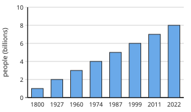

# Geography Form 2, Batch G2-1: drafts for review (Lessons 1–10, Term 1)

Generated by `npm run review:f2-geography` from `content/form-2/geography/*.json`. Every question and drawing below was built by the engine.
All notes, teach cards, worked examples and paper tasks are **status: draft**. “Authored key” means a person fixed the
right answer (see `AUTHORED.md`); “computed by rule” means code worked it out (a formula, a conversion, a spelling rule).

Teach mode: cards (idea + example + 1 level-1 check) → worked example → practice (levels 1–3) → the note as a summary.

## Sample rendered lesson: Lesson 7 in teach mode

### Lesson 7: Practical Work 2 : Population Densities in Cameroon (calculation of the density for the different regions of Cameroon)

**Card c7-1** (draft)

> Density of a region = its population ÷ its area.
>
> _Change thousands to people first: × 1000._  

Check question: `g2-7-calc` · number, level 1 · computed by rule, reused from practice

> The South-West Region has an area of 25 410 km² and about 1500 thousand people. What is its population density, to the nearest whole number?

Answer: **59 people per km²**
- Typed **0.06** (thousands) → “Change thousands to people first (× 1000).”
- Typed **0.02** (upside) → “Divide the population by the area.”

Full working after a second miss:

> Population: 1500 × 1000 = 1 500 000 people.  
> Density: 1 500 000 ÷ 25 410 ≈ 59 people per km².  

**Card c7-2** (draft)

> The West, Littoral and North-West are the most densely populated regions.
>
> _Small areas with many people._  

Check question: `g2-7-most` · multiple choice, level 1 · **authored key**, reused from practice

> Which region has the largest area?

- ◻️ North-West  
  _↳ feedback if chosen: The North-West is small._
- ◻️ Littoral  
  _↳ feedback if chosen: The Littoral is small._
- ◻️ West  
  _↳ feedback if chosen: The West is small._
- ✅ East

Full working after a second miss:

> The East is the largest region.  
> So the answer is “East”.  

**Card c7-3** (draft)

> The East and South are the least densely populated.
>
> _Large forests and few people._  

Check question: `g2-7-least-card` · multiple choice, level 1 · computed by rule

> Which of these two regions is more densely populated: Littoral or East?

- ◻️ East  
  _↳ feedback if chosen: Work out both densities: population ÷ area._
- ✅ Littoral

Full working after a second miss:

> Littoral: 3 400 000 ÷ 20 248 ≈ 168 per km². East: 840 000 ÷ 109 002 ≈ 8 per km².  
> So Littoral is more densely populated.  

**Worked example** (draft)

> The West Region has an area of 13 892 km² and about 1900 thousand people. Calculate its density.

1. Population: 1900 × 1000 = 1 900 000 people.
2. Density: 1 900 000 ÷ 13 892 = 136.8, about 137 people per km².

**Answer:** About 137 people per km²

**Practice** (one generated question per template, easiest first)

Practice 1: `g2-7-calc` · number, level 1 · computed by rule

> The West Region has an area of 13 892 km² and about 1900 thousand people. What is its population density, to the nearest whole number?

Answer: **137 people per km²**
- Typed **0.14** (thousands) → “Change thousands to people first (× 1000).”
- Typed **0.01** (upside) → “Divide the population by the area.”

Full working after a second miss:

> Population: 1900 × 1000 = 1 900 000 people.  
> Density: 1 900 000 ÷ 13 892 ≈ 137 people per km².  

Practice 2: `g2-7-most` · multiple choice, level 1 · **authored key**

> Which region is among the most densely populated?

- ✅ West
- ◻️ Adamawa  
  _↳ feedback if chosen: Adamawa is sparsely populated._
- ◻️ East  
  _↳ feedback if chosen: The East is the least dense._
- ◻️ South  
  _↳ feedback if chosen: The South is sparsely populated._

Full working after a second miss:

> The West has a small area and many people.  
> So the answer is “West”.  

Practice 3: `g2-7-least` · multiple choice, level 2 · computed by rule

> Which of these two regions is more densely populated: South or East?

- ✅ South
- ◻️ East  
  _↳ feedback if chosen: Work out both densities: population ÷ area._

Full working after a second miss:

> South: 750 000 ÷ 47 191 ≈ 16 per km². East: 840 000 ÷ 109 002 ≈ 8 per km².  
> So South is more densely populated.  

Practice 4: `g2-7-rank` · number, level 3 · computed by rule

> The North-West Region is about how many times as densely populated as the South Region? Give a whole number.

Answer: **7**

Full working after a second miss:

> North-West: about 116 per km². South: about 16 per km².  
> 116 ÷ 16 ≈ 7.  

**Summary (the note)**

> Cameroon has ten regions. To compare how crowded they are, calculate each region's population density: population ÷ area.
> Areas are in km². The populations used here are rounded estimates (in thousands) for practice; the latest census figures may differ.
> The West, Littoral and North-West regions are the most densely populated (small areas, many people, fertile highlands, towns and industries). The East and South are the least dense (large forested areas, few people).
> Steps: (1) change the population in thousands to people (× 1000); (2) divide by the area; (3) round to a whole number; (4) rank the regions.

## All drafts

| Lesson | Title (sheet) | Status | Cards | Practice | Paper task |
|---|---|---|---|---|---|
| 1 | (Part 1)- A Rapid Growth of the World’s Population(Historical evolution: Factors for rapid growth; Implications on natural resources | draft | 3 | 4 | — |
| 2 | (Part 2): Implications Rapid Growth of the World's Population on Natural Resources | draft | 3 | 4 | — |
| 3 | Practical Work1 (Part 1): Calculation of the demographic indices (BR) | draft | 3 | 4 | — |
| 4 | Practical Work1 (Part 2): Calculation of the demographic indices (DR & NI) | draft | 3 | 4 | — |
| 5 | (Part 1): Uneven Distribution of World Population (Population density & Spatial distribution) | draft | 3 | 4 | — |
| 6 | (Part 2): Uneven Distribution of World Population (Factors of uneven distribution) | draft | 3 | 4 | — |
| 7 | Practical Work 2 : Population Densities in Cameroon (calculation of the density for the different regions of Cameroon) | draft | 3 | 4 | — |
| 8 | (Part 1): Man in The Equatorial Zone (Location; Climatic characteristics; Resources; methods of exploitation) | draft | 3 | 4 | — |
| 9 | (Part 2): Man in The Equatorial Zone: (Problems faced & Proposed solutions) | draft | 3 | 4 | — |
| 10 | Further Study 1: Deforestation in Cameroon (causes, manifestations,) | draft | 3 | 4 | — |

## Lesson 1: (Part 1)- A Rapid Growth of the World’s Population(Historical evolution: Factors for rapid growth; Implications on natural resources

Prerequisites: none · Skill: g2-1 (The rapid growth of the world's population)

**Note** (draft)

> For most of history the world's population grew slowly. It reached about 1 billion people around 1800, 2 billion around 1927, 3 billion in 1960, 4 billion in 1974, 5 billion in 1987, 6 billion in 1999, 7 billion in 2011 and 8 billion in 2022. This very fast growth is sometimes called the population explosion.
> Factors of rapid growth:
> • falling death rates: better medicine, vaccination, clean water and hygiene;
> • more food: better farming methods and transport;
> • high birth rates in many developing countries: early marriage, the value placed on large families, children helping on farms, little use of family planning;
> • longer life expectancy.
> Today growth is fastest in Africa and slowest in Europe.

**Card c1-1** (draft)

> The world's population grew slowly for centuries, then very fast after about 1900.
>
> _About 1 billion around 1800; about 8 billion in 2022._  

Check question: `g2-1-read` · multiple choice, level 1 · **authored key**, reused from practice

> When did the world reach about 1 billion people?

- ◻️ around the year 1000  
  _↳ feedback if chosen: It was much less then._
- ◻️ around 2011  
  _↳ feedback if chosen: It was 7 billion in 2011._
- ◻️ around 1960  
  _↳ feedback if chosen: It was 3 billion in 1960._
- ✅ around 1800

Full working after a second miss:

> About 1 billion around 1800.  
> So the answer is “around 1800”.  

**Card c1-2** (draft)

> Falling death rates, thanks to medicine, vaccines and clean water, are the main cause of rapid growth.
>
> _More babies survive and people live longer._  

Check question: `g2-1-factor` · multiple choice, level 1 · **authored key**, reused from practice

> Which is a factor of the rapid growth of the world's population?

- ◻️ more wars and famines  
  _↳ feedback if chosen: Wars and famines raise death rates and slow growth._
- ◻️ shorter lives  
  _↳ feedback if chosen: People live longer today._
- ✅ clean water and better hygiene

Full working after a second miss:

> The true statement is “clean water and better hygiene”.  
> “more wars and famines” is false: Wars and famines raise death rates and slow growth.  
> “shorter lives” is false: People live longer today.  

**Card c1-3** (draft)

> High birth rates continue in many developing countries.
>
> _Early marriage and the value of large families keep birth rates high._  

Check question: `g2-1-where-card` · multiple choice, level 1 · **authored key**

> Why do falling death rates make a population grow?

- ◻️ Births stop.  
  _↳ feedback if chosen: Births continue._
- ✅ More people survive while births stay high.
- ◻️ People move to other planets.  
  _↳ feedback if chosen: That is not true._
- ◻️ Fewer babies are born.  
  _↳ feedback if chosen: Births stay high._

Full working after a second miss:

> Births minus deaths gets bigger.  
> So the answer is “More people survive while births stay high.”.  

**Worked example** (draft)

> The world had 3 billion people in 1960 and 6 billion in 1999. How long did it take to double?

1. Doubling: from 3 billion to 6 billion.
2. 1999 − 1960 = 39 years.

**Answer:** 39 years.

**Practice** `g2-1-read` · multiple choice, level 1 · **authored key**

> When did the world reach about 1 billion people?

- ◻️ around 2011  
  _↳ feedback if chosen: It was 7 billion in 2011._
- ✅ around 1800
- ◻️ around 1960  
  _↳ feedback if chosen: It was 3 billion in 1960._
- ◻️ around the year 1000  
  _↳ feedback if chosen: It was much less then._

Full working after a second miss:

> About 1 billion around 1800.  
> So the answer is “around 1800”.  

> About how many people lived in the world in 2022?

- ✅ 8 billion
- ◻️ 1 billion  
  _↳ feedback if chosen: That was around 1800._
- ◻️ 80 million  
  _↳ feedback if chosen: That is far too few._
- ◻️ 3 billion  
  _↳ feedback if chosen: That was in 1960._

Full working after a second miss:

> The world reached 8 billion in 2022.  
> So the answer is “8 billion”.  

**Practice** `g2-1-factor` · multiple choice, level 1 · **authored key**

> Which is a factor of the rapid growth of the world's population?

- ◻️ more wars and famines  
  _↳ feedback if chosen: Wars and famines raise death rates and slow growth._
- ✅ high birth rates in developing countries
- ◻️ fewer babies surviving  
  _↳ feedback if chosen: More babies survive today._

Full working after a second miss:

> The true statement is “high birth rates in developing countries”.  
> “more wars and famines” is false: Wars and famines raise death rates and slow growth.  
> “fewer babies surviving” is false: More babies survive today.  

> Which is a factor of the rapid growth of the world's population?

- ✅ better medicine and vaccination
- ◻️ more wars and famines  
  _↳ feedback if chosen: Wars and famines raise death rates and slow growth._
- ◻️ shorter lives  
  _↳ feedback if chosen: People live longer today._

Full working after a second miss:

> The true statement is “better medicine and vaccination”.  
> “more wars and famines” is false: Wars and famines raise death rates and slow growth.  
> “shorter lives” is false: People live longer today.  

**Practice** `g2-1-where` · multiple choice, level 2 · **authored key**

> Where is the population growing fastest today?

- ✅ Africa
- ◻️ Europe  
  _↳ feedback if chosen: Europe grows slowest._
- ◻️ Australia  
  _↳ feedback if chosen: Growth there is slow._
- ◻️ North America  
  _↳ feedback if chosen: Growth there is slow._

Full working after a second miss:

> Africa has the highest birth rates.  
> So the answer is “Africa”.  

> Where is the population growing fastest today?

- ✅ Africa
- ◻️ Europe  
  _↳ feedback if chosen: Europe grows slowest._
- ◻️ North America  
  _↳ feedback if chosen: Growth there is slow._
- ◻️ Australia  
  _↳ feedback if chosen: Growth there is slow._

Full working after a second miss:

> Africa has the highest birth rates.  
> So the answer is “Africa”.  

**Practice** `g2-1-double` · number, level 3 · computed by rule

> A country's population doubles every 20 years. It has 13 million people today. How many millions will it have in 40 years?

Answer: **52 million**
- Typed **26** (once) → “That is after 20 years. In 40 years it doubles twice.”
- Typed **39** (added) → “Doubling twice multiplies by four, not three.”

Full working after a second miss:

> In 20 years it doubles: 13 × 2 = 26 million.  
> In another 20 years it doubles again: 26 × 2 = 52 million.  

> A country's population doubles every 25 years. It has 15 million people today. How many millions will it have in 50 years?

Answer: **60 million**
- Typed **30** (once) → “That is after 25 years. In 50 years it doubles twice.”
- Typed **45** (added) → “Doubling twice multiplies by four, not three.”

Full working after a second miss:

> In 25 years it doubles: 15 × 2 = 30 million.  
> In another 25 years it doubles again: 30 × 2 = 60 million.  

## Lesson 2: (Part 2): Implications Rapid Growth of the World's Population on Natural Resources

Prerequisites: 1 · Skill: g2-2 (Rapid population growth and natural resources)

**Note** (draft)

> More people need more land, food, water, wood, energy and minerals. Rapid growth puts pressure on natural resources:
> • forests: cleared for farms, firewood and towns (deforestation);
> • soils: overcultivated and overgrazed, so they lose fertility and erode;
> • water: shortages, and rivers polluted by waste;
> • wildlife: hunted and its habitats destroyed;
> • minerals and fuels: used up faster;
> • towns: overcrowding, slums, unemployment.
> Solutions: family planning and education (especially of girls), better farming methods, reforestation, protected areas, recycling, and using resources sustainably (so that future generations still have them).

**Card c2-1** (draft)

> More people need more land, food, water, wood and energy.
>
> _Forests are cleared for farms and firewood._  

Check question: `g2-2-effect` · multiple choice, level 1 · **authored key**, reused from practice

> Which is an effect of rapid population growth on natural resources?

- ◻️ more forest everywhere  
  _↳ feedback if chosen: More people usually means less forest._
- ◻️ cleaner rivers  
  _↳ feedback if chosen: More waste often pollutes rivers._
- ✅ water shortages

Full working after a second miss:

> The true statement is “water shortages”.  
> “more forest everywhere” is false: More people usually means less forest.  
> “cleaner rivers” is false: More waste often pollutes rivers.  

**Card c2-2** (draft)

> Overuse damages soils, water and wildlife.
>
> _Overgrazing leaves bare soil that erodes._  

Check question: `g2-2-match` · matching, level 1 · **authored key**, reused from practice

> Match each resource to the pressure on it.

Right-hand side (shuffled): shortages and pollution · hunting and loss of habitat · overcultivated and overgrazed · used up faster
- water → **shortages and pollution**
- soil → **overcultivated and overgrazed**
- minerals → **used up faster**
- wildlife → **hunting and loss of habitat**

Full working after a second miss:

> The right pairs are:  
> water → shortages and pollution  
> soil → overcultivated and overgrazed  
> minerals → used up faster  
> wildlife → hunting and loss of habitat  

**Card c2-3** (draft)

> Solutions include family planning, better farming, reforestation and sustainable use.
>
> _Plant trees to replace those cut down._  

Check question: `g2-2-solve-card` · multiple choice, level 1 · **authored key**

> Which is a solution to the pressure on forests?

- ◻️ more logging roads  
  _↳ feedback if chosen: That opens more forest to logging._
- ◻️ burning the bush  
  _↳ feedback if chosen: That destroys forest._
- ◻️ cutting more trees  
  _↳ feedback if chosen: That worsens it._
- ✅ reforestation (planting trees)

Full working after a second miss:

> Replanting replaces lost trees.  
> So the answer is “reforestation (planting trees)”.  

**Worked example** (draft)

> Explain two effects on natural resources in a village whose population has doubled.

1. More land is needed for farms, so forest is cleared (deforestation).
2. Farms are used every year without rest, so the soil loses its fertility and erodes.

**Answer:** Deforestation and soil exhaustion (also water shortage, fuelwood scarcity).

**Practice** `g2-2-effect` · multiple choice, level 1 · **authored key**

> Which is an effect of rapid population growth on natural resources?

- ◻️ cleaner rivers  
  _↳ feedback if chosen: More waste often pollutes rivers._
- ✅ water shortages
- ◻️ more forest everywhere  
  _↳ feedback if chosen: More people usually means less forest._

Full working after a second miss:

> The true statement is “water shortages”.  
> “cleaner rivers” is false: More waste often pollutes rivers.  
> “more forest everywhere” is false: More people usually means less forest.  

> Which is an effect of rapid population growth on natural resources?

- ✅ forests cleared for farms
- ◻️ cleaner rivers  
  _↳ feedback if chosen: More waste often pollutes rivers._
- ◻️ more forest everywhere  
  _↳ feedback if chosen: More people usually means less forest._

Full working after a second miss:

> The true statement is “forests cleared for farms”.  
> “cleaner rivers” is false: More waste often pollutes rivers.  
> “more forest everywhere” is false: More people usually means less forest.  

**Practice** `g2-2-match` · matching, level 1 · **authored key**

> Match each resource to the pressure on it.

Right-hand side (shuffled): hunting and loss of habitat · used up faster · cut for farms and firewood · overcultivated and overgrazed
- wildlife → **hunting and loss of habitat**
- soil → **overcultivated and overgrazed**
- minerals → **used up faster**
- forest → **cut for farms and firewood**

Full working after a second miss:

> The right pairs are:  
> wildlife → hunting and loss of habitat  
> soil → overcultivated and overgrazed  
> minerals → used up faster  
> forest → cut for farms and firewood  

> Match each resource to the pressure on it.

Right-hand side (shuffled): shortages and pollution · hunting and loss of habitat · overcultivated and overgrazed · cut for farms and firewood
- wildlife → **hunting and loss of habitat**
- forest → **cut for farms and firewood**
- water → **shortages and pollution**
- soil → **overcultivated and overgrazed**

Full working after a second miss:

> The right pairs are:  
> wildlife → hunting and loss of habitat  
> forest → cut for farms and firewood  
> water → shortages and pollution  
> soil → overcultivated and overgrazed  

**Practice** `g2-2-solve` · multiple choice, level 2 · **authored key**

> Which is a solution to the pressure on forests?

- ◻️ more logging roads  
  _↳ feedback if chosen: That opens more forest to logging._
- ◻️ burning the bush  
  _↳ feedback if chosen: That destroys forest._
- ◻️ cutting more trees  
  _↳ feedback if chosen: That worsens it._
- ✅ reforestation (planting trees)

Full working after a second miss:

> Replanting replaces lost trees.  
> So the answer is “reforestation (planting trees)”.  

> Which is a solution to the pressure on forests?

- ◻️ burning the bush  
  _↳ feedback if chosen: That destroys forest._
- ◻️ more logging roads  
  _↳ feedback if chosen: That opens more forest to logging._
- ◻️ cutting more trees  
  _↳ feedback if chosen: That worsens it._
- ✅ reforestation (planting trees)

Full working after a second miss:

> Replanting replaces lost trees.  
> So the answer is “reforestation (planting trees)”.  

**Practice** `g2-2-spot` · spot the error, level 3 · **authored key**

> Which statement is wrong?

- ◻️ Rapid growth increases pressure on forests.
- ◻️ Family planning can slow population growth.
- ✅ More people means less need for water.  
  _↳ explanation: More people need more water._
- ◻️ Reforestation helps replace lost trees.

Full working after a second miss:

> The wrong statement is “More people means less need for water.”.  
> More people need more water.  

> Which statement is wrong?

- ◻️ Reforestation helps replace lost trees.
- ◻️ Family planning can slow population growth.
- ✅ More people means less need for water.  
  _↳ explanation: More people need more water._
- ◻️ Rapid growth increases pressure on forests.

Full working after a second miss:

> The wrong statement is “More people means less need for water.”.  
> More people need more water.  

## Lesson 3: Practical Work1 (Part 1): Calculation of the demographic indices (BR)

Prerequisites: 1 · Skill: g2-3 (Practical work 1: calculating the birth rate)

**Note** (draft)

> Demographic indices describe a population with numbers.
> The crude birth rate (BR) is the number of live births in a year for every 1000 people:
> BR = (number of births ÷ total population) × 1000. It is written in ‰ (per thousand).
> Example: a town of 50 000 people had 2000 births in a year. BR = 2000 ÷ 50 000 × 1000 = 40 ‰.
> Birth rates above 30 ‰ are high (many African countries); below 15 ‰ are low (Europe).
> Steps: (1) divide the births by the population; (2) multiply by 1000; (3) write ‰.

**Card c3-1** (draft)

> The birth rate is births per thousand people in a year.
>
> _BR = births ÷ population × 1000._  

Check question: `g2-3-br` · number, level 1 · computed by rule, reused from practice

> A village of 25 000 people had 400 births in a year. What is its birth rate (in ‰)?

Answer: **16 ‰**
- Typed **0.016** (no-thousand) → “Multiply by 1000 to get births per thousand.”
- Typed **1.6** (percent) → “Per thousand: multiply by 1000, not 100.”

Full working after a second miss:

> BR = births ÷ population × 1000.  
> 400 ÷ 25 000 × 1000 = 16 ‰.  

**Card c3-2** (draft)

> Multiply by a thousand and write ‰ (per thousand).
>
> _600 births, 20 000 people: 600 ÷ 20 000 × 1000 = 30 ‰._  

Check question: `g2-3-births-card` · number, level 1 · computed by rule

> A town has 10 000 people and a birth rate of 19 ‰. How many babies were born there in the year?

Answer: **190 births**
- Typed **190 000** (times) → “Divide by 1000: the rate is per thousand.”

Full working after a second miss:

> Births = BR × population ÷ 1000.  
> 19 × 10 000 ÷ 1000 = 190.  

**Card c3-3** (draft)

> Above about 30 ‰ is a high birth rate; below about 15 ‰ is low.
>
> _Many African countries: high._  
> _European countries: low._  

Check question: `g2-3-level` · multiple choice, level 1 · computed by rule, reused from practice

> A country has a birth rate of 9 ‰. Is this high or low?

- ◻️ high  
  _↳ feedback if chosen: Compare 9 ‰ with about 30 ‰ (high) and 15 ‰ (low)._
- ✅ low

Full working after a second miss:

> Above about 30 ‰ is high; below about 15 ‰ is low.  
> 9 ‰ is low.  

**Worked example** (draft)

> A town of 45 000 people recorded 1800 births last year. Calculate its birth rate.

1. Divide the births by the population: 1800 ÷ 45 000 = 0.04.
2. Multiply by 1000: 0.04 × 1000 = 40.

**Answer:** BR = 40 ‰

**Practice** `g2-3-br` · number, level 1 · computed by rule

> A village of 50 000 people had 1950 births in a year. What is its birth rate (in ‰)?

Answer: **39 ‰**
- Typed **0.039** (no-thousand) → “Multiply by 1000 to get births per thousand.”
- Typed **3.9** (percent) → “Per thousand: multiply by 1000, not 100.”

Full working after a second miss:

> BR = births ÷ population × 1000.  
> 1950 ÷ 50 000 × 1000 = 39 ‰.  

> A village of 25 000 people had 1100 births in a year. What is its birth rate (in ‰)?

Answer: **44 ‰**
- Typed **0.044** (no-thousand) → “Multiply by 1000 to get births per thousand.”
- Typed **4.4** (percent) → “Per thousand: multiply by 1000, not 100.”

Full working after a second miss:

> BR = births ÷ population × 1000.  
> 1100 ÷ 25 000 × 1000 = 44 ‰.  

**Practice** `g2-3-level` · multiple choice, level 1 · computed by rule

> A country has a birth rate of 42 ‰. Is this high or low?

- ◻️ low  
  _↳ feedback if chosen: Compare 42 ‰ with about 30 ‰ (high) and 15 ‰ (low)._
- ✅ high

Full working after a second miss:

> Above about 30 ‰ is high; below about 15 ‰ is low.  
> 42 ‰ is high.  

> A country has a birth rate of 45 ‰. Is this high or low?

- ◻️ low  
  _↳ feedback if chosen: Compare 45 ‰ with about 30 ‰ (high) and 15 ‰ (low)._
- ✅ high

Full working after a second miss:

> Above about 30 ‰ is high; below about 15 ‰ is low.  
> 45 ‰ is high.  

**Practice** `g2-3-births` · number, level 2 · computed by rule

> A town has 80 000 people and a birth rate of 31 ‰. How many babies were born there in the year?

Answer: **2480 births**
- Typed **2 480 000** (times) → “Divide by 1000: the rate is per thousand.”

Full working after a second miss:

> Births = BR × population ÷ 1000.  
> 31 × 80 000 ÷ 1000 = 2480.  

> A town has 10 000 people and a birth rate of 36 ‰. How many babies were born there in the year?

Answer: **360 births**
- Typed **360 000** (times) → “Divide by 1000: the rate is per thousand.”

Full working after a second miss:

> Births = BR × population ÷ 1000.  
> 36 × 10 000 ÷ 1000 = 360.  

**Practice** `g2-3-compare` · number, level 3 · computed by rule

> Town A has 20 000 people and 800 births; town B has 10 000 people and 220 births. By how many ‰ is A's birth rate higher than B's?

Answer: **18 ‰**
- Typed **580** (births) → “Compare the rates, not the numbers of births.”

Full working after a second miss:

> A: 800 ÷ 20 000 × 1000 = 40 ‰. B: 220 ÷ 10 000 × 1000 = 22 ‰.  
> Difference: 40 − 22 = 18 ‰.  

> Town A has 40 000 people and 1680 births; town B has 25 000 people and 575 births. By how many ‰ is A's birth rate higher than B's?

Answer: **19 ‰**
- Typed **1105** (births) → “Compare the rates, not the numbers of births.”

Full working after a second miss:

> A: 1680 ÷ 40 000 × 1000 = 42 ‰. B: 575 ÷ 25 000 × 1000 = 23 ‰.  
> Difference: 42 − 23 = 19 ‰.  

## Lesson 4: Practical Work1 (Part 2): Calculation of the demographic indices (DR & NI)

Prerequisites: 3 · Skill: g2-4 (Practical work 1: death rate and natural increase)

**Note** (draft)

> The crude death rate (DR) is the number of deaths in a year for every 1000 people: DR = (deaths ÷ population) × 1000, in ‰.
> The rate of natural increase (NI) is the birth rate minus the death rate: NI = BR − DR, in ‰. Divide by 10 to give it as a percentage: 25 ‰ = 2.5 %.
> Natural increase in numbers = births − deaths (migration is not counted).
> If BR is greater than DR the population grows; if they are equal it stays the same; if DR is greater it falls (natural decrease).
> Example: BR = 38 ‰, DR = 12 ‰, so NI = 26 ‰ = 2.6 % a year.

**Card c4-1** (draft)

> The death rate is deaths per thousand people in a year.
>
> _300 deaths, 25 000 people: 300 ÷ 25 000 × 1000 = 12 ‰._  

Check question: `g2-4-dr` · number, level 1 · computed by rule, reused from practice

> A town of 25 000 people had 375 deaths in a year. What is its death rate (in ‰)?

Answer: **15 ‰**
- Typed **0.015** (no-thousand) → “Multiply by 1000 to get deaths per thousand.”

Full working after a second miss:

> DR = deaths ÷ population × 1000.  
> 375 ÷ 25 000 × 1000 = 15 ‰.  

**Card c4-2** (draft)

> Natural increase = birth rate − death rate.
>
> _40 ‰ − 15 ‰ = 25 ‰._  

Check question: `g2-4-ni` · number, level 1 · computed by rule, reused from practice

> A country has BR = 46 ‰ and DR = 17 ‰. What is its rate of natural increase (in ‰)?

Answer: **29 ‰**
- Typed **63** (added) → “Natural increase is births minus deaths: subtract.”
- Typed **−29** (reversed) → “Subtract the death rate from the birth rate.”

Full working after a second miss:

> NI = BR − DR.  
> 46 − 17 = 29 ‰.  

**Card c4-3** (draft)

> Divide a rate in ‰ by ten to give it as a percentage.
>
> _25 ‰ = 2.5 %._  

Check question: `g2-4-percent-card` · number, level 1 · computed by rule

> A country's rate of natural increase is 24 ‰. What is it as a percentage?

Answer: **2.4 %**
- Typed **240** (times) → “Divide by 10: a percentage is per hundred.”

Full working after a second miss:

> Divide by 10.  
> 24 ÷ 10 = 2.4 %.  

**Worked example** (draft)

> A country has a birth rate of 38 ‰ and a death rate of 12 ‰. Find its rate of natural increase in ‰ and in %.

1. NI = BR − DR = 38 − 12 = 26 ‰.
2. As a percentage: 26 ÷ 10 = 2.6 %.

**Answer:** 26 ‰, or 2.6 %

**Practice** `g2-4-dr` · number, level 1 · computed by rule

> A town of 50 000 people had 400 deaths in a year. What is its death rate (in ‰)?

Answer: **8 ‰**
- Typed **0.008** (no-thousand) → “Multiply by 1000 to get deaths per thousand.”

Full working after a second miss:

> DR = deaths ÷ population × 1000.  
> 400 ÷ 50 000 × 1000 = 8 ‰.  

> A town of 5000 people had 75 deaths in a year. What is its death rate (in ‰)?

Answer: **15 ‰**
- Typed **0.015** (no-thousand) → “Multiply by 1000 to get deaths per thousand.”

Full working after a second miss:

> DR = deaths ÷ population × 1000.  
> 75 ÷ 5000 × 1000 = 15 ‰.  

**Practice** `g2-4-ni` · number, level 1 · computed by rule

> A country has BR = 40 ‰ and DR = 6 ‰. What is its rate of natural increase (in ‰)?

Answer: **34 ‰**
- Typed **46** (added) → “Natural increase is births minus deaths: subtract.”
- Typed **−34** (reversed) → “Subtract the death rate from the birth rate.”

Full working after a second miss:

> NI = BR − DR.  
> 40 − 6 = 34 ‰.  

> A country has BR = 18 ‰ and DR = 18 ‰. What is its rate of natural increase (in ‰)?

Answer: **0 ‰**
- Typed **36** (added) → “Natural increase is births minus deaths: subtract.”

Full working after a second miss:

> NI = BR − DR.  
> 18 − 18 = 0 ‰.  

**Practice** `g2-4-percent` · number, level 2 · computed by rule

> A country's rate of natural increase is 26 ‰. What is it as a percentage?

Answer: **2.6 %**
- Typed **260** (times) → “Divide by 10: a percentage is per hundred.”

Full working after a second miss:

> Divide by 10.  
> 26 ÷ 10 = 2.6 %.  

> A country's rate of natural increase is 12 ‰. What is it as a percentage?

Answer: **1.2 %**
- Typed **120** (times) → “Divide by 10: a percentage is per hundred.”

Full working after a second miss:

> Divide by 10.  
> 12 ÷ 10 = 1.2 %.  

**Practice** `g2-4-full` · number, level 3 · computed by rule

> A town of 25 000 people had 725 births and 450 deaths in a year. What is its rate of natural increase (in ‰)?

Answer: **11 ‰**
- Typed **275** (numbers) → “That is the increase in people; give it per thousand.”

Full working after a second miss:

> BR = 725 ÷ 25 000 × 1000 = 29 ‰; DR = 450 ÷ 25 000 × 1000 = 18 ‰.  
> NI = 29 − 18 = 11 ‰.  

> A town of 25 000 people had 550 births and 250 deaths in a year. What is its rate of natural increase (in ‰)?

Answer: **12 ‰**
- Typed **300** (numbers) → “That is the increase in people; give it per thousand.”

Full working after a second miss:

> BR = 550 ÷ 25 000 × 1000 = 22 ‰; DR = 250 ÷ 25 000 × 1000 = 10 ‰.  
> NI = 22 − 10 = 12 ‰.  

## Lesson 5: (Part 1): Uneven Distribution of World Population (Population density & Spatial distribution)

Prerequisites: 1 · Skill: g2-5 (Uneven distribution of the world's population: density)

**Note** (draft)

> People are not spread evenly over the Earth. Population density is the average number of people per square kilometre:
> density = population ÷ area (people per km²).
> Densely populated areas: East Asia (eastern China, Japan), South Asia (India, Bangladesh), Western Europe, the north-east of the USA, the Nile valley, the coast of West Africa (southern Nigeria).
> Sparsely populated areas: hot deserts (Sahara), cold lands (Greenland, Siberia, Antarctica, which has no permanent population), high mountains, dense equatorial forests (Amazon, Congo basin).
> Most people live in the Northern Hemisphere and less than a third of the land holds most of the people.

**Card c5-1** (draft)

> Population density = population ÷ area, in people per km².
>
> _50 000 people on 500 km²: 100 per km²._  

Check question: `g2-5-density` · number, level 1 · computed by rule, reused from practice

> An area of 1000 km² has 147 000 people. What is its population density (people per km²)?

Answer: **147 people per km²**
- Typed **0.006802721** (upside) → “Divide the population by the area, not the area by the population.”
- Typed **147 000 000** (times) → “Divide, do not multiply.”

Full working after a second miss:

> Density = population ÷ area.  
> 147 000 ÷ 1000 = 147 per km².  

**Card c5-2** (draft)

> Dense areas: East and South Asia, Western Europe, the Nile valley.
>
> _Bangladesh is one of the most densely populated countries._  

Check question: `g2-5-where` · matching, level 1 · **authored key**, reused from practice

> Sort the areas: densely or sparsely populated?

Groups: dense · sparse
- the Nile valley → **dense**
- Greenland → **sparse**
- Antarctica → **sparse**
- the Amazon forest → **sparse**

Full working after a second miss:

> The right pairs are:  
> the Nile valley → dense  
> Greenland → sparse  
> Antarctica → sparse  
> the Amazon forest → sparse  

**Card c5-3** (draft)

> Sparse areas: deserts, cold lands, high mountains, dense equatorial forests.
>
> _The Sahara and Greenland have very few people._  

Check question: `g2-5-sparse-card` · multiple choice, level 1 · **authored key**

> Which hemisphere holds most of the world's people?

- ✅ the Northern Hemisphere
- ◻️ the Southern Hemisphere  
  _↳ feedback if chosen: It holds far fewer._
- ◻️ both equally  
  _↳ feedback if chosen: Most live in the north._
- ◻️ neither  
  _↳ feedback if chosen: Most live in the north._

Full working after a second miss:

> Most land and most people are north of the equator.  
> So the answer is “the Northern Hemisphere”.  

**Worked example** (draft)

> A district has 600 000 people and an area of 4000 km². What is its population density?

1. Density = population ÷ area.
2. 600 000 ÷ 4000 = 150 people per km².

**Answer:** 150 people per km²

**Practice** `g2-5-density` · number, level 1 · computed by rule

> An area of 250 km² has 25 250 people. What is its population density (people per km²)?

Answer: **101 people per km²**
- Typed **0.00990099** (upside) → “Divide the population by the area, not the area by the population.”
- Typed **6 312 500** (times) → “Divide, do not multiply.”

Full working after a second miss:

> Density = population ÷ area.  
> 25 250 ÷ 250 = 101 per km².  

> An area of 500 km² has 111 000 people. What is its population density (people per km²)?

Answer: **222 people per km²**
- Typed **0.004504505** (upside) → “Divide the population by the area, not the area by the population.”
- Typed **55 500 000** (times) → “Divide, do not multiply.”

Full working after a second miss:

> Density = population ÷ area.  
> 111 000 ÷ 500 = 222 per km².  

**Practice** `g2-5-where` · matching, level 1 · **authored key**

> Sort the areas: densely or sparsely populated?

Groups: dense · sparse
- Greenland → **sparse**
- the Sahara → **sparse**
- the Nile valley → **dense**
- eastern China → **dense**

Full working after a second miss:

> The right pairs are:  
> Greenland → sparse  
> the Sahara → sparse  
> the Nile valley → dense  
> eastern China → dense  

> Sort the areas: densely or sparsely populated?

Groups: dense · sparse
- the Nile valley → **dense**
- Western Europe → **dense**
- Bangladesh → **dense**
- Greenland → **sparse**

Full working after a second miss:

> The right pairs are:  
> the Nile valley → dense  
> Western Europe → dense  
> Bangladesh → dense  
> Greenland → sparse  

**Practice** `g2-5-pop` · number, level 2 · computed by rule

> A district has a density of 87 people per km² and an area of 1200 km². How many people live there?

Answer: **104 400 people**
- Typed **0.0725** (divide) → “Population = density × area: multiply.”

Full working after a second miss:

> Population = density × area.  
> 87 × 1200 = 104 400 people.  

> A district has a density of 62 people per km² and an area of 1200 km². How many people live there?

Answer: **74 400 people**
- Typed **0.051666667** (divide) → “Population = density × area: multiply.”

Full working after a second miss:

> Population = density × area.  
> 62 × 1200 = 74 400 people.  

**Practice** `g2-5-sparse` · multiple choice, level 3 · **authored key**

> Which hemisphere holds most of the world's people?

- ◻️ the Southern Hemisphere  
  _↳ feedback if chosen: It holds far fewer._
- ◻️ both equally  
  _↳ feedback if chosen: Most live in the north._
- ✅ the Northern Hemisphere
- ◻️ neither  
  _↳ feedback if chosen: Most live in the north._

Full working after a second miss:

> Most land and most people are north of the equator.  
> So the answer is “the Northern Hemisphere”.  

> Which hemisphere holds most of the world's people?

- ◻️ the Southern Hemisphere  
  _↳ feedback if chosen: It holds far fewer._
- ◻️ neither  
  _↳ feedback if chosen: Most live in the north._
- ◻️ both equally  
  _↳ feedback if chosen: Most live in the north._
- ✅ the Northern Hemisphere

Full working after a second miss:

> Most land and most people are north of the equator.  
> So the answer is “the Northern Hemisphere”.  

## Lesson 6: (Part 2): Uneven Distribution of World Population (Factors of uneven distribution)

Prerequisites: 5 · Skill: g2-6 (Factors of the uneven distribution of population)

**Note** (draft)

> Physical factors:
> • relief: lowlands and gentle slopes attract people; steep, high mountains repel them;
> • climate: mild climates with enough rain attract; very hot, very cold or very dry climates repel;
> • soils: fertile soils (river valleys, volcanic soils such as on Mount Cameroon) attract farmers;
> • water: rivers, lakes and springs attract people;
> • vegetation and diseases: dense forests and areas with tsetse flies or malaria repel.
> Human factors:
> • economic activities: mines, industries, ports, plantations and trade attract people;
> • towns, roads and services (schools, hospitals);
> • history and politics: wars push people away; government policies can move people.

**Card c6-1** (draft)

> Physical factors: relief, climate, soils, water, vegetation and diseases.
>
> _Fertile volcanic soils attract farmers._  

Check question: `g2-6-sort` · matching, level 1 · **authored key**, reused from practice

> Sort the factors: does each attract or repel people?

Groups: attracts people · repels people
- areas with tsetse flies and disease → **repels people**
- a mild climate with enough rain → **attracts people**
- hot desert with little water → **repels people**
- mines and industries → **attracts people**

Full working after a second miss:

> The right pairs are:  
> areas with tsetse flies and disease → repels people  
> a mild climate with enough rain → attracts people  
> hot desert with little water → repels people  
> mines and industries → attracts people  

**Card c6-2** (draft)

> Human factors: jobs in mines, industries, ports and plantations; towns and services.
>
> _Douala grew around its port and industries._  

Check question: `g2-6-kind` · matching, level 1 · **authored key**, reused from practice

> Sort the factors: physical or human?

Groups: physical · human
- soils → **physical**
- roads and ports → **human**
- water supply → **physical**
- industries → **human**

Full working after a second miss:

> The right pairs are:  
> soils → physical  
> roads and ports → human  
> water supply → physical  
> industries → human  

**Card c6-3** (draft)

> Wars and government policies can also move people.
>
> _People flee areas of conflict._  

Check question: `g2-6-case-card` · multiple choice, level 1 · **authored key**

> Why is Douala densely populated?

- ✅ Its port and industries give many jobs.
- ◻️ It has steep mountains.  
  _↳ feedback if chosen: It is on a coastal plain._
- ◻️ It is a desert.  
  _↳ feedback if chosen: It is not a desert._
- ◻️ It is very cold.  
  _↳ feedback if chosen: Douala is hot and humid._

Full working after a second miss:

> Economic activity attracts people.  
> So the answer is “Its port and industries give many jobs.”.  

**Worked example** (draft)

> Give two reasons why the Mount Cameroon area is densely populated.

1. Physical: the volcanic soils are very fertile, good for farming.
2. Human: plantations (tea, rubber, oil palm, bananas) and towns such as Buea and Limbe give jobs.

**Answer:** Fertile volcanic soils; plantations and towns give jobs.

**Practice** `g2-6-sort` · matching, level 1 · **authored key**

> Sort the factors: does each attract or repel people?

Groups: attracts people · repels people
- steep, high mountains → **repels people**
- good roads and ports → **attracts people**
- very cold climate → **repels people**
- flat, fertile river valleys → **attracts people**

Full working after a second miss:

> The right pairs are:  
> steep, high mountains → repels people  
> good roads and ports → attracts people  
> very cold climate → repels people  
> flat, fertile river valleys → attracts people  

> Sort the factors: does each attract or repel people?

Groups: attracts people · repels people
- hot desert with little water → **repels people**
- areas with tsetse flies and disease → **repels people**
- very cold climate → **repels people**
- a mild climate with enough rain → **attracts people**

Full working after a second miss:

> The right pairs are:  
> hot desert with little water → repels people  
> areas with tsetse flies and disease → repels people  
> very cold climate → repels people  
> a mild climate with enough rain → attracts people  

**Practice** `g2-6-kind` · matching, level 1 · **authored key**

> Sort the factors: physical or human?

Groups: physical · human
- schools and hospitals → **human**
- relief → **physical**
- soils → **physical**
- industries → **human**

Full working after a second miss:

> The right pairs are:  
> schools and hospitals → human  
> relief → physical  
> soils → physical  
> industries → human  

> Sort the factors: physical or human?

Groups: physical · human
- industries → **human**
- government policy → **human**
- soils → **physical**
- climate → **physical**

Full working after a second miss:

> The right pairs are:  
> industries → human  
> government policy → human  
> soils → physical  
> climate → physical  

**Practice** `g2-6-case` · multiple choice, level 2 · **authored key**

> Why is much of the East Region of Cameroon sparsely populated?

- ◻️ It is a cold desert.  
  _↳ feedback if chosen: It is hot and wet._
- ◻️ It has the biggest port.  
  _↳ feedback if chosen: The port is Douala._
- ✅ It is covered by dense equatorial forest with few roads.
- ◻️ It is full of factories.  
  _↳ feedback if chosen: It has few industries._

Full working after a second miss:

> Dense forest and poor communications repel people.  
> So the answer is “It is covered by dense equatorial forest with few roads.”.  

> Why is much of the East Region of Cameroon sparsely populated?

- ◻️ It is full of factories.  
  _↳ feedback if chosen: It has few industries._
- ◻️ It has the biggest port.  
  _↳ feedback if chosen: The port is Douala._
- ◻️ It is a cold desert.  
  _↳ feedback if chosen: It is hot and wet._
- ✅ It is covered by dense equatorial forest with few roads.

Full working after a second miss:

> Dense forest and poor communications repel people.  
> So the answer is “It is covered by dense equatorial forest with few roads.”.  

**Practice** `g2-6-spot` · spot the error, level 3 · **authored key**

> Which statement is wrong?

- ✅ Steep high mountains attract dense populations.  
  _↳ explanation: They usually repel people._
- ◻️ Wars push people away.
- ◻️ Very dry deserts repel people.
- ◻️ Industries attract workers.

Full working after a second miss:

> The wrong statement is “Steep high mountains attract dense populations.”.  
> They usually repel people.  

> Which statement is wrong?

- ◻️ Wars push people away.
- ◻️ Industries attract workers.
- ◻️ Very dry deserts repel people.
- ✅ Good roads repel people.  
  _↳ explanation: Good roads attract people._

Full working after a second miss:

> The wrong statement is “Good roads repel people.”.  
> Good roads attract people.  

## Lesson 7: Practical Work 2 : Population Densities in Cameroon (calculation of the density for the different regions of Cameroon)

Prerequisites: 5 · Skill: g2-7 (Practical work 2: population densities of Cameroon's regions)

**Note** (draft)

> Cameroon has ten regions. To compare how crowded they are, calculate each region's population density: population ÷ area.
> Areas are in km². The populations used here are rounded estimates (in thousands) for practice; the latest census figures may differ.
> The West, Littoral and North-West regions are the most densely populated (small areas, many people, fertile highlands, towns and industries). The East and South are the least dense (large forested areas, few people).
> Steps: (1) change the population in thousands to people (× 1000); (2) divide by the area; (3) round to a whole number; (4) rank the regions.

**Card c7-1** (draft)

> Density of a region = its population ÷ its area.
>
> _Change thousands to people first: × 1000._  

Check question: `g2-7-calc` · number, level 1 · computed by rule, reused from practice

> The Adamawa Region has an area of 63 701 km² and about 1200 thousand people. What is its population density, to the nearest whole number?

Answer: **19 people per km²**
- Typed **0.02** (thousands) → “Change thousands to people first (× 1000).”
- Typed **0.05** (upside) → “Divide the population by the area.”

Full working after a second miss:

> Population: 1200 × 1000 = 1 200 000 people.  
> Density: 1 200 000 ÷ 63 701 ≈ 19 people per km².  

**Card c7-2** (draft)

> The West, Littoral and North-West are the most densely populated regions.
>
> _Small areas with many people._  

Check question: `g2-7-most` · multiple choice, level 1 · **authored key**, reused from practice

> Which region has the largest area?

- ◻️ West  
  _↳ feedback if chosen: The West is small._
- ✅ East
- ◻️ North-West  
  _↳ feedback if chosen: The North-West is small._
- ◻️ Littoral  
  _↳ feedback if chosen: The Littoral is small._

Full working after a second miss:

> The East is the largest region.  
> So the answer is “East”.  

**Card c7-3** (draft)

> The East and South are the least densely populated.
>
> _Large forests and few people._  

Check question: `g2-7-least-card` · multiple choice, level 1 · computed by rule

> Which of these two regions is more densely populated: Far North or Centre?

- ✅ Far North
- ◻️ Centre  
  _↳ feedback if chosen: Work out both densities: population ÷ area._

Full working after a second miss:

> Far North: 4 000 000 ÷ 34 263 ≈ 117 per km². Centre: 4 200 000 ÷ 68 953 ≈ 61 per km².  
> So Far North is more densely populated.  

**Worked example** (draft)

> The West Region has an area of 13 892 km² and about 1900 thousand people. Calculate its density.

1. Population: 1900 × 1000 = 1 900 000 people.
2. Density: 1 900 000 ÷ 13 892 = 136.8, about 137 people per km².

**Answer:** About 137 people per km²

**Practice** `g2-7-calc` · number, level 1 · computed by rule

> The North Region has an area of 66 090 km² and about 2400 thousand people. What is its population density, to the nearest whole number?

Answer: **36 people per km²**
- Typed **0.04** (thousands) → “Change thousands to people first (× 1000).”
- Typed **0.03** (upside) → “Divide the population by the area.”

Full working after a second miss:

> Population: 2400 × 1000 = 2 400 000 people.  
> Density: 2 400 000 ÷ 66 090 ≈ 36 people per km².  

> The North Region has an area of 66 090 km² and about 2400 thousand people. What is its population density, to the nearest whole number?

Answer: **36 people per km²**
- Typed **0.04** (thousands) → “Change thousands to people first (× 1000).”
- Typed **0.03** (upside) → “Divide the population by the area.”

Full working after a second miss:

> Population: 2400 × 1000 = 2 400 000 people.  
> Density: 2 400 000 ÷ 66 090 ≈ 36 people per km².  

**Practice** `g2-7-most` · multiple choice, level 1 · **authored key**

> Which region is among the most densely populated?

- ◻️ East  
  _↳ feedback if chosen: The East is the least dense._
- ✅ West
- ◻️ South  
  _↳ feedback if chosen: The South is sparsely populated._
- ◻️ Adamawa  
  _↳ feedback if chosen: Adamawa is sparsely populated._

Full working after a second miss:

> The West has a small area and many people.  
> So the answer is “West”.  

> Which region has the largest area?

- ◻️ Littoral  
  _↳ feedback if chosen: The Littoral is small._
- ◻️ West  
  _↳ feedback if chosen: The West is small._
- ◻️ North-West  
  _↳ feedback if chosen: The North-West is small._
- ✅ East

Full working after a second miss:

> The East is the largest region.  
> So the answer is “East”.  

**Practice** `g2-7-least` · multiple choice, level 2 · computed by rule

> Which of these two regions is more densely populated: Littoral or Centre?

- ✅ Littoral
- ◻️ Centre  
  _↳ feedback if chosen: Work out both densities: population ÷ area._

Full working after a second miss:

> Littoral: 3 400 000 ÷ 20 248 ≈ 168 per km². Centre: 4 200 000 ÷ 68 953 ≈ 61 per km².  
> So Littoral is more densely populated.  

> Which of these two regions is more densely populated: Littoral or Adamawa?

- ✅ Littoral
- ◻️ Adamawa  
  _↳ feedback if chosen: Work out both densities: population ÷ area._

Full working after a second miss:

> Littoral: 3 400 000 ÷ 20 248 ≈ 168 per km². Adamawa: 1 200 000 ÷ 63 701 ≈ 19 per km².  
> So Littoral is more densely populated.  

**Practice** `g2-7-rank` · number, level 3 · computed by rule

> The West Region is about how many times as densely populated as the South Region? Give a whole number.

Answer: **9**

Full working after a second miss:

> West: about 137 per km². South: about 16 per km².  
> 137 ÷ 16 ≈ 9.  

> The Littoral Region is about how many times as densely populated as the Adamawa Region? Give a whole number.

Answer: **9**

Full working after a second miss:

> Littoral: about 168 per km². Adamawa: about 19 per km².  
> 168 ÷ 19 ≈ 9.  

## Lesson 8: (Part 1): Man in The Equatorial Zone (Location; Climatic characteristics; Resources; methods of exploitation)

Prerequisites: none · Skill: g2-8 (Man in the equatorial zone: location, climate and resources)

**Note** (draft)

> Location: the equatorial zone lies within about 5° to 10° north and south of the equator: the Congo basin (including southern Cameroon), the coast of West Africa, the Amazon basin, and South-East Asia (Indonesia, Malaysia).
> Climate: hot all year (about 26–27 °C), with a very small annual range of temperature (2–3 °C); heavy rain all year (over 1500–2000 mm), mostly convectional rain in the afternoons, with two peaks; high humidity.
> Natural vegetation: dense evergreen rainforest with tall trees in layers.
> Resources: timber (mahogany, ebony, iroko, sapele), cash crops (cocoa, coffee, oil palm, rubber, bananas), food crops (cassava, plantains, cocoyams), minerals (oil, iron ore, gold), wildlife and rivers.
> Methods of exploitation: lumbering, plantation agriculture, shifting cultivation and bush fallowing, hunting and gathering (the Baka and other forest peoples), mining.

**Card c8-1** (draft)

> The equatorial zone lies near the equator: the Congo basin, the Amazon, South-East Asia.
>
> _Southern Cameroon is in the equatorial zone._  

Check question: `g2-8-where` · multiple choice, level 1 · **authored key**, reused from practice

> Which of these areas is in the equatorial zone?

- ◻️ Greenland  
  _↳ feedback if chosen: That is a cold land._
- ◻️ the Mediterranean coast  
  _↳ feedback if chosen: That has a Mediterranean climate._
- ✅ the Congo basin
- ◻️ the Sahara  
  _↳ feedback if chosen: That is a hot desert._

Full working after a second miss:

> The Congo basin lies on the equator.  
> So the answer is “the Congo basin”.  

**Card c8-2** (draft)

> The equatorial climate is hot and wet all year, with a small temperature range.
>
> _About 27 °C all year; heavy afternoon rain._  

Check question: `g2-8-climate` · multiple choice, level 1 · **authored key**, reused from practice

> Which is a feature of the equatorial climate?

- ◻️ a long dry season with no rain  
  _↳ feedback if chosen: Rain falls all year._
- ◻️ snow in the cool season  
  _↳ feedback if chosen: It is hot all year._
- ✅ high humidity

Full working after a second miss:

> The true statement is “high humidity”.  
> “a long dry season with no rain” is false: Rain falls all year.  
> “snow in the cool season” is false: It is hot all year.  

**Card c8-3** (draft)

> Resources: timber, cash crops, food crops, minerals, wildlife.
>
> _Mahogany and ebony are valuable timbers._  

Check question: `g2-8-resource-card` · matching, level 1 · **authored key**

> Match each resource to its type.

Groups: timber · cash crop · food crop
- mahogany → **timber**
- rubber → **cash crop**
- cassava → **food crop**
- cocoa → **cash crop**

Full working after a second miss:

> The right pairs are:  
> mahogany → timber  
> rubber → cash crop  
> cassava → food crop  
> cocoa → cash crop  

**Worked example** (draft)

> A town has temperatures of about 26 °C all year (range 2 °C) and 2000 mm of rain spread over the year. Which climate zone is it in? Explain.

1. Hot all year with a very small temperature range: typical of the equatorial zone.
2. Heavy rain all year (over 2000 mm) confirms it.

**Answer:** The equatorial zone: hot, wet all year, small range.

**Practice** `g2-8-where` · multiple choice, level 1 · **authored key**

> Which of these areas is in the equatorial zone?

- ◻️ the Mediterranean coast  
  _↳ feedback if chosen: That has a Mediterranean climate._
- ◻️ the Sahara  
  _↳ feedback if chosen: That is a hot desert._
- ◻️ Greenland  
  _↳ feedback if chosen: That is a cold land._
- ✅ the Congo basin

Full working after a second miss:

> The Congo basin lies on the equator.  
> So the answer is “the Congo basin”.  

> About how far from the equator does the equatorial zone extend?

- ◻️ only at the poles  
  _↳ feedback if chosen: The poles are cold._
- ◻️ about 40° north and south  
  _↳ feedback if chosen: That is too far._
- ◻️ about 23° north only  
  _↳ feedback if chosen: It is on both sides of the equator._
- ✅ about 5° to 10° north and south

Full working after a second miss:

> It lies close to the equator.  
> So the answer is “about 5° to 10° north and south”.  

**Practice** `g2-8-climate` · multiple choice, level 1 · **authored key**

> Which is a feature of the equatorial climate?

- ◻️ a long dry season with no rain  
  _↳ feedback if chosen: Rain falls all year._
- ◻️ a large annual range of temperature  
  _↳ feedback if chosen: The range is very small, 2–3 °C._
- ✅ heavy rain all year

Full working after a second miss:

> The true statement is “heavy rain all year”.  
> “a long dry season with no rain” is false: Rain falls all year.  
> “a large annual range of temperature” is false: The range is very small, 2–3 °C.  

> Which is a feature of the equatorial climate?

- ✅ a small annual range of temperature
- ◻️ a large annual range of temperature  
  _↳ feedback if chosen: The range is very small, 2–3 °C._
- ◻️ a long dry season with no rain  
  _↳ feedback if chosen: Rain falls all year._

Full working after a second miss:

> The true statement is “a small annual range of temperature”.  
> “a large annual range of temperature” is false: The range is very small, 2–3 °C.  
> “a long dry season with no rain” is false: Rain falls all year.  

**Practice** `g2-8-resource` · matching, level 2 · **authored key**

> Match each resource to its type.

Groups: timber · food crop · mineral
- crude oil → **mineral**
- ebony → **timber**
- plantain → **food crop**
- mahogany → **timber**

Full working after a second miss:

> The right pairs are:  
> crude oil → mineral  
> ebony → timber  
> plantain → food crop  
> mahogany → timber  

> Match each resource to its type.

Groups: cash crop · food crop · mineral
- crude oil → **mineral**
- cassava → **food crop**
- cocoa → **cash crop**
- rubber → **cash crop**

Full working after a second miss:

> The right pairs are:  
> crude oil → mineral  
> cassava → food crop  
> cocoa → cash crop  
> rubber → cash crop  

**Practice** `g2-8-method` · multiple choice, level 3 · **authored key**

> Which method of exploitation produces timber?

- ◻️ mining  
  _↳ feedback if chosen: Mining produces minerals._
- ✅ lumbering
- ◻️ fishing  
  _↳ feedback if chosen: Fishing produces fish._
- ◻️ plantation agriculture  
  _↳ feedback if chosen: Plantations produce crops._

Full working after a second miss:

> Lumbering is cutting trees for timber.  
> So the answer is “lumbering”.  

> What is shifting cultivation?

- ◻️ fishing at sea  
  _↳ feedback if chosen: That is fishing._
- ◻️ farming one plot for ever  
  _↳ feedback if chosen: That is permanent farming._
- ✅ clearing a plot, farming it for a few years, then moving to a new plot
- ◻️ growing crops in glass houses  
  _↳ feedback if chosen: That is not it._

Full working after a second miss:

> The old plot is left to recover.  
> So the answer is “clearing a plot, farming it for a few years, then moving to a new plot”.  

## Lesson 9: (Part 2): Man in The Equatorial Zone: (Problems faced & Proposed solutions)

Prerequisites: 8 · Skill: g2-9 (Man in the equatorial zone: problems and solutions)

**Note** (draft)

> Problems faced by people in the equatorial zone:
> • dense forest that is hard and costly to clear; trees hard to transport;
> • heavy rain that washes nutrients out of the soil (leaching), so soils become poor once the forest is cleared; soil erosion;
> • poor roads that become muddy in the rains; few railways;
> • pests and diseases: malaria (mosquitoes), sleeping sickness (tsetse flies), crop pests and fungi in the humid air;
> • high humidity that makes hard work tiring and food rot quickly;
> • deforestation and loss of wildlife.
> Proposed solutions: build and maintain roads and bridges; use fertilisers, crop rotation and agroforestry; replant trees after logging and protect national parks; fight diseases with nets, vaccines and spraying; preserve and process crops quickly.

**Card c9-1** (draft)

> Heavy rain leaches nutrients from cleared soils and causes erosion.
>
> _Soils become poor after a few years of farming._  

Check question: `g2-9-problem` · multiple choice, level 1 · **authored key**, reused from practice

> Which is a problem faced by people in the equatorial zone?

- ◻️ snow blocking the roads  
  _↳ feedback if chosen: It never snows; it is hot._
- ◻️ too few trees  
  _↳ feedback if chosen: The problem is dense forest, though deforestation is growing._
- ✅ roads that become muddy in the rains

Full working after a second miss:

> The true statement is “roads that become muddy in the rains”.  
> “snow blocking the roads” is false: It never snows; it is hot.  
> “too few trees” is false: The problem is dense forest, though deforestation is growing.  

**Card c9-2** (draft)

> Diseases such as malaria and sleeping sickness are common in the hot, wet forest.
>
> _Mosquitoes and tsetse flies thrive there._  

Check question: `g2-9-match` · matching, level 1 · **authored key**, reused from practice

> Match each problem to a solution.

Right-hand side (shuffled): use fertilisers and crop rotation · use mosquito nets and clear stagnant water · process and preserve crops quickly · replant trees and protect national parks
- crops rotting quickly → **process and preserve crops quickly**
- leached, poor soils → **use fertilisers and crop rotation**
- malaria → **use mosquito nets and clear stagnant water**
- deforestation → **replant trees and protect national parks**

Full working after a second miss:

> The right pairs are:  
> crops rotting quickly → process and preserve crops quickly  
> leached, poor soils → use fertilisers and crop rotation  
> malaria → use mosquito nets and clear stagnant water  
> deforestation → replant trees and protect national parks  

**Card c9-3** (draft)

> Solutions: roads, fertilisers, replanting, parks and disease control.
>
> _Agroforestry mixes crops with trees._  

Check question: `g2-9-solve-card` · multiple choice, level 1 · **authored key**

> Why does food rot quickly in the equatorial zone?

- ✅ The high heat and humidity help moulds and bacteria grow.
- ◻️ The air is dry.  
  _↳ feedback if chosen: The air is humid._
- ◻️ It is too cold.  
  _↳ feedback if chosen: It is hot._
- ◻️ There is no rain.  
  _↳ feedback if chosen: It rains a lot._

Full working after a second miss:

> Warm, damp conditions speed up decay.  
> So the answer is “The high heat and humidity help moulds and bacteria grow.”.  

**Worked example** (draft)

> Why do the crops of a farmer who cleared forest three years ago grow worse each year?

1. Once the forest is cleared, heavy rain falls directly on the soil.
2. It washes the nutrients down out of reach (leaching) and erodes the topsoil, so the soil becomes poor.

**Answer:** Leaching and erosion make the soil poor after the forest is cleared.

**Practice** `g2-9-problem` · multiple choice, level 1 · **authored key**

> Which is a problem faced by people in the equatorial zone?

- ◻️ too few trees  
  _↳ feedback if chosen: The problem is dense forest, though deforestation is growing._
- ◻️ snow blocking the roads  
  _↳ feedback if chosen: It never snows; it is hot._
- ✅ roads that become muddy in the rains

Full working after a second miss:

> The true statement is “roads that become muddy in the rains”.  
> “too few trees” is false: The problem is dense forest, though deforestation is growing.  
> “snow blocking the roads” is false: It never snows; it is hot.  

> Which is a problem faced by people in the equatorial zone?

- ◻️ snow blocking the roads  
  _↳ feedback if chosen: It never snows; it is hot._
- ◻️ very little rain all year  
  _↳ feedback if chosen: It rains heavily all year._
- ✅ roads that become muddy in the rains

Full working after a second miss:

> The true statement is “roads that become muddy in the rains”.  
> “snow blocking the roads” is false: It never snows; it is hot.  
> “very little rain all year” is false: It rains heavily all year.  

**Practice** `g2-9-match` · matching, level 1 · **authored key**

> Match each problem to a solution.

Right-hand side (shuffled): use mosquito nets and clear stagnant water · process and preserve crops quickly · use fertilisers and crop rotation · build and maintain roads and bridges
- crops rotting quickly → **process and preserve crops quickly**
- malaria → **use mosquito nets and clear stagnant water**
- leached, poor soils → **use fertilisers and crop rotation**
- muddy, poor roads → **build and maintain roads and bridges**

Full working after a second miss:

> The right pairs are:  
> crops rotting quickly → process and preserve crops quickly  
> malaria → use mosquito nets and clear stagnant water  
> leached, poor soils → use fertilisers and crop rotation  
> muddy, poor roads → build and maintain roads and bridges  

> Match each problem to a solution.

Right-hand side (shuffled): replant trees and protect national parks · process and preserve crops quickly · use fertilisers and crop rotation · use mosquito nets and clear stagnant water
- deforestation → **replant trees and protect national parks**
- malaria → **use mosquito nets and clear stagnant water**
- leached, poor soils → **use fertilisers and crop rotation**
- crops rotting quickly → **process and preserve crops quickly**

Full working after a second miss:

> The right pairs are:  
> deforestation → replant trees and protect national parks  
> malaria → use mosquito nets and clear stagnant water  
> leached, poor soils → use fertilisers and crop rotation  
> crops rotting quickly → process and preserve crops quickly  

**Practice** `g2-9-solve` · multiple choice, level 2 · **authored key**

> Why does food rot quickly in the equatorial zone?

- ◻️ There is no rain.  
  _↳ feedback if chosen: It rains a lot._
- ◻️ It is too cold.  
  _↳ feedback if chosen: It is hot._
- ◻️ The air is dry.  
  _↳ feedback if chosen: The air is humid._
- ✅ The high heat and humidity help moulds and bacteria grow.

Full working after a second miss:

> Warm, damp conditions speed up decay.  
> So the answer is “The high heat and humidity help moulds and bacteria grow.”.  

> What is leaching?

- ◻️ the soil getting hotter  
  _↳ feedback if chosen: That is not it._
- ◻️ wind blowing sand  
  _↳ feedback if chosen: That is wind erosion._
- ◻️ trees growing faster  
  _↳ feedback if chosen: That is not it._
- ✅ rain water washing nutrients down out of the soil

Full working after a second miss:

> Heavy rain carries nutrients down beyond the roots.  
> So the answer is “rain water washing nutrients down out of the soil”.  

**Practice** `g2-9-spot` · spot the error, level 3 · **authored key**

> Which statement is wrong?

- ◻️ Tsetse flies spread sleeping sickness.
- ◻️ Replanting trees helps after logging.
- ✅ Malaria is spread by tsetse flies.  
  _↳ explanation: Malaria is spread by mosquitoes._
- ◻️ Heavy rain causes leaching.

Full working after a second miss:

> The wrong statement is “Malaria is spread by tsetse flies.”.  
> Malaria is spread by mosquitoes.  

> Which statement is wrong?

- ✅ Cleared equatorial soils stay fertile for ever.  
  _↳ explanation: They become poor after a few years because of leaching._
- ◻️ Heavy rain causes leaching.
- ◻️ Replanting trees helps after logging.
- ◻️ Tsetse flies spread sleeping sickness.

Full working after a second miss:

> The wrong statement is “Cleared equatorial soils stay fertile for ever.”.  
> They become poor after a few years because of leaching.  

## Lesson 10: Further Study 1: Deforestation in Cameroon (causes, manifestations,)

Prerequisites: 8, 9 · Skill: g2-10 (Further study 1: deforestation in Cameroon)

**Note** (draft)

> Deforestation is the clearing of forest without replacing it. Cameroon's southern forests, part of the Congo basin, are losing trees.
> Causes: logging for timber exports; clearing for farms (shifting cultivation) and plantations (oil palm, rubber, cocoa); cutting firewood and making charcoal; growth of towns and roads; mining; bush fires.
> Manifestations (how we see it): shrinking forest areas, fewer large trees, logging roads and timber lorries, bare or eroded land, loss of wildlife (gorillas, elephants), rivers silting up.
> Consequences: soil erosion, loss of biodiversity and medicinal plants, less rain locally, climate change (trees store carbon), loss of livelihoods for forest peoples.
> Solutions: reforestation, controlled and selective logging, national parks (Dja, Lobéké, Korup), improved stoves, agroforestry, education.

**Card c10-1** (draft)

> Deforestation is clearing forest without replacing it.
>
> _Causes: logging, farming, firewood, towns, mining._  

Check question: `g2-10-cause` · matching, level 1 · **authored key**, reused from practice

> Sort: cause or consequence of deforestation?

Groups: cause · consequence
- rivers silting up → **consequence**
- mining → **cause**
- cutting firewood → **cause**
- loss of wildlife → **consequence**

Full working after a second miss:

> The right pairs are:  
> rivers silting up → consequence  
> mining → cause  
> cutting firewood → cause  
> loss of wildlife → consequence  

**Card c10-2** (draft)

> We see deforestation in shrinking forests, logging lorries, bare land and lost wildlife.
>
> _Gorillas and elephants lose their homes._  

Check question: `g2-10-see` · multiple choice, level 1 · **authored key**, reused from practice

> Which is a sign (manifestation) of deforestation?

- ✅ timber lorries and shrinking forest
- ◻️ more large trees  
  _↳ feedback if chosen: There are fewer._
- ◻️ clearer rivers  
  _↳ feedback if chosen: Rivers silt up._
- ◻️ more gorillas  
  _↳ feedback if chosen: Wildlife declines._

Full working after a second miss:

> These show forest being removed.  
> So the answer is “timber lorries and shrinking forest”.  

**Card c10-3** (draft)

> Solutions: replanting, controlled logging, national parks, improved stoves.
>
> _Dja, Lobéké and Korup are protected areas._  

Check question: `g2-10-solve-card` · multiple choice, level 1 · **authored key**

> Which is a protected area in Cameroon?

- ◻️ the Sahara  
  _↳ feedback if chosen: That is not in Cameroon._
- ◻️ Lake Chad's dry bed  
  _↳ feedback if chosen: That is not a forest reserve._
- ✅ the Dja reserve
- ◻️ Douala port  
  _↳ feedback if chosen: That is a port._

Full working after a second miss:

> Dja, Lobéké and Korup protect forests.  
> So the answer is “the Dja reserve”.  

**Worked example** (draft)

> Give two causes of deforestation of the forest near a village and one solution.

1. Causes: clearing land for farms, and cutting firewood and making charcoal.
2. Solution: plant new trees and use improved stoves that need less wood.

**Answer:** Farming and firewood; solution: reforestation and improved stoves.

**Practice** `g2-10-cause` · matching, level 1 · **authored key**

> Sort: cause or consequence of deforestation?

Groups: cause · consequence
- clearing land for farms → **cause**
- rivers silting up → **consequence**
- logging for timber → **cause**
- mining → **cause**

Full working after a second miss:

> The right pairs are:  
> clearing land for farms → cause  
> rivers silting up → consequence  
> logging for timber → cause  
> mining → cause  

> Sort: cause or consequence of deforestation?

Groups: cause · consequence
- rivers silting up → **consequence**
- soil erosion → **consequence**
- clearing land for farms → **cause**
- mining → **cause**

Full working after a second miss:

> The right pairs are:  
> rivers silting up → consequence  
> soil erosion → consequence  
> clearing land for farms → cause  
> mining → cause  

**Practice** `g2-10-see` · multiple choice, level 1 · **authored key**

> Why does deforestation contribute to climate change?

- ◻️ Cutting trees makes rain heavier everywhere.  
  _↳ feedback if chosen: It often reduces rain locally._
- ◻️ Trees make the Earth colder at night only.  
  _↳ feedback if chosen: That is not the reason._
- ◻️ Forests have nothing to do with climate.  
  _↳ feedback if chosen: Forests strongly affect climate._
- ✅ Trees store carbon; when they are cut and burned, carbon dioxide is released.

Full working after a second miss:

> Lost forests release carbon dioxide.  
> So the answer is “Trees store carbon; when they are cut and burned, carbon dioxide is released.”.  

> Which is a sign (manifestation) of deforestation?

- ◻️ more gorillas  
  _↳ feedback if chosen: Wildlife declines._
- ◻️ more large trees  
  _↳ feedback if chosen: There are fewer._
- ◻️ clearer rivers  
  _↳ feedback if chosen: Rivers silt up._
- ✅ timber lorries and shrinking forest

Full working after a second miss:

> These show forest being removed.  
> So the answer is “timber lorries and shrinking forest”.  

**Practice** `g2-10-solve` · multiple choice, level 2 · **authored key**

> Which is a protected area in Cameroon?

- ✅ the Dja reserve
- ◻️ Douala port  
  _↳ feedback if chosen: That is a port._
- ◻️ Lake Chad's dry bed  
  _↳ feedback if chosen: That is not a forest reserve._
- ◻️ the Sahara  
  _↳ feedback if chosen: That is not in Cameroon._

Full working after a second miss:

> Dja, Lobéké and Korup protect forests.  
> So the answer is “the Dja reserve”.  

> Which is a protected area in Cameroon?

- ◻️ the Sahara  
  _↳ feedback if chosen: That is not in Cameroon._
- ◻️ Douala port  
  _↳ feedback if chosen: That is a port._
- ◻️ Lake Chad's dry bed  
  _↳ feedback if chosen: That is not a forest reserve._
- ✅ the Dja reserve

Full working after a second miss:

> Dja, Lobéké and Korup protect forests.  
> So the answer is “the Dja reserve”.  

**Practice** `g2-10-spot` · spot the error, level 3 · **authored key**

> Which statement is wrong?

- ◻️ Logging causes deforestation.
- ✅ Cutting trees increases biodiversity.  
  _↳ explanation: It reduces biodiversity._
- ◻️ Reforestation helps the forest recover.
- ◻️ Bush fires destroy forest.

Full working after a second miss:

> The wrong statement is “Cutting trees increases biodiversity.”.  
> It reduces biodiversity.  

> Which statement is wrong?

- ◻️ Logging causes deforestation.
- ◻️ Bush fires destroy forest.
- ◻️ Reforestation helps the forest recover.
- ✅ Cutting trees increases biodiversity.  
  _↳ explanation: It reduces biodiversity._

Full working after a second miss:

> The wrong statement is “Cutting trees increases biodiversity.”.  
> It reduces biodiversity.  

