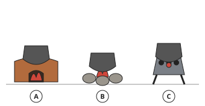
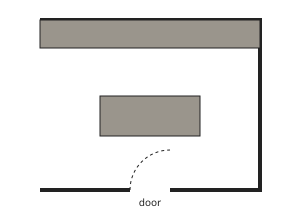
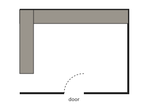
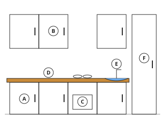
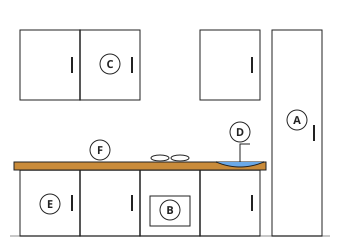

# Home Economics Form 2, Batches H2-1, H2-2: authored answers for review

Every answer fixed by a person, not computed. Part 1: the tables, conventions and rules that computed answers come from.
Part 2: every authored question template, with all its data (keys, statements, pairs, choices and feedback) and sources.
Regenerate with `npm run review:f2-home-economics`. Item IDs (TR-…) match `docs/teacher-review.md`.

## Part 1: rules and drawings (homeeconomics.js, as in Form One)

- **Energy values (TR-U02)**: carbohydrate and protein 4 kcal (17 kJ) per gram, fat 9 kcal (37 kJ).
- **Kitchen drawings and the work triangle**: the Form One drawings and rule (TR-H01, TR-H02).

## Part 2: authored question templates

| # | Template | Lesson | Type, level | Sources |
|---|---|---|---|---|
| 1 | `h2-1-classes` | 1 | multiple choice, 1 | nutrients |
| 2 | `h2-1-macro` | 1 | matching, 1 | nutrients |
| 3 | `h2-1-food` | 1 | matching, 2 | nutrients |
| 4 | `h2-1-spot` | 1 | spot the error, 3 | nutrients |
| 5 | `h2-1-food-card` (card c1-3) | 1 | matching, 1 | nutrients |
| 6 | `h2-2-source` | 2 | matching, 1 | nutrients |
| 7 | `h2-2-job` | 2 | multiple choice, 1 | nutrients |
| 8 | `h2-2-heat` | 2 | matching, 2 | nutrients |
| 9 | `h2-2-spot` | 2 | spot the error, 3 | nutrients |
| 10 | `h2-2-heat-card` (card c2-3) | 2 | matching, 1 | nutrients |
| 11 | `h2-3-source` | 3 | matching, 1 | nutrients |
| 12 | `h2-3-job` | 3 | multiple choice, 1 | nutrients |
| 13 | `h2-3-heat` | 3 | multiple choice, 2 | nutrients |
| 14 | `h2-3-spot` | 3 | spot the error, 3 | nutrients |
| 15 | `h2-3-heat-card` (card c3-3) | 3 | multiple choice, 1 | nutrients |
| 16 | `h2-4-kind` | 4 | matching, 1 | nutrients |
| 17 | `h2-4-job` | 4 | multiple choice, 1 | nutrients |
| 18 | `h2-4-heat` | 4 | multiple choice, 2 | nutrients |
| 19 | `h2-4-spot` | 4 | spot the error, 3 | nutrients |
| 20 | `h2-4-heat-card` (card c4-3) | 4 | multiple choice, 1 | nutrients |
| 21 | `h2-5-use` | 5 | multiple choice, 1 | food-energy |
| 22 | `h2-6-hidden` | 6 | multiple choice, 1 | nutrients |
| 23 | `h2-6-match` | 6 | matching, 1 | nutrients |
| 24 | `h2-6-prevent` | 6 | multiple choice, 2 | nutrients |
| 25 | `h2-6-spot` | 6 | spot the error, 3 | nutrients |
| 26 | `h2-6-prevent-card` (card c6-3) | 6 | multiple choice, 1 | nutrients |
| 27 | `h2-7-group` | 7 | matching, 1 | nutrients |
| 28 | `h2-7-source` | 7 | matching, 1 | nutrients |
| 29 | `h2-7-job` | 7 | matching, 2 | nutrients |
| 30 | `h2-7-spot` | 7 | spot the error, 3 | nutrients |
| 31 | `h2-7-job-card` (card c7-3) | 7 | matching, 1 | nutrients |
| 32 | `h2-8-job` | 8 | matching, 1 | nutrients |
| 33 | `h2-8-source` | 8 | matching, 1 | nutrients |
| 34 | `h2-8-salt` | 8 | multiple choice, 2 | nutrients |
| 35 | `h2-8-spot` | 8 | spot the error, 3 | nutrients |
| 36 | `h2-8-salt-card` (card c8-3) | 8 | multiple choice, 1 | nutrients |
| 37 | `h2-9-source` | 9 | multiple choice, 1 | water-health |
| 38 | `h2-9-job` | 9 | matching, 1 | water-health |
| 39 | `h2-9-dehyd` | 9 | multiple choice, 2 | water-health |
| 40 | `h2-9-spot` | 9 | spot the error, 3 | water-health |
| 41 | `h2-9-dehyd-card` (card c9-3) | 9 | multiple choice, 1 | water-health |
| 42 | `h2-12-what` | 12 | multiple choice, 1 | water-health |
| 43 | `h2-12-sign` | 12 | matching, 1 | water-health |
| 44 | `h2-12-ors` | 12 | multiple choice, 2 | water-health |
| 45 | `h2-12-spot` | 12 | spot the error, 3 | water-health |
| 46 | `h2-12-ors-card` (card c12-3) | 12 | multiple choice, 1 | water-health |
| 47 | `h2-13-what` | 13 | multiple choice, 1 | nutrients |
| 48 | `h2-13-source` | 13 | matching, 1 | nutrients |
| 49 | `h2-13-refine` | 13 | multiple choice, 2 | nutrients |
| 50 | `h2-13-spot` | 13 | spot the error, 3 | nutrients |
| 51 | `h2-13-refine-card` (card c13-3) | 13 | multiple choice, 1 | nutrients |
| 52 | `h2-14-job` | 14 | multiple choice, 1 | nutrients |
| 53 | `h2-14-why` | 14 | multiple choice, 1 | nutrients |
| 54 | `h2-14-disease` | 14 | matching, 2 | nutrients |
| 55 | `h2-14-spot` | 14 | spot the error, 3 | nutrients |
| 56 | `h2-14-disease-card` (card c14-3) | 14 | matching, 1 | nutrients |
| 57 | `h2-15-water` | 15 | ordering, 1 | water-health |
| 58 | `h2-15-hygiene` | 15 | multiple choice, 1 | water-health |
| 59 | `h2-15-food` | 15 | multiple choice, 2 | water-health |
| 60 | `h2-15-spot` | 15 | spot the error, 3 | water-health |
| 61 | `h2-15-food-card` (card c15-3) | 15 | multiple choice, 1 | water-health |
| 62 | `h2-16-use` | 16 | matching, 1 | kitchens |
| 63 | `h2-16-label` | 16 | multiple choice, 1 | kitchens |
| 64 | `h2-16-fuel` | 16 | multiple choice, 2 | kitchens |
| 65 | `h2-16-spot` | 16 | spot the error, 3 | kitchens |
| 66 | `h2-16-fuel-card` (card c16-3) | 16 | multiple choice, 1 | kitchens |
| 67 | `h2-17-name` | 17 | multiple choice, 1 | kitchens |
| 68 | `h2-17-compare` | 17 | matching, 1 | kitchens |
| 69 | `h2-17-safe` | 17 | multiple choice, 2 | kitchens |
| 70 | `h2-17-spot` | 17 | spot the error, 3 | kitchens |
| 71 | `h2-17-safe-card` (card c17-3) | 17 | multiple choice, 1 | kitchens |
| 72 | `h2-18-sort` | 18 | matching, 1 | kitchens |
| 73 | `h2-18-care` | 18 | ordering, 1 | kitchens |
| 74 | `h2-18-safe` | 18 | multiple choice, 2 | kitchens |
| 75 | `h2-18-spot` | 18 | spot the error, 3 | kitchens |
| 76 | `h2-18-safe-card` (card c18-3) | 18 | multiple choice, 1 | kitchens |
| 77 | `h2-19-shape` | 19 | multiple choice, 1 | kitchens |
| 78 | `h2-19-order` | 19 | ordering, 2 | kitchens |
| 79 | `h2-19-order-card` (card c19-3) | 19 | ordering, 1 | kitchens |
| 80 | `h2-20-label` | 20 | multiple choice, 1 | kitchens |
| 81 | `h2-20-plan` | 20 | multiple choice, 1 | kitchens |
| 82 | `h2-20-safe` | 20 | multiple choice, 2 | kitchens |
| 83 | `h2-20-spot` | 20 | spot the error, 3 | kitchens |
| 84 | `h2-20-safe-card` (card c20-3) | 20 | multiple choice, 1 | kitchens |
| 85 | `h2-21-why` | 21 | multiple choice, 1 | kitchens |
| 86 | `h2-21-steps` | 21 | ordering, 1 | kitchens |
| 87 | `h2-21-care` | 21 | spot the error, 3 | kitchens |
| 88 | `h2-21-care-card` (card c21-3) | 21 | spot the error, 1 | kitchens |
| 89 | `h2-24-group` | 24 | multiple choice, 1 | kitchen-equipment |
| 90 | `h2-24-mat` | 24 | matching, 1 | kitchen-equipment |
| 91 | `h2-24-parts` | 24 | matching, 2 | kitchen-equipment |
| 92 | `h2-24-spot` | 24 | spot the error, 3 | kitchen-equipment |
| 93 | `h2-24-parts-card` (card c24-3) | 24 | matching, 1 | kitchen-equipment |
| 94 | `h2-25-choose` | 25 | multiple choice, 1 | kitchen-equipment |
| 95 | `h2-25-wash` | 25 | multiple choice, 1 | kitchen-equipment |
| 96 | `h2-25-care` | 25 | multiple choice, 2 | kitchen-equipment |
| 97 | `h2-25-spot` | 25 | spot the error, 3 | kitchen-equipment |
| 98 | `h2-25-care-card` (card c25-3) | 25 | multiple choice, 1 | kitchen-equipment |
| 99 | `h2-26-types` | 26 | multiple choice, 1 | kitchen-equipment |
| 100 | `h2-26-cold` | 26 | multiple choice, 1 | kitchen-equipment |
| 101 | `h2-26-dish` | 26 | multiple choice, 2 | kitchen-equipment |
| 102 | `h2-26-spot` | 26 | spot the error, 3 | kitchen-equipment |
| 103 | `h2-26-dish-card` (card c26-3) | 26 | multiple choice, 1 | kitchen-equipment |
| 104 | `h2-27-parts` | 27 | matching, 1 | kitchen-equipment |
| 105 | `h2-27-choose` | 27 | multiple choice, 1 | kitchen-equipment |
| 106 | `h2-27-care` | 27 | multiple choice, 2 | kitchen-equipment |
| 107 | `h2-27-spot` | 27 | spot the error, 3 | kitchen-equipment |
| 108 | `h2-27-care-card` (card c27-3) | 27 | multiple choice, 1 | kitchen-equipment |
| 109 | `h2-28-what` | 28 | multiple choice, 1 | labour-saving |
| 110 | `h2-28-cook` | 28 | multiple choice, 1 | labour-saving |
| 111 | `h2-28-flask` | 28 | multiple choice, 2 | labour-saving |
| 112 | `h2-28-spot` | 28 | spot the error, 3 | labour-saving |
| 113 | `h2-28-flask-card` (card c28-3) | 28 | multiple choice, 1 | labour-saving |
| 114 | `h2-29-pc` | 29 | matching, 1 | labour-saving |
| 115 | `h2-29-bl` | 29 | multiple choice, 1 | labour-saving |
| 116 | `h2-29-fl` | 29 | multiple choice, 2 | labour-saving |
| 117 | `h2-29-spot` | 29 | spot the error, 3 | labour-saving |
| 118 | `h2-29-fl-card` (card c29-3) | 29 | multiple choice, 1 | labour-saving |
| 119 | `h2-30-pc` | 30 | multiple choice, 1 | labour-saving |
| 120 | `h2-30-mw` | 30 | multiple choice, 1 | labour-saving |
| 121 | `h2-30-fl` | 30 | multiple choice, 2 | labour-saving |
| 122 | `h2-30-spot` | 30 | spot the error, 3 | labour-saving |
| 123 | `h2-30-fl-card` (card c30-3) | 30 | multiple choice, 1 | labour-saving |
| 124 | `h2-31-choose` | 31 | multiple choice, 1 | labour-saving |
| 125 | `h2-31-elec` | 31 | multiple choice, 1 | labour-saving |
| 126 | `h2-31-pc` | 31 | multiple choice, 2 | labour-saving |
| 127 | `h2-31-spot` | 31 | spot the error, 3 | labour-saving |
| 128 | `h2-31-pc-card` (card c31-3) | 31 | multiple choice, 1 | labour-saving |
| 129 | `h2-32-what` | 32 | multiple choice, 1 | kitchen-safety |
| 130 | `h2-32-burn` | 32 | multiple choice, 1 | kitchen-safety |
| 131 | `h2-32-types` | 32 | multiple choice, 2 | kitchen-safety |
| 132 | `h2-32-spot` | 32 | spot the error, 3 | kitchen-safety |
| 133 | `h2-32-types-card` (card c32-3) | 32 | multiple choice, 1 | kitchen-safety |
| 134 | `h2-33-cause` | 33 | multiple choice, 1 | kitchen-safety |
| 135 | `h2-33-prevent` | 33 | multiple choice, 1 | kitchen-safety |
| 136 | `h2-33-aid` | 33 | multiple choice, 2 | kitchen-safety |
| 137 | `h2-33-spot` | 33 | spot the error, 3 | kitchen-safety |
| 138 | `h2-33-aid-card` (card c33-3) | 33 | multiple choice, 1 | kitchen-safety |
| 139 | `h2-36-type` | 36 | multiple choice, 1 | kitchen-waste |
| 140 | `h2-36-sort` | 36 | multiple choice, 1 | kitchen-waste |
| 141 | `h2-36-reduce` | 36 | multiple choice, 2 | kitchen-waste |
| 142 | `h2-36-spot` | 36 | spot the error, 3 | kitchen-waste |
| 143 | `h2-36-reduce-card` (card c36-3) | 36 | multiple choice, 1 | kitchen-waste |
| 144 | `h2-37-why` | 37 | multiple choice, 1 | cooking-methods |
| 145 | `h2-37-dry` | 37 | multiple choice, 2 | cooking-methods |
| 146 | `h2-37-spot` | 37 | spot the error, 3 | cooking-methods |
| 147 | `h2-37-dry-card` (card c37-3) | 37 | multiple choice, 1 | cooking-methods |
| 148 | `h2-38-types` | 38 | multiple choice, 1 | cooking-methods |
| 149 | `h2-38-good` | 38 | multiple choice, 1 | cooking-methods |
| 150 | `h2-38-bad` | 38 | multiple choice, 2 | cooking-methods |
| 151 | `h2-38-spot` | 38 | spot the error, 3 | cooking-methods |
| 152 | `h2-38-bad-card` (card c38-3) | 38 | multiple choice, 1 | cooking-methods |
| 153 | `h2-39-types` | 39 | multiple choice, 1 | cooking-methods |
| 154 | `h2-39-good` | 39 | multiple choice, 1 | cooking-methods |
| 155 | `h2-39-bad` | 39 | multiple choice, 2 | cooking-methods |
| 156 | `h2-39-spot` | 39 | spot the error, 3 | cooking-methods |
| 157 | `h2-39-bad-card` (card c39-3) | 39 | multiple choice, 1 | cooking-methods |
| 158 | `h2-40-what` | 40 | multiple choice, 1 | heat-transfer |
| 159 | `h2-40-cond` | 40 | multiple choice, 1 | heat-transfer |
| 160 | `h2-40-use` | 40 | multiple choice, 2 | heat-transfer |
| 161 | `h2-40-spot` | 40 | spot the error, 3 | heat-transfer |
| 162 | `h2-40-use-card` (card c40-3) | 40 | multiple choice, 1 | heat-transfer |
| 163 | `h2-41-what` | 41 | multiple choice, 1 | heat-transfer |
| 164 | `h2-41-current` | 41 | ordering, 1 | heat-transfer |
| 165 | `h2-41-solid` | 41 | multiple choice, 2 | heat-transfer |
| 166 | `h2-41-spot` | 41 | spot the error, 3 | heat-transfer |
| 167 | `h2-41-solid-card` (card c41-3) | 41 | multiple choice, 1 | heat-transfer |
| 168 | `h2-42-ex` | 42 | multiple choice, 1 | heat-transfer |
| 169 | `h2-42-oven` | 42 | multiple choice, 1 | heat-transfer |
| 170 | `h2-42-pro` | 42 | multiple choice, 2 | heat-transfer |
| 171 | `h2-42-spot` | 42 | spot the error, 3 | heat-transfer |
| 172 | `h2-42-pro-card` (card c42-3) | 42 | multiple choice, 1 | heat-transfer |
| 173 | `h2-43-what` | 43 | multiple choice, 1 | heat-transfer |
| 174 | `h2-43-surface` | 43 | multiple choice, 1 | heat-transfer |
| 175 | `h2-43-ex` | 43 | multiple choice, 2 | heat-transfer |
| 176 | `h2-43-spot` | 43 | spot the error, 3 | heat-transfer |
| 177 | `h2-43-ex-card` (card c43-3) | 43 | multiple choice, 1 | heat-transfer |
| 178 | `h2-44-cause` | 44 | multiple choice, 1 | deficiency-diseases |
| 179 | `h2-44-kwash` | 44 | multiple choice, 1 | deficiency-diseases |
| 180 | `h2-44-spot` | 44 | spot the error, 3 | deficiency-diseases |
| 181 | `h2-45-risk` | 45 | multiple choice, 1 | deficiency-diseases |
| 182 | `h2-45-feed` | 45 | multiple choice, 1 | deficiency-diseases |
| 183 | `h2-45-health` | 45 | multiple choice, 2 | deficiency-diseases |
| 184 | `h2-45-spot` | 45 | spot the error, 3 | deficiency-diseases |
| 185 | `h2-45-health-card` (card c45-3) | 45 | multiple choice, 1 | deficiency-diseases |
| 186 | `h2-46-cause` | 46 | multiple choice, 1 | deficiency-diseases |
| 187 | `h2-46-signs` | 46 | multiple choice, 1 | deficiency-diseases |
| 188 | `h2-46-food` | 46 | multiple choice, 2 | deficiency-diseases |
| 189 | `h2-46-spot` | 46 | spot the error, 3 | deficiency-diseases |
| 190 | `h2-46-food-card` (card c46-3) | 46 | multiple choice, 1 | deficiency-diseases |
| 191 | `h2-49-cause` | 49 | multiple choice, 1 | deficiency-diseases |
| 192 | `h2-49-sign` | 49 | multiple choice, 1 | deficiency-diseases |
| 193 | `h2-49-prev` | 49 | multiple choice, 2 | deficiency-diseases |
| 194 | `h2-49-spot` | 49 | spot the error, 3 | deficiency-diseases |
| 195 | `h2-49-prev-card` (card c49-3) | 49 | multiple choice, 1 | deficiency-diseases |
| 196 | `h2-50-cause` | 50 | multiple choice, 1 | deficiency-diseases |
| 197 | `h2-50-sign` | 50 | multiple choice, 1 | deficiency-diseases |
| 198 | `h2-50-prev` | 50 | multiple choice, 2 | deficiency-diseases |
| 199 | `h2-50-spot` | 50 | spot the error, 3 | deficiency-diseases |
| 200 | `h2-50-prev-card` (card c50-3) | 50 | multiple choice, 1 | deficiency-diseases |
| 201 | `h2-51-scurvy` | 51 | multiple choice, 1 | deficiency-diseases |
| 202 | `h2-51-anaem` | 51 | multiple choice, 1 | deficiency-diseases |
| 203 | `h2-51-food` | 51 | multiple choice, 2 | deficiency-diseases |
| 204 | `h2-51-spot` | 51 | spot the error, 3 | deficiency-diseases |
| 205 | `h2-51-food-card` (card c51-3) | 51 | multiple choice, 1 | deficiency-diseases |
| 206 | `h2-52-what` | 52 | multiple choice, 1 | embroidery |
| 207 | `h2-52-use` | 52 | multiple choice, 2 | embroidery |
| 208 | `h2-52-spot` | 52 | spot the error, 3 | embroidery |
| 209 | `h2-52-use-card` (card c52-3) | 52 | multiple choice, 1 | embroidery |
| 210 | `h2-53-stitch` | 53 | matching, 1 | embroidery |
| 211 | `h2-53-use` | 53 | multiple choice, 1 | embroidery |
| 212 | `h2-53-order` | 53 | ordering, 2 | embroidery |
| 213 | `h2-53-spot` | 53 | spot the error, 3 | embroidery |
| 214 | `h2-53-order-card` (card c53-3) | 53 | ordering, 1 | embroidery |
| 215 | `h2-56-source` | 56 | matching, 1 | embroidery |
| 216 | `h2-56-prop` | 56 | multiple choice, 1 | embroidery |
| 217 | `h2-56-care` | 56 | multiple choice, 2 | embroidery |
| 218 | `h2-56-spot` | 56 | spot the error, 3 | embroidery |
| 219 | `h2-56-care-card` (card c56-3) | 56 | multiple choice, 1 | embroidery |
| 220 | `h2-57-what` | 57 | multiple choice, 1 | embroidery |
| 221 | `h2-57-spot` | 57 | spot the error, 3 | embroidery |
| 222 | `h2-58-match` | 58 | matching, 1 | embroidery |
| 223 | `h2-58-knots` | 58 | multiple choice, 1 | embroidery |
| 224 | `h2-58-shadow` | 58 | multiple choice, 2 | embroidery |
| 225 | `h2-58-spot` | 58 | spot the error, 3 | embroidery |
| 226 | `h2-58-shadow-card` (card c58-3) | 58 | multiple choice, 1 | embroidery |
| 227 | `h2-59-info` | 59 | multiple choice, 1 | laundry |
| 228 | `h2-59-symbol` | 59 | matching, 1 | laundry |
| 229 | `h2-59-spot` | 59 | spot the error, 3 | laundry |
| 230 | `h2-60-tool` | 60 | matching, 1 | embroidery |
| 231 | `h2-60-use` | 60 | multiple choice, 1 | embroidery |
| 232 | `h2-60-care` | 60 | multiple choice, 2 | embroidery |
| 233 | `h2-60-spot` | 60 | spot the error, 3 | embroidery |
| 234 | `h2-60-care-card` (card c60-3) | 60 | multiple choice, 1 | embroidery |
| 235 | `h2-61-steps` | 61 | ordering, 1 | laundry |
| 236 | `h2-61-sort` | 61 | multiple choice, 2 | laundry |
| 237 | `h2-61-spot` | 61 | spot the error, 3 | laundry |
| 238 | `h2-61-sort-card` (card c61-3) | 61 | multiple choice, 1 | laundry |
| 239 | `h2-62-type` | 62 | matching, 1 | laundry |
| 240 | `h2-62-steam` | 62 | multiple choice, 1 | laundry |
| 241 | `h2-62-choose` | 62 | multiple choice, 2 | laundry |
| 242 | `h2-62-spot` | 62 | spot the error, 3 | laundry |
| 243 | `h2-62-choose-card` (card c62-3) | 62 | multiple choice, 1 | laundry |
| 244 | `h2-63-order` | 63 | multiple choice, 1 | laundry |
| 245 | `h2-63-tech` | 63 | multiple choice, 1 | laundry |
| 246 | `h2-63-shirt` | 63 | ordering, 2 | laundry |
| 247 | `h2-63-spot` | 63 | spot the error, 3 | laundry |
| 248 | `h2-63-shirt-card` (card c63-3) | 63 | ordering, 1 | laundry |

### `h2-1-classes` · Lesson 1 · multiple choice, level 1

Prompt: {X.q}

Table `X` (one row is picked each time):

| q | r | w | e | y |
|---|---|---|---|---|
| Which of these is NOT one of the six classes of nutrients? | salt and pepper | proteins · vitamins · water | Proteins are a class. · Vitamins are a class. · Water is a class. | The six classes are carbohydrates, proteins, fats, vitamins, minerals and water. |
| What are nutrients? | substances in food that the body needs | any food that tastes good · medicines from the pharmacy · the colours of food | Taste does not decide it. · Medicines are not nutrients. · Colour is not a nutrient. | Nutrients are what the body uses from food. |

Right answer: `{X.r}`; wrong choices: `{X.w[0]}`, `{X.w[1]}`, `{X.w[2]}`

- Feedback `w0`: “{X.e[0]}”
- Feedback `w1`: “{X.e[1]}”
- Feedback `w2`: “{X.e[2]}”

Three generated variants:

> What are nutrients?

- ◻️ medicines from the pharmacy  
  _↳ feedback if chosen: Medicines are not nutrients._
- ✅ substances in food that the body needs
- ◻️ any food that tastes good  
  _↳ feedback if chosen: Taste does not decide it._
- ◻️ the colours of food  
  _↳ feedback if chosen: Colour is not a nutrient._

Full working after a second miss:

> Nutrients are what the body uses from food.  
> So the answer is “substances in food that the body needs”.  

> Which of these is NOT one of the six classes of nutrients?

- ◻️ proteins  
  _↳ feedback if chosen: Proteins are a class._
- ◻️ vitamins  
  _↳ feedback if chosen: Vitamins are a class._
- ◻️ water  
  _↳ feedback if chosen: Water is a class._
- ✅ salt and pepper

Full working after a second miss:

> The six classes are carbohydrates, proteins, fats, vitamins, minerals and water.  
> So the answer is “salt and pepper”.  

> What are nutrients?

- ◻️ the colours of food  
  _↳ feedback if chosen: Colour is not a nutrient._
- ◻️ any food that tastes good  
  _↳ feedback if chosen: Taste does not decide it._
- ✅ substances in food that the body needs
- ◻️ medicines from the pharmacy  
  _↳ feedback if chosen: Medicines are not nutrients._

Full working after a second miss:

> Nutrients are what the body uses from food.  
> So the answer is “substances in food that the body needs”.  

Sources: nutrients (Nutrition as taught in Cameroonian Home Economics (food science): classes of nutrients, composition, sources, functions, deficiencies, effects of heat; vitamins and minerals; dietary fibre (NSP))

### `h2-1-macro` · Lesson 1 · matching, level 1

Prompt: Sort the nutrients: macronutrient or micronutrient?

Pairs (4 shown each time, sorted into groups):

- carbohydrates → **macronutrient**
- proteins → **macronutrient**
- fats → **macronutrient**
- vitamins → **micronutrient**
- minerals → **micronutrient**
- iron → **micronutrient**
- vitamin A → **micronutrient**

Three generated variants:

> Sort the nutrients: macronutrient or micronutrient?

Groups: macronutrient · micronutrient
- vitamin A → **micronutrient**
- iron → **micronutrient**
- vitamins → **micronutrient**
- carbohydrates → **macronutrient**

Full working after a second miss:

> The right pairs are:  
> vitamin A → micronutrient  
> iron → micronutrient  
> vitamins → micronutrient  
> carbohydrates → macronutrient  

> Sort the nutrients: macronutrient or micronutrient?

Groups: macronutrient · micronutrient
- carbohydrates → **macronutrient**
- proteins → **macronutrient**
- vitamin A → **micronutrient**
- iron → **micronutrient**

Full working after a second miss:

> The right pairs are:  
> carbohydrates → macronutrient  
> proteins → macronutrient  
> vitamin A → micronutrient  
> iron → micronutrient  

> Sort the nutrients: macronutrient or micronutrient?

Groups: macronutrient · micronutrient
- carbohydrates → **macronutrient**
- fats → **macronutrient**
- vitamin A → **micronutrient**
- vitamins → **micronutrient**

Full working after a second miss:

> The right pairs are:  
> carbohydrates → macronutrient  
> fats → macronutrient  
> vitamin A → micronutrient  
> vitamins → micronutrient  

Sources: nutrients (Nutrition as taught in Cameroonian Home Economics (food science): classes of nutrients, composition, sources, functions, deficiencies, effects of heat; vitamins and minerals; dietary fibre (NSP))

### `h2-1-food` · Lesson 1 · matching, level 2

Prompt: Match each food to its main nutrient.

Pairs (4 shown each time, sorted into groups):

- cassava → **carbohydrate**
- rice → **carbohydrate**
- beans → **protein**
- fish → **protein**
- palm oil → **fat**
- groundnut oil → **fat**
- oranges → **vitamin C**
- milk → **calcium**

Three generated variants:

> Match each food to its main nutrient.

Groups: carbohydrate · protein · fat · vitamin C
- oranges → **vitamin C**
- palm oil → **fat**
- rice → **carbohydrate**
- fish → **protein**

Full working after a second miss:

> The right pairs are:  
> oranges → vitamin C  
> palm oil → fat  
> rice → carbohydrate  
> fish → protein  

> Match each food to its main nutrient.

Groups: carbohydrate · protein · fat · calcium
- palm oil → **fat**
- beans → **protein**
- rice → **carbohydrate**
- milk → **calcium**

Full working after a second miss:

> The right pairs are:  
> palm oil → fat  
> beans → protein  
> rice → carbohydrate  
> milk → calcium  

> Match each food to its main nutrient.

Groups: carbohydrate · fat · vitamin C · calcium
- palm oil → **fat**
- rice → **carbohydrate**
- milk → **calcium**
- oranges → **vitamin C**

Full working after a second miss:

> The right pairs are:  
> palm oil → fat  
> rice → carbohydrate  
> milk → calcium  
> oranges → vitamin C  

Sources: nutrients (Nutrition as taught in Cameroonian Home Economics (food science): classes of nutrients, composition, sources, functions, deficiencies, effects of heat; vitamins and minerals; dietary fibre (NSP))

### `h2-1-spot` · Lesson 1 · spot the error, level 3

Prompt: Which statement is wrong?

Shows 3 correct and 1 wrong statement(s), drawn from:

- ✅ Carbohydrates are macronutrients.
- ✅ Vitamins are micronutrients.
- ✅ Water is a nutrient.
- ✅ Fish is rich in protein.
- ❌ Vitamins are needed in large amounts every day.  
  _↳ Vitamins are needed in small amounts: they are micronutrients._
- ❌ Palm oil is mainly protein.  
  _↳ Palm oil is mainly fat._
- ❌ Minerals are macronutrients.  
  _↳ Minerals are micronutrients._

Three generated variants:

> Which statement is wrong?

- ◻️ Fish is rich in protein.
- ✅ Vitamins are needed in large amounts every day.  
  _↳ explanation: Vitamins are needed in small amounts: they are micronutrients._
- ◻️ Water is a nutrient.
- ◻️ Carbohydrates are macronutrients.

Full working after a second miss:

> The wrong statement is “Vitamins are needed in large amounts every day.”.  
> Vitamins are needed in small amounts: they are micronutrients.  

> Which statement is wrong?

- ◻️ Fish is rich in protein.
- ◻️ Water is a nutrient.
- ✅ Vitamins are needed in large amounts every day.  
  _↳ explanation: Vitamins are needed in small amounts: they are micronutrients._
- ◻️ Carbohydrates are macronutrients.

Full working after a second miss:

> The wrong statement is “Vitamins are needed in large amounts every day.”.  
> Vitamins are needed in small amounts: they are micronutrients.  

> Which statement is wrong?

- ◻️ Water is a nutrient.
- ◻️ Carbohydrates are macronutrients.
- ✅ Palm oil is mainly protein.  
  _↳ explanation: Palm oil is mainly fat._
- ◻️ Vitamins are micronutrients.

Full working after a second miss:

> The wrong statement is “Palm oil is mainly protein.”.  
> Palm oil is mainly fat.  

Sources: nutrients (Nutrition as taught in Cameroonian Home Economics (food science): classes of nutrients, composition, sources, functions, deficiencies, effects of heat; vitamins and minerals; dietary fibre (NSP))

### `h2-1-food-card` · Lesson 1 · matching, level 1

Prompt: Match each food to its main nutrient.

Pairs (4 shown each time, sorted into groups):

- cassava → **carbohydrate**
- rice → **carbohydrate**
- beans → **protein**
- fish → **protein**
- palm oil → **fat**
- groundnut oil → **fat**
- oranges → **vitamin C**
- milk → **calcium**

Three generated variants:

> Match each food to its main nutrient.

Groups: protein · fat · vitamin C
- beans → **protein**
- groundnut oil → **fat**
- oranges → **vitamin C**
- palm oil → **fat**

Full working after a second miss:

> The right pairs are:  
> beans → protein  
> groundnut oil → fat  
> oranges → vitamin C  
> palm oil → fat  

> Match each food to its main nutrient.

Groups: protein · fat · calcium
- fish → **protein**
- groundnut oil → **fat**
- milk → **calcium**
- palm oil → **fat**

Full working after a second miss:

> The right pairs are:  
> fish → protein  
> groundnut oil → fat  
> milk → calcium  
> palm oil → fat  

> Match each food to its main nutrient.

Groups: carbohydrate · protein · fat
- cassava → **carbohydrate**
- palm oil → **fat**
- beans → **protein**
- rice → **carbohydrate**

Full working after a second miss:

> The right pairs are:  
> cassava → carbohydrate  
> palm oil → fat  
> beans → protein  
> rice → carbohydrate  

Sources: nutrients (Nutrition as taught in Cameroonian Home Economics (food science): classes of nutrients, composition, sources, functions, deficiencies, effects of heat; vitamins and minerals; dietary fibre (NSP))

### `h2-2-source` · Lesson 2 · matching, level 1

Prompt: Sort the foods: is the carbohydrate mainly sugar or starch?

Pairs (4 shown each time, sorted into groups):

- cassava → **starch**
- yam → **starch**
- rice → **starch**
- plantain → **starch**
- sugar cane → **sugar**
- honey → **sugar**
- ripe pawpaw → **sugar**
- sweets → **sugar**

Three generated variants:

> Sort the foods: is the carbohydrate mainly sugar or starch?

Groups: starch · sugar
- ripe pawpaw → **sugar**
- honey → **sugar**
- plantain → **starch**
- yam → **starch**

Full working after a second miss:

> The right pairs are:  
> ripe pawpaw → sugar  
> honey → sugar  
> plantain → starch  
> yam → starch  

> Sort the foods: is the carbohydrate mainly sugar or starch?

Groups: starch · sugar
- yam → **starch**
- ripe pawpaw → **sugar**
- rice → **starch**
- sweets → **sugar**

Full working after a second miss:

> The right pairs are:  
> yam → starch  
> ripe pawpaw → sugar  
> rice → starch  
> sweets → sugar  

> Sort the foods: is the carbohydrate mainly sugar or starch?

Groups: starch · sugar
- ripe pawpaw → **sugar**
- cassava → **starch**
- honey → **sugar**
- rice → **starch**

Full working after a second miss:

> The right pairs are:  
> ripe pawpaw → sugar  
> cassava → starch  
> honey → sugar  
> rice → starch  

Sources: nutrients (Nutrition as taught in Cameroonian Home Economics (food science): classes of nutrients, composition, sources, functions, deficiencies, effects of heat; vitamins and minerals; dietary fibre (NSP))

### `h2-2-job` · Lesson 2 · multiple choice, level 1

Prompt: {X.q}

Table `X` (one row is picked each time):

| q | r | w | e | y |
|---|---|---|---|---|
| What is the main function of carbohydrates? | to give energy | to build muscles · to prevent scurvy · to make bones strong | That is protein's job. · That is vitamin C's job. · That is calcium's job. | Carbohydrates are the main energy food. |
| Which disease is caused by a lack of energy food in children? | marasmus | scurvy · goitre · rickets | Scurvy: lack of vitamin C. · Goitre: lack of iodine. · Rickets: lack of vitamin D or calcium. | Marasmus: a very thin, wasted child. |
| Which elements make up carbohydrates? | carbon, hydrogen and oxygen | carbon, hydrogen, oxygen and nitrogen · iron and calcium · sodium and chlorine | Nitrogen is in proteins. · Those are minerals. · That is salt. | C, H and O. |

Right answer: `{X.r}`; wrong choices: `{X.w[0]}`, `{X.w[1]}`, `{X.w[2]}`

- Feedback `w0`: “{X.e[0]}”
- Feedback `w1`: “{X.e[1]}”
- Feedback `w2`: “{X.e[2]}”

Three generated variants:

> Which disease is caused by a lack of energy food in children?

- ◻️ scurvy  
  _↳ feedback if chosen: Scurvy: lack of vitamin C._
- ◻️ rickets  
  _↳ feedback if chosen: Rickets: lack of vitamin D or calcium._
- ✅ marasmus
- ◻️ goitre  
  _↳ feedback if chosen: Goitre: lack of iodine._

Full working after a second miss:

> Marasmus: a very thin, wasted child.  
> So the answer is “marasmus”.  

> What is the main function of carbohydrates?

- ◻️ to prevent scurvy  
  _↳ feedback if chosen: That is vitamin C's job._
- ◻️ to build muscles  
  _↳ feedback if chosen: That is protein's job._
- ✅ to give energy
- ◻️ to make bones strong  
  _↳ feedback if chosen: That is calcium's job._

Full working after a second miss:

> Carbohydrates are the main energy food.  
> So the answer is “to give energy”.  

> Which elements make up carbohydrates?

- ◻️ iron and calcium  
  _↳ feedback if chosen: Those are minerals._
- ✅ carbon, hydrogen and oxygen
- ◻️ sodium and chlorine  
  _↳ feedback if chosen: That is salt._
- ◻️ carbon, hydrogen, oxygen and nitrogen  
  _↳ feedback if chosen: Nitrogen is in proteins._

Full working after a second miss:

> C, H and O.  
> So the answer is “carbon, hydrogen and oxygen”.  

Sources: nutrients (Nutrition as taught in Cameroonian Home Economics (food science): classes of nutrients, composition, sources, functions, deficiencies, effects of heat; vitamins and minerals; dietary fibre (NSP))

### `h2-2-heat` · Lesson 2 · matching, level 2

Prompt: Match each change to its name.

Pairs (3 shown each time):

- starch thickens a hot sauce → **gelatinisation**
- bread turns brown when toasted → **dextrinisation**
- sugar melts and turns brown → **caramelisation**

Three generated variants:

> Match each change to its name.

Right-hand side (shuffled): caramelisation · dextrinisation · gelatinisation
- bread turns brown when toasted → **dextrinisation**
- sugar melts and turns brown → **caramelisation**
- starch thickens a hot sauce → **gelatinisation**

Full working after a second miss:

> The right pairs are:  
> bread turns brown when toasted → dextrinisation  
> sugar melts and turns brown → caramelisation  
> starch thickens a hot sauce → gelatinisation  

> Match each change to its name.

Right-hand side (shuffled): dextrinisation · gelatinisation · caramelisation
- starch thickens a hot sauce → **gelatinisation**
- sugar melts and turns brown → **caramelisation**
- bread turns brown when toasted → **dextrinisation**

Full working after a second miss:

> The right pairs are:  
> starch thickens a hot sauce → gelatinisation  
> sugar melts and turns brown → caramelisation  
> bread turns brown when toasted → dextrinisation  

> Match each change to its name.

Right-hand side (shuffled): caramelisation · dextrinisation · gelatinisation
- starch thickens a hot sauce → **gelatinisation**
- bread turns brown when toasted → **dextrinisation**
- sugar melts and turns brown → **caramelisation**

Full working after a second miss:

> The right pairs are:  
> starch thickens a hot sauce → gelatinisation  
> bread turns brown when toasted → dextrinisation  
> sugar melts and turns brown → caramelisation  

Sources: nutrients (Nutrition as taught in Cameroonian Home Economics (food science): classes of nutrients, composition, sources, functions, deficiencies, effects of heat; vitamins and minerals; dietary fibre (NSP))

### `h2-2-spot` · Lesson 2 · spot the error, level 3

Prompt: Which statement is wrong?

Shows 3 correct and 1 wrong statement(s), drawn from:

- ✅ Cassava is rich in starch.
- ✅ Carbohydrates give energy.
- ✅ Sugar caramelises when heated.
- ✅ Too much sugar causes tooth decay.
- ❌ Carbohydrates contain nitrogen.  
  _↳ They contain carbon, hydrogen and oxygen only._
- ❌ Marasmus is caused by too much energy food.  
  _↳ It is caused by a lack of energy food._
- ❌ Starch thins a sauce when heated.  
  _↳ Starch thickens a hot sauce (gelatinisation)._

Three generated variants:

> Which statement is wrong?

- ◻️ Sugar caramelises when heated.
- ◻️ Too much sugar causes tooth decay.
- ✅ Starch thins a sauce when heated.  
  _↳ explanation: Starch thickens a hot sauce (gelatinisation)._
- ◻️ Cassava is rich in starch.

Full working after a second miss:

> The wrong statement is “Starch thins a sauce when heated.”.  
> Starch thickens a hot sauce (gelatinisation).  

> Which statement is wrong?

- ✅ Marasmus is caused by too much energy food.  
  _↳ explanation: It is caused by a lack of energy food._
- ◻️ Carbohydrates give energy.
- ◻️ Sugar caramelises when heated.
- ◻️ Too much sugar causes tooth decay.

Full working after a second miss:

> The wrong statement is “Marasmus is caused by too much energy food.”.  
> It is caused by a lack of energy food.  

> Which statement is wrong?

- ◻️ Carbohydrates give energy.
- ◻️ Sugar caramelises when heated.
- ✅ Marasmus is caused by too much energy food.  
  _↳ explanation: It is caused by a lack of energy food._
- ◻️ Too much sugar causes tooth decay.

Full working after a second miss:

> The wrong statement is “Marasmus is caused by too much energy food.”.  
> It is caused by a lack of energy food.  

Sources: nutrients (Nutrition as taught in Cameroonian Home Economics (food science): classes of nutrients, composition, sources, functions, deficiencies, effects of heat; vitamins and minerals; dietary fibre (NSP))

### `h2-2-heat-card` · Lesson 2 · matching, level 1

Prompt: Match each change to its name.

Pairs (3 shown each time):

- starch thickens a hot sauce → **gelatinisation**
- bread turns brown when toasted → **dextrinisation**
- sugar melts and turns brown → **caramelisation**

Three generated variants:

> Match each change to its name.

Right-hand side (shuffled): caramelisation · dextrinisation · gelatinisation
- sugar melts and turns brown → **caramelisation**
- starch thickens a hot sauce → **gelatinisation**
- bread turns brown when toasted → **dextrinisation**

Full working after a second miss:

> The right pairs are:  
> sugar melts and turns brown → caramelisation  
> starch thickens a hot sauce → gelatinisation  
> bread turns brown when toasted → dextrinisation  

> Match each change to its name.

Right-hand side (shuffled): caramelisation · dextrinisation · gelatinisation
- bread turns brown when toasted → **dextrinisation**
- sugar melts and turns brown → **caramelisation**
- starch thickens a hot sauce → **gelatinisation**

Full working after a second miss:

> The right pairs are:  
> bread turns brown when toasted → dextrinisation  
> sugar melts and turns brown → caramelisation  
> starch thickens a hot sauce → gelatinisation  

> Match each change to its name.

Right-hand side (shuffled): caramelisation · gelatinisation · dextrinisation
- sugar melts and turns brown → **caramelisation**
- bread turns brown when toasted → **dextrinisation**
- starch thickens a hot sauce → **gelatinisation**

Full working after a second miss:

> The right pairs are:  
> sugar melts and turns brown → caramelisation  
> bread turns brown when toasted → dextrinisation  
> starch thickens a hot sauce → gelatinisation  

Sources: nutrients (Nutrition as taught in Cameroonian Home Economics (food science): classes of nutrients, composition, sources, functions, deficiencies, effects of heat; vitamins and minerals; dietary fibre (NSP))

### `h2-3-source` · Lesson 3 · matching, level 1

Prompt: Sort the protein foods: animal or plant source?

Pairs (4 shown each time, sorted into groups):

- fish → **animal**
- eggs → **animal**
- milk → **animal**
- snails → **animal**
- beans → **plant**
- groundnuts → **plant**
- soya beans → **plant**
- egusi → **plant**

Three generated variants:

> Sort the protein foods: animal or plant source?

Groups: animal · plant
- milk → **animal**
- snails → **animal**
- beans → **plant**
- eggs → **animal**

Full working after a second miss:

> The right pairs are:  
> milk → animal  
> snails → animal  
> beans → plant  
> eggs → animal  

> Sort the protein foods: animal or plant source?

Groups: animal · plant
- milk → **animal**
- snails → **animal**
- egusi → **plant**
- eggs → **animal**

Full working after a second miss:

> The right pairs are:  
> milk → animal  
> snails → animal  
> egusi → plant  
> eggs → animal  

> Sort the protein foods: animal or plant source?

Groups: animal · plant
- soya beans → **plant**
- snails → **animal**
- egusi → **plant**
- fish → **animal**

Full working after a second miss:

> The right pairs are:  
> soya beans → plant  
> snails → animal  
> egusi → plant  
> fish → animal  

Sources: nutrients (Nutrition as taught in Cameroonian Home Economics (food science): classes of nutrients, composition, sources, functions, deficiencies, effects of heat; vitamins and minerals; dietary fibre (NSP))

### `h2-3-job` · Lesson 3 · multiple choice, level 1

Prompt: {X.q}

Table `X` (one row is picked each time):

| q | r | w | e | y |
|---|---|---|---|---|
| What is the main function of proteins? | growth and repair of the body | giving most of our energy · preventing night blindness · keeping teeth white | Carbohydrates give most energy. · That is vitamin A. · That is not their job. | Proteins build and repair tissues. |
| Which disease is caused by a lack of protein in young children? | kwashiorkor | marasmus · scurvy · anaemia | Marasmus: lack of energy food. · Scurvy: lack of vitamin C. · Anaemia: lack of iron. | Kwashiorkor: swollen belly and feet. |
| Which element is found in proteins but not in carbohydrates? | nitrogen | carbon · oxygen · hydrogen | Both have carbon. · Both have oxygen. · Both have hydrogen. | Proteins contain nitrogen. |

Right answer: `{X.r}`; wrong choices: `{X.w[0]}`, `{X.w[1]}`, `{X.w[2]}`

- Feedback `w0`: “{X.e[0]}”
- Feedback `w1`: “{X.e[1]}”
- Feedback `w2`: “{X.e[2]}”

Three generated variants:

> Which element is found in proteins but not in carbohydrates?

- ✅ nitrogen
- ◻️ hydrogen  
  _↳ feedback if chosen: Both have hydrogen._
- ◻️ carbon  
  _↳ feedback if chosen: Both have carbon._
- ◻️ oxygen  
  _↳ feedback if chosen: Both have oxygen._

Full working after a second miss:

> Proteins contain nitrogen.  
> So the answer is “nitrogen”.  

> Which disease is caused by a lack of protein in young children?

- ◻️ anaemia  
  _↳ feedback if chosen: Anaemia: lack of iron._
- ◻️ marasmus  
  _↳ feedback if chosen: Marasmus: lack of energy food._
- ◻️ scurvy  
  _↳ feedback if chosen: Scurvy: lack of vitamin C._
- ✅ kwashiorkor

Full working after a second miss:

> Kwashiorkor: swollen belly and feet.  
> So the answer is “kwashiorkor”.  

> Which disease is caused by a lack of protein in young children?

- ◻️ anaemia  
  _↳ feedback if chosen: Anaemia: lack of iron._
- ✅ kwashiorkor
- ◻️ marasmus  
  _↳ feedback if chosen: Marasmus: lack of energy food._
- ◻️ scurvy  
  _↳ feedback if chosen: Scurvy: lack of vitamin C._

Full working after a second miss:

> Kwashiorkor: swollen belly and feet.  
> So the answer is “kwashiorkor”.  

Sources: nutrients (Nutrition as taught in Cameroonian Home Economics (food science): classes of nutrients, composition, sources, functions, deficiencies, effects of heat; vitamins and minerals; dietary fibre (NSP))

### `h2-3-heat` · Lesson 3 · multiple choice, level 2

Prompt: {X.q}

Table `X` (one row is picked each time):

| q | r | w | e | y |
|---|---|---|---|---|
| What is it called when heat makes protein set? | coagulation | caramelisation · gelatinisation · evaporation | That is sugar browning. · That is starch thickening. · That is water turning to vapour. | Proteins coagulate. |
| Why does meat become hard and tough when overcooked? | Its proteins coagulate too much and shrink. | Its sugar caramelises. · Its starch thickens. · It gains water. | Meat has little sugar. · Meat has little starch. · It loses water. | Over-coagulated protein shrinks and toughens. |

Right answer: `{X.r}`; wrong choices: `{X.w[0]}`, `{X.w[1]}`, `{X.w[2]}`

- Feedback `w0`: “{X.e[0]}”
- Feedback `w1`: “{X.e[1]}”
- Feedback `w2`: “{X.e[2]}”

Three generated variants:

> Why does meat become hard and tough when overcooked?

- ◻️ Its sugar caramelises.  
  _↳ feedback if chosen: Meat has little sugar._
- ◻️ Its starch thickens.  
  _↳ feedback if chosen: Meat has little starch._
- ✅ Its proteins coagulate too much and shrink.
- ◻️ It gains water.  
  _↳ feedback if chosen: It loses water._

Full working after a second miss:

> Over-coagulated protein shrinks and toughens.  
> So the answer is “Its proteins coagulate too much and shrink.”.  

> What is it called when heat makes protein set?

- ◻️ evaporation  
  _↳ feedback if chosen: That is water turning to vapour._
- ✅ coagulation
- ◻️ caramelisation  
  _↳ feedback if chosen: That is sugar browning._
- ◻️ gelatinisation  
  _↳ feedback if chosen: That is starch thickening._

Full working after a second miss:

> Proteins coagulate.  
> So the answer is “coagulation”.  

> Why does meat become hard and tough when overcooked?

- ◻️ Its sugar caramelises.  
  _↳ feedback if chosen: Meat has little sugar._
- ◻️ Its starch thickens.  
  _↳ feedback if chosen: Meat has little starch._
- ✅ Its proteins coagulate too much and shrink.
- ◻️ It gains water.  
  _↳ feedback if chosen: It loses water._

Full working after a second miss:

> Over-coagulated protein shrinks and toughens.  
> So the answer is “Its proteins coagulate too much and shrink.”.  

Sources: nutrients (Nutrition as taught in Cameroonian Home Economics (food science): classes of nutrients, composition, sources, functions, deficiencies, effects of heat; vitamins and minerals; dietary fibre (NSP))

### `h2-3-spot` · Lesson 3 · spot the error, level 3

Prompt: Which statement is wrong?

Shows 3 correct and 1 wrong statement(s), drawn from:

- ✅ Beans are a plant source of protein.
- ✅ Proteins are made of amino acids.
- ✅ Kwashiorkor is caused by lack of protein.
- ✅ Egg white coagulates when heated.
- ❌ Proteins contain no nitrogen.  
  _↳ Proteins always contain nitrogen._
- ❌ Palm oil is a good source of protein.  
  _↳ Palm oil is mainly fat._
- ❌ Kwashiorkor is caused by too much protein.  
  _↳ It is caused by a lack of protein._

Three generated variants:

> Which statement is wrong?

- ◻️ Kwashiorkor is caused by lack of protein.
- ◻️ Proteins are made of amino acids.
- ◻️ Beans are a plant source of protein.
- ✅ Proteins contain no nitrogen.  
  _↳ explanation: Proteins always contain nitrogen._

Full working after a second miss:

> The wrong statement is “Proteins contain no nitrogen.”.  
> Proteins always contain nitrogen.  

> Which statement is wrong?

- ◻️ Beans are a plant source of protein.
- ✅ Palm oil is a good source of protein.  
  _↳ explanation: Palm oil is mainly fat._
- ◻️ Kwashiorkor is caused by lack of protein.
- ◻️ Proteins are made of amino acids.

Full working after a second miss:

> The wrong statement is “Palm oil is a good source of protein.”.  
> Palm oil is mainly fat.  

> Which statement is wrong?

- ✅ Kwashiorkor is caused by too much protein.  
  _↳ explanation: It is caused by a lack of protein._
- ◻️ Proteins are made of amino acids.
- ◻️ Kwashiorkor is caused by lack of protein.
- ◻️ Beans are a plant source of protein.

Full working after a second miss:

> The wrong statement is “Kwashiorkor is caused by too much protein.”.  
> It is caused by a lack of protein.  

Sources: nutrients (Nutrition as taught in Cameroonian Home Economics (food science): classes of nutrients, composition, sources, functions, deficiencies, effects of heat; vitamins and minerals; dietary fibre (NSP))

### `h2-3-heat-card` · Lesson 3 · multiple choice, level 1

Prompt: {X.q}

Table `X` (one row is picked each time):

| q | r | w | e | y |
|---|---|---|---|---|
| What is it called when heat makes protein set? | coagulation | caramelisation · gelatinisation · evaporation | That is sugar browning. · That is starch thickening. · That is water turning to vapour. | Proteins coagulate. |
| Why does meat become hard and tough when overcooked? | Its proteins coagulate too much and shrink. | Its sugar caramelises. · Its starch thickens. · It gains water. | Meat has little sugar. · Meat has little starch. · It loses water. | Over-coagulated protein shrinks and toughens. |

Right answer: `{X.r}`; wrong choices: `{X.w[0]}`, `{X.w[1]}`, `{X.w[2]}`

- Feedback `w0`: “{X.e[0]}”
- Feedback `w1`: “{X.e[1]}”
- Feedback `w2`: “{X.e[2]}”

Three generated variants:

> What is it called when heat makes protein set?

- ◻️ evaporation  
  _↳ feedback if chosen: That is water turning to vapour._
- ✅ coagulation
- ◻️ caramelisation  
  _↳ feedback if chosen: That is sugar browning._
- ◻️ gelatinisation  
  _↳ feedback if chosen: That is starch thickening._

Full working after a second miss:

> Proteins coagulate.  
> So the answer is “coagulation”.  

> Why does meat become hard and tough when overcooked?

- ◻️ Its sugar caramelises.  
  _↳ feedback if chosen: Meat has little sugar._
- ◻️ It gains water.  
  _↳ feedback if chosen: It loses water._
- ✅ Its proteins coagulate too much and shrink.
- ◻️ Its starch thickens.  
  _↳ feedback if chosen: Meat has little starch._

Full working after a second miss:

> Over-coagulated protein shrinks and toughens.  
> So the answer is “Its proteins coagulate too much and shrink.”.  

> What is it called when heat makes protein set?

- ✅ coagulation
- ◻️ gelatinisation  
  _↳ feedback if chosen: That is starch thickening._
- ◻️ evaporation  
  _↳ feedback if chosen: That is water turning to vapour._
- ◻️ caramelisation  
  _↳ feedback if chosen: That is sugar browning._

Full working after a second miss:

> Proteins coagulate.  
> So the answer is “coagulation”.  

Sources: nutrients (Nutrition as taught in Cameroonian Home Economics (food science): classes of nutrients, composition, sources, functions, deficiencies, effects of heat; vitamins and minerals; dietary fibre (NSP))

### `h2-4-kind` · Lesson 4 · matching, level 1

Prompt: Sort: fat (solid) or oil (liquid) at room temperature?

Pairs (4 shown each time, sorted into groups):

- butter → **fat**
- lard → **fat**
- shea butter → **fat**
- margarine → **fat**
- palm oil → **oil**
- groundnut oil → **oil**
- cotton-seed oil → **oil**
- olive oil → **oil**

Three generated variants:

> Sort: fat (solid) or oil (liquid) at room temperature?

Groups: fat · oil
- lard → **fat**
- shea butter → **fat**
- groundnut oil → **oil**
- margarine → **fat**

Full working after a second miss:

> The right pairs are:  
> lard → fat  
> shea butter → fat  
> groundnut oil → oil  
> margarine → fat  

> Sort: fat (solid) or oil (liquid) at room temperature?

Groups: fat · oil
- margarine → **fat**
- groundnut oil → **oil**
- lard → **fat**
- shea butter → **fat**

Full working after a second miss:

> The right pairs are:  
> margarine → fat  
> groundnut oil → oil  
> lard → fat  
> shea butter → fat  

> Sort: fat (solid) or oil (liquid) at room temperature?

Groups: fat · oil
- palm oil → **oil**
- olive oil → **oil**
- shea butter → **fat**
- margarine → **fat**

Full working after a second miss:

> The right pairs are:  
> palm oil → oil  
> olive oil → oil  
> shea butter → fat  
> margarine → fat  

Sources: nutrients (Nutrition as taught in Cameroonian Home Economics (food science): classes of nutrients, composition, sources, functions, deficiencies, effects of heat; vitamins and minerals; dietary fibre (NSP))

### `h2-4-job` · Lesson 4 · multiple choice, level 1

Prompt: {X.q}

Table `X` (one row is picked each time):

| q | r | w | e | y |
|---|---|---|---|---|
| Which vitamins are carried by fats? | A, D, E and K | B and C · C only · none | B and C dissolve in water. · Vitamin C dissolves in water. · Fats carry A, D, E and K. | These are the fat-soluble vitamins. |
| Which gives the most energy, gram for gram? | fat | carbohydrate · protein · water | Fat gives more than twice as much. · Fat gives more than twice as much. · Water gives no energy. | Fat is the most concentrated energy source. |
| What can too much fat in the diet cause? | obesity and heart disease | scurvy · goitre · night blindness | Scurvy: lack of vitamin C. · Goitre: lack of iodine. · Night blindness: lack of vitamin A. | Excess fat leads to obesity and heart disease. |

Right answer: `{X.r}`; wrong choices: `{X.w[0]}`, `{X.w[1]}`, `{X.w[2]}`

- Feedback `w0`: “{X.e[0]}”
- Feedback `w1`: “{X.e[1]}”
- Feedback `w2`: “{X.e[2]}”

Three generated variants:

> What can too much fat in the diet cause?

- ✅ obesity and heart disease
- ◻️ goitre  
  _↳ feedback if chosen: Goitre: lack of iodine._
- ◻️ night blindness  
  _↳ feedback if chosen: Night blindness: lack of vitamin A._
- ◻️ scurvy  
  _↳ feedback if chosen: Scurvy: lack of vitamin C._

Full working after a second miss:

> Excess fat leads to obesity and heart disease.  
> So the answer is “obesity and heart disease”.  

> Which gives the most energy, gram for gram?

- ✅ fat
- ◻️ protein  
  _↳ feedback if chosen: Fat gives more than twice as much._
- ◻️ carbohydrate  
  _↳ feedback if chosen: Fat gives more than twice as much._
- ◻️ water  
  _↳ feedback if chosen: Water gives no energy._

Full working after a second miss:

> Fat is the most concentrated energy source.  
> So the answer is “fat”.  

> What can too much fat in the diet cause?

- ◻️ scurvy  
  _↳ feedback if chosen: Scurvy: lack of vitamin C._
- ◻️ goitre  
  _↳ feedback if chosen: Goitre: lack of iodine._
- ◻️ night blindness  
  _↳ feedback if chosen: Night blindness: lack of vitamin A._
- ✅ obesity and heart disease

Full working after a second miss:

> Excess fat leads to obesity and heart disease.  
> So the answer is “obesity and heart disease”.  

Sources: nutrients (Nutrition as taught in Cameroonian Home Economics (food science): classes of nutrients, composition, sources, functions, deficiencies, effects of heat; vitamins and minerals; dietary fibre (NSP))

### `h2-4-heat` · Lesson 4 · multiple choice, level 2

Prompt: {X.q}

Table `X` (one row is picked each time):

| q | r | w | e | y |
|---|---|---|---|---|
| A pan of oil catches fire. What should you do? | Cover the pan with a lid or a damp cloth and turn off the heat. | Pour water on it. · Carry it outside quickly. · Blow on it. | Water makes burning oil explode. · You may spill burning oil. · Blowing feeds the fire. | Cutting off the air puts the fire out. |
| Why should old dark frying oil not be reused many times? | It breaks down and becomes unhealthy. | It becomes a protein. · It turns into water. · It gains vitamins. | Oil does not become protein. · It does not turn into water. · It loses quality, not gains. | Overheated oil breaks down into harmful substances. |

Right answer: `{X.r}`; wrong choices: `{X.w[0]}`, `{X.w[1]}`, `{X.w[2]}`

- Feedback `w0`: “{X.e[0]}”
- Feedback `w1`: “{X.e[1]}”
- Feedback `w2`: “{X.e[2]}”

Three generated variants:

> A pan of oil catches fire. What should you do?

- ◻️ Blow on it.  
  _↳ feedback if chosen: Blowing feeds the fire._
- ✅ Cover the pan with a lid or a damp cloth and turn off the heat.
- ◻️ Carry it outside quickly.  
  _↳ feedback if chosen: You may spill burning oil._
- ◻️ Pour water on it.  
  _↳ feedback if chosen: Water makes burning oil explode._

Full working after a second miss:

> Cutting off the air puts the fire out.  
> So the answer is “Cover the pan with a lid or a damp cloth and turn off the heat.”.  

> A pan of oil catches fire. What should you do?

- ✅ Cover the pan with a lid or a damp cloth and turn off the heat.
- ◻️ Blow on it.  
  _↳ feedback if chosen: Blowing feeds the fire._
- ◻️ Pour water on it.  
  _↳ feedback if chosen: Water makes burning oil explode._
- ◻️ Carry it outside quickly.  
  _↳ feedback if chosen: You may spill burning oil._

Full working after a second miss:

> Cutting off the air puts the fire out.  
> So the answer is “Cover the pan with a lid or a damp cloth and turn off the heat.”.  

> A pan of oil catches fire. What should you do?

- ✅ Cover the pan with a lid or a damp cloth and turn off the heat.
- ◻️ Carry it outside quickly.  
  _↳ feedback if chosen: You may spill burning oil._
- ◻️ Pour water on it.  
  _↳ feedback if chosen: Water makes burning oil explode._
- ◻️ Blow on it.  
  _↳ feedback if chosen: Blowing feeds the fire._

Full working after a second miss:

> Cutting off the air puts the fire out.  
> So the answer is “Cover the pan with a lid or a damp cloth and turn off the heat.”.  

Sources: nutrients (Nutrition as taught in Cameroonian Home Economics (food science): classes of nutrients, composition, sources, functions, deficiencies, effects of heat; vitamins and minerals; dietary fibre (NSP))

### `h2-4-spot` · Lesson 4 · spot the error, level 3

Prompt: Which statement is wrong?

Shows 3 correct and 1 wrong statement(s), drawn from:

- ✅ Palm oil is liquid at room temperature.
- ✅ Fats keep the body warm.
- ✅ Fats carry vitamin A.
- ✅ Butter is an animal fat.
- ❌ Fats give less energy than carbohydrates.  
  _↳ Fats give more than twice as much energy, gram for gram._
- ❌ Water should be poured on burning oil.  
  _↳ Never: cover the pan instead._
- ❌ Fats are made of amino acids.  
  _↳ Fats are made of fatty acids and glycerol; proteins are made of amino acids._

Three generated variants:

> Which statement is wrong?

- ✅ Fats give less energy than carbohydrates.  
  _↳ explanation: Fats give more than twice as much energy, gram for gram._
- ◻️ Butter is an animal fat.
- ◻️ Palm oil is liquid at room temperature.
- ◻️ Fats carry vitamin A.

Full working after a second miss:

> The wrong statement is “Fats give less energy than carbohydrates.”.  
> Fats give more than twice as much energy, gram for gram.  

> Which statement is wrong?

- ◻️ Fats carry vitamin A.
- ✅ Water should be poured on burning oil.  
  _↳ explanation: Never: cover the pan instead._
- ◻️ Fats keep the body warm.
- ◻️ Butter is an animal fat.

Full working after a second miss:

> The wrong statement is “Water should be poured on burning oil.”.  
> Never: cover the pan instead.  

> Which statement is wrong?

- ◻️ Fats keep the body warm.
- ◻️ Butter is an animal fat.
- ◻️ Palm oil is liquid at room temperature.
- ✅ Water should be poured on burning oil.  
  _↳ explanation: Never: cover the pan instead._

Full working after a second miss:

> The wrong statement is “Water should be poured on burning oil.”.  
> Never: cover the pan instead.  

Sources: nutrients (Nutrition as taught in Cameroonian Home Economics (food science): classes of nutrients, composition, sources, functions, deficiencies, effects of heat; vitamins and minerals; dietary fibre (NSP))

### `h2-4-heat-card` · Lesson 4 · multiple choice, level 1

Prompt: {X.q}

Table `X` (one row is picked each time):

| q | r | w | e | y |
|---|---|---|---|---|
| A pan of oil catches fire. What should you do? | Cover the pan with a lid or a damp cloth and turn off the heat. | Pour water on it. · Carry it outside quickly. · Blow on it. | Water makes burning oil explode. · You may spill burning oil. · Blowing feeds the fire. | Cutting off the air puts the fire out. |
| Why should old dark frying oil not be reused many times? | It breaks down and becomes unhealthy. | It becomes a protein. · It turns into water. · It gains vitamins. | Oil does not become protein. · It does not turn into water. · It loses quality, not gains. | Overheated oil breaks down into harmful substances. |

Right answer: `{X.r}`; wrong choices: `{X.w[0]}`, `{X.w[1]}`, `{X.w[2]}`

- Feedback `w0`: “{X.e[0]}”
- Feedback `w1`: “{X.e[1]}”
- Feedback `w2`: “{X.e[2]}”

Three generated variants:

> A pan of oil catches fire. What should you do?

- ◻️ Carry it outside quickly.  
  _↳ feedback if chosen: You may spill burning oil._
- ✅ Cover the pan with a lid or a damp cloth and turn off the heat.
- ◻️ Blow on it.  
  _↳ feedback if chosen: Blowing feeds the fire._
- ◻️ Pour water on it.  
  _↳ feedback if chosen: Water makes burning oil explode._

Full working after a second miss:

> Cutting off the air puts the fire out.  
> So the answer is “Cover the pan with a lid or a damp cloth and turn off the heat.”.  

> A pan of oil catches fire. What should you do?

- ◻️ Blow on it.  
  _↳ feedback if chosen: Blowing feeds the fire._
- ◻️ Pour water on it.  
  _↳ feedback if chosen: Water makes burning oil explode._
- ◻️ Carry it outside quickly.  
  _↳ feedback if chosen: You may spill burning oil._
- ✅ Cover the pan with a lid or a damp cloth and turn off the heat.

Full working after a second miss:

> Cutting off the air puts the fire out.  
> So the answer is “Cover the pan with a lid or a damp cloth and turn off the heat.”.  

> A pan of oil catches fire. What should you do?

- ✅ Cover the pan with a lid or a damp cloth and turn off the heat.
- ◻️ Blow on it.  
  _↳ feedback if chosen: Blowing feeds the fire._
- ◻️ Pour water on it.  
  _↳ feedback if chosen: Water makes burning oil explode._
- ◻️ Carry it outside quickly.  
  _↳ feedback if chosen: You may spill burning oil._

Full working after a second miss:

> Cutting off the air puts the fire out.  
> So the answer is “Cover the pan with a lid or a damp cloth and turn off the heat.”.  

Sources: nutrients (Nutrition as taught in Cameroonian Home Economics (food science): classes of nutrients, composition, sources, functions, deficiencies, effects of heat; vitamins and minerals; dietary fibre (NSP))

### `h2-5-use` · Lesson 5 · multiple choice, level 1

Prompt: {X.q}

Table `X` (one row is picked each time):

| q | r | w | e | y |
|---|---|---|---|---|
| What is basal metabolism? | the energy used at rest just to stay alive | the energy used for running · the energy in one meal · the energy lost as sweat | That is activity. · That is food energy. · That is not it. | Basal metabolism keeps the heart, breathing and organs working at rest. |
| Who needs the most energy? | a farmer doing heavy work all day | a baby sleeping · an old person resting · a pupil watching television | Sleeping uses little energy. · Resting uses little energy. · Watching uses little energy. | Heavy physical work needs the most energy. |
| In which unit is food energy measured? | kilocalories or kilojoules | kilograms · litres · metres | That is mass. · That is volume. · That is length. | kcal or kJ. |

Right answer: `{X.r}`; wrong choices: `{X.w[0]}`, `{X.w[1]}`, `{X.w[2]}`

- Feedback `w0`: “{X.e[0]}”
- Feedback `w1`: “{X.e[1]}”
- Feedback `w2`: “{X.e[2]}”

Three generated variants:

> What is basal metabolism?

- ◻️ the energy in one meal  
  _↳ feedback if chosen: That is food energy._
- ◻️ the energy used for running  
  _↳ feedback if chosen: That is activity._
- ✅ the energy used at rest just to stay alive
- ◻️ the energy lost as sweat  
  _↳ feedback if chosen: That is not it._

Full working after a second miss:

> Basal metabolism keeps the heart, breathing and organs working at rest.  
> So the answer is “the energy used at rest just to stay alive”.  

> What is basal metabolism?

- ✅ the energy used at rest just to stay alive
- ◻️ the energy used for running  
  _↳ feedback if chosen: That is activity._
- ◻️ the energy lost as sweat  
  _↳ feedback if chosen: That is not it._
- ◻️ the energy in one meal  
  _↳ feedback if chosen: That is food energy._

Full working after a second miss:

> Basal metabolism keeps the heart, breathing and organs working at rest.  
> So the answer is “the energy used at rest just to stay alive”.  

> What is basal metabolism?

- ◻️ the energy used for running  
  _↳ feedback if chosen: That is activity._
- ◻️ the energy in one meal  
  _↳ feedback if chosen: That is food energy._
- ◻️ the energy lost as sweat  
  _↳ feedback if chosen: That is not it._
- ✅ the energy used at rest just to stay alive

Full working after a second miss:

> Basal metabolism keeps the heart, breathing and organs working at rest.  
> So the answer is “the energy used at rest just to stay alive”.  

Sources: food-energy (Energy values of the macronutrients: carbohydrate and protein 4 kcal (17 kJ) per gram, fat 9 kcal (37 kJ) per gram)

### `h2-6-hidden` · Lesson 6 · multiple choice, level 1

Prompt: {X.q}

Table `X` (one row is picked each time):

| q | r | w | e | y |
|---|---|---|---|---|
| What is hidden hunger? | a lack of vitamins and minerals even when a person eats enough | not eating for a day · eating too much sugar · a stomach ache | That is ordinary hunger. · That is excess sugar. · That is a pain. | The body lacks micronutrients. |
| Which diet can cause hidden hunger? | only cassava, fufu or garri every day | rice, fish, vegetables and fruit · beans, maize and greens · a varied diet | That diet is varied. · That diet is varied. · A varied diet prevents it. | Starchy staples alone lack many micronutrients. |

Right answer: `{X.r}`; wrong choices: `{X.w[0]}`, `{X.w[1]}`, `{X.w[2]}`

- Feedback `w0`: “{X.e[0]}”
- Feedback `w1`: “{X.e[1]}”
- Feedback `w2`: “{X.e[2]}”

Three generated variants:

> Which diet can cause hidden hunger?

- ◻️ beans, maize and greens  
  _↳ feedback if chosen: That diet is varied._
- ✅ only cassava, fufu or garri every day
- ◻️ rice, fish, vegetables and fruit  
  _↳ feedback if chosen: That diet is varied._
- ◻️ a varied diet  
  _↳ feedback if chosen: A varied diet prevents it._

Full working after a second miss:

> Starchy staples alone lack many micronutrients.  
> So the answer is “only cassava, fufu or garri every day”.  

> Which diet can cause hidden hunger?

- ◻️ rice, fish, vegetables and fruit  
  _↳ feedback if chosen: That diet is varied._
- ◻️ a varied diet  
  _↳ feedback if chosen: A varied diet prevents it._
- ✅ only cassava, fufu or garri every day
- ◻️ beans, maize and greens  
  _↳ feedback if chosen: That diet is varied._

Full working after a second miss:

> Starchy staples alone lack many micronutrients.  
> So the answer is “only cassava, fufu or garri every day”.  

> What is hidden hunger?

- ✅ a lack of vitamins and minerals even when a person eats enough
- ◻️ a stomach ache  
  _↳ feedback if chosen: That is a pain._
- ◻️ not eating for a day  
  _↳ feedback if chosen: That is ordinary hunger._
- ◻️ eating too much sugar  
  _↳ feedback if chosen: That is excess sugar._

Full working after a second miss:

> The body lacks micronutrients.  
> So the answer is “a lack of vitamins and minerals even when a person eats enough”.  

Sources: nutrients (Nutrition as taught in Cameroonian Home Economics (food science): classes of nutrients, composition, sources, functions, deficiencies, effects of heat; vitamins and minerals; dietary fibre (NSP))

### `h2-6-match` · Lesson 6 · matching, level 1

Prompt: Match each deficiency to its disease.

Pairs (4 shown each time):

- iron → **anaemia**
- iodine → **goitre**
- vitamin A → **night blindness**
- vitamin C → **scurvy**
- vitamin D → **rickets**

Three generated variants:

> Match each deficiency to its disease.

Right-hand side (shuffled): goitre · night blindness · anaemia · rickets
- vitamin A → **night blindness**
- iodine → **goitre**
- iron → **anaemia**
- vitamin D → **rickets**

Full working after a second miss:

> The right pairs are:  
> vitamin A → night blindness  
> iodine → goitre  
> iron → anaemia  
> vitamin D → rickets  

> Match each deficiency to its disease.

Right-hand side (shuffled): scurvy · night blindness · goitre · rickets
- vitamin D → **rickets**
- vitamin C → **scurvy**
- iodine → **goitre**
- vitamin A → **night blindness**

Full working after a second miss:

> The right pairs are:  
> vitamin D → rickets  
> vitamin C → scurvy  
> iodine → goitre  
> vitamin A → night blindness  

> Match each deficiency to its disease.

Right-hand side (shuffled): anaemia · rickets · scurvy · night blindness
- vitamin D → **rickets**
- vitamin A → **night blindness**
- vitamin C → **scurvy**
- iron → **anaemia**

Full working after a second miss:

> The right pairs are:  
> vitamin D → rickets  
> vitamin A → night blindness  
> vitamin C → scurvy  
> iron → anaemia  

Sources: nutrients (Nutrition as taught in Cameroonian Home Economics (food science): classes of nutrients, composition, sources, functions, deficiencies, effects of heat; vitamins and minerals; dietary fibre (NSP))

### `h2-6-prevent` · Lesson 6 · multiple choice, level 2

Prompt: {X.q}

Table `X` (one row is picked each time):

| q | r | w | e | y |
|---|---|---|---|---|
| How can goitre be prevented? | by using iodised salt | by eating more sugar · by drinking more water only · by eating less salt of all kinds | Sugar has no iodine. · Water alone has little iodine. · The salt should be iodised. | Iodised salt supplies iodine. |
| What are the signs of anaemia? | tiredness and pale eyelids and palms | a swollen neck · bleeding gums · bent legs | That is goitre. · That is scurvy. · That is rickets. | Lack of iron gives too little blood colour. |

Right answer: `{X.r}`; wrong choices: `{X.w[0]}`, `{X.w[1]}`, `{X.w[2]}`

- Feedback `w0`: “{X.e[0]}”
- Feedback `w1`: “{X.e[1]}”
- Feedback `w2`: “{X.e[2]}”

Three generated variants:

> What are the signs of anaemia?

- ◻️ bleeding gums  
  _↳ feedback if chosen: That is scurvy._
- ✅ tiredness and pale eyelids and palms
- ◻️ bent legs  
  _↳ feedback if chosen: That is rickets._
- ◻️ a swollen neck  
  _↳ feedback if chosen: That is goitre._

Full working after a second miss:

> Lack of iron gives too little blood colour.  
> So the answer is “tiredness and pale eyelids and palms”.  

> How can goitre be prevented?

- ◻️ by eating less salt of all kinds  
  _↳ feedback if chosen: The salt should be iodised._
- ◻️ by eating more sugar  
  _↳ feedback if chosen: Sugar has no iodine._
- ✅ by using iodised salt
- ◻️ by drinking more water only  
  _↳ feedback if chosen: Water alone has little iodine._

Full working after a second miss:

> Iodised salt supplies iodine.  
> So the answer is “by using iodised salt”.  

> What are the signs of anaemia?

- ◻️ bleeding gums  
  _↳ feedback if chosen: That is scurvy._
- ◻️ a swollen neck  
  _↳ feedback if chosen: That is goitre._
- ◻️ bent legs  
  _↳ feedback if chosen: That is rickets._
- ✅ tiredness and pale eyelids and palms

Full working after a second miss:

> Lack of iron gives too little blood colour.  
> So the answer is “tiredness and pale eyelids and palms”.  

Sources: nutrients (Nutrition as taught in Cameroonian Home Economics (food science): classes of nutrients, composition, sources, functions, deficiencies, effects of heat; vitamins and minerals; dietary fibre (NSP))

### `h2-6-spot` · Lesson 6 · spot the error, level 3

Prompt: Which statement is wrong?

Shows 3 correct and 1 wrong statement(s), drawn from:

- ✅ Lack of iron causes anaemia.
- ✅ Lack of iodine causes goitre.
- ✅ Iodised salt prevents goitre.
- ✅ A varied diet prevents hidden hunger.
- ❌ Hidden hunger only happens when people eat nothing.  
  _↳ It happens even when people eat enough, if they lack micronutrients._
- ❌ Lack of vitamin C causes goitre.  
  _↳ Lack of vitamin C causes scurvy._
- ❌ Micronutrients are needed in large amounts.  
  _↳ They are needed in small amounts._

Three generated variants:

> Which statement is wrong?

- ◻️ Lack of iron causes anaemia.
- ◻️ Lack of iodine causes goitre.
- ✅ Lack of vitamin C causes goitre.  
  _↳ explanation: Lack of vitamin C causes scurvy._
- ◻️ A varied diet prevents hidden hunger.

Full working after a second miss:

> The wrong statement is “Lack of vitamin C causes goitre.”.  
> Lack of vitamin C causes scurvy.  

> Which statement is wrong?

- ◻️ Lack of iodine causes goitre.
- ◻️ Lack of iron causes anaemia.
- ◻️ A varied diet prevents hidden hunger.
- ✅ Micronutrients are needed in large amounts.  
  _↳ explanation: They are needed in small amounts._

Full working after a second miss:

> The wrong statement is “Micronutrients are needed in large amounts.”.  
> They are needed in small amounts.  

> Which statement is wrong?

- ◻️ Iodised salt prevents goitre.
- ◻️ A varied diet prevents hidden hunger.
- ✅ Micronutrients are needed in large amounts.  
  _↳ explanation: They are needed in small amounts._
- ◻️ Lack of iron causes anaemia.

Full working after a second miss:

> The wrong statement is “Micronutrients are needed in large amounts.”.  
> They are needed in small amounts.  

Sources: nutrients (Nutrition as taught in Cameroonian Home Economics (food science): classes of nutrients, composition, sources, functions, deficiencies, effects of heat; vitamins and minerals; dietary fibre (NSP))

### `h2-6-prevent-card` · Lesson 6 · multiple choice, level 1

Prompt: {X.q}

Table `X` (one row is picked each time):

| q | r | w | e | y |
|---|---|---|---|---|
| How can goitre be prevented? | by using iodised salt | by eating more sugar · by drinking more water only · by eating less salt of all kinds | Sugar has no iodine. · Water alone has little iodine. · The salt should be iodised. | Iodised salt supplies iodine. |
| What are the signs of anaemia? | tiredness and pale eyelids and palms | a swollen neck · bleeding gums · bent legs | That is goitre. · That is scurvy. · That is rickets. | Lack of iron gives too little blood colour. |

Right answer: `{X.r}`; wrong choices: `{X.w[0]}`, `{X.w[1]}`, `{X.w[2]}`

- Feedback `w0`: “{X.e[0]}”
- Feedback `w1`: “{X.e[1]}”
- Feedback `w2`: “{X.e[2]}”

Three generated variants:

> How can goitre be prevented?

- ◻️ by eating more sugar  
  _↳ feedback if chosen: Sugar has no iodine._
- ◻️ by drinking more water only  
  _↳ feedback if chosen: Water alone has little iodine._
- ✅ by using iodised salt
- ◻️ by eating less salt of all kinds  
  _↳ feedback if chosen: The salt should be iodised._

Full working after a second miss:

> Iodised salt supplies iodine.  
> So the answer is “by using iodised salt”.  

> How can goitre be prevented?

- ◻️ by eating less salt of all kinds  
  _↳ feedback if chosen: The salt should be iodised._
- ◻️ by drinking more water only  
  _↳ feedback if chosen: Water alone has little iodine._
- ✅ by using iodised salt
- ◻️ by eating more sugar  
  _↳ feedback if chosen: Sugar has no iodine._

Full working after a second miss:

> Iodised salt supplies iodine.  
> So the answer is “by using iodised salt”.  

> How can goitre be prevented?

- ◻️ by eating less salt of all kinds  
  _↳ feedback if chosen: The salt should be iodised._
- ✅ by using iodised salt
- ◻️ by drinking more water only  
  _↳ feedback if chosen: Water alone has little iodine._
- ◻️ by eating more sugar  
  _↳ feedback if chosen: Sugar has no iodine._

Full working after a second miss:

> Iodised salt supplies iodine.  
> So the answer is “by using iodised salt”.  

Sources: nutrients (Nutrition as taught in Cameroonian Home Economics (food science): classes of nutrients, composition, sources, functions, deficiencies, effects of heat; vitamins and minerals; dietary fibre (NSP))

### `h2-7-group` · Lesson 7 · matching, level 1

Prompt: Sort the vitamins: fat-soluble or water-soluble?

Pairs (4 shown each time, sorted into groups):

- vitamin A → **fat-soluble**
- vitamin D → **fat-soluble**
- vitamin E → **fat-soluble**
- vitamin K → **fat-soluble**
- vitamin C → **water-soluble**
- vitamin B1 → **water-soluble**
- vitamin B2 → **water-soluble**

Three generated variants:

> Sort the vitamins: fat-soluble or water-soluble?

Groups: fat-soluble · water-soluble
- vitamin D → **fat-soluble**
- vitamin A → **fat-soluble**
- vitamin B1 → **water-soluble**
- vitamin K → **fat-soluble**

Full working after a second miss:

> The right pairs are:  
> vitamin D → fat-soluble  
> vitamin A → fat-soluble  
> vitamin B1 → water-soluble  
> vitamin K → fat-soluble  

> Sort the vitamins: fat-soluble or water-soluble?

Groups: fat-soluble · water-soluble
- vitamin E → **fat-soluble**
- vitamin C → **water-soluble**
- vitamin B2 → **water-soluble**
- vitamin A → **fat-soluble**

Full working after a second miss:

> The right pairs are:  
> vitamin E → fat-soluble  
> vitamin C → water-soluble  
> vitamin B2 → water-soluble  
> vitamin A → fat-soluble  

> Sort the vitamins: fat-soluble or water-soluble?

Groups: fat-soluble · water-soluble
- vitamin K → **fat-soluble**
- vitamin B1 → **water-soluble**
- vitamin B2 → **water-soluble**
- vitamin D → **fat-soluble**

Full working after a second miss:

> The right pairs are:  
> vitamin K → fat-soluble  
> vitamin B1 → water-soluble  
> vitamin B2 → water-soluble  
> vitamin D → fat-soluble  

Sources: nutrients (Nutrition as taught in Cameroonian Home Economics (food science): classes of nutrients, composition, sources, functions, deficiencies, effects of heat; vitamins and minerals; dietary fibre (NSP))

### `h2-7-source` · Lesson 7 · matching, level 1

Prompt: Match each vitamin to good sources.

Pairs (4 shown each time):

- vitamin A → **carrots, palm oil, liver, mangoes**
- vitamin B1 (thiamine) → **whole grains, beans, groundnuts**
- vitamin C → **oranges, guavas, pawpaw, green leaves**
- vitamin D → **sunlight on the skin, fish oil, eggs**
- vitamin K → **green leafy vegetables**

Three generated variants:

> Match each vitamin to good sources.

Right-hand side (shuffled): carrots, palm oil, liver, mangoes · sunlight on the skin, fish oil, eggs · whole grains, beans, groundnuts · green leafy vegetables
- vitamin B1 (thiamine) → **whole grains, beans, groundnuts**
- vitamin A → **carrots, palm oil, liver, mangoes**
- vitamin K → **green leafy vegetables**
- vitamin D → **sunlight on the skin, fish oil, eggs**

Full working after a second miss:

> The right pairs are:  
> vitamin B1 (thiamine) → whole grains, beans, groundnuts  
> vitamin A → carrots, palm oil, liver, mangoes  
> vitamin K → green leafy vegetables  
> vitamin D → sunlight on the skin, fish oil, eggs  

> Match each vitamin to good sources.

Right-hand side (shuffled): sunlight on the skin, fish oil, eggs · whole grains, beans, groundnuts · carrots, palm oil, liver, mangoes · green leafy vegetables
- vitamin A → **carrots, palm oil, liver, mangoes**
- vitamin K → **green leafy vegetables**
- vitamin B1 (thiamine) → **whole grains, beans, groundnuts**
- vitamin D → **sunlight on the skin, fish oil, eggs**

Full working after a second miss:

> The right pairs are:  
> vitamin A → carrots, palm oil, liver, mangoes  
> vitamin K → green leafy vegetables  
> vitamin B1 (thiamine) → whole grains, beans, groundnuts  
> vitamin D → sunlight on the skin, fish oil, eggs  

> Match each vitamin to good sources.

Right-hand side (shuffled): sunlight on the skin, fish oil, eggs · whole grains, beans, groundnuts · green leafy vegetables · carrots, palm oil, liver, mangoes
- vitamin D → **sunlight on the skin, fish oil, eggs**
- vitamin A → **carrots, palm oil, liver, mangoes**
- vitamin K → **green leafy vegetables**
- vitamin B1 (thiamine) → **whole grains, beans, groundnuts**

Full working after a second miss:

> The right pairs are:  
> vitamin D → sunlight on the skin, fish oil, eggs  
> vitamin A → carrots, palm oil, liver, mangoes  
> vitamin K → green leafy vegetables  
> vitamin B1 (thiamine) → whole grains, beans, groundnuts  

Sources: nutrients (Nutrition as taught in Cameroonian Home Economics (food science): classes of nutrients, composition, sources, functions, deficiencies, effects of heat; vitamins and minerals; dietary fibre (NSP))

### `h2-7-job` · Lesson 7 · matching, level 2

Prompt: Match each vitamin to its function.

Pairs (4 shown each time):

- vitamin A → **good eyesight in dim light**
- vitamin B1 → **releasing energy from food**
- vitamin C → **healthy gums and healing wounds**
- vitamin D → **strong bones and teeth**
- vitamin K → **clotting of blood**

Three generated variants:

> Match each vitamin to its function.

Right-hand side (shuffled): healthy gums and healing wounds · clotting of blood · strong bones and teeth · releasing energy from food
- vitamin C → **healthy gums and healing wounds**
- vitamin D → **strong bones and teeth**
- vitamin K → **clotting of blood**
- vitamin B1 → **releasing energy from food**

Full working after a second miss:

> The right pairs are:  
> vitamin C → healthy gums and healing wounds  
> vitamin D → strong bones and teeth  
> vitamin K → clotting of blood  
> vitamin B1 → releasing energy from food  

> Match each vitamin to its function.

Right-hand side (shuffled): strong bones and teeth · clotting of blood · healthy gums and healing wounds · good eyesight in dim light
- vitamin K → **clotting of blood**
- vitamin C → **healthy gums and healing wounds**
- vitamin D → **strong bones and teeth**
- vitamin A → **good eyesight in dim light**

Full working after a second miss:

> The right pairs are:  
> vitamin K → clotting of blood  
> vitamin C → healthy gums and healing wounds  
> vitamin D → strong bones and teeth  
> vitamin A → good eyesight in dim light  

> Match each vitamin to its function.

Right-hand side (shuffled): healthy gums and healing wounds · good eyesight in dim light · strong bones and teeth · clotting of blood
- vitamin A → **good eyesight in dim light**
- vitamin C → **healthy gums and healing wounds**
- vitamin D → **strong bones and teeth**
- vitamin K → **clotting of blood**

Full working after a second miss:

> The right pairs are:  
> vitamin A → good eyesight in dim light  
> vitamin C → healthy gums and healing wounds  
> vitamin D → strong bones and teeth  
> vitamin K → clotting of blood  

Sources: nutrients (Nutrition as taught in Cameroonian Home Economics (food science): classes of nutrients, composition, sources, functions, deficiencies, effects of heat; vitamins and minerals; dietary fibre (NSP))

### `h2-7-spot` · Lesson 7 · spot the error, level 3

Prompt: Which statement is wrong?

Shows 3 correct and 1 wrong statement(s), drawn from:

- ✅ Vitamin C is found in oranges.
- ✅ Vitamin D is made in the skin in sunlight.
- ✅ Vitamin A helps us see in dim light.
- ✅ Vitamin K helps blood to clot.
- ❌ Vitamin C is a fat-soluble vitamin.  
  _↳ Vitamin C dissolves in water._
- ❌ Long boiling in a lot of water keeps vitamin C.  
  _↳ Long boiling destroys and washes away vitamin C._
- ❌ Lack of vitamin D causes scurvy.  
  _↳ Lack of vitamin D causes rickets; scurvy is lack of vitamin C._

Three generated variants:

> Which statement is wrong?

- ◻️ Vitamin K helps blood to clot.
- ◻️ Vitamin C is found in oranges.
- ◻️ Vitamin D is made in the skin in sunlight.
- ✅ Lack of vitamin D causes scurvy.  
  _↳ explanation: Lack of vitamin D causes rickets; scurvy is lack of vitamin C._

Full working after a second miss:

> The wrong statement is “Lack of vitamin D causes scurvy.”.  
> Lack of vitamin D causes rickets; scurvy is lack of vitamin C.  

> Which statement is wrong?

- ◻️ Vitamin D is made in the skin in sunlight.
- ✅ Long boiling in a lot of water keeps vitamin C.  
  _↳ explanation: Long boiling destroys and washes away vitamin C._
- ◻️ Vitamin K helps blood to clot.
- ◻️ Vitamin C is found in oranges.

Full working after a second miss:

> The wrong statement is “Long boiling in a lot of water keeps vitamin C.”.  
> Long boiling destroys and washes away vitamin C.  

> Which statement is wrong?

- ◻️ Vitamin D is made in the skin in sunlight.
- ◻️ Vitamin C is found in oranges.
- ◻️ Vitamin K helps blood to clot.
- ✅ Long boiling in a lot of water keeps vitamin C.  
  _↳ explanation: Long boiling destroys and washes away vitamin C._

Full working after a second miss:

> The wrong statement is “Long boiling in a lot of water keeps vitamin C.”.  
> Long boiling destroys and washes away vitamin C.  

Sources: nutrients (Nutrition as taught in Cameroonian Home Economics (food science): classes of nutrients, composition, sources, functions, deficiencies, effects of heat; vitamins and minerals; dietary fibre (NSP))

### `h2-7-job-card` · Lesson 7 · matching, level 1

Prompt: Match each vitamin to its function.

Pairs (4 shown each time):

- vitamin A → **good eyesight in dim light**
- vitamin B1 → **releasing energy from food**
- vitamin C → **healthy gums and healing wounds**
- vitamin D → **strong bones and teeth**
- vitamin K → **clotting of blood**

Three generated variants:

> Match each vitamin to its function.

Right-hand side (shuffled): good eyesight in dim light · healthy gums and healing wounds · strong bones and teeth · clotting of blood
- vitamin D → **strong bones and teeth**
- vitamin A → **good eyesight in dim light**
- vitamin K → **clotting of blood**
- vitamin C → **healthy gums and healing wounds**

Full working after a second miss:

> The right pairs are:  
> vitamin D → strong bones and teeth  
> vitamin A → good eyesight in dim light  
> vitamin K → clotting of blood  
> vitamin C → healthy gums and healing wounds  

> Match each vitamin to its function.

Right-hand side (shuffled): good eyesight in dim light · strong bones and teeth · releasing energy from food · healthy gums and healing wounds
- vitamin A → **good eyesight in dim light**
- vitamin B1 → **releasing energy from food**
- vitamin D → **strong bones and teeth**
- vitamin C → **healthy gums and healing wounds**

Full working after a second miss:

> The right pairs are:  
> vitamin A → good eyesight in dim light  
> vitamin B1 → releasing energy from food  
> vitamin D → strong bones and teeth  
> vitamin C → healthy gums and healing wounds  

> Match each vitamin to its function.

Right-hand side (shuffled): releasing energy from food · strong bones and teeth · good eyesight in dim light · clotting of blood
- vitamin B1 → **releasing energy from food**
- vitamin K → **clotting of blood**
- vitamin A → **good eyesight in dim light**
- vitamin D → **strong bones and teeth**

Full working after a second miss:

> The right pairs are:  
> vitamin B1 → releasing energy from food  
> vitamin K → clotting of blood  
> vitamin A → good eyesight in dim light  
> vitamin D → strong bones and teeth  

Sources: nutrients (Nutrition as taught in Cameroonian Home Economics (food science): classes of nutrients, composition, sources, functions, deficiencies, effects of heat; vitamins and minerals; dietary fibre (NSP))

### `h2-8-job` · Lesson 8 · matching, level 1

Prompt: Match each mineral to its function.

Pairs (4 shown each time):

- iron → **forming red blood cells**
- calcium → **strong bones and teeth**
- iodine → **making thyroid hormones**
- sodium → **balance of water in the body**
- fluoride → **hard tooth enamel**
- phosphorus → **bones, teeth and energy release**

Three generated variants:

> Match each mineral to its function.

Right-hand side (shuffled): balance of water in the body · making thyroid hormones · forming red blood cells · strong bones and teeth
- sodium → **balance of water in the body**
- calcium → **strong bones and teeth**
- iodine → **making thyroid hormones**
- iron → **forming red blood cells**

Full working after a second miss:

> The right pairs are:  
> sodium → balance of water in the body  
> calcium → strong bones and teeth  
> iodine → making thyroid hormones  
> iron → forming red blood cells  

> Match each mineral to its function.

Right-hand side (shuffled): forming red blood cells · strong bones and teeth · making thyroid hormones · bones, teeth and energy release
- iodine → **making thyroid hormones**
- calcium → **strong bones and teeth**
- phosphorus → **bones, teeth and energy release**
- iron → **forming red blood cells**

Full working after a second miss:

> The right pairs are:  
> iodine → making thyroid hormones  
> calcium → strong bones and teeth  
> phosphorus → bones, teeth and energy release  
> iron → forming red blood cells  

> Match each mineral to its function.

Right-hand side (shuffled): bones, teeth and energy release · making thyroid hormones · hard tooth enamel · strong bones and teeth
- calcium → **strong bones and teeth**
- phosphorus → **bones, teeth and energy release**
- fluoride → **hard tooth enamel**
- iodine → **making thyroid hormones**

Full working after a second miss:

> The right pairs are:  
> calcium → strong bones and teeth  
> phosphorus → bones, teeth and energy release  
> fluoride → hard tooth enamel  
> iodine → making thyroid hormones  

Sources: nutrients (Nutrition as taught in Cameroonian Home Economics (food science): classes of nutrients, composition, sources, functions, deficiencies, effects of heat; vitamins and minerals; dietary fibre (NSP))

### `h2-8-source` · Lesson 8 · matching, level 1

Prompt: Match each mineral to good sources.

Pairs (4 shown each time):

- iron → **liver, red meat, green leaves, beans**
- calcium → **milk, small fish eaten with bones, green leaves**
- iodine → **iodised salt, sea fish, crayfish**
- sodium → **table salt**
- fluoride → **fluoride toothpaste, some drinking water**

Three generated variants:

> Match each mineral to good sources.

Right-hand side (shuffled): fluoride toothpaste, some drinking water · table salt · liver, red meat, green leaves, beans · iodised salt, sea fish, crayfish
- sodium → **table salt**
- iodine → **iodised salt, sea fish, crayfish**
- iron → **liver, red meat, green leaves, beans**
- fluoride → **fluoride toothpaste, some drinking water**

Full working after a second miss:

> The right pairs are:  
> sodium → table salt  
> iodine → iodised salt, sea fish, crayfish  
> iron → liver, red meat, green leaves, beans  
> fluoride → fluoride toothpaste, some drinking water  

> Match each mineral to good sources.

Right-hand side (shuffled): iodised salt, sea fish, crayfish · milk, small fish eaten with bones, green leaves · liver, red meat, green leaves, beans · fluoride toothpaste, some drinking water
- iodine → **iodised salt, sea fish, crayfish**
- iron → **liver, red meat, green leaves, beans**
- fluoride → **fluoride toothpaste, some drinking water**
- calcium → **milk, small fish eaten with bones, green leaves**

Full working after a second miss:

> The right pairs are:  
> iodine → iodised salt, sea fish, crayfish  
> iron → liver, red meat, green leaves, beans  
> fluoride → fluoride toothpaste, some drinking water  
> calcium → milk, small fish eaten with bones, green leaves  

> Match each mineral to good sources.

Right-hand side (shuffled): table salt · liver, red meat, green leaves, beans · iodised salt, sea fish, crayfish · fluoride toothpaste, some drinking water
- iron → **liver, red meat, green leaves, beans**
- fluoride → **fluoride toothpaste, some drinking water**
- sodium → **table salt**
- iodine → **iodised salt, sea fish, crayfish**

Full working after a second miss:

> The right pairs are:  
> iron → liver, red meat, green leaves, beans  
> fluoride → fluoride toothpaste, some drinking water  
> sodium → table salt  
> iodine → iodised salt, sea fish, crayfish  

Sources: nutrients (Nutrition as taught in Cameroonian Home Economics (food science): classes of nutrients, composition, sources, functions, deficiencies, effects of heat; vitamins and minerals; dietary fibre (NSP))

### `h2-8-salt` · Lesson 8 · multiple choice, level 2

Prompt: {X.q}

Table `X` (one row is picked each time):

| q | r | w | e | y |
|---|---|---|---|---|
| Which vitamin helps the body absorb iron? | vitamin C | vitamin D · vitamin K · vitamin A | Vitamin D helps with calcium. · Vitamin K helps clotting. · Vitamin A is for eyesight. | Eat oranges or green leaves with iron-rich food. |
| What does too much salt in the diet cause? | high blood pressure | goitre · night blindness · scurvy | Goitre is lack of iodine. · That is lack of vitamin A. · That is lack of vitamin C. | Excess sodium raises blood pressure. |
| Why is it good to eat small fish whole, with their bones? | The bones give calcium. | The bones give vitamin C. · The bones give sugar. · The bones give fibre. | Bones have no vitamin C. · Bones have no sugar. · Bones are not fibre. | Fish bones are rich in calcium. |

Right answer: `{X.r}`; wrong choices: `{X.w[0]}`, `{X.w[1]}`, `{X.w[2]}`

- Feedback `w0`: “{X.e[0]}”
- Feedback `w1`: “{X.e[1]}”
- Feedback `w2`: “{X.e[2]}”

Three generated variants:

> Which vitamin helps the body absorb iron?

- ◻️ vitamin A  
  _↳ feedback if chosen: Vitamin A is for eyesight._
- ◻️ vitamin K  
  _↳ feedback if chosen: Vitamin K helps clotting._
- ✅ vitamin C
- ◻️ vitamin D  
  _↳ feedback if chosen: Vitamin D helps with calcium._

Full working after a second miss:

> Eat oranges or green leaves with iron-rich food.  
> So the answer is “vitamin C”.  

> Which vitamin helps the body absorb iron?

- ✅ vitamin C
- ◻️ vitamin A  
  _↳ feedback if chosen: Vitamin A is for eyesight._
- ◻️ vitamin D  
  _↳ feedback if chosen: Vitamin D helps with calcium._
- ◻️ vitamin K  
  _↳ feedback if chosen: Vitamin K helps clotting._

Full working after a second miss:

> Eat oranges or green leaves with iron-rich food.  
> So the answer is “vitamin C”.  

> Which vitamin helps the body absorb iron?

- ◻️ vitamin K  
  _↳ feedback if chosen: Vitamin K helps clotting._
- ◻️ vitamin D  
  _↳ feedback if chosen: Vitamin D helps with calcium._
- ◻️ vitamin A  
  _↳ feedback if chosen: Vitamin A is for eyesight._
- ✅ vitamin C

Full working after a second miss:

> Eat oranges or green leaves with iron-rich food.  
> So the answer is “vitamin C”.  

Sources: nutrients (Nutrition as taught in Cameroonian Home Economics (food science): classes of nutrients, composition, sources, functions, deficiencies, effects of heat; vitamins and minerals; dietary fibre (NSP))

### `h2-8-spot` · Lesson 8 · spot the error, level 3

Prompt: Which statement is wrong?

Shows 3 correct and 1 wrong statement(s), drawn from:

- ✅ Iron is needed for red blood cells.
- ✅ Calcium builds bones.
- ✅ Iodine prevents goitre.
- ✅ Fluoride hardens tooth enamel.
- ❌ Calcium is needed to prevent goitre.  
  _↳ Iodine prevents goitre; calcium builds bones._
- ❌ Too much salt lowers blood pressure.  
  _↳ Too much salt raises blood pressure._
- ❌ Iron is found mainly in sugar.  
  _↳ Iron is in liver, meat, beans and green leaves._

Three generated variants:

> Which statement is wrong?

- ◻️ Iron is needed for red blood cells.
- ✅ Too much salt lowers blood pressure.  
  _↳ explanation: Too much salt raises blood pressure._
- ◻️ Calcium builds bones.
- ◻️ Iodine prevents goitre.

Full working after a second miss:

> The wrong statement is “Too much salt lowers blood pressure.”.  
> Too much salt raises blood pressure.  

> Which statement is wrong?

- ◻️ Calcium builds bones.
- ◻️ Iron is needed for red blood cells.
- ◻️ Iodine prevents goitre.
- ✅ Iron is found mainly in sugar.  
  _↳ explanation: Iron is in liver, meat, beans and green leaves._

Full working after a second miss:

> The wrong statement is “Iron is found mainly in sugar.”.  
> Iron is in liver, meat, beans and green leaves.  

> Which statement is wrong?

- ◻️ Calcium builds bones.
- ◻️ Fluoride hardens tooth enamel.
- ◻️ Iodine prevents goitre.
- ✅ Too much salt lowers blood pressure.  
  _↳ explanation: Too much salt raises blood pressure._

Full working after a second miss:

> The wrong statement is “Too much salt lowers blood pressure.”.  
> Too much salt raises blood pressure.  

Sources: nutrients (Nutrition as taught in Cameroonian Home Economics (food science): classes of nutrients, composition, sources, functions, deficiencies, effects of heat; vitamins and minerals; dietary fibre (NSP))

### `h2-8-salt-card` · Lesson 8 · multiple choice, level 1

Prompt: {X.q}

Table `X` (one row is picked each time):

| q | r | w | e | y |
|---|---|---|---|---|
| Which vitamin helps the body absorb iron? | vitamin C | vitamin D · vitamin K · vitamin A | Vitamin D helps with calcium. · Vitamin K helps clotting. · Vitamin A is for eyesight. | Eat oranges or green leaves with iron-rich food. |
| What does too much salt in the diet cause? | high blood pressure | goitre · night blindness · scurvy | Goitre is lack of iodine. · That is lack of vitamin A. · That is lack of vitamin C. | Excess sodium raises blood pressure. |
| Why is it good to eat small fish whole, with their bones? | The bones give calcium. | The bones give vitamin C. · The bones give sugar. · The bones give fibre. | Bones have no vitamin C. · Bones have no sugar. · Bones are not fibre. | Fish bones are rich in calcium. |

Right answer: `{X.r}`; wrong choices: `{X.w[0]}`, `{X.w[1]}`, `{X.w[2]}`

- Feedback `w0`: “{X.e[0]}”
- Feedback `w1`: “{X.e[1]}”
- Feedback `w2`: “{X.e[2]}”

Three generated variants:

> Which vitamin helps the body absorb iron?

- ◻️ vitamin A  
  _↳ feedback if chosen: Vitamin A is for eyesight._
- ◻️ vitamin D  
  _↳ feedback if chosen: Vitamin D helps with calcium._
- ✅ vitamin C
- ◻️ vitamin K  
  _↳ feedback if chosen: Vitamin K helps clotting._

Full working after a second miss:

> Eat oranges or green leaves with iron-rich food.  
> So the answer is “vitamin C”.  

> Why is it good to eat small fish whole, with their bones?

- ◻️ The bones give sugar.  
  _↳ feedback if chosen: Bones have no sugar._
- ✅ The bones give calcium.
- ◻️ The bones give vitamin C.  
  _↳ feedback if chosen: Bones have no vitamin C._
- ◻️ The bones give fibre.  
  _↳ feedback if chosen: Bones are not fibre._

Full working after a second miss:

> Fish bones are rich in calcium.  
> So the answer is “The bones give calcium.”.  

> What does too much salt in the diet cause?

- ✅ high blood pressure
- ◻️ night blindness  
  _↳ feedback if chosen: That is lack of vitamin A._
- ◻️ scurvy  
  _↳ feedback if chosen: That is lack of vitamin C._
- ◻️ goitre  
  _↳ feedback if chosen: Goitre is lack of iodine._

Full working after a second miss:

> Excess sodium raises blood pressure.  
> So the answer is “high blood pressure”.  

Sources: nutrients (Nutrition as taught in Cameroonian Home Economics (food science): classes of nutrients, composition, sources, functions, deficiencies, effects of heat; vitamins and minerals; dietary fibre (NSP))

### `h2-9-source` · Lesson 9 · multiple choice, level 1

Prompt: {X.q}

Table `X` (one row is picked each time):

| q | r | w | e | y |
|---|---|---|---|---|
| Which food contains the most water? | watermelon | groundnuts · dry garri · biscuits | Groundnuts are dry and oily. · Garri is dry. · Biscuits are dry. | Watermelon is mostly water. |
| Which of these is a use of water in preparing food? | soaking beans to soften them | frying plantains in oil · roasting maize on fire · grinding pepper dry | Frying uses oil. · Roasting uses dry heat. · Dry grinding uses no water. | Water softens dry foods. |

Right answer: `{X.r}`; wrong choices: `{X.w[0]}`, `{X.w[1]}`, `{X.w[2]}`

- Feedback `w0`: “{X.e[0]}”
- Feedback `w1`: “{X.e[1]}”
- Feedback `w2`: “{X.e[2]}”

Three generated variants:

> Which of these is a use of water in preparing food?

- ◻️ grinding pepper dry  
  _↳ feedback if chosen: Dry grinding uses no water._
- ✅ soaking beans to soften them
- ◻️ frying plantains in oil  
  _↳ feedback if chosen: Frying uses oil._
- ◻️ roasting maize on fire  
  _↳ feedback if chosen: Roasting uses dry heat._

Full working after a second miss:

> Water softens dry foods.  
> So the answer is “soaking beans to soften them”.  

> Which food contains the most water?

- ✅ watermelon
- ◻️ dry garri  
  _↳ feedback if chosen: Garri is dry._
- ◻️ groundnuts  
  _↳ feedback if chosen: Groundnuts are dry and oily._
- ◻️ biscuits  
  _↳ feedback if chosen: Biscuits are dry._

Full working after a second miss:

> Watermelon is mostly water.  
> So the answer is “watermelon”.  

> Which food contains the most water?

- ✅ watermelon
- ◻️ biscuits  
  _↳ feedback if chosen: Biscuits are dry._
- ◻️ dry garri  
  _↳ feedback if chosen: Garri is dry._
- ◻️ groundnuts  
  _↳ feedback if chosen: Groundnuts are dry and oily._

Full working after a second miss:

> Watermelon is mostly water.  
> So the answer is “watermelon”.  

Sources: water-health (Water in nutrition; water-borne diseases and their prevention (WHO water, sanitation and hygiene guidance))

### `h2-9-job` · Lesson 9 · matching, level 1

Prompt: Match each function of water to an example.

Pairs (4 shown each time):

- transport → **blood carries nutrients to the cells**
- removing wastes → **urine takes waste out of the body**
- cooling → **sweat evaporates and cools the skin**
- digestion → **water helps food move through the gut**

Three generated variants:

> Match each function of water to an example.

Right-hand side (shuffled): water helps food move through the gut · blood carries nutrients to the cells · urine takes waste out of the body · sweat evaporates and cools the skin
- cooling → **sweat evaporates and cools the skin**
- digestion → **water helps food move through the gut**
- removing wastes → **urine takes waste out of the body**
- transport → **blood carries nutrients to the cells**

Full working after a second miss:

> The right pairs are:  
> cooling → sweat evaporates and cools the skin  
> digestion → water helps food move through the gut  
> removing wastes → urine takes waste out of the body  
> transport → blood carries nutrients to the cells  

> Match each function of water to an example.

Right-hand side (shuffled): urine takes waste out of the body · blood carries nutrients to the cells · water helps food move through the gut · sweat evaporates and cools the skin
- cooling → **sweat evaporates and cools the skin**
- transport → **blood carries nutrients to the cells**
- removing wastes → **urine takes waste out of the body**
- digestion → **water helps food move through the gut**

Full working after a second miss:

> The right pairs are:  
> cooling → sweat evaporates and cools the skin  
> transport → blood carries nutrients to the cells  
> removing wastes → urine takes waste out of the body  
> digestion → water helps food move through the gut  

> Match each function of water to an example.

Right-hand side (shuffled): water helps food move through the gut · blood carries nutrients to the cells · urine takes waste out of the body · sweat evaporates and cools the skin
- cooling → **sweat evaporates and cools the skin**
- transport → **blood carries nutrients to the cells**
- digestion → **water helps food move through the gut**
- removing wastes → **urine takes waste out of the body**

Full working after a second miss:

> The right pairs are:  
> cooling → sweat evaporates and cools the skin  
> transport → blood carries nutrients to the cells  
> digestion → water helps food move through the gut  
> removing wastes → urine takes waste out of the body  

Sources: water-health (Water in nutrition; water-borne diseases and their prevention (WHO water, sanitation and hygiene guidance))

### `h2-9-dehyd` · Lesson 9 · multiple choice, level 2

Prompt: {X.q}

Table `X` (one row is picked each time):

| q | r | w | e | y |
|---|---|---|---|---|
| Which is a sign of dehydration? | dark urine and a headache | pale eyelids · swollen neck · bleeding gums | That is anaemia. · That is goitre. · That is scurvy. | Too little water gives dark urine, thirst and headache. |
| When does the body need more water? | in hot weather and after exercise | only when sleeping · only in the rainy season · never | Sleep uses little. · Hot weather needs more. · The body always needs water. | Sweating loses water. |

Right answer: `{X.r}`; wrong choices: `{X.w[0]}`, `{X.w[1]}`, `{X.w[2]}`

- Feedback `w0`: “{X.e[0]}”
- Feedback `w1`: “{X.e[1]}”
- Feedback `w2`: “{X.e[2]}”

Three generated variants:

> When does the body need more water?

- ✅ in hot weather and after exercise
- ◻️ only when sleeping  
  _↳ feedback if chosen: Sleep uses little._
- ◻️ only in the rainy season  
  _↳ feedback if chosen: Hot weather needs more._
- ◻️ never  
  _↳ feedback if chosen: The body always needs water._

Full working after a second miss:

> Sweating loses water.  
> So the answer is “in hot weather and after exercise”.  

> When does the body need more water?

- ✅ in hot weather and after exercise
- ◻️ only when sleeping  
  _↳ feedback if chosen: Sleep uses little._
- ◻️ never  
  _↳ feedback if chosen: The body always needs water._
- ◻️ only in the rainy season  
  _↳ feedback if chosen: Hot weather needs more._

Full working after a second miss:

> Sweating loses water.  
> So the answer is “in hot weather and after exercise”.  

> When does the body need more water?

- ◻️ only when sleeping  
  _↳ feedback if chosen: Sleep uses little._
- ✅ in hot weather and after exercise
- ◻️ only in the rainy season  
  _↳ feedback if chosen: Hot weather needs more._
- ◻️ never  
  _↳ feedback if chosen: The body always needs water._

Full working after a second miss:

> Sweating loses water.  
> So the answer is “in hot weather and after exercise”.  

Sources: water-health (Water in nutrition; water-borne diseases and their prevention (WHO water, sanitation and hygiene guidance))

### `h2-9-spot` · Lesson 9 · spot the error, level 3

Prompt: Which statement is wrong?

Shows 3 correct and 1 wrong statement(s), drawn from:

- ✅ Water carries nutrients in the blood.
- ✅ Sweating cools the body.
- ✅ Oranges contain a lot of water.
- ✅ We lose water in urine.
- ❌ The body does not need water if we eat food.  
  _↳ The body always needs water._
- ❌ Water gives the body a lot of energy.  
  _↳ Water gives no energy._
- ❌ Dehydration makes urine very pale.  
  _↳ Dehydration makes urine dark._

Three generated variants:

> Which statement is wrong?

- ✅ Dehydration makes urine very pale.  
  _↳ explanation: Dehydration makes urine dark._
- ◻️ We lose water in urine.
- ◻️ Water carries nutrients in the blood.
- ◻️ Oranges contain a lot of water.

Full working after a second miss:

> The wrong statement is “Dehydration makes urine very pale.”.  
> Dehydration makes urine dark.  

> Which statement is wrong?

- ◻️ Water carries nutrients in the blood.
- ✅ Water gives the body a lot of energy.  
  _↳ explanation: Water gives no energy._
- ◻️ Oranges contain a lot of water.
- ◻️ We lose water in urine.

Full working after a second miss:

> The wrong statement is “Water gives the body a lot of energy.”.  
> Water gives no energy.  

> Which statement is wrong?

- ◻️ Oranges contain a lot of water.
- ✅ Water gives the body a lot of energy.  
  _↳ explanation: Water gives no energy._
- ◻️ Water carries nutrients in the blood.
- ◻️ Sweating cools the body.

Full working after a second miss:

> The wrong statement is “Water gives the body a lot of energy.”.  
> Water gives no energy.  

Sources: water-health (Water in nutrition; water-borne diseases and their prevention (WHO water, sanitation and hygiene guidance))

### `h2-9-dehyd-card` · Lesson 9 · multiple choice, level 1

Prompt: {X.q}

Table `X` (one row is picked each time):

| q | r | w | e | y |
|---|---|---|---|---|
| Which is a sign of dehydration? | dark urine and a headache | pale eyelids · swollen neck · bleeding gums | That is anaemia. · That is goitre. · That is scurvy. | Too little water gives dark urine, thirst and headache. |
| When does the body need more water? | in hot weather and after exercise | only when sleeping · only in the rainy season · never | Sleep uses little. · Hot weather needs more. · The body always needs water. | Sweating loses water. |

Right answer: `{X.r}`; wrong choices: `{X.w[0]}`, `{X.w[1]}`, `{X.w[2]}`

- Feedback `w0`: “{X.e[0]}”
- Feedback `w1`: “{X.e[1]}”
- Feedback `w2`: “{X.e[2]}”

Three generated variants:

> When does the body need more water?

- ◻️ never  
  _↳ feedback if chosen: The body always needs water._
- ◻️ only in the rainy season  
  _↳ feedback if chosen: Hot weather needs more._
- ◻️ only when sleeping  
  _↳ feedback if chosen: Sleep uses little._
- ✅ in hot weather and after exercise

Full working after a second miss:

> Sweating loses water.  
> So the answer is “in hot weather and after exercise”.  

> Which is a sign of dehydration?

- ◻️ pale eyelids  
  _↳ feedback if chosen: That is anaemia._
- ◻️ bleeding gums  
  _↳ feedback if chosen: That is scurvy._
- ✅ dark urine and a headache
- ◻️ swollen neck  
  _↳ feedback if chosen: That is goitre._

Full working after a second miss:

> Too little water gives dark urine, thirst and headache.  
> So the answer is “dark urine and a headache”.  

> When does the body need more water?

- ◻️ never  
  _↳ feedback if chosen: The body always needs water._
- ◻️ only in the rainy season  
  _↳ feedback if chosen: Hot weather needs more._
- ✅ in hot weather and after exercise
- ◻️ only when sleeping  
  _↳ feedback if chosen: Sleep uses little._

Full working after a second miss:

> Sweating loses water.  
> So the answer is “in hot weather and after exercise”.  

Sources: water-health (Water in nutrition; water-borne diseases and their prevention (WHO water, sanitation and hygiene guidance))

### `h2-12-what` · Lesson 12 · multiple choice, level 1

Prompt: {X.q}

Table `X` (one row is picked each time):

| q | r | w | e | y |
|---|---|---|---|---|
| What causes water-borne diseases? | germs carried in dirty water | drinking too much clean water · eating fruit · cold weather | Clean water is safe. · Washed fruit is safe. · Weather does not cause them. | Germs from faeces get into the water. |
| What is the main way water sources become contaminated? | faeces near streams and wells | sunlight · leaves falling · fish living in the water | Sunlight helps kill germs. · Leaves are not the main cause. · Fish are not the main cause. | Human and animal faeces carry the germs. |

Right answer: `{X.r}`; wrong choices: `{X.w[0]}`, `{X.w[1]}`, `{X.w[2]}`

- Feedback `w0`: “{X.e[0]}”
- Feedback `w1`: “{X.e[1]}”
- Feedback `w2`: “{X.e[2]}”

Three generated variants:

> What is the main way water sources become contaminated?

- ◻️ sunlight  
  _↳ feedback if chosen: Sunlight helps kill germs._
- ✅ faeces near streams and wells
- ◻️ fish living in the water  
  _↳ feedback if chosen: Fish are not the main cause._
- ◻️ leaves falling  
  _↳ feedback if chosen: Leaves are not the main cause._

Full working after a second miss:

> Human and animal faeces carry the germs.  
> So the answer is “faeces near streams and wells”.  

> What is the main way water sources become contaminated?

- ◻️ fish living in the water  
  _↳ feedback if chosen: Fish are not the main cause._
- ◻️ sunlight  
  _↳ feedback if chosen: Sunlight helps kill germs._
- ✅ faeces near streams and wells
- ◻️ leaves falling  
  _↳ feedback if chosen: Leaves are not the main cause._

Full working after a second miss:

> Human and animal faeces carry the germs.  
> So the answer is “faeces near streams and wells”.  

> What is the main way water sources become contaminated?

- ◻️ sunlight  
  _↳ feedback if chosen: Sunlight helps kill germs._
- ◻️ fish living in the water  
  _↳ feedback if chosen: Fish are not the main cause._
- ✅ faeces near streams and wells
- ◻️ leaves falling  
  _↳ feedback if chosen: Leaves are not the main cause._

Full working after a second miss:

> Human and animal faeces carry the germs.  
> So the answer is “faeces near streams and wells”.  

Sources: water-health (Water in nutrition; water-borne diseases and their prevention (WHO water, sanitation and hygiene guidance))

### `h2-12-sign` · Lesson 12 · matching, level 1

Prompt: Match each water-borne disease to its main sign.

Pairs (4 shown each time):

- cholera → **severe watery diarrhoea and vomiting**
- typhoid fever → **long high fever, headache, stomach pain**
- dysentery → **diarrhoea with blood**
- bilharzia (schistosomiasis) → **blood in urine; caught by contact with infected fresh water**
- hepatitis A → **yellow eyes and skin (jaundice)**
- guinea worm → **a long worm coming out of a painful blister**

Three generated variants:

> Match each water-borne disease to its main sign.

Right-hand side (shuffled): blood in urine; caught by contact with infected fresh water · severe watery diarrhoea and vomiting · yellow eyes and skin (jaundice) · a long worm coming out of a painful blister
- hepatitis A → **yellow eyes and skin (jaundice)**
- cholera → **severe watery diarrhoea and vomiting**
- bilharzia (schistosomiasis) → **blood in urine; caught by contact with infected fresh water**
- guinea worm → **a long worm coming out of a painful blister**

Full working after a second miss:

> The right pairs are:  
> hepatitis A → yellow eyes and skin (jaundice)  
> cholera → severe watery diarrhoea and vomiting  
> bilharzia (schistosomiasis) → blood in urine; caught by contact with infected fresh water  
> guinea worm → a long worm coming out of a painful blister  

> Match each water-borne disease to its main sign.

Right-hand side (shuffled): blood in urine; caught by contact with infected fresh water · severe watery diarrhoea and vomiting · a long worm coming out of a painful blister · diarrhoea with blood
- guinea worm → **a long worm coming out of a painful blister**
- dysentery → **diarrhoea with blood**
- cholera → **severe watery diarrhoea and vomiting**
- bilharzia (schistosomiasis) → **blood in urine; caught by contact with infected fresh water**

Full working after a second miss:

> The right pairs are:  
> guinea worm → a long worm coming out of a painful blister  
> dysentery → diarrhoea with blood  
> cholera → severe watery diarrhoea and vomiting  
> bilharzia (schistosomiasis) → blood in urine; caught by contact with infected fresh water  

> Match each water-borne disease to its main sign.

Right-hand side (shuffled): diarrhoea with blood · severe watery diarrhoea and vomiting · a long worm coming out of a painful blister · blood in urine; caught by contact with infected fresh water
- bilharzia (schistosomiasis) → **blood in urine; caught by contact with infected fresh water**
- guinea worm → **a long worm coming out of a painful blister**
- dysentery → **diarrhoea with blood**
- cholera → **severe watery diarrhoea and vomiting**

Full working after a second miss:

> The right pairs are:  
> bilharzia (schistosomiasis) → blood in urine; caught by contact with infected fresh water  
> guinea worm → a long worm coming out of a painful blister  
> dysentery → diarrhoea with blood  
> cholera → severe watery diarrhoea and vomiting  

Sources: water-health (Water in nutrition; water-borne diseases and their prevention (WHO water, sanitation and hygiene guidance))

### `h2-12-ors` · Lesson 12 · multiple choice, level 2

Prompt: {X.q}

Table `X` (one row is picked each time):

| q | r | w | e | y |
|---|---|---|---|---|
| Why is ORS given for diarrhoea? | to replace the water and salts the body has lost | to kill all germs at once · to stop the person eating · to cause vomiting | ORS does not kill germs. · The person should keep eating. · It does the opposite. | Losing water is the main danger in diarrhoea. |
| How is bilharzia caught? | by bathing or wading in infected fresh water | by mosquito bites · by shaking hands · by eating rice | That is malaria. · Bilharzia is not spread that way. · Rice does not carry it. | The parasite enters through the skin in infected water. |

Right answer: `{X.r}`; wrong choices: `{X.w[0]}`, `{X.w[1]}`, `{X.w[2]}`

- Feedback `w0`: “{X.e[0]}”
- Feedback `w1`: “{X.e[1]}”
- Feedback `w2`: “{X.e[2]}”

Three generated variants:

> Why is ORS given for diarrhoea?

- ✅ to replace the water and salts the body has lost
- ◻️ to stop the person eating  
  _↳ feedback if chosen: The person should keep eating._
- ◻️ to kill all germs at once  
  _↳ feedback if chosen: ORS does not kill germs._
- ◻️ to cause vomiting  
  _↳ feedback if chosen: It does the opposite._

Full working after a second miss:

> Losing water is the main danger in diarrhoea.  
> So the answer is “to replace the water and salts the body has lost”.  

> Why is ORS given for diarrhoea?

- ◻️ to cause vomiting  
  _↳ feedback if chosen: It does the opposite._
- ◻️ to kill all germs at once  
  _↳ feedback if chosen: ORS does not kill germs._
- ◻️ to stop the person eating  
  _↳ feedback if chosen: The person should keep eating._
- ✅ to replace the water and salts the body has lost

Full working after a second miss:

> Losing water is the main danger in diarrhoea.  
> So the answer is “to replace the water and salts the body has lost”.  

> Why is ORS given for diarrhoea?

- ✅ to replace the water and salts the body has lost
- ◻️ to stop the person eating  
  _↳ feedback if chosen: The person should keep eating._
- ◻️ to cause vomiting  
  _↳ feedback if chosen: It does the opposite._
- ◻️ to kill all germs at once  
  _↳ feedback if chosen: ORS does not kill germs._

Full working after a second miss:

> Losing water is the main danger in diarrhoea.  
> So the answer is “to replace the water and salts the body has lost”.  

Sources: water-health (Water in nutrition; water-borne diseases and their prevention (WHO water, sanitation and hygiene guidance))

### `h2-12-spot` · Lesson 12 · spot the error, level 3

Prompt: Which statement is wrong?

Shows 3 correct and 1 wrong statement(s), drawn from:

- ✅ Cholera causes watery diarrhoea.
- ✅ Dysentery causes diarrhoea with blood.
- ✅ ORS replaces lost water and salts.
- ✅ Faeces can contaminate streams.
- ❌ Bilharzia is spread by mosquitoes.  
  _↳ It is caught in infected fresh water._
- ❌ Typhoid is caused by eating fruit.  
  _↳ Typhoid comes from germs in dirty water or food._
- ❌ Clean boiled water spreads cholera.  
  _↳ Boiling kills the germs._

Three generated variants:

> Which statement is wrong?

- ◻️ Dysentery causes diarrhoea with blood.
- ◻️ ORS replaces lost water and salts.
- ✅ Bilharzia is spread by mosquitoes.  
  _↳ explanation: It is caught in infected fresh water._
- ◻️ Cholera causes watery diarrhoea.

Full working after a second miss:

> The wrong statement is “Bilharzia is spread by mosquitoes.”.  
> It is caught in infected fresh water.  

> Which statement is wrong?

- ✅ Clean boiled water spreads cholera.  
  _↳ explanation: Boiling kills the germs._
- ◻️ Cholera causes watery diarrhoea.
- ◻️ Faeces can contaminate streams.
- ◻️ Dysentery causes diarrhoea with blood.

Full working after a second miss:

> The wrong statement is “Clean boiled water spreads cholera.”.  
> Boiling kills the germs.  

> Which statement is wrong?

- ◻️ ORS replaces lost water and salts.
- ◻️ Faeces can contaminate streams.
- ◻️ Dysentery causes diarrhoea with blood.
- ✅ Clean boiled water spreads cholera.  
  _↳ explanation: Boiling kills the germs._

Full working after a second miss:

> The wrong statement is “Clean boiled water spreads cholera.”.  
> Boiling kills the germs.  

Sources: water-health (Water in nutrition; water-borne diseases and their prevention (WHO water, sanitation and hygiene guidance))

### `h2-12-ors-card` · Lesson 12 · multiple choice, level 1

Prompt: {X.q}

Table `X` (one row is picked each time):

| q | r | w | e | y |
|---|---|---|---|---|
| Why is ORS given for diarrhoea? | to replace the water and salts the body has lost | to kill all germs at once · to stop the person eating · to cause vomiting | ORS does not kill germs. · The person should keep eating. · It does the opposite. | Losing water is the main danger in diarrhoea. |
| How is bilharzia caught? | by bathing or wading in infected fresh water | by mosquito bites · by shaking hands · by eating rice | That is malaria. · Bilharzia is not spread that way. · Rice does not carry it. | The parasite enters through the skin in infected water. |

Right answer: `{X.r}`; wrong choices: `{X.w[0]}`, `{X.w[1]}`, `{X.w[2]}`

- Feedback `w0`: “{X.e[0]}”
- Feedback `w1`: “{X.e[1]}”
- Feedback `w2`: “{X.e[2]}”

Three generated variants:

> Why is ORS given for diarrhoea?

- ✅ to replace the water and salts the body has lost
- ◻️ to kill all germs at once  
  _↳ feedback if chosen: ORS does not kill germs._
- ◻️ to stop the person eating  
  _↳ feedback if chosen: The person should keep eating._
- ◻️ to cause vomiting  
  _↳ feedback if chosen: It does the opposite._

Full working after a second miss:

> Losing water is the main danger in diarrhoea.  
> So the answer is “to replace the water and salts the body has lost”.  

> Why is ORS given for diarrhoea?

- ◻️ to kill all germs at once  
  _↳ feedback if chosen: ORS does not kill germs._
- ◻️ to stop the person eating  
  _↳ feedback if chosen: The person should keep eating._
- ✅ to replace the water and salts the body has lost
- ◻️ to cause vomiting  
  _↳ feedback if chosen: It does the opposite._

Full working after a second miss:

> Losing water is the main danger in diarrhoea.  
> So the answer is “to replace the water and salts the body has lost”.  

> Why is ORS given for diarrhoea?

- ◻️ to kill all germs at once  
  _↳ feedback if chosen: ORS does not kill germs._
- ◻️ to cause vomiting  
  _↳ feedback if chosen: It does the opposite._
- ✅ to replace the water and salts the body has lost
- ◻️ to stop the person eating  
  _↳ feedback if chosen: The person should keep eating._

Full working after a second miss:

> Losing water is the main danger in diarrhoea.  
> So the answer is “to replace the water and salts the body has lost”.  

Sources: water-health (Water in nutrition; water-borne diseases and their prevention (WHO water, sanitation and hygiene guidance))

### `h2-13-what` · Lesson 13 · multiple choice, level 1

Prompt: {X.q}

Table `X` (one row is picked each time):

| q | r | w | e | y |
|---|---|---|---|---|
| What is dietary fibre? | the part of plant food the body cannot digest | the fat in meat · a kind of protein · a vitamin | Fibre is not fat. · Fibre is not protein. · Fibre is not a vitamin. | Fibre is undigested plant material. |
| What is another name for dietary fibre? | non-starch polysaccharides (NSP) | amino acids · fatty acids · minerals | Those make proteins. · Those make fats. · Those are elements. | Fibre is NSP. |

Right answer: `{X.r}`; wrong choices: `{X.w[0]}`, `{X.w[1]}`, `{X.w[2]}`

- Feedback `w0`: “{X.e[0]}”
- Feedback `w1`: “{X.e[1]}”
- Feedback `w2`: “{X.e[2]}”

Three generated variants:

> What is dietary fibre?

- ◻️ a kind of protein  
  _↳ feedback if chosen: Fibre is not protein._
- ◻️ a vitamin  
  _↳ feedback if chosen: Fibre is not a vitamin._
- ◻️ the fat in meat  
  _↳ feedback if chosen: Fibre is not fat._
- ✅ the part of plant food the body cannot digest

Full working after a second miss:

> Fibre is undigested plant material.  
> So the answer is “the part of plant food the body cannot digest”.  

> What is another name for dietary fibre?

- ✅ non-starch polysaccharides (NSP)
- ◻️ amino acids  
  _↳ feedback if chosen: Those make proteins._
- ◻️ minerals  
  _↳ feedback if chosen: Those are elements._
- ◻️ fatty acids  
  _↳ feedback if chosen: Those make fats._

Full working after a second miss:

> Fibre is NSP.  
> So the answer is “non-starch polysaccharides (NSP)”.  

> What is another name for dietary fibre?

- ◻️ minerals  
  _↳ feedback if chosen: Those are elements._
- ✅ non-starch polysaccharides (NSP)
- ◻️ amino acids  
  _↳ feedback if chosen: Those make proteins._
- ◻️ fatty acids  
  _↳ feedback if chosen: Those make fats._

Full working after a second miss:

> Fibre is NSP.  
> So the answer is “non-starch polysaccharides (NSP)”.  

Sources: nutrients (Nutrition as taught in Cameroonian Home Economics (food science): classes of nutrients, composition, sources, functions, deficiencies, effects of heat; vitamins and minerals; dietary fibre (NSP))

### `h2-13-source` · Lesson 13 · matching, level 1

Prompt: Sort the foods: does it contain fibre?

Pairs (4 shown each time, sorted into groups):

- beans → **contains fibre**
- okra → **contains fibre**
- guava → **contains fibre**
- maize → **contains fibre**
- fish → **no fibre**
- eggs → **no fibre**
- milk → **no fibre**
- meat → **no fibre**

Three generated variants:

> Sort the foods: does it contain fibre?

Groups: contains fibre · no fibre
- eggs → **no fibre**
- okra → **contains fibre**
- fish → **no fibre**
- beans → **contains fibre**

Full working after a second miss:

> The right pairs are:  
> eggs → no fibre  
> okra → contains fibre  
> fish → no fibre  
> beans → contains fibre  

> Sort the foods: does it contain fibre?

Groups: contains fibre · no fibre
- fish → **no fibre**
- milk → **no fibre**
- guava → **contains fibre**
- eggs → **no fibre**

Full working after a second miss:

> The right pairs are:  
> fish → no fibre  
> milk → no fibre  
> guava → contains fibre  
> eggs → no fibre  

> Sort the foods: does it contain fibre?

Groups: contains fibre · no fibre
- okra → **contains fibre**
- fish → **no fibre**
- guava → **contains fibre**
- milk → **no fibre**

Full working after a second miss:

> The right pairs are:  
> okra → contains fibre  
> fish → no fibre  
> guava → contains fibre  
> milk → no fibre  

Sources: nutrients (Nutrition as taught in Cameroonian Home Economics (food science): classes of nutrients, composition, sources, functions, deficiencies, effects of heat; vitamins and minerals; dietary fibre (NSP))

### `h2-13-refine` · Lesson 13 · multiple choice, level 2

Prompt: {X.q}

Table `X` (one row is picked each time):

| q | r | w | e | y |
|---|---|---|---|---|
| Which contains more fibre? | brown rice | white rice · sugar · palm oil | Refining removed its fibre. · Sugar has none. · Oil has none. | Brown rice keeps its outer layers. |
| Why does white flour have less fibre than whole-wheat flour? | The outer layers of the grain are removed when it is refined. | It has more water. · It is cooked longer. · It contains meat. | Water is not the reason. · Cooking is not the reason. · Flour has no meat. | Refining removes the bran, where the fibre is. |

Right answer: `{X.r}`; wrong choices: `{X.w[0]}`, `{X.w[1]}`, `{X.w[2]}`

- Feedback `w0`: “{X.e[0]}”
- Feedback `w1`: “{X.e[1]}”
- Feedback `w2`: “{X.e[2]}”

Three generated variants:

> Why does white flour have less fibre than whole-wheat flour?

- ◻️ It contains meat.  
  _↳ feedback if chosen: Flour has no meat._
- ◻️ It is cooked longer.  
  _↳ feedback if chosen: Cooking is not the reason._
- ✅ The outer layers of the grain are removed when it is refined.
- ◻️ It has more water.  
  _↳ feedback if chosen: Water is not the reason._

Full working after a second miss:

> Refining removes the bran, where the fibre is.  
> So the answer is “The outer layers of the grain are removed when it is refined.”.  

> Why does white flour have less fibre than whole-wheat flour?

- ✅ The outer layers of the grain are removed when it is refined.
- ◻️ It contains meat.  
  _↳ feedback if chosen: Flour has no meat._
- ◻️ It has more water.  
  _↳ feedback if chosen: Water is not the reason._
- ◻️ It is cooked longer.  
  _↳ feedback if chosen: Cooking is not the reason._

Full working after a second miss:

> Refining removes the bran, where the fibre is.  
> So the answer is “The outer layers of the grain are removed when it is refined.”.  

> Which contains more fibre?

- ✅ brown rice
- ◻️ palm oil  
  _↳ feedback if chosen: Oil has none._
- ◻️ sugar  
  _↳ feedback if chosen: Sugar has none._
- ◻️ white rice  
  _↳ feedback if chosen: Refining removed its fibre._

Full working after a second miss:

> Brown rice keeps its outer layers.  
> So the answer is “brown rice”.  

Sources: nutrients (Nutrition as taught in Cameroonian Home Economics (food science): classes of nutrients, composition, sources, functions, deficiencies, effects of heat; vitamins and minerals; dietary fibre (NSP))

### `h2-13-spot` · Lesson 13 · spot the error, level 3

Prompt: Which statement is wrong?

Shows 3 correct and 1 wrong statement(s), drawn from:

- ✅ Beans contain fibre.
- ✅ Fibre comes from plant cell walls.
- ✅ Brown rice has more fibre than white rice.
- ✅ The body cannot digest fibre.
- ❌ Meat is a good source of fibre.  
  _↳ Animal foods contain no fibre._
- ❌ Refining adds fibre to flour.  
  _↳ Refining removes fibre._
- ❌ Fibre is digested into sugar.  
  _↳ Fibre is not digested._

Three generated variants:

> Which statement is wrong?

- ◻️ Brown rice has more fibre than white rice.
- ◻️ Beans contain fibre.
- ✅ Fibre is digested into sugar.  
  _↳ explanation: Fibre is not digested._
- ◻️ The body cannot digest fibre.

Full working after a second miss:

> The wrong statement is “Fibre is digested into sugar.”.  
> Fibre is not digested.  

> Which statement is wrong?

- ◻️ Brown rice has more fibre than white rice.
- ◻️ The body cannot digest fibre.
- ◻️ Beans contain fibre.
- ✅ Fibre is digested into sugar.  
  _↳ explanation: Fibre is not digested._

Full working after a second miss:

> The wrong statement is “Fibre is digested into sugar.”.  
> Fibre is not digested.  

> Which statement is wrong?

- ✅ Fibre is digested into sugar.  
  _↳ explanation: Fibre is not digested._
- ◻️ Fibre comes from plant cell walls.
- ◻️ The body cannot digest fibre.
- ◻️ Beans contain fibre.

Full working after a second miss:

> The wrong statement is “Fibre is digested into sugar.”.  
> Fibre is not digested.  

Sources: nutrients (Nutrition as taught in Cameroonian Home Economics (food science): classes of nutrients, composition, sources, functions, deficiencies, effects of heat; vitamins and minerals; dietary fibre (NSP))

### `h2-13-refine-card` · Lesson 13 · multiple choice, level 1

Prompt: {X.q}

Table `X` (one row is picked each time):

| q | r | w | e | y |
|---|---|---|---|---|
| Which contains more fibre? | brown rice | white rice · sugar · palm oil | Refining removed its fibre. · Sugar has none. · Oil has none. | Brown rice keeps its outer layers. |
| Why does white flour have less fibre than whole-wheat flour? | The outer layers of the grain are removed when it is refined. | It has more water. · It is cooked longer. · It contains meat. | Water is not the reason. · Cooking is not the reason. · Flour has no meat. | Refining removes the bran, where the fibre is. |

Right answer: `{X.r}`; wrong choices: `{X.w[0]}`, `{X.w[1]}`, `{X.w[2]}`

- Feedback `w0`: “{X.e[0]}”
- Feedback `w1`: “{X.e[1]}”
- Feedback `w2`: “{X.e[2]}”

Three generated variants:

> Which contains more fibre?

- ◻️ palm oil  
  _↳ feedback if chosen: Oil has none._
- ✅ brown rice
- ◻️ white rice  
  _↳ feedback if chosen: Refining removed its fibre._
- ◻️ sugar  
  _↳ feedback if chosen: Sugar has none._

Full working after a second miss:

> Brown rice keeps its outer layers.  
> So the answer is “brown rice”.  

> Which contains more fibre?

- ✅ brown rice
- ◻️ white rice  
  _↳ feedback if chosen: Refining removed its fibre._
- ◻️ palm oil  
  _↳ feedback if chosen: Oil has none._
- ◻️ sugar  
  _↳ feedback if chosen: Sugar has none._

Full working after a second miss:

> Brown rice keeps its outer layers.  
> So the answer is “brown rice”.  

> Why does white flour have less fibre than whole-wheat flour?

- ◻️ It contains meat.  
  _↳ feedback if chosen: Flour has no meat._
- ◻️ It is cooked longer.  
  _↳ feedback if chosen: Cooking is not the reason._
- ✅ The outer layers of the grain are removed when it is refined.
- ◻️ It has more water.  
  _↳ feedback if chosen: Water is not the reason._

Full working after a second miss:

> Refining removes the bran, where the fibre is.  
> So the answer is “The outer layers of the grain are removed when it is refined.”.  

Sources: nutrients (Nutrition as taught in Cameroonian Home Economics (food science): classes of nutrients, composition, sources, functions, deficiencies, effects of heat; vitamins and minerals; dietary fibre (NSP))

### `h2-14-job` · Lesson 14 · multiple choice, level 1

Prompt: {X.q}

Table `X` (one row is picked each time):

| q | r | w | e | y |
|---|---|---|---|---|
| Which problem does fibre prevent? | constipation | scurvy · goitre · night blindness | That is vitamin C. · That is iodine. · That is vitamin A. | Fibre keeps faeces soft and moving. |
| How does fibre prevent constipation? | It adds bulk and holds water, keeping faeces soft. | It is digested into energy. · It kills germs. · It dries the gut. | Fibre is not digested. · It does not kill germs. · It keeps things moist. | Bulk and water make faeces soft. |

Right answer: `{X.r}`; wrong choices: `{X.w[0]}`, `{X.w[1]}`, `{X.w[2]}`

- Feedback `w0`: “{X.e[0]}”
- Feedback `w1`: “{X.e[1]}”
- Feedback `w2`: “{X.e[2]}”

Three generated variants:

> How does fibre prevent constipation?

- ◻️ It kills germs.  
  _↳ feedback if chosen: It does not kill germs._
- ◻️ It dries the gut.  
  _↳ feedback if chosen: It keeps things moist._
- ✅ It adds bulk and holds water, keeping faeces soft.
- ◻️ It is digested into energy.  
  _↳ feedback if chosen: Fibre is not digested._

Full working after a second miss:

> Bulk and water make faeces soft.  
> So the answer is “It adds bulk and holds water, keeping faeces soft.”.  

> Which problem does fibre prevent?

- ◻️ night blindness  
  _↳ feedback if chosen: That is vitamin A._
- ◻️ scurvy  
  _↳ feedback if chosen: That is vitamin C._
- ◻️ goitre  
  _↳ feedback if chosen: That is iodine._
- ✅ constipation

Full working after a second miss:

> Fibre keeps faeces soft and moving.  
> So the answer is “constipation”.  

> How does fibre prevent constipation?

- ◻️ It dries the gut.  
  _↳ feedback if chosen: It keeps things moist._
- ◻️ It kills germs.  
  _↳ feedback if chosen: It does not kill germs._
- ✅ It adds bulk and holds water, keeping faeces soft.
- ◻️ It is digested into energy.  
  _↳ feedback if chosen: Fibre is not digested._

Full working after a second miss:

> Bulk and water make faeces soft.  
> So the answer is “It adds bulk and holds water, keeping faeces soft.”.  

Sources: nutrients (Nutrition as taught in Cameroonian Home Economics (food science): classes of nutrients, composition, sources, functions, deficiencies, effects of heat; vitamins and minerals; dietary fibre (NSP))

### `h2-14-why` · Lesson 14 · multiple choice, level 1

Prompt: {X.q}

Table `X` (one row is picked each time):

| q | r | w | e | y |
|---|---|---|---|---|
| How can fibre help people control their weight? | It makes them feel full. | It burns fat directly. · It gives a lot of energy. · It stops digestion. | It does not burn fat. · It gives very little energy. · It does not stop digestion. | Feeling full means eating less. |
| Why is fibre helpful for people with diabetes? | It slows the absorption of sugar. | It is sweet. · It contains insulin. · It speeds up sugar absorption. | Fibre is not sweet. · It contains no insulin. · It slows it. | Sugar enters the blood more slowly. |

Right answer: `{X.r}`; wrong choices: `{X.w[0]}`, `{X.w[1]}`, `{X.w[2]}`

- Feedback `w0`: “{X.e[0]}”
- Feedback `w1`: “{X.e[1]}”
- Feedback `w2`: “{X.e[2]}”

Three generated variants:

> How can fibre help people control their weight?

- ◻️ It stops digestion.  
  _↳ feedback if chosen: It does not stop digestion._
- ✅ It makes them feel full.
- ◻️ It gives a lot of energy.  
  _↳ feedback if chosen: It gives very little energy._
- ◻️ It burns fat directly.  
  _↳ feedback if chosen: It does not burn fat._

Full working after a second miss:

> Feeling full means eating less.  
> So the answer is “It makes them feel full.”.  

> Why is fibre helpful for people with diabetes?

- ◻️ It contains insulin.  
  _↳ feedback if chosen: It contains no insulin._
- ◻️ It speeds up sugar absorption.  
  _↳ feedback if chosen: It slows it._
- ✅ It slows the absorption of sugar.
- ◻️ It is sweet.  
  _↳ feedback if chosen: Fibre is not sweet._

Full working after a second miss:

> Sugar enters the blood more slowly.  
> So the answer is “It slows the absorption of sugar.”.  

> Why is fibre helpful for people with diabetes?

- ◻️ It speeds up sugar absorption.  
  _↳ feedback if chosen: It slows it._
- ◻️ It contains insulin.  
  _↳ feedback if chosen: It contains no insulin._
- ◻️ It is sweet.  
  _↳ feedback if chosen: Fibre is not sweet._
- ✅ It slows the absorption of sugar.

Full working after a second miss:

> Sugar enters the blood more slowly.  
> So the answer is “It slows the absorption of sugar.”.  

Sources: nutrients (Nutrition as taught in Cameroonian Home Economics (food science): classes of nutrients, composition, sources, functions, deficiencies, effects of heat; vitamins and minerals; dietary fibre (NSP))

### `h2-14-disease` · Lesson 14 · matching, level 2

Prompt: Match each benefit of fibre to its explanation.

Pairs (4 shown each time):

- prevents constipation → **keeps faeces soft and bulky**
- controls weight → **makes us feel full**
- protects the heart → **lowers blood cholesterol**
- helps in diabetes → **slows the absorption of sugar**

Three generated variants:

> Match each benefit of fibre to its explanation.

Right-hand side (shuffled): makes us feel full · keeps faeces soft and bulky · lowers blood cholesterol · slows the absorption of sugar
- controls weight → **makes us feel full**
- prevents constipation → **keeps faeces soft and bulky**
- helps in diabetes → **slows the absorption of sugar**
- protects the heart → **lowers blood cholesterol**

Full working after a second miss:

> The right pairs are:  
> controls weight → makes us feel full  
> prevents constipation → keeps faeces soft and bulky  
> helps in diabetes → slows the absorption of sugar  
> protects the heart → lowers blood cholesterol  

> Match each benefit of fibre to its explanation.

Right-hand side (shuffled): makes us feel full · lowers blood cholesterol · keeps faeces soft and bulky · slows the absorption of sugar
- protects the heart → **lowers blood cholesterol**
- helps in diabetes → **slows the absorption of sugar**
- prevents constipation → **keeps faeces soft and bulky**
- controls weight → **makes us feel full**

Full working after a second miss:

> The right pairs are:  
> protects the heart → lowers blood cholesterol  
> helps in diabetes → slows the absorption of sugar  
> prevents constipation → keeps faeces soft and bulky  
> controls weight → makes us feel full  

> Match each benefit of fibre to its explanation.

Right-hand side (shuffled): keeps faeces soft and bulky · makes us feel full · lowers blood cholesterol · slows the absorption of sugar
- prevents constipation → **keeps faeces soft and bulky**
- controls weight → **makes us feel full**
- helps in diabetes → **slows the absorption of sugar**
- protects the heart → **lowers blood cholesterol**

Full working after a second miss:

> The right pairs are:  
> prevents constipation → keeps faeces soft and bulky  
> controls weight → makes us feel full  
> helps in diabetes → slows the absorption of sugar  
> protects the heart → lowers blood cholesterol  

Sources: nutrients (Nutrition as taught in Cameroonian Home Economics (food science): classes of nutrients, composition, sources, functions, deficiencies, effects of heat; vitamins and minerals; dietary fibre (NSP))

### `h2-14-spot` · Lesson 14 · spot the error, level 3

Prompt: Which statement is wrong?

Shows 3 correct and 1 wrong statement(s), drawn from:

- ✅ Fibre prevents constipation.
- ✅ Fibre makes us feel full.
- ✅ Fibre lowers cholesterol.
- ✅ Eat fibre with plenty of water.
- ❌ Fibre gives the body a lot of energy.  
  _↳ Fibre gives very little energy: it is not digested._
- ❌ A diet of refined foods is rich in fibre.  
  _↳ Refining removes fibre._
- ❌ Fibre causes constipation.  
  _↳ Fibre prevents constipation._

Three generated variants:

> Which statement is wrong?

- ◻️ Fibre prevents constipation.
- ◻️ Eat fibre with plenty of water.
- ◻️ Fibre makes us feel full.
- ✅ A diet of refined foods is rich in fibre.  
  _↳ explanation: Refining removes fibre._

Full working after a second miss:

> The wrong statement is “A diet of refined foods is rich in fibre.”.  
> Refining removes fibre.  

> Which statement is wrong?

- ✅ Fibre causes constipation.  
  _↳ explanation: Fibre prevents constipation._
- ◻️ Fibre makes us feel full.
- ◻️ Eat fibre with plenty of water.
- ◻️ Fibre prevents constipation.

Full working after a second miss:

> The wrong statement is “Fibre causes constipation.”.  
> Fibre prevents constipation.  

> Which statement is wrong?

- ◻️ Fibre lowers cholesterol.
- ✅ Fibre causes constipation.  
  _↳ explanation: Fibre prevents constipation._
- ◻️ Eat fibre with plenty of water.
- ◻️ Fibre prevents constipation.

Full working after a second miss:

> The wrong statement is “Fibre causes constipation.”.  
> Fibre prevents constipation.  

Sources: nutrients (Nutrition as taught in Cameroonian Home Economics (food science): classes of nutrients, composition, sources, functions, deficiencies, effects of heat; vitamins and minerals; dietary fibre (NSP))

### `h2-14-disease-card` · Lesson 14 · matching, level 1

Prompt: Match each benefit of fibre to its explanation.

Pairs (4 shown each time):

- prevents constipation → **keeps faeces soft and bulky**
- controls weight → **makes us feel full**
- protects the heart → **lowers blood cholesterol**
- helps in diabetes → **slows the absorption of sugar**

Three generated variants:

> Match each benefit of fibre to its explanation.

Right-hand side (shuffled): slows the absorption of sugar · keeps faeces soft and bulky · makes us feel full · lowers blood cholesterol
- prevents constipation → **keeps faeces soft and bulky**
- protects the heart → **lowers blood cholesterol**
- controls weight → **makes us feel full**
- helps in diabetes → **slows the absorption of sugar**

Full working after a second miss:

> The right pairs are:  
> prevents constipation → keeps faeces soft and bulky  
> protects the heart → lowers blood cholesterol  
> controls weight → makes us feel full  
> helps in diabetes → slows the absorption of sugar  

> Match each benefit of fibre to its explanation.

Right-hand side (shuffled): makes us feel full · keeps faeces soft and bulky · lowers blood cholesterol · slows the absorption of sugar
- prevents constipation → **keeps faeces soft and bulky**
- controls weight → **makes us feel full**
- protects the heart → **lowers blood cholesterol**
- helps in diabetes → **slows the absorption of sugar**

Full working after a second miss:

> The right pairs are:  
> prevents constipation → keeps faeces soft and bulky  
> controls weight → makes us feel full  
> protects the heart → lowers blood cholesterol  
> helps in diabetes → slows the absorption of sugar  

> Match each benefit of fibre to its explanation.

Right-hand side (shuffled): makes us feel full · lowers blood cholesterol · keeps faeces soft and bulky · slows the absorption of sugar
- protects the heart → **lowers blood cholesterol**
- controls weight → **makes us feel full**
- helps in diabetes → **slows the absorption of sugar**
- prevents constipation → **keeps faeces soft and bulky**

Full working after a second miss:

> The right pairs are:  
> protects the heart → lowers blood cholesterol  
> controls weight → makes us feel full  
> helps in diabetes → slows the absorption of sugar  
> prevents constipation → keeps faeces soft and bulky  

Sources: nutrients (Nutrition as taught in Cameroonian Home Economics (food science): classes of nutrients, composition, sources, functions, deficiencies, effects of heat; vitamins and minerals; dietary fibre (NSP))

### `h2-15-water` · Lesson 15 · ordering, level 1

Prompt: Put the steps for making stream water safe to drink in order.

Items in the right order:

1. Fetch the water in a clean container
2. Let it settle and filter it through a clean cloth
3. Boil it for at least one minute
4. Let it cool with the lid on
5. Store it covered and pour it out with a clean cup

Three generated variants:

> Put the steps for making stream water safe to drink in order.

Shown as: Fetch the water in a clean container · Store it covered and pour it out with a clean cup · Let it cool with the lid on · Let it settle and filter it through a clean cloth · Boil it for at least one minute
Correct order: Fetch the water in a clean container → Let it settle and filter it through a clean cloth → Boil it for at least one minute → Let it cool with the lid on → Store it covered and pour it out with a clean cup

Full working after a second miss:

> The correct order is: Fetch the water in a clean container → Let it settle and filter it through a clean cloth → Boil it for at least one minute → Let it cool with the lid on → Store it covered and pour it out with a clean cup.  

> Put the steps for making stream water safe to drink in order.

Shown as: Fetch the water in a clean container · Boil it for at least one minute · Let it settle and filter it through a clean cloth · Let it cool with the lid on · Store it covered and pour it out with a clean cup
Correct order: Fetch the water in a clean container → Let it settle and filter it through a clean cloth → Boil it for at least one minute → Let it cool with the lid on → Store it covered and pour it out with a clean cup

Full working after a second miss:

> The correct order is: Fetch the water in a clean container → Let it settle and filter it through a clean cloth → Boil it for at least one minute → Let it cool with the lid on → Store it covered and pour it out with a clean cup.  

> Put the steps for making stream water safe to drink in order.

Shown as: Boil it for at least one minute · Let it cool with the lid on · Fetch the water in a clean container · Let it settle and filter it through a clean cloth · Store it covered and pour it out with a clean cup
Correct order: Fetch the water in a clean container → Let it settle and filter it through a clean cloth → Boil it for at least one minute → Let it cool with the lid on → Store it covered and pour it out with a clean cup

Full working after a second miss:

> The correct order is: Fetch the water in a clean container → Let it settle and filter it through a clean cloth → Boil it for at least one minute → Let it cool with the lid on → Store it covered and pour it out with a clean cup.  

Sources: water-health (Water in nutrition; water-borne diseases and their prevention (WHO water, sanitation and hygiene guidance))

### `h2-15-hygiene` · Lesson 15 · multiple choice, level 1

Prompt: {X.q}

Table `X` (one row is picked each time):

| q | r | w | e | y |
|---|---|---|---|---|
| When should you wash your hands with soap? | after using the toilet and before eating or cooking | only once a week · only after eating · never, water is enough | Hands get dirty every day. · Before eating is just as important. · Soap removes germs that water alone leaves. | These are the key times to remove germs. |
| Where should a latrine be built? | far from wells and streams | next to the well · in the stream · near the kitchen water pot | Germs would reach the well. · That pollutes the stream. · That is dangerous. | Distance keeps faeces out of water sources. |

Right answer: `{X.r}`; wrong choices: `{X.w[0]}`, `{X.w[1]}`, `{X.w[2]}`

- Feedback `w0`: “{X.e[0]}”
- Feedback `w1`: “{X.e[1]}”
- Feedback `w2`: “{X.e[2]}”

Three generated variants:

> Where should a latrine be built?

- ◻️ next to the well  
  _↳ feedback if chosen: Germs would reach the well._
- ◻️ near the kitchen water pot  
  _↳ feedback if chosen: That is dangerous._
- ✅ far from wells and streams
- ◻️ in the stream  
  _↳ feedback if chosen: That pollutes the stream._

Full working after a second miss:

> Distance keeps faeces out of water sources.  
> So the answer is “far from wells and streams”.  

> Where should a latrine be built?

- ◻️ in the stream  
  _↳ feedback if chosen: That pollutes the stream._
- ◻️ near the kitchen water pot  
  _↳ feedback if chosen: That is dangerous._
- ◻️ next to the well  
  _↳ feedback if chosen: Germs would reach the well._
- ✅ far from wells and streams

Full working after a second miss:

> Distance keeps faeces out of water sources.  
> So the answer is “far from wells and streams”.  

> Where should a latrine be built?

- ✅ far from wells and streams
- ◻️ next to the well  
  _↳ feedback if chosen: Germs would reach the well._
- ◻️ near the kitchen water pot  
  _↳ feedback if chosen: That is dangerous._
- ◻️ in the stream  
  _↳ feedback if chosen: That pollutes the stream._

Full working after a second miss:

> Distance keeps faeces out of water sources.  
> So the answer is “far from wells and streams”.  

Sources: water-health (Water in nutrition; water-borne diseases and their prevention (WHO water, sanitation and hygiene guidance))

### `h2-15-food` · Lesson 15 · multiple choice, level 2

Prompt: {X.q}

Table `X` (one row is picked each time):

| q | r | w | e | y |
|---|---|---|---|---|
| Why should food be covered? | Flies carry germs from faeces to food. | To keep it cold. · To make it sweeter. · To add vitamins. | Covering does not cool it. · It does not change taste. · It adds no vitamins. | Covering keeps flies off. |
| Which method makes water safe by killing germs with a chemical? | chlorination | boiling · settling · filtering through cloth | Boiling uses heat. · Settling only lets dirt sink. · Cloth removes dirt, not all germs. | Chlorine kills germs. |

Right answer: `{X.r}`; wrong choices: `{X.w[0]}`, `{X.w[1]}`, `{X.w[2]}`

- Feedback `w0`: “{X.e[0]}”
- Feedback `w1`: “{X.e[1]}”
- Feedback `w2`: “{X.e[2]}”

Three generated variants:

> Which method makes water safe by killing germs with a chemical?

- ✅ chlorination
- ◻️ boiling  
  _↳ feedback if chosen: Boiling uses heat._
- ◻️ settling  
  _↳ feedback if chosen: Settling only lets dirt sink._
- ◻️ filtering through cloth  
  _↳ feedback if chosen: Cloth removes dirt, not all germs._

Full working after a second miss:

> Chlorine kills germs.  
> So the answer is “chlorination”.  

> Which method makes water safe by killing germs with a chemical?

- ◻️ filtering through cloth  
  _↳ feedback if chosen: Cloth removes dirt, not all germs._
- ✅ chlorination
- ◻️ settling  
  _↳ feedback if chosen: Settling only lets dirt sink._
- ◻️ boiling  
  _↳ feedback if chosen: Boiling uses heat._

Full working after a second miss:

> Chlorine kills germs.  
> So the answer is “chlorination”.  

> Which method makes water safe by killing germs with a chemical?

- ◻️ settling  
  _↳ feedback if chosen: Settling only lets dirt sink._
- ◻️ boiling  
  _↳ feedback if chosen: Boiling uses heat._
- ◻️ filtering through cloth  
  _↳ feedback if chosen: Cloth removes dirt, not all germs._
- ✅ chlorination

Full working after a second miss:

> Chlorine kills germs.  
> So the answer is “chlorination”.  

Sources: water-health (Water in nutrition; water-borne diseases and their prevention (WHO water, sanitation and hygiene guidance))

### `h2-15-spot` · Lesson 15 · spot the error, level 3

Prompt: Which statement is wrong?

Shows 3 correct and 1 wrong statement(s), drawn from:

- ✅ Boiling water kills germs.
- ✅ Latrines should be far from wells.
- ✅ Hands should be washed with soap.
- ✅ Treated water should be kept covered.
- ❌ Drinking water straight from the stream is always safe.  
  _↳ Stream water may carry germs: treat it first._
- ❌ Flies keep food clean.  
  _↳ Flies carry germs to food._
- ❌ Putting a dirty hand into the water pot is fine.  
  _↳ Use a clean cup or tap to take water out._

Three generated variants:

> Which statement is wrong?

- ◻️ Boiling water kills germs.
- ◻️ Treated water should be kept covered.
- ✅ Putting a dirty hand into the water pot is fine.  
  _↳ explanation: Use a clean cup or tap to take water out._
- ◻️ Latrines should be far from wells.

Full working after a second miss:

> The wrong statement is “Putting a dirty hand into the water pot is fine.”.  
> Use a clean cup or tap to take water out.  

> Which statement is wrong?

- ◻️ Treated water should be kept covered.
- ◻️ Latrines should be far from wells.
- ◻️ Boiling water kills germs.
- ✅ Putting a dirty hand into the water pot is fine.  
  _↳ explanation: Use a clean cup or tap to take water out._

Full working after a second miss:

> The wrong statement is “Putting a dirty hand into the water pot is fine.”.  
> Use a clean cup or tap to take water out.  

> Which statement is wrong?

- ✅ Putting a dirty hand into the water pot is fine.  
  _↳ explanation: Use a clean cup or tap to take water out._
- ◻️ Hands should be washed with soap.
- ◻️ Latrines should be far from wells.
- ◻️ Treated water should be kept covered.

Full working after a second miss:

> The wrong statement is “Putting a dirty hand into the water pot is fine.”.  
> Use a clean cup or tap to take water out.  

Sources: water-health (Water in nutrition; water-borne diseases and their prevention (WHO water, sanitation and hygiene guidance))

### `h2-15-food-card` · Lesson 15 · multiple choice, level 1

Prompt: {X.q}

Table `X` (one row is picked each time):

| q | r | w | e | y |
|---|---|---|---|---|
| Why should food be covered? | Flies carry germs from faeces to food. | To keep it cold. · To make it sweeter. · To add vitamins. | Covering does not cool it. · It does not change taste. · It adds no vitamins. | Covering keeps flies off. |
| Which method makes water safe by killing germs with a chemical? | chlorination | boiling · settling · filtering through cloth | Boiling uses heat. · Settling only lets dirt sink. · Cloth removes dirt, not all germs. | Chlorine kills germs. |

Right answer: `{X.r}`; wrong choices: `{X.w[0]}`, `{X.w[1]}`, `{X.w[2]}`

- Feedback `w0`: “{X.e[0]}”
- Feedback `w1`: “{X.e[1]}”
- Feedback `w2`: “{X.e[2]}”

Three generated variants:

> Which method makes water safe by killing germs with a chemical?

- ✅ chlorination
- ◻️ boiling  
  _↳ feedback if chosen: Boiling uses heat._
- ◻️ settling  
  _↳ feedback if chosen: Settling only lets dirt sink._
- ◻️ filtering through cloth  
  _↳ feedback if chosen: Cloth removes dirt, not all germs._

Full working after a second miss:

> Chlorine kills germs.  
> So the answer is “chlorination”.  

> Why should food be covered?

- ◻️ To add vitamins.  
  _↳ feedback if chosen: It adds no vitamins._
- ◻️ To make it sweeter.  
  _↳ feedback if chosen: It does not change taste._
- ◻️ To keep it cold.  
  _↳ feedback if chosen: Covering does not cool it._
- ✅ Flies carry germs from faeces to food.

Full working after a second miss:

> Covering keeps flies off.  
> So the answer is “Flies carry germs from faeces to food.”.  

> Why should food be covered?

- ◻️ To keep it cold.  
  _↳ feedback if chosen: Covering does not cool it._
- ✅ Flies carry germs from faeces to food.
- ◻️ To make it sweeter.  
  _↳ feedback if chosen: It does not change taste._
- ◻️ To add vitamins.  
  _↳ feedback if chosen: It adds no vitamins._

Full working after a second miss:

> Covering keeps flies off.  
> So the answer is “Flies carry germs from faeces to food.”.  

Sources: water-health (Water in nutrition; water-borne diseases and their prevention (WHO water, sanitation and hygiene guidance))

### `h2-16-use` · Lesson 16 · matching, level 1

Prompt: Match each item to its use.

Pairs (4 shown each time):

- grinding stone → **grinding pepper, egusi and spices**
- mortar and pestle → **pounding fufu, yams and cocoyams**
- clay pot → **cooking and storing water**
- smoke rack → **drying and smoking fish, meat and maize**
- calabash → **serving drinks and storing grains**
- charcoal pot → **cooking with charcoal**
- sawdust stove → **cooking with sawdust as fuel**
- wooden spoon → **stirring food**

Three generated variants:

> Match each item to its use.

Right-hand side (shuffled): stirring food · pounding fufu, yams and cocoyams · cooking with charcoal · grinding pepper, egusi and spices
- grinding stone → **grinding pepper, egusi and spices**
- wooden spoon → **stirring food**
- charcoal pot → **cooking with charcoal**
- mortar and pestle → **pounding fufu, yams and cocoyams**

Full working after a second miss:

> The right pairs are:  
> grinding stone → grinding pepper, egusi and spices  
> wooden spoon → stirring food  
> charcoal pot → cooking with charcoal  
> mortar and pestle → pounding fufu, yams and cocoyams  

> Match each item to its use.

Right-hand side (shuffled): cooking with charcoal · pounding fufu, yams and cocoyams · grinding pepper, egusi and spices · cooking and storing water
- clay pot → **cooking and storing water**
- grinding stone → **grinding pepper, egusi and spices**
- mortar and pestle → **pounding fufu, yams and cocoyams**
- charcoal pot → **cooking with charcoal**

Full working after a second miss:

> The right pairs are:  
> clay pot → cooking and storing water  
> grinding stone → grinding pepper, egusi and spices  
> mortar and pestle → pounding fufu, yams and cocoyams  
> charcoal pot → cooking with charcoal  

> Match each item to its use.

Right-hand side (shuffled): cooking with charcoal · stirring food · serving drinks and storing grains · cooking with sawdust as fuel
- sawdust stove → **cooking with sawdust as fuel**
- calabash → **serving drinks and storing grains**
- wooden spoon → **stirring food**
- charcoal pot → **cooking with charcoal**

Full working after a second miss:

> The right pairs are:  
> sawdust stove → cooking with sawdust as fuel  
> calabash → serving drinks and storing grains  
> wooden spoon → stirring food  
> charcoal pot → cooking with charcoal  

Sources: kitchens (Traditional and modern kitchens, as in Form One Home Economics (TR-H01, TR-H02))

### `h2-16-label` · Lesson 16 · multiple choice, level 1

Prompt: Which letter shows the {tradPart(i)}?

Right answer: `{letterOf(k, 6, i)}`; wrong choices: `{letterOf(k, 6, (i + 1) % 6)}`, `{letterOf(k, 6, (i + 2) % 6)}`, `{letterOf(k, 6, (i + 3) % 6)}`

- Feedback `w1`: “{letterOf(k, 6, (i + 1) % 6)} is the {tradPart((i + 1) % 6)}.”
- Feedback `w2`: “{letterOf(k, 6, (i + 2) % 6)} is the {tradPart((i + 2) % 6)}.”
- Feedback `w3`: “{letterOf(k, 6, (i + 3) % 6)} is the {tradPart((i + 3) % 6)}.”

Three generated variants:

> Which letter shows the mortar and pestle?

- ◻️ A  
  _↳ feedback if chosen: A is the firewood store._
- ◻️ B  
  _↳ feedback if chosen: B is the three-stone fireplace._
- ◻️ E  
  _↳ feedback if chosen: E is the smoke rack._
- ✅ D

Full working after a second miss:

> The mortar and pestle is labelled D.  

> Which letter shows the three-stone fireplace?

- ✅ E
- ◻️ F  
  _↳ feedback if chosen: F is the smoke rack._
- ◻️ D  
  _↳ feedback if chosen: D is the water pot._
- ◻️ C  
  _↳ feedback if chosen: C is the firewood store._

Full working after a second miss:

> The three-stone fireplace is labelled E.  

> Which letter shows the smoke rack?

- ✅ A
- ◻️ C  
  _↳ feedback if chosen: C is the shelf for utensils._
- ◻️ B  
  _↳ feedback if chosen: B is the water pot._
- ◻️ F  
  _↳ feedback if chosen: F is the firewood store._

Full working after a second miss:

> The smoke rack is labelled A.  

Sources: kitchens (Traditional and modern kitchens, as in Form One Home Economics (TR-H01, TR-H02))

### `h2-16-fuel` · Lesson 16 · multiple choice, level 2

Prompt: {X.q}

Table `X` (one row is picked each time):

| q | r | w | e | y |
|---|---|---|---|---|
| Which of these is a traditional kitchen fuel? | firewood | electricity · cooking gas · solar panels | That is a modern fuel. · That is a modern fuel. · That is not a traditional fuel. | Firewood is the main traditional fuel. |
| What fuel does a sawdust stove use? | sawdust from sawmills | kerosene · cooking gas · palm oil | That is for lamps and stoves. · That is for gas cookers. · That is food. | Packed sawdust burns slowly. |

Right answer: `{X.r}`; wrong choices: `{X.w[0]}`, `{X.w[1]}`, `{X.w[2]}`

- Feedback `w0`: “{X.e[0]}”
- Feedback `w1`: “{X.e[1]}”
- Feedback `w2`: “{X.e[2]}”

Three generated variants:

> Which of these is a traditional kitchen fuel?

- ◻️ electricity  
  _↳ feedback if chosen: That is a modern fuel._
- ◻️ cooking gas  
  _↳ feedback if chosen: That is a modern fuel._
- ◻️ solar panels  
  _↳ feedback if chosen: That is not a traditional fuel._
- ✅ firewood

Full working after a second miss:

> Firewood is the main traditional fuel.  
> So the answer is “firewood”.  

> Which of these is a traditional kitchen fuel?

- ◻️ cooking gas  
  _↳ feedback if chosen: That is a modern fuel._
- ◻️ solar panels  
  _↳ feedback if chosen: That is not a traditional fuel._
- ◻️ electricity  
  _↳ feedback if chosen: That is a modern fuel._
- ✅ firewood

Full working after a second miss:

> Firewood is the main traditional fuel.  
> So the answer is “firewood”.  

> Which of these is a traditional kitchen fuel?

- ✅ firewood
- ◻️ cooking gas  
  _↳ feedback if chosen: That is a modern fuel._
- ◻️ solar panels  
  _↳ feedback if chosen: That is not a traditional fuel._
- ◻️ electricity  
  _↳ feedback if chosen: That is a modern fuel._

Full working after a second miss:

> Firewood is the main traditional fuel.  
> So the answer is “firewood”.  

Sources: kitchens (Traditional and modern kitchens, as in Form One Home Economics (TR-H01, TR-H02))

### `h2-16-spot` · Lesson 16 · spot the error, level 3

Prompt: Which statement is wrong?

Shows 3 correct and 1 wrong statement(s), drawn from:

- ✅ The smoke rack is above the fire.
- ✅ A grinding stone grinds pepper.
- ✅ Clay pots keep water cool.
- ✅ Firewood is a traditional fuel.
- ❌ A mortar and pestle is used for cooling water.  
  _↳ It is used for pounding food._
- ❌ A calabash is a kind of fuel.  
  _↳ A calabash is a container._
- ❌ The smoke rack is under the floor.  
  _↳ It hangs above the fireplace._

Three generated variants:

> Which statement is wrong?

- ◻️ The smoke rack is above the fire.
- ◻️ Firewood is a traditional fuel.
- ◻️ Clay pots keep water cool.
- ✅ The smoke rack is under the floor.  
  _↳ explanation: It hangs above the fireplace._

Full working after a second miss:

> The wrong statement is “The smoke rack is under the floor.”.  
> It hangs above the fireplace.  

> Which statement is wrong?

- ✅ A mortar and pestle is used for cooling water.  
  _↳ explanation: It is used for pounding food._
- ◻️ The smoke rack is above the fire.
- ◻️ Firewood is a traditional fuel.
- ◻️ A grinding stone grinds pepper.

Full working after a second miss:

> The wrong statement is “A mortar and pestle is used for cooling water.”.  
> It is used for pounding food.  

> Which statement is wrong?

- ◻️ Firewood is a traditional fuel.
- ◻️ Clay pots keep water cool.
- ✅ A mortar and pestle is used for cooling water.  
  _↳ explanation: It is used for pounding food._
- ◻️ A grinding stone grinds pepper.

Full working after a second miss:

> The wrong statement is “A mortar and pestle is used for cooling water.”.  
> It is used for pounding food.  

Sources: kitchens (Traditional and modern kitchens, as in Form One Home Economics (TR-H01, TR-H02))

### `h2-16-fuel-card` · Lesson 16 · multiple choice, level 1

Prompt: {X.q}

Table `X` (one row is picked each time):

| q | r | w | e | y |
|---|---|---|---|---|
| Which of these is a traditional kitchen fuel? | firewood | electricity · cooking gas · solar panels | That is a modern fuel. · That is a modern fuel. · That is not a traditional fuel. | Firewood is the main traditional fuel. |
| What fuel does a sawdust stove use? | sawdust from sawmills | kerosene · cooking gas · palm oil | That is for lamps and stoves. · That is for gas cookers. · That is food. | Packed sawdust burns slowly. |

Right answer: `{X.r}`; wrong choices: `{X.w[0]}`, `{X.w[1]}`, `{X.w[2]}`

- Feedback `w0`: “{X.e[0]}”
- Feedback `w1`: “{X.e[1]}”
- Feedback `w2`: “{X.e[2]}”

Three generated variants:

> What fuel does a sawdust stove use?

- ◻️ cooking gas  
  _↳ feedback if chosen: That is for gas cookers._
- ✅ sawdust from sawmills
- ◻️ kerosene  
  _↳ feedback if chosen: That is for lamps and stoves._
- ◻️ palm oil  
  _↳ feedback if chosen: That is food._

Full working after a second miss:

> Packed sawdust burns slowly.  
> So the answer is “sawdust from sawmills”.  

> Which of these is a traditional kitchen fuel?

- ✅ firewood
- ◻️ solar panels  
  _↳ feedback if chosen: That is not a traditional fuel._
- ◻️ electricity  
  _↳ feedback if chosen: That is a modern fuel._
- ◻️ cooking gas  
  _↳ feedback if chosen: That is a modern fuel._

Full working after a second miss:

> Firewood is the main traditional fuel.  
> So the answer is “firewood”.  

> Which of these is a traditional kitchen fuel?

- ◻️ solar panels  
  _↳ feedback if chosen: That is not a traditional fuel._
- ✅ firewood
- ◻️ electricity  
  _↳ feedback if chosen: That is a modern fuel._
- ◻️ cooking gas  
  _↳ feedback if chosen: That is a modern fuel._

Full working after a second miss:

> Firewood is the main traditional fuel.  
> So the answer is “firewood”.  

Sources: kitchens (Traditional and modern kitchens, as in Form One Home Economics (TR-H01, TR-H02))

### `h2-17-name` · Lesson 17 · multiple choice, level 1

Prompt: What is fireplace {L}?

`L`: A · B · C

Right answer: `{fireAt(k, L)}`; wrong choices: `three-stone fireplace`, `improved (mud) stove`, `charcoal stove`

- Feedback `other`: “Three stones: three-stone fireplace. A block of mud with an opening: improved stove. Metal pot on legs with charcoal: charcoal stove.”

Three generated variants:

> What is fireplace C?

- ◻️ three-stone fireplace  
  _↳ feedback if chosen: Three stones: three-stone fireplace. A block of mud with an opening: improved stove. Metal pot on legs with charcoal: charcoal stove._
- ◻️ improved (mud) stove  
  _↳ feedback if chosen: Three stones: three-stone fireplace. A block of mud with an opening: improved stove. Metal pot on legs with charcoal: charcoal stove._
- ✅ charcoal stove

Full working after a second miss:

> Look at what holds the pot and what burns.  
> Fireplace C is the charcoal stove.  

> What is fireplace C?

- ✅ charcoal stove
- ◻️ three-stone fireplace  
  _↳ feedback if chosen: Three stones: three-stone fireplace. A block of mud with an opening: improved stove. Metal pot on legs with charcoal: charcoal stove._
- ◻️ improved (mud) stove  
  _↳ feedback if chosen: Three stones: three-stone fireplace. A block of mud with an opening: improved stove. Metal pot on legs with charcoal: charcoal stove._

Full working after a second miss:

> Look at what holds the pot and what burns.  
> Fireplace C is the charcoal stove.  

> What is fireplace C?

- ✅ improved (mud) stove
- ◻️ three-stone fireplace  
  _↳ feedback if chosen: Three stones: three-stone fireplace. A block of mud with an opening: improved stove. Metal pot on legs with charcoal: charcoal stove._
- ◻️ charcoal stove  
  _↳ feedback if chosen: Three stones: three-stone fireplace. A block of mud with an opening: improved stove. Metal pot on legs with charcoal: charcoal stove._

Full working after a second miss:

> Look at what holds the pot and what burns.  
> Fireplace C is the improved (mud) stove.  

Sources: kitchens (Traditional and modern kitchens, as in Form One Home Economics (TR-H01, TR-H02))

### `h2-17-compare` · Lesson 17 · matching, level 1

Prompt: Match each fireplace to a feature.

Pairs (3 shown each time):

- three-stone fireplace → **cheap but wastes heat and wood**
- improved (mud) stove → **keeps the heat in and uses less wood**
- charcoal stove → **little smoke, easy to carry, burns charcoal**

Three generated variants:

> Match each fireplace to a feature.

Right-hand side (shuffled): keeps the heat in and uses less wood · little smoke, easy to carry, burns charcoal · cheap but wastes heat and wood
- charcoal stove → **little smoke, easy to carry, burns charcoal**
- three-stone fireplace → **cheap but wastes heat and wood**
- improved (mud) stove → **keeps the heat in and uses less wood**

Full working after a second miss:

> The right pairs are:  
> charcoal stove → little smoke, easy to carry, burns charcoal  
> three-stone fireplace → cheap but wastes heat and wood  
> improved (mud) stove → keeps the heat in and uses less wood  

> Match each fireplace to a feature.

Right-hand side (shuffled): little smoke, easy to carry, burns charcoal · keeps the heat in and uses less wood · cheap but wastes heat and wood
- improved (mud) stove → **keeps the heat in and uses less wood**
- three-stone fireplace → **cheap but wastes heat and wood**
- charcoal stove → **little smoke, easy to carry, burns charcoal**

Full working after a second miss:

> The right pairs are:  
> improved (mud) stove → keeps the heat in and uses less wood  
> three-stone fireplace → cheap but wastes heat and wood  
> charcoal stove → little smoke, easy to carry, burns charcoal  

> Match each fireplace to a feature.

Right-hand side (shuffled): little smoke, easy to carry, burns charcoal · keeps the heat in and uses less wood · cheap but wastes heat and wood
- improved (mud) stove → **keeps the heat in and uses less wood**
- three-stone fireplace → **cheap but wastes heat and wood**
- charcoal stove → **little smoke, easy to carry, burns charcoal**

Full working after a second miss:

> The right pairs are:  
> improved (mud) stove → keeps the heat in and uses less wood  
> three-stone fireplace → cheap but wastes heat and wood  
> charcoal stove → little smoke, easy to carry, burns charcoal  

Sources: kitchens (Traditional and modern kitchens, as in Form One Home Economics (TR-H01, TR-H02))

### `h2-17-safe` · Lesson 17 · multiple choice, level 2

Prompt: {X.q}

Table `X` (one row is picked each time):

| q | r | w | e | y |
|---|---|---|---|---|
| Why must a charcoal stove never be used in a closed room? | It gives off carbon monoxide, a deadly gas. | It gets too cold. · It makes the room wet. · It smells of flowers. | It gives heat. · It does not wet the room. · That is not the danger. | Carbon monoxide can kill without warning. |
| Why is an improved stove better for health than a three-stone fire? | It gives less smoke in the kitchen. | It gives more smoke. · It needs more wood. · It is louder. | It gives less. · It needs less. · Noise is not the reason. | Less smoke means healthier lungs and eyes. |

Right answer: `{X.r}`; wrong choices: `{X.w[0]}`, `{X.w[1]}`, `{X.w[2]}`

- Feedback `w0`: “{X.e[0]}”
- Feedback `w1`: “{X.e[1]}”
- Feedback `w2`: “{X.e[2]}”

Three generated variants:

> Why is an improved stove better for health than a three-stone fire?

- ✅ It gives less smoke in the kitchen.
- ◻️ It needs more wood.  
  _↳ feedback if chosen: It needs less._
- ◻️ It gives more smoke.  
  _↳ feedback if chosen: It gives less._
- ◻️ It is louder.  
  _↳ feedback if chosen: Noise is not the reason._

Full working after a second miss:

> Less smoke means healthier lungs and eyes.  
> So the answer is “It gives less smoke in the kitchen.”.  

> Why must a charcoal stove never be used in a closed room?

- ◻️ It smells of flowers.  
  _↳ feedback if chosen: That is not the danger._
- ✅ It gives off carbon monoxide, a deadly gas.
- ◻️ It makes the room wet.  
  _↳ feedback if chosen: It does not wet the room._
- ◻️ It gets too cold.  
  _↳ feedback if chosen: It gives heat._

Full working after a second miss:

> Carbon monoxide can kill without warning.  
> So the answer is “It gives off carbon monoxide, a deadly gas.”.  

> Why is an improved stove better for health than a three-stone fire?

- ◻️ It gives more smoke.  
  _↳ feedback if chosen: It gives less._
- ◻️ It needs more wood.  
  _↳ feedback if chosen: It needs less._
- ◻️ It is louder.  
  _↳ feedback if chosen: Noise is not the reason._
- ✅ It gives less smoke in the kitchen.

Full working after a second miss:

> Less smoke means healthier lungs and eyes.  
> So the answer is “It gives less smoke in the kitchen.”.  

Sources: kitchens (Traditional and modern kitchens, as in Form One Home Economics (TR-H01, TR-H02))

### `h2-17-spot` · Lesson 17 · spot the error, level 3

Prompt: Which statement is wrong?

Shows 3 correct and 1 wrong statement(s), drawn from:

- ✅ A three-stone fire wastes heat.
- ✅ An improved stove uses less wood.
- ✅ A charcoal stove is easy to carry.
- ✅ Smoke harms the eyes and lungs.
- ❌ A charcoal stove is safe in a closed bedroom.  
  _↳ Carbon monoxide makes it deadly in a closed room._
- ❌ An improved stove uses more wood than a three-stone fire.  
  _↳ It uses less wood._
- ❌ A three-stone fire gives no smoke.  
  _↳ It gives a lot of smoke._

Three generated variants:

> Which statement is wrong?

- ✅ An improved stove uses more wood than a three-stone fire.  
  _↳ explanation: It uses less wood._
- ◻️ A charcoal stove is easy to carry.
- ◻️ Smoke harms the eyes and lungs.
- ◻️ An improved stove uses less wood.

Full working after a second miss:

> The wrong statement is “An improved stove uses more wood than a three-stone fire.”.  
> It uses less wood.  

> Which statement is wrong?

- ✅ A charcoal stove is safe in a closed bedroom.  
  _↳ explanation: Carbon monoxide makes it deadly in a closed room._
- ◻️ An improved stove uses less wood.
- ◻️ A charcoal stove is easy to carry.
- ◻️ Smoke harms the eyes and lungs.

Full working after a second miss:

> The wrong statement is “A charcoal stove is safe in a closed bedroom.”.  
> Carbon monoxide makes it deadly in a closed room.  

> Which statement is wrong?

- ✅ A charcoal stove is safe in a closed bedroom.  
  _↳ explanation: Carbon monoxide makes it deadly in a closed room._
- ◻️ Smoke harms the eyes and lungs.
- ◻️ A three-stone fire wastes heat.
- ◻️ An improved stove uses less wood.

Full working after a second miss:

> The wrong statement is “A charcoal stove is safe in a closed bedroom.”.  
> Carbon monoxide makes it deadly in a closed room.  

Sources: kitchens (Traditional and modern kitchens, as in Form One Home Economics (TR-H01, TR-H02))

### `h2-17-safe-card` · Lesson 17 · multiple choice, level 1

Prompt: {X.q}

Table `X` (one row is picked each time):

| q | r | w | e | y |
|---|---|---|---|---|
| Why must a charcoal stove never be used in a closed room? | It gives off carbon monoxide, a deadly gas. | It gets too cold. · It makes the room wet. · It smells of flowers. | It gives heat. · It does not wet the room. · That is not the danger. | Carbon monoxide can kill without warning. |
| Why is an improved stove better for health than a three-stone fire? | It gives less smoke in the kitchen. | It gives more smoke. · It needs more wood. · It is louder. | It gives less. · It needs less. · Noise is not the reason. | Less smoke means healthier lungs and eyes. |

Right answer: `{X.r}`; wrong choices: `{X.w[0]}`, `{X.w[1]}`, `{X.w[2]}`

- Feedback `w0`: “{X.e[0]}”
- Feedback `w1`: “{X.e[1]}”
- Feedback `w2`: “{X.e[2]}”

Three generated variants:

> Why must a charcoal stove never be used in a closed room?

- ◻️ It smells of flowers.  
  _↳ feedback if chosen: That is not the danger._
- ◻️ It gets too cold.  
  _↳ feedback if chosen: It gives heat._
- ◻️ It makes the room wet.  
  _↳ feedback if chosen: It does not wet the room._
- ✅ It gives off carbon monoxide, a deadly gas.

Full working after a second miss:

> Carbon monoxide can kill without warning.  
> So the answer is “It gives off carbon monoxide, a deadly gas.”.  

> Why is an improved stove better for health than a three-stone fire?

- ◻️ It needs more wood.  
  _↳ feedback if chosen: It needs less._
- ✅ It gives less smoke in the kitchen.
- ◻️ It gives more smoke.  
  _↳ feedback if chosen: It gives less._
- ◻️ It is louder.  
  _↳ feedback if chosen: Noise is not the reason._

Full working after a second miss:

> Less smoke means healthier lungs and eyes.  
> So the answer is “It gives less smoke in the kitchen.”.  

> Why must a charcoal stove never be used in a closed room?

- ◻️ It smells of flowers.  
  _↳ feedback if chosen: That is not the danger._
- ✅ It gives off carbon monoxide, a deadly gas.
- ◻️ It gets too cold.  
  _↳ feedback if chosen: It gives heat._
- ◻️ It makes the room wet.  
  _↳ feedback if chosen: It does not wet the room._

Full working after a second miss:

> Carbon monoxide can kill without warning.  
> So the answer is “It gives off carbon monoxide, a deadly gas.”.  

Sources: kitchens (Traditional and modern kitchens, as in Form One Home Economics (TR-H01, TR-H02))

### `h2-18-sort` · Lesson 18 · matching, level 1

Prompt: Sort: advantage or disadvantage of a traditional kitchen?

Pairs (4 shown each time, sorted into groups):

- cheap local materials → **advantage**
- smoke rack preserves food → **advantage**
- uses local fuels → **advantage**
- separate from the house → **advantage**
- smoke harms eyes and lungs → **disadvantage**
- soot makes walls dirty → **disadvantage**
- risk of fire → **disadvantage**
- cutting trees for firewood → **disadvantage**

Three generated variants:

> Sort: advantage or disadvantage of a traditional kitchen?

Groups: advantage · disadvantage
- risk of fire → **disadvantage**
- uses local fuels → **advantage**
- soot makes walls dirty → **disadvantage**
- smoke rack preserves food → **advantage**

Full working after a second miss:

> The right pairs are:  
> risk of fire → disadvantage  
> uses local fuels → advantage  
> soot makes walls dirty → disadvantage  
> smoke rack preserves food → advantage  

> Sort: advantage or disadvantage of a traditional kitchen?

Groups: advantage · disadvantage
- separate from the house → **advantage**
- cutting trees for firewood → **disadvantage**
- risk of fire → **disadvantage**
- smoke rack preserves food → **advantage**

Full working after a second miss:

> The right pairs are:  
> separate from the house → advantage  
> cutting trees for firewood → disadvantage  
> risk of fire → disadvantage  
> smoke rack preserves food → advantage  

> Sort: advantage or disadvantage of a traditional kitchen?

Groups: advantage · disadvantage
- cutting trees for firewood → **disadvantage**
- smoke rack preserves food → **advantage**
- cheap local materials → **advantage**
- risk of fire → **disadvantage**

Full working after a second miss:

> The right pairs are:  
> cutting trees for firewood → disadvantage  
> smoke rack preserves food → advantage  
> cheap local materials → advantage  
> risk of fire → disadvantage  

Sources: kitchens (Traditional and modern kitchens, as in Form One Home Economics (TR-H01, TR-H02))

### `h2-18-care` · Lesson 18 · ordering, level 1

Prompt: Put the cleaning routine after cooking in order.

Items in the right order:

1. Put out the fire
2. Wash the pots and utensils
3. Store them on the shelf
4. Sweep the floor
5. Remove the ashes when they are cold

Three generated variants:

> Put the cleaning routine after cooking in order.

Shown as: Wash the pots and utensils · Remove the ashes when they are cold · Put out the fire · Sweep the floor · Store them on the shelf
Correct order: Put out the fire → Wash the pots and utensils → Store them on the shelf → Sweep the floor → Remove the ashes when they are cold

Full working after a second miss:

> The correct order is: Put out the fire → Wash the pots and utensils → Store them on the shelf → Sweep the floor → Remove the ashes when they are cold.  

> Put the cleaning routine after cooking in order.

Shown as: Store them on the shelf · Sweep the floor · Wash the pots and utensils · Remove the ashes when they are cold · Put out the fire
Correct order: Put out the fire → Wash the pots and utensils → Store them on the shelf → Sweep the floor → Remove the ashes when they are cold

Full working after a second miss:

> The correct order is: Put out the fire → Wash the pots and utensils → Store them on the shelf → Sweep the floor → Remove the ashes when they are cold.  

> Put the cleaning routine after cooking in order.

Shown as: Wash the pots and utensils · Store them on the shelf · Put out the fire · Remove the ashes when they are cold · Sweep the floor
Correct order: Put out the fire → Wash the pots and utensils → Store them on the shelf → Sweep the floor → Remove the ashes when they are cold

Full working after a second miss:

> The correct order is: Put out the fire → Wash the pots and utensils → Store them on the shelf → Sweep the floor → Remove the ashes when they are cold.  

Sources: kitchens (Traditional and modern kitchens, as in Form One Home Economics (TR-H01, TR-H02))

### `h2-18-safe` · Lesson 18 · multiple choice, level 2

Prompt: {X.q}

Table `X` (one row is picked each time):

| q | r | w | e | y |
|---|---|---|---|---|
| Why should ashes be removed only when they are cold? | Hot ashes can start a fire or burn you. | Cold ashes are heavier. · Hot ashes are cleaner. · It does not matter. | Weight is not the reason. · That is not the reason. · It matters for safety. | Hot ashes are a fire and burn risk. |
| Why should firewood be kept dry? | Dry wood burns well with less smoke. | Wet wood burns hotter. · Dry wood rots. · Wet wood gives no smoke. | Wet wood burns poorly. · Wet wood rots. · Wet wood gives more smoke. | Dry wood burns cleanly. |

Right answer: `{X.r}`; wrong choices: `{X.w[0]}`, `{X.w[1]}`, `{X.w[2]}`

- Feedback `w0`: “{X.e[0]}”
- Feedback `w1`: “{X.e[1]}”
- Feedback `w2`: “{X.e[2]}”

Three generated variants:

> Why should firewood be kept dry?

- ◻️ Wet wood burns hotter.  
  _↳ feedback if chosen: Wet wood burns poorly._
- ◻️ Wet wood gives no smoke.  
  _↳ feedback if chosen: Wet wood gives more smoke._
- ✅ Dry wood burns well with less smoke.
- ◻️ Dry wood rots.  
  _↳ feedback if chosen: Wet wood rots._

Full working after a second miss:

> Dry wood burns cleanly.  
> So the answer is “Dry wood burns well with less smoke.”.  

> Why should firewood be kept dry?

- ✅ Dry wood burns well with less smoke.
- ◻️ Wet wood gives no smoke.  
  _↳ feedback if chosen: Wet wood gives more smoke._
- ◻️ Dry wood rots.  
  _↳ feedback if chosen: Wet wood rots._
- ◻️ Wet wood burns hotter.  
  _↳ feedback if chosen: Wet wood burns poorly._

Full working after a second miss:

> Dry wood burns cleanly.  
> So the answer is “Dry wood burns well with less smoke.”.  

> Why should firewood be kept dry?

- ◻️ Dry wood rots.  
  _↳ feedback if chosen: Wet wood rots._
- ◻️ Wet wood burns hotter.  
  _↳ feedback if chosen: Wet wood burns poorly._
- ✅ Dry wood burns well with less smoke.
- ◻️ Wet wood gives no smoke.  
  _↳ feedback if chosen: Wet wood gives more smoke._

Full working after a second miss:

> Dry wood burns cleanly.  
> So the answer is “Dry wood burns well with less smoke.”.  

Sources: kitchens (Traditional and modern kitchens, as in Form One Home Economics (TR-H01, TR-H02))

### `h2-18-spot` · Lesson 18 · spot the error, level 3

Prompt: Which statement is wrong?

Shows 3 correct and 1 wrong statement(s), drawn from:

- ✅ Sweep the kitchen daily.
- ✅ Keep firewood dry.
- ✅ Put the fire out after cooking.
- ✅ Smoke can harm the eyes.
- ❌ Leave the fire burning all night with nobody watching.  
  _↳ Never leave a fire unattended._
- ❌ Store pots on the dirty floor.  
  _↳ Store them clean on a shelf._
- ❌ Throw hot ashes onto the thatched roof.  
  _↳ That can start a fire._

Three generated variants:

> Which statement is wrong?

- ◻️ Smoke can harm the eyes.
- ✅ Leave the fire burning all night with nobody watching.  
  _↳ explanation: Never leave a fire unattended._
- ◻️ Put the fire out after cooking.
- ◻️ Keep firewood dry.

Full working after a second miss:

> The wrong statement is “Leave the fire burning all night with nobody watching.”.  
> Never leave a fire unattended.  

> Which statement is wrong?

- ◻️ Sweep the kitchen daily.
- ◻️ Put the fire out after cooking.
- ✅ Leave the fire burning all night with nobody watching.  
  _↳ explanation: Never leave a fire unattended._
- ◻️ Keep firewood dry.

Full working after a second miss:

> The wrong statement is “Leave the fire burning all night with nobody watching.”.  
> Never leave a fire unattended.  

> Which statement is wrong?

- ✅ Throw hot ashes onto the thatched roof.  
  _↳ explanation: That can start a fire._
- ◻️ Sweep the kitchen daily.
- ◻️ Put the fire out after cooking.
- ◻️ Smoke can harm the eyes.

Full working after a second miss:

> The wrong statement is “Throw hot ashes onto the thatched roof.”.  
> That can start a fire.  

Sources: kitchens (Traditional and modern kitchens, as in Form One Home Economics (TR-H01, TR-H02))

### `h2-18-safe-card` · Lesson 18 · multiple choice, level 1

Prompt: {X.q}

Table `X` (one row is picked each time):

| q | r | w | e | y |
|---|---|---|---|---|
| Why should ashes be removed only when they are cold? | Hot ashes can start a fire or burn you. | Cold ashes are heavier. · Hot ashes are cleaner. · It does not matter. | Weight is not the reason. · That is not the reason. · It matters for safety. | Hot ashes are a fire and burn risk. |
| Why should firewood be kept dry? | Dry wood burns well with less smoke. | Wet wood burns hotter. · Dry wood rots. · Wet wood gives no smoke. | Wet wood burns poorly. · Wet wood rots. · Wet wood gives more smoke. | Dry wood burns cleanly. |

Right answer: `{X.r}`; wrong choices: `{X.w[0]}`, `{X.w[1]}`, `{X.w[2]}`

- Feedback `w0`: “{X.e[0]}”
- Feedback `w1`: “{X.e[1]}”
- Feedback `w2`: “{X.e[2]}”

Three generated variants:

> Why should ashes be removed only when they are cold?

- ◻️ It does not matter.  
  _↳ feedback if chosen: It matters for safety._
- ◻️ Cold ashes are heavier.  
  _↳ feedback if chosen: Weight is not the reason._
- ◻️ Hot ashes are cleaner.  
  _↳ feedback if chosen: That is not the reason._
- ✅ Hot ashes can start a fire or burn you.

Full working after a second miss:

> Hot ashes are a fire and burn risk.  
> So the answer is “Hot ashes can start a fire or burn you.”.  

> Why should firewood be kept dry?

- ✅ Dry wood burns well with less smoke.
- ◻️ Wet wood burns hotter.  
  _↳ feedback if chosen: Wet wood burns poorly._
- ◻️ Wet wood gives no smoke.  
  _↳ feedback if chosen: Wet wood gives more smoke._
- ◻️ Dry wood rots.  
  _↳ feedback if chosen: Wet wood rots._

Full working after a second miss:

> Dry wood burns cleanly.  
> So the answer is “Dry wood burns well with less smoke.”.  

> Why should firewood be kept dry?

- ◻️ Wet wood burns hotter.  
  _↳ feedback if chosen: Wet wood burns poorly._
- ✅ Dry wood burns well with less smoke.
- ◻️ Dry wood rots.  
  _↳ feedback if chosen: Wet wood rots._
- ◻️ Wet wood gives no smoke.  
  _↳ feedback if chosen: Wet wood gives more smoke._

Full working after a second miss:

> Dry wood burns cleanly.  
> So the answer is “Dry wood burns well with less smoke.”.  

Sources: kitchens (Traditional and modern kitchens, as in Form One Home Economics (TR-H01, TR-H02))

### `h2-19-shape` · Lesson 19 · multiple choice, level 1

Prompt: The counters are shaded. Which kitchen shape is this?

Right answer: `{shapeName(i)}`; wrong choices: `{shapeName((i + 1) % 5)}`, `{shapeName((i + 2) % 5)}`, `{shapeName((i + 3) % 5)}`

- Feedback `w`: “One wall: one-wall. Two facing rows: galley. Two walls at a corner: L. Three walls: U. A counter in the middle: island.”

Three generated variants:

> The counters are shaded. Which kitchen shape is this?

- ◻️ one-wall (single-line)  
  _↳ feedback if chosen: One wall: one-wall. Two facing rows: galley. Two walls at a corner: L. Three walls: U. A counter in the middle: island._
- ✅ island
- ◻️ galley (corridor)  
  _↳ feedback if chosen: One wall: one-wall. Two facing rows: galley. Two walls at a corner: L. Three walls: U. A counter in the middle: island._
- ◻️ L-shaped  
  _↳ feedback if chosen: One wall: one-wall. Two facing rows: galley. Two walls at a corner: L. Three walls: U. A counter in the middle: island._

Full working after a second miss:

> Look at which walls have counters.  
> This is the island kitchen.  

> The counters are shaded. Which kitchen shape is this?

- ✅ one-wall (single-line)
- ◻️ galley (corridor)  
  _↳ feedback if chosen: One wall: one-wall. Two facing rows: galley. Two walls at a corner: L. Three walls: U. A counter in the middle: island._
- ◻️ U-shaped  
  _↳ feedback if chosen: One wall: one-wall. Two facing rows: galley. Two walls at a corner: L. Three walls: U. A counter in the middle: island._
- ◻️ L-shaped  
  _↳ feedback if chosen: One wall: one-wall. Two facing rows: galley. Two walls at a corner: L. Three walls: U. A counter in the middle: island._

Full working after a second miss:

> Look at which walls have counters.  
> This is the one-wall (single-line) kitchen.  

> The counters are shaded. Which kitchen shape is this?

- ◻️ U-shaped  
  _↳ feedback if chosen: One wall: one-wall. Two facing rows: galley. Two walls at a corner: L. Three walls: U. A counter in the middle: island._
- ◻️ one-wall (single-line)  
  _↳ feedback if chosen: One wall: one-wall. Two facing rows: galley. Two walls at a corner: L. Three walls: U. A counter in the middle: island._
- ◻️ island  
  _↳ feedback if chosen: One wall: one-wall. Two facing rows: galley. Two walls at a corner: L. Three walls: U. A counter in the middle: island._
- ✅ L-shaped

Full working after a second miss:

> Look at which walls have counters.  
> This is the L-shaped kitchen.  

Sources: kitchens (Traditional and modern kitchens, as in Form One Home Economics (TR-H01, TR-H02))

### `h2-19-order` · Lesson 19 · ordering, level 2

Prompt: Put the order of work in a kitchen in order.

Items in the right order:

1. Store
2. Prepare
3. Cook
4. Serve
5. Wash up

Three generated variants:

> Put the order of work in a kitchen in order.

Shown as: Prepare · Store · Cook · Serve · Wash up
Correct order: Store → Prepare → Cook → Serve → Wash up

Full working after a second miss:

> The correct order is: Store → Prepare → Cook → Serve → Wash up.  

> Put the order of work in a kitchen in order.

Shown as: Serve · Store · Prepare · Wash up · Cook
Correct order: Store → Prepare → Cook → Serve → Wash up

Full working after a second miss:

> The correct order is: Store → Prepare → Cook → Serve → Wash up.  

> Put the order of work in a kitchen in order.

Shown as: Store · Serve · Wash up · Cook · Prepare
Correct order: Store → Prepare → Cook → Serve → Wash up

Full working after a second miss:

> The correct order is: Store → Prepare → Cook → Serve → Wash up.  

Sources: kitchens (Traditional and modern kitchens, as in Form One Home Economics (TR-H01, TR-H02))

### `h2-19-order-card` · Lesson 19 · ordering, level 1

Prompt: Put the order of work in a kitchen in order.

Items in the right order:

1. Store
2. Prepare
3. Cook
4. Serve
5. Wash up

Three generated variants:

> Put the order of work in a kitchen in order.

Shown as: Prepare · Wash up · Store · Cook · Serve
Correct order: Store → Prepare → Cook → Serve → Wash up

Full working after a second miss:

> The correct order is: Store → Prepare → Cook → Serve → Wash up.  

> Put the order of work in a kitchen in order.

Shown as: Prepare · Wash up · Store · Serve · Cook
Correct order: Store → Prepare → Cook → Serve → Wash up

Full working after a second miss:

> The correct order is: Store → Prepare → Cook → Serve → Wash up.  

> Put the order of work in a kitchen in order.

Shown as: Prepare · Wash up · Store · Serve · Cook
Correct order: Store → Prepare → Cook → Serve → Wash up

Full working after a second miss:

> The correct order is: Store → Prepare → Cook → Serve → Wash up.  

Sources: kitchens (Traditional and modern kitchens, as in Form One Home Economics (TR-H01, TR-H02))

### `h2-20-label` · Lesson 20 · multiple choice, level 1

Prompt: Which letter shows the {unitPart(i)}?

Right answer: `{letterOf(k, 6, i)}`; wrong choices: `{letterOf(k, 6, (i + 1) % 6)}`, `{letterOf(k, 6, (i + 2) % 6)}`, `{letterOf(k, 6, (i + 3) % 6)}`

- Feedback `w1`: “{letterOf(k, 6, (i + 1) % 6)} is the {unitPart((i + 1) % 6)}.”
- Feedback `w2`: “{letterOf(k, 6, (i + 2) % 6)} is the {unitPart((i + 2) % 6)}.”
- Feedback `w3`: “{letterOf(k, 6, (i + 3) % 6)} is the {unitPart((i + 3) % 6)}.”

Three generated variants:

> Which letter shows the sink?

- ✅ C
- ◻️ E  
  _↳ feedback if chosen: E is the base unit._
- ◻️ D  
  _↳ feedback if chosen: D is the cooker._
- ◻️ B  
  _↳ feedback if chosen: B is the wall unit._

Full working after a second miss:

> The sink is labelled C.  

> Which letter shows the sink?

- ◻️ B  
  _↳ feedback if chosen: B is the wall unit._
- ◻️ A  
  _↳ feedback if chosen: A is the base unit._
- ✅ E
- ◻️ C  
  _↳ feedback if chosen: C is the cooker._

Full working after a second miss:

> The sink is labelled E.  

> Which letter shows the base unit?

- ◻️ D  
  _↳ feedback if chosen: D is the sink._
- ✅ E
- ◻️ F  
  _↳ feedback if chosen: F is the worktop._
- ◻️ A  
  _↳ feedback if chosen: A is the tall unit._

Full working after a second miss:

> The base unit is labelled E.  

Sources: kitchens (Traditional and modern kitchens, as in Form One Home Economics (TR-H01, TR-H02))

### `h2-20-plan` · Lesson 20 · multiple choice, level 1

Prompt: Which is a good point when planning a modern kitchen?

Shows 1 true and 2 false statement(s), drawn from:

- ✅ good lighting and ventilation
- ✅ electrical sockets away from the sink
- ✅ surfaces that are easy to clean
- ✅ enough storage space
- ❌ the cooker under a window with curtains  
  _↳ Curtains can catch fire._
- ❌ sockets right next to the sink  
  _↳ Water and electricity together are dangerous._
- ❌ no window or extractor  
  _↳ Smoke and steam need to escape._

Three generated variants:

> Which is a good point when planning a modern kitchen?

- ✅ surfaces that are easy to clean
- ◻️ sockets right next to the sink  
  _↳ feedback if chosen: Water and electricity together are dangerous._
- ◻️ the cooker under a window with curtains  
  _↳ feedback if chosen: Curtains can catch fire._

Full working after a second miss:

> The true statement is “surfaces that are easy to clean”.  
> “sockets right next to the sink” is false: Water and electricity together are dangerous.  
> “the cooker under a window with curtains” is false: Curtains can catch fire.  

> Which is a good point when planning a modern kitchen?

- ◻️ no window or extractor  
  _↳ feedback if chosen: Smoke and steam need to escape._
- ✅ surfaces that are easy to clean
- ◻️ sockets right next to the sink  
  _↳ feedback if chosen: Water and electricity together are dangerous._

Full working after a second miss:

> The true statement is “surfaces that are easy to clean”.  
> “no window or extractor” is false: Smoke and steam need to escape.  
> “sockets right next to the sink” is false: Water and electricity together are dangerous.  

> Which is a good point when planning a modern kitchen?

- ✅ good lighting and ventilation
- ◻️ sockets right next to the sink  
  _↳ feedback if chosen: Water and electricity together are dangerous._
- ◻️ no window or extractor  
  _↳ feedback if chosen: Smoke and steam need to escape._

Full working after a second miss:

> The true statement is “good lighting and ventilation”.  
> “sockets right next to the sink” is false: Water and electricity together are dangerous.  
> “no window or extractor” is false: Smoke and steam need to escape.  

Sources: kitchens (Traditional and modern kitchens, as in Form One Home Economics (TR-H01, TR-H02))

### `h2-20-safe` · Lesson 20 · multiple choice, level 2

Prompt: {X.q}

Table `X` (one row is picked each time):

| q | r | w | e | y |
|---|---|---|---|---|
| Where should heavy pots be stored? | in a base unit | in a wall unit · on top of the fridge · on the window sill | Lifting heavy pots from high up is dangerous. · That is not safe. · That is not safe. | Heavy things go low, in base units. |
| Why should the cooker not be next to a door? | Someone opening the door could knock a hot pot. | The door would get dirty. · The cooker would get cold. · It looks untidy. | That is not the main reason. · That is not the reason. · Safety is the reason. | Accidents with hot pots are the danger. |

Right answer: `{X.r}`; wrong choices: `{X.w[0]}`, `{X.w[1]}`, `{X.w[2]}`

- Feedback `w0`: “{X.e[0]}”
- Feedback `w1`: “{X.e[1]}”
- Feedback `w2`: “{X.e[2]}”

Three generated variants:

> Where should heavy pots be stored?

- ✅ in a base unit
- ◻️ on the window sill  
  _↳ feedback if chosen: That is not safe._
- ◻️ in a wall unit  
  _↳ feedback if chosen: Lifting heavy pots from high up is dangerous._
- ◻️ on top of the fridge  
  _↳ feedback if chosen: That is not safe._

Full working after a second miss:

> Heavy things go low, in base units.  
> So the answer is “in a base unit”.  

> Where should heavy pots be stored?

- ◻️ in a wall unit  
  _↳ feedback if chosen: Lifting heavy pots from high up is dangerous._
- ✅ in a base unit
- ◻️ on the window sill  
  _↳ feedback if chosen: That is not safe._
- ◻️ on top of the fridge  
  _↳ feedback if chosen: That is not safe._

Full working after a second miss:

> Heavy things go low, in base units.  
> So the answer is “in a base unit”.  

> Where should heavy pots be stored?

- ◻️ in a wall unit  
  _↳ feedback if chosen: Lifting heavy pots from high up is dangerous._
- ◻️ on the window sill  
  _↳ feedback if chosen: That is not safe._
- ✅ in a base unit
- ◻️ on top of the fridge  
  _↳ feedback if chosen: That is not safe._

Full working after a second miss:

> Heavy things go low, in base units.  
> So the answer is “in a base unit”.  

Sources: kitchens (Traditional and modern kitchens, as in Form One Home Economics (TR-H01, TR-H02))

### `h2-20-spot` · Lesson 20 · spot the error, level 3

Prompt: Which statement is wrong?

Shows 3 correct and 1 wrong statement(s), drawn from:

- ✅ Wall units hold light things.
- ✅ Base units hold heavy pots.
- ✅ A kitchen needs good ventilation.
- ✅ Sockets must be away from the sink.
- ❌ Heavy pots belong in the highest wall unit.  
  _↳ Heavy things go in base units._
- ❌ A kitchen needs no window or extractor.  
  _↳ Smoke and steam must escape._
- ❌ The cooker is best under a curtained window.  
  _↳ Curtains can catch fire._

Three generated variants:

> Which statement is wrong?

- ◻️ Wall units hold light things.
- ◻️ A kitchen needs good ventilation.
- ◻️ Base units hold heavy pots.
- ✅ The cooker is best under a curtained window.  
  _↳ explanation: Curtains can catch fire._

Full working after a second miss:

> The wrong statement is “The cooker is best under a curtained window.”.  
> Curtains can catch fire.  

> Which statement is wrong?

- ◻️ A kitchen needs good ventilation.
- ◻️ Sockets must be away from the sink.
- ✅ Heavy pots belong in the highest wall unit.  
  _↳ explanation: Heavy things go in base units._
- ◻️ Wall units hold light things.

Full working after a second miss:

> The wrong statement is “Heavy pots belong in the highest wall unit.”.  
> Heavy things go in base units.  

> Which statement is wrong?

- ✅ The cooker is best under a curtained window.  
  _↳ explanation: Curtains can catch fire._
- ◻️ Sockets must be away from the sink.
- ◻️ Wall units hold light things.
- ◻️ A kitchen needs good ventilation.

Full working after a second miss:

> The wrong statement is “The cooker is best under a curtained window.”.  
> Curtains can catch fire.  

Sources: kitchens (Traditional and modern kitchens, as in Form One Home Economics (TR-H01, TR-H02))

### `h2-20-safe-card` · Lesson 20 · multiple choice, level 1

Prompt: {X.q}

Table `X` (one row is picked each time):

| q | r | w | e | y |
|---|---|---|---|---|
| Where should heavy pots be stored? | in a base unit | in a wall unit · on top of the fridge · on the window sill | Lifting heavy pots from high up is dangerous. · That is not safe. · That is not safe. | Heavy things go low, in base units. |
| Why should the cooker not be next to a door? | Someone opening the door could knock a hot pot. | The door would get dirty. · The cooker would get cold. · It looks untidy. | That is not the main reason. · That is not the reason. · Safety is the reason. | Accidents with hot pots are the danger. |

Right answer: `{X.r}`; wrong choices: `{X.w[0]}`, `{X.w[1]}`, `{X.w[2]}`

- Feedback `w0`: “{X.e[0]}”
- Feedback `w1`: “{X.e[1]}”
- Feedback `w2`: “{X.e[2]}”

Three generated variants:

> Where should heavy pots be stored?

- ◻️ in a wall unit  
  _↳ feedback if chosen: Lifting heavy pots from high up is dangerous._
- ◻️ on top of the fridge  
  _↳ feedback if chosen: That is not safe._
- ✅ in a base unit
- ◻️ on the window sill  
  _↳ feedback if chosen: That is not safe._

Full working after a second miss:

> Heavy things go low, in base units.  
> So the answer is “in a base unit”.  

> Where should heavy pots be stored?

- ◻️ on top of the fridge  
  _↳ feedback if chosen: That is not safe._
- ✅ in a base unit
- ◻️ on the window sill  
  _↳ feedback if chosen: That is not safe._
- ◻️ in a wall unit  
  _↳ feedback if chosen: Lifting heavy pots from high up is dangerous._

Full working after a second miss:

> Heavy things go low, in base units.  
> So the answer is “in a base unit”.  

> Where should heavy pots be stored?

- ◻️ on top of the fridge  
  _↳ feedback if chosen: That is not safe._
- ◻️ on the window sill  
  _↳ feedback if chosen: That is not safe._
- ✅ in a base unit
- ◻️ in a wall unit  
  _↳ feedback if chosen: Lifting heavy pots from high up is dangerous._

Full working after a second miss:

> Heavy things go low, in base units.  
> So the answer is “in a base unit”.  

Sources: kitchens (Traditional and modern kitchens, as in Form One Home Economics (TR-H01, TR-H02))

### `h2-21-why` · Lesson 21 · multiple choice, level 1

Prompt: {X.q}

Table `X` (one row is picked each time):

| q | r | w | e | y |
|---|---|---|---|---|
| Which is an advantage of time management in the kitchen? | Meals are ready on time with less fuel wasted. | It makes food colder. · It uses more fuel. · It makes cooking slower. | Food is served hot. · It saves fuel. · It saves time. | Planning saves time, fuel and stress. |
| Which dish should you start first? | the one that takes the longest to cook | the quickest one · the coldest one · any one, it does not matter | It would get cold waiting. · That is not the rule. · It matters for timing. | Start the longest so everything finishes together. |

Right answer: `{X.r}`; wrong choices: `{X.w[0]}`, `{X.w[1]}`, `{X.w[2]}`

- Feedback `w0`: “{X.e[0]}”
- Feedback `w1`: “{X.e[1]}”
- Feedback `w2`: “{X.e[2]}”

Three generated variants:

> Which dish should you start first?

- ◻️ any one, it does not matter  
  _↳ feedback if chosen: It matters for timing._
- ◻️ the quickest one  
  _↳ feedback if chosen: It would get cold waiting._
- ✅ the one that takes the longest to cook
- ◻️ the coldest one  
  _↳ feedback if chosen: That is not the rule._

Full working after a second miss:

> Start the longest so everything finishes together.  
> So the answer is “the one that takes the longest to cook”.  

> Which dish should you start first?

- ◻️ the coldest one  
  _↳ feedback if chosen: That is not the rule._
- ◻️ the quickest one  
  _↳ feedback if chosen: It would get cold waiting._
- ✅ the one that takes the longest to cook
- ◻️ any one, it does not matter  
  _↳ feedback if chosen: It matters for timing._

Full working after a second miss:

> Start the longest so everything finishes together.  
> So the answer is “the one that takes the longest to cook”.  

> Which is an advantage of time management in the kitchen?

- ✅ Meals are ready on time with less fuel wasted.
- ◻️ It makes food colder.  
  _↳ feedback if chosen: Food is served hot._
- ◻️ It makes cooking slower.  
  _↳ feedback if chosen: It saves time._
- ◻️ It uses more fuel.  
  _↳ feedback if chosen: It saves fuel._

Full working after a second miss:

> Planning saves time, fuel and stress.  
> So the answer is “Meals are ready on time with less fuel wasted.”.  

Sources: kitchens (Traditional and modern kitchens, as in Form One Home Economics (TR-H01, TR-H02))

### `h2-21-steps` · Lesson 21 · ordering, level 1

Prompt: Put the steps of timing a meal in order.

Items in the right order:

1. Plan the menu and list what is needed
2. Find out how long each dish takes
3. Start the dish that takes longest
4. Prepare other dishes while it cooks
5. Finish together and serve

Three generated variants:

> Put the steps of timing a meal in order.

Shown as: Finish together and serve · Find out how long each dish takes · Plan the menu and list what is needed · Start the dish that takes longest · Prepare other dishes while it cooks
Correct order: Plan the menu and list what is needed → Find out how long each dish takes → Start the dish that takes longest → Prepare other dishes while it cooks → Finish together and serve

Full working after a second miss:

> The correct order is: Plan the menu and list what is needed → Find out how long each dish takes → Start the dish that takes longest → Prepare other dishes while it cooks → Finish together and serve.  

> Put the steps of timing a meal in order.

Shown as: Start the dish that takes longest · Find out how long each dish takes · Prepare other dishes while it cooks · Plan the menu and list what is needed · Finish together and serve
Correct order: Plan the menu and list what is needed → Find out how long each dish takes → Start the dish that takes longest → Prepare other dishes while it cooks → Finish together and serve

Full working after a second miss:

> The correct order is: Plan the menu and list what is needed → Find out how long each dish takes → Start the dish that takes longest → Prepare other dishes while it cooks → Finish together and serve.  

> Put the steps of timing a meal in order.

Shown as: Plan the menu and list what is needed · Prepare other dishes while it cooks · Finish together and serve · Start the dish that takes longest · Find out how long each dish takes
Correct order: Plan the menu and list what is needed → Find out how long each dish takes → Start the dish that takes longest → Prepare other dishes while it cooks → Finish together and serve

Full working after a second miss:

> The correct order is: Plan the menu and list what is needed → Find out how long each dish takes → Start the dish that takes longest → Prepare other dishes while it cooks → Finish together and serve.  

Sources: kitchens (Traditional and modern kitchens, as in Form One Home Economics (TR-H01, TR-H02))

### `h2-21-care` · Lesson 21 · spot the error, level 3

Prompt: Which care habit is wrong?

Shows 3 correct and 1 wrong statement(s), drawn from:

- ✅ Wipe spills at once.
- ✅ Empty the bin daily.
- ✅ Clean the sink and worktop daily.
- ✅ Defrost the fridge regularly.
- ❌ Leave greasy pots until the end of the week.  
  _↳ Wash up after each meal._
- ❌ Leave water on the floor to dry by itself.  
  _↳ Wipe it at once to prevent falls._
- ❌ Never check the gas pipes.  
  _↳ Check gas appliances regularly for safety._

Three generated variants:

> Which care habit is wrong?

- ◻️ Empty the bin daily.
- ◻️ Defrost the fridge regularly.
- ◻️ Clean the sink and worktop daily.
- ✅ Leave water on the floor to dry by itself.  
  _↳ explanation: Wipe it at once to prevent falls._

Full working after a second miss:

> The wrong statement is “Leave water on the floor to dry by itself.”.  
> Wipe it at once to prevent falls.  

> Which care habit is wrong?

- ◻️ Clean the sink and worktop daily.
- ◻️ Defrost the fridge regularly.
- ◻️ Wipe spills at once.
- ✅ Leave greasy pots until the end of the week.  
  _↳ explanation: Wash up after each meal._

Full working after a second miss:

> The wrong statement is “Leave greasy pots until the end of the week.”.  
> Wash up after each meal.  

> Which care habit is wrong?

- ◻️ Empty the bin daily.
- ◻️ Defrost the fridge regularly.
- ◻️ Clean the sink and worktop daily.
- ✅ Leave water on the floor to dry by itself.  
  _↳ explanation: Wipe it at once to prevent falls._

Full working after a second miss:

> The wrong statement is “Leave water on the floor to dry by itself.”.  
> Wipe it at once to prevent falls.  

Sources: kitchens (Traditional and modern kitchens, as in Form One Home Economics (TR-H01, TR-H02))

### `h2-21-care-card` · Lesson 21 · spot the error, level 1

Prompt: Which care habit is wrong?

Shows 3 correct and 1 wrong statement(s), drawn from:

- ✅ Wipe spills at once.
- ✅ Empty the bin daily.
- ✅ Clean the sink and worktop daily.
- ✅ Defrost the fridge regularly.
- ❌ Leave greasy pots until the end of the week.  
  _↳ Wash up after each meal._
- ❌ Leave water on the floor to dry by itself.  
  _↳ Wipe it at once to prevent falls._
- ❌ Never check the gas pipes.  
  _↳ Check gas appliances regularly for safety._

Three generated variants:

> Which care habit is wrong?

- ◻️ Clean the sink and worktop daily.
- ✅ Leave greasy pots until the end of the week.  
  _↳ explanation: Wash up after each meal._
- ◻️ Empty the bin daily.
- ◻️ Defrost the fridge regularly.

Full working after a second miss:

> The wrong statement is “Leave greasy pots until the end of the week.”.  
> Wash up after each meal.  

> Which care habit is wrong?

- ✅ Leave greasy pots until the end of the week.  
  _↳ explanation: Wash up after each meal._
- ◻️ Clean the sink and worktop daily.
- ◻️ Defrost the fridge regularly.
- ◻️ Wipe spills at once.

Full working after a second miss:

> The wrong statement is “Leave greasy pots until the end of the week.”.  
> Wash up after each meal.  

> Which care habit is wrong?

- ◻️ Defrost the fridge regularly.
- ✅ Never check the gas pipes.  
  _↳ explanation: Check gas appliances regularly for safety._
- ◻️ Wipe spills at once.
- ◻️ Empty the bin daily.

Full working after a second miss:

> The wrong statement is “Never check the gas pipes.”.  
> Check gas appliances regularly for safety.  

Sources: kitchens (Traditional and modern kitchens, as in Form One Home Economics (TR-H01, TR-H02))

### `h2-24-group` · Lesson 24 · multiple choice, level 1

Prompt: Which group of small equipment does {X.q} belong to?

Table `X` (one row is picked each time):

| q | r | w | e | y |
|---|---|---|---|---|
| a chopping board | preparing | serving · storing · large equipment | Food is cut on it before cooking. · It is not for keeping food. · It is small. | Food is cut on it. |
| a ladle | cooking and serving | preparing only · storing · cleaning | It is used with hot food. · It does not store food. · It does not clean. | It stirs and serves soups. |
| a food flask | serving and storing | preparing · cooking · cleaning | It does not cut or mix. · It does not heat food. · It does not clean. | It keeps food hot or cold. |
| a mortar and pestle | preparing | serving · storing · large equipment | It pounds food before cooking. · It does not store food. · It is small. | It pounds pepper, groundnuts and fufu. |

Right answer: `{X.r}`; wrong choices: `{X.w[0]}`, `{X.w[1]}`, `{X.w[2]}`

- Feedback `w0`: “{X.e[0]}”
- Feedback `w1`: “{X.e[1]}”
- Feedback `w2`: “{X.e[2]}”

Three generated variants:

> Which group of small equipment does a food flask belong to?

- ◻️ cooking  
  _↳ feedback if chosen: It does not heat food._
- ◻️ cleaning  
  _↳ feedback if chosen: It does not clean._
- ◻️ preparing  
  _↳ feedback if chosen: It does not cut or mix._
- ✅ serving and storing

Full working after a second miss:

> It keeps food hot or cold.  
> So the answer is “serving and storing”.  

> Which group of small equipment does a ladle belong to?

- ◻️ cleaning  
  _↳ feedback if chosen: It does not clean._
- ◻️ preparing only  
  _↳ feedback if chosen: It is used with hot food._
- ✅ cooking and serving
- ◻️ storing  
  _↳ feedback if chosen: It does not store food._

Full working after a second miss:

> It stirs and serves soups.  
> So the answer is “cooking and serving”.  

> Which group of small equipment does a food flask belong to?

- ◻️ cooking  
  _↳ feedback if chosen: It does not heat food._
- ◻️ preparing  
  _↳ feedback if chosen: It does not cut or mix._
- ✅ serving and storing
- ◻️ cleaning  
  _↳ feedback if chosen: It does not clean._

Full working after a second miss:

> It keeps food hot or cold.  
> So the answer is “serving and storing”.  

Sources: kitchen-equipment (Small and large kitchen equipment: types, parts, uses, choice and care (as in Cameroonian Form 2 home economics))

### `h2-24-mat` · Lesson 24 · matching, level 1

Prompt: Match each tool to a material it is often made of.

Pairs (4 shown each time):

- wooden spoon → **wood**
- earthenware pot → **clay**
- kitchen knife blade → **stainless steel**
- measuring jug → **glass or plastic**

Three generated variants:

> Match each tool to a material it is often made of.

Right-hand side (shuffled): wood · glass or plastic · clay · stainless steel
- wooden spoon → **wood**
- measuring jug → **glass or plastic**
- kitchen knife blade → **stainless steel**
- earthenware pot → **clay**

Full working after a second miss:

> The right pairs are:  
> wooden spoon → wood  
> measuring jug → glass or plastic  
> kitchen knife blade → stainless steel  
> earthenware pot → clay  

> Match each tool to a material it is often made of.

Right-hand side (shuffled): stainless steel · clay · wood · glass or plastic
- wooden spoon → **wood**
- earthenware pot → **clay**
- kitchen knife blade → **stainless steel**
- measuring jug → **glass or plastic**

Full working after a second miss:

> The right pairs are:  
> wooden spoon → wood  
> earthenware pot → clay  
> kitchen knife blade → stainless steel  
> measuring jug → glass or plastic  

> Match each tool to a material it is often made of.

Right-hand side (shuffled): stainless steel · glass or plastic · wood · clay
- measuring jug → **glass or plastic**
- wooden spoon → **wood**
- kitchen knife blade → **stainless steel**
- earthenware pot → **clay**

Full working after a second miss:

> The right pairs are:  
> measuring jug → glass or plastic  
> wooden spoon → wood  
> kitchen knife blade → stainless steel  
> earthenware pot → clay  

Sources: kitchen-equipment (Small and large kitchen equipment: types, parts, uses, choice and care (as in Cameroonian Form 2 home economics))

### `h2-24-parts` · Lesson 24 · matching, level 2

Prompt: Match each part to the tool it belongs to.

Pairs (4 shown each time):

- blade → **knife**
- lid with a knob → **saucepan**
- sharp holes → **grater**
- fine mesh → **sieve**

Three generated variants:

> Match each part to the tool it belongs to.

Right-hand side (shuffled): knife · saucepan · grater · sieve
- blade → **knife**
- fine mesh → **sieve**
- sharp holes → **grater**
- lid with a knob → **saucepan**

Full working after a second miss:

> The right pairs are:  
> blade → knife  
> fine mesh → sieve  
> sharp holes → grater  
> lid with a knob → saucepan  

> Match each part to the tool it belongs to.

Right-hand side (shuffled): sieve · knife · saucepan · grater
- lid with a knob → **saucepan**
- blade → **knife**
- sharp holes → **grater**
- fine mesh → **sieve**

Full working after a second miss:

> The right pairs are:  
> lid with a knob → saucepan  
> blade → knife  
> sharp holes → grater  
> fine mesh → sieve  

> Match each part to the tool it belongs to.

Right-hand side (shuffled): grater · sieve · saucepan · knife
- fine mesh → **sieve**
- sharp holes → **grater**
- lid with a knob → **saucepan**
- blade → **knife**

Full working after a second miss:

> The right pairs are:  
> fine mesh → sieve  
> sharp holes → grater  
> lid with a knob → saucepan  
> blade → knife  

Sources: kitchen-equipment (Small and large kitchen equipment: types, parts, uses, choice and care (as in Cameroonian Form 2 home economics))

### `h2-24-spot` · Lesson 24 · spot the error, level 3

Prompt: Which statement is wrong?

Shows 3 correct and 1 wrong statement(s), drawn from:

- ✅ A grater is a preparing tool.
- ✅ A ladle is used for soups.
- ✅ Wooden spoons do not get very hot.
- ✅ A sieve separates fine from coarse particles.
- ❌ A refrigerator is a small kitchen tool.  
  _↳ It is large equipment._
- ❌ A chopping board is used to serve soup.  
  _↳ It is used to cut food on._
- ❌ The blade of a knife is the part you hold.  
  _↳ You hold the handle; the blade cuts._

Three generated variants:

> Which statement is wrong?

- ◻️ A ladle is used for soups.
- ◻️ Wooden spoons do not get very hot.
- ◻️ A grater is a preparing tool.
- ✅ A chopping board is used to serve soup.  
  _↳ explanation: It is used to cut food on._

Full working after a second miss:

> The wrong statement is “A chopping board is used to serve soup.”.  
> It is used to cut food on.  

> Which statement is wrong?

- ◻️ Wooden spoons do not get very hot.
- ◻️ A sieve separates fine from coarse particles.
- ✅ A chopping board is used to serve soup.  
  _↳ explanation: It is used to cut food on._
- ◻️ A ladle is used for soups.

Full working after a second miss:

> The wrong statement is “A chopping board is used to serve soup.”.  
> It is used to cut food on.  

> Which statement is wrong?

- ◻️ Wooden spoons do not get very hot.
- ✅ A refrigerator is a small kitchen tool.  
  _↳ explanation: It is large equipment._
- ◻️ A ladle is used for soups.
- ◻️ A grater is a preparing tool.

Full working after a second miss:

> The wrong statement is “A refrigerator is a small kitchen tool.”.  
> It is large equipment.  

Sources: kitchen-equipment (Small and large kitchen equipment: types, parts, uses, choice and care (as in Cameroonian Form 2 home economics))

### `h2-24-parts-card` · Lesson 24 · matching, level 1

Prompt: Match each part to the tool it belongs to.

Pairs (4 shown each time):

- blade → **knife**
- lid with a knob → **saucepan**
- sharp holes → **grater**
- fine mesh → **sieve**

Three generated variants:

> Match each part to the tool it belongs to.

Right-hand side (shuffled): saucepan · sieve · knife · grater
- sharp holes → **grater**
- fine mesh → **sieve**
- blade → **knife**
- lid with a knob → **saucepan**

Full working after a second miss:

> The right pairs are:  
> sharp holes → grater  
> fine mesh → sieve  
> blade → knife  
> lid with a knob → saucepan  

> Match each part to the tool it belongs to.

Right-hand side (shuffled): knife · sieve · grater · saucepan
- sharp holes → **grater**
- lid with a knob → **saucepan**
- blade → **knife**
- fine mesh → **sieve**

Full working after a second miss:

> The right pairs are:  
> sharp holes → grater  
> lid with a knob → saucepan  
> blade → knife  
> fine mesh → sieve  

> Match each part to the tool it belongs to.

Right-hand side (shuffled): saucepan · knife · grater · sieve
- blade → **knife**
- lid with a knob → **saucepan**
- fine mesh → **sieve**
- sharp holes → **grater**

Full working after a second miss:

> The right pairs are:  
> blade → knife  
> lid with a knob → saucepan  
> fine mesh → sieve  
> sharp holes → grater  

Sources: kitchen-equipment (Small and large kitchen equipment: types, parts, uses, choice and care (as in Cameroonian Form 2 home economics))

### `h2-25-choose` · Lesson 25 · multiple choice, level 1

Prompt: {X.q}

Table `X` (one row is picked each time):

| q | r | w | e | y |
|---|---|---|---|---|
| Which is a good point when choosing a saucepan? | a firm handle that does not get hot | a loose lid · sharp edges · a handle that gets very hot | Lids should fit. · Edges should be smooth. · Hot handles burn. | Safe handles prevent burns. |
| Why is stainless steel a good material for knives? | It is strong and does not rust. | It melts easily. · It is soft like plastic. · It rusts quickly. | It does not melt in the kitchen. · It is hard. · It resists rust. | Strong and rust-free. |

Right answer: `{X.r}`; wrong choices: `{X.w[0]}`, `{X.w[1]}`, `{X.w[2]}`

- Feedback `w0`: “{X.e[0]}”
- Feedback `w1`: “{X.e[1]}”
- Feedback `w2`: “{X.e[2]}”

Three generated variants:

> Which is a good point when choosing a saucepan?

- ✅ a firm handle that does not get hot
- ◻️ sharp edges  
  _↳ feedback if chosen: Edges should be smooth._
- ◻️ a handle that gets very hot  
  _↳ feedback if chosen: Hot handles burn._
- ◻️ a loose lid  
  _↳ feedback if chosen: Lids should fit._

Full working after a second miss:

> Safe handles prevent burns.  
> So the answer is “a firm handle that does not get hot”.  

> Why is stainless steel a good material for knives?

- ✅ It is strong and does not rust.
- ◻️ It melts easily.  
  _↳ feedback if chosen: It does not melt in the kitchen._
- ◻️ It rusts quickly.  
  _↳ feedback if chosen: It resists rust._
- ◻️ It is soft like plastic.  
  _↳ feedback if chosen: It is hard._

Full working after a second miss:

> Strong and rust-free.  
> So the answer is “It is strong and does not rust.”.  

> Why is stainless steel a good material for knives?

- ◻️ It melts easily.  
  _↳ feedback if chosen: It does not melt in the kitchen._
- ✅ It is strong and does not rust.
- ◻️ It rusts quickly.  
  _↳ feedback if chosen: It resists rust._
- ◻️ It is soft like plastic.  
  _↳ feedback if chosen: It is hard._

Full working after a second miss:

> Strong and rust-free.  
> So the answer is “It is strong and does not rust.”.  

Sources: kitchen-equipment (Small and large kitchen equipment: types, parts, uses, choice and care (as in Cameroonian Form 2 home economics))

### `h2-25-wash` · Lesson 25 · multiple choice, level 1

Prompt: {X.q}

Table `X` (one row is picked each time):

| q | r | w | e | y |
|---|---|---|---|---|
| When should kitchen tools be washed? | soon after use | once a week · only when visitors come · never | Food dries and germs grow. · They must be washed every time. · Dirty tools spread germs. | Food comes off easily and germs do not grow. |
| What should you do with a pot that has burnt food in it? | soak it in water before scrubbing | throw it away · put it back dirty · heat it more | It can be cleaned. · That is unhygienic. · That burns it more. | Soaking loosens the burnt food. |

Right answer: `{X.r}`; wrong choices: `{X.w[0]}`, `{X.w[1]}`, `{X.w[2]}`

- Feedback `w0`: “{X.e[0]}”
- Feedback `w1`: “{X.e[1]}”
- Feedback `w2`: “{X.e[2]}”

Three generated variants:

> What should you do with a pot that has burnt food in it?

- ◻️ heat it more  
  _↳ feedback if chosen: That burns it more._
- ◻️ throw it away  
  _↳ feedback if chosen: It can be cleaned._
- ◻️ put it back dirty  
  _↳ feedback if chosen: That is unhygienic._
- ✅ soak it in water before scrubbing

Full working after a second miss:

> Soaking loosens the burnt food.  
> So the answer is “soak it in water before scrubbing”.  

> When should kitchen tools be washed?

- ◻️ never  
  _↳ feedback if chosen: Dirty tools spread germs._
- ✅ soon after use
- ◻️ only when visitors come  
  _↳ feedback if chosen: They must be washed every time._
- ◻️ once a week  
  _↳ feedback if chosen: Food dries and germs grow._

Full working after a second miss:

> Food comes off easily and germs do not grow.  
> So the answer is “soon after use”.  

> When should kitchen tools be washed?

- ✅ soon after use
- ◻️ once a week  
  _↳ feedback if chosen: Food dries and germs grow._
- ◻️ never  
  _↳ feedback if chosen: Dirty tools spread germs._
- ◻️ only when visitors come  
  _↳ feedback if chosen: They must be washed every time._

Full working after a second miss:

> Food comes off easily and germs do not grow.  
> So the answer is “soon after use”.  

Sources: kitchen-equipment (Small and large kitchen equipment: types, parts, uses, choice and care (as in Cameroonian Form 2 home economics))

### `h2-25-care` · Lesson 25 · multiple choice, level 2

Prompt: {X.q}

Table `X` (one row is picked each time):

| q | r | w | e | y |
|---|---|---|---|---|
| Why should a wooden spoon not be left soaking in water? | It swells, cracks and can grow mould. | It becomes metal. · It melts. · It becomes sharper. | Wood stays wood. · Wood does not melt. · That is not true. | Wood absorbs water. |
| Why should knives not be left in a bowl of washing water? | Someone could cut their hand on a hidden blade. | They become blunt at once. · The water becomes sweet. · It makes them rust-free. | The main danger is cuts. · That is not true. · Water can rust them. | A hidden blade is dangerous. |
| How should a non-stick pan be cleaned? | with a soft sponge and soapy water | with steel wool · with sand · with a knife | Steel wool scratches the coating. · Sand scratches it. · A knife scratches it. | The coating is easily damaged. |

Right answer: `{X.r}`; wrong choices: `{X.w[0]}`, `{X.w[1]}`, `{X.w[2]}`

- Feedback `w0`: “{X.e[0]}”
- Feedback `w1`: “{X.e[1]}”
- Feedback `w2`: “{X.e[2]}”

Three generated variants:

> Why should knives not be left in a bowl of washing water?

- ◻️ The water becomes sweet.  
  _↳ feedback if chosen: That is not true._
- ✅ Someone could cut their hand on a hidden blade.
- ◻️ They become blunt at once.  
  _↳ feedback if chosen: The main danger is cuts._
- ◻️ It makes them rust-free.  
  _↳ feedback if chosen: Water can rust them._

Full working after a second miss:

> A hidden blade is dangerous.  
> So the answer is “Someone could cut their hand on a hidden blade.”.  

> How should a non-stick pan be cleaned?

- ◻️ with a knife  
  _↳ feedback if chosen: A knife scratches it._
- ◻️ with steel wool  
  _↳ feedback if chosen: Steel wool scratches the coating._
- ◻️ with sand  
  _↳ feedback if chosen: Sand scratches it._
- ✅ with a soft sponge and soapy water

Full working after a second miss:

> The coating is easily damaged.  
> So the answer is “with a soft sponge and soapy water”.  

> Why should knives not be left in a bowl of washing water?

- ◻️ They become blunt at once.  
  _↳ feedback if chosen: The main danger is cuts._
- ◻️ The water becomes sweet.  
  _↳ feedback if chosen: That is not true._
- ✅ Someone could cut their hand on a hidden blade.
- ◻️ It makes them rust-free.  
  _↳ feedback if chosen: Water can rust them._

Full working after a second miss:

> A hidden blade is dangerous.  
> So the answer is “Someone could cut their hand on a hidden blade.”.  

Sources: kitchen-equipment (Small and large kitchen equipment: types, parts, uses, choice and care (as in Cameroonian Form 2 home economics))

### `h2-25-spot` · Lesson 25 · spot the error, level 3

Prompt: Which statement about choice and care is wrong?

Shows 3 correct and 1 wrong statement(s), drawn from:

- ✅ Lids should fit tightly.
- ✅ Dry knives after washing.
- ✅ Store tools in a clean dry place.
- ✅ Oil cast iron to stop rust.
- ❌ Soak wooden spoons overnight to clean them.  
  _↳ Wood cracks and grows mould when soaked._
- ❌ Scrub non-stick pans with steel wool.  
  _↳ It scratches the coating._
- ❌ Choose pots with handles that get very hot.  
  _↳ Handles should stay cool._

Three generated variants:

> Which statement about choice and care is wrong?

- ◻️ Oil cast iron to stop rust.
- ◻️ Dry knives after washing.
- ✅ Scrub non-stick pans with steel wool.  
  _↳ explanation: It scratches the coating._
- ◻️ Store tools in a clean dry place.

Full working after a second miss:

> The wrong statement is “Scrub non-stick pans with steel wool.”.  
> It scratches the coating.  

> Which statement about choice and care is wrong?

- ◻️ Oil cast iron to stop rust.
- ◻️ Store tools in a clean dry place.
- ✅ Soak wooden spoons overnight to clean them.  
  _↳ explanation: Wood cracks and grows mould when soaked._
- ◻️ Dry knives after washing.

Full working after a second miss:

> The wrong statement is “Soak wooden spoons overnight to clean them.”.  
> Wood cracks and grows mould when soaked.  

> Which statement about choice and care is wrong?

- ◻️ Oil cast iron to stop rust.
- ✅ Soak wooden spoons overnight to clean them.  
  _↳ explanation: Wood cracks and grows mould when soaked._
- ◻️ Lids should fit tightly.
- ◻️ Store tools in a clean dry place.

Full working after a second miss:

> The wrong statement is “Soak wooden spoons overnight to clean them.”.  
> Wood cracks and grows mould when soaked.  

Sources: kitchen-equipment (Small and large kitchen equipment: types, parts, uses, choice and care (as in Cameroonian Form 2 home economics))

### `h2-25-care-card` · Lesson 25 · multiple choice, level 1

Prompt: {X.q}

Table `X` (one row is picked each time):

| q | r | w | e | y |
|---|---|---|---|---|
| Why should a wooden spoon not be left soaking in water? | It swells, cracks and can grow mould. | It becomes metal. · It melts. · It becomes sharper. | Wood stays wood. · Wood does not melt. · That is not true. | Wood absorbs water. |
| Why should knives not be left in a bowl of washing water? | Someone could cut their hand on a hidden blade. | They become blunt at once. · The water becomes sweet. · It makes them rust-free. | The main danger is cuts. · That is not true. · Water can rust them. | A hidden blade is dangerous. |
| How should a non-stick pan be cleaned? | with a soft sponge and soapy water | with steel wool · with sand · with a knife | Steel wool scratches the coating. · Sand scratches it. · A knife scratches it. | The coating is easily damaged. |

Right answer: `{X.r}`; wrong choices: `{X.w[0]}`, `{X.w[1]}`, `{X.w[2]}`

- Feedback `w0`: “{X.e[0]}”
- Feedback `w1`: “{X.e[1]}”
- Feedback `w2`: “{X.e[2]}”

Three generated variants:

> Why should a wooden spoon not be left soaking in water?

- ◻️ It becomes sharper.  
  _↳ feedback if chosen: That is not true._
- ◻️ It becomes metal.  
  _↳ feedback if chosen: Wood stays wood._
- ◻️ It melts.  
  _↳ feedback if chosen: Wood does not melt._
- ✅ It swells, cracks and can grow mould.

Full working after a second miss:

> Wood absorbs water.  
> So the answer is “It swells, cracks and can grow mould.”.  

> Why should a wooden spoon not be left soaking in water?

- ◻️ It melts.  
  _↳ feedback if chosen: Wood does not melt._
- ◻️ It becomes sharper.  
  _↳ feedback if chosen: That is not true._
- ✅ It swells, cracks and can grow mould.
- ◻️ It becomes metal.  
  _↳ feedback if chosen: Wood stays wood._

Full working after a second miss:

> Wood absorbs water.  
> So the answer is “It swells, cracks and can grow mould.”.  

> How should a non-stick pan be cleaned?

- ✅ with a soft sponge and soapy water
- ◻️ with steel wool  
  _↳ feedback if chosen: Steel wool scratches the coating._
- ◻️ with a knife  
  _↳ feedback if chosen: A knife scratches it._
- ◻️ with sand  
  _↳ feedback if chosen: Sand scratches it._

Full working after a second miss:

> The coating is easily damaged.  
> So the answer is “with a soft sponge and soapy water”.  

Sources: kitchen-equipment (Small and large kitchen equipment: types, parts, uses, choice and care (as in Cameroonian Form 2 home economics))

### `h2-26-types` · Lesson 26 · multiple choice, level 1

Prompt: Which large equipment {X.q}?

Table `X` (one row is picked each time):

| q | r | w | e | y |
|---|---|---|---|---|
| bakes cakes and bread | the oven of a cooker | the freezer · the dishwasher · the sink | A freezer freezes. · It washes dishes. · It holds water. | The oven bakes. |
| washes and dries plates | the dishwasher | the fridge · the cooker · the freezer | It cools food. · It cooks food. · It freezes food. | A dishwasher cleans dishes. |
| keeps milk cool for a few days | the refrigerator | the oven · the dishwasher · the grill | It heats food. · It washes dishes. · It cooks food. | The fridge keeps food cool. |

Right answer: `{X.r}`; wrong choices: `{X.w[0]}`, `{X.w[1]}`, `{X.w[2]}`

- Feedback `w0`: “{X.e[0]}”
- Feedback `w1`: “{X.e[1]}”
- Feedback `w2`: “{X.e[2]}”

Three generated variants:

> Which large equipment keeps milk cool for a few days?

- ✅ the refrigerator
- ◻️ the dishwasher  
  _↳ feedback if chosen: It washes dishes._
- ◻️ the grill  
  _↳ feedback if chosen: It cooks food._
- ◻️ the oven  
  _↳ feedback if chosen: It heats food._

Full working after a second miss:

> The fridge keeps food cool.  
> So the answer is “the refrigerator”.  

> Which large equipment keeps milk cool for a few days?

- ◻️ the grill  
  _↳ feedback if chosen: It cooks food._
- ◻️ the oven  
  _↳ feedback if chosen: It heats food._
- ◻️ the dishwasher  
  _↳ feedback if chosen: It washes dishes._
- ✅ the refrigerator

Full working after a second miss:

> The fridge keeps food cool.  
> So the answer is “the refrigerator”.  

> Which large equipment washes and dries plates?

- ✅ the dishwasher
- ◻️ the fridge  
  _↳ feedback if chosen: It cools food._
- ◻️ the freezer  
  _↳ feedback if chosen: It freezes food._
- ◻️ the cooker  
  _↳ feedback if chosen: It cooks food._

Full working after a second miss:

> A dishwasher cleans dishes.  
> So the answer is “the dishwasher”.  

Sources: kitchen-equipment (Small and large kitchen equipment: types, parts, uses, choice and care (as in Cameroonian Form 2 home economics))

### `h2-26-cold` · Lesson 26 · multiple choice, level 1

Prompt: {X.q}

Table `X` (one row is picked each time):

| q | r | w | e | y |
|---|---|---|---|---|
| About what temperature does a freezer keep food at? | about −18 °C | about 25 °C · about 100 °C · about 5 °C | That is room temperature. · That is boiling. · That is a fridge. | Freezers keep food frozen. |
| Why does a fridge help food to keep longer? | The cold slows the growth of germs. | It kills all germs. · It cooks food. · It adds salt. | It only slows them. · It cools food. · It adds nothing. | Germs grow slowly in the cold. |

Right answer: `{X.r}`; wrong choices: `{X.w[0]}`, `{X.w[1]}`, `{X.w[2]}`

- Feedback `w0`: “{X.e[0]}”
- Feedback `w1`: “{X.e[1]}”
- Feedback `w2`: “{X.e[2]}”

Three generated variants:

> Why does a fridge help food to keep longer?

- ◻️ It cooks food.  
  _↳ feedback if chosen: It cools food._
- ◻️ It adds salt.  
  _↳ feedback if chosen: It adds nothing._
- ◻️ It kills all germs.  
  _↳ feedback if chosen: It only slows them._
- ✅ The cold slows the growth of germs.

Full working after a second miss:

> Germs grow slowly in the cold.  
> So the answer is “The cold slows the growth of germs.”.  

> Why does a fridge help food to keep longer?

- ◻️ It kills all germs.  
  _↳ feedback if chosen: It only slows them._
- ✅ The cold slows the growth of germs.
- ◻️ It cooks food.  
  _↳ feedback if chosen: It cools food._
- ◻️ It adds salt.  
  _↳ feedback if chosen: It adds nothing._

Full working after a second miss:

> Germs grow slowly in the cold.  
> So the answer is “The cold slows the growth of germs.”.  

> Why does a fridge help food to keep longer?

- ✅ The cold slows the growth of germs.
- ◻️ It adds salt.  
  _↳ feedback if chosen: It adds nothing._
- ◻️ It cooks food.  
  _↳ feedback if chosen: It cools food._
- ◻️ It kills all germs.  
  _↳ feedback if chosen: It only slows them._

Full working after a second miss:

> Germs grow slowly in the cold.  
> So the answer is “The cold slows the growth of germs.”.  

Sources: kitchen-equipment (Small and large kitchen equipment: types, parts, uses, choice and care (as in Cameroonian Form 2 home economics))

### `h2-26-dish` · Lesson 26 · multiple choice, level 2

Prompt: {X.q}

Table `X` (one row is picked each time):

| q | r | w | e | y |
|---|---|---|---|---|
| Which is an advantage of a dishwasher? | It saves time and effort. | It needs no electricity. · It cooks food. · It is cheap to buy. | It needs electricity. · It only washes. · It is expensive. | It does the washing for you. |
| Which large equipment can use gas, electricity or kerosene? | a cooker | a sink · a cupboard · a worktop | A sink uses no fuel. · A cupboard uses no fuel. · A worktop uses no fuel. | Cookers have different fuels. |

Right answer: `{X.r}`; wrong choices: `{X.w[0]}`, `{X.w[1]}`, `{X.w[2]}`

- Feedback `w0`: “{X.e[0]}”
- Feedback `w1`: “{X.e[1]}”
- Feedback `w2`: “{X.e[2]}”

Three generated variants:

> Which large equipment can use gas, electricity or kerosene?

- ◻️ a cupboard  
  _↳ feedback if chosen: A cupboard uses no fuel._
- ◻️ a sink  
  _↳ feedback if chosen: A sink uses no fuel._
- ✅ a cooker
- ◻️ a worktop  
  _↳ feedback if chosen: A worktop uses no fuel._

Full working after a second miss:

> Cookers have different fuels.  
> So the answer is “a cooker”.  

> Which large equipment can use gas, electricity or kerosene?

- ◻️ a sink  
  _↳ feedback if chosen: A sink uses no fuel._
- ✅ a cooker
- ◻️ a worktop  
  _↳ feedback if chosen: A worktop uses no fuel._
- ◻️ a cupboard  
  _↳ feedback if chosen: A cupboard uses no fuel._

Full working after a second miss:

> Cookers have different fuels.  
> So the answer is “a cooker”.  

> Which large equipment can use gas, electricity or kerosene?

- ◻️ a worktop  
  _↳ feedback if chosen: A worktop uses no fuel._
- ◻️ a sink  
  _↳ feedback if chosen: A sink uses no fuel._
- ◻️ a cupboard  
  _↳ feedback if chosen: A cupboard uses no fuel._
- ✅ a cooker

Full working after a second miss:

> Cookers have different fuels.  
> So the answer is “a cooker”.  

Sources: kitchen-equipment (Small and large kitchen equipment: types, parts, uses, choice and care (as in Cameroonian Form 2 home economics))

### `h2-26-spot` · Lesson 26 · spot the error, level 3

Prompt: Which statement is wrong?

Shows 3 correct and 1 wrong statement(s), drawn from:

- ✅ A freezer keeps food frozen.
- ✅ A cooker can have an oven and a grill.
- ✅ A dishwasher uses detergent.
- ✅ A fridge slows germs.
- ❌ A fridge keeps food fresh for many months.  
  _↳ Only a few days; a freezer keeps it for months._
- ❌ A dishwasher is used to cook rice.  
  _↳ It washes dishes._
- ❌ A freezer is a small kitchen tool.  
  _↳ It is large equipment._

Three generated variants:

> Which statement is wrong?

- ◻️ A cooker can have an oven and a grill.
- ◻️ A fridge slows germs.
- ✅ A freezer is a small kitchen tool.  
  _↳ explanation: It is large equipment._
- ◻️ A dishwasher uses detergent.

Full working after a second miss:

> The wrong statement is “A freezer is a small kitchen tool.”.  
> It is large equipment.  

> Which statement is wrong?

- ◻️ A cooker can have an oven and a grill.
- ◻️ A dishwasher uses detergent.
- ✅ A freezer is a small kitchen tool.  
  _↳ explanation: It is large equipment._
- ◻️ A fridge slows germs.

Full working after a second miss:

> The wrong statement is “A freezer is a small kitchen tool.”.  
> It is large equipment.  

> Which statement is wrong?

- ◻️ A fridge slows germs.
- ◻️ A cooker can have an oven and a grill.
- ◻️ A dishwasher uses detergent.
- ✅ A dishwasher is used to cook rice.  
  _↳ explanation: It washes dishes._

Full working after a second miss:

> The wrong statement is “A dishwasher is used to cook rice.”.  
> It washes dishes.  

Sources: kitchen-equipment (Small and large kitchen equipment: types, parts, uses, choice and care (as in Cameroonian Form 2 home economics))

### `h2-26-dish-card` · Lesson 26 · multiple choice, level 1

Prompt: {X.q}

Table `X` (one row is picked each time):

| q | r | w | e | y |
|---|---|---|---|---|
| Which is an advantage of a dishwasher? | It saves time and effort. | It needs no electricity. · It cooks food. · It is cheap to buy. | It needs electricity. · It only washes. · It is expensive. | It does the washing for you. |
| Which large equipment can use gas, electricity or kerosene? | a cooker | a sink · a cupboard · a worktop | A sink uses no fuel. · A cupboard uses no fuel. · A worktop uses no fuel. | Cookers have different fuels. |

Right answer: `{X.r}`; wrong choices: `{X.w[0]}`, `{X.w[1]}`, `{X.w[2]}`

- Feedback `w0`: “{X.e[0]}”
- Feedback `w1`: “{X.e[1]}”
- Feedback `w2`: “{X.e[2]}”

Three generated variants:

> Which is an advantage of a dishwasher?

- ◻️ It cooks food.  
  _↳ feedback if chosen: It only washes._
- ◻️ It needs no electricity.  
  _↳ feedback if chosen: It needs electricity._
- ◻️ It is cheap to buy.  
  _↳ feedback if chosen: It is expensive._
- ✅ It saves time and effort.

Full working after a second miss:

> It does the washing for you.  
> So the answer is “It saves time and effort.”.  

> Which large equipment can use gas, electricity or kerosene?

- ◻️ a cupboard  
  _↳ feedback if chosen: A cupboard uses no fuel._
- ◻️ a worktop  
  _↳ feedback if chosen: A worktop uses no fuel._
- ✅ a cooker
- ◻️ a sink  
  _↳ feedback if chosen: A sink uses no fuel._

Full working after a second miss:

> Cookers have different fuels.  
> So the answer is “a cooker”.  

> Which is an advantage of a dishwasher?

- ◻️ It cooks food.  
  _↳ feedback if chosen: It only washes._
- ◻️ It needs no electricity.  
  _↳ feedback if chosen: It needs electricity._
- ◻️ It is cheap to buy.  
  _↳ feedback if chosen: It is expensive._
- ✅ It saves time and effort.

Full working after a second miss:

> It does the washing for you.  
> So the answer is “It saves time and effort.”.  

Sources: kitchen-equipment (Small and large kitchen equipment: types, parts, uses, choice and care (as in Cameroonian Form 2 home economics))

### `h2-27-parts` · Lesson 27 · matching, level 1

Prompt: Match each part of a refrigerator to its job.

Pairs (4 shown each time):

- door seal → **keeps the cold air inside**
- thermostat → **controls the temperature**
- freezer box → **makes ice and freezes food**
- vegetable drawer → **keeps fruit and vegetables fresh**

Three generated variants:

> Match each part of a refrigerator to its job.

Right-hand side (shuffled): keeps fruit and vegetables fresh · makes ice and freezes food · keeps the cold air inside · controls the temperature
- door seal → **keeps the cold air inside**
- thermostat → **controls the temperature**
- freezer box → **makes ice and freezes food**
- vegetable drawer → **keeps fruit and vegetables fresh**

Full working after a second miss:

> The right pairs are:  
> door seal → keeps the cold air inside  
> thermostat → controls the temperature  
> freezer box → makes ice and freezes food  
> vegetable drawer → keeps fruit and vegetables fresh  

> Match each part of a refrigerator to its job.

Right-hand side (shuffled): keeps fruit and vegetables fresh · makes ice and freezes food · keeps the cold air inside · controls the temperature
- freezer box → **makes ice and freezes food**
- vegetable drawer → **keeps fruit and vegetables fresh**
- thermostat → **controls the temperature**
- door seal → **keeps the cold air inside**

Full working after a second miss:

> The right pairs are:  
> freezer box → makes ice and freezes food  
> vegetable drawer → keeps fruit and vegetables fresh  
> thermostat → controls the temperature  
> door seal → keeps the cold air inside  

> Match each part of a refrigerator to its job.

Right-hand side (shuffled): keeps the cold air inside · keeps fruit and vegetables fresh · makes ice and freezes food · controls the temperature
- door seal → **keeps the cold air inside**
- freezer box → **makes ice and freezes food**
- thermostat → **controls the temperature**
- vegetable drawer → **keeps fruit and vegetables fresh**

Full working after a second miss:

> The right pairs are:  
> door seal → keeps the cold air inside  
> freezer box → makes ice and freezes food  
> thermostat → controls the temperature  
> vegetable drawer → keeps fruit and vegetables fresh  

Sources: kitchen-equipment (Small and large kitchen equipment: types, parts, uses, choice and care (as in Cameroonian Form 2 home economics))

### `h2-27-choose` · Lesson 27 · multiple choice, level 1

Prompt: {X.q}

Table `X` (one row is picked each time):

| q | r | w | e | y |
|---|---|---|---|---|
| A family in a village has no electricity. Which cooker should they choose? | a gas or kerosene cooker | an electric cooker · a microwave oven · an electric oven | It needs electricity. · It needs electricity. · It needs electricity. | Choose the fuel that is available. |
| Why is a guarantee important when buying a fridge? | It will be repaired or replaced if it breaks early. | It makes the fridge colder. · It lowers the price of food. · It is not important. | It does not change cooling. · It does not. · It protects your money. | A guarantee protects the buyer. |

Right answer: `{X.r}`; wrong choices: `{X.w[0]}`, `{X.w[1]}`, `{X.w[2]}`

- Feedback `w0`: “{X.e[0]}”
- Feedback `w1`: “{X.e[1]}”
- Feedback `w2`: “{X.e[2]}”

Three generated variants:

> Why is a guarantee important when buying a fridge?

- ◻️ It lowers the price of food.  
  _↳ feedback if chosen: It does not._
- ◻️ It is not important.  
  _↳ feedback if chosen: It protects your money._
- ✅ It will be repaired or replaced if it breaks early.
- ◻️ It makes the fridge colder.  
  _↳ feedback if chosen: It does not change cooling._

Full working after a second miss:

> A guarantee protects the buyer.  
> So the answer is “It will be repaired or replaced if it breaks early.”.  

> Why is a guarantee important when buying a fridge?

- ✅ It will be repaired or replaced if it breaks early.
- ◻️ It lowers the price of food.  
  _↳ feedback if chosen: It does not._
- ◻️ It makes the fridge colder.  
  _↳ feedback if chosen: It does not change cooling._
- ◻️ It is not important.  
  _↳ feedback if chosen: It protects your money._

Full working after a second miss:

> A guarantee protects the buyer.  
> So the answer is “It will be repaired or replaced if it breaks early.”.  

> Why is a guarantee important when buying a fridge?

- ◻️ It is not important.  
  _↳ feedback if chosen: It protects your money._
- ◻️ It makes the fridge colder.  
  _↳ feedback if chosen: It does not change cooling._
- ✅ It will be repaired or replaced if it breaks early.
- ◻️ It lowers the price of food.  
  _↳ feedback if chosen: It does not._

Full working after a second miss:

> A guarantee protects the buyer.  
> So the answer is “It will be repaired or replaced if it breaks early.”.  

Sources: kitchen-equipment (Small and large kitchen equipment: types, parts, uses, choice and care (as in Cameroonian Form 2 home economics))

### `h2-27-care` · Lesson 27 · multiple choice, level 2

Prompt: {X.q}

Table `X` (one row is picked each time):

| q | r | w | e | y |
|---|---|---|---|---|
| What should be done before cleaning an electric cooker? | Unplug it or switch it off at the mains. | Turn it on high. · Pour water on the hot rings. · Nothing. | That is dangerous. · That can cause shocks and burns. · Electricity is dangerous. | Avoid electric shock. |
| Why should space be left behind a fridge? | so air can flow and carry heat away from the coils | to store brooms · to hide food · to make it colder by sunlight | That is not why. · That is not why. · Sunlight warms it. | The coils give out heat. |
| What should you do after cooking with a gas cooker? | turn off the gas at the cylinder | leave the gas on · light another match · cover the cylinder with cloth | Leaking gas can explode. · That is dangerous. · That does not stop leaks. | Prevent gas leaks. |

Right answer: `{X.r}`; wrong choices: `{X.w[0]}`, `{X.w[1]}`, `{X.w[2]}`

- Feedback `w0`: “{X.e[0]}”
- Feedback `w1`: “{X.e[1]}”
- Feedback `w2`: “{X.e[2]}”

Three generated variants:

> What should be done before cleaning an electric cooker?

- ◻️ Pour water on the hot rings.  
  _↳ feedback if chosen: That can cause shocks and burns._
- ◻️ Turn it on high.  
  _↳ feedback if chosen: That is dangerous._
- ✅ Unplug it or switch it off at the mains.
- ◻️ Nothing.  
  _↳ feedback if chosen: Electricity is dangerous._

Full working after a second miss:

> Avoid electric shock.  
> So the answer is “Unplug it or switch it off at the mains.”.  

> Why should space be left behind a fridge?

- ✅ so air can flow and carry heat away from the coils
- ◻️ to make it colder by sunlight  
  _↳ feedback if chosen: Sunlight warms it._
- ◻️ to store brooms  
  _↳ feedback if chosen: That is not why._
- ◻️ to hide food  
  _↳ feedback if chosen: That is not why._

Full working after a second miss:

> The coils give out heat.  
> So the answer is “so air can flow and carry heat away from the coils”.  

> What should you do after cooking with a gas cooker?

- ◻️ light another match  
  _↳ feedback if chosen: That is dangerous._
- ◻️ cover the cylinder with cloth  
  _↳ feedback if chosen: That does not stop leaks._
- ◻️ leave the gas on  
  _↳ feedback if chosen: Leaking gas can explode._
- ✅ turn off the gas at the cylinder

Full working after a second miss:

> Prevent gas leaks.  
> So the answer is “turn off the gas at the cylinder”.  

Sources: kitchen-equipment (Small and large kitchen equipment: types, parts, uses, choice and care (as in Cameroonian Form 2 home economics))

### `h2-27-spot` · Lesson 27 · spot the error, level 3

Prompt: Which statement is wrong?

Shows 3 correct and 1 wrong statement(s), drawn from:

- ✅ Defrost the fridge regularly.
- ✅ Wipe spills on the cooker at once.
- ✅ Unplug before cleaning.
- ✅ Keep the fridge door closed.
- ❌ Put hot food straight into the fridge.  
  _↳ Cool it first._
- ❌ Leave the gas on after cooking.  
  _↳ Turn it off to prevent leaks._
- ❌ Push the fridge tight against the wall.  
  _↳ Leave space for air at the back._

Three generated variants:

> Which statement is wrong?

- ◻️ Keep the fridge door closed.
- ✅ Put hot food straight into the fridge.  
  _↳ explanation: Cool it first._
- ◻️ Wipe spills on the cooker at once.
- ◻️ Unplug before cleaning.

Full working after a second miss:

> The wrong statement is “Put hot food straight into the fridge.”.  
> Cool it first.  

> Which statement is wrong?

- ◻️ Keep the fridge door closed.
- ◻️ Defrost the fridge regularly.
- ◻️ Wipe spills on the cooker at once.
- ✅ Push the fridge tight against the wall.  
  _↳ explanation: Leave space for air at the back._

Full working after a second miss:

> The wrong statement is “Push the fridge tight against the wall.”.  
> Leave space for air at the back.  

> Which statement is wrong?

- ◻️ Wipe spills on the cooker at once.
- ✅ Put hot food straight into the fridge.  
  _↳ explanation: Cool it first._
- ◻️ Defrost the fridge regularly.
- ◻️ Unplug before cleaning.

Full working after a second miss:

> The wrong statement is “Put hot food straight into the fridge.”.  
> Cool it first.  

Sources: kitchen-equipment (Small and large kitchen equipment: types, parts, uses, choice and care (as in Cameroonian Form 2 home economics))

### `h2-27-care-card` · Lesson 27 · multiple choice, level 1

Prompt: {X.q}

Table `X` (one row is picked each time):

| q | r | w | e | y |
|---|---|---|---|---|
| What should be done before cleaning an electric cooker? | Unplug it or switch it off at the mains. | Turn it on high. · Pour water on the hot rings. · Nothing. | That is dangerous. · That can cause shocks and burns. · Electricity is dangerous. | Avoid electric shock. |
| Why should space be left behind a fridge? | so air can flow and carry heat away from the coils | to store brooms · to hide food · to make it colder by sunlight | That is not why. · That is not why. · Sunlight warms it. | The coils give out heat. |
| What should you do after cooking with a gas cooker? | turn off the gas at the cylinder | leave the gas on · light another match · cover the cylinder with cloth | Leaking gas can explode. · That is dangerous. · That does not stop leaks. | Prevent gas leaks. |

Right answer: `{X.r}`; wrong choices: `{X.w[0]}`, `{X.w[1]}`, `{X.w[2]}`

- Feedback `w0`: “{X.e[0]}”
- Feedback `w1`: “{X.e[1]}”
- Feedback `w2`: “{X.e[2]}”

Three generated variants:

> Why should space be left behind a fridge?

- ◻️ to store brooms  
  _↳ feedback if chosen: That is not why._
- ✅ so air can flow and carry heat away from the coils
- ◻️ to make it colder by sunlight  
  _↳ feedback if chosen: Sunlight warms it._
- ◻️ to hide food  
  _↳ feedback if chosen: That is not why._

Full working after a second miss:

> The coils give out heat.  
> So the answer is “so air can flow and carry heat away from the coils”.  

> Why should space be left behind a fridge?

- ◻️ to store brooms  
  _↳ feedback if chosen: That is not why._
- ◻️ to hide food  
  _↳ feedback if chosen: That is not why._
- ◻️ to make it colder by sunlight  
  _↳ feedback if chosen: Sunlight warms it._
- ✅ so air can flow and carry heat away from the coils

Full working after a second miss:

> The coils give out heat.  
> So the answer is “so air can flow and carry heat away from the coils”.  

> What should you do after cooking with a gas cooker?

- ◻️ cover the cylinder with cloth  
  _↳ feedback if chosen: That does not stop leaks._
- ◻️ leave the gas on  
  _↳ feedback if chosen: Leaking gas can explode._
- ◻️ light another match  
  _↳ feedback if chosen: That is dangerous._
- ✅ turn off the gas at the cylinder

Full working after a second miss:

> Prevent gas leaks.  
> So the answer is “turn off the gas at the cylinder”.  

Sources: kitchen-equipment (Small and large kitchen equipment: types, parts, uses, choice and care (as in Cameroonian Form 2 home economics))

### `h2-28-what` · Lesson 28 · multiple choice, level 1

Prompt: Which equipment is best {X.q}?

Table `X` (one row is picked each time):

| q | r | w | e | y |
|---|---|---|---|---|
| to grind tomatoes and pepper quickly | a blender | a vacuum flask · a toaster · a fridge | It keeps drinks hot. · It browns bread. · It cools food. | A blender purées and grinds. |
| to beat eggs and sugar for a cake | a mixer | a pressure cooker · a vacuum flask · a freezer | It cooks food. · It keeps drinks hot. · It freezes food. | A mixer beats and whisks. |
| to cook dry beans quickly | a pressure cooker | a blender · a mixer · a vacuum flask | It grinds. · It beats. · It keeps hot. | High pressure cooks faster. |
| to reheat a plate of rice in two minutes | a microwave oven | a freezer · a mixer · a vacuum flask | It freezes. · It beats. · It keeps, but does not heat. | Microwaves heat food quickly. |

Right answer: `{X.r}`; wrong choices: `{X.w[0]}`, `{X.w[1]}`, `{X.w[2]}`

- Feedback `w0`: “{X.e[0]}”
- Feedback `w1`: “{X.e[1]}”
- Feedback `w2`: “{X.e[2]}”

Three generated variants:

> Which equipment is best to beat eggs and sugar for a cake?

- ◻️ a vacuum flask  
  _↳ feedback if chosen: It keeps drinks hot._
- ✅ a mixer
- ◻️ a pressure cooker  
  _↳ feedback if chosen: It cooks food._
- ◻️ a freezer  
  _↳ feedback if chosen: It freezes food._

Full working after a second miss:

> A mixer beats and whisks.  
> So the answer is “a mixer”.  

> Which equipment is best to cook dry beans quickly?

- ✅ a pressure cooker
- ◻️ a blender  
  _↳ feedback if chosen: It grinds._
- ◻️ a vacuum flask  
  _↳ feedback if chosen: It keeps hot._
- ◻️ a mixer  
  _↳ feedback if chosen: It beats._

Full working after a second miss:

> High pressure cooks faster.  
> So the answer is “a pressure cooker”.  

> Which equipment is best to grind tomatoes and pepper quickly?

- ✅ a blender
- ◻️ a toaster  
  _↳ feedback if chosen: It browns bread._
- ◻️ a vacuum flask  
  _↳ feedback if chosen: It keeps drinks hot._
- ◻️ a fridge  
  _↳ feedback if chosen: It cools food._

Full working after a second miss:

> A blender purées and grinds.  
> So the answer is “a blender”.  

Sources: labour-saving (Labour-saving equipment: microwave oven, pressure cooker, blender, mixer, vacuum flask; parts, principles, choice and care)

### `h2-28-cook` · Lesson 28 · multiple choice, level 1

Prompt: {X.q}

Table `X` (one row is picked each time):

| q | r | w | e | y |
|---|---|---|---|---|
| What is labour-saving equipment? | equipment that reduces the time and effort of work | equipment that makes work harder · only very old tools · food that is ready to eat | It makes work easier. · Most are modern. · It is equipment, not food. | It saves labour. |
| Which labour-saving equipment needs no electricity? | a vacuum flask | a microwave oven · a blender · an electric mixer | It needs electricity. · It needs electricity. · It needs electricity. | A flask insulates. |

Right answer: `{X.r}`; wrong choices: `{X.w[0]}`, `{X.w[1]}`, `{X.w[2]}`

- Feedback `w0`: “{X.e[0]}”
- Feedback `w1`: “{X.e[1]}”
- Feedback `w2`: “{X.e[2]}”

Three generated variants:

> Which labour-saving equipment needs no electricity?

- ◻️ a blender  
  _↳ feedback if chosen: It needs electricity._
- ◻️ a microwave oven  
  _↳ feedback if chosen: It needs electricity._
- ◻️ an electric mixer  
  _↳ feedback if chosen: It needs electricity._
- ✅ a vacuum flask

Full working after a second miss:

> A flask insulates.  
> So the answer is “a vacuum flask”.  

> What is labour-saving equipment?

- ◻️ food that is ready to eat  
  _↳ feedback if chosen: It is equipment, not food._
- ✅ equipment that reduces the time and effort of work
- ◻️ only very old tools  
  _↳ feedback if chosen: Most are modern._
- ◻️ equipment that makes work harder  
  _↳ feedback if chosen: It makes work easier._

Full working after a second miss:

> It saves labour.  
> So the answer is “equipment that reduces the time and effort of work”.  

> What is labour-saving equipment?

- ◻️ food that is ready to eat  
  _↳ feedback if chosen: It is equipment, not food._
- ◻️ equipment that makes work harder  
  _↳ feedback if chosen: It makes work easier._
- ✅ equipment that reduces the time and effort of work
- ◻️ only very old tools  
  _↳ feedback if chosen: Most are modern._

Full working after a second miss:

> It saves labour.  
> So the answer is “equipment that reduces the time and effort of work”.  

Sources: labour-saving (Labour-saving equipment: microwave oven, pressure cooker, blender, mixer, vacuum flask; parts, principles, choice and care)

### `h2-28-flask` · Lesson 28 · multiple choice, level 2

Prompt: {X.q}

Table `X` (one row is picked each time):

| q | r | w | e | y |
|---|---|---|---|---|
| A pupil wants cold water at school all day. Which equipment helps? | a vacuum flask | a pressure cooker · a microwave · a toaster | It cooks. · It heats. · It browns bread. | The flask keeps it cold. |
| Which is an advantage of labour-saving equipment? | saves time and energy for other work | always free to buy · never breaks · needs no care | They cost money. · They can break. · They need care. | Work is done faster. |

Right answer: `{X.r}`; wrong choices: `{X.w[0]}`, `{X.w[1]}`, `{X.w[2]}`

- Feedback `w0`: “{X.e[0]}”
- Feedback `w1`: “{X.e[1]}”
- Feedback `w2`: “{X.e[2]}”

Three generated variants:

> A pupil wants cold water at school all day. Which equipment helps?

- ◻️ a microwave  
  _↳ feedback if chosen: It heats._
- ✅ a vacuum flask
- ◻️ a toaster  
  _↳ feedback if chosen: It browns bread._
- ◻️ a pressure cooker  
  _↳ feedback if chosen: It cooks._

Full working after a second miss:

> The flask keeps it cold.  
> So the answer is “a vacuum flask”.  

> A pupil wants cold water at school all day. Which equipment helps?

- ◻️ a microwave  
  _↳ feedback if chosen: It heats._
- ◻️ a pressure cooker  
  _↳ feedback if chosen: It cooks._
- ◻️ a toaster  
  _↳ feedback if chosen: It browns bread._
- ✅ a vacuum flask

Full working after a second miss:

> The flask keeps it cold.  
> So the answer is “a vacuum flask”.  

> Which is an advantage of labour-saving equipment?

- ◻️ always free to buy  
  _↳ feedback if chosen: They cost money._
- ◻️ never breaks  
  _↳ feedback if chosen: They can break._
- ◻️ needs no care  
  _↳ feedback if chosen: They need care._
- ✅ saves time and energy for other work

Full working after a second miss:

> Work is done faster.  
> So the answer is “saves time and energy for other work”.  

Sources: labour-saving (Labour-saving equipment: microwave oven, pressure cooker, blender, mixer, vacuum flask; parts, principles, choice and care)

### `h2-28-spot` · Lesson 28 · spot the error, level 3

Prompt: Which statement is wrong?

Shows 3 correct and 1 wrong statement(s), drawn from:

- ✅ A blender grinds pepper.
- ✅ A mixer beats eggs.
- ✅ A vacuum flask keeps tea hot.
- ✅ A pressure cooker cooks beans faster.
- ❌ A vacuum flask is used to cook beans.  
  _↳ It only keeps food hot or cold._
- ❌ A microwave oven keeps food frozen.  
  _↳ It heats food; a freezer freezes._
- ❌ Labour-saving equipment makes kitchen work slower.  
  _↳ It saves time and effort._

Three generated variants:

> Which statement is wrong?

- ◻️ A pressure cooker cooks beans faster.
- ◻️ A vacuum flask keeps tea hot.
- ✅ A vacuum flask is used to cook beans.  
  _↳ explanation: It only keeps food hot or cold._
- ◻️ A blender grinds pepper.

Full working after a second miss:

> The wrong statement is “A vacuum flask is used to cook beans.”.  
> It only keeps food hot or cold.  

> Which statement is wrong?

- ◻️ A mixer beats eggs.
- ✅ Labour-saving equipment makes kitchen work slower.  
  _↳ explanation: It saves time and effort._
- ◻️ A vacuum flask keeps tea hot.
- ◻️ A pressure cooker cooks beans faster.

Full working after a second miss:

> The wrong statement is “Labour-saving equipment makes kitchen work slower.”.  
> It saves time and effort.  

> Which statement is wrong?

- ◻️ A mixer beats eggs.
- ◻️ A pressure cooker cooks beans faster.
- ◻️ A vacuum flask keeps tea hot.
- ✅ A microwave oven keeps food frozen.  
  _↳ explanation: It heats food; a freezer freezes._

Full working after a second miss:

> The wrong statement is “A microwave oven keeps food frozen.”.  
> It heats food; a freezer freezes.  

Sources: labour-saving (Labour-saving equipment: microwave oven, pressure cooker, blender, mixer, vacuum flask; parts, principles, choice and care)

### `h2-28-flask-card` · Lesson 28 · multiple choice, level 1

Prompt: {X.q}

Table `X` (one row is picked each time):

| q | r | w | e | y |
|---|---|---|---|---|
| A pupil wants cold water at school all day. Which equipment helps? | a vacuum flask | a pressure cooker · a microwave · a toaster | It cooks. · It heats. · It browns bread. | The flask keeps it cold. |
| Which is an advantage of labour-saving equipment? | saves time and energy for other work | always free to buy · never breaks · needs no care | They cost money. · They can break. · They need care. | Work is done faster. |

Right answer: `{X.r}`; wrong choices: `{X.w[0]}`, `{X.w[1]}`, `{X.w[2]}`

- Feedback `w0`: “{X.e[0]}”
- Feedback `w1`: “{X.e[1]}”
- Feedback `w2`: “{X.e[2]}”

Three generated variants:

> Which is an advantage of labour-saving equipment?

- ◻️ always free to buy  
  _↳ feedback if chosen: They cost money._
- ✅ saves time and energy for other work
- ◻️ needs no care  
  _↳ feedback if chosen: They need care._
- ◻️ never breaks  
  _↳ feedback if chosen: They can break._

Full working after a second miss:

> Work is done faster.  
> So the answer is “saves time and energy for other work”.  

> A pupil wants cold water at school all day. Which equipment helps?

- ◻️ a microwave  
  _↳ feedback if chosen: It heats._
- ✅ a vacuum flask
- ◻️ a toaster  
  _↳ feedback if chosen: It browns bread._
- ◻️ a pressure cooker  
  _↳ feedback if chosen: It cooks._

Full working after a second miss:

> The flask keeps it cold.  
> So the answer is “a vacuum flask”.  

> A pupil wants cold water at school all day. Which equipment helps?

- ◻️ a pressure cooker  
  _↳ feedback if chosen: It cooks._
- ◻️ a microwave  
  _↳ feedback if chosen: It heats._
- ✅ a vacuum flask
- ◻️ a toaster  
  _↳ feedback if chosen: It browns bread._

Full working after a second miss:

> The flask keeps it cold.  
> So the answer is “a vacuum flask”.  

Sources: labour-saving (Labour-saving equipment: microwave oven, pressure cooker, blender, mixer, vacuum flask; parts, principles, choice and care)

### `h2-29-pc` · Lesson 29 · matching, level 1

Prompt: Match each part of a pressure cooker to its job.

Pairs (4 shown each time):

- gasket (sealing ring) → **seals the lid**
- safety valve → **lets out steam if the pressure is too high**
- weight (regulator) → **controls the pressure**
- handles → **lift and lock the lid safely**

Three generated variants:

> Match each part of a pressure cooker to its job.

Right-hand side (shuffled): controls the pressure · lets out steam if the pressure is too high · seals the lid · lift and lock the lid safely
- safety valve → **lets out steam if the pressure is too high**
- gasket (sealing ring) → **seals the lid**
- handles → **lift and lock the lid safely**
- weight (regulator) → **controls the pressure**

Full working after a second miss:

> The right pairs are:  
> safety valve → lets out steam if the pressure is too high  
> gasket (sealing ring) → seals the lid  
> handles → lift and lock the lid safely  
> weight (regulator) → controls the pressure  

> Match each part of a pressure cooker to its job.

Right-hand side (shuffled): seals the lid · lift and lock the lid safely · lets out steam if the pressure is too high · controls the pressure
- weight (regulator) → **controls the pressure**
- handles → **lift and lock the lid safely**
- gasket (sealing ring) → **seals the lid**
- safety valve → **lets out steam if the pressure is too high**

Full working after a second miss:

> The right pairs are:  
> weight (regulator) → controls the pressure  
> handles → lift and lock the lid safely  
> gasket (sealing ring) → seals the lid  
> safety valve → lets out steam if the pressure is too high  

> Match each part of a pressure cooker to its job.

Right-hand side (shuffled): lets out steam if the pressure is too high · controls the pressure · seals the lid · lift and lock the lid safely
- weight (regulator) → **controls the pressure**
- handles → **lift and lock the lid safely**
- safety valve → **lets out steam if the pressure is too high**
- gasket (sealing ring) → **seals the lid**

Full working after a second miss:

> The right pairs are:  
> weight (regulator) → controls the pressure  
> handles → lift and lock the lid safely  
> safety valve → lets out steam if the pressure is too high  
> gasket (sealing ring) → seals the lid  

Sources: labour-saving (Labour-saving equipment: microwave oven, pressure cooker, blender, mixer, vacuum flask; parts, principles, choice and care)

### `h2-29-bl` · Lesson 29 · multiple choice, level 1

Prompt: {X.q}

Table `X` (one row is picked each time):

| q | r | w | e | y |
|---|---|---|---|---|
| Where are the blades of a blender? | at the bottom of the jug | on the lid · in the plug · on the outside of the base | The lid closes the jug. · The plug connects to power. · The base holds the motor. | The blades spin at the bottom. |
| Which part of a microwave oven turns the food round? | the turntable | the door · the timer · the plug | The door closes the oven. · The timer sets the time. · The plug brings power. | The turntable heats food evenly. |

Right answer: `{X.r}`; wrong choices: `{X.w[0]}`, `{X.w[1]}`, `{X.w[2]}`

- Feedback `w0`: “{X.e[0]}”
- Feedback `w1`: “{X.e[1]}”
- Feedback `w2`: “{X.e[2]}”

Three generated variants:

> Where are the blades of a blender?

- ✅ at the bottom of the jug
- ◻️ in the plug  
  _↳ feedback if chosen: The plug connects to power._
- ◻️ on the lid  
  _↳ feedback if chosen: The lid closes the jug._
- ◻️ on the outside of the base  
  _↳ feedback if chosen: The base holds the motor._

Full working after a second miss:

> The blades spin at the bottom.  
> So the answer is “at the bottom of the jug”.  

> Which part of a microwave oven turns the food round?

- ✅ the turntable
- ◻️ the plug  
  _↳ feedback if chosen: The plug brings power._
- ◻️ the door  
  _↳ feedback if chosen: The door closes the oven._
- ◻️ the timer  
  _↳ feedback if chosen: The timer sets the time._

Full working after a second miss:

> The turntable heats food evenly.  
> So the answer is “the turntable”.  

> Which part of a microwave oven turns the food round?

- ◻️ the timer  
  _↳ feedback if chosen: The timer sets the time._
- ◻️ the plug  
  _↳ feedback if chosen: The plug brings power._
- ◻️ the door  
  _↳ feedback if chosen: The door closes the oven._
- ✅ the turntable

Full working after a second miss:

> The turntable heats food evenly.  
> So the answer is “the turntable”.  

Sources: labour-saving (Labour-saving equipment: microwave oven, pressure cooker, blender, mixer, vacuum flask; parts, principles, choice and care)

### `h2-29-fl` · Lesson 29 · multiple choice, level 2

Prompt: {X.q}

Table `X` (one row is picked each time):

| q | r | w | e | y |
|---|---|---|---|---|
| What is between the two walls of a vacuum flask? | a vacuum (almost no air) | water · sand · cotton wool | Water would carry heat. · Sand would carry heat. · That is not used. | No air means little heat transfer. |
| Why are the inner walls of a vacuum flask shiny? | to reflect heat radiation | to look pretty only · to absorb more heat · to make it lighter | They have a job. · Shiny surfaces reflect. · That is not why. | Shiny walls reduce radiation. |

Right answer: `{X.r}`; wrong choices: `{X.w[0]}`, `{X.w[1]}`, `{X.w[2]}`

- Feedback `w0`: “{X.e[0]}”
- Feedback `w1`: “{X.e[1]}”
- Feedback `w2`: “{X.e[2]}”

Three generated variants:

> What is between the two walls of a vacuum flask?

- ◻️ sand  
  _↳ feedback if chosen: Sand would carry heat._
- ✅ a vacuum (almost no air)
- ◻️ cotton wool  
  _↳ feedback if chosen: That is not used._
- ◻️ water  
  _↳ feedback if chosen: Water would carry heat._

Full working after a second miss:

> No air means little heat transfer.  
> So the answer is “a vacuum (almost no air)”.  

> Why are the inner walls of a vacuum flask shiny?

- ◻️ to absorb more heat  
  _↳ feedback if chosen: Shiny surfaces reflect._
- ◻️ to look pretty only  
  _↳ feedback if chosen: They have a job._
- ✅ to reflect heat radiation
- ◻️ to make it lighter  
  _↳ feedback if chosen: That is not why._

Full working after a second miss:

> Shiny walls reduce radiation.  
> So the answer is “to reflect heat radiation”.  

> What is between the two walls of a vacuum flask?

- ◻️ cotton wool  
  _↳ feedback if chosen: That is not used._
- ✅ a vacuum (almost no air)
- ◻️ sand  
  _↳ feedback if chosen: Sand would carry heat._
- ◻️ water  
  _↳ feedback if chosen: Water would carry heat._

Full working after a second miss:

> No air means little heat transfer.  
> So the answer is “a vacuum (almost no air)”.  

Sources: labour-saving (Labour-saving equipment: microwave oven, pressure cooker, blender, mixer, vacuum flask; parts, principles, choice and care)

### `h2-29-spot` · Lesson 29 · spot the error, level 3

Prompt: Which statement is wrong?

Shows 3 correct and 1 wrong statement(s), drawn from:

- ✅ The gasket seals a pressure cooker's lid.
- ✅ A blender's motor is in the base.
- ✅ A flask has a stopper.
- ✅ A mixer has beaters.
- ❌ The safety valve makes the pressure higher.  
  _↳ It lets out steam if the pressure is too high._
- ❌ A vacuum flask is filled with air between its walls.  
  _↳ There is a vacuum between the walls._
- ❌ The blades of a blender are on its plug.  
  _↳ They are at the bottom of the jug._

Three generated variants:

> Which statement is wrong?

- ◻️ A flask has a stopper.
- ◻️ A blender's motor is in the base.
- ✅ The blades of a blender are on its plug.  
  _↳ explanation: They are at the bottom of the jug._
- ◻️ The gasket seals a pressure cooker's lid.

Full working after a second miss:

> The wrong statement is “The blades of a blender are on its plug.”.  
> They are at the bottom of the jug.  

> Which statement is wrong?

- ◻️ The gasket seals a pressure cooker's lid.
- ◻️ A mixer has beaters.
- ✅ A vacuum flask is filled with air between its walls.  
  _↳ explanation: There is a vacuum between the walls._
- ◻️ A flask has a stopper.

Full working after a second miss:

> The wrong statement is “A vacuum flask is filled with air between its walls.”.  
> There is a vacuum between the walls.  

> Which statement is wrong?

- ✅ A vacuum flask is filled with air between its walls.  
  _↳ explanation: There is a vacuum between the walls._
- ◻️ A flask has a stopper.
- ◻️ A blender's motor is in the base.
- ◻️ A mixer has beaters.

Full working after a second miss:

> The wrong statement is “A vacuum flask is filled with air between its walls.”.  
> There is a vacuum between the walls.  

Sources: labour-saving (Labour-saving equipment: microwave oven, pressure cooker, blender, mixer, vacuum flask; parts, principles, choice and care)

### `h2-29-fl-card` · Lesson 29 · multiple choice, level 1

Prompt: {X.q}

Table `X` (one row is picked each time):

| q | r | w | e | y |
|---|---|---|---|---|
| What is between the two walls of a vacuum flask? | a vacuum (almost no air) | water · sand · cotton wool | Water would carry heat. · Sand would carry heat. · That is not used. | No air means little heat transfer. |
| Why are the inner walls of a vacuum flask shiny? | to reflect heat radiation | to look pretty only · to absorb more heat · to make it lighter | They have a job. · Shiny surfaces reflect. · That is not why. | Shiny walls reduce radiation. |

Right answer: `{X.r}`; wrong choices: `{X.w[0]}`, `{X.w[1]}`, `{X.w[2]}`

- Feedback `w0`: “{X.e[0]}”
- Feedback `w1`: “{X.e[1]}”
- Feedback `w2`: “{X.e[2]}”

Three generated variants:

> What is between the two walls of a vacuum flask?

- ◻️ water  
  _↳ feedback if chosen: Water would carry heat._
- ◻️ cotton wool  
  _↳ feedback if chosen: That is not used._
- ◻️ sand  
  _↳ feedback if chosen: Sand would carry heat._
- ✅ a vacuum (almost no air)

Full working after a second miss:

> No air means little heat transfer.  
> So the answer is “a vacuum (almost no air)”.  

> What is between the two walls of a vacuum flask?

- ◻️ sand  
  _↳ feedback if chosen: Sand would carry heat._
- ◻️ cotton wool  
  _↳ feedback if chosen: That is not used._
- ✅ a vacuum (almost no air)
- ◻️ water  
  _↳ feedback if chosen: Water would carry heat._

Full working after a second miss:

> No air means little heat transfer.  
> So the answer is “a vacuum (almost no air)”.  

> What is between the two walls of a vacuum flask?

- ◻️ cotton wool  
  _↳ feedback if chosen: That is not used._
- ✅ a vacuum (almost no air)
- ◻️ water  
  _↳ feedback if chosen: Water would carry heat._
- ◻️ sand  
  _↳ feedback if chosen: Sand would carry heat._

Full working after a second miss:

> No air means little heat transfer.  
> So the answer is “a vacuum (almost no air)”.  

Sources: labour-saving (Labour-saving equipment: microwave oven, pressure cooker, blender, mixer, vacuum flask; parts, principles, choice and care)

### `h2-30-pc` · Lesson 30 · multiple choice, level 1

Prompt: {X.q}

Table `X` (one row is picked each time):

| q | r | w | e | y |
|---|---|---|---|---|
| Why does food cook faster in a pressure cooker? | Water boils at a higher temperature under pressure. | The food becomes smaller. · It uses cold water. · The lid adds heat. | Size does not change. · The water is boiling. · The lid traps steam. | Higher pressure, higher boiling point. |
| About what temperature does water boil at inside a pressure cooker? | about 120 °C | about 50 °C · about 100 °C · about 0 °C | That is too low. · That is in an open pot. · That is freezing. | The pressure raises the boiling point. |

Right answer: `{X.r}`; wrong choices: `{X.w[0]}`, `{X.w[1]}`, `{X.w[2]}`

- Feedback `w0`: “{X.e[0]}”
- Feedback `w1`: “{X.e[1]}”
- Feedback `w2`: “{X.e[2]}”

Three generated variants:

> About what temperature does water boil at inside a pressure cooker?

- ◻️ about 0 °C  
  _↳ feedback if chosen: That is freezing._
- ◻️ about 100 °C  
  _↳ feedback if chosen: That is in an open pot._
- ✅ about 120 °C
- ◻️ about 50 °C  
  _↳ feedback if chosen: That is too low._

Full working after a second miss:

> The pressure raises the boiling point.  
> So the answer is “about 120 °C”.  

> About what temperature does water boil at inside a pressure cooker?

- ◻️ about 50 °C  
  _↳ feedback if chosen: That is too low._
- ✅ about 120 °C
- ◻️ about 0 °C  
  _↳ feedback if chosen: That is freezing._
- ◻️ about 100 °C  
  _↳ feedback if chosen: That is in an open pot._

Full working after a second miss:

> The pressure raises the boiling point.  
> So the answer is “about 120 °C”.  

> About what temperature does water boil at inside a pressure cooker?

- ◻️ about 100 °C  
  _↳ feedback if chosen: That is in an open pot._
- ◻️ about 50 °C  
  _↳ feedback if chosen: That is too low._
- ✅ about 120 °C
- ◻️ about 0 °C  
  _↳ feedback if chosen: That is freezing._

Full working after a second miss:

> The pressure raises the boiling point.  
> So the answer is “about 120 °C”.  

Sources: labour-saving (Labour-saving equipment: microwave oven, pressure cooker, blender, mixer, vacuum flask; parts, principles, choice and care)

### `h2-30-mw` · Lesson 30 · multiple choice, level 1

Prompt: {X.q}

Table `X` (one row is picked each time):

| q | r | w | e | y |
|---|---|---|---|---|
| How does a microwave oven heat food? | Microwaves make the water molecules in the food vibrate. | A flame burns under the food. · Hot coals heat it. · Ice melts on it. | There is no flame. · There are no coals. · There is no ice. | The vibrating molecules make heat. |
| What should never be put in a microwave oven? | metal pots and foil | a glass bowl · a microwave-safe plate · a cup of water | Glass is safe. · That is safe. · That is safe. | Metal causes sparks. |

Right answer: `{X.r}`; wrong choices: `{X.w[0]}`, `{X.w[1]}`, `{X.w[2]}`

- Feedback `w0`: “{X.e[0]}”
- Feedback `w1`: “{X.e[1]}”
- Feedback `w2`: “{X.e[2]}”

Three generated variants:

> How does a microwave oven heat food?

- ✅ Microwaves make the water molecules in the food vibrate.
- ◻️ A flame burns under the food.  
  _↳ feedback if chosen: There is no flame._
- ◻️ Hot coals heat it.  
  _↳ feedback if chosen: There are no coals._
- ◻️ Ice melts on it.  
  _↳ feedback if chosen: There is no ice._

Full working after a second miss:

> The vibrating molecules make heat.  
> So the answer is “Microwaves make the water molecules in the food vibrate.”.  

> How does a microwave oven heat food?

- ◻️ Ice melts on it.  
  _↳ feedback if chosen: There is no ice._
- ◻️ A flame burns under the food.  
  _↳ feedback if chosen: There is no flame._
- ◻️ Hot coals heat it.  
  _↳ feedback if chosen: There are no coals._
- ✅ Microwaves make the water molecules in the food vibrate.

Full working after a second miss:

> The vibrating molecules make heat.  
> So the answer is “Microwaves make the water molecules in the food vibrate.”.  

> How does a microwave oven heat food?

- ◻️ Hot coals heat it.  
  _↳ feedback if chosen: There are no coals._
- ✅ Microwaves make the water molecules in the food vibrate.
- ◻️ A flame burns under the food.  
  _↳ feedback if chosen: There is no flame._
- ◻️ Ice melts on it.  
  _↳ feedback if chosen: There is no ice._

Full working after a second miss:

> The vibrating molecules make heat.  
> So the answer is “Microwaves make the water molecules in the food vibrate.”.  

Sources: labour-saving (Labour-saving equipment: microwave oven, pressure cooker, blender, mixer, vacuum flask; parts, principles, choice and care)

### `h2-30-fl` · Lesson 30 · multiple choice, level 2

Prompt: {X.q}

Table `X` (one row is picked each time):

| q | r | w | e | y |
|---|---|---|---|---|
| How does the vacuum in a flask keep tea hot? | It stops heat escaping by conduction and convection. | It heats the tea. · It adds steam. · It cools the tea. | It does not heat. · It adds nothing. · It keeps it hot. | Heat cannot pass through a vacuum by those ways. |
| What does the stopper of a vacuum flask prevent? | heat loss by convection and evaporation at the top | the tea from being sweet · radiation from the sides · the flask from standing up | It does not affect taste. · The shiny walls stop radiation. · That is not its job. | The stopper closes the top. |

Right answer: `{X.r}`; wrong choices: `{X.w[0]}`, `{X.w[1]}`, `{X.w[2]}`

- Feedback `w0`: “{X.e[0]}”
- Feedback `w1`: “{X.e[1]}”
- Feedback `w2`: “{X.e[2]}”

Three generated variants:

> What does the stopper of a vacuum flask prevent?

- ◻️ the flask from standing up  
  _↳ feedback if chosen: That is not its job._
- ✅ heat loss by convection and evaporation at the top
- ◻️ radiation from the sides  
  _↳ feedback if chosen: The shiny walls stop radiation._
- ◻️ the tea from being sweet  
  _↳ feedback if chosen: It does not affect taste._

Full working after a second miss:

> The stopper closes the top.  
> So the answer is “heat loss by convection and evaporation at the top”.  

> How does the vacuum in a flask keep tea hot?

- ✅ It stops heat escaping by conduction and convection.
- ◻️ It heats the tea.  
  _↳ feedback if chosen: It does not heat._
- ◻️ It adds steam.  
  _↳ feedback if chosen: It adds nothing._
- ◻️ It cools the tea.  
  _↳ feedback if chosen: It keeps it hot._

Full working after a second miss:

> Heat cannot pass through a vacuum by those ways.  
> So the answer is “It stops heat escaping by conduction and convection.”.  

> How does the vacuum in a flask keep tea hot?

- ✅ It stops heat escaping by conduction and convection.
- ◻️ It cools the tea.  
  _↳ feedback if chosen: It keeps it hot._
- ◻️ It heats the tea.  
  _↳ feedback if chosen: It does not heat._
- ◻️ It adds steam.  
  _↳ feedback if chosen: It adds nothing._

Full working after a second miss:

> Heat cannot pass through a vacuum by those ways.  
> So the answer is “It stops heat escaping by conduction and convection.”.  

Sources: labour-saving (Labour-saving equipment: microwave oven, pressure cooker, blender, mixer, vacuum flask; parts, principles, choice and care)

### `h2-30-spot` · Lesson 30 · spot the error, level 3

Prompt: Which statement is wrong?

Shows 3 correct and 1 wrong statement(s), drawn from:

- ✅ Pressure raises the boiling point of water.
- ✅ Microwaves heat the water in food.
- ✅ Shiny walls reflect radiation.
- ✅ A blender uses an electric motor.
- ❌ A vacuum flask works by heating its contents.  
  _↳ It only reduces heat loss or gain._
- ❌ Water always boils at 100 °C even in a pressure cooker.  
  _↳ In a pressure cooker it boils at about 120 °C._
- ❌ Metal pots are best in a microwave oven.  
  _↳ Metal causes sparks._

Three generated variants:

> Which statement is wrong?

- ◻️ Shiny walls reflect radiation.
- ◻️ A blender uses an electric motor.
- ◻️ Microwaves heat the water in food.
- ✅ Metal pots are best in a microwave oven.  
  _↳ explanation: Metal causes sparks._

Full working after a second miss:

> The wrong statement is “Metal pots are best in a microwave oven.”.  
> Metal causes sparks.  

> Which statement is wrong?

- ✅ A vacuum flask works by heating its contents.  
  _↳ explanation: It only reduces heat loss or gain._
- ◻️ Microwaves heat the water in food.
- ◻️ Pressure raises the boiling point of water.
- ◻️ Shiny walls reflect radiation.

Full working after a second miss:

> The wrong statement is “A vacuum flask works by heating its contents.”.  
> It only reduces heat loss or gain.  

> Which statement is wrong?

- ◻️ Microwaves heat the water in food.
- ◻️ Shiny walls reflect radiation.
- ✅ A vacuum flask works by heating its contents.  
  _↳ explanation: It only reduces heat loss or gain._
- ◻️ Pressure raises the boiling point of water.

Full working after a second miss:

> The wrong statement is “A vacuum flask works by heating its contents.”.  
> It only reduces heat loss or gain.  

Sources: labour-saving (Labour-saving equipment: microwave oven, pressure cooker, blender, mixer, vacuum flask; parts, principles, choice and care)

### `h2-30-fl-card` · Lesson 30 · multiple choice, level 1

Prompt: {X.q}

Table `X` (one row is picked each time):

| q | r | w | e | y |
|---|---|---|---|---|
| How does the vacuum in a flask keep tea hot? | It stops heat escaping by conduction and convection. | It heats the tea. · It adds steam. · It cools the tea. | It does not heat. · It adds nothing. · It keeps it hot. | Heat cannot pass through a vacuum by those ways. |
| What does the stopper of a vacuum flask prevent? | heat loss by convection and evaporation at the top | the tea from being sweet · radiation from the sides · the flask from standing up | It does not affect taste. · The shiny walls stop radiation. · That is not its job. | The stopper closes the top. |

Right answer: `{X.r}`; wrong choices: `{X.w[0]}`, `{X.w[1]}`, `{X.w[2]}`

- Feedback `w0`: “{X.e[0]}”
- Feedback `w1`: “{X.e[1]}”
- Feedback `w2`: “{X.e[2]}”

Three generated variants:

> What does the stopper of a vacuum flask prevent?

- ✅ heat loss by convection and evaporation at the top
- ◻️ the tea from being sweet  
  _↳ feedback if chosen: It does not affect taste._
- ◻️ radiation from the sides  
  _↳ feedback if chosen: The shiny walls stop radiation._
- ◻️ the flask from standing up  
  _↳ feedback if chosen: That is not its job._

Full working after a second miss:

> The stopper closes the top.  
> So the answer is “heat loss by convection and evaporation at the top”.  

> How does the vacuum in a flask keep tea hot?

- ✅ It stops heat escaping by conduction and convection.
- ◻️ It heats the tea.  
  _↳ feedback if chosen: It does not heat._
- ◻️ It cools the tea.  
  _↳ feedback if chosen: It keeps it hot._
- ◻️ It adds steam.  
  _↳ feedback if chosen: It adds nothing._

Full working after a second miss:

> Heat cannot pass through a vacuum by those ways.  
> So the answer is “It stops heat escaping by conduction and convection.”.  

> What does the stopper of a vacuum flask prevent?

- ◻️ the flask from standing up  
  _↳ feedback if chosen: That is not its job._
- ✅ heat loss by convection and evaporation at the top
- ◻️ the tea from being sweet  
  _↳ feedback if chosen: It does not affect taste._
- ◻️ radiation from the sides  
  _↳ feedback if chosen: The shiny walls stop radiation._

Full working after a second miss:

> The stopper closes the top.  
> So the answer is “heat loss by convection and evaporation at the top”.  

Sources: labour-saving (Labour-saving equipment: microwave oven, pressure cooker, blender, mixer, vacuum flask; parts, principles, choice and care)

### `h2-31-choose` · Lesson 31 · multiple choice, level 1

Prompt: {X.q}

Table `X` (one row is picked each time):

| q | r | w | e | y |
|---|---|---|---|---|
| Which question should you ask before buying an electric blender? | Is there regular electricity at home? | What colour is the shop? · Is it raining? · How old is the seller? | That does not matter. · That does not matter. · That does not matter. | It needs electricity. |
| Why check that spare parts are available? | so that it can be repaired if it breaks | to make it cheaper today · to make it faster · it does not matter | That does not change the price. · That does not change speed. · It matters for repairs. | Repairs need parts. |

Right answer: `{X.r}`; wrong choices: `{X.w[0]}`, `{X.w[1]}`, `{X.w[2]}`

- Feedback `w0`: “{X.e[0]}”
- Feedback `w1`: “{X.e[1]}”
- Feedback `w2`: “{X.e[2]}”

Three generated variants:

> Why check that spare parts are available?

- ◻️ it does not matter  
  _↳ feedback if chosen: It matters for repairs._
- ◻️ to make it faster  
  _↳ feedback if chosen: That does not change speed._
- ✅ so that it can be repaired if it breaks
- ◻️ to make it cheaper today  
  _↳ feedback if chosen: That does not change the price._

Full working after a second miss:

> Repairs need parts.  
> So the answer is “so that it can be repaired if it breaks”.  

> Why check that spare parts are available?

- ◻️ it does not matter  
  _↳ feedback if chosen: It matters for repairs._
- ◻️ to make it cheaper today  
  _↳ feedback if chosen: That does not change the price._
- ◻️ to make it faster  
  _↳ feedback if chosen: That does not change speed._
- ✅ so that it can be repaired if it breaks

Full working after a second miss:

> Repairs need parts.  
> So the answer is “so that it can be repaired if it breaks”.  

> Which question should you ask before buying an electric blender?

- ◻️ Is it raining?  
  _↳ feedback if chosen: That does not matter._
- ◻️ How old is the seller?  
  _↳ feedback if chosen: That does not matter._
- ✅ Is there regular electricity at home?
- ◻️ What colour is the shop?  
  _↳ feedback if chosen: That does not matter._

Full working after a second miss:

> It needs electricity.  
> So the answer is “Is there regular electricity at home?”.  

Sources: labour-saving (Labour-saving equipment: microwave oven, pressure cooker, blender, mixer, vacuum flask; parts, principles, choice and care)

### `h2-31-elec` · Lesson 31 · multiple choice, level 1

Prompt: {X.q}

Table `X` (one row is picked each time):

| q | r | w | e | y |
|---|---|---|---|---|
| How should the motor base of a blender be cleaned? | unplug it and wipe it with a damp cloth | put it in a bowl of water · wash it under the tap while plugged in · never clean it | Water damages the motor and can cause shocks. · That is very dangerous. · It must be kept clean. | Keep water away from the motor. |
| What should you read before using new equipment? | the maker's instructions | a newspaper · a story book · nothing | That will not help. · That will not help. · Instructions keep you safe. | Follow the instructions. |

Right answer: `{X.r}`; wrong choices: `{X.w[0]}`, `{X.w[1]}`, `{X.w[2]}`

- Feedback `w0`: “{X.e[0]}”
- Feedback `w1`: “{X.e[1]}”
- Feedback `w2`: “{X.e[2]}”

Three generated variants:

> What should you read before using new equipment?

- ✅ the maker's instructions
- ◻️ a newspaper  
  _↳ feedback if chosen: That will not help._
- ◻️ a story book  
  _↳ feedback if chosen: That will not help._
- ◻️ nothing  
  _↳ feedback if chosen: Instructions keep you safe._

Full working after a second miss:

> Follow the instructions.  
> So the answer is “the maker's instructions”.  

> What should you read before using new equipment?

- ◻️ nothing  
  _↳ feedback if chosen: Instructions keep you safe._
- ✅ the maker's instructions
- ◻️ a newspaper  
  _↳ feedback if chosen: That will not help._
- ◻️ a story book  
  _↳ feedback if chosen: That will not help._

Full working after a second miss:

> Follow the instructions.  
> So the answer is “the maker's instructions”.  

> How should the motor base of a blender be cleaned?

- ◻️ put it in a bowl of water  
  _↳ feedback if chosen: Water damages the motor and can cause shocks._
- ◻️ wash it under the tap while plugged in  
  _↳ feedback if chosen: That is very dangerous._
- ✅ unplug it and wipe it with a damp cloth
- ◻️ never clean it  
  _↳ feedback if chosen: It must be kept clean._

Full working after a second miss:

> Keep water away from the motor.  
> So the answer is “unplug it and wipe it with a damp cloth”.  

Sources: labour-saving (Labour-saving equipment: microwave oven, pressure cooker, blender, mixer, vacuum flask; parts, principles, choice and care)

### `h2-31-pc` · Lesson 31 · multiple choice, level 2

Prompt: {X.q}

Table `X` (one row is picked each time):

| q | r | w | e | y |
|---|---|---|---|---|
| How full may a pressure cooker be filled? | no more than two-thirds full | full to the top · overflowing · only one spoonful | It needs space for steam. · That is dangerous. · That is too little to cook. | Space is needed for steam. |
| When is it safe to open a pressure cooker? | after the pressure has fallen | while it is hissing · at once on high heat · when the valve is blocked | Steam can burst out. · That is dangerous. · A blocked valve is dangerous. | Let it cool and the pressure fall. |

Right answer: `{X.r}`; wrong choices: `{X.w[0]}`, `{X.w[1]}`, `{X.w[2]}`

- Feedback `w0`: “{X.e[0]}”
- Feedback `w1`: “{X.e[1]}”
- Feedback `w2`: “{X.e[2]}”

Three generated variants:

> How full may a pressure cooker be filled?

- ◻️ overflowing  
  _↳ feedback if chosen: That is dangerous._
- ◻️ full to the top  
  _↳ feedback if chosen: It needs space for steam._
- ✅ no more than two-thirds full
- ◻️ only one spoonful  
  _↳ feedback if chosen: That is too little to cook._

Full working after a second miss:

> Space is needed for steam.  
> So the answer is “no more than two-thirds full”.  

> How full may a pressure cooker be filled?

- ◻️ overflowing  
  _↳ feedback if chosen: That is dangerous._
- ◻️ full to the top  
  _↳ feedback if chosen: It needs space for steam._
- ◻️ only one spoonful  
  _↳ feedback if chosen: That is too little to cook._
- ✅ no more than two-thirds full

Full working after a second miss:

> Space is needed for steam.  
> So the answer is “no more than two-thirds full”.  

> How full may a pressure cooker be filled?

- ✅ no more than two-thirds full
- ◻️ only one spoonful  
  _↳ feedback if chosen: That is too little to cook._
- ◻️ full to the top  
  _↳ feedback if chosen: It needs space for steam._
- ◻️ overflowing  
  _↳ feedback if chosen: That is dangerous._

Full working after a second miss:

> Space is needed for steam.  
> So the answer is “no more than two-thirds full”.  

Sources: labour-saving (Labour-saving equipment: microwave oven, pressure cooker, blender, mixer, vacuum flask; parts, principles, choice and care)

### `h2-31-spot` · Lesson 31 · spot the error, level 3

Prompt: Which statement is wrong?

Shows 3 correct and 1 wrong statement(s), drawn from:

- ✅ Unplug equipment before cleaning.
- ✅ Check the gasket of a pressure cooker.
- ✅ Do not drop a vacuum flask.
- ✅ Follow the maker's instructions.
- ❌ Put the blender's motor base in water to wash it.  
  _↳ Wipe it with a damp cloth; water damages it._
- ❌ Fill a pressure cooker to the very top.  
  _↳ No more than two-thirds full._
- ❌ Run a microwave oven empty to clean it.  
  _↳ Never run it empty._

Three generated variants:

> Which statement is wrong?

- ✅ Run a microwave oven empty to clean it.  
  _↳ explanation: Never run it empty._
- ◻️ Do not drop a vacuum flask.
- ◻️ Check the gasket of a pressure cooker.
- ◻️ Follow the maker's instructions.

Full working after a second miss:

> The wrong statement is “Run a microwave oven empty to clean it.”.  
> Never run it empty.  

> Which statement is wrong?

- ◻️ Check the gasket of a pressure cooker.
- ◻️ Follow the maker's instructions.
- ◻️ Do not drop a vacuum flask.
- ✅ Run a microwave oven empty to clean it.  
  _↳ explanation: Never run it empty._

Full working after a second miss:

> The wrong statement is “Run a microwave oven empty to clean it.”.  
> Never run it empty.  

> Which statement is wrong?

- ◻️ Do not drop a vacuum flask.
- ◻️ Follow the maker's instructions.
- ◻️ Check the gasket of a pressure cooker.
- ✅ Fill a pressure cooker to the very top.  
  _↳ explanation: No more than two-thirds full._

Full working after a second miss:

> The wrong statement is “Fill a pressure cooker to the very top.”.  
> No more than two-thirds full.  

Sources: labour-saving (Labour-saving equipment: microwave oven, pressure cooker, blender, mixer, vacuum flask; parts, principles, choice and care)

### `h2-31-pc-card` · Lesson 31 · multiple choice, level 1

Prompt: {X.q}

Table `X` (one row is picked each time):

| q | r | w | e | y |
|---|---|---|---|---|
| How full may a pressure cooker be filled? | no more than two-thirds full | full to the top · overflowing · only one spoonful | It needs space for steam. · That is dangerous. · That is too little to cook. | Space is needed for steam. |
| When is it safe to open a pressure cooker? | after the pressure has fallen | while it is hissing · at once on high heat · when the valve is blocked | Steam can burst out. · That is dangerous. · A blocked valve is dangerous. | Let it cool and the pressure fall. |

Right answer: `{X.r}`; wrong choices: `{X.w[0]}`, `{X.w[1]}`, `{X.w[2]}`

- Feedback `w0`: “{X.e[0]}”
- Feedback `w1`: “{X.e[1]}”
- Feedback `w2`: “{X.e[2]}”

Three generated variants:

> When is it safe to open a pressure cooker?

- ✅ after the pressure has fallen
- ◻️ when the valve is blocked  
  _↳ feedback if chosen: A blocked valve is dangerous._
- ◻️ while it is hissing  
  _↳ feedback if chosen: Steam can burst out._
- ◻️ at once on high heat  
  _↳ feedback if chosen: That is dangerous._

Full working after a second miss:

> Let it cool and the pressure fall.  
> So the answer is “after the pressure has fallen”.  

> How full may a pressure cooker be filled?

- ✅ no more than two-thirds full
- ◻️ overflowing  
  _↳ feedback if chosen: That is dangerous._
- ◻️ full to the top  
  _↳ feedback if chosen: It needs space for steam._
- ◻️ only one spoonful  
  _↳ feedback if chosen: That is too little to cook._

Full working after a second miss:

> Space is needed for steam.  
> So the answer is “no more than two-thirds full”.  

> When is it safe to open a pressure cooker?

- ◻️ at once on high heat  
  _↳ feedback if chosen: That is dangerous._
- ◻️ while it is hissing  
  _↳ feedback if chosen: Steam can burst out._
- ✅ after the pressure has fallen
- ◻️ when the valve is blocked  
  _↳ feedback if chosen: A blocked valve is dangerous._

Full working after a second miss:

> Let it cool and the pressure fall.  
> So the answer is “after the pressure has fallen”.  

Sources: labour-saving (Labour-saving equipment: microwave oven, pressure cooker, blender, mixer, vacuum flask; parts, principles, choice and care)

### `h2-32-what` · Lesson 32 · multiple choice, level 1

Prompt: {X.q}

Table `X` (one row is picked each time):

| q | r | w | e | y |
|---|---|---|---|---|
| What is a kitchen accident? | an unexpected event in the kitchen causing injury or damage | a meal cooked well · a clean kitchen · a new recipe | That is not an accident. · That is not an accident. · That is not an accident. | It is unexpected and harmful. |
| Who is most at risk of kitchen accidents? | young children and old people | only adults aged 30 · only cooks in hotels · nobody | Everyone can have accidents. · Everyone can. · Accidents happen. | They move less safely. |

Right answer: `{X.r}`; wrong choices: `{X.w[0]}`, `{X.w[1]}`, `{X.w[2]}`

- Feedback `w0`: “{X.e[0]}”
- Feedback `w1`: “{X.e[1]}”
- Feedback `w2`: “{X.e[2]}”

Three generated variants:

> What is a kitchen accident?

- ◻️ a meal cooked well  
  _↳ feedback if chosen: That is not an accident._
- ✅ an unexpected event in the kitchen causing injury or damage
- ◻️ a new recipe  
  _↳ feedback if chosen: That is not an accident._
- ◻️ a clean kitchen  
  _↳ feedback if chosen: That is not an accident._

Full working after a second miss:

> It is unexpected and harmful.  
> So the answer is “an unexpected event in the kitchen causing injury or damage”.  

> Who is most at risk of kitchen accidents?

- ◻️ nobody  
  _↳ feedback if chosen: Accidents happen._
- ✅ young children and old people
- ◻️ only cooks in hotels  
  _↳ feedback if chosen: Everyone can._
- ◻️ only adults aged 30  
  _↳ feedback if chosen: Everyone can have accidents._

Full working after a second miss:

> They move less safely.  
> So the answer is “young children and old people”.  

> Who is most at risk of kitchen accidents?

- ◻️ nobody  
  _↳ feedback if chosen: Accidents happen._
- ◻️ only cooks in hotels  
  _↳ feedback if chosen: Everyone can._
- ◻️ only adults aged 30  
  _↳ feedback if chosen: Everyone can have accidents._
- ✅ young children and old people

Full working after a second miss:

> They move less safely.  
> So the answer is “young children and old people”.  

Sources: kitchen-safety (Kitchen accidents: types, causes, prevention and first aid)

### `h2-32-burn` · Lesson 32 · multiple choice, level 1

Prompt: What type of accident is it? {X.q}

Table `X` (one row is picked each time):

| q | r | w | e | y |
|---|---|---|---|---|
| Steam from a pot burns a cook's hand. | a scald | a cut · a fall · an electric shock | No sharp object. · No slip. · No electricity. | Steam and hot liquids scald. |
| A girl touches the hot handle of a frying pan. | a burn | a scald · poisoning · a cut | No liquid. · Nothing swallowed. · No blade. | Dry heat burns. |
| A boy slips on spilled oil. | a fall | a burn · poisoning · a scald | No heat. · Nothing swallowed. · No hot liquid. | He slipped and fell. |
| A child drinks kerosene from a soda bottle. | poisoning | a cut · a fall · a burn | No blade. · No slip. · No heat. | Swallowing a harmful substance. |

Right answer: `{X.r}`; wrong choices: `{X.w[0]}`, `{X.w[1]}`, `{X.w[2]}`

- Feedback `w0`: “{X.e[0]}”
- Feedback `w1`: “{X.e[1]}”
- Feedback `w2`: “{X.e[2]}”

Three generated variants:

> What type of accident is it? A child drinks kerosene from a soda bottle.

- ◻️ a cut  
  _↳ feedback if chosen: No blade._
- ✅ poisoning
- ◻️ a burn  
  _↳ feedback if chosen: No heat._
- ◻️ a fall  
  _↳ feedback if chosen: No slip._

Full working after a second miss:

> Swallowing a harmful substance.  
> So the answer is “poisoning”.  

> What type of accident is it? A girl touches the hot handle of a frying pan.

- ◻️ a scald  
  _↳ feedback if chosen: No liquid._
- ◻️ a cut  
  _↳ feedback if chosen: No blade._
- ◻️ poisoning  
  _↳ feedback if chosen: Nothing swallowed._
- ✅ a burn

Full working after a second miss:

> Dry heat burns.  
> So the answer is “a burn”.  

> What type of accident is it? A child drinks kerosene from a soda bottle.

- ◻️ a fall  
  _↳ feedback if chosen: No slip._
- ✅ poisoning
- ◻️ a cut  
  _↳ feedback if chosen: No blade._
- ◻️ a burn  
  _↳ feedback if chosen: No heat._

Full working after a second miss:

> Swallowing a harmful substance.  
> So the answer is “poisoning”.  

Sources: kitchen-safety (Kitchen accidents: types, causes, prevention and first aid)

### `h2-32-types` · Lesson 32 · multiple choice, level 2

Prompt: {X.q}

Table `X` (one row is picked each time):

| q | r | w | e | y |
|---|---|---|---|---|
| What can cause an electric shock in the kitchen? | touching a socket with wet hands | using a wooden spoon · washing vegetables · drinking water | Wood does not conduct. · That is safe. · That is safe. | Water conducts electricity. |
| What can cause a kitchen fire? | hot oil left unattended | cold water in a jug · a closed fridge · a clean floor | That is safe. · That is safe. · That is safe. | Overheated oil catches fire. |

Right answer: `{X.r}`; wrong choices: `{X.w[0]}`, `{X.w[1]}`, `{X.w[2]}`

- Feedback `w0`: “{X.e[0]}”
- Feedback `w1`: “{X.e[1]}”
- Feedback `w2`: “{X.e[2]}”

Three generated variants:

> What can cause an electric shock in the kitchen?

- ◻️ washing vegetables  
  _↳ feedback if chosen: That is safe._
- ◻️ drinking water  
  _↳ feedback if chosen: That is safe._
- ✅ touching a socket with wet hands
- ◻️ using a wooden spoon  
  _↳ feedback if chosen: Wood does not conduct._

Full working after a second miss:

> Water conducts electricity.  
> So the answer is “touching a socket with wet hands”.  

> What can cause a kitchen fire?

- ◻️ a closed fridge  
  _↳ feedback if chosen: That is safe._
- ◻️ cold water in a jug  
  _↳ feedback if chosen: That is safe._
- ✅ hot oil left unattended
- ◻️ a clean floor  
  _↳ feedback if chosen: That is safe._

Full working after a second miss:

> Overheated oil catches fire.  
> So the answer is “hot oil left unattended”.  

> What can cause a kitchen fire?

- ◻️ a clean floor  
  _↳ feedback if chosen: That is safe._
- ✅ hot oil left unattended
- ◻️ a closed fridge  
  _↳ feedback if chosen: That is safe._
- ◻️ cold water in a jug  
  _↳ feedback if chosen: That is safe._

Full working after a second miss:

> Overheated oil catches fire.  
> So the answer is “hot oil left unattended”.  

Sources: kitchen-safety (Kitchen accidents: types, causes, prevention and first aid)

### `h2-32-spot` · Lesson 32 · spot the error, level 3

Prompt: Which statement is wrong?

Shows 3 correct and 1 wrong statement(s), drawn from:

- ✅ Steam causes scalds.
- ✅ Wet floors cause falls.
- ✅ Damaged wires can give shocks.
- ✅ Hot oil can catch fire.
- ❌ A scald is caused by a knife.  
  _↳ A knife causes cuts; hot liquids scald._
- ❌ Kitchen accidents only happen to adults.  
  _↳ Children and old people are most at risk._
- ❌ Kerosene in a drink bottle is safe.  
  _↳ A child may drink it: poisoning._

Three generated variants:

> Which statement is wrong?

- ◻️ Steam causes scalds.
- ◻️ Wet floors cause falls.
- ✅ A scald is caused by a knife.  
  _↳ explanation: A knife causes cuts; hot liquids scald._
- ◻️ Damaged wires can give shocks.

Full working after a second miss:

> The wrong statement is “A scald is caused by a knife.”.  
> A knife causes cuts; hot liquids scald.  

> Which statement is wrong?

- ✅ Kitchen accidents only happen to adults.  
  _↳ explanation: Children and old people are most at risk._
- ◻️ Damaged wires can give shocks.
- ◻️ Hot oil can catch fire.
- ◻️ Wet floors cause falls.

Full working after a second miss:

> The wrong statement is “Kitchen accidents only happen to adults.”.  
> Children and old people are most at risk.  

> Which statement is wrong?

- ◻️ Wet floors cause falls.
- ◻️ Hot oil can catch fire.
- ◻️ Steam causes scalds.
- ✅ Kerosene in a drink bottle is safe.  
  _↳ explanation: A child may drink it: poisoning._

Full working after a second miss:

> The wrong statement is “Kerosene in a drink bottle is safe.”.  
> A child may drink it: poisoning.  

Sources: kitchen-safety (Kitchen accidents: types, causes, prevention and first aid)

### `h2-32-types-card` · Lesson 32 · multiple choice, level 1

Prompt: {X.q}

Table `X` (one row is picked each time):

| q | r | w | e | y |
|---|---|---|---|---|
| What can cause an electric shock in the kitchen? | touching a socket with wet hands | using a wooden spoon · washing vegetables · drinking water | Wood does not conduct. · That is safe. · That is safe. | Water conducts electricity. |
| What can cause a kitchen fire? | hot oil left unattended | cold water in a jug · a closed fridge · a clean floor | That is safe. · That is safe. · That is safe. | Overheated oil catches fire. |

Right answer: `{X.r}`; wrong choices: `{X.w[0]}`, `{X.w[1]}`, `{X.w[2]}`

- Feedback `w0`: “{X.e[0]}”
- Feedback `w1`: “{X.e[1]}”
- Feedback `w2`: “{X.e[2]}”

Three generated variants:

> What can cause an electric shock in the kitchen?

- ◻️ washing vegetables  
  _↳ feedback if chosen: That is safe._
- ◻️ using a wooden spoon  
  _↳ feedback if chosen: Wood does not conduct._
- ✅ touching a socket with wet hands
- ◻️ drinking water  
  _↳ feedback if chosen: That is safe._

Full working after a second miss:

> Water conducts electricity.  
> So the answer is “touching a socket with wet hands”.  

> What can cause a kitchen fire?

- ◻️ a clean floor  
  _↳ feedback if chosen: That is safe._
- ◻️ a closed fridge  
  _↳ feedback if chosen: That is safe._
- ✅ hot oil left unattended
- ◻️ cold water in a jug  
  _↳ feedback if chosen: That is safe._

Full working after a second miss:

> Overheated oil catches fire.  
> So the answer is “hot oil left unattended”.  

> What can cause a kitchen fire?

- ◻️ a closed fridge  
  _↳ feedback if chosen: That is safe._
- ◻️ cold water in a jug  
  _↳ feedback if chosen: That is safe._
- ✅ hot oil left unattended
- ◻️ a clean floor  
  _↳ feedback if chosen: That is safe._

Full working after a second miss:

> Overheated oil catches fire.  
> So the answer is “hot oil left unattended”.  

Sources: kitchen-safety (Kitchen accidents: types, causes, prevention and first aid)

### `h2-33-cause` · Lesson 33 · multiple choice, level 1

Prompt: {X.q}

Table `X` (one row is picked each time):

| q | r | w | e | y |
|---|---|---|---|---|
| Which is a cause of kitchen accidents? | pot handles sticking out over the edge of the cooker | good lighting · a first aid box · a clean, dry floor | Good lighting prevents accidents. · That helps after an accident. · That prevents falls. | Someone can knock the pot over. |
| Why should children not play in the kitchen? | They can be burnt, scalded or cut. | They make the food sweeter. · They clean the floor. · There is no danger. | That is not true. · That is not the reason. · There are many dangers. | Kitchens have heat and sharp tools. |

Right answer: `{X.r}`; wrong choices: `{X.w[0]}`, `{X.w[1]}`, `{X.w[2]}`

- Feedback `w0`: “{X.e[0]}”
- Feedback `w1`: “{X.e[1]}”
- Feedback `w2`: “{X.e[2]}”

Three generated variants:

> Which is a cause of kitchen accidents?

- ◻️ a clean, dry floor  
  _↳ feedback if chosen: That prevents falls._
- ✅ pot handles sticking out over the edge of the cooker
- ◻️ a first aid box  
  _↳ feedback if chosen: That helps after an accident._
- ◻️ good lighting  
  _↳ feedback if chosen: Good lighting prevents accidents._

Full working after a second miss:

> Someone can knock the pot over.  
> So the answer is “pot handles sticking out over the edge of the cooker”.  

> Which is a cause of kitchen accidents?

- ✅ pot handles sticking out over the edge of the cooker
- ◻️ a clean, dry floor  
  _↳ feedback if chosen: That prevents falls._
- ◻️ a first aid box  
  _↳ feedback if chosen: That helps after an accident._
- ◻️ good lighting  
  _↳ feedback if chosen: Good lighting prevents accidents._

Full working after a second miss:

> Someone can knock the pot over.  
> So the answer is “pot handles sticking out over the edge of the cooker”.  

> Which is a cause of kitchen accidents?

- ◻️ good lighting  
  _↳ feedback if chosen: Good lighting prevents accidents._
- ✅ pot handles sticking out over the edge of the cooker
- ◻️ a clean, dry floor  
  _↳ feedback if chosen: That prevents falls._
- ◻️ a first aid box  
  _↳ feedback if chosen: That helps after an accident._

Full working after a second miss:

> Someone can knock the pot over.  
> So the answer is “pot handles sticking out over the edge of the cooker”.  

Sources: kitchen-safety (Kitchen accidents: types, causes, prevention and first aid)

### `h2-33-prevent` · Lesson 33 · multiple choice, level 1

Prompt: {X.q}

Table `X` (one row is picked each time):

| q | r | w | e | y |
|---|---|---|---|---|
| How can falls in the kitchen be prevented? | by wiping spills at once | by putting oil on the floor · by working in the dark · by running in the kitchen | That causes falls. · That causes accidents. · That causes falls. | A dry floor prevents slipping. |
| Where should kitchen chemicals be stored? | high up, labelled, away from food | in empty soda bottles · next to the food · on the floor | Someone may drink them. · They can contaminate food. · Children can reach them. | Prevent poisoning. |

Right answer: `{X.r}`; wrong choices: `{X.w[0]}`, `{X.w[1]}`, `{X.w[2]}`

- Feedback `w0`: “{X.e[0]}”
- Feedback `w1`: “{X.e[1]}”
- Feedback `w2`: “{X.e[2]}”

Three generated variants:

> How can falls in the kitchen be prevented?

- ◻️ by putting oil on the floor  
  _↳ feedback if chosen: That causes falls._
- ◻️ by running in the kitchen  
  _↳ feedback if chosen: That causes falls._
- ◻️ by working in the dark  
  _↳ feedback if chosen: That causes accidents._
- ✅ by wiping spills at once

Full working after a second miss:

> A dry floor prevents slipping.  
> So the answer is “by wiping spills at once”.  

> Where should kitchen chemicals be stored?

- ◻️ on the floor  
  _↳ feedback if chosen: Children can reach them._
- ◻️ next to the food  
  _↳ feedback if chosen: They can contaminate food._
- ◻️ in empty soda bottles  
  _↳ feedback if chosen: Someone may drink them._
- ✅ high up, labelled, away from food

Full working after a second miss:

> Prevent poisoning.  
> So the answer is “high up, labelled, away from food”.  

> How can falls in the kitchen be prevented?

- ◻️ by working in the dark  
  _↳ feedback if chosen: That causes accidents._
- ◻️ by putting oil on the floor  
  _↳ feedback if chosen: That causes falls._
- ✅ by wiping spills at once
- ◻️ by running in the kitchen  
  _↳ feedback if chosen: That causes falls._

Full working after a second miss:

> A dry floor prevents slipping.  
> So the answer is “by wiping spills at once”.  

Sources: kitchen-safety (Kitchen accidents: types, causes, prevention and first aid)

### `h2-33-aid` · Lesson 33 · multiple choice, level 2

Prompt: {X.q}

Table `X` (one row is picked each time):

| q | r | w | e | y |
|---|---|---|---|---|
| What is the correct first aid for a small scald? | cool it under clean running water | rub palm oil on it · put toothpaste on it · burst the blisters | Oil keeps the heat in. · It does not help and can cause infection. · That causes infection. | Cool water stops the burning. |
| What should you do if hot oil in a pan catches fire? | turn off the heat and cover the pan with a lid or fire blanket | pour water on it · carry the pan outside · fan the flames | Water makes burning oil explode. · You may spill it and be burnt. · That feeds the fire. | Cutting off air puts it out. |

Right answer: `{X.r}`; wrong choices: `{X.w[0]}`, `{X.w[1]}`, `{X.w[2]}`

- Feedback `w0`: “{X.e[0]}”
- Feedback `w1`: “{X.e[1]}”
- Feedback `w2`: “{X.e[2]}”

Three generated variants:

> What should you do if hot oil in a pan catches fire?

- ✅ turn off the heat and cover the pan with a lid or fire blanket
- ◻️ pour water on it  
  _↳ feedback if chosen: Water makes burning oil explode._
- ◻️ fan the flames  
  _↳ feedback if chosen: That feeds the fire._
- ◻️ carry the pan outside  
  _↳ feedback if chosen: You may spill it and be burnt._

Full working after a second miss:

> Cutting off air puts it out.  
> So the answer is “turn off the heat and cover the pan with a lid or fire blanket”.  

> What is the correct first aid for a small scald?

- ✅ cool it under clean running water
- ◻️ burst the blisters  
  _↳ feedback if chosen: That causes infection._
- ◻️ put toothpaste on it  
  _↳ feedback if chosen: It does not help and can cause infection._
- ◻️ rub palm oil on it  
  _↳ feedback if chosen: Oil keeps the heat in._

Full working after a second miss:

> Cool water stops the burning.  
> So the answer is “cool it under clean running water”.  

> What is the correct first aid for a small scald?

- ◻️ put toothpaste on it  
  _↳ feedback if chosen: It does not help and can cause infection._
- ◻️ rub palm oil on it  
  _↳ feedback if chosen: Oil keeps the heat in._
- ◻️ burst the blisters  
  _↳ feedback if chosen: That causes infection._
- ✅ cool it under clean running water

Full working after a second miss:

> Cool water stops the burning.  
> So the answer is “cool it under clean running water”.  

Sources: kitchen-safety (Kitchen accidents: types, causes, prevention and first aid)

### `h2-33-spot` · Lesson 33 · spot the error, level 3

Prompt: Which statement is wrong?

Shows 3 correct and 1 wrong statement(s), drawn from:

- ✅ Turn pot handles inwards.
- ✅ Use oven gloves.
- ✅ Dry your hands before touching switches.
- ✅ Keep a first aid box in the kitchen.
- ❌ Pour water on burning oil.  
  _↳ Water makes burning oil explode; cover it._
- ❌ Store kerosene in drink bottles.  
  _↳ Someone may drink it._
- ❌ Put toothpaste on a burn.  
  _↳ Cool it with running water instead._

Three generated variants:

> Which statement is wrong?

- ◻️ Dry your hands before touching switches.
- ✅ Put toothpaste on a burn.  
  _↳ explanation: Cool it with running water instead._
- ◻️ Keep a first aid box in the kitchen.
- ◻️ Use oven gloves.

Full working after a second miss:

> The wrong statement is “Put toothpaste on a burn.”.  
> Cool it with running water instead.  

> Which statement is wrong?

- ✅ Put toothpaste on a burn.  
  _↳ explanation: Cool it with running water instead._
- ◻️ Dry your hands before touching switches.
- ◻️ Use oven gloves.
- ◻️ Keep a first aid box in the kitchen.

Full working after a second miss:

> The wrong statement is “Put toothpaste on a burn.”.  
> Cool it with running water instead.  

> Which statement is wrong?

- ◻️ Turn pot handles inwards.
- ✅ Put toothpaste on a burn.  
  _↳ explanation: Cool it with running water instead._
- ◻️ Keep a first aid box in the kitchen.
- ◻️ Use oven gloves.

Full working after a second miss:

> The wrong statement is “Put toothpaste on a burn.”.  
> Cool it with running water instead.  

Sources: kitchen-safety (Kitchen accidents: types, causes, prevention and first aid)

### `h2-33-aid-card` · Lesson 33 · multiple choice, level 1

Prompt: {X.q}

Table `X` (one row is picked each time):

| q | r | w | e | y |
|---|---|---|---|---|
| What is the correct first aid for a small scald? | cool it under clean running water | rub palm oil on it · put toothpaste on it · burst the blisters | Oil keeps the heat in. · It does not help and can cause infection. · That causes infection. | Cool water stops the burning. |
| What should you do if hot oil in a pan catches fire? | turn off the heat and cover the pan with a lid or fire blanket | pour water on it · carry the pan outside · fan the flames | Water makes burning oil explode. · You may spill it and be burnt. · That feeds the fire. | Cutting off air puts it out. |

Right answer: `{X.r}`; wrong choices: `{X.w[0]}`, `{X.w[1]}`, `{X.w[2]}`

- Feedback `w0`: “{X.e[0]}”
- Feedback `w1`: “{X.e[1]}”
- Feedback `w2`: “{X.e[2]}”

Three generated variants:

> What should you do if hot oil in a pan catches fire?

- ◻️ pour water on it  
  _↳ feedback if chosen: Water makes burning oil explode._
- ✅ turn off the heat and cover the pan with a lid or fire blanket
- ◻️ carry the pan outside  
  _↳ feedback if chosen: You may spill it and be burnt._
- ◻️ fan the flames  
  _↳ feedback if chosen: That feeds the fire._

Full working after a second miss:

> Cutting off air puts it out.  
> So the answer is “turn off the heat and cover the pan with a lid or fire blanket”.  

> What should you do if hot oil in a pan catches fire?

- ◻️ fan the flames  
  _↳ feedback if chosen: That feeds the fire._
- ✅ turn off the heat and cover the pan with a lid or fire blanket
- ◻️ pour water on it  
  _↳ feedback if chosen: Water makes burning oil explode._
- ◻️ carry the pan outside  
  _↳ feedback if chosen: You may spill it and be burnt._

Full working after a second miss:

> Cutting off air puts it out.  
> So the answer is “turn off the heat and cover the pan with a lid or fire blanket”.  

> What is the correct first aid for a small scald?

- ◻️ rub palm oil on it  
  _↳ feedback if chosen: Oil keeps the heat in._
- ◻️ burst the blisters  
  _↳ feedback if chosen: That causes infection._
- ✅ cool it under clean running water
- ◻️ put toothpaste on it  
  _↳ feedback if chosen: It does not help and can cause infection._

Full working after a second miss:

> Cool water stops the burning.  
> So the answer is “cool it under clean running water”.  

Sources: kitchen-safety (Kitchen accidents: types, causes, prevention and first aid)

### `h2-36-type` · Lesson 36 · multiple choice, level 1

Prompt: What type of kitchen waste is {X.q}?

Table `X` (one row is picked each time):

| q | r | w | e | y |
|---|---|---|---|---|
| cassava peels | food (biodegradable) waste | packaging · liquid waste · glass waste | It is not a wrapper. · It is solid. · It is plant matter. | Peels rot. |
| an empty tin of tomato paste | packaging (metal) | food waste · liquid waste · ash | It does not rot. · It is solid. · It is not from a fire. | Tins are metal packaging. |
| dirty washing-up water | liquid waste | packaging · food waste · glass waste | It is not a wrapper. · It is water. · It is liquid. | Waste water from the kitchen. |

Right answer: `{X.r}`; wrong choices: `{X.w[0]}`, `{X.w[1]}`, `{X.w[2]}`

- Feedback `w0`: “{X.e[0]}”
- Feedback `w1`: “{X.e[1]}”
- Feedback `w2`: “{X.e[2]}”

Three generated variants:

> What type of kitchen waste is an empty tin of tomato paste?

- ◻️ ash  
  _↳ feedback if chosen: It is not from a fire._
- ◻️ liquid waste  
  _↳ feedback if chosen: It is solid._
- ✅ packaging (metal)
- ◻️ food waste  
  _↳ feedback if chosen: It does not rot._

Full working after a second miss:

> Tins are metal packaging.  
> So the answer is “packaging (metal)”.  

> What type of kitchen waste is cassava peels?

- ✅ food (biodegradable) waste
- ◻️ packaging  
  _↳ feedback if chosen: It is not a wrapper._
- ◻️ liquid waste  
  _↳ feedback if chosen: It is solid._
- ◻️ glass waste  
  _↳ feedback if chosen: It is plant matter._

Full working after a second miss:

> Peels rot.  
> So the answer is “food (biodegradable) waste”.  

> What type of kitchen waste is an empty tin of tomato paste?

- ◻️ food waste  
  _↳ feedback if chosen: It does not rot._
- ◻️ liquid waste  
  _↳ feedback if chosen: It is solid._
- ◻️ ash  
  _↳ feedback if chosen: It is not from a fire._
- ✅ packaging (metal)

Full working after a second miss:

> Tins are metal packaging.  
> So the answer is “packaging (metal)”.  

Sources: kitchen-waste (Kitchen waste: types, generation and sorting)

### `h2-36-sort` · Lesson 36 · multiple choice, level 1

Prompt: Into which bin should {X.q} go?

Table `X` (one row is picked each time):

| q | r | w | e | y |
|---|---|---|---|---|
| eggshells and tea leaves | the biodegradable bin (compost) | the glass bin · the metal bin · the plastic bin | They are not glass. · They are not metal. · They are not plastic. | They rot and make compost. |
| a broken plastic bucket | the plastic bin | the compost bin · the glass bin · the metal bin | Plastic does not rot. · It is not glass. · It is not metal. | Plastic can be recycled. |
| an empty jam jar | the glass bin | the compost bin · the plastic bin · the paper bin | Glass does not rot. · It is not plastic. · It is not paper. | Glass can be reused or recycled. |

Right answer: `{X.r}`; wrong choices: `{X.w[0]}`, `{X.w[1]}`, `{X.w[2]}`

- Feedback `w0`: “{X.e[0]}”
- Feedback `w1`: “{X.e[1]}”
- Feedback `w2`: “{X.e[2]}”

Three generated variants:

> Into which bin should eggshells and tea leaves go?

- ◻️ the plastic bin  
  _↳ feedback if chosen: They are not plastic._
- ✅ the biodegradable bin (compost)
- ◻️ the glass bin  
  _↳ feedback if chosen: They are not glass._
- ◻️ the metal bin  
  _↳ feedback if chosen: They are not metal._

Full working after a second miss:

> They rot and make compost.  
> So the answer is “the biodegradable bin (compost)”.  

> Into which bin should a broken plastic bucket go?

- ◻️ the compost bin  
  _↳ feedback if chosen: Plastic does not rot._
- ◻️ the glass bin  
  _↳ feedback if chosen: It is not glass._
- ◻️ the metal bin  
  _↳ feedback if chosen: It is not metal._
- ✅ the plastic bin

Full working after a second miss:

> Plastic can be recycled.  
> So the answer is “the plastic bin”.  

> Into which bin should a broken plastic bucket go?

- ◻️ the metal bin  
  _↳ feedback if chosen: It is not metal._
- ✅ the plastic bin
- ◻️ the glass bin  
  _↳ feedback if chosen: It is not glass._
- ◻️ the compost bin  
  _↳ feedback if chosen: Plastic does not rot._

Full working after a second miss:

> Plastic can be recycled.  
> So the answer is “the plastic bin”.  

Sources: kitchen-waste (Kitchen waste: types, generation and sorting)

### `h2-36-reduce` · Lesson 36 · multiple choice, level 2

Prompt: {X.q}

Table `X` (one row is picked each time):

| q | r | w | e | y |
|---|---|---|---|---|
| Why should used cooking oil not be poured down the sink? | It blocks the pipes. | It cleans the pipes. · It turns into water. · It makes the sink shine. | It sticks and blocks. · It does not. · It does not. | Oil hardens in pipes. |
| Which habit reduces kitchen waste? | cooking only the amount needed | buying more than needed · throwing away leftovers every day · using a new bag every time | That makes waste. · That makes waste. · That makes waste. | Less is thrown away. |

Right answer: `{X.r}`; wrong choices: `{X.w[0]}`, `{X.w[1]}`, `{X.w[2]}`

- Feedback `w0`: “{X.e[0]}”
- Feedback `w1`: “{X.e[1]}”
- Feedback `w2`: “{X.e[2]}”

Three generated variants:

> Which habit reduces kitchen waste?

- ◻️ buying more than needed  
  _↳ feedback if chosen: That makes waste._
- ◻️ using a new bag every time  
  _↳ feedback if chosen: That makes waste._
- ✅ cooking only the amount needed
- ◻️ throwing away leftovers every day  
  _↳ feedback if chosen: That makes waste._

Full working after a second miss:

> Less is thrown away.  
> So the answer is “cooking only the amount needed”.  

> Why should used cooking oil not be poured down the sink?

- ◻️ It cleans the pipes.  
  _↳ feedback if chosen: It sticks and blocks._
- ◻️ It turns into water.  
  _↳ feedback if chosen: It does not._
- ◻️ It makes the sink shine.  
  _↳ feedback if chosen: It does not._
- ✅ It blocks the pipes.

Full working after a second miss:

> Oil hardens in pipes.  
> So the answer is “It blocks the pipes.”.  

> Which habit reduces kitchen waste?

- ✅ cooking only the amount needed
- ◻️ throwing away leftovers every day  
  _↳ feedback if chosen: That makes waste._
- ◻️ using a new bag every time  
  _↳ feedback if chosen: That makes waste._
- ◻️ buying more than needed  
  _↳ feedback if chosen: That makes waste._

Full working after a second miss:

> Less is thrown away.  
> So the answer is “cooking only the amount needed”.  

Sources: kitchen-waste (Kitchen waste: types, generation and sorting)

### `h2-36-spot` · Lesson 36 · spot the error, level 3

Prompt: Which statement is wrong?

Shows 3 correct and 1 wrong statement(s), drawn from:

- ✅ Peels can be composted.
- ✅ Glass jars can be reused.
- ✅ Waste should be sorted at the source.
- ✅ Bins should be covered.
- ❌ Plastic bottles are biodegradable.  
  _↳ Plastic does not rot._
- ❌ Pour used oil down the sink.  
  _↳ It blocks the pipes._
- ❌ Mix all waste in one open bin.  
  _↳ Sort waste and cover the bins._

Three generated variants:

> Which statement is wrong?

- ✅ Mix all waste in one open bin.  
  _↳ explanation: Sort waste and cover the bins._
- ◻️ Glass jars can be reused.
- ◻️ Peels can be composted.
- ◻️ Bins should be covered.

Full working after a second miss:

> The wrong statement is “Mix all waste in one open bin.”.  
> Sort waste and cover the bins.  

> Which statement is wrong?

- ◻️ Peels can be composted.
- ◻️ Glass jars can be reused.
- ◻️ Waste should be sorted at the source.
- ✅ Pour used oil down the sink.  
  _↳ explanation: It blocks the pipes._

Full working after a second miss:

> The wrong statement is “Pour used oil down the sink.”.  
> It blocks the pipes.  

> Which statement is wrong?

- ✅ Mix all waste in one open bin.  
  _↳ explanation: Sort waste and cover the bins._
- ◻️ Bins should be covered.
- ◻️ Waste should be sorted at the source.
- ◻️ Peels can be composted.

Full working after a second miss:

> The wrong statement is “Mix all waste in one open bin.”.  
> Sort waste and cover the bins.  

Sources: kitchen-waste (Kitchen waste: types, generation and sorting)

### `h2-36-reduce-card` · Lesson 36 · multiple choice, level 1

Prompt: {X.q}

Table `X` (one row is picked each time):

| q | r | w | e | y |
|---|---|---|---|---|
| Why should used cooking oil not be poured down the sink? | It blocks the pipes. | It cleans the pipes. · It turns into water. · It makes the sink shine. | It sticks and blocks. · It does not. · It does not. | Oil hardens in pipes. |
| Which habit reduces kitchen waste? | cooking only the amount needed | buying more than needed · throwing away leftovers every day · using a new bag every time | That makes waste. · That makes waste. · That makes waste. | Less is thrown away. |

Right answer: `{X.r}`; wrong choices: `{X.w[0]}`, `{X.w[1]}`, `{X.w[2]}`

- Feedback `w0`: “{X.e[0]}”
- Feedback `w1`: “{X.e[1]}”
- Feedback `w2`: “{X.e[2]}”

Three generated variants:

> Which habit reduces kitchen waste?

- ✅ cooking only the amount needed
- ◻️ buying more than needed  
  _↳ feedback if chosen: That makes waste._
- ◻️ using a new bag every time  
  _↳ feedback if chosen: That makes waste._
- ◻️ throwing away leftovers every day  
  _↳ feedback if chosen: That makes waste._

Full working after a second miss:

> Less is thrown away.  
> So the answer is “cooking only the amount needed”.  

> Which habit reduces kitchen waste?

- ◻️ using a new bag every time  
  _↳ feedback if chosen: That makes waste._
- ◻️ buying more than needed  
  _↳ feedback if chosen: That makes waste._
- ✅ cooking only the amount needed
- ◻️ throwing away leftovers every day  
  _↳ feedback if chosen: That makes waste._

Full working after a second miss:

> Less is thrown away.  
> So the answer is “cooking only the amount needed”.  

> Which habit reduces kitchen waste?

- ◻️ throwing away leftovers every day  
  _↳ feedback if chosen: That makes waste._
- ✅ cooking only the amount needed
- ◻️ using a new bag every time  
  _↳ feedback if chosen: That makes waste._
- ◻️ buying more than needed  
  _↳ feedback if chosen: That makes waste._

Full working after a second miss:

> Less is thrown away.  
> So the answer is “cooking only the amount needed”.  

Sources: kitchen-waste (Kitchen waste: types, generation and sorting)

### `h2-37-why` · Lesson 37 · multiple choice, level 1

Prompt: {X.q}

Table `X` (one row is picked each time):

| q | r | w | e | y |
|---|---|---|---|---|
| Which is a reason for cooking food? | to kill germs | to add germs · to make food harder to digest · to remove all taste | Cooking kills germs. · It makes it easier. · It improves taste. | Heat kills germs. |
| Why is bitter cassava cooked or processed? | to remove its poison | to make it raw · to add cyanide · to make it grow | Cooking is the opposite. · It removes cyanide. · Cooked food does not grow. | Processing removes cyanide. |

Right answer: `{X.r}`; wrong choices: `{X.w[0]}`, `{X.w[1]}`, `{X.w[2]}`

- Feedback `w0`: “{X.e[0]}”
- Feedback `w1`: “{X.e[1]}”
- Feedback `w2`: “{X.e[2]}”

Three generated variants:

> Why is bitter cassava cooked or processed?

- ✅ to remove its poison
- ◻️ to make it grow  
  _↳ feedback if chosen: Cooked food does not grow._
- ◻️ to make it raw  
  _↳ feedback if chosen: Cooking is the opposite._
- ◻️ to add cyanide  
  _↳ feedback if chosen: It removes cyanide._

Full working after a second miss:

> Processing removes cyanide.  
> So the answer is “to remove its poison”.  

> Which is a reason for cooking food?

- ◻️ to make food harder to digest  
  _↳ feedback if chosen: It makes it easier._
- ◻️ to remove all taste  
  _↳ feedback if chosen: It improves taste._
- ✅ to kill germs
- ◻️ to add germs  
  _↳ feedback if chosen: Cooking kills germs._

Full working after a second miss:

> Heat kills germs.  
> So the answer is “to kill germs”.  

> Which is a reason for cooking food?

- ✅ to kill germs
- ◻️ to add germs  
  _↳ feedback if chosen: Cooking kills germs._
- ◻️ to make food harder to digest  
  _↳ feedback if chosen: It makes it easier._
- ◻️ to remove all taste  
  _↳ feedback if chosen: It improves taste._

Full working after a second miss:

> Heat kills germs.  
> So the answer is “to kill germs”.  

Sources: cooking-methods (Reasons for cooking; moist and dry methods, their advantages and disadvantages)

### `h2-37-dry` · Lesson 37 · multiple choice, level 2

Prompt: {X.q}

Table `X` (one row is picked each time):

| q | r | w | e | y |
|---|---|---|---|---|
| Which of these is a dry method of cooking? | grilling | boiling · poaching · stewing | It uses water. · It uses liquid. · It uses liquid. | Grilling uses direct dry heat. |
| Why is frying classed as a dry method? | It uses hot fat, not water. | It uses steam. · It uses boiling water. · It uses ice. | No steam. · No water. · No ice. | Fat, not water, carries the heat. |

Right answer: `{X.r}`; wrong choices: `{X.w[0]}`, `{X.w[1]}`, `{X.w[2]}`

- Feedback `w0`: “{X.e[0]}”
- Feedback `w1`: “{X.e[1]}”
- Feedback `w2`: “{X.e[2]}”

Three generated variants:

> Which of these is a dry method of cooking?

- ◻️ stewing  
  _↳ feedback if chosen: It uses liquid._
- ◻️ boiling  
  _↳ feedback if chosen: It uses water._
- ◻️ poaching  
  _↳ feedback if chosen: It uses liquid._
- ✅ grilling

Full working after a second miss:

> Grilling uses direct dry heat.  
> So the answer is “grilling”.  

> Why is frying classed as a dry method?

- ◻️ It uses steam.  
  _↳ feedback if chosen: No steam._
- ◻️ It uses boiling water.  
  _↳ feedback if chosen: No water._
- ◻️ It uses ice.  
  _↳ feedback if chosen: No ice._
- ✅ It uses hot fat, not water.

Full working after a second miss:

> Fat, not water, carries the heat.  
> So the answer is “It uses hot fat, not water.”.  

> Why is frying classed as a dry method?

- ◻️ It uses boiling water.  
  _↳ feedback if chosen: No water._
- ◻️ It uses ice.  
  _↳ feedback if chosen: No ice._
- ◻️ It uses steam.  
  _↳ feedback if chosen: No steam._
- ✅ It uses hot fat, not water.

Full working after a second miss:

> Fat, not water, carries the heat.  
> So the answer is “It uses hot fat, not water.”.  

Sources: cooking-methods (Reasons for cooking; moist and dry methods, their advantages and disadvantages)

### `h2-37-spot` · Lesson 37 · spot the error, level 3

Prompt: Which statement is wrong?

Shows 3 correct and 1 wrong statement(s), drawn from:

- ✅ Cooking kills germs.
- ✅ Steaming is a moist method.
- ✅ Baking is a dry method.
- ✅ Cooking improves flavour.
- ❌ Frying is a moist method.  
  _↳ Frying uses fat: a dry method._
- ❌ Cooking makes food harder to digest.  
  _↳ It makes food easier to digest._
- ❌ Boiling is a dry method.  
  _↳ Boiling uses water: a moist method._

Three generated variants:

> Which statement is wrong?

- ◻️ Cooking kills germs.
- ◻️ Baking is a dry method.
- ✅ Boiling is a dry method.  
  _↳ explanation: Boiling uses water: a moist method._
- ◻️ Cooking improves flavour.

Full working after a second miss:

> The wrong statement is “Boiling is a dry method.”.  
> Boiling uses water: a moist method.  

> Which statement is wrong?

- ◻️ Steaming is a moist method.
- ◻️ Cooking improves flavour.
- ◻️ Cooking kills germs.
- ✅ Frying is a moist method.  
  _↳ explanation: Frying uses fat: a dry method._

Full working after a second miss:

> The wrong statement is “Frying is a moist method.”.  
> Frying uses fat: a dry method.  

> Which statement is wrong?

- ◻️ Baking is a dry method.
- ◻️ Cooking improves flavour.
- ✅ Frying is a moist method.  
  _↳ explanation: Frying uses fat: a dry method._
- ◻️ Steaming is a moist method.

Full working after a second miss:

> The wrong statement is “Frying is a moist method.”.  
> Frying uses fat: a dry method.  

Sources: cooking-methods (Reasons for cooking; moist and dry methods, their advantages and disadvantages)

### `h2-37-dry-card` · Lesson 37 · multiple choice, level 1

Prompt: {X.q}

Table `X` (one row is picked each time):

| q | r | w | e | y |
|---|---|---|---|---|
| Which of these is a dry method of cooking? | grilling | boiling · poaching · stewing | It uses water. · It uses liquid. · It uses liquid. | Grilling uses direct dry heat. |
| Why is frying classed as a dry method? | It uses hot fat, not water. | It uses steam. · It uses boiling water. · It uses ice. | No steam. · No water. · No ice. | Fat, not water, carries the heat. |

Right answer: `{X.r}`; wrong choices: `{X.w[0]}`, `{X.w[1]}`, `{X.w[2]}`

- Feedback `w0`: “{X.e[0]}”
- Feedback `w1`: “{X.e[1]}”
- Feedback `w2`: “{X.e[2]}”

Three generated variants:

> Which of these is a dry method of cooking?

- ◻️ stewing  
  _↳ feedback if chosen: It uses liquid._
- ◻️ poaching  
  _↳ feedback if chosen: It uses liquid._
- ✅ grilling
- ◻️ boiling  
  _↳ feedback if chosen: It uses water._

Full working after a second miss:

> Grilling uses direct dry heat.  
> So the answer is “grilling”.  

> Why is frying classed as a dry method?

- ◻️ It uses steam.  
  _↳ feedback if chosen: No steam._
- ◻️ It uses boiling water.  
  _↳ feedback if chosen: No water._
- ◻️ It uses ice.  
  _↳ feedback if chosen: No ice._
- ✅ It uses hot fat, not water.

Full working after a second miss:

> Fat, not water, carries the heat.  
> So the answer is “It uses hot fat, not water.”.  

> Which of these is a dry method of cooking?

- ◻️ boiling  
  _↳ feedback if chosen: It uses water._
- ✅ grilling
- ◻️ poaching  
  _↳ feedback if chosen: It uses liquid._
- ◻️ stewing  
  _↳ feedback if chosen: It uses liquid._

Full working after a second miss:

> Grilling uses direct dry heat.  
> So the answer is “grilling”.  

Sources: cooking-methods (Reasons for cooking; moist and dry methods, their advantages and disadvantages)

### `h2-38-types` · Lesson 38 · multiple choice, level 1

Prompt: Which moist method is it? {X.q}

Table `X` (one row is picked each time):

| q | r | w | e | y |
|---|---|---|---|---|
| Cooking in water bubbling at 100 °C. | boiling | steaming · poaching · frying | Steaming uses steam only. · Poaching is below boiling. · Frying uses fat. | Bubbling water at 100 °C. |
| Cooking moi-moi in leaves over boiling water. | steaming | boiling · roasting · grilling | The food is not in the water. · That is dry. · That is dry. | The steam cooks it. |
| Cooking meat slowly in a little liquid in a covered pot. | stewing | baking · toasting · poaching an egg | That is dry. · That is dry. · That is a different method. | Slow cooking in liquid. |
| Cooking an egg gently in water just below boiling. | poaching | frying · grilling · baking | That uses fat. · That uses dry heat. · That uses an oven. | Gentle liquid below boiling. |

Right answer: `{X.r}`; wrong choices: `{X.w[0]}`, `{X.w[1]}`, `{X.w[2]}`

- Feedback `w0`: “{X.e[0]}”
- Feedback `w1`: “{X.e[1]}”
- Feedback `w2`: “{X.e[2]}”

Three generated variants:

> Which moist method is it? Cooking moi-moi in leaves over boiling water.

- ◻️ boiling  
  _↳ feedback if chosen: The food is not in the water._
- ◻️ grilling  
  _↳ feedback if chosen: That is dry._
- ◻️ roasting  
  _↳ feedback if chosen: That is dry._
- ✅ steaming

Full working after a second miss:

> The steam cooks it.  
> So the answer is “steaming”.  

> Which moist method is it? Cooking meat slowly in a little liquid in a covered pot.

- ◻️ baking  
  _↳ feedback if chosen: That is dry._
- ✅ stewing
- ◻️ poaching an egg  
  _↳ feedback if chosen: That is a different method._
- ◻️ toasting  
  _↳ feedback if chosen: That is dry._

Full working after a second miss:

> Slow cooking in liquid.  
> So the answer is “stewing”.  

> Which moist method is it? Cooking an egg gently in water just below boiling.

- ◻️ grilling  
  _↳ feedback if chosen: That uses dry heat._
- ◻️ baking  
  _↳ feedback if chosen: That uses an oven._
- ◻️ frying  
  _↳ feedback if chosen: That uses fat._
- ✅ poaching

Full working after a second miss:

> Gentle liquid below boiling.  
> So the answer is “poaching”.  

Sources: cooking-methods (Reasons for cooking; moist and dry methods, their advantages and disadvantages)

### `h2-38-good` · Lesson 38 · multiple choice, level 1

Prompt: {X.q}

Table `X` (one row is picked each time):

| q | r | w | e | y |
|---|---|---|---|---|
| Which is an advantage of moist methods? | Little or no fat is used. | All vitamins are kept. · Food cooks in seconds. · Food always becomes crisp. | Some vitamins are lost. · Moist methods take time. · Crisp food is from dry methods. | Healthy, low-fat cooking. |
| Which moist method keeps the most nutrients? | steaming | long boiling · boiling in lots of water · stewing for hours | Long boiling loses vitamins. · Lots of water dissolves nutrients. · Long cooking destroys vitamins. | Food does not sit in the water. |

Right answer: `{X.r}`; wrong choices: `{X.w[0]}`, `{X.w[1]}`, `{X.w[2]}`

- Feedback `w0`: “{X.e[0]}”
- Feedback `w1`: “{X.e[1]}”
- Feedback `w2`: “{X.e[2]}”

Three generated variants:

> Which moist method keeps the most nutrients?

- ◻️ boiling in lots of water  
  _↳ feedback if chosen: Lots of water dissolves nutrients._
- ◻️ long boiling  
  _↳ feedback if chosen: Long boiling loses vitamins._
- ✅ steaming
- ◻️ stewing for hours  
  _↳ feedback if chosen: Long cooking destroys vitamins._

Full working after a second miss:

> Food does not sit in the water.  
> So the answer is “steaming”.  

> Which moist method keeps the most nutrients?

- ◻️ stewing for hours  
  _↳ feedback if chosen: Long cooking destroys vitamins._
- ◻️ long boiling  
  _↳ feedback if chosen: Long boiling loses vitamins._
- ◻️ boiling in lots of water  
  _↳ feedback if chosen: Lots of water dissolves nutrients._
- ✅ steaming

Full working after a second miss:

> Food does not sit in the water.  
> So the answer is “steaming”.  

> Which is an advantage of moist methods?

- ◻️ Food cooks in seconds.  
  _↳ feedback if chosen: Moist methods take time._
- ◻️ All vitamins are kept.  
  _↳ feedback if chosen: Some vitamins are lost._
- ◻️ Food always becomes crisp.  
  _↳ feedback if chosen: Crisp food is from dry methods._
- ✅ Little or no fat is used.

Full working after a second miss:

> Healthy, low-fat cooking.  
> So the answer is “Little or no fat is used.”.  

Sources: cooking-methods (Reasons for cooking; moist and dry methods, their advantages and disadvantages)

### `h2-38-bad` · Lesson 38 · multiple choice, level 2

Prompt: {X.q}

Table `X` (one row is picked each time):

| q | r | w | e | y |
|---|---|---|---|---|
| How can nutrient loss in boiling be reduced? | use little water and use it in soups | use a lot of water and throw it away · boil for hours · add soda to the water | That loses nutrients. · That destroys vitamins. · Soda destroys vitamins. | Keep the dissolved nutrients. |
| Which is a disadvantage of moist methods? | Vitamins dissolve into the water. | They use a lot of fat. · Food burns easily. · Meat becomes tough. | They use little fat. · Food does not burn easily. · Meat becomes tender. | Water-soluble vitamins are lost. |

Right answer: `{X.r}`; wrong choices: `{X.w[0]}`, `{X.w[1]}`, `{X.w[2]}`

- Feedback `w0`: “{X.e[0]}”
- Feedback `w1`: “{X.e[1]}”
- Feedback `w2`: “{X.e[2]}”

Three generated variants:

> How can nutrient loss in boiling be reduced?

- ◻️ use a lot of water and throw it away  
  _↳ feedback if chosen: That loses nutrients._
- ✅ use little water and use it in soups
- ◻️ add soda to the water  
  _↳ feedback if chosen: Soda destroys vitamins._
- ◻️ boil for hours  
  _↳ feedback if chosen: That destroys vitamins._

Full working after a second miss:

> Keep the dissolved nutrients.  
> So the answer is “use little water and use it in soups”.  

> How can nutrient loss in boiling be reduced?

- ◻️ add soda to the water  
  _↳ feedback if chosen: Soda destroys vitamins._
- ✅ use little water and use it in soups
- ◻️ boil for hours  
  _↳ feedback if chosen: That destroys vitamins._
- ◻️ use a lot of water and throw it away  
  _↳ feedback if chosen: That loses nutrients._

Full working after a second miss:

> Keep the dissolved nutrients.  
> So the answer is “use little water and use it in soups”.  

> How can nutrient loss in boiling be reduced?

- ✅ use little water and use it in soups
- ◻️ add soda to the water  
  _↳ feedback if chosen: Soda destroys vitamins._
- ◻️ boil for hours  
  _↳ feedback if chosen: That destroys vitamins._
- ◻️ use a lot of water and throw it away  
  _↳ feedback if chosen: That loses nutrients._

Full working after a second miss:

> Keep the dissolved nutrients.  
> So the answer is “use little water and use it in soups”.  

Sources: cooking-methods (Reasons for cooking; moist and dry methods, their advantages and disadvantages)

### `h2-38-spot` · Lesson 38 · spot the error, level 3

Prompt: Which statement is wrong?

Shows 3 correct and 1 wrong statement(s), drawn from:

- ✅ Steaming keeps nutrients.
- ✅ Stewing tenderises meat.
- ✅ Simmering is just below boiling.
- ✅ Moist methods use little fat.
- ❌ Poaching is cooking in hot oil.  
  _↳ Poaching is gentle cooking in liquid._
- ❌ Boiling in lots of water keeps all the vitamins.  
  _↳ Vitamins dissolve into the water._
- ❌ Moist methods make food crisp and brown.  
  _↳ Dry methods make food crisp and brown._

Three generated variants:

> Which statement is wrong?

- ◻️ Stewing tenderises meat.
- ◻️ Simmering is just below boiling.
- ✅ Boiling in lots of water keeps all the vitamins.  
  _↳ explanation: Vitamins dissolve into the water._
- ◻️ Moist methods use little fat.

Full working after a second miss:

> The wrong statement is “Boiling in lots of water keeps all the vitamins.”.  
> Vitamins dissolve into the water.  

> Which statement is wrong?

- ◻️ Stewing tenderises meat.
- ✅ Boiling in lots of water keeps all the vitamins.  
  _↳ explanation: Vitamins dissolve into the water._
- ◻️ Moist methods use little fat.
- ◻️ Simmering is just below boiling.

Full working after a second miss:

> The wrong statement is “Boiling in lots of water keeps all the vitamins.”.  
> Vitamins dissolve into the water.  

> Which statement is wrong?

- ◻️ Steaming keeps nutrients.
- ◻️ Moist methods use little fat.
- ✅ Moist methods make food crisp and brown.  
  _↳ explanation: Dry methods make food crisp and brown._
- ◻️ Simmering is just below boiling.

Full working after a second miss:

> The wrong statement is “Moist methods make food crisp and brown.”.  
> Dry methods make food crisp and brown.  

Sources: cooking-methods (Reasons for cooking; moist and dry methods, their advantages and disadvantages)

### `h2-38-bad-card` · Lesson 38 · multiple choice, level 1

Prompt: {X.q}

Table `X` (one row is picked each time):

| q | r | w | e | y |
|---|---|---|---|---|
| How can nutrient loss in boiling be reduced? | use little water and use it in soups | use a lot of water and throw it away · boil for hours · add soda to the water | That loses nutrients. · That destroys vitamins. · Soda destroys vitamins. | Keep the dissolved nutrients. |
| Which is a disadvantage of moist methods? | Vitamins dissolve into the water. | They use a lot of fat. · Food burns easily. · Meat becomes tough. | They use little fat. · Food does not burn easily. · Meat becomes tender. | Water-soluble vitamins are lost. |

Right answer: `{X.r}`; wrong choices: `{X.w[0]}`, `{X.w[1]}`, `{X.w[2]}`

- Feedback `w0`: “{X.e[0]}”
- Feedback `w1`: “{X.e[1]}”
- Feedback `w2`: “{X.e[2]}”

Three generated variants:

> Which is a disadvantage of moist methods?

- ◻️ They use a lot of fat.  
  _↳ feedback if chosen: They use little fat._
- ◻️ Meat becomes tough.  
  _↳ feedback if chosen: Meat becomes tender._
- ✅ Vitamins dissolve into the water.
- ◻️ Food burns easily.  
  _↳ feedback if chosen: Food does not burn easily._

Full working after a second miss:

> Water-soluble vitamins are lost.  
> So the answer is “Vitamins dissolve into the water.”.  

> Which is a disadvantage of moist methods?

- ◻️ Food burns easily.  
  _↳ feedback if chosen: Food does not burn easily._
- ✅ Vitamins dissolve into the water.
- ◻️ Meat becomes tough.  
  _↳ feedback if chosen: Meat becomes tender._
- ◻️ They use a lot of fat.  
  _↳ feedback if chosen: They use little fat._

Full working after a second miss:

> Water-soluble vitamins are lost.  
> So the answer is “Vitamins dissolve into the water.”.  

> Which is a disadvantage of moist methods?

- ◻️ They use a lot of fat.  
  _↳ feedback if chosen: They use little fat._
- ◻️ Meat becomes tough.  
  _↳ feedback if chosen: Meat becomes tender._
- ✅ Vitamins dissolve into the water.
- ◻️ Food burns easily.  
  _↳ feedback if chosen: Food does not burn easily._

Full working after a second miss:

> Water-soluble vitamins are lost.  
> So the answer is “Vitamins dissolve into the water.”.  

Sources: cooking-methods (Reasons for cooking; moist and dry methods, their advantages and disadvantages)

### `h2-39-types` · Lesson 39 · multiple choice, level 1

Prompt: Which dry method is it? {X.q}

Table `X` (one row is picked each time):

| q | r | w | e | y |
|---|---|---|---|---|
| Cooking soya over hot charcoal. | grilling | boiling · steaming · poaching | No water. · No steam. · No liquid. | Direct strong heat. |
| Cooking a cake in an oven. | baking | frying · boiling · steaming | No oil. · No water. · No steam. | Dry heat in an oven. |
| Cooking chips fully covered in hot oil. | deep frying | shallow frying · baking · toasting | Shallow frying uses a little oil. · No oven. · No direct dry heat. | The food is covered in oil. |
| Frying an egg in a little oil. | shallow frying | deep frying · poaching · boiling | Deep frying covers the food. · Poaching uses water. · Boiling uses water. | A little oil in a pan. |

Right answer: `{X.r}`; wrong choices: `{X.w[0]}`, `{X.w[1]}`, `{X.w[2]}`

- Feedback `w0`: “{X.e[0]}”
- Feedback `w1`: “{X.e[1]}”
- Feedback `w2`: “{X.e[2]}”

Three generated variants:

> Which dry method is it? Cooking soya over hot charcoal.

- ◻️ poaching  
  _↳ feedback if chosen: No liquid._
- ◻️ boiling  
  _↳ feedback if chosen: No water._
- ◻️ steaming  
  _↳ feedback if chosen: No steam._
- ✅ grilling

Full working after a second miss:

> Direct strong heat.  
> So the answer is “grilling”.  

> Which dry method is it? Frying an egg in a little oil.

- ◻️ poaching  
  _↳ feedback if chosen: Poaching uses water._
- ◻️ deep frying  
  _↳ feedback if chosen: Deep frying covers the food._
- ◻️ boiling  
  _↳ feedback if chosen: Boiling uses water._
- ✅ shallow frying

Full working after a second miss:

> A little oil in a pan.  
> So the answer is “shallow frying”.  

> Which dry method is it? Cooking a cake in an oven.

- ◻️ boiling  
  _↳ feedback if chosen: No water._
- ◻️ steaming  
  _↳ feedback if chosen: No steam._
- ✅ baking
- ◻️ frying  
  _↳ feedback if chosen: No oil._

Full working after a second miss:

> Dry heat in an oven.  
> So the answer is “baking”.  

Sources: cooking-methods (Reasons for cooking; moist and dry methods, their advantages and disadvantages)

### `h2-39-good` · Lesson 39 · multiple choice, level 1

Prompt: {X.q}

Table `X` (one row is picked each time):

| q | r | w | e | y |
|---|---|---|---|---|
| Which is an advantage of grilling? | Fat drips away from the food. | It adds a lot of oil. · It is very slow. · Food becomes soggy. | Grilling adds little fat. · Grilling is quick. · Food becomes crisp. | Grilled food has less fat. |
| Why do many people like roasted and fried foods? | They are tasty, crisp and brown. | They have no taste. · They are always raw. · They are wet. | They taste good. · They are cooked. · They are crisp. | Dry heat browns food. |

Right answer: `{X.r}`; wrong choices: `{X.w[0]}`, `{X.w[1]}`, `{X.w[2]}`

- Feedback `w0`: “{X.e[0]}”
- Feedback `w1`: “{X.e[1]}”
- Feedback `w2`: “{X.e[2]}”

Three generated variants:

> Why do many people like roasted and fried foods?

- ◻️ They are wet.  
  _↳ feedback if chosen: They are crisp._
- ✅ They are tasty, crisp and brown.
- ◻️ They have no taste.  
  _↳ feedback if chosen: They taste good._
- ◻️ They are always raw.  
  _↳ feedback if chosen: They are cooked._

Full working after a second miss:

> Dry heat browns food.  
> So the answer is “They are tasty, crisp and brown.”.  

> Which is an advantage of grilling?

- ◻️ It adds a lot of oil.  
  _↳ feedback if chosen: Grilling adds little fat._
- ◻️ Food becomes soggy.  
  _↳ feedback if chosen: Food becomes crisp._
- ✅ Fat drips away from the food.
- ◻️ It is very slow.  
  _↳ feedback if chosen: Grilling is quick._

Full working after a second miss:

> Grilled food has less fat.  
> So the answer is “Fat drips away from the food.”.  

> Why do many people like roasted and fried foods?

- ◻️ They have no taste.  
  _↳ feedback if chosen: They taste good._
- ◻️ They are always raw.  
  _↳ feedback if chosen: They are cooked._
- ◻️ They are wet.  
  _↳ feedback if chosen: They are crisp._
- ✅ They are tasty, crisp and brown.

Full working after a second miss:

> Dry heat browns food.  
> So the answer is “They are tasty, crisp and brown.”.  

Sources: cooking-methods (Reasons for cooking; moist and dry methods, their advantages and disadvantages)

### `h2-39-bad` · Lesson 39 · multiple choice, level 2

Prompt: {X.q}

Table `X` (one row is picked each time):

| q | r | w | e | y |
|---|---|---|---|---|
| Which is a disadvantage of frying? | Food absorbs fat. | Food loses all fat. · It is very slow. · No fuel is needed. | It gains fat. · Frying is quick. · Heat is needed. | Fried food is fatty. |
| Which danger comes with deep frying? | burns and fires from hot oil | food poisoning from cold water · electric shocks from oil · drowning | No water is used. · Oil does not cause shocks. · That is not a danger here. | Hot oil burns and can catch fire. |

Right answer: `{X.r}`; wrong choices: `{X.w[0]}`, `{X.w[1]}`, `{X.w[2]}`

- Feedback `w0`: “{X.e[0]}”
- Feedback `w1`: “{X.e[1]}”
- Feedback `w2`: “{X.e[2]}”

Three generated variants:

> Which danger comes with deep frying?

- ◻️ drowning  
  _↳ feedback if chosen: That is not a danger here._
- ◻️ food poisoning from cold water  
  _↳ feedback if chosen: No water is used._
- ✅ burns and fires from hot oil
- ◻️ electric shocks from oil  
  _↳ feedback if chosen: Oil does not cause shocks._

Full working after a second miss:

> Hot oil burns and can catch fire.  
> So the answer is “burns and fires from hot oil”.  

> Which is a disadvantage of frying?

- ◻️ It is very slow.  
  _↳ feedback if chosen: Frying is quick._
- ◻️ No fuel is needed.  
  _↳ feedback if chosen: Heat is needed._
- ✅ Food absorbs fat.
- ◻️ Food loses all fat.  
  _↳ feedback if chosen: It gains fat._

Full working after a second miss:

> Fried food is fatty.  
> So the answer is “Food absorbs fat.”.  

> Which danger comes with deep frying?

- ✅ burns and fires from hot oil
- ◻️ food poisoning from cold water  
  _↳ feedback if chosen: No water is used._
- ◻️ electric shocks from oil  
  _↳ feedback if chosen: Oil does not cause shocks._
- ◻️ drowning  
  _↳ feedback if chosen: That is not a danger here._

Full working after a second miss:

> Hot oil burns and can catch fire.  
> So the answer is “burns and fires from hot oil”.  

Sources: cooking-methods (Reasons for cooking; moist and dry methods, their advantages and disadvantages)

### `h2-39-spot` · Lesson 39 · spot the error, level 3

Prompt: Which statement is wrong?

Shows 3 correct and 1 wrong statement(s), drawn from:

- ✅ Baking uses an oven.
- ✅ Grilling uses direct heat.
- ✅ Fried food absorbs fat.
- ✅ Roasted corn is cooked by dry heat.
- ❌ Deep frying uses only a little oil.  
  _↳ Deep frying covers the food in oil._
- ❌ Fried food is the healthiest food to eat every day.  
  _↳ Too much fried food leads to obesity._
- ❌ Baking is a moist method.  
  _↳ Baking uses dry heat._

Three generated variants:

> Which statement is wrong?

- ◻️ Baking uses an oven.
- ◻️ Roasted corn is cooked by dry heat.
- ✅ Fried food is the healthiest food to eat every day.  
  _↳ explanation: Too much fried food leads to obesity._
- ◻️ Fried food absorbs fat.

Full working after a second miss:

> The wrong statement is “Fried food is the healthiest food to eat every day.”.  
> Too much fried food leads to obesity.  

> Which statement is wrong?

- ◻️ Grilling uses direct heat.
- ✅ Baking is a moist method.  
  _↳ explanation: Baking uses dry heat._
- ◻️ Fried food absorbs fat.
- ◻️ Roasted corn is cooked by dry heat.

Full working after a second miss:

> The wrong statement is “Baking is a moist method.”.  
> Baking uses dry heat.  

> Which statement is wrong?

- ◻️ Fried food absorbs fat.
- ◻️ Roasted corn is cooked by dry heat.
- ✅ Fried food is the healthiest food to eat every day.  
  _↳ explanation: Too much fried food leads to obesity._
- ◻️ Grilling uses direct heat.

Full working after a second miss:

> The wrong statement is “Fried food is the healthiest food to eat every day.”.  
> Too much fried food leads to obesity.  

Sources: cooking-methods (Reasons for cooking; moist and dry methods, their advantages and disadvantages)

### `h2-39-bad-card` · Lesson 39 · multiple choice, level 1

Prompt: {X.q}

Table `X` (one row is picked each time):

| q | r | w | e | y |
|---|---|---|---|---|
| Which is a disadvantage of frying? | Food absorbs fat. | Food loses all fat. · It is very slow. · No fuel is needed. | It gains fat. · Frying is quick. · Heat is needed. | Fried food is fatty. |
| Which danger comes with deep frying? | burns and fires from hot oil | food poisoning from cold water · electric shocks from oil · drowning | No water is used. · Oil does not cause shocks. · That is not a danger here. | Hot oil burns and can catch fire. |

Right answer: `{X.r}`; wrong choices: `{X.w[0]}`, `{X.w[1]}`, `{X.w[2]}`

- Feedback `w0`: “{X.e[0]}”
- Feedback `w1`: “{X.e[1]}”
- Feedback `w2`: “{X.e[2]}”

Three generated variants:

> Which danger comes with deep frying?

- ✅ burns and fires from hot oil
- ◻️ food poisoning from cold water  
  _↳ feedback if chosen: No water is used._
- ◻️ electric shocks from oil  
  _↳ feedback if chosen: Oil does not cause shocks._
- ◻️ drowning  
  _↳ feedback if chosen: That is not a danger here._

Full working after a second miss:

> Hot oil burns and can catch fire.  
> So the answer is “burns and fires from hot oil”.  

> Which is a disadvantage of frying?

- ✅ Food absorbs fat.
- ◻️ Food loses all fat.  
  _↳ feedback if chosen: It gains fat._
- ◻️ No fuel is needed.  
  _↳ feedback if chosen: Heat is needed._
- ◻️ It is very slow.  
  _↳ feedback if chosen: Frying is quick._

Full working after a second miss:

> Fried food is fatty.  
> So the answer is “Food absorbs fat.”.  

> Which danger comes with deep frying?

- ◻️ food poisoning from cold water  
  _↳ feedback if chosen: No water is used._
- ◻️ drowning  
  _↳ feedback if chosen: That is not a danger here._
- ✅ burns and fires from hot oil
- ◻️ electric shocks from oil  
  _↳ feedback if chosen: Oil does not cause shocks._

Full working after a second miss:

> Hot oil burns and can catch fire.  
> So the answer is “burns and fires from hot oil”.  

Sources: cooking-methods (Reasons for cooking; moist and dry methods, their advantages and disadvantages)

### `h2-40-what` · Lesson 40 · multiple choice, level 1

Prompt: {X.q}

Table `X` (one row is picked each time):

| q | r | w | e | y |
|---|---|---|---|---|
| What is conduction? | the transfer of heat through a solid from particle to particle | the movement of hot liquid upwards · heat travelling as rays through space · the cooling of food in a fridge | That is convection. · That is radiation. · That is not conduction. | Particles pass on their vibration. |
| Which is an example of conduction in the kitchen? | heat passing through the base of a pot to the food | hot air rising in an oven · the sun warming a pot of water · steam rising from soup | That is convection. · That is radiation. · That is evaporation and convection. | The solid base conducts the heat. |

Right answer: `{X.r}`; wrong choices: `{X.w[0]}`, `{X.w[1]}`, `{X.w[2]}`

- Feedback `w0`: “{X.e[0]}”
- Feedback `w1`: “{X.e[1]}”
- Feedback `w2`: “{X.e[2]}”

Three generated variants:

> What is conduction?

- ◻️ heat travelling as rays through space  
  _↳ feedback if chosen: That is radiation._
- ◻️ the cooling of food in a fridge  
  _↳ feedback if chosen: That is not conduction._
- ◻️ the movement of hot liquid upwards  
  _↳ feedback if chosen: That is convection._
- ✅ the transfer of heat through a solid from particle to particle

Full working after a second miss:

> Particles pass on their vibration.  
> So the answer is “the transfer of heat through a solid from particle to particle”.  

> What is conduction?

- ◻️ the cooling of food in a fridge  
  _↳ feedback if chosen: That is not conduction._
- ◻️ heat travelling as rays through space  
  _↳ feedback if chosen: That is radiation._
- ✅ the transfer of heat through a solid from particle to particle
- ◻️ the movement of hot liquid upwards  
  _↳ feedback if chosen: That is convection._

Full working after a second miss:

> Particles pass on their vibration.  
> So the answer is “the transfer of heat through a solid from particle to particle”.  

> What is conduction?

- ◻️ the cooling of food in a fridge  
  _↳ feedback if chosen: That is not conduction._
- ✅ the transfer of heat through a solid from particle to particle
- ◻️ heat travelling as rays through space  
  _↳ feedback if chosen: That is radiation._
- ◻️ the movement of hot liquid upwards  
  _↳ feedback if chosen: That is convection._

Full working after a second miss:

> Particles pass on their vibration.  
> So the answer is “the transfer of heat through a solid from particle to particle”.  

Sources: heat-transfer (Heat transfer in cooking: conduction, convection, radiation)

### `h2-40-cond` · Lesson 40 · multiple choice, level 1

Prompt: Is {X.q} a good or a poor conductor of heat?

Table `X` (one row is picked each time):

| q | r | w | e | y |
|---|---|---|---|---|
| aluminium | a good conductor | a poor conductor · neither · an insulator | Metals conduct well. · It conducts heat. · Insulators are poor conductors. | Metals are good conductors. |
| wood | a poor conductor (an insulator) | a good conductor · the best conductor · a metal | Wood conducts poorly. · Metals conduct best. · Wood is not a metal. | That is why handles are wooden. |
| copper | a good conductor | a poor conductor · an insulator · neither | Copper conducts very well. · It conducts well. · It conducts heat. | Copper is one of the best conductors. |
| plastic | a poor conductor (an insulator) | a good conductor · a metal · the best conductor | Plastic conducts poorly. · Plastic is not a metal. · Metals conduct best. | Plastic handles stay cool. |

Right answer: `{X.r}`; wrong choices: `{X.w[0]}`, `{X.w[1]}`, `{X.w[2]}`

- Feedback `w0`: “{X.e[0]}”
- Feedback `w1`: “{X.e[1]}”
- Feedback `w2`: “{X.e[2]}”

Three generated variants:

> Is aluminium a good or a poor conductor of heat?

- ◻️ neither  
  _↳ feedback if chosen: It conducts heat._
- ✅ a good conductor
- ◻️ an insulator  
  _↳ feedback if chosen: Insulators are poor conductors._
- ◻️ a poor conductor  
  _↳ feedback if chosen: Metals conduct well._

Full working after a second miss:

> Metals are good conductors.  
> So the answer is “a good conductor”.  

> Is copper a good or a poor conductor of heat?

- ◻️ neither  
  _↳ feedback if chosen: It conducts heat._
- ◻️ an insulator  
  _↳ feedback if chosen: It conducts well._
- ✅ a good conductor
- ◻️ a poor conductor  
  _↳ feedback if chosen: Copper conducts very well._

Full working after a second miss:

> Copper is one of the best conductors.  
> So the answer is “a good conductor”.  

> Is wood a good or a poor conductor of heat?

- ✅ a poor conductor (an insulator)
- ◻️ a metal  
  _↳ feedback if chosen: Wood is not a metal._
- ◻️ the best conductor  
  _↳ feedback if chosen: Metals conduct best._
- ◻️ a good conductor  
  _↳ feedback if chosen: Wood conducts poorly._

Full working after a second miss:

> That is why handles are wooden.  
> So the answer is “a poor conductor (an insulator)”.  

Sources: heat-transfer (Heat transfer in cooking: conduction, convection, radiation)

### `h2-40-use` · Lesson 40 · multiple choice, level 2

Prompt: {X.q}

Table `X` (one row is picked each time):

| q | r | w | e | y |
|---|---|---|---|---|
| Why are pot handles often made of wood or plastic? | They are poor conductors, so they do not get hot. | They are good conductors. · They are heavier than metal. · They cook food faster. | They are poor conductors. · That is not the reason. · The handle does not cook food. | Insulating handles prevent burns. |
| Why are cooking pots usually made of metal? | Metal conducts heat quickly to the food. | Metal is an insulator. · Metal keeps food cold. · Metal does not get hot. | Metal is a conductor. · It heats food. · It gets hot. | Good conductors cook food quickly. |

Right answer: `{X.r}`; wrong choices: `{X.w[0]}`, `{X.w[1]}`, `{X.w[2]}`

- Feedback `w0`: “{X.e[0]}”
- Feedback `w1`: “{X.e[1]}”
- Feedback `w2`: “{X.e[2]}”

Three generated variants:

> Why are pot handles often made of wood or plastic?

- ◻️ They are heavier than metal.  
  _↳ feedback if chosen: That is not the reason._
- ◻️ They are good conductors.  
  _↳ feedback if chosen: They are poor conductors._
- ✅ They are poor conductors, so they do not get hot.
- ◻️ They cook food faster.  
  _↳ feedback if chosen: The handle does not cook food._

Full working after a second miss:

> Insulating handles prevent burns.  
> So the answer is “They are poor conductors, so they do not get hot.”.  

> Why are cooking pots usually made of metal?

- ◻️ Metal keeps food cold.  
  _↳ feedback if chosen: It heats food._
- ◻️ Metal does not get hot.  
  _↳ feedback if chosen: It gets hot._
- ✅ Metal conducts heat quickly to the food.
- ◻️ Metal is an insulator.  
  _↳ feedback if chosen: Metal is a conductor._

Full working after a second miss:

> Good conductors cook food quickly.  
> So the answer is “Metal conducts heat quickly to the food.”.  

> Why are pot handles often made of wood or plastic?

- ◻️ They are heavier than metal.  
  _↳ feedback if chosen: That is not the reason._
- ◻️ They are good conductors.  
  _↳ feedback if chosen: They are poor conductors._
- ✅ They are poor conductors, so they do not get hot.
- ◻️ They cook food faster.  
  _↳ feedback if chosen: The handle does not cook food._

Full working after a second miss:

> Insulating handles prevent burns.  
> So the answer is “They are poor conductors, so they do not get hot.”.  

Sources: heat-transfer (Heat transfer in cooking: conduction, convection, radiation)

### `h2-40-spot` · Lesson 40 · spot the error, level 3

Prompt: Which statement is wrong?

Shows 3 correct and 1 wrong statement(s), drawn from:

- ✅ Metals are good conductors.
- ✅ Wood is an insulator.
- ✅ Conduction happens in solids.
- ✅ Oven gloves protect the hands.
- ❌ A wooden spoon gets hot faster than a metal spoon.  
  _↳ Metal conducts heat faster._
- ❌ In conduction the hot solid moves to carry the heat.  
  _↳ The particles pass on energy; the solid does not move._
- ❌ Plastic is a good conductor of heat.  
  _↳ Plastic is a poor conductor._

Three generated variants:

> Which statement is wrong?

- ✅ In conduction the hot solid moves to carry the heat.  
  _↳ explanation: The particles pass on energy; the solid does not move._
- ◻️ Oven gloves protect the hands.
- ◻️ Wood is an insulator.
- ◻️ Conduction happens in solids.

Full working after a second miss:

> The wrong statement is “In conduction the hot solid moves to carry the heat.”.  
> The particles pass on energy; the solid does not move.  

> Which statement is wrong?

- ◻️ Conduction happens in solids.
- ✅ Plastic is a good conductor of heat.  
  _↳ explanation: Plastic is a poor conductor._
- ◻️ Metals are good conductors.
- ◻️ Oven gloves protect the hands.

Full working after a second miss:

> The wrong statement is “Plastic is a good conductor of heat.”.  
> Plastic is a poor conductor.  

> Which statement is wrong?

- ◻️ Oven gloves protect the hands.
- ✅ A wooden spoon gets hot faster than a metal spoon.  
  _↳ explanation: Metal conducts heat faster._
- ◻️ Metals are good conductors.
- ◻️ Conduction happens in solids.

Full working after a second miss:

> The wrong statement is “A wooden spoon gets hot faster than a metal spoon.”.  
> Metal conducts heat faster.  

Sources: heat-transfer (Heat transfer in cooking: conduction, convection, radiation)

### `h2-40-use-card` · Lesson 40 · multiple choice, level 1

Prompt: {X.q}

Table `X` (one row is picked each time):

| q | r | w | e | y |
|---|---|---|---|---|
| Why are pot handles often made of wood or plastic? | They are poor conductors, so they do not get hot. | They are good conductors. · They are heavier than metal. · They cook food faster. | They are poor conductors. · That is not the reason. · The handle does not cook food. | Insulating handles prevent burns. |
| Why are cooking pots usually made of metal? | Metal conducts heat quickly to the food. | Metal is an insulator. · Metal keeps food cold. · Metal does not get hot. | Metal is a conductor. · It heats food. · It gets hot. | Good conductors cook food quickly. |

Right answer: `{X.r}`; wrong choices: `{X.w[0]}`, `{X.w[1]}`, `{X.w[2]}`

- Feedback `w0`: “{X.e[0]}”
- Feedback `w1`: “{X.e[1]}”
- Feedback `w2`: “{X.e[2]}”

Three generated variants:

> Why are pot handles often made of wood or plastic?

- ◻️ They are heavier than metal.  
  _↳ feedback if chosen: That is not the reason._
- ◻️ They cook food faster.  
  _↳ feedback if chosen: The handle does not cook food._
- ✅ They are poor conductors, so they do not get hot.
- ◻️ They are good conductors.  
  _↳ feedback if chosen: They are poor conductors._

Full working after a second miss:

> Insulating handles prevent burns.  
> So the answer is “They are poor conductors, so they do not get hot.”.  

> Why are cooking pots usually made of metal?

- ◻️ Metal is an insulator.  
  _↳ feedback if chosen: Metal is a conductor._
- ◻️ Metal keeps food cold.  
  _↳ feedback if chosen: It heats food._
- ✅ Metal conducts heat quickly to the food.
- ◻️ Metal does not get hot.  
  _↳ feedback if chosen: It gets hot._

Full working after a second miss:

> Good conductors cook food quickly.  
> So the answer is “Metal conducts heat quickly to the food.”.  

> Why are pot handles often made of wood or plastic?

- ◻️ They cook food faster.  
  _↳ feedback if chosen: The handle does not cook food._
- ◻️ They are heavier than metal.  
  _↳ feedback if chosen: That is not the reason._
- ◻️ They are good conductors.  
  _↳ feedback if chosen: They are poor conductors._
- ✅ They are poor conductors, so they do not get hot.

Full working after a second miss:

> Insulating handles prevent burns.  
> So the answer is “They are poor conductors, so they do not get hot.”.  

Sources: heat-transfer (Heat transfer in cooking: conduction, convection, radiation)

### `h2-41-what` · Lesson 41 · multiple choice, level 1

Prompt: {X.q}

Table `X` (one row is picked each time):

| q | r | w | e | y |
|---|---|---|---|---|
| In which states of matter does convection happen? | liquids and gases | solids only · solids and liquids only · none | Solids heat by conduction. · It happens in gases too, not solids. · It happens in fluids. | Fluids can flow. |
| What is a convection current? | the circular movement of a fluid as warm parts rise and cool parts sink | an electric current · a river current · heat rays from the sun | It is not electricity. · It is not a river. · That is radiation. | The fluid moves round, carrying heat. |

Right answer: `{X.r}`; wrong choices: `{X.w[0]}`, `{X.w[1]}`, `{X.w[2]}`

- Feedback `w0`: “{X.e[0]}”
- Feedback `w1`: “{X.e[1]}”
- Feedback `w2`: “{X.e[2]}”

Three generated variants:

> What is a convection current?

- ◻️ heat rays from the sun  
  _↳ feedback if chosen: That is radiation._
- ◻️ a river current  
  _↳ feedback if chosen: It is not a river._
- ◻️ an electric current  
  _↳ feedback if chosen: It is not electricity._
- ✅ the circular movement of a fluid as warm parts rise and cool parts sink

Full working after a second miss:

> The fluid moves round, carrying heat.  
> So the answer is “the circular movement of a fluid as warm parts rise and cool parts sink”.  

> What is a convection current?

- ◻️ an electric current  
  _↳ feedback if chosen: It is not electricity._
- ✅ the circular movement of a fluid as warm parts rise and cool parts sink
- ◻️ heat rays from the sun  
  _↳ feedback if chosen: That is radiation._
- ◻️ a river current  
  _↳ feedback if chosen: It is not a river._

Full working after a second miss:

> The fluid moves round, carrying heat.  
> So the answer is “the circular movement of a fluid as warm parts rise and cool parts sink”.  

> What is a convection current?

- ◻️ an electric current  
  _↳ feedback if chosen: It is not electricity._
- ✅ the circular movement of a fluid as warm parts rise and cool parts sink
- ◻️ a river current  
  _↳ feedback if chosen: It is not a river._
- ◻️ heat rays from the sun  
  _↳ feedback if chosen: That is radiation._

Full working after a second miss:

> The fluid moves round, carrying heat.  
> So the answer is “the circular movement of a fluid as warm parts rise and cool parts sink”.  

Sources: heat-transfer (Heat transfer in cooking: conduction, convection, radiation)

### `h2-41-current` · Lesson 41 · ordering, level 1

Prompt: Put the steps of a convection current in a pot of water in order.

Items in the right order:

1. The water at the bottom is heated
2. It expands and becomes less dense
3. The warm water rises
4. Cooler water sinks to take its place
5. The cooler water is heated in turn

Three generated variants:

> Put the steps of a convection current in a pot of water in order.

Shown as: The water at the bottom is heated · The cooler water is heated in turn · It expands and becomes less dense · Cooler water sinks to take its place · The warm water rises
Correct order: The water at the bottom is heated → It expands and becomes less dense → The warm water rises → Cooler water sinks to take its place → The cooler water is heated in turn

Full working after a second miss:

> The correct order is: The water at the bottom is heated → It expands and becomes less dense → The warm water rises → Cooler water sinks to take its place → The cooler water is heated in turn.  

> Put the steps of a convection current in a pot of water in order.

Shown as: It expands and becomes less dense · Cooler water sinks to take its place · The cooler water is heated in turn · The warm water rises · The water at the bottom is heated
Correct order: The water at the bottom is heated → It expands and becomes less dense → The warm water rises → Cooler water sinks to take its place → The cooler water is heated in turn

Full working after a second miss:

> The correct order is: The water at the bottom is heated → It expands and becomes less dense → The warm water rises → Cooler water sinks to take its place → The cooler water is heated in turn.  

> Put the steps of a convection current in a pot of water in order.

Shown as: It expands and becomes less dense · The water at the bottom is heated · Cooler water sinks to take its place · The cooler water is heated in turn · The warm water rises
Correct order: The water at the bottom is heated → It expands and becomes less dense → The warm water rises → Cooler water sinks to take its place → The cooler water is heated in turn

Full working after a second miss:

> The correct order is: The water at the bottom is heated → It expands and becomes less dense → The warm water rises → Cooler water sinks to take its place → The cooler water is heated in turn.  

Sources: heat-transfer (Heat transfer in cooking: conduction, convection, radiation)

### `h2-41-solid` · Lesson 41 · multiple choice, level 2

Prompt: {X.q}

Table `X` (one row is picked each time):

| q | r | w | e | y |
|---|---|---|---|---|
| Why does warm water rise? | It expands and becomes less dense than the cold water. | It becomes heavier. · It turns to ice. · It is pulled by the lid. | It becomes lighter for its size. · It is warm, not frozen. · The lid does not pull it. | Less dense fluid floats up. |
| Why can convection not happen in a metal spoon? | The particles of a solid cannot move from place to place. | Metal is an insulator. · Spoons are too small. · Metal is a gas. | Metal is a conductor. · Size is not the reason. · Metal is a solid. | Solids heat by conduction. |

Right answer: `{X.r}`; wrong choices: `{X.w[0]}`, `{X.w[1]}`, `{X.w[2]}`

- Feedback `w0`: “{X.e[0]}”
- Feedback `w1`: “{X.e[1]}”
- Feedback `w2`: “{X.e[2]}”

Three generated variants:

> Why can convection not happen in a metal spoon?

- ◻️ Spoons are too small.  
  _↳ feedback if chosen: Size is not the reason._
- ◻️ Metal is an insulator.  
  _↳ feedback if chosen: Metal is a conductor._
- ◻️ Metal is a gas.  
  _↳ feedback if chosen: Metal is a solid._
- ✅ The particles of a solid cannot move from place to place.

Full working after a second miss:

> Solids heat by conduction.  
> So the answer is “The particles of a solid cannot move from place to place.”.  

> Why does warm water rise?

- ◻️ It becomes heavier.  
  _↳ feedback if chosen: It becomes lighter for its size._
- ◻️ It is pulled by the lid.  
  _↳ feedback if chosen: The lid does not pull it._
- ✅ It expands and becomes less dense than the cold water.
- ◻️ It turns to ice.  
  _↳ feedback if chosen: It is warm, not frozen._

Full working after a second miss:

> Less dense fluid floats up.  
> So the answer is “It expands and becomes less dense than the cold water.”.  

> Why does warm water rise?

- ✅ It expands and becomes less dense than the cold water.
- ◻️ It turns to ice.  
  _↳ feedback if chosen: It is warm, not frozen._
- ◻️ It becomes heavier.  
  _↳ feedback if chosen: It becomes lighter for its size._
- ◻️ It is pulled by the lid.  
  _↳ feedback if chosen: The lid does not pull it._

Full working after a second miss:

> Less dense fluid floats up.  
> So the answer is “It expands and becomes less dense than the cold water.”.  

Sources: heat-transfer (Heat transfer in cooking: conduction, convection, radiation)

### `h2-41-spot` · Lesson 41 · spot the error, level 3

Prompt: Which statement is wrong?

Shows 3 correct and 1 wrong statement(s), drawn from:

- ✅ Warm air rises.
- ✅ Cool water sinks.
- ✅ Convection happens in liquids.
- ✅ A convection current goes round.
- ❌ Convection happens in solids.  
  _↳ It happens only in liquids and gases._
- ❌ Warm water sinks to the bottom of the pot.  
  _↳ Warm water rises._
- ❌ Convection needs the fluid to stay still.  
  _↳ The fluid moves to carry heat._

Three generated variants:

> Which statement is wrong?

- ✅ Convection needs the fluid to stay still.  
  _↳ explanation: The fluid moves to carry heat._
- ◻️ A convection current goes round.
- ◻️ Cool water sinks.
- ◻️ Convection happens in liquids.

Full working after a second miss:

> The wrong statement is “Convection needs the fluid to stay still.”.  
> The fluid moves to carry heat.  

> Which statement is wrong?

- ✅ Warm water sinks to the bottom of the pot.  
  _↳ explanation: Warm water rises._
- ◻️ Cool water sinks.
- ◻️ Convection happens in liquids.
- ◻️ A convection current goes round.

Full working after a second miss:

> The wrong statement is “Warm water sinks to the bottom of the pot.”.  
> Warm water rises.  

> Which statement is wrong?

- ✅ Warm water sinks to the bottom of the pot.  
  _↳ explanation: Warm water rises._
- ◻️ A convection current goes round.
- ◻️ Cool water sinks.
- ◻️ Warm air rises.

Full working after a second miss:

> The wrong statement is “Warm water sinks to the bottom of the pot.”.  
> Warm water rises.  

Sources: heat-transfer (Heat transfer in cooking: conduction, convection, radiation)

### `h2-41-solid-card` · Lesson 41 · multiple choice, level 1

Prompt: {X.q}

Table `X` (one row is picked each time):

| q | r | w | e | y |
|---|---|---|---|---|
| Why does warm water rise? | It expands and becomes less dense than the cold water. | It becomes heavier. · It turns to ice. · It is pulled by the lid. | It becomes lighter for its size. · It is warm, not frozen. · The lid does not pull it. | Less dense fluid floats up. |
| Why can convection not happen in a metal spoon? | The particles of a solid cannot move from place to place. | Metal is an insulator. · Spoons are too small. · Metal is a gas. | Metal is a conductor. · Size is not the reason. · Metal is a solid. | Solids heat by conduction. |

Right answer: `{X.r}`; wrong choices: `{X.w[0]}`, `{X.w[1]}`, `{X.w[2]}`

- Feedback `w0`: “{X.e[0]}”
- Feedback `w1`: “{X.e[1]}”
- Feedback `w2`: “{X.e[2]}”

Three generated variants:

> Why can convection not happen in a metal spoon?

- ◻️ Metal is an insulator.  
  _↳ feedback if chosen: Metal is a conductor._
- ◻️ Spoons are too small.  
  _↳ feedback if chosen: Size is not the reason._
- ◻️ Metal is a gas.  
  _↳ feedback if chosen: Metal is a solid._
- ✅ The particles of a solid cannot move from place to place.

Full working after a second miss:

> Solids heat by conduction.  
> So the answer is “The particles of a solid cannot move from place to place.”.  

> Why can convection not happen in a metal spoon?

- ◻️ Metal is a gas.  
  _↳ feedback if chosen: Metal is a solid._
- ✅ The particles of a solid cannot move from place to place.
- ◻️ Metal is an insulator.  
  _↳ feedback if chosen: Metal is a conductor._
- ◻️ Spoons are too small.  
  _↳ feedback if chosen: Size is not the reason._

Full working after a second miss:

> Solids heat by conduction.  
> So the answer is “The particles of a solid cannot move from place to place.”.  

> Why does warm water rise?

- ◻️ It turns to ice.  
  _↳ feedback if chosen: It is warm, not frozen._
- ◻️ It becomes heavier.  
  _↳ feedback if chosen: It becomes lighter for its size._
- ✅ It expands and becomes less dense than the cold water.
- ◻️ It is pulled by the lid.  
  _↳ feedback if chosen: The lid does not pull it._

Full working after a second miss:

> Less dense fluid floats up.  
> So the answer is “It expands and becomes less dense than the cold water.”.  

Sources: heat-transfer (Heat transfer in cooking: conduction, convection, radiation)

### `h2-42-ex` · Lesson 42 · multiple choice, level 1

Prompt: {X.q}

Table `X` (one row is picked each time):

| q | r | w | e | y |
|---|---|---|---|---|
| Which is an example of convection? | hot air rising in an oven | a metal spoon getting hot in soup · the sun warming your face · a pot handle getting hot | That is conduction. · That is radiation. · That is conduction. | Air moves to carry heat. |
| Why does smoke rise from a kitchen fire? | Hot air and smoke are less dense and rise. | Smoke is heavier than air. · The roof pulls it. · Smoke is a solid. | Hot smoke is less dense. · Nothing pulls it. · Smoke is a gas with particles. | Convection carries it up. |

Right answer: `{X.r}`; wrong choices: `{X.w[0]}`, `{X.w[1]}`, `{X.w[2]}`

- Feedback `w0`: “{X.e[0]}”
- Feedback `w1`: “{X.e[1]}”
- Feedback `w2`: “{X.e[2]}”

Three generated variants:

> Which is an example of convection?

- ✅ hot air rising in an oven
- ◻️ the sun warming your face  
  _↳ feedback if chosen: That is radiation._
- ◻️ a metal spoon getting hot in soup  
  _↳ feedback if chosen: That is conduction._
- ◻️ a pot handle getting hot  
  _↳ feedback if chosen: That is conduction._

Full working after a second miss:

> Air moves to carry heat.  
> So the answer is “hot air rising in an oven”.  

> Which is an example of convection?

- ✅ hot air rising in an oven
- ◻️ a metal spoon getting hot in soup  
  _↳ feedback if chosen: That is conduction._
- ◻️ a pot handle getting hot  
  _↳ feedback if chosen: That is conduction._
- ◻️ the sun warming your face  
  _↳ feedback if chosen: That is radiation._

Full working after a second miss:

> Air moves to carry heat.  
> So the answer is “hot air rising in an oven”.  

> Why does smoke rise from a kitchen fire?

- ✅ Hot air and smoke are less dense and rise.
- ◻️ Smoke is a solid.  
  _↳ feedback if chosen: Smoke is a gas with particles._
- ◻️ The roof pulls it.  
  _↳ feedback if chosen: Nothing pulls it._
- ◻️ Smoke is heavier than air.  
  _↳ feedback if chosen: Hot smoke is less dense._

Full working after a second miss:

> Convection carries it up.  
> So the answer is “Hot air and smoke are less dense and rise.”.  

Sources: heat-transfer (Heat transfer in cooking: conduction, convection, radiation)

### `h2-42-oven` · Lesson 42 · multiple choice, level 1

Prompt: {X.q}

Table `X` (one row is picked each time):

| q | r | w | e | y |
|---|---|---|---|---|
| Which shelf of an oven is the hottest? | the top shelf | the bottom shelf · they are all the same · the door | Hot air rises to the top. · Convection makes the top hotter. · The door is not a shelf. | Hot air rises. |
| Why is the freezer box at the top of a fridge? | Cold air sinks and cools the food below. | Cold air rises. · It is easier to open. · To keep it warm. | Cold air sinks. · That is not the reason. · It is meant to be cold. | Convection spreads the cold. |

Right answer: `{X.r}`; wrong choices: `{X.w[0]}`, `{X.w[1]}`, `{X.w[2]}`

- Feedback `w0`: “{X.e[0]}”
- Feedback `w1`: “{X.e[1]}”
- Feedback `w2`: “{X.e[2]}”

Three generated variants:

> Why is the freezer box at the top of a fridge?

- ◻️ To keep it warm.  
  _↳ feedback if chosen: It is meant to be cold._
- ✅ Cold air sinks and cools the food below.
- ◻️ It is easier to open.  
  _↳ feedback if chosen: That is not the reason._
- ◻️ Cold air rises.  
  _↳ feedback if chosen: Cold air sinks._

Full working after a second miss:

> Convection spreads the cold.  
> So the answer is “Cold air sinks and cools the food below.”.  

> Which shelf of an oven is the hottest?

- ◻️ the door  
  _↳ feedback if chosen: The door is not a shelf._
- ◻️ they are all the same  
  _↳ feedback if chosen: Convection makes the top hotter._
- ◻️ the bottom shelf  
  _↳ feedback if chosen: Hot air rises to the top._
- ✅ the top shelf

Full working after a second miss:

> Hot air rises.  
> So the answer is “the top shelf”.  

> Why is the freezer box at the top of a fridge?

- ◻️ It is easier to open.  
  _↳ feedback if chosen: That is not the reason._
- ◻️ Cold air rises.  
  _↳ feedback if chosen: Cold air sinks._
- ✅ Cold air sinks and cools the food below.
- ◻️ To keep it warm.  
  _↳ feedback if chosen: It is meant to be cold._

Full working after a second miss:

> Convection spreads the cold.  
> So the answer is “Cold air sinks and cools the food below.”.  

Sources: heat-transfer (Heat transfer in cooking: conduction, convection, radiation)

### `h2-42-pro` · Lesson 42 · multiple choice, level 2

Prompt: {X.q}

Table `X` (one row is picked each time):

| q | r | w | e | y |
|---|---|---|---|---|
| Why should a pot be covered when boiling water? | to stop heat escaping upwards and save fuel | to make the water cold · to stop conduction · to make the water rise | It keeps it hot. · The base still conducts. · That is not the reason. | Less heat is lost from the top. |
| Why are kitchen windows placed high on the wall? | so hot air and smoke can escape | so cold air can be trapped · to stop light coming in · for decoration only | That is not the aim. · They let light in. · They have a job. | Hot air rises and leaves through high openings. |

Right answer: `{X.r}`; wrong choices: `{X.w[0]}`, `{X.w[1]}`, `{X.w[2]}`

- Feedback `w0`: “{X.e[0]}”
- Feedback `w1`: “{X.e[1]}”
- Feedback `w2`: “{X.e[2]}”

Three generated variants:

> Why should a pot be covered when boiling water?

- ✅ to stop heat escaping upwards and save fuel
- ◻️ to make the water cold  
  _↳ feedback if chosen: It keeps it hot._
- ◻️ to make the water rise  
  _↳ feedback if chosen: That is not the reason._
- ◻️ to stop conduction  
  _↳ feedback if chosen: The base still conducts._

Full working after a second miss:

> Less heat is lost from the top.  
> So the answer is “to stop heat escaping upwards and save fuel”.  

> Why are kitchen windows placed high on the wall?

- ◻️ for decoration only  
  _↳ feedback if chosen: They have a job._
- ◻️ so cold air can be trapped  
  _↳ feedback if chosen: That is not the aim._
- ◻️ to stop light coming in  
  _↳ feedback if chosen: They let light in._
- ✅ so hot air and smoke can escape

Full working after a second miss:

> Hot air rises and leaves through high openings.  
> So the answer is “so hot air and smoke can escape”.  

> Why should a pot be covered when boiling water?

- ✅ to stop heat escaping upwards and save fuel
- ◻️ to make the water rise  
  _↳ feedback if chosen: That is not the reason._
- ◻️ to make the water cold  
  _↳ feedback if chosen: It keeps it hot._
- ◻️ to stop conduction  
  _↳ feedback if chosen: The base still conducts._

Full working after a second miss:

> Less heat is lost from the top.  
> So the answer is “to stop heat escaping upwards and save fuel”.  

Sources: heat-transfer (Heat transfer in cooking: conduction, convection, radiation)

### `h2-42-spot` · Lesson 42 · spot the error, level 3

Prompt: Which statement is wrong?

Shows 3 correct and 1 wrong statement(s), drawn from:

- ✅ Hot oil circulates in deep frying.
- ✅ Covering pots saves fuel.
- ✅ Cold air sinks in a fridge.
- ✅ Smoke rises from a fire.
- ❌ The bottom shelf of an oven is always the hottest.  
  _↳ Hot air rises, so the top is hottest._
- ❌ Covering a pot makes it boil more slowly.  
  _↳ A lid keeps the heat in, so it boils faster._
- ❌ A metal spoon heating in soup is convection.  
  _↳ That is conduction._

Three generated variants:

> Which statement is wrong?

- ◻️ Covering pots saves fuel.
- ◻️ Hot oil circulates in deep frying.
- ◻️ Cold air sinks in a fridge.
- ✅ A metal spoon heating in soup is convection.  
  _↳ explanation: That is conduction._

Full working after a second miss:

> The wrong statement is “A metal spoon heating in soup is convection.”.  
> That is conduction.  

> Which statement is wrong?

- ✅ The bottom shelf of an oven is always the hottest.  
  _↳ explanation: Hot air rises, so the top is hottest._
- ◻️ Cold air sinks in a fridge.
- ◻️ Smoke rises from a fire.
- ◻️ Hot oil circulates in deep frying.

Full working after a second miss:

> The wrong statement is “The bottom shelf of an oven is always the hottest.”.  
> Hot air rises, so the top is hottest.  

> Which statement is wrong?

- ◻️ Hot oil circulates in deep frying.
- ✅ A metal spoon heating in soup is convection.  
  _↳ explanation: That is conduction._
- ◻️ Cold air sinks in a fridge.
- ◻️ Covering pots saves fuel.

Full working after a second miss:

> The wrong statement is “A metal spoon heating in soup is convection.”.  
> That is conduction.  

Sources: heat-transfer (Heat transfer in cooking: conduction, convection, radiation)

### `h2-42-pro-card` · Lesson 42 · multiple choice, level 1

Prompt: {X.q}

Table `X` (one row is picked each time):

| q | r | w | e | y |
|---|---|---|---|---|
| Why should a pot be covered when boiling water? | to stop heat escaping upwards and save fuel | to make the water cold · to stop conduction · to make the water rise | It keeps it hot. · The base still conducts. · That is not the reason. | Less heat is lost from the top. |
| Why are kitchen windows placed high on the wall? | so hot air and smoke can escape | so cold air can be trapped · to stop light coming in · for decoration only | That is not the aim. · They let light in. · They have a job. | Hot air rises and leaves through high openings. |

Right answer: `{X.r}`; wrong choices: `{X.w[0]}`, `{X.w[1]}`, `{X.w[2]}`

- Feedback `w0`: “{X.e[0]}”
- Feedback `w1`: “{X.e[1]}”
- Feedback `w2`: “{X.e[2]}”

Three generated variants:

> Why are kitchen windows placed high on the wall?

- ◻️ to stop light coming in  
  _↳ feedback if chosen: They let light in._
- ◻️ so cold air can be trapped  
  _↳ feedback if chosen: That is not the aim._
- ◻️ for decoration only  
  _↳ feedback if chosen: They have a job._
- ✅ so hot air and smoke can escape

Full working after a second miss:

> Hot air rises and leaves through high openings.  
> So the answer is “so hot air and smoke can escape”.  

> Why should a pot be covered when boiling water?

- ✅ to stop heat escaping upwards and save fuel
- ◻️ to stop conduction  
  _↳ feedback if chosen: The base still conducts._
- ◻️ to make the water cold  
  _↳ feedback if chosen: It keeps it hot._
- ◻️ to make the water rise  
  _↳ feedback if chosen: That is not the reason._

Full working after a second miss:

> Less heat is lost from the top.  
> So the answer is “to stop heat escaping upwards and save fuel”.  

> Why should a pot be covered when boiling water?

- ◻️ to stop conduction  
  _↳ feedback if chosen: The base still conducts._
- ◻️ to make the water rise  
  _↳ feedback if chosen: That is not the reason._
- ◻️ to make the water cold  
  _↳ feedback if chosen: It keeps it hot._
- ✅ to stop heat escaping upwards and save fuel

Full working after a second miss:

> Less heat is lost from the top.  
> So the answer is “to stop heat escaping upwards and save fuel”.  

Sources: heat-transfer (Heat transfer in cooking: conduction, convection, radiation)

### `h2-43-what` · Lesson 43 · multiple choice, level 1

Prompt: {X.q}

Table `X` (one row is picked each time):

| q | r | w | e | y |
|---|---|---|---|---|
| Which way of heat transfer can pass through empty space? | radiation | conduction · convection · none of them | Conduction needs a material. · Convection needs a fluid. · Radiation can. | The sun's heat crosses space. |
| How does heat from a fire reach your face when you sit near it? | by radiation | by conduction through the air · by convection downwards · by touching the flames | Air is a poor conductor. · Hot air rises, not sideways to you. · You do not touch them. | Heat rays travel to you. |

Right answer: `{X.r}`; wrong choices: `{X.w[0]}`, `{X.w[1]}`, `{X.w[2]}`

- Feedback `w0`: “{X.e[0]}”
- Feedback `w1`: “{X.e[1]}”
- Feedback `w2`: “{X.e[2]}”

Three generated variants:

> How does heat from a fire reach your face when you sit near it?

- ◻️ by touching the flames  
  _↳ feedback if chosen: You do not touch them._
- ◻️ by convection downwards  
  _↳ feedback if chosen: Hot air rises, not sideways to you._
- ✅ by radiation
- ◻️ by conduction through the air  
  _↳ feedback if chosen: Air is a poor conductor._

Full working after a second miss:

> Heat rays travel to you.  
> So the answer is “by radiation”.  

> Which way of heat transfer can pass through empty space?

- ◻️ conduction  
  _↳ feedback if chosen: Conduction needs a material._
- ◻️ none of them  
  _↳ feedback if chosen: Radiation can._
- ◻️ convection  
  _↳ feedback if chosen: Convection needs a fluid._
- ✅ radiation

Full working after a second miss:

> The sun's heat crosses space.  
> So the answer is “radiation”.  

> Which way of heat transfer can pass through empty space?

- ◻️ none of them  
  _↳ feedback if chosen: Radiation can._
- ◻️ convection  
  _↳ feedback if chosen: Convection needs a fluid._
- ✅ radiation
- ◻️ conduction  
  _↳ feedback if chosen: Conduction needs a material._

Full working after a second miss:

> The sun's heat crosses space.  
> So the answer is “radiation”.  

Sources: heat-transfer (Heat transfer in cooking: conduction, convection, radiation)

### `h2-43-surface` · Lesson 43 · multiple choice, level 1

Prompt: {X.q}

Table `X` (one row is picked each time):

| q | r | w | e | y |
|---|---|---|---|---|
| Which surface absorbs radiation best? | dull black | shiny silver · shiny white · polished mirror | Shiny surfaces reflect. · White reflects. · Mirrors reflect. | Dull black absorbs heat rays. |
| Why are the walls of a vacuum flask shiny? | to reflect radiation | to absorb more heat · to look dark · to conduct heat | Shiny surfaces absorb little. · Shiny is not dark. · The vacuum stops conduction. | Shiny walls reduce heat by radiation. |

Right answer: `{X.r}`; wrong choices: `{X.w[0]}`, `{X.w[1]}`, `{X.w[2]}`

- Feedback `w0`: “{X.e[0]}”
- Feedback `w1`: “{X.e[1]}”
- Feedback `w2`: “{X.e[2]}”

Three generated variants:

> Which surface absorbs radiation best?

- ◻️ shiny silver  
  _↳ feedback if chosen: Shiny surfaces reflect._
- ◻️ shiny white  
  _↳ feedback if chosen: White reflects._
- ◻️ polished mirror  
  _↳ feedback if chosen: Mirrors reflect._
- ✅ dull black

Full working after a second miss:

> Dull black absorbs heat rays.  
> So the answer is “dull black”.  

> Why are the walls of a vacuum flask shiny?

- ✅ to reflect radiation
- ◻️ to look dark  
  _↳ feedback if chosen: Shiny is not dark._
- ◻️ to absorb more heat  
  _↳ feedback if chosen: Shiny surfaces absorb little._
- ◻️ to conduct heat  
  _↳ feedback if chosen: The vacuum stops conduction._

Full working after a second miss:

> Shiny walls reduce heat by radiation.  
> So the answer is “to reflect radiation”.  

> Which surface absorbs radiation best?

- ✅ dull black
- ◻️ shiny silver  
  _↳ feedback if chosen: Shiny surfaces reflect._
- ◻️ polished mirror  
  _↳ feedback if chosen: Mirrors reflect._
- ◻️ shiny white  
  _↳ feedback if chosen: White reflects._

Full working after a second miss:

> Dull black absorbs heat rays.  
> So the answer is “dull black”.  

Sources: heat-transfer (Heat transfer in cooking: conduction, convection, radiation)

### `h2-43-ex` · Lesson 43 · multiple choice, level 2

Prompt: Which way of heat transfer is mainly used {X.q}?

Table `X` (one row is picked each time):

| q | r | w | e | y |
|---|---|---|---|---|
| when grilling soya over charcoal | radiation | conduction · convection only · none | The food does not touch the charcoal. · Rising air is not the main way. · Heat does reach it. | Heat rays from the hot coals. |
| when frying an egg in a pan | conduction | radiation · convection only · none | The pan touches the egg. · The pan conducts the heat. · Heat does reach it. | The hot pan conducts heat to the egg. |
| when boiling water in a pot | convection (after conduction through the base) | radiation only · none · conduction through the air | The water is heated by currents. · Heat does move. · The water moves. | Convection currents heat the water. |
| when drying cocoa beans in the sun | radiation | conduction · convection · none | The sun is far away. · The sun's heat crosses space. · Heat does reach it. | The sun's rays. |

Right answer: `{X.r}`; wrong choices: `{X.w[0]}`, `{X.w[1]}`, `{X.w[2]}`

- Feedback `w0`: “{X.e[0]}”
- Feedback `w1`: “{X.e[1]}”
- Feedback `w2`: “{X.e[2]}”

Three generated variants:

> Which way of heat transfer is mainly used when frying an egg in a pan?

- ◻️ convection only  
  _↳ feedback if chosen: The pan conducts the heat._
- ✅ conduction
- ◻️ radiation  
  _↳ feedback if chosen: The pan touches the egg._
- ◻️ none  
  _↳ feedback if chosen: Heat does reach it._

Full working after a second miss:

> The hot pan conducts heat to the egg.  
> So the answer is “conduction”.  

> Which way of heat transfer is mainly used when grilling soya over charcoal?

- ✅ radiation
- ◻️ none  
  _↳ feedback if chosen: Heat does reach it._
- ◻️ conduction  
  _↳ feedback if chosen: The food does not touch the charcoal._
- ◻️ convection only  
  _↳ feedback if chosen: Rising air is not the main way._

Full working after a second miss:

> Heat rays from the hot coals.  
> So the answer is “radiation”.  

> Which way of heat transfer is mainly used when grilling soya over charcoal?

- ◻️ conduction  
  _↳ feedback if chosen: The food does not touch the charcoal._
- ✅ radiation
- ◻️ convection only  
  _↳ feedback if chosen: Rising air is not the main way._
- ◻️ none  
  _↳ feedback if chosen: Heat does reach it._

Full working after a second miss:

> Heat rays from the hot coals.  
> So the answer is “radiation”.  

Sources: heat-transfer (Heat transfer in cooking: conduction, convection, radiation)

### `h2-43-spot` · Lesson 43 · spot the error, level 3

Prompt: Which statement is wrong?

Shows 3 correct and 1 wrong statement(s), drawn from:

- ✅ Radiation can travel through space.
- ✅ Black surfaces absorb radiation well.
- ✅ Grilling uses radiation.
- ✅ Shiny surfaces reflect radiation.
- ❌ Shiny surfaces absorb radiation best.  
  _↳ Dull black surfaces absorb best._
- ❌ Radiation needs water to travel.  
  _↳ It needs no material at all._
- ❌ Frying an egg is mainly radiation.  
  _↳ The pan conducts heat to the egg._

Three generated variants:

> Which statement is wrong?

- ◻️ Grilling uses radiation.
- ✅ Radiation needs water to travel.  
  _↳ explanation: It needs no material at all._
- ◻️ Radiation can travel through space.
- ◻️ Black surfaces absorb radiation well.

Full working after a second miss:

> The wrong statement is “Radiation needs water to travel.”.  
> It needs no material at all.  

> Which statement is wrong?

- ◻️ Grilling uses radiation.
- ◻️ Shiny surfaces reflect radiation.
- ✅ Shiny surfaces absorb radiation best.  
  _↳ explanation: Dull black surfaces absorb best._
- ◻️ Black surfaces absorb radiation well.

Full working after a second miss:

> The wrong statement is “Shiny surfaces absorb radiation best.”.  
> Dull black surfaces absorb best.  

> Which statement is wrong?

- ◻️ Grilling uses radiation.
- ◻️ Black surfaces absorb radiation well.
- ◻️ Shiny surfaces reflect radiation.
- ✅ Shiny surfaces absorb radiation best.  
  _↳ explanation: Dull black surfaces absorb best._

Full working after a second miss:

> The wrong statement is “Shiny surfaces absorb radiation best.”.  
> Dull black surfaces absorb best.  

Sources: heat-transfer (Heat transfer in cooking: conduction, convection, radiation)

### `h2-43-ex-card` · Lesson 43 · multiple choice, level 1

Prompt: Which way of heat transfer is mainly used {X.q}?

Table `X` (one row is picked each time):

| q | r | w | e | y |
|---|---|---|---|---|
| when grilling soya over charcoal | radiation | conduction · convection only · none | The food does not touch the charcoal. · Rising air is not the main way. · Heat does reach it. | Heat rays from the hot coals. |
| when frying an egg in a pan | conduction | radiation · convection only · none | The pan touches the egg. · The pan conducts the heat. · Heat does reach it. | The hot pan conducts heat to the egg. |
| when boiling water in a pot | convection (after conduction through the base) | radiation only · none · conduction through the air | The water is heated by currents. · Heat does move. · The water moves. | Convection currents heat the water. |
| when drying cocoa beans in the sun | radiation | conduction · convection · none | The sun is far away. · The sun's heat crosses space. · Heat does reach it. | The sun's rays. |

Right answer: `{X.r}`; wrong choices: `{X.w[0]}`, `{X.w[1]}`, `{X.w[2]}`

- Feedback `w0`: “{X.e[0]}”
- Feedback `w1`: “{X.e[1]}”
- Feedback `w2`: “{X.e[2]}”

Three generated variants:

> Which way of heat transfer is mainly used when boiling water in a pot?

- ◻️ none  
  _↳ feedback if chosen: Heat does move._
- ◻️ radiation only  
  _↳ feedback if chosen: The water is heated by currents._
- ◻️ conduction through the air  
  _↳ feedback if chosen: The water moves._
- ✅ convection (after conduction through the base)

Full working after a second miss:

> Convection currents heat the water.  
> So the answer is “convection (after conduction through the base)”.  

> Which way of heat transfer is mainly used when frying an egg in a pan?

- ◻️ none  
  _↳ feedback if chosen: Heat does reach it._
- ◻️ convection only  
  _↳ feedback if chosen: The pan conducts the heat._
- ◻️ radiation  
  _↳ feedback if chosen: The pan touches the egg._
- ✅ conduction

Full working after a second miss:

> The hot pan conducts heat to the egg.  
> So the answer is “conduction”.  

> Which way of heat transfer is mainly used when boiling water in a pot?

- ✅ convection (after conduction through the base)
- ◻️ conduction through the air  
  _↳ feedback if chosen: The water moves._
- ◻️ none  
  _↳ feedback if chosen: Heat does move._
- ◻️ radiation only  
  _↳ feedback if chosen: The water is heated by currents._

Full working after a second miss:

> Convection currents heat the water.  
> So the answer is “convection (after conduction through the base)”.  

Sources: heat-transfer (Heat transfer in cooking: conduction, convection, radiation)

### `h2-44-cause` · Lesson 44 · multiple choice, level 1

Prompt: {X.q}

Table `X` (one row is picked each time):

| q | r | w | e | y |
|---|---|---|---|---|
| What causes kwashiorkor? | a lack of protein | too much protein · a lack of iodine · too much sugar | Protein prevents it. · That causes goitre. · That causes tooth decay and obesity. | Diets of starchy foods only. |
| What causes marasmus? | a severe lack of food of every kind | a lack of vitamin A only · too much fat · too much protein | That causes night blindness. · That causes obesity. · That does not cause it. | Too little energy and protein. |

Right answer: `{X.r}`; wrong choices: `{X.w[0]}`, `{X.w[1]}`, `{X.w[2]}`

- Feedback `w0`: “{X.e[0]}”
- Feedback `w1`: “{X.e[1]}”
- Feedback `w2`: “{X.e[2]}”

Three generated variants:

> What causes kwashiorkor?

- ◻️ too much sugar  
  _↳ feedback if chosen: That causes tooth decay and obesity._
- ◻️ a lack of iodine  
  _↳ feedback if chosen: That causes goitre._
- ✅ a lack of protein
- ◻️ too much protein  
  _↳ feedback if chosen: Protein prevents it._

Full working after a second miss:

> Diets of starchy foods only.  
> So the answer is “a lack of protein”.  

> What causes marasmus?

- ✅ a severe lack of food of every kind
- ◻️ a lack of vitamin A only  
  _↳ feedback if chosen: That causes night blindness._
- ◻️ too much fat  
  _↳ feedback if chosen: That causes obesity._
- ◻️ too much protein  
  _↳ feedback if chosen: That does not cause it._

Full working after a second miss:

> Too little energy and protein.  
> So the answer is “a severe lack of food of every kind”.  

> What causes marasmus?

- ◻️ too much protein  
  _↳ feedback if chosen: That does not cause it._
- ◻️ a lack of vitamin A only  
  _↳ feedback if chosen: That causes night blindness._
- ◻️ too much fat  
  _↳ feedback if chosen: That causes obesity._
- ✅ a severe lack of food of every kind

Full working after a second miss:

> Too little energy and protein.  
> So the answer is “a severe lack of food of every kind”.  

Sources: deficiency-diseases (Kwashiorkor, marasmus and night blindness: causes, signs, children at risk, prevention)

### `h2-44-kwash` · Lesson 44 · multiple choice, level 1

Prompt: {X.q}

Table `X` (one row is picked each time):

| q | r | w | e | y |
|---|---|---|---|---|
| Which is a sign of kwashiorkor? | swollen feet and belly | very thin with no swelling · swollen neck · bleeding gums | That is marasmus. · That is goitre. · That is scurvy. | Oedema is typical of kwashiorkor. |
| What happens to the hair of a child with kwashiorkor? | It becomes thin and reddish and falls out. | It becomes thick and black. · It grows very fast. · Nothing changes. | That is healthy hair. · That is not a sign. · Hair changes. | Lack of protein affects hair. |

Right answer: `{X.r}`; wrong choices: `{X.w[0]}`, `{X.w[1]}`, `{X.w[2]}`

- Feedback `w0`: “{X.e[0]}”
- Feedback `w1`: “{X.e[1]}”
- Feedback `w2`: “{X.e[2]}”

Three generated variants:

> What happens to the hair of a child with kwashiorkor?

- ✅ It becomes thin and reddish and falls out.
- ◻️ It becomes thick and black.  
  _↳ feedback if chosen: That is healthy hair._
- ◻️ Nothing changes.  
  _↳ feedback if chosen: Hair changes._
- ◻️ It grows very fast.  
  _↳ feedback if chosen: That is not a sign._

Full working after a second miss:

> Lack of protein affects hair.  
> So the answer is “It becomes thin and reddish and falls out.”.  

> What happens to the hair of a child with kwashiorkor?

- ✅ It becomes thin and reddish and falls out.
- ◻️ It becomes thick and black.  
  _↳ feedback if chosen: That is healthy hair._
- ◻️ It grows very fast.  
  _↳ feedback if chosen: That is not a sign._
- ◻️ Nothing changes.  
  _↳ feedback if chosen: Hair changes._

Full working after a second miss:

> Lack of protein affects hair.  
> So the answer is “It becomes thin and reddish and falls out.”.  

> What happens to the hair of a child with kwashiorkor?

- ◻️ It becomes thick and black.  
  _↳ feedback if chosen: That is healthy hair._
- ◻️ Nothing changes.  
  _↳ feedback if chosen: Hair changes._
- ◻️ It grows very fast.  
  _↳ feedback if chosen: That is not a sign._
- ✅ It becomes thin and reddish and falls out.

Full working after a second miss:

> Lack of protein affects hair.  
> So the answer is “It becomes thin and reddish and falls out.”.  

Sources: deficiency-diseases (Kwashiorkor, marasmus and night blindness: causes, signs, children at risk, prevention)

### `h2-44-spot` · Lesson 44 · spot the error, level 3

Prompt: Which statement is wrong?

Shows 3 correct and 1 wrong statement(s), drawn from:

- ✅ Kwashiorkor is caused by a lack of protein.
- ✅ Marasmus causes severe thinness.
- ✅ Both are common in young children.
- ✅ Both weaken the body against infection.
- ❌ Marasmus causes swollen feet.  
  _↳ Swelling is a sign of kwashiorkor; marasmus shows wasting._
- ❌ Kwashiorkor is caused by eating too many beans.  
  _↳ Beans give protein, which prevents it._
- ❌ A child with kwashiorkor has thick black hair.  
  _↳ The hair becomes thin and reddish._

Three generated variants:

> Which statement is wrong?

- ◻️ Kwashiorkor is caused by a lack of protein.
- ◻️ Both are common in young children.
- ✅ Kwashiorkor is caused by eating too many beans.  
  _↳ explanation: Beans give protein, which prevents it._
- ◻️ Both weaken the body against infection.

Full working after a second miss:

> The wrong statement is “Kwashiorkor is caused by eating too many beans.”.  
> Beans give protein, which prevents it.  

> Which statement is wrong?

- ◻️ Both are common in young children.
- ◻️ Kwashiorkor is caused by a lack of protein.
- ◻️ Both weaken the body against infection.
- ✅ Kwashiorkor is caused by eating too many beans.  
  _↳ explanation: Beans give protein, which prevents it._

Full working after a second miss:

> The wrong statement is “Kwashiorkor is caused by eating too many beans.”.  
> Beans give protein, which prevents it.  

> Which statement is wrong?

- ◻️ Both weaken the body against infection.
- ◻️ Marasmus causes severe thinness.
- ◻️ Both are common in young children.
- ✅ Marasmus causes swollen feet.  
  _↳ explanation: Swelling is a sign of kwashiorkor; marasmus shows wasting._

Full working after a second miss:

> The wrong statement is “Marasmus causes swollen feet.”.  
> Swelling is a sign of kwashiorkor; marasmus shows wasting.  

Sources: deficiency-diseases (Kwashiorkor, marasmus and night blindness: causes, signs, children at risk, prevention)

### `h2-45-risk` · Lesson 45 · multiple choice, level 1

Prompt: {X.q}

Table `X` (one row is picked each time):

| q | r | w | e | y |
|---|---|---|---|---|
| Which children are most at risk of kwashiorkor? | young children at weaning | teenagers who eat beans · adults who eat fish · babies only on breast milk in the first months | Beans give protein. · Fish gives protein. · Breast milk protects them. | Weaning onto starchy food is the risk. |
| Which situation increases the risk of marasmus? | famine and long diarrhoea | a balanced diet · regular vaccination · eating eggs and milk | That prevents it. · That protects. · Those prevent it. | Too little food and losses from diarrhoea. |

Right answer: `{X.r}`; wrong choices: `{X.w[0]}`, `{X.w[1]}`, `{X.w[2]}`

- Feedback `w0`: “{X.e[0]}”
- Feedback `w1`: “{X.e[1]}”
- Feedback `w2`: “{X.e[2]}”

Three generated variants:

> Which children are most at risk of kwashiorkor?

- ✅ young children at weaning
- ◻️ babies only on breast milk in the first months  
  _↳ feedback if chosen: Breast milk protects them._
- ◻️ teenagers who eat beans  
  _↳ feedback if chosen: Beans give protein._
- ◻️ adults who eat fish  
  _↳ feedback if chosen: Fish gives protein._

Full working after a second miss:

> Weaning onto starchy food is the risk.  
> So the answer is “young children at weaning”.  

> Which situation increases the risk of marasmus?

- ◻️ regular vaccination  
  _↳ feedback if chosen: That protects._
- ◻️ eating eggs and milk  
  _↳ feedback if chosen: Those prevent it._
- ◻️ a balanced diet  
  _↳ feedback if chosen: That prevents it._
- ✅ famine and long diarrhoea

Full working after a second miss:

> Too little food and losses from diarrhoea.  
> So the answer is “famine and long diarrhoea”.  

> Which children are most at risk of kwashiorkor?

- ✅ young children at weaning
- ◻️ babies only on breast milk in the first months  
  _↳ feedback if chosen: Breast milk protects them._
- ◻️ teenagers who eat beans  
  _↳ feedback if chosen: Beans give protein._
- ◻️ adults who eat fish  
  _↳ feedback if chosen: Fish gives protein._

Full working after a second miss:

> Weaning onto starchy food is the risk.  
> So the answer is “young children at weaning”.  

Sources: deficiency-diseases (Kwashiorkor, marasmus and night blindness: causes, signs, children at risk, prevention)

### `h2-45-feed` · Lesson 45 · multiple choice, level 1

Prompt: {X.q}

Table `X` (one row is picked each time):

| q | r | w | e | y |
|---|---|---|---|---|
| For how long should babies be given only breast milk? | the first six months | one week · two years only water · never | Too short. · Water alone is not food. · Breast milk is best. | Exclusive breastfeeding for six months. |
| Which is a good protein-rich weaning food? | pap enriched with soya flour | plain cassava only · sugar water · soda | Mostly starch. · No protein. · No protein. | Soya adds protein. |

Right answer: `{X.r}`; wrong choices: `{X.w[0]}`, `{X.w[1]}`, `{X.w[2]}`

- Feedback `w0`: “{X.e[0]}”
- Feedback `w1`: “{X.e[1]}”
- Feedback `w2`: “{X.e[2]}”

Three generated variants:

> For how long should babies be given only breast milk?

- ◻️ never  
  _↳ feedback if chosen: Breast milk is best._
- ◻️ one week  
  _↳ feedback if chosen: Too short._
- ◻️ two years only water  
  _↳ feedback if chosen: Water alone is not food._
- ✅ the first six months

Full working after a second miss:

> Exclusive breastfeeding for six months.  
> So the answer is “the first six months”.  

> For how long should babies be given only breast milk?

- ◻️ one week  
  _↳ feedback if chosen: Too short._
- ✅ the first six months
- ◻️ never  
  _↳ feedback if chosen: Breast milk is best._
- ◻️ two years only water  
  _↳ feedback if chosen: Water alone is not food._

Full working after a second miss:

> Exclusive breastfeeding for six months.  
> So the answer is “the first six months”.  

> For how long should babies be given only breast milk?

- ✅ the first six months
- ◻️ never  
  _↳ feedback if chosen: Breast milk is best._
- ◻️ two years only water  
  _↳ feedback if chosen: Water alone is not food._
- ◻️ one week  
  _↳ feedback if chosen: Too short._

Full working after a second miss:

> Exclusive breastfeeding for six months.  
> So the answer is “the first six months”.  

Sources: deficiency-diseases (Kwashiorkor, marasmus and night blindness: causes, signs, children at risk, prevention)

### `h2-45-health` · Lesson 45 · multiple choice, level 2

Prompt: {X.q}

Table `X` (one row is picked each time):

| q | r | w | e | y |
|---|---|---|---|---|
| Why are children weighed regularly at the health centre? | to spot poor growth early | to make them heavier · to count them · to vaccinate their weight | Weighing does not add weight. · That is not the aim. · That has no meaning. | The growth chart shows problems early. |
| How does treating diarrhoea early help prevent malnutrition? | It stops the child losing water and nutrients. | It adds protein to food. · It makes the child eat less. · It has no effect. | It does not add protein. · That is not the aim. · It helps a lot. | Diarrhoea drains the body. |

Right answer: `{X.r}`; wrong choices: `{X.w[0]}`, `{X.w[1]}`, `{X.w[2]}`

- Feedback `w0`: “{X.e[0]}”
- Feedback `w1`: “{X.e[1]}”
- Feedback `w2`: “{X.e[2]}”

Three generated variants:

> Why are children weighed regularly at the health centre?

- ✅ to spot poor growth early
- ◻️ to make them heavier  
  _↳ feedback if chosen: Weighing does not add weight._
- ◻️ to vaccinate their weight  
  _↳ feedback if chosen: That has no meaning._
- ◻️ to count them  
  _↳ feedback if chosen: That is not the aim._

Full working after a second miss:

> The growth chart shows problems early.  
> So the answer is “to spot poor growth early”.  

> Why are children weighed regularly at the health centre?

- ◻️ to vaccinate their weight  
  _↳ feedback if chosen: That has no meaning._
- ◻️ to count them  
  _↳ feedback if chosen: That is not the aim._
- ◻️ to make them heavier  
  _↳ feedback if chosen: Weighing does not add weight._
- ✅ to spot poor growth early

Full working after a second miss:

> The growth chart shows problems early.  
> So the answer is “to spot poor growth early”.  

> Why are children weighed regularly at the health centre?

- ◻️ to make them heavier  
  _↳ feedback if chosen: Weighing does not add weight._
- ◻️ to vaccinate their weight  
  _↳ feedback if chosen: That has no meaning._
- ✅ to spot poor growth early
- ◻️ to count them  
  _↳ feedback if chosen: That is not the aim._

Full working after a second miss:

> The growth chart shows problems early.  
> So the answer is “to spot poor growth early”.  

Sources: deficiency-diseases (Kwashiorkor, marasmus and night blindness: causes, signs, children at risk, prevention)

### `h2-45-spot` · Lesson 45 · spot the error, level 3

Prompt: Which statement is wrong?

Shows 3 correct and 1 wrong statement(s), drawn from:

- ✅ Breastfeed only for six months.
- ✅ Add protein to weaning foods.
- ✅ Vaccinate children.
- ✅ Weigh children regularly.
- ❌ Stop breastfeeding at once and give only cassava.  
  _↳ Continue breastfeeding and add protein-rich foods._
- ❌ Sugar water is a good weaning food.  
  _↳ It has no protein._
- ❌ Malnutrition cannot be prevented.  
  _↳ Good feeding and health care prevent it._

Three generated variants:

> Which statement is wrong?

- ◻️ Weigh children regularly.
- ◻️ Add protein to weaning foods.
- ◻️ Vaccinate children.
- ✅ Stop breastfeeding at once and give only cassava.  
  _↳ explanation: Continue breastfeeding and add protein-rich foods._

Full working after a second miss:

> The wrong statement is “Stop breastfeeding at once and give only cassava.”.  
> Continue breastfeeding and add protein-rich foods.  

> Which statement is wrong?

- ✅ Sugar water is a good weaning food.  
  _↳ explanation: It has no protein._
- ◻️ Add protein to weaning foods.
- ◻️ Vaccinate children.
- ◻️ Weigh children regularly.

Full working after a second miss:

> The wrong statement is “Sugar water is a good weaning food.”.  
> It has no protein.  

> Which statement is wrong?

- ✅ Stop breastfeeding at once and give only cassava.  
  _↳ explanation: Continue breastfeeding and add protein-rich foods._
- ◻️ Vaccinate children.
- ◻️ Add protein to weaning foods.
- ◻️ Breastfeed only for six months.

Full working after a second miss:

> The wrong statement is “Stop breastfeeding at once and give only cassava.”.  
> Continue breastfeeding and add protein-rich foods.  

Sources: deficiency-diseases (Kwashiorkor, marasmus and night blindness: causes, signs, children at risk, prevention)

### `h2-45-health-card` · Lesson 45 · multiple choice, level 1

Prompt: {X.q}

Table `X` (one row is picked each time):

| q | r | w | e | y |
|---|---|---|---|---|
| Why are children weighed regularly at the health centre? | to spot poor growth early | to make them heavier · to count them · to vaccinate their weight | Weighing does not add weight. · That is not the aim. · That has no meaning. | The growth chart shows problems early. |
| How does treating diarrhoea early help prevent malnutrition? | It stops the child losing water and nutrients. | It adds protein to food. · It makes the child eat less. · It has no effect. | It does not add protein. · That is not the aim. · It helps a lot. | Diarrhoea drains the body. |

Right answer: `{X.r}`; wrong choices: `{X.w[0]}`, `{X.w[1]}`, `{X.w[2]}`

- Feedback `w0`: “{X.e[0]}”
- Feedback `w1`: “{X.e[1]}”
- Feedback `w2`: “{X.e[2]}”

Three generated variants:

> Why are children weighed regularly at the health centre?

- ◻️ to count them  
  _↳ feedback if chosen: That is not the aim._
- ◻️ to vaccinate their weight  
  _↳ feedback if chosen: That has no meaning._
- ✅ to spot poor growth early
- ◻️ to make them heavier  
  _↳ feedback if chosen: Weighing does not add weight._

Full working after a second miss:

> The growth chart shows problems early.  
> So the answer is “to spot poor growth early”.  

> Why are children weighed regularly at the health centre?

- ✅ to spot poor growth early
- ◻️ to make them heavier  
  _↳ feedback if chosen: Weighing does not add weight._
- ◻️ to vaccinate their weight  
  _↳ feedback if chosen: That has no meaning._
- ◻️ to count them  
  _↳ feedback if chosen: That is not the aim._

Full working after a second miss:

> The growth chart shows problems early.  
> So the answer is “to spot poor growth early”.  

> How does treating diarrhoea early help prevent malnutrition?

- ◻️ It adds protein to food.  
  _↳ feedback if chosen: It does not add protein._
- ◻️ It has no effect.  
  _↳ feedback if chosen: It helps a lot._
- ✅ It stops the child losing water and nutrients.
- ◻️ It makes the child eat less.  
  _↳ feedback if chosen: That is not the aim._

Full working after a second miss:

> Diarrhoea drains the body.  
> So the answer is “It stops the child losing water and nutrients.”.  

Sources: deficiency-diseases (Kwashiorkor, marasmus and night blindness: causes, signs, children at risk, prevention)

### `h2-46-cause` · Lesson 46 · multiple choice, level 1

Prompt: {X.q}

Table `X` (one row is picked each time):

| q | r | w | e | y |
|---|---|---|---|---|
| What causes night blindness? | a lack of vitamin A | a lack of iron · a lack of iodine · too much protein | That causes anaemia. · That causes goitre. · That does not cause it. | Vitamin A is needed for sight in dim light. |
| When does a person with night blindness see badly? | in dim light and at night | only at noon · only when reading in sunlight · never | They see well in bright light. · Bright light is fine. · They do see badly at night. | Dim light is the problem. |

Right answer: `{X.r}`; wrong choices: `{X.w[0]}`, `{X.w[1]}`, `{X.w[2]}`

- Feedback `w0`: “{X.e[0]}”
- Feedback `w1`: “{X.e[1]}”
- Feedback `w2`: “{X.e[2]}”

Three generated variants:

> What causes night blindness?

- ◻️ a lack of iron  
  _↳ feedback if chosen: That causes anaemia._
- ◻️ a lack of iodine  
  _↳ feedback if chosen: That causes goitre._
- ✅ a lack of vitamin A
- ◻️ too much protein  
  _↳ feedback if chosen: That does not cause it._

Full working after a second miss:

> Vitamin A is needed for sight in dim light.  
> So the answer is “a lack of vitamin A”.  

> When does a person with night blindness see badly?

- ✅ in dim light and at night
- ◻️ only at noon  
  _↳ feedback if chosen: They see well in bright light._
- ◻️ never  
  _↳ feedback if chosen: They do see badly at night._
- ◻️ only when reading in sunlight  
  _↳ feedback if chosen: Bright light is fine._

Full working after a second miss:

> Dim light is the problem.  
> So the answer is “in dim light and at night”.  

> What causes night blindness?

- ◻️ too much protein  
  _↳ feedback if chosen: That does not cause it._
- ✅ a lack of vitamin A
- ◻️ a lack of iodine  
  _↳ feedback if chosen: That causes goitre._
- ◻️ a lack of iron  
  _↳ feedback if chosen: That causes anaemia._

Full working after a second miss:

> Vitamin A is needed for sight in dim light.  
> So the answer is “a lack of vitamin A”.  

Sources: deficiency-diseases (Kwashiorkor, marasmus and night blindness: causes, signs, children at risk, prevention)

### `h2-46-signs` · Lesson 46 · multiple choice, level 1

Prompt: {X.q}

Table `X` (one row is picked each time):

| q | r | w | e | y |
|---|---|---|---|---|
| Which is a sign of vitamin A deficiency in the eye? | dry eyes with grey foamy spots | a swollen neck · swollen feet · bleeding gums | That is goitre. · That is kwashiorkor. · That is scurvy. | Bitot's spots. |
| What can severe vitamin A deficiency lead to? | blindness | better eyesight · stronger teeth · taller growth | It harms sight. · That is not linked. · That is not linked. | The eye can be damaged permanently. |

Right answer: `{X.r}`; wrong choices: `{X.w[0]}`, `{X.w[1]}`, `{X.w[2]}`

- Feedback `w0`: “{X.e[0]}”
- Feedback `w1`: “{X.e[1]}”
- Feedback `w2`: “{X.e[2]}”

Three generated variants:

> What can severe vitamin A deficiency lead to?

- ◻️ better eyesight  
  _↳ feedback if chosen: It harms sight._
- ◻️ taller growth  
  _↳ feedback if chosen: That is not linked._
- ✅ blindness
- ◻️ stronger teeth  
  _↳ feedback if chosen: That is not linked._

Full working after a second miss:

> The eye can be damaged permanently.  
> So the answer is “blindness”.  

> Which is a sign of vitamin A deficiency in the eye?

- ◻️ swollen feet  
  _↳ feedback if chosen: That is kwashiorkor._
- ✅ dry eyes with grey foamy spots
- ◻️ bleeding gums  
  _↳ feedback if chosen: That is scurvy._
- ◻️ a swollen neck  
  _↳ feedback if chosen: That is goitre._

Full working after a second miss:

> Bitot's spots.  
> So the answer is “dry eyes with grey foamy spots”.  

> Which is a sign of vitamin A deficiency in the eye?

- ✅ dry eyes with grey foamy spots
- ◻️ swollen feet  
  _↳ feedback if chosen: That is kwashiorkor._
- ◻️ bleeding gums  
  _↳ feedback if chosen: That is scurvy._
- ◻️ a swollen neck  
  _↳ feedback if chosen: That is goitre._

Full working after a second miss:

> Bitot's spots.  
> So the answer is “dry eyes with grey foamy spots”.  

Sources: deficiency-diseases (Kwashiorkor, marasmus and night blindness: causes, signs, children at risk, prevention)

### `h2-46-food` · Lesson 46 · multiple choice, level 2

Prompt: {X.q}

Table `X` (one row is picked each time):

| q | r | w | e | y |
|---|---|---|---|---|
| Which food is rich in vitamin A? | red palm oil | white rice · sugar · salt | Rice is mostly starch. · Sugar has no vitamins. · Salt has no vitamins. | Red palm oil is rich in vitamin A. |
| Which group of foods would best prevent night blindness? | carrots, mangoes and green leafy vegetables | bread, rice and sugar · soda and sweets · salt and pepper | Little vitamin A. · No vitamin A. · No vitamin A. | These are rich in vitamin A. |

Right answer: `{X.r}`; wrong choices: `{X.w[0]}`, `{X.w[1]}`, `{X.w[2]}`

- Feedback `w0`: “{X.e[0]}”
- Feedback `w1`: “{X.e[1]}”
- Feedback `w2`: “{X.e[2]}”

Three generated variants:

> Which group of foods would best prevent night blindness?

- ◻️ bread, rice and sugar  
  _↳ feedback if chosen: Little vitamin A._
- ✅ carrots, mangoes and green leafy vegetables
- ◻️ soda and sweets  
  _↳ feedback if chosen: No vitamin A._
- ◻️ salt and pepper  
  _↳ feedback if chosen: No vitamin A._

Full working after a second miss:

> These are rich in vitamin A.  
> So the answer is “carrots, mangoes and green leafy vegetables”.  

> Which group of foods would best prevent night blindness?

- ◻️ bread, rice and sugar  
  _↳ feedback if chosen: Little vitamin A._
- ◻️ soda and sweets  
  _↳ feedback if chosen: No vitamin A._
- ◻️ salt and pepper  
  _↳ feedback if chosen: No vitamin A._
- ✅ carrots, mangoes and green leafy vegetables

Full working after a second miss:

> These are rich in vitamin A.  
> So the answer is “carrots, mangoes and green leafy vegetables”.  

> Which group of foods would best prevent night blindness?

- ✅ carrots, mangoes and green leafy vegetables
- ◻️ soda and sweets  
  _↳ feedback if chosen: No vitamin A._
- ◻️ bread, rice and sugar  
  _↳ feedback if chosen: Little vitamin A._
- ◻️ salt and pepper  
  _↳ feedback if chosen: No vitamin A._

Full working after a second miss:

> These are rich in vitamin A.  
> So the answer is “carrots, mangoes and green leafy vegetables”.  

Sources: deficiency-diseases (Kwashiorkor, marasmus and night blindness: causes, signs, children at risk, prevention)

### `h2-46-spot` · Lesson 46 · spot the error, level 3

Prompt: Which statement is wrong?

Shows 3 correct and 1 wrong statement(s), drawn from:

- ✅ Night blindness is caused by a lack of vitamin A.
- ✅ Red palm oil gives vitamin A.
- ✅ Carrots give vitamin A.
- ✅ Severe deficiency can cause blindness.
- ❌ Night blindness is caused by a lack of iodine.  
  _↳ It is caused by a lack of vitamin A._
- ❌ White rice is the best source of vitamin A.  
  _↳ Red palm oil, carrots and green vegetables are._
- ❌ People with night blindness see badly at noon.  
  _↳ They see badly in dim light._

Three generated variants:

> Which statement is wrong?

- ◻️ Red palm oil gives vitamin A.
- ◻️ Severe deficiency can cause blindness.
- ✅ People with night blindness see badly at noon.  
  _↳ explanation: They see badly in dim light._
- ◻️ Carrots give vitamin A.

Full working after a second miss:

> The wrong statement is “People with night blindness see badly at noon.”.  
> They see badly in dim light.  

> Which statement is wrong?

- ◻️ Severe deficiency can cause blindness.
- ✅ Night blindness is caused by a lack of iodine.  
  _↳ explanation: It is caused by a lack of vitamin A._
- ◻️ Carrots give vitamin A.
- ◻️ Night blindness is caused by a lack of vitamin A.

Full working after a second miss:

> The wrong statement is “Night blindness is caused by a lack of iodine.”.  
> It is caused by a lack of vitamin A.  

> Which statement is wrong?

- ◻️ Night blindness is caused by a lack of vitamin A.
- ✅ White rice is the best source of vitamin A.  
  _↳ explanation: Red palm oil, carrots and green vegetables are._
- ◻️ Carrots give vitamin A.
- ◻️ Red palm oil gives vitamin A.

Full working after a second miss:

> The wrong statement is “White rice is the best source of vitamin A.”.  
> Red palm oil, carrots and green vegetables are.  

Sources: deficiency-diseases (Kwashiorkor, marasmus and night blindness: causes, signs, children at risk, prevention)

### `h2-46-food-card` · Lesson 46 · multiple choice, level 1

Prompt: {X.q}

Table `X` (one row is picked each time):

| q | r | w | e | y |
|---|---|---|---|---|
| Which food is rich in vitamin A? | red palm oil | white rice · sugar · salt | Rice is mostly starch. · Sugar has no vitamins. · Salt has no vitamins. | Red palm oil is rich in vitamin A. |
| Which group of foods would best prevent night blindness? | carrots, mangoes and green leafy vegetables | bread, rice and sugar · soda and sweets · salt and pepper | Little vitamin A. · No vitamin A. · No vitamin A. | These are rich in vitamin A. |

Right answer: `{X.r}`; wrong choices: `{X.w[0]}`, `{X.w[1]}`, `{X.w[2]}`

- Feedback `w0`: “{X.e[0]}”
- Feedback `w1`: “{X.e[1]}”
- Feedback `w2`: “{X.e[2]}”

Three generated variants:

> Which group of foods would best prevent night blindness?

- ◻️ salt and pepper  
  _↳ feedback if chosen: No vitamin A._
- ✅ carrots, mangoes and green leafy vegetables
- ◻️ bread, rice and sugar  
  _↳ feedback if chosen: Little vitamin A._
- ◻️ soda and sweets  
  _↳ feedback if chosen: No vitamin A._

Full working after a second miss:

> These are rich in vitamin A.  
> So the answer is “carrots, mangoes and green leafy vegetables”.  

> Which food is rich in vitamin A?

- ◻️ white rice  
  _↳ feedback if chosen: Rice is mostly starch._
- ◻️ salt  
  _↳ feedback if chosen: Salt has no vitamins._
- ◻️ sugar  
  _↳ feedback if chosen: Sugar has no vitamins._
- ✅ red palm oil

Full working after a second miss:

> Red palm oil is rich in vitamin A.  
> So the answer is “red palm oil”.  

> Which food is rich in vitamin A?

- ◻️ salt  
  _↳ feedback if chosen: Salt has no vitamins._
- ◻️ sugar  
  _↳ feedback if chosen: Sugar has no vitamins._
- ✅ red palm oil
- ◻️ white rice  
  _↳ feedback if chosen: Rice is mostly starch._

Full working after a second miss:

> Red palm oil is rich in vitamin A.  
> So the answer is “red palm oil”.  

Sources: deficiency-diseases (Kwashiorkor, marasmus and night blindness: causes, signs, children at risk, prevention)

### `h2-49-cause` · Lesson 49 · multiple choice, level 1

Prompt: {X.q}

Table `X` (one row is picked each time):

| q | r | w | e | y |
|---|---|---|---|---|
| What is the main cause of obesity? | eating more energy than the body uses | drinking water · eating vegetables · walking every day | Water has no energy. · Vegetables protect. · Exercise prevents it. | Extra energy is stored as fat. |
| Which habit can lead to obesity? | drinking sweet sodas every day | eating fruit · playing football · drinking water | Fruit is healthy. · Exercise helps. · Water is healthy. | Sodas contain a lot of sugar. |

Right answer: `{X.r}`; wrong choices: `{X.w[0]}`, `{X.w[1]}`, `{X.w[2]}`

- Feedback `w0`: “{X.e[0]}”
- Feedback `w1`: “{X.e[1]}”
- Feedback `w2`: “{X.e[2]}”

Three generated variants:

> What is the main cause of obesity?

- ◻️ drinking water  
  _↳ feedback if chosen: Water has no energy._
- ✅ eating more energy than the body uses
- ◻️ walking every day  
  _↳ feedback if chosen: Exercise prevents it._
- ◻️ eating vegetables  
  _↳ feedback if chosen: Vegetables protect._

Full working after a second miss:

> Extra energy is stored as fat.  
> So the answer is “eating more energy than the body uses”.  

> What is the main cause of obesity?

- ◻️ drinking water  
  _↳ feedback if chosen: Water has no energy._
- ◻️ walking every day  
  _↳ feedback if chosen: Exercise prevents it._
- ✅ eating more energy than the body uses
- ◻️ eating vegetables  
  _↳ feedback if chosen: Vegetables protect._

Full working after a second miss:

> Extra energy is stored as fat.  
> So the answer is “eating more energy than the body uses”.  

> What is the main cause of obesity?

- ◻️ eating vegetables  
  _↳ feedback if chosen: Vegetables protect._
- ◻️ drinking water  
  _↳ feedback if chosen: Water has no energy._
- ◻️ walking every day  
  _↳ feedback if chosen: Exercise prevents it._
- ✅ eating more energy than the body uses

Full working after a second miss:

> Extra energy is stored as fat.  
> So the answer is “eating more energy than the body uses”.  

Sources: deficiency-diseases (Kwashiorkor, marasmus and night blindness: causes, signs, children at risk, prevention)

### `h2-49-sign` · Lesson 49 · multiple choice, level 1

Prompt: {X.q}

Table `X` (one row is picked each time):

| q | r | w | e | y |
|---|---|---|---|---|
| Which is a sign of obesity? | breathlessness when walking a short distance | swollen neck · bleeding gums · night blindness | That is goitre. · That is scurvy. · That is vitamin A deficiency. | Extra weight strains the heart and lungs. |
| Which disease can obesity lead to? | diabetes | rickets · scurvy · kwashiorkor | Lack of vitamin D. · Lack of vitamin C. · Lack of protein. | Too much fat and sugar. |

Right answer: `{X.r}`; wrong choices: `{X.w[0]}`, `{X.w[1]}`, `{X.w[2]}`

- Feedback `w0`: “{X.e[0]}”
- Feedback `w1`: “{X.e[1]}”
- Feedback `w2`: “{X.e[2]}”

Three generated variants:

> Which disease can obesity lead to?

- ✅ diabetes
- ◻️ rickets  
  _↳ feedback if chosen: Lack of vitamin D._
- ◻️ scurvy  
  _↳ feedback if chosen: Lack of vitamin C._
- ◻️ kwashiorkor  
  _↳ feedback if chosen: Lack of protein._

Full working after a second miss:

> Too much fat and sugar.  
> So the answer is “diabetes”.  

> Which disease can obesity lead to?

- ◻️ rickets  
  _↳ feedback if chosen: Lack of vitamin D._
- ◻️ scurvy  
  _↳ feedback if chosen: Lack of vitamin C._
- ◻️ kwashiorkor  
  _↳ feedback if chosen: Lack of protein._
- ✅ diabetes

Full working after a second miss:

> Too much fat and sugar.  
> So the answer is “diabetes”.  

> Which disease can obesity lead to?

- ◻️ rickets  
  _↳ feedback if chosen: Lack of vitamin D._
- ✅ diabetes
- ◻️ kwashiorkor  
  _↳ feedback if chosen: Lack of protein._
- ◻️ scurvy  
  _↳ feedback if chosen: Lack of vitamin C._

Full working after a second miss:

> Too much fat and sugar.  
> So the answer is “diabetes”.  

Sources: deficiency-diseases (Kwashiorkor, marasmus and night blindness: causes, signs, children at risk, prevention)

### `h2-49-prev` · Lesson 49 · multiple choice, level 2

Prompt: {X.q}

Table `X` (one row is picked each time):

| q | r | w | e | y |
|---|---|---|---|---|
| Which meal helps prevent obesity? | grilled fish, vegetables and a fruit | fried chicken, chips and soda · doughnuts and sweet tea · a large plate of puff-puff | Too much fat and sugar. · Too much sugar. · Fried and fatty. | Balanced and low in fat. |
| How much physical activity should teenagers do? | about one hour every day | none · five minutes a month · only during holidays | Activity is needed. · Too little. · Every day is better. | Daily exercise uses energy. |

Right answer: `{X.r}`; wrong choices: `{X.w[0]}`, `{X.w[1]}`, `{X.w[2]}`

- Feedback `w0`: “{X.e[0]}”
- Feedback `w1`: “{X.e[1]}”
- Feedback `w2`: “{X.e[2]}”

Three generated variants:

> How much physical activity should teenagers do?

- ◻️ none  
  _↳ feedback if chosen: Activity is needed._
- ◻️ five minutes a month  
  _↳ feedback if chosen: Too little._
- ✅ about one hour every day
- ◻️ only during holidays  
  _↳ feedback if chosen: Every day is better._

Full working after a second miss:

> Daily exercise uses energy.  
> So the answer is “about one hour every day”.  

> How much physical activity should teenagers do?

- ◻️ none  
  _↳ feedback if chosen: Activity is needed._
- ◻️ only during holidays  
  _↳ feedback if chosen: Every day is better._
- ◻️ five minutes a month  
  _↳ feedback if chosen: Too little._
- ✅ about one hour every day

Full working after a second miss:

> Daily exercise uses energy.  
> So the answer is “about one hour every day”.  

> Which meal helps prevent obesity?

- ◻️ a large plate of puff-puff  
  _↳ feedback if chosen: Fried and fatty._
- ✅ grilled fish, vegetables and a fruit
- ◻️ fried chicken, chips and soda  
  _↳ feedback if chosen: Too much fat and sugar._
- ◻️ doughnuts and sweet tea  
  _↳ feedback if chosen: Too much sugar._

Full working after a second miss:

> Balanced and low in fat.  
> So the answer is “grilled fish, vegetables and a fruit”.  

Sources: deficiency-diseases (Kwashiorkor, marasmus and night blindness: causes, signs, children at risk, prevention)

### `h2-49-spot` · Lesson 49 · spot the error, level 3

Prompt: Which statement is wrong?

Shows 3 correct and 1 wrong statement(s), drawn from:

- ✅ Obesity can lead to diabetes.
- ✅ Exercise helps prevent obesity.
- ✅ Sweet drinks contain much sugar.
- ✅ Fruit and vegetables are healthy.
- ❌ Obesity is caused by drinking water.  
  _↳ Water has no energy._
- ❌ Skipping exercise prevents obesity.  
  _↳ Exercise prevents it._
- ❌ Fried snacks every day keep weight healthy.  
  _↳ They add a lot of fat._

Three generated variants:

> Which statement is wrong?

- ◻️ Obesity can lead to diabetes.
- ◻️ Exercise helps prevent obesity.
- ✅ Obesity is caused by drinking water.  
  _↳ explanation: Water has no energy._
- ◻️ Sweet drinks contain much sugar.

Full working after a second miss:

> The wrong statement is “Obesity is caused by drinking water.”.  
> Water has no energy.  

> Which statement is wrong?

- ◻️ Exercise helps prevent obesity.
- ◻️ Fruit and vegetables are healthy.
- ◻️ Sweet drinks contain much sugar.
- ✅ Obesity is caused by drinking water.  
  _↳ explanation: Water has no energy._

Full working after a second miss:

> The wrong statement is “Obesity is caused by drinking water.”.  
> Water has no energy.  

> Which statement is wrong?

- ◻️ Sweet drinks contain much sugar.
- ◻️ Exercise helps prevent obesity.
- ◻️ Fruit and vegetables are healthy.
- ✅ Obesity is caused by drinking water.  
  _↳ explanation: Water has no energy._

Full working after a second miss:

> The wrong statement is “Obesity is caused by drinking water.”.  
> Water has no energy.  

Sources: deficiency-diseases (Kwashiorkor, marasmus and night blindness: causes, signs, children at risk, prevention)

### `h2-49-prev-card` · Lesson 49 · multiple choice, level 1

Prompt: {X.q}

Table `X` (one row is picked each time):

| q | r | w | e | y |
|---|---|---|---|---|
| Which meal helps prevent obesity? | grilled fish, vegetables and a fruit | fried chicken, chips and soda · doughnuts and sweet tea · a large plate of puff-puff | Too much fat and sugar. · Too much sugar. · Fried and fatty. | Balanced and low in fat. |
| How much physical activity should teenagers do? | about one hour every day | none · five minutes a month · only during holidays | Activity is needed. · Too little. · Every day is better. | Daily exercise uses energy. |

Right answer: `{X.r}`; wrong choices: `{X.w[0]}`, `{X.w[1]}`, `{X.w[2]}`

- Feedback `w0`: “{X.e[0]}”
- Feedback `w1`: “{X.e[1]}”
- Feedback `w2`: “{X.e[2]}”

Three generated variants:

> Which meal helps prevent obesity?

- ✅ grilled fish, vegetables and a fruit
- ◻️ a large plate of puff-puff  
  _↳ feedback if chosen: Fried and fatty._
- ◻️ fried chicken, chips and soda  
  _↳ feedback if chosen: Too much fat and sugar._
- ◻️ doughnuts and sweet tea  
  _↳ feedback if chosen: Too much sugar._

Full working after a second miss:

> Balanced and low in fat.  
> So the answer is “grilled fish, vegetables and a fruit”.  

> Which meal helps prevent obesity?

- ◻️ fried chicken, chips and soda  
  _↳ feedback if chosen: Too much fat and sugar._
- ◻️ doughnuts and sweet tea  
  _↳ feedback if chosen: Too much sugar._
- ◻️ a large plate of puff-puff  
  _↳ feedback if chosen: Fried and fatty._
- ✅ grilled fish, vegetables and a fruit

Full working after a second miss:

> Balanced and low in fat.  
> So the answer is “grilled fish, vegetables and a fruit”.  

> How much physical activity should teenagers do?

- ✅ about one hour every day
- ◻️ none  
  _↳ feedback if chosen: Activity is needed._
- ◻️ five minutes a month  
  _↳ feedback if chosen: Too little._
- ◻️ only during holidays  
  _↳ feedback if chosen: Every day is better._

Full working after a second miss:

> Daily exercise uses energy.  
> So the answer is “about one hour every day”.  

Sources: deficiency-diseases (Kwashiorkor, marasmus and night blindness: causes, signs, children at risk, prevention)

### `h2-50-cause` · Lesson 50 · multiple choice, level 1

Prompt: {X.q}

Table `X` (one row is picked each time):

| q | r | w | e | y |
|---|---|---|---|---|
| What causes rickets? | a lack of vitamin D or calcium | too much protein · a lack of iodine · too much water | Protein does not cause it. · That is goitre. · Not the cause. | Bones need calcium; vitamin D helps absorb it. |
| How does the body get most of its vitamin D? | the skin makes it in sunlight | from drinking water · from sugar · from cassava only | Water has none. · Sugar has none. · Cassava has little. | Sunlight on the skin. |

Right answer: `{X.r}`; wrong choices: `{X.w[0]}`, `{X.w[1]}`, `{X.w[2]}`

- Feedback `w0`: “{X.e[0]}”
- Feedback `w1`: “{X.e[1]}”
- Feedback `w2`: “{X.e[2]}”

Three generated variants:

> What causes rickets?

- ◻️ a lack of iodine  
  _↳ feedback if chosen: That is goitre._
- ◻️ too much water  
  _↳ feedback if chosen: Not the cause._
- ✅ a lack of vitamin D or calcium
- ◻️ too much protein  
  _↳ feedback if chosen: Protein does not cause it._

Full working after a second miss:

> Bones need calcium; vitamin D helps absorb it.  
> So the answer is “a lack of vitamin D or calcium”.  

> What causes rickets?

- ✅ a lack of vitamin D or calcium
- ◻️ too much water  
  _↳ feedback if chosen: Not the cause._
- ◻️ too much protein  
  _↳ feedback if chosen: Protein does not cause it._
- ◻️ a lack of iodine  
  _↳ feedback if chosen: That is goitre._

Full working after a second miss:

> Bones need calcium; vitamin D helps absorb it.  
> So the answer is “a lack of vitamin D or calcium”.  

> How does the body get most of its vitamin D?

- ✅ the skin makes it in sunlight
- ◻️ from sugar  
  _↳ feedback if chosen: Sugar has none._
- ◻️ from drinking water  
  _↳ feedback if chosen: Water has none._
- ◻️ from cassava only  
  _↳ feedback if chosen: Cassava has little._

Full working after a second miss:

> Sunlight on the skin.  
> So the answer is “the skin makes it in sunlight”.  

Sources: deficiency-diseases (Kwashiorkor, marasmus and night blindness: causes, signs, children at risk, prevention)

### `h2-50-sign` · Lesson 50 · multiple choice, level 1

Prompt: {X.q}

Table `X` (one row is picked each time):

| q | r | w | e | y |
|---|---|---|---|---|
| Which is a sign of rickets? | bowed legs | swollen neck · bleeding gums · yellow eyes | That is goitre. · That is scurvy. · That is jaundice. | Soft bones bend. |
| What is osteomalacia? | softening of the bones in adults | a disease of the eyes · a skin rash · a disease of the teeth only | Not the meaning. · Not the meaning. · It affects bones. | The adult form of rickets. |

Right answer: `{X.r}`; wrong choices: `{X.w[0]}`, `{X.w[1]}`, `{X.w[2]}`

- Feedback `w0`: “{X.e[0]}”
- Feedback `w1`: “{X.e[1]}”
- Feedback `w2`: “{X.e[2]}”

Three generated variants:

> What is osteomalacia?

- ✅ softening of the bones in adults
- ◻️ a skin rash  
  _↳ feedback if chosen: Not the meaning._
- ◻️ a disease of the eyes  
  _↳ feedback if chosen: Not the meaning._
- ◻️ a disease of the teeth only  
  _↳ feedback if chosen: It affects bones._

Full working after a second miss:

> The adult form of rickets.  
> So the answer is “softening of the bones in adults”.  

> What is osteomalacia?

- ◻️ a skin rash  
  _↳ feedback if chosen: Not the meaning._
- ◻️ a disease of the eyes  
  _↳ feedback if chosen: Not the meaning._
- ✅ softening of the bones in adults
- ◻️ a disease of the teeth only  
  _↳ feedback if chosen: It affects bones._

Full working after a second miss:

> The adult form of rickets.  
> So the answer is “softening of the bones in adults”.  

> Which is a sign of rickets?

- ◻️ swollen neck  
  _↳ feedback if chosen: That is goitre._
- ◻️ bleeding gums  
  _↳ feedback if chosen: That is scurvy._
- ◻️ yellow eyes  
  _↳ feedback if chosen: That is jaundice._
- ✅ bowed legs

Full working after a second miss:

> Soft bones bend.  
> So the answer is “bowed legs”.  

Sources: deficiency-diseases (Kwashiorkor, marasmus and night blindness: causes, signs, children at risk, prevention)

### `h2-50-prev` · Lesson 50 · multiple choice, level 2

Prompt: {X.q}

Table `X` (one row is picked each time):

| q | r | w | e | y |
|---|---|---|---|---|
| Which food is rich in calcium? | milk | white rice · sugar · palm wine | Little calcium. · None. · Not a calcium source. | Milk builds bones. |
| Which advice prevents rickets? | let children play in the morning sun and give them milk and fish | keep babies indoors all day · give only sugar water · avoid all eggs | They need sunlight. · No nutrients. · Eggs give vitamin D. | Sunlight and calcium. |

Right answer: `{X.r}`; wrong choices: `{X.w[0]}`, `{X.w[1]}`, `{X.w[2]}`

- Feedback `w0`: “{X.e[0]}”
- Feedback `w1`: “{X.e[1]}”
- Feedback `w2`: “{X.e[2]}”

Three generated variants:

> Which food is rich in calcium?

- ◻️ white rice  
  _↳ feedback if chosen: Little calcium._
- ✅ milk
- ◻️ sugar  
  _↳ feedback if chosen: None._
- ◻️ palm wine  
  _↳ feedback if chosen: Not a calcium source._

Full working after a second miss:

> Milk builds bones.  
> So the answer is “milk”.  

> Which food is rich in calcium?

- ✅ milk
- ◻️ sugar  
  _↳ feedback if chosen: None._
- ◻️ palm wine  
  _↳ feedback if chosen: Not a calcium source._
- ◻️ white rice  
  _↳ feedback if chosen: Little calcium._

Full working after a second miss:

> Milk builds bones.  
> So the answer is “milk”.  

> Which advice prevents rickets?

- ◻️ give only sugar water  
  _↳ feedback if chosen: No nutrients._
- ◻️ keep babies indoors all day  
  _↳ feedback if chosen: They need sunlight._
- ✅ let children play in the morning sun and give them milk and fish
- ◻️ avoid all eggs  
  _↳ feedback if chosen: Eggs give vitamin D._

Full working after a second miss:

> Sunlight and calcium.  
> So the answer is “let children play in the morning sun and give them milk and fish”.  

Sources: deficiency-diseases (Kwashiorkor, marasmus and night blindness: causes, signs, children at risk, prevention)

### `h2-50-spot` · Lesson 50 · spot the error, level 3

Prompt: Which statement is wrong?

Shows 3 correct and 1 wrong statement(s), drawn from:

- ✅ Rickets causes bowed legs.
- ✅ Sunlight helps make vitamin D.
- ✅ Milk gives calcium.
- ✅ Osteomalacia affects adults.
- ❌ Rickets is caused by too much calcium.  
  _↳ It is caused by a lack of calcium or vitamin D._
- ❌ Children should never go in the sun.  
  _↳ Morning sun helps make vitamin D._
- ❌ Crayfish has no calcium.  
  _↳ Small fish eaten with bones give calcium._

Three generated variants:

> Which statement is wrong?

- ◻️ Rickets causes bowed legs.
- ◻️ Milk gives calcium.
- ◻️ Sunlight helps make vitamin D.
- ✅ Crayfish has no calcium.  
  _↳ explanation: Small fish eaten with bones give calcium._

Full working after a second miss:

> The wrong statement is “Crayfish has no calcium.”.  
> Small fish eaten with bones give calcium.  

> Which statement is wrong?

- ✅ Children should never go in the sun.  
  _↳ explanation: Morning sun helps make vitamin D._
- ◻️ Rickets causes bowed legs.
- ◻️ Osteomalacia affects adults.
- ◻️ Milk gives calcium.

Full working after a second miss:

> The wrong statement is “Children should never go in the sun.”.  
> Morning sun helps make vitamin D.  

> Which statement is wrong?

- ✅ Rickets is caused by too much calcium.  
  _↳ explanation: It is caused by a lack of calcium or vitamin D._
- ◻️ Milk gives calcium.
- ◻️ Rickets causes bowed legs.
- ◻️ Sunlight helps make vitamin D.

Full working after a second miss:

> The wrong statement is “Rickets is caused by too much calcium.”.  
> It is caused by a lack of calcium or vitamin D.  

Sources: deficiency-diseases (Kwashiorkor, marasmus and night blindness: causes, signs, children at risk, prevention)

### `h2-50-prev-card` · Lesson 50 · multiple choice, level 1

Prompt: {X.q}

Table `X` (one row is picked each time):

| q | r | w | e | y |
|---|---|---|---|---|
| Which food is rich in calcium? | milk | white rice · sugar · palm wine | Little calcium. · None. · Not a calcium source. | Milk builds bones. |
| Which advice prevents rickets? | let children play in the morning sun and give them milk and fish | keep babies indoors all day · give only sugar water · avoid all eggs | They need sunlight. · No nutrients. · Eggs give vitamin D. | Sunlight and calcium. |

Right answer: `{X.r}`; wrong choices: `{X.w[0]}`, `{X.w[1]}`, `{X.w[2]}`

- Feedback `w0`: “{X.e[0]}”
- Feedback `w1`: “{X.e[1]}”
- Feedback `w2`: “{X.e[2]}”

Three generated variants:

> Which advice prevents rickets?

- ◻️ keep babies indoors all day  
  _↳ feedback if chosen: They need sunlight._
- ◻️ give only sugar water  
  _↳ feedback if chosen: No nutrients._
- ◻️ avoid all eggs  
  _↳ feedback if chosen: Eggs give vitamin D._
- ✅ let children play in the morning sun and give them milk and fish

Full working after a second miss:

> Sunlight and calcium.  
> So the answer is “let children play in the morning sun and give them milk and fish”.  

> Which advice prevents rickets?

- ◻️ keep babies indoors all day  
  _↳ feedback if chosen: They need sunlight._
- ◻️ give only sugar water  
  _↳ feedback if chosen: No nutrients._
- ✅ let children play in the morning sun and give them milk and fish
- ◻️ avoid all eggs  
  _↳ feedback if chosen: Eggs give vitamin D._

Full working after a second miss:

> Sunlight and calcium.  
> So the answer is “let children play in the morning sun and give them milk and fish”.  

> Which advice prevents rickets?

- ◻️ keep babies indoors all day  
  _↳ feedback if chosen: They need sunlight._
- ◻️ avoid all eggs  
  _↳ feedback if chosen: Eggs give vitamin D._
- ✅ let children play in the morning sun and give them milk and fish
- ◻️ give only sugar water  
  _↳ feedback if chosen: No nutrients._

Full working after a second miss:

> Sunlight and calcium.  
> So the answer is “let children play in the morning sun and give them milk and fish”.  

Sources: deficiency-diseases (Kwashiorkor, marasmus and night blindness: causes, signs, children at risk, prevention)

### `h2-51-scurvy` · Lesson 51 · multiple choice, level 1

Prompt: {X.q}

Table `X` (one row is picked each time):

| q | r | w | e | y |
|---|---|---|---|---|
| What causes scurvy? | a lack of vitamin C | a lack of iron · a lack of vitamin D · too much fat | That causes anaemia. · That causes rickets. · That causes obesity. | Vitamin C keeps gums and skin healthy. |
| Which is a sign of scurvy? | bleeding, swollen gums | bowed legs · swollen neck · night blindness | Rickets. · Goitre. · Vitamin A deficiency. | Gums become spongy and bleed. |

Right answer: `{X.r}`; wrong choices: `{X.w[0]}`, `{X.w[1]}`, `{X.w[2]}`

- Feedback `w0`: “{X.e[0]}”
- Feedback `w1`: “{X.e[1]}”
- Feedback `w2`: “{X.e[2]}”

Three generated variants:

> What causes scurvy?

- ✅ a lack of vitamin C
- ◻️ too much fat  
  _↳ feedback if chosen: That causes obesity._
- ◻️ a lack of vitamin D  
  _↳ feedback if chosen: That causes rickets._
- ◻️ a lack of iron  
  _↳ feedback if chosen: That causes anaemia._

Full working after a second miss:

> Vitamin C keeps gums and skin healthy.  
> So the answer is “a lack of vitamin C”.  

> Which is a sign of scurvy?

- ◻️ bowed legs  
  _↳ feedback if chosen: Rickets._
- ✅ bleeding, swollen gums
- ◻️ swollen neck  
  _↳ feedback if chosen: Goitre._
- ◻️ night blindness  
  _↳ feedback if chosen: Vitamin A deficiency._

Full working after a second miss:

> Gums become spongy and bleed.  
> So the answer is “bleeding, swollen gums”.  

> What causes scurvy?

- ◻️ a lack of iron  
  _↳ feedback if chosen: That causes anaemia._
- ✅ a lack of vitamin C
- ◻️ too much fat  
  _↳ feedback if chosen: That causes obesity._
- ◻️ a lack of vitamin D  
  _↳ feedback if chosen: That causes rickets._

Full working after a second miss:

> Vitamin C keeps gums and skin healthy.  
> So the answer is “a lack of vitamin C”.  

Sources: deficiency-diseases (Kwashiorkor, marasmus and night blindness: causes, signs, children at risk, prevention)

### `h2-51-anaem` · Lesson 51 · multiple choice, level 1

Prompt: {X.q}

Table `X` (one row is picked each time):

| q | r | w | e | y |
|---|---|---|---|---|
| What is anaemia? | a lack of red blood cells or haemoglobin | too much blood sugar · a broken bone · a skin disease | That is diabetes. · Not the meaning. · Not the meaning. | The blood carries less oxygen. |
| Which is a sign of anaemia? | pale eyelids and palms | bleeding gums · bowed legs · swollen feet | Scurvy. · Rickets. · Kwashiorkor. | Less red colour from haemoglobin. |

Right answer: `{X.r}`; wrong choices: `{X.w[0]}`, `{X.w[1]}`, `{X.w[2]}`

- Feedback `w0`: “{X.e[0]}”
- Feedback `w1`: “{X.e[1]}”
- Feedback `w2`: “{X.e[2]}”

Three generated variants:

> Which is a sign of anaemia?

- ◻️ bleeding gums  
  _↳ feedback if chosen: Scurvy._
- ◻️ bowed legs  
  _↳ feedback if chosen: Rickets._
- ✅ pale eyelids and palms
- ◻️ swollen feet  
  _↳ feedback if chosen: Kwashiorkor._

Full working after a second miss:

> Less red colour from haemoglobin.  
> So the answer is “pale eyelids and palms”.  

> What is anaemia?

- ◻️ a skin disease  
  _↳ feedback if chosen: Not the meaning._
- ✅ a lack of red blood cells or haemoglobin
- ◻️ too much blood sugar  
  _↳ feedback if chosen: That is diabetes._
- ◻️ a broken bone  
  _↳ feedback if chosen: Not the meaning._

Full working after a second miss:

> The blood carries less oxygen.  
> So the answer is “a lack of red blood cells or haemoglobin”.  

> What is anaemia?

- ◻️ too much blood sugar  
  _↳ feedback if chosen: That is diabetes._
- ✅ a lack of red blood cells or haemoglobin
- ◻️ a skin disease  
  _↳ feedback if chosen: Not the meaning._
- ◻️ a broken bone  
  _↳ feedback if chosen: Not the meaning._

Full working after a second miss:

> The blood carries less oxygen.  
> So the answer is “a lack of red blood cells or haemoglobin”.  

Sources: deficiency-diseases (Kwashiorkor, marasmus and night blindness: causes, signs, children at risk, prevention)

### `h2-51-food` · Lesson 51 · multiple choice, level 2

Prompt: {X.q}

Table `X` (one row is picked each time):

| q | r | w | e | y |
|---|---|---|---|---|
| Which food is rich in iron? | liver | white bread · sugar · cassava flour | Little iron. · No iron. · Little iron. | Liver, beans and dark leaves give iron. |
| Why should fruit be eaten raw rather than cooked for a long time? | Long cooking destroys vitamin C. | Raw fruit has more fat. · Cooking adds vitamin C. · Raw fruit has no vitamins. | Not true. · It destroys it. · Raw fruit is rich in vitamins. | Vitamin C is easily destroyed by heat. |

Right answer: `{X.r}`; wrong choices: `{X.w[0]}`, `{X.w[1]}`, `{X.w[2]}`

- Feedback `w0`: “{X.e[0]}”
- Feedback `w1`: “{X.e[1]}”
- Feedback `w2`: “{X.e[2]}”

Three generated variants:

> Why should fruit be eaten raw rather than cooked for a long time?

- ◻️ Raw fruit has no vitamins.  
  _↳ feedback if chosen: Raw fruit is rich in vitamins._
- ◻️ Cooking adds vitamin C.  
  _↳ feedback if chosen: It destroys it._
- ✅ Long cooking destroys vitamin C.
- ◻️ Raw fruit has more fat.  
  _↳ feedback if chosen: Not true._

Full working after a second miss:

> Vitamin C is easily destroyed by heat.  
> So the answer is “Long cooking destroys vitamin C.”.  

> Why should fruit be eaten raw rather than cooked for a long time?

- ◻️ Raw fruit has no vitamins.  
  _↳ feedback if chosen: Raw fruit is rich in vitamins._
- ◻️ Raw fruit has more fat.  
  _↳ feedback if chosen: Not true._
- ✅ Long cooking destroys vitamin C.
- ◻️ Cooking adds vitamin C.  
  _↳ feedback if chosen: It destroys it._

Full working after a second miss:

> Vitamin C is easily destroyed by heat.  
> So the answer is “Long cooking destroys vitamin C.”.  

> Which food is rich in iron?

- ◻️ cassava flour  
  _↳ feedback if chosen: Little iron._
- ◻️ sugar  
  _↳ feedback if chosen: No iron._
- ✅ liver
- ◻️ white bread  
  _↳ feedback if chosen: Little iron._

Full working after a second miss:

> Liver, beans and dark leaves give iron.  
> So the answer is “liver”.  

Sources: deficiency-diseases (Kwashiorkor, marasmus and night blindness: causes, signs, children at risk, prevention)

### `h2-51-spot` · Lesson 51 · spot the error, level 3

Prompt: Which statement is wrong?

Shows 3 correct and 1 wrong statement(s), drawn from:

- ✅ Scurvy makes the gums bleed.
- ✅ Anaemia causes tiredness.
- ✅ Oranges contain vitamin C.
- ✅ Beans contain iron.
- ❌ Anaemia is caused by too much iron.  
  _↳ It is often caused by a lack of iron._
- ❌ Malaria and worms protect against anaemia.  
  _↳ They cause anaemia._
- ❌ Boiling oranges for an hour keeps all their vitamin C.  
  _↳ Long heating destroys vitamin C._

Three generated variants:

> Which statement is wrong?

- ◻️ Beans contain iron.
- ✅ Malaria and worms protect against anaemia.  
  _↳ explanation: They cause anaemia._
- ◻️ Anaemia causes tiredness.
- ◻️ Scurvy makes the gums bleed.

Full working after a second miss:

> The wrong statement is “Malaria and worms protect against anaemia.”.  
> They cause anaemia.  

> Which statement is wrong?

- ◻️ Anaemia causes tiredness.
- ◻️ Scurvy makes the gums bleed.
- ✅ Malaria and worms protect against anaemia.  
  _↳ explanation: They cause anaemia._
- ◻️ Oranges contain vitamin C.

Full working after a second miss:

> The wrong statement is “Malaria and worms protect against anaemia.”.  
> They cause anaemia.  

> Which statement is wrong?

- ◻️ Scurvy makes the gums bleed.
- ✅ Malaria and worms protect against anaemia.  
  _↳ explanation: They cause anaemia._
- ◻️ Oranges contain vitamin C.
- ◻️ Anaemia causes tiredness.

Full working after a second miss:

> The wrong statement is “Malaria and worms protect against anaemia.”.  
> They cause anaemia.  

Sources: deficiency-diseases (Kwashiorkor, marasmus and night blindness: causes, signs, children at risk, prevention)

### `h2-51-food-card` · Lesson 51 · multiple choice, level 1

Prompt: {X.q}

Table `X` (one row is picked each time):

| q | r | w | e | y |
|---|---|---|---|---|
| Which food is rich in iron? | liver | white bread · sugar · cassava flour | Little iron. · No iron. · Little iron. | Liver, beans and dark leaves give iron. |
| Why should fruit be eaten raw rather than cooked for a long time? | Long cooking destroys vitamin C. | Raw fruit has more fat. · Cooking adds vitamin C. · Raw fruit has no vitamins. | Not true. · It destroys it. · Raw fruit is rich in vitamins. | Vitamin C is easily destroyed by heat. |

Right answer: `{X.r}`; wrong choices: `{X.w[0]}`, `{X.w[1]}`, `{X.w[2]}`

- Feedback `w0`: “{X.e[0]}”
- Feedback `w1`: “{X.e[1]}”
- Feedback `w2`: “{X.e[2]}”

Three generated variants:

> Why should fruit be eaten raw rather than cooked for a long time?

- ◻️ Raw fruit has no vitamins.  
  _↳ feedback if chosen: Raw fruit is rich in vitamins._
- ◻️ Cooking adds vitamin C.  
  _↳ feedback if chosen: It destroys it._
- ✅ Long cooking destroys vitamin C.
- ◻️ Raw fruit has more fat.  
  _↳ feedback if chosen: Not true._

Full working after a second miss:

> Vitamin C is easily destroyed by heat.  
> So the answer is “Long cooking destroys vitamin C.”.  

> Which food is rich in iron?

- ◻️ sugar  
  _↳ feedback if chosen: No iron._
- ✅ liver
- ◻️ cassava flour  
  _↳ feedback if chosen: Little iron._
- ◻️ white bread  
  _↳ feedback if chosen: Little iron._

Full working after a second miss:

> Liver, beans and dark leaves give iron.  
> So the answer is “liver”.  

> Why should fruit be eaten raw rather than cooked for a long time?

- ◻️ Raw fruit has more fat.  
  _↳ feedback if chosen: Not true._
- ◻️ Cooking adds vitamin C.  
  _↳ feedback if chosen: It destroys it._
- ◻️ Raw fruit has no vitamins.  
  _↳ feedback if chosen: Raw fruit is rich in vitamins._
- ✅ Long cooking destroys vitamin C.

Full working after a second miss:

> Vitamin C is easily destroyed by heat.  
> So the answer is “Long cooking destroys vitamin C.”.  

Sources: deficiency-diseases (Kwashiorkor, marasmus and night blindness: causes, signs, children at risk, prevention)

### `h2-52-what` · Lesson 52 · multiple choice, level 1

Prompt: {X.q}

Table `X` (one row is picked each time):

| q | r | w | e | y |
|---|---|---|---|---|
| What is embroidery? | decorating fabric with needle and thread | washing clothes · cooking food · weaving baskets only | That is laundry. · That is cookery. · That is basketry. | Patterns made with stitches. |
| Which tool is essential for hand embroidery? | a needle | a pressure cooker · a hoe · a blender | A kitchen tool. · A farm tool. · A kitchen tool. | Needle and thread. |

Right answer: `{X.r}`; wrong choices: `{X.w[0]}`, `{X.w[1]}`, `{X.w[2]}`

- Feedback `w0`: “{X.e[0]}”
- Feedback `w1`: “{X.e[1]}”
- Feedback `w2`: “{X.e[2]}”

Three generated variants:

> What is embroidery?

- ✅ decorating fabric with needle and thread
- ◻️ weaving baskets only  
  _↳ feedback if chosen: That is basketry._
- ◻️ cooking food  
  _↳ feedback if chosen: That is cookery._
- ◻️ washing clothes  
  _↳ feedback if chosen: That is laundry._

Full working after a second miss:

> Patterns made with stitches.  
> So the answer is “decorating fabric with needle and thread”.  

> What is embroidery?

- ◻️ weaving baskets only  
  _↳ feedback if chosen: That is basketry._
- ◻️ cooking food  
  _↳ feedback if chosen: That is cookery._
- ◻️ washing clothes  
  _↳ feedback if chosen: That is laundry._
- ✅ decorating fabric with needle and thread

Full working after a second miss:

> Patterns made with stitches.  
> So the answer is “decorating fabric with needle and thread”.  

> Which tool is essential for hand embroidery?

- ◻️ a hoe  
  _↳ feedback if chosen: A farm tool._
- ✅ a needle
- ◻️ a pressure cooker  
  _↳ feedback if chosen: A kitchen tool._
- ◻️ a blender  
  _↳ feedback if chosen: A kitchen tool._

Full working after a second miss:

> Needle and thread.  
> So the answer is “a needle”.  

Sources: embroidery (Embroidery: traditional (toghu, Bamoun, Fulani designs) and modern; stitches (running, back, straight, satin, zigzag, chain, blanket); fabrics (cotton, linen, silk, wool, synthetics); counted-thread (cross stitch, Aida cloth); white work, candlewicking, shadow work; tools)

### `h2-52-use` · Lesson 52 · multiple choice, level 2

Prompt: {X.q}

Table `X` (one row is picked each time):

| q | r | w | e | y |
|---|---|---|---|---|
| Which is a use of embroidery? | decorating table linen and clothes | cooking rice · repairing a car · building a house | Not a use. · Not a use. · Not a use. | It decorates fabric. |
| What is white work? | embroidery with white thread on white fabric | washing white clothes · painting walls white · a white sewing machine | That is laundry. · Not embroidery. · Not the meaning. | A delicate technique. |

Right answer: `{X.r}`; wrong choices: `{X.w[0]}`, `{X.w[1]}`, `{X.w[2]}`

- Feedback `w0`: “{X.e[0]}”
- Feedback `w1`: “{X.e[1]}”
- Feedback `w2`: “{X.e[2]}”

Three generated variants:

> Which is a use of embroidery?

- ◻️ cooking rice  
  _↳ feedback if chosen: Not a use._
- ✅ decorating table linen and clothes
- ◻️ repairing a car  
  _↳ feedback if chosen: Not a use._
- ◻️ building a house  
  _↳ feedback if chosen: Not a use._

Full working after a second miss:

> It decorates fabric.  
> So the answer is “decorating table linen and clothes”.  

> Which is a use of embroidery?

- ◻️ building a house  
  _↳ feedback if chosen: Not a use._
- ◻️ repairing a car  
  _↳ feedback if chosen: Not a use._
- ◻️ cooking rice  
  _↳ feedback if chosen: Not a use._
- ✅ decorating table linen and clothes

Full working after a second miss:

> It decorates fabric.  
> So the answer is “decorating table linen and clothes”.  

> What is white work?

- ✅ embroidery with white thread on white fabric
- ◻️ a white sewing machine  
  _↳ feedback if chosen: Not the meaning._
- ◻️ washing white clothes  
  _↳ feedback if chosen: That is laundry._
- ◻️ painting walls white  
  _↳ feedback if chosen: Not embroidery._

Full working after a second miss:

> A delicate technique.  
> So the answer is “embroidery with white thread on white fabric”.  

Sources: embroidery (Embroidery: traditional (toghu, Bamoun, Fulani designs) and modern; stitches (running, back, straight, satin, zigzag, chain, blanket); fabrics (cotton, linen, silk, wool, synthetics); counted-thread (cross stitch, Aida cloth); white work, candlewicking, shadow work; tools)

### `h2-52-spot` · Lesson 52 · spot the error, level 3

Prompt: Which statement is wrong?

Shows 3 correct and 1 wrong statement(s), drawn from:

- ✅ Embroidery uses needle and thread.
- ✅ The toghu is traditional.
- ✅ Machines are used in modern embroidery.
- ✅ Embroidery can bring income.
- ❌ Embroidery is a way of cooking.  
  _↳ It decorates fabric._
- ❌ Traditional embroidery is always made by computer.  
  _↳ It is hand-made._
- ❌ Embroidery is only for clothes, never for linen.  
  _↳ It also decorates linen and cushions._

Three generated variants:

> Which statement is wrong?

- ◻️ Machines are used in modern embroidery.
- ✅ Embroidery is only for clothes, never for linen.  
  _↳ explanation: It also decorates linen and cushions._
- ◻️ Embroidery uses needle and thread.
- ◻️ Embroidery can bring income.

Full working after a second miss:

> The wrong statement is “Embroidery is only for clothes, never for linen.”.  
> It also decorates linen and cushions.  

> Which statement is wrong?

- ◻️ Embroidery can bring income.
- ✅ Embroidery is a way of cooking.  
  _↳ explanation: It decorates fabric._
- ◻️ The toghu is traditional.
- ◻️ Machines are used in modern embroidery.

Full working after a second miss:

> The wrong statement is “Embroidery is a way of cooking.”.  
> It decorates fabric.  

> Which statement is wrong?

- ◻️ Embroidery uses needle and thread.
- ✅ Embroidery is a way of cooking.  
  _↳ explanation: It decorates fabric._
- ◻️ Embroidery can bring income.
- ◻️ Machines are used in modern embroidery.

Full working after a second miss:

> The wrong statement is “Embroidery is a way of cooking.”.  
> It decorates fabric.  

Sources: embroidery (Embroidery: traditional (toghu, Bamoun, Fulani designs) and modern; stitches (running, back, straight, satin, zigzag, chain, blanket); fabrics (cotton, linen, silk, wool, synthetics); counted-thread (cross stitch, Aida cloth); white work, candlewicking, shadow work; tools)

### `h2-52-use-card` · Lesson 52 · multiple choice, level 1

Prompt: {X.q}

Table `X` (one row is picked each time):

| q | r | w | e | y |
|---|---|---|---|---|
| Which is a use of embroidery? | decorating table linen and clothes | cooking rice · repairing a car · building a house | Not a use. · Not a use. · Not a use. | It decorates fabric. |
| What is white work? | embroidery with white thread on white fabric | washing white clothes · painting walls white · a white sewing machine | That is laundry. · Not embroidery. · Not the meaning. | A delicate technique. |

Right answer: `{X.r}`; wrong choices: `{X.w[0]}`, `{X.w[1]}`, `{X.w[2]}`

- Feedback `w0`: “{X.e[0]}”
- Feedback `w1`: “{X.e[1]}”
- Feedback `w2`: “{X.e[2]}”

Three generated variants:

> Which is a use of embroidery?

- ◻️ repairing a car  
  _↳ feedback if chosen: Not a use._
- ◻️ building a house  
  _↳ feedback if chosen: Not a use._
- ◻️ cooking rice  
  _↳ feedback if chosen: Not a use._
- ✅ decorating table linen and clothes

Full working after a second miss:

> It decorates fabric.  
> So the answer is “decorating table linen and clothes”.  

> Which is a use of embroidery?

- ◻️ building a house  
  _↳ feedback if chosen: Not a use._
- ◻️ cooking rice  
  _↳ feedback if chosen: Not a use._
- ◻️ repairing a car  
  _↳ feedback if chosen: Not a use._
- ✅ decorating table linen and clothes

Full working after a second miss:

> It decorates fabric.  
> So the answer is “decorating table linen and clothes”.  

> Which is a use of embroidery?

- ◻️ building a house  
  _↳ feedback if chosen: Not a use._
- ◻️ cooking rice  
  _↳ feedback if chosen: Not a use._
- ◻️ repairing a car  
  _↳ feedback if chosen: Not a use._
- ✅ decorating table linen and clothes

Full working after a second miss:

> It decorates fabric.  
> So the answer is “decorating table linen and clothes”.  

Sources: embroidery (Embroidery: traditional (toghu, Bamoun, Fulani designs) and modern; stitches (running, back, straight, satin, zigzag, chain, blanket); fabrics (cotton, linen, silk, wool, synthetics); counted-thread (cross stitch, Aida cloth); white work, candlewicking, shadow work; tools)

### `h2-53-stitch` · Lesson 53 · matching, level 1

Prompt: Match each stitch to its description.

Pairs (4 shown each time):

- running stitch → **small even stitches in and out in a line**
- back stitch → **each stitch goes back to meet the last, a solid line**
- satin stitch → **close straight stitches that fill a shape**
- chain stitch → **linked loops like a chain**
- blanket stitch → **used to finish an edge**

Three generated variants:

> Match each stitch to its description.

Right-hand side (shuffled): close straight stitches that fill a shape · small even stitches in and out in a line · linked loops like a chain · used to finish an edge
- blanket stitch → **used to finish an edge**
- chain stitch → **linked loops like a chain**
- running stitch → **small even stitches in and out in a line**
- satin stitch → **close straight stitches that fill a shape**

Full working after a second miss:

> The right pairs are:  
> blanket stitch → used to finish an edge  
> chain stitch → linked loops like a chain  
> running stitch → small even stitches in and out in a line  
> satin stitch → close straight stitches that fill a shape  

> Match each stitch to its description.

Right-hand side (shuffled): small even stitches in and out in a line · close straight stitches that fill a shape · linked loops like a chain · each stitch goes back to meet the last, a solid line
- chain stitch → **linked loops like a chain**
- running stitch → **small even stitches in and out in a line**
- back stitch → **each stitch goes back to meet the last, a solid line**
- satin stitch → **close straight stitches that fill a shape**

Full working after a second miss:

> The right pairs are:  
> chain stitch → linked loops like a chain  
> running stitch → small even stitches in and out in a line  
> back stitch → each stitch goes back to meet the last, a solid line  
> satin stitch → close straight stitches that fill a shape  

> Match each stitch to its description.

Right-hand side (shuffled): linked loops like a chain · close straight stitches that fill a shape · each stitch goes back to meet the last, a solid line · small even stitches in and out in a line
- chain stitch → **linked loops like a chain**
- running stitch → **small even stitches in and out in a line**
- satin stitch → **close straight stitches that fill a shape**
- back stitch → **each stitch goes back to meet the last, a solid line**

Full working after a second miss:

> The right pairs are:  
> chain stitch → linked loops like a chain  
> running stitch → small even stitches in and out in a line  
> satin stitch → close straight stitches that fill a shape  
> back stitch → each stitch goes back to meet the last, a solid line  

Sources: embroidery (Embroidery: traditional (toghu, Bamoun, Fulani designs) and modern; stitches (running, back, straight, satin, zigzag, chain, blanket); fabrics (cotton, linen, silk, wool, synthetics); counted-thread (cross stitch, Aida cloth); white work, candlewicking, shadow work; tools)

### `h2-53-use` · Lesson 53 · multiple choice, level 1

Prompt: Which stitch is best for {X.q}?

Table `X` (one row is picked each time):

| q | r | w | e | y |
|---|---|---|---|---|
| writing a name in a solid line | back stitch | satin stitch · blanket stitch · zigzag stitch | That fills shapes. · That finishes edges. · That makes borders. | A solid unbroken line. |
| filling a petal smoothly | satin stitch | running stitch · back stitch · chain stitch | That makes a dotted line. · That makes a line. · That makes linked loops. | Close stitches cover the shape. |
| finishing the edge of a blanket | blanket (buttonhole) stitch | satin stitch · running stitch · straight stitch | That fills. · That outlines. · Single stitches. | It stops the edge fraying. |

Right answer: `{X.r}`; wrong choices: `{X.w[0]}`, `{X.w[1]}`, `{X.w[2]}`

- Feedback `w0`: “{X.e[0]}”
- Feedback `w1`: “{X.e[1]}”
- Feedback `w2`: “{X.e[2]}”

Three generated variants:

> Which stitch is best for writing a name in a solid line?

- ✅ back stitch
- ◻️ zigzag stitch  
  _↳ feedback if chosen: That makes borders._
- ◻️ satin stitch  
  _↳ feedback if chosen: That fills shapes._
- ◻️ blanket stitch  
  _↳ feedback if chosen: That finishes edges._

Full working after a second miss:

> A solid unbroken line.  
> So the answer is “back stitch”.  

> Which stitch is best for finishing the edge of a blanket?

- ◻️ straight stitch  
  _↳ feedback if chosen: Single stitches._
- ◻️ satin stitch  
  _↳ feedback if chosen: That fills._
- ✅ blanket (buttonhole) stitch
- ◻️ running stitch  
  _↳ feedback if chosen: That outlines._

Full working after a second miss:

> It stops the edge fraying.  
> So the answer is “blanket (buttonhole) stitch”.  

> Which stitch is best for writing a name in a solid line?

- ◻️ blanket stitch  
  _↳ feedback if chosen: That finishes edges._
- ◻️ satin stitch  
  _↳ feedback if chosen: That fills shapes._
- ✅ back stitch
- ◻️ zigzag stitch  
  _↳ feedback if chosen: That makes borders._

Full working after a second miss:

> A solid unbroken line.  
> So the answer is “back stitch”.  

Sources: embroidery (Embroidery: traditional (toghu, Bamoun, Fulani designs) and modern; stitches (running, back, straight, satin, zigzag, chain, blanket); fabrics (cotton, linen, silk, wool, synthetics); counted-thread (cross stitch, Aida cloth); white work, candlewicking, shadow work; tools)

### `h2-53-order` · Lesson 53 · ordering, level 2

Prompt: Put the steps of embroidering a design in order.

Items in the right order:

1. Transfer the design onto the fabric
2. Stretch the fabric in an embroidery hoop
3. Thread the needle and knot the thread
4. Stitch the design evenly
5. Fasten the thread neatly at the back

Three generated variants:

> Put the steps of embroidering a design in order.

Shown as: Fasten the thread neatly at the back · Stretch the fabric in an embroidery hoop · Transfer the design onto the fabric · Stitch the design evenly · Thread the needle and knot the thread
Correct order: Transfer the design onto the fabric → Stretch the fabric in an embroidery hoop → Thread the needle and knot the thread → Stitch the design evenly → Fasten the thread neatly at the back

Full working after a second miss:

> The correct order is: Transfer the design onto the fabric → Stretch the fabric in an embroidery hoop → Thread the needle and knot the thread → Stitch the design evenly → Fasten the thread neatly at the back.  

> Put the steps of embroidering a design in order.

Shown as: Thread the needle and knot the thread · Stretch the fabric in an embroidery hoop · Transfer the design onto the fabric · Fasten the thread neatly at the back · Stitch the design evenly
Correct order: Transfer the design onto the fabric → Stretch the fabric in an embroidery hoop → Thread the needle and knot the thread → Stitch the design evenly → Fasten the thread neatly at the back

Full working after a second miss:

> The correct order is: Transfer the design onto the fabric → Stretch the fabric in an embroidery hoop → Thread the needle and knot the thread → Stitch the design evenly → Fasten the thread neatly at the back.  

> Put the steps of embroidering a design in order.

Shown as: Transfer the design onto the fabric · Stitch the design evenly · Fasten the thread neatly at the back · Stretch the fabric in an embroidery hoop · Thread the needle and knot the thread
Correct order: Transfer the design onto the fabric → Stretch the fabric in an embroidery hoop → Thread the needle and knot the thread → Stitch the design evenly → Fasten the thread neatly at the back

Full working after a second miss:

> The correct order is: Transfer the design onto the fabric → Stretch the fabric in an embroidery hoop → Thread the needle and knot the thread → Stitch the design evenly → Fasten the thread neatly at the back.  

Sources: embroidery (Embroidery: traditional (toghu, Bamoun, Fulani designs) and modern; stitches (running, back, straight, satin, zigzag, chain, blanket); fabrics (cotton, linen, silk, wool, synthetics); counted-thread (cross stitch, Aida cloth); white work, candlewicking, shadow work; tools)

### `h2-53-spot` · Lesson 53 · spot the error, level 3

Prompt: Which statement is wrong?

Shows 3 correct and 1 wrong statement(s), drawn from:

- ✅ Satin stitch fills shapes.
- ✅ Back stitch makes a solid line.
- ✅ A hoop keeps the fabric tight.
- ✅ Blanket stitch finishes edges.
- ❌ Running stitch fills a shape completely.  
  _↳ It makes a broken line; satin stitch fills._
- ❌ Stitches should be as uneven as possible.  
  _↳ Keep them even._
- ❌ Never fasten the thread at the back.  
  _↳ Fasten it neatly so it does not come undone._

Three generated variants:

> Which statement is wrong?

- ◻️ Satin stitch fills shapes.
- ◻️ Blanket stitch finishes edges.
- ✅ Running stitch fills a shape completely.  
  _↳ explanation: It makes a broken line; satin stitch fills._
- ◻️ Back stitch makes a solid line.

Full working after a second miss:

> The wrong statement is “Running stitch fills a shape completely.”.  
> It makes a broken line; satin stitch fills.  

> Which statement is wrong?

- ✅ Running stitch fills a shape completely.  
  _↳ explanation: It makes a broken line; satin stitch fills._
- ◻️ Back stitch makes a solid line.
- ◻️ Satin stitch fills shapes.
- ◻️ Blanket stitch finishes edges.

Full working after a second miss:

> The wrong statement is “Running stitch fills a shape completely.”.  
> It makes a broken line; satin stitch fills.  

> Which statement is wrong?

- ◻️ Blanket stitch finishes edges.
- ◻️ Satin stitch fills shapes.
- ◻️ A hoop keeps the fabric tight.
- ✅ Stitches should be as uneven as possible.  
  _↳ explanation: Keep them even._

Full working after a second miss:

> The wrong statement is “Stitches should be as uneven as possible.”.  
> Keep them even.  

Sources: embroidery (Embroidery: traditional (toghu, Bamoun, Fulani designs) and modern; stitches (running, back, straight, satin, zigzag, chain, blanket); fabrics (cotton, linen, silk, wool, synthetics); counted-thread (cross stitch, Aida cloth); white work, candlewicking, shadow work; tools)

### `h2-53-order-card` · Lesson 53 · ordering, level 1

Prompt: Put the steps of embroidering a design in order.

Items in the right order:

1. Transfer the design onto the fabric
2. Stretch the fabric in an embroidery hoop
3. Thread the needle and knot the thread
4. Stitch the design evenly
5. Fasten the thread neatly at the back

Three generated variants:

> Put the steps of embroidering a design in order.

Shown as: Stitch the design evenly · Stretch the fabric in an embroidery hoop · Transfer the design onto the fabric · Fasten the thread neatly at the back · Thread the needle and knot the thread
Correct order: Transfer the design onto the fabric → Stretch the fabric in an embroidery hoop → Thread the needle and knot the thread → Stitch the design evenly → Fasten the thread neatly at the back

Full working after a second miss:

> The correct order is: Transfer the design onto the fabric → Stretch the fabric in an embroidery hoop → Thread the needle and knot the thread → Stitch the design evenly → Fasten the thread neatly at the back.  

> Put the steps of embroidering a design in order.

Shown as: Stitch the design evenly · Transfer the design onto the fabric · Fasten the thread neatly at the back · Thread the needle and knot the thread · Stretch the fabric in an embroidery hoop
Correct order: Transfer the design onto the fabric → Stretch the fabric in an embroidery hoop → Thread the needle and knot the thread → Stitch the design evenly → Fasten the thread neatly at the back

Full working after a second miss:

> The correct order is: Transfer the design onto the fabric → Stretch the fabric in an embroidery hoop → Thread the needle and knot the thread → Stitch the design evenly → Fasten the thread neatly at the back.  

> Put the steps of embroidering a design in order.

Shown as: Thread the needle and knot the thread · Stretch the fabric in an embroidery hoop · Stitch the design evenly · Transfer the design onto the fabric · Fasten the thread neatly at the back
Correct order: Transfer the design onto the fabric → Stretch the fabric in an embroidery hoop → Thread the needle and knot the thread → Stitch the design evenly → Fasten the thread neatly at the back

Full working after a second miss:

> The correct order is: Transfer the design onto the fabric → Stretch the fabric in an embroidery hoop → Thread the needle and knot the thread → Stitch the design evenly → Fasten the thread neatly at the back.  

Sources: embroidery (Embroidery: traditional (toghu, Bamoun, Fulani designs) and modern; stitches (running, back, straight, satin, zigzag, chain, blanket); fabrics (cotton, linen, silk, wool, synthetics); counted-thread (cross stitch, Aida cloth); white work, candlewicking, shadow work; tools)

### `h2-56-source` · Lesson 56 · matching, level 1

Prompt: Match each fibre to where it comes from.

Pairs (4 shown each time):

- cotton → **the cotton plant**
- silk → **silkworm cocoons**
- wool → **sheep**
- linen → **the flax plant**
- polyester → **chemicals (man-made)**

Three generated variants:

> Match each fibre to where it comes from.

Right-hand side (shuffled): the cotton plant · chemicals (man-made) · sheep · silkworm cocoons
- wool → **sheep**
- silk → **silkworm cocoons**
- cotton → **the cotton plant**
- polyester → **chemicals (man-made)**

Full working after a second miss:

> The right pairs are:  
> wool → sheep  
> silk → silkworm cocoons  
> cotton → the cotton plant  
> polyester → chemicals (man-made)  

> Match each fibre to where it comes from.

Right-hand side (shuffled): sheep · chemicals (man-made) · the flax plant · silkworm cocoons
- polyester → **chemicals (man-made)**
- wool → **sheep**
- linen → **the flax plant**
- silk → **silkworm cocoons**

Full working after a second miss:

> The right pairs are:  
> polyester → chemicals (man-made)  
> wool → sheep  
> linen → the flax plant  
> silk → silkworm cocoons  

> Match each fibre to where it comes from.

Right-hand side (shuffled): chemicals (man-made) · the flax plant · sheep · silkworm cocoons
- linen → **the flax plant**
- silk → **silkworm cocoons**
- wool → **sheep**
- polyester → **chemicals (man-made)**

Full working after a second miss:

> The right pairs are:  
> linen → the flax plant  
> silk → silkworm cocoons  
> wool → sheep  
> polyester → chemicals (man-made)  

Sources: embroidery (Embroidery: traditional (toghu, Bamoun, Fulani designs) and modern; stitches (running, back, straight, satin, zigzag, chain, blanket); fabrics (cotton, linen, silk, wool, synthetics); counted-thread (cross stitch, Aida cloth); white work, candlewicking, shadow work; tools)

### `h2-56-prop` · Lesson 56 · multiple choice, level 1

Prompt: {X.q}

Table `X` (one row is picked each time):

| q | r | w | e | y |
|---|---|---|---|---|
| Which fabric is cool and absorbs sweat well? | cotton | nylon · polyester · wool | Hot and not absorbent. · Less absorbent. · Warm. | Good for hot weather. |
| Which fabric is smooth, shiny and expensive? | silk | cotton · linen · wool | Cheaper and matt. · Rough and creases. · Warm and woolly. | From silkworms. |

Right answer: `{X.r}`; wrong choices: `{X.w[0]}`, `{X.w[1]}`, `{X.w[2]}`

- Feedback `w0`: “{X.e[0]}”
- Feedback `w1`: “{X.e[1]}”
- Feedback `w2`: “{X.e[2]}”

Three generated variants:

> Which fabric is smooth, shiny and expensive?

- ◻️ cotton  
  _↳ feedback if chosen: Cheaper and matt._
- ◻️ linen  
  _↳ feedback if chosen: Rough and creases._
- ✅ silk
- ◻️ wool  
  _↳ feedback if chosen: Warm and woolly._

Full working after a second miss:

> From silkworms.  
> So the answer is “silk”.  

> Which fabric is cool and absorbs sweat well?

- ◻️ nylon  
  _↳ feedback if chosen: Hot and not absorbent._
- ◻️ wool  
  _↳ feedback if chosen: Warm._
- ✅ cotton
- ◻️ polyester  
  _↳ feedback if chosen: Less absorbent._

Full working after a second miss:

> Good for hot weather.  
> So the answer is “cotton”.  

> Which fabric is smooth, shiny and expensive?

- ◻️ cotton  
  _↳ feedback if chosen: Cheaper and matt._
- ✅ silk
- ◻️ wool  
  _↳ feedback if chosen: Warm and woolly._
- ◻️ linen  
  _↳ feedback if chosen: Rough and creases._

Full working after a second miss:

> From silkworms.  
> So the answer is “silk”.  

Sources: embroidery (Embroidery: traditional (toghu, Bamoun, Fulani designs) and modern; stitches (running, back, straight, satin, zigzag, chain, blanket); fabrics (cotton, linen, silk, wool, synthetics); counted-thread (cross stitch, Aida cloth); white work, candlewicking, shadow work; tools)

### `h2-56-care` · Lesson 56 · multiple choice, level 2

Prompt: {X.q}

Table `X` (one row is picked each time):

| q | r | w | e | y |
|---|---|---|---|---|
| What can happen if a nylon shirt is ironed with a very hot iron? | It can melt. | It becomes cotton. · It grows bigger. · Nothing at all. | Not possible. · Not true. · It can be damaged. | Synthetics melt at high heat. |
| Why should wool be washed in cool water? | It can shrink in hot water. | It dissolves in water. · It becomes silk. · It changes colour to white. | Not true. · Not true. · Not the main risk. | Hot water shrinks wool. |

Right answer: `{X.r}`; wrong choices: `{X.w[0]}`, `{X.w[1]}`, `{X.w[2]}`

- Feedback `w0`: “{X.e[0]}”
- Feedback `w1`: “{X.e[1]}”
- Feedback `w2`: “{X.e[2]}”

Three generated variants:

> Why should wool be washed in cool water?

- ◻️ It dissolves in water.  
  _↳ feedback if chosen: Not true._
- ◻️ It changes colour to white.  
  _↳ feedback if chosen: Not the main risk._
- ◻️ It becomes silk.  
  _↳ feedback if chosen: Not true._
- ✅ It can shrink in hot water.

Full working after a second miss:

> Hot water shrinks wool.  
> So the answer is “It can shrink in hot water.”.  

> What can happen if a nylon shirt is ironed with a very hot iron?

- ◻️ It becomes cotton.  
  _↳ feedback if chosen: Not possible._
- ✅ It can melt.
- ◻️ It grows bigger.  
  _↳ feedback if chosen: Not true._
- ◻️ Nothing at all.  
  _↳ feedback if chosen: It can be damaged._

Full working after a second miss:

> Synthetics melt at high heat.  
> So the answer is “It can melt.”.  

> What can happen if a nylon shirt is ironed with a very hot iron?

- ◻️ It grows bigger.  
  _↳ feedback if chosen: Not true._
- ◻️ Nothing at all.  
  _↳ feedback if chosen: It can be damaged._
- ✅ It can melt.
- ◻️ It becomes cotton.  
  _↳ feedback if chosen: Not possible._

Full working after a second miss:

> Synthetics melt at high heat.  
> So the answer is “It can melt.”.  

Sources: embroidery (Embroidery: traditional (toghu, Bamoun, Fulani designs) and modern; stitches (running, back, straight, satin, zigzag, chain, blanket); fabrics (cotton, linen, silk, wool, synthetics); counted-thread (cross stitch, Aida cloth); white work, candlewicking, shadow work; tools)

### `h2-56-spot` · Lesson 56 · spot the error, level 3

Prompt: Which statement is wrong?

Shows 3 correct and 1 wrong statement(s), drawn from:

- ✅ Cotton comes from a plant.
- ✅ Silk comes from silkworms.
- ✅ Polyester is man-made.
- ✅ Wool comes from sheep.
- ❌ Nylon is a natural fibre from a tree.  
  _↳ It is man-made._
- ❌ Cotton is hot and does not absorb sweat.  
  _↳ It is cool and absorbent._
- ❌ Synthetic fabrics never melt.  
  _↳ They can melt with a hot iron._

Three generated variants:

> Which statement is wrong?

- ◻️ Wool comes from sheep.
- ◻️ Polyester is man-made.
- ✅ Synthetic fabrics never melt.  
  _↳ explanation: They can melt with a hot iron._
- ◻️ Cotton comes from a plant.

Full working after a second miss:

> The wrong statement is “Synthetic fabrics never melt.”.  
> They can melt with a hot iron.  

> Which statement is wrong?

- ◻️ Polyester is man-made.
- ◻️ Wool comes from sheep.
- ✅ Nylon is a natural fibre from a tree.  
  _↳ explanation: It is man-made._
- ◻️ Cotton comes from a plant.

Full working after a second miss:

> The wrong statement is “Nylon is a natural fibre from a tree.”.  
> It is man-made.  

> Which statement is wrong?

- ◻️ Silk comes from silkworms.
- ◻️ Cotton comes from a plant.
- ◻️ Wool comes from sheep.
- ✅ Nylon is a natural fibre from a tree.  
  _↳ explanation: It is man-made._

Full working after a second miss:

> The wrong statement is “Nylon is a natural fibre from a tree.”.  
> It is man-made.  

Sources: embroidery (Embroidery: traditional (toghu, Bamoun, Fulani designs) and modern; stitches (running, back, straight, satin, zigzag, chain, blanket); fabrics (cotton, linen, silk, wool, synthetics); counted-thread (cross stitch, Aida cloth); white work, candlewicking, shadow work; tools)

### `h2-56-care-card` · Lesson 56 · multiple choice, level 1

Prompt: {X.q}

Table `X` (one row is picked each time):

| q | r | w | e | y |
|---|---|---|---|---|
| What can happen if a nylon shirt is ironed with a very hot iron? | It can melt. | It becomes cotton. · It grows bigger. · Nothing at all. | Not possible. · Not true. · It can be damaged. | Synthetics melt at high heat. |
| Why should wool be washed in cool water? | It can shrink in hot water. | It dissolves in water. · It becomes silk. · It changes colour to white. | Not true. · Not true. · Not the main risk. | Hot water shrinks wool. |

Right answer: `{X.r}`; wrong choices: `{X.w[0]}`, `{X.w[1]}`, `{X.w[2]}`

- Feedback `w0`: “{X.e[0]}”
- Feedback `w1`: “{X.e[1]}”
- Feedback `w2`: “{X.e[2]}”

Three generated variants:

> Why should wool be washed in cool water?

- ◻️ It dissolves in water.  
  _↳ feedback if chosen: Not true._
- ◻️ It changes colour to white.  
  _↳ feedback if chosen: Not the main risk._
- ✅ It can shrink in hot water.
- ◻️ It becomes silk.  
  _↳ feedback if chosen: Not true._

Full working after a second miss:

> Hot water shrinks wool.  
> So the answer is “It can shrink in hot water.”.  

> What can happen if a nylon shirt is ironed with a very hot iron?

- ✅ It can melt.
- ◻️ Nothing at all.  
  _↳ feedback if chosen: It can be damaged._
- ◻️ It becomes cotton.  
  _↳ feedback if chosen: Not possible._
- ◻️ It grows bigger.  
  _↳ feedback if chosen: Not true._

Full working after a second miss:

> Synthetics melt at high heat.  
> So the answer is “It can melt.”.  

> What can happen if a nylon shirt is ironed with a very hot iron?

- ◻️ Nothing at all.  
  _↳ feedback if chosen: It can be damaged._
- ◻️ It becomes cotton.  
  _↳ feedback if chosen: Not possible._
- ✅ It can melt.
- ◻️ It grows bigger.  
  _↳ feedback if chosen: Not true._

Full working after a second miss:

> Synthetics melt at high heat.  
> So the answer is “It can melt.”.  

Sources: embroidery (Embroidery: traditional (toghu, Bamoun, Fulani designs) and modern; stitches (running, back, straight, satin, zigzag, chain, blanket); fabrics (cotton, linen, silk, wool, synthetics); counted-thread (cross stitch, Aida cloth); white work, candlewicking, shadow work; tools)

### `h2-57-what` · Lesson 57 · multiple choice, level 1

Prompt: {X.q}

Table `X` (one row is picked each time):

| q | r | w | e | y |
|---|---|---|---|---|
| What is counted-thread embroidery? | stitches placed by counting the threads of the fabric | stitches made without any plan · painting on fabric · machine washing | That is free design. · Not embroidery. · Not embroidery. | All stitches are the same size. |
| Which fabric makes counting easy? | an even-weave fabric such as Aida cloth | slippery silk · knitted wool · plastic sheet | Threads are hard to count. · Not woven evenly. · Not a fabric for embroidery. | Clear holes in a grid. |

Right answer: `{X.r}`; wrong choices: `{X.w[0]}`, `{X.w[1]}`, `{X.w[2]}`

- Feedback `w0`: “{X.e[0]}”
- Feedback `w1`: “{X.e[1]}”
- Feedback `w2`: “{X.e[2]}”

Three generated variants:

> What is counted-thread embroidery?

- ◻️ painting on fabric  
  _↳ feedback if chosen: Not embroidery._
- ◻️ machine washing  
  _↳ feedback if chosen: Not embroidery._
- ◻️ stitches made without any plan  
  _↳ feedback if chosen: That is free design._
- ✅ stitches placed by counting the threads of the fabric

Full working after a second miss:

> All stitches are the same size.  
> So the answer is “stitches placed by counting the threads of the fabric”.  

> What is counted-thread embroidery?

- ✅ stitches placed by counting the threads of the fabric
- ◻️ painting on fabric  
  _↳ feedback if chosen: Not embroidery._
- ◻️ machine washing  
  _↳ feedback if chosen: Not embroidery._
- ◻️ stitches made without any plan  
  _↳ feedback if chosen: That is free design._

Full working after a second miss:

> All stitches are the same size.  
> So the answer is “stitches placed by counting the threads of the fabric”.  

> What is counted-thread embroidery?

- ◻️ stitches made without any plan  
  _↳ feedback if chosen: That is free design._
- ◻️ machine washing  
  _↳ feedback if chosen: Not embroidery._
- ✅ stitches placed by counting the threads of the fabric
- ◻️ painting on fabric  
  _↳ feedback if chosen: Not embroidery._

Full working after a second miss:

> All stitches are the same size.  
> So the answer is “stitches placed by counting the threads of the fabric”.  

Sources: embroidery (Embroidery: traditional (toghu, Bamoun, Fulani designs) and modern; stitches (running, back, straight, satin, zigzag, chain, blanket); fabrics (cotton, linen, silk, wool, synthetics); counted-thread (cross stitch, Aida cloth); white work, candlewicking, shadow work; tools)

### `h2-57-spot` · Lesson 57 · spot the error, level 3

Prompt: Which statement is wrong?

Shows 3 correct and 1 wrong statement(s), drawn from:

- ✅ Cross stitch is a counted-thread stitch.
- ✅ Aida cloth is an even-weave fabric.
- ✅ Start in the centre of the design.
- ✅ Each chart square is one cross.
- ❌ Cross stitches should cross in different directions.  
  _↳ All top stitches cross the same way._
- ❌ Counted-thread work needs no counting.  
  _↳ Stitches are placed by counting threads._
- ❌ A chart square stands for ten crosses.  
  _↳ Each square is one cross._

Three generated variants:

> Which statement is wrong?

- ✅ A chart square stands for ten crosses.  
  _↳ explanation: Each square is one cross._
- ◻️ Aida cloth is an even-weave fabric.
- ◻️ Each chart square is one cross.
- ◻️ Cross stitch is a counted-thread stitch.

Full working after a second miss:

> The wrong statement is “A chart square stands for ten crosses.”.  
> Each square is one cross.  

> Which statement is wrong?

- ✅ Cross stitches should cross in different directions.  
  _↳ explanation: All top stitches cross the same way._
- ◻️ Each chart square is one cross.
- ◻️ Aida cloth is an even-weave fabric.
- ◻️ Start in the centre of the design.

Full working after a second miss:

> The wrong statement is “Cross stitches should cross in different directions.”.  
> All top stitches cross the same way.  

> Which statement is wrong?

- ✅ Cross stitches should cross in different directions.  
  _↳ explanation: All top stitches cross the same way._
- ◻️ Aida cloth is an even-weave fabric.
- ◻️ Start in the centre of the design.
- ◻️ Each chart square is one cross.

Full working after a second miss:

> The wrong statement is “Cross stitches should cross in different directions.”.  
> All top stitches cross the same way.  

Sources: embroidery (Embroidery: traditional (toghu, Bamoun, Fulani designs) and modern; stitches (running, back, straight, satin, zigzag, chain, blanket); fabrics (cotton, linen, silk, wool, synthetics); counted-thread (cross stitch, Aida cloth); white work, candlewicking, shadow work; tools)

### `h2-58-match` · Lesson 58 · matching, level 1

Prompt: Match each technique to its description.

Pairs (4 shown each time):

- white work → **white thread on white fabric, with eyelets**
- candlewicking → **knots in thick unbleached cotton thread**
- shadow work → **stitches on the back of see-through fabric**
- cross stitch → **X-shaped stitches counted on even-weave fabric**

Three generated variants:

> Match each technique to its description.

Right-hand side (shuffled): white thread on white fabric, with eyelets · stitches on the back of see-through fabric · X-shaped stitches counted on even-weave fabric · knots in thick unbleached cotton thread
- cross stitch → **X-shaped stitches counted on even-weave fabric**
- shadow work → **stitches on the back of see-through fabric**
- white work → **white thread on white fabric, with eyelets**
- candlewicking → **knots in thick unbleached cotton thread**

Full working after a second miss:

> The right pairs are:  
> cross stitch → X-shaped stitches counted on even-weave fabric  
> shadow work → stitches on the back of see-through fabric  
> white work → white thread on white fabric, with eyelets  
> candlewicking → knots in thick unbleached cotton thread  

> Match each technique to its description.

Right-hand side (shuffled): knots in thick unbleached cotton thread · X-shaped stitches counted on even-weave fabric · stitches on the back of see-through fabric · white thread on white fabric, with eyelets
- white work → **white thread on white fabric, with eyelets**
- candlewicking → **knots in thick unbleached cotton thread**
- shadow work → **stitches on the back of see-through fabric**
- cross stitch → **X-shaped stitches counted on even-weave fabric**

Full working after a second miss:

> The right pairs are:  
> white work → white thread on white fabric, with eyelets  
> candlewicking → knots in thick unbleached cotton thread  
> shadow work → stitches on the back of see-through fabric  
> cross stitch → X-shaped stitches counted on even-weave fabric  

> Match each technique to its description.

Right-hand side (shuffled): white thread on white fabric, with eyelets · stitches on the back of see-through fabric · X-shaped stitches counted on even-weave fabric · knots in thick unbleached cotton thread
- shadow work → **stitches on the back of see-through fabric**
- cross stitch → **X-shaped stitches counted on even-weave fabric**
- candlewicking → **knots in thick unbleached cotton thread**
- white work → **white thread on white fabric, with eyelets**

Full working after a second miss:

> The right pairs are:  
> shadow work → stitches on the back of see-through fabric  
> cross stitch → X-shaped stitches counted on even-weave fabric  
> candlewicking → knots in thick unbleached cotton thread  
> white work → white thread on white fabric, with eyelets  

Sources: embroidery (Embroidery: traditional (toghu, Bamoun, Fulani designs) and modern; stitches (running, back, straight, satin, zigzag, chain, blanket); fabrics (cotton, linen, silk, wool, synthetics); counted-thread (cross stitch, Aida cloth); white work, candlewicking, shadow work; tools)

### `h2-58-knots` · Lesson 58 · multiple choice, level 1

Prompt: {X.q}

Table `X` (one row is picked each time):

| q | r | w | e | y |
|---|---|---|---|---|
| Which stitches are typical of candlewicking? | knots (French or colonial knots) | satin stitches only · machine zigzag · cross stitches | Not typical. · Not typical. · That is counted-thread work. | Knots in thick thread. |
| Where did candlewicking get its name? | from the thread used to make candle wicks | from candles used as needles · from candlelight only · from wax on the fabric | Not true. · Not the reason. · Not the reason. | The thick cotton wick thread. |

Right answer: `{X.r}`; wrong choices: `{X.w[0]}`, `{X.w[1]}`, `{X.w[2]}`

- Feedback `w0`: “{X.e[0]}”
- Feedback `w1`: “{X.e[1]}”
- Feedback `w2`: “{X.e[2]}”

Three generated variants:

> Which stitches are typical of candlewicking?

- ◻️ machine zigzag  
  _↳ feedback if chosen: Not typical._
- ✅ knots (French or colonial knots)
- ◻️ cross stitches  
  _↳ feedback if chosen: That is counted-thread work._
- ◻️ satin stitches only  
  _↳ feedback if chosen: Not typical._

Full working after a second miss:

> Knots in thick thread.  
> So the answer is “knots (French or colonial knots)”.  

> Which stitches are typical of candlewicking?

- ◻️ cross stitches  
  _↳ feedback if chosen: That is counted-thread work._
- ✅ knots (French or colonial knots)
- ◻️ machine zigzag  
  _↳ feedback if chosen: Not typical._
- ◻️ satin stitches only  
  _↳ feedback if chosen: Not typical._

Full working after a second miss:

> Knots in thick thread.  
> So the answer is “knots (French or colonial knots)”.  

> Which stitches are typical of candlewicking?

- ◻️ machine zigzag  
  _↳ feedback if chosen: Not typical._
- ◻️ cross stitches  
  _↳ feedback if chosen: That is counted-thread work._
- ✅ knots (French or colonial knots)
- ◻️ satin stitches only  
  _↳ feedback if chosen: Not typical._

Full working after a second miss:

> Knots in thick thread.  
> So the answer is “knots (French or colonial knots)”.  

Sources: embroidery (Embroidery: traditional (toghu, Bamoun, Fulani designs) and modern; stitches (running, back, straight, satin, zigzag, chain, blanket); fabrics (cotton, linen, silk, wool, synthetics); counted-thread (cross stitch, Aida cloth); white work, candlewicking, shadow work; tools)

### `h2-58-shadow` · Lesson 58 · multiple choice, level 2

Prompt: {X.q}

Table `X` (one row is picked each time):

| q | r | w | e | y |
|---|---|---|---|---|
| What kind of fabric is used for shadow work? | a thin, see-through fabric such as organza or voile | thick wool · denim · leather | Not transparent. · Not transparent. · Not a fabric for this. | The thread must show through. |
| On which side is shadow work stitched? | on the back of the fabric | only on the front · on a separate paper · it is not stitched | The shadow appears on the front. · Not the technique. · It is stitched. | The thread shows through softly. |

Right answer: `{X.r}`; wrong choices: `{X.w[0]}`, `{X.w[1]}`, `{X.w[2]}`

- Feedback `w0`: “{X.e[0]}”
- Feedback `w1`: “{X.e[1]}”
- Feedback `w2`: “{X.e[2]}”

Three generated variants:

> On which side is shadow work stitched?

- ◻️ on a separate paper  
  _↳ feedback if chosen: Not the technique._
- ◻️ it is not stitched  
  _↳ feedback if chosen: It is stitched._
- ✅ on the back of the fabric
- ◻️ only on the front  
  _↳ feedback if chosen: The shadow appears on the front._

Full working after a second miss:

> The thread shows through softly.  
> So the answer is “on the back of the fabric”.  

> What kind of fabric is used for shadow work?

- ✅ a thin, see-through fabric such as organza or voile
- ◻️ denim  
  _↳ feedback if chosen: Not transparent._
- ◻️ leather  
  _↳ feedback if chosen: Not a fabric for this._
- ◻️ thick wool  
  _↳ feedback if chosen: Not transparent._

Full working after a second miss:

> The thread must show through.  
> So the answer is “a thin, see-through fabric such as organza or voile”.  

> On which side is shadow work stitched?

- ✅ on the back of the fabric
- ◻️ on a separate paper  
  _↳ feedback if chosen: Not the technique._
- ◻️ only on the front  
  _↳ feedback if chosen: The shadow appears on the front._
- ◻️ it is not stitched  
  _↳ feedback if chosen: It is stitched._

Full working after a second miss:

> The thread shows through softly.  
> So the answer is “on the back of the fabric”.  

Sources: embroidery (Embroidery: traditional (toghu, Bamoun, Fulani designs) and modern; stitches (running, back, straight, satin, zigzag, chain, blanket); fabrics (cotton, linen, silk, wool, synthetics); counted-thread (cross stitch, Aida cloth); white work, candlewicking, shadow work; tools)

### `h2-58-spot` · Lesson 58 · spot the error, level 3

Prompt: Which statement is wrong?

Shows 3 correct and 1 wrong statement(s), drawn from:

- ✅ White work uses white thread.
- ✅ Candlewicking uses knots.
- ✅ Shadow work uses see-through fabric.
- ✅ Clean hands are needed.
- ❌ White work uses bright red thread on black fabric.  
  _↳ White thread on white fabric._
- ❌ Shadow work is done on thick leather.  
  _↳ It needs thin see-through fabric._
- ❌ Candlewicking is made by burning candles on cloth.  
  _↳ It uses knots in candle-wick thread._

Three generated variants:

> Which statement is wrong?

- ◻️ Clean hands are needed.
- ✅ Candlewicking is made by burning candles on cloth.  
  _↳ explanation: It uses knots in candle-wick thread._
- ◻️ Shadow work uses see-through fabric.
- ◻️ White work uses white thread.

Full working after a second miss:

> The wrong statement is “Candlewicking is made by burning candles on cloth.”.  
> It uses knots in candle-wick thread.  

> Which statement is wrong?

- ✅ White work uses bright red thread on black fabric.  
  _↳ explanation: White thread on white fabric._
- ◻️ Shadow work uses see-through fabric.
- ◻️ Clean hands are needed.
- ◻️ White work uses white thread.

Full working after a second miss:

> The wrong statement is “White work uses bright red thread on black fabric.”.  
> White thread on white fabric.  

> Which statement is wrong?

- ◻️ White work uses white thread.
- ✅ Shadow work is done on thick leather.  
  _↳ explanation: It needs thin see-through fabric._
- ◻️ Candlewicking uses knots.
- ◻️ Shadow work uses see-through fabric.

Full working after a second miss:

> The wrong statement is “Shadow work is done on thick leather.”.  
> It needs thin see-through fabric.  

Sources: embroidery (Embroidery: traditional (toghu, Bamoun, Fulani designs) and modern; stitches (running, back, straight, satin, zigzag, chain, blanket); fabrics (cotton, linen, silk, wool, synthetics); counted-thread (cross stitch, Aida cloth); white work, candlewicking, shadow work; tools)

### `h2-58-shadow-card` · Lesson 58 · multiple choice, level 1

Prompt: {X.q}

Table `X` (one row is picked each time):

| q | r | w | e | y |
|---|---|---|---|---|
| What kind of fabric is used for shadow work? | a thin, see-through fabric such as organza or voile | thick wool · denim · leather | Not transparent. · Not transparent. · Not a fabric for this. | The thread must show through. |
| On which side is shadow work stitched? | on the back of the fabric | only on the front · on a separate paper · it is not stitched | The shadow appears on the front. · Not the technique. · It is stitched. | The thread shows through softly. |

Right answer: `{X.r}`; wrong choices: `{X.w[0]}`, `{X.w[1]}`, `{X.w[2]}`

- Feedback `w0`: “{X.e[0]}”
- Feedback `w1`: “{X.e[1]}”
- Feedback `w2`: “{X.e[2]}”

Three generated variants:

> What kind of fabric is used for shadow work?

- ◻️ thick wool  
  _↳ feedback if chosen: Not transparent._
- ◻️ leather  
  _↳ feedback if chosen: Not a fabric for this._
- ✅ a thin, see-through fabric such as organza or voile
- ◻️ denim  
  _↳ feedback if chosen: Not transparent._

Full working after a second miss:

> The thread must show through.  
> So the answer is “a thin, see-through fabric such as organza or voile”.  

> On which side is shadow work stitched?

- ✅ on the back of the fabric
- ◻️ on a separate paper  
  _↳ feedback if chosen: Not the technique._
- ◻️ it is not stitched  
  _↳ feedback if chosen: It is stitched._
- ◻️ only on the front  
  _↳ feedback if chosen: The shadow appears on the front._

Full working after a second miss:

> The thread shows through softly.  
> So the answer is “on the back of the fabric”.  

> What kind of fabric is used for shadow work?

- ◻️ leather  
  _↳ feedback if chosen: Not a fabric for this._
- ◻️ denim  
  _↳ feedback if chosen: Not transparent._
- ✅ a thin, see-through fabric such as organza or voile
- ◻️ thick wool  
  _↳ feedback if chosen: Not transparent._

Full working after a second miss:

> The thread must show through.  
> So the answer is “a thin, see-through fabric such as organza or voile”.  

Sources: embroidery (Embroidery: traditional (toghu, Bamoun, Fulani designs) and modern; stitches (running, back, straight, satin, zigzag, chain, blanket); fabrics (cotton, linen, silk, wool, synthetics); counted-thread (cross stitch, Aida cloth); white work, candlewicking, shadow work; tools)

### `h2-59-info` · Lesson 59 · multiple choice, level 1

Prompt: {X.q}

Table `X` (one row is picked each time):

| q | r | w | e | y |
|---|---|---|---|---|
| Which information is found on a clothing label? | size, fibre content and care instructions | the owner's address · the price of food · the weather forecast | Not on a label. · Not on a label. · Not on a label. | The label helps us choose and care for clothes. |
| A label says “100% cotton”. What does it tell you? | the fibre the garment is made of | the size · the price · the washing temperature | Size is S, M, L. · Not the price. · Shown by the tub symbol. | Fibre content. |

Right answer: `{X.r}`; wrong choices: `{X.w[0]}`, `{X.w[1]}`, `{X.w[2]}`

- Feedback `w0`: “{X.e[0]}”
- Feedback `w1`: “{X.e[1]}”
- Feedback `w2`: “{X.e[2]}”

Three generated variants:

> A label says “100% cotton”. What does it tell you?

- ✅ the fibre the garment is made of
- ◻️ the washing temperature  
  _↳ feedback if chosen: Shown by the tub symbol._
- ◻️ the size  
  _↳ feedback if chosen: Size is S, M, L._
- ◻️ the price  
  _↳ feedback if chosen: Not the price._

Full working after a second miss:

> Fibre content.  
> So the answer is “the fibre the garment is made of”.  

> Which information is found on a clothing label?

- ✅ size, fibre content and care instructions
- ◻️ the price of food  
  _↳ feedback if chosen: Not on a label._
- ◻️ the weather forecast  
  _↳ feedback if chosen: Not on a label._
- ◻️ the owner's address  
  _↳ feedback if chosen: Not on a label._

Full working after a second miss:

> The label helps us choose and care for clothes.  
> So the answer is “size, fibre content and care instructions”.  

> Which information is found on a clothing label?

- ◻️ the weather forecast  
  _↳ feedback if chosen: Not on a label._
- ✅ size, fibre content and care instructions
- ◻️ the owner's address  
  _↳ feedback if chosen: Not on a label._
- ◻️ the price of food  
  _↳ feedback if chosen: Not on a label._

Full working after a second miss:

> The label helps us choose and care for clothes.  
> So the answer is “size, fibre content and care instructions”.  

Sources: laundry (Clothing labels and care symbols (tub, triangle, square, iron with dots, circle); types of laundry (home, on-premises, commercial); types of irons (charcoal, dry, steam, steam generator, automatic); ironing technique)

### `h2-59-symbol` · Lesson 59 · matching, level 1

Prompt: Match each care symbol to its meaning.

Pairs (4 shown each time):

- a tub with water → **washing**
- a triangle → **bleaching**
- a square → **drying**
- an iron → **ironing**
- a circle → **dry cleaning**

Three generated variants:

> Match each care symbol to its meaning.

Right-hand side (shuffled): drying · dry cleaning · bleaching · washing
- a square → **drying**
- a triangle → **bleaching**
- a circle → **dry cleaning**
- a tub with water → **washing**

Full working after a second miss:

> The right pairs are:  
> a square → drying  
> a triangle → bleaching  
> a circle → dry cleaning  
> a tub with water → washing  

> Match each care symbol to its meaning.

Right-hand side (shuffled): drying · washing · dry cleaning · bleaching
- a circle → **dry cleaning**
- a tub with water → **washing**
- a triangle → **bleaching**
- a square → **drying**

Full working after a second miss:

> The right pairs are:  
> a circle → dry cleaning  
> a tub with water → washing  
> a triangle → bleaching  
> a square → drying  

> Match each care symbol to its meaning.

Right-hand side (shuffled): ironing · washing · dry cleaning · bleaching
- a circle → **dry cleaning**
- a tub with water → **washing**
- an iron → **ironing**
- a triangle → **bleaching**

Full working after a second miss:

> The right pairs are:  
> a circle → dry cleaning  
> a tub with water → washing  
> an iron → ironing  
> a triangle → bleaching  

Sources: laundry (Clothing labels and care symbols (tub, triangle, square, iron with dots, circle); types of laundry (home, on-premises, commercial); types of irons (charcoal, dry, steam, steam generator, automatic); ironing technique)

### `h2-59-spot` · Lesson 59 · spot the error, level 3

Prompt: Which statement is wrong?

Shows 3 correct and 1 wrong statement(s), drawn from:

- ✅ A tub means washing.
- ✅ A crossed triangle means do not bleach.
- ✅ Three dots on the iron mean hot.
- ✅ A hand in the tub means hand wash.
- ❌ A square means ironing.  
  _↳ A square means drying; an iron means ironing._
- ❌ One dot on the iron means very hot.  
  _↳ One dot means cool._
- ❌ A cross over the tub means wash often.  
  _↳ It means do not wash._

Three generated variants:

> Which statement is wrong?

- ◻️ A crossed triangle means do not bleach.
- ◻️ Three dots on the iron mean hot.
- ◻️ A hand in the tub means hand wash.
- ✅ A square means ironing.  
  _↳ explanation: A square means drying; an iron means ironing._

Full working after a second miss:

> The wrong statement is “A square means ironing.”.  
> A square means drying; an iron means ironing.  

> Which statement is wrong?

- ◻️ A hand in the tub means hand wash.
- ◻️ A crossed triangle means do not bleach.
- ◻️ A tub means washing.
- ✅ One dot on the iron means very hot.  
  _↳ explanation: One dot means cool._

Full working after a second miss:

> The wrong statement is “One dot on the iron means very hot.”.  
> One dot means cool.  

> Which statement is wrong?

- ◻️ A tub means washing.
- ◻️ A hand in the tub means hand wash.
- ✅ A square means ironing.  
  _↳ explanation: A square means drying; an iron means ironing._
- ◻️ Three dots on the iron mean hot.

Full working after a second miss:

> The wrong statement is “A square means ironing.”.  
> A square means drying; an iron means ironing.  

Sources: laundry (Clothing labels and care symbols (tub, triangle, square, iron with dots, circle); types of laundry (home, on-premises, commercial); types of irons (charcoal, dry, steam, steam generator, automatic); ironing technique)

### `h2-60-tool` · Lesson 60 · matching, level 1

Prompt: Match each tool to its use.

Pairs (4 shown each time):

- embroidery hoop → **keeps the fabric tight**
- thimble → **protects the finger**
- embroidery scissors → **cut threads close to the fabric**
- tracing paper → **transfers a design**
- needle threader → **helps to thread the needle**

Three generated variants:

> Match each tool to its use.

Right-hand side (shuffled): cut threads close to the fabric · keeps the fabric tight · protects the finger · transfers a design
- embroidery hoop → **keeps the fabric tight**
- embroidery scissors → **cut threads close to the fabric**
- tracing paper → **transfers a design**
- thimble → **protects the finger**

Full working after a second miss:

> The right pairs are:  
> embroidery hoop → keeps the fabric tight  
> embroidery scissors → cut threads close to the fabric  
> tracing paper → transfers a design  
> thimble → protects the finger  

> Match each tool to its use.

Right-hand side (shuffled): helps to thread the needle · transfers a design · keeps the fabric tight · protects the finger
- needle threader → **helps to thread the needle**
- thimble → **protects the finger**
- tracing paper → **transfers a design**
- embroidery hoop → **keeps the fabric tight**

Full working after a second miss:

> The right pairs are:  
> needle threader → helps to thread the needle  
> thimble → protects the finger  
> tracing paper → transfers a design  
> embroidery hoop → keeps the fabric tight  

> Match each tool to its use.

Right-hand side (shuffled): transfers a design · cut threads close to the fabric · helps to thread the needle · keeps the fabric tight
- tracing paper → **transfers a design**
- needle threader → **helps to thread the needle**
- embroidery scissors → **cut threads close to the fabric**
- embroidery hoop → **keeps the fabric tight**

Full working after a second miss:

> The right pairs are:  
> tracing paper → transfers a design  
> needle threader → helps to thread the needle  
> embroidery scissors → cut threads close to the fabric  
> embroidery hoop → keeps the fabric tight  

Sources: embroidery (Embroidery: traditional (toghu, Bamoun, Fulani designs) and modern; stitches (running, back, straight, satin, zigzag, chain, blanket); fabrics (cotton, linen, silk, wool, synthetics); counted-thread (cross stitch, Aida cloth); white work, candlewicking, shadow work; tools)

### `h2-60-use` · Lesson 60 · multiple choice, level 1

Prompt: {X.q}

Table `X` (one row is picked each time):

| q | r | w | e | y |
|---|---|---|---|---|
| Which needle is best for counted-thread work? | a blunt tapestry needle | a sharp crewel needle · a sewing-machine needle · a pin | It can split the threads. · Not for hand work. · Not a needle for stitching. | It slips between threads without splitting them. |
| How many strands does stranded embroidery cotton have? | six | one · two · twenty | It can be separated. · It has more. · Too many. | Six strands that can be separated. |

Right answer: `{X.r}`; wrong choices: `{X.w[0]}`, `{X.w[1]}`, `{X.w[2]}`

- Feedback `w0`: “{X.e[0]}”
- Feedback `w1`: “{X.e[1]}”
- Feedback `w2`: “{X.e[2]}”

Three generated variants:

> How many strands does stranded embroidery cotton have?

- ✅ six
- ◻️ two  
  _↳ feedback if chosen: It has more._
- ◻️ twenty  
  _↳ feedback if chosen: Too many._
- ◻️ one  
  _↳ feedback if chosen: It can be separated._

Full working after a second miss:

> Six strands that can be separated.  
> So the answer is “six”.  

> How many strands does stranded embroidery cotton have?

- ◻️ one  
  _↳ feedback if chosen: It can be separated._
- ◻️ twenty  
  _↳ feedback if chosen: Too many._
- ◻️ two  
  _↳ feedback if chosen: It has more._
- ✅ six

Full working after a second miss:

> Six strands that can be separated.  
> So the answer is “six”.  

> How many strands does stranded embroidery cotton have?

- ◻️ twenty  
  _↳ feedback if chosen: Too many._
- ◻️ two  
  _↳ feedback if chosen: It has more._
- ✅ six
- ◻️ one  
  _↳ feedback if chosen: It can be separated._

Full working after a second miss:

> Six strands that can be separated.  
> So the answer is “six”.  

Sources: embroidery (Embroidery: traditional (toghu, Bamoun, Fulani designs) and modern; stitches (running, back, straight, satin, zigzag, chain, blanket); fabrics (cotton, linen, silk, wool, synthetics); counted-thread (cross stitch, Aida cloth); white work, candlewicking, shadow work; tools)

### `h2-60-care` · Lesson 60 · multiple choice, level 2

Prompt: {X.q}

Table `X` (one row is picked each time):

| q | r | w | e | y |
|---|---|---|---|---|
| Where should needles be kept? | in a needle case | loose on the floor · in the bed · in the mouth | Dangerous. · Dangerous. · Dangerous. | Safe and easy to find. |
| Why use a thimble? | to protect the finger that pushes the needle | to measure fabric · to cut thread · to iron cloth | A tape measure does that. · Scissors do that. · An iron does that. | Prevents pricks. |

Right answer: `{X.r}`; wrong choices: `{X.w[0]}`, `{X.w[1]}`, `{X.w[2]}`

- Feedback `w0`: “{X.e[0]}”
- Feedback `w1`: “{X.e[1]}”
- Feedback `w2`: “{X.e[2]}”

Three generated variants:

> Where should needles be kept?

- ◻️ loose on the floor  
  _↳ feedback if chosen: Dangerous._
- ◻️ in the mouth  
  _↳ feedback if chosen: Dangerous._
- ◻️ in the bed  
  _↳ feedback if chosen: Dangerous._
- ✅ in a needle case

Full working after a second miss:

> Safe and easy to find.  
> So the answer is “in a needle case”.  

> Where should needles be kept?

- ✅ in a needle case
- ◻️ loose on the floor  
  _↳ feedback if chosen: Dangerous._
- ◻️ in the bed  
  _↳ feedback if chosen: Dangerous._
- ◻️ in the mouth  
  _↳ feedback if chosen: Dangerous._

Full working after a second miss:

> Safe and easy to find.  
> So the answer is “in a needle case”.  

> Why use a thimble?

- ✅ to protect the finger that pushes the needle
- ◻️ to iron cloth  
  _↳ feedback if chosen: An iron does that._
- ◻️ to measure fabric  
  _↳ feedback if chosen: A tape measure does that._
- ◻️ to cut thread  
  _↳ feedback if chosen: Scissors do that._

Full working after a second miss:

> Prevents pricks.  
> So the answer is “to protect the finger that pushes the needle”.  

Sources: embroidery (Embroidery: traditional (toghu, Bamoun, Fulani designs) and modern; stitches (running, back, straight, satin, zigzag, chain, blanket); fabrics (cotton, linen, silk, wool, synthetics); counted-thread (cross stitch, Aida cloth); white work, candlewicking, shadow work; tools)

### `h2-60-spot` · Lesson 60 · spot the error, level 3

Prompt: Which statement is wrong?

Shows 3 correct and 1 wrong statement(s), drawn from:

- ✅ A hoop keeps fabric tight.
- ✅ A thimble protects the finger.
- ✅ Stranded cotton has six strands.
- ✅ Tapestry needles are blunt.
- ❌ Embroidery scissors are good for cutting cardboard.  
  _↳ Use them only for thread._
- ❌ Needles should be left loose on the floor.  
  _↳ Keep them in a needle case._
- ❌ A thimble is used to cut thread.  
  _↳ It protects the finger._

Three generated variants:

> Which statement is wrong?

- ◻️ A hoop keeps fabric tight.
- ✅ Embroidery scissors are good for cutting cardboard.  
  _↳ explanation: Use them only for thread._
- ◻️ A thimble protects the finger.
- ◻️ Stranded cotton has six strands.

Full working after a second miss:

> The wrong statement is “Embroidery scissors are good for cutting cardboard.”.  
> Use them only for thread.  

> Which statement is wrong?

- ◻️ Tapestry needles are blunt.
- ◻️ Stranded cotton has six strands.
- ✅ Needles should be left loose on the floor.  
  _↳ explanation: Keep them in a needle case._
- ◻️ A hoop keeps fabric tight.

Full working after a second miss:

> The wrong statement is “Needles should be left loose on the floor.”.  
> Keep them in a needle case.  

> Which statement is wrong?

- ◻️ Stranded cotton has six strands.
- ◻️ A hoop keeps fabric tight.
- ◻️ A thimble protects the finger.
- ✅ A thimble is used to cut thread.  
  _↳ explanation: It protects the finger._

Full working after a second miss:

> The wrong statement is “A thimble is used to cut thread.”.  
> It protects the finger.  

Sources: embroidery (Embroidery: traditional (toghu, Bamoun, Fulani designs) and modern; stitches (running, back, straight, satin, zigzag, chain, blanket); fabrics (cotton, linen, silk, wool, synthetics); counted-thread (cross stitch, Aida cloth); white work, candlewicking, shadow work; tools)

### `h2-60-care-card` · Lesson 60 · multiple choice, level 1

Prompt: {X.q}

Table `X` (one row is picked each time):

| q | r | w | e | y |
|---|---|---|---|---|
| Where should needles be kept? | in a needle case | loose on the floor · in the bed · in the mouth | Dangerous. · Dangerous. · Dangerous. | Safe and easy to find. |
| Why use a thimble? | to protect the finger that pushes the needle | to measure fabric · to cut thread · to iron cloth | A tape measure does that. · Scissors do that. · An iron does that. | Prevents pricks. |

Right answer: `{X.r}`; wrong choices: `{X.w[0]}`, `{X.w[1]}`, `{X.w[2]}`

- Feedback `w0`: “{X.e[0]}”
- Feedback `w1`: “{X.e[1]}”
- Feedback `w2`: “{X.e[2]}”

Three generated variants:

> Why use a thimble?

- ◻️ to iron cloth  
  _↳ feedback if chosen: An iron does that._
- ✅ to protect the finger that pushes the needle
- ◻️ to cut thread  
  _↳ feedback if chosen: Scissors do that._
- ◻️ to measure fabric  
  _↳ feedback if chosen: A tape measure does that._

Full working after a second miss:

> Prevents pricks.  
> So the answer is “to protect the finger that pushes the needle”.  

> Why use a thimble?

- ◻️ to iron cloth  
  _↳ feedback if chosen: An iron does that._
- ◻️ to cut thread  
  _↳ feedback if chosen: Scissors do that._
- ◻️ to measure fabric  
  _↳ feedback if chosen: A tape measure does that._
- ✅ to protect the finger that pushes the needle

Full working after a second miss:

> Prevents pricks.  
> So the answer is “to protect the finger that pushes the needle”.  

> Where should needles be kept?

- ✅ in a needle case
- ◻️ in the bed  
  _↳ feedback if chosen: Dangerous._
- ◻️ loose on the floor  
  _↳ feedback if chosen: Dangerous._
- ◻️ in the mouth  
  _↳ feedback if chosen: Dangerous._

Full working after a second miss:

> Safe and easy to find.  
> So the answer is “in a needle case”.  

Sources: embroidery (Embroidery: traditional (toghu, Bamoun, Fulani designs) and modern; stitches (running, back, straight, satin, zigzag, chain, blanket); fabrics (cotton, linen, silk, wool, synthetics); counted-thread (cross stitch, Aida cloth); white work, candlewicking, shadow work; tools)

### `h2-61-steps` · Lesson 61 · ordering, level 1

Prompt: Put the laundry steps in order.

Items in the right order:

1. Sort the clothes
2. Check the pockets and labels
3. Remove stains
4. Wash and rinse
5. Dry
6. Iron and fold

Three generated variants:

> Put the laundry steps in order.

Shown as: Sort the clothes · Remove stains · Iron and fold · Check the pockets and labels · Wash and rinse · Dry
Correct order: Sort the clothes → Check the pockets and labels → Remove stains → Wash and rinse → Dry → Iron and fold

Full working after a second miss:

> The correct order is: Sort the clothes → Check the pockets and labels → Remove stains → Wash and rinse → Dry → Iron and fold.  

> Put the laundry steps in order.

Shown as: Remove stains · Wash and rinse · Sort the clothes · Dry · Iron and fold · Check the pockets and labels
Correct order: Sort the clothes → Check the pockets and labels → Remove stains → Wash and rinse → Dry → Iron and fold

Full working after a second miss:

> The correct order is: Sort the clothes → Check the pockets and labels → Remove stains → Wash and rinse → Dry → Iron and fold.  

> Put the laundry steps in order.

Shown as: Dry · Wash and rinse · Remove stains · Check the pockets and labels · Iron and fold · Sort the clothes
Correct order: Sort the clothes → Check the pockets and labels → Remove stains → Wash and rinse → Dry → Iron and fold

Full working after a second miss:

> The correct order is: Sort the clothes → Check the pockets and labels → Remove stains → Wash and rinse → Dry → Iron and fold.  

Sources: laundry (Clothing labels and care symbols (tub, triangle, square, iron with dots, circle); types of laundry (home, on-premises, commercial); types of irons (charcoal, dry, steam, steam generator, automatic); ironing technique)

### `h2-61-sort` · Lesson 61 · multiple choice, level 2

Prompt: {X.q}

Table `X` (one row is picked each time):

| q | r | w | e | y |
|---|---|---|---|---|
| Why should pockets be checked before washing? | to remove objects such as pens, money or papers | to add soap · to make clothes heavier · it is not needed | Not the reason. · Not the reason. · It prevents damage. | A pen can stain all the clothes. |
| What is dry cleaning? | cleaning with chemical solvents instead of water | drying clothes in the sun · washing with cold water · ironing only | That is drying. · That uses water. · Not cleaning. | For delicate fabrics. |

Right answer: `{X.r}`; wrong choices: `{X.w[0]}`, `{X.w[1]}`, `{X.w[2]}`

- Feedback `w0`: “{X.e[0]}”
- Feedback `w1`: “{X.e[1]}”
- Feedback `w2`: “{X.e[2]}”

Three generated variants:

> What is dry cleaning?

- ◻️ washing with cold water  
  _↳ feedback if chosen: That uses water._
- ◻️ ironing only  
  _↳ feedback if chosen: Not cleaning._
- ◻️ drying clothes in the sun  
  _↳ feedback if chosen: That is drying._
- ✅ cleaning with chemical solvents instead of water

Full working after a second miss:

> For delicate fabrics.  
> So the answer is “cleaning with chemical solvents instead of water”.  

> Why should pockets be checked before washing?

- ✅ to remove objects such as pens, money or papers
- ◻️ to make clothes heavier  
  _↳ feedback if chosen: Not the reason._
- ◻️ to add soap  
  _↳ feedback if chosen: Not the reason._
- ◻️ it is not needed  
  _↳ feedback if chosen: It prevents damage._

Full working after a second miss:

> A pen can stain all the clothes.  
> So the answer is “to remove objects such as pens, money or papers”.  

> What is dry cleaning?

- ◻️ ironing only  
  _↳ feedback if chosen: Not cleaning._
- ✅ cleaning with chemical solvents instead of water
- ◻️ washing with cold water  
  _↳ feedback if chosen: That uses water._
- ◻️ drying clothes in the sun  
  _↳ feedback if chosen: That is drying._

Full working after a second miss:

> For delicate fabrics.  
> So the answer is “cleaning with chemical solvents instead of water”.  

Sources: laundry (Clothing labels and care symbols (tub, triangle, square, iron with dots, circle); types of laundry (home, on-premises, commercial); types of irons (charcoal, dry, steam, steam generator, automatic); ironing technique)

### `h2-61-spot` · Lesson 61 · spot the error, level 3

Prompt: Which statement is wrong?

Shows 3 correct and 1 wrong statement(s), drawn from:

- ✅ Sort whites from colours.
- ✅ Read the care labels.
- ✅ Rinse clothes well.
- ✅ A pressing is a commercial laundry.
- ❌ Dry cleaning uses lots of water.  
  _↳ It uses solvents instead of water._
- ❌ A hotel washing its own sheets is a commercial laundry.  
  _↳ It is on-premises (in-house)._
- ❌ Wash a new red shirt with white clothes.  
  _↳ The colour may run._

Three generated variants:

> Which statement is wrong?

- ◻️ Sort whites from colours.
- ✅ A hotel washing its own sheets is a commercial laundry.  
  _↳ explanation: It is on-premises (in-house)._
- ◻️ A pressing is a commercial laundry.
- ◻️ Rinse clothes well.

Full working after a second miss:

> The wrong statement is “A hotel washing its own sheets is a commercial laundry.”.  
> It is on-premises (in-house).  

> Which statement is wrong?

- ◻️ A pressing is a commercial laundry.
- ✅ Wash a new red shirt with white clothes.  
  _↳ explanation: The colour may run._
- ◻️ Sort whites from colours.
- ◻️ Read the care labels.

Full working after a second miss:

> The wrong statement is “Wash a new red shirt with white clothes.”.  
> The colour may run.  

> Which statement is wrong?

- ◻️ A pressing is a commercial laundry.
- ✅ Wash a new red shirt with white clothes.  
  _↳ explanation: The colour may run._
- ◻️ Rinse clothes well.
- ◻️ Read the care labels.

Full working after a second miss:

> The wrong statement is “Wash a new red shirt with white clothes.”.  
> The colour may run.  

Sources: laundry (Clothing labels and care symbols (tub, triangle, square, iron with dots, circle); types of laundry (home, on-premises, commercial); types of irons (charcoal, dry, steam, steam generator, automatic); ironing technique)

### `h2-61-sort-card` · Lesson 61 · multiple choice, level 1

Prompt: {X.q}

Table `X` (one row is picked each time):

| q | r | w | e | y |
|---|---|---|---|---|
| Why should pockets be checked before washing? | to remove objects such as pens, money or papers | to add soap · to make clothes heavier · it is not needed | Not the reason. · Not the reason. · It prevents damage. | A pen can stain all the clothes. |
| What is dry cleaning? | cleaning with chemical solvents instead of water | drying clothes in the sun · washing with cold water · ironing only | That is drying. · That uses water. · Not cleaning. | For delicate fabrics. |

Right answer: `{X.r}`; wrong choices: `{X.w[0]}`, `{X.w[1]}`, `{X.w[2]}`

- Feedback `w0`: “{X.e[0]}”
- Feedback `w1`: “{X.e[1]}”
- Feedback `w2`: “{X.e[2]}”

Three generated variants:

> What is dry cleaning?

- ◻️ washing with cold water  
  _↳ feedback if chosen: That uses water._
- ✅ cleaning with chemical solvents instead of water
- ◻️ ironing only  
  _↳ feedback if chosen: Not cleaning._
- ◻️ drying clothes in the sun  
  _↳ feedback if chosen: That is drying._

Full working after a second miss:

> For delicate fabrics.  
> So the answer is “cleaning with chemical solvents instead of water”.  

> What is dry cleaning?

- ◻️ ironing only  
  _↳ feedback if chosen: Not cleaning._
- ◻️ washing with cold water  
  _↳ feedback if chosen: That uses water._
- ✅ cleaning with chemical solvents instead of water
- ◻️ drying clothes in the sun  
  _↳ feedback if chosen: That is drying._

Full working after a second miss:

> For delicate fabrics.  
> So the answer is “cleaning with chemical solvents instead of water”.  

> Why should pockets be checked before washing?

- ✅ to remove objects such as pens, money or papers
- ◻️ to add soap  
  _↳ feedback if chosen: Not the reason._
- ◻️ to make clothes heavier  
  _↳ feedback if chosen: Not the reason._
- ◻️ it is not needed  
  _↳ feedback if chosen: It prevents damage._

Full working after a second miss:

> A pen can stain all the clothes.  
> So the answer is “to remove objects such as pens, money or papers”.  

Sources: laundry (Clothing labels and care symbols (tub, triangle, square, iron with dots, circle); types of laundry (home, on-premises, commercial); types of irons (charcoal, dry, steam, steam generator, automatic); ironing technique)

### `h2-62-type` · Lesson 62 · matching, level 1

Prompt: Match each iron to its feature.

Pairs (4 shown each time):

- charcoal iron → **heated with hot charcoal**
- dry electric iron → **heating element and thermostat, no steam**
- steam iron → **water tank and steam holes**
- steam generator iron → **separate tank making steam under pressure**
- automatic iron → **switches itself off when left still**

Three generated variants:

> Match each iron to its feature.

Right-hand side (shuffled): heated with hot charcoal · separate tank making steam under pressure · switches itself off when left still · water tank and steam holes
- automatic iron → **switches itself off when left still**
- steam iron → **water tank and steam holes**
- steam generator iron → **separate tank making steam under pressure**
- charcoal iron → **heated with hot charcoal**

Full working after a second miss:

> The right pairs are:  
> automatic iron → switches itself off when left still  
> steam iron → water tank and steam holes  
> steam generator iron → separate tank making steam under pressure  
> charcoal iron → heated with hot charcoal  

> Match each iron to its feature.

Right-hand side (shuffled): heated with hot charcoal · separate tank making steam under pressure · heating element and thermostat, no steam · switches itself off when left still
- automatic iron → **switches itself off when left still**
- charcoal iron → **heated with hot charcoal**
- dry electric iron → **heating element and thermostat, no steam**
- steam generator iron → **separate tank making steam under pressure**

Full working after a second miss:

> The right pairs are:  
> automatic iron → switches itself off when left still  
> charcoal iron → heated with hot charcoal  
> dry electric iron → heating element and thermostat, no steam  
> steam generator iron → separate tank making steam under pressure  

> Match each iron to its feature.

Right-hand side (shuffled): separate tank making steam under pressure · heated with hot charcoal · switches itself off when left still · heating element and thermostat, no steam
- dry electric iron → **heating element and thermostat, no steam**
- steam generator iron → **separate tank making steam under pressure**
- automatic iron → **switches itself off when left still**
- charcoal iron → **heated with hot charcoal**

Full working after a second miss:

> The right pairs are:  
> dry electric iron → heating element and thermostat, no steam  
> steam generator iron → separate tank making steam under pressure  
> automatic iron → switches itself off when left still  
> charcoal iron → heated with hot charcoal  

Sources: laundry (Clothing labels and care symbols (tub, triangle, square, iron with dots, circle); types of laundry (home, on-premises, commercial); types of irons (charcoal, dry, steam, steam generator, automatic); ironing technique)

### `h2-62-steam` · Lesson 62 · multiple choice, level 1

Prompt: {X.q}

Table `X` (one row is picked each time):

| q | r | w | e | y |
|---|---|---|---|---|
| What does steam do when ironing? | It relaxes the creases so they are removed more easily. | It makes clothes dirty. · It dyes the fabric. · It cools the iron completely. | Not true. · Not true. · Not its role. | Moist heat smooths fibres. |
| What is a disadvantage of a charcoal iron? | The heat is hard to control and ash can soil clothes. | It needs a lot of electricity. · It has an automatic shut-off. · It is filled with water. | It needs none. · That is an automatic iron. · That is a steam iron. | Hard to control the temperature. |

Right answer: `{X.r}`; wrong choices: `{X.w[0]}`, `{X.w[1]}`, `{X.w[2]}`

- Feedback `w0`: “{X.e[0]}”
- Feedback `w1`: “{X.e[1]}”
- Feedback `w2`: “{X.e[2]}”

Three generated variants:

> What is a disadvantage of a charcoal iron?

- ◻️ It needs a lot of electricity.  
  _↳ feedback if chosen: It needs none._
- ✅ The heat is hard to control and ash can soil clothes.
- ◻️ It is filled with water.  
  _↳ feedback if chosen: That is a steam iron._
- ◻️ It has an automatic shut-off.  
  _↳ feedback if chosen: That is an automatic iron._

Full working after a second miss:

> Hard to control the temperature.  
> So the answer is “The heat is hard to control and ash can soil clothes.”.  

> What does steam do when ironing?

- ◻️ It dyes the fabric.  
  _↳ feedback if chosen: Not true._
- ◻️ It makes clothes dirty.  
  _↳ feedback if chosen: Not true._
- ✅ It relaxes the creases so they are removed more easily.
- ◻️ It cools the iron completely.  
  _↳ feedback if chosen: Not its role._

Full working after a second miss:

> Moist heat smooths fibres.  
> So the answer is “It relaxes the creases so they are removed more easily.”.  

> What does steam do when ironing?

- ◻️ It dyes the fabric.  
  _↳ feedback if chosen: Not true._
- ◻️ It makes clothes dirty.  
  _↳ feedback if chosen: Not true._
- ✅ It relaxes the creases so they are removed more easily.
- ◻️ It cools the iron completely.  
  _↳ feedback if chosen: Not its role._

Full working after a second miss:

> Moist heat smooths fibres.  
> So the answer is “It relaxes the creases so they are removed more easily.”.  

Sources: laundry (Clothing labels and care symbols (tub, triangle, square, iron with dots, circle); types of laundry (home, on-premises, commercial); types of irons (charcoal, dry, steam, steam generator, automatic); ironing technique)

### `h2-62-choose` · Lesson 62 · multiple choice, level 2

Prompt: {X.q}

Table `X` (one row is picked each time):

| q | r | w | e | y |
|---|---|---|---|---|
| Why is an automatic iron safer? | It switches itself off if left still, reducing the risk of fire. | It never gets hot. · It needs no plug. · It irons by itself. | It gets hot. · It needs electricity. · Not true. | Auto shut-off. |
| Which iron is best for a busy hotel laundry with many sheets? | a steam generator iron | a small travel iron · a flat iron heated on the fire · no iron at all | Too slow. · Too slow. · Sheets need ironing. | Lots of steam irons faster. |

Right answer: `{X.r}`; wrong choices: `{X.w[0]}`, `{X.w[1]}`, `{X.w[2]}`

- Feedback `w0`: “{X.e[0]}”
- Feedback `w1`: “{X.e[1]}”
- Feedback `w2`: “{X.e[2]}”

Three generated variants:

> Why is an automatic iron safer?

- ◻️ It irons by itself.  
  _↳ feedback if chosen: Not true._
- ◻️ It needs no plug.  
  _↳ feedback if chosen: It needs electricity._
- ✅ It switches itself off if left still, reducing the risk of fire.
- ◻️ It never gets hot.  
  _↳ feedback if chosen: It gets hot._

Full working after a second miss:

> Auto shut-off.  
> So the answer is “It switches itself off if left still, reducing the risk of fire.”.  

> Which iron is best for a busy hotel laundry with many sheets?

- ◻️ no iron at all  
  _↳ feedback if chosen: Sheets need ironing._
- ◻️ a flat iron heated on the fire  
  _↳ feedback if chosen: Too slow._
- ✅ a steam generator iron
- ◻️ a small travel iron  
  _↳ feedback if chosen: Too slow._

Full working after a second miss:

> Lots of steam irons faster.  
> So the answer is “a steam generator iron”.  

> Why is an automatic iron safer?

- ✅ It switches itself off if left still, reducing the risk of fire.
- ◻️ It needs no plug.  
  _↳ feedback if chosen: It needs electricity._
- ◻️ It never gets hot.  
  _↳ feedback if chosen: It gets hot._
- ◻️ It irons by itself.  
  _↳ feedback if chosen: Not true._

Full working after a second miss:

> Auto shut-off.  
> So the answer is “It switches itself off if left still, reducing the risk of fire.”.  

Sources: laundry (Clothing labels and care symbols (tub, triangle, square, iron with dots, circle); types of laundry (home, on-premises, commercial); types of irons (charcoal, dry, steam, steam generator, automatic); ironing technique)

### `h2-62-spot` · Lesson 62 · spot the error, level 3

Prompt: Which statement is wrong?

Shows 3 correct and 1 wrong statement(s), drawn from:

- ✅ A charcoal iron needs no electricity.
- ✅ A steam iron has a water tank.
- ✅ An automatic iron switches off itself.
- ✅ A thermostat controls the heat.
- ❌ A steam iron is filled with charcoal.  
  _↳ It has a water tank._
- ❌ An automatic iron stays on all night.  
  _↳ It switches itself off._
- ❌ A charcoal iron has a thermostat dial.  
  _↳ It has no thermostat._

Three generated variants:

> Which statement is wrong?

- ◻️ An automatic iron switches off itself.
- ◻️ A steam iron has a water tank.
- ✅ A charcoal iron has a thermostat dial.  
  _↳ explanation: It has no thermostat._
- ◻️ A charcoal iron needs no electricity.

Full working after a second miss:

> The wrong statement is “A charcoal iron has a thermostat dial.”.  
> It has no thermostat.  

> Which statement is wrong?

- ◻️ A steam iron has a water tank.
- ◻️ An automatic iron switches off itself.
- ✅ A steam iron is filled with charcoal.  
  _↳ explanation: It has a water tank._
- ◻️ A charcoal iron needs no electricity.

Full working after a second miss:

> The wrong statement is “A steam iron is filled with charcoal.”.  
> It has a water tank.  

> Which statement is wrong?

- ◻️ An automatic iron switches off itself.
- ◻️ A charcoal iron needs no electricity.
- ◻️ A steam iron has a water tank.
- ✅ A steam iron is filled with charcoal.  
  _↳ explanation: It has a water tank._

Full working after a second miss:

> The wrong statement is “A steam iron is filled with charcoal.”.  
> It has a water tank.  

Sources: laundry (Clothing labels and care symbols (tub, triangle, square, iron with dots, circle); types of laundry (home, on-premises, commercial); types of irons (charcoal, dry, steam, steam generator, automatic); ironing technique)

### `h2-62-choose-card` · Lesson 62 · multiple choice, level 1

Prompt: {X.q}

Table `X` (one row is picked each time):

| q | r | w | e | y |
|---|---|---|---|---|
| Why is an automatic iron safer? | It switches itself off if left still, reducing the risk of fire. | It never gets hot. · It needs no plug. · It irons by itself. | It gets hot. · It needs electricity. · Not true. | Auto shut-off. |
| Which iron is best for a busy hotel laundry with many sheets? | a steam generator iron | a small travel iron · a flat iron heated on the fire · no iron at all | Too slow. · Too slow. · Sheets need ironing. | Lots of steam irons faster. |

Right answer: `{X.r}`; wrong choices: `{X.w[0]}`, `{X.w[1]}`, `{X.w[2]}`

- Feedback `w0`: “{X.e[0]}”
- Feedback `w1`: “{X.e[1]}”
- Feedback `w2`: “{X.e[2]}”

Three generated variants:

> Why is an automatic iron safer?

- ✅ It switches itself off if left still, reducing the risk of fire.
- ◻️ It irons by itself.  
  _↳ feedback if chosen: Not true._
- ◻️ It never gets hot.  
  _↳ feedback if chosen: It gets hot._
- ◻️ It needs no plug.  
  _↳ feedback if chosen: It needs electricity._

Full working after a second miss:

> Auto shut-off.  
> So the answer is “It switches itself off if left still, reducing the risk of fire.”.  

> Why is an automatic iron safer?

- ◻️ It never gets hot.  
  _↳ feedback if chosen: It gets hot._
- ◻️ It irons by itself.  
  _↳ feedback if chosen: Not true._
- ◻️ It needs no plug.  
  _↳ feedback if chosen: It needs electricity._
- ✅ It switches itself off if left still, reducing the risk of fire.

Full working after a second miss:

> Auto shut-off.  
> So the answer is “It switches itself off if left still, reducing the risk of fire.”.  

> Which iron is best for a busy hotel laundry with many sheets?

- ✅ a steam generator iron
- ◻️ a flat iron heated on the fire  
  _↳ feedback if chosen: Too slow._
- ◻️ a small travel iron  
  _↳ feedback if chosen: Too slow._
- ◻️ no iron at all  
  _↳ feedback if chosen: Sheets need ironing._

Full working after a second miss:

> Lots of steam irons faster.  
> So the answer is “a steam generator iron”.  

Sources: laundry (Clothing labels and care symbols (tub, triangle, square, iron with dots, circle); types of laundry (home, on-premises, commercial); types of irons (charcoal, dry, steam, steam generator, automatic); ironing technique)

### `h2-63-order` · Lesson 63 · multiple choice, level 1

Prompt: {X.q}

Table `X` (one row is picked each time):

| q | r | w | e | y |
|---|---|---|---|---|
| Which fabric should be ironed first when you have nylon, wool and cotton? | nylon (coolest setting) | cotton (hottest) · wool · it does not matter | The iron would be too hot for the others. · Wool needs a warm iron, after nylon. · It matters. | Cool first, then warm, then hot. |
| Why iron in the direction of the threads? | to avoid stretching the fabric | to make it dirty · to make holes · it does not matter | Not the reason. · Not the reason. · It matters. | Circles stretch the fabric. |

Right answer: `{X.r}`; wrong choices: `{X.w[0]}`, `{X.w[1]}`, `{X.w[2]}`

- Feedback `w0`: “{X.e[0]}”
- Feedback `w1`: “{X.e[1]}”
- Feedback `w2`: “{X.e[2]}”

Three generated variants:

> Which fabric should be ironed first when you have nylon, wool and cotton?

- ◻️ it does not matter  
  _↳ feedback if chosen: It matters._
- ◻️ wool  
  _↳ feedback if chosen: Wool needs a warm iron, after nylon._
- ✅ nylon (coolest setting)
- ◻️ cotton (hottest)  
  _↳ feedback if chosen: The iron would be too hot for the others._

Full working after a second miss:

> Cool first, then warm, then hot.  
> So the answer is “nylon (coolest setting)”.  

> Why iron in the direction of the threads?

- ◻️ it does not matter  
  _↳ feedback if chosen: It matters._
- ◻️ to make it dirty  
  _↳ feedback if chosen: Not the reason._
- ✅ to avoid stretching the fabric
- ◻️ to make holes  
  _↳ feedback if chosen: Not the reason._

Full working after a second miss:

> Circles stretch the fabric.  
> So the answer is “to avoid stretching the fabric”.  

> Which fabric should be ironed first when you have nylon, wool and cotton?

- ✅ nylon (coolest setting)
- ◻️ it does not matter  
  _↳ feedback if chosen: It matters._
- ◻️ cotton (hottest)  
  _↳ feedback if chosen: The iron would be too hot for the others._
- ◻️ wool  
  _↳ feedback if chosen: Wool needs a warm iron, after nylon._

Full working after a second miss:

> Cool first, then warm, then hot.  
> So the answer is “nylon (coolest setting)”.  

Sources: laundry (Clothing labels and care symbols (tub, triangle, square, iron with dots, circle); types of laundry (home, on-premises, commercial); types of irons (charcoal, dry, steam, steam generator, automatic); ironing technique)

### `h2-63-tech` · Lesson 63 · multiple choice, level 1

Prompt: {X.q}

Table `X` (one row is picked each time):

| q | r | w | e | y |
|---|---|---|---|---|
| Why should dark trousers be ironed on the wrong side? | to avoid a shiny mark | to make them lighter in colour · to save electricity · because the right side is dirty | Not the reason. · Not the reason. · Not the reason. | Heat can make dark fabrics shine. |
| What is the safest thing to do with an iron after use? | unplug it and stand it upright to cool | leave it face down on the clothes · put it in water · give it to a small child | Fire risk. · Dangerous. · Dangerous. | Safety first. |

Right answer: `{X.r}`; wrong choices: `{X.w[0]}`, `{X.w[1]}`, `{X.w[2]}`

- Feedback `w0`: “{X.e[0]}”
- Feedback `w1`: “{X.e[1]}”
- Feedback `w2`: “{X.e[2]}”

Three generated variants:

> Why should dark trousers be ironed on the wrong side?

- ◻️ because the right side is dirty  
  _↳ feedback if chosen: Not the reason._
- ✅ to avoid a shiny mark
- ◻️ to save electricity  
  _↳ feedback if chosen: Not the reason._
- ◻️ to make them lighter in colour  
  _↳ feedback if chosen: Not the reason._

Full working after a second miss:

> Heat can make dark fabrics shine.  
> So the answer is “to avoid a shiny mark”.  

> What is the safest thing to do with an iron after use?

- ◻️ give it to a small child  
  _↳ feedback if chosen: Dangerous._
- ✅ unplug it and stand it upright to cool
- ◻️ leave it face down on the clothes  
  _↳ feedback if chosen: Fire risk._
- ◻️ put it in water  
  _↳ feedback if chosen: Dangerous._

Full working after a second miss:

> Safety first.  
> So the answer is “unplug it and stand it upright to cool”.  

> What is the safest thing to do with an iron after use?

- ◻️ put it in water  
  _↳ feedback if chosen: Dangerous._
- ◻️ leave it face down on the clothes  
  _↳ feedback if chosen: Fire risk._
- ✅ unplug it and stand it upright to cool
- ◻️ give it to a small child  
  _↳ feedback if chosen: Dangerous._

Full working after a second miss:

> Safety first.  
> So the answer is “unplug it and stand it upright to cool”.  

Sources: laundry (Clothing labels and care symbols (tub, triangle, square, iron with dots, circle); types of laundry (home, on-premises, commercial); types of irons (charcoal, dry, steam, steam generator, automatic); ironing technique)

### `h2-63-shirt` · Lesson 63 · ordering, level 2

Prompt: Put the steps for ironing a shirt in order.

Items in the right order:

1. Collar
2. Cuffs
3. Sleeves
4. Back
5. Fronts
6. Hang it on a hanger

Three generated variants:

> Put the steps for ironing a shirt in order.

Shown as: Sleeves · Hang it on a hanger · Cuffs · Collar · Back · Fronts
Correct order: Collar → Cuffs → Sleeves → Back → Fronts → Hang it on a hanger

Full working after a second miss:

> The correct order is: Collar → Cuffs → Sleeves → Back → Fronts → Hang it on a hanger.  

> Put the steps for ironing a shirt in order.

Shown as: Fronts · Cuffs · Collar · Back · Sleeves · Hang it on a hanger
Correct order: Collar → Cuffs → Sleeves → Back → Fronts → Hang it on a hanger

Full working after a second miss:

> The correct order is: Collar → Cuffs → Sleeves → Back → Fronts → Hang it on a hanger.  

> Put the steps for ironing a shirt in order.

Shown as: Fronts · Hang it on a hanger · Collar · Sleeves · Cuffs · Back
Correct order: Collar → Cuffs → Sleeves → Back → Fronts → Hang it on a hanger

Full working after a second miss:

> The correct order is: Collar → Cuffs → Sleeves → Back → Fronts → Hang it on a hanger.  

Sources: laundry (Clothing labels and care symbols (tub, triangle, square, iron with dots, circle); types of laundry (home, on-premises, commercial); types of irons (charcoal, dry, steam, steam generator, automatic); ironing technique)

### `h2-63-spot` · Lesson 63 · spot the error, level 3

Prompt: Which statement is wrong?

Shows 3 correct and 1 wrong statement(s), drawn from:

- ✅ Read the label first.
- ✅ Iron cool fabrics first.
- ✅ Iron dark clothes inside out.
- ✅ Unplug the iron after use.
- ❌ Iron silk with the hottest setting.  
  _↳ Silk needs a cool iron._
- ❌ Leave the hot iron face down on the board.  
  _↳ Stand it upright and never leave it._
- ❌ Iron in circles to remove creases faster.  
  _↳ Iron along the threads to avoid stretching._

Three generated variants:

> Which statement is wrong?

- ◻️ Iron dark clothes inside out.
- ✅ Iron in circles to remove creases faster.  
  _↳ explanation: Iron along the threads to avoid stretching._
- ◻️ Unplug the iron after use.
- ◻️ Iron cool fabrics first.

Full working after a second miss:

> The wrong statement is “Iron in circles to remove creases faster.”.  
> Iron along the threads to avoid stretching.  

> Which statement is wrong?

- ◻️ Read the label first.
- ✅ Iron in circles to remove creases faster.  
  _↳ explanation: Iron along the threads to avoid stretching._
- ◻️ Iron cool fabrics first.
- ◻️ Unplug the iron after use.

Full working after a second miss:

> The wrong statement is “Iron in circles to remove creases faster.”.  
> Iron along the threads to avoid stretching.  

> Which statement is wrong?

- ◻️ Iron cool fabrics first.
- ◻️ Iron dark clothes inside out.
- ◻️ Unplug the iron after use.
- ✅ Iron silk with the hottest setting.  
  _↳ explanation: Silk needs a cool iron._

Full working after a second miss:

> The wrong statement is “Iron silk with the hottest setting.”.  
> Silk needs a cool iron.  

Sources: laundry (Clothing labels and care symbols (tub, triangle, square, iron with dots, circle); types of laundry (home, on-premises, commercial); types of irons (charcoal, dry, steam, steam generator, automatic); ironing technique)

### `h2-63-shirt-card` · Lesson 63 · ordering, level 1

Prompt: Put the steps for ironing a shirt in order.

Items in the right order:

1. Collar
2. Cuffs
3. Sleeves
4. Back
5. Fronts
6. Hang it on a hanger

Three generated variants:

> Put the steps for ironing a shirt in order.

Shown as: Back · Hang it on a hanger · Collar · Fronts · Sleeves · Cuffs
Correct order: Collar → Cuffs → Sleeves → Back → Fronts → Hang it on a hanger

Full working after a second miss:

> The correct order is: Collar → Cuffs → Sleeves → Back → Fronts → Hang it on a hanger.  

> Put the steps for ironing a shirt in order.

Shown as: Back · Collar · Cuffs · Hang it on a hanger · Fronts · Sleeves
Correct order: Collar → Cuffs → Sleeves → Back → Fronts → Hang it on a hanger

Full working after a second miss:

> The correct order is: Collar → Cuffs → Sleeves → Back → Fronts → Hang it on a hanger.  

> Put the steps for ironing a shirt in order.

Shown as: Hang it on a hanger · Fronts · Cuffs · Back · Collar · Sleeves
Correct order: Collar → Cuffs → Sleeves → Back → Fronts → Hang it on a hanger

Full working after a second miss:

> The correct order is: Collar → Cuffs → Sleeves → Back → Fronts → Hang it on a hanger.  

Sources: laundry (Clothing labels and care symbols (tub, triangle, square, iron with dots, circle); types of laundry (home, on-premises, commercial); types of irons (charcoal, dry, steam, steam generator, automatic); ironing technique)

