# Home Economics Form 2, Batches H2-1, H2-2: drafts for review (Lessons 1–9, 12–21, 24–33, 36–46, Terms 1 and 2)

Generated by `npm run review:f2-home-economics` from `content/form-2/home-economics/*.json`. Every question and drawing below was built by the engine.
All notes, teach cards, worked examples and paper tasks are **status: draft**. “Authored key” means a person fixed the
right answer (see `AUTHORED.md`); “computed by rule” means code worked it out (a formula, a conversion, a spelling rule).

Teach mode: cards (idea + example + 1 level-1 check) → worked example → practice (levels 1–3) → the note as a summary.

## Sample rendered lesson: Lesson 7 in teach mode

### Lesson 7: Notion, types and sources of vitamins, Functions of vitamins

**Card c7-1** (draft)

> Vitamins A, D, E and K dissolve in fat; B and C dissolve in water.
>
> _Water-soluble vitamins are lost in cooking water._  

Check question: `h2-7-group` · matching, level 1 · **authored key**, reused from practice

> Sort the vitamins: fat-soluble or water-soluble?

Groups: fat-soluble · water-soluble
- vitamin K → **fat-soluble**
- vitamin E → **fat-soluble**
- vitamin B2 → **water-soluble**
- vitamin C → **water-soluble**

Full working after a second miss:

> The right pairs are:  
> vitamin K → fat-soluble  
> vitamin E → fat-soluble  
> vitamin B2 → water-soluble  
> vitamin C → water-soluble  

**Card c7-2** (draft)

> Each vitamin has its main sources.
>
> _Vitamin A: palm oil, carrots._  
> _Vitamin C: oranges, guavas._  

Check question: `h2-7-source` · matching, level 1 · **authored key**, reused from practice

> Match each vitamin to good sources.

Right-hand side (shuffled): whole grains, beans, groundnuts · oranges, guavas, pawpaw, green leaves · carrots, palm oil, liver, mangoes · green leafy vegetables
- vitamin B1 (thiamine) → **whole grains, beans, groundnuts**
- vitamin C → **oranges, guavas, pawpaw, green leaves**
- vitamin K → **green leafy vegetables**
- vitamin A → **carrots, palm oil, liver, mangoes**

Full working after a second miss:

> The right pairs are:  
> vitamin B1 (thiamine) → whole grains, beans, groundnuts  
> vitamin C → oranges, guavas, pawpaw, green leaves  
> vitamin K → green leafy vegetables  
> vitamin A → carrots, palm oil, liver, mangoes  

**Card c7-3** (draft)

> Each vitamin has its job.
>
> _Vitamin D: strong bones._  
> _Vitamin K: blood clotting._  

Check question: `h2-7-job-card` · matching, level 1 · **authored key**

> Match each vitamin to its function.

Right-hand side (shuffled): releasing energy from food · clotting of blood · healthy gums and healing wounds · strong bones and teeth
- vitamin C → **healthy gums and healing wounds**
- vitamin B1 → **releasing energy from food**
- vitamin D → **strong bones and teeth**
- vitamin K → **clotting of blood**

Full working after a second miss:

> The right pairs are:  
> vitamin C → healthy gums and healing wounds  
> vitamin B1 → releasing energy from food  
> vitamin D → strong bones and teeth  
> vitamin K → clotting of blood  

**Worked example** (draft)

> How should huckleberry (njama njama) be cooked to keep most of its vitamin C?

1. Vitamin C dissolves in water and is destroyed by long heating.
2. Wash before cutting, cook quickly in a little water with the lid on, and serve at once.

**Answer:** Quickly, in little water, with a lid, and eaten at once.

**Practice** (one generated question per template, easiest first)

Practice 1: `h2-7-group` · matching, level 1 · **authored key**

> Sort the vitamins: fat-soluble or water-soluble?

Groups: fat-soluble · water-soluble
- vitamin E → **fat-soluble**
- vitamin D → **fat-soluble**
- vitamin A → **fat-soluble**
- vitamin C → **water-soluble**

Full working after a second miss:

> The right pairs are:  
> vitamin E → fat-soluble  
> vitamin D → fat-soluble  
> vitamin A → fat-soluble  
> vitamin C → water-soluble  

Practice 2: `h2-7-source` · matching, level 1 · **authored key**

> Match each vitamin to good sources.

Right-hand side (shuffled): sunlight on the skin, fish oil, eggs · green leafy vegetables · whole grains, beans, groundnuts · carrots, palm oil, liver, mangoes
- vitamin A → **carrots, palm oil, liver, mangoes**
- vitamin D → **sunlight on the skin, fish oil, eggs**
- vitamin K → **green leafy vegetables**
- vitamin B1 (thiamine) → **whole grains, beans, groundnuts**

Full working after a second miss:

> The right pairs are:  
> vitamin A → carrots, palm oil, liver, mangoes  
> vitamin D → sunlight on the skin, fish oil, eggs  
> vitamin K → green leafy vegetables  
> vitamin B1 (thiamine) → whole grains, beans, groundnuts  

Practice 3: `h2-7-job` · matching, level 2 · **authored key**

> Match each vitamin to its function.

Right-hand side (shuffled): good eyesight in dim light · healthy gums and healing wounds · strong bones and teeth · releasing energy from food
- vitamin A → **good eyesight in dim light**
- vitamin D → **strong bones and teeth**
- vitamin C → **healthy gums and healing wounds**
- vitamin B1 → **releasing energy from food**

Full working after a second miss:

> The right pairs are:  
> vitamin A → good eyesight in dim light  
> vitamin D → strong bones and teeth  
> vitamin C → healthy gums and healing wounds  
> vitamin B1 → releasing energy from food  

Practice 4: `h2-7-spot` · spot the error, level 3 · **authored key**

> Which statement is wrong?

- ◻️ Vitamin K helps blood to clot.
- ◻️ Vitamin C is found in oranges.
- ✅ Vitamin C is a fat-soluble vitamin.  
  _↳ explanation: Vitamin C dissolves in water._
- ◻️ Vitamin D is made in the skin in sunlight.

Full working after a second miss:

> The wrong statement is “Vitamin C is a fat-soluble vitamin.”.  
> Vitamin C dissolves in water.  

**Summary (the note)**

> Vitamins are micronutrients needed for growth and health. Two groups:
> • Fat-soluble: A, D, E, K (stored in the body).
> • Water-soluble: B group and C (not stored; needed every day; easily lost in cooking water).
> Sources and functions:
> • A: carrots, palm oil, liver, mangoes, green leaves; eyesight in dim light, healthy skin. Lack: night blindness.
> • B1 (thiamine): whole grains, beans, groundnuts; releasing energy. Lack: beriberi.
> • C: oranges, guavas, pawpaw, green leaves; healthy gums, healing wounds, absorbing iron. Lack: scurvy.
> • D: sunlight on the skin, fish oil, eggs; strong bones and teeth. Lack: rickets.
> • K: green leafy vegetables; blood clotting.
> Cook vegetables quickly in little water, with the lid on, to keep vitamin C.

## All drafts

| Lesson | Title (sheet) | Status | Cards | Practice | Paper task |
|---|---|---|---|---|---|
| 1 | Types of food nutrients. Notion of macronutrients and types | draft | 3 | 4 | — |
| 2 | Carbohydrates: Composition, sources, Functions. Deficiency, Effects of heat on carbohydrates | draft | 3 | 4 | — |
| 3 | Notion of proteins: Composition, sources, Functions, Deficiency, Effects of heat on proteins | draft | 3 | 4 | — |
| 4 | Notion of fats: Composition, Sources, Functions. Deficiency, Effects of heat on fats | draft | 3 | 4 | — |
| 5 | Notion of energy. Types of energy. Uses of energy in the body. Calculation of energy values in macronutrients | draft | 3 | 4 | — |
| 6 | Notion, types and deficiencies of micronutrients (hidden hunger, anaemia…) | draft | 3 | 4 | — |
| 7 | Notion, types and sources of vitamins, Functions of vitamins | draft | 3 | 4 | — |
| 8 | Notion, types and sources of minerals, Functions of minerals | draft | 3 | 4 | — |
| 9 | Sources of water in food (orange), uses of water in food,Functions of water in the body | draft | 3 | 4 | — |
| 12 | Notion and types of water borne diseases | draft | 3 | 4 | — |
| 13 | Notion and sources of non-starch polysaccharides (Fibres) | draft | 3 | 4 | — |
| 14 | Functions of Non-starch polysaccharides (Fiber) in the diet | draft | 3 | 4 | — |
| 15 | Prevention of water borne diseases | draft | 3 | 4 | — |
| 16 | Items found in a traditional kitchen (local pots, firewood, sawdust pots, charcoal pots, grinding stone, mortar and pestle...) | draft | 3 | 4 | — |
| 17 | Types of fire places used in a traditional kitchen, diagram of the different types of fire places in a traditional kitchen | draft | 3 | 4 | — |
| 18 | Advantages and disadvantages of a traditional kitchen, Care of a traditional kitchen | draft | 3 | 4 | — |
| 19 | Notion of modern kitchen, Kitchen planning and management, Different shapes of modern kitchens, | draft | 3 | 4 | — |
| 20 | Identify kitchen elements/Kitchen units, types of kitchen units, Points to consider when planning a modern kitchen | draft | 3 | 4 | — |
| 21 | Advantages of time management in the kitchen.Steps in timing and cooking food, Care of a modern kitchen | draft | 3 | 4 | — |
| 24 | Types of small equipment, Diagram of small kitchen equipment in the kitchen | draft | 3 | 4 | — |
| 25 | Uses, Points to consider in the choice of the small equipment, Care of these equipment | draft | 3 | 4 | — |
| 26 | Types (freezers, Refrigerator, Dish washer, Uses | draft | 3 | 4 | — |
| 27 | Diagram of large kitchen equipment. Points to consider when chosing the equipment, care of large ketchen equipment | draft | 3 | 4 | — |
| 28 | Types of labour saving equipment. (microwave oven, pressure cooker, blender, mixers, vacuum flask | draft | 3 | 4 | — |
| 29 | Diagrams of labour saving equipment | draft | 3 | 4 | — |
| 30 | Principles and uses of labour saving equipment | draft | 3 | 4 | — |
| 31 | Things to consider when choosing the equipment.Care of labour saving equipment | draft | 3 | 4 | — |
| 32 | Notion of kitchen accident, Types of kitchen accidents | draft | 3 | 4 | — |
| 33 | Causes of kitchen accidents.Preventive measures of kitchen accidents | draft | 3 | 4 | — |
| 36 | Different types of kitchen waste, Generation and sorting of kitchen waste | draft | 3 | 4 | — |
| 37 | Reasons for cooking food. Lesson 32: Classification of foods according to their cooking methods | draft | 3 | 4 | — |
| 38 | Moist method, types of moist method, advantages and disadvantages of moist method | draft | 3 | 4 | — |
| 39 | Dry method, types of dry method. Advantages and disadvantages of dry method | draft | 3 | 4 | — |
| 40 | Notion of heat conduction and how occurs. Examples of heat conduction. Advantages and disadvantages | draft | 3 | 4 | — |
| 41 | Notion of convection and how it occurs | draft | 3 | 4 | — |
| 42 | Examples of convection, Advantages and disadvantages | draft | 3 | 4 | — |
| 43 | Notion of Radiation and how it occurs, Examples of radiation, advantages and disadvantages | draft | 3 | 4 | — |
| 44 | Notion, Causes of these deficiencies. Signs and symptoms | draft | 3 | 4 | — |
| 45 | Children suffering from the deficiencies, Preventive measures | draft | 3 | 4 | — |
| 46 | Causes of night blindness, Signs and symptoms, Preventive measures | draft | 3 | 4 | — |
| 49 | Causes of obesity.Signs and symptoms, preventive measures | draft | 3 | 4 | — |
| 50 | Causes of rickets and osteomalacia. Picture of a child suffering from rickets.Preventive measures | draft | 3 | 4 | — |
| 51 | Causes of scurvy and Anaemia. Signs and symptoms, preventive measures | draft | 3 | 4 | — |
| 52 | Classification of embroidery.*Traditional and *Modern | draft | 3 | 4 | — |
| 53 | Embroidery techniques, types of stitches (backstitch, straight stitch, zigzag stitch, satin stitch, running stitch, buttonhole…) | draft | 3 | 4 | — |
| 56 | Types of fabrics (cotton, silk, linen, wool, polyester…) | draft | 3 | 4 | — |
| 57 | Types of embroidery designs.*counted thread | draft | 3 | 4 | — |
| 58 | White work. candle wicking,*shadow work | draft | 3 | 4 | — |
| 59 | Etiquette of clothing (size, fabric type, trade mark, machine/hand wash, | draft | 3 | 4 | — |
| 60 | Embroidery tools (equipments).*sewing needle,*embroidery thread,*scissors etc | draft | 3 | 4 | — |
| 61 | Notion of Laundry and ironing. Types of Laundry:*commercial,*on-premises (in-house) | draft | 3 | 4 | — |
| 62 | Types of ironings:*Traditional, *Steam generator,*Automatic | draft | 3 | 4 | — |
| 63 | Techniques of ironing | draft | 3 | 4 | — |

## Lesson 1: Types of food nutrients. Notion of macronutrients and types

Prerequisites: none · Skill: h2-1 (Types of food nutrients; macronutrients)

**Note** (draft)

> Nutrients are the substances in food that the body needs to live, grow and stay healthy. There are six classes:
> carbohydrates, proteins, fats (lipids), vitamins, minerals and water. (Fibre is also needed, though it is not digested.)
> • Macronutrients are needed in large amounts (grams each day): carbohydrates, proteins and fats. They give energy and build the body.
> • Micronutrients are needed in small amounts (milligrams or micrograms): vitamins and minerals. They protect the body and control its work.
> Most foods contain several nutrients, but one usually stands out: rice and cassava are mainly carbohydrate; fish and beans are rich in protein; palm oil is fat.

**Card c1-1** (draft)

> There are six classes of nutrients: carbohydrates, proteins, fats, vitamins, minerals and water.
>
> _Fibre is also needed for a healthy gut._  

Check question: `h2-1-classes` · multiple choice, level 1 · **authored key**, reused from practice

> What are nutrients?

- ✅ substances in food that the body needs
- ◻️ medicines from the pharmacy  
  _↳ feedback if chosen: Medicines are not nutrients._
- ◻️ the colours of food  
  _↳ feedback if chosen: Colour is not a nutrient._
- ◻️ any food that tastes good  
  _↳ feedback if chosen: Taste does not decide it._

Full working after a second miss:

> Nutrients are what the body uses from food.  
> So the answer is “substances in food that the body needs”.  

**Card c1-2** (draft)

> Macronutrients are needed in large amounts; micronutrients in small amounts.
>
> _Macro: carbohydrates, proteins, fats._  
> _Micro: vitamins, minerals._  

Check question: `h2-1-macro` · matching, level 1 · **authored key**, reused from practice

> Sort the nutrients: macronutrient or micronutrient?

Groups: macronutrient · micronutrient
- vitamin A → **micronutrient**
- fats → **macronutrient**
- carbohydrates → **macronutrient**
- vitamins → **micronutrient**

Full working after a second miss:

> The right pairs are:  
> vitamin A → micronutrient  
> fats → macronutrient  
> carbohydrates → macronutrient  
> vitamins → micronutrient  

**Card c1-3** (draft)

> Each food has a main nutrient.
>
> _Cassava: carbohydrate. Beans: protein._  
> _Palm oil: fat. Oranges: vitamin C._  

Check question: `h2-1-food-card` · matching, level 1 · **authored key**

> Match each food to its main nutrient.

Groups: carbohydrate · protein · fat · calcium
- fish → **protein**
- milk → **calcium**
- palm oil → **fat**
- cassava → **carbohydrate**

Full working after a second miss:

> The right pairs are:  
> fish → protein  
> milk → calcium  
> palm oil → fat  
> cassava → carbohydrate  

**Worked example** (draft)

> Name the main nutrient in each part of a meal of rice, fish stew and an orange.

1. Rice: mainly carbohydrate (starch).
2. Fish: mainly protein; the oil in the stew: fat.
3. Orange: vitamin C and water.

**Answer:** Rice: carbohydrate; fish: protein; oil: fat; orange: vitamin C and water.

**Practice** `h2-1-classes` · multiple choice, level 1 · **authored key**

> What are nutrients?

- ◻️ the colours of food  
  _↳ feedback if chosen: Colour is not a nutrient._
- ◻️ any food that tastes good  
  _↳ feedback if chosen: Taste does not decide it._
- ✅ substances in food that the body needs
- ◻️ medicines from the pharmacy  
  _↳ feedback if chosen: Medicines are not nutrients._

Full working after a second miss:

> Nutrients are what the body uses from food.  
> So the answer is “substances in food that the body needs”.  

> What are nutrients?

- ✅ substances in food that the body needs
- ◻️ the colours of food  
  _↳ feedback if chosen: Colour is not a nutrient._
- ◻️ any food that tastes good  
  _↳ feedback if chosen: Taste does not decide it._
- ◻️ medicines from the pharmacy  
  _↳ feedback if chosen: Medicines are not nutrients._

Full working after a second miss:

> Nutrients are what the body uses from food.  
> So the answer is “substances in food that the body needs”.  

**Practice** `h2-1-macro` · matching, level 1 · **authored key**

> Sort the nutrients: macronutrient or micronutrient?

Groups: macronutrient · micronutrient
- carbohydrates → **macronutrient**
- fats → **macronutrient**
- vitamin A → **micronutrient**
- vitamins → **micronutrient**

Full working after a second miss:

> The right pairs are:  
> carbohydrates → macronutrient  
> fats → macronutrient  
> vitamin A → micronutrient  
> vitamins → micronutrient  

> Sort the nutrients: macronutrient or micronutrient?

Groups: macronutrient · micronutrient
- carbohydrates → **macronutrient**
- vitamins → **micronutrient**
- minerals → **micronutrient**
- fats → **macronutrient**

Full working after a second miss:

> The right pairs are:  
> carbohydrates → macronutrient  
> vitamins → micronutrient  
> minerals → micronutrient  
> fats → macronutrient  

**Practice** `h2-1-food` · matching, level 2 · **authored key**

> Match each food to its main nutrient.

Groups: carbohydrate · fat · vitamin C · calcium
- palm oil → **fat**
- rice → **carbohydrate**
- milk → **calcium**
- oranges → **vitamin C**

Full working after a second miss:

> The right pairs are:  
> palm oil → fat  
> rice → carbohydrate  
> milk → calcium  
> oranges → vitamin C  

> Match each food to its main nutrient.

Groups: fat · vitamin C · calcium
- palm oil → **fat**
- milk → **calcium**
- oranges → **vitamin C**
- groundnut oil → **fat**

Full working after a second miss:

> The right pairs are:  
> palm oil → fat  
> milk → calcium  
> oranges → vitamin C  
> groundnut oil → fat  

**Practice** `h2-1-spot` · spot the error, level 3 · **authored key**

> Which statement is wrong?

- ◻️ Water is a nutrient.
- ◻️ Carbohydrates are macronutrients.
- ✅ Palm oil is mainly protein.  
  _↳ explanation: Palm oil is mainly fat._
- ◻️ Vitamins are micronutrients.

Full working after a second miss:

> The wrong statement is “Palm oil is mainly protein.”.  
> Palm oil is mainly fat.  

> Which statement is wrong?

- ✅ Vitamins are needed in large amounts every day.  
  _↳ explanation: Vitamins are needed in small amounts: they are micronutrients._
- ◻️ Fish is rich in protein.
- ◻️ Carbohydrates are macronutrients.
- ◻️ Vitamins are micronutrients.

Full working after a second miss:

> The wrong statement is “Vitamins are needed in large amounts every day.”.  
> Vitamins are needed in small amounts: they are micronutrients.  

## Lesson 2: Carbohydrates: Composition, sources, Functions. Deficiency, Effects of heat on carbohydrates

Prerequisites: 1 · Skill: h2-2 (Carbohydrates)

**Note** (draft)

> Composition: carbon, hydrogen and oxygen (C, H, O).
> Types: sugars (glucose, sucrose in sugar cane, lactose in milk), starch (in cassava, yam, rice, maize, plantain, cocoyam, bread) and fibre.
> Functions: the main source of energy for the body; spare carbohydrate is stored as fat.
> Deficiency: tiredness, weight loss; in children, lack of energy food causes marasmus (very thin, wasted body).
> Too much: overweight (obesity) and tooth decay (sugar).
> Effects of heat: starch grains swell and burst in hot water and thicken liquids (gelatinisation: thickening a sauce or making garri soften); dry heat turns starch brown (dextrinisation: toast, grilled plantain); sugar melts and turns brown (caramelisation).

**Card c2-1** (draft)

> Carbohydrates contain carbon, hydrogen and oxygen. They are sugars, starches and fibre.
>
> _Sugar cane: sucrose._  
> _Cassava and yam: starch._  

Check question: `h2-2-source` · matching, level 1 · **authored key**, reused from practice

> Sort the foods: is the carbohydrate mainly sugar or starch?

Groups: starch · sugar
- sugar cane → **sugar**
- cassava → **starch**
- rice → **starch**
- yam → **starch**

Full working after a second miss:

> The right pairs are:  
> sugar cane → sugar  
> cassava → starch  
> rice → starch  
> yam → starch  

**Card c2-2** (draft)

> Carbohydrates give energy. Lack of energy food in children causes marasmus.
>
> _A child with marasmus is very thin and wasted._  

Check question: `h2-2-job` · multiple choice, level 1 · **authored key**, reused from practice

> What is the main function of carbohydrates?

- ◻️ to make bones strong  
  _↳ feedback if chosen: That is calcium's job._
- ◻️ to build muscles  
  _↳ feedback if chosen: That is protein's job._
- ◻️ to prevent scurvy  
  _↳ feedback if chosen: That is vitamin C's job._
- ✅ to give energy

Full working after a second miss:

> Carbohydrates are the main energy food.  
> So the answer is “to give energy”.  

**Card c2-3** (draft)

> Heat changes carbohydrates: moist heat thickens starch, dry heat browns it, and sugar caramelises.
>
> _Gelatinisation: thickening a sauce._  
> _Caramelisation: browning sugar._  

Check question: `h2-2-heat-card` · matching, level 1 · **authored key**

> Match each change to its name.

Right-hand side (shuffled): dextrinisation · gelatinisation · caramelisation
- sugar melts and turns brown → **caramelisation**
- starch thickens a hot sauce → **gelatinisation**
- bread turns brown when toasted → **dextrinisation**

Full working after a second miss:

> The right pairs are:  
> sugar melts and turns brown → caramelisation  
> starch thickens a hot sauce → gelatinisation  
> bread turns brown when toasted → dextrinisation  

**Worked example** (draft)

> Explain why hot water makes garri swell into eba.

1. Garri is mainly starch, from cassava.
2. In hot water the starch grains take in water, swell and burst: gelatinisation.
3. This makes the mixture thick and soft.

**Answer:** The starch gelatinises: its grains swell and thicken in hot water.

**Practice** `h2-2-source` · matching, level 1 · **authored key**

> Sort the foods: is the carbohydrate mainly sugar or starch?

Groups: starch · sugar
- ripe pawpaw → **sugar**
- cassava → **starch**
- honey → **sugar**
- rice → **starch**

Full working after a second miss:

> The right pairs are:  
> ripe pawpaw → sugar  
> cassava → starch  
> honey → sugar  
> rice → starch  

> Sort the foods: is the carbohydrate mainly sugar or starch?

Groups: starch · sugar
- cassava → **starch**
- yam → **starch**
- plantain → **starch**
- ripe pawpaw → **sugar**

Full working after a second miss:

> The right pairs are:  
> cassava → starch  
> yam → starch  
> plantain → starch  
> ripe pawpaw → sugar  

**Practice** `h2-2-job` · multiple choice, level 1 · **authored key**

> Which elements make up carbohydrates?

- ◻️ iron and calcium  
  _↳ feedback if chosen: Those are minerals._
- ✅ carbon, hydrogen and oxygen
- ◻️ sodium and chlorine  
  _↳ feedback if chosen: That is salt._
- ◻️ carbon, hydrogen, oxygen and nitrogen  
  _↳ feedback if chosen: Nitrogen is in proteins._

Full working after a second miss:

> C, H and O.  
> So the answer is “carbon, hydrogen and oxygen”.  

> Which elements make up carbohydrates?

- ◻️ iron and calcium  
  _↳ feedback if chosen: Those are minerals._
- ◻️ sodium and chlorine  
  _↳ feedback if chosen: That is salt._
- ✅ carbon, hydrogen and oxygen
- ◻️ carbon, hydrogen, oxygen and nitrogen  
  _↳ feedback if chosen: Nitrogen is in proteins._

Full working after a second miss:

> C, H and O.  
> So the answer is “carbon, hydrogen and oxygen”.  

**Practice** `h2-2-heat` · matching, level 2 · **authored key**

> Match each change to its name.

Right-hand side (shuffled): caramelisation · dextrinisation · gelatinisation
- starch thickens a hot sauce → **gelatinisation**
- bread turns brown when toasted → **dextrinisation**
- sugar melts and turns brown → **caramelisation**

Full working after a second miss:

> The right pairs are:  
> starch thickens a hot sauce → gelatinisation  
> bread turns brown when toasted → dextrinisation  
> sugar melts and turns brown → caramelisation  

> Match each change to its name.

Right-hand side (shuffled): caramelisation · gelatinisation · dextrinisation
- starch thickens a hot sauce → **gelatinisation**
- sugar melts and turns brown → **caramelisation**
- bread turns brown when toasted → **dextrinisation**

Full working after a second miss:

> The right pairs are:  
> starch thickens a hot sauce → gelatinisation  
> sugar melts and turns brown → caramelisation  
> bread turns brown when toasted → dextrinisation  

**Practice** `h2-2-spot` · spot the error, level 3 · **authored key**

> Which statement is wrong?

- ◻️ Carbohydrates give energy.
- ◻️ Sugar caramelises when heated.
- ✅ Marasmus is caused by too much energy food.  
  _↳ explanation: It is caused by a lack of energy food._
- ◻️ Too much sugar causes tooth decay.

Full working after a second miss:

> The wrong statement is “Marasmus is caused by too much energy food.”.  
> It is caused by a lack of energy food.  

> Which statement is wrong?

- ◻️ Too much sugar causes tooth decay.
- ◻️ Cassava is rich in starch.
- ✅ Carbohydrates contain nitrogen.  
  _↳ explanation: They contain carbon, hydrogen and oxygen only._
- ◻️ Sugar caramelises when heated.

Full working after a second miss:

> The wrong statement is “Carbohydrates contain nitrogen.”.  
> They contain carbon, hydrogen and oxygen only.  

## Lesson 3: Notion of proteins: Composition, sources, Functions, Deficiency, Effects of heat on proteins

Prerequisites: 1 · Skill: h2-3 (Proteins)

**Note** (draft)

> Composition: carbon, hydrogen, oxygen and nitrogen (some also sulfur and phosphorus). Proteins are made of units called amino acids.
> Sources:
> • animal (high biological value, all the essential amino acids): meat, fish, eggs, milk, snails, crayfish;
> • plant: beans, groundnuts, soya beans, egusi, cowpeas. Mixing plant proteins (beans and maize, as in corn chaff) gives a better mix.
> Functions: growth, repair of worn tissues, making enzymes, hormones and antibodies; spare protein can give energy.
> Deficiency: kwashiorkor in young children (swollen belly and feet, change of hair colour, poor growth).
> Effects of heat: proteins coagulate (set and harden): egg white becomes white and firm; meat shrinks and hardens if overcooked.

**Card c3-1** (draft)

> Proteins contain nitrogen, and are made of amino acids.
>
> _Animal protein: fish, eggs, milk._  
> _Plant protein: beans, groundnuts, soya._  

Check question: `h2-3-source` · matching, level 1 · **authored key**, reused from practice

> Sort the protein foods: animal or plant source?

Groups: animal · plant
- egusi → **plant**
- beans → **plant**
- milk → **animal**
- soya beans → **plant**

Full working after a second miss:

> The right pairs are:  
> egusi → plant  
> beans → plant  
> milk → animal  
> soya beans → plant  

**Card c3-2** (draft)

> Proteins are for growth and repair. Lack of protein in young children causes kwashiorkor.
>
> _Kwashiorkor: swollen belly and feet._  

Check question: `h2-3-job` · multiple choice, level 1 · **authored key**, reused from practice

> Which disease is caused by a lack of protein in young children?

- ◻️ scurvy  
  _↳ feedback if chosen: Scurvy: lack of vitamin C._
- ✅ kwashiorkor
- ◻️ marasmus  
  _↳ feedback if chosen: Marasmus: lack of energy food._
- ◻️ anaemia  
  _↳ feedback if chosen: Anaemia: lack of iron._

Full working after a second miss:

> Kwashiorkor: swollen belly and feet.  
> So the answer is “kwashiorkor”.  

**Card c3-3** (draft)

> Heat makes proteins coagulate (set).
>
> _A boiled egg's white becomes firm._  

Check question: `h2-3-heat-card` · multiple choice, level 1 · **authored key**

> What is it called when heat makes protein set?

- ✅ coagulation
- ◻️ caramelisation  
  _↳ feedback if chosen: That is sugar browning._
- ◻️ evaporation  
  _↳ feedback if chosen: That is water turning to vapour._
- ◻️ gelatinisation  
  _↳ feedback if chosen: That is starch thickening._

Full working after a second miss:

> Proteins coagulate.  
> So the answer is “coagulation”.  

**Worked example** (draft)

> What happens to the protein in an egg when it is boiled?

1. The egg white and yolk contain protein.
2. Heat makes the protein coagulate: the clear white becomes white and firm.

**Answer:** It coagulates: the egg white sets.

**Practice** `h2-3-source` · matching, level 1 · **authored key**

> Sort the protein foods: animal or plant source?

Groups: animal · plant
- soya beans → **plant**
- snails → **animal**
- egusi → **plant**
- fish → **animal**

Full working after a second miss:

> The right pairs are:  
> soya beans → plant  
> snails → animal  
> egusi → plant  
> fish → animal  

> Sort the protein foods: animal or plant source?

Groups: animal · plant
- snails → **animal**
- eggs → **animal**
- egusi → **plant**
- milk → **animal**

Full working after a second miss:

> The right pairs are:  
> snails → animal  
> eggs → animal  
> egusi → plant  
> milk → animal  

**Practice** `h2-3-job` · multiple choice, level 1 · **authored key**

> Which disease is caused by a lack of protein in young children?

- ◻️ anaemia  
  _↳ feedback if chosen: Anaemia: lack of iron._
- ✅ kwashiorkor
- ◻️ marasmus  
  _↳ feedback if chosen: Marasmus: lack of energy food._
- ◻️ scurvy  
  _↳ feedback if chosen: Scurvy: lack of vitamin C._

Full working after a second miss:

> Kwashiorkor: swollen belly and feet.  
> So the answer is “kwashiorkor”.  

> Which disease is caused by a lack of protein in young children?

- ◻️ anaemia  
  _↳ feedback if chosen: Anaemia: lack of iron._
- ◻️ scurvy  
  _↳ feedback if chosen: Scurvy: lack of vitamin C._
- ◻️ marasmus  
  _↳ feedback if chosen: Marasmus: lack of energy food._
- ✅ kwashiorkor

Full working after a second miss:

> Kwashiorkor: swollen belly and feet.  
> So the answer is “kwashiorkor”.  

**Practice** `h2-3-heat` · multiple choice, level 2 · **authored key**

> Why does meat become hard and tough when overcooked?

- ◻️ Its sugar caramelises.  
  _↳ feedback if chosen: Meat has little sugar._
- ◻️ Its starch thickens.  
  _↳ feedback if chosen: Meat has little starch._
- ✅ Its proteins coagulate too much and shrink.
- ◻️ It gains water.  
  _↳ feedback if chosen: It loses water._

Full working after a second miss:

> Over-coagulated protein shrinks and toughens.  
> So the answer is “Its proteins coagulate too much and shrink.”.  

> Why does meat become hard and tough when overcooked?

- ◻️ Its starch thickens.  
  _↳ feedback if chosen: Meat has little starch._
- ◻️ It gains water.  
  _↳ feedback if chosen: It loses water._
- ◻️ Its sugar caramelises.  
  _↳ feedback if chosen: Meat has little sugar._
- ✅ Its proteins coagulate too much and shrink.

Full working after a second miss:

> Over-coagulated protein shrinks and toughens.  
> So the answer is “Its proteins coagulate too much and shrink.”.  

**Practice** `h2-3-spot` · spot the error, level 3 · **authored key**

> Which statement is wrong?

- ✅ Kwashiorkor is caused by too much protein.  
  _↳ explanation: It is caused by a lack of protein._
- ◻️ Proteins are made of amino acids.
- ◻️ Kwashiorkor is caused by lack of protein.
- ◻️ Beans are a plant source of protein.

Full working after a second miss:

> The wrong statement is “Kwashiorkor is caused by too much protein.”.  
> It is caused by a lack of protein.  

> Which statement is wrong?

- ◻️ Beans are a plant source of protein.
- ◻️ Proteins are made of amino acids.
- ✅ Palm oil is a good source of protein.  
  _↳ explanation: Palm oil is mainly fat._
- ◻️ Kwashiorkor is caused by lack of protein.

Full working after a second miss:

> The wrong statement is “Palm oil is a good source of protein.”.  
> Palm oil is mainly fat.  

## Lesson 4: Notion of fats: Composition, Sources, Functions. Deficiency, Effects of heat on fats

Prerequisites: 1 · Skill: h2-4 (Fats and oils)

**Note** (draft)

> Composition: carbon, hydrogen and oxygen, with less oxygen than carbohydrates. Fats are made of fatty acids and glycerol.
> Fats are solid at room temperature (butter, lard, shea butter); oils are liquid (palm oil, groundnut oil, cotton-seed oil).
> Sources: animal (butter, lard, meat fat, egg yolk, fish oil) and plant (palm oil, groundnuts, avocado, coconut, egusi).
> Functions: a concentrated source of energy (more than twice as much as carbohydrate, gram for gram); a store of energy; warmth (insulation under the skin); protection of organs; they carry the vitamins A, D, E and K.
> Deficiency: lack of energy and of the fat-soluble vitamins. Too much fat: obesity and heart disease.
> Effects of heat: solid fats melt; very hot oil smokes (smoke point) and can catch fire; reused oil turns dark and unhealthy.

**Card c4-1** (draft)

> Fats are solid at room temperature; oils are liquid. Both are lipids.
>
> _Solid: butter, shea butter._  
> _Liquid: palm oil, groundnut oil._  

Check question: `h2-4-kind` · matching, level 1 · **authored key**, reused from practice

> Sort: fat (solid) or oil (liquid) at room temperature?

Groups: fat · oil
- butter → **fat**
- groundnut oil → **oil**
- lard → **fat**
- olive oil → **oil**

Full working after a second miss:

> The right pairs are:  
> butter → fat  
> groundnut oil → oil  
> lard → fat  
> olive oil → oil  

**Card c4-2** (draft)

> Fats give concentrated energy, keep the body warm and carry vitamins A, D, E and K.
>
> _Fat gives more than twice the energy of the same mass of starch._  

Check question: `h2-4-job` · multiple choice, level 1 · **authored key**, reused from practice

> Which vitamins are carried by fats?

- ◻️ none  
  _↳ feedback if chosen: Fats carry A, D, E and K._
- ◻️ C only  
  _↳ feedback if chosen: Vitamin C dissolves in water._
- ✅ A, D, E and K
- ◻️ B and C  
  _↳ feedback if chosen: B and C dissolve in water._

Full working after a second miss:

> These are the fat-soluble vitamins.  
> So the answer is “A, D, E and K”.  

**Card c4-3** (draft)

> Very hot oil smokes and can catch fire. Cover a burning pan; never pour water on it.
>
> _Do not reuse dark, old oil._  

Check question: `h2-4-heat-card` · multiple choice, level 1 · **authored key**

> Why should old dark frying oil not be reused many times?

- ◻️ It turns into water.  
  _↳ feedback if chosen: It does not turn into water._
- ◻️ It gains vitamins.  
  _↳ feedback if chosen: It loses quality, not gains._
- ✅ It breaks down and becomes unhealthy.
- ◻️ It becomes a protein.  
  _↳ feedback if chosen: Oil does not become protein._

Full working after a second miss:

> Overheated oil breaks down into harmful substances.  
> So the answer is “It breaks down and becomes unhealthy.”.  

**Worked example** (draft)

> Why must a pan of palm oil never be left on a high fire unattended?

1. Heated oil reaches its smoke point and gives off harmful smoke.
2. If heated further it can catch fire, and burning oil is dangerous: never pour water on it, cover the pan instead.

**Answer:** Very hot oil smokes and can catch fire.

**Practice** `h2-4-kind` · matching, level 1 · **authored key**

> Sort: fat (solid) or oil (liquid) at room temperature?

Groups: fat · oil
- palm oil → **oil**
- olive oil → **oil**
- shea butter → **fat**
- margarine → **fat**

Full working after a second miss:

> The right pairs are:  
> palm oil → oil  
> olive oil → oil  
> shea butter → fat  
> margarine → fat  

> Sort: fat (solid) or oil (liquid) at room temperature?

Groups: fat · oil
- olive oil → **oil**
- palm oil → **oil**
- shea butter → **fat**
- butter → **fat**

Full working after a second miss:

> The right pairs are:  
> olive oil → oil  
> palm oil → oil  
> shea butter → fat  
> butter → fat  

**Practice** `h2-4-job` · multiple choice, level 1 · **authored key**

> What can too much fat in the diet cause?

- ◻️ scurvy  
  _↳ feedback if chosen: Scurvy: lack of vitamin C._
- ◻️ goitre  
  _↳ feedback if chosen: Goitre: lack of iodine._
- ◻️ night blindness  
  _↳ feedback if chosen: Night blindness: lack of vitamin A._
- ✅ obesity and heart disease

Full working after a second miss:

> Excess fat leads to obesity and heart disease.  
> So the answer is “obesity and heart disease”.  

> What can too much fat in the diet cause?

- ◻️ scurvy  
  _↳ feedback if chosen: Scurvy: lack of vitamin C._
- ◻️ goitre  
  _↳ feedback if chosen: Goitre: lack of iodine._
- ✅ obesity and heart disease
- ◻️ night blindness  
  _↳ feedback if chosen: Night blindness: lack of vitamin A._

Full working after a second miss:

> Excess fat leads to obesity and heart disease.  
> So the answer is “obesity and heart disease”.  

**Practice** `h2-4-heat` · multiple choice, level 2 · **authored key**

> A pan of oil catches fire. What should you do?

- ✅ Cover the pan with a lid or a damp cloth and turn off the heat.
- ◻️ Carry it outside quickly.  
  _↳ feedback if chosen: You may spill burning oil._
- ◻️ Pour water on it.  
  _↳ feedback if chosen: Water makes burning oil explode._
- ◻️ Blow on it.  
  _↳ feedback if chosen: Blowing feeds the fire._

Full working after a second miss:

> Cutting off the air puts the fire out.  
> So the answer is “Cover the pan with a lid or a damp cloth and turn off the heat.”.  

> Why should old dark frying oil not be reused many times?

- ◻️ It gains vitamins.  
  _↳ feedback if chosen: It loses quality, not gains._
- ✅ It breaks down and becomes unhealthy.
- ◻️ It turns into water.  
  _↳ feedback if chosen: It does not turn into water._
- ◻️ It becomes a protein.  
  _↳ feedback if chosen: Oil does not become protein._

Full working after a second miss:

> Overheated oil breaks down into harmful substances.  
> So the answer is “It breaks down and becomes unhealthy.”.  

**Practice** `h2-4-spot` · spot the error, level 3 · **authored key**

> Which statement is wrong?

- ◻️ Fats keep the body warm.
- ◻️ Butter is an animal fat.
- ◻️ Palm oil is liquid at room temperature.
- ✅ Water should be poured on burning oil.  
  _↳ explanation: Never: cover the pan instead._

Full working after a second miss:

> The wrong statement is “Water should be poured on burning oil.”.  
> Never: cover the pan instead.  

> Which statement is wrong?

- ◻️ Fats carry vitamin A.
- ◻️ Palm oil is liquid at room temperature.
- ◻️ Fats keep the body warm.
- ✅ Fats give less energy than carbohydrates.  
  _↳ explanation: Fats give more than twice as much energy, gram for gram._

Full working after a second miss:

> The wrong statement is “Fats give less energy than carbohydrates.”.  
> Fats give more than twice as much energy, gram for gram.  

## Lesson 5: Notion of energy. Types of energy. Uses of energy in the body. Calculation of energy values in macronutrients

Prerequisites: 2, 3, 4 · Skill: h2-5 (Energy: types, uses and energy values)

**Note** (draft)

> Energy is the ability to do work. The body gets chemical energy from food and turns it into heat (to keep warm) and movement (muscles), and uses it for growth and for the work of the organs (heartbeat, breathing).
> Basal metabolism is the energy used at complete rest just to stay alive. Active people, growing children and pregnant women need more energy.
> Food energy is measured in kilocalories (kcal) or kilojoules (kJ); 1 kcal is about 4.2 kJ.
> Energy values of the macronutrients (per gram):
> • carbohydrate: 4 kcal (17 kJ)   • protein: 4 kcal (17 kJ)   • fat: 9 kcal (37 kJ).
> Example: a snack with 20 g carbohydrate, 5 g protein and 10 g fat gives 20 × 4 + 5 × 4 + 10 × 9 = 80 + 20 + 90 = 190 kcal.

**Card c5-1** (draft)

> The body uses food energy for heat, movement, growth and the work of its organs.
>
> _Basal metabolism: energy used at rest just to stay alive._  

Check question: `h2-5-use` · multiple choice, level 1 · **authored key**, reused from practice

> Who needs the most energy?

- ✅ a farmer doing heavy work all day
- ◻️ a pupil watching television  
  _↳ feedback if chosen: Watching uses little energy._
- ◻️ an old person resting  
  _↳ feedback if chosen: Resting uses little energy._
- ◻️ a baby sleeping  
  _↳ feedback if chosen: Sleeping uses little energy._

Full working after a second miss:

> Heavy physical work needs the most energy.  
> So the answer is “a farmer doing heavy work all day”.  

**Card c5-2** (draft)

> One gram of carbohydrate or protein gives 4 kcal; one gram of fat gives 9 kcal.
>
> _5 g fat: 5 × 9 = 45 kcal._  

Check question: `h2-5-one` · number, level 1 · computed by rule, reused from practice

> How many kilocalories are in 39 g of protein?

Answer: **156 kcal**
- Typed **351** (wrong-factor) → “Check the value: protein gives 4 kcal per gram.”

Full working after a second miss:

> One gram of protein gives 4 kcal.  
> 39 × 4 = 156 kcal.  

**Card c5-3** (draft)

> To find the energy of a food, multiply each nutrient's grams by its value and add.
>
> _20 g carbohydrate + 10 g fat: 20 × 4 + 10 × 9 = 170 kcal._  

Check question: `h2-5-meal-card` · number, level 1 · computed by rule

> A meal contains 30 g carbohydrate, 36 g protein and 18 g fat. How many kilocalories does it give?

Answer: **426 kcal**
- Typed **336** (all-four) → “Fat gives 9 kcal per gram, not 4.”
- Typed **84** (grams) → “That is the mass in grams; multiply each by its energy value.”

Full working after a second miss:

> Carbohydrate: 30 × 4 = 120 kcal; protein: 36 × 4 = 144 kcal; fat: 18 × 9 = 162 kcal.  
> Total: 426 kcal.  

**Worked example** (draft)

> A plate of food contains 30 g carbohydrate, 10 g protein and 8 g fat. How many kilocalories does it give?

1. Carbohydrate: 30 × 4 = 120 kcal.
2. Protein: 10 × 4 = 40 kcal.
3. Fat: 8 × 9 = 72 kcal.
4. Total: 120 + 40 + 72 = 232 kcal.

**Answer:** 232 kcal

**Practice** `h2-5-use` · multiple choice, level 1 · **authored key**

> What is basal metabolism?

- ◻️ the energy used for running  
  _↳ feedback if chosen: That is activity._
- ◻️ the energy in one meal  
  _↳ feedback if chosen: That is food energy._
- ◻️ the energy lost as sweat  
  _↳ feedback if chosen: That is not it._
- ✅ the energy used at rest just to stay alive

Full working after a second miss:

> Basal metabolism keeps the heart, breathing and organs working at rest.  
> So the answer is “the energy used at rest just to stay alive”.  

> In which unit is food energy measured?

- ◻️ litres  
  _↳ feedback if chosen: That is volume._
- ✅ kilocalories or kilojoules
- ◻️ metres  
  _↳ feedback if chosen: That is length._
- ◻️ kilograms  
  _↳ feedback if chosen: That is mass._

Full working after a second miss:

> kcal or kJ.  
> So the answer is “kilocalories or kilojoules”.  

**Practice** `h2-5-one` · number, level 1 · computed by rule

> How many kilocalories are in 25 g of fat?

Answer: **225 kcal**
- Typed **100** (wrong-factor) → “Check the value: fat gives 9 kcal per gram.”

Full working after a second miss:

> One gram of fat gives 9 kcal.  
> 25 × 9 = 225 kcal.  

> How many kilocalories are in 5 g of carbohydrate?

Answer: **20 kcal**
- Typed **45** (wrong-factor) → “Check the value: carbohydrate gives 4 kcal per gram.”

Full working after a second miss:

> One gram of carbohydrate gives 4 kcal.  
> 5 × 4 = 20 kcal.  

**Practice** `h2-5-kj` · number, level 2 · computed by rule

> How many kilojoules are in 27 g of carbohydrate?

Answer: **459 kJ**
- Typed **108** (kcal) → “That is in kilocalories. In kilojoules carbohydrate gives 17 per gram.”

Full working after a second miss:

> One gram of carbohydrate gives 17 kJ.  
> 27 × 17 = 459 kJ.  

> How many kilojoules are in 9 g of protein?

Answer: **153 kJ**
- Typed **36** (kcal) → “That is in kilocalories. In kilojoules protein gives 17 per gram.”

Full working after a second miss:

> One gram of protein gives 17 kJ.  
> 9 × 17 = 153 kJ.  

**Practice** `h2-5-meal` · number, level 3 · computed by rule

> A meal contains 112 g carbohydrate, 31 g protein and 30 g fat. How many kilocalories does it give?

Answer: **842 kcal**
- Typed **692** (all-four) → “Fat gives 9 kcal per gram, not 4.”
- Typed **173** (grams) → “That is the mass in grams; multiply each by its energy value.”

Full working after a second miss:

> Carbohydrate: 112 × 4 = 448 kcal; protein: 31 × 4 = 124 kcal; fat: 30 × 9 = 270 kcal.  
> Total: 842 kcal.  

> A meal contains 88 g carbohydrate, 22 g protein and 8 g fat. How many kilocalories does it give?

Answer: **512 kcal**
- Typed **472** (all-four) → “Fat gives 9 kcal per gram, not 4.”
- Typed **118** (grams) → “That is the mass in grams; multiply each by its energy value.”

Full working after a second miss:

> Carbohydrate: 88 × 4 = 352 kcal; protein: 22 × 4 = 88 kcal; fat: 8 × 9 = 72 kcal.  
> Total: 512 kcal.  

## Lesson 6: Notion, types and deficiencies of micronutrients (hidden hunger, anaemia…)

Prerequisites: 1 · Skill: h2-6 (Micronutrients and their deficiencies)

**Note** (draft)

> Micronutrients are vitamins and minerals, needed in very small amounts but essential for health.
> Hidden hunger is a lack of micronutrients: a person may eat enough food (and not feel hungry) but still lack vitamins and minerals. It is common where meals are mostly starchy staples (cassava, maize, rice) with few vegetables, fruits or animal foods.
> Common deficiencies:
> • iron: anaemia (tiredness, pale eyelids and palms);
> • iodine: goitre (a swollen neck) and poor mental development;
> • vitamin A: night blindness, infections;
> • vitamin C: scurvy (bleeding gums);
> • vitamin D or calcium: rickets (soft, bent bones).
> Prevention: a varied diet with fruits, vegetables and animal foods; iodised salt; fortified foods.

**Card c6-1** (draft)

> Hidden hunger is a lack of vitamins and minerals, even when a person eats enough.
>
> _Meals of only cassava or maize can cause it._  

Check question: `h2-6-hidden` · multiple choice, level 1 · **authored key**, reused from practice

> What is hidden hunger?

- ◻️ a stomach ache  
  _↳ feedback if chosen: That is a pain._
- ◻️ eating too much sugar  
  _↳ feedback if chosen: That is excess sugar._
- ◻️ not eating for a day  
  _↳ feedback if chosen: That is ordinary hunger._
- ✅ a lack of vitamins and minerals even when a person eats enough

Full working after a second miss:

> The body lacks micronutrients.  
> So the answer is “a lack of vitamins and minerals even when a person eats enough”.  

**Card c6-2** (draft)

> Each micronutrient deficiency has its own disease.
>
> _Iron: anaemia. Iodine: goitre._  
> _Vitamin A: night blindness. Vitamin C: scurvy._  

Check question: `h2-6-match` · matching, level 1 · **authored key**, reused from practice

> Match each deficiency to its disease.

Right-hand side (shuffled): anaemia · goitre · scurvy · rickets
- iron → **anaemia**
- vitamin D → **rickets**
- iodine → **goitre**
- vitamin C → **scurvy**

Full working after a second miss:

> The right pairs are:  
> iron → anaemia  
> vitamin D → rickets  
> iodine → goitre  
> vitamin C → scurvy  

**Card c6-3** (draft)

> Prevent deficiencies with a varied diet, iodised salt and fortified foods.
>
> _Add vegetables, fruit and animal foods to starchy meals._  

Check question: `h2-6-prevent-card` · multiple choice, level 1 · **authored key**

> What are the signs of anaemia?

- ◻️ bleeding gums  
  _↳ feedback if chosen: That is scurvy._
- ✅ tiredness and pale eyelids and palms
- ◻️ a swollen neck  
  _↳ feedback if chosen: That is goitre._
- ◻️ bent legs  
  _↳ feedback if chosen: That is rickets._

Full working after a second miss:

> Lack of iron gives too little blood colour.  
> So the answer is “tiredness and pale eyelids and palms”.  

**Worked example** (draft)

> Bih eats garri and fufu every day, rarely vegetables, fruit or meat. She feels tired and her eyelids are pale. What may be wrong, and what should she eat?

1. Her meals are mostly starch: she may have hidden hunger.
2. Tiredness and pale eyelids are signs of anaemia, a lack of iron.
3. She should add iron-rich foods: green leaves (huckleberry, njama njama), beans, liver, meat, fish.

**Answer:** Probably anaemia (lack of iron); eat green leaves, beans, liver, meat or fish.

**Practice** `h2-6-hidden` · multiple choice, level 1 · **authored key**

> What is hidden hunger?

- ✅ a lack of vitamins and minerals even when a person eats enough
- ◻️ a stomach ache  
  _↳ feedback if chosen: That is a pain._
- ◻️ not eating for a day  
  _↳ feedback if chosen: That is ordinary hunger._
- ◻️ eating too much sugar  
  _↳ feedback if chosen: That is excess sugar._

Full working after a second miss:

> The body lacks micronutrients.  
> So the answer is “a lack of vitamins and minerals even when a person eats enough”.  

> Which diet can cause hidden hunger?

- ✅ only cassava, fufu or garri every day
- ◻️ rice, fish, vegetables and fruit  
  _↳ feedback if chosen: That diet is varied._
- ◻️ beans, maize and greens  
  _↳ feedback if chosen: That diet is varied._
- ◻️ a varied diet  
  _↳ feedback if chosen: A varied diet prevents it._

Full working after a second miss:

> Starchy staples alone lack many micronutrients.  
> So the answer is “only cassava, fufu or garri every day”.  

**Practice** `h2-6-match` · matching, level 1 · **authored key**

> Match each deficiency to its disease.

Right-hand side (shuffled): anaemia · rickets · scurvy · night blindness
- vitamin D → **rickets**
- vitamin A → **night blindness**
- vitamin C → **scurvy**
- iron → **anaemia**

Full working after a second miss:

> The right pairs are:  
> vitamin D → rickets  
> vitamin A → night blindness  
> vitamin C → scurvy  
> iron → anaemia  

> Match each deficiency to its disease.

Right-hand side (shuffled): rickets · night blindness · scurvy · anaemia
- vitamin A → **night blindness**
- iron → **anaemia**
- vitamin C → **scurvy**
- vitamin D → **rickets**

Full working after a second miss:

> The right pairs are:  
> vitamin A → night blindness  
> iron → anaemia  
> vitamin C → scurvy  
> vitamin D → rickets  

**Practice** `h2-6-prevent` · multiple choice, level 2 · **authored key**

> What are the signs of anaemia?

- ◻️ bleeding gums  
  _↳ feedback if chosen: That is scurvy._
- ◻️ a swollen neck  
  _↳ feedback if chosen: That is goitre._
- ◻️ bent legs  
  _↳ feedback if chosen: That is rickets._
- ✅ tiredness and pale eyelids and palms

Full working after a second miss:

> Lack of iron gives too little blood colour.  
> So the answer is “tiredness and pale eyelids and palms”.  

> How can goitre be prevented?

- ✅ by using iodised salt
- ◻️ by eating more sugar  
  _↳ feedback if chosen: Sugar has no iodine._
- ◻️ by eating less salt of all kinds  
  _↳ feedback if chosen: The salt should be iodised._
- ◻️ by drinking more water only  
  _↳ feedback if chosen: Water alone has little iodine._

Full working after a second miss:

> Iodised salt supplies iodine.  
> So the answer is “by using iodised salt”.  

**Practice** `h2-6-spot` · spot the error, level 3 · **authored key**

> Which statement is wrong?

- ◻️ Iodised salt prevents goitre.
- ◻️ A varied diet prevents hidden hunger.
- ✅ Micronutrients are needed in large amounts.  
  _↳ explanation: They are needed in small amounts._
- ◻️ Lack of iron causes anaemia.

Full working after a second miss:

> The wrong statement is “Micronutrients are needed in large amounts.”.  
> They are needed in small amounts.  

> Which statement is wrong?

- ◻️ Lack of iodine causes goitre.
- ◻️ Iodised salt prevents goitre.
- ◻️ A varied diet prevents hidden hunger.
- ✅ Micronutrients are needed in large amounts.  
  _↳ explanation: They are needed in small amounts._

Full working after a second miss:

> The wrong statement is “Micronutrients are needed in large amounts.”.  
> They are needed in small amounts.  

## Lesson 7: Notion, types and sources of vitamins, Functions of vitamins

Prerequisites: 6 · Skill: h2-7 (Vitamins: types, sources and functions)

**Note** (draft)

> Vitamins are micronutrients needed for growth and health. Two groups:
> • Fat-soluble: A, D, E, K (stored in the body).
> • Water-soluble: B group and C (not stored; needed every day; easily lost in cooking water).
> Sources and functions:
> • A: carrots, palm oil, liver, mangoes, green leaves; eyesight in dim light, healthy skin. Lack: night blindness.
> • B1 (thiamine): whole grains, beans, groundnuts; releasing energy. Lack: beriberi.
> • C: oranges, guavas, pawpaw, green leaves; healthy gums, healing wounds, absorbing iron. Lack: scurvy.
> • D: sunlight on the skin, fish oil, eggs; strong bones and teeth. Lack: rickets.
> • K: green leafy vegetables; blood clotting.
> Cook vegetables quickly in little water, with the lid on, to keep vitamin C.

**Card c7-1** (draft)

> Vitamins A, D, E and K dissolve in fat; B and C dissolve in water.
>
> _Water-soluble vitamins are lost in cooking water._  

Check question: `h2-7-group` · matching, level 1 · **authored key**, reused from practice

> Sort the vitamins: fat-soluble or water-soluble?

Groups: fat-soluble · water-soluble
- vitamin D → **fat-soluble**
- vitamin K → **fat-soluble**
- vitamin B2 → **water-soluble**
- vitamin C → **water-soluble**

Full working after a second miss:

> The right pairs are:  
> vitamin D → fat-soluble  
> vitamin K → fat-soluble  
> vitamin B2 → water-soluble  
> vitamin C → water-soluble  

**Card c7-2** (draft)

> Each vitamin has its main sources.
>
> _Vitamin A: palm oil, carrots._  
> _Vitamin C: oranges, guavas._  

Check question: `h2-7-source` · matching, level 1 · **authored key**, reused from practice

> Match each vitamin to good sources.

Right-hand side (shuffled): oranges, guavas, pawpaw, green leaves · carrots, palm oil, liver, mangoes · green leafy vegetables · whole grains, beans, groundnuts
- vitamin K → **green leafy vegetables**
- vitamin A → **carrots, palm oil, liver, mangoes**
- vitamin C → **oranges, guavas, pawpaw, green leaves**
- vitamin B1 (thiamine) → **whole grains, beans, groundnuts**

Full working after a second miss:

> The right pairs are:  
> vitamin K → green leafy vegetables  
> vitamin A → carrots, palm oil, liver, mangoes  
> vitamin C → oranges, guavas, pawpaw, green leaves  
> vitamin B1 (thiamine) → whole grains, beans, groundnuts  

**Card c7-3** (draft)

> Each vitamin has its job.
>
> _Vitamin D: strong bones._  
> _Vitamin K: blood clotting._  

Check question: `h2-7-job-card` · matching, level 1 · **authored key**

> Match each vitamin to its function.

Right-hand side (shuffled): clotting of blood · releasing energy from food · good eyesight in dim light · strong bones and teeth
- vitamin A → **good eyesight in dim light**
- vitamin B1 → **releasing energy from food**
- vitamin K → **clotting of blood**
- vitamin D → **strong bones and teeth**

Full working after a second miss:

> The right pairs are:  
> vitamin A → good eyesight in dim light  
> vitamin B1 → releasing energy from food  
> vitamin K → clotting of blood  
> vitamin D → strong bones and teeth  

**Worked example** (draft)

> How should huckleberry (njama njama) be cooked to keep most of its vitamin C?

1. Vitamin C dissolves in water and is destroyed by long heating.
2. Wash before cutting, cook quickly in a little water with the lid on, and serve at once.

**Answer:** Quickly, in little water, with a lid, and eaten at once.

**Practice** `h2-7-group` · matching, level 1 · **authored key**

> Sort the vitamins: fat-soluble or water-soluble?

Groups: fat-soluble · water-soluble
- vitamin K → **fat-soluble**
- vitamin B1 → **water-soluble**
- vitamin B2 → **water-soluble**
- vitamin D → **fat-soluble**

Full working after a second miss:

> The right pairs are:  
> vitamin K → fat-soluble  
> vitamin B1 → water-soluble  
> vitamin B2 → water-soluble  
> vitamin D → fat-soluble  

> Sort the vitamins: fat-soluble or water-soluble?

Groups: fat-soluble · water-soluble
- vitamin A → **fat-soluble**
- vitamin E → **fat-soluble**
- vitamin B1 → **water-soluble**
- vitamin D → **fat-soluble**

Full working after a second miss:

> The right pairs are:  
> vitamin A → fat-soluble  
> vitamin E → fat-soluble  
> vitamin B1 → water-soluble  
> vitamin D → fat-soluble  

**Practice** `h2-7-source` · matching, level 1 · **authored key**

> Match each vitamin to good sources.

Right-hand side (shuffled): sunlight on the skin, fish oil, eggs · whole grains, beans, groundnuts · green leafy vegetables · carrots, palm oil, liver, mangoes
- vitamin D → **sunlight on the skin, fish oil, eggs**
- vitamin A → **carrots, palm oil, liver, mangoes**
- vitamin K → **green leafy vegetables**
- vitamin B1 (thiamine) → **whole grains, beans, groundnuts**

Full working after a second miss:

> The right pairs are:  
> vitamin D → sunlight on the skin, fish oil, eggs  
> vitamin A → carrots, palm oil, liver, mangoes  
> vitamin K → green leafy vegetables  
> vitamin B1 (thiamine) → whole grains, beans, groundnuts  

> Match each vitamin to good sources.

Right-hand side (shuffled): green leafy vegetables · carrots, palm oil, liver, mangoes · oranges, guavas, pawpaw, green leaves · sunlight on the skin, fish oil, eggs
- vitamin D → **sunlight on the skin, fish oil, eggs**
- vitamin K → **green leafy vegetables**
- vitamin A → **carrots, palm oil, liver, mangoes**
- vitamin C → **oranges, guavas, pawpaw, green leaves**

Full working after a second miss:

> The right pairs are:  
> vitamin D → sunlight on the skin, fish oil, eggs  
> vitamin K → green leafy vegetables  
> vitamin A → carrots, palm oil, liver, mangoes  
> vitamin C → oranges, guavas, pawpaw, green leaves  

**Practice** `h2-7-job` · matching, level 2 · **authored key**

> Match each vitamin to its function.

Right-hand side (shuffled): healthy gums and healing wounds · good eyesight in dim light · strong bones and teeth · clotting of blood
- vitamin A → **good eyesight in dim light**
- vitamin C → **healthy gums and healing wounds**
- vitamin D → **strong bones and teeth**
- vitamin K → **clotting of blood**

Full working after a second miss:

> The right pairs are:  
> vitamin A → good eyesight in dim light  
> vitamin C → healthy gums and healing wounds  
> vitamin D → strong bones and teeth  
> vitamin K → clotting of blood  

> Match each vitamin to its function.

Right-hand side (shuffled): strong bones and teeth · good eyesight in dim light · healthy gums and healing wounds · clotting of blood
- vitamin D → **strong bones and teeth**
- vitamin C → **healthy gums and healing wounds**
- vitamin A → **good eyesight in dim light**
- vitamin K → **clotting of blood**

Full working after a second miss:

> The right pairs are:  
> vitamin D → strong bones and teeth  
> vitamin C → healthy gums and healing wounds  
> vitamin A → good eyesight in dim light  
> vitamin K → clotting of blood  

**Practice** `h2-7-spot` · spot the error, level 3 · **authored key**

> Which statement is wrong?

- ◻️ Vitamin D is made in the skin in sunlight.
- ◻️ Vitamin C is found in oranges.
- ◻️ Vitamin K helps blood to clot.
- ✅ Long boiling in a lot of water keeps vitamin C.  
  _↳ explanation: Long boiling destroys and washes away vitamin C._

Full working after a second miss:

> The wrong statement is “Long boiling in a lot of water keeps vitamin C.”.  
> Long boiling destroys and washes away vitamin C.  

> Which statement is wrong?

- ◻️ Vitamin C is found in oranges.
- ◻️ Vitamin A helps us see in dim light.
- ✅ Lack of vitamin D causes scurvy.  
  _↳ explanation: Lack of vitamin D causes rickets; scurvy is lack of vitamin C._
- ◻️ Vitamin K helps blood to clot.

Full working after a second miss:

> The wrong statement is “Lack of vitamin D causes scurvy.”.  
> Lack of vitamin D causes rickets; scurvy is lack of vitamin C.  

## Lesson 8: Notion, types and sources of minerals, Functions of minerals

Prerequisites: 6 · Skill: h2-8 (Minerals: types, sources and functions)

**Note** (draft)

> Minerals are elements the body needs in small amounts. Some are needed in larger amounts (calcium, phosphorus, sodium, potassium), others in tiny traces (iron, iodine, fluoride, zinc).
> • Iron: liver, red meat, fish, beans, green leaves; forms the haemoglobin of red blood cells, which carries oxygen. Lack: anaemia. Vitamin C helps the body absorb iron.
> • Calcium: milk, small fish eaten with their bones, green leaves; strong bones and teeth, blood clotting, muscles. Lack: rickets, weak bones.
> • Iodine: iodised salt, sea fish, crayfish; thyroid hormones. Lack: goitre.
> • Sodium (in salt): water balance and nerves. Too much salt raises blood pressure.
> • Fluoride: hard tooth enamel, less tooth decay.

**Card c8-1** (draft)

> Iron forms red blood cells. Lack of iron causes anaemia.
>
> _Sources: liver, red meat, beans, green leaves._  

Check question: `h2-8-job` · matching, level 1 · **authored key**, reused from practice

> Match each mineral to its function.

Right-hand side (shuffled): forming red blood cells · hard tooth enamel · balance of water in the body · making thyroid hormones
- sodium → **balance of water in the body**
- iron → **forming red blood cells**
- fluoride → **hard tooth enamel**
- iodine → **making thyroid hormones**

Full working after a second miss:

> The right pairs are:  
> sodium → balance of water in the body  
> iron → forming red blood cells  
> fluoride → hard tooth enamel  
> iodine → making thyroid hormones  

**Card c8-2** (draft)

> Calcium builds strong bones and teeth.
>
> _Sources: milk, small fish eaten with their bones._  

Check question: `h2-8-source` · matching, level 1 · **authored key**, reused from practice

> Match each mineral to good sources.

Right-hand side (shuffled): liver, red meat, green leaves, beans · milk, small fish eaten with bones, green leaves · fluoride toothpaste, some drinking water · table salt
- iron → **liver, red meat, green leaves, beans**
- sodium → **table salt**
- fluoride → **fluoride toothpaste, some drinking water**
- calcium → **milk, small fish eaten with bones, green leaves**

Full working after a second miss:

> The right pairs are:  
> iron → liver, red meat, green leaves, beans  
> sodium → table salt  
> fluoride → fluoride toothpaste, some drinking water  
> calcium → milk, small fish eaten with bones, green leaves  

**Card c8-3** (draft)

> Iodine is needed for the thyroid; too much sodium raises blood pressure.
>
> _Use iodised salt, but not too much._  

Check question: `h2-8-salt-card` · multiple choice, level 1 · **authored key**

> What does too much salt in the diet cause?

- ◻️ night blindness  
  _↳ feedback if chosen: That is lack of vitamin A._
- ◻️ scurvy  
  _↳ feedback if chosen: That is lack of vitamin C._
- ✅ high blood pressure
- ◻️ goitre  
  _↳ feedback if chosen: Goitre is lack of iodine._

Full working after a second miss:

> Excess sodium raises blood pressure.  
> So the answer is “high blood pressure”.  

**Worked example** (draft)

> Why does a pregnant woman need extra iron and calcium?

1. Iron: her blood volume increases and the baby needs blood, so she needs more iron to avoid anaemia.
2. Calcium: the baby's bones and teeth are forming.

**Answer:** Iron for her blood and the baby's; calcium for the baby's bones and teeth.

**Practice** `h2-8-job` · matching, level 1 · **authored key**

> Match each mineral to its function.

Right-hand side (shuffled): bones, teeth and energy release · making thyroid hormones · hard tooth enamel · strong bones and teeth
- calcium → **strong bones and teeth**
- phosphorus → **bones, teeth and energy release**
- fluoride → **hard tooth enamel**
- iodine → **making thyroid hormones**

Full working after a second miss:

> The right pairs are:  
> calcium → strong bones and teeth  
> phosphorus → bones, teeth and energy release  
> fluoride → hard tooth enamel  
> iodine → making thyroid hormones  

> Match each mineral to its function.

Right-hand side (shuffled): hard tooth enamel · forming red blood cells · balance of water in the body · bones, teeth and energy release
- phosphorus → **bones, teeth and energy release**
- iron → **forming red blood cells**
- sodium → **balance of water in the body**
- fluoride → **hard tooth enamel**

Full working after a second miss:

> The right pairs are:  
> phosphorus → bones, teeth and energy release  
> iron → forming red blood cells  
> sodium → balance of water in the body  
> fluoride → hard tooth enamel  

**Practice** `h2-8-source` · matching, level 1 · **authored key**

> Match each mineral to good sources.

Right-hand side (shuffled): table salt · liver, red meat, green leaves, beans · iodised salt, sea fish, crayfish · fluoride toothpaste, some drinking water
- iron → **liver, red meat, green leaves, beans**
- fluoride → **fluoride toothpaste, some drinking water**
- sodium → **table salt**
- iodine → **iodised salt, sea fish, crayfish**

Full working after a second miss:

> The right pairs are:  
> iron → liver, red meat, green leaves, beans  
> fluoride → fluoride toothpaste, some drinking water  
> sodium → table salt  
> iodine → iodised salt, sea fish, crayfish  

> Match each mineral to good sources.

Right-hand side (shuffled): liver, red meat, green leaves, beans · milk, small fish eaten with bones, green leaves · table salt · fluoride toothpaste, some drinking water
- iron → **liver, red meat, green leaves, beans**
- calcium → **milk, small fish eaten with bones, green leaves**
- fluoride → **fluoride toothpaste, some drinking water**
- sodium → **table salt**

Full working after a second miss:

> The right pairs are:  
> iron → liver, red meat, green leaves, beans  
> calcium → milk, small fish eaten with bones, green leaves  
> fluoride → fluoride toothpaste, some drinking water  
> sodium → table salt  

**Practice** `h2-8-salt` · multiple choice, level 2 · **authored key**

> Which vitamin helps the body absorb iron?

- ◻️ vitamin K  
  _↳ feedback if chosen: Vitamin K helps clotting._
- ◻️ vitamin D  
  _↳ feedback if chosen: Vitamin D helps with calcium._
- ◻️ vitamin A  
  _↳ feedback if chosen: Vitamin A is for eyesight._
- ✅ vitamin C

Full working after a second miss:

> Eat oranges or green leaves with iron-rich food.  
> So the answer is “vitamin C”.  

> Which vitamin helps the body absorb iron?

- ◻️ vitamin D  
  _↳ feedback if chosen: Vitamin D helps with calcium._
- ◻️ vitamin K  
  _↳ feedback if chosen: Vitamin K helps clotting._
- ◻️ vitamin A  
  _↳ feedback if chosen: Vitamin A is for eyesight._
- ✅ vitamin C

Full working after a second miss:

> Eat oranges or green leaves with iron-rich food.  
> So the answer is “vitamin C”.  

**Practice** `h2-8-spot` · spot the error, level 3 · **authored key**

> Which statement is wrong?

- ◻️ Calcium builds bones.
- ◻️ Fluoride hardens tooth enamel.
- ◻️ Iodine prevents goitre.
- ✅ Too much salt lowers blood pressure.  
  _↳ explanation: Too much salt raises blood pressure._

Full working after a second miss:

> The wrong statement is “Too much salt lowers blood pressure.”.  
> Too much salt raises blood pressure.  

> Which statement is wrong?

- ◻️ Iodine prevents goitre.
- ✅ Iron is found mainly in sugar.  
  _↳ explanation: Iron is in liver, meat, beans and green leaves._
- ◻️ Fluoride hardens tooth enamel.
- ◻️ Iron is needed for red blood cells.

Full working after a second miss:

> The wrong statement is “Iron is found mainly in sugar.”.  
> Iron is in liver, meat, beans and green leaves.  

## Lesson 9: Sources of water in food (orange), uses of water in food,Functions of water in the body

Prerequisites: 1 · Skill: h2-9 (Water in food and in the body)

**Note** (draft)

> Water makes up more than half of the body's weight.
> Sources: drinking water and other drinks; foods with a lot of water: oranges, watermelon, pawpaw, pineapple, tomatoes, cucumber, leafy vegetables, soups and milk. The body also makes a little water when it uses food.
> Uses of water in food preparation: cooking (boiling, steaming), washing food, making drinks, dissolving salt and sugar, softening dry foods (soaking beans, garri).
> Functions of water in the body:
> • a part of every cell, blood and body fluids;
> • transports nutrients and oxygen in the blood;
> • removes wastes (urine, sweat);
> • controls body temperature (sweating);
> • helps digestion and prevents constipation; lubricates the joints.
> We lose water in urine, sweat and breath, so we should drink clean water regularly, more in hot weather and after exercise. Too little water causes dehydration (thirst, headache, dark urine).

**Card c9-1** (draft)

> Water comes from drinks and from watery foods such as oranges, watermelon and soups.
>
> _An orange is mostly water._  

Check question: `h2-9-source` · multiple choice, level 1 · **authored key**, reused from practice

> Which of these is a use of water in preparing food?

- ✅ soaking beans to soften them
- ◻️ roasting maize on fire  
  _↳ feedback if chosen: Roasting uses dry heat._
- ◻️ grinding pepper dry  
  _↳ feedback if chosen: Dry grinding uses no water._
- ◻️ frying plantains in oil  
  _↳ feedback if chosen: Frying uses oil._

Full working after a second miss:

> Water softens dry foods.  
> So the answer is “soaking beans to soften them”.  

**Card c9-2** (draft)

> Water carries nutrients, removes wastes and cools the body by sweating.
>
> _Blood is mostly water._  

Check question: `h2-9-job` · matching, level 1 · **authored key**, reused from practice

> Match each function of water to an example.

Right-hand side (shuffled): water helps food move through the gut · sweat evaporates and cools the skin · urine takes waste out of the body · blood carries nutrients to the cells
- transport → **blood carries nutrients to the cells**
- cooling → **sweat evaporates and cools the skin**
- removing wastes → **urine takes waste out of the body**
- digestion → **water helps food move through the gut**

Full working after a second miss:

> The right pairs are:  
> transport → blood carries nutrients to the cells  
> cooling → sweat evaporates and cools the skin  
> removing wastes → urine takes waste out of the body  
> digestion → water helps food move through the gut  

**Card c9-3** (draft)

> Too little water causes dehydration: thirst, headache, dark urine.
>
> _Drink more in hot weather and after exercise._  

Check question: `h2-9-dehyd-card` · multiple choice, level 1 · **authored key**

> Which is a sign of dehydration?

- ◻️ bleeding gums  
  _↳ feedback if chosen: That is scurvy._
- ◻️ pale eyelids  
  _↳ feedback if chosen: That is anaemia._
- ✅ dark urine and a headache
- ◻️ swollen neck  
  _↳ feedback if chosen: That is goitre._

Full working after a second miss:

> Too little water gives dark urine, thirst and headache.  
> So the answer is “dark urine and a headache”.  

**Worked example** (draft)

> Give two ways in which eating an orange helps the body.

1. An orange is mostly water, so it helps to replace the water we lose in sweat and urine.
2. It also gives vitamin C.

**Answer:** It supplies water (and vitamin C).

**Practice** `h2-9-source` · multiple choice, level 1 · **authored key**

> Which food contains the most water?

- ✅ watermelon
- ◻️ biscuits  
  _↳ feedback if chosen: Biscuits are dry._
- ◻️ dry garri  
  _↳ feedback if chosen: Garri is dry._
- ◻️ groundnuts  
  _↳ feedback if chosen: Groundnuts are dry and oily._

Full working after a second miss:

> Watermelon is mostly water.  
> So the answer is “watermelon”.  

> Which food contains the most water?

- ◻️ biscuits  
  _↳ feedback if chosen: Biscuits are dry._
- ◻️ dry garri  
  _↳ feedback if chosen: Garri is dry._
- ◻️ groundnuts  
  _↳ feedback if chosen: Groundnuts are dry and oily._
- ✅ watermelon

Full working after a second miss:

> Watermelon is mostly water.  
> So the answer is “watermelon”.  

**Practice** `h2-9-job` · matching, level 1 · **authored key**

> Match each function of water to an example.

Right-hand side (shuffled): water helps food move through the gut · blood carries nutrients to the cells · urine takes waste out of the body · sweat evaporates and cools the skin
- cooling → **sweat evaporates and cools the skin**
- transport → **blood carries nutrients to the cells**
- digestion → **water helps food move through the gut**
- removing wastes → **urine takes waste out of the body**

Full working after a second miss:

> The right pairs are:  
> cooling → sweat evaporates and cools the skin  
> transport → blood carries nutrients to the cells  
> digestion → water helps food move through the gut  
> removing wastes → urine takes waste out of the body  

> Match each function of water to an example.

Right-hand side (shuffled): sweat evaporates and cools the skin · blood carries nutrients to the cells · urine takes waste out of the body · water helps food move through the gut
- digestion → **water helps food move through the gut**
- transport → **blood carries nutrients to the cells**
- removing wastes → **urine takes waste out of the body**
- cooling → **sweat evaporates and cools the skin**

Full working after a second miss:

> The right pairs are:  
> digestion → water helps food move through the gut  
> transport → blood carries nutrients to the cells  
> removing wastes → urine takes waste out of the body  
> cooling → sweat evaporates and cools the skin  

**Practice** `h2-9-dehyd` · multiple choice, level 2 · **authored key**

> When does the body need more water?

- ◻️ only when sleeping  
  _↳ feedback if chosen: Sleep uses little._
- ✅ in hot weather and after exercise
- ◻️ only in the rainy season  
  _↳ feedback if chosen: Hot weather needs more._
- ◻️ never  
  _↳ feedback if chosen: The body always needs water._

Full working after a second miss:

> Sweating loses water.  
> So the answer is “in hot weather and after exercise”.  

> When does the body need more water?

- ✅ in hot weather and after exercise
- ◻️ only in the rainy season  
  _↳ feedback if chosen: Hot weather needs more._
- ◻️ only when sleeping  
  _↳ feedback if chosen: Sleep uses little._
- ◻️ never  
  _↳ feedback if chosen: The body always needs water._

Full working after a second miss:

> Sweating loses water.  
> So the answer is “in hot weather and after exercise”.  

**Practice** `h2-9-spot` · spot the error, level 3 · **authored key**

> Which statement is wrong?

- ◻️ Oranges contain a lot of water.
- ✅ Water gives the body a lot of energy.  
  _↳ explanation: Water gives no energy._
- ◻️ Water carries nutrients in the blood.
- ◻️ Sweating cools the body.

Full working after a second miss:

> The wrong statement is “Water gives the body a lot of energy.”.  
> Water gives no energy.  

> Which statement is wrong?

- ◻️ Water carries nutrients in the blood.
- ◻️ Sweating cools the body.
- ✅ Water gives the body a lot of energy.  
  _↳ explanation: Water gives no energy._
- ◻️ We lose water in urine.

Full working after a second miss:

> The wrong statement is “Water gives the body a lot of energy.”.  
> Water gives no energy.  

## Lesson 12: Notion and types of water borne diseases

Prerequisites: 9 · Skill: h2-12 (Water-borne diseases)

**Note** (draft)

> Water-borne diseases are caused by germs (bacteria, viruses, parasites) carried in dirty water, or in food washed or prepared with it.
> How the water gets dirty: human and animal faeces near streams and wells, open defecation, dirty containers, floods.
> Common water-borne diseases:
> • cholera: severe watery diarrhoea and vomiting;
> • typhoid fever: long high fever, headache, stomach pain;
> • dysentery: diarrhoea with blood;
> • diarrhoeal diseases in children, the main danger being loss of water;
> • hepatitis A: jaundice (yellow eyes and skin);
> • bilharzia: caught by bathing or wading in infected streams; blood in the urine.
> Treatment: see a health worker; for diarrhoea, give oral rehydration solution (ORS) to replace lost water and salts.

**Card c12-1** (draft)

> Water-borne diseases come from germs in dirty water.
>
> _Faeces near water sources are the main cause._  

Check question: `h2-12-what` · multiple choice, level 1 · **authored key**, reused from practice

> What causes water-borne diseases?

- ◻️ cold weather  
  _↳ feedback if chosen: Weather does not cause them._
- ◻️ eating fruit  
  _↳ feedback if chosen: Washed fruit is safe._
- ◻️ drinking too much clean water  
  _↳ feedback if chosen: Clean water is safe._
- ✅ germs carried in dirty water

Full working after a second miss:

> Germs from faeces get into the water.  
> So the answer is “germs carried in dirty water”.  

**Card c12-2** (draft)

> Each disease has its main signs.
>
> _Cholera: watery diarrhoea and vomiting._  
> _Dysentery: diarrhoea with blood._  

Check question: `h2-12-sign` · matching, level 1 · **authored key**, reused from practice

> Match each water-borne disease to its main sign.

Right-hand side (shuffled): diarrhoea with blood · blood in urine; caught by contact with infected fresh water · severe watery diarrhoea and vomiting · long high fever, headache, stomach pain
- dysentery → **diarrhoea with blood**
- cholera → **severe watery diarrhoea and vomiting**
- bilharzia (schistosomiasis) → **blood in urine; caught by contact with infected fresh water**
- typhoid fever → **long high fever, headache, stomach pain**

Full working after a second miss:

> The right pairs are:  
> dysentery → diarrhoea with blood  
> cholera → severe watery diarrhoea and vomiting  
> bilharzia (schistosomiasis) → blood in urine; caught by contact with infected fresh water  
> typhoid fever → long high fever, headache, stomach pain  

**Card c12-3** (draft)

> For diarrhoea, give ORS to replace lost water and salts, and see a health worker.
>
> _ORS: oral rehydration solution._  

Check question: `h2-12-ors-card` · multiple choice, level 1 · **authored key**

> Why is ORS given for diarrhoea?

- ◻️ to cause vomiting  
  _↳ feedback if chosen: It does the opposite._
- ◻️ to kill all germs at once  
  _↳ feedback if chosen: ORS does not kill germs._
- ✅ to replace the water and salts the body has lost
- ◻️ to stop the person eating  
  _↳ feedback if chosen: The person should keep eating._

Full working after a second miss:

> Losing water is the main danger in diarrhoea.  
> So the answer is “to replace the water and salts the body has lost”.  

**Worked example** (draft)

> Families drink untreated water from a stream near the village latrines. Which diseases might they catch, and why?

1. Germs from faeces in the latrines can get into the stream.
2. Drinking the water can cause cholera, typhoid, dysentery or hepatitis A; bathing in it can spread bilharzia.

**Answer:** Cholera, typhoid, dysentery, hepatitis A (and bilharzia), from germs in faeces.

**Practice** `h2-12-what` · multiple choice, level 1 · **authored key**

> What is the main way water sources become contaminated?

- ◻️ sunlight  
  _↳ feedback if chosen: Sunlight helps kill germs._
- ◻️ fish living in the water  
  _↳ feedback if chosen: Fish are not the main cause._
- ✅ faeces near streams and wells
- ◻️ leaves falling  
  _↳ feedback if chosen: Leaves are not the main cause._

Full working after a second miss:

> Human and animal faeces carry the germs.  
> So the answer is “faeces near streams and wells”.  

> What causes water-borne diseases?

- ✅ germs carried in dirty water
- ◻️ eating fruit  
  _↳ feedback if chosen: Washed fruit is safe._
- ◻️ cold weather  
  _↳ feedback if chosen: Weather does not cause them._
- ◻️ drinking too much clean water  
  _↳ feedback if chosen: Clean water is safe._

Full working after a second miss:

> Germs from faeces get into the water.  
> So the answer is “germs carried in dirty water”.  

**Practice** `h2-12-sign` · matching, level 1 · **authored key**

> Match each water-borne disease to its main sign.

Right-hand side (shuffled): diarrhoea with blood · severe watery diarrhoea and vomiting · a long worm coming out of a painful blister · blood in urine; caught by contact with infected fresh water
- bilharzia (schistosomiasis) → **blood in urine; caught by contact with infected fresh water**
- guinea worm → **a long worm coming out of a painful blister**
- dysentery → **diarrhoea with blood**
- cholera → **severe watery diarrhoea and vomiting**

Full working after a second miss:

> The right pairs are:  
> bilharzia (schistosomiasis) → blood in urine; caught by contact with infected fresh water  
> guinea worm → a long worm coming out of a painful blister  
> dysentery → diarrhoea with blood  
> cholera → severe watery diarrhoea and vomiting  

> Match each water-borne disease to its main sign.

Right-hand side (shuffled): a long worm coming out of a painful blister · long high fever, headache, stomach pain · yellow eyes and skin (jaundice) · blood in urine; caught by contact with infected fresh water
- bilharzia (schistosomiasis) → **blood in urine; caught by contact with infected fresh water**
- guinea worm → **a long worm coming out of a painful blister**
- typhoid fever → **long high fever, headache, stomach pain**
- hepatitis A → **yellow eyes and skin (jaundice)**

Full working after a second miss:

> The right pairs are:  
> bilharzia (schistosomiasis) → blood in urine; caught by contact with infected fresh water  
> guinea worm → a long worm coming out of a painful blister  
> typhoid fever → long high fever, headache, stomach pain  
> hepatitis A → yellow eyes and skin (jaundice)  

**Practice** `h2-12-ors` · multiple choice, level 2 · **authored key**

> Why is ORS given for diarrhoea?

- ✅ to replace the water and salts the body has lost
- ◻️ to stop the person eating  
  _↳ feedback if chosen: The person should keep eating._
- ◻️ to cause vomiting  
  _↳ feedback if chosen: It does the opposite._
- ◻️ to kill all germs at once  
  _↳ feedback if chosen: ORS does not kill germs._

Full working after a second miss:

> Losing water is the main danger in diarrhoea.  
> So the answer is “to replace the water and salts the body has lost”.  

> Why is ORS given for diarrhoea?

- ◻️ to kill all germs at once  
  _↳ feedback if chosen: ORS does not kill germs._
- ◻️ to stop the person eating  
  _↳ feedback if chosen: The person should keep eating._
- ◻️ to cause vomiting  
  _↳ feedback if chosen: It does the opposite._
- ✅ to replace the water and salts the body has lost

Full working after a second miss:

> Losing water is the main danger in diarrhoea.  
> So the answer is “to replace the water and salts the body has lost”.  

**Practice** `h2-12-spot` · spot the error, level 3 · **authored key**

> Which statement is wrong?

- ◻️ ORS replaces lost water and salts.
- ◻️ Faeces can contaminate streams.
- ◻️ Dysentery causes diarrhoea with blood.
- ✅ Clean boiled water spreads cholera.  
  _↳ explanation: Boiling kills the germs._

Full working after a second miss:

> The wrong statement is “Clean boiled water spreads cholera.”.  
> Boiling kills the germs.  

> Which statement is wrong?

- ✅ Clean boiled water spreads cholera.  
  _↳ explanation: Boiling kills the germs._
- ◻️ Faeces can contaminate streams.
- ◻️ ORS replaces lost water and salts.
- ◻️ Cholera causes watery diarrhoea.

Full working after a second miss:

> The wrong statement is “Clean boiled water spreads cholera.”.  
> Boiling kills the germs.  

## Lesson 13: Notion and sources of non-starch polysaccharides (Fibres)

Prerequisites: 2 · Skill: h2-13 (Fibre (non-starch polysaccharides): notion and sources)

**Note** (draft)

> Dietary fibre, also called non-starch polysaccharides (NSP), is the part of plant food that the body cannot digest. It is mainly the walls of plant cells (cellulose).
> It is found only in plant foods; animal foods (meat, fish, eggs, milk) contain none.
> Good sources: whole grains (maize, millet, brown rice, whole-wheat bread), beans and other legumes, vegetables (green leaves, okra, carrots), fruits with their skins (guava, mango, oranges with the pith), roots (cassava, cocoyam) and nuts.
> Refining removes fibre: white rice and white flour have much less than brown rice and whole flour; peeling fruit removes some.

**Card c13-1** (draft)

> Fibre is the part of plant food the body cannot digest.
>
> _It comes from plant cell walls (cellulose)._  

Check question: `h2-13-what` · multiple choice, level 1 · **authored key**, reused from practice

> What is dietary fibre?

- ✅ the part of plant food the body cannot digest
- ◻️ a vitamin  
  _↳ feedback if chosen: Fibre is not a vitamin._
- ◻️ the fat in meat  
  _↳ feedback if chosen: Fibre is not fat._
- ◻️ a kind of protein  
  _↳ feedback if chosen: Fibre is not protein._

Full working after a second miss:

> Fibre is undigested plant material.  
> So the answer is “the part of plant food the body cannot digest”.  

**Card c13-2** (draft)

> Fibre is found only in plant foods.
>
> _Beans, vegetables, fruits, whole grains._  
> _Meat, fish and eggs have none._  

Check question: `h2-13-source` · matching, level 1 · **authored key**, reused from practice

> Sort the foods: does it contain fibre?

Groups: contains fibre · no fibre
- beans → **contains fibre**
- fish → **no fibre**
- guava → **contains fibre**
- meat → **no fibre**

Full working after a second miss:

> The right pairs are:  
> beans → contains fibre  
> fish → no fibre  
> guava → contains fibre  
> meat → no fibre  

**Card c13-3** (draft)

> Refining removes fibre: brown rice has more than white rice.
>
> _Whole-wheat bread has more than white bread._  

Check question: `h2-13-refine-card` · multiple choice, level 1 · **authored key**

> Which contains more fibre?

- ◻️ sugar  
  _↳ feedback if chosen: Sugar has none._
- ◻️ white rice  
  _↳ feedback if chosen: Refining removed its fibre._
- ✅ brown rice
- ◻️ palm oil  
  _↳ feedback if chosen: Oil has none._

Full working after a second miss:

> Brown rice keeps its outer layers.  
> So the answer is “brown rice”.  

**Worked example** (draft)

> How can a meal of white rice and stew be given more fibre?

1. Choose brown rice instead of white rice (refining removes fibre).
2. Add vegetables or beans to the stew, and eat fruit for dessert.

**Answer:** Brown rice, vegetables or beans in the stew, and fruit.

**Practice** `h2-13-what` · multiple choice, level 1 · **authored key**

> What is another name for dietary fibre?

- ◻️ minerals  
  _↳ feedback if chosen: Those are elements._
- ✅ non-starch polysaccharides (NSP)
- ◻️ amino acids  
  _↳ feedback if chosen: Those make proteins._
- ◻️ fatty acids  
  _↳ feedback if chosen: Those make fats._

Full working after a second miss:

> Fibre is NSP.  
> So the answer is “non-starch polysaccharides (NSP)”.  

> What is another name for dietary fibre?

- ◻️ minerals  
  _↳ feedback if chosen: Those are elements._
- ✅ non-starch polysaccharides (NSP)
- ◻️ fatty acids  
  _↳ feedback if chosen: Those make fats._
- ◻️ amino acids  
  _↳ feedback if chosen: Those make proteins._

Full working after a second miss:

> Fibre is NSP.  
> So the answer is “non-starch polysaccharides (NSP)”.  

**Practice** `h2-13-source` · matching, level 1 · **authored key**

> Sort the foods: does it contain fibre?

Groups: contains fibre · no fibre
- okra → **contains fibre**
- fish → **no fibre**
- guava → **contains fibre**
- milk → **no fibre**

Full working after a second miss:

> The right pairs are:  
> okra → contains fibre  
> fish → no fibre  
> guava → contains fibre  
> milk → no fibre  

> Sort the foods: does it contain fibre?

Groups: contains fibre · no fibre
- beans → **contains fibre**
- okra → **contains fibre**
- fish → **no fibre**
- maize → **contains fibre**

Full working after a second miss:

> The right pairs are:  
> beans → contains fibre  
> okra → contains fibre  
> fish → no fibre  
> maize → contains fibre  

**Practice** `h2-13-refine` · multiple choice, level 2 · **authored key**

> Which contains more fibre?

- ✅ brown rice
- ◻️ palm oil  
  _↳ feedback if chosen: Oil has none._
- ◻️ sugar  
  _↳ feedback if chosen: Sugar has none._
- ◻️ white rice  
  _↳ feedback if chosen: Refining removed its fibre._

Full working after a second miss:

> Brown rice keeps its outer layers.  
> So the answer is “brown rice”.  

> Why does white flour have less fibre than whole-wheat flour?

- ◻️ It is cooked longer.  
  _↳ feedback if chosen: Cooking is not the reason._
- ◻️ It contains meat.  
  _↳ feedback if chosen: Flour has no meat._
- ✅ The outer layers of the grain are removed when it is refined.
- ◻️ It has more water.  
  _↳ feedback if chosen: Water is not the reason._

Full working after a second miss:

> Refining removes the bran, where the fibre is.  
> So the answer is “The outer layers of the grain are removed when it is refined.”.  

**Practice** `h2-13-spot` · spot the error, level 3 · **authored key**

> Which statement is wrong?

- ✅ Fibre is digested into sugar.  
  _↳ explanation: Fibre is not digested._
- ◻️ Fibre comes from plant cell walls.
- ◻️ The body cannot digest fibre.
- ◻️ Beans contain fibre.

Full working after a second miss:

> The wrong statement is “Fibre is digested into sugar.”.  
> Fibre is not digested.  

> Which statement is wrong?

- ✅ Meat is a good source of fibre.  
  _↳ explanation: Animal foods contain no fibre._
- ◻️ Brown rice has more fibre than white rice.
- ◻️ The body cannot digest fibre.
- ◻️ Beans contain fibre.

Full working after a second miss:

> The wrong statement is “Meat is a good source of fibre.”.  
> Animal foods contain no fibre.  

## Lesson 14: Functions of Non-starch polysaccharides (Fiber) in the diet

Prerequisites: 13 · Skill: h2-14 (Functions of fibre in the diet)

**Note** (draft)

> Although it is not digested, fibre is important:
> • It adds bulk and holds water, so faeces are soft and pass easily: it prevents constipation.
> • It helps to prevent piles (haemorrhoids), diverticular disease and cancer of the bowel.
> • It makes us feel full, which helps to control body weight.
> • It slows the absorption of sugar (helpful in diabetes) and helps lower blood cholesterol (protecting the heart).
> • It feeds useful bacteria in the large intestine.
> Eat fibre with plenty of water. Too little fibre in a diet of refined foods leads to constipation.

**Card c14-1** (draft)

> Fibre adds bulk and holds water, so faeces are soft: it prevents constipation.
>
> _Drink water with fibre-rich food._  

Check question: `h2-14-job` · multiple choice, level 1 · **authored key**, reused from practice

> How does fibre prevent constipation?

- ◻️ It dries the gut.  
  _↳ feedback if chosen: It keeps things moist._
- ◻️ It is digested into energy.  
  _↳ feedback if chosen: Fibre is not digested._
- ✅ It adds bulk and holds water, keeping faeces soft.
- ◻️ It kills germs.  
  _↳ feedback if chosen: It does not kill germs._

Full working after a second miss:

> Bulk and water make faeces soft.  
> So the answer is “It adds bulk and holds water, keeping faeces soft.”.  

**Card c14-2** (draft)

> Fibre makes us feel full and helps control weight.
>
> _Fibre slows the absorption of sugar._  

Check question: `h2-14-why` · multiple choice, level 1 · **authored key**, reused from practice

> How can fibre help people control their weight?

- ◻️ It gives a lot of energy.  
  _↳ feedback if chosen: It gives very little energy._
- ◻️ It stops digestion.  
  _↳ feedback if chosen: It does not stop digestion._
- ◻️ It burns fat directly.  
  _↳ feedback if chosen: It does not burn fat._
- ✅ It makes them feel full.

Full working after a second miss:

> Feeling full means eating less.  
> So the answer is “It makes them feel full.”.  

**Card c14-3** (draft)

> Fibre helps prevent bowel diseases and lowers cholesterol.
>
> _It protects the heart and the bowel._  

Check question: `h2-14-disease-card` · matching, level 1 · **authored key**

> Match each benefit of fibre to its explanation.

Right-hand side (shuffled): makes us feel full · slows the absorption of sugar · keeps faeces soft and bulky · lowers blood cholesterol
- protects the heart → **lowers blood cholesterol**
- prevents constipation → **keeps faeces soft and bulky**
- controls weight → **makes us feel full**
- helps in diabetes → **slows the absorption of sugar**

Full working after a second miss:

> The right pairs are:  
> protects the heart → lowers blood cholesterol  
> prevents constipation → keeps faeces soft and bulky  
> controls weight → makes us feel full  
> helps in diabetes → slows the absorption of sugar  

**Worked example** (draft)

> Ayuk eats white bread, white rice and meat, and often has constipation. Explain and advise him.

1. His diet is low in fibre: white bread and white rice are refined, and meat has no fibre.
2. Fibre adds bulk and holds water, keeping faeces soft.
3. He should eat whole grains, beans, vegetables and fruit, and drink enough water.

**Answer:** Too little fibre; eat whole grains, beans, vegetables, fruit, and drink water.

**Practice** `h2-14-job` · multiple choice, level 1 · **authored key**

> How does fibre prevent constipation?

- ◻️ It dries the gut.  
  _↳ feedback if chosen: It keeps things moist._
- ◻️ It kills germs.  
  _↳ feedback if chosen: It does not kill germs._
- ✅ It adds bulk and holds water, keeping faeces soft.
- ◻️ It is digested into energy.  
  _↳ feedback if chosen: Fibre is not digested._

Full working after a second miss:

> Bulk and water make faeces soft.  
> So the answer is “It adds bulk and holds water, keeping faeces soft.”.  

> How does fibre prevent constipation?

- ◻️ It is digested into energy.  
  _↳ feedback if chosen: Fibre is not digested._
- ✅ It adds bulk and holds water, keeping faeces soft.
- ◻️ It kills germs.  
  _↳ feedback if chosen: It does not kill germs._
- ◻️ It dries the gut.  
  _↳ feedback if chosen: It keeps things moist._

Full working after a second miss:

> Bulk and water make faeces soft.  
> So the answer is “It adds bulk and holds water, keeping faeces soft.”.  

**Practice** `h2-14-why` · multiple choice, level 1 · **authored key**

> Why is fibre helpful for people with diabetes?

- ◻️ It speeds up sugar absorption.  
  _↳ feedback if chosen: It slows it._
- ◻️ It contains insulin.  
  _↳ feedback if chosen: It contains no insulin._
- ◻️ It is sweet.  
  _↳ feedback if chosen: Fibre is not sweet._
- ✅ It slows the absorption of sugar.

Full working after a second miss:

> Sugar enters the blood more slowly.  
> So the answer is “It slows the absorption of sugar.”.  

> How can fibre help people control their weight?

- ◻️ It gives a lot of energy.  
  _↳ feedback if chosen: It gives very little energy._
- ✅ It makes them feel full.
- ◻️ It stops digestion.  
  _↳ feedback if chosen: It does not stop digestion._
- ◻️ It burns fat directly.  
  _↳ feedback if chosen: It does not burn fat._

Full working after a second miss:

> Feeling full means eating less.  
> So the answer is “It makes them feel full.”.  

**Practice** `h2-14-disease` · matching, level 2 · **authored key**

> Match each benefit of fibre to its explanation.

Right-hand side (shuffled): keeps faeces soft and bulky · makes us feel full · lowers blood cholesterol · slows the absorption of sugar
- prevents constipation → **keeps faeces soft and bulky**
- controls weight → **makes us feel full**
- helps in diabetes → **slows the absorption of sugar**
- protects the heart → **lowers blood cholesterol**

Full working after a second miss:

> The right pairs are:  
> prevents constipation → keeps faeces soft and bulky  
> controls weight → makes us feel full  
> helps in diabetes → slows the absorption of sugar  
> protects the heart → lowers blood cholesterol  

> Match each benefit of fibre to its explanation.

Right-hand side (shuffled): lowers blood cholesterol · slows the absorption of sugar · keeps faeces soft and bulky · makes us feel full
- helps in diabetes → **slows the absorption of sugar**
- controls weight → **makes us feel full**
- prevents constipation → **keeps faeces soft and bulky**
- protects the heart → **lowers blood cholesterol**

Full working after a second miss:

> The right pairs are:  
> helps in diabetes → slows the absorption of sugar  
> controls weight → makes us feel full  
> prevents constipation → keeps faeces soft and bulky  
> protects the heart → lowers blood cholesterol  

**Practice** `h2-14-spot` · spot the error, level 3 · **authored key**

> Which statement is wrong?

- ◻️ Fibre lowers cholesterol.
- ✅ Fibre causes constipation.  
  _↳ explanation: Fibre prevents constipation._
- ◻️ Eat fibre with plenty of water.
- ◻️ Fibre prevents constipation.

Full working after a second miss:

> The wrong statement is “Fibre causes constipation.”.  
> Fibre prevents constipation.  

> Which statement is wrong?

- ◻️ Fibre prevents constipation.
- ✅ Fibre gives the body a lot of energy.  
  _↳ explanation: Fibre gives very little energy: it is not digested._
- ◻️ Fibre lowers cholesterol.
- ◻️ Eat fibre with plenty of water.

Full working after a second miss:

> The wrong statement is “Fibre gives the body a lot of energy.”.  
> Fibre gives very little energy: it is not digested.  

## Lesson 15: Prevention of water borne diseases

Prerequisites: 12 · Skill: h2-15 (Preventing water-borne diseases)

**Note** (draft)

> Water-borne diseases are prevented by keeping germs out of water and food:
> • Treat drinking water: boil it (rolling boil for at least one minute), filter it, or add chlorine (water-treatment tablets or a few drops of bleach as instructed).
> • Store treated water in clean, covered containers and use a clean cup or tap to take it out.
> • Use latrines or toilets; never defecate near streams or wells; keep latrines away from water sources.
> • Wash hands with soap and water after using the toilet and before cooking or eating.
> • Wash fruits and vegetables with clean water; cook food well; cover food from flies.
> • Protect wells and springs; clear stagnant water; do not bathe or wade in streams where bilharzia is common.
> • Vaccination is available for some (cholera, typhoid, hepatitis A).

**Card c15-1** (draft)

> Make drinking water safe by boiling, filtering or chlorinating it.
>
> _Store it covered, in a clean container._  

Check question: `h2-15-water` · ordering, level 1 · **authored key**, reused from practice

> Put the steps for making stream water safe to drink in order.

Shown as: Let it cool with the lid on · Fetch the water in a clean container · Let it settle and filter it through a clean cloth · Boil it for at least one minute · Store it covered and pour it out with a clean cup
Correct order: Fetch the water in a clean container → Let it settle and filter it through a clean cloth → Boil it for at least one minute → Let it cool with the lid on → Store it covered and pour it out with a clean cup

Full working after a second miss:

> The correct order is: Fetch the water in a clean container → Let it settle and filter it through a clean cloth → Boil it for at least one minute → Let it cool with the lid on → Store it covered and pour it out with a clean cup.  

**Card c15-2** (draft)

> Use latrines, and wash hands with soap after the toilet and before eating.
>
> _Keep latrines away from water sources._  

Check question: `h2-15-hygiene` · multiple choice, level 1 · **authored key**, reused from practice

> Where should a latrine be built?

- ◻️ in the stream  
  _↳ feedback if chosen: That pollutes the stream._
- ◻️ next to the well  
  _↳ feedback if chosen: Germs would reach the well._
- ✅ far from wells and streams
- ◻️ near the kitchen water pot  
  _↳ feedback if chosen: That is dangerous._

Full working after a second miss:

> Distance keeps faeces out of water sources.  
> So the answer is “far from wells and streams”.  

**Card c15-3** (draft)

> Wash fruits and vegetables, cook food well and cover it from flies.
>
> _Flies carry germs from faeces to food._  

Check question: `h2-15-food-card` · multiple choice, level 1 · **authored key**

> Which method makes water safe by killing germs with a chemical?

- ◻️ boiling  
  _↳ feedback if chosen: Boiling uses heat._
- ◻️ settling  
  _↳ feedback if chosen: Settling only lets dirt sink._
- ◻️ filtering through cloth  
  _↳ feedback if chosen: Cloth removes dirt, not all germs._
- ✅ chlorination

Full working after a second miss:

> Chlorine kills germs.  
> So the answer is “chlorination”.  

**Worked example** (draft)

> Give three ways that a village with one stream can reduce water-borne diseases.

1. Build latrines away from the stream so faeces do not reach it.
2. Boil or chlorinate drinking water and store it covered.
3. Wash hands with soap after the toilet and before eating.

**Answer:** Latrines away from the stream, treated and covered water, handwashing with soap.

**Practice** `h2-15-water` · ordering, level 1 · **authored key**

> Put the steps for making stream water safe to drink in order.

Shown as: Boil it for at least one minute · Let it cool with the lid on · Fetch the water in a clean container · Let it settle and filter it through a clean cloth · Store it covered and pour it out with a clean cup
Correct order: Fetch the water in a clean container → Let it settle and filter it through a clean cloth → Boil it for at least one minute → Let it cool with the lid on → Store it covered and pour it out with a clean cup

Full working after a second miss:

> The correct order is: Fetch the water in a clean container → Let it settle and filter it through a clean cloth → Boil it for at least one minute → Let it cool with the lid on → Store it covered and pour it out with a clean cup.  

> Put the steps for making stream water safe to drink in order.

Shown as: Boil it for at least one minute · Let it settle and filter it through a clean cloth · Fetch the water in a clean container · Let it cool with the lid on · Store it covered and pour it out with a clean cup
Correct order: Fetch the water in a clean container → Let it settle and filter it through a clean cloth → Boil it for at least one minute → Let it cool with the lid on → Store it covered and pour it out with a clean cup

Full working after a second miss:

> The correct order is: Fetch the water in a clean container → Let it settle and filter it through a clean cloth → Boil it for at least one minute → Let it cool with the lid on → Store it covered and pour it out with a clean cup.  

**Practice** `h2-15-hygiene` · multiple choice, level 1 · **authored key**

> Where should a latrine be built?

- ✅ far from wells and streams
- ◻️ next to the well  
  _↳ feedback if chosen: Germs would reach the well._
- ◻️ near the kitchen water pot  
  _↳ feedback if chosen: That is dangerous._
- ◻️ in the stream  
  _↳ feedback if chosen: That pollutes the stream._

Full working after a second miss:

> Distance keeps faeces out of water sources.  
> So the answer is “far from wells and streams”.  

> Where should a latrine be built?

- ◻️ in the stream  
  _↳ feedback if chosen: That pollutes the stream._
- ◻️ near the kitchen water pot  
  _↳ feedback if chosen: That is dangerous._
- ◻️ next to the well  
  _↳ feedback if chosen: Germs would reach the well._
- ✅ far from wells and streams

Full working after a second miss:

> Distance keeps faeces out of water sources.  
> So the answer is “far from wells and streams”.  

**Practice** `h2-15-food` · multiple choice, level 2 · **authored key**

> Which method makes water safe by killing germs with a chemical?

- ◻️ settling  
  _↳ feedback if chosen: Settling only lets dirt sink._
- ◻️ boiling  
  _↳ feedback if chosen: Boiling uses heat._
- ◻️ filtering through cloth  
  _↳ feedback if chosen: Cloth removes dirt, not all germs._
- ✅ chlorination

Full working after a second miss:

> Chlorine kills germs.  
> So the answer is “chlorination”.  

> Why should food be covered?

- ◻️ To add vitamins.  
  _↳ feedback if chosen: It adds no vitamins._
- ✅ Flies carry germs from faeces to food.
- ◻️ To make it sweeter.  
  _↳ feedback if chosen: It does not change taste._
- ◻️ To keep it cold.  
  _↳ feedback if chosen: Covering does not cool it._

Full working after a second miss:

> Covering keeps flies off.  
> So the answer is “Flies carry germs from faeces to food.”.  

**Practice** `h2-15-spot` · spot the error, level 3 · **authored key**

> Which statement is wrong?

- ✅ Putting a dirty hand into the water pot is fine.  
  _↳ explanation: Use a clean cup or tap to take water out._
- ◻️ Hands should be washed with soap.
- ◻️ Latrines should be far from wells.
- ◻️ Treated water should be kept covered.

Full working after a second miss:

> The wrong statement is “Putting a dirty hand into the water pot is fine.”.  
> Use a clean cup or tap to take water out.  

> Which statement is wrong?

- ✅ Flies keep food clean.  
  _↳ explanation: Flies carry germs to food._
- ◻️ Boiling water kills germs.
- ◻️ Hands should be washed with soap.
- ◻️ Treated water should be kept covered.

Full working after a second miss:

> The wrong statement is “Flies keep food clean.”.  
> Flies carry germs to food.  

## Lesson 16: Items found in a traditional kitchen (local pots, firewood, sawdust pots, charcoal pots, grinding stone, mortar and pestle...)

Prerequisites: none · Skill: h2-16 (Items found in a traditional kitchen)

**Note** (draft)

> A traditional kitchen is usually a separate hut with a fireplace, using local materials and fuels.
> Common items and their uses:
> • fireplace (three stones), firewood store;
> • clay pots: cooking and keeping water cool;
> • grinding stone: grinding pepper, egusi and spices;
> • mortar and pestle: pounding fufu, yams and cocoyams;
> • smoke rack above the fire: drying and smoking fish, meat and maize;
> • calabashes: serving drinks, storing grains;
> • charcoal pots and sawdust stoves: cooking with charcoal or sawdust;
> • wooden spoons and baskets.
> Fuels: firewood, charcoal, sawdust, dried palm fronds and kernel shells.

**Card c16-1** (draft)

> A traditional kitchen uses local items: clay pots, a grinding stone, a mortar and pestle, calabashes.
>
> _Mortar and pestle: pounding fufu._  
> _Grinding stone: grinding pepper._  

Check question: `h2-16-use` · matching, level 1 · **authored key**, reused from practice

> Match each item to its use.

Right-hand side (shuffled): stirring food · cooking with charcoal · serving drinks and storing grains · cooking and storing water
- calabash → **serving drinks and storing grains**
- charcoal pot → **cooking with charcoal**
- wooden spoon → **stirring food**
- clay pot → **cooking and storing water**

Full working after a second miss:

> The right pairs are:  
> calabash → serving drinks and storing grains  
> charcoal pot → cooking with charcoal  
> wooden spoon → stirring food  
> clay pot → cooking and storing water  

**Card c16-2** (draft)

> The smoke rack above the fire dries and preserves food.
>
> _Smoked fish keeps for many days._  

Check question: `h2-16-label` · multiple choice, level 1 · **authored key**, reused from practice

> Which letter shows the mortar and pestle?

- ✅ F
- ◻️ D  
  _↳ feedback if chosen: D is the three-stone fireplace._
- ◻️ B  
  _↳ feedback if chosen: B is the smoke rack._
- ◻️ E  
  _↳ feedback if chosen: E is the firewood store._

Full working after a second miss:

> The mortar and pestle is labelled F.  

**Card c16-3** (draft)

> Traditional fuels: firewood, charcoal, sawdust, palm kernel shells.
>
> _A sawdust stove burns sawdust packed round a central hole._  

Check question: `h2-16-fuel-card` · multiple choice, level 1 · **authored key**

> Which of these is a traditional kitchen fuel?

- ◻️ electricity  
  _↳ feedback if chosen: That is a modern fuel._
- ◻️ cooking gas  
  _↳ feedback if chosen: That is a modern fuel._
- ✅ firewood
- ◻️ solar panels  
  _↳ feedback if chosen: That is not a traditional fuel._

Full working after a second miss:

> Firewood is the main traditional fuel.  
> So the answer is “firewood”.  

**Worked example** (draft)

> Look at the drawing of a traditional kitchen. The part labelled F hangs above the fire. What is it and what is it used for?

1. It is the smoke rack.
2. Fish, meat and maize placed on it are dried and preserved by the smoke and heat.

**Answer:** The smoke rack: for drying and smoking food.

**Practice** `h2-16-use` · matching, level 1 · **authored key**

> Match each item to its use.

Right-hand side (shuffled): cooking with charcoal · stirring food · serving drinks and storing grains · cooking with sawdust as fuel
- sawdust stove → **cooking with sawdust as fuel**
- calabash → **serving drinks and storing grains**
- wooden spoon → **stirring food**
- charcoal pot → **cooking with charcoal**

Full working after a second miss:

> The right pairs are:  
> sawdust stove → cooking with sawdust as fuel  
> calabash → serving drinks and storing grains  
> wooden spoon → stirring food  
> charcoal pot → cooking with charcoal  

> Match each item to its use.

Right-hand side (shuffled): cooking and storing water · drying and smoking fish, meat and maize · serving drinks and storing grains · cooking with charcoal
- smoke rack → **drying and smoking fish, meat and maize**
- clay pot → **cooking and storing water**
- calabash → **serving drinks and storing grains**
- charcoal pot → **cooking with charcoal**

Full working after a second miss:

> The right pairs are:  
> smoke rack → drying and smoking fish, meat and maize  
> clay pot → cooking and storing water  
> calabash → serving drinks and storing grains  
> charcoal pot → cooking with charcoal  

**Practice** `h2-16-label` · multiple choice, level 1 · **authored key**

> Which letter shows the smoke rack?

- ✅ A
- ◻️ C  
  _↳ feedback if chosen: C is the shelf for utensils._
- ◻️ B  
  _↳ feedback if chosen: B is the water pot._
- ◻️ F  
  _↳ feedback if chosen: F is the firewood store._

Full working after a second miss:

> The smoke rack is labelled A.  

> Which letter shows the firewood store?

- ✅ C
- ◻️ B  
  _↳ feedback if chosen: B is the water pot._
- ◻️ D  
  _↳ feedback if chosen: D is the mortar and pestle._
- ◻️ A  
  _↳ feedback if chosen: A is the shelf for utensils._

Full working after a second miss:

> The firewood store is labelled C.  

**Practice** `h2-16-fuel` · multiple choice, level 2 · **authored key**

> Which of these is a traditional kitchen fuel?

- ✅ firewood
- ◻️ cooking gas  
  _↳ feedback if chosen: That is a modern fuel._
- ◻️ solar panels  
  _↳ feedback if chosen: That is not a traditional fuel._
- ◻️ electricity  
  _↳ feedback if chosen: That is a modern fuel._

Full working after a second miss:

> Firewood is the main traditional fuel.  
> So the answer is “firewood”.  

> Which of these is a traditional kitchen fuel?

- ◻️ solar panels  
  _↳ feedback if chosen: That is not a traditional fuel._
- ✅ firewood
- ◻️ cooking gas  
  _↳ feedback if chosen: That is a modern fuel._
- ◻️ electricity  
  _↳ feedback if chosen: That is a modern fuel._

Full working after a second miss:

> Firewood is the main traditional fuel.  
> So the answer is “firewood”.  

**Practice** `h2-16-spot` · spot the error, level 3 · **authored key**

> Which statement is wrong?

- ◻️ Firewood is a traditional fuel.
- ◻️ Clay pots keep water cool.
- ✅ A mortar and pestle is used for cooling water.  
  _↳ explanation: It is used for pounding food._
- ◻️ A grinding stone grinds pepper.

Full working after a second miss:

> The wrong statement is “A mortar and pestle is used for cooling water.”.  
> It is used for pounding food.  

> Which statement is wrong?

- ◻️ A grinding stone grinds pepper.
- ◻️ Clay pots keep water cool.
- ◻️ The smoke rack is above the fire.
- ✅ A mortar and pestle is used for cooling water.  
  _↳ explanation: It is used for pounding food._

Full working after a second miss:

> The wrong statement is “A mortar and pestle is used for cooling water.”.  
> It is used for pounding food.  

## Lesson 17: Types of fire places used in a traditional kitchen, diagram of the different types of fire places in a traditional kitchen

Prerequisites: 16 · Skill: h2-17 (Types of fireplaces in a traditional kitchen)

**Note** (draft)

> Three common fireplaces:
> • Three-stone fireplace: three stones (or three mounds of earth) hold the pot, with firewood pushed in between. Cheap and simple, but it wastes heat and wood and makes a lot of smoke.
> • Improved (mud) stove: a block of mud or clay round the fire with an opening for wood and a hole for the pot, sometimes with a chimney. It keeps the heat in, uses less wood and gives less smoke.
> • Charcoal stove (charcoal pot): a metal or clay pot on legs that burns charcoal. Little smoke, easy to carry, but charcoal costs money; never use it in a closed room (carbon monoxide).
> Diagrams show how each holds the pot and where the fuel goes.

**Card c17-1** (draft)

> A three-stone fireplace is cheap and simple but wastes heat and gives a lot of smoke.
>
> _Three stones hold the pot._  

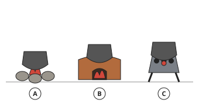

Check question: `h2-17-name` · multiple choice, level 1 · **authored key**, reused from practice

> What is fireplace B?

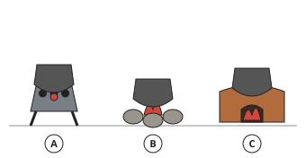

- ◻️ improved (mud) stove  
  _↳ feedback if chosen: Three stones: three-stone fireplace. A block of mud with an opening: improved stove. Metal pot on legs with charcoal: charcoal stove._
- ◻️ charcoal stove  
  _↳ feedback if chosen: Three stones: three-stone fireplace. A block of mud with an opening: improved stove. Metal pot on legs with charcoal: charcoal stove._
- ✅ three-stone fireplace

Full working after a second miss:

> Look at what holds the pot and what burns.  
> Fireplace B is the three-stone fireplace.  

**Card c17-2** (draft)

> An improved mud stove keeps the heat in, uses less wood and gives less smoke.
>
> _It may have a chimney._  

Check question: `h2-17-compare` · matching, level 1 · **authored key**, reused from practice

> Match each fireplace to a feature.

Right-hand side (shuffled): keeps the heat in and uses less wood · cheap but wastes heat and wood · little smoke, easy to carry, burns charcoal
- three-stone fireplace → **cheap but wastes heat and wood**
- improved (mud) stove → **keeps the heat in and uses less wood**
- charcoal stove → **little smoke, easy to carry, burns charcoal**

Full working after a second miss:

> The right pairs are:  
> three-stone fireplace → cheap but wastes heat and wood  
> improved (mud) stove → keeps the heat in and uses less wood  
> charcoal stove → little smoke, easy to carry, burns charcoal  

**Card c17-3** (draft)

> A charcoal stove gives little smoke, but never use it in a closed room.
>
> _Burning charcoal gives off carbon monoxide, a deadly gas._  

Check question: `h2-17-safe-card` · multiple choice, level 1 · **authored key**

> Why is an improved stove better for health than a three-stone fire?

- ◻️ It gives more smoke.  
  _↳ feedback if chosen: It gives less._
- ◻️ It needs more wood.  
  _↳ feedback if chosen: It needs less._
- ✅ It gives less smoke in the kitchen.
- ◻️ It is louder.  
  _↳ feedback if chosen: Noise is not the reason._

Full working after a second miss:

> Less smoke means healthier lungs and eyes.  
> So the answer is “It gives less smoke in the kitchen.”.  

**Worked example** (draft)

> In the drawing, which fireplace is labelled B, and how does it save firewood?

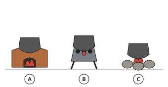

1. B is the charcoal stove.
2. It burns charcoal, not firewood, and keeps the heat under the pot.

**Answer:** charcoal stove

**Practice** `h2-17-name` · multiple choice, level 1 · **authored key**

> What is fireplace C?

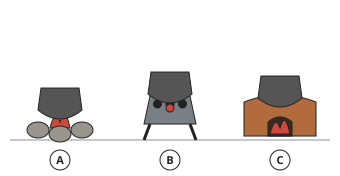

- ✅ improved (mud) stove
- ◻️ three-stone fireplace  
  _↳ feedback if chosen: Three stones: three-stone fireplace. A block of mud with an opening: improved stove. Metal pot on legs with charcoal: charcoal stove._
- ◻️ charcoal stove  
  _↳ feedback if chosen: Three stones: three-stone fireplace. A block of mud with an opening: improved stove. Metal pot on legs with charcoal: charcoal stove._

Full working after a second miss:

> Look at what holds the pot and what burns.  
> Fireplace C is the improved (mud) stove.  

> What is fireplace B?

- ◻️ three-stone fireplace  
  _↳ feedback if chosen: Three stones: three-stone fireplace. A block of mud with an opening: improved stove. Metal pot on legs with charcoal: charcoal stove._
- ✅ charcoal stove
- ◻️ improved (mud) stove  
  _↳ feedback if chosen: Three stones: three-stone fireplace. A block of mud with an opening: improved stove. Metal pot on legs with charcoal: charcoal stove._

Full working after a second miss:

> Look at what holds the pot and what burns.  
> Fireplace B is the charcoal stove.  

**Practice** `h2-17-compare` · matching, level 1 · **authored key**

> Match each fireplace to a feature.

Right-hand side (shuffled): little smoke, easy to carry, burns charcoal · keeps the heat in and uses less wood · cheap but wastes heat and wood
- improved (mud) stove → **keeps the heat in and uses less wood**
- three-stone fireplace → **cheap but wastes heat and wood**
- charcoal stove → **little smoke, easy to carry, burns charcoal**

Full working after a second miss:

> The right pairs are:  
> improved (mud) stove → keeps the heat in and uses less wood  
> three-stone fireplace → cheap but wastes heat and wood  
> charcoal stove → little smoke, easy to carry, burns charcoal  

> Match each fireplace to a feature.

Right-hand side (shuffled): little smoke, easy to carry, burns charcoal · keeps the heat in and uses less wood · cheap but wastes heat and wood
- charcoal stove → **little smoke, easy to carry, burns charcoal**
- three-stone fireplace → **cheap but wastes heat and wood**
- improved (mud) stove → **keeps the heat in and uses less wood**

Full working after a second miss:

> The right pairs are:  
> charcoal stove → little smoke, easy to carry, burns charcoal  
> three-stone fireplace → cheap but wastes heat and wood  
> improved (mud) stove → keeps the heat in and uses less wood  

**Practice** `h2-17-safe` · multiple choice, level 2 · **authored key**

> Why is an improved stove better for health than a three-stone fire?

- ◻️ It gives more smoke.  
  _↳ feedback if chosen: It gives less._
- ◻️ It needs more wood.  
  _↳ feedback if chosen: It needs less._
- ◻️ It is louder.  
  _↳ feedback if chosen: Noise is not the reason._
- ✅ It gives less smoke in the kitchen.

Full working after a second miss:

> Less smoke means healthier lungs and eyes.  
> So the answer is “It gives less smoke in the kitchen.”.  

> Why must a charcoal stove never be used in a closed room?

- ◻️ It gets too cold.  
  _↳ feedback if chosen: It gives heat._
- ◻️ It makes the room wet.  
  _↳ feedback if chosen: It does not wet the room._
- ✅ It gives off carbon monoxide, a deadly gas.
- ◻️ It smells of flowers.  
  _↳ feedback if chosen: That is not the danger._

Full working after a second miss:

> Carbon monoxide can kill without warning.  
> So the answer is “It gives off carbon monoxide, a deadly gas.”.  

**Practice** `h2-17-spot` · spot the error, level 3 · **authored key**

> Which statement is wrong?

- ✅ A charcoal stove is safe in a closed bedroom.  
  _↳ explanation: Carbon monoxide makes it deadly in a closed room._
- ◻️ Smoke harms the eyes and lungs.
- ◻️ A three-stone fire wastes heat.
- ◻️ An improved stove uses less wood.

Full working after a second miss:

> The wrong statement is “A charcoal stove is safe in a closed bedroom.”.  
> Carbon monoxide makes it deadly in a closed room.  

> Which statement is wrong?

- ◻️ A charcoal stove is easy to carry.
- ✅ An improved stove uses more wood than a three-stone fire.  
  _↳ explanation: It uses less wood._
- ◻️ A three-stone fire wastes heat.
- ◻️ An improved stove uses less wood.

Full working after a second miss:

> The wrong statement is “An improved stove uses more wood than a three-stone fire.”.  
> It uses less wood.  

## Lesson 18: Advantages and disadvantages of a traditional kitchen, Care of a traditional kitchen

Prerequisites: 16, 17 · Skill: h2-18 (Advantages, disadvantages and care of a traditional kitchen)

**Note** (draft)

> Advantages: built with cheap local materials; uses local fuels; the smoke rack preserves food; a separate hut keeps smoke and fire away from the house; a place where the family gathers.
> Disadvantages: smoke irritates the eyes and lungs; walls and pots get dirty with soot; risk of fire (thatched roofs); hard work fetching firewood; cutting trees harms the environment; less hygienic floors.
> Care of a traditional kitchen:
> • sweep daily and remove ashes when the fire is cold;
> • keep firewood dry and stacked away from the fire;
> • wash pots and utensils after use and store them on a shelf;
> • cover food and water; keep animals out;
> • clean soot from walls and the smoke rack regularly;
> • put the fire out after cooking and keep water or sand near for emergencies.

**Card c18-1** (draft)

> A traditional kitchen is cheap and preserves food, but is smoky and risky.
>
> _Advantage: local materials._  
> _Disadvantage: smoke._  

Check question: `h2-18-sort` · matching, level 1 · **authored key**, reused from practice

> Sort: advantage or disadvantage of a traditional kitchen?

Groups: advantage · disadvantage
- smoke harms eyes and lungs → **disadvantage**
- cheap local materials → **advantage**
- risk of fire → **disadvantage**
- cutting trees for firewood → **disadvantage**

Full working after a second miss:

> The right pairs are:  
> smoke harms eyes and lungs → disadvantage  
> cheap local materials → advantage  
> risk of fire → disadvantage  
> cutting trees for firewood → disadvantage  

**Card c18-2** (draft)

> Care: sweep daily, remove cold ashes, keep firewood dry, wash and store utensils.
>
> _Clean soot from the walls regularly._  

Check question: `h2-18-care` · ordering, level 1 · **authored key**, reused from practice

> Put the cleaning routine after cooking in order.

Shown as: Put out the fire · Sweep the floor · Wash the pots and utensils · Remove the ashes when they are cold · Store them on the shelf
Correct order: Put out the fire → Wash the pots and utensils → Store them on the shelf → Sweep the floor → Remove the ashes when they are cold

Full working after a second miss:

> The correct order is: Put out the fire → Wash the pots and utensils → Store them on the shelf → Sweep the floor → Remove the ashes when they are cold.  

**Card c18-3** (draft)

> Safety: put the fire out after cooking; keep water or sand nearby.
>
> _Keep children away from the fire._  

Check question: `h2-18-safe-card` · multiple choice, level 1 · **authored key**

> Why should firewood be kept dry?

- ✅ Dry wood burns well with less smoke.
- ◻️ Wet wood gives no smoke.  
  _↳ feedback if chosen: Wet wood gives more smoke._
- ◻️ Wet wood burns hotter.  
  _↳ feedback if chosen: Wet wood burns poorly._
- ◻️ Dry wood rots.  
  _↳ feedback if chosen: Wet wood rots._

Full working after a second miss:

> Dry wood burns cleanly.  
> So the answer is “Dry wood burns well with less smoke.”.  

**Worked example** (draft)

> A traditional kitchen has a thatched roof. Give two safety rules.

1. Never leave the fire burning when nobody is in the kitchen, and put it out after cooking.
2. Keep a bucket of water or sand near, and keep the fire low under the roof.

**Answer:** Put the fire out after cooking; keep water or sand nearby.

**Practice** `h2-18-sort` · matching, level 1 · **authored key**

> Sort: advantage or disadvantage of a traditional kitchen?

Groups: advantage · disadvantage
- cutting trees for firewood → **disadvantage**
- smoke rack preserves food → **advantage**
- cheap local materials → **advantage**
- risk of fire → **disadvantage**

Full working after a second miss:

> The right pairs are:  
> cutting trees for firewood → disadvantage  
> smoke rack preserves food → advantage  
> cheap local materials → advantage  
> risk of fire → disadvantage  

> Sort: advantage or disadvantage of a traditional kitchen?

Groups: advantage · disadvantage
- uses local fuels → **advantage**
- smoke harms eyes and lungs → **disadvantage**
- risk of fire → **disadvantage**
- cheap local materials → **advantage**

Full working after a second miss:

> The right pairs are:  
> uses local fuels → advantage  
> smoke harms eyes and lungs → disadvantage  
> risk of fire → disadvantage  
> cheap local materials → advantage  

**Practice** `h2-18-care` · ordering, level 1 · **authored key**

> Put the cleaning routine after cooking in order.

Shown as: Wash the pots and utensils · Store them on the shelf · Put out the fire · Remove the ashes when they are cold · Sweep the floor
Correct order: Put out the fire → Wash the pots and utensils → Store them on the shelf → Sweep the floor → Remove the ashes when they are cold

Full working after a second miss:

> The correct order is: Put out the fire → Wash the pots and utensils → Store them on the shelf → Sweep the floor → Remove the ashes when they are cold.  

> Put the cleaning routine after cooking in order.

Shown as: Remove the ashes when they are cold · Store them on the shelf · Sweep the floor · Wash the pots and utensils · Put out the fire
Correct order: Put out the fire → Wash the pots and utensils → Store them on the shelf → Sweep the floor → Remove the ashes when they are cold

Full working after a second miss:

> The correct order is: Put out the fire → Wash the pots and utensils → Store them on the shelf → Sweep the floor → Remove the ashes when they are cold.  

**Practice** `h2-18-safe` · multiple choice, level 2 · **authored key**

> Why should firewood be kept dry?

- ◻️ Dry wood rots.  
  _↳ feedback if chosen: Wet wood rots._
- ◻️ Wet wood burns hotter.  
  _↳ feedback if chosen: Wet wood burns poorly._
- ✅ Dry wood burns well with less smoke.
- ◻️ Wet wood gives no smoke.  
  _↳ feedback if chosen: Wet wood gives more smoke._

Full working after a second miss:

> Dry wood burns cleanly.  
> So the answer is “Dry wood burns well with less smoke.”.  

> Why should firewood be kept dry?

- ◻️ Wet wood gives no smoke.  
  _↳ feedback if chosen: Wet wood gives more smoke._
- ◻️ Dry wood rots.  
  _↳ feedback if chosen: Wet wood rots._
- ◻️ Wet wood burns hotter.  
  _↳ feedback if chosen: Wet wood burns poorly._
- ✅ Dry wood burns well with less smoke.

Full working after a second miss:

> Dry wood burns cleanly.  
> So the answer is “Dry wood burns well with less smoke.”.  

**Practice** `h2-18-spot` · spot the error, level 3 · **authored key**

> Which statement is wrong?

- ✅ Throw hot ashes onto the thatched roof.  
  _↳ explanation: That can start a fire._
- ◻️ Sweep the kitchen daily.
- ◻️ Put the fire out after cooking.
- ◻️ Smoke can harm the eyes.

Full working after a second miss:

> The wrong statement is “Throw hot ashes onto the thatched roof.”.  
> That can start a fire.  

> Which statement is wrong?

- ◻️ Sweep the kitchen daily.
- ◻️ Keep firewood dry.
- ◻️ Smoke can harm the eyes.
- ✅ Leave the fire burning all night with nobody watching.  
  _↳ explanation: Never leave a fire unattended._

Full working after a second miss:

> The wrong statement is “Leave the fire burning all night with nobody watching.”.  
> Never leave a fire unattended.  

## Lesson 19: Notion of modern kitchen, Kitchen planning and management, Different shapes of modern kitchens,

Prerequisites: none · Skill: h2-19 (The modern kitchen: planning, management and shapes)

**Note** (draft)

> A modern kitchen is inside the house, with running water, electricity or gas, fitted units and a sink.
> Planning: the work triangle joins the sink, the cooker and the fridge. Each side should be about 1.2 m to 2.7 m, and the total 4 m to 7.9 m, so the cook does not walk too far.
> Management: keep work flowing in order (store → prepare → cook → serve → wash), keep surfaces clear, store things near where they are used.
> Shapes (seen from above):
> • one-wall (single-line): everything along one wall; small kitchens;
> • galley (corridor): two parallel rows;
> • L-shaped: two walls meeting at a corner;
> • U-shaped: three walls; much storage;
> • island: an extra free-standing counter in the middle; needs a big room.

**Card c19-1** (draft)

> The work triangle joins the sink, the cooker and the fridge.
>
> _Short sides save steps; very short sides make the kitchen cramped._  

Check question: `h2-19-total` · number, level 1 · computed by rule, reused from practice

> The sides of a work triangle are 1.7 m, 2.1 m and 2.5 m. What is its total length?

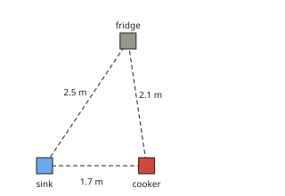

Answer: **6.3 m**

Full working after a second miss:

> Add the three sides.  
> 1.7 + 2.1 + 2.5 = 6.3 m.  

**Card c19-2** (draft)

> Kitchen shapes: one-wall, galley, L-shaped, U-shaped, island.
>
> _U-shaped: counters on three walls._  

Check question: `h2-19-shape` · multiple choice, level 1 · **authored key**, reused from practice

> The counters are shaded. Which kitchen shape is this?

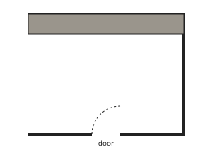

- ◻️ U-shaped  
  _↳ feedback if chosen: One wall: one-wall. Two facing rows: galley. Two walls at a corner: L. Three walls: U. A counter in the middle: island._
- ◻️ galley (corridor)  
  _↳ feedback if chosen: One wall: one-wall. Two facing rows: galley. Two walls at a corner: L. Three walls: U. A counter in the middle: island._
- ◻️ L-shaped  
  _↳ feedback if chosen: One wall: one-wall. Two facing rows: galley. Two walls at a corner: L. Three walls: U. A counter in the middle: island._
- ✅ one-wall (single-line)

Full working after a second miss:

> Look at which walls have counters.  
> This is the one-wall (single-line) kitchen.  

**Card c19-3** (draft)

> Good management follows the order of work: store, prepare, cook, serve, wash.
>
> _Keep things near where they are used._  

Check question: `h2-19-order-card` · ordering, level 1 · **authored key**

> Put the order of work in a kitchen in order.

Shown as: Serve · Wash up · Store · Cook · Prepare
Correct order: Store → Prepare → Cook → Serve → Wash up

Full working after a second miss:

> The correct order is: Store → Prepare → Cook → Serve → Wash up.  

**Worked example** (draft)

> In a kitchen the sink–cooker side is 1.8 m, cooker–fridge 2.1 m and fridge–sink 2.4 m. Is the work triangle well planned?

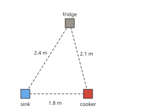

1. Total = 1.8 + 2.1 + 2.4 = 6.3 m.
2. Each side is between 1.2 m and 2.7 m, and the total is between 4 m and 7.9 m.
3. it is well planned

**Answer:** Yes

**Practice** `h2-19-total` · number, level 1 · computed by rule

> The sides of a work triangle are 1.3 m, 1.8 m and 2.1 m. What is its total length?

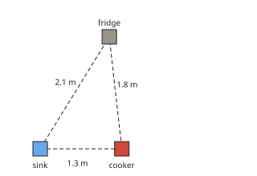

Answer: **5.2 m**

Full working after a second miss:

> Add the three sides.  
> 1.3 + 1.8 + 2.1 = 5.2 m.  

> The sides of a work triangle are 2.6 m, 1.9 m and 2.7 m. What is its total length?

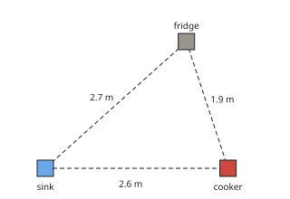

Answer: **7.2 m**

Full working after a second miss:

> Add the three sides.  
> 2.6 + 1.9 + 2.7 = 7.2 m.  

**Practice** `h2-19-shape` · multiple choice, level 1 · **authored key**

> The counters are shaded. Which kitchen shape is this?

- ◻️ U-shaped  
  _↳ feedback if chosen: One wall: one-wall. Two facing rows: galley. Two walls at a corner: L. Three walls: U. A counter in the middle: island._
- ◻️ one-wall (single-line)  
  _↳ feedback if chosen: One wall: one-wall. Two facing rows: galley. Two walls at a corner: L. Three walls: U. A counter in the middle: island._
- ◻️ island  
  _↳ feedback if chosen: One wall: one-wall. Two facing rows: galley. Two walls at a corner: L. Three walls: U. A counter in the middle: island._
- ✅ L-shaped

Full working after a second miss:

> Look at which walls have counters.  
> This is the L-shaped kitchen.  

> The counters are shaded. Which kitchen shape is this?

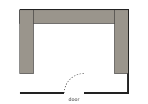

- ◻️ galley (corridor)  
  _↳ feedback if chosen: One wall: one-wall. Two facing rows: galley. Two walls at a corner: L. Three walls: U. A counter in the middle: island._
- ◻️ island  
  _↳ feedback if chosen: One wall: one-wall. Two facing rows: galley. Two walls at a corner: L. Three walls: U. A counter in the middle: island._
- ◻️ one-wall (single-line)  
  _↳ feedback if chosen: One wall: one-wall. Two facing rows: galley. Two walls at a corner: L. Three walls: U. A counter in the middle: island._
- ✅ U-shaped

Full working after a second miss:

> Look at which walls have counters.  
> This is the U-shaped kitchen.  

**Practice** `h2-19-order` · ordering, level 2 · **authored key**

> Put the order of work in a kitchen in order.

Shown as: Store · Serve · Wash up · Cook · Prepare
Correct order: Store → Prepare → Cook → Serve → Wash up

Full working after a second miss:

> The correct order is: Store → Prepare → Cook → Serve → Wash up.  

> Put the order of work in a kitchen in order.

Shown as: Wash up · Serve · Store · Cook · Prepare
Correct order: Store → Prepare → Cook → Serve → Wash up

Full working after a second miss:

> The correct order is: Store → Prepare → Cook → Serve → Wash up.  

**Practice** `h2-19-verdict` · multiple choice, level 3 · computed by rule

> A work triangle has sides 2.6 m, 1.9 m and 2 m. Is it well planned?

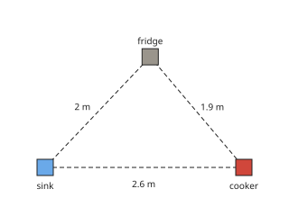

- ◻️ No  
  _↳ feedback if chosen: it is well planned_
- ✅ Yes

Full working after a second miss:

> Total = 6.5 m. Sides should be 1.2 m to 2.7 m and the total 4 m to 7.9 m.  
> it is well planned So: Yes.  

> A work triangle has sides 2.2 m, 1.5 m and 1.4 m. Is it well planned?

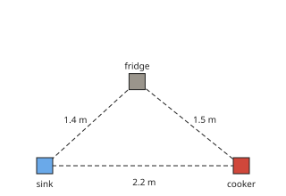

- ◻️ No  
  _↳ feedback if chosen: it is well planned_
- ✅ Yes

Full working after a second miss:

> Total = 5.1 m. Sides should be 1.2 m to 2.7 m and the total 4 m to 7.9 m.  
> it is well planned So: Yes.  

## Lesson 20: Identify kitchen elements/Kitchen units, types of kitchen units, Points to consider when planning a modern kitchen

Prerequisites: 19 · Skill: h2-20 (Kitchen units and points to consider in planning)

**Note** (draft)

> Kitchen elements (units):
> • base units: stand on the floor under the worktop, for heavy pots and pans;
> • wall units: fixed on the wall above the worktop, for light things (cups, plates, spices);
> • tall units: from the floor almost to the ceiling, for brooms or food in bulk;
> • the worktop (where food is prepared), the sink, the cooker and the fridge.
> Points to consider when planning a modern kitchen: the size and shape of the room; the work triangle; good lighting and ventilation (a window, an extractor); water supply and drainage; safe electrical sockets away from the sink; easy-to-clean surfaces; enough storage; safety (no cooker under a window with curtains, no cooker by a door); the budget.

**Card c20-1** (draft)

> Base units hold heavy things; wall units hold light things; tall units hold brooms or bulk food.
>
> _Heavy pots: base unit._  
> _Spices: wall unit._  

Check question: `h2-20-label` · multiple choice, level 1 · **authored key**, reused from practice

> Which letter shows the base unit?

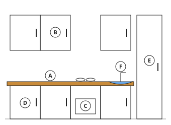

- ◻️ F  
  _↳ feedback if chosen: F is the sink._
- ✅ D
- ◻️ A  
  _↳ feedback if chosen: A is the worktop._
- ◻️ E  
  _↳ feedback if chosen: E is the tall unit._

Full working after a second miss:

> The base unit is labelled D.  

**Card c20-2** (draft)

> Plan for light, air, water, safe sockets, storage and easy cleaning.
>
> _Keep sockets away from the sink._  

Check question: `h2-20-plan` · multiple choice, level 1 · **authored key**, reused from practice

> Which is a good point when planning a modern kitchen?

- ◻️ sockets right next to the sink  
  _↳ feedback if chosen: Water and electricity together are dangerous._
- ✅ enough storage space
- ◻️ no window or extractor  
  _↳ feedback if chosen: Smoke and steam need to escape._

Full working after a second miss:

> The true statement is “enough storage space”.  
> “sockets right next to the sink” is false: Water and electricity together are dangerous.  
> “no window or extractor” is false: Smoke and steam need to escape.  

**Card c20-3** (draft)

> Never put the cooker under a window with curtains or next to a door.
>
> _Curtains can catch fire; a door can knock pots._  

Check question: `h2-20-safe-card` · multiple choice, level 1 · **authored key**

> Why should the cooker not be next to a door?

- ◻️ The cooker would get cold.  
  _↳ feedback if chosen: That is not the reason._
- ◻️ The door would get dirty.  
  _↳ feedback if chosen: That is not the main reason._
- ◻️ It looks untidy.  
  _↳ feedback if chosen: Safety is the reason._
- ✅ Someone opening the door could knock a hot pot.

Full working after a second miss:

> Accidents with hot pots are the danger.  
> So the answer is “Someone opening the door could knock a hot pot.”.  

**Worked example** (draft)

> In the drawing of the kitchen front, part A is fixed above the worktop. What is it and what should be stored in it?

1. It is a wall unit.
2. Store light things in it, such as cups, plates and spices, which are easy to lift down.

**Answer:** A wall unit: light things like cups and spices.

**Practice** `h2-20-label` · multiple choice, level 1 · **authored key**

> Which letter shows the base unit?

- ◻️ D  
  _↳ feedback if chosen: D is the sink._
- ✅ E
- ◻️ F  
  _↳ feedback if chosen: F is the worktop._
- ◻️ A  
  _↳ feedback if chosen: A is the tall unit._

Full working after a second miss:

> The base unit is labelled E.  

> Which letter shows the wall unit?

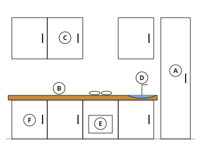

- ◻️ B  
  _↳ feedback if chosen: B is the worktop._
- ◻️ F  
  _↳ feedback if chosen: F is the base unit._
- ✅ C
- ◻️ A  
  _↳ feedback if chosen: A is the tall unit._

Full working after a second miss:

> The wall unit is labelled C.  

**Practice** `h2-20-plan` · multiple choice, level 1 · **authored key**

> Which is a good point when planning a modern kitchen?

- ✅ good lighting and ventilation
- ◻️ sockets right next to the sink  
  _↳ feedback if chosen: Water and electricity together are dangerous._
- ◻️ no window or extractor  
  _↳ feedback if chosen: Smoke and steam need to escape._

Full working after a second miss:

> The true statement is “good lighting and ventilation”.  
> “sockets right next to the sink” is false: Water and electricity together are dangerous.  
> “no window or extractor” is false: Smoke and steam need to escape.  

> Which is a good point when planning a modern kitchen?

- ✅ electrical sockets away from the sink
- ◻️ sockets right next to the sink  
  _↳ feedback if chosen: Water and electricity together are dangerous._
- ◻️ no window or extractor  
  _↳ feedback if chosen: Smoke and steam need to escape._

Full working after a second miss:

> The true statement is “electrical sockets away from the sink”.  
> “sockets right next to the sink” is false: Water and electricity together are dangerous.  
> “no window or extractor” is false: Smoke and steam need to escape.  

**Practice** `h2-20-safe` · multiple choice, level 2 · **authored key**

> Where should heavy pots be stored?

- ◻️ in a wall unit  
  _↳ feedback if chosen: Lifting heavy pots from high up is dangerous._
- ◻️ on the window sill  
  _↳ feedback if chosen: That is not safe._
- ✅ in a base unit
- ◻️ on top of the fridge  
  _↳ feedback if chosen: That is not safe._

Full working after a second miss:

> Heavy things go low, in base units.  
> So the answer is “in a base unit”.  

> Where should heavy pots be stored?

- ✅ in a base unit
- ◻️ on the window sill  
  _↳ feedback if chosen: That is not safe._
- ◻️ in a wall unit  
  _↳ feedback if chosen: Lifting heavy pots from high up is dangerous._
- ◻️ on top of the fridge  
  _↳ feedback if chosen: That is not safe._

Full working after a second miss:

> Heavy things go low, in base units.  
> So the answer is “in a base unit”.  

**Practice** `h2-20-spot` · spot the error, level 3 · **authored key**

> Which statement is wrong?

- ✅ The cooker is best under a curtained window.  
  _↳ explanation: Curtains can catch fire._
- ◻️ Sockets must be away from the sink.
- ◻️ Wall units hold light things.
- ◻️ A kitchen needs good ventilation.

Full working after a second miss:

> The wrong statement is “The cooker is best under a curtained window.”.  
> Curtains can catch fire.  

> Which statement is wrong?

- ◻️ Base units hold heavy pots.
- ◻️ A kitchen needs good ventilation.
- ✅ The cooker is best under a curtained window.  
  _↳ explanation: Curtains can catch fire._
- ◻️ Sockets must be away from the sink.

Full working after a second miss:

> The wrong statement is “The cooker is best under a curtained window.”.  
> Curtains can catch fire.  

## Lesson 21: Advantages of time management in the kitchen.Steps in timing and cooking food, Care of a modern kitchen

Prerequisites: 19 · Skill: h2-21 (Time management and care of a modern kitchen)

**Note** (draft)

> Time management in the kitchen means planning so that a meal is ready on time, with less stress and less wasted fuel.
> Advantages: meals are ready on time; less fuel and energy wasted; less tiredness; food is served hot and fresh; time is left for other work.
> Steps in timing a meal:
> 1. Plan the menu and list what is needed.
> 2. Find out how long each dish takes.
> 3. Start with the dish that takes longest (beans or meat), then the others.
> 4. Do the preparation (washing, cutting) while something is cooking.
> 5. Finish all dishes together and serve.
> Care of a modern kitchen: wipe spills at once; wash up after each meal; clean the cooker, sink and worktop daily; defrost and clean the fridge regularly; empty the bin daily; keep the floor dry; check gas and electrical appliances for safety.

**Card c21-1** (draft)

> Time management saves fuel and stress, and gets meals ready on time.
>
> _Food is served hot and fresh._  

Check question: `h2-21-why` · multiple choice, level 1 · **authored key**, reused from practice

> Which is an advantage of time management in the kitchen?

- ◻️ It makes food colder.  
  _↳ feedback if chosen: Food is served hot._
- ✅ Meals are ready on time with less fuel wasted.
- ◻️ It makes cooking slower.  
  _↳ feedback if chosen: It saves time._
- ◻️ It uses more fuel.  
  _↳ feedback if chosen: It saves fuel._

Full working after a second miss:

> Planning saves time, fuel and stress.  
> So the answer is “Meals are ready on time with less fuel wasted.”.  

**Card c21-2** (draft)

> Start the dish that takes longest first, and prepare other things while it cooks.
>
> _Beans first, then stew, then rice._  

Check question: `h2-21-steps` · ordering, level 1 · **authored key**, reused from practice

> Put the steps of timing a meal in order.

Shown as: Plan the menu and list what is needed · Start the dish that takes longest · Find out how long each dish takes · Finish together and serve · Prepare other dishes while it cooks
Correct order: Plan the menu and list what is needed → Find out how long each dish takes → Start the dish that takes longest → Prepare other dishes while it cooks → Finish together and serve

Full working after a second miss:

> The correct order is: Plan the menu and list what is needed → Find out how long each dish takes → Start the dish that takes longest → Prepare other dishes while it cooks → Finish together and serve.  

**Card c21-3** (draft)

> Care: wipe spills at once, wash up after meals, clean the fridge and empty the bin.
>
> _Keep the floor dry to prevent falls._  

Check question: `h2-21-care-card` · spot the error, level 1 · **authored key**

> Which care habit is wrong?

- ◻️ Empty the bin daily.
- ◻️ Wipe spills at once.
- ◻️ Defrost the fridge regularly.
- ✅ Never check the gas pipes.  
  _↳ explanation: Check gas appliances regularly for safety._

Full working after a second miss:

> The wrong statement is “Never check the gas pipes.”.  
> Check gas appliances regularly for safety.  

**Worked example** (draft)

> Beans take 90 minutes, rice 20 minutes and the stew 30 minutes. Lunch is at 12 o'clock. When should each be started?

1. Start the longest first: beans 90 minutes before 12:00, at 10:30.
2. The stew 30 minutes before: at 11:30.
3. The rice 20 minutes before: at 11:40.

**Answer:** Beans at 10:30, stew at 11:30, rice at 11:40.

**Practice** `h2-21-why` · multiple choice, level 1 · **authored key**

> Which is an advantage of time management in the kitchen?

- ✅ Meals are ready on time with less fuel wasted.
- ◻️ It makes food colder.  
  _↳ feedback if chosen: Food is served hot._
- ◻️ It makes cooking slower.  
  _↳ feedback if chosen: It saves time._
- ◻️ It uses more fuel.  
  _↳ feedback if chosen: It saves fuel._

Full working after a second miss:

> Planning saves time, fuel and stress.  
> So the answer is “Meals are ready on time with less fuel wasted.”.  

> Which is an advantage of time management in the kitchen?

- ◻️ It uses more fuel.  
  _↳ feedback if chosen: It saves fuel._
- ✅ Meals are ready on time with less fuel wasted.
- ◻️ It makes food colder.  
  _↳ feedback if chosen: Food is served hot._
- ◻️ It makes cooking slower.  
  _↳ feedback if chosen: It saves time._

Full working after a second miss:

> Planning saves time, fuel and stress.  
> So the answer is “Meals are ready on time with less fuel wasted.”.  

**Practice** `h2-21-steps` · ordering, level 1 · **authored key**

> Put the steps of timing a meal in order.

Shown as: Plan the menu and list what is needed · Prepare other dishes while it cooks · Finish together and serve · Start the dish that takes longest · Find out how long each dish takes
Correct order: Plan the menu and list what is needed → Find out how long each dish takes → Start the dish that takes longest → Prepare other dishes while it cooks → Finish together and serve

Full working after a second miss:

> The correct order is: Plan the menu and list what is needed → Find out how long each dish takes → Start the dish that takes longest → Prepare other dishes while it cooks → Finish together and serve.  

> Put the steps of timing a meal in order.

Shown as: Find out how long each dish takes · Prepare other dishes while it cooks · Finish together and serve · Plan the menu and list what is needed · Start the dish that takes longest
Correct order: Plan the menu and list what is needed → Find out how long each dish takes → Start the dish that takes longest → Prepare other dishes while it cooks → Finish together and serve

Full working after a second miss:

> The correct order is: Plan the menu and list what is needed → Find out how long each dish takes → Start the dish that takes longest → Prepare other dishes while it cooks → Finish together and serve.  

**Practice** `h2-21-start` · number, level 2 · computed by rule

> A dish takes 45 minutes to cook and must be ready at 19:00. At how many minutes past 18 should it start?

Answer: **15 minutes**
- Typed **45** (m) → “That is the cooking time. Count back from 19:00.”

Full working after a second miss:

> Count back 45 minutes from 19:00.  
> 19:00 − 45 minutes = 18:15.  

> A dish takes 40 minutes to cook and must be ready at 18:00. At how many minutes past 17 should it start?

Answer: **20 minutes**
- Typed **40** (m) → “That is the cooking time. Count back from 18:00.”

Full working after a second miss:

> Count back 40 minutes from 18:00.  
> 18:00 − 40 minutes = 17:20.  

**Practice** `h2-21-care` · spot the error, level 3 · **authored key**

> Which care habit is wrong?

- ◻️ Empty the bin daily.
- ◻️ Defrost the fridge regularly.
- ◻️ Clean the sink and worktop daily.
- ✅ Leave water on the floor to dry by itself.  
  _↳ explanation: Wipe it at once to prevent falls._

Full working after a second miss:

> The wrong statement is “Leave water on the floor to dry by itself.”.  
> Wipe it at once to prevent falls.  

> Which care habit is wrong?

- ◻️ Empty the bin daily.
- ◻️ Clean the sink and worktop daily.
- ✅ Leave greasy pots until the end of the week.  
  _↳ explanation: Wash up after each meal._
- ◻️ Wipe spills at once.

Full working after a second miss:

> The wrong statement is “Leave greasy pots until the end of the week.”.  
> Wash up after each meal.  

## Lesson 24: Types of small equipment, Diagram of small kitchen equipment in the kitchen

Prerequisites: none · Skill: h2-24 (Small kitchen equipment: types)

**Note** (draft)

> Small kitchen equipment are the hand tools and utensils used to prepare, cook and serve food. They are grouped by use:
> • preparing: knives, chopping board, grater, peeler, sieve, measuring cups and spoons, mortar and pestle, grinding stone, rolling pin, mixing bowls;
> • cooking: pots and saucepans, frying pan, kettle, steamer, wooden spoon, ladle, turning slice (spatula), tongs;
> • serving and storing: plates, dishes, cups, serving spoons, food flasks, containers with lids.
> Materials: stainless steel, aluminium, cast iron, enamel, wood, plastic, glass, clay (earthenware pots).
> A knife has a blade (with a sharp edge and a point), a bolster and a handle. A saucepan has a body, a base, a lid with a knob and a handle.

**Card c24-1** (draft)

> Small equipment are hand tools and utensils for preparing, cooking and serving food.
>
> _Knives and graters prepare food._  
> _Pots and ladles are for cooking._  

Check question: `h2-24-group` · multiple choice, level 1 · **authored key**, reused from practice

> Which group of small equipment does a ladle belong to?

- ◻️ preparing only  
  _↳ feedback if chosen: It is used with hot food._
- ◻️ storing  
  _↳ feedback if chosen: It does not store food._
- ✅ cooking and serving
- ◻️ cleaning  
  _↳ feedback if chosen: It does not clean._

Full working after a second miss:

> It stirs and serves soups.  
> So the answer is “cooking and serving”.  

**Card c24-2** (draft)

> They are made of steel, aluminium, cast iron, enamel, wood, plastic, glass or clay.
>
> _Wooden spoons do not get hot._  
> _Clay pots keep food warm._  

Check question: `h2-24-mat` · matching, level 1 · **authored key**, reused from practice

> Match each tool to a material it is often made of.

Right-hand side (shuffled): clay · glass or plastic · wood · stainless steel
- kitchen knife blade → **stainless steel**
- earthenware pot → **clay**
- measuring jug → **glass or plastic**
- wooden spoon → **wood**

Full working after a second miss:

> The right pairs are:  
> kitchen knife blade → stainless steel  
> earthenware pot → clay  
> measuring jug → glass or plastic  
> wooden spoon → wood  

**Card c24-3** (draft)

> A knife has a blade, a bolster and a handle; a saucepan has a body, a base, a lid and a handle.
>
> _The blade has the sharp edge._  
> _The lid has a knob._  

Check question: `h2-24-parts-card` · matching, level 1 · **authored key**

> Match each part to the tool it belongs to.

Right-hand side (shuffled): saucepan · grater · knife · sieve
- sharp holes → **grater**
- fine mesh → **sieve**
- lid with a knob → **saucepan**
- blade → **knife**

Full working after a second miss:

> The right pairs are:  
> sharp holes → grater  
> fine mesh → sieve  
> lid with a knob → saucepan  
> blade → knife  

**Worked example** (draft)

> To which group does a grater belong, and what is it used for?

1. It is used before cooking, so it is a preparing tool.
2. Its sharp holes cut food into small pieces or shreds (cassava, coconut, carrots).

**Answer:** A preparing tool, used to grate food into small pieces.

**Practice** `h2-24-group` · multiple choice, level 1 · **authored key**

> Which group of small equipment does a food flask belong to?

- ◻️ cooking  
  _↳ feedback if chosen: It does not heat food._
- ◻️ preparing  
  _↳ feedback if chosen: It does not cut or mix._
- ✅ serving and storing
- ◻️ cleaning  
  _↳ feedback if chosen: It does not clean._

Full working after a second miss:

> It keeps food hot or cold.  
> So the answer is “serving and storing”.  

> Which group of small equipment does a chopping board belong to?

- ◻️ storing  
  _↳ feedback if chosen: It is not for keeping food._
- ✅ preparing
- ◻️ large equipment  
  _↳ feedback if chosen: It is small._
- ◻️ serving  
  _↳ feedback if chosen: Food is cut on it before cooking._

Full working after a second miss:

> Food is cut on it.  
> So the answer is “preparing”.  

**Practice** `h2-24-mat` · matching, level 1 · **authored key**

> Match each tool to a material it is often made of.

Right-hand side (shuffled): stainless steel · glass or plastic · wood · clay
- measuring jug → **glass or plastic**
- wooden spoon → **wood**
- kitchen knife blade → **stainless steel**
- earthenware pot → **clay**

Full working after a second miss:

> The right pairs are:  
> measuring jug → glass or plastic  
> wooden spoon → wood  
> kitchen knife blade → stainless steel  
> earthenware pot → clay  

> Match each tool to a material it is often made of.

Right-hand side (shuffled): stainless steel · glass or plastic · clay · wood
- wooden spoon → **wood**
- earthenware pot → **clay**
- kitchen knife blade → **stainless steel**
- measuring jug → **glass or plastic**

Full working after a second miss:

> The right pairs are:  
> wooden spoon → wood  
> earthenware pot → clay  
> kitchen knife blade → stainless steel  
> measuring jug → glass or plastic  

**Practice** `h2-24-parts` · matching, level 2 · **authored key**

> Match each part to the tool it belongs to.

Right-hand side (shuffled): grater · sieve · saucepan · knife
- fine mesh → **sieve**
- sharp holes → **grater**
- lid with a knob → **saucepan**
- blade → **knife**

Full working after a second miss:

> The right pairs are:  
> fine mesh → sieve  
> sharp holes → grater  
> lid with a knob → saucepan  
> blade → knife  

> Match each part to the tool it belongs to.

Right-hand side (shuffled): sieve · grater · saucepan · knife
- fine mesh → **sieve**
- blade → **knife**
- sharp holes → **grater**
- lid with a knob → **saucepan**

Full working after a second miss:

> The right pairs are:  
> fine mesh → sieve  
> blade → knife  
> sharp holes → grater  
> lid with a knob → saucepan  

**Practice** `h2-24-spot` · spot the error, level 3 · **authored key**

> Which statement is wrong?

- ◻️ Wooden spoons do not get very hot.
- ✅ A refrigerator is a small kitchen tool.  
  _↳ explanation: It is large equipment._
- ◻️ A ladle is used for soups.
- ◻️ A grater is a preparing tool.

Full working after a second miss:

> The wrong statement is “A refrigerator is a small kitchen tool.”.  
> It is large equipment.  

> Which statement is wrong?

- ◻️ A sieve separates fine from coarse particles.
- ◻️ Wooden spoons do not get very hot.
- ✅ A chopping board is used to serve soup.  
  _↳ explanation: It is used to cut food on._
- ◻️ A ladle is used for soups.

Full working after a second miss:

> The wrong statement is “A chopping board is used to serve soup.”.  
> It is used to cut food on.  

## Lesson 25: Uses, Points to consider in the choice of the small equipment, Care of these equipment

Prerequisites: 24 · Skill: h2-25 (Small equipment: uses, choice and care)

**Note** (draft)

> Points to consider when choosing small equipment:
> • its use and the needs of the family;
> • the material: strong, safe, does not rust, easy to clean;
> • good quality and finish (no sharp edges, tight lids, firm handles that do not conduct heat);
> • size and weight; price and money available; storage space.
> Care:
> • wash in hot soapy water soon after use, rinse and dry well;
> • soak pots with burnt food before scrubbing; do not scrub non-stick pans with steel wool;
> • keep knives sharp and store them safely in a block or rack, never loose in water;
> • dry wooden tools quickly (they crack and grow mould if soaked);
> • store tools in clean, dry places; oil cast iron to stop rust.

**Card c25-1** (draft)

> Choose equipment for its use, a safe and strong material, good quality, size and price.
>
> _Handles should not get hot._  
> _Lids should fit tightly._  

Check question: `h2-25-choose` · multiple choice, level 1 · **authored key**, reused from practice

> Which is a good point when choosing a saucepan?

- ◻️ sharp edges  
  _↳ feedback if chosen: Edges should be smooth._
- ✅ a firm handle that does not get hot
- ◻️ a handle that gets very hot  
  _↳ feedback if chosen: Hot handles burn._
- ◻️ a loose lid  
  _↳ feedback if chosen: Lids should fit._

Full working after a second miss:

> Safe handles prevent burns.  
> So the answer is “a firm handle that does not get hot”.  

**Card c25-2** (draft)

> Wash equipment soon after use in hot soapy water, rinse and dry it.
>
> _Soak burnt pots first._  
> _Dry knives at once._  

Check question: `h2-25-wash` · multiple choice, level 1 · **authored key**, reused from practice

> When should kitchen tools be washed?

- ◻️ once a week  
  _↳ feedback if chosen: Food dries and germs grow._
- ◻️ never  
  _↳ feedback if chosen: Dirty tools spread germs._
- ✅ soon after use
- ◻️ only when visitors come  
  _↳ feedback if chosen: They must be washed every time._

Full working after a second miss:

> Food comes off easily and germs do not grow.  
> So the answer is “soon after use”.  

**Card c25-3** (draft)

> Do not soak wooden tools or scrub non-stick pans with steel wool; store knives safely.
>
> _Steel wool scratches the non-stick coating._  
> _Knives go in a rack._  

Check question: `h2-25-care-card` · multiple choice, level 1 · **authored key**

> Why should knives not be left in a bowl of washing water?

- ✅ Someone could cut their hand on a hidden blade.
- ◻️ They become blunt at once.  
  _↳ feedback if chosen: The main danger is cuts._
- ◻️ It makes them rust-free.  
  _↳ feedback if chosen: Water can rust them._
- ◻️ The water becomes sweet.  
  _↳ feedback if chosen: That is not true._

Full working after a second miss:

> A hidden blade is dangerous.  
> So the answer is “Someone could cut their hand on a hidden blade.”.  

**Worked example** (draft)

> How should a wooden spoon be cared for?

1. Wash it quickly in hot soapy water; do not leave it soaking.
2. Dry it well and store it in a dry place, so it does not crack or grow mould.

**Answer:** Wash quickly, dry well and store dry; never soak it.

**Practice** `h2-25-choose` · multiple choice, level 1 · **authored key**

> Why is stainless steel a good material for knives?

- ◻️ It melts easily.  
  _↳ feedback if chosen: It does not melt in the kitchen._
- ✅ It is strong and does not rust.
- ◻️ It rusts quickly.  
  _↳ feedback if chosen: It resists rust._
- ◻️ It is soft like plastic.  
  _↳ feedback if chosen: It is hard._

Full working after a second miss:

> Strong and rust-free.  
> So the answer is “It is strong and does not rust.”.  

> Which is a good point when choosing a saucepan?

- ✅ a firm handle that does not get hot
- ◻️ a handle that gets very hot  
  _↳ feedback if chosen: Hot handles burn._
- ◻️ a loose lid  
  _↳ feedback if chosen: Lids should fit._
- ◻️ sharp edges  
  _↳ feedback if chosen: Edges should be smooth._

Full working after a second miss:

> Safe handles prevent burns.  
> So the answer is “a firm handle that does not get hot”.  

**Practice** `h2-25-wash` · multiple choice, level 1 · **authored key**

> When should kitchen tools be washed?

- ✅ soon after use
- ◻️ once a week  
  _↳ feedback if chosen: Food dries and germs grow._
- ◻️ never  
  _↳ feedback if chosen: Dirty tools spread germs._
- ◻️ only when visitors come  
  _↳ feedback if chosen: They must be washed every time._

Full working after a second miss:

> Food comes off easily and germs do not grow.  
> So the answer is “soon after use”.  

> When should kitchen tools be washed?

- ◻️ only when visitors come  
  _↳ feedback if chosen: They must be washed every time._
- ◻️ never  
  _↳ feedback if chosen: Dirty tools spread germs._
- ✅ soon after use
- ◻️ once a week  
  _↳ feedback if chosen: Food dries and germs grow._

Full working after a second miss:

> Food comes off easily and germs do not grow.  
> So the answer is “soon after use”.  

**Practice** `h2-25-care` · multiple choice, level 2 · **authored key**

> Why should knives not be left in a bowl of washing water?

- ◻️ They become blunt at once.  
  _↳ feedback if chosen: The main danger is cuts._
- ◻️ The water becomes sweet.  
  _↳ feedback if chosen: That is not true._
- ✅ Someone could cut their hand on a hidden blade.
- ◻️ It makes them rust-free.  
  _↳ feedback if chosen: Water can rust them._

Full working after a second miss:

> A hidden blade is dangerous.  
> So the answer is “Someone could cut their hand on a hidden blade.”.  

> Why should a wooden spoon not be left soaking in water?

- ✅ It swells, cracks and can grow mould.
- ◻️ It melts.  
  _↳ feedback if chosen: Wood does not melt._
- ◻️ It becomes metal.  
  _↳ feedback if chosen: Wood stays wood._
- ◻️ It becomes sharper.  
  _↳ feedback if chosen: That is not true._

Full working after a second miss:

> Wood absorbs water.  
> So the answer is “It swells, cracks and can grow mould.”.  

**Practice** `h2-25-spot` · spot the error, level 3 · **authored key**

> Which statement about choice and care is wrong?

- ◻️ Oil cast iron to stop rust.
- ✅ Soak wooden spoons overnight to clean them.  
  _↳ explanation: Wood cracks and grows mould when soaked._
- ◻️ Lids should fit tightly.
- ◻️ Store tools in a clean dry place.

Full working after a second miss:

> The wrong statement is “Soak wooden spoons overnight to clean them.”.  
> Wood cracks and grows mould when soaked.  

> Which statement about choice and care is wrong?

- ◻️ Lids should fit tightly.
- ✅ Soak wooden spoons overnight to clean them.  
  _↳ explanation: Wood cracks and grows mould when soaked._
- ◻️ Store tools in a clean dry place.
- ◻️ Dry knives after washing.

Full working after a second miss:

> The wrong statement is “Soak wooden spoons overnight to clean them.”.  
> Wood cracks and grows mould when soaked.  

## Lesson 26: Types (freezers, Refrigerator, Dish washer, Uses

Prerequisites: 24 · Skill: h2-26 (Large kitchen equipment: types and uses)

**Note** (draft)

> Large kitchen equipment are big appliances and fittings that usually stay in one place.
> • Cooker (stove): gas, electric, kerosene or charcoal; with burners (hobs or rings), an oven and a grill. Used for boiling, frying, baking and grilling.
> • Refrigerator (fridge): keeps food cool (about 0–5 °C) to slow the growth of germs; it has a freezer box, shelves, a vegetable drawer and door racks.
> • Freezer: keeps food frozen (about −18 °C) for weeks or months: meat, fish, ice.
> • Dishwasher: washes, rinses and dries plates and pots with hot water and detergent.
> • Sink, cupboards and worktops are large fittings.
> Most large equipment use electricity or gas, so they must be used safely.

**Card c26-1** (draft)

> Large equipment are big appliances that stay in one place: cooker, fridge, freezer, dishwasher.
>
> _A cooker has burners and an oven._  
> _The sink is a large fitting._  

Check question: `h2-26-types` · multiple choice, level 1 · **authored key**, reused from practice

> Which large equipment washes and dries plates?

- ◻️ the fridge  
  _↳ feedback if chosen: It cools food._
- ◻️ the cooker  
  _↳ feedback if chosen: It cooks food._
- ◻️ the freezer  
  _↳ feedback if chosen: It freezes food._
- ✅ the dishwasher

Full working after a second miss:

> A dishwasher cleans dishes.  
> So the answer is “the dishwasher”.  

**Card c26-2** (draft)

> A fridge keeps food cool for days; a freezer keeps food frozen for months.
>
> _Fridge about 0–5 °C._  
> _Freezer about −18 °C._  

Check question: `h2-26-cold` · multiple choice, level 1 · **authored key**, reused from practice

> Why does a fridge help food to keep longer?

- ◻️ It adds salt.  
  _↳ feedback if chosen: It adds nothing._
- ◻️ It cooks food.  
  _↳ feedback if chosen: It cools food._
- ◻️ It kills all germs.  
  _↳ feedback if chosen: It only slows them._
- ✅ The cold slows the growth of germs.

Full working after a second miss:

> Germs grow slowly in the cold.  
> So the answer is “The cold slows the growth of germs.”.  

**Card c26-3** (draft)

> A dishwasher washes, rinses and dries dishes with hot water and detergent.
>
> _It saves time and water._  
> _It needs electricity and water._  

Check question: `h2-26-dish-card` · multiple choice, level 1 · **authored key**

> Which large equipment can use gas, electricity or kerosene?

- ◻️ a sink  
  _↳ feedback if chosen: A sink uses no fuel._
- ✅ a cooker
- ◻️ a cupboard  
  _↳ feedback if chosen: A cupboard uses no fuel._
- ◻️ a worktop  
  _↳ feedback if chosen: A worktop uses no fuel._

Full working after a second miss:

> Cookers have different fuels.  
> So the answer is “a cooker”.  

**Worked example** (draft)

> Which large equipment is best to keep fresh fish for two months, and why?

1. A fridge keeps food cool for only a few days.
2. A freezer keeps it frozen at about −18 °C, so germs cannot grow for months.

**Answer:** A freezer.

**Practice** `h2-26-types` · multiple choice, level 1 · **authored key**

> Which large equipment washes and dries plates?

- ✅ the dishwasher
- ◻️ the fridge  
  _↳ feedback if chosen: It cools food._
- ◻️ the freezer  
  _↳ feedback if chosen: It freezes food._
- ◻️ the cooker  
  _↳ feedback if chosen: It cooks food._

Full working after a second miss:

> A dishwasher cleans dishes.  
> So the answer is “the dishwasher”.  

> Which large equipment washes and dries plates?

- ✅ the dishwasher
- ◻️ the cooker  
  _↳ feedback if chosen: It cooks food._
- ◻️ the freezer  
  _↳ feedback if chosen: It freezes food._
- ◻️ the fridge  
  _↳ feedback if chosen: It cools food._

Full working after a second miss:

> A dishwasher cleans dishes.  
> So the answer is “the dishwasher”.  

**Practice** `h2-26-cold` · multiple choice, level 1 · **authored key**

> Why does a fridge help food to keep longer?

- ✅ The cold slows the growth of germs.
- ◻️ It adds salt.  
  _↳ feedback if chosen: It adds nothing._
- ◻️ It cooks food.  
  _↳ feedback if chosen: It cools food._
- ◻️ It kills all germs.  
  _↳ feedback if chosen: It only slows them._

Full working after a second miss:

> Germs grow slowly in the cold.  
> So the answer is “The cold slows the growth of germs.”.  

> Why does a fridge help food to keep longer?

- ✅ The cold slows the growth of germs.
- ◻️ It adds salt.  
  _↳ feedback if chosen: It adds nothing._
- ◻️ It kills all germs.  
  _↳ feedback if chosen: It only slows them._
- ◻️ It cooks food.  
  _↳ feedback if chosen: It cools food._

Full working after a second miss:

> Germs grow slowly in the cold.  
> So the answer is “The cold slows the growth of germs.”.  

**Practice** `h2-26-dish` · multiple choice, level 2 · **authored key**

> Which large equipment can use gas, electricity or kerosene?

- ◻️ a worktop  
  _↳ feedback if chosen: A worktop uses no fuel._
- ◻️ a sink  
  _↳ feedback if chosen: A sink uses no fuel._
- ◻️ a cupboard  
  _↳ feedback if chosen: A cupboard uses no fuel._
- ✅ a cooker

Full working after a second miss:

> Cookers have different fuels.  
> So the answer is “a cooker”.  

> Which is an advantage of a dishwasher?

- ◻️ It cooks food.  
  _↳ feedback if chosen: It only washes._
- ◻️ It needs no electricity.  
  _↳ feedback if chosen: It needs electricity._
- ◻️ It is cheap to buy.  
  _↳ feedback if chosen: It is expensive._
- ✅ It saves time and effort.

Full working after a second miss:

> It does the washing for you.  
> So the answer is “It saves time and effort.”.  

**Practice** `h2-26-spot` · spot the error, level 3 · **authored key**

> Which statement is wrong?

- ◻️ A fridge slows germs.
- ◻️ A cooker can have an oven and a grill.
- ◻️ A dishwasher uses detergent.
- ✅ A dishwasher is used to cook rice.  
  _↳ explanation: It washes dishes._

Full working after a second miss:

> The wrong statement is “A dishwasher is used to cook rice.”.  
> It washes dishes.  

> Which statement is wrong?

- ◻️ A cooker can have an oven and a grill.
- ✅ A dishwasher is used to cook rice.  
  _↳ explanation: It washes dishes._
- ◻️ A freezer keeps food frozen.
- ◻️ A fridge slows germs.

Full working after a second miss:

> The wrong statement is “A dishwasher is used to cook rice.”.  
> It washes dishes.  

## Lesson 27: Diagram of large kitchen equipment. Points to consider when chosing the equipment, care of large ketchen equipment

Prerequisites: 26 · Skill: h2-27 (Large equipment: parts, choice and care)

**Note** (draft)

> Parts of a refrigerator: the cabinet, the door with a rubber seal (gasket), the freezer box, shelves, the vegetable drawer, door racks, the thermostat (temperature control) and, at the back, the condenser coils.
> Parts of a cooker: burners (rings), control knobs, the oven with shelves, the grill and the oven door.
> Points to consider when choosing: the needs and size of the family; the space in the kitchen; the fuel or power available (gas, electricity, kerosene); energy saving; the price; safety; guarantee and after-sales service.
> Care:
> • fridge: defrost and clean regularly, keep the door closed, do not put hot food inside, leave space at the back for air;
> • cooker: wipe spills at once, clean burners, check gas pipes and turn off the gas after use;
> • unplug before cleaning electrical equipment.

**Card c27-1** (draft)

> A fridge has a door seal, shelves, a freezer box, a thermostat and condenser coils at the back.
>
> _The seal keeps cold air in._  
> _The thermostat sets the temperature._  

Check question: `h2-27-parts` · matching, level 1 · **authored key**, reused from practice

> Match each part of a refrigerator to its job.

Right-hand side (shuffled): controls the temperature · keeps the cold air inside · makes ice and freezes food · keeps fruit and vegetables fresh
- door seal → **keeps the cold air inside**
- thermostat → **controls the temperature**
- freezer box → **makes ice and freezes food**
- vegetable drawer → **keeps fruit and vegetables fresh**

Full working after a second miss:

> The right pairs are:  
> door seal → keeps the cold air inside  
> thermostat → controls the temperature  
> freezer box → makes ice and freezes food  
> vegetable drawer → keeps fruit and vegetables fresh  

**Card c27-2** (draft)

> Choose large equipment for the family size, kitchen space, fuel available, energy saving, price and guarantee.
>
> _No electricity: choose a gas cooker._  
> _A big family needs a bigger fridge._  

Check question: `h2-27-choose` · multiple choice, level 1 · **authored key**, reused from practice

> Why is a guarantee important when buying a fridge?

- ◻️ It is not important.  
  _↳ feedback if chosen: It protects your money._
- ◻️ It makes the fridge colder.  
  _↳ feedback if chosen: It does not change cooling._
- ◻️ It lowers the price of food.  
  _↳ feedback if chosen: It does not._
- ✅ It will be repaired or replaced if it breaks early.

Full working after a second miss:

> A guarantee protects the buyer.  
> So the answer is “It will be repaired or replaced if it breaks early.”.  

**Card c27-3** (draft)

> Defrost and clean the fridge; wipe cooker spills; turn off gas; unplug before cleaning.
>
> _Do not put hot food in the fridge._  
> _Check the gas pipe for leaks._  

Check question: `h2-27-care-card` · multiple choice, level 1 · **authored key**

> What should be done before cleaning an electric cooker?

- ◻️ Nothing.  
  _↳ feedback if chosen: Electricity is dangerous._
- ✅ Unplug it or switch it off at the mains.
- ◻️ Pour water on the hot rings.  
  _↳ feedback if chosen: That can cause shocks and burns._
- ◻️ Turn it on high.  
  _↳ feedback if chosen: That is dangerous._

Full working after a second miss:

> Avoid electric shock.  
> So the answer is “Unplug it or switch it off at the mains.”.  

**Worked example** (draft)

> Why is it bad if hot food is put straight into the fridge?

1. The hot food warms the inside of the fridge.
2. The fridge must work harder, using more electricity, and other food may spoil.

**Answer:** It wastes electricity and warms the other food.

**Practice** `h2-27-parts` · matching, level 1 · **authored key**

> Match each part of a refrigerator to its job.

Right-hand side (shuffled): keeps the cold air inside · keeps fruit and vegetables fresh · makes ice and freezes food · controls the temperature
- door seal → **keeps the cold air inside**
- freezer box → **makes ice and freezes food**
- thermostat → **controls the temperature**
- vegetable drawer → **keeps fruit and vegetables fresh**

Full working after a second miss:

> The right pairs are:  
> door seal → keeps the cold air inside  
> freezer box → makes ice and freezes food  
> thermostat → controls the temperature  
> vegetable drawer → keeps fruit and vegetables fresh  

> Match each part of a refrigerator to its job.

Right-hand side (shuffled): keeps the cold air inside · controls the temperature · keeps fruit and vegetables fresh · makes ice and freezes food
- vegetable drawer → **keeps fruit and vegetables fresh**
- thermostat → **controls the temperature**
- freezer box → **makes ice and freezes food**
- door seal → **keeps the cold air inside**

Full working after a second miss:

> The right pairs are:  
> vegetable drawer → keeps fruit and vegetables fresh  
> thermostat → controls the temperature  
> freezer box → makes ice and freezes food  
> door seal → keeps the cold air inside  

**Practice** `h2-27-choose` · multiple choice, level 1 · **authored key**

> Why is a guarantee important when buying a fridge?

- ◻️ It is not important.  
  _↳ feedback if chosen: It protects your money._
- ◻️ It makes the fridge colder.  
  _↳ feedback if chosen: It does not change cooling._
- ✅ It will be repaired or replaced if it breaks early.
- ◻️ It lowers the price of food.  
  _↳ feedback if chosen: It does not._

Full working after a second miss:

> A guarantee protects the buyer.  
> So the answer is “It will be repaired or replaced if it breaks early.”.  

> A family in a village has no electricity. Which cooker should they choose?

- ◻️ an electric cooker  
  _↳ feedback if chosen: It needs electricity._
- ◻️ an electric oven  
  _↳ feedback if chosen: It needs electricity._
- ✅ a gas or kerosene cooker
- ◻️ a microwave oven  
  _↳ feedback if chosen: It needs electricity._

Full working after a second miss:

> Choose the fuel that is available.  
> So the answer is “a gas or kerosene cooker”.  

**Practice** `h2-27-care` · multiple choice, level 2 · **authored key**

> What should you do after cooking with a gas cooker?

- ◻️ light another match  
  _↳ feedback if chosen: That is dangerous._
- ◻️ cover the cylinder with cloth  
  _↳ feedback if chosen: That does not stop leaks._
- ◻️ leave the gas on  
  _↳ feedback if chosen: Leaking gas can explode._
- ✅ turn off the gas at the cylinder

Full working after a second miss:

> Prevent gas leaks.  
> So the answer is “turn off the gas at the cylinder”.  

> What should you do after cooking with a gas cooker?

- ✅ turn off the gas at the cylinder
- ◻️ light another match  
  _↳ feedback if chosen: That is dangerous._
- ◻️ leave the gas on  
  _↳ feedback if chosen: Leaking gas can explode._
- ◻️ cover the cylinder with cloth  
  _↳ feedback if chosen: That does not stop leaks._

Full working after a second miss:

> Prevent gas leaks.  
> So the answer is “turn off the gas at the cylinder”.  

**Practice** `h2-27-spot` · spot the error, level 3 · **authored key**

> Which statement is wrong?

- ◻️ Wipe spills on the cooker at once.
- ✅ Put hot food straight into the fridge.  
  _↳ explanation: Cool it first._
- ◻️ Defrost the fridge regularly.
- ◻️ Unplug before cleaning.

Full working after a second miss:

> The wrong statement is “Put hot food straight into the fridge.”.  
> Cool it first.  

> Which statement is wrong?

- ◻️ Unplug before cleaning.
- ◻️ Keep the fridge door closed.
- ✅ Push the fridge tight against the wall.  
  _↳ explanation: Leave space for air at the back._
- ◻️ Wipe spills on the cooker at once.

Full working after a second miss:

> The wrong statement is “Push the fridge tight against the wall.”.  
> Leave space for air at the back.  

## Lesson 28: Types of labour saving equipment. (microwave oven, pressure cooker, blender, mixers, vacuum flask

Prerequisites: 26 · Skill: h2-28 (Labour-saving equipment: types)

**Note** (draft)

> Labour-saving equipment are appliances that reduce the time and effort needed for kitchen work.
> • Microwave oven: heats, cooks and defrosts food quickly.
> • Pressure cooker: cooks food (beans, tough meat, corn chaff) much faster than an ordinary pot.
> • Blender (liquidiser): blends, purées and grinds (tomatoes, pepper, juice, egusi).
> • Mixer: beats, whisks and mixes (cakes, eggs, dough).
> • Vacuum flask: keeps food or drinks hot or cold for many hours.
> • Others: food processor, electric kettle, toaster, rice cooker, electric grinder, kitchen scale.
> Most use electricity; the pressure cooker and vacuum flask do not.

**Card c28-1** (draft)

> Labour-saving equipment reduce the time and effort of kitchen work.
>
> _A blender grinds pepper in seconds._  
> _A mixer beats cake mixture._  

Check question: `h2-28-what` · multiple choice, level 1 · **authored key**, reused from practice

> Which equipment is best to beat eggs and sugar for a cake?

- ✅ a mixer
- ◻️ a freezer  
  _↳ feedback if chosen: It freezes food._
- ◻️ a vacuum flask  
  _↳ feedback if chosen: It keeps drinks hot._
- ◻️ a pressure cooker  
  _↳ feedback if chosen: It cooks food._

Full working after a second miss:

> A mixer beats and whisks.  
> So the answer is “a mixer”.  

**Card c28-2** (draft)

> A microwave heats food quickly; a pressure cooker cooks tough foods fast.
>
> _Microwave: reheating rice._  
> _Pressure cooker: beans and tough meat._  

Check question: `h2-28-cook` · multiple choice, level 1 · **authored key**, reused from practice

> What is labour-saving equipment?

- ✅ equipment that reduces the time and effort of work
- ◻️ equipment that makes work harder  
  _↳ feedback if chosen: It makes work easier._
- ◻️ only very old tools  
  _↳ feedback if chosen: Most are modern._
- ◻️ food that is ready to eat  
  _↳ feedback if chosen: It is equipment, not food._

Full working after a second miss:

> It saves labour.  
> So the answer is “equipment that reduces the time and effort of work”.  

**Card c28-3** (draft)

> A vacuum flask keeps food or drinks hot or cold for many hours.
>
> _Hot tea for a journey._  
> _Cold water at school._  

Check question: `h2-28-flask-card` · multiple choice, level 1 · **authored key**

> Which is an advantage of labour-saving equipment?

- ✅ saves time and energy for other work
- ◻️ needs no care  
  _↳ feedback if chosen: They need care._
- ◻️ never breaks  
  _↳ feedback if chosen: They can break._
- ◻️ always free to buy  
  _↳ feedback if chosen: They cost money._

Full working after a second miss:

> Work is done faster.  
> So the answer is “saves time and energy for other work”.  

**Worked example** (draft)

> How does a pressure cooker save labour when cooking dry beans?

1. Beans take hours in an ordinary pot.
2. A pressure cooker cooks them in a fraction of the time, saving fuel and effort.

**Answer:** It cooks the beans much faster, saving time and fuel.

**Practice** `h2-28-what` · multiple choice, level 1 · **authored key**

> Which equipment is best to grind tomatoes and pepper quickly?

- ✅ a blender
- ◻️ a toaster  
  _↳ feedback if chosen: It browns bread._
- ◻️ a vacuum flask  
  _↳ feedback if chosen: It keeps drinks hot._
- ◻️ a fridge  
  _↳ feedback if chosen: It cools food._

Full working after a second miss:

> A blender purées and grinds.  
> So the answer is “a blender”.  

> Which equipment is best to reheat a plate of rice in two minutes?

- ✅ a microwave oven
- ◻️ a mixer  
  _↳ feedback if chosen: It beats._
- ◻️ a vacuum flask  
  _↳ feedback if chosen: It keeps, but does not heat._
- ◻️ a freezer  
  _↳ feedback if chosen: It freezes._

Full working after a second miss:

> Microwaves heat food quickly.  
> So the answer is “a microwave oven”.  

**Practice** `h2-28-cook` · multiple choice, level 1 · **authored key**

> What is labour-saving equipment?

- ◻️ food that is ready to eat  
  _↳ feedback if chosen: It is equipment, not food._
- ◻️ equipment that makes work harder  
  _↳ feedback if chosen: It makes work easier._
- ✅ equipment that reduces the time and effort of work
- ◻️ only very old tools  
  _↳ feedback if chosen: Most are modern._

Full working after a second miss:

> It saves labour.  
> So the answer is “equipment that reduces the time and effort of work”.  

> What is labour-saving equipment?

- ◻️ equipment that makes work harder  
  _↳ feedback if chosen: It makes work easier._
- ◻️ only very old tools  
  _↳ feedback if chosen: Most are modern._
- ✅ equipment that reduces the time and effort of work
- ◻️ food that is ready to eat  
  _↳ feedback if chosen: It is equipment, not food._

Full working after a second miss:

> It saves labour.  
> So the answer is “equipment that reduces the time and effort of work”.  

**Practice** `h2-28-flask` · multiple choice, level 2 · **authored key**

> Which is an advantage of labour-saving equipment?

- ◻️ always free to buy  
  _↳ feedback if chosen: They cost money._
- ◻️ never breaks  
  _↳ feedback if chosen: They can break._
- ◻️ needs no care  
  _↳ feedback if chosen: They need care._
- ✅ saves time and energy for other work

Full working after a second miss:

> Work is done faster.  
> So the answer is “saves time and energy for other work”.  

> A pupil wants cold water at school all day. Which equipment helps?

- ◻️ a microwave  
  _↳ feedback if chosen: It heats._
- ◻️ a toaster  
  _↳ feedback if chosen: It browns bread._
- ✅ a vacuum flask
- ◻️ a pressure cooker  
  _↳ feedback if chosen: It cooks._

Full working after a second miss:

> The flask keeps it cold.  
> So the answer is “a vacuum flask”.  

**Practice** `h2-28-spot` · spot the error, level 3 · **authored key**

> Which statement is wrong?

- ◻️ A mixer beats eggs.
- ◻️ A pressure cooker cooks beans faster.
- ◻️ A vacuum flask keeps tea hot.
- ✅ A microwave oven keeps food frozen.  
  _↳ explanation: It heats food; a freezer freezes._

Full working after a second miss:

> The wrong statement is “A microwave oven keeps food frozen.”.  
> It heats food; a freezer freezes.  

> Which statement is wrong?

- ◻️ A vacuum flask keeps tea hot.
- ✅ A vacuum flask is used to cook beans.  
  _↳ explanation: It only keeps food hot or cold._
- ◻️ A pressure cooker cooks beans faster.
- ◻️ A blender grinds pepper.

Full working after a second miss:

> The wrong statement is “A vacuum flask is used to cook beans.”.  
> It only keeps food hot or cold.  

## Lesson 29: Diagrams of labour saving equipment

Prerequisites: 28 · Skill: h2-29 (Labour-saving equipment: parts)

**Note** (draft)

> Knowing the parts helps to use and care for equipment.
> Pressure cooker: the pan (body), the lid with a rubber gasket (sealing ring), the safety valve, the weight or pressure regulator on the vent pipe, and the handles.
> Blender: the motor base with speed buttons, the jug (goblet) with measurement marks, the blades at the bottom, the lid and the filler cap.
> Vacuum flask: the outer case, a double-walled glass or steel inner container with a vacuum between the walls, silvered (shiny) surfaces, the stopper and the cup.
> Microwave oven: the door with a window and safety lock, the turntable (glass plate), the control panel and timer.
> Mixer: the motor, speed control, the beaters (whisks) and the bowl.

**Card c29-1** (draft)

> A pressure cooker has a lid with a rubber gasket, a safety valve and a weight on the vent.
>
> _The gasket seals the lid._  
> _The safety valve lets out steam if the pressure is too high._  

Check question: `h2-29-pc` · matching, level 1 · **authored key**, reused from practice

> Match each part of a pressure cooker to its job.

Right-hand side (shuffled): seals the lid · controls the pressure · lets out steam if the pressure is too high · lift and lock the lid safely
- safety valve → **lets out steam if the pressure is too high**
- weight (regulator) → **controls the pressure**
- gasket (sealing ring) → **seals the lid**
- handles → **lift and lock the lid safely**

Full working after a second miss:

> The right pairs are:  
> safety valve → lets out steam if the pressure is too high  
> weight (regulator) → controls the pressure  
> gasket (sealing ring) → seals the lid  
> handles → lift and lock the lid safely  

**Card c29-2** (draft)

> A blender has a motor base, a jug with blades and a lid.
>
> _The blades are at the bottom of the jug._  
> _The speed buttons are on the base._  

Check question: `h2-29-bl` · multiple choice, level 1 · **authored key**, reused from practice

> Which part of a microwave oven turns the food round?

- ◻️ the door  
  _↳ feedback if chosen: The door closes the oven._
- ◻️ the plug  
  _↳ feedback if chosen: The plug brings power._
- ◻️ the timer  
  _↳ feedback if chosen: The timer sets the time._
- ✅ the turntable

Full working after a second miss:

> The turntable heats food evenly.  
> So the answer is “the turntable”.  

**Card c29-3** (draft)

> A vacuum flask has a double wall with a vacuum between, shiny surfaces and a stopper.
>
> _The vacuum stops conduction and convection._  
> _The shiny walls reduce radiation._  

Check question: `h2-29-fl-card` · multiple choice, level 1 · **authored key**

> Why are the inner walls of a vacuum flask shiny?

- ✅ to reflect heat radiation
- ◻️ to absorb more heat  
  _↳ feedback if chosen: Shiny surfaces reflect._
- ◻️ to look pretty only  
  _↳ feedback if chosen: They have a job._
- ◻️ to make it lighter  
  _↳ feedback if chosen: That is not why._

Full working after a second miss:

> Shiny walls reduce radiation.  
> So the answer is “to reflect heat radiation”.  

**Worked example** (draft)

> What is the job of the rubber gasket of a pressure cooker?

1. It fits round the edge of the lid.
2. It seals the lid so steam cannot escape and the pressure can build up.

**Answer:** It seals the lid to keep the steam and pressure in.

**Practice** `h2-29-pc` · matching, level 1 · **authored key**

> Match each part of a pressure cooker to its job.

Right-hand side (shuffled): lets out steam if the pressure is too high · controls the pressure · seals the lid · lift and lock the lid safely
- weight (regulator) → **controls the pressure**
- handles → **lift and lock the lid safely**
- safety valve → **lets out steam if the pressure is too high**
- gasket (sealing ring) → **seals the lid**

Full working after a second miss:

> The right pairs are:  
> weight (regulator) → controls the pressure  
> handles → lift and lock the lid safely  
> safety valve → lets out steam if the pressure is too high  
> gasket (sealing ring) → seals the lid  

> Match each part of a pressure cooker to its job.

Right-hand side (shuffled): controls the pressure · lift and lock the lid safely · seals the lid · lets out steam if the pressure is too high
- safety valve → **lets out steam if the pressure is too high**
- weight (regulator) → **controls the pressure**
- gasket (sealing ring) → **seals the lid**
- handles → **lift and lock the lid safely**

Full working after a second miss:

> The right pairs are:  
> safety valve → lets out steam if the pressure is too high  
> weight (regulator) → controls the pressure  
> gasket (sealing ring) → seals the lid  
> handles → lift and lock the lid safely  

**Practice** `h2-29-bl` · multiple choice, level 1 · **authored key**

> Which part of a microwave oven turns the food round?

- ◻️ the timer  
  _↳ feedback if chosen: The timer sets the time._
- ◻️ the plug  
  _↳ feedback if chosen: The plug brings power._
- ◻️ the door  
  _↳ feedback if chosen: The door closes the oven._
- ✅ the turntable

Full working after a second miss:

> The turntable heats food evenly.  
> So the answer is “the turntable”.  

> Which part of a microwave oven turns the food round?

- ✅ the turntable
- ◻️ the door  
  _↳ feedback if chosen: The door closes the oven._
- ◻️ the plug  
  _↳ feedback if chosen: The plug brings power._
- ◻️ the timer  
  _↳ feedback if chosen: The timer sets the time._

Full working after a second miss:

> The turntable heats food evenly.  
> So the answer is “the turntable”.  

**Practice** `h2-29-fl` · multiple choice, level 2 · **authored key**

> What is between the two walls of a vacuum flask?

- ◻️ cotton wool  
  _↳ feedback if chosen: That is not used._
- ✅ a vacuum (almost no air)
- ◻️ sand  
  _↳ feedback if chosen: Sand would carry heat._
- ◻️ water  
  _↳ feedback if chosen: Water would carry heat._

Full working after a second miss:

> No air means little heat transfer.  
> So the answer is “a vacuum (almost no air)”.  

> Why are the inner walls of a vacuum flask shiny?

- ✅ to reflect heat radiation
- ◻️ to make it lighter  
  _↳ feedback if chosen: That is not why._
- ◻️ to absorb more heat  
  _↳ feedback if chosen: Shiny surfaces reflect._
- ◻️ to look pretty only  
  _↳ feedback if chosen: They have a job._

Full working after a second miss:

> Shiny walls reduce radiation.  
> So the answer is “to reflect heat radiation”.  

**Practice** `h2-29-spot` · spot the error, level 3 · **authored key**

> Which statement is wrong?

- ✅ A vacuum flask is filled with air between its walls.  
  _↳ explanation: There is a vacuum between the walls._
- ◻️ A flask has a stopper.
- ◻️ A blender's motor is in the base.
- ◻️ A mixer has beaters.

Full working after a second miss:

> The wrong statement is “A vacuum flask is filled with air between its walls.”.  
> There is a vacuum between the walls.  

> Which statement is wrong?

- ◻️ A flask has a stopper.
- ◻️ A mixer has beaters.
- ✅ A vacuum flask is filled with air between its walls.  
  _↳ explanation: There is a vacuum between the walls._
- ◻️ A blender's motor is in the base.

Full working after a second miss:

> The wrong statement is “A vacuum flask is filled with air between its walls.”.  
> There is a vacuum between the walls.  

## Lesson 30: Principles and uses of labour saving equipment

Prerequisites: 29 · Skill: h2-30 (Labour-saving equipment: how they work)

**Note** (draft)

> Principles (how they work):
> • Pressure cooker: the sealed lid traps steam, so the pressure rises. At higher pressure water boils at a higher temperature (about 120 °C instead of 100 °C), so food cooks faster.
> • Microwave oven: microwaves make the water molecules in food vibrate, producing heat inside the food.
> • Vacuum flask: the vacuum stops heat moving by conduction and convection; the shiny walls reflect radiation; the stopper stops evaporation and convection at the top.
> • Blender and mixer: an electric motor turns blades or beaters at high speed.
> Uses:
> • saving time, fuel and effort;
> • helping working parents prepare meals quickly;
> • keeping food hot for school or work (flask).

**Card c30-1** (draft)

> In a pressure cooker, trapped steam raises the pressure and the boiling point, so food cooks faster.
>
> _Water boils at about 120 °C inside._  
> _Open pots boil at 100 °C._  

Check question: `h2-30-pc` · multiple choice, level 1 · **authored key**, reused from practice

> Why does food cook faster in a pressure cooker?

- ◻️ The food becomes smaller.  
  _↳ feedback if chosen: Size does not change._
- ◻️ It uses cold water.  
  _↳ feedback if chosen: The water is boiling._
- ◻️ The lid adds heat.  
  _↳ feedback if chosen: The lid traps steam._
- ✅ Water boils at a higher temperature under pressure.

Full working after a second miss:

> Higher pressure, higher boiling point.  
> So the answer is “Water boils at a higher temperature under pressure.”.  

**Card c30-2** (draft)

> Microwaves make water molecules in the food vibrate, heating the food from inside.
>
> _Food with water heats well._  
> _Never put metal in a microwave._  

Check question: `h2-30-mw` · multiple choice, level 1 · **authored key**, reused from practice

> How does a microwave oven heat food?

- ◻️ A flame burns under the food.  
  _↳ feedback if chosen: There is no flame._
- ◻️ Ice melts on it.  
  _↳ feedback if chosen: There is no ice._
- ✅ Microwaves make the water molecules in the food vibrate.
- ◻️ Hot coals heat it.  
  _↳ feedback if chosen: There are no coals._

Full working after a second miss:

> The vibrating molecules make heat.  
> So the answer is “Microwaves make the water molecules in the food vibrate.”.  

**Card c30-3** (draft)

> A vacuum flask stops conduction and convection with its vacuum and reflects radiation with shiny walls.
>
> _Keeps tea hot._  
> _Keeps juice cold._  

Check question: `h2-30-fl-card` · multiple choice, level 1 · **authored key**

> How does the vacuum in a flask keep tea hot?

- ◻️ It adds steam.  
  _↳ feedback if chosen: It adds nothing._
- ◻️ It cools the tea.  
  _↳ feedback if chosen: It keeps it hot._
- ✅ It stops heat escaping by conduction and convection.
- ◻️ It heats the tea.  
  _↳ feedback if chosen: It does not heat._

Full working after a second miss:

> Heat cannot pass through a vacuum by those ways.  
> So the answer is “It stops heat escaping by conduction and convection.”.  

**Worked example** (draft)

> Explain why beans cook faster in a pressure cooker.

1. The sealed lid traps the steam, so the pressure inside rises.
2. At higher pressure water boils at about 120 °C, hotter than 100 °C, so the beans cook faster.

**Answer:** The higher pressure raises the boiling point, so the food cooks at a higher temperature.

**Practice** `h2-30-pc` · multiple choice, level 1 · **authored key**

> About what temperature does water boil at inside a pressure cooker?

- ◻️ about 100 °C  
  _↳ feedback if chosen: That is in an open pot._
- ◻️ about 50 °C  
  _↳ feedback if chosen: That is too low._
- ✅ about 120 °C
- ◻️ about 0 °C  
  _↳ feedback if chosen: That is freezing._

Full working after a second miss:

> The pressure raises the boiling point.  
> So the answer is “about 120 °C”.  

> About what temperature does water boil at inside a pressure cooker?

- ◻️ about 0 °C  
  _↳ feedback if chosen: That is freezing._
- ◻️ about 100 °C  
  _↳ feedback if chosen: That is in an open pot._
- ✅ about 120 °C
- ◻️ about 50 °C  
  _↳ feedback if chosen: That is too low._

Full working after a second miss:

> The pressure raises the boiling point.  
> So the answer is “about 120 °C”.  

**Practice** `h2-30-mw` · multiple choice, level 1 · **authored key**

> How does a microwave oven heat food?

- ◻️ Hot coals heat it.  
  _↳ feedback if chosen: There are no coals._
- ✅ Microwaves make the water molecules in the food vibrate.
- ◻️ A flame burns under the food.  
  _↳ feedback if chosen: There is no flame._
- ◻️ Ice melts on it.  
  _↳ feedback if chosen: There is no ice._

Full working after a second miss:

> The vibrating molecules make heat.  
> So the answer is “Microwaves make the water molecules in the food vibrate.”.  

> How does a microwave oven heat food?

- ◻️ A flame burns under the food.  
  _↳ feedback if chosen: There is no flame._
- ◻️ Hot coals heat it.  
  _↳ feedback if chosen: There are no coals._
- ◻️ Ice melts on it.  
  _↳ feedback if chosen: There is no ice._
- ✅ Microwaves make the water molecules in the food vibrate.

Full working after a second miss:

> The vibrating molecules make heat.  
> So the answer is “Microwaves make the water molecules in the food vibrate.”.  

**Practice** `h2-30-fl` · multiple choice, level 2 · **authored key**

> How does the vacuum in a flask keep tea hot?

- ✅ It stops heat escaping by conduction and convection.
- ◻️ It cools the tea.  
  _↳ feedback if chosen: It keeps it hot._
- ◻️ It heats the tea.  
  _↳ feedback if chosen: It does not heat._
- ◻️ It adds steam.  
  _↳ feedback if chosen: It adds nothing._

Full working after a second miss:

> Heat cannot pass through a vacuum by those ways.  
> So the answer is “It stops heat escaping by conduction and convection.”.  

> How does the vacuum in a flask keep tea hot?

- ◻️ It adds steam.  
  _↳ feedback if chosen: It adds nothing._
- ◻️ It cools the tea.  
  _↳ feedback if chosen: It keeps it hot._
- ✅ It stops heat escaping by conduction and convection.
- ◻️ It heats the tea.  
  _↳ feedback if chosen: It does not heat._

Full working after a second miss:

> Heat cannot pass through a vacuum by those ways.  
> So the answer is “It stops heat escaping by conduction and convection.”.  

**Practice** `h2-30-spot` · spot the error, level 3 · **authored key**

> Which statement is wrong?

- ◻️ Microwaves heat the water in food.
- ◻️ Shiny walls reflect radiation.
- ✅ A vacuum flask works by heating its contents.  
  _↳ explanation: It only reduces heat loss or gain._
- ◻️ Pressure raises the boiling point of water.

Full working after a second miss:

> The wrong statement is “A vacuum flask works by heating its contents.”.  
> It only reduces heat loss or gain.  

> Which statement is wrong?

- ◻️ Shiny walls reflect radiation.
- ◻️ Pressure raises the boiling point of water.
- ◻️ A blender uses an electric motor.
- ✅ A vacuum flask works by heating its contents.  
  _↳ explanation: It only reduces heat loss or gain._

Full working after a second miss:

> The wrong statement is “A vacuum flask works by heating its contents.”.  
> It only reduces heat loss or gain.  

## Lesson 31: Things to consider when choosing the equipment.Care of labour saving equipment

Prerequisites: 30 · Skill: h2-31 (Labour-saving equipment: choice and care)

**Note** (draft)

> Things to consider when choosing:
> • Is it really needed? Will it be used often?
> • Source of power: is there regular electricity? What is the voltage (220 V in Cameroon)?
> • Price and running cost (electricity); spare parts and repairers nearby;
> • size, weight, storage space; easy to clean; safety features; guarantee and instructions.
> Care:
> • read and follow the maker's instructions;
> • unplug before cleaning; never put the motor base of a blender or mixer in water — wipe it with a damp cloth;
> • pressure cooker: check the gasket and valves, never overfill (no more than two-thirds full), let the pressure fall before opening;
> • flask: rinse with warm water, do not drop it (the glass breaks), dry it open;
> • microwave: clean spills, never run it empty.

**Card c31-1** (draft)

> Before buying, ask: is it needed, is there power, what does it cost to buy and run, are spare parts available?
>
> _Mains voltage is 220 V._  
> _Check the guarantee._  

Check question: `h2-31-choose` · multiple choice, level 1 · **authored key**, reused from practice

> Why check that spare parts are available?

- ✅ so that it can be repaired if it breaks
- ◻️ to make it cheaper today  
  _↳ feedback if chosen: That does not change the price._
- ◻️ it does not matter  
  _↳ feedback if chosen: It matters for repairs._
- ◻️ to make it faster  
  _↳ feedback if chosen: That does not change speed._

Full working after a second miss:

> Repairs need parts.  
> So the answer is “so that it can be repaired if it breaks”.  

**Card c31-2** (draft)

> Unplug before cleaning; wipe motor bases with a damp cloth, never put them in water.
>
> _Wash the blender jug only._  
> _Dry everything well._  

Check question: `h2-31-elec` · multiple choice, level 1 · **authored key**, reused from practice

> How should the motor base of a blender be cleaned?

- ◻️ never clean it  
  _↳ feedback if chosen: It must be kept clean._
- ✅ unplug it and wipe it with a damp cloth
- ◻️ put it in a bowl of water  
  _↳ feedback if chosen: Water damages the motor and can cause shocks._
- ◻️ wash it under the tap while plugged in  
  _↳ feedback if chosen: That is very dangerous._

Full working after a second miss:

> Keep water away from the motor.  
> So the answer is “unplug it and wipe it with a damp cloth”.  

**Card c31-3** (draft)

> Never overfill a pressure cooker and let the pressure fall before opening it.
>
> _No more than two-thirds full._  
> _Check the gasket and valves._  

Check question: `h2-31-pc-card` · multiple choice, level 1 · **authored key**

> How full may a pressure cooker be filled?

- ✅ no more than two-thirds full
- ◻️ full to the top  
  _↳ feedback if chosen: It needs space for steam._
- ◻️ overflowing  
  _↳ feedback if chosen: That is dangerous._
- ◻️ only one spoonful  
  _↳ feedback if chosen: That is too little to cook._

Full working after a second miss:

> Space is needed for steam.  
> So the answer is “no more than two-thirds full”.  

**Worked example** (draft)

> Why is opening a pressure cooker while it is still hissing dangerous?

1. The pressure inside is still high.
2. Opening it lets out very hot steam and food at once, causing serious burns.

**Answer:** Steam and boiling food can burst out and burn you.

**Practice** `h2-31-choose` · multiple choice, level 1 · **authored key**

> Which question should you ask before buying an electric blender?

- ◻️ Is it raining?  
  _↳ feedback if chosen: That does not matter._
- ◻️ How old is the seller?  
  _↳ feedback if chosen: That does not matter._
- ✅ Is there regular electricity at home?
- ◻️ What colour is the shop?  
  _↳ feedback if chosen: That does not matter._

Full working after a second miss:

> It needs electricity.  
> So the answer is “Is there regular electricity at home?”.  

> Why check that spare parts are available?

- ◻️ to make it faster  
  _↳ feedback if chosen: That does not change speed._
- ◻️ it does not matter  
  _↳ feedback if chosen: It matters for repairs._
- ✅ so that it can be repaired if it breaks
- ◻️ to make it cheaper today  
  _↳ feedback if chosen: That does not change the price._

Full working after a second miss:

> Repairs need parts.  
> So the answer is “so that it can be repaired if it breaks”.  

**Practice** `h2-31-elec` · multiple choice, level 1 · **authored key**

> How should the motor base of a blender be cleaned?

- ◻️ put it in a bowl of water  
  _↳ feedback if chosen: Water damages the motor and can cause shocks._
- ◻️ wash it under the tap while plugged in  
  _↳ feedback if chosen: That is very dangerous._
- ✅ unplug it and wipe it with a damp cloth
- ◻️ never clean it  
  _↳ feedback if chosen: It must be kept clean._

Full working after a second miss:

> Keep water away from the motor.  
> So the answer is “unplug it and wipe it with a damp cloth”.  

> What should you read before using new equipment?

- ◻️ nothing  
  _↳ feedback if chosen: Instructions keep you safe._
- ✅ the maker's instructions
- ◻️ a story book  
  _↳ feedback if chosen: That will not help._
- ◻️ a newspaper  
  _↳ feedback if chosen: That will not help._

Full working after a second miss:

> Follow the instructions.  
> So the answer is “the maker's instructions”.  

**Practice** `h2-31-pc` · multiple choice, level 2 · **authored key**

> How full may a pressure cooker be filled?

- ✅ no more than two-thirds full
- ◻️ only one spoonful  
  _↳ feedback if chosen: That is too little to cook._
- ◻️ full to the top  
  _↳ feedback if chosen: It needs space for steam._
- ◻️ overflowing  
  _↳ feedback if chosen: That is dangerous._

Full working after a second miss:

> Space is needed for steam.  
> So the answer is “no more than two-thirds full”.  

> When is it safe to open a pressure cooker?

- ◻️ when the valve is blocked  
  _↳ feedback if chosen: A blocked valve is dangerous._
- ✅ after the pressure has fallen
- ◻️ while it is hissing  
  _↳ feedback if chosen: Steam can burst out._
- ◻️ at once on high heat  
  _↳ feedback if chosen: That is dangerous._

Full working after a second miss:

> Let it cool and the pressure fall.  
> So the answer is “after the pressure has fallen”.  

**Practice** `h2-31-spot` · spot the error, level 3 · **authored key**

> Which statement is wrong?

- ◻️ Do not drop a vacuum flask.
- ◻️ Follow the maker's instructions.
- ◻️ Check the gasket of a pressure cooker.
- ✅ Fill a pressure cooker to the very top.  
  _↳ explanation: No more than two-thirds full._

Full working after a second miss:

> The wrong statement is “Fill a pressure cooker to the very top.”.  
> No more than two-thirds full.  

> Which statement is wrong?

- ✅ Run a microwave oven empty to clean it.  
  _↳ explanation: Never run it empty._
- ◻️ Do not drop a vacuum flask.
- ◻️ Check the gasket of a pressure cooker.
- ◻️ Unplug equipment before cleaning.

Full working after a second miss:

> The wrong statement is “Run a microwave oven empty to clean it.”.  
> Never run it empty.  

## Lesson 32: Notion of kitchen accident, Types of kitchen accidents

Prerequisites: none · Skill: h2-32 (Kitchen accidents: notion and types)

**Note** (draft)

> A kitchen accident is an unexpected event in the kitchen that causes injury or damage.
> Types:
> • burns (from flames, hot pots, hot oil) and scalds (from boiling water or steam);
> • cuts (knives, broken glass, tin lids);
> • falls (wet or oily floors, objects on the floor, climbing on chairs);
> • electric shocks (wet hands, damaged wires);
> • fires (hot oil, gas leaks, cloth near flames);
> • poisoning (cleaning chemicals, spoiled food, kerosene in drink bottles);
> • suffocation from smoke or carbon monoxide; gas explosions.
> Young children and old people are most at risk.

**Card c32-1** (draft)

> A kitchen accident is an unexpected event in the kitchen that causes injury or damage.
>
> _Cutting a finger._  
> _Slipping on a wet floor._  

Check question: `h2-32-what` · multiple choice, level 1 · **authored key**, reused from practice

> What is a kitchen accident?

- ◻️ a new recipe  
  _↳ feedback if chosen: That is not an accident._
- ◻️ a meal cooked well  
  _↳ feedback if chosen: That is not an accident._
- ✅ an unexpected event in the kitchen causing injury or damage
- ◻️ a clean kitchen  
  _↳ feedback if chosen: That is not an accident._

Full working after a second miss:

> It is unexpected and harmful.  
> So the answer is “an unexpected event in the kitchen causing injury or damage”.  

**Card c32-2** (draft)

> Burns come from dry heat; scalds come from hot liquids or steam.
>
> _Touching a hot pot: a burn._  
> _Steam from a kettle: a scald._  

Check question: `h2-32-burn` · multiple choice, level 1 · **authored key**, reused from practice

> What type of accident is it? A girl touches the hot handle of a frying pan.

- ◻️ a scald  
  _↳ feedback if chosen: No liquid._
- ◻️ a cut  
  _↳ feedback if chosen: No blade._
- ◻️ poisoning  
  _↳ feedback if chosen: Nothing swallowed._
- ✅ a burn

Full working after a second miss:

> Dry heat burns.  
> So the answer is “a burn”.  

**Card c32-3** (draft)

> Other accidents are cuts, falls, electric shocks, fires and poisoning.
>
> _Kerosene in a drink bottle can poison a child._  
> _Wet hands on a socket: a shock._  

Check question: `h2-32-types-card` · multiple choice, level 1 · **authored key**

> What can cause a kitchen fire?

- ◻️ a clean floor  
  _↳ feedback if chosen: That is safe._
- ◻️ cold water in a jug  
  _↳ feedback if chosen: That is safe._
- ✅ hot oil left unattended
- ◻️ a closed fridge  
  _↳ feedback if chosen: That is safe._

Full working after a second miss:

> Overheated oil catches fire.  
> So the answer is “hot oil left unattended”.  

**Worked example** (draft)

> What type of accident is it when boiling water spills on a child's arm?

1. Boiling water or steam causes a scald.
2. Dry heat or flames cause a burn.

**Answer:** A scald.

**Practice** `h2-32-what` · multiple choice, level 1 · **authored key**

> Who is most at risk of kitchen accidents?

- ◻️ nobody  
  _↳ feedback if chosen: Accidents happen._
- ◻️ only cooks in hotels  
  _↳ feedback if chosen: Everyone can._
- ◻️ only adults aged 30  
  _↳ feedback if chosen: Everyone can have accidents._
- ✅ young children and old people

Full working after a second miss:

> They move less safely.  
> So the answer is “young children and old people”.  

> What is a kitchen accident?

- ◻️ a clean kitchen  
  _↳ feedback if chosen: That is not an accident._
- ◻️ a new recipe  
  _↳ feedback if chosen: That is not an accident._
- ◻️ a meal cooked well  
  _↳ feedback if chosen: That is not an accident._
- ✅ an unexpected event in the kitchen causing injury or damage

Full working after a second miss:

> It is unexpected and harmful.  
> So the answer is “an unexpected event in the kitchen causing injury or damage”.  

**Practice** `h2-32-burn` · multiple choice, level 1 · **authored key**

> What type of accident is it? A child drinks kerosene from a soda bottle.

- ◻️ a fall  
  _↳ feedback if chosen: No slip._
- ✅ poisoning
- ◻️ a cut  
  _↳ feedback if chosen: No blade._
- ◻️ a burn  
  _↳ feedback if chosen: No heat._

Full working after a second miss:

> Swallowing a harmful substance.  
> So the answer is “poisoning”.  

> What type of accident is it? A girl touches the hot handle of a frying pan.

- ◻️ a cut  
  _↳ feedback if chosen: No blade._
- ◻️ a scald  
  _↳ feedback if chosen: No liquid._
- ✅ a burn
- ◻️ poisoning  
  _↳ feedback if chosen: Nothing swallowed._

Full working after a second miss:

> Dry heat burns.  
> So the answer is “a burn”.  

**Practice** `h2-32-types` · multiple choice, level 2 · **authored key**

> What can cause a kitchen fire?

- ◻️ a clean floor  
  _↳ feedback if chosen: That is safe._
- ✅ hot oil left unattended
- ◻️ a closed fridge  
  _↳ feedback if chosen: That is safe._
- ◻️ cold water in a jug  
  _↳ feedback if chosen: That is safe._

Full working after a second miss:

> Overheated oil catches fire.  
> So the answer is “hot oil left unattended”.  

> What can cause a kitchen fire?

- ◻️ a closed fridge  
  _↳ feedback if chosen: That is safe._
- ◻️ cold water in a jug  
  _↳ feedback if chosen: That is safe._
- ◻️ a clean floor  
  _↳ feedback if chosen: That is safe._
- ✅ hot oil left unattended

Full working after a second miss:

> Overheated oil catches fire.  
> So the answer is “hot oil left unattended”.  

**Practice** `h2-32-spot` · spot the error, level 3 · **authored key**

> Which statement is wrong?

- ◻️ Wet floors cause falls.
- ◻️ Hot oil can catch fire.
- ◻️ Steam causes scalds.
- ✅ Kerosene in a drink bottle is safe.  
  _↳ explanation: A child may drink it: poisoning._

Full working after a second miss:

> The wrong statement is “Kerosene in a drink bottle is safe.”.  
> A child may drink it: poisoning.  

> Which statement is wrong?

- ✅ Kitchen accidents only happen to adults.  
  _↳ explanation: Children and old people are most at risk._
- ◻️ Hot oil can catch fire.
- ◻️ Damaged wires can give shocks.
- ◻️ Wet floors cause falls.

Full working after a second miss:

> The wrong statement is “Kitchen accidents only happen to adults.”.  
> Children and old people are most at risk.  

## Lesson 33: Causes of kitchen accidents.Preventive measures of kitchen accidents

Prerequisites: 32 · Skill: h2-33 (Kitchen accidents: causes and prevention)

**Note** (draft)

> Causes: carelessness and hurry; poor lighting; wet or oily floors; pot handles sticking out over the cooker; blunt or badly stored knives; children playing in the kitchen; damaged wires and wet hands; gas leaks; chemicals in food bottles; loose clothes near flames.
> Prevention:
> • turn pot handles inwards; use oven gloves;
> • wipe spills at once; keep the floor clear;
> • keep knives sharp, store them safely, cut away from the body;
> • keep children away from the cooker; store chemicals and medicines high and labelled, never in food bottles;
> • dry hands before touching switches; repair damaged wires;
> • never leave hot oil alone; turn off gas; keep a fire blanket or sand;
> • good lighting and ventilation; a first aid box.
> First aid for a small burn or scald: cool it under clean running water for about 20 minutes; do not apply oil or toothpaste.

**Card c33-1** (draft)

> Accidents are caused by carelessness, wet floors, pot handles sticking out, damaged wires and children in the kitchen.
>
> _Hurrying causes cuts._  
> _Oil on the floor causes falls._  

Check question: `h2-33-cause` · multiple choice, level 1 · **authored key**, reused from practice

> Which is a cause of kitchen accidents?

- ◻️ good lighting  
  _↳ feedback if chosen: Good lighting prevents accidents._
- ✅ pot handles sticking out over the edge of the cooker
- ◻️ a first aid box  
  _↳ feedback if chosen: That helps after an accident._
- ◻️ a clean, dry floor  
  _↳ feedback if chosen: That prevents falls._

Full working after a second miss:

> Someone can knock the pot over.  
> So the answer is “pot handles sticking out over the edge of the cooker”.  

**Card c33-2** (draft)

> Prevent accidents: turn handles in, wipe spills, store knives and chemicals safely, dry hands.
>
> _Use oven gloves._  
> _Label chemicals._  

Check question: `h2-33-prevent` · multiple choice, level 1 · **authored key**, reused from practice

> Where should kitchen chemicals be stored?

- ◻️ next to the food  
  _↳ feedback if chosen: They can contaminate food._
- ◻️ in empty soda bottles  
  _↳ feedback if chosen: Someone may drink them._
- ✅ high up, labelled, away from food
- ◻️ on the floor  
  _↳ feedback if chosen: Children can reach them._

Full working after a second miss:

> Prevent poisoning.  
> So the answer is “high up, labelled, away from food”.  

**Card c33-3** (draft)

> Cool a burn under running water for about 20 minutes; do not put oil or toothpaste on it.
>
> _Cover loosely with a clean cloth._  
> _Serious burns need a doctor._  

Check question: `h2-33-aid-card` · multiple choice, level 1 · **authored key**

> What should you do if hot oil in a pan catches fire?

- ◻️ fan the flames  
  _↳ feedback if chosen: That feeds the fire._
- ◻️ carry the pan outside  
  _↳ feedback if chosen: You may spill it and be burnt._
- ✅ turn off the heat and cover the pan with a lid or fire blanket
- ◻️ pour water on it  
  _↳ feedback if chosen: Water makes burning oil explode._

Full working after a second miss:

> Cutting off air puts it out.  
> So the answer is “turn off the heat and cover the pan with a lid or fire blanket”.  

**Worked example** (draft)

> What first aid should be given for a small burn on the hand?

1. Cool the burn under clean running water for about 20 minutes.
2. Cover it loosely with a clean cloth; do not put oil, butter or toothpaste on it.

**Answer:** Cool with running water for about 20 minutes and cover loosely.

**Practice** `h2-33-cause` · multiple choice, level 1 · **authored key**

> Which is a cause of kitchen accidents?

- ◻️ good lighting  
  _↳ feedback if chosen: Good lighting prevents accidents._
- ✅ pot handles sticking out over the edge of the cooker
- ◻️ a clean, dry floor  
  _↳ feedback if chosen: That prevents falls._
- ◻️ a first aid box  
  _↳ feedback if chosen: That helps after an accident._

Full working after a second miss:

> Someone can knock the pot over.  
> So the answer is “pot handles sticking out over the edge of the cooker”.  

> Why should children not play in the kitchen?

- ◻️ They clean the floor.  
  _↳ feedback if chosen: That is not the reason._
- ✅ They can be burnt, scalded or cut.
- ◻️ There is no danger.  
  _↳ feedback if chosen: There are many dangers._
- ◻️ They make the food sweeter.  
  _↳ feedback if chosen: That is not true._

Full working after a second miss:

> Kitchens have heat and sharp tools.  
> So the answer is “They can be burnt, scalded or cut.”.  

**Practice** `h2-33-prevent` · multiple choice, level 1 · **authored key**

> How can falls in the kitchen be prevented?

- ◻️ by working in the dark  
  _↳ feedback if chosen: That causes accidents._
- ◻️ by putting oil on the floor  
  _↳ feedback if chosen: That causes falls._
- ✅ by wiping spills at once
- ◻️ by running in the kitchen  
  _↳ feedback if chosen: That causes falls._

Full working after a second miss:

> A dry floor prevents slipping.  
> So the answer is “by wiping spills at once”.  

> How can falls in the kitchen be prevented?

- ✅ by wiping spills at once
- ◻️ by putting oil on the floor  
  _↳ feedback if chosen: That causes falls._
- ◻️ by running in the kitchen  
  _↳ feedback if chosen: That causes falls._
- ◻️ by working in the dark  
  _↳ feedback if chosen: That causes accidents._

Full working after a second miss:

> A dry floor prevents slipping.  
> So the answer is “by wiping spills at once”.  

**Practice** `h2-33-aid` · multiple choice, level 2 · **authored key**

> What is the correct first aid for a small scald?

- ◻️ put toothpaste on it  
  _↳ feedback if chosen: It does not help and can cause infection._
- ◻️ rub palm oil on it  
  _↳ feedback if chosen: Oil keeps the heat in._
- ◻️ burst the blisters  
  _↳ feedback if chosen: That causes infection._
- ✅ cool it under clean running water

Full working after a second miss:

> Cool water stops the burning.  
> So the answer is “cool it under clean running water”.  

> What is the correct first aid for a small scald?

- ◻️ rub palm oil on it  
  _↳ feedback if chosen: Oil keeps the heat in._
- ◻️ burst the blisters  
  _↳ feedback if chosen: That causes infection._
- ◻️ put toothpaste on it  
  _↳ feedback if chosen: It does not help and can cause infection._
- ✅ cool it under clean running water

Full working after a second miss:

> Cool water stops the burning.  
> So the answer is “cool it under clean running water”.  

**Practice** `h2-33-spot` · spot the error, level 3 · **authored key**

> Which statement is wrong?

- ◻️ Turn pot handles inwards.
- ✅ Put toothpaste on a burn.  
  _↳ explanation: Cool it with running water instead._
- ◻️ Keep a first aid box in the kitchen.
- ◻️ Use oven gloves.

Full working after a second miss:

> The wrong statement is “Put toothpaste on a burn.”.  
> Cool it with running water instead.  

> Which statement is wrong?

- ◻️ Turn pot handles inwards.
- ✅ Store kerosene in drink bottles.  
  _↳ explanation: Someone may drink it._
- ◻️ Use oven gloves.
- ◻️ Dry your hands before touching switches.

Full working after a second miss:

> The wrong statement is “Store kerosene in drink bottles.”.  
> Someone may drink it.  

## Lesson 36: Different types of kitchen waste, Generation and sorting of kitchen waste

Prerequisites: none · Skill: h2-36 (Kitchen waste: types, generation and sorting)

**Note** (draft)

> Kitchen waste is everything thrown away from the kitchen.
> Types:
> • food (organic, biodegradable) waste: peels of cassava, plantain and yams, leftover food, bones, eggshells, tea leaves;
> • packaging: plastic bags and bottles, tins, glass jars, paper and cartons;
> • liquid waste: dirty water from washing, used cooking oil;
> • others: ash, broken plates, old sponges.
> Waste is generated (produced) when food is prepared, cooked, served and eaten, and when packaged goods are opened.
> Sorting: separate waste at the source into different bins: biodegradable (for compost or animal feed), plastics, glass, metal and paper (for reuse or recycling), and other waste.
> Good habits: buy only what you need, cook the right amount, reuse containers, compost peels, never pour oil down the sink (it blocks pipes), cover bins and empty them often.

**Card c36-1** (draft)

> Kitchen waste includes food waste, packaging, liquid waste and others such as ash.
>
> _Peels and leftovers are food waste._  
> _Tins and bottles are packaging._  

Check question: `h2-36-type` · multiple choice, level 1 · **authored key**, reused from practice

> What type of kitchen waste is cassava peels?

- ◻️ liquid waste  
  _↳ feedback if chosen: It is solid._
- ◻️ glass waste  
  _↳ feedback if chosen: It is plant matter._
- ◻️ packaging  
  _↳ feedback if chosen: It is not a wrapper._
- ✅ food (biodegradable) waste

Full working after a second miss:

> Peels rot.  
> So the answer is “food (biodegradable) waste”.  

**Card c36-2** (draft)

> Sort waste at the source: biodegradable, plastic, glass, metal, paper.
>
> _Peels go to compost._  
> _Bottles can be reused._  

Check question: `h2-36-sort` · multiple choice, level 1 · **authored key**, reused from practice

> Into which bin should an empty jam jar go?

- ✅ the glass bin
- ◻️ the paper bin  
  _↳ feedback if chosen: It is not paper._
- ◻️ the plastic bin  
  _↳ feedback if chosen: It is not plastic._
- ◻️ the compost bin  
  _↳ feedback if chosen: Glass does not rot._

Full working after a second miss:

> Glass can be reused or recycled.  
> So the answer is “the glass bin”.  

**Card c36-3** (draft)

> Reduce waste: buy and cook only what is needed, reuse containers, never pour oil down the sink.
>
> _Leftovers can be stored and eaten later._  
> _Oil blocks the pipes._  

Check question: `h2-36-reduce-card` · multiple choice, level 1 · **authored key**

> Why should used cooking oil not be poured down the sink?

- ◻️ It turns into water.  
  _↳ feedback if chosen: It does not._
- ◻️ It cleans the pipes.  
  _↳ feedback if chosen: It sticks and blocks._
- ✅ It blocks the pipes.
- ◻️ It makes the sink shine.  
  _↳ feedback if chosen: It does not._

Full working after a second miss:

> Oil hardens in pipes.  
> So the answer is “It blocks the pipes.”.  

**Worked example** (draft)

> Sort plantain peels, a plastic bottle and a glass jar into the right bins.

1. Plantain peels are biodegradable: compost or animal feed.
2. The plastic bottle and glass jar do not rot: reuse or recycle them, in separate bins.

**Answer:** Peels: biodegradable bin; bottle: plastic bin; jar: glass bin.

**Practice** `h2-36-type` · multiple choice, level 1 · **authored key**

> What type of kitchen waste is an empty tin of tomato paste?

- ◻️ food waste  
  _↳ feedback if chosen: It does not rot._
- ◻️ liquid waste  
  _↳ feedback if chosen: It is solid._
- ◻️ ash  
  _↳ feedback if chosen: It is not from a fire._
- ✅ packaging (metal)

Full working after a second miss:

> Tins are metal packaging.  
> So the answer is “packaging (metal)”.  

> What type of kitchen waste is an empty tin of tomato paste?

- ◻️ liquid waste  
  _↳ feedback if chosen: It is solid._
- ◻️ food waste  
  _↳ feedback if chosen: It does not rot._
- ◻️ ash  
  _↳ feedback if chosen: It is not from a fire._
- ✅ packaging (metal)

Full working after a second miss:

> Tins are metal packaging.  
> So the answer is “packaging (metal)”.  

**Practice** `h2-36-sort` · multiple choice, level 1 · **authored key**

> Into which bin should a broken plastic bucket go?

- ◻️ the metal bin  
  _↳ feedback if chosen: It is not metal._
- ✅ the plastic bin
- ◻️ the glass bin  
  _↳ feedback if chosen: It is not glass._
- ◻️ the compost bin  
  _↳ feedback if chosen: Plastic does not rot._

Full working after a second miss:

> Plastic can be recycled.  
> So the answer is “the plastic bin”.  

> Into which bin should eggshells and tea leaves go?

- ◻️ the plastic bin  
  _↳ feedback if chosen: They are not plastic._
- ◻️ the glass bin  
  _↳ feedback if chosen: They are not glass._
- ◻️ the metal bin  
  _↳ feedback if chosen: They are not metal._
- ✅ the biodegradable bin (compost)

Full working after a second miss:

> They rot and make compost.  
> So the answer is “the biodegradable bin (compost)”.  

**Practice** `h2-36-reduce` · multiple choice, level 2 · **authored key**

> Which habit reduces kitchen waste?

- ✅ cooking only the amount needed
- ◻️ throwing away leftovers every day  
  _↳ feedback if chosen: That makes waste._
- ◻️ using a new bag every time  
  _↳ feedback if chosen: That makes waste._
- ◻️ buying more than needed  
  _↳ feedback if chosen: That makes waste._

Full working after a second miss:

> Less is thrown away.  
> So the answer is “cooking only the amount needed”.  

> Which habit reduces kitchen waste?

- ✅ cooking only the amount needed
- ◻️ buying more than needed  
  _↳ feedback if chosen: That makes waste._
- ◻️ throwing away leftovers every day  
  _↳ feedback if chosen: That makes waste._
- ◻️ using a new bag every time  
  _↳ feedback if chosen: That makes waste._

Full working after a second miss:

> Less is thrown away.  
> So the answer is “cooking only the amount needed”.  

**Practice** `h2-36-spot` · spot the error, level 3 · **authored key**

> Which statement is wrong?

- ✅ Mix all waste in one open bin.  
  _↳ explanation: Sort waste and cover the bins._
- ◻️ Bins should be covered.
- ◻️ Waste should be sorted at the source.
- ◻️ Peels can be composted.

Full working after a second miss:

> The wrong statement is “Mix all waste in one open bin.”.  
> Sort waste and cover the bins.  

> Which statement is wrong?

- ◻️ Peels can be composted.
- ◻️ Bins should be covered.
- ◻️ Glass jars can be reused.
- ✅ Pour used oil down the sink.  
  _↳ explanation: It blocks the pipes._

Full working after a second miss:

> The wrong statement is “Pour used oil down the sink.”.  
> It blocks the pipes.  

## Lesson 37: Reasons for cooking food. Lesson 32: Classification of foods according to their cooking methods

Prerequisites: none · Skill: h2-37 (Reasons for cooking; classification of cooking methods)

**Note** (draft)

> Reasons for cooking food:
> • to kill germs and parasites, making food safe;
> • to make food easier to chew and digest (starch softens, meat becomes tender);
> • to improve flavour, smell, colour and appearance;
> • to give variety to meals;
> • to preserve food for a short time;
> • to remove some poisons (cassava, some beans).
> Cooking methods are classified by how heat reaches the food:
> • moist methods use water or steam: boiling, simmering, stewing, steaming, poaching, braising;
> • dry methods use dry heat or fat: baking, roasting, grilling (broiling), toasting, frying (shallow and deep);
> • microwave cooking.

**Card c37-1** (draft)

> Food is cooked to make it safe, easier to digest, tastier and more varied.
>
> _Cooking kills germs in meat._  
> _Cooked rice is soft._  

Check question: `h2-37-why` · multiple choice, level 1 · **authored key**, reused from practice

> Why is bitter cassava cooked or processed?

- ◻️ to add cyanide  
  _↳ feedback if chosen: It removes cyanide._
- ◻️ to make it raw  
  _↳ feedback if chosen: Cooking is the opposite._
- ✅ to remove its poison
- ◻️ to make it grow  
  _↳ feedback if chosen: Cooked food does not grow._

Full working after a second miss:

> Processing removes cyanide.  
> So the answer is “to remove its poison”.  

**Card c37-2** (draft)

> Moist methods use water or steam: boiling, stewing, steaming, poaching.
>
> _Boiled yams._  
> _Steamed koki._  

Check question: `h2-37-moist` · multiple choice, level 1 · computed by rule, reused from practice

> Is boiling yams a moist or a dry method of cooking?

- ◻️ a dry method  
  _↳ feedback if chosen: Ask: is water or steam used (moist), or dry heat or fat (dry)?_
- ✅ a moist method
- ◻️ not a cooking method  
  _↳ feedback if chosen: It is a cooking method._

Full working after a second miss:

> Moist methods use water or steam; dry methods use dry heat or fat.  
> Yams are cooked in water. So it is a moist method.  

**Card c37-3** (draft)

> Dry methods use dry heat or fat: baking, roasting, grilling, frying.
>
> _Roasted plantain._  
> _Fried puff-puff._  

Check question: `h2-37-dry-card` · multiple choice, level 1 · **authored key**

> Why is frying classed as a dry method?

- ◻️ It uses steam.  
  _↳ feedback if chosen: No steam._
- ◻️ It uses boiling water.  
  _↳ feedback if chosen: No water._
- ✅ It uses hot fat, not water.
- ◻️ It uses ice.  
  _↳ feedback if chosen: No ice._

Full working after a second miss:

> Fat, not water, carries the heat.  
> So the answer is “It uses hot fat, not water.”.  

**Worked example** (draft)

> Is koki steamed in leaves a moist or a dry method? Why?

1. Steaming cooks food with the steam from boiling water.
2. Steam is moist heat.

**Answer:** A moist method.

**Practice** `h2-37-why` · multiple choice, level 1 · **authored key**

> Which is a reason for cooking food?

- ✅ to kill germs
- ◻️ to add germs  
  _↳ feedback if chosen: Cooking kills germs._
- ◻️ to make food harder to digest  
  _↳ feedback if chosen: It makes it easier._
- ◻️ to remove all taste  
  _↳ feedback if chosen: It improves taste._

Full working after a second miss:

> Heat kills germs.  
> So the answer is “to kill germs”.  

> Which is a reason for cooking food?

- ✅ to kill germs
- ◻️ to remove all taste  
  _↳ feedback if chosen: It improves taste._
- ◻️ to add germs  
  _↳ feedback if chosen: Cooking kills germs._
- ◻️ to make food harder to digest  
  _↳ feedback if chosen: It makes it easier._

Full working after a second miss:

> Heat kills germs.  
> So the answer is “to kill germs”.  

**Practice** `h2-37-moist` · multiple choice, level 1 · computed by rule

> Is steaming moi-moi a moist or a dry method of cooking?

- ◻️ a dry method  
  _↳ feedback if chosen: Ask: is water or steam used (moist), or dry heat or fat (dry)?_
- ◻️ not a cooking method  
  _↳ feedback if chosen: It is a cooking method._
- ✅ a moist method

Full working after a second miss:

> Moist methods use water or steam; dry methods use dry heat or fat.  
> It is cooked in steam. So it is a moist method.  

> Is baking bread a moist or a dry method of cooking?

- ✅ a dry method
- ◻️ a moist method  
  _↳ feedback if chosen: Ask: is water or steam used (moist), or dry heat or fat (dry)?_
- ◻️ not a cooking method  
  _↳ feedback if chosen: It is a cooking method._

Full working after a second miss:

> Moist methods use water or steam; dry methods use dry heat or fat.  
> It is cooked by dry heat in an oven. So it is a dry method.  

**Practice** `h2-37-dry` · multiple choice, level 2 · **authored key**

> Why is frying classed as a dry method?

- ◻️ It uses boiling water.  
  _↳ feedback if chosen: No water._
- ◻️ It uses ice.  
  _↳ feedback if chosen: No ice._
- ◻️ It uses steam.  
  _↳ feedback if chosen: No steam._
- ✅ It uses hot fat, not water.

Full working after a second miss:

> Fat, not water, carries the heat.  
> So the answer is “It uses hot fat, not water.”.  

> Which of these is a dry method of cooking?

- ✅ grilling
- ◻️ boiling  
  _↳ feedback if chosen: It uses water._
- ◻️ poaching  
  _↳ feedback if chosen: It uses liquid._
- ◻️ stewing  
  _↳ feedback if chosen: It uses liquid._

Full working after a second miss:

> Grilling uses direct dry heat.  
> So the answer is “grilling”.  

**Practice** `h2-37-spot` · spot the error, level 3 · **authored key**

> Which statement is wrong?

- ◻️ Baking is a dry method.
- ◻️ Cooking improves flavour.
- ✅ Frying is a moist method.  
  _↳ explanation: Frying uses fat: a dry method._
- ◻️ Steaming is a moist method.

Full working after a second miss:

> The wrong statement is “Frying is a moist method.”.  
> Frying uses fat: a dry method.  

> Which statement is wrong?

- ◻️ Steaming is a moist method.
- ◻️ Cooking kills germs.
- ✅ Frying is a moist method.  
  _↳ explanation: Frying uses fat: a dry method._
- ◻️ Cooking improves flavour.

Full working after a second miss:

> The wrong statement is “Frying is a moist method.”.  
> Frying uses fat: a dry method.  

## Lesson 38: Moist method, types of moist method, advantages and disadvantages of moist method

Prerequisites: 37 · Skill: h2-38 (Moist methods of cooking)

**Note** (draft)

> Moist methods cook food in water, another liquid or steam.
> • Boiling: in water at 100 °C, bubbling (yams, rice, eggs, plantain).
> • Simmering: just below boiling, gentle bubbles (soups, sauces).
> • Stewing: slowly in a little liquid in a covered pot (meat stew, ndolé).
> • Steaming: in the steam from boiling water (koki, moi-moi, bobolo, fish in leaves).
> • Poaching: gently in liquid below boiling (eggs, fish).
> • Braising: browning first, then cooking slowly in a little liquid.
> Advantages: food does not burn easily; tough meat becomes tender; little fat is used, so it is healthy; the liquid can be eaten as soup; steaming keeps more nutrients.
> Disadvantages: vitamins B and C and minerals dissolve into the water (lost if it is thrown away); long cooking can make food soft and tasteless; it takes time and fuel.

**Card c38-1** (draft)

> Moist methods use water or steam: boiling, simmering, stewing, steaming, poaching, braising.
>
> _Boiling: water bubbling at 100 °C._  
> _Simmering: just below boiling._  

Check question: `h2-38-types` · multiple choice, level 1 · **authored key**, reused from practice

> Which moist method is it? Cooking an egg gently in water just below boiling.

- ◻️ baking  
  _↳ feedback if chosen: That uses an oven._
- ◻️ frying  
  _↳ feedback if chosen: That uses fat._
- ◻️ grilling  
  _↳ feedback if chosen: That uses dry heat._
- ✅ poaching

Full working after a second miss:

> Gentle liquid below boiling.  
> So the answer is “poaching”.  

**Card c38-2** (draft)

> Advantages: little fat, food does not burn easily, tough meat becomes tender.
>
> _Stewing tenderises meat._  
> _Steaming keeps nutrients._  

Check question: `h2-38-good` · multiple choice, level 1 · **authored key**, reused from practice

> Which moist method keeps the most nutrients?

- ✅ steaming
- ◻️ boiling in lots of water  
  _↳ feedback if chosen: Lots of water dissolves nutrients._
- ◻️ long boiling  
  _↳ feedback if chosen: Long boiling loses vitamins._
- ◻️ stewing for hours  
  _↳ feedback if chosen: Long cooking destroys vitamins._

Full working after a second miss:

> Food does not sit in the water.  
> So the answer is “steaming”.  

**Card c38-3** (draft)

> Disadvantage: vitamins and minerals dissolve into the water and can be lost.
>
> _Use little water._  
> _Use the cooking water in soups._  

Check question: `h2-38-bad-card` · multiple choice, level 1 · **authored key**

> Which is a disadvantage of moist methods?

- ◻️ They use a lot of fat.  
  _↳ feedback if chosen: They use little fat._
- ✅ Vitamins dissolve into the water.
- ◻️ Meat becomes tough.  
  _↳ feedback if chosen: Meat becomes tender._
- ◻️ Food burns easily.  
  _↳ feedback if chosen: Food does not burn easily._

Full working after a second miss:

> Water-soluble vitamins are lost.  
> So the answer is “Vitamins dissolve into the water.”.  

**Worked example** (draft)

> What happens to the nutrients of vegetables boiled for a long time in a lot of water?

1. Vitamins B and C and minerals dissolve into the cooking water.
2. Long heating destroys vitamin C, and the water is often thrown away.

**Answer:** Many vitamins and minerals are lost.

**Practice** `h2-38-types` · multiple choice, level 1 · **authored key**

> Which moist method is it? Cooking an egg gently in water just below boiling.

- ◻️ grilling  
  _↳ feedback if chosen: That uses dry heat._
- ◻️ baking  
  _↳ feedback if chosen: That uses an oven._
- ◻️ frying  
  _↳ feedback if chosen: That uses fat._
- ✅ poaching

Full working after a second miss:

> Gentle liquid below boiling.  
> So the answer is “poaching”.  

> Which moist method is it? Cooking in water bubbling at 100 °C.

- ◻️ poaching  
  _↳ feedback if chosen: Poaching is below boiling._
- ✅ boiling
- ◻️ steaming  
  _↳ feedback if chosen: Steaming uses steam only._
- ◻️ frying  
  _↳ feedback if chosen: Frying uses fat._

Full working after a second miss:

> Bubbling water at 100 °C.  
> So the answer is “boiling”.  

**Practice** `h2-38-good` · multiple choice, level 1 · **authored key**

> Which is an advantage of moist methods?

- ◻️ Food cooks in seconds.  
  _↳ feedback if chosen: Moist methods take time._
- ◻️ All vitamins are kept.  
  _↳ feedback if chosen: Some vitamins are lost._
- ◻️ Food always becomes crisp.  
  _↳ feedback if chosen: Crisp food is from dry methods._
- ✅ Little or no fat is used.

Full working after a second miss:

> Healthy, low-fat cooking.  
> So the answer is “Little or no fat is used.”.  

> Which is an advantage of moist methods?

- ◻️ All vitamins are kept.  
  _↳ feedback if chosen: Some vitamins are lost._
- ◻️ Food cooks in seconds.  
  _↳ feedback if chosen: Moist methods take time._
- ◻️ Food always becomes crisp.  
  _↳ feedback if chosen: Crisp food is from dry methods._
- ✅ Little or no fat is used.

Full working after a second miss:

> Healthy, low-fat cooking.  
> So the answer is “Little or no fat is used.”.  

**Practice** `h2-38-bad` · multiple choice, level 2 · **authored key**

> How can nutrient loss in boiling be reduced?

- ✅ use little water and use it in soups
- ◻️ add soda to the water  
  _↳ feedback if chosen: Soda destroys vitamins._
- ◻️ boil for hours  
  _↳ feedback if chosen: That destroys vitamins._
- ◻️ use a lot of water and throw it away  
  _↳ feedback if chosen: That loses nutrients._

Full working after a second miss:

> Keep the dissolved nutrients.  
> So the answer is “use little water and use it in soups”.  

> Which is a disadvantage of moist methods?

- ◻️ Meat becomes tough.  
  _↳ feedback if chosen: Meat becomes tender._
- ◻️ They use a lot of fat.  
  _↳ feedback if chosen: They use little fat._
- ✅ Vitamins dissolve into the water.
- ◻️ Food burns easily.  
  _↳ feedback if chosen: Food does not burn easily._

Full working after a second miss:

> Water-soluble vitamins are lost.  
> So the answer is “Vitamins dissolve into the water.”.  

**Practice** `h2-38-spot` · spot the error, level 3 · **authored key**

> Which statement is wrong?

- ◻️ Steaming keeps nutrients.
- ◻️ Moist methods use little fat.
- ✅ Moist methods make food crisp and brown.  
  _↳ explanation: Dry methods make food crisp and brown._
- ◻️ Simmering is just below boiling.

Full working after a second miss:

> The wrong statement is “Moist methods make food crisp and brown.”.  
> Dry methods make food crisp and brown.  

> Which statement is wrong?

- ◻️ Steaming keeps nutrients.
- ✅ Moist methods make food crisp and brown.  
  _↳ explanation: Dry methods make food crisp and brown._
- ◻️ Simmering is just below boiling.
- ◻️ Stewing tenderises meat.

Full working after a second miss:

> The wrong statement is “Moist methods make food crisp and brown.”.  
> Dry methods make food crisp and brown.  

## Lesson 39: Dry method, types of dry method. Advantages and disadvantages of dry method

Prerequisites: 37 · Skill: h2-39 (Dry methods of cooking)

**Note** (draft)

> Dry methods cook food by dry heat or in hot fat.
> • Baking: in an oven (bread, cakes, meat pies).
> • Roasting: in an oven or over an open fire (roasted plantain, corn, groundnuts, fish).
> • Grilling: under or over direct strong heat (soya/suya, fish, chicken).
> • Toasting: browning bread or seeds.
> • Frying: in hot fat or oil. Shallow frying uses a little oil (eggs, plantain); deep frying covers the food in oil (puff-puff, chips, fish).
> Advantages: quick (grilling, frying); food is tasty, crisp and brown; it looks attractive; grilling lets fat drip away.
> Disadvantages: fried food absorbs fat (risk of obesity and heart disease); food can burn or dry out; hot oil can cause burns and fires; some methods need a lot of fuel (baking).

**Card c39-1** (draft)

> Dry methods use dry heat or hot fat: baking, roasting, grilling, toasting, frying.
>
> _Bread is baked._  
> _Soya is grilled._  

Check question: `h2-39-types` · multiple choice, level 1 · **authored key**, reused from practice

> Which dry method is it? Frying an egg in a little oil.

- ◻️ poaching  
  _↳ feedback if chosen: Poaching uses water._
- ◻️ deep frying  
  _↳ feedback if chosen: Deep frying covers the food._
- ◻️ boiling  
  _↳ feedback if chosen: Boiling uses water._
- ✅ shallow frying

Full working after a second miss:

> A little oil in a pan.  
> So the answer is “shallow frying”.  

**Card c39-2** (draft)

> Advantages: quick, tasty, crisp and attractive food; grilling lets fat drip away.
>
> _Roasted corn is tasty._  
> _Grilled fish loses fat._  

Check question: `h2-39-good` · multiple choice, level 1 · **authored key**, reused from practice

> Why do many people like roasted and fried foods?

- ✅ They are tasty, crisp and brown.
- ◻️ They are wet.  
  _↳ feedback if chosen: They are crisp._
- ◻️ They are always raw.  
  _↳ feedback if chosen: They are cooked._
- ◻️ They have no taste.  
  _↳ feedback if chosen: They taste good._

Full working after a second miss:

> Dry heat browns food.  
> So the answer is “They are tasty, crisp and brown.”.  

**Card c39-3** (draft)

> Disadvantages: fried food absorbs fat, food can burn, and hot oil can cause burns and fires.
>
> _Do not leave hot oil alone._  
> _Eat fried food rarely._  

Check question: `h2-39-bad-card` · multiple choice, level 1 · **authored key**

> Which is a disadvantage of frying?

- ◻️ Food loses all fat.  
  _↳ feedback if chosen: It gains fat._
- ◻️ No fuel is needed.  
  _↳ feedback if chosen: Heat is needed._
- ✅ Food absorbs fat.
- ◻️ It is very slow.  
  _↳ feedback if chosen: Frying is quick._

Full working after a second miss:

> Fried food is fatty.  
> So the answer is “Food absorbs fat.”.  

**Worked example** (draft)

> Why is deep-fried puff-puff eaten every day not healthy?

1. Deep-fried food absorbs a lot of oil.
2. Too much fat can lead to obesity and heart disease.

**Answer:** It contains a lot of fat.

**Practice** `h2-39-types` · multiple choice, level 1 · **authored key**

> Which dry method is it? Cooking a cake in an oven.

- ◻️ boiling  
  _↳ feedback if chosen: No water._
- ◻️ steaming  
  _↳ feedback if chosen: No steam._
- ✅ baking
- ◻️ frying  
  _↳ feedback if chosen: No oil._

Full working after a second miss:

> Dry heat in an oven.  
> So the answer is “baking”.  

> Which dry method is it? Cooking soya over hot charcoal.

- ◻️ boiling  
  _↳ feedback if chosen: No water._
- ✅ grilling
- ◻️ steaming  
  _↳ feedback if chosen: No steam._
- ◻️ poaching  
  _↳ feedback if chosen: No liquid._

Full working after a second miss:

> Direct strong heat.  
> So the answer is “grilling”.  

**Practice** `h2-39-good` · multiple choice, level 1 · **authored key**

> Why do many people like roasted and fried foods?

- ◻️ They have no taste.  
  _↳ feedback if chosen: They taste good._
- ◻️ They are always raw.  
  _↳ feedback if chosen: They are cooked._
- ◻️ They are wet.  
  _↳ feedback if chosen: They are crisp._
- ✅ They are tasty, crisp and brown.

Full working after a second miss:

> Dry heat browns food.  
> So the answer is “They are tasty, crisp and brown.”.  

> Which is an advantage of grilling?

- ◻️ It adds a lot of oil.  
  _↳ feedback if chosen: Grilling adds little fat._
- ✅ Fat drips away from the food.
- ◻️ It is very slow.  
  _↳ feedback if chosen: Grilling is quick._
- ◻️ Food becomes soggy.  
  _↳ feedback if chosen: Food becomes crisp._

Full working after a second miss:

> Grilled food has less fat.  
> So the answer is “Fat drips away from the food.”.  

**Practice** `h2-39-bad` · multiple choice, level 2 · **authored key**

> Which danger comes with deep frying?

- ✅ burns and fires from hot oil
- ◻️ food poisoning from cold water  
  _↳ feedback if chosen: No water is used._
- ◻️ electric shocks from oil  
  _↳ feedback if chosen: Oil does not cause shocks._
- ◻️ drowning  
  _↳ feedback if chosen: That is not a danger here._

Full working after a second miss:

> Hot oil burns and can catch fire.  
> So the answer is “burns and fires from hot oil”.  

> Which danger comes with deep frying?

- ✅ burns and fires from hot oil
- ◻️ food poisoning from cold water  
  _↳ feedback if chosen: No water is used._
- ◻️ electric shocks from oil  
  _↳ feedback if chosen: Oil does not cause shocks._
- ◻️ drowning  
  _↳ feedback if chosen: That is not a danger here._

Full working after a second miss:

> Hot oil burns and can catch fire.  
> So the answer is “burns and fires from hot oil”.  

**Practice** `h2-39-spot` · spot the error, level 3 · **authored key**

> Which statement is wrong?

- ◻️ Fried food absorbs fat.
- ◻️ Roasted corn is cooked by dry heat.
- ✅ Fried food is the healthiest food to eat every day.  
  _↳ explanation: Too much fried food leads to obesity._
- ◻️ Grilling uses direct heat.

Full working after a second miss:

> The wrong statement is “Fried food is the healthiest food to eat every day.”.  
> Too much fried food leads to obesity.  

> Which statement is wrong?

- ✅ Baking is a moist method.  
  _↳ explanation: Baking uses dry heat._
- ◻️ Baking uses an oven.
- ◻️ Fried food absorbs fat.
- ◻️ Roasted corn is cooked by dry heat.

Full working after a second miss:

> The wrong statement is “Baking is a moist method.”.  
> Baking uses dry heat.  

## Lesson 40: Notion of heat conduction and how occurs. Examples of heat conduction. Advantages and disadvantages

Prerequisites: 37 · Skill: h2-40 (Heat transfer: conduction)

**Note** (draft)

> Heat moves from hot places to cooler places in three ways: conduction, convection and radiation.
> Conduction is the transfer of heat through a solid, from particle to particle, without the solid moving. The hot particles vibrate faster and pass the energy to their neighbours.
> Good conductors let heat pass easily: metals (copper, aluminium, iron, steel). Poor conductors (insulators) do not: wood, plastic, cloth, air, clay.
> Examples in the kitchen: heat passing through the base of a pot from the fire to the food; frying, where the pan conducts heat to the food; a metal spoon in hot soup getting hot.
> Advantages: metal pots heat food quickly and evenly.
> Disadvantages: metal handles get hot and burn the hands; heat is lost through thin walls. That is why pot handles are made of wood or plastic, and oven gloves are used.

**Card c40-1** (draft)

> Conduction is the transfer of heat through a solid, from particle to particle.
>
> _Heat passes through the base of a pot._  
> _The pot itself does not move._  

Check question: `h2-40-what` · multiple choice, level 1 · **authored key**, reused from practice

> What is conduction?

- ◻️ heat travelling as rays through space  
  _↳ feedback if chosen: That is radiation._
- ◻️ the movement of hot liquid upwards  
  _↳ feedback if chosen: That is convection._
- ◻️ the cooling of food in a fridge  
  _↳ feedback if chosen: That is not conduction._
- ✅ the transfer of heat through a solid from particle to particle

Full working after a second miss:

> Particles pass on their vibration.  
> So the answer is “the transfer of heat through a solid from particle to particle”.  

**Card c40-2** (draft)

> Metals are good conductors; wood, plastic, cloth and air are poor conductors (insulators).
>
> _Aluminium pots heat quickly._  
> _Wooden handles stay cool._  

Check question: `h2-40-cond` · multiple choice, level 1 · **authored key**, reused from practice

> Is wood a good or a poor conductor of heat?

- ◻️ a metal  
  _↳ feedback if chosen: Wood is not a metal._
- ✅ a poor conductor (an insulator)
- ◻️ the best conductor  
  _↳ feedback if chosen: Metals conduct best._
- ◻️ a good conductor  
  _↳ feedback if chosen: Wood conducts poorly._

Full working after a second miss:

> That is why handles are wooden.  
> So the answer is “a poor conductor (an insulator)”.  

**Card c40-3** (draft)

> Pot handles are made of wood or plastic, and oven gloves are used, because metal handles get hot.
>
> _A hot metal handle can burn you._  
> _Oven gloves are made of thick cloth._  

Check question: `h2-40-use-card` · multiple choice, level 1 · **authored key**

> Why are cooking pots usually made of metal?

- ✅ Metal conducts heat quickly to the food.
- ◻️ Metal does not get hot.  
  _↳ feedback if chosen: It gets hot._
- ◻️ Metal is an insulator.  
  _↳ feedback if chosen: Metal is a conductor._
- ◻️ Metal keeps food cold.  
  _↳ feedback if chosen: It heats food._

Full working after a second miss:

> Good conductors cook food quickly.  
> So the answer is “Metal conducts heat quickly to the food.”.  

**Worked example** (draft)

> Explain why a metal spoon left in a pot of hot soup gets hot, but a wooden spoon does not.

1. Metal is a good conductor: heat passes along it quickly by conduction.
2. Wood is a poor conductor (an insulator), so little heat reaches the handle.

**Answer:** Metal conducts heat well; wood does not.

**Practice** `h2-40-what` · multiple choice, level 1 · **authored key**

> What is conduction?

- ◻️ the cooling of food in a fridge  
  _↳ feedback if chosen: That is not conduction._
- ✅ the transfer of heat through a solid from particle to particle
- ◻️ heat travelling as rays through space  
  _↳ feedback if chosen: That is radiation._
- ◻️ the movement of hot liquid upwards  
  _↳ feedback if chosen: That is convection._

Full working after a second miss:

> Particles pass on their vibration.  
> So the answer is “the transfer of heat through a solid from particle to particle”.  

> What is conduction?

- ◻️ the movement of hot liquid upwards  
  _↳ feedback if chosen: That is convection._
- ✅ the transfer of heat through a solid from particle to particle
- ◻️ heat travelling as rays through space  
  _↳ feedback if chosen: That is radiation._
- ◻️ the cooling of food in a fridge  
  _↳ feedback if chosen: That is not conduction._

Full working after a second miss:

> Particles pass on their vibration.  
> So the answer is “the transfer of heat through a solid from particle to particle”.  

**Practice** `h2-40-cond` · multiple choice, level 1 · **authored key**

> Is wood a good or a poor conductor of heat?

- ✅ a poor conductor (an insulator)
- ◻️ a metal  
  _↳ feedback if chosen: Wood is not a metal._
- ◻️ the best conductor  
  _↳ feedback if chosen: Metals conduct best._
- ◻️ a good conductor  
  _↳ feedback if chosen: Wood conducts poorly._

Full working after a second miss:

> That is why handles are wooden.  
> So the answer is “a poor conductor (an insulator)”.  

> Is plastic a good or a poor conductor of heat?

- ◻️ a metal  
  _↳ feedback if chosen: Plastic is not a metal._
- ◻️ a good conductor  
  _↳ feedback if chosen: Plastic conducts poorly._
- ◻️ the best conductor  
  _↳ feedback if chosen: Metals conduct best._
- ✅ a poor conductor (an insulator)

Full working after a second miss:

> Plastic handles stay cool.  
> So the answer is “a poor conductor (an insulator)”.  

**Practice** `h2-40-use` · multiple choice, level 2 · **authored key**

> Why are pot handles often made of wood or plastic?

- ◻️ They are heavier than metal.  
  _↳ feedback if chosen: That is not the reason._
- ◻️ They are good conductors.  
  _↳ feedback if chosen: They are poor conductors._
- ✅ They are poor conductors, so they do not get hot.
- ◻️ They cook food faster.  
  _↳ feedback if chosen: The handle does not cook food._

Full working after a second miss:

> Insulating handles prevent burns.  
> So the answer is “They are poor conductors, so they do not get hot.”.  

> Why are cooking pots usually made of metal?

- ◻️ Metal keeps food cold.  
  _↳ feedback if chosen: It heats food._
- ✅ Metal conducts heat quickly to the food.
- ◻️ Metal is an insulator.  
  _↳ feedback if chosen: Metal is a conductor._
- ◻️ Metal does not get hot.  
  _↳ feedback if chosen: It gets hot._

Full working after a second miss:

> Good conductors cook food quickly.  
> So the answer is “Metal conducts heat quickly to the food.”.  

**Practice** `h2-40-spot` · spot the error, level 3 · **authored key**

> Which statement is wrong?

- ◻️ Oven gloves protect the hands.
- ✅ A wooden spoon gets hot faster than a metal spoon.  
  _↳ explanation: Metal conducts heat faster._
- ◻️ Metals are good conductors.
- ◻️ Conduction happens in solids.

Full working after a second miss:

> The wrong statement is “A wooden spoon gets hot faster than a metal spoon.”.  
> Metal conducts heat faster.  

> Which statement is wrong?

- ◻️ Wood is an insulator.
- ◻️ Metals are good conductors.
- ◻️ Oven gloves protect the hands.
- ✅ In conduction the hot solid moves to carry the heat.  
  _↳ explanation: The particles pass on energy; the solid does not move._

Full working after a second miss:

> The wrong statement is “In conduction the hot solid moves to carry the heat.”.  
> The particles pass on energy; the solid does not move.  

## Lesson 41: Notion of convection and how it occurs

Prerequisites: 40 · Skill: h2-41 (Heat transfer: convection)

**Note** (draft)

> Convection is the transfer of heat through liquids and gases (fluids) by the movement of the fluid itself.
> How it happens: the fluid near the heat becomes warm, expands and becomes less dense (lighter), so it rises. Cooler, denser fluid sinks to take its place and is heated in turn. This circular movement is a convection current.
> In a pot of water on a fire, the water at the bottom is heated, rises, and cooler water from the top sinks; soon all the water is hot.
> Convection cannot happen in solids, because their particles cannot move from place to place.

**Card c41-1** (draft)

> Convection is the transfer of heat through liquids and gases by the movement of the fluid.
>
> _Hot water rises in a pot._  
> _Hot air rises from a fire._  

Check question: `h2-41-what` · multiple choice, level 1 · **authored key**, reused from practice

> In which states of matter does convection happen?

- ✅ liquids and gases
- ◻️ solids and liquids only  
  _↳ feedback if chosen: It happens in gases too, not solids._
- ◻️ solids only  
  _↳ feedback if chosen: Solids heat by conduction._
- ◻️ none  
  _↳ feedback if chosen: It happens in fluids._

Full working after a second miss:

> Fluids can flow.  
> So the answer is “liquids and gases”.  

**Card c41-2** (draft)

> Warm fluid expands, becomes less dense and rises; cool fluid sinks: a convection current.
>
> _The current goes round and round._  
> _Soon all the water is hot._  

Check question: `h2-41-current` · ordering, level 1 · **authored key**, reused from practice

> Put the steps of a convection current in a pot of water in order.

Shown as: It expands and becomes less dense · The cooler water is heated in turn · The water at the bottom is heated · The warm water rises · Cooler water sinks to take its place
Correct order: The water at the bottom is heated → It expands and becomes less dense → The warm water rises → Cooler water sinks to take its place → The cooler water is heated in turn

Full working after a second miss:

> The correct order is: The water at the bottom is heated → It expands and becomes less dense → The warm water rises → Cooler water sinks to take its place → The cooler water is heated in turn.  

**Card c41-3** (draft)

> Convection happens only in liquids and gases, not in solids.
>
> _Solid particles cannot move from place to place._  
> _Solids heat by conduction._  

Check question: `h2-41-solid-card` · multiple choice, level 1 · **authored key**

> Why can convection not happen in a metal spoon?

- ◻️ Spoons are too small.  
  _↳ feedback if chosen: Size is not the reason._
- ◻️ Metal is a gas.  
  _↳ feedback if chosen: Metal is a solid._
- ◻️ Metal is an insulator.  
  _↳ feedback if chosen: Metal is a conductor._
- ✅ The particles of a solid cannot move from place to place.

Full working after a second miss:

> Solids heat by conduction.  
> So the answer is “The particles of a solid cannot move from place to place.”.  

**Worked example** (draft)

> Describe what happens when the water at the bottom of a pot is heated.

1. The heated water expands, becomes less dense and rises.
2. Cooler water sinks to the bottom, is heated and rises too: a convection current forms.

**Answer:** A convection current carries the heat through all the water.

**Practice** `h2-41-what` · multiple choice, level 1 · **authored key**

> What is a convection current?

- ◻️ an electric current  
  _↳ feedback if chosen: It is not electricity._
- ✅ the circular movement of a fluid as warm parts rise and cool parts sink
- ◻️ a river current  
  _↳ feedback if chosen: It is not a river._
- ◻️ heat rays from the sun  
  _↳ feedback if chosen: That is radiation._

Full working after a second miss:

> The fluid moves round, carrying heat.  
> So the answer is “the circular movement of a fluid as warm parts rise and cool parts sink”.  

> In which states of matter does convection happen?

- ✅ liquids and gases
- ◻️ solids only  
  _↳ feedback if chosen: Solids heat by conduction._
- ◻️ none  
  _↳ feedback if chosen: It happens in fluids._
- ◻️ solids and liquids only  
  _↳ feedback if chosen: It happens in gases too, not solids._

Full working after a second miss:

> Fluids can flow.  
> So the answer is “liquids and gases”.  

**Practice** `h2-41-current` · ordering, level 1 · **authored key**

> Put the steps of a convection current in a pot of water in order.

Shown as: It expands and becomes less dense · The water at the bottom is heated · Cooler water sinks to take its place · The cooler water is heated in turn · The warm water rises
Correct order: The water at the bottom is heated → It expands and becomes less dense → The warm water rises → Cooler water sinks to take its place → The cooler water is heated in turn

Full working after a second miss:

> The correct order is: The water at the bottom is heated → It expands and becomes less dense → The warm water rises → Cooler water sinks to take its place → The cooler water is heated in turn.  

> Put the steps of a convection current in a pot of water in order.

Shown as: The warm water rises · It expands and becomes less dense · Cooler water sinks to take its place · The cooler water is heated in turn · The water at the bottom is heated
Correct order: The water at the bottom is heated → It expands and becomes less dense → The warm water rises → Cooler water sinks to take its place → The cooler water is heated in turn

Full working after a second miss:

> The correct order is: The water at the bottom is heated → It expands and becomes less dense → The warm water rises → Cooler water sinks to take its place → The cooler water is heated in turn.  

**Practice** `h2-41-solid` · multiple choice, level 2 · **authored key**

> Why does warm water rise?

- ✅ It expands and becomes less dense than the cold water.
- ◻️ It turns to ice.  
  _↳ feedback if chosen: It is warm, not frozen._
- ◻️ It becomes heavier.  
  _↳ feedback if chosen: It becomes lighter for its size._
- ◻️ It is pulled by the lid.  
  _↳ feedback if chosen: The lid does not pull it._

Full working after a second miss:

> Less dense fluid floats up.  
> So the answer is “It expands and becomes less dense than the cold water.”.  

> Why does warm water rise?

- ◻️ It is pulled by the lid.  
  _↳ feedback if chosen: The lid does not pull it._
- ◻️ It turns to ice.  
  _↳ feedback if chosen: It is warm, not frozen._
- ◻️ It becomes heavier.  
  _↳ feedback if chosen: It becomes lighter for its size._
- ✅ It expands and becomes less dense than the cold water.

Full working after a second miss:

> Less dense fluid floats up.  
> So the answer is “It expands and becomes less dense than the cold water.”.  

**Practice** `h2-41-spot` · spot the error, level 3 · **authored key**

> Which statement is wrong?

- ✅ Warm water sinks to the bottom of the pot.  
  _↳ explanation: Warm water rises._
- ◻️ A convection current goes round.
- ◻️ Cool water sinks.
- ◻️ Warm air rises.

Full working after a second miss:

> The wrong statement is “Warm water sinks to the bottom of the pot.”.  
> Warm water rises.  

> Which statement is wrong?

- ◻️ Convection happens in liquids.
- ◻️ Cool water sinks.
- ✅ Convection needs the fluid to stay still.  
  _↳ explanation: The fluid moves to carry heat._
- ◻️ Warm air rises.

Full working after a second miss:

> The wrong statement is “Convection needs the fluid to stay still.”.  
> The fluid moves to carry heat.  

## Lesson 42: Examples of convection, Advantages and disadvantages

Prerequisites: 41 · Skill: h2-42 (Convection: examples, advantages and disadvantages)

**Note** (draft)

> Examples of convection in the kitchen and home:
> • boiling water, soups and sauces in a pot;
> • deep frying: hot oil circulates around the food;
> • an oven: hot air rises to the top, so the top shelf is the hottest;
> • smoke and hot air rising from a fire, through a chimney or kitchen roof;
> • a refrigerator: the cold freezer box is at the top, so cold air sinks and cools the food below;
> • ventilation: hot, stale air leaves through high openings and cool air enters below.
> Advantages: liquids and air are heated evenly; ovens and pots cook food all round; good ventilation removes smoke and heat.
> Disadvantages: heat is lost upwards from uncovered pots (cover pots to save fuel); food on the top shelf of an oven may burn; smoke spreads through a closed kitchen.

**Card c42-1** (draft)

> Examples of convection: boiling water, deep frying, hot air in an oven, smoke rising from a fire.
>
> _Hot air rises in an oven._  
> _Oil circulates in deep frying._  

Check question: `h2-42-ex` · multiple choice, level 1 · **authored key**, reused from practice

> Which is an example of convection?

- ✅ hot air rising in an oven
- ◻️ a pot handle getting hot  
  _↳ feedback if chosen: That is conduction._
- ◻️ a metal spoon getting hot in soup  
  _↳ feedback if chosen: That is conduction._
- ◻️ the sun warming your face  
  _↳ feedback if chosen: That is radiation._

Full working after a second miss:

> Air moves to carry heat.  
> So the answer is “hot air rising in an oven”.  

**Card c42-2** (draft)

> In an oven the top shelf is hottest; in a fridge the freezer box is at the top.
>
> _Hot air rises._  
> _Cold air sinks._  

Check question: `h2-42-oven` · multiple choice, level 1 · **authored key**, reused from practice

> Which shelf of an oven is the hottest?

- ◻️ the bottom shelf  
  _↳ feedback if chosen: Hot air rises to the top._
- ◻️ they are all the same  
  _↳ feedback if chosen: Convection makes the top hotter._
- ✅ the top shelf
- ◻️ the door  
  _↳ feedback if chosen: The door is not a shelf._

Full working after a second miss:

> Hot air rises.  
> So the answer is “the top shelf”.  

**Card c42-3** (draft)

> Convection heats liquids evenly, but heat escapes upwards from open pots: cover them.
>
> _A lid saves fuel._  
> _High windows let hot air out._  

Check question: `h2-42-pro-card` · multiple choice, level 1 · **authored key**

> Why are kitchen windows placed high on the wall?

- ◻️ so cold air can be trapped  
  _↳ feedback if chosen: That is not the aim._
- ✅ so hot air and smoke can escape
- ◻️ to stop light coming in  
  _↳ feedback if chosen: They let light in._
- ◻️ for decoration only  
  _↳ feedback if chosen: They have a job._

Full working after a second miss:

> Hot air rises and leaves through high openings.  
> So the answer is “so hot air and smoke can escape”.  

**Worked example** (draft)

> Explain why the freezer box is at the top of a refrigerator.

1. The air cooled by the freezer box becomes denser and sinks.
2. It flows down over the food, and warmer air rises to be cooled: a convection current.

**Answer:** Cold air sinks and cools all the food below.

**Practice** `h2-42-ex` · multiple choice, level 1 · **authored key**

> Why does smoke rise from a kitchen fire?

- ✅ Hot air and smoke are less dense and rise.
- ◻️ Smoke is a solid.  
  _↳ feedback if chosen: Smoke is a gas with particles._
- ◻️ The roof pulls it.  
  _↳ feedback if chosen: Nothing pulls it._
- ◻️ Smoke is heavier than air.  
  _↳ feedback if chosen: Hot smoke is less dense._

Full working after a second miss:

> Convection carries it up.  
> So the answer is “Hot air and smoke are less dense and rise.”.  

> Why does smoke rise from a kitchen fire?

- ✅ Hot air and smoke are less dense and rise.
- ◻️ Smoke is heavier than air.  
  _↳ feedback if chosen: Hot smoke is less dense._
- ◻️ Smoke is a solid.  
  _↳ feedback if chosen: Smoke is a gas with particles._
- ◻️ The roof pulls it.  
  _↳ feedback if chosen: Nothing pulls it._

Full working after a second miss:

> Convection carries it up.  
> So the answer is “Hot air and smoke are less dense and rise.”.  

**Practice** `h2-42-oven` · multiple choice, level 1 · **authored key**

> Why is the freezer box at the top of a fridge?

- ◻️ It is easier to open.  
  _↳ feedback if chosen: That is not the reason._
- ◻️ Cold air rises.  
  _↳ feedback if chosen: Cold air sinks._
- ✅ Cold air sinks and cools the food below.
- ◻️ To keep it warm.  
  _↳ feedback if chosen: It is meant to be cold._

Full working after a second miss:

> Convection spreads the cold.  
> So the answer is “Cold air sinks and cools the food below.”.  

> Which shelf of an oven is the hottest?

- ◻️ the door  
  _↳ feedback if chosen: The door is not a shelf._
- ◻️ they are all the same  
  _↳ feedback if chosen: Convection makes the top hotter._
- ✅ the top shelf
- ◻️ the bottom shelf  
  _↳ feedback if chosen: Hot air rises to the top._

Full working after a second miss:

> Hot air rises.  
> So the answer is “the top shelf”.  

**Practice** `h2-42-pro` · multiple choice, level 2 · **authored key**

> Why should a pot be covered when boiling water?

- ✅ to stop heat escaping upwards and save fuel
- ◻️ to make the water rise  
  _↳ feedback if chosen: That is not the reason._
- ◻️ to make the water cold  
  _↳ feedback if chosen: It keeps it hot._
- ◻️ to stop conduction  
  _↳ feedback if chosen: The base still conducts._

Full working after a second miss:

> Less heat is lost from the top.  
> So the answer is “to stop heat escaping upwards and save fuel”.  

> Why are kitchen windows placed high on the wall?

- ◻️ for decoration only  
  _↳ feedback if chosen: They have a job._
- ◻️ so cold air can be trapped  
  _↳ feedback if chosen: That is not the aim._
- ✅ so hot air and smoke can escape
- ◻️ to stop light coming in  
  _↳ feedback if chosen: They let light in._

Full working after a second miss:

> Hot air rises and leaves through high openings.  
> So the answer is “so hot air and smoke can escape”.  

**Practice** `h2-42-spot` · spot the error, level 3 · **authored key**

> Which statement is wrong?

- ◻️ Hot oil circulates in deep frying.
- ✅ A metal spoon heating in soup is convection.  
  _↳ explanation: That is conduction._
- ◻️ Cold air sinks in a fridge.
- ◻️ Covering pots saves fuel.

Full working after a second miss:

> The wrong statement is “A metal spoon heating in soup is convection.”.  
> That is conduction.  

> Which statement is wrong?

- ◻️ Hot oil circulates in deep frying.
- ◻️ Smoke rises from a fire.
- ✅ The bottom shelf of an oven is always the hottest.  
  _↳ explanation: Hot air rises, so the top is hottest._
- ◻️ Covering pots saves fuel.

Full working after a second miss:

> The wrong statement is “The bottom shelf of an oven is always the hottest.”.  
> Hot air rises, so the top is hottest.  

## Lesson 43: Notion of Radiation and how it occurs, Examples of radiation, advantages and disadvantages

Prerequisites: 40 · Skill: h2-43 (Heat transfer: radiation)

**Note** (draft)

> Radiation is the transfer of heat as invisible rays (infrared waves) from a hot body, without needing any material. It can travel through empty space, like the heat of the sun reaching the Earth.
> Surfaces and radiation:
> • dull, dark (black) surfaces absorb and give out radiation well;
> • shiny, light (white or silver) surfaces reflect radiation and absorb little.
> Examples in the kitchen: grilling and toasting (heat rays from the grill or charcoal reach the food); roasting plantain or corn by an open fire; feeling the heat of a fire on your face; sun-drying fish, cocoa and cassava.
> Advantages: quick cooking (grilling); food gets an attractive brown colour; free solar energy for drying.
> Disadvantages: food can burn on the outside before the inside is cooked; heat is lost from hot pots; a cook near the fire gets very hot.

**Card c43-1** (draft)

> Radiation is the transfer of heat as invisible rays, without needing any material.
>
> _The sun's heat reaches the Earth through space._  
> _You feel a fire's heat on your face._  

Check question: `h2-43-what` · multiple choice, level 1 · **authored key**, reused from practice

> Which way of heat transfer can pass through empty space?

- ◻️ conduction  
  _↳ feedback if chosen: Conduction needs a material._
- ✅ radiation
- ◻️ convection  
  _↳ feedback if chosen: Convection needs a fluid._
- ◻️ none of them  
  _↳ feedback if chosen: Radiation can._

Full working after a second miss:

> The sun's heat crosses space.  
> So the answer is “radiation”.  

**Card c43-2** (draft)

> Dull black surfaces absorb and give out radiation well; shiny white surfaces reflect it.
>
> _Black clothes get hot in the sun._  
> _Shiny foil reflects heat._  

Check question: `h2-43-surface` · multiple choice, level 1 · **authored key**, reused from practice

> Which surface absorbs radiation best?

- ◻️ shiny white  
  _↳ feedback if chosen: White reflects._
- ✅ dull black
- ◻️ polished mirror  
  _↳ feedback if chosen: Mirrors reflect._
- ◻️ shiny silver  
  _↳ feedback if chosen: Shiny surfaces reflect._

Full working after a second miss:

> Dull black absorbs heat rays.  
> So the answer is “dull black”.  

**Card c43-3** (draft)

> Grilling, toasting, roasting by a fire and sun-drying use radiation.
>
> _Soya is grilled over charcoal._  
> _Fish is dried in the sun._  

Check question: `h2-43-ex-card` · multiple choice, level 1 · **authored key**

> Which way of heat transfer is mainly used when frying an egg in a pan?

- ◻️ radiation  
  _↳ feedback if chosen: The pan touches the egg._
- ◻️ convection only  
  _↳ feedback if chosen: The pan conducts the heat._
- ◻️ none  
  _↳ feedback if chosen: Heat does reach it._
- ✅ conduction

Full working after a second miss:

> The hot pan conducts heat to the egg.  
> So the answer is “conduction”.  

**Worked example** (draft)

> Explain why the outside of shiny cooking pots are good for keeping food hot.

1. Shiny surfaces give out (radiate) little heat.
2. So less heat is lost from the pot by radiation.

**Answer:** Shiny surfaces are poor radiators, so the food stays hot longer.

**Practice** `h2-43-what` · multiple choice, level 1 · **authored key**

> Which way of heat transfer can pass through empty space?

- ◻️ none of them  
  _↳ feedback if chosen: Radiation can._
- ◻️ convection  
  _↳ feedback if chosen: Convection needs a fluid._
- ✅ radiation
- ◻️ conduction  
  _↳ feedback if chosen: Conduction needs a material._

Full working after a second miss:

> The sun's heat crosses space.  
> So the answer is “radiation”.  

> Which way of heat transfer can pass through empty space?

- ◻️ convection  
  _↳ feedback if chosen: Convection needs a fluid._
- ✅ radiation
- ◻️ conduction  
  _↳ feedback if chosen: Conduction needs a material._
- ◻️ none of them  
  _↳ feedback if chosen: Radiation can._

Full working after a second miss:

> The sun's heat crosses space.  
> So the answer is “radiation”.  

**Practice** `h2-43-surface` · multiple choice, level 1 · **authored key**

> Which surface absorbs radiation best?

- ✅ dull black
- ◻️ shiny silver  
  _↳ feedback if chosen: Shiny surfaces reflect._
- ◻️ polished mirror  
  _↳ feedback if chosen: Mirrors reflect._
- ◻️ shiny white  
  _↳ feedback if chosen: White reflects._

Full working after a second miss:

> Dull black absorbs heat rays.  
> So the answer is “dull black”.  

> Why are the walls of a vacuum flask shiny?

- ✅ to reflect radiation
- ◻️ to conduct heat  
  _↳ feedback if chosen: The vacuum stops conduction._
- ◻️ to absorb more heat  
  _↳ feedback if chosen: Shiny surfaces absorb little._
- ◻️ to look dark  
  _↳ feedback if chosen: Shiny is not dark._

Full working after a second miss:

> Shiny walls reduce heat by radiation.  
> So the answer is “to reflect radiation”.  

**Practice** `h2-43-ex` · multiple choice, level 2 · **authored key**

> Which way of heat transfer is mainly used when grilling soya over charcoal?

- ◻️ conduction  
  _↳ feedback if chosen: The food does not touch the charcoal._
- ✅ radiation
- ◻️ convection only  
  _↳ feedback if chosen: Rising air is not the main way._
- ◻️ none  
  _↳ feedback if chosen: Heat does reach it._

Full working after a second miss:

> Heat rays from the hot coals.  
> So the answer is “radiation”.  

> Which way of heat transfer is mainly used when drying cocoa beans in the sun?

- ◻️ none  
  _↳ feedback if chosen: Heat does reach it._
- ✅ radiation
- ◻️ convection  
  _↳ feedback if chosen: The sun's heat crosses space._
- ◻️ conduction  
  _↳ feedback if chosen: The sun is far away._

Full working after a second miss:

> The sun's rays.  
> So the answer is “radiation”.  

**Practice** `h2-43-spot` · spot the error, level 3 · **authored key**

> Which statement is wrong?

- ◻️ Grilling uses radiation.
- ◻️ Black surfaces absorb radiation well.
- ◻️ Shiny surfaces reflect radiation.
- ✅ Shiny surfaces absorb radiation best.  
  _↳ explanation: Dull black surfaces absorb best._

Full working after a second miss:

> The wrong statement is “Shiny surfaces absorb radiation best.”.  
> Dull black surfaces absorb best.  

> Which statement is wrong?

- ✅ Frying an egg is mainly radiation.  
  _↳ explanation: The pan conducts heat to the egg._
- ◻️ Grilling uses radiation.
- ◻️ Black surfaces absorb radiation well.
- ◻️ Radiation can travel through space.

Full working after a second miss:

> The wrong statement is “Frying an egg is mainly radiation.”.  
> The pan conducts heat to the egg.  

## Lesson 44: Notion, Causes of these deficiencies. Signs and symptoms

Prerequisites: none · Skill: h2-44 (Kwashiorkor and marasmus: causes and signs)

**Note** (draft)

> Kwashiorkor and marasmus are forms of protein-energy malnutrition, common in young children.
> Kwashiorkor is caused by a lack of protein in the diet, often when a child is weaned from breast milk onto starchy foods only (cassava, pap, plantain).
> Signs: swollen feet, legs and face (oedema); a swollen belly; thin arms; hair that turns reddish, thin and falls out; peeling skin with patches; miserable, apathetic behaviour; poor growth.
> Marasmus is caused by a severe lack of energy foods and protein: too little food of every kind (famine, poverty, long diarrhoea).
> Signs: very thin, “skin and bones”; wrinkled skin like an old person; sunken eyes; very low weight for age; no swelling; often hungry and irritable.
> Both weaken the body's defences, so infections are frequent and can be deadly.

**Card c44-1** (draft)

> Kwashiorkor is caused by a lack of protein; marasmus by a lack of food of every kind.
>
> _A child weaned onto starchy foods only._  
> _Marasmus in famine._  

Check question: `h2-44-cause` · multiple choice, level 1 · **authored key**, reused from practice

> What causes kwashiorkor?

- ✅ a lack of protein
- ◻️ too much protein  
  _↳ feedback if chosen: Protein prevents it._
- ◻️ too much sugar  
  _↳ feedback if chosen: That causes tooth decay and obesity._
- ◻️ a lack of iodine  
  _↳ feedback if chosen: That causes goitre._

Full working after a second miss:

> Diets of starchy foods only.  
> So the answer is “a lack of protein”.  

**Card c44-2** (draft)

> Signs of kwashiorkor: swollen feet and belly, reddish thin hair, peeling skin, misery.
>
> _The swelling is oedema._  
> _The child does not grow well._  

Check question: `h2-44-kwash` · multiple choice, level 1 · **authored key**, reused from practice

> What happens to the hair of a child with kwashiorkor?

- ◻️ It grows very fast.  
  _↳ feedback if chosen: That is not a sign._
- ◻️ Nothing changes.  
  _↳ feedback if chosen: Hair changes._
- ◻️ It becomes thick and black.  
  _↳ feedback if chosen: That is healthy hair._
- ✅ It becomes thin and reddish and falls out.

Full working after a second miss:

> Lack of protein affects hair.  
> So the answer is “It becomes thin and reddish and falls out.”.  

**Card c44-3** (draft)

> Signs of marasmus: very thin, wrinkled skin, sunken eyes, no swelling.
>
> _“Skin and bones”._  
> _Very low weight for age._  

Check question: `h2-44-maras-card` · multiple choice, level 1 · computed by rule

> A child shows these signs: skin and bones, always hungry, very low weight. Which disease is it most likely to be?

- ◻️ night blindness  
  _↳ feedback if chosen: Night blindness is poor sight in dim light from lack of vitamin A._
- ✅ marasmus
- ◻️ kwashiorkor  
  _↳ feedback if chosen: Kwashiorkor shows swelling and hair changes; marasmus shows wasting without swelling._
- ◻️ goitre  
  _↳ feedback if chosen: Goitre is a swollen neck from lack of iodine._

Full working after a second miss:

> Severe lack of food of every kind.  
> So it is marasmus.  

**Worked example** (draft)

> Which deficiency disease does a two-year-old weaned onto pap only, with swollen feet and reddish hair probably have, and why?

1. Swollen feet (oedema) and reddish hair are signs of kwashiorkor.
2. Pap is mostly starch; the child lacks protein.

**Answer:** Kwashiorkor, from a lack of protein.

**Practice** `h2-44-cause` · multiple choice, level 1 · **authored key**

> What causes marasmus?

- ◻️ too much protein  
  _↳ feedback if chosen: That does not cause it._
- ◻️ a lack of vitamin A only  
  _↳ feedback if chosen: That causes night blindness._
- ◻️ too much fat  
  _↳ feedback if chosen: That causes obesity._
- ✅ a severe lack of food of every kind

Full working after a second miss:

> Too little energy and protein.  
> So the answer is “a severe lack of food of every kind”.  

> What causes kwashiorkor?

- ✅ a lack of protein
- ◻️ a lack of iodine  
  _↳ feedback if chosen: That causes goitre._
- ◻️ too much sugar  
  _↳ feedback if chosen: That causes tooth decay and obesity._
- ◻️ too much protein  
  _↳ feedback if chosen: Protein prevents it._

Full working after a second miss:

> Diets of starchy foods only.  
> So the answer is “a lack of protein”.  

**Practice** `h2-44-kwash` · multiple choice, level 1 · **authored key**

> What happens to the hair of a child with kwashiorkor?

- ◻️ It becomes thick and black.  
  _↳ feedback if chosen: That is healthy hair._
- ◻️ Nothing changes.  
  _↳ feedback if chosen: Hair changes._
- ◻️ It grows very fast.  
  _↳ feedback if chosen: That is not a sign._
- ✅ It becomes thin and reddish and falls out.

Full working after a second miss:

> Lack of protein affects hair.  
> So the answer is “It becomes thin and reddish and falls out.”.  

> What happens to the hair of a child with kwashiorkor?

- ◻️ Nothing changes.  
  _↳ feedback if chosen: Hair changes._
- ◻️ It becomes thick and black.  
  _↳ feedback if chosen: That is healthy hair._
- ◻️ It grows very fast.  
  _↳ feedback if chosen: That is not a sign._
- ✅ It becomes thin and reddish and falls out.

Full working after a second miss:

> Lack of protein affects hair.  
> So the answer is “It becomes thin and reddish and falls out.”.  

**Practice** `h2-44-maras` · multiple choice, level 2 · computed by rule

> A child shows these signs: swollen feet, reddish hair, peeling skin. Which disease is it most likely to be?

- ◻️ marasmus  
  _↳ feedback if chosen: Kwashiorkor shows swelling and hair changes; marasmus shows wasting without swelling._
- ✅ kwashiorkor
- ◻️ night blindness  
  _↳ feedback if chosen: Night blindness is poor sight in dim light from lack of vitamin A._
- ◻️ goitre  
  _↳ feedback if chosen: Goitre is a swollen neck from lack of iodine._

Full working after a second miss:

> Swelling and hair changes point to a lack of protein.  
> So it is kwashiorkor.  

> A child shows these signs: skin and bones, always hungry, very low weight. Which disease is it most likely to be?

- ◻️ goitre  
  _↳ feedback if chosen: Goitre is a swollen neck from lack of iodine._
- ✅ marasmus
- ◻️ night blindness  
  _↳ feedback if chosen: Night blindness is poor sight in dim light from lack of vitamin A._
- ◻️ kwashiorkor  
  _↳ feedback if chosen: Kwashiorkor shows swelling and hair changes; marasmus shows wasting without swelling._

Full working after a second miss:

> Severe lack of food of every kind.  
> So it is marasmus.  

**Practice** `h2-44-spot` · spot the error, level 3 · **authored key**

> Which statement is wrong?

- ◻️ Both weaken the body against infection.
- ◻️ Marasmus causes severe thinness.
- ◻️ Both are common in young children.
- ✅ Marasmus causes swollen feet.  
  _↳ explanation: Swelling is a sign of kwashiorkor; marasmus shows wasting._

Full working after a second miss:

> The wrong statement is “Marasmus causes swollen feet.”.  
> Swelling is a sign of kwashiorkor; marasmus shows wasting.  

> Which statement is wrong?

- ◻️ Kwashiorkor is caused by a lack of protein.
- ◻️ Both weaken the body against infection.
- ✅ A child with kwashiorkor has thick black hair.  
  _↳ explanation: The hair becomes thin and reddish._
- ◻️ Marasmus causes severe thinness.

Full working after a second miss:

> The wrong statement is “A child with kwashiorkor has thick black hair.”.  
> The hair becomes thin and reddish.  

## Lesson 45: Children suffering from the deficiencies, Preventive measures

Prerequisites: 44 · Skill: h2-45 (Kwashiorkor and marasmus: children at risk and prevention)

**Note** (draft)

> Children most at risk: those from 6 months to 5 years, especially at weaning; children in poor families or areas of war, drought and famine; children with frequent infections, measles or diarrhoea; children whose mother is ill or absent; twins and children born close together.
> Prevention:
> • breastfeed babies only for the first six months, then continue breastfeeding while adding other foods;
> • give weaning foods rich in protein: pap enriched with soya, groundnut or egg; beans, fish, crayfish, eggs, milk;
> • give balanced, frequent meals;
> • vaccinate children and treat diarrhoea early (oral rehydration salts);
> • weigh children regularly at the health centre (growth chart);
> • teach mothers about nutrition; grow vegetables, beans and soya; keep chickens for eggs;
> • space births.

**Card c45-1** (draft)

> Children aged 6 months to 5 years are most at risk, especially at weaning.
>
> _Poor families and famine areas._  
> _Children with frequent diarrhoea._  

Check question: `h2-45-risk` · multiple choice, level 1 · **authored key**, reused from practice

> Which situation increases the risk of marasmus?

- ✅ famine and long diarrhoea
- ◻️ regular vaccination  
  _↳ feedback if chosen: That protects._
- ◻️ a balanced diet  
  _↳ feedback if chosen: That prevents it._
- ◻️ eating eggs and milk  
  _↳ feedback if chosen: Those prevent it._

Full working after a second miss:

> Too little food and losses from diarrhoea.  
> So the answer is “famine and long diarrhoea”.  

**Card c45-2** (draft)

> Breastfeed only for six months, then add protein-rich weaning foods.
>
> _Pap enriched with soya or groundnut._  
> _Eggs, fish and beans._  

Check question: `h2-45-feed` · multiple choice, level 1 · **authored key**, reused from practice

> For how long should babies be given only breast milk?

- ◻️ never  
  _↳ feedback if chosen: Breast milk is best._
- ✅ the first six months
- ◻️ two years only water  
  _↳ feedback if chosen: Water alone is not food._
- ◻️ one week  
  _↳ feedback if chosen: Too short._

Full working after a second miss:

> Exclusive breastfeeding for six months.  
> So the answer is “the first six months”.  

**Card c45-3** (draft)

> Vaccinate, treat diarrhoea early and weigh children regularly on a growth chart.
>
> _Oral rehydration salts for diarrhoea._  
> _A falling growth line is a warning._  

Check question: `h2-45-health-card` · multiple choice, level 1 · **authored key**

> How does treating diarrhoea early help prevent malnutrition?

- ◻️ It makes the child eat less.  
  _↳ feedback if chosen: That is not the aim._
- ✅ It stops the child losing water and nutrients.
- ◻️ It adds protein to food.  
  _↳ feedback if chosen: It does not add protein._
- ◻️ It has no effect.  
  _↳ feedback if chosen: It helps a lot._

Full working after a second miss:

> Diarrhoea drains the body.  
> So the answer is “It stops the child losing water and nutrients.”.  

**Worked example** (draft)

> How can plain pap be made into a better weaning food?

1. Plain pap is mostly starch, with little protein.
2. Add soya flour, groundnut paste, milk or egg to give protein.

**Answer:** Enrich it with soya, groundnut, milk or egg.

**Practice** `h2-45-risk` · multiple choice, level 1 · **authored key**

> Which children are most at risk of kwashiorkor?

- ✅ young children at weaning
- ◻️ babies only on breast milk in the first months  
  _↳ feedback if chosen: Breast milk protects them._
- ◻️ teenagers who eat beans  
  _↳ feedback if chosen: Beans give protein._
- ◻️ adults who eat fish  
  _↳ feedback if chosen: Fish gives protein._

Full working after a second miss:

> Weaning onto starchy food is the risk.  
> So the answer is “young children at weaning”.  

> Which children are most at risk of kwashiorkor?

- ✅ young children at weaning
- ◻️ teenagers who eat beans  
  _↳ feedback if chosen: Beans give protein._
- ◻️ adults who eat fish  
  _↳ feedback if chosen: Fish gives protein._
- ◻️ babies only on breast milk in the first months  
  _↳ feedback if chosen: Breast milk protects them._

Full working after a second miss:

> Weaning onto starchy food is the risk.  
> So the answer is “young children at weaning”.  

**Practice** `h2-45-feed` · multiple choice, level 1 · **authored key**

> For how long should babies be given only breast milk?

- ✅ the first six months
- ◻️ never  
  _↳ feedback if chosen: Breast milk is best._
- ◻️ two years only water  
  _↳ feedback if chosen: Water alone is not food._
- ◻️ one week  
  _↳ feedback if chosen: Too short._

Full working after a second miss:

> Exclusive breastfeeding for six months.  
> So the answer is “the first six months”.  

> For how long should babies be given only breast milk?

- ✅ the first six months
- ◻️ never  
  _↳ feedback if chosen: Breast milk is best._
- ◻️ two years only water  
  _↳ feedback if chosen: Water alone is not food._
- ◻️ one week  
  _↳ feedback if chosen: Too short._

Full working after a second miss:

> Exclusive breastfeeding for six months.  
> So the answer is “the first six months”.  

**Practice** `h2-45-health` · multiple choice, level 2 · **authored key**

> Why are children weighed regularly at the health centre?

- ◻️ to make them heavier  
  _↳ feedback if chosen: Weighing does not add weight._
- ◻️ to vaccinate their weight  
  _↳ feedback if chosen: That has no meaning._
- ✅ to spot poor growth early
- ◻️ to count them  
  _↳ feedback if chosen: That is not the aim._

Full working after a second miss:

> The growth chart shows problems early.  
> So the answer is “to spot poor growth early”.  

> How does treating diarrhoea early help prevent malnutrition?

- ◻️ It has no effect.  
  _↳ feedback if chosen: It helps a lot._
- ✅ It stops the child losing water and nutrients.
- ◻️ It makes the child eat less.  
  _↳ feedback if chosen: That is not the aim._
- ◻️ It adds protein to food.  
  _↳ feedback if chosen: It does not add protein._

Full working after a second miss:

> Diarrhoea drains the body.  
> So the answer is “It stops the child losing water and nutrients.”.  

**Practice** `h2-45-spot` · spot the error, level 3 · **authored key**

> Which statement is wrong?

- ✅ Stop breastfeeding at once and give only cassava.  
  _↳ explanation: Continue breastfeeding and add protein-rich foods._
- ◻️ Vaccinate children.
- ◻️ Add protein to weaning foods.
- ◻️ Breastfeed only for six months.

Full working after a second miss:

> The wrong statement is “Stop breastfeeding at once and give only cassava.”.  
> Continue breastfeeding and add protein-rich foods.  

> Which statement is wrong?

- ◻️ Breastfeed only for six months.
- ◻️ Weigh children regularly.
- ✅ Stop breastfeeding at once and give only cassava.  
  _↳ explanation: Continue breastfeeding and add protein-rich foods._
- ◻️ Vaccinate children.

Full working after a second miss:

> The wrong statement is “Stop breastfeeding at once and give only cassava.”.  
> Continue breastfeeding and add protein-rich foods.  

## Lesson 46: Causes of night blindness, Signs and symptoms, Preventive measures

Prerequisites: 44 · Skill: h2-46 (Night blindness)

**Note** (draft)

> Night blindness is difficulty seeing in dim light or at night.
> Cause: a lack of vitamin A. Vitamin A is needed to make a pigment in the eye (visual purple) that lets us see in dim light.
> Signs and symptoms: poor sight at dusk and at night; dry eyes; foamy grey spots on the white of the eye (Bitot's spots); in severe cases the eye becomes damaged and the child can go blind (xerophthalmia). Lack of vitamin A also lowers resistance to infection.
> Sources of vitamin A: red palm oil, carrots, pawpaw, mangoes, sweet potatoes (orange), dark green leafy vegetables (njama-njama, okazi, cassava leaves), liver, eggs, milk, butter, fish oil.
> Prevention: eat foods rich in vitamin A every day; use red palm oil in cooking; breastfeed; give children vitamin A capsules at health campaigns.

**Card c46-1** (draft)

> Night blindness is difficulty seeing in dim light; it is caused by a lack of vitamin A.
>
> _The child cannot see well at dusk._  
> _Vitamin A helps the eye see in dim light._  

Check question: `h2-46-cause` · multiple choice, level 1 · **authored key**, reused from practice

> When does a person with night blindness see badly?

- ◻️ only when reading in sunlight  
  _↳ feedback if chosen: Bright light is fine._
- ◻️ never  
  _↳ feedback if chosen: They do see badly at night._
- ✅ in dim light and at night
- ◻️ only at noon  
  _↳ feedback if chosen: They see well in bright light._

Full working after a second miss:

> Dim light is the problem.  
> So the answer is “in dim light and at night”.  

**Card c46-2** (draft)

> Signs: poor sight at night, dry eyes, grey spots on the white of the eye.
>
> _Bitot's spots._  
> _Severe cases can lead to blindness._  

Check question: `h2-46-signs` · multiple choice, level 1 · **authored key**, reused from practice

> What can severe vitamin A deficiency lead to?

- ✅ blindness
- ◻️ better eyesight  
  _↳ feedback if chosen: It harms sight._
- ◻️ stronger teeth  
  _↳ feedback if chosen: That is not linked._
- ◻️ taller growth  
  _↳ feedback if chosen: That is not linked._

Full working after a second miss:

> The eye can be damaged permanently.  
> So the answer is “blindness”.  

**Card c46-3** (draft)

> Prevent it with foods rich in vitamin A: red palm oil, carrots, mangoes, pawpaw, green vegetables, liver, eggs.
>
> _Cook with red palm oil._  
> _Vitamin A capsules at health campaigns._  

Check question: `h2-46-food-card` · multiple choice, level 1 · **authored key**

> Which group of foods would best prevent night blindness?

- ◻️ soda and sweets  
  _↳ feedback if chosen: No vitamin A._
- ◻️ salt and pepper  
  _↳ feedback if chosen: No vitamin A._
- ✅ carrots, mangoes and green leafy vegetables
- ◻️ bread, rice and sugar  
  _↳ feedback if chosen: Little vitamin A._

Full working after a second miss:

> These are rich in vitamin A.  
> So the answer is “carrots, mangoes and green leafy vegetables”.  

**Worked example** (draft)

> Which vitamin is probably lacking if a child cannot see well when the sun sets, and which foods should the child eat?

1. Poor sight in dim light is night blindness, caused by a lack of vitamin A.
2. Red palm oil, carrots, mangoes, pawpaw and green leafy vegetables give vitamin A.

**Answer:** Vitamin A: give red palm oil, carrots, mangoes, pawpaw and green vegetables.

**Practice** `h2-46-cause` · multiple choice, level 1 · **authored key**

> What causes night blindness?

- ◻️ too much protein  
  _↳ feedback if chosen: That does not cause it._
- ✅ a lack of vitamin A
- ◻️ a lack of iodine  
  _↳ feedback if chosen: That causes goitre._
- ◻️ a lack of iron  
  _↳ feedback if chosen: That causes anaemia._

Full working after a second miss:

> Vitamin A is needed for sight in dim light.  
> So the answer is “a lack of vitamin A”.  

> When does a person with night blindness see badly?

- ✅ in dim light and at night
- ◻️ never  
  _↳ feedback if chosen: They do see badly at night._
- ◻️ only when reading in sunlight  
  _↳ feedback if chosen: Bright light is fine._
- ◻️ only at noon  
  _↳ feedback if chosen: They see well in bright light._

Full working after a second miss:

> Dim light is the problem.  
> So the answer is “in dim light and at night”.  

**Practice** `h2-46-signs` · multiple choice, level 1 · **authored key**

> Which is a sign of vitamin A deficiency in the eye?

- ✅ dry eyes with grey foamy spots
- ◻️ swollen feet  
  _↳ feedback if chosen: That is kwashiorkor._
- ◻️ bleeding gums  
  _↳ feedback if chosen: That is scurvy._
- ◻️ a swollen neck  
  _↳ feedback if chosen: That is goitre._

Full working after a second miss:

> Bitot's spots.  
> So the answer is “dry eyes with grey foamy spots”.  

> What can severe vitamin A deficiency lead to?

- ◻️ taller growth  
  _↳ feedback if chosen: That is not linked._
- ✅ blindness
- ◻️ stronger teeth  
  _↳ feedback if chosen: That is not linked._
- ◻️ better eyesight  
  _↳ feedback if chosen: It harms sight._

Full working after a second miss:

> The eye can be damaged permanently.  
> So the answer is “blindness”.  

**Practice** `h2-46-food` · multiple choice, level 2 · **authored key**

> Which group of foods would best prevent night blindness?

- ✅ carrots, mangoes and green leafy vegetables
- ◻️ soda and sweets  
  _↳ feedback if chosen: No vitamin A._
- ◻️ bread, rice and sugar  
  _↳ feedback if chosen: Little vitamin A._
- ◻️ salt and pepper  
  _↳ feedback if chosen: No vitamin A._

Full working after a second miss:

> These are rich in vitamin A.  
> So the answer is “carrots, mangoes and green leafy vegetables”.  

> Which food is rich in vitamin A?

- ◻️ salt  
  _↳ feedback if chosen: Salt has no vitamins._
- ◻️ sugar  
  _↳ feedback if chosen: Sugar has no vitamins._
- ◻️ white rice  
  _↳ feedback if chosen: Rice is mostly starch._
- ✅ red palm oil

Full working after a second miss:

> Red palm oil is rich in vitamin A.  
> So the answer is “red palm oil”.  

**Practice** `h2-46-spot` · spot the error, level 3 · **authored key**

> Which statement is wrong?

- ◻️ Night blindness is caused by a lack of vitamin A.
- ✅ White rice is the best source of vitamin A.  
  _↳ explanation: Red palm oil, carrots and green vegetables are._
- ◻️ Carrots give vitamin A.
- ◻️ Red palm oil gives vitamin A.

Full working after a second miss:

> The wrong statement is “White rice is the best source of vitamin A.”.  
> Red palm oil, carrots and green vegetables are.  

> Which statement is wrong?

- ◻️ Carrots give vitamin A.
- ✅ People with night blindness see badly at noon.  
  _↳ explanation: They see badly in dim light._
- ◻️ Red palm oil gives vitamin A.
- ◻️ Severe deficiency can cause blindness.

Full working after a second miss:

> The wrong statement is “People with night blindness see badly at noon.”.  
> They see badly in dim light.  

## Lesson 49: Causes of obesity.Signs and symptoms, preventive measures

Prerequisites: none · Skill: h2-49 (Obesity: causes, signs and prevention)

**Note** (draft)

> Obesity is a condition in which a person has too much body fat for their height, enough to harm health.
> Causes: eating more energy (calories) than the body uses — too much fried food, sugar, sweet drinks, snacks and large portions; little physical activity (sitting a lot, screens); some hormonal problems and family habits.
> Signs and symptoms: excess weight, large waist, tiredness and breathlessness when walking, joint pain, snoring, low self-esteem; a high BMI (30 or more for adults).
> Effects: high blood pressure, heart disease, diabetes, joint problems.
> Prevention: a balanced diet with plenty of fruit and vegetables; fewer fried foods, sugar and sweet drinks; drink water; eat regular meals of reasonable size; exercise every day; limit screen time; check weight regularly.

**Card c49-1** (draft)

> Obesity is having too much body fat, enough to harm health.
>
> _It is caused by eating more energy than the body uses._  

Check question: `h2-49-cause` · multiple choice, level 1 · **authored key**, reused from practice

> Which habit can lead to obesity?

- ◻️ playing football  
  _↳ feedback if chosen: Exercise helps._
- ◻️ drinking water  
  _↳ feedback if chosen: Water is healthy._
- ◻️ eating fruit  
  _↳ feedback if chosen: Fruit is healthy._
- ✅ drinking sweet sodas every day

Full working after a second miss:

> Sodas contain a lot of sugar.  
> So the answer is “drinking sweet sodas every day”.  

**Card c49-2** (draft)

> Signs: excess weight, large waist, breathlessness, joint pain.
>
> _A BMI of 30 or more in adults._  

Check question: `h2-49-sign` · multiple choice, level 1 · **authored key**, reused from practice

> Which disease can obesity lead to?

- ◻️ kwashiorkor  
  _↳ feedback if chosen: Lack of protein._
- ◻️ scurvy  
  _↳ feedback if chosen: Lack of vitamin C._
- ✅ diabetes
- ◻️ rickets  
  _↳ feedback if chosen: Lack of vitamin D._

Full working after a second miss:

> Too much fat and sugar.  
> So the answer is “diabetes”.  

**Card c49-3** (draft)

> Prevent obesity with a balanced diet, water instead of sweet drinks, and daily exercise.
>
> _Walk or play every day._  

Check question: `h2-49-prev-card` · multiple choice, level 1 · **authored key**

> Which meal helps prevent obesity?

- ◻️ fried chicken, chips and soda  
  _↳ feedback if chosen: Too much fat and sugar._
- ✅ grilled fish, vegetables and a fruit
- ◻️ a large plate of puff-puff  
  _↳ feedback if chosen: Fried and fatty._
- ◻️ doughnuts and sweet tea  
  _↳ feedback if chosen: Too much sugar._

Full working after a second miss:

> Balanced and low in fat.  
> So the answer is “grilled fish, vegetables and a fruit”.  

**Worked example** (draft)

> A pupil drinks two sodas and eats fried snacks every afternoon while watching television. Give two changes to prevent obesity.

1. Replace sodas and fried snacks with water and fruit.
2. Replace some television time with physical activity such as football or walking.

**Answer:** Drink water and eat fruit instead; exercise instead of watching television.

**Practice** `h2-49-cause` · multiple choice, level 1 · **authored key**

> What is the main cause of obesity?

- ◻️ eating vegetables  
  _↳ feedback if chosen: Vegetables protect._
- ◻️ drinking water  
  _↳ feedback if chosen: Water has no energy._
- ◻️ walking every day  
  _↳ feedback if chosen: Exercise prevents it._
- ✅ eating more energy than the body uses

Full working after a second miss:

> Extra energy is stored as fat.  
> So the answer is “eating more energy than the body uses”.  

> Which habit can lead to obesity?

- ◻️ drinking water  
  _↳ feedback if chosen: Water is healthy._
- ◻️ playing football  
  _↳ feedback if chosen: Exercise helps._
- ◻️ eating fruit  
  _↳ feedback if chosen: Fruit is healthy._
- ✅ drinking sweet sodas every day

Full working after a second miss:

> Sodas contain a lot of sugar.  
> So the answer is “drinking sweet sodas every day”.  

**Practice** `h2-49-sign` · multiple choice, level 1 · **authored key**

> Which disease can obesity lead to?

- ◻️ rickets  
  _↳ feedback if chosen: Lack of vitamin D._
- ✅ diabetes
- ◻️ kwashiorkor  
  _↳ feedback if chosen: Lack of protein._
- ◻️ scurvy  
  _↳ feedback if chosen: Lack of vitamin C._

Full working after a second miss:

> Too much fat and sugar.  
> So the answer is “diabetes”.  

> Which is a sign of obesity?

- ◻️ swollen neck  
  _↳ feedback if chosen: That is goitre._
- ◻️ night blindness  
  _↳ feedback if chosen: That is vitamin A deficiency._
- ✅ breathlessness when walking a short distance
- ◻️ bleeding gums  
  _↳ feedback if chosen: That is scurvy._

Full working after a second miss:

> Extra weight strains the heart and lungs.  
> So the answer is “breathlessness when walking a short distance”.  

**Practice** `h2-49-prev` · multiple choice, level 2 · **authored key**

> Which meal helps prevent obesity?

- ◻️ a large plate of puff-puff  
  _↳ feedback if chosen: Fried and fatty._
- ✅ grilled fish, vegetables and a fruit
- ◻️ fried chicken, chips and soda  
  _↳ feedback if chosen: Too much fat and sugar._
- ◻️ doughnuts and sweet tea  
  _↳ feedback if chosen: Too much sugar._

Full working after a second miss:

> Balanced and low in fat.  
> So the answer is “grilled fish, vegetables and a fruit”.  

> How much physical activity should teenagers do?

- ✅ about one hour every day
- ◻️ five minutes a month  
  _↳ feedback if chosen: Too little._
- ◻️ only during holidays  
  _↳ feedback if chosen: Every day is better._
- ◻️ none  
  _↳ feedback if chosen: Activity is needed._

Full working after a second miss:

> Daily exercise uses energy.  
> So the answer is “about one hour every day”.  

**Practice** `h2-49-spot` · spot the error, level 3 · **authored key**

> Which statement is wrong?

- ◻️ Sweet drinks contain much sugar.
- ◻️ Exercise helps prevent obesity.
- ◻️ Fruit and vegetables are healthy.
- ✅ Obesity is caused by drinking water.  
  _↳ explanation: Water has no energy._

Full working after a second miss:

> The wrong statement is “Obesity is caused by drinking water.”.  
> Water has no energy.  

> Which statement is wrong?

- ✅ Obesity is caused by drinking water.  
  _↳ explanation: Water has no energy._
- ◻️ Sweet drinks contain much sugar.
- ◻️ Fruit and vegetables are healthy.
- ◻️ Exercise helps prevent obesity.

Full working after a second miss:

> The wrong statement is “Obesity is caused by drinking water.”.  
> Water has no energy.  

## Lesson 50: Causes of rickets and osteomalacia. Picture of a child suffering from rickets.Preventive measures

Prerequisites: 49 · Skill: h2-50 (Rickets and osteomalacia)

**Note** (draft)

> Rickets (in children) and osteomalacia (in adults) are diseases of soft, weak bones.
> Cause: a lack of vitamin D, calcium or phosphorus. Vitamin D helps the body absorb calcium; the skin makes it in sunlight.
> Signs of rickets: bowed legs (legs curved outwards) or knock knees, swollen wrists and ankles, delayed walking and teething, a chest that sticks out (pigeon chest), weak muscles.
> Signs of osteomalacia: bone pain, muscle weakness, bones that break easily.
> Sources: vitamin D — sunlight, egg yolk, oily fish (sardines, mackerel), liver, fortified milk; calcium — milk, cheese, small fish eaten with bones (crayfish), green vegetables, beans.
> Prevention: let babies and children play in the morning sun; give milk, eggs, fish and crayfish; breastfeed.

**Card c50-1** (draft)

> Rickets (children) and osteomalacia (adults) are caused by a lack of vitamin D or calcium.
>
> _Soft, weak bones._  

Check question: `h2-50-cause` · multiple choice, level 1 · **authored key**, reused from practice

> What causes rickets?

- ✅ a lack of vitamin D or calcium
- ◻️ a lack of iodine  
  _↳ feedback if chosen: That is goitre._
- ◻️ too much water  
  _↳ feedback if chosen: Not the cause._
- ◻️ too much protein  
  _↳ feedback if chosen: Protein does not cause it._

Full working after a second miss:

> Bones need calcium; vitamin D helps absorb it.  
> So the answer is “a lack of vitamin D or calcium”.  

**Card c50-2** (draft)

> Signs of rickets: bowed legs, swollen wrists, delayed walking.
>
> _A pigeon chest._  

Check question: `h2-50-sign` · multiple choice, level 1 · **authored key**, reused from practice

> What is osteomalacia?

- ◻️ a disease of the eyes  
  _↳ feedback if chosen: Not the meaning._
- ◻️ a disease of the teeth only  
  _↳ feedback if chosen: It affects bones._
- ✅ softening of the bones in adults
- ◻️ a skin rash  
  _↳ feedback if chosen: Not the meaning._

Full working after a second miss:

> The adult form of rickets.  
> So the answer is “softening of the bones in adults”.  

**Card c50-3** (draft)

> Sunlight makes vitamin D in the skin; milk, fish and crayfish give calcium.
>
> _Morning sun is best._  

Check question: `h2-50-prev-card` · multiple choice, level 1 · **authored key**

> Which advice prevents rickets?

- ◻️ keep babies indoors all day  
  _↳ feedback if chosen: They need sunlight._
- ✅ let children play in the morning sun and give them milk and fish
- ◻️ give only sugar water  
  _↳ feedback if chosen: No nutrients._
- ◻️ avoid all eggs  
  _↳ feedback if chosen: Eggs give vitamin D._

Full working after a second miss:

> Sunlight and calcium.  
> So the answer is “let children play in the morning sun and give them milk and fish”.  

**Worked example** (draft)

> A two-year-old has bowed legs and swollen wrists and stays indoors all day. What disease may the child have, and what would help?

1. Bowed legs and swollen wrists are signs of rickets (lack of vitamin D or calcium).
2. Let the child play in the morning sun, and give milk, eggs and fish.

**Answer:** Rickets: sunlight, milk, eggs and fish.

**Practice** `h2-50-cause` · multiple choice, level 1 · **authored key**

> How does the body get most of its vitamin D?

- ✅ the skin makes it in sunlight
- ◻️ from sugar  
  _↳ feedback if chosen: Sugar has none._
- ◻️ from drinking water  
  _↳ feedback if chosen: Water has none._
- ◻️ from cassava only  
  _↳ feedback if chosen: Cassava has little._

Full working after a second miss:

> Sunlight on the skin.  
> So the answer is “the skin makes it in sunlight”.  

> How does the body get most of its vitamin D?

- ◻️ from cassava only  
  _↳ feedback if chosen: Cassava has little._
- ◻️ from drinking water  
  _↳ feedback if chosen: Water has none._
- ✅ the skin makes it in sunlight
- ◻️ from sugar  
  _↳ feedback if chosen: Sugar has none._

Full working after a second miss:

> Sunlight on the skin.  
> So the answer is “the skin makes it in sunlight”.  

**Practice** `h2-50-sign` · multiple choice, level 1 · **authored key**

> Which is a sign of rickets?

- ◻️ swollen neck  
  _↳ feedback if chosen: That is goitre._
- ◻️ bleeding gums  
  _↳ feedback if chosen: That is scurvy._
- ◻️ yellow eyes  
  _↳ feedback if chosen: That is jaundice._
- ✅ bowed legs

Full working after a second miss:

> Soft bones bend.  
> So the answer is “bowed legs”.  

> What is osteomalacia?

- ✅ softening of the bones in adults
- ◻️ a disease of the teeth only  
  _↳ feedback if chosen: It affects bones._
- ◻️ a skin rash  
  _↳ feedback if chosen: Not the meaning._
- ◻️ a disease of the eyes  
  _↳ feedback if chosen: Not the meaning._

Full working after a second miss:

> The adult form of rickets.  
> So the answer is “softening of the bones in adults”.  

**Practice** `h2-50-prev` · multiple choice, level 2 · **authored key**

> Which advice prevents rickets?

- ◻️ give only sugar water  
  _↳ feedback if chosen: No nutrients._
- ◻️ keep babies indoors all day  
  _↳ feedback if chosen: They need sunlight._
- ✅ let children play in the morning sun and give them milk and fish
- ◻️ avoid all eggs  
  _↳ feedback if chosen: Eggs give vitamin D._

Full working after a second miss:

> Sunlight and calcium.  
> So the answer is “let children play in the morning sun and give them milk and fish”.  

> Which advice prevents rickets?

- ✅ let children play in the morning sun and give them milk and fish
- ◻️ give only sugar water  
  _↳ feedback if chosen: No nutrients._
- ◻️ keep babies indoors all day  
  _↳ feedback if chosen: They need sunlight._
- ◻️ avoid all eggs  
  _↳ feedback if chosen: Eggs give vitamin D._

Full working after a second miss:

> Sunlight and calcium.  
> So the answer is “let children play in the morning sun and give them milk and fish”.  

**Practice** `h2-50-spot` · spot the error, level 3 · **authored key**

> Which statement is wrong?

- ✅ Rickets is caused by too much calcium.  
  _↳ explanation: It is caused by a lack of calcium or vitamin D._
- ◻️ Milk gives calcium.
- ◻️ Rickets causes bowed legs.
- ◻️ Sunlight helps make vitamin D.

Full working after a second miss:

> The wrong statement is “Rickets is caused by too much calcium.”.  
> It is caused by a lack of calcium or vitamin D.  

> Which statement is wrong?

- ◻️ Osteomalacia affects adults.
- ◻️ Milk gives calcium.
- ◻️ Rickets causes bowed legs.
- ✅ Children should never go in the sun.  
  _↳ explanation: Morning sun helps make vitamin D._

Full working after a second miss:

> The wrong statement is “Children should never go in the sun.”.  
> Morning sun helps make vitamin D.  

## Lesson 51: Causes of scurvy and Anaemia. Signs and symptoms, preventive measures

Prerequisites: 50 · Skill: h2-51 (Scurvy and anaemia)

**Note** (draft)

> Scurvy is caused by a lack of vitamin C (ascorbic acid).
> Signs: bleeding, swollen and spongy gums, loose teeth, wounds that heal slowly, bruises, tiredness, painful joints.
> Sources of vitamin C: oranges, lemons, grapefruit, guavas, pawpaw, pineapple, mangoes, tomatoes, green leafy vegetables. Vitamin C is destroyed by long cooking, so eat fruit raw.
> Anaemia is a lack of red blood cells or haemoglobin, so the blood carries less oxygen.
> Causes: lack of iron (and folic acid, vitamin B12) in the diet; loss of blood (worms, heavy periods, wounds); malaria.
> Signs: pale eyelids, palms and tongue; tiredness; dizziness; breathlessness; fast heartbeat.
> Sources of iron: liver, red meat, beans, dark green leaves (njama-njama, okok), eggs, fish. Vitamin C helps the body absorb iron.
> Prevention: a balanced diet, deworming, sleeping under a mosquito net.

**Card c51-1** (draft)

> Scurvy is caused by a lack of vitamin C; the gums bleed.
>
> _Oranges and guavas prevent it._  

Check question: `h2-51-scurvy` · multiple choice, level 1 · **authored key**, reused from practice

> What causes scurvy?

- ◻️ a lack of iron  
  _↳ feedback if chosen: That causes anaemia._
- ✅ a lack of vitamin C
- ◻️ too much fat  
  _↳ feedback if chosen: That causes obesity._
- ◻️ a lack of vitamin D  
  _↳ feedback if chosen: That causes rickets._

Full working after a second miss:

> Vitamin C keeps gums and skin healthy.  
> So the answer is “a lack of vitamin C”.  

**Card c51-2** (draft)

> Anaemia is a lack of red blood cells, often from a lack of iron.
>
> _Pale eyelids and tiredness._  

Check question: `h2-51-anaem` · multiple choice, level 1 · **authored key**, reused from practice

> What is anaemia?

- ◻️ a broken bone  
  _↳ feedback if chosen: Not the meaning._
- ◻️ a skin disease  
  _↳ feedback if chosen: Not the meaning._
- ✅ a lack of red blood cells or haemoglobin
- ◻️ too much blood sugar  
  _↳ feedback if chosen: That is diabetes._

Full working after a second miss:

> The blood carries less oxygen.  
> So the answer is “a lack of red blood cells or haemoglobin”.  

**Card c51-3** (draft)

> Iron is in liver, beans and dark green leaves; vitamin C helps absorb it.
>
> _Deworming and mosquito nets help too._  

Check question: `h2-51-food-card` · multiple choice, level 1 · **authored key**

> Which food is rich in iron?

- ◻️ cassava flour  
  _↳ feedback if chosen: Little iron._
- ✅ liver
- ◻️ sugar  
  _↳ feedback if chosen: No iron._
- ◻️ white bread  
  _↳ feedback if chosen: Little iron._

Full working after a second miss:

> Liver, beans and dark leaves give iron.  
> So the answer is “liver”.  

**Worked example** (draft)

> A pupil is always tired, has pale eyelids and gets breathless easily. What may she have, and which foods would help?

1. Pale eyelids, tiredness and breathlessness are signs of anaemia.
2. She needs iron: liver, beans, dark green leaves, with fruit for vitamin C.

**Answer:** Anaemia: iron-rich foods (liver, beans, green leaves) with fruit.

**Practice** `h2-51-scurvy` · multiple choice, level 1 · **authored key**

> What causes scurvy?

- ◻️ a lack of iron  
  _↳ feedback if chosen: That causes anaemia._
- ✅ a lack of vitamin C
- ◻️ too much fat  
  _↳ feedback if chosen: That causes obesity._
- ◻️ a lack of vitamin D  
  _↳ feedback if chosen: That causes rickets._

Full working after a second miss:

> Vitamin C keeps gums and skin healthy.  
> So the answer is “a lack of vitamin C”.  

> Which is a sign of scurvy?

- ✅ bleeding, swollen gums
- ◻️ swollen neck  
  _↳ feedback if chosen: Goitre._
- ◻️ bowed legs  
  _↳ feedback if chosen: Rickets._
- ◻️ night blindness  
  _↳ feedback if chosen: Vitamin A deficiency._

Full working after a second miss:

> Gums become spongy and bleed.  
> So the answer is “bleeding, swollen gums”.  

**Practice** `h2-51-anaem` · multiple choice, level 1 · **authored key**

> What is anaemia?

- ◻️ too much blood sugar  
  _↳ feedback if chosen: That is diabetes._
- ✅ a lack of red blood cells or haemoglobin
- ◻️ a skin disease  
  _↳ feedback if chosen: Not the meaning._
- ◻️ a broken bone  
  _↳ feedback if chosen: Not the meaning._

Full working after a second miss:

> The blood carries less oxygen.  
> So the answer is “a lack of red blood cells or haemoglobin”.  

> What is anaemia?

- ◻️ a broken bone  
  _↳ feedback if chosen: Not the meaning._
- ✅ a lack of red blood cells or haemoglobin
- ◻️ a skin disease  
  _↳ feedback if chosen: Not the meaning._
- ◻️ too much blood sugar  
  _↳ feedback if chosen: That is diabetes._

Full working after a second miss:

> The blood carries less oxygen.  
> So the answer is “a lack of red blood cells or haemoglobin”.  

**Practice** `h2-51-food` · multiple choice, level 2 · **authored key**

> Which food is rich in iron?

- ◻️ cassava flour  
  _↳ feedback if chosen: Little iron._
- ◻️ sugar  
  _↳ feedback if chosen: No iron._
- ✅ liver
- ◻️ white bread  
  _↳ feedback if chosen: Little iron._

Full working after a second miss:

> Liver, beans and dark leaves give iron.  
> So the answer is “liver”.  

> Why should fruit be eaten raw rather than cooked for a long time?

- ◻️ Cooking adds vitamin C.  
  _↳ feedback if chosen: It destroys it._
- ◻️ Raw fruit has more fat.  
  _↳ feedback if chosen: Not true._
- ◻️ Raw fruit has no vitamins.  
  _↳ feedback if chosen: Raw fruit is rich in vitamins._
- ✅ Long cooking destroys vitamin C.

Full working after a second miss:

> Vitamin C is easily destroyed by heat.  
> So the answer is “Long cooking destroys vitamin C.”.  

**Practice** `h2-51-spot` · spot the error, level 3 · **authored key**

> Which statement is wrong?

- ◻️ Scurvy makes the gums bleed.
- ✅ Malaria and worms protect against anaemia.  
  _↳ explanation: They cause anaemia._
- ◻️ Oranges contain vitamin C.
- ◻️ Anaemia causes tiredness.

Full working after a second miss:

> The wrong statement is “Malaria and worms protect against anaemia.”.  
> They cause anaemia.  

> Which statement is wrong?

- ◻️ Oranges contain vitamin C.
- ✅ Boiling oranges for an hour keeps all their vitamin C.  
  _↳ explanation: Long heating destroys vitamin C._
- ◻️ Scurvy makes the gums bleed.
- ◻️ Beans contain iron.

Full working after a second miss:

> The wrong statement is “Boiling oranges for an hour keeps all their vitamin C.”.  
> Long heating destroys vitamin C.  

## Lesson 52: Classification of embroidery.*Traditional and *Modern

Prerequisites: none · Skill: h2-52 (Embroidery: notion and classification)

**Note** (draft)

> Embroidery is the art of decorating fabric with needle and thread (or yarn), making patterns and pictures with stitches.
> Classification:
> • traditional embroidery: hand-made designs passed down in a culture, often with symbolic meaning — for example the embroidered gowns of the North West (toghu) and the Bamoun and Fulani designs;
> • modern embroidery: machine embroidery, logos on uniforms and caps, new designs and materials, computer-controlled machines.
> It can also be classified by technique: surface embroidery (stitches on top of the fabric), counted-thread work (stitches counted on an even-weave fabric), white work (white thread on white fabric).
> Uses: decorating clothes, table linen, cushions, wall hangings, school badges; income from selling embroidered articles.

**Card c52-1** (draft)

> Embroidery decorates fabric with needle and thread.
>
> _A flower stitched on a cushion._  

Check question: `h2-52-what` · multiple choice, level 1 · **authored key**, reused from practice

> What is embroidery?

- ◻️ weaving baskets only  
  _↳ feedback if chosen: That is basketry._
- ✅ decorating fabric with needle and thread
- ◻️ cooking food  
  _↳ feedback if chosen: That is cookery._
- ◻️ washing clothes  
  _↳ feedback if chosen: That is laundry._

Full working after a second miss:

> Patterns made with stitches.  
> So the answer is “decorating fabric with needle and thread”.  

**Card c52-2** (draft)

> Traditional embroidery is hand-made with cultural designs; modern embroidery often uses machines.
>
> _The toghu is traditional._  

Check question: `h2-52-class` · multiple choice, level 1 · computed by rule, reused from practice

> Is this traditional or modern embroidery? A Fulani design passed down from grandmothers.

- ✅ traditional
- ◻️ modern  
  _↳ feedback if chosen: Ask: is it hand-made with a cultural design (traditional) or machine-made and new (modern)?_

Full working after a second miss:

> Traditional: hand-made cultural designs; modern: machines, logos, new designs.  
> So: traditional.  

**Card c52-3** (draft)

> Embroidery decorates clothes and linen and can bring income.
>
> _Selling embroidered tablecloths._  

Check question: `h2-52-use-card` · multiple choice, level 1 · **authored key**

> What is white work?

- ◻️ painting walls white  
  _↳ feedback if chosen: Not embroidery._
- ◻️ a white sewing machine  
  _↳ feedback if chosen: Not the meaning._
- ◻️ washing white clothes  
  _↳ feedback if chosen: That is laundry._
- ✅ embroidery with white thread on white fabric

Full working after a second miss:

> A delicate technique.  
> So the answer is “embroidery with white thread on white fabric”.  

**Worked example** (draft)

> Is the logo stitched by machine on a school uniform an example of traditional or modern embroidery?

1. It is made by a machine, often from a computer design.
2. So it is modern embroidery.

**Answer:** Modern embroidery.

**Practice** `h2-52-what` · multiple choice, level 1 · **authored key**

> Which tool is essential for hand embroidery?

- ◻️ a hoe  
  _↳ feedback if chosen: A farm tool._
- ✅ a needle
- ◻️ a pressure cooker  
  _↳ feedback if chosen: A kitchen tool._
- ◻️ a blender  
  _↳ feedback if chosen: A kitchen tool._

Full working after a second miss:

> Needle and thread.  
> So the answer is “a needle”.  

> What is embroidery?

- ◻️ cooking food  
  _↳ feedback if chosen: That is cookery._
- ✅ decorating fabric with needle and thread
- ◻️ washing clothes  
  _↳ feedback if chosen: That is laundry._
- ◻️ weaving baskets only  
  _↳ feedback if chosen: That is basketry._

Full working after a second miss:

> Patterns made with stitches.  
> So the answer is “decorating fabric with needle and thread”.  

**Practice** `h2-52-class` · multiple choice, level 1 · computed by rule

> Is this traditional or modern embroidery? A school badge made by an embroidery machine.

- ✅ modern
- ◻️ traditional  
  _↳ feedback if chosen: Ask: is it hand-made with a cultural design (traditional) or machine-made and new (modern)?_

Full working after a second miss:

> Traditional: hand-made cultural designs; modern: machines, logos, new designs.  
> So: modern.  

> Is this traditional or modern embroidery? A school badge made by an embroidery machine.

- ◻️ traditional  
  _↳ feedback if chosen: Ask: is it hand-made with a cultural design (traditional) or machine-made and new (modern)?_
- ✅ modern

Full working after a second miss:

> Traditional: hand-made cultural designs; modern: machines, logos, new designs.  
> So: modern.  

**Practice** `h2-52-use` · multiple choice, level 2 · **authored key**

> What is white work?

- ✅ embroidery with white thread on white fabric
- ◻️ a white sewing machine  
  _↳ feedback if chosen: Not the meaning._
- ◻️ washing white clothes  
  _↳ feedback if chosen: That is laundry._
- ◻️ painting walls white  
  _↳ feedback if chosen: Not embroidery._

Full working after a second miss:

> A delicate technique.  
> So the answer is “embroidery with white thread on white fabric”.  

> What is white work?

- ◻️ painting walls white  
  _↳ feedback if chosen: Not embroidery._
- ◻️ a white sewing machine  
  _↳ feedback if chosen: Not the meaning._
- ◻️ washing white clothes  
  _↳ feedback if chosen: That is laundry._
- ✅ embroidery with white thread on white fabric

Full working after a second miss:

> A delicate technique.  
> So the answer is “embroidery with white thread on white fabric”.  

**Practice** `h2-52-spot` · spot the error, level 3 · **authored key**

> Which statement is wrong?

- ◻️ Embroidery uses needle and thread.
- ✅ Embroidery is a way of cooking.  
  _↳ explanation: It decorates fabric._
- ◻️ Embroidery can bring income.
- ◻️ Machines are used in modern embroidery.

Full working after a second miss:

> The wrong statement is “Embroidery is a way of cooking.”.  
> It decorates fabric.  

> Which statement is wrong?

- ◻️ The toghu is traditional.
- ✅ Embroidery is only for clothes, never for linen.  
  _↳ explanation: It also decorates linen and cushions._
- ◻️ Embroidery uses needle and thread.
- ◻️ Embroidery can bring income.

Full working after a second miss:

> The wrong statement is “Embroidery is only for clothes, never for linen.”.  
> It also decorates linen and cushions.  

## Lesson 53: Embroidery techniques, types of stitches (backstitch, straight stitch, zigzag stitch, satin stitch, running stitch, buttonhole…)

Prerequisites: 52 · Skill: h2-53 (Embroidery techniques and stitches)

**Note** (draft)

> Basic embroidery stitches:
> • running stitch: small, even stitches in a line, going in and out of the fabric (outlines, gathering);
> • back stitch: each stitch goes back to meet the previous one, making a solid line (outlines, letters);
> • straight stitch: single separate stitches (petals, grass);
> • satin stitch: straight stitches close together to fill a shape smoothly (leaves, petals);
> • zigzag stitch: stitches in a Z pattern (borders; also on sewing machines);
> • chain stitch: loops linked like a chain;
> • buttonhole (blanket) stitch: to finish edges.
> Technique: transfer the design onto the fabric, stretch the fabric in an embroidery hoop, use a suitable needle and thread, keep stitches even, and fasten the thread neatly at the back.

**Card c53-1** (draft)

> Running stitch goes in and out in a line; back stitch makes a solid line.
>
> _Back stitch for letters._  

Check question: `h2-53-stitch` · matching, level 1 · **authored key**, reused from practice

> Match each stitch to its description.

Right-hand side (shuffled): small even stitches in and out in a line · used to finish an edge · close straight stitches that fill a shape · each stitch goes back to meet the last, a solid line
- satin stitch → **close straight stitches that fill a shape**
- back stitch → **each stitch goes back to meet the last, a solid line**
- blanket stitch → **used to finish an edge**
- running stitch → **small even stitches in and out in a line**

Full working after a second miss:

> The right pairs are:  
> satin stitch → close straight stitches that fill a shape  
> back stitch → each stitch goes back to meet the last, a solid line  
> blanket stitch → used to finish an edge  
> running stitch → small even stitches in and out in a line  

**Card c53-2** (draft)

> Satin stitch fills a shape with close straight stitches.
>
> _Petals and leaves._  

Check question: `h2-53-use` · multiple choice, level 1 · **authored key**, reused from practice

> Which stitch is best for finishing the edge of a blanket?

- ◻️ running stitch  
  _↳ feedback if chosen: That outlines._
- ◻️ straight stitch  
  _↳ feedback if chosen: Single stitches._
- ✅ blanket (buttonhole) stitch
- ◻️ satin stitch  
  _↳ feedback if chosen: That fills._

Full working after a second miss:

> It stops the edge fraying.  
> So the answer is “blanket (buttonhole) stitch”.  

**Card c53-3** (draft)

> Use an embroidery hoop to keep the fabric tight.
>
> _Transfer the design first._  

Check question: `h2-53-order-card` · ordering, level 1 · **authored key**

> Put the steps of embroidering a design in order.

Shown as: Transfer the design onto the fabric · Thread the needle and knot the thread · Fasten the thread neatly at the back · Stretch the fabric in an embroidery hoop · Stitch the design evenly
Correct order: Transfer the design onto the fabric → Stretch the fabric in an embroidery hoop → Thread the needle and knot the thread → Stitch the design evenly → Fasten the thread neatly at the back

Full working after a second miss:

> The correct order is: Transfer the design onto the fabric → Stretch the fabric in an embroidery hoop → Thread the needle and knot the thread → Stitch the design evenly → Fasten the thread neatly at the back.  

**Worked example** (draft)

> Which stitch would you use to fill in a leaf shape smoothly?

1. Filling a shape needs stitches placed close together.
2. Satin stitch places straight stitches side by side to cover the shape.

**Answer:** satin stitch

**Practice** `h2-53-stitch` · matching, level 1 · **authored key**

> Match each stitch to its description.

Right-hand side (shuffled): linked loops like a chain · close straight stitches that fill a shape · each stitch goes back to meet the last, a solid line · small even stitches in and out in a line
- chain stitch → **linked loops like a chain**
- running stitch → **small even stitches in and out in a line**
- satin stitch → **close straight stitches that fill a shape**
- back stitch → **each stitch goes back to meet the last, a solid line**

Full working after a second miss:

> The right pairs are:  
> chain stitch → linked loops like a chain  
> running stitch → small even stitches in and out in a line  
> satin stitch → close straight stitches that fill a shape  
> back stitch → each stitch goes back to meet the last, a solid line  

> Match each stitch to its description.

Right-hand side (shuffled): small even stitches in and out in a line · linked loops like a chain · used to finish an edge · close straight stitches that fill a shape
- chain stitch → **linked loops like a chain**
- satin stitch → **close straight stitches that fill a shape**
- running stitch → **small even stitches in and out in a line**
- blanket stitch → **used to finish an edge**

Full working after a second miss:

> The right pairs are:  
> chain stitch → linked loops like a chain  
> satin stitch → close straight stitches that fill a shape  
> running stitch → small even stitches in and out in a line  
> blanket stitch → used to finish an edge  

**Practice** `h2-53-use` · multiple choice, level 1 · **authored key**

> Which stitch is best for writing a name in a solid line?

- ◻️ blanket stitch  
  _↳ feedback if chosen: That finishes edges._
- ◻️ satin stitch  
  _↳ feedback if chosen: That fills shapes._
- ✅ back stitch
- ◻️ zigzag stitch  
  _↳ feedback if chosen: That makes borders._

Full working after a second miss:

> A solid unbroken line.  
> So the answer is “back stitch”.  

> Which stitch is best for writing a name in a solid line?

- ◻️ zigzag stitch  
  _↳ feedback if chosen: That makes borders._
- ◻️ blanket stitch  
  _↳ feedback if chosen: That finishes edges._
- ◻️ satin stitch  
  _↳ feedback if chosen: That fills shapes._
- ✅ back stitch

Full working after a second miss:

> A solid unbroken line.  
> So the answer is “back stitch”.  

**Practice** `h2-53-order` · ordering, level 2 · **authored key**

> Put the steps of embroidering a design in order.

Shown as: Transfer the design onto the fabric · Stitch the design evenly · Fasten the thread neatly at the back · Stretch the fabric in an embroidery hoop · Thread the needle and knot the thread
Correct order: Transfer the design onto the fabric → Stretch the fabric in an embroidery hoop → Thread the needle and knot the thread → Stitch the design evenly → Fasten the thread neatly at the back

Full working after a second miss:

> The correct order is: Transfer the design onto the fabric → Stretch the fabric in an embroidery hoop → Thread the needle and knot the thread → Stitch the design evenly → Fasten the thread neatly at the back.  

> Put the steps of embroidering a design in order.

Shown as: Stitch the design evenly · Fasten the thread neatly at the back · Transfer the design onto the fabric · Stretch the fabric in an embroidery hoop · Thread the needle and knot the thread
Correct order: Transfer the design onto the fabric → Stretch the fabric in an embroidery hoop → Thread the needle and knot the thread → Stitch the design evenly → Fasten the thread neatly at the back

Full working after a second miss:

> The correct order is: Transfer the design onto the fabric → Stretch the fabric in an embroidery hoop → Thread the needle and knot the thread → Stitch the design evenly → Fasten the thread neatly at the back.  

**Practice** `h2-53-spot` · spot the error, level 3 · **authored key**

> Which statement is wrong?

- ◻️ Blanket stitch finishes edges.
- ◻️ Satin stitch fills shapes.
- ◻️ A hoop keeps the fabric tight.
- ✅ Stitches should be as uneven as possible.  
  _↳ explanation: Keep them even._

Full working after a second miss:

> The wrong statement is “Stitches should be as uneven as possible.”.  
> Keep them even.  

> Which statement is wrong?

- ◻️ Satin stitch fills shapes.
- ◻️ A hoop keeps the fabric tight.
- ◻️ Blanket stitch finishes edges.
- ✅ Stitches should be as uneven as possible.  
  _↳ explanation: Keep them even._

Full working after a second miss:

> The wrong statement is “Stitches should be as uneven as possible.”.  
> Keep them even.  

## Lesson 56: Types of fabrics (cotton, silk, linen, wool, polyester…)

Prerequisites: 52 · Skill: h2-56 (Types of fabrics)

**Note** (draft)

> Fabrics are made from fibres, which can be natural or man-made.
> Natural fibres:
> • cotton (from the cotton plant): cool, absorbs sweat, easy to wash, creases; used for pagnes, shirts, uniforms;
> • linen (from the flax plant): strong, cool, creases a lot;
> • silk (from silkworm cocoons): smooth, shiny, soft, expensive; needs gentle washing;
> • wool (from sheep): warm, can shrink in hot water.
> Man-made (synthetic) fibres: polyester, nylon, acrylic: strong, do not crease much, dry quickly, but are hot to wear and melt with a hot iron.
> Blends (polyester-cotton) combine the advantages of both.
> For embroidery, cotton and linen with an even weave are easiest to work on.

**Card c56-1** (draft)

> Natural fibres: cotton, linen, silk, wool; man-made fibres: polyester, nylon.
>
> _Silk comes from silkworms._  

Check question: `h2-56-source` · matching, level 1 · **authored key**, reused from practice

> Match each fibre to where it comes from.

Right-hand side (shuffled): the cotton plant · chemicals (man-made) · silkworm cocoons · sheep
- polyester → **chemicals (man-made)**
- silk → **silkworm cocoons**
- cotton → **the cotton plant**
- wool → **sheep**

Full working after a second miss:

> The right pairs are:  
> polyester → chemicals (man-made)  
> silk → silkworm cocoons  
> cotton → the cotton plant  
> wool → sheep  

**Card c56-2** (draft)

> Cotton is cool and absorbent; polyester is strong and creases less.
>
> _Uniforms are often polyester-cotton._  

Check question: `h2-56-prop` · multiple choice, level 1 · **authored key**, reused from practice

> Which fabric is cool and absorbs sweat well?

- ✅ cotton
- ◻️ wool  
  _↳ feedback if chosen: Warm._
- ◻️ nylon  
  _↳ feedback if chosen: Hot and not absorbent._
- ◻️ polyester  
  _↳ feedback if chosen: Less absorbent._

Full working after a second miss:

> Good for hot weather.  
> So the answer is “cotton”.  

**Card c56-3** (draft)

> Synthetic fabrics melt with a hot iron; wool shrinks in hot water.
>
> _Read the care label._  

Check question: `h2-56-care-card` · multiple choice, level 1 · **authored key**

> Why should wool be washed in cool water?

- ◻️ It dissolves in water.  
  _↳ feedback if chosen: Not true._
- ◻️ It becomes silk.  
  _↳ feedback if chosen: Not true._
- ◻️ It changes colour to white.  
  _↳ feedback if chosen: Not the main risk._
- ✅ It can shrink in hot water.

Full working after a second miss:

> Hot water shrinks wool.  
> So the answer is “It can shrink in hot water.”.  

**Worked example** (draft)

> Why are cotton clothes good for the hot season in Cameroon?

1. Cotton is a natural fibre that lets air pass.
2. It absorbs sweat, so the body stays cool and dry.

**Answer:** Cotton is cool and absorbs sweat.

**Practice** `h2-56-source` · matching, level 1 · **authored key**

> Match each fibre to where it comes from.

Right-hand side (shuffled): chemicals (man-made) · the flax plant · sheep · silkworm cocoons
- linen → **the flax plant**
- silk → **silkworm cocoons**
- wool → **sheep**
- polyester → **chemicals (man-made)**

Full working after a second miss:

> The right pairs are:  
> linen → the flax plant  
> silk → silkworm cocoons  
> wool → sheep  
> polyester → chemicals (man-made)  

> Match each fibre to where it comes from.

Right-hand side (shuffled): sheep · chemicals (man-made) · silkworm cocoons · the cotton plant
- cotton → **the cotton plant**
- silk → **silkworm cocoons**
- polyester → **chemicals (man-made)**
- wool → **sheep**

Full working after a second miss:

> The right pairs are:  
> cotton → the cotton plant  
> silk → silkworm cocoons  
> polyester → chemicals (man-made)  
> wool → sheep  

**Practice** `h2-56-prop` · multiple choice, level 1 · **authored key**

> Which fabric is smooth, shiny and expensive?

- ◻️ cotton  
  _↳ feedback if chosen: Cheaper and matt._
- ✅ silk
- ◻️ wool  
  _↳ feedback if chosen: Warm and woolly._
- ◻️ linen  
  _↳ feedback if chosen: Rough and creases._

Full working after a second miss:

> From silkworms.  
> So the answer is “silk”.  

> Which fabric is cool and absorbs sweat well?

- ✅ cotton
- ◻️ nylon  
  _↳ feedback if chosen: Hot and not absorbent._
- ◻️ wool  
  _↳ feedback if chosen: Warm._
- ◻️ polyester  
  _↳ feedback if chosen: Less absorbent._

Full working after a second miss:

> Good for hot weather.  
> So the answer is “cotton”.  

**Practice** `h2-56-care` · multiple choice, level 2 · **authored key**

> What can happen if a nylon shirt is ironed with a very hot iron?

- ◻️ It grows bigger.  
  _↳ feedback if chosen: Not true._
- ◻️ Nothing at all.  
  _↳ feedback if chosen: It can be damaged._
- ✅ It can melt.
- ◻️ It becomes cotton.  
  _↳ feedback if chosen: Not possible._

Full working after a second miss:

> Synthetics melt at high heat.  
> So the answer is “It can melt.”.  

> Why should wool be washed in cool water?

- ◻️ It becomes silk.  
  _↳ feedback if chosen: Not true._
- ◻️ It dissolves in water.  
  _↳ feedback if chosen: Not true._
- ✅ It can shrink in hot water.
- ◻️ It changes colour to white.  
  _↳ feedback if chosen: Not the main risk._

Full working after a second miss:

> Hot water shrinks wool.  
> So the answer is “It can shrink in hot water.”.  

**Practice** `h2-56-spot` · spot the error, level 3 · **authored key**

> Which statement is wrong?

- ◻️ Silk comes from silkworms.
- ◻️ Cotton comes from a plant.
- ◻️ Wool comes from sheep.
- ✅ Nylon is a natural fibre from a tree.  
  _↳ explanation: It is man-made._

Full working after a second miss:

> The wrong statement is “Nylon is a natural fibre from a tree.”.  
> It is man-made.  

> Which statement is wrong?

- ◻️ Polyester is man-made.
- ✅ Cotton is hot and does not absorb sweat.  
  _↳ explanation: It is cool and absorbent._
- ◻️ Wool comes from sheep.
- ◻️ Cotton comes from a plant.

Full working after a second miss:

> The wrong statement is “Cotton is hot and does not absorb sweat.”.  
> It is cool and absorbent.  

## Lesson 57: Types of embroidery designs.*counted thread

Prerequisites: 53, 56 · Skill: h2-57 (Embroidery designs: counted-thread work)

**Note** (draft)

> Embroidery designs can be:
> • free designs: drawn freely on the fabric (flowers, birds, names);
> • geometric designs: lines, squares, triangles, diamonds, often repeated;
> • counted-thread designs: the stitches are placed by counting the threads of an even-weave fabric, so all the stitches are the same size.
> Cross stitch is the best-known counted-thread stitch: each stitch is an X covering a small square of the fabric. Patterns are followed from a chart (a grid where each square is one cross).
> Even-weave fabrics such as Aida cloth have clear holes, which make counting easy.
> Tips: start in the centre of the design; make all the top stitches cross in the same direction; count carefully.

**Card c57-1** (draft)

> Counted-thread work places stitches by counting the threads of an even-weave fabric.
>
> _Cross stitch on Aida cloth._  

Check question: `h2-57-what` · multiple choice, level 1 · **authored key**, reused from practice

> What is counted-thread embroidery?

- ◻️ stitches made without any plan  
  _↳ feedback if chosen: That is free design._
- ◻️ machine washing  
  _↳ feedback if chosen: Not embroidery._
- ✅ stitches placed by counting the threads of the fabric
- ◻️ painting on fabric  
  _↳ feedback if chosen: Not embroidery._

Full working after a second miss:

> All stitches are the same size.  
> So the answer is “stitches placed by counting the threads of the fabric”.  

**Card c57-2** (draft)

> Cross stitch: each stitch is an X covering one square.
>
> _All top stitches cross the same way._  

Check question: `h2-57-count-card` · number, level 1 · computed by rule

> A cross-stitch chart has a filled rectangle 19 squares wide and 9 squares high. How many crosses are needed?

Answer: **171 crosses**
- Typed **28** (add) → “Multiply the width by the height.”
- Typed **56** (perim) → “That counts the border only; fill the whole rectangle: multiply.”

Full working after a second miss:

> Each square is one cross.  
> 19 × 9 = 171 crosses.  

**Card c57-3** (draft)

> Follow the chart: each square is one cross.
>
> _Start in the centre._  

Check question: `h2-57-design` · multiple choice, level 1 · computed by rule, reused from practice

> What type of design is this? A row of repeated diamonds and triangles.

- ✅ geometric
- ◻️ free  
  _↳ feedback if chosen: Look at how the design is made: freely, with shapes, or by counting threads._
- ◻️ counted-thread  
  _↳ feedback if chosen: Look at how the design is made: freely, with shapes, or by counting threads._

Full working after a second miss:

> Free: drawn freely; geometric: lines and shapes; counted-thread: stitches placed by counting threads.  
> So: geometric.  

**Worked example** (draft)

> A cross-stitch chart has a rectangle 12 squares wide and 8 squares high, all filled. How many crosses are needed?

1. Each square on the chart is one cross.
2. 12 × 8 = 96 crosses.

**Answer:** 96 crosses

**Practice** `h2-57-what` · multiple choice, level 1 · **authored key**

> What is counted-thread embroidery?

- ◻️ stitches made without any plan  
  _↳ feedback if chosen: That is free design._
- ◻️ machine washing  
  _↳ feedback if chosen: Not embroidery._
- ✅ stitches placed by counting the threads of the fabric
- ◻️ painting on fabric  
  _↳ feedback if chosen: Not embroidery._

Full working after a second miss:

> All stitches are the same size.  
> So the answer is “stitches placed by counting the threads of the fabric”.  

> Which fabric makes counting easy?

- ◻️ plastic sheet  
  _↳ feedback if chosen: Not a fabric for embroidery._
- ◻️ knitted wool  
  _↳ feedback if chosen: Not woven evenly._
- ◻️ slippery silk  
  _↳ feedback if chosen: Threads are hard to count._
- ✅ an even-weave fabric such as Aida cloth

Full working after a second miss:

> Clear holes in a grid.  
> So the answer is “an even-weave fabric such as Aida cloth”.  

**Practice** `h2-57-count` · number, level 2 · computed by rule

> A cross-stitch chart has a filled rectangle 19 squares wide and 10 squares high. How many crosses are needed?

Answer: **190 crosses**
- Typed **29** (add) → “Multiply the width by the height.”
- Typed **58** (perim) → “That counts the border only; fill the whole rectangle: multiply.”

Full working after a second miss:

> Each square is one cross.  
> 19 × 10 = 190 crosses.  

> A cross-stitch chart has a filled rectangle 6 squares wide and 4 squares high. How many crosses are needed?

Answer: **24 crosses**
- Typed **10** (add) → “Multiply the width by the height.”
- Typed **20** (perim) → “That counts the border only; fill the whole rectangle: multiply.”

Full working after a second miss:

> Each square is one cross.  
> 6 × 4 = 24 crosses.  

**Practice** `h2-57-design` · multiple choice, level 1 · computed by rule

> What type of design is this? A row of repeated diamonds and triangles.

- ◻️ counted-thread  
  _↳ feedback if chosen: Look at how the design is made: freely, with shapes, or by counting threads._
- ◻️ free  
  _↳ feedback if chosen: Look at how the design is made: freely, with shapes, or by counting threads._
- ✅ geometric

Full working after a second miss:

> Free: drawn freely; geometric: lines and shapes; counted-thread: stitches placed by counting threads.  
> So: geometric.  

> What type of design is this? A bird drawn freely and stitched in colours.

- ◻️ counted-thread  
  _↳ feedback if chosen: Look at how the design is made: freely, with shapes, or by counting threads._
- ✅ free
- ◻️ geometric  
  _↳ feedback if chosen: Look at how the design is made: freely, with shapes, or by counting threads._

Full working after a second miss:

> Free: drawn freely; geometric: lines and shapes; counted-thread: stitches placed by counting threads.  
> So: free.  

**Practice** `h2-57-spot` · spot the error, level 3 · **authored key**

> Which statement is wrong?

- ✅ Cross stitches should cross in different directions.  
  _↳ explanation: All top stitches cross the same way._
- ◻️ Aida cloth is an even-weave fabric.
- ◻️ Start in the centre of the design.
- ◻️ Each chart square is one cross.

Full working after a second miss:

> The wrong statement is “Cross stitches should cross in different directions.”.  
> All top stitches cross the same way.  

> Which statement is wrong?

- ✅ Cross stitches should cross in different directions.  
  _↳ explanation: All top stitches cross the same way._
- ◻️ Start in the centre of the design.
- ◻️ Cross stitch is a counted-thread stitch.
- ◻️ Aida cloth is an even-weave fabric.

Full working after a second miss:

> The wrong statement is “Cross stitches should cross in different directions.”.  
> All top stitches cross the same way.  

## Lesson 58: White work. candle wicking,*shadow work

Prerequisites: 57 · Skill: h2-58 (White work, candlewicking and shadow work)

**Note** (draft)

> Some embroidery techniques use mostly one colour:
> • White work: white thread on white fabric (cotton or linen); the beauty comes from the texture of the stitches, cut-outs and eyelets (small holes). Used for christening gowns, table linen, collars.
> • Candlewicking: knots (colonial or French knots) in thick, unbleached cotton thread on cream fabric, forming outlines and dotted designs. It took its name from the thread used to make candle wicks.
> • Shadow work: herringbone stitch worked on the back of a thin, see-through fabric (organza, voile), so the thread shows through softly as a 'shadow' on the front; outlines appear as back stitch.
> These techniques need fine needles, careful tension and clean hands, because the fabric is light-coloured.

**Card c58-1** (draft)

> White work uses white thread on white fabric, with textured stitches and eyelets.
>
> _Christening gowns._  

Check question: `h2-58-match` · matching, level 1 · **authored key**, reused from practice

> Match each technique to its description.

Right-hand side (shuffled): knots in thick unbleached cotton thread · white thread on white fabric, with eyelets · stitches on the back of see-through fabric · X-shaped stitches counted on even-weave fabric
- shadow work → **stitches on the back of see-through fabric**
- cross stitch → **X-shaped stitches counted on even-weave fabric**
- white work → **white thread on white fabric, with eyelets**
- candlewicking → **knots in thick unbleached cotton thread**

Full working after a second miss:

> The right pairs are:  
> shadow work → stitches on the back of see-through fabric  
> cross stitch → X-shaped stitches counted on even-weave fabric  
> white work → white thread on white fabric, with eyelets  
> candlewicking → knots in thick unbleached cotton thread  

**Card c58-2** (draft)

> Candlewicking uses knots in thick cotton thread.
>
> _French or colonial knots._  

Check question: `h2-58-knots` · multiple choice, level 1 · **authored key**, reused from practice

> Which stitches are typical of candlewicking?

- ◻️ machine zigzag  
  _↳ feedback if chosen: Not typical._
- ✅ knots (French or colonial knots)
- ◻️ cross stitches  
  _↳ feedback if chosen: That is counted-thread work._
- ◻️ satin stitches only  
  _↳ feedback if chosen: Not typical._

Full working after a second miss:

> Knots in thick thread.  
> So the answer is “knots (French or colonial knots)”.  

**Card c58-3** (draft)

> Shadow work is stitched on the back of see-through fabric.
>
> _The thread shows softly through._  

Check question: `h2-58-shadow-card` · multiple choice, level 1 · **authored key**

> On which side is shadow work stitched?

- ✅ on the back of the fabric
- ◻️ on a separate paper  
  _↳ feedback if chosen: Not the technique._
- ◻️ it is not stitched  
  _↳ feedback if chosen: It is stitched._
- ◻️ only on the front  
  _↳ feedback if chosen: The shadow appears on the front._

Full working after a second miss:

> The thread shows through softly.  
> So the answer is “on the back of the fabric”.  

**Worked example** (draft)

> Why must hands be very clean when doing white work?

1. White work uses white thread on white fabric.
2. Any dirt or sweat would show and spoil the article.

**Answer:** Because dirt shows on white thread and fabric.

**Practice** `h2-58-match` · matching, level 1 · **authored key**

> Match each technique to its description.

Right-hand side (shuffled): white thread on white fabric, with eyelets · stitches on the back of see-through fabric · X-shaped stitches counted on even-weave fabric · knots in thick unbleached cotton thread
- shadow work → **stitches on the back of see-through fabric**
- cross stitch → **X-shaped stitches counted on even-weave fabric**
- candlewicking → **knots in thick unbleached cotton thread**
- white work → **white thread on white fabric, with eyelets**

Full working after a second miss:

> The right pairs are:  
> shadow work → stitches on the back of see-through fabric  
> cross stitch → X-shaped stitches counted on even-weave fabric  
> candlewicking → knots in thick unbleached cotton thread  
> white work → white thread on white fabric, with eyelets  

> Match each technique to its description.

Right-hand side (shuffled): knots in thick unbleached cotton thread · white thread on white fabric, with eyelets · stitches on the back of see-through fabric · X-shaped stitches counted on even-weave fabric
- white work → **white thread on white fabric, with eyelets**
- shadow work → **stitches on the back of see-through fabric**
- cross stitch → **X-shaped stitches counted on even-weave fabric**
- candlewicking → **knots in thick unbleached cotton thread**

Full working after a second miss:

> The right pairs are:  
> white work → white thread on white fabric, with eyelets  
> shadow work → stitches on the back of see-through fabric  
> cross stitch → X-shaped stitches counted on even-weave fabric  
> candlewicking → knots in thick unbleached cotton thread  

**Practice** `h2-58-knots` · multiple choice, level 1 · **authored key**

> Which stitches are typical of candlewicking?

- ◻️ machine zigzag  
  _↳ feedback if chosen: Not typical._
- ◻️ cross stitches  
  _↳ feedback if chosen: That is counted-thread work._
- ✅ knots (French or colonial knots)
- ◻️ satin stitches only  
  _↳ feedback if chosen: Not typical._

Full working after a second miss:

> Knots in thick thread.  
> So the answer is “knots (French or colonial knots)”.  

> Where did candlewicking get its name?

- ◻️ from candlelight only  
  _↳ feedback if chosen: Not the reason._
- ◻️ from candles used as needles  
  _↳ feedback if chosen: Not true._
- ◻️ from wax on the fabric  
  _↳ feedback if chosen: Not the reason._
- ✅ from the thread used to make candle wicks

Full working after a second miss:

> The thick cotton wick thread.  
> So the answer is “from the thread used to make candle wicks”.  

**Practice** `h2-58-shadow` · multiple choice, level 2 · **authored key**

> On which side is shadow work stitched?

- ✅ on the back of the fabric
- ◻️ on a separate paper  
  _↳ feedback if chosen: Not the technique._
- ◻️ only on the front  
  _↳ feedback if chosen: The shadow appears on the front._
- ◻️ it is not stitched  
  _↳ feedback if chosen: It is stitched._

Full working after a second miss:

> The thread shows through softly.  
> So the answer is “on the back of the fabric”.  

> On which side is shadow work stitched?

- ◻️ it is not stitched  
  _↳ feedback if chosen: It is stitched._
- ◻️ on a separate paper  
  _↳ feedback if chosen: Not the technique._
- ◻️ only on the front  
  _↳ feedback if chosen: The shadow appears on the front._
- ✅ on the back of the fabric

Full working after a second miss:

> The thread shows through softly.  
> So the answer is “on the back of the fabric”.  

**Practice** `h2-58-spot` · spot the error, level 3 · **authored key**

> Which statement is wrong?

- ◻️ White work uses white thread.
- ✅ Shadow work is done on thick leather.  
  _↳ explanation: It needs thin see-through fabric._
- ◻️ Candlewicking uses knots.
- ◻️ Shadow work uses see-through fabric.

Full working after a second miss:

> The wrong statement is “Shadow work is done on thick leather.”.  
> It needs thin see-through fabric.  

> Which statement is wrong?

- ◻️ Shadow work uses see-through fabric.
- ◻️ White work uses white thread.
- ◻️ Candlewicking uses knots.
- ✅ Candlewicking is made by burning candles on cloth.  
  _↳ explanation: It uses knots in candle-wick thread._

Full working after a second miss:

> The wrong statement is “Candlewicking is made by burning candles on cloth.”.  
> It uses knots in candle-wick thread.  

## Lesson 59: Etiquette of clothing (size, fabric type, trade mark, machine/hand wash,

Prerequisites: 56 · Skill: h2-59 (Clothing labels and care symbols)

**Note** (draft)

> A clothing label gives information about a garment:
> • the size (S, M, L, XL, or numbers such as 38, 40);
> • the fibre content (for example 65% polyester, 35% cotton);
> • the trade mark (brand) and country of manufacture;
> • the care instructions, often as symbols.
> Care symbols:
> • a tub with water: washing (a number shows the maximum temperature, a hand means hand wash only, a cross means do not wash);
> • a triangle: bleaching (crossed = do not bleach);
> • a square: drying (a circle inside = tumble dry);
> • an iron: ironing (dots show the heat: one dot cool, two warm, three hot; crossed = do not iron);
> • a circle: dry cleaning.

**Card c59-1** (draft)

> A label gives the size, the fibres, the brand and care instructions.
>
> _65% polyester, 35% cotton._  

Check question: `h2-59-info` · multiple choice, level 1 · **authored key**, reused from practice

> Which information is found on a clothing label?

- ✅ size, fibre content and care instructions
- ◻️ the weather forecast  
  _↳ feedback if chosen: Not on a label._
- ◻️ the price of food  
  _↳ feedback if chosen: Not on a label._
- ◻️ the owner's address  
  _↳ feedback if chosen: Not on a label._

Full working after a second miss:

> The label helps us choose and care for clothes.  
> So the answer is “size, fibre content and care instructions”.  

**Card c59-2** (draft)

> Tub = washing; triangle = bleaching; square = drying; iron = ironing; circle = dry cleaning.
>
> _A cross means do not._  

Check question: `h2-59-symbol` · matching, level 1 · **authored key**, reused from practice

> Match each care symbol to its meaning.

Right-hand side (shuffled): dry cleaning · washing · drying · bleaching
- a tub with water → **washing**
- a circle → **dry cleaning**
- a square → **drying**
- a triangle → **bleaching**

Full working after a second miss:

> The right pairs are:  
> a tub with water → washing  
> a circle → dry cleaning  
> a square → drying  
> a triangle → bleaching  

**Card c59-3** (draft)

> Dots on the iron: one cool, two warm, three hot.
>
> _Three dots for cotton and linen._  

Check question: `h2-59-iron-card` · multiple choice, level 1 · computed by rule

> An iron symbol shows three dots. How should the garment be ironed?

- ✅ with a hot iron
- ◻️ with a cool iron  
  _↳ feedback if chosen: Count the dots: one cool, two warm, three hot; a cross means do not iron._
- ◻️ do not iron  
  _↳ feedback if chosen: Count the dots: one cool, two warm, three hot; a cross means do not iron._

Full working after a second miss:

> Dots: one cool, two warm, three hot; a cross means do not iron.  
> So: with a hot iron.  

**Worked example** (draft)

> A label shows an iron with one dot. How should the garment be ironed?

1. The dots on the iron show the heat.
2. One dot means a cool iron (for synthetics such as nylon).

**Answer:** With a cool iron.

**Practice** `h2-59-info` · multiple choice, level 1 · **authored key**

> Which information is found on a clothing label?

- ◻️ the weather forecast  
  _↳ feedback if chosen: Not on a label._
- ✅ size, fibre content and care instructions
- ◻️ the owner's address  
  _↳ feedback if chosen: Not on a label._
- ◻️ the price of food  
  _↳ feedback if chosen: Not on a label._

Full working after a second miss:

> The label helps us choose and care for clothes.  
> So the answer is “size, fibre content and care instructions”.  

> A label says “100% cotton”. What does it tell you?

- ✅ the fibre the garment is made of
- ◻️ the washing temperature  
  _↳ feedback if chosen: Shown by the tub symbol._
- ◻️ the price  
  _↳ feedback if chosen: Not the price._
- ◻️ the size  
  _↳ feedback if chosen: Size is S, M, L._

Full working after a second miss:

> Fibre content.  
> So the answer is “the fibre the garment is made of”.  

**Practice** `h2-59-symbol` · matching, level 1 · **authored key**

> Match each care symbol to its meaning.

Right-hand side (shuffled): ironing · washing · dry cleaning · bleaching
- a circle → **dry cleaning**
- a tub with water → **washing**
- an iron → **ironing**
- a triangle → **bleaching**

Full working after a second miss:

> The right pairs are:  
> a circle → dry cleaning  
> a tub with water → washing  
> an iron → ironing  
> a triangle → bleaching  

> Match each care symbol to its meaning.

Right-hand side (shuffled): bleaching · ironing · washing · dry cleaning
- a tub with water → **washing**
- an iron → **ironing**
- a circle → **dry cleaning**
- a triangle → **bleaching**

Full working after a second miss:

> The right pairs are:  
> a tub with water → washing  
> an iron → ironing  
> a circle → dry cleaning  
> a triangle → bleaching  

**Practice** `h2-59-iron` · multiple choice, level 2 · computed by rule

> An iron symbol shows one dot. How should the garment be ironed?

- ◻️ with a hot iron  
  _↳ feedback if chosen: Count the dots: one cool, two warm, three hot; a cross means do not iron._
- ✅ with a cool iron
- ◻️ do not iron  
  _↳ feedback if chosen: Count the dots: one cool, two warm, three hot; a cross means do not iron._

Full working after a second miss:

> Dots: one cool, two warm, three hot; a cross means do not iron.  
> So: with a cool iron.  

> An iron symbol shows a cross over the iron. How should the garment be ironed?

- ◻️ with a warm iron  
  _↳ feedback if chosen: Count the dots: one cool, two warm, three hot; a cross means do not iron._
- ✅ do not iron
- ◻️ with a hot iron  
  _↳ feedback if chosen: Count the dots: one cool, two warm, three hot; a cross means do not iron._

Full working after a second miss:

> Dots: one cool, two warm, three hot; a cross means do not iron.  
> So: do not iron.  

**Practice** `h2-59-spot` · spot the error, level 3 · **authored key**

> Which statement is wrong?

- ◻️ A tub means washing.
- ◻️ A hand in the tub means hand wash.
- ✅ A square means ironing.  
  _↳ explanation: A square means drying; an iron means ironing._
- ◻️ Three dots on the iron mean hot.

Full working after a second miss:

> The wrong statement is “A square means ironing.”.  
> A square means drying; an iron means ironing.  

> Which statement is wrong?

- ◻️ A tub means washing.
- ✅ A cross over the tub means wash often.  
  _↳ explanation: It means do not wash._
- ◻️ Three dots on the iron mean hot.
- ◻️ A crossed triangle means do not bleach.

Full working after a second miss:

> The wrong statement is “A cross over the tub means wash often.”.  
> It means do not wash.  

## Lesson 60: Embroidery tools (equipments).*sewing needle,*embroidery thread,*scissors etc

Prerequisites: 53 · Skill: h2-60 (Embroidery tools and equipment)

**Note** (draft)

> Embroidery tools:
> • embroidery needles (crewel needles): sharp, with a long eye for thick thread; tapestry needles: blunt, for counted-thread work;
> • embroidery thread: stranded cotton (six strands that can be separated), perle cotton, wool, metallic thread;
> • embroidery scissors: small and sharp, to cut threads close to the fabric; dressmaker's shears for fabric;
> • an embroidery hoop (two rings) or frame: keeps the fabric tight;
> • a thimble: protects the finger that pushes the needle;
> • tracing paper, carbon paper or a water-soluble pen: to transfer designs;
> • a needle threader, pins, a tape measure.
> Care: keep needles in a needle case, scissors closed and dry, threads sorted; never use embroidery scissors to cut paper.

**Card c60-1** (draft)

> Crewel needles are sharp with a long eye; tapestry needles are blunt.
>
> _Tapestry needles for counted work._  

Check question: `h2-60-tool` · matching, level 1 · **authored key**, reused from practice

> Match each tool to its use.

Right-hand side (shuffled): cut threads close to the fabric · keeps the fabric tight · protects the finger · transfers a design
- tracing paper → **transfers a design**
- embroidery hoop → **keeps the fabric tight**
- embroidery scissors → **cut threads close to the fabric**
- thimble → **protects the finger**

Full working after a second miss:

> The right pairs are:  
> tracing paper → transfers a design  
> embroidery hoop → keeps the fabric tight  
> embroidery scissors → cut threads close to the fabric  
> thimble → protects the finger  

**Card c60-2** (draft)

> A hoop keeps the fabric tight; a thimble protects the finger.
>
> _Two rings hold the fabric._  

Check question: `h2-60-use` · multiple choice, level 1 · **authored key**, reused from practice

> How many strands does stranded embroidery cotton have?

- ◻️ twenty  
  _↳ feedback if chosen: Too many._
- ◻️ one  
  _↳ feedback if chosen: It can be separated._
- ✅ six
- ◻️ two  
  _↳ feedback if chosen: It has more._

Full working after a second miss:

> Six strands that can be separated.  
> So the answer is “six”.  

**Card c60-3** (draft)

> Keep needles in a case and use embroidery scissors only for thread.
>
> _Paper blunts scissors._  

Check question: `h2-60-care-card` · multiple choice, level 1 · **authored key**

> Where should needles be kept?

- ◻️ loose on the floor  
  _↳ feedback if chosen: Dangerous._
- ◻️ in the bed  
  _↳ feedback if chosen: Dangerous._
- ◻️ in the mouth  
  _↳ feedback if chosen: Dangerous._
- ✅ in a needle case

Full working after a second miss:

> Safe and easy to find.  
> So the answer is “in a needle case”.  

**Worked example** (draft)

> Why should embroidery scissors never be used to cut paper?

1. Embroidery scissors are small and very sharp for cutting threads.
2. Paper makes the blades blunt quickly.

**Answer:** Paper blunts the fine blades.

**Practice** `h2-60-tool` · matching, level 1 · **authored key**

> Match each tool to its use.

Right-hand side (shuffled): transfers a design · cut threads close to the fabric · helps to thread the needle · keeps the fabric tight
- tracing paper → **transfers a design**
- needle threader → **helps to thread the needle**
- embroidery scissors → **cut threads close to the fabric**
- embroidery hoop → **keeps the fabric tight**

Full working after a second miss:

> The right pairs are:  
> tracing paper → transfers a design  
> needle threader → helps to thread the needle  
> embroidery scissors → cut threads close to the fabric  
> embroidery hoop → keeps the fabric tight  

> Match each tool to its use.

Right-hand side (shuffled): transfers a design · keeps the fabric tight · cut threads close to the fabric · protects the finger
- thimble → **protects the finger**
- embroidery hoop → **keeps the fabric tight**
- embroidery scissors → **cut threads close to the fabric**
- tracing paper → **transfers a design**

Full working after a second miss:

> The right pairs are:  
> thimble → protects the finger  
> embroidery hoop → keeps the fabric tight  
> embroidery scissors → cut threads close to the fabric  
> tracing paper → transfers a design  

**Practice** `h2-60-use` · multiple choice, level 1 · **authored key**

> How many strands does stranded embroidery cotton have?

- ◻️ twenty  
  _↳ feedback if chosen: Too many._
- ◻️ two  
  _↳ feedback if chosen: It has more._
- ✅ six
- ◻️ one  
  _↳ feedback if chosen: It can be separated._

Full working after a second miss:

> Six strands that can be separated.  
> So the answer is “six”.  

> How many strands does stranded embroidery cotton have?

- ◻️ two  
  _↳ feedback if chosen: It has more._
- ✅ six
- ◻️ twenty  
  _↳ feedback if chosen: Too many._
- ◻️ one  
  _↳ feedback if chosen: It can be separated._

Full working after a second miss:

> Six strands that can be separated.  
> So the answer is “six”.  

**Practice** `h2-60-care` · multiple choice, level 2 · **authored key**

> Why use a thimble?

- ✅ to protect the finger that pushes the needle
- ◻️ to iron cloth  
  _↳ feedback if chosen: An iron does that._
- ◻️ to measure fabric  
  _↳ feedback if chosen: A tape measure does that._
- ◻️ to cut thread  
  _↳ feedback if chosen: Scissors do that._

Full working after a second miss:

> Prevents pricks.  
> So the answer is “to protect the finger that pushes the needle”.  

> Why use a thimble?

- ◻️ to cut thread  
  _↳ feedback if chosen: Scissors do that._
- ◻️ to iron cloth  
  _↳ feedback if chosen: An iron does that._
- ◻️ to measure fabric  
  _↳ feedback if chosen: A tape measure does that._
- ✅ to protect the finger that pushes the needle

Full working after a second miss:

> Prevents pricks.  
> So the answer is “to protect the finger that pushes the needle”.  

**Practice** `h2-60-spot` · spot the error, level 3 · **authored key**

> Which statement is wrong?

- ◻️ Stranded cotton has six strands.
- ◻️ A hoop keeps fabric tight.
- ◻️ A thimble protects the finger.
- ✅ A thimble is used to cut thread.  
  _↳ explanation: It protects the finger._

Full working after a second miss:

> The wrong statement is “A thimble is used to cut thread.”.  
> It protects the finger.  

> Which statement is wrong?

- ◻️ A thimble protects the finger.
- ◻️ Stranded cotton has six strands.
- ✅ A thimble is used to cut thread.  
  _↳ explanation: It protects the finger._
- ◻️ Tapestry needles are blunt.

Full working after a second miss:

> The wrong statement is “A thimble is used to cut thread.”.  
> It protects the finger.  

## Lesson 61: Notion of Laundry and ironing. Types of Laundry:*commercial,*on-premises (in-house)

Prerequisites: 59 · Skill: h2-61 (Laundry: notion and types)

**Note** (draft)

> Laundry is the washing, drying and ironing of clothes and household linen; the word also means the place where this is done.
> Types of laundry:
> • home (domestic) laundry: done at home by hand or with a washing machine;
> • on-premises (in-house) laundry: inside an institution that washes its own linen — hotels, hospitals, boarding schools;
> • commercial laundry: a business (pressing, dry cleaner) that washes and irons clothes for customers for payment.
> Steps: sort clothes (whites, colours, delicate), check pockets, read care labels, remove stains, wash with detergent, rinse well, dry (in the sun or shade), iron and fold.
> Dry cleaning uses chemical solvents instead of water, for delicate fabrics.

**Card c61-1** (draft)

> Laundry is washing, drying and ironing clothes and linen.
>
> _It is also a place._  

Check question: `h2-61-type` · multiple choice, level 1 · computed by rule, reused from practice

> Which type of laundry is this? A hospital washes its uniforms and sheets.

- ◻️ home  
  _↳ feedback if chosen: Ask: is it at home, inside an institution for itself, or a business for customers?_
- ◻️ commercial  
  _↳ feedback if chosen: Ask: is it at home, inside an institution for itself, or a business for customers?_
- ✅ on-premises (in-house)

Full working after a second miss:

> Home: at home; on-premises: inside an institution for its own linen; commercial: a business for customers.  
> So: on-premises (in-house).  

**Card c61-2** (draft)

> Types: home laundry, on-premises (in-house) laundry, commercial laundry.
>
> _A hospital laundry is in-house._  

Check question: `h2-61-steps` · ordering, level 1 · **authored key**, reused from practice

> Put the laundry steps in order.

Shown as: Dry · Remove stains · Sort the clothes · Wash and rinse · Iron and fold · Check the pockets and labels
Correct order: Sort the clothes → Check the pockets and labels → Remove stains → Wash and rinse → Dry → Iron and fold

Full working after a second miss:

> The correct order is: Sort the clothes → Check the pockets and labels → Remove stains → Wash and rinse → Dry → Iron and fold.  

**Card c61-3** (draft)

> Sort clothes, check pockets and read labels before washing.
>
> _Whites separate from colours._  

Check question: `h2-61-sort-card` · multiple choice, level 1 · **authored key**

> Why should pockets be checked before washing?

- ◻️ to make clothes heavier  
  _↳ feedback if chosen: Not the reason._
- ◻️ it is not needed  
  _↳ feedback if chosen: It prevents damage._
- ✅ to remove objects such as pens, money or papers
- ◻️ to add soap  
  _↳ feedback if chosen: Not the reason._

Full working after a second miss:

> A pen can stain all the clothes.  
> So the answer is “to remove objects such as pens, money or papers”.  

**Worked example** (draft)

> Why should white and coloured clothes be washed separately?

1. Some coloured clothes lose dye in water.
2. The dye can stain the white clothes.

**Answer:** So that colours do not run onto white clothes.

**Practice** `h2-61-type` · multiple choice, level 1 · computed by rule

> Which type of laundry is this? A hospital washes its uniforms and sheets.

- ◻️ commercial  
  _↳ feedback if chosen: Ask: is it at home, inside an institution for itself, or a business for customers?_
- ◻️ home  
  _↳ feedback if chosen: Ask: is it at home, inside an institution for itself, or a business for customers?_
- ✅ on-premises (in-house)

Full working after a second miss:

> Home: at home; on-premises: inside an institution for its own linen; commercial: a business for customers.  
> So: on-premises (in-house).  

> Which type of laundry is this? A boarding school washes its own bed sheets.

- ◻️ home  
  _↳ feedback if chosen: Ask: is it at home, inside an institution for itself, or a business for customers?_
- ✅ on-premises (in-house)
- ◻️ commercial  
  _↳ feedback if chosen: Ask: is it at home, inside an institution for itself, or a business for customers?_

Full working after a second miss:

> Home: at home; on-premises: inside an institution for its own linen; commercial: a business for customers.  
> So: on-premises (in-house).  

**Practice** `h2-61-steps` · ordering, level 1 · **authored key**

> Put the laundry steps in order.

Shown as: Dry · Wash and rinse · Remove stains · Check the pockets and labels · Iron and fold · Sort the clothes
Correct order: Sort the clothes → Check the pockets and labels → Remove stains → Wash and rinse → Dry → Iron and fold

Full working after a second miss:

> The correct order is: Sort the clothes → Check the pockets and labels → Remove stains → Wash and rinse → Dry → Iron and fold.  

> Put the laundry steps in order.

Shown as: Iron and fold · Wash and rinse · Dry · Check the pockets and labels · Remove stains · Sort the clothes
Correct order: Sort the clothes → Check the pockets and labels → Remove stains → Wash and rinse → Dry → Iron and fold

Full working after a second miss:

> The correct order is: Sort the clothes → Check the pockets and labels → Remove stains → Wash and rinse → Dry → Iron and fold.  

**Practice** `h2-61-sort` · multiple choice, level 2 · **authored key**

> What is dry cleaning?

- ◻️ ironing only  
  _↳ feedback if chosen: Not cleaning._
- ✅ cleaning with chemical solvents instead of water
- ◻️ washing with cold water  
  _↳ feedback if chosen: That uses water._
- ◻️ drying clothes in the sun  
  _↳ feedback if chosen: That is drying._

Full working after a second miss:

> For delicate fabrics.  
> So the answer is “cleaning with chemical solvents instead of water”.  

> Why should pockets be checked before washing?

- ✅ to remove objects such as pens, money or papers
- ◻️ it is not needed  
  _↳ feedback if chosen: It prevents damage._
- ◻️ to make clothes heavier  
  _↳ feedback if chosen: Not the reason._
- ◻️ to add soap  
  _↳ feedback if chosen: Not the reason._

Full working after a second miss:

> A pen can stain all the clothes.  
> So the answer is “to remove objects such as pens, money or papers”.  

**Practice** `h2-61-spot` · spot the error, level 3 · **authored key**

> Which statement is wrong?

- ◻️ A pressing is a commercial laundry.
- ✅ Wash a new red shirt with white clothes.  
  _↳ explanation: The colour may run._
- ◻️ Rinse clothes well.
- ◻️ Read the care labels.

Full working after a second miss:

> The wrong statement is “Wash a new red shirt with white clothes.”.  
> The colour may run.  

> Which statement is wrong?

- ✅ Wash a new red shirt with white clothes.  
  _↳ explanation: The colour may run._
- ◻️ Read the care labels.
- ◻️ Rinse clothes well.
- ◻️ Sort whites from colours.

Full working after a second miss:

> The wrong statement is “Wash a new red shirt with white clothes.”.  
> The colour may run.  

## Lesson 62: Types of ironings:*Traditional, *Steam generator,*Automatic

Prerequisites: 61 · Skill: h2-62 (Types of irons)

**Note** (draft)

> An iron removes creases from clothes using heat and pressure.
> • Traditional (charcoal or box) iron: a hollow metal iron filled with hot charcoal; no electricity needed; heat is hard to control and ash can soil clothes. Flat irons heated on a fire are also traditional.
> • Dry electric iron: a heating element and a thermostat with a temperature dial.
> • Steam iron: has a water tank; steam is pushed through holes in the soleplate to relax creases.
> • Steam generator iron: a separate water tank (station) produces a lot of steam under pressure; irons faster.
> • Automatic iron: switches itself off when left still or lying down (auto shut-off), for safety.
> Choose an iron according to the electricity available, the fabrics, the price and safety.

**Card c62-1** (draft)

> A traditional iron is heated with charcoal or on a fire.
>
> _No electricity needed._  

Check question: `h2-62-type` · matching, level 1 · **authored key**, reused from practice

> Match each iron to its feature.

Right-hand side (shuffled): separate tank making steam under pressure · water tank and steam holes · switches itself off when left still · heated with hot charcoal
- charcoal iron → **heated with hot charcoal**
- automatic iron → **switches itself off when left still**
- steam iron → **water tank and steam holes**
- steam generator iron → **separate tank making steam under pressure**

Full working after a second miss:

> The right pairs are:  
> charcoal iron → heated with hot charcoal  
> automatic iron → switches itself off when left still  
> steam iron → water tank and steam holes  
> steam generator iron → separate tank making steam under pressure  

**Card c62-2** (draft)

> A steam iron pushes steam through the soleplate; a steam generator has a separate tank.
>
> _Steam relaxes creases._  

Check question: `h2-62-steam` · multiple choice, level 1 · **authored key**, reused from practice

> What is a disadvantage of a charcoal iron?

- ✅ The heat is hard to control and ash can soil clothes.
- ◻️ It is filled with water.  
  _↳ feedback if chosen: That is a steam iron._
- ◻️ It has an automatic shut-off.  
  _↳ feedback if chosen: That is an automatic iron._
- ◻️ It needs a lot of electricity.  
  _↳ feedback if chosen: It needs none._

Full working after a second miss:

> Hard to control the temperature.  
> So the answer is “The heat is hard to control and ash can soil clothes.”.  

**Card c62-3** (draft)

> An automatic iron switches itself off for safety.
>
> _Auto shut-off._  

Check question: `h2-62-choose-card` · multiple choice, level 1 · **authored key**

> Which iron is best for a busy hotel laundry with many sheets?

- ✅ a steam generator iron
- ◻️ a flat iron heated on the fire  
  _↳ feedback if chosen: Too slow._
- ◻️ a small travel iron  
  _↳ feedback if chosen: Too slow._
- ◻️ no iron at all  
  _↳ feedback if chosen: Sheets need ironing._

Full working after a second miss:

> Lots of steam irons faster.  
> So the answer is “a steam generator iron”.  

**Worked example** (draft)

> A family in a village without electricity needs an iron. Which type should they use?

1. Electric irons need electricity.
2. A traditional charcoal iron works without electricity.

**Answer:** A traditional charcoal (box) iron.

**Practice** `h2-62-type` · matching, level 1 · **authored key**

> Match each iron to its feature.

Right-hand side (shuffled): separate tank making steam under pressure · heated with hot charcoal · switches itself off when left still · heating element and thermostat, no steam
- dry electric iron → **heating element and thermostat, no steam**
- steam generator iron → **separate tank making steam under pressure**
- automatic iron → **switches itself off when left still**
- charcoal iron → **heated with hot charcoal**

Full working after a second miss:

> The right pairs are:  
> dry electric iron → heating element and thermostat, no steam  
> steam generator iron → separate tank making steam under pressure  
> automatic iron → switches itself off when left still  
> charcoal iron → heated with hot charcoal  

> Match each iron to its feature.

Right-hand side (shuffled): water tank and steam holes · heated with hot charcoal · heating element and thermostat, no steam · switches itself off when left still
- automatic iron → **switches itself off when left still**
- charcoal iron → **heated with hot charcoal**
- dry electric iron → **heating element and thermostat, no steam**
- steam iron → **water tank and steam holes**

Full working after a second miss:

> The right pairs are:  
> automatic iron → switches itself off when left still  
> charcoal iron → heated with hot charcoal  
> dry electric iron → heating element and thermostat, no steam  
> steam iron → water tank and steam holes  

**Practice** `h2-62-steam` · multiple choice, level 1 · **authored key**

> What does steam do when ironing?

- ◻️ It dyes the fabric.  
  _↳ feedback if chosen: Not true._
- ◻️ It makes clothes dirty.  
  _↳ feedback if chosen: Not true._
- ✅ It relaxes the creases so they are removed more easily.
- ◻️ It cools the iron completely.  
  _↳ feedback if chosen: Not its role._

Full working after a second miss:

> Moist heat smooths fibres.  
> So the answer is “It relaxes the creases so they are removed more easily.”.  

> What does steam do when ironing?

- ◻️ It dyes the fabric.  
  _↳ feedback if chosen: Not true._
- ◻️ It makes clothes dirty.  
  _↳ feedback if chosen: Not true._
- ◻️ It cools the iron completely.  
  _↳ feedback if chosen: Not its role._
- ✅ It relaxes the creases so they are removed more easily.

Full working after a second miss:

> Moist heat smooths fibres.  
> So the answer is “It relaxes the creases so they are removed more easily.”.  

**Practice** `h2-62-choose` · multiple choice, level 2 · **authored key**

> Why is an automatic iron safer?

- ✅ It switches itself off if left still, reducing the risk of fire.
- ◻️ It needs no plug.  
  _↳ feedback if chosen: It needs electricity._
- ◻️ It never gets hot.  
  _↳ feedback if chosen: It gets hot._
- ◻️ It irons by itself.  
  _↳ feedback if chosen: Not true._

Full working after a second miss:

> Auto shut-off.  
> So the answer is “It switches itself off if left still, reducing the risk of fire.”.  

> Which iron is best for a busy hotel laundry with many sheets?

- ◻️ no iron at all  
  _↳ feedback if chosen: Sheets need ironing._
- ✅ a steam generator iron
- ◻️ a flat iron heated on the fire  
  _↳ feedback if chosen: Too slow._
- ◻️ a small travel iron  
  _↳ feedback if chosen: Too slow._

Full working after a second miss:

> Lots of steam irons faster.  
> So the answer is “a steam generator iron”.  

**Practice** `h2-62-spot` · spot the error, level 3 · **authored key**

> Which statement is wrong?

- ◻️ An automatic iron switches off itself.
- ◻️ A charcoal iron needs no electricity.
- ◻️ A steam iron has a water tank.
- ✅ A steam iron is filled with charcoal.  
  _↳ explanation: It has a water tank._

Full working after a second miss:

> The wrong statement is “A steam iron is filled with charcoal.”.  
> It has a water tank.  

> Which statement is wrong?

- ✅ A steam iron is filled with charcoal.  
  _↳ explanation: It has a water tank._
- ◻️ A steam iron has a water tank.
- ◻️ An automatic iron switches off itself.
- ◻️ A charcoal iron needs no electricity.

Full working after a second miss:

> The wrong statement is “A steam iron is filled with charcoal.”.  
> It has a water tank.  

## Lesson 63: Techniques of ironing

Prerequisites: 62, 59 · Skill: h2-63 (Techniques of ironing)

**Note** (draft)

> Good ironing technique:
> 1. Read the care label and set the iron to the right temperature; iron cool fabrics (synthetics, silk) first, then warm, then hot (cotton, linen), so the iron is not too hot for delicate fabrics.
> 2. Iron on a clean ironing board or a padded table.
> 3. Iron slightly damp cotton for best results, or use steam.
> 4. Iron in the direction of the threads (lengthwise), not in circles, to avoid stretching.
> 5. Iron dark and delicate fabrics on the wrong side (inside out) to avoid shine.
> 6. Order for a shirt: collar, cuffs, sleeves, back, then fronts.
> 7. Hang or fold the garment immediately so it does not crease again.
> Safety: never leave a hot iron face down or unattended; unplug after use; keep the cable away from children.

**Card c63-1** (draft)

> Iron cool fabrics first, then warm, then hot.
>
> _Silk before cotton._  

Check question: `h2-63-order` · multiple choice, level 1 · **authored key**, reused from practice

> Which fabric should be ironed first when you have nylon, wool and cotton?

- ◻️ wool  
  _↳ feedback if chosen: Wool needs a warm iron, after nylon._
- ◻️ it does not matter  
  _↳ feedback if chosen: It matters._
- ◻️ cotton (hottest)  
  _↳ feedback if chosen: The iron would be too hot for the others._
- ✅ nylon (coolest setting)

Full working after a second miss:

> Cool first, then warm, then hot.  
> So the answer is “nylon (coolest setting)”.  

**Card c63-2** (draft)

> Iron dark and delicate fabrics on the wrong side.
>
> _Avoids shine._  

Check question: `h2-63-tech` · multiple choice, level 1 · **authored key**, reused from practice

> What is the safest thing to do with an iron after use?

- ◻️ leave it face down on the clothes  
  _↳ feedback if chosen: Fire risk._
- ◻️ put it in water  
  _↳ feedback if chosen: Dangerous._
- ✅ unplug it and stand it upright to cool
- ◻️ give it to a small child  
  _↳ feedback if chosen: Dangerous._

Full working after a second miss:

> Safety first.  
> So the answer is “unplug it and stand it upright to cool”.  

**Card c63-3** (draft)

> Shirt order: collar, cuffs, sleeves, back, fronts.
>
> _Hang it at once._  

Check question: `h2-63-shirt-card` · ordering, level 1 · **authored key**

> Put the steps for ironing a shirt in order.

Shown as: Back · Sleeves · Collar · Cuffs · Hang it on a hanger · Fronts
Correct order: Collar → Cuffs → Sleeves → Back → Fronts → Hang it on a hanger

Full working after a second miss:

> The correct order is: Collar → Cuffs → Sleeves → Back → Fronts → Hang it on a hanger.  

**Worked example** (draft)

> In what order should you iron a nylon blouse, a silk scarf and a cotton shirt, and why?

1. Start with the coolest setting: nylon and silk (one dot).
2. Then the cotton shirt (hot). This avoids melting or scorching delicate fabrics.

**Answer:** Nylon blouse and silk scarf first, then the cotton shirt.

**Practice** `h2-63-order` · multiple choice, level 1 · **authored key**

> Which fabric should be ironed first when you have nylon, wool and cotton?

- ✅ nylon (coolest setting)
- ◻️ it does not matter  
  _↳ feedback if chosen: It matters._
- ◻️ cotton (hottest)  
  _↳ feedback if chosen: The iron would be too hot for the others._
- ◻️ wool  
  _↳ feedback if chosen: Wool needs a warm iron, after nylon._

Full working after a second miss:

> Cool first, then warm, then hot.  
> So the answer is “nylon (coolest setting)”.  

> Which fabric should be ironed first when you have nylon, wool and cotton?

- ◻️ wool  
  _↳ feedback if chosen: Wool needs a warm iron, after nylon._
- ◻️ it does not matter  
  _↳ feedback if chosen: It matters._
- ◻️ cotton (hottest)  
  _↳ feedback if chosen: The iron would be too hot for the others._
- ✅ nylon (coolest setting)

Full working after a second miss:

> Cool first, then warm, then hot.  
> So the answer is “nylon (coolest setting)”.  

**Practice** `h2-63-tech` · multiple choice, level 1 · **authored key**

> What is the safest thing to do with an iron after use?

- ◻️ put it in water  
  _↳ feedback if chosen: Dangerous._
- ◻️ leave it face down on the clothes  
  _↳ feedback if chosen: Fire risk._
- ✅ unplug it and stand it upright to cool
- ◻️ give it to a small child  
  _↳ feedback if chosen: Dangerous._

Full working after a second miss:

> Safety first.  
> So the answer is “unplug it and stand it upright to cool”.  

> What is the safest thing to do with an iron after use?

- ◻️ leave it face down on the clothes  
  _↳ feedback if chosen: Fire risk._
- ◻️ give it to a small child  
  _↳ feedback if chosen: Dangerous._
- ◻️ put it in water  
  _↳ feedback if chosen: Dangerous._
- ✅ unplug it and stand it upright to cool

Full working after a second miss:

> Safety first.  
> So the answer is “unplug it and stand it upright to cool”.  

**Practice** `h2-63-shirt` · ordering, level 2 · **authored key**

> Put the steps for ironing a shirt in order.

Shown as: Fronts · Hang it on a hanger · Collar · Sleeves · Cuffs · Back
Correct order: Collar → Cuffs → Sleeves → Back → Fronts → Hang it on a hanger

Full working after a second miss:

> The correct order is: Collar → Cuffs → Sleeves → Back → Fronts → Hang it on a hanger.  

> Put the steps for ironing a shirt in order.

Shown as: Sleeves · Hang it on a hanger · Fronts · Collar · Back · Cuffs
Correct order: Collar → Cuffs → Sleeves → Back → Fronts → Hang it on a hanger

Full working after a second miss:

> The correct order is: Collar → Cuffs → Sleeves → Back → Fronts → Hang it on a hanger.  

**Practice** `h2-63-spot` · spot the error, level 3 · **authored key**

> Which statement is wrong?

- ◻️ Iron cool fabrics first.
- ◻️ Iron dark clothes inside out.
- ◻️ Unplug the iron after use.
- ✅ Iron silk with the hottest setting.  
  _↳ explanation: Silk needs a cool iron._

Full working after a second miss:

> The wrong statement is “Iron silk with the hottest setting.”.  
> Silk needs a cool iron.  

> Which statement is wrong?

- ◻️ Unplug the iron after use.
- ◻️ Read the label first.
- ◻️ Iron cool fabrics first.
- ✅ Leave the hot iron face down on the board.  
  _↳ explanation: Stand it upright and never leave it._

Full working after a second miss:

> The wrong statement is “Leave the hot iron face down on the board.”.  
> Stand it upright and never leave it.  

