# Maths Form 2, Batch M2-1: drafts for review (Lessons 1–24, Term 1)

Generated by `npm run review:f2-maths` from `content/form-2/maths/*.json`. Every question and drawing below was built by the engine.
All notes, teach cards, worked examples and paper tasks are **status: draft**. “Authored key” means a person fixed the
right answer (see `AUTHORED.md`); “computed by rule” means code worked it out (a formula, a conversion, a spelling rule).

Teach mode: cards (idea + example + 1 level-1 check) → worked example → practice (levels 1–3) → the note as a summary.

## Sample rendered lesson: Lesson 21 in teach mode

### Lesson 21: Solutions to simple linear equations

**Card c21-1** (draft)

> The solution of an equation is the number that makes both sides equal.
>
> _Is x = 4 a solution of 2x + 3 = 11? 2 × 4 + 3 = 11: yes._  

Check question: `m2-21-c1` · multiple choice, level 1 · computed by rule

> Is x = 10 a solution of 5x + 4 = 44?

- ✅ No
- ◻️ Yes  
  _↳ feedback if chosen: Put x = 10 in: 5 × 10 + 4 = 54, and the right side is 44._

Full working after a second miss:

> Put x = 10 in: 5 × 10 + 4 = 54.  
> That is not 44, so the answer is No.  

**Card c21-2** (draft)

> To undo adding, subtract from both sides. To undo subtracting, add to both sides.
>
> _x + 5 = 12: subtract 5, x = 7._  
> _x − 5 = 9: add 5, x = 14._  

Check question: `m2-21-add` · number, level 1 · computed by rule, reused from practice

> Solve x + 12 = 22.

Answer: **10**
- Typed **34** (wrong-way) → “Do the opposite: subtract 12 to get x on its own.”

Full working after a second miss:

> Subtract 12 from both sides.  
> x = 22 − 12 = 10  

**Card c21-3** (draft)

> To undo multiplying, divide both sides. To undo dividing, multiply both sides.
>
> _3x = 18: divide by 3, x = 6._  
> _x ÷ 3 = 6: multiply by 3, x = 18._  

Check question: `m2-21-mul` · number, level 1 · computed by rule, reused from practice

> Solve 3x = −18.

Answer: **−6**
- Typed **−21** (subtracted) → “3x means 3 × x: divide by 3, do not subtract.”
- Typed **6** (sign) → “Check the sign: −18 ÷ 3 = −6.”

Full working after a second miss:

> Divide both sides by 3.  
> x = −18 ÷ 3 = −6  

**Card c21-4** (draft)

> With two steps, undo the adding or subtracting first, then the multiplying.
>
> _2x + 3 = 11: subtract 3, 2x = 8; divide by 2, x = 4._  

Check question: `m2-21-c4` · number, level 1 · computed by rule

> Solve 5x + 2 = 27.

Answer: **5**
- Typed **25** (one-step) → “That is 5x. Now divide by 5.”

Full working after a second miss:

> Subtract 2 from both sides: 5x = 25.  
> Divide both sides by 5: x = 5.  

**Worked example** (draft)

> Solve 3x + 7 = 22, and check the answer.

1. Subtract 7 from both sides: 3x = 22 − 7 = 15.
2. Divide both sides by 3: x = 15 ÷ 3 = 5.
3. Check: 3 × 5 + 7 = 15 + 7 = 22 ✓

**Answer:** x = 5

**Practice** (one generated question per template, easiest first)

Practice 1: `m2-21-add` · number, level 1 · computed by rule

> Solve x − 10 = −8.

Answer: **2**
- Typed **−18** (wrong-way) → “Do the opposite: add 10 to get x on its own.”

Full working after a second miss:

> Add 10 to both sides.  
> x = −8 + 10 = 2  

Practice 2: `m2-21-mul` · number, level 1 · computed by rule

> Solve 3x = 18.

Answer: **6**
- Typed **15** (subtracted) → “3x means 3 × x: divide by 3, do not subtract.”
- Typed **−6** (sign) → “Check the sign: 18 ÷ 3 = 6.”

Full working after a second miss:

> Divide both sides by 3.  
> x = 18 ÷ 3 = 6  

Practice 3: `m2-21-div` · number, level 2 · computed by rule

> Solve x ÷ 6 = 2.

Answer: **12**

Full working after a second miss:

> Multiply both sides by 6.  
> x = 2 × 6 = 12  

Practice 4: `m2-21-two` · number, level 2 · computed by rule

> Solve 4x − 9 = −33.

Answer: **−6**
- Typed **−24** (one-step) → “That is 4x: now divide by 4.”

Full working after a second miss:

> Add 9 to both sides: 4x = −24.  
> Divide both sides by 4: x = −6.  

Practice 5: `m2-21-story` · number, level 3 · computed by rule

> Bih thinks of a number. She multiplies it by 5, then subtracts 19. The answer is 16. What was her number?

Answer: **7**
- Typed **35** (one-step) → “That is 5 times the number: divide by 5.”

Full working after a second miss:

> Call the number x: 5x − 19 = 16.  
> Add 19: 5x = 35.  
> Divide by 5: x = 7.  

Practice 6: `m2-21-both` · number, level 3 · computed by rule

> Solve 9x + 5 = 5x − 11.

Answer: **−4**

Full working after a second miss:

> Subtract 5x from both sides: 4x + 5 = −11.  
> Subtract 5 from both sides: 4x = −16.  
> Divide by 4: x = −4.  

**Summary (the note)**

> An equation says that two expressions are equal, for example 2x + 3 = 11. The solution is the value of x that makes it true.
> To solve, do the same thing to both sides, to get x on its own:
> • x + 5 = 12: subtract 5 from both sides, x = 7.
> • x − 4 = 9: add 4 to both sides, x = 13.
> • 3x = 18: divide both sides by 3, x = 6.
> • x ÷ 4 = 3: multiply both sides by 4, x = 12.
> Two steps: 2x + 3 = 11. Subtract 3: 2x = 8. Divide by 2: x = 4.
> Always check: put your answer back in. 2 × 4 + 3 = 11 ✓.

## All drafts

| Lesson | Title (sheet) | Status | Cards | Practice | Paper task |
|---|---|---|---|---|---|
| 1 | Diagnostic assessment | **deferred** (speech work: needs audio; hidden, not in coverage) | — | — | — |
| 2 | Operations in the set of integers | draft | 4 | 6 | — |
| 3 | Whole number powers | draft | 4 | 5 | — |
| 4 | Laws of indices | draft | 4 | 6 | — |
| 5 | Prime numbers and prime factorisation | draft | 4 | 5 | — |
| 6 | HCF (HCD) and LCM | draft | 4 | 6 | — |
| 7 | Square roots and cube roots | draft | 4 | 6 | — |
| 8 | Elementary sequences | draft | 4 | 6 | — |
| 9 | Triangle Inequality | draft | 4 | 4 | — |
| 10 | Characteristics of a line segment | draft | 4 | 6 | — |
| 11 | The perpendicular bisector of a line segment | draft | 3 | 6 | — |
| 12 | Characteristics of perpendicular bisector of a line segment by distances | draft | 3 | 5 | — |
| 13 | Vocabulary : ordered pair, abscissa, ordinate, origin | draft | 4 | 6 | — |
| 14 | Coordinates of points (integers) | draft | 4 | 6 | — |
| 15 | Symbolic expressions | draft | 4 | 5 | — |
| 16 | Vocabulary: variables, terms, constant, coefficients | draft | 4 | 5 | — |
| 17 | Like and unlike terms | draft | 4 | 4 | — |
| 18 | Simplification of expressions | draft | 3 | 5 | — |
| 19 | Simplification by Substitution | draft | 4 | 6 | — |
| 20 | Expansion of Algebraic expressions : a(b+c) | draft | 4 | 5 | — |
| 21 | Solutions to simple linear equations | draft | 4 | 6 | — |
| 22 | Inequalities; | draft | 4 | 6 | — |
| 23 | Solutions to Linear inequalities | draft | 4 | 6 | — |
| 24 | Inequalities on the number line | draft | 3 | 4 | — |

## Lesson 1: Diagnostic assessment

**Deferred.** A diagnostic test of Form One maths, given by the teacher at the start of the year; it is not a lesson. Hidden from the pupil until Dion decides whether the app should offer a Form One revision check here.

## Lesson 2: Operations in the set of integers

Prerequisites: none · Skill: m2-2 (Operations in the set of integers)

**Note** (draft)

> The integers are the natural numbers and their opposites: …, −3, −2, −1, 0, 1, 2, 3, … The set of integers is written ℤ. On the number line, numbers get bigger to the right, so −2 > −5.
> Adding: same signs, add the sizes and keep the sign: −4 + (−3) = −7. Different signs, subtract the smaller size from the larger and keep the sign of the larger: −9 + 4 = −5.
> Subtracting a number is adding its opposite: 3 − (−5) = 3 + 5 = 8.
> Multiplying and dividing: same signs give a positive answer, different signs a negative one: (−6) × (−2) = 12, (−12) ÷ 3 = −4.
> Multiply and divide before you add and subtract.

**Card c2-1** (draft)

> The integers are the whole numbers and their opposites. On the number line, the number further to the right is greater.
>
> _−2 is to the right of −7, so −2 > −7._  
> _3 > −8: every positive number is greater than every negative number._  

Check question: `m2-2-c1` · multiple choice, level 1 · computed by rule

> Which number is greater?

- ◻️ −9  
  _↳ feedback if chosen: On the number line 6 is to the right of −9, so it is greater. Of two negative numbers, the one closer to zero is greater._
- ✅ 6

Full working after a second miss:

> On the number line, 6 is to the right of −9.  
> So 6 is the greater number.  

**Card c2-2** (draft)

> Adding integers: with the same signs, add the sizes and keep the sign. With different signs, subtract the smaller size from the larger and keep the sign of the larger.
>
> _−4 + (−3) = −7 (same signs)._  
> _−9 + 4 = −5 (different signs: 9 − 4 = 5, and 9 is the larger size)._  

Check question: `m2-2-add` · number, level 1 · computed by rule, reused from practice

> Work out −9 + 5.

Answer: **−4**
- Typed **14** (sizes-added) → “The signs are different, so subtract the sizes: the answer is −4.”
- Typed **4** (sign) → “Check the sign. The answer takes the sign of the number with the larger size.”
- Typed **−14** (all-negative) → “The signs are different, so subtract the sizes instead of adding them.”

Full working after a second miss:

> Different signs: subtract the smaller size from the larger, and keep the sign of the larger size.  
> −9 + 5 = −4  

**Card c2-3** (draft)

> Subtracting a number is the same as adding its opposite.
>
> _3 − (−5) = 3 + 5 = 8._  
> _−2 − 6 = −2 + (−6) = −8._  

Check question: `m2-2-sub` · number, level 1 · computed by rule, reused from practice

> Work out −14 − 15.

Answer: **−29**
- Typed **1** (added) → “That is −14 + 15. Subtracting 15 means adding (−15).”
- Typed **29** (sign) → “Check the sign of your answer: −14 + (−15) = −29.”

Full working after a second miss:

> Subtracting 15 is the same as adding its opposite, (−15).  
> −14 − 15 = −14 + (−15) = −29  

**Card c2-4** (draft)

> Multiplying or dividing two integers: same signs give a positive answer; different signs give a negative answer.
>
> _(−6) × (−2) = 12 (same signs)._  
> _(−12) ÷ 3 = −4 (different signs)._  

Check question: `m2-2-mul` · number, level 1 · computed by rule, reused from practice

> Work out (−4) × 8.

Answer: **−32**
- Typed **32** (sign) → “Check the sign: negative × positive gives a negative answer.”

Full working after a second miss:

> Different signs, so the answer is negative.  
> 4 × 8 = 32, so (−4) × 8 = −32.  

**Worked example** (draft)

> The temperature in a cold room is −3 °C. It falls by 5 °C, then rises by 2 °C. What is the final temperature?

1. Falling by 5 °C means subtracting: −3 − 5 = −8 °C.
2. Rising by 2 °C means adding: −8 + 2 = −6 °C.

**Answer:** The final temperature is −6 °C.

**Practice** `m2-2-add` · number, level 1 · computed by rule

> Work out −8 + (−17).

Answer: **−25**
- Typed **25** (sign) → “Check the sign. Both numbers have the same sign, and the answer keeps it.”

Full working after a second miss:

> Same signs: add the sizes and keep the sign.  
> −8 + (−17) = −25  

> Work out −14 + (−5).

Answer: **−19**
- Typed **19** (sign) → “Check the sign. Both numbers have the same sign, and the answer keeps it.”

Full working after a second miss:

> Same signs: add the sizes and keep the sign.  
> −14 + (−5) = −19  

**Practice** `m2-2-sub` · number, level 1 · computed by rule

> Work out −2 − 13.

Answer: **−15**
- Typed **11** (added) → “That is −2 + 13. Subtracting 13 means adding (−13).”
- Typed **15** (sign) → “Check the sign of your answer: −2 + (−13) = −15.”

Full working after a second miss:

> Subtracting 13 is the same as adding its opposite, (−13).  
> −2 − 13 = −2 + (−13) = −15  

> Work out −15 − (−2).

Answer: **−13**
- Typed **−17** (added) → “That is −15 + (−2). Subtracting (−2) means adding 2.”
- Typed **13** (sign) → “Check the sign of your answer: −15 + 2 = −13.”

Full working after a second miss:

> Subtracting (−2) is the same as adding its opposite, 2.  
> −15 − (−2) = −15 + 2 = −13  

**Practice** `m2-2-mul` · number, level 1 · computed by rule

> Work out 5 × (−4).

Answer: **−20**
- Typed **20** (sign) → “Check the sign: positive × negative gives a negative answer.”

Full working after a second miss:

> Different signs, so the answer is negative.  
> 5 × 4 = 20, so 5 × (−4) = −20.  

> Work out 2 × (−10).

Answer: **−20**
- Typed **20** (sign) → “Check the sign: positive × negative gives a negative answer.”

Full working after a second miss:

> Different signs, so the answer is negative.  
> 2 × 10 = 20, so 2 × (−10) = −20.  

**Practice** `m2-2-div` · number, level 2 · computed by rule

> Work out −66 ÷ (−11).

Answer: **6**
- Typed **−6** (sign) → “Check the sign: negative ÷ negative gives a positive answer.”

Full working after a second miss:

> Same signs, so the answer is positive.  
> 66 ÷ 11 = 6, so −66 ÷ (−11) = 6.  

> Work out −24 ÷ (−8).

Answer: **3**
- Typed **−3** (sign) → “Check the sign: negative ÷ negative gives a positive answer.”

Full working after a second miss:

> Same signs, so the answer is positive.  
> 24 ÷ 8 = 3, so −24 ÷ (−8) = 3.  

**Practice** `m2-2-story` · number, level 2 · computed by rule

> At 6 a.m. the temperature at the top of Mount Cameroon was −6 °C. By noon it had risen by 8 °C. What was the temperature at noon?

Answer: **2 °C**
- Typed **−14** (subtracted) → “The temperature rose, so add 8: −6 + 8 = 2.”
- Typed **14** (sizes) → “−6 is below zero. Count up 8 from −6: −6 + 8 = 2.”

Full working after a second miss:

> Rising means adding: −6 + 8 = 2.  
> The temperature at noon was 2 °C.  

> At 6 a.m. the temperature at the top of Mount Cameroon was −5 °C. By noon it had risen by 10 °C. What was the temperature at noon?

Answer: **5 °C**
- Typed **−15** (subtracted) → “The temperature rose, so add 10: −5 + 10 = 5.”
- Typed **15** (sizes) → “−5 is below zero. Count up 10 from −5: −5 + 10 = 5.”

Full working after a second miss:

> Rising means adding: −5 + 10 = 5.  
> The temperature at noon was 5 °C.  

**Practice** `m2-2-mixed` · number, level 3 · computed by rule

> Work out −8 × (−8) + 27 ÷ (−3).

Answer: **55**
- Typed **73** (sign) → “Check the sign of 27 ÷ (−3): it is −9.”

Full working after a second miss:

> Multiply and divide first: −8 × (−8) = 64 and 27 ÷ (−3) = −9.  
> Then add: 64 + (−9) = 55.  

> Work out −2 × (−9) + (−40) ÷ (−5).

Answer: **26**
- Typed **10** (sign) → “Check the sign of (−40) ÷ (−5): it is 8.”

Full working after a second miss:

> Multiply and divide first: −2 × (−9) = 18 and (−40) ÷ (−5) = 8.  
> Then add: 18 + 8 = 26.  

## Lesson 3: Whole number powers

Prerequisites: 2 · Skill: m2-3 (Whole number powers)

**Note** (draft)

> A power is a short way to write a number multiplied by itself: 3⁴ = 3 × 3 × 3 × 3 = 81. In 3⁴, 3 is the base and 4 is the index (or exponent). Say “3 to the power 4”.
> Special powers: a² is “a squared”, a³ is “a cubed”, a¹ = a.
> Powers of 10: 10² = 100, 10³ = 1000, 10⁶ = 1 000 000: the index counts the zeros.
> A negative base needs brackets: (−2)³ = (−2) × (−2) × (−2) = −8 and (−2)⁴ = 16. With a negative base, an even index gives a positive answer and an odd index gives a negative answer.

**Card c3-1** (draft)

> A power is a number multiplied by itself several times. The index says how many times the base appears.
>
> _3⁴ = 3 × 3 × 3 × 3 = 81._  

Check question: `m2-3-value` · number, level 1 · computed by rule, reused from practice

> Work out 8³.

Answer: **512**
- Typed **24** (times-index) → “8³ is not 8 × 3: it is 8 × 8 × 8.”
- Typed **64** (one-less) → “Count the factors: 8 must appear 3 times.”

Full working after a second miss:

> 8³ = 8 × 8 × 8 = 512  

**Card c3-2** (draft)

> In a power, the big number is the base and the small raised number is the index (or exponent).
>
> _In 5³, the base is 5 and the index is 3._  
> _Say “5 to the power 3”._  

Check question: `m2-3-c2` · multiple choice, level 1 · computed by rule

> In 9⁵, which number is the index?

- ◻️ 45  
  _↳ feedback if chosen: The index is not worked out: it is the small raised number, 5._
- ◻️ 59 049  
  _↳ feedback if chosen: 59 049 is the value of the power. The index is the small raised number, 5._
- ◻️ 9  
  _↳ feedback if chosen: 9 is the base: the number that is multiplied. The index is the small raised number._
- ✅ 5

Full working after a second miss:

> In 9⁵ the small raised number is 5.  
> So the index is 5.  

**Card c3-3** (draft)

> A product of equal numbers can be written as a power: count how many times the number appears.
>
> _5 × 5 × 5 = 5³_  
> _7 × 7 = 7²_  

Check question: `m2-3-write` · multiple choice, level 1 · computed by rule, reused from practice

> Write 3 × 3 × 3 × 3 as a power.

- ◻️ 4³  
  _↳ feedback if chosen: The base is the number that is multiplied (3); the index counts how many times (4)._
- ✅ 3⁴
- ◻️ 3⁵  
  _↳ feedback if chosen: Count again: 3 appears 4 times, not 5._
- ◻️ 3 × 4  
  _↳ feedback if chosen: 3 × 4 is a multiplication, not a power. 3 appears 4 times: 3⁴._

Full working after a second miss:

> 3 appears 4 times, so the base is 3 and the index is 4.  
> 3 × 3 × 3 × 3 = 3⁴  

**Card c3-4** (draft)

> With a negative base, an even index gives a positive answer and an odd index gives a negative answer.
>
> _(−2)³ = (−2) × (−2) × (−2) = −8_  
> _(−2)⁴ = (−2) × (−2) × (−2) × (−2) = 16_  

Check question: `m2-3-c4` · multiple choice, level 1 · computed by rule

> Is (−6)³ positive or negative?

- ✅ negative
- ◻️ positive  
  _↳ feedback if chosen: The base is negative and the index 3 is odd, so the answer is negative._

Full working after a second miss:

> The base −6 is negative and the index 3 is odd.  
> So (−6)³ is negative.  

**Worked example** (draft)

> Work out 2⁵ and (−3)³.

1. 2⁵ = 2 × 2 × 2 × 2 × 2 = 32.
2. (−3)³ = (−3) × (−3) × (−3).
3. The base is negative and the index 3 is odd, so the answer is negative: (−3)³ = −27.

**Answer:** 2⁵ = 32 and (−3)³ = −27.

**Practice** `m2-3-value` · number, level 1 · computed by rule

> Work out 4⁴.

Answer: **256**
- Typed **16** (times-index) → “4⁴ is not 4 × 4: it is 4 × 4 × 4 × 4.”
- Typed **64** (one-less) → “Count the factors: 4 must appear 4 times.”

Full working after a second miss:

> 4⁴ = 4 × 4 × 4 × 4 = 256  

> Work out 8².

Answer: **64**
- Typed **16** (times-index) → “8² is not 8 × 2: it is 8 × 8.”
- Typed **8** (one-less) → “Count the factors: 8 must appear 2 times.”

Full working after a second miss:

> 8² = 8 × 8 = 64  

**Practice** `m2-3-write` · multiple choice, level 1 · computed by rule

> Write 2 × 2 × 2 × 2 × 2 × 2 as a power.

- ◻️ 2⁷  
  _↳ feedback if chosen: Count again: 2 appears 6 times, not 7._
- ◻️ 6²  
  _↳ feedback if chosen: The base is the number that is multiplied (2); the index counts how many times (6)._
- ◻️ 2 × 6  
  _↳ feedback if chosen: 2 × 6 is a multiplication, not a power. 2 appears 6 times: 2⁶._
- ✅ 2⁶

Full working after a second miss:

> 2 appears 6 times, so the base is 2 and the index is 6.  
> 2 × 2 × 2 × 2 × 2 × 2 = 2⁶  

> Write 8 × 8 × 8 as a power.

- ◻️ 3⁸  
  _↳ feedback if chosen: The base is the number that is multiplied (8); the index counts how many times (3)._
- ✅ 8³
- ◻️ 8⁴  
  _↳ feedback if chosen: Count again: 8 appears 3 times, not 4._
- ◻️ 8 × 3  
  _↳ feedback if chosen: 8 × 3 is a multiplication, not a power. 8 appears 3 times: 8³._

Full working after a second miss:

> 8 appears 3 times, so the base is 8 and the index is 3.  
> 8 × 8 × 8 = 8³  

**Practice** `m2-3-neg` · number, level 2 · computed by rule

> Work out (−4)⁴.

Answer: **256**
- Typed **−256** (always-negative) → “The base is negative but the index 4 is even, so the answer is positive.”
- Typed **−16** (times-index) → “(−4)⁴ is not (−4) × 4: it is (−4) × (−4) × (−4) × (−4).”

Full working after a second miss:

> (−4)⁴ = (−4) × (−4) × (−4) × (−4).  
> The index 4 is even, so the answer is positive: (−4)⁴ = 256.  

> Work out (−3)⁴.

Answer: **81**
- Typed **−81** (always-negative) → “The base is negative but the index 4 is even, so the answer is positive.”
- Typed **−12** (times-index) → “(−3)⁴ is not (−3) × 4: it is (−3) × (−3) × (−3) × (−3).”

Full working after a second miss:

> (−3)⁴ = (−3) × (−3) × (−3) × (−3).  
> The index 4 is even, so the answer is positive: (−3)⁴ = 81.  

**Practice** `m2-3-ten` · number, level 2 · computed by rule

> 100 000 000 = 10ⁿ. What is n?

Answer: **8**
- Typed **9** (digits) → “Count the zeros, not all the digits: 100 000 000 has 8 zeros.”

Full working after a second miss:

> 100 000 000 is 8 tens multiplied together: 10 × 10 × 10 × 10 × 10 × 10 × 10 × 10.  
> So 100 000 000 = 10⁸, and n = 8.  

> 100 = 10ⁿ. What is n?

Answer: **2**
- Typed **3** (digits) → “Count the zeros, not all the digits: 100 has 2 zeros.”

Full working after a second miss:

> 100 is 2 tens multiplied together: 10 × 10.  
> So 100 = 10², and n = 2.  

**Practice** `m2-3-mix` · number, level 3 · computed by rule

> Work out 2² + (−2)³.

Answer: **−4**
- Typed **12** (no-sign) → “(−2)³ has a negative base and an odd index, so it is negative: −8.”
- Typed **−2** (times-index) → “A power is not base × index: 2² = 2 × 2.”

Full working after a second miss:

> 2² = 2 × 2 = 4.  
> (−2)³ = (−2) × (−2) × (−2) = −8.  
> 4 + (−8) = −4  

> Work out 6³ + (−3)³.

Answer: **189**
- Typed **243** (no-sign) → “(−3)³ has a negative base and an odd index, so it is negative: −27.”
- Typed **9** (times-index) → “A power is not base × index: 6³ = 6 × 6 × 6.”

Full working after a second miss:

> 6³ = 6 × 6 × 6 = 216.  
> (−3)³ = (−3) × (−3) × (−3) = −27.  
> 216 + (−27) = 189  

## Lesson 4: Laws of indices

Prerequisites: 3 · Skill: m2-4 (Laws of indices)

**Note** (draft)

> For powers of the same base:
> Multiplying: add the indices. a³ × a² = (a × a × a) × (a × a) = a⁵, so aᵐ × aⁿ = aᵐ⁺ⁿ.
> Dividing: subtract the indices. a⁵ ÷ a² = a³, so aᵐ ÷ aⁿ = aᵐ⁻ⁿ.
> A power of a power: multiply the indices. (a²)³ = a² × a² × a² = a⁶, so (aᵐ)ⁿ = aᵐⁿ.
> Index zero: a³ ÷ a³ = a⁰, and any number divided by itself is 1, so a⁰ = 1 (a not 0).
> The laws only work when the bases are the same: 2³ × 5² cannot be written as one power.

**Card c4-1** (draft)

> To multiply powers of the same base, add the indices.
>
> _a³ × a² = (a × a × a) × (a × a) = a⁵_  

Check question: `m2-4-mul` · number, level 1 · computed by rule, reused from practice

> a³ × a⁴ = aᵏ. What is k?

Answer: **7**
- Typed **12** (multiplied) → “When you multiply powers, add the indices; you multiply them only for a power of a power.”

Full working after a second miss:

> Same base, multiplying: add the indices.  
> 3 + 4 = 7, so a³ × a⁴ = a⁷.  

**Card c4-2** (draft)

> To divide powers of the same base, subtract the indices.
>
> _a⁵ ÷ a² = a³_  
> _2⁵ ÷ 2² = 2³ = 8_  

Check question: `m2-4-div` · number, level 1 · computed by rule, reused from practice

> t¹² ÷ t⁶ = tᵏ. What is k?

Answer: **6**
- Typed **2** (divided) → “When you divide powers, subtract the indices, do not divide them.”
- Typed **18** (added) → “Dividing powers: subtract the indices, do not add them.”

Full working after a second miss:

> Same base, dividing: subtract the indices.  
> 12 − 6 = 6, so t¹² ÷ t⁶ = t⁶.  

**Card c4-3** (draft)

> For a power of a power, multiply the indices.
>
> _(a²)³ = a² × a² × a² = a⁶_  

Check question: `m2-4-pow` · number, level 1 · computed by rule, reused from practice

> (t²)³ = tᵏ. What is k?

Answer: **6**
- Typed **5** (added) → “(t²)³ means t² multiplied by itself 3 times, so multiply the indices.”

Full working after a second miss:

> A power of a power: multiply the indices.  
> 2 × 3 = 6, so (t²)³ = t⁶.  

**Card c4-4** (draft)

> Any number (except zero) to the power zero is 1.
>
> _a³ ÷ a³ = a⁰, and anything divided by itself is 1._  
> _So 7⁰ = 1._  

Check question: `m2-4-c4` · multiple choice, level 1 · computed by rule

> What is 39⁰?

- ✅ 1
- ◻️ 39  
  _↳ feedback if chosen: 39¹ = 39, but 39⁰ = 1._
- ◻️ 0  
  _↳ feedback if chosen: The index is zero, but the answer is not: 39⁰ = 39¹ ÷ 39¹ = 1._

Full working after a second miss:

> Any number except zero to the power zero is 1.  
> So 39⁰ = 1.  

**Worked example** (draft)

> Simplify x⁴ × x³ ÷ x², giving the answer as one power of x.

1. Multiplying: add the indices. x⁴ × x³ = x⁷.
2. Dividing: subtract the indices. x⁷ ÷ x² = x⁵.

**Answer:** x⁵

**Practice** `m2-4-mul` · number, level 1 · computed by rule

> a² × a⁴ = aᵏ. What is k?

Answer: **6**
- Typed **8** (multiplied) → “When you multiply powers, add the indices; you multiply them only for a power of a power.”

Full working after a second miss:

> Same base, multiplying: add the indices.  
> 2 + 4 = 6, so a² × a⁴ = a⁶.  

> x⁶ × x⁴ = xᵏ. What is k?

Answer: **10**
- Typed **24** (multiplied) → “When you multiply powers, add the indices; you multiply them only for a power of a power.”

Full working after a second miss:

> Same base, multiplying: add the indices.  
> 6 + 4 = 10, so x⁶ × x⁴ = x¹⁰.  

**Practice** `m2-4-div` · number, level 1 · computed by rule

> p¹⁸ ÷ p⁶ = pᵏ. What is k?

Answer: **12**
- Typed **3** (divided) → “When you divide powers, subtract the indices, do not divide them.”
- Typed **24** (added) → “Dividing powers: subtract the indices, do not add them.”

Full working after a second miss:

> Same base, dividing: subtract the indices.  
> 18 − 6 = 12, so p¹⁸ ÷ p⁶ = p¹².  

> t⁸ ÷ t⁴ = tᵏ. What is k?

Answer: **4**
- Typed **2** (divided) → “When you divide powers, subtract the indices, do not divide them.”
- Typed **12** (added) → “Dividing powers: subtract the indices, do not add them.”

Full working after a second miss:

> Same base, dividing: subtract the indices.  
> 8 − 4 = 4, so t⁸ ÷ t⁴ = t⁴.  

**Practice** `m2-4-pow` · number, level 1 · computed by rule

> (y²)³ = yᵏ. What is k?

Answer: **6**
- Typed **5** (added) → “(y²)³ means y² multiplied by itself 3 times, so multiply the indices.”

Full working after a second miss:

> A power of a power: multiply the indices.  
> 2 × 3 = 6, so (y²)³ = y⁶.  

> (m⁵)² = mᵏ. What is k?

Answer: **10**
- Typed **7** (added) → “(m⁵)² means m⁵ multiplied by itself 2 times, so multiply the indices.”

Full working after a second miss:

> A power of a power: multiply the indices.  
> 5 × 2 = 10, so (m⁵)² = m¹⁰.  

**Practice** `m2-4-value` · number, level 2 · computed by rule

> Write 2³ × 2² as one power of 2, then work out its value.

Answer: **32**
- Typed **64** (multiplied) → “Multiplying powers: add the indices (3 + 2), do not multiply them.”
- Typed **1024** (base-times) → “The base stays 2: only the indices are added.”

Full working after a second miss:

> Add the indices: 2³ × 2² = 2⁵.  
> 2⁵ = 2 × 2 × 2 × 2 × 2 = 32  

> Write 3² × 3² as one power of 3, then work out its value.

Answer: **81**
- Typed **6561** (base-times) → “The base stays 3: only the indices are added.”

Full working after a second miss:

> Add the indices: 3² × 3² = 3⁴.  
> 3⁴ = 3 × 3 × 3 × 3 = 81  

**Practice** `m2-4-mixed` · number, level 3 · computed by rule

> Simplify y⁵ × y³ ÷ y⁶ = yᵖ. What is p?

Answer: **2**
- Typed **14** (all-added) → “Dividing by y⁶ means subtracting 6 from the index.”
- Typed **9** (multiplied) → “Multiplying powers: add the indices 5 and 3, do not multiply them.”

Full working after a second miss:

> Multiplying: y⁵ × y³ = y⁸.  
> Dividing: y⁸ ÷ y⁶ = y², so p = 2.  

> Simplify x³ × x⁶ ÷ x⁷ = xᵖ. What is p?

Answer: **2**
- Typed **16** (all-added) → “Dividing by x⁷ means subtracting 7 from the index.”
- Typed **11** (multiplied) → “Multiplying powers: add the indices 3 and 6, do not multiply them.”

Full working after a second miss:

> Multiplying: x³ × x⁶ = x⁹.  
> Dividing: x⁹ ÷ x⁷ = x², so p = 2.  

**Practice** `m2-4-spot` · spot the error, level 3 · **authored key**

> Which statement is false?

- ✅ 2⁰ = 0  
  _↳ explanation: Any number except zero to the power zero is 1._
- ◻️ 2⁰ = 1
- ◻️ a⁴ × a⁵ = a⁹
- ◻️ (a⁴)⁵ = a²⁰

Full working after a second miss:

> The wrong statement is “2⁰ = 0”.  
> Any number except zero to the power zero is 1.  

> Which statement is false?

- ◻️ a⁶ ÷ a⁴ = a²
- ◻️ (a²)⁴ = a⁸
- ◻️ a² × a⁴ = a⁶
- ✅ 8⁰ = 0  
  _↳ explanation: Any number except zero to the power zero is 1._

Full working after a second miss:

> The wrong statement is “8⁰ = 0”.  
> Any number except zero to the power zero is 1.  

## Lesson 5: Prime numbers and prime factorisation

Prerequisites: 4 · Skill: m2-5 (Prime numbers and prime factorisation)

**Note** (draft)

> A prime number has exactly two factors: 1 and itself. The first primes are 2, 3, 5, 7, 11, 13, 17, 19, 23, 29.
> 1 is not prime: it has only one factor. 2 is the only even prime. A number with more than two factors is composite, for example 9 = 3 × 3.
> Every whole number greater than 1 can be written as a product of primes in only one way: its prime factorisation. To find it, divide by the smallest prime that goes in, again and again, until you reach 1:
> 60 ÷ 2 = 30, 30 ÷ 2 = 15, 15 ÷ 3 = 5, 5 ÷ 5 = 1, so 60 = 2 × 2 × 3 × 5.
> In index form: 60 = 2² × 3 × 5.

**Card c5-1** (draft)

> A prime number has exactly two factors: 1 and itself. A number with more factors is composite.
>
> _13 is prime: its only factors are 1, 13._  
> _15 is composite: its factors are 1, 3, 5, 15._  

Check question: `m2-5-c1` · multiple choice, level 1 · computed by rule

> Which of these numbers is prime?

- ◻️ 91  
  _↳ feedback if chosen: 91 = 7 × 13: it has more than two factors, so it is not prime._
- ◻️ 51  
  _↳ feedback if chosen: 51 = 3 × 17: it has more than two factors, so it is not prime._
- ✅ 23
- ◻️ 27  
  _↳ feedback if chosen: 27 = 3 × 3 × 3: it has more than two factors, so it is not prime._

Full working after a second miss:

> 23 has exactly two factors: 1, 23.  
> So 23 is prime.  

**Card c5-2** (draft)

> 1 is not a prime number: it has only one factor. 2 is the only even prime; every other even number has 2 as a factor.
>
> _The factors of 1 are just 1._  
> _The factors of 2 are 1, 2: 2 is prime._  
> _14 = 2 × 7: 14 is not prime._  

Check question: `m2-5-c2` · multiple choice, level 1 · **authored key**

> Which statement is true?

- ✅ 2 is a prime number
- ◻️ 2 is not a prime number  
  _↳ feedback if chosen: 2 has exactly two factors, 1 and 2, so it is prime._
- ◻️ 46 is a prime number  
  _↳ feedback if chosen: 46 is even, so 2 is a factor: 46 = 2 × 23._

Full working after a second miss:

> The true statement is “2 is a prime number”.  
> “2 is not a prime number” is false: 2 has exactly two factors, 1 and 2, so it is prime.  
> “46 is a prime number” is false: 46 is even, so 2 is a factor: 46 = 2 × 23.  

**Card c5-3** (draft)

> To find the prime factorisation, divide by the smallest prime that goes in, again and again, until you reach 1.
>
> _60 ÷ 2 = 30; 30 ÷ 2 = 15; 15 ÷ 3 = 5; 5 ÷ 5 = 1_  
> _So 60 = 2 × 2 × 3 × 5._  

Check question: `m2-5-product` · multiple choice, level 1 · computed by rule, reused from practice

> Which is the prime factorisation of 72?

- ◻️ 24 × 3  
  _↳ feedback if chosen: 24 is not a prime number: it can be broken down further (2 × 2 × 2 × 3)._
- ◻️ 2 × 2 × 2 × 3 × 3 × 3  
  _↳ feedback if chosen: Multiply it back: 2 × 2 × 2 × 3 × 3 × 3 gives 216, not 72._
- ◻️ 2 × 2 × 3 × 3  
  _↳ feedback if chosen: Multiply it back: 2 × 2 × 3 × 3 gives 36, not 72._
- ✅ 2 × 2 × 2 × 3 × 3

Full working after a second miss:

> 72 ÷ 2 = 36; 36 ÷ 2 = 18; 18 ÷ 2 = 9; 9 ÷ 3 = 3; 3 ÷ 3 = 1  
> So 72 = 2 × 2 × 2 × 3 × 3.  

**Card c5-4** (draft)

> Index form groups equal prime factors as powers.
>
> _2 × 2 × 2 × 3 × 3 = 2³ × 3²_  
> _2 × 3 × 3 × 5 = 2 × 3² × 5_  

Check question: `m2-5-index` · multiple choice, level 1 · computed by rule, reused from practice

> Write 2 × 2 × 3 × 3 in index form.

- ◻️ 2² × 3³  
  _↳ feedback if chosen: Count the 3s again: there are 2._
- ✅ 2² × 3²
- ◻️ 2³ × 3²  
  _↳ feedback if chosen: Count the 2s again: there are 2._
- ◻️ 2 × 3²  
  _↳ feedback if chosen: Count the 2s again: there are 2._

Full working after a second miss:

> Count each prime: 2 × 2 × 3 × 3.  
> So the index form is 2² × 3².  

**Worked example** (draft)

> Write 360 as a product of prime factors, in index form.

1. Divide by the smallest prime each time: 360 ÷ 2 = 180; 180 ÷ 2 = 90; 90 ÷ 2 = 45; 45 ÷ 3 = 15; 15 ÷ 3 = 5; 5 ÷ 5 = 1.
2. So 360 = 2 × 2 × 2 × 3 × 3 × 5.
3. Group equal factors as powers: 360 = 2³ × 3² × 5.

**Answer:** 360 = 2³ × 3² × 5

**Practice** `m2-5-product` · multiple choice, level 1 · computed by rule

> Which is the prime factorisation of 360?

- ◻️ 120 × 3  
  _↳ feedback if chosen: 120 is not a prime number: it can be broken down further (2 × 2 × 2 × 3 × 5)._
- ◻️ 2 × 2 × 2 × 3 × 3 × 3 × 5  
  _↳ feedback if chosen: Multiply it back: 2 × 2 × 2 × 3 × 3 × 3 × 5 gives 1080, not 360._
- ✅ 2 × 2 × 2 × 3 × 3 × 5
- ◻️ 2 × 2 × 3 × 3 × 5  
  _↳ feedback if chosen: Multiply it back: 2 × 2 × 3 × 3 × 5 gives 180, not 360._

Full working after a second miss:

> 360 ÷ 2 = 180; 180 ÷ 2 = 90; 90 ÷ 2 = 45; 45 ÷ 3 = 15; 15 ÷ 3 = 5; 5 ÷ 5 = 1  
> So 360 = 2 × 2 × 2 × 3 × 3 × 5.  

> Which is the prime factorisation of 72?

- ✅ 2 × 2 × 2 × 3 × 3
- ◻️ 2 × 2 × 3 × 3  
  _↳ feedback if chosen: Multiply it back: 2 × 2 × 3 × 3 gives 36, not 72._
- ◻️ 2 × 2 × 2 × 3 × 3 × 3  
  _↳ feedback if chosen: Multiply it back: 2 × 2 × 2 × 3 × 3 × 3 gives 216, not 72._
- ◻️ 24 × 3  
  _↳ feedback if chosen: 24 is not a prime number: it can be broken down further (2 × 2 × 2 × 3)._

Full working after a second miss:

> 72 ÷ 2 = 36; 36 ÷ 2 = 18; 18 ÷ 2 = 9; 9 ÷ 3 = 3; 3 ÷ 3 = 1  
> So 72 = 2 × 2 × 2 × 3 × 3.  

**Practice** `m2-5-index` · multiple choice, level 1 · computed by rule

> Write 2 × 2 × 2 × 3 × 3 × 3 in index form.

- ◻️ 2³ × 3⁴  
  _↳ feedback if chosen: Count the 3s again: there are 3._
- ◻️ 2² × 3³  
  _↳ feedback if chosen: Count the 2s again: there are 3._
- ✅ 2³ × 3³
- ◻️ 2⁴ × 3³  
  _↳ feedback if chosen: Count the 2s again: there are 3._

Full working after a second miss:

> Count each prime: 2 × 2 × 2 × 3 × 3 × 3.  
> So the index form is 2³ × 3³.  

> Write 2 × 2 × 2 × 3 × 3 × 3 × 5 in index form.

- ✅ 2³ × 3³ × 5
- ◻️ 2³ × 3⁴ × 5  
  _↳ feedback if chosen: Count the 3s again: there are 3._
- ◻️ 2² × 3³ × 5  
  _↳ feedback if chosen: Count the 2s again: there are 3._
- ◻️ 2⁴ × 3³ × 5  
  _↳ feedback if chosen: Count the 2s again: there are 3._

Full working after a second miss:

> Count each prime: 2 × 2 × 2 × 3 × 3 × 3 × 5.  
> So the index form is 2³ × 3³ × 5.  

**Practice** `m2-5-value` · number, level 2 · computed by rule

> Which number has the prime factorisation 2 × 3 × 5²?

Answer: **150**

Full working after a second miss:

> 2 × 3 × 5² = 2 × 3 × 5 × 5.  
> Multiply: 2 × 3 × 5 × 5 = 150.  

> Which number has the prime factorisation 2 × 3 × 7?

Answer: **42**

Full working after a second miss:

> 2 × 3 × 7 = 2 × 3 × 7.  
> Multiply: 2 × 3 × 7 = 42.  

**Practice** `m2-5-largest` · number, level 2 · computed by rule

> What is the largest prime factor of 102?

Answer: **17**
- Typed **51** (largest-factor) → “51 is a factor of 102, but it is not prime.”
- Typed **2** (smallest) → “2 is the smallest prime factor; the question asks for the largest.”

Full working after a second miss:

> 102 ÷ 2 = 51; 51 ÷ 3 = 17; 17 ÷ 17 = 1  
> 102 = 2 × 3 × 17, so the largest prime factor is 17.  

> What is the largest prime factor of 42?

Answer: **7**
- Typed **21** (largest-factor) → “21 is a factor of 42, but it is not prime.”
- Typed **2** (smallest) → “2 is the smallest prime factor; the question asks for the largest.”

Full working after a second miss:

> 42 ÷ 2 = 21; 21 ÷ 3 = 7; 7 ÷ 7 = 1  
> 42 = 2 × 3 × 7, so the largest prime factor is 7.  

**Practice** `m2-5-indices` · number, level 3 · computed by rule

> 1296 = 2ᵃ × 3ᵇ. Find a + b.

Answer: **8**
- Typed **16** (count-all) → “Add the indices: a + b, not a × b.”

Full working after a second miss:

> 1296 ÷ 2 = 648; 648 ÷ 2 = 324; 324 ÷ 2 = 162; 162 ÷ 2 = 81; 81 ÷ 3 = 27; 27 ÷ 3 = 9; 9 ÷ 3 = 3; 3 ÷ 3 = 1  
> So 1296 = 2⁴ × 3⁴: a = 4 and b = 4.  
> a + b = 4 + 4 = 8  

> 48 = 2ᵃ × 3ᵇ. Find a + b.

Answer: **5**
- Typed **4** (count-all) → “Add the indices: a + b, not a × b.”

Full working after a second miss:

> 48 ÷ 2 = 24; 24 ÷ 2 = 12; 12 ÷ 2 = 6; 6 ÷ 2 = 3; 3 ÷ 3 = 1  
> So 48 = 2⁴ × 3: a = 4 and b = 1.  
> a + b = 4 + 1 = 5  

## Lesson 6: HCF (HCD) and LCM

Prerequisites: 5 · Skill: m2-6 (HCF and LCM)

**Note** (draft)

> A common factor of two numbers divides both of them. The highest common factor (HCF, also called the highest common divisor, HCD) is the largest one. Factors of 12: 1, 2, 3, 4, 6, 12. Factors of 18: 1, 2, 3, 6, 9, 18. HCF = 6.
> A common multiple is in both times tables. The lowest common multiple (LCM) is the smallest one. Multiples of 4: 4, 8, 12, 16, … Multiples of 6: 6, 12, 18, … LCM = 12.
> With prime factors: 24 = 2³ × 3 and 36 = 2² × 3². HCF: the common primes with the lowest powers, 2² × 3 = 12. LCM: every prime with the highest power, 2³ × 3² = 72.
> For two numbers, HCF × LCM = the product of the numbers.
> Use the HCF to share into the largest equal groups; use the LCM to find when things happen together again.

**Card c6-1** (draft)

> The HCF of two numbers is the largest number that divides both. List the factors of each and find the largest in both lists.
>
> _Factors of 12: 1, 2, 3, 4, 6, 12._  
> _Factors of 18: 1, 2, 3, 6, 9, 18._  
> _HCF of 12 and 18 = 6._  

Check question: `m2-6-hcf` · number, level 1 · computed by rule, reused from practice

> Find the HCF of 27 and 72.

Answer: **9**
- Typed **216** (lcm) → “That is the LCM, the lowest common multiple. The HCF is the largest common factor.”
- Typed **27** (smaller) → “27 does not divide 72, so it is not a common factor.”
- Typed **1** (one) → “1 is a common factor, but not the highest one.”

Full working after a second miss:

> Factors of 27: 1, 3, 9, 27.  
> Factors of 72: 1, 2, 3, 4, 6, 8, 9, 12, 18, 24, 36, 72.  
> The largest factor in both lists is 9.  

**Card c6-2** (draft)

> The LCM of two numbers is the smallest number in both times tables. List the multiples of each until one appears in both lists.
>
> _Multiples of 4: 4, 8, 12, 16, …_  
> _Multiples of 6: 6, 12, 18, …_  
> _LCM of 4 and 6 = 12._  

Check question: `m2-6-lcm` · number, level 1 · computed by rule, reused from practice

> Find the LCM of 10 and 15.

Answer: **30**
- Typed **150** (product) → “150 is a common multiple, but not the lowest: 30 comes first.”
- Typed **5** (hcf) → “That is the HCF. The LCM is the smallest number in both times tables.”

Full working after a second miss:

> Multiples of 10: 10, 20, 30.  
> Multiples of 15: 15, 30.  
> The first number in both lists is 30.  

**Card c6-3** (draft)

> With prime factors: the HCF uses the common primes with the lowest powers; the LCM uses every prime with the highest power.
>
> _24 = 2³ × 3, 36 = 2² × 3²_  
> _HCF = 2² × 3 = 12; LCM = 2³ × 3² = 72_  

Check question: `m2-6-c3` · multiple choice, level 1 · computed by rule

> 72 = 2³ × 3² and 84 = 2² × 3 × 7. What is the HCF of 72 and 84?

- ◻️ 6048  
  _↳ feedback if chosen: 6048 is the product of the numbers; the HCF divides both of them._
- ✅ 12
- ◻️ 504  
  _↳ feedback if chosen: 504 is the LCM: every prime with the highest power. The HCF uses the lowest powers._
- ◻️ 72  
  _↳ feedback if chosen: 72 does not divide 84, so it is not a common factor._

Full working after a second miss:

> The primes in both, with the lowest power: 2² × 3.  
> So the HCF is 12.  

**Card c6-4** (draft)

> Sharing things into the largest equal groups needs the HCF. Finding when things happen together again needs the LCM.
>
> _24 mangoes and 36 oranges into the most equal bags: HCF = 12 bags._  
> _Bells ringing every 6 and 8 minutes ring together again after LCM = 24 minutes._  

Check question: `m2-6-c4` · matching, level 1 · **authored key**

> Sort each problem: do you need the HCF or the LCM?

Groups: HCF · LCM
- the largest square tiles that exactly cover a floor 30 dm by 42 dm → **HCF**
- when two buses that leave every 12 and 18 minutes next leave together → **LCM**
- when two lights that flash every 4 and 6 seconds next flash together → **LCM**
- the largest number of equal bags you can make from 24 mangoes and 36 oranges → **HCF**

Full working after a second miss:

> The right pairs are:  
> the largest square tiles that exactly cover a floor 30 dm by 42 dm → HCF  
> when two buses that leave every 12 and 18 minutes next leave together → LCM  
> when two lights that flash every 4 and 6 seconds next flash together → LCM  
> the largest number of equal bags you can make from 24 mangoes and 36 oranges → HCF  

**Worked example** (draft)

> Find the HCF and the LCM of 24 and 36 using prime factors.

1. 24 = 2³ × 3 and 36 = 2² × 3².
2. HCF: take the primes in both, with the lowest power: 2² × 3 = 12.
3. LCM: take every prime, with the highest power: 2³ × 3² = 72.
4. Check: 12 × 72 = 864 = 24 × 36.

**Answer:** HCF = 12 and LCM = 72.

**Practice** `m2-6-hcf` · number, level 1 · computed by rule

> Find the HCF of 15 and 21.

Answer: **3**
- Typed **105** (lcm) → “That is the LCM, the lowest common multiple. The HCF is the largest common factor.”
- Typed **15** (smaller) → “15 does not divide 21, so it is not a common factor.”
- Typed **1** (one) → “1 is a common factor, but not the highest one.”

Full working after a second miss:

> Factors of 15: 1, 3, 5, 15.  
> Factors of 21: 1, 3, 7, 21.  
> The largest factor in both lists is 3.  

> Find the HCF of 84 and 96.

Answer: **12**
- Typed **672** (lcm) → “That is the LCM, the lowest common multiple. The HCF is the largest common factor.”
- Typed **84** (smaller) → “84 does not divide 96, so it is not a common factor.”
- Typed **1** (one) → “1 is a common factor, but not the highest one.”

Full working after a second miss:

> Factors of 84: 1, 2, 3, 4, 6, 7, 12, 14, 21, 28, 42, 84.  
> Factors of 96: 1, 2, 3, 4, 6, 8, 12, 16, 24, 32, 48, 96.  
> The largest factor in both lists is 12.  

**Practice** `m2-6-lcm` · number, level 1 · computed by rule

> Find the LCM of 9 and 10.

Answer: **90**
- Typed **1** (hcf) → “That is the HCF. The LCM is the smallest number in both times tables.”

Full working after a second miss:

> Multiples of 9: 9, 18, 27, 36, 45, 54, 63, 72, 81, 90.  
> Multiples of 10: 10, 20, 30, 40, 50, 60, 70, 80, 90.  
> The first number in both lists is 90.  

> Find the LCM of 7 and 11.

Answer: **77**
- Typed **1** (hcf) → “That is the HCF. The LCM is the smallest number in both times tables.”

Full working after a second miss:

> Multiples of 7: 7, 14, 21, 28, 35, 42, 49, 56, 63, 70, 77.  
> Multiples of 11: 11, 22, 33, 44, 55, 66, 77.  
> The first number in both lists is 77.  

**Practice** `m2-6-bags` · number, level 2 · computed by rule

> Mrs Ebai has 14 mangoes and 21 oranges. She packs them into bags so that every bag has the same number of mangoes and the same number of oranges, with nothing left over. What is the largest number of bags she can make?

Answer: **7 bags**
- Typed **42** (lcm) → “Sharing into equal groups needs the HCF, not the LCM.”
- Typed **35** (sum) → “That counts the fruit, not the bags. The number of bags must divide both 14 and 21.”

Full working after a second miss:

> The number of bags must divide 14 and divide 21: it is a common factor.  
> The largest common factor is HCF = 7, so she can make 7 bags.  

> Mrs Ebai has 24 mangoes and 56 oranges. She packs them into bags so that every bag has the same number of mangoes and the same number of oranges, with nothing left over. What is the largest number of bags she can make?

Answer: **8 bags**
- Typed **168** (lcm) → “Sharing into equal groups needs the HCF, not the LCM.”
- Typed **80** (sum) → “That counts the fruit, not the bags. The number of bags must divide both 24 and 56.”

Full working after a second miss:

> The number of bags must divide 24 and divide 56: it is a common factor.  
> The largest common factor is HCF = 8, so she can make 8 bags.  

**Practice** `m2-6-buses` · number, level 2 · computed by rule

> Two buses leave Mile 17 Motor Park in Buea together at 7 a.m. One leaves every 15 minutes and the other every 18 minutes. After how many minutes do they next leave together?

Answer: **90 minutes**
- Typed **3** (hcf) → “Happening together again needs the LCM, not the HCF.”
- Typed **270** (product) → “They meet then too, but earlier as well: 90 is the first common multiple.”

Full working after a second miss:

> They leave together at a time in both lists of multiples: a common multiple of 15 and 18.  
> Multiples of 15: 15, 30, 45, 60, 75, 90. Multiples of 18: 18, 36, 54, 72, 90.  
> The first one is LCM = 90 minutes.  

> Two buses leave Mile 17 Motor Park in Buea together at 7 a.m. One leaves every 10 minutes and the other every 18 minutes. After how many minutes do they next leave together?

Answer: **90 minutes**
- Typed **2** (hcf) → “Happening together again needs the LCM, not the HCF.”
- Typed **180** (product) → “They meet then too, but earlier as well: 90 is the first common multiple.”

Full working after a second miss:

> They leave together at a time in both lists of multiples: a common multiple of 10 and 18.  
> Multiples of 10: 10, 20, 30, 40, 50, 60, 70, 80, 90. Multiples of 18: 18, 36, 54, 72, 90.  
> The first one is LCM = 90 minutes.  

**Practice** `m2-6-rule` · number, level 3 · computed by rule

> The HCF of two numbers is 2 and their product is 40. What is their LCM?

Answer: **20**
- Typed **80** (multiplied) → “HCF × LCM = product, so divide the product by the HCF.”
- Typed **38** (subtracted) → “HCF × LCM = product, so divide the product by the HCF.”

Full working after a second miss:

> For two numbers, HCF × LCM = the product of the numbers.  
> So LCM = 40 ÷ 2 = 20.  

> The HCF of two numbers is 12 and their product is 4320. What is their LCM?

Answer: **360**
- Typed **51 840** (multiplied) → “HCF × LCM = product, so divide the product by the HCF.”
- Typed **4308** (subtracted) → “HCF × LCM = product, so divide the product by the HCF.”

Full working after a second miss:

> For two numbers, HCF × LCM = the product of the numbers.  
> So LCM = 4320 ÷ 12 = 360.  

**Practice** `m2-6-lights` · number, level 3 · computed by rule

> Three lights flash together. Then one flashes every 5 seconds, one every 6 seconds and one every 20 seconds. After how many seconds do all three flash together again?

Answer: **60 seconds**
- Typed **600** (product) → “They flash together then too, but earlier as well: the LCM is 60.”
- Typed **30** (two-only) → “That is when the first two flash together; the third must flash too.”

Full working after a second miss:

> All three flash together at a common multiple of 5, 6 and 20.  
> 5 = 5, 6 = 2 × 3, 20 = 2² × 5.  
> LCM = 2² × 3 × 5 = 60 seconds.  

> Three lights flash together. Then one flashes every 5 seconds, one every 10 seconds and one every 18 seconds. After how many seconds do all three flash together again?

Answer: **90 seconds**
- Typed **900** (product) → “They flash together then too, but earlier as well: the LCM is 90.”
- Typed **10** (two-only) → “That is when the first two flash together; the third must flash too.”

Full working after a second miss:

> All three flash together at a common multiple of 5, 10 and 18.  
> 5 = 5, 10 = 2 × 5, 18 = 2 × 3².  
> LCM = 2 × 3² × 5 = 90 seconds.  

## Lesson 7: Square roots and cube roots

Prerequisites: 3, 5 · Skill: m2-7 (Square roots and cube roots)

**Note** (draft)

> Square numbers: 1, 4, 9, 16, 25, 36, 49, 64, 81, 100, … (1², 2², 3², …). The square root of 49 is 7, because 7² = 49. We write √49 = 7.
> Cube numbers: 1, 8, 27, 64, 125, … (1³, 2³, 3³, …). The cube root of 64 is 4, because 4³ = 64. We write ∛64 = 4.
> Square roots with prime factors: halve every index. 144 = 2⁴ × 3², so √144 = 2² × 3 = 12. For a cube root, divide every index by 3.
> A number that is not a square has a square root between two whole numbers: 25 < 30 < 36, so √30 is between 5 and 6.
> A square of area A has sides of length √A.

**Card c7-1** (draft)

> The square root of a number is the number that, multiplied by itself, gives it.
>
> _7² = 7 × 7 = 49, so √49 = 7._  

Check question: `m2-7-sqrt` · number, level 1 · computed by rule, reused from practice

> Find √225.

Answer: **15**
- Typed **112.5** (half) → “The square root is not half the number: 112.5 × 112.5 is far more than 225.”

Full working after a second miss:

> 15 × 15 = 225.  
> So √225 = 15.  

**Card c7-2** (draft)

> The cube root of a number is the number that, used three times in a product, gives it.
>
> _4³ = 4 × 4 × 4 = 64, so ∛64 = 4._  

Check question: `m2-7-cbrt` · number, level 1 · computed by rule, reused from practice

> Find ∛1000.

Answer: **10**

Full working after a second miss:

> 10 × 10 × 10 = 1000.  
> So ∛1000 = 10.  

**Card c7-3** (draft)

> A square number is a whole number times itself. Most numbers are not square numbers.
>
> _1, 4, 9, 16, 25, 36 are the first square numbers._  
> _50 is not a square number: 7² = 49 and 8² = 64._  

Check question: `m2-7-c3` · multiple choice, level 1 · computed by rule

> Which of these is a square number?

- ✅ 16
- ◻️ 40  
  _↳ feedback if chosen: 40 is not a whole number times itself._
- ◻️ 15  
  _↳ feedback if chosen: 15 is not a square: 3² = 9 and 4² = 16._
- ◻️ 17  
  _↳ feedback if chosen: 17 is not a square: 4² = 16 and 5² = 25._

Full working after a second miss:

> 4 × 4 = 16.  
> So 16 is a square number.  

**Card c7-4** (draft)

> If a number lies between two square numbers, its square root lies between their square roots.
>
> _25 < 30 < 36_  
> _So √30 is between 5 and 6._  

Check question: `m2-7-c4` · multiple choice, level 1 · computed by rule

> Between which two whole numbers is √147?

- ✅ 12 and 13
- ◻️ 13 and 14  
  _↳ feedback if chosen: 13² = 169, which is more than 147, so √147 is less than 13._
- ◻️ 73 and 74  
  _↳ feedback if chosen: A square root is not half the number: 73² is much more than 147._
- ◻️ 11 and 12  
  _↳ feedback if chosen: 12² = 144, which is less than 147, so √147 is more than 12._

Full working after a second miss:

> 12² = 144 and 13² = 169, and 144 < 147 < 169.  
> So √147 is between 12 and 13.  

**Worked example** (draft)

> Find √324 using prime factors.

1. Write 324 in index form: 324 ÷ 2 = 162; 162 ÷ 2 = 81; 81 ÷ 3 = 27; 27 ÷ 3 = 9; 9 ÷ 3 = 3; 3 ÷ 3 = 1, so 324 = 2² × 3⁴.
2. Halve every index: √324 = 2 × 3².
3. 2 × 3² = 18.

**Answer:** √324 = 18

**Practice** `m2-7-sqrt` · number, level 1 · computed by rule

> Find √64.

Answer: **8**
- Typed **32** (half) → “The square root is not half the number: 32 × 32 is far more than 64.”

Full working after a second miss:

> 8 × 8 = 64.  
> So √64 = 8.  

> Find √9.

Answer: **3**
- Typed **4.5** (half) → “The square root is not half the number: 4.5 × 4.5 is far more than 9.”

Full working after a second miss:

> 3 × 3 = 9.  
> So √9 = 3.  

**Practice** `m2-7-cbrt` · number, level 1 · computed by rule

> Find ∛729.

Answer: **9**
- Typed **243** (third) → “The cube root is not a third of the number: check 9 × 9 × 9 = 729.”

Full working after a second miss:

> 9 × 9 × 9 = 729.  
> So ∛729 = 9.  

> Find ∛1000.

Answer: **10**

Full working after a second miss:

> 10 × 10 × 10 = 1000.  
> So ∛1000 = 10.  

**Practice** `m2-7-field` · number, level 2 · computed by rule

> A square field has an area of 81 m². How long is each side?

Answer: **9 m**

Full working after a second miss:

> The area of a square is side × side, so side = √81.  
> 9 × 9 = 81, so each side is 9 m.  

> A square field has an area of 100 m². How long is each side?

Answer: **10 m**
- Typed **25** (quarter) → “Dividing the area by four gives nothing useful: the side is √100.”

Full working after a second miss:

> The area of a square is side × side, so side = √100.  
> 10 × 10 = 100, so each side is 10 m.  

**Practice** `m2-7-sum` · number, level 2 · computed by rule

> Work out √169 + ∛216.

Answer: **19**
- Typed **85** (third) → “A cube root is not a third of the number: find the number that, used three times, gives 216.”

Full working after a second miss:

> √169 = 13, because 13 × 13 = 169.  
> ∛216 = 6, because 6 × 6 × 6 = 216.  
> 13 + 6 = 19  

> Work out √36 + ∛64.

Answer: **10**

Full working after a second miss:

> √36 = 6, because 6 × 6 = 36.  
> ∛64 = 4, because 4 × 4 × 4 = 64.  
> 6 + 4 = 10  

**Practice** `m2-7-factors` · number, level 3 · computed by rule

> 1600 = 2⁶ × 5². Use this to find √1600.

Answer: **40**
- Typed **800** (half) → “Halve the indices, not the number.”

Full working after a second miss:

> Halve every index: √1600 = 2³ × 5.  
> 2³ × 5 = 40  

> 8100 = 2² × 3⁴ × 5². Use this to find √8100.

Answer: **90**
- Typed **4050** (half) → “Halve the indices, not the number.”

Full working after a second miss:

> Halve every index: √8100 = 2 × 3² × 5.  
> 2 × 3² × 5 = 90  

**Practice** `m2-7-cube-factors` · number, level 3 · computed by rule

> 64 = 2⁶. Use this to find ∛64.

Answer: **4**
- Typed **8** (halved) → “A cube root divides every index by three, not by two.”

Full working after a second miss:

> Divide every index by three: ∛64 = 2².  
> 2² = 4  

> 1000 = 2³ × 5³. Use this to find ∛1000.

Answer: **10**

Full working after a second miss:

> Divide every index by three: ∛1000 = 2 × 5.  
> 2 × 5 = 10  

## Lesson 8: Elementary sequences

Prerequisites: 2 · Skill: m2-8 (Elementary sequences)

**Note** (draft)

> A sequence is a list of numbers that follow a rule. Each number is a term.
> Adding the same number each time: 3, 7, 11, 15, … (add 4). The number added is the common difference. It can be negative: 20, 17, 14, 11, … (subtract 3).
> Multiplying by the same number each time: 2, 6, 18, 54, … (multiply by 3).
> Special sequences: square numbers 1, 4, 9, 16, …; cube numbers 1, 8, 27, …
> To find a term far along a sequence that adds d each time, start from the first term and add d one time fewer than the term number: term 10 of 3, 7, 11, … is 3 + 9 × 4 = 39.

**Card c8-1** (draft)

> In a sequence that adds the same number each time, find the common difference, then add it to the last term.
>
> _3, 7, 11, 15, …: the difference is 4._  
> _The next term is 15 + 4 = 19._  

Check question: `m2-8-next` · number, level 1 · computed by rule, reused from practice

> What is the next term of the sequence 1, 7, 13, 19, …?

Answer: **25**
- Typed **6** (difference) → “6 is the common difference; add it to the last term.”

Full working after a second miss:

> The difference is 7 − 1 = 6.  
> 19 + 6 = 25  

**Card c8-2** (draft)

> The common difference can be negative: then the terms go down.
>
> _20, 17, 14, 11, …: the difference is −3._  
> _The next term is 11 − 3 = 8._  

Check question: `m2-8-c2` · number, level 1 · computed by rule

> What is the next term of the sequence 55, 51, 47, 43, …?

Answer: **39**
- Typed **47** (up) → “The terms go down: subtract 4, do not add it.”

Full working after a second miss:

> The difference is 51 − 55 = −4: the terms go down.  
> 43 + (−4) = 39  

**Card c8-3** (draft)

> Some sequences multiply by the same number each time.
>
> _2, 6, 18, 54, …: each term is 3 times the one before._  
> _The next term is 54 × 3 = 162._  

Check question: `m2-8-geo` · number, level 1 · computed by rule, reused from practice

> What is the next term of the sequence 2, 4, 8, 16, …?

Answer: **32**
- Typed **24** (added) → “This sequence multiplies by 2; it does not add the same number.”

Full working after a second miss:

> Each term is 2 times the one before: 4 ÷ 2 = 2.  
> 16 × 2 = 32  

**Card c8-4** (draft)

> To find a term far along, start from the first term and add the difference one time fewer than the term number.
>
> _3, 7, 11, …: term 10 = 3 + 9 × 4 = 39._  

Check question: `m2-8-c4` · number, level 1 · computed by rule

> The sequence 3, 6, 9, … adds 3 each time. What is term number 6?

Answer: **18**
- Typed **21** (n-times) → “Term 1 has no difference added, so term 6 has 3 added 5 times, not 6 times.”

Full working after a second miss:

> Term 6 is the first term with 3 added 5 times.  
> 3 + 5 × 3 = 18  

**Worked example** (draft)

> The sequence 5, 8, 11, 14, … adds the same number each time. Find term number 20.

1. The common difference is 8 − 5 = 3.
2. Term 20 is the first term with 3 added 19 times.
3. 5 + 19 × 3 = 5 + 57 = 62.

**Answer:** Term 20 is 62.

**Practice** `m2-8-next` · number, level 1 · computed by rule

> What is the next term of the sequence 8, 11, 14, 17, …?

Answer: **20**
- Typed **3** (difference) → “3 is the common difference; add it to the last term.”

Full working after a second miss:

> The difference is 11 − 8 = 3.  
> 17 + 3 = 20  

> What is the next term of the sequence 30, 40, 50, 60, …?

Answer: **70**
- Typed **10** (difference) → “10 is the common difference; add it to the last term.”

Full working after a second miss:

> The difference is 40 − 30 = 10.  
> 60 + 10 = 70  

**Practice** `m2-8-diff` · number, level 1 · computed by rule

> What is the common difference of the sequence 12, 18, 24, 30, …?

Answer: **6**
- Typed **−6** (sign) → “The terms go up, so the difference is positive: 6.”

Full working after a second miss:

> Subtract a term from the next one: 18 − 12 = 6.  
> Check: 24 − 18 = 6.  

> What is the common difference of the sequence 29, 33, 37, 41, …?

Answer: **4**
- Typed **−4** (sign) → “The terms go up, so the difference is positive: 4.”

Full working after a second miss:

> Subtract a term from the next one: 33 − 29 = 4.  
> Check: 37 − 33 = 4.  

**Practice** `m2-8-geo` · number, level 1 · computed by rule

> What is the next term of the sequence 3, 9, 27, 81, …?

Answer: **243**
- Typed **135** (added) → “This sequence multiplies by 3; it does not add the same number.”

Full working after a second miss:

> Each term is 3 times the one before: 9 ÷ 3 = 3.  
> 81 × 3 = 243  

> What is the next term of the sequence 5, 20, 80, 320, …?

Answer: **1280**
- Typed **560** (added) → “This sequence multiplies by 4; it does not add the same number.”

Full working after a second miss:

> Each term is 4 times the one before: 20 ÷ 5 = 4.  
> 320 × 4 = 1280  

**Practice** `m2-8-missing` · number, level 2 · computed by rule

> Find the missing term: 3, 11, ___, 27, 35

Answer: **19**

Full working after a second miss:

> The common difference is 11 − 3 = 8.  
> 11 + 8 = 19. Check: 19 + 8 = 27.  

> Find the missing term: −8, −14, ___, −26, −32

Answer: **−20**

Full working after a second miss:

> The common difference is −14 − (−8) = −6.  
> −14 + (−6) = −20. Check: −20 + (−6) = −26.  

**Practice** `m2-8-term` · number, level 2 · computed by rule

> The sequence 29, 41, 53, 65, … adds the same number each time. What is term number 10?

Answer: **137**
- Typed **149** (n-times) → “Term 10 has the difference added 9 times, not 10 times.”
- Typed **120** (times-only) → “Start from the first term, 29, then add 9 × 12.”

Full working after a second miss:

> The common difference is 12.  
> Term 10 = 29 + 9 × 12 = 29 + 108 = 137  

> The sequence 4, 16, 28, 40, … adds the same number each time. What is term number 37?

Answer: **436**
- Typed **448** (n-times) → “Term 37 has the difference added 36 times, not 37 times.”
- Typed **444** (times-only) → “Start from the first term, 4, then add 36 × 12.”

Full working after a second miss:

> The common difference is 12.  
> Term 37 = 4 + 36 × 12 = 4 + 432 = 436  

**Practice** `m2-8-which` · number, level 3 · computed by rule

> In the sequence 15, 23, 31, 39, …, which term is equal to 271?

Answer: **33**
- Typed **32** (one-less) → “Add one: term 1 has no difference added, so the difference added 32 times gives term 33.”

Full working after a second miss:

> 271 − 15 = 256, and 256 ÷ 8 = 32: the difference is added 32 times.  
> So 271 is term number 32 + 1 = 33.  

> In the sequence 16, 21, 26, 31, …, which term is equal to 111?

Answer: **20**
- Typed **19** (one-less) → “Add one: term 1 has no difference added, so the difference added 19 times gives term 20.”

Full working after a second miss:

> 111 − 16 = 95, and 95 ÷ 5 = 19: the difference is added 19 times.  
> So 111 is term number 19 + 1 = 20.  

## Lesson 9: Triangle Inequality

Prerequisites: none · Skill: m2-9 (The triangle inequality)

**Note** (draft)

> In any triangle ABC, each side is shorter than the sum of the other two sides: AB < AC + CB. Going from A to B straight is shorter than going through C.
> To test three lengths, check that the longest one is less than the sum of the other two. 4 cm, 5 cm, 7 cm: 7 < 4 + 5, so these make a triangle. 3 cm, 4 cm, 8 cm: 8 > 3 + 4, so they do not.
> If the longest side equals the sum of the other two, the three points are on one straight line: AB = AC + CB means C is on the segment [AB].
> If two sides are 5 cm and 8 cm, the third side is more than 8 − 5 = 3 cm and less than 8 + 5 = 13 cm.

**Card c9-1** (draft)

> In a triangle, the straight path is the shortest: each side is shorter than the other two sides put together.
>
> _Triangle ABC with AB = 7 cm, AC = 5 cm, CB = 4 cm._  
> _Through C: 5 + 4 = 9 cm, which is more than AB = 7 cm._  

Check question: `m2-9-c1` · multiple choice, level 1 · **authored key**

> Which statement is true for every triangle ABC?

- ✅ BC < BA + AC
- ◻️ BC > BA + AC  
  _↳ feedback if chosen: The straight side BC is shorter than going through A: BC < BA + AC._
- ◻️ AB > AC + CB  
  _↳ feedback if chosen: The straight side AB is the shortest way from A to B, so it is less than AC + CB._

Full working after a second miss:

> The true statement is “BC < BA + AC”.  
> “BC > BA + AC” is false: The straight side BC is shorter than going through A: BC < BA + AC.  
> “AB > AC + CB” is false: The straight side AB is the shortest way from A to B, so it is less than AC + CB.  

**Card c9-2** (draft)

> Three lengths make a triangle only if the longest one is less than the sum of the other two.
>
> _4 cm, 5 cm, 7 cm: 7 < 4 + 5 = 9, so they make a triangle._  
> _3 cm, 4 cm, 8 cm: 8 > 3 + 4 = 7, so they do not._  

Check question: `m2-9-test` · multiple choice, level 1 · computed by rule, reused from practice

> Can 7 cm, 3 cm and 25 cm be the lengths of the sides of a triangle?

- ◻️ Yes  
  _↳ feedback if chosen: The longest length is 25 cm and the other two add up to 10 cm. The longest is not less than the sum of the other two._
- ✅ No

Full working after a second miss:

> The longest length is 25 cm and the other two add up to 10 cm.  
> The longest is not less than the sum of the other two, so the answer is No.  

**Card c9-3** (draft)

> If the longest length equals the sum of the other two, the three points are on one straight line.
>
> _AC = 4 cm, CB = 5 cm, AB = 9 cm: AC + CB = AB._  
> _So C is on the segment [AB], and there is no triangle._  

Check question: `m2-9-c3` · multiple choice, level 1 · computed by rule

> Points A, B and C have AC = 2 cm, CB = 10 cm and AB = 12 cm. What can you say?

- ◻️ C is outside the line (AB)  
  _↳ feedback if chosen: If C were off the line, AC + CB would be more than AB. Here AC + CB = AB._
- ✅ C is on the segment [AB]
- ◻️ C is the midpoint of [AB]  
  _↳ feedback if chosen: C is on [AB], but AC = 2 cm and CB = 10 cm are not equal, so it is not the midpoint._

Full working after a second miss:

> AC + CB = 2 + 10 = 12 = AB.  
> The path through C is as short as the straight path, so C is on the segment [AB].  

**Card c9-4** (draft)

> The third side of a triangle is more than the difference of the other two sides and less than their sum.
>
> _Sides 5 cm and 8 cm: the third side is more than 8 − 5 = 3 cm and less than 8 + 5 = 13 cm._  

Check question: `m2-9-c4` · multiple choice, level 1 · computed by rule

> Two sides of a triangle are 3 cm and 11 cm. Which length can the third side be?

- ✅ 11 cm
- ◻️ 8 cm  
  _↳ feedback if chosen: With 8 cm, the three points would be on one line: the third side must be more than 8 cm._
- ◻️ 18 cm  
  _↳ feedback if chosen: 18 cm is more than 3 + 11 = 14 cm, which is too long._
- ◻️ 7 cm  
  _↳ feedback if chosen: 7 cm is less than 11 − 3 = 8 cm, which is too short._

Full working after a second miss:

> The third side must be more than 11 − 3 = 8 cm and less than 11 + 3 = 14 cm.  
> Only 11 cm is in between.  

**Worked example** (draft)

> Two sides of a triangle are 6 cm and 9 cm. The third side is a whole number of centimetres. What are its smallest and largest possible lengths?

1. The third side must be less than the sum: less than 6 + 9 = 15 cm, so at most 14 cm.
2. The longest side 9 cm must be less than the other two together: the third side must be more than 9 − 6 = 3 cm, so at least 4 cm.

**Answer:** From 4 cm to 14 cm.

**Practice** `m2-9-test` · multiple choice, level 1 · computed by rule

> Can 14 cm, 15 cm and 11 cm be the lengths of the sides of a triangle?

- ◻️ No  
  _↳ feedback if chosen: The longest length is 15 cm and the other two add up to 25 cm. The longest is less than the sum of the other two._
- ✅ Yes

Full working after a second miss:

> The longest length is 15 cm and the other two add up to 25 cm.  
> The longest is less than the sum of the other two, so the answer is Yes.  

> Can 15 cm, 15 cm and 16 cm be the lengths of the sides of a triangle?

- ◻️ No  
  _↳ feedback if chosen: The longest length is 16 cm and the other two add up to 30 cm. The longest is less than the sum of the other two._
- ✅ Yes

Full working after a second miss:

> The longest length is 16 cm and the other two add up to 30 cm.  
> The longest is less than the sum of the other two, so the answer is Yes.  

**Practice** `m2-9-longest` · number, level 2 · computed by rule

> Two sides of a triangle are 14 cm and 8 cm. The third side is a whole number of centimetres. What is the longest it can be?

Answer: **21 cm**
- Typed **22** (equal) → “With 22 cm, the three points are on one line: the side must be less than 22 cm.”

Full working after a second miss:

> The third side must be less than 14 + 8 = 22 cm.  
> The largest whole number less than 22 is 21.  

> Two sides of a triangle are 11 cm and 10 cm. The third side is a whole number of centimetres. What is the longest it can be?

Answer: **20 cm**
- Typed **21** (equal) → “With 21 cm, the three points are on one line: the side must be less than 21 cm.”

Full working after a second miss:

> The third side must be less than 11 + 10 = 21 cm.  
> The largest whole number less than 21 is 20.  

**Practice** `m2-9-shortest` · number, level 2 · computed by rule

> Two sides of a triangle are 11 cm and 17 cm. The third side is a whole number of centimetres. What is the shortest it can be?

Answer: **7 cm**
- Typed **6** (equal) → “With 6 cm, the three points are on one line: the side must be more than 6 cm.”
- Typed **1** (one) → “The third side must be more than 17 − 11 = 6 cm.”

Full working after a second miss:

> The third side must be more than 17 − 11 = 6 cm.  
> The smallest whole number more than 6 is 7.  

> Two sides of a triangle are 6 cm and 14 cm. The third side is a whole number of centimetres. What is the shortest it can be?

Answer: **9 cm**
- Typed **8** (equal) → “With 8 cm, the three points are on one line: the side must be more than 8 cm.”
- Typed **1** (one) → “The third side must be more than 14 − 6 = 8 cm.”

Full working after a second miss:

> The third side must be more than 14 − 6 = 8 cm.  
> The smallest whole number more than 8 is 9.  

**Practice** `m2-9-count` · number, level 3 · computed by rule

> Two sides of a triangle are 5 cm and 20 cm. How many different whole-number lengths can the third side have?

Answer: **9**
- Typed **11** (ends) → “15 cm and 25 cm are not allowed: the points would be on one line.”
- Typed **8** (no-plus-one) → “Counting from 16 to 24, add one: there are 9 lengths.”

Full working after a second miss:

> The third side is more than 20 − 5 = 15 cm and less than 25 cm.  
> So it can be any whole number from 16 to 24.  
> That is 24 − 16 + 1 = 9 lengths.  

> Two sides of a triangle are 9 cm and 15 cm. How many different whole-number lengths can the third side have?

Answer: **17**
- Typed **19** (ends) → “6 cm and 24 cm are not allowed: the points would be on one line.”
- Typed **16** (no-plus-one) → “Counting from 7 to 23, add one: there are 17 lengths.”

Full working after a second miss:

> The third side is more than 15 − 9 = 6 cm and less than 24 cm.  
> So it can be any whole number from 7 to 23.  
> That is 23 − 7 + 1 = 17 lengths.  

## Lesson 10: Characteristics of a line segment

Prerequisites: none · Skill: m2-10 (Characteristics of a line segment)

**Note** (draft)

> A line segment [AB] is the part of the line (AB) between A and B. A and B are its end points. Its length is written AB, for example AB = 8 cm.
> Notation: (AB) is the line, [AB) the half line from A, [AB] the segment, AB its length.
> The midpoint M of [AB] is on the segment, halfway between A and B: AM = MB = AB ÷ 2.
> A point M is on the segment [AB] exactly when AM + MB = AB. If AM + MB is more than AB, M is not on [AB].
> If M is on [AB], then MB = AB − AM.

**Card c10-1** (draft)

> A segment is named with square brackets around its two end points. Its length is written with no brackets.
>
> _[AB] is the segment with end points A and B; AB = 8 cm is its length._  
> _(AB) is the whole line, and [AB) is the half line from A._  

Check question: `m2-10-c1` · multiple choice, level 1 · **authored key**

> Which one names the segment with end points P and Q?

- ◻️ [PQ)  
  _↳ feedback if chosen: [PQ) is a half line: it starts at P and never ends._
- ◻️ PQ  
  _↳ feedback if chosen: PQ with no brackets is the length of the segment, a number of centimetres._
- ◻️ (PQ)  
  _↳ feedback if chosen: (PQ) with round brackets is the whole line, which has no end points._
- ✅ [PQ]

Full working after a second miss:

> A segment is written with square brackets around both end points.  
> So the segment is [PQ].  

**Card c10-2** (draft)

> The midpoint of a segment is on the segment, at the same distance from both end points: half of the length.
>
> _AB = 9 cm, M the midpoint of [AB]: AM = MB = 9 ÷ 2 = 4.5 cm._  

Check question: `m2-10-mid` · number, level 1 · computed by rule, reused from practice

> AB = 7 cm and M is the midpoint of [AB]. Find AM.

Answer: **3.5 cm**
- Typed **7** (whole) → “AM is only half of AB.”
- Typed **14** (double) → “AM is half of AB, not double.”

Full working after a second miss:

> The midpoint is halfway: AM = AB ÷ 2.  
> AM = 7 ÷ 2 = 3.5 cm.  

**Card c10-3** (draft)

> A point M is on the segment [AB] exactly when AM + MB = AB.
>
> _AB = 10 cm, AM = 4 cm, MB = 6 cm: 4 + 6 = 10 = AB, so M is on [AB]._  
> _If AM + MB were more than AB, M would be off the segment._  

Check question: `m2-10-on` · multiple choice, level 1 · computed by rule, reused from practice

> AB = 13 cm, AM = 4 cm and MB = 9 cm. Is M on the segment [AB]?

- ◻️ No  
  _↳ feedback if chosen: AM + MB = 4 + 9 = 13 cm and AB = 13 cm. AM + MB is equal to AB._
- ✅ Yes

Full working after a second miss:

> AM + MB = 4 + 9 = 13 cm and AB = 13 cm.  
> AM + MB is equal to AB, so the answer is Yes.  

**Card c10-4** (draft)

> If M is on [AB], the two parts add up to the whole: MB = AB − AM.
>
> _AB = 11 cm and AM = 4 cm, so MB = 11 − 4 = 7 cm._  

Check question: `m2-10-part` · number, level 1 · computed by rule, reused from practice

> M is on the segment [AB]. AB = 20 cm and AM = 3 cm. Find MB.

Answer: **17 cm**
- Typed **23** (added) → “M is between A and B, so MB is shorter than AB: subtract.”

Full working after a second miss:

> The two parts make the whole: AM + MB = AB.  
> MB = 20 − 3 = 17 cm.  

**Worked example** (draft)

> M is the midpoint of [AB] and N is the midpoint of [AM]. AB = 12 cm. Find AN and NB.

1. M is the midpoint of [AB], so AM = MB = 12 ÷ 2 = 6 cm.
2. N is the midpoint of [AM], so AN = NM = 6 ÷ 2 = 3 cm.
3. NB = NM + MB = 3 + 6 = 9 cm.

**Answer:** AN = 3 cm and NB = 9 cm.

**Practice** `m2-10-mid` · number, level 1 · computed by rule

> AB = 7 cm and M is the midpoint of [AB]. Find AM.

Answer: **3.5 cm**
- Typed **7** (whole) → “AM is only half of AB.”
- Typed **14** (double) → “AM is half of AB, not double.”

Full working after a second miss:

> The midpoint is halfway: AM = AB ÷ 2.  
> AM = 7 ÷ 2 = 3.5 cm.  

> AB = 4 cm and M is the midpoint of [AB]. Find AM.

Answer: **2 cm**
- Typed **4** (whole) → “AM is only half of AB.”
- Typed **8** (double) → “AM is half of AB, not double.”

Full working after a second miss:

> The midpoint is halfway: AM = AB ÷ 2.  
> AM = 4 ÷ 2 = 2 cm.  

**Practice** `m2-10-on` · multiple choice, level 1 · computed by rule

> AB = 13 cm, AM = 7 cm and MB = 7 cm. Is M on the segment [AB]?

- ✅ No
- ◻️ Yes  
  _↳ feedback if chosen: AM + MB = 7 + 7 = 14 cm and AB = 13 cm. AM + MB is more than AB._

Full working after a second miss:

> AM + MB = 7 + 7 = 14 cm and AB = 13 cm.  
> AM + MB is more than AB, so the answer is No.  

> AB = 8 cm, AM = 2 cm and MB = 6 cm. Is M on the segment [AB]?

- ✅ Yes
- ◻️ No  
  _↳ feedback if chosen: AM + MB = 2 + 6 = 8 cm and AB = 8 cm. AM + MB is equal to AB._

Full working after a second miss:

> AM + MB = 2 + 6 = 8 cm and AB = 8 cm.  
> AM + MB is equal to AB, so the answer is Yes.  

**Practice** `m2-10-part` · number, level 1 · computed by rule

> M is on the segment [AB]. AB = 20 cm and AM = 13 cm. Find MB.

Answer: **7 cm**
- Typed **33** (added) → “M is between A and B, so MB is shorter than AB: subtract.”

Full working after a second miss:

> The two parts make the whole: AM + MB = AB.  
> MB = 20 − 13 = 7 cm.  

> M is on the segment [AB]. AB = 15 cm and AM = 3 cm. Find MB.

Answer: **12 cm**
- Typed **18** (added) → “M is between A and B, so MB is shorter than AB: subtract.”

Full working after a second miss:

> The two parts make the whole: AM + MB = AB.  
> MB = 15 − 3 = 12 cm.  

**Practice** `m2-10-whole` · number, level 2 · computed by rule

> M is the midpoint of [AB] and AM = 9 cm. Find AB.

Answer: **18 cm**
- Typed **4.5** (half) → “AM is half of AB, so AB is double AM.”
- Typed **9** (same) → “AB is the whole segment: AM + MB.”

Full working after a second miss:

> M is the midpoint, so MB = AM = 9 cm.  
> AB = AM + MB = 9 + 9 = 18 cm.  

> M is the midpoint of [AB] and AM = 12 cm. Find AB.

Answer: **24 cm**
- Typed **6** (half) → “AM is half of AB, so AB is double AM.”
- Typed **12** (same) → “AB is the whole segment: AM + MB.”

Full working after a second miss:

> M is the midpoint, so MB = AM = 12 cm.  
> AB = AM + MB = 12 + 12 = 24 cm.  

**Practice** `m2-10-chain` · number, level 2 · computed by rule

> A, B and C are on a straight line, in that order. AB = 11 cm and BC = 8 cm. Find AC.

Answer: **19 cm**
- Typed **3** (subtracted) → “B is between A and C, so add the two parts.”

Full working after a second miss:

> B is between A and C, so B is on the segment [AC].  
> AC = AB + BC = 11 + 8 = 19 cm.  

> A, B and C are on a straight line, in that order. AB = 14 cm and BC = 5 cm. Find AC.

Answer: **19 cm**
- Typed **9** (subtracted) → “B is between A and C, so add the two parts.”

Full working after a second miss:

> B is between A and C, so B is on the segment [AC].  
> AC = AB + BC = 14 + 5 = 19 cm.  

**Practice** `m2-10-quarter` · number, level 3 · computed by rule

> M is the midpoint of [AB] and N is the midpoint of [AM]. AB = 12 cm. Find NB.

Answer: **9 cm**
- Typed **3** (an) → “That is AN. NB goes from N to B: NM + MB.”
- Typed **6** (half) → “That is MB. NB = NM + MB.”

Full working after a second miss:

> AM = MB = 12 ÷ 2 = 6 cm.  
> N is the midpoint of [AM], so NM = 6 ÷ 2 = 3 cm.  
> NB = NM + MB = 3 + 6 = 9 cm.  

> M is the midpoint of [AB] and N is the midpoint of [AM]. AB = 16 cm. Find NB.

Answer: **12 cm**
- Typed **4** (an) → “That is AN. NB goes from N to B: NM + MB.”
- Typed **8** (half) → “That is MB. NB = NM + MB.”

Full working after a second miss:

> AM = MB = 16 ÷ 2 = 8 cm.  
> N is the midpoint of [AM], so NM = 8 ÷ 2 = 4 cm.  
> NB = NM + MB = 4 + 8 = 12 cm.  

## Lesson 11: The perpendicular bisector of a line segment

Prerequisites: 10 · Skill: m2-11 (The perpendicular bisector of a line segment)

**Note** (draft)

> The perpendicular bisector of a segment [AB] is the line that passes through the midpoint of [AB] and is perpendicular to (AB). We often call it (Δ) and write (Δ) ⊥ (AB). It cuts [AB] into two equal parts at a right angle (90°).
> To construct it with ruler and compasses:
> 1. Open the compasses to more than half of AB.
> 2. With the point on A, draw an arc above [AB] and an arc below it.
> 3. With the same opening and the point on B, draw arcs that cross the first two.
> 4. Join the two crossing points with a ruler: this line is the perpendicular bisector.
> If the compasses are opened to half of AB or less, the arcs do not cross.

**Card c11-1** (draft)

> The perpendicular bisector of [AB] does two things: it passes through the midpoint of [AB], and it is perpendicular to (AB).
>
> _(Δ) cuts [AB] at M with AM = MB._  
> _The angle between (Δ) and (AB) is a right angle: (Δ) ⊥ (AB)._  

Check question: `m2-11-def` · multiple choice, level 1 · **authored key**, reused from practice

> Which line is the perpendicular bisector of [AB]?

- ◻️ any line perpendicular to (AB)  
  _↳ feedback if chosen: It must also pass through the midpoint of [AB]._
- ◻️ the line through A that is perpendicular to (AB)  
  _↳ feedback if chosen: It must pass through the midpoint of [AB], not through A._
- ✅ the line (Δ) through M, the midpoint of [AB], with (Δ) ⊥ (AB)
- ◻️ any line through the midpoint of [AB]  
  _↳ feedback if chosen: It must also be perpendicular to (AB)._

Full working after a second miss:

> The true statement is “the line (Δ) through M, the midpoint of [AB], with (Δ) ⊥ (AB)”.  
> “any line perpendicular to (AB)” is false: It must also pass through the midpoint of [AB].  
> “the line through A that is perpendicular to (AB)” is false: It must pass through the midpoint of [AB], not through A.  
> “any line through the midpoint of [AB]” is false: It must also be perpendicular to (AB).  

**Card c11-2** (draft)

> Open the compasses to more than half of AB, or the arcs from A and from B will not cross.
>
> _AB = 8 cm: half of AB is 4 cm._  
> _Open the compasses to 6 cm, which is more than 4 cm._  

Check question: `m2-11-c2` · multiple choice, level 1 · computed by rule

> AB = 14 cm. To construct the perpendicular bisector of [AB], which compass opening works?

- ◻️ 5 cm  
  _↳ feedback if chosen: 5 cm is less than half of AB (7 cm): the arcs from A and from B do not meet._
- ◻️ 7 cm  
  _↳ feedback if chosen: With exactly half of AB, 7 cm, the arcs only touch on [AB]: they do not cross above and below._
- ✅ 9 cm

Full working after a second miss:

> The opening must be more than half of AB: more than 14 ÷ 2 = 7 cm.  
> So 9 cm works.  

**Card c11-3** (draft)

> The perpendicular bisector cuts the segment into two equal parts, at a right angle.
>
> _AB = 14 cm: (Δ) cuts [AB] at M with AM = MB = 7 cm._  
> _The angle between (Δ) and (AB) is 90°._  

Check question: `m2-11-mid` · number, level 1 · computed by rule, reused from practice

> (Δ) is the perpendicular bisector of [AB] and cuts it at M. AB = 4 cm. Find AM.

Answer: **2 cm**
- Typed **4** (whole) → “M is the midpoint, so AM is half of AB.”

Full working after a second miss:

> (Δ) passes through the midpoint of [AB], so M is the midpoint.  
> AM = 4 ÷ 2 = 2 cm.  

**Worked example** (draft)

> AB = 10 cm. Explain how to construct the perpendicular bisector (Δ) of [AB], and say where it cuts [AB].

1. Half of AB is 10 ÷ 2 = 5 cm, so open the compasses to more than 5 cm, for example 7 cm.
2. With the point on A, draw arcs above and below [AB]; with the same opening and the point on B, draw arcs that cross them.
3. Join the two crossing points: this is (Δ). It cuts [AB] at its midpoint M, with AM = MB = 5 cm, at 90°.

**Answer:** (Δ) passes through M, the midpoint of [AB], and (Δ) ⊥ (AB).

**Practice** `m2-11-def` · multiple choice, level 1 · **authored key**

> Which line is the perpendicular bisector of [AB]?

- ◻️ any line perpendicular to (AB)  
  _↳ feedback if chosen: It must also pass through the midpoint of [AB]._
- ✅ the line through the midpoint of [AB] that is perpendicular to (AB)
- ◻️ the line (AB) itself  
  _↳ feedback if chosen: (AB) contains the segment; the perpendicular bisector crosses it at a right angle._
- ◻️ any line through the midpoint of [AB]  
  _↳ feedback if chosen: It must also be perpendicular to (AB)._

Full working after a second miss:

> The true statement is “the line through the midpoint of [AB] that is perpendicular to (AB)”.  
> “any line perpendicular to (AB)” is false: It must also pass through the midpoint of [AB].  
> “the line (AB) itself” is false: (AB) contains the segment; the perpendicular bisector crosses it at a right angle.  
> “any line through the midpoint of [AB]” is false: It must also be perpendicular to (AB).  

> Which line is the perpendicular bisector of [AB]?

- ◻️ any line perpendicular to (AB)  
  _↳ feedback if chosen: It must also pass through the midpoint of [AB]._
- ◻️ the line (AB) itself  
  _↳ feedback if chosen: (AB) contains the segment; the perpendicular bisector crosses it at a right angle._
- ◻️ the line through A that is perpendicular to (AB)  
  _↳ feedback if chosen: It must pass through the midpoint of [AB], not through A._
- ✅ the line (Δ) through M, the midpoint of [AB], with (Δ) ⊥ (AB)

Full working after a second miss:

> The true statement is “the line (Δ) through M, the midpoint of [AB], with (Δ) ⊥ (AB)”.  
> “any line perpendicular to (AB)” is false: It must also pass through the midpoint of [AB].  
> “the line (AB) itself” is false: (AB) contains the segment; the perpendicular bisector crosses it at a right angle.  
> “the line through A that is perpendicular to (AB)” is false: It must pass through the midpoint of [AB], not through A.  

**Practice** `m2-11-mid` · number, level 1 · computed by rule

> (Δ) is the perpendicular bisector of [AB] and cuts it at M. AB = 24 cm. Find AM.

Answer: **12 cm**
- Typed **24** (whole) → “M is the midpoint, so AM is half of AB.”

Full working after a second miss:

> (Δ) passes through the midpoint of [AB], so M is the midpoint.  
> AM = 24 ÷ 2 = 12 cm.  

> (Δ) is the perpendicular bisector of [AB] and cuts it at M. AB = 29 cm. Find AM.

Answer: **14.5 cm**
- Typed **29** (whole) → “M is the midpoint, so AM is half of AB.”

Full working after a second miss:

> (Δ) passes through the midpoint of [AB], so M is the midpoint.  
> AM = 29 ÷ 2 = 14.5 cm.  

**Practice** `m2-11-angle` · number, level 1 · **authored key**

> (Δ) is the perpendicular bisector of [MN]. What is the size of the angle between (Δ) and (MN), in degrees?

Answer: **90 °**
- Typed **180** (straight) → “180° is a straight angle. Perpendicular lines make a right angle.”
- Typed **45** (half) → “Perpendicular means a right angle, not half of one.”

Full working after a second miss:

> The perpendicular bisector is perpendicular to the line (MN).  
> Perpendicular lines meet at a right angle: 90°.  

> (Δ) is the perpendicular bisector of [RS]. What is the size of the angle between (Δ) and (RS), in degrees?

Answer: **90 °**
- Typed **180** (straight) → “180° is a straight angle. Perpendicular lines make a right angle.”
- Typed **45** (half) → “Perpendicular means a right angle, not half of one.”

Full working after a second miss:

> The perpendicular bisector is perpendicular to the line (RS).  
> Perpendicular lines meet at a right angle: 90°.  

**Practice** `m2-11-steps` · ordering, level 2 · **authored key**

> Put the steps for constructing the perpendicular bisector of [AB] in order.

Shown as: With the same opening and the point on B, draw arcs that cross the first two · Open the compasses to more than half of AB · With the point on A, draw an arc above [AB] and an arc below it · Join the two crossing points with a ruler
Correct order: Open the compasses to more than half of AB → With the point on A, draw an arc above [AB] and an arc below it → With the same opening and the point on B, draw arcs that cross the first two → Join the two crossing points with a ruler

Full working after a second miss:

> The correct order is: Open the compasses to more than half of AB → With the point on A, draw an arc above [AB] and an arc below it → With the same opening and the point on B, draw arcs that cross the first two → Join the two crossing points with a ruler.  

> Put the steps for constructing the perpendicular bisector of [AB] in order.

Shown as: Join the two crossing points with a ruler · With the point on A, draw an arc above [AB] and an arc below it · With the same opening and the point on B, draw arcs that cross the first two · Open the compasses to more than half of AB
Correct order: Open the compasses to more than half of AB → With the point on A, draw an arc above [AB] and an arc below it → With the same opening and the point on B, draw arcs that cross the first two → Join the two crossing points with a ruler

Full working after a second miss:

> The correct order is: Open the compasses to more than half of AB → With the point on A, draw an arc above [AB] and an arc below it → With the same opening and the point on B, draw arcs that cross the first two → Join the two crossing points with a ruler.  

**Practice** `m2-11-whole` · number, level 2 · computed by rule

> (Δ) is the perpendicular bisector of [AB] and cuts it at M. MB = 10 cm. Find AB.

Answer: **20 cm**
- Typed **5** (half) → “MB is half of AB, so AB is double MB.”

Full working after a second miss:

> M is the midpoint of [AB], so AM = MB = 10 cm.  
> AB = 10 + 10 = 20 cm.  

> (Δ) is the perpendicular bisector of [AB] and cuts it at M. MB = 6 cm. Find AB.

Answer: **12 cm**
- Typed **3** (half) → “MB is half of AB, so AB is double MB.”

Full working after a second miss:

> M is the midpoint of [AB], so AM = MB = 6 cm.  
> AB = 6 + 6 = 12 cm.  

**Practice** `m2-11-spot` · spot the error, level 3 · **authored key**

> Ngwa wrote these sentences about constructing the perpendicular bisector of [AB], with AB = 8 cm. Which sentence is wrong?

- ◻️ I keep the same opening for the arcs from A and from B
- ◻️ The line I draw is perpendicular to (AB)
- ✅ The line I draw passes through A  
  _↳ explanation: The perpendicular bisector passes through the midpoint of [AB], not through A._
- ◻️ The line I draw passes through the midpoint of [AB]

Full working after a second miss:

> The wrong statement is “The line I draw passes through A”.  
> The perpendicular bisector passes through the midpoint of [AB], not through A.  

> Ngwa wrote these sentences about constructing the perpendicular bisector of [AB], with AB = 14 cm. Which sentence is wrong?

- ◻️ The line I draw passes through the midpoint of [AB]
- ✅ I change the opening before drawing the arcs from B  
  _↳ explanation: The opening must stay the same for the arcs from A and from B._
- ◻️ I open the compasses to 9 cm
- ◻️ The line I draw is perpendicular to (AB)

Full working after a second miss:

> The wrong statement is “I change the opening before drawing the arcs from B”.  
> The opening must stay the same for the arcs from A and from B.  

## Lesson 12: Characteristics of perpendicular bisector of a line segment by distances

Prerequisites: 11 · Skill: m2-12 (The perpendicular bisector and distances)

**Note** (draft)

> Every point of the perpendicular bisector of [AB] is at the same distance from A and from B: if P is on it, then PA = PB.
> The converse is also true: if a point P has PA = PB, then P is on the perpendicular bisector of [AB].
> So the perpendicular bisector of [AB] is the set of all the points that are equidistant from A and B (at equal distances).
> If PA is not equal to PB, P is not on the perpendicular bisector.
> Two points that are each equidistant from A and B are enough to draw the perpendicular bisector: it is the line through them. That is why the construction works: the crossing points of the arcs are at the same distance from A and from B.
> A triangle PAB with P on the perpendicular bisector of [AB] is isosceles: PA = PB.

**Card c12-1** (draft)

> Every point of the perpendicular bisector of [AB] is at the same distance from A and from B.
>
> _P is on (Δ) and PA = 5 cm, so PB = 5 cm too._  

Check question: `m2-12-pb` · number, level 1 · computed by rule, reused from practice

> P is on the perpendicular bisector of [AB] and PA = 4 cm. Find PB.

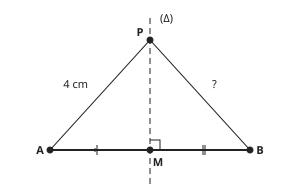

Answer: **4 cm**
- Typed **2** (half) → “PB is not half of PA: P is at the same distance from A and B.”
- Typed **8** (double) → “P is at the same distance from A and B.”

Full working after a second miss:

> Every point of the perpendicular bisector is at the same distance from A and B.  
> So PB = PA = 4 cm.  

**Card c12-2** (draft)

> If a point is at the same distance from A and from B, it is on the perpendicular bisector of [AB]. If not, it is not.
>
> _QA = 6 cm and QB = 6 cm: Q is on the perpendicular bisector._  
> _RA = 6 cm and RB = 4 cm: R is not on it._  

Check question: `m2-12-on` · multiple choice, level 1 · computed by rule, reused from practice

> Point P has PA = 9 cm and PB = 9 cm. Is P on the perpendicular bisector of [AB]?

- ✅ Yes
- ◻️ No  
  _↳ feedback if chosen: PA = 9 cm and PB = 9 cm. The two distances are equal._

Full working after a second miss:

> PA = 9 cm and PB = 9 cm.  
> The two distances are equal, so the answer is Yes.  

**Card c12-3** (draft)

> Two points that are each equidistant from A and B fix the perpendicular bisector: it is the line through them.
>
> _CA = CB and DA = DB, so C and D are both on the perpendicular bisector of [AB]._  
> _The perpendicular bisector of [AB] is the line (CD)._  

Check question: `m2-12-c3` · multiple choice, level 1 · **authored key**

> EA = EB and FA = FB. Which line is the perpendicular bisector of [AB]?

- ◻️ (FB)  
  _↳ feedback if chosen: The perpendicular bisector does not pass through B: B is not at the same distance from A and B._
- ◻️ (EA)  
  _↳ feedback if chosen: The perpendicular bisector does not pass through A: A is not at the same distance from A and B._
- ◻️ (AB)  
  _↳ feedback if chosen: (AB) contains the segment; the perpendicular bisector crosses it._
- ✅ (EF)

Full working after a second miss:

> E and F are both equidistant from A and B, so both are on the perpendicular bisector.  
> The line through them is (EF).  

**Worked example** (draft)

> P is on the perpendicular bisector of [AB]. PA = 7 cm and AB = 6 cm. Find PB and the perimeter of triangle PAB.

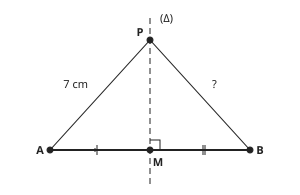

1. P is on the perpendicular bisector of [AB], so P is at the same distance from A and B: PB = PA = 7 cm.
2. Perimeter = PA + PB + AB = 7 + 7 + 6 = 20 cm.

**Answer:** PB = 7 cm and the perimeter is 20 cm.

**Practice** `m2-12-pb` · number, level 1 · computed by rule

> P is on the perpendicular bisector of [AB] and PA = 4 cm. Find PB.

Answer: **4 cm**
- Typed **2** (half) → “PB is not half of PA: P is at the same distance from A and B.”
- Typed **8** (double) → “P is at the same distance from A and B.”

Full working after a second miss:

> Every point of the perpendicular bisector is at the same distance from A and B.  
> So PB = PA = 4 cm.  

> P is on the perpendicular bisector of [AB] and PA = 11 cm. Find PB.

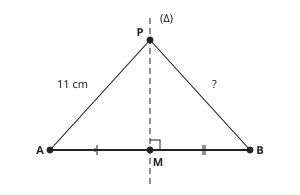

Answer: **11 cm**
- Typed **5.5** (half) → “PB is not half of PA: P is at the same distance from A and B.”
- Typed **22** (double) → “P is at the same distance from A and B.”

Full working after a second miss:

> Every point of the perpendicular bisector is at the same distance from A and B.  
> So PB = PA = 11 cm.  

**Practice** `m2-12-on` · multiple choice, level 1 · computed by rule

> Point P has PA = 9 cm and PB = 10 cm. Is P on the perpendicular bisector of [AB]?

- ◻️ Yes  
  _↳ feedback if chosen: PA = 9 cm and PB = 10 cm. The two distances are not equal._
- ✅ No

Full working after a second miss:

> PA = 9 cm and PB = 10 cm.  
> The two distances are not equal, so the answer is No.  

> Point P has PA = 12 cm and PB = 14 cm. Is P on the perpendicular bisector of [AB]?

- ✅ No
- ◻️ Yes  
  _↳ feedback if chosen: PA = 12 cm and PB = 14 cm. The two distances are not equal._

Full working after a second miss:

> PA = 12 cm and PB = 14 cm.  
> The two distances are not equal, so the answer is No.  

**Practice** `m2-12-perimeter` · number, level 2 · computed by rule

> P is on the perpendicular bisector of [AB]. PA = 4 cm and AB = 7 cm. Find the perimeter of triangle PAB.

Answer: **15 cm**
- Typed **11** (two-sides) → “PB is a side too, and PB = PA = 4 cm.”

Full working after a second miss:

> P is on the perpendicular bisector, so PB = PA = 4 cm.  
> Perimeter = 4 + 4 + 7 = 15 cm.  

> P is on the perpendicular bisector of [AB]. PA = 13 cm and AB = 13 cm. Find the perimeter of triangle PAB.

Answer: **39 cm**
- Typed **26** (two-sides) → “PB is a side too, and PB = PA = 13 cm.”

Full working after a second miss:

> P is on the perpendicular bisector, so PB = PA = 13 cm.  
> Perimeter = 13 + 13 + 13 = 39 cm.  

**Practice** `m2-12-find` · number, level 2 · computed by rule

> P is on the perpendicular bisector of [AB]. The perimeter of triangle PAB is 39 cm and AB = 13 cm. Find PA.

Answer: **13 cm**
- Typed **26** (not-halved) → “That is PA + PB. PA is half of it, because PA = PB.”

Full working after a second miss:

> PA = PB, so PA + PB = 39 − 13 = 26 cm.  
> PA = 26 ÷ 2 = 13 cm.  

> P is on the perpendicular bisector of [AB]. The perimeter of triangle PAB is 39 cm and AB = 9 cm. Find PA.

Answer: **15 cm**
- Typed **30** (not-halved) → “That is PA + PB. PA is half of it, because PA = PB.”

Full working after a second miss:

> PA = PB, so PA + PB = 39 − 9 = 30 cm.  
> PA = 30 ÷ 2 = 15 cm.  

**Practice** `m2-12-which` · multiple choice, level 3 · computed by rule

> Which point is on the perpendicular bisector of [AB]?

- ◻️ N: NA = 11 cm, NB = 5 cm  
  _↳ feedback if chosen: NA = 11 cm and NB = 5 cm are not equal._
- ✅ H: HA = 9 cm, HB = 9 cm
- ◻️ C: CA = 5 cm, CB = 9 cm  
  _↳ feedback if chosen: CA = 5 cm and CB = 9 cm are not equal._
- ◻️ E: EA = 9 cm, EB = 10 cm  
  _↳ feedback if chosen: EA = 9 cm and EB = 10 cm are not equal._

Full working after a second miss:

> A point is on the perpendicular bisector of [AB] exactly when it is at the same distance from A and B.  
> Only H has equal distances, so the answer is H: HA = 9 cm, HB = 9 cm.  

> Which point is on the perpendicular bisector of [AB]?

- ◻️ M: MA = 7 cm, MB = 3 cm  
  _↳ feedback if chosen: MA = 7 cm and MB = 3 cm are not equal._
- ✅ H: HA = 3 cm, HB = 3 cm
- ◻️ F: FA = 3 cm, FB = 4 cm  
  _↳ feedback if chosen: FA = 3 cm and FB = 4 cm are not equal._
- ◻️ C: CA = 5 cm, CB = 7 cm  
  _↳ feedback if chosen: CA = 5 cm and CB = 7 cm are not equal._

Full working after a second miss:

> A point is on the perpendicular bisector of [AB] exactly when it is at the same distance from A and B.  
> Only H has equal distances, so the answer is H: HA = 3 cm, HB = 3 cm.  

## Lesson 13: Vocabulary : ordered pair, abscissa, ordinate, origin

Prerequisites: 2 · Skill: m2-13 (The coordinate plane: ordered pair, abscissa, ordinate, origin)

**Note** (draft)

> A coordinate plane has two number lines that are perpendicular: the horizontal x-axis and the vertical y-axis. They cross at the origin, O.
> Every point has two coordinates, written as an ordered pair (x, y):
> • the first number, x, is the abscissa: how far to go right (positive) or left (negative) from O;
> • the second number, y, is the ordinate: how far to go up (positive) or down (negative).
> The origin is O(0, 0). The order matters: (2, 5) and (5, 2) are different points.
> A point on the x-axis has ordinate 0, for example (4, 0). A point on the y-axis has abscissa 0, for example (0, −3).

**Card c13-1** (draft)

> The coordinate plane has a horizontal x-axis and a vertical y-axis. They are perpendicular and cross at the origin O.
>
> _The origin is the point O(0, 0)._  
> _Numbers on the x-axis grow to the right; numbers on the y-axis grow upwards._  

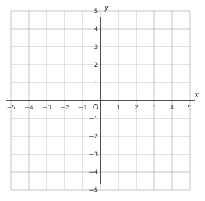

Check question: `m2-13-c1` · multiple choice, level 1 · **authored key**

> Which statement is true?

- ◻️ The y-axis is horizontal  
  _↳ feedback if chosen: The y-axis is the vertical one._
- ✅ The x-axis is horizontal
- ◻️ The x-axis and the y-axis are parallel  
  _↳ feedback if chosen: The axes cross at the origin, at a right angle: they are perpendicular._

Full working after a second miss:

> The true statement is “The x-axis is horizontal”.  
> “The y-axis is horizontal” is false: The y-axis is the vertical one.  
> “The x-axis and the y-axis are parallel” is false: The axes cross at the origin, at a right angle: they are perpendicular.  

**Card c13-2** (draft)

> A point is given by an ordered pair (x, y). The first number is the abscissa; the second is the ordinate.
>
> _In (4, −1), the abscissa is 4 and the ordinate is −1._  

Check question: `m2-13-abscissa` · multiple choice, level 1 · computed by rule, reused from practice

> In the ordered pair (2, −5), what is the abscissa?

- ✅ 2
- ◻️ −5  
  _↳ feedback if chosen: −5 is the ordinate, the second number. The abscissa is the first number._
- ◻️ −2  
  _↳ feedback if chosen: Keep the sign: the first number is 2._

Full working after a second miss:

> The abscissa is the first number of the ordered pair.  
> In (2, −5) it is 2.  

**Card c13-3** (draft)

> The order matters: swapping the two numbers gives a different point.
>
> _(2, 5): 2 along, 5 up._  
> _(5, 2): 5 along, 2 up. It is another point._  

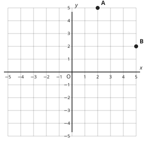

Check question: `m2-13-ordinate` · multiple choice, level 1 · computed by rule, reused from practice

> In the ordered pair (−1, −3), what is the ordinate?

- ◻️ 3  
  _↳ feedback if chosen: Keep the sign: the second number is −3._
- ✅ −3
- ◻️ −1  
  _↳ feedback if chosen: −1 is the abscissa, the first number. The ordinate is the second number._

Full working after a second miss:

> The ordinate is the second number of the ordered pair.  
> In (−1, −3) it is −3.  

**Card c13-4** (draft)

> A point on the x-axis has ordinate 0. A point on the y-axis has abscissa 0.
>
> _(4, 0) is on the x-axis._  
> _(0, −3) is on the y-axis._  

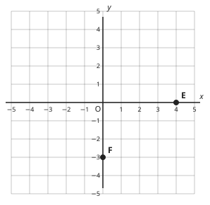

Check question: `m2-13-axis` · multiple choice, level 1 · computed by rule, reused from practice

> Where is the point (2, 0)?

- ◻️ on neither axis  
  _↳ feedback if chosen: One of the coordinates is 0, so the point is on an axis._
- ✅ on the x-axis
- ◻️ on the y-axis  
  _↳ feedback if chosen: On the y-axis the abscissa (the first number) is 0. Here it is not._

Full working after a second miss:

> A point on the x-axis has ordinate 0; a point on the y-axis has abscissa 0.  
> So the point is on the x-axis.  

**Worked example** (draft)

> Point P has coordinates (3, −2). Give its abscissa and its ordinate, and say how to reach P from the origin.

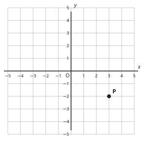

1. In an ordered pair the first number is the abscissa: 3.
2. The second number is the ordinate: −2.
3. From O, go 3 units to the right (the abscissa is positive), then 2 units down (the ordinate is negative).

**Answer:** Abscissa 3, ordinate −2.

**Practice** `m2-13-abscissa` · multiple choice, level 1 · computed by rule

> In the ordered pair (5, 3), what is the abscissa?

- ◻️ 3  
  _↳ feedback if chosen: 3 is the ordinate, the second number. The abscissa is the first number._
- ✅ 5
- ◻️ −5  
  _↳ feedback if chosen: Keep the sign: the first number is 5._

Full working after a second miss:

> The abscissa is the first number of the ordered pair.  
> In (5, 3) it is 5.  

> In the ordered pair (−1, 2), what is the abscissa?

- ◻️ 1  
  _↳ feedback if chosen: Keep the sign: the first number is −1._
- ◻️ 2  
  _↳ feedback if chosen: 2 is the ordinate, the second number. The abscissa is the first number._
- ✅ −1

Full working after a second miss:

> The abscissa is the first number of the ordered pair.  
> In (−1, 2) it is −1.  

**Practice** `m2-13-ordinate` · multiple choice, level 1 · computed by rule

> In the ordered pair (−2, −5), what is the ordinate?

- ◻️ −2  
  _↳ feedback if chosen: −2 is the abscissa, the first number. The ordinate is the second number._
- ✅ −5
- ◻️ 5  
  _↳ feedback if chosen: Keep the sign: the second number is −5._

Full working after a second miss:

> The ordinate is the second number of the ordered pair.  
> In (−2, −5) it is −5.  

> In the ordered pair (3, 5), what is the ordinate?

- ◻️ −5  
  _↳ feedback if chosen: Keep the sign: the second number is 5._
- ◻️ 3  
  _↳ feedback if chosen: 3 is the abscissa, the first number. The ordinate is the second number._
- ✅ 5

Full working after a second miss:

> The ordinate is the second number of the ordered pair.  
> In (3, 5) it is 5.  

**Practice** `m2-13-axis` · multiple choice, level 1 · computed by rule

> Where is the point (−2, −1)?

- ◻️ on the x-axis  
  _↳ feedback if chosen: On the x-axis the ordinate (the second number) is 0. Here it is not._
- ✅ on neither axis
- ◻️ on the y-axis  
  _↳ feedback if chosen: On the y-axis the abscissa (the first number) is 0. Here it is not._

Full working after a second miss:

> A point on the x-axis has ordinate 0; a point on the y-axis has abscissa 0.  
> So the point is on neither axis.  

> Where is the point (0, 3)?

- ◻️ on neither axis  
  _↳ feedback if chosen: One of the coordinates is 0, so the point is on an axis._
- ✅ on the y-axis
- ◻️ on the x-axis  
  _↳ feedback if chosen: On the x-axis the ordinate (the second number) is 0. Here it is not._

Full working after a second miss:

> A point on the x-axis has ordinate 0; a point on the y-axis has abscissa 0.  
> So the point is on the y-axis.  

**Practice** `m2-13-pair` · multiple choice, level 2 · computed by rule

> A point has abscissa −3 and ordinate −4. Which ordered pair is it?

- ◻️ (3, −4)  
  _↳ feedback if chosen: Keep the sign of the abscissa: −3._
- ◻️ (−3, 4)  
  _↳ feedback if chosen: Keep the sign of the ordinate: −4._
- ◻️ (−4, −3)  
  _↳ feedback if chosen: The abscissa comes first: (−3, …)._
- ✅ (−3, −4)

Full working after a second miss:

> The abscissa comes first and the ordinate second.  
> So the point is (−3, −4).  

> A point has abscissa −1 and ordinate 5. Which ordered pair is it?

- ✅ (−1, 5)
- ◻️ (5, −1)  
  _↳ feedback if chosen: The abscissa comes first: (−1, …)._
- ◻️ (1, 5)  
  _↳ feedback if chosen: Keep the sign of the abscissa: −1._
- ◻️ (−1, −5)  
  _↳ feedback if chosen: Keep the sign of the ordinate: 5._

Full working after a second miss:

> The abscissa comes first and the ordinate second.  
> So the point is (−1, 5).  

**Practice** `m2-13-words` · matching, level 2 · **authored key**

> Match each word to its meaning.

Right-hand side (shuffled): the second number of an ordered pair · the horizontal axis · the first number of an ordered pair · two numbers in brackets, in a fixed order
- ordered pair → **two numbers in brackets, in a fixed order**
- ordinate → **the second number of an ordered pair**
- x-axis → **the horizontal axis**
- abscissa → **the first number of an ordered pair**

Full working after a second miss:

> The right pairs are:  
> ordered pair → two numbers in brackets, in a fixed order  
> ordinate → the second number of an ordered pair  
> x-axis → the horizontal axis  
> abscissa → the first number of an ordered pair  

> Match each word to its meaning.

Right-hand side (shuffled): the first number of an ordered pair · the second number of an ordered pair · the horizontal axis · the point (0, 0), where the axes cross
- abscissa → **the first number of an ordered pair**
- x-axis → **the horizontal axis**
- ordinate → **the second number of an ordered pair**
- origin → **the point (0, 0), where the axes cross**

Full working after a second miss:

> The right pairs are:  
> abscissa → the first number of an ordered pair  
> x-axis → the horizontal axis  
> ordinate → the second number of an ordered pair  
> origin → the point (0, 0), where the axes cross  

**Practice** `m2-13-spot` · spot the error, level 3 · computed by rule

> Which statement is false?

- ◻️ (0, −3) is on the y-axis
- ✅ (−5, −3) and (−3, −5) are the same point  
  _↳ explanation: The order matters: (−5, −3) and (−3, −5) are different points._
- ◻️ The abscissa of (−5, −3) is −5
- ◻️ The ordinate of (−5, −3) is −3

Full working after a second miss:

> The wrong statement is “(−5, −3) and (−3, −5) are the same point”.  
> The order matters: (−5, −3) and (−3, −5) are different points.  

> Which statement is false?

- ◻️ (−1, 0) is on the x-axis
- ✅ (−1, 5) and (5, −1) are the same point  
  _↳ explanation: The order matters: (−1, 5) and (5, −1) are different points._
- ◻️ The abscissa of (−1, 5) is −1
- ◻️ The ordinate of (−1, 5) is 5

Full working after a second miss:

> The wrong statement is “(−1, 5) and (5, −1) are the same point”.  
> The order matters: (−1, 5) and (5, −1) are different points.  

## Lesson 14: Coordinates of points (integers)

Prerequisites: 13 · Skill: m2-14 (Coordinates of points)

**Note** (draft)

> To read the coordinates of a point, start at the origin O. Count along the x-axis to below or above the point: that is the abscissa (positive to the right, negative to the left). Then count up or down to the point: that is the ordinate (positive up, negative down).
> To plot a point, for example (−3, 2): from O go 3 units left, then 2 units up.
> Moving a point right adds to the abscissa; left subtracts. Moving up adds to the ordinate; down subtracts.
> Two points with the same ordinate are on a horizontal line: their distance is the difference of their abscissas. (−2, 3) and (4, 3) are 4 − (−2) = 6 units apart.

**Card c14-1** (draft)

> To read a point: from O, count along the x-axis first (the abscissa), then up or down (the ordinate).
>
> _P is 3 units right and 2 units up from O, so P = (3, 2)._  

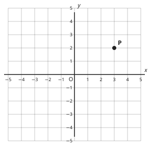

Check question: `m2-14-read` · multiple choice, level 1 · computed by rule, reused from practice

> What are the coordinates of point P?

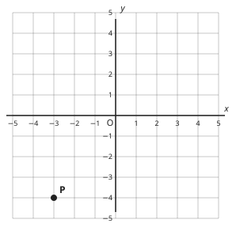

- ◻️ (−3, 4)  
  _↳ feedback if chosen: P is below the x-axis, so its ordinate is negative._
- ◻️ (3, −4)  
  _↳ feedback if chosen: P is left of the y-axis, so its abscissa is negative._
- ✅ (−3, −4)
- ◻️ (−4, −3)  
  _↳ feedback if chosen: The abscissa (along) comes first, then the ordinate (up or down)._

Full working after a second miss:

> From O, P is 3 units left and 4 units down.  
> So P = (−3, −4).  

**Card c14-2** (draft)

> Left of the y-axis the abscissa is negative; below the x-axis the ordinate is negative.
>
> _Q is 4 units left and 1 units down from O, so Q = (−4, −1)._  

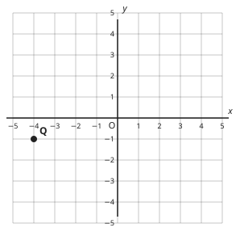

Check question: `m2-14-plot` · multiple choice, level 1 · computed by rule, reused from practice

> Which point has coordinates (2, −4)?

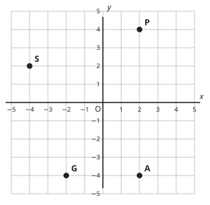

- ◻️ S  
  _↳ feedback if chosen: S is at (−4, 2): the numbers are the other way round. Go along first, then up or down._
- ◻️ P  
  _↳ feedback if chosen: P is at (2, 4): it is on the other side of the x-axis._
- ✅ A
- ◻️ G  
  _↳ feedback if chosen: G is at (−2, −4): it is on the other side of the y-axis._

Full working after a second miss:

> (2, −4): from O go 2 units right, then 4 units down.  
> That is point A.  

**Card c14-3** (draft)

> Two points with the same ordinate are on a horizontal line. Their distance is the larger abscissa minus the smaller.
>
> _(−2, 3) and (4, 3): 4 − (−2) = 6 units apart._  

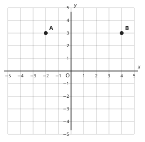

Check question: `m2-14-dist` · number, level 1 · computed by rule, reused from practice

> A = (−1, 4) and B = (0, 4). How many units apart are A and B?

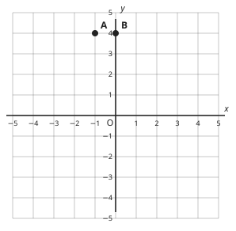

Answer: **1**

Full working after a second miss:

> A and B have the same ordinate, 4, so they are on a horizontal line.  
> Distance = 0 − (−1) = 1 units.  

**Card c14-4** (draft)

> Moving a point right or left changes only the abscissa. Moving it up or down changes only the ordinate.
>
> _(1, 2) moved 3 units right: (4, 2)._  
> _(1, 2) moved 3 units down: (1, −1)._  

Check question: `m2-14-c4` · multiple choice, level 1 · computed by rule

> Start at (1, 1) and move 2 units to the left. Where are you?

- ✅ (−1, 1)
- ◻️ (3, 1)  
  _↳ feedback if chosen: Left subtracts from the abscissa._
- ◻️ (−1, −1)  
  _↳ feedback if chosen: Only the abscissa changes: the ordinate stays 1._
- ◻️ (1, −1)  
  _↳ feedback if chosen: Moving left changes the abscissa, not the ordinate._

Full working after a second miss:

> Moving left subtracts 2 to the abscissa; the ordinate stays 1.  
> So you are at (−1, 1).  

**Worked example** (draft)

> Start at the point A(−3, 2). Move 5 units to the right, then 4 units down. What are the coordinates of the new point B?

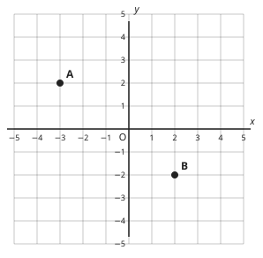

1. Moving right adds to the abscissa: −3 + 5 = 2.
2. Moving down subtracts from the ordinate: 2 − 4 = −2.

**Answer:** B(2, −2)

**Practice** `m2-14-read` · multiple choice, level 1 · computed by rule

> What are the coordinates of point P?

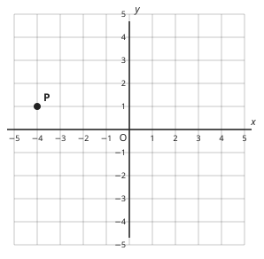

- ◻️ (1, −4)  
  _↳ feedback if chosen: The abscissa (along) comes first, then the ordinate (up or down)._
- ✅ (−4, 1)
- ◻️ (4, 1)  
  _↳ feedback if chosen: P is left of the y-axis, so its abscissa is negative._
- ◻️ (−4, −1)  
  _↳ feedback if chosen: P is above the x-axis, so its ordinate is positive._

Full working after a second miss:

> From O, P is 4 units left and 1 units up.  
> So P = (−4, 1).  

> What are the coordinates of point P?

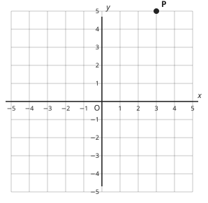

- ◻️ (5, 3)  
  _↳ feedback if chosen: The abscissa (along) comes first, then the ordinate (up or down)._
- ✅ (3, 5)
- ◻️ (−3, 5)  
  _↳ feedback if chosen: P is right of the y-axis, so its abscissa is positive._
- ◻️ (3, −5)  
  _↳ feedback if chosen: P is above the x-axis, so its ordinate is positive._

Full working after a second miss:

> From O, P is 3 units right and 5 units up.  
> So P = (3, 5).  

**Practice** `m2-14-plot` · multiple choice, level 1 · computed by rule

> Which point has coordinates (3, 1)?

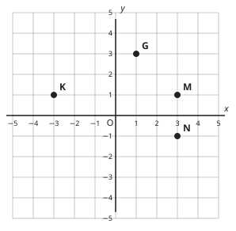

- ◻️ N  
  _↳ feedback if chosen: N is at (3, −1): it is on the other side of the x-axis._
- ✅ M
- ◻️ G  
  _↳ feedback if chosen: G is at (1, 3): the numbers are the other way round. Go along first, then up or down._
- ◻️ K  
  _↳ feedback if chosen: K is at (−3, 1): it is on the other side of the y-axis._

Full working after a second miss:

> (3, 1): from O go 3 units right, then 1 units up.  
> That is point M.  

> Which point has coordinates (−2, −1)?

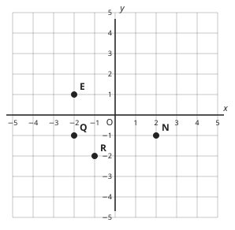

- ◻️ E  
  _↳ feedback if chosen: E is at (−2, 1): it is on the other side of the x-axis._
- ✅ Q
- ◻️ R  
  _↳ feedback if chosen: R is at (−1, −2): the numbers are the other way round. Go along first, then up or down._
- ◻️ N  
  _↳ feedback if chosen: N is at (2, −1): it is on the other side of the y-axis._

Full working after a second miss:

> (−2, −1): from O go 2 units left, then 1 units down.  
> That is point Q.  

**Practice** `m2-14-dist` · number, level 1 · computed by rule

> A = (−4, 4) and B = (0, 4). How many units apart are A and B?

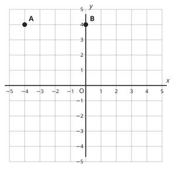

Answer: **4**

Full working after a second miss:

> A and B have the same ordinate, 4, so they are on a horizontal line.  
> Distance = 0 − (−4) = 4 units.  

> A = (−2, −5) and B = (4, −5). How many units apart are A and B?

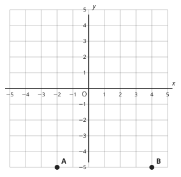

Answer: **6**
- Typed **2** (sizes) → “Count the units from A to B across the y-axis: 4 − (−2) = 6.”

Full working after a second miss:

> A and B have the same ordinate, −5, so they are on a horizontal line.  
> Distance = 4 − (−2) = 6 units.  

**Practice** `m2-14-vert` · number, level 2 · computed by rule

> C = (−2, −4) and D = (−2, 0). How many units apart are C and D?

Answer: **4**

Full working after a second miss:

> C and D have the same abscissa, −2, so they are on a vertical line.  
> Distance = 0 − (−4) = 4 units.  

> C = (2, −1) and D = (2, 0). How many units apart are C and D?

Answer: **1**

Full working after a second miss:

> C and D have the same abscissa, 2, so they are on a vertical line.  
> Distance = 0 − (−1) = 1 units.  

**Practice** `m2-14-move` · multiple choice, level 2 · computed by rule

> Start at A(2, −3). Move 1 unit to the right and 4 units down. Where are you?

- ◻️ (3, 1)  
  _↳ feedback if chosen: Down subtracts from the ordinate._
- ◻️ (−7, 3)  
  _↳ feedback if chosen: The abscissa comes first in the ordered pair._
- ✅ (3, −7)
- ◻️ (1, −7)  
  _↳ feedback if chosen: Right adds to the abscissa._

Full working after a second miss:

> Abscissa: 2 + 1 = 3.  
> Ordinate: −3 − 4 = −7.  
> You are at (3, −7).  

> Start at A(3, 2). Move 1 unit to the right and 2 units down. Where are you?

- ◻️ (4, 4)  
  _↳ feedback if chosen: Down subtracts from the ordinate._
- ◻️ (2, 0)  
  _↳ feedback if chosen: Right adds to the abscissa._
- ◻️ (0, 4)  
  _↳ feedback if chosen: The abscissa comes first in the ordered pair._
- ✅ (4, 0)

Full working after a second miss:

> Abscissa: 3 + 1 = 4.  
> Ordinate: 2 − 2 = 0.  
> You are at (4, 0).  

**Practice** `m2-14-rect` · multiple choice, level 3 · computed by rule

> A(−1, 1), B(3, 1) and C(3, −3) are three corners of the rectangle ABCD. What are the coordinates of D?

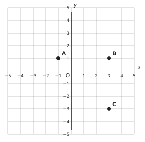

- ✅ (−1, −3)
- ◻️ (−3, −1)  
  _↳ feedback if chosen: The abscissa comes first: D is level with A across, so its abscissa is −1._
- ◻️ (−1, 1)  
  _↳ feedback if chosen: That is A itself._
- ◻️ (3, −1)  
  _↳ feedback if chosen: D is under or over A, so it has A's abscissa, −1._

Full working after a second miss:

> In a rectangle with sides along the grid, D is below or above A and level with C.  
> D has the abscissa of A, −1, and the ordinate of C, −3: D = (−1, −3).  

> A(−3, 1), B(4, 1) and C(4, −1) are three corners of the rectangle ABCD. What are the coordinates of D?

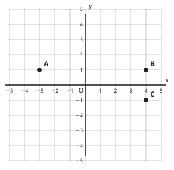

- ✅ (−3, −1)
- ◻️ (4, −3)  
  _↳ feedback if chosen: D is under or over A, so it has A's abscissa, −3._
- ◻️ (−3, 1)  
  _↳ feedback if chosen: That is A itself._
- ◻️ (−1, −3)  
  _↳ feedback if chosen: The abscissa comes first: D is level with A across, so its abscissa is −3._

Full working after a second miss:

> In a rectangle with sides along the grid, D is below or above A and level with C.  
> D has the abscissa of A, −3, and the ordinate of C, −1: D = (−3, −1).  

## Lesson 15: Symbolic expressions

Prerequisites: none · Skill: m2-15 (Writing symbolic expressions)

**Note** (draft)

> In algebra a letter stands for a number we do not know yet, for example x.
> Writing words as an expression:
> • 3 more than x: x + 3   • 5 less than x: x − 5 (not 5 − x)
> • twice x, or 2 times x: 2x   • x times y: xy
> • x divided by 4: x ÷ 4, also written x/4   • the square of x: x² (x × x)
> Rules for writing: put the number before the letter (3x, not x3), leave out the × sign (3 × x = 3x), and write x, not 1x.
> Stories: Ashu has x francs and spends 200 francs: she has x − 200 francs left. Five books at x francs each cost 5x francs.

**Card c15-1** (draft)

> “More than” means add. “Less than” means subtract, starting from the unknown number.
>
> _3 more than x: x + 3._  
> _3 less than x: x − 3 (not 3 − x)._  

Check question: `m2-15-less` · multiple choice, level 1 · computed by rule, reused from practice

> Write “16 less than t” as an expression.

- ◻️ t + 16  
  _↳ feedback if chosen: “Less than” means subtract._
- ◻️ 16t  
  _↳ feedback if chosen: 16t means 16 × t; “less than” means subtract._
- ✅ t − 16
- ◻️ 16 − t  
  _↳ feedback if chosen: Start from t and take 16 away: t − 16._

Full working after a second miss:

> “16 less than t” means start from t and take away 16.  
> So the expression is t − 16.  

**Card c15-2** (draft)

> In a product, write the number first and leave out the × sign.
>
> _3 × x = 3x_  
> _a × b = ab_  

Check question: `m2-15-c2` · multiple choice, level 1 · computed by rule

> How do we write 6 × t in algebra?

- ◻️ 6 + t  
  _↳ feedback if chosen: 6 × t is a product, not a sum._
- ◻️ t6  
  _↳ feedback if chosen: The number goes before the letter: 6t._
- ◻️ t⁶  
  _↳ feedback if chosen: t⁶ means t multiplied by itself 6 times, not 6 × t._
- ✅ 6t

Full working after a second miss:

> Write the number first and leave out the × sign.  
> 6 × t = 6t  

**Card c15-3** (draft)

> Division can be written with ÷ or with a slash. The square of a number is the number times itself.
>
> _y divided by 4: y ÷ 4, or y/4._  
> _The square of y: y² = y × y, not 2y._  

Check question: `m2-15-square` · multiple choice, level 1 · computed by rule, reused from practice

> Which expression means “the square of y”?

- ◻️ y + 2  
  _↳ feedback if chosen: The square is y × y, not y + 2._
- ✅ y²
- ◻️ 2y  
  _↳ feedback if chosen: 2y means 2 × y, twice y. The square is y × y._

Full working after a second miss:

> The square of y is y × y.  
> It is written y².  

**Card c15-4** (draft)

> To write a story as an expression, find the unknown number, then decide which operation the words describe.
>
> _Ashu has x francs and spends 200 francs: she has x − 200 francs left._  
> _5 books at x francs each cost 5x francs._  

Check question: `m2-15-c4` · multiple choice, level 1 · computed by rule

> Ayuk has t francs. His mother gives him 200 francs. How many francs does he have now?

- ✅ t + 200
- ◻️ t − 200  
  _↳ feedback if chosen: His mother gives him money, so he has more: add._
- ◻️ 200t  
  _↳ feedback if chosen: 200t means 200 × t; here he simply gets 200 more._
- ◻️ 200 − t  
  _↳ feedback if chosen: He has more than t now: add 200 to t._

Full working after a second miss:

> He gets more money, so add 200 to t.  
> He has t + 200 francs.  

**Worked example** (draft)

> Mbah buys 4 exercise books at x francs each and a pen at 150 francs. Write an expression for the total cost.

1. 4 books at x francs each cost 4 × x = 4x francs.
2. Add the pen: 4x + 150.

**Answer:** The total cost is 4x + 150 francs.

**Practice** `m2-15-less` · multiple choice, level 1 · computed by rule

> Write “11 less than a” as an expression.

- ✅ a − 11
- ◻️ a + 11  
  _↳ feedback if chosen: “Less than” means subtract._
- ◻️ 11 − a  
  _↳ feedback if chosen: Start from a and take 11 away: a − 11._
- ◻️ 11a  
  _↳ feedback if chosen: 11a means 11 × a; “less than” means subtract._

Full working after a second miss:

> “11 less than a” means start from a and take away 11.  
> So the expression is a − 11.  

> Write “14 less than a” as an expression.

- ◻️ a + 14  
  _↳ feedback if chosen: “Less than” means subtract._
- ◻️ 14a  
  _↳ feedback if chosen: 14a means 14 × a; “less than” means subtract._
- ◻️ 14 − a  
  _↳ feedback if chosen: Start from a and take 14 away: a − 14._
- ✅ a − 14

Full working after a second miss:

> “14 less than a” means start from a and take away 14.  
> So the expression is a − 14.  

**Practice** `m2-15-square` · multiple choice, level 1 · computed by rule

> Which expression means “the square of a”?

- ✅ a²
- ◻️ a ÷ 2  
  _↳ feedback if chosen: The square is a × a._
- ◻️ a + 2  
  _↳ feedback if chosen: The square is a × a, not a + 2._

Full working after a second miss:

> The square of a is a × a.  
> It is written a².  

> Which expression means “the square of t”?

- ✅ t²
- ◻️ t ÷ 2  
  _↳ feedback if chosen: The square is t × t._
- ◻️ t + 2  
  _↳ feedback if chosen: The square is t × t, not t + 2._

Full working after a second miss:

> The square of t is t × t.  
> It is written t².  

**Practice** `m2-15-match` · matching, level 2 · computed by rule

> Match each phrase to its expression.

Right-hand side (shuffled): y + 6 · y − 6 · y ÷ 6 · 2y + 6
- y divided by 6 → **y ÷ 6**
- 6 more than y → **y + 6**
- 6 less than y → **y − 6**
- 6 more than twice y → **2y + 6**

Full working after a second miss:

> The right pairs are:  
> y divided by 6 → y ÷ 6  
> 6 more than y → y + 6  
> 6 less than y → y − 6  
> 6 more than twice y → 2y + 6  

> Match each phrase to its expression.

Right-hand side (shuffled): n − 6 · n + 6 · n ÷ 6 · 6n
- n divided by 6 → **n ÷ 6**
- 6 less than n → **n − 6**
- 6 more than n → **n + 6**
- 6 times n → **6n**

Full working after a second miss:

> The right pairs are:  
> n divided by 6 → n ÷ 6  
> 6 less than n → n − 6  
> 6 more than n → n + 6  
> 6 times n → 6n  

**Practice** `m2-15-story` · multiple choice, level 2 · computed by rule

> A teacher shares t pencils equally among 6 pupils. How many pencils does each pupil get?

- ◻️ 6 ÷ t  
  _↳ feedback if chosen: Divide the pencils, t, by the number of pupils, 6: t ÷ 6._
- ✅ t ÷ 6
- ◻️ 6t  
  _↳ feedback if chosen: 6t means 6 × t; sharing means dividing._
- ◻️ t − 6  
  _↳ feedback if chosen: Each pupil gets a share, so divide, do not subtract._

Full working after a second miss:

> Sharing equally means dividing the t pencils by 6.  
> Each pupil gets t ÷ 6 pencils.  

> A teacher shares a pencils equally among 12 pupils. How many pencils does each pupil get?

- ◻️ a − 12  
  _↳ feedback if chosen: Each pupil gets a share, so divide, do not subtract._
- ✅ a ÷ 12
- ◻️ 12 ÷ a  
  _↳ feedback if chosen: Divide the pencils, a, by the number of pupils, 12: a ÷ 12._
- ◻️ 12a  
  _↳ feedback if chosen: 12a means 12 × a; sharing means dividing._

Full working after a second miss:

> Sharing equally means dividing the a pencils by 12.  
> Each pupil gets a ÷ 12 pencils.  

**Practice** `m2-15-perimeter` · multiple choice, level 3 · computed by rule

> A rectangle has length y cm and width 9 cm. Which expression gives its perimeter in cm?

- ◻️ 9y  
  _↳ feedback if chosen: 9y is the area (length × width), not the perimeter._
- ◻️ y + 9  
  _↳ feedback if chosen: That is only one length and one width; the perimeter goes all the way round._
- ◻️ 2y + 9  
  _↳ feedback if chosen: There are two widths: 9 + 9 = 18._
- ✅ 2y + 18

Full working after a second miss:

> The perimeter is length + width + length + width.  
> y + 9 + y + 9 = 2y + 18  

> A rectangle has length a cm and width 10 cm. Which expression gives its perimeter in cm?

- ◻️ a + 10  
  _↳ feedback if chosen: That is only one length and one width; the perimeter goes all the way round._
- ✅ 2a + 20
- ◻️ 2a + 10  
  _↳ feedback if chosen: There are two widths: 10 + 10 = 20._
- ◻️ a + 20  
  _↳ feedback if chosen: There are two lengths: a + a = 2a._

Full working after a second miss:

> The perimeter is length + width + length + width.  
> a + 10 + a + 10 = 2a + 20  

## Lesson 16: Vocabulary: variables, terms, constant, coefficients

Prerequisites: 15 · Skill: m2-16 (Variables, terms, constant and coefficients)

**Note** (draft)

> Look at the expression 5x + 3y − 7.
> • The variables are the letters, x and y: they stand for numbers that can change.
> • The terms are the parts joined by + and −: 5x, 3y and −7. The sign in front belongs to the term.
> • A coefficient is the number in front of a letter: the coefficient of x is 5 and the coefficient of y is 3.
> • The constant term has no letter: here it is −7.
> Hidden ones: in x − y + 4, the coefficient of x is 1 (x = 1x) and the coefficient of y is −1 (−y = −1y).

**Card c16-1** (draft)

> The variables of an expression are its letters.
>
> _In 5x + 3y − 7, the variables are x and y._  

Check question: `m2-16-c1` · multiple choice, level 1 · computed by rule

> Which are the variables in −3a − 7b − 13?

- ✅ a and b
- ◻️ −3 and −7  
  _↳ feedback if chosen: −3 and −7 are the coefficients, the numbers in front of the letters._
- ◻️ −13  
  _↳ feedback if chosen: −13 is the constant term: it has no letter._
- ◻️ −3a and −7b  
  _↳ feedback if chosen: Those are terms. The variables are just the letters._

Full working after a second miss:

> The variables are the letters.  
> In −3a − 7b − 13 they are a and b.  

**Card c16-2** (draft)

> Terms are the parts of an expression joined by + and −. The sign in front belongs to the term.
>
> _5x + 3y − 7 has three terms: 5x, 3y and −7._  

Check question: `m2-16-terms` · number, level 1 · computed by rule, reused from practice

> How many terms are there in 2x − 7y − 8?

Answer: **3**
- Typed **2** (letters) → “Count every part joined by + or −, including the constant term.”

Full working after a second miss:

> The terms are the parts joined by + and −.  
> 2x − 7y − 8 has 3 terms.  

**Card c16-3** (draft)

> The coefficient of a letter is the number in front of it, with its sign. x has coefficient 1 and −x has coefficient −1.
>
> _In 5x − 4y: the coefficient of x is 5, of y is −4._  
> _In x − y: the coefficient of x is 1, of y is −1._  

Check question: `m2-16-coef` · number, level 1 · computed by rule, reused from practice

> What is the coefficient of y in −4x − 6y + 18?

Answer: **−6**
- Typed **6** (sign) → “Keep the sign in front of the term: −6y.”
- Typed **−4** (other) → “−4 is the coefficient of x.”

Full working after a second miss:

> The coefficient is the number in front of y, with its sign.  
> In −6y it is −6.  

**Card c16-4** (draft)

> The constant term has no letter. Keep its sign.
>
> _In 2x − 9, the constant term is −9._  

Check question: `m2-16-const` · number, level 1 · computed by rule, reused from practice

> What is the constant term of −7m − 2n + 15?

Answer: **15**
- Typed **−15** (sign) → “Keep the sign in front of the number: the constant term is 15.”
- Typed **−7** (coef) → “−7 is a coefficient; the constant term has no letter.”

Full working after a second miss:

> The constant term is the term with no letter, with its sign.  
> It is 15.  

**Worked example** (draft)

> For the expression 4x − 2y + z + 9, name the variables, the terms, each coefficient and the constant term.

1. The variables are the letters: x, y and z.
2. The terms are 4x, −2y, z and 9.
3. The coefficients: 4 for x, −2 for y, and 1 for z (z = 1z).
4. The constant term is the term with no letter: 9.

**Answer:** Variables x, y, z; coefficients 4, −2, 1; constant term 9.

**Practice** `m2-16-terms` · number, level 1 · computed by rule

> How many terms are there in 6x + 5y + 4z − 8?

Answer: **4**
- Typed **3** (letters) → “Count every part joined by + or −, including the constant term.”

Full working after a second miss:

> The terms are the parts joined by + and −.  
> 6x + 5y + 4z − 8 has 4 terms.  

> How many terms are there in −9x + 5y + 3?

Answer: **3**
- Typed **2** (letters) → “Count every part joined by + or −, including the constant term.”

Full working after a second miss:

> The terms are the parts joined by + and −.  
> −9x + 5y + 3 has 3 terms.  

**Practice** `m2-16-coef` · number, level 1 · computed by rule

> What is the coefficient of y in −9x + 3y + 8?

Answer: **3**
- Typed **−3** (sign) → “Keep the sign in front of the term: 3y.”
- Typed **−9** (other) → “−9 is the coefficient of x.”

Full working after a second miss:

> The coefficient is the number in front of y, with its sign.  
> In 3y it is 3.  

> What is the coefficient of n in 5m + 8n + 3?

Answer: **8**
- Typed **−8** (sign) → “Keep the sign in front of the term: 8n.”
- Typed **5** (other) → “5 is the coefficient of m.”

Full working after a second miss:

> The coefficient is the number in front of n, with its sign.  
> In 8n it is 8.  

**Practice** `m2-16-const` · number, level 1 · computed by rule

> What is the constant term of −4p − 8q − 20?

Answer: **−20**
- Typed **20** (sign) → “Keep the sign in front of the number: the constant term is −20.”
- Typed **−4** (coef) → “−4 is a coefficient; the constant term has no letter.”

Full working after a second miss:

> The constant term is the term with no letter, with its sign.  
> It is −20.  

> What is the constant term of 5p + 6q − 15?

Answer: **−15**
- Typed **15** (sign) → “Keep the sign in front of the number: the constant term is −15.”
- Typed **5** (coef) → “5 is a coefficient; the constant term has no letter.”

Full working after a second miss:

> The constant term is the term with no letter, with its sign.  
> It is −15.  

**Practice** `m2-16-build` · multiple choice, level 2 · computed by rule

> Which expression has coefficient of x equal to 6 and constant term −1?

- ◻️ −x + 6  
  _↳ feedback if chosen: The coefficient goes in front of x and the constant term stands alone._
- ◻️ 6x + 1  
  _↳ feedback if chosen: The constant term is −1: check its sign._
- ◻️ −6x − 1  
  _↳ feedback if chosen: The coefficient of x is 6: check its sign._
- ✅ 6x − 1

Full working after a second miss:

> The coefficient of x is the number in front of x: 6x.  
> The constant term is −1.  
> So the expression is 6x − 1.  

> Which expression has coefficient of x equal to −6 and constant term 5?

- ✅ −6x + 5
- ◻️ 5x − 6  
  _↳ feedback if chosen: The coefficient goes in front of x and the constant term stands alone._
- ◻️ −6x − 5  
  _↳ feedback if chosen: The constant term is 5: check its sign._
- ◻️ 6x + 5  
  _↳ feedback if chosen: The coefficient of x is −6: check its sign._

Full working after a second miss:

> The coefficient of x is the number in front of x: −6x.  
> The constant term is 5.  
> So the expression is −6x + 5.  

**Practice** `m2-16-hidden` · number, level 3 · computed by rule

> What is the coefficient of x in 9y − x − 6?

Answer: **−1**
- Typed **0** (zero) → “There is a term with x, so the coefficient is not 0: −x = −1x.”
- Typed **1** (sign) → “Keep the sign in front of the term.”

Full working after a second miss:

> −x means −1 × x: a letter on its own has coefficient 1, with the sign in front of it.  
> So the coefficient of x is −1.  

> What is the coefficient of x in 9y − x − 14?

Answer: **−1**
- Typed **0** (zero) → “There is a term with x, so the coefficient is not 0: −x = −1x.”
- Typed **1** (sign) → “Keep the sign in front of the term.”

Full working after a second miss:

> −x means −1 × x: a letter on its own has coefficient 1, with the sign in front of it.  
> So the coefficient of x is −1.  

## Lesson 17: Like and unlike terms

Prerequisites: 16 · Skill: m2-17 (Like and unlike terms)

**Note** (draft)

> Like terms have exactly the same letters, each with the same power. Only the coefficients may differ.
> Like: 3x and −5x; 2ab and 7ba (ab = ba: the order of the letters does not matter); 4x² and x².
> Unlike: 3x and 3y (different letters); 2x and 2x² (different powers); 5 and 5x (one has no letter).
> Like terms can be added or subtracted by adding or subtracting their coefficients: 3x + 5x = 8x, 7y − 2y = 5y.
> Unlike terms cannot be joined: 3x + 5y stays as it is (it is not 8xy).

**Card c17-1** (draft)

> Like terms have the same letters with the same powers. Only the numbers in front may change.
>
> _3x and −5x are like terms._  
> _3x and 3y are unlike: the letters are different._  

Check question: `m2-17-c1` · multiple choice, level 1 · computed by rule

> Which term is a like term of 3y?

- ✅ −9y
- ◻️ 3q  
  _↳ feedback if chosen: 3q has the letter q, not y._
- ◻️ 3y²  
  _↳ feedback if chosen: 3y² has y squared: the power is different._
- ◻️ 3  
  _↳ feedback if chosen: 3 has no letter, so it is not like 3y._

Full working after a second miss:

> A like term has the same letter, y, with the same power.  
> −9y has y on its own, so it is like 3y.  

**Card c17-2** (draft)

> The power matters: x and x² are unlike terms, because x² means x × x.
>
> _2x and 2x² are unlike._  
> _2x² and 7x² are like._  

Check question: `m2-17-sort` · matching, level 1 · computed by rule, reused from practice

> Sort the terms into groups of like terms.

Groups: x terms · y terms · x² terms
- −4x² → **x² terms**
- 2x → **x terms**
- −7x → **x terms**
- 4x → **x terms**
- 4y → **y terms**
- −2y → **y terms**

Full working after a second miss:

> The right pairs are:  
> −4x² → x² terms  
> 2x → x terms  
> −7x → x terms  
> 4x → x terms  
> 4y → y terms  
> −2y → y terms  

**Card c17-3** (draft)

> The order of the letters does not matter: ab and ba are the same, so 2ab and 7ba are like terms.
>
> _2ab and 7ba are like terms._  
> _2ab and 7a are not._  

Check question: `m2-17-c3` · multiple choice, level 1 · **authored key**

> Which pair are like terms?

- ✅ 9pq and 7qp
- ◻️ 9x and 9y  
  _↳ feedback if chosen: The letters are different._
- ◻️ 9pq and 9p  
  _↳ feedback if chosen: 9p has only the letter p._

Full working after a second miss:

> The true statement is “9pq and 7qp”.  
> “9x and 9y” is false: The letters are different.  
> “9pq and 9p” is false: 9p has only the letter p.  

**Card c17-4** (draft)

> To add or subtract like terms, add or subtract their coefficients and keep the letters.
>
> _3x + 5x = 8x_  
> _7y − 2y = 5y_  

Check question: `m2-17-add` · multiple choice, level 1 · computed by rule, reused from practice

> Simplify 9m + 12m.

- ◻️ 21  
  _↳ feedback if chosen: Keep the letter: 21m._
- ◻️ 21m²  
  _↳ feedback if chosen: Adding does not change the power: m stays m._
- ◻️ 108m  
  _↳ feedback if chosen: Add the coefficients, do not multiply them._
- ✅ 21m

Full working after a second miss:

> 9m and 12m are like terms: add the coefficients.  
> 9 + 12 = 21, so the answer is 21m.  

**Worked example** (draft)

> Group the terms 6x, 3y, −4x and 3x² into like terms, and add the like terms.

1. 6x and −4x both have the letter x on its own: they are like terms.
2. 3y has a different letter, and 3x² has x squared: they are unlike the others.
3. 6x + (−4)x: add the coefficients, 6 + (−4) = 2, so the sum is 2x.

**Answer:** 2x, 3y and 3x²

**Practice** `m2-17-add` · multiple choice, level 1 · computed by rule

> Simplify 10y + 3y.

- ◻️ 30y  
  _↳ feedback if chosen: Add the coefficients, do not multiply them._
- ◻️ 13  
  _↳ feedback if chosen: Keep the letter: 13y._
- ◻️ 13y²  
  _↳ feedback if chosen: Adding does not change the power: y stays y._
- ✅ 13y

Full working after a second miss:

> 10y and 3y are like terms: add the coefficients.  
> 10 + 3 = 13, so the answer is 13y.  

> Simplify 4x + 3x.

- ◻️ 7  
  _↳ feedback if chosen: Keep the letter: 7x._
- ◻️ 12x  
  _↳ feedback if chosen: Add the coefficients, do not multiply them._
- ✅ 7x
- ◻️ 7x²  
  _↳ feedback if chosen: Adding does not change the power: x stays x._

Full working after a second miss:

> 4x and 3x are like terms: add the coefficients.  
> 4 + 3 = 7, so the answer is 7x.  

**Practice** `m2-17-sort` · matching, level 1 · computed by rule

> Sort the terms into groups of like terms.

Groups: x terms · y terms · x² terms
- 5x² → **x² terms**
- −3y → **y terms**
- 3x → **x terms**
- 7x → **x terms**
- 5y → **y terms**
- −5x → **x terms**

Full working after a second miss:

> The right pairs are:  
> 5x² → x² terms  
> −3y → y terms  
> 3x → x terms  
> 7x → x terms  
> 5y → y terms  
> −5x → x terms  

> Sort the terms into groups of like terms.

Groups: x terms · y terms · x² terms
- 8x → **x terms**
- 2x² → **x² terms**
- 6x → **x terms**
- 2y → **y terms**
- −8y → **y terms**
- 6y → **y terms**

Full working after a second miss:

> The right pairs are:  
> 8x → x terms  
> 2x² → x² terms  
> 6x → x terms  
> 2y → y terms  
> −8y → y terms  
> 6y → y terms  

**Practice** `m2-17-sub` · multiple choice, level 2 · computed by rule

> Simplify 14x − 11x.

- ◻️ 3  
  _↳ feedback if chosen: Keep the letters: 3x._
- ◻️ 25x  
  _↳ feedback if chosen: It is a subtraction: 14 − 11._
- ◻️ −3x  
  _↳ feedback if chosen: Start from 14 and take away 11: 3._
- ✅ 3x

Full working after a second miss:

> Like terms: subtract the coefficients.  
> 14 − 11 = 3, so the answer is 3x.  

> Simplify 14p − 3p.

- ◻️ −11p  
  _↳ feedback if chosen: Start from 14 and take away 3: 11._
- ✅ 11p
- ◻️ 11  
  _↳ feedback if chosen: Keep the letters: 11p._
- ◻️ 17p  
  _↳ feedback if chosen: It is a subtraction: 14 − 3._

Full working after a second miss:

> Like terms: subtract the coefficients.  
> 14 − 3 = 11, so the answer is 11p.  

**Practice** `m2-17-spot` · spot the error, level 3 · computed by rule

> Which statement is false?

- ◻️ 9ab + 3ba = 12ab
- ◻️ 12y − 3y = 9y
- ✅ 9x + 3x = 12x²  
  _↳ explanation: Adding like terms keeps the power: 12x._
- ◻️ 9x + 3x = 12x

Full working after a second miss:

> The wrong statement is “9x + 3x = 12x²”.  
> Adding like terms keeps the power: 12x.  

> Which statement is false?

- ◻️ 7x and 4x² are unlike terms
- ◻️ 7ab + 4ba = 11ab
- ✅ 7x and 4x² are like terms  
  _↳ explanation: x and x² have different powers, so they are unlike._
- ◻️ 11y − 4y = 7y

Full working after a second miss:

> The wrong statement is “7x and 4x² are like terms”.  
> x and x² have different powers, so they are unlike.  

## Lesson 18: Simplification of expressions

Prerequisites: 17 · Skill: m2-18 (Simplifying expressions)

**Note** (draft)

> To simplify an expression, collect the like terms:
> 1. Find the like terms (underline each kind in a different way).
> 2. Add or subtract their coefficients, keeping the sign in front of each term.
> 3. Write the result with the letters in alphabetical order and the constant last.
> Example: 3x + 2y + 5x − y = 3x + 5x + 2y − y = 8x + y.
> With numbers: 5x − 3 − 2x + 7 = 3x + 4. Terms that cancel disappear: 4y + 3 − 4y = 3.
> Multiplying terms: multiply the numbers, then the letters: 3 × 2x = 6x, 2a × 3b = 6ab, a × a = a².

**Card c18-1** (draft)

> Collect the like terms: group them, then add their coefficients.
>
> _3x + 2y + 5x − y = 8x + y_  

Check question: `m2-18-collect` · multiple choice, level 1 · computed by rule, reused from practice

> Simplify 9x + 2y − 8x + 3y.

- ◻️ 6xy  
  _↳ feedback if chosen: x and y terms are unlike: they cannot be joined into one term._
- ◻️ x − y  
  _↳ feedback if chosen: Keep the sign in front of each y term: 2 + 3 = 5._
- ◻️ 11x − 5y  
  _↳ feedback if chosen: Add only like terms: the x terms together and the y terms together._
- ✅ x + 5y

Full working after a second miss:

> x terms: 9 + (−8) = 1.  
> y terms: 2 + 3 = 5.  
> So the answer is x + 5y.  

**Card c18-2** (draft)

> Constants are like terms too. Take the sign in front of each term with it.
>
> _5x − 3 − 2x + 7 = 3x + 4_  

Check question: `m2-18-const` · multiple choice, level 1 · computed by rule, reused from practice

> Simplify 2n − 9 − 7n + 1.

- ✅ −5n − 8
- ◻️ −5n − 10  
  _↳ feedback if chosen: Keep the sign in front of each number: −9 + 1 = −8._
- ◻️ −13n  
  _↳ feedback if chosen: The numbers have no letter, so they are not like the n terms._
- ◻️ 9n − 8  
  _↳ feedback if chosen: Keep the sign in front of each n term: 2 + (−7) = −5._

Full working after a second miss:

> n terms: 2 + (−7) = −5.  
> Numbers: −9 + 1 = −8.  
> So the answer is −5n − 8.  

**Card c18-3** (draft)

> To multiply terms, multiply the numbers, then put the letters together. A letter times itself is its square.
>
> _3 × 2x = 6x_  
> _3a × 2b = 6ab_  
> _a × a = a²_  

Check question: `m2-18-c3` · multiple choice, level 1 · computed by rule

> Simplify 9a × 9n.

- ◻️ 9a9n  
  _↳ feedback if chosen: Multiply the numbers: 9 × 9 = 81, and write the number first._
- ◻️ 81  
  _↳ feedback if chosen: Keep the letters: an._
- ◻️ 18an  
  _↳ feedback if chosen: Multiply the numbers, do not add them: 9 × 9 = 81._
- ✅ 81an

Full working after a second miss:

> Multiply the numbers: 9 × 9 = 81.  
> Put the letters together: an. The answer is 81an.  

**Worked example** (draft)

> Simplify 5x + 3y − 2x + 7 − 4y.

1. The x terms: 5x and −2x. The y terms: 3y and −4y. The constant: 7.
2. x: 5 + (−2) = 3. y: 3 + (−4) = −1.
3. Result: 3x − y + 7.

**Answer:** 3x − y + 7

**Practice** `m2-18-collect` · multiple choice, level 1 · computed by rule

> Simplify 3x + 7y − x − 5y.

- ◻️ 2x + 12y  
  _↳ feedback if chosen: Keep the sign in front of each y term: 7 + (−5) = 2._
- ◻️ 4xy  
  _↳ feedback if chosen: x and y terms are unlike: they cannot be joined into one term._
- ◻️ 10x − 6y  
  _↳ feedback if chosen: Add only like terms: the x terms together and the y terms together._
- ✅ 2x + 2y

Full working after a second miss:

> x terms: 3 + (−1) = 2.  
> y terms: 7 + (−5) = 2.  
> So the answer is 2x + 2y.  

> Simplify 2x + 7y − 9x + 5y.

- ◻️ 5xy  
  _↳ feedback if chosen: x and y terms are unlike: they cannot be joined into one term._
- ◻️ −7x + 2y  
  _↳ feedback if chosen: Keep the sign in front of each y term: 7 + 5 = 12._
- ✅ −7x + 12y
- ◻️ 9x − 4y  
  _↳ feedback if chosen: Add only like terms: the x terms together and the y terms together._

Full working after a second miss:

> x terms: 2 + (−9) = −7.  
> y terms: 7 + 5 = 12.  
> So the answer is −7x + 12y.  

**Practice** `m2-18-const` · multiple choice, level 1 · computed by rule

> Simplify 3a − 7 − 2a − 1.

- ◻️ a − 6  
  _↳ feedback if chosen: Keep the sign in front of each number: −7 + (−1) = −8._
- ◻️ 5a − 8  
  _↳ feedback if chosen: Keep the sign in front of each a term: 3 + (−2) = 1._
- ◻️ −7a  
  _↳ feedback if chosen: The numbers have no letter, so they are not like the a terms._
- ✅ a − 8

Full working after a second miss:

> a terms: 3 + (−2) = 1.  
> Numbers: −7 + (−1) = −8.  
> So the answer is a − 8.  

> Simplify 2y + 2 − 7y − 7.

- ◻️ 9y − 5  
  _↳ feedback if chosen: Keep the sign in front of each y term: 2 + (−7) = −5._
- ◻️ −10y  
  _↳ feedback if chosen: The numbers have no letter, so they are not like the y terms._
- ✅ −5y − 5
- ◻️ −5y + 9  
  _↳ feedback if chosen: Keep the sign in front of each number: 2 + (−7) = −5._

Full working after a second miss:

> y terms: 2 + (−7) = −5.  
> Numbers: 2 + (−7) = −5.  
> So the answer is −5y − 5.  

**Practice** `m2-18-three` · multiple choice, level 2 · computed by rule

> Simplify 7a − 7b − 1 + 5a + 9b − 2.

- ◻️ 14ab − 3  
  _↳ feedback if chosen: a terms and b terms are unlike: they cannot be joined._
- ◻️ 12a + 2b + 1  
  _↳ feedback if chosen: Keep the sign in front of each number: −1 + (−2) = −3._
- ✅ 12a + 2b − 3
- ◻️ 12a − 16b − 3  
  _↳ feedback if chosen: Keep the sign in front of each b term: −7 + 9 = 2._

Full working after a second miss:

> a terms: 7 + 5 = 12. b terms: −7 + 9 = 2. Numbers: −1 + (−2) = −3.  
> So the answer is 12a + 2b − 3.  

> Simplify 6a + b + 3 + 3a + 8b − 6.

- ◻️ 9a − 7b − 3  
  _↳ feedback if chosen: Keep the sign in front of each b term: 1 + 8 = 9._
- ◻️ 9a + 9b + 9  
  _↳ feedback if chosen: Keep the sign in front of each number: 3 + (−6) = −3._
- ✅ 9a + 9b − 3
- ◻️ 18ab − 3  
  _↳ feedback if chosen: a terms and b terms are unlike: they cannot be joined._

Full working after a second miss:

> a terms: 6 + 3 = 9. b terms: 1 + 8 = 9. Numbers: 3 + (−6) = −3.  
> So the answer is 9a + 9b − 3.  

**Practice** `m2-18-mul` · multiple choice, level 2 · computed by rule

> Simplify 9y × 7y.

- ✅ 63y²
- ◻️ 16y²  
  _↳ feedback if chosen: Multiply the numbers: 9 × 7 = 63._
- ◻️ 63y  
  _↳ feedback if chosen: y × y is y², not y._
- ◻️ 16y  
  _↳ feedback if chosen: This is a product, not a sum._

Full working after a second miss:

> Multiply the numbers: 9 × 7 = 63.  
> y × y = y². The answer is 63y².  

> Simplify 6x × 2x.

- ◻️ 12x  
  _↳ feedback if chosen: x × x is x², not x._
- ◻️ 8x  
  _↳ feedback if chosen: This is a product, not a sum._
- ✅ 12x²
- ◻️ 8x²  
  _↳ feedback if chosen: Multiply the numbers: 6 × 2 = 12._

Full working after a second miss:

> Multiply the numbers: 6 × 2 = 12.  
> x × x = x². The answer is 12x².  

**Practice** `m2-18-perimeter` · multiple choice, level 3 · computed by rule

> The sides of a triangle are (3x + 1) cm, (2x − 3) cm and (3x + 3) cm. Which expression gives its perimeter?

- ◻️ 9x cm  
  _↳ feedback if chosen: The numbers are not like the x terms: keep them apart._
- ✅ (8x + 1) cm
- ◻️ (8x + 7) cm  
  _↳ feedback if chosen: Keep the sign of each number: 1 + (−3) + 3 = 1._
- ◻️ (18x + 1) cm  
  _↳ feedback if chosen: The perimeter adds the sides: add the coefficients, 3 + 2 + 3._

Full working after a second miss:

> Perimeter = the three sides added.  
> x terms: 3 + 2 + 3 = 8. Numbers: 1 + (−3) + 3 = 1.  
> Perimeter = (8x + 1) cm.  

> The sides of a triangle are (2x + 9) cm, (5x − 1) cm and (x + 7) cm. Which expression gives its perimeter?

- ◻️ 23x cm  
  _↳ feedback if chosen: The numbers are not like the x terms: keep them apart._
- ◻️ (10x + 15) cm  
  _↳ feedback if chosen: The perimeter adds the sides: add the coefficients, 2 + 5 + 1._
- ◻️ (8x + 17) cm  
  _↳ feedback if chosen: Keep the sign of each number: 9 + (−1) + 7 = 15._
- ✅ (8x + 15) cm

Full working after a second miss:

> Perimeter = the three sides added.  
> x terms: 2 + 5 + 1 = 8. Numbers: 9 + (−1) + 7 = 15.  
> Perimeter = (8x + 15) cm.  

## Lesson 19: Simplification by Substitution

Prerequisites: 18, 2 · Skill: m2-19 (Substitution: finding the value of an expression)

**Note** (draft)

> To find the value of an expression, replace each letter by its number (substitute), then work it out. Multiply and divide before you add and subtract.
> 3x + 2 when x = 4: 3 × 4 + 2 = 12 + 2 = 14.
> Put a negative number in brackets: 2a − b when a = 3 and b = −1: 2 × 3 − (−1) = 6 + 1 = 7.
> Two letters next to each other are multiplied: 5xy when x = 2 and y = 3 is 5 × 2 × 3 = 30.
> Powers come first: x² when x = −3 is (−3)² = 9. And 3x² means 3 × x², so when x = 2 it is 3 × 4 = 12.
> Simplify first when you can: 3x + 2y − x + y = 2x + 3y.

**Card c19-1** (draft)

> Substitute: replace the letter by its number, then work out, multiplying before adding.
>
> _3x + 2 when x = 4: 3 × 4 + 2 = 12 + 2 = 14._  

Check question: `m2-19-one` · number, level 1 · computed by rule, reused from practice

> Find the value of 7x + 2 when x = 11.

Answer: **79**
- Typed **713** (joined) → “7x means 7 × x, so 7 × 11 = 77, not 711.”
- Typed **91** (added-first) → “Multiply first, then add: 7 × 11 = 77, then + 2.”

Full working after a second miss:

> Substitute: 7 × 11 + 2.  
> 77 + 2 = 79  

**Card c19-2** (draft)

> When a letter stands for a negative number, put the number in brackets.
>
> _4x + 7 when x = −3: 4 × (−3) + 7 = −12 + 7 = −5._  

Check question: `m2-19-neg` · number, level 1 · computed by rule, reused from practice

> Find the value of 9x + 12 when x = −4.

Answer: **−24**
- Typed **48** (sign) → “x is negative: 9 × (−4) = −36.”

Full working after a second miss:

> Substitute, with brackets: 9 × (−4) + 12.  
> −36 + 12 = −24  

**Card c19-3** (draft)

> Letters written next to each other are multiplied.
>
> _5xy when x = 2 and y = 3: 5 × 2 × 3 = 30._  

Check question: `m2-19-c3` · number, level 1 · computed by rule

> Find the value of 2ab when a = −4 and b = 5.

Answer: **−40**
- Typed **3** (added) → “ab means a × b: multiply, do not add.”
- Typed **40** (sign) → “Check the sign: 2 × (−4) × 5 = −40.”

Full working after a second miss:

> 2ab means 2 × a × b.  
> 2 × (−4) × 5 = −40  

**Card c19-4** (draft)

> Work out powers before multiplying. A negative number squared is positive.
>
> _x² when x = −3: (−3)² = 9._  
> _2x² when x = −3: 2 × 9 = 18 (not (2 × (−3))²)._  

Check question: `m2-19-c4` · number, level 1 · computed by rule

> Find the value of x² when x = −5.

Answer: **25**
- Typed **−25** (negative) → “A negative number times a negative number is positive: (−5) × (−5) = 25.”
- Typed **−10** (double) → “x² means x × x, not 2 × x.”

Full working after a second miss:

> Substitute with brackets: (−5)².  
> (−5) × (−5) = 25  

**Worked example** (draft)

> Find the value of 3x² − 5y when x = −2 and y = −2.

1. Substitute, with brackets for the negative number: 3 × (−2)² − 5 × (−2).
2. Power first: (−2)² = 4, so 3 × 4 = 12.
3. 5 × (−2) = −10.
4. 12 − (−10) = 12 + 10 = 22.

**Answer:** The value is 22.

**Practice** `m2-19-one` · number, level 1 · computed by rule

> Find the value of 2x + 9 when x = 6.

Answer: **21**
- Typed **35** (joined) → “2x means 2 × x, so 2 × 6 = 12, not 26.”
- Typed **30** (added-first) → “Multiply first, then add: 2 × 6 = 12, then + 9.”

Full working after a second miss:

> Substitute: 2 × 6 + 9.  
> 12 + 9 = 21  

> Find the value of 3x + 2 when x = 12.

Answer: **38**
- Typed **314** (joined) → “3x means 3 × x, so 3 × 12 = 36, not 312.”
- Typed **42** (added-first) → “Multiply first, then add: 3 × 12 = 36, then + 2.”

Full working after a second miss:

> Substitute: 3 × 12 + 2.  
> 36 + 2 = 38  

**Practice** `m2-19-neg` · number, level 1 · computed by rule

> Find the value of 6x + 14 when x = −3.

Answer: **−4**
- Typed **32** (sign) → “x is negative: 6 × (−3) = −18.”

Full working after a second miss:

> Substitute, with brackets: 6 × (−3) + 14.  
> −18 + 14 = −4  

> Find the value of 5x + 13 when x = −6.

Answer: **−17**
- Typed **43** (sign) → “x is negative: 5 × (−6) = −30.”

Full working after a second miss:

> Substitute, with brackets: 5 × (−6) + 13.  
> −30 + 13 = −17  

**Practice** `m2-19-two` · number, level 2 · computed by rule

> Find the value of 2a − 3b when a = 1 and b = −5.

Answer: **17**
- Typed **−13** (sign) → “Keep the sign of each term and put negative numbers in brackets.”

Full working after a second miss:

> Substitute: 2 × 1 − 3 × (−5).  
> 2 − 15 = 17  

> Find the value of 7a − 5b when a = −5 and b = 6.

Answer: **−65**
- Typed **−5** (sign) → “Keep the sign of each term and put negative numbers in brackets.”

Full working after a second miss:

> Substitute: 7 × (−5) − 5 × 6.  
> −35 − 30 = −65  

**Practice** `m2-19-square` · number, level 2 · computed by rule

> Find the value of 5x² + 4 when x = −4.

Answer: **84**
- Typed **404** (square-all) → “Only x is squared: 5x² = 5 × x².”
- Typed **−76** (negative) → “(−4)² is positive: 16.”

Full working after a second miss:

> Power first: (−4)² = 16.  
> 5 × 16 + 4 = 80 + 4 = 84  

> Find the value of 3x² + 5 when x = −6.

Answer: **113**
- Typed **329** (square-all) → “Only x is squared: 3x² = 3 × x².”
- Typed **−103** (negative) → “(−6)² is positive: 36.”

Full working after a second miss:

> Power first: (−6)² = 36.  
> 3 × 36 + 5 = 108 + 5 = 113  

**Practice** `m2-19-formula` · number, level 3 · computed by rule

> The perimeter of a rectangle is P = 2(l + w). Find P when l = 30 cm and w = 20 cm.

Answer: **100 cm**
- Typed **80** (no-brackets) → “Work out the brackets first: 2 × (30 + 20).”
- Typed **600** (area) → “That is the area, l × w. The perimeter is 2(l + w).”

Full working after a second miss:

> Brackets first: l + w = 30 + 20 = 50.  
> P = 2 × 50 = 100 cm.  

> The perimeter of a rectangle is P = 2(l + w). Find P when l = 24 cm and w = 7 cm.

Answer: **62 cm**
- Typed **55** (no-brackets) → “Work out the brackets first: 2 × (24 + 7).”
- Typed **168** (area) → “That is the area, l × w. The perimeter is 2(l + w).”

Full working after a second miss:

> Brackets first: l + w = 24 + 7 = 31.  
> P = 2 × 31 = 62 cm.  

**Practice** `m2-19-simplify` · number, level 3 · computed by rule

> Simplify 9x + 5y − 4x − y, then find its value when x = 4 and y = −2.

Answer: **12**
- Typed **40** (no-signs) → “Keep the sign in front of each term when you collect.”

Full working after a second miss:

> Simplify: 9x + 5y − 4x − y = 5x + 4y.  
> Substitute: 5 × 4 + 4 × (−2) = 20 + (−8) = 12  

> Simplify 6x + 7y + x + 5y, then find its value when x = 5 and y = −1.

Answer: **23**

Full working after a second miss:

> Simplify: 6x + 7y + x + 5y = 7x + 12y.  
> Substitute: 7 × 5 + 12 × (−1) = 35 + (−12) = 23  

## Lesson 20: Expansion of Algebraic expressions : a(b+c)

Prerequisites: 19 · Skill: m2-20 (Expanding brackets: a(b + c))

**Note** (draft)

> To expand a bracket, multiply every term inside by the term outside: a(b + c) = ab + ac.
> 3(x + 4) = 3 × x + 3 × 4 = 3x + 12. Do not stop after the first term: 3(x + 4) is not 3x + 4.
> With a minus inside: 5(2y − 3) = 10y − 15.
> With a negative number outside, every sign inside changes: −2(x − 3) = −2x + 6, because (−2) × (−3) = 6.
> With a letter outside: x(x + 4) = x² + 4x.
> Expand, then simplify: 3(x + 2) + 2(x − 1) = 3x + 6 + 2x − 2 = 5x + 4.

**Card c20-1** (draft)

> Multiply every term inside the bracket by the number outside.
>
> _3(x + 4) = 3 × x + 3 × 4 = 3x + 12_  

Check question: `m2-20-pos` · multiple choice, level 1 · computed by rule, reused from practice

> Expand 2(x + 9).

- ◻️ x + 18  
  _↳ feedback if chosen: Multiply the first term too: 2 × x = 2x._
- ◻️ 2x + 9  
  _↳ feedback if chosen: Multiply the second term too: 2 × 9 = 18._
- ◻️ 20x  
  _↳ feedback if chosen: 2x and 18 are unlike terms: they cannot be joined._
- ✅ 2x + 18

Full working after a second miss:

> Multiply each term by 2: 2 × x = 2x and 2 × 9 = 18.  
> So the answer is 2x + 18.  

**Card c20-2** (draft)

> A minus sign inside the bracket stays: multiply, and keep the minus.
>
> _5(2y − 3) = 5 × 2y − 5 × 3 = 10y − 15_  

Check question: `m2-20-minus` · multiple choice, level 1 · computed by rule, reused from practice

> Expand 8(6a − 9).

- ◻️ 48a + 72  
  _↳ feedback if chosen: Keep the minus: 8 × (−9) = −72._
- ◻️ 14a − 72  
  _↳ feedback if chosen: Multiply, do not add: 8 × 6a = 48a._
- ✅ 48a − 72
- ◻️ 48a − 9  
  _↳ feedback if chosen: Multiply the second term too: 8 × 9 = 72._

Full working after a second miss:

> 8 × 6a = 48a and 8 × (−9) = −72.  
> So the answer is 48a − 72.  

**Card c20-3** (draft)

> A negative number outside changes every sign inside.
>
> _−2(x − 3) = (−2) × x + (−2) × (−3) = −2x + 6_  

Check question: `m2-20-c3` · multiple choice, level 1 · computed by rule

> Expand −8(x + 7).

- ◻️ −8x + 56  
  _↳ feedback if chosen: (−8) × 7 = −56: check the sign of the second term._
- ◻️ 8x − 56  
  _↳ feedback if chosen: (−8) × x = −8x: the first term is negative._
- ◻️ −8x + 7  
  _↳ feedback if chosen: Multiply the second term too: (−8) × 7 = −56._
- ✅ −8x − 56

Full working after a second miss:

> Multiply each term by (−8): (−8) × x = −8x and (−8) × 7 = −56.  
> So the answer is −8x − 56.  

**Card c20-4** (draft)

> A letter outside multiplies each term too: x × x = x².
>
> _x(x + 4) = x × x + x × 4 = x² + 4x_  

Check question: `m2-20-c4` · multiple choice, level 1 · computed by rule

> Expand x(x + 3).

- ◻️ x + 3x  
  _↳ feedback if chosen: x × x = x², not x._
- ✅ x² + 3x
- ◻️ 2x + 3x  
  _↳ feedback if chosen: x × x = x², not 2x._
- ◻️ x² + 3  
  _↳ feedback if chosen: x × 3 = 3x: the second term has the letter x._

Full working after a second miss:

> x × x = x² and x × 3 = 3x.  
> So x(x + 3) = x² + 3x.  

**Worked example** (draft)

> Expand and simplify 3(x + 2) + 2(x − 1).

1. 3(x + 2) = 3 × x + 3 × 2 = 3x + 6.
2. 2(x − 1) = 2 × x + 2 × (−1) = 2x − 2.
3. Collect like terms: 3x + 6 + 2x − 2 = 5x + 4.

**Answer:** 5x + 4

**Practice** `m2-20-pos` · multiple choice, level 1 · computed by rule

> Expand 4(a + 6).

- ◻️ 28a  
  _↳ feedback if chosen: 4a and 24 are unlike terms: they cannot be joined._
- ◻️ 4a + 6  
  _↳ feedback if chosen: Multiply the second term too: 4 × 6 = 24._
- ◻️ a + 24  
  _↳ feedback if chosen: Multiply the first term too: 4 × a = 4a._
- ✅ 4a + 24

Full working after a second miss:

> Multiply each term by 4: 4 × a = 4a and 4 × 6 = 24.  
> So the answer is 4a + 24.  

> Expand 3(y + 4).

- ◻️ 15y  
  _↳ feedback if chosen: 3y and 12 are unlike terms: they cannot be joined._
- ✅ 3y + 12
- ◻️ y + 12  
  _↳ feedback if chosen: Multiply the first term too: 3 × y = 3y._
- ◻️ 3y + 4  
  _↳ feedback if chosen: Multiply the second term too: 3 × 4 = 12._

Full working after a second miss:

> Multiply each term by 3: 3 × y = 3y and 3 × 4 = 12.  
> So the answer is 3y + 12.  

**Practice** `m2-20-minus` · multiple choice, level 1 · computed by rule

> Expand 4(6t − 9).

- ◻️ 10t − 36  
  _↳ feedback if chosen: Multiply, do not add: 4 × 6t = 24t._
- ◻️ 24t + 36  
  _↳ feedback if chosen: Keep the minus: 4 × (−9) = −36._
- ✅ 24t − 36
- ◻️ 24t − 9  
  _↳ feedback if chosen: Multiply the second term too: 4 × 9 = 36._

Full working after a second miss:

> 4 × 6t = 24t and 4 × (−9) = −36.  
> So the answer is 24t − 36.  

> Expand 4(5y − 5).

- ◻️ 9y − 20  
  _↳ feedback if chosen: Multiply, do not add: 4 × 5y = 20y._
- ◻️ 20y − 5  
  _↳ feedback if chosen: Multiply the second term too: 4 × 5 = 20._
- ◻️ 20y + 20  
  _↳ feedback if chosen: Keep the minus: 4 × (−5) = −20._
- ✅ 20y − 20

Full working after a second miss:

> 4 × 5y = 20y and 4 × (−5) = −20.  
> So the answer is 20y − 20.  

**Practice** `m2-20-neg` · multiple choice, level 2 · computed by rule

> Expand −4(2x + 2).

- ◻️ −8x + 2  
  _↳ feedback if chosen: Multiply the second term too._
- ✅ −8x − 8
- ◻️ 8x − 8  
  _↳ feedback if chosen: (−4) × 2x = −8x: check the sign._
- ◻️ −8x + 8  
  _↳ feedback if chosen: (−4) × 2 = −8: check the sign._

Full working after a second miss:

> (−4) × 2x = −8x and (−4) × 2 = −8.  
> So the answer is −8x − 8.  

> Expand −7(2x − 5).

- ✅ −14x + 35
- ◻️ −14x − 5  
  _↳ feedback if chosen: Multiply the second term too._
- ◻️ 14x + 35  
  _↳ feedback if chosen: (−7) × 2x = −14x: check the sign._
- ◻️ −14x − 35  
  _↳ feedback if chosen: (−7) × (−5) = 35: check the sign._

Full working after a second miss:

> (−7) × 2x = −14x and (−7) × (−5) = 35.  
> So the answer is −14x + 35.  

**Practice** `m2-20-letter` · multiple choice, level 2 · computed by rule

> Expand 4a(a + 2).

- ◻️ 4a² + 8  
  _↳ feedback if chosen: 4a × 2 = 8a: it keeps the letter._
- ◻️ 4a² + 2a  
  _↳ feedback if chosen: Multiply the number too: 4a × 2 = 8a._
- ✅ 4a² + 8a
- ◻️ 4a + 8a  
  _↳ feedback if chosen: a × a = a²._

Full working after a second miss:

> 4a × a = 4a² and 4a × 2 = 8a.  
> So the answer is 4a² + 8a.  

> Expand 2y(y + 8).

- ✅ 2y² + 16y
- ◻️ 2y + 16y  
  _↳ feedback if chosen: y × y = y²._
- ◻️ 2y² + 8y  
  _↳ feedback if chosen: Multiply the number too: 2y × 8 = 16y._
- ◻️ 2y² + 16  
  _↳ feedback if chosen: 2y × 8 = 16y: it keeps the letter._

Full working after a second miss:

> 2y × y = 2y² and 2y × 8 = 16y.  
> So the answer is 2y² + 16y.  

**Practice** `m2-20-simplify` · multiple choice, level 3 · computed by rule

> Expand and simplify 4(x + 7) + 2(x − 8).

- ◻️ 6x − 1  
  _↳ feedback if chosen: Multiply each number inside by the number outside: 4 × 7 and 2 × (−8)._
- ◻️ 8x + 12  
  _↳ feedback if chosen: Add the x terms: 4x + 2x = 6x._
- ✅ 6x + 12
- ◻️ 6x + 44  
  _↳ feedback if chosen: 2 × (−8) = −16: keep the sign._

Full working after a second miss:

> 4(x + 7) = 4x + 28 and 2(x − 8) = 2x − 16.  
> Collect: 4x + 28 + 2x − 16 = 6x + 12.  

> Expand and simplify 2(x + 9) + 4(x − 5).

- ✅ 6x − 2
- ◻️ 6x + 38  
  _↳ feedback if chosen: 4 × (−5) = −20: keep the sign._
- ◻️ 6x + 4  
  _↳ feedback if chosen: Multiply each number inside by the number outside: 2 × 9 and 4 × (−5)._
- ◻️ 8x − 2  
  _↳ feedback if chosen: Add the x terms: 2x + 4x = 6x._

Full working after a second miss:

> 2(x + 9) = 2x + 18 and 4(x − 5) = 4x − 20.  
> Collect: 2x + 18 + 4x − 20 = 6x − 2.  

## Lesson 21: Solutions to simple linear equations

Prerequisites: 19 · Skill: m2-21 (Solving simple linear equations)

**Note** (draft)

> An equation says that two expressions are equal, for example 2x + 3 = 11. The solution is the value of x that makes it true.
> To solve, do the same thing to both sides, to get x on its own:
> • x + 5 = 12: subtract 5 from both sides, x = 7.
> • x − 4 = 9: add 4 to both sides, x = 13.
> • 3x = 18: divide both sides by 3, x = 6.
> • x ÷ 4 = 3: multiply both sides by 4, x = 12.
> Two steps: 2x + 3 = 11. Subtract 3: 2x = 8. Divide by 2: x = 4.
> Always check: put your answer back in. 2 × 4 + 3 = 11 ✓.

**Card c21-1** (draft)

> The solution of an equation is the number that makes both sides equal.
>
> _Is x = 4 a solution of 2x + 3 = 11? 2 × 4 + 3 = 11: yes._  

Check question: `m2-21-c1` · multiple choice, level 1 · computed by rule

> Is x = 5 a solution of 5x + 2 = 27?

- ✅ Yes
- ◻️ No  
  _↳ feedback if chosen: Put x = 5 in: 5 × 5 + 2 = 27, and the right side is 27._

Full working after a second miss:

> Put x = 5 in: 5 × 5 + 2 = 27.  
> That is equal to the right side, so the answer is Yes.  

**Card c21-2** (draft)

> To undo adding, subtract from both sides. To undo subtracting, add to both sides.
>
> _x + 5 = 12: subtract 5, x = 7._  
> _x − 5 = 9: add 5, x = 14._  

Check question: `m2-21-add` · number, level 1 · computed by rule, reused from practice

> Solve x − 4 = −1.

Answer: **3**
- Typed **−5** (wrong-way) → “Do the opposite: add 4 to get x on its own.”

Full working after a second miss:

> Add 4 to both sides.  
> x = −1 + 4 = 3  

**Card c21-3** (draft)

> To undo multiplying, divide both sides. To undo dividing, multiply both sides.
>
> _3x = 18: divide by 3, x = 6._  
> _x ÷ 3 = 6: multiply by 3, x = 18._  

Check question: `m2-21-mul` · number, level 1 · computed by rule, reused from practice

> Solve −3x = −30.

Answer: **10**
- Typed **−27** (subtracted) → “−3x means −3 × x: divide by −3, do not subtract.”
- Typed **−10** (sign) → “Check the sign: −30 ÷ (−3) = 10.”

Full working after a second miss:

> Divide both sides by −3.  
> x = −30 ÷ (−3) = 10  

**Card c21-4** (draft)

> With two steps, undo the adding or subtracting first, then the multiplying.
>
> _2x + 3 = 11: subtract 3, 2x = 8; divide by 2, x = 4._  

Check question: `m2-21-c4` · number, level 1 · computed by rule

> Solve 3x + 1 = 16.

Answer: **5**
- Typed **15** (one-step) → “That is 3x. Now divide by 3.”

Full working after a second miss:

> Subtract 1 from both sides: 3x = 15.  
> Divide both sides by 3: x = 5.  

**Worked example** (draft)

> Solve 3x + 7 = 22, and check the answer.

1. Subtract 7 from both sides: 3x = 22 − 7 = 15.
2. Divide both sides by 3: x = 15 ÷ 3 = 5.
3. Check: 3 × 5 + 7 = 15 + 7 = 22 ✓

**Answer:** x = 5

**Practice** `m2-21-add` · number, level 1 · computed by rule

> Solve x + 13 = 8.

Answer: **−5**
- Typed **21** (wrong-way) → “Do the opposite: subtract 13 to get x on its own.”

Full working after a second miss:

> Subtract 13 from both sides.  
> x = 8 − 13 = −5  

> Solve x + 3 = 7.

Answer: **4**
- Typed **10** (wrong-way) → “Do the opposite: subtract 3 to get x on its own.”

Full working after a second miss:

> Subtract 3 from both sides.  
> x = 7 − 3 = 4  

**Practice** `m2-21-mul` · number, level 1 · computed by rule

> Solve −8x = −88.

Answer: **11**
- Typed **−80** (subtracted) → “−8x means −8 × x: divide by −8, do not subtract.”
- Typed **−11** (sign) → “Check the sign: −88 ÷ (−8) = 11.”

Full working after a second miss:

> Divide both sides by −8.  
> x = −88 ÷ (−8) = 11  

> Solve 3x = 30.

Answer: **10**
- Typed **27** (subtracted) → “3x means 3 × x: divide by 3, do not subtract.”
- Typed **−10** (sign) → “Check the sign: 30 ÷ 3 = 10.”

Full working after a second miss:

> Divide both sides by 3.  
> x = 30 ÷ 3 = 10  

**Practice** `m2-21-div` · number, level 2 · computed by rule

> Solve x ÷ 4 = −2.

Answer: **−8**

Full working after a second miss:

> Multiply both sides by 4.  
> x = −2 × 4 = −8  

> Solve x ÷ 9 = 4.

Answer: **36**

Full working after a second miss:

> Multiply both sides by 9.  
> x = 4 × 9 = 36  

**Practice** `m2-21-two` · number, level 2 · computed by rule

> Solve 3x − 8 = −26.

Answer: **−6**
- Typed **−18** (one-step) → “That is 3x: now divide by 3.”

Full working after a second miss:

> Add 8 to both sides: 3x = −18.  
> Divide both sides by 3: x = −6.  

> Solve 4x − 12 = 4.

Answer: **4**
- Typed **16** (one-step) → “That is 4x: now divide by 4.”
- Typed **−2** (wrong-way) → “Do the opposite of − 12.”

Full working after a second miss:

> Add 12 to both sides: 4x = 16.  
> Divide both sides by 4: x = 4.  

**Practice** `m2-21-story` · number, level 3 · computed by rule

> Bih thinks of a number. She multiplies it by 7, then subtracts 15. The answer is 41. What was her number?

Answer: **8**
- Typed **56** (one-step) → “That is 7 times the number: divide by 7.”

Full working after a second miss:

> Call the number x: 7x − 15 = 41.  
> Add 15: 7x = 56.  
> Divide by 7: x = 8.  

> Bih thinks of a number. She multiplies it by 7, then subtracts 5. The answer is 72. What was her number?

Answer: **11**
- Typed **77** (one-step) → “That is 7 times the number: divide by 7.”

Full working after a second miss:

> Call the number x: 7x − 5 = 72.  
> Add 5: 7x = 77.  
> Divide by 7: x = 11.  

**Practice** `m2-21-both` · number, level 3 · computed by rule

> Solve 3x + 3 = x − 5.

Answer: **−4**
- Typed **−2** (added-x) → “Take the x terms to one side by subtracting x, not adding.”

Full working after a second miss:

> Subtract x from both sides: 2x + 3 = −5.  
> Subtract 3 from both sides: 2x = −8.  
> Divide by 2: x = −4.  

> Solve 9x + 5 = x + 21.

Answer: **2**

Full working after a second miss:

> Subtract x from both sides: 8x + 5 = 21.  
> Subtract 5 from both sides: 8x = 16.  
> Divide by 8: x = 2.  

## Lesson 22: Inequalities;

Prerequisites: 2 · Skill: m2-22 (Inequalities: the signs <, >, ≤ and ≥)

**Note** (draft)

> An inequality compares two numbers or expressions that may not be equal.
> • < means “is less than”: 3 < 7.   • > means “is greater than”: 7 > 3.
> • ≤ means “is less than or equal to”. • ≥ means “is greater than or equal to”.
> The point of the sign always points to the smaller number.
> With negative numbers, look at the number line: −5 < −2, because −5 is further left.
> x < 3 means x can be any number less than 3 (but not 3). x ≥ 3 means 3 or any number above it.
> Words: “at least 18” means ≥ 18; “at most 40” means ≤ 40; “more than 5” means > 5; “fewer than 10” means < 10.

**Card c22-1** (draft)

> The sign < means “is less than” and > means “is greater than”. The point always faces the smaller number.
>
> _3 < 7: 3 is less than 7._  
> _7 > 3: 7 is greater than 3._  

Check question: `m2-22-compare` · fill the blank, level 1 · computed by rule, reused from practice

> Choose the sign that makes the statement true.

Sentence: **17 ___ 37**
- ✅ <
- ◻️ =  
  _↳ feedback if chosen: 17 and 37 are not equal._
- ◻️ >  
  _↳ feedback if chosen: > means “is greater than”, but 17 is less than 37._

Full working after a second miss:

> The missing word is “<”.  
> 17 < 37  

**Card c22-2** (draft)

> ≤ and ≥ also allow the two sides to be equal.
>
> _x ≤ 5: x can be 5, or any number less than 5._  
> _x < 5: x can be any number less than 5, but not 5._  

Check question: `m2-22-c2` · multiple choice, level 1 · computed by rule

> Which value of x satisfies x ≤ 4?

- ◻️ 9  
  _↳ feedback if chosen: 9 is not less than or equal to 4._
- ✅ 4
- ◻️ 6  
  _↳ feedback if chosen: 6 is not less than or equal to 4._

Full working after a second miss:

> x ≤ 4 means x is less than or equal to 4.  
> 4 is less than or equal to 4, so it works.  

**Card c22-3** (draft)

> Words become signs: “at least” is ≥, “at most” is ≤, “more than” is >, “fewer than” or “less than” is <.
>
> _“At least 18 pupils”: number ≥ 18._  
> _“At most 40 kg”: mass ≤ 40._  

Check question: `m2-22-words` · multiple choice, level 1 · computed by rule, reused from practice

> More than 43 people came to the meeting. Which inequality says this, with n for the number?

- ◻️ n ≥ 43  
  _↳ feedback if chosen: The number 43 itself is not allowed, so use >._
- ◻️ n < 43  
  _↳ feedback if chosen: The sign points the wrong way: “more than” means greater than._
- ✅ n > 43

Full working after a second miss:

> “more than” means greater than.  
> So the inequality is n > 43.  

**Card c22-4** (draft)

> With negative numbers, the number further left on the number line is smaller.
>
> _−5 < −2: −5 is further left._  
> _1 > −5: every positive number is greater than every negative number._  

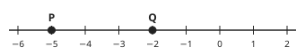

Check question: `m2-22-negative` · fill the blank, level 1 · computed by rule, reused from practice

> Choose the sign that makes the statement true.

Sentence: **−2 ___ 1**
- ◻️ =  
  _↳ feedback if chosen: −2 and 1 are not equal._
- ◻️ >  
  _↳ feedback if chosen: On the number line −2 is to the left of 1, so −2 is smaller._
- ✅ <

Full working after a second miss:

> The missing word is “<”.  
> −2 < 1  

**Worked example** (draft)

> Put the right sign, < or >, between −4 and −1. Then say whether x = 3 satisfies x ≥ 3.

1. On the number line −4 is to the left of −1, so −4 is smaller: −4 < −1.
2. x ≥ 3 means “x is greater than or equal to 3”. 3 is equal to 3, so x = 3 satisfies it.

**Answer:** −4 < −1, and yes, x = 3 satisfies x ≥ 3.

**Practice** `m2-22-compare` · fill the blank, level 1 · computed by rule

> Choose the sign that makes the statement true.

Sentence: **50 ___ 45**
- ◻️ <  
  _↳ feedback if chosen: < means “is less than”, but 50 is greater than 45._
- ✅ >
- ◻️ =  
  _↳ feedback if chosen: 50 and 45 are not equal._

Full working after a second miss:

> The missing word is “>”.  
> 50 > 45  

> Choose the sign that makes the statement true.

Sentence: **38 ___ 14**
- ◻️ <  
  _↳ feedback if chosen: < means “is less than”, but 38 is greater than 14._
- ✅ >
- ◻️ =  
  _↳ feedback if chosen: 38 and 14 are not equal._

Full working after a second miss:

> The missing word is “>”.  
> 38 > 14  

**Practice** `m2-22-negative` · fill the blank, level 1 · computed by rule

> Choose the sign that makes the statement true.

Sentence: **−11 ___ −3**
- ✅ <
- ◻️ =  
  _↳ feedback if chosen: −11 and −3 are not equal._
- ◻️ >  
  _↳ feedback if chosen: On the number line −11 is to the left of −3, so −11 is smaller._

Full working after a second miss:

> The missing word is “<”.  
> −11 < −3  

> Choose the sign that makes the statement true.

Sentence: **−5 ___ −11**
- ◻️ =  
  _↳ feedback if chosen: −5 and −11 are not equal._
- ✅ >
- ◻️ <  
  _↳ feedback if chosen: On the number line −5 is to the right of −11, so −5 is greater._

Full working after a second miss:

> The missing word is “>”.  
> −5 > −11  

**Practice** `m2-22-words` · multiple choice, level 1 · computed by rule

> Fewer than 58 cars were in the park. Which inequality says this, with n for the number?

- ◻️ n ≤ 58  
  _↳ feedback if chosen: The number 58 itself is not allowed, so use <._
- ◻️ n > 58  
  _↳ feedback if chosen: The sign points the wrong way: “fewer than” means less than._
- ✅ n < 58

Full working after a second miss:

> “fewer than” means less than.  
> So the inequality is n < 58.  

> Fewer than 54 cars were in the park. Which inequality says this, with n for the number?

- ✅ n < 54
- ◻️ n > 54  
  _↳ feedback if chosen: The sign points the wrong way: “fewer than” means less than._
- ◻️ n ≤ 54  
  _↳ feedback if chosen: The number 54 itself is not allowed, so use <._

Full working after a second miss:

> “fewer than” means less than.  
> So the inequality is n < 54.  

**Practice** `m2-22-read` · multiple choice, level 2 · computed by rule

> How do you read x < 18?

- ◻️ x is less than or equal to 18  
  _↳ feedback if chosen: With < the number 18 itself is not included._
- ✅ x is less than 18
- ◻️ x is greater than 18  
  _↳ feedback if chosen: The point of the sign faces the smaller side: < means less than._

Full working after a second miss:

> The sign < means “less than”.  
> So x < 18 reads: x is less than 18.  

> How do you read x ≥ 4?

- ✅ x is greater than or equal to 4
- ◻️ x is less than or equal to 4  
  _↳ feedback if chosen: The point of the sign faces the smaller side: ≥ means greater than or equal to._
- ◻️ x is greater than 4  
  _↳ feedback if chosen: With ≥ the number 4 itself is included._

Full working after a second miss:

> The sign ≥ means “greater than or equal to”.  
> So x ≥ 4 reads: x is greater than or equal to 4.  

**Practice** `m2-22-which` · multiple choice, level 2 · computed by rule

> Which of these numbers satisfies x > −3?

- ✅ 3
- ◻️ −9  
  _↳ feedback if chosen: −9 is not greater than −3._
- ◻️ −12  
  _↳ feedback if chosen: −12 is not greater than −3._
- ◻️ −3  
  _↳ feedback if chosen: The sign > leaves out −3 itself._

Full working after a second miss:

> x > −3 means x is greater than −3.  
> Only 3 is greater than −3.  

> Which of these numbers satisfies x < 4?

- ✅ 0
- ◻️ 11  
  _↳ feedback if chosen: 11 is not less than 4._
- ◻️ 8  
  _↳ feedback if chosen: 8 is not less than 4._
- ◻️ 4  
  _↳ feedback if chosen: The sign < leaves out 4 itself._

Full working after a second miss:

> x < 4 means x is less than 4.  
> Only 0 is less than 4.  

**Practice** `m2-22-spot` · spot the error, level 3 · computed by rule

> Which statement is false?

- ✅ −4 < −4  
  _↳ explanation: A number is not less than itself; −4 ≤ −4 is true._
- ◻️ 8 > −8
- ◻️ −4 ≤ −4
- ◻️ −8 < −4

Full working after a second miss:

> The wrong statement is “−4 < −4”.  
> A number is not less than itself; −4 ≤ −4 is true.  

> Which statement is false?

- ◻️ 1 ≥ −4
- ✅ −6 ≥ 1  
  _↳ explanation: −6 is negative and 1 is positive, so −6 < 1._
- ◻️ −4 ≤ −4
- ◻️ 1 > −6

Full working after a second miss:

> The wrong statement is “−6 ≥ 1”.  
> −6 is negative and 1 is positive, so −6 < 1.  

## Lesson 23: Solutions to Linear inequalities

Prerequisites: 21, 22 · Skill: m2-23 (Solving linear inequalities)

**Note** (draft)

> Solve an inequality like an equation, doing the same thing to both sides:
> • Adding or subtracting the same number keeps the sign: x + 3 < 7 gives x < 4.
> • Multiplying or dividing by a positive number keeps the sign: 2x ≥ 10 gives x ≥ 5.
> • Multiplying or dividing by a negative number turns the sign round: −3x < 6 gives x > −2. (Check: x = 0 works, because −3 × 0 = 0 < 6.)
> Two steps: 2x + 1 > 9. Subtract 1: 2x > 8. Divide by 2: x > 4.
> The whole-number solutions can be listed: if x < 4 and x is a natural number, x can be 0, 1, 2 or 3.

**Card c23-1** (draft)

> Adding or subtracting the same number on both sides keeps the inequality sign.
>
> _x + 3 < 7: subtract 3, x < 4._  

Check question: `m2-23-add` · multiple choice, level 1 · computed by rule, reused from practice

> Solve x − 8 < 3.

- ◻️ x > 11  
  _↳ feedback if chosen: Adding or subtracting never turns the sign round._
- ◻️ x < −5  
  _↳ feedback if chosen: Do the opposite: add 8._
- ✅ x < 11

Full working after a second miss:

> Add 8 to both sides; the sign stays.  
> x < 11  

**Card c23-2** (draft)

> Dividing both sides by a positive number keeps the sign.
>
> _2x ≥ 10: divide by 2, x ≥ 5._  

Check question: `m2-23-mul` · multiple choice, level 1 · computed by rule, reused from practice

> Solve 9x < 90.

- ◻️ x > 10  
  _↳ feedback if chosen: 9 is positive, so the sign stays the same._
- ✅ x < 10
- ◻️ x < 81  
  _↳ feedback if chosen: 9x means 9 × x: divide by 9._

Full working after a second miss:

> Divide both sides by 9, a positive number: the sign stays.  
> x < 10  

**Card c23-3** (draft)

> Dividing both sides by a negative number turns the sign round.
>
> _−3x < 6: divide by (−3) and turn the sign: x > −2._  
> _Check with x = −1: −3 × (−1) = 3, which is less than 6._  

Check question: `m2-23-c3` · multiple choice, level 1 · computed by rule

> Solve −6x ≥ −24.

- ✅ x ≤ 4
- ◻️ x ≥ 4  
  _↳ feedback if chosen: You divided by a negative number, (−6): the sign must turn round._
- ◻️ x ≤ −4  
  _↳ feedback if chosen: −24 ÷ (−6) = 4: check the sign of the number._

Full working after a second miss:

> Divide both sides by (−6), a negative number, so the sign turns round.  
> x ≤ 4  

**Card c23-4** (draft)

> The whole-number solutions of an inequality can be listed.
>
> _x < 4 with x a natural number: x = 0, 1, 2, 3._  

Check question: `m2-23-c4` · multiple choice, level 1 · computed by rule

> x is a natural number (0, 1, 2, …) and x < 5. Which list gives all the possible values of x?

- ✅ 0, 1, 2, 3, 4
- ◻️ 0, 1, 2, 3, 4, 5  
  _↳ feedback if chosen: The sign < leaves out 5._
- ◻️ 1, 2, 3, 4  
  _↳ feedback if chosen: 0 is a natural number too, and it is less than 5._

Full working after a second miss:

> x < 5 means x is less than 5, and natural numbers start at 0.  
> So x = 0, 1, 2, 3, 4.  

**Worked example** (draft)

> Solve 3x + 2 ≤ 14, then list the natural numbers that satisfy it.

1. Subtract 2 from both sides: 3x ≤ 12.
2. Divide both sides by 3, a positive number, so the sign stays: x ≤ 4.
3. The natural numbers that are less than or equal to 4: 0, 1, 2, 3, 4.

**Answer:** x ≤ 4: x = 0, 1, 2, 3, 4

**Practice** `m2-23-add` · multiple choice, level 1 · computed by rule

> Solve x − 5 ≤ 15.

- ✅ x ≤ 20
- ◻️ x ≥ 20  
  _↳ feedback if chosen: Adding or subtracting never turns the sign round._
- ◻️ x ≤ 10  
  _↳ feedback if chosen: Do the opposite: add 5._

Full working after a second miss:

> Add 5 to both sides; the sign stays.  
> x ≤ 20  

> Solve x + 3 ≤ 4.

- ◻️ x ≥ 1  
  _↳ feedback if chosen: Adding or subtracting never turns the sign round._
- ✅ x ≤ 1
- ◻️ x ≤ 7  
  _↳ feedback if chosen: Do the opposite: subtract 3._

Full working after a second miss:

> Subtract 3 from both sides; the sign stays.  
> x ≤ 1  

**Practice** `m2-23-mul` · multiple choice, level 1 · computed by rule

> Solve 6x > 30.

- ◻️ x > 24  
  _↳ feedback if chosen: 6x means 6 × x: divide by 6._
- ✅ x > 5
- ◻️ x < 5  
  _↳ feedback if chosen: 6 is positive, so the sign stays the same._

Full working after a second miss:

> Divide both sides by 6, a positive number: the sign stays.  
> x > 5  

> Solve 5x ≥ 35.

- ✅ x ≥ 7
- ◻️ x ≤ 7  
  _↳ feedback if chosen: 5 is positive, so the sign stays the same._
- ◻️ x ≥ 30  
  _↳ feedback if chosen: 5x means 5 × x: divide by 5._

Full working after a second miss:

> Divide both sides by 5, a positive number: the sign stays.  
> x ≥ 7  

**Practice** `m2-23-two` · multiple choice, level 2 · computed by rule

> Solve 2x + 7 ≥ 5.

- ◻️ x ≤ −1  
  _↳ feedback if chosen: You divided by a positive number: the sign stays._
- ✅ x ≥ −1
- ◻️ x ≥ −2  
  _↳ feedback if chosen: That is 2x: now divide by 2._
- ◻️ x ≥ 6  
  _↳ feedback if chosen: Undo + 7 by doing the opposite._

Full working after a second miss:

> Subtract 7 from both sides: 2x ≥ −2.  
> Divide by 2 (positive, the sign stays): x ≥ −1.  

> Solve 3x − 9 > 12.

- ◻️ x > 1  
  _↳ feedback if chosen: Undo − 9 by doing the opposite._
- ✅ x > 7
- ◻️ x > 21  
  _↳ feedback if chosen: That is 3x: now divide by 3._
- ◻️ x < 7  
  _↳ feedback if chosen: You divided by a positive number: the sign stays._

Full working after a second miss:

> Add 9 to both sides: 3x > 21.  
> Divide by 3 (positive, the sign stays): x > 7.  

**Practice** `m2-23-neg` · multiple choice, level 2 · computed by rule

> Solve −3x + 11 > 17.

- ✅ x < −2
- ◻️ x < 2  
  _↳ feedback if chosen: 6 ÷ (−3) = −2: check the sign._
- ◻️ x > −2  
  _↳ feedback if chosen: Dividing by a negative number turns the sign round._
- ◻️ x > 2  
  _↳ feedback if chosen: Turn the sign round, and check the number: 6 ÷ (−3) = −2._

Full working after a second miss:

> Subtract 11: −3x > 6.  
> Divide by (−3), a negative number, and turn the sign round: x < −2.  

> Solve −2x + 2 ≥ −2.

- ◻️ x ≥ −2  
  _↳ feedback if chosen: Turn the sign round, and check the number: −4 ÷ (−2) = 2._
- ✅ x ≤ 2
- ◻️ x ≤ −2  
  _↳ feedback if chosen: −4 ÷ (−2) = 2: check the sign._
- ◻️ x ≥ 2  
  _↳ feedback if chosen: Dividing by a negative number turns the sign round._

Full working after a second miss:

> Subtract 2: −2x ≥ −4.  
> Divide by (−2), a negative number, and turn the sign round: x ≤ 2.  

**Practice** `m2-23-list` · multiple choice, level 3 · computed by rule

> x is a whole number from −1 to 5. Which values satisfy 5x + 7 ≥ 17?

- ◻️ −1, 0, 1, 2  
  _↳ feedback if chosen: Those are the values on the other side of 2._
- ◻️ 3, 4, 5  
  _↳ feedback if chosen: The sign ≥ includes 2._
- ✅ 2, 3, 4, 5

Full working after a second miss:

> Solve: 5x ≥ 10, so x ≥ 2.  
> From −1 to 5, the values with x ≥ 2 are 2, 3, 4, 5.  

> x is a whole number from −2 to 4. Which values satisfy 3x + 7 ≥ 10?

- ◻️ −2, −1, 0, 1  
  _↳ feedback if chosen: Those are the values on the other side of 1._
- ◻️ 2, 3, 4  
  _↳ feedback if chosen: The sign ≥ includes 1._
- ✅ 1, 2, 3, 4

Full working after a second miss:

> Solve: 3x ≥ 3, so x ≥ 1.  
> From −2 to 4, the values with x ≥ 1 are 1, 2, 3, 4.  

**Practice** `m2-23-largest` · number, level 3 · computed by rule

> What is the largest whole number x such that 5x + 9 < 22?

Answer: **2**
- Typed **3** (round-up) → “x must be less than 2.6: round down.”

Full working after a second miss:

> Subtract 9 from both sides: 5x < 13.  
> Divide by 5: x < 2.6.  
> The largest whole number less than 2.6 is 2.  

> What is the largest whole number x such that 6x − 4 < 11?

Answer: **2**
- Typed **3** (round-up) → “x must be less than 2.5: round down.”

Full working after a second miss:

> Add 4 to both sides: 6x < 15.  
> Divide by 6: x < 2.5.  
> The largest whole number less than 2.5 is 2.  

## Lesson 24: Inequalities on the number line

Prerequisites: 22, 23 · Skill: m2-24 (Showing inequalities on the number line)

**Note** (draft)

> The solutions of an inequality can be shown on a number line.
> • A circle marks the end number. A filled circle (●) means the end number is included (≤ or ≥). An open circle (○) means it is not included (< or >).
> • A thick line with an arrow shows all the other solutions: to the right for > and ≥, to the left for < and ≤.
> x > 2: open circle at 2, arrow to the right. x ≤ −1: filled circle at −1, arrow to the left.
> To show the solutions of 2x + 1 ≥ 7, solve first (x ≥ 3), then draw a filled circle at 3 and an arrow to the right.

**Card c24-1** (draft)

> A filled circle means the end number is included (≤, ≥). An open circle means it is not (<, >).
>
> _x ≥ 2: filled circle at 2._  
> _x > 2: open circle at 2._  

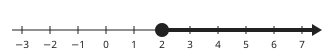

Check question: `m2-24-c1` · multiple choice, level 1 · computed by rule

> In the drawing of x > −6 on a number line, what is the circle at −6 like?

- ◻️ filled  
  _↳ feedback if chosen: The sign > does not include −6, so the circle is open._
- ✅ open

Full working after a second miss:

> The sign > does not include −6.  
> So the circle is open.  

**Card c24-2** (draft)

> The arrow points to the solutions: right for > and ≥, left for < and ≤.
>
> _x > 1: arrow to the right._  
> _x ≤ 1: arrow to the left._  

Check question: `m2-24-read` · multiple choice, level 1 · computed by rule, reused from practice

> Which inequality is shown on the number line?

- ✅ x < −4
- ◻️ x ≥ −4  
  _↳ feedback if chosen: Look at the arrow and at the circle._
- ◻️ x ≤ −4  
  _↳ feedback if chosen: Look at the circle: it is open._
- ◻️ x > −4  
  _↳ feedback if chosen: Look at the arrow: it points to the left._

Full working after a second miss:

> The circle at −4 is open, so −4 is not included.  
> The arrow points to the left (smaller numbers).  
> So the drawing shows x < −4.  

**Card c24-3** (draft)

> To show the solutions of an inequality, solve it first, then draw the circle and the arrow.
>
> _2x + 1 ≥ 7 gives x ≥ 3: filled circle at 3, arrow to the right._  

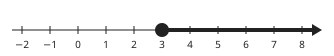

Check question: `m2-24-describe` · multiple choice, level 1 · computed by rule, reused from practice

> How do you show x ≥ −3 on a number line?

- ◻️ a filled circle at −3 and an arrow to the left  
  _↳ feedback if chosen: The arrow points to the solutions: right._
- ✅ a filled circle at −3 and an arrow to the right
- ◻️ an open circle at −3 and an arrow to the right  
  _↳ feedback if chosen: The circle: filled, because ≥ includes −3._
- ◻️ an open circle at −3 and an arrow to the left  
  _↳ feedback if chosen: Check both the circle and the arrow._

Full working after a second miss:

> The sign includes −3: filled circle.  
> Greater numbers are to the right.  
> So: a filled circle at −3 and an arrow to the right.  

**Worked example** (draft)

> Solve 2x + 3 < 1 and describe how to show the solutions on a number line.

1. Subtract 3: 2x < −2. Divide by 2: x < −1.
2. The sign < does not include −1: draw an open circle at −1.
3. Less than means to the left: draw a thick line from the circle with an arrow to the left.

**Answer:** x < −1: open circle at −1, arrow to the left.

**Practice** `m2-24-read` · multiple choice, level 1 · computed by rule

> Which inequality is shown on the number line?

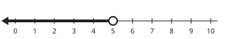

- ◻️ x ≤ 5  
  _↳ feedback if chosen: Look at the circle: it is open._
- ✅ x < 5
- ◻️ x ≥ 5  
  _↳ feedback if chosen: Look at the arrow and at the circle._
- ◻️ x > 5  
  _↳ feedback if chosen: Look at the arrow: it points to the left._

Full working after a second miss:

> The circle at 5 is open, so 5 is not included.  
> The arrow points to the left (smaller numbers).  
> So the drawing shows x < 5.  

> Which inequality is shown on the number line?

- ◻️ x ≤ −2  
  _↳ feedback if chosen: Look at the circle: it is open._
- ◻️ x > −2  
  _↳ feedback if chosen: Look at the arrow: it points to the left._
- ✅ x < −2
- ◻️ x ≥ −2  
  _↳ feedback if chosen: Look at the arrow and at the circle._

Full working after a second miss:

> The circle at −2 is open, so −2 is not included.  
> The arrow points to the left (smaller numbers).  
> So the drawing shows x < −2.  

**Practice** `m2-24-integers` · multiple choice, level 2 · computed by rule

> The number line shows the solutions of an inequality. Which whole numbers from 1 to 7 are solutions?

- ◻️ 5, 6, 7  
  _↳ feedback if chosen: The arrow points to the left: those are the solutions._
- ◻️ 1, 2, 3, 4  
  _↳ feedback if chosen: Look at the circle at 4: it is open, so 4 is not a solution._
- ✅ 1, 2, 3

Full working after a second miss:

> The drawing shows x < 4.  
> From 1 to 7, these numbers satisfy it: 1, 2, 3.  

> The number line shows the solutions of an inequality. Which whole numbers from −1 to 5 are solutions?

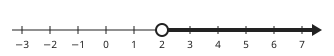

- ◻️ −1, 0, 1  
  _↳ feedback if chosen: The arrow points to the right: those are the solutions._
- ◻️ 2, 3, 4, 5  
  _↳ feedback if chosen: Look at the circle at 2: it is open, so 2 is not a solution._
- ✅ 3, 4, 5

Full working after a second miss:

> The drawing shows x > 2.  
> From −1 to 5, these numbers satisfy it: 3, 4, 5.  

**Practice** `m2-24-describe` · multiple choice, level 1 · computed by rule

> How do you show x > 1 on a number line?

- ✅ an open circle at 1 and an arrow to the right
- ◻️ an open circle at 1 and an arrow to the left  
  _↳ feedback if chosen: The arrow points to the solutions: right._
- ◻️ a filled circle at 1 and an arrow to the right  
  _↳ feedback if chosen: The circle: open, because > does not include 1._
- ◻️ a filled circle at 1 and an arrow to the left  
  _↳ feedback if chosen: Check both the circle and the arrow._

Full working after a second miss:

> The sign does not include 1: open circle.  
> Greater numbers are to the right.  
> So: an open circle at 1 and an arrow to the right.  

> How do you show x < 0 on a number line?

- ◻️ an open circle at 0 and an arrow to the right  
  _↳ feedback if chosen: The arrow points to the solutions: left._
- ◻️ a filled circle at 0 and an arrow to the left  
  _↳ feedback if chosen: The circle: open, because < does not include 0._
- ◻️ a filled circle at 0 and an arrow to the right  
  _↳ feedback if chosen: Check both the circle and the arrow._
- ✅ an open circle at 0 and an arrow to the left

Full working after a second miss:

> The sign does not include 0: open circle.  
> Smaller numbers are to the left.  
> So: an open circle at 0 and an arrow to the left.  

**Practice** `m2-24-solve` · multiple choice, level 3 · computed by rule

> The number line shows the solutions of one of these inequalities. Which one?

- ✅ 3x − 8 < 4
- ◻️ 3x − 8 < 7  
  _↳ feedback if chosen: That inequality solves to x < 5: the circle would be at 5._
- ◻️ 3x − 8 ≤ 4  
  _↳ feedback if chosen: Look at the circle: open, so the sign must not include 4._
- ◻️ 3x − 8 > 4  
  _↳ feedback if chosen: That inequality solves to x > 4: the arrow would point the other way._

Full working after a second miss:

> The drawing shows x < 4.  
> Solve 3x − 8 < 4: add 8 and divide by 3 to get x < 4.  

> The number line shows the solutions of one of these inequalities. Which one?

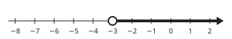

- ✅ 3x − 8 > −17
- ◻️ 3x − 8 ≥ −17  
  _↳ feedback if chosen: Look at the circle: open, so the sign must not include −3._
- ◻️ 3x − 8 < −17  
  _↳ feedback if chosen: That inequality solves to x < −3: the arrow would point the other way._
- ◻️ 3x − 8 > −14  
  _↳ feedback if chosen: That inequality solves to x > −2: the circle would be at −2._

Full working after a second miss:

> The drawing shows x > −3.  
> Solve 3x − 8 > −17: add 8 and divide by 3 to get x > −3.  

