# Physics Form 2, Batch P2-1: drafts for review (Lessons 1–15, Term 1)

Generated by `npm run review:f2-physics` from `content/form-2/physics/*.json`. Every question and drawing below was built by the engine.
All notes, teach cards, worked examples and paper tasks are **status: draft**. “Authored key” means a person fixed the
right answer (see `AUTHORED.md`); “computed by rule” means code worked it out (a formula, a conversion, a spelling rule).

Teach mode: cards (idea + example + 1 level-1 check) → worked example → practice (levels 1–3) → the note as a summary.

## Sample rendered lesson: Lesson 6 in teach mode

### Lesson 6: Calculation of Distance, time and speed using v = d/t

**Card c6-1** (draft)

> Distance = speed × time.
>
> _8 m/s for 15 s: 8 × 15 = 120 m._  

Check question: `p2-6-distance` · number, level 1 · computed by rule, reused from practice

> A train moves at 17 m/s for 36 s. How far does it travel?

Answer: **612 m**
- Typed **0.472222222** (divide) → “Distance = speed × time: multiply.”

Full working after a second miss:

> d = v × t.  
> 17 × 36 = 612 m.  

**Card c6-2** (draft)

> Time = distance ÷ speed.
>
> _150 km at 50 km/h: 150 ÷ 50 = 3 h._  

Check question: `p2-6-time` · number, level 1 · computed by rule, reused from practice

> A bus travels 400 km at 80 km/h. How many hours does the journey take?

Answer: **5 h**
- Typed **32 000** (times) → “Time = distance ÷ speed.”

Full working after a second miss:

> t = d ÷ v.  
> 400 ÷ 80 = 5 h.  

**Card c6-3** (draft)

> Make the units match before you calculate: change minutes to hours, or km to m.
>
> _30 minutes = 0.5 h._  
> _2 km = 2000 m._  

Check question: `p2-6-units-card` · number, level 1 · computed by rule

> A motorbike travels at 40 km/h for 45 minutes. How many kilometres does it travel?

Answer: **30 km**
- Typed **1800** (no-convert) → “Change the minutes to hours first.”

Full working after a second miss:

> Change minutes to hours: 45 min = 0.75 h.  
> d = 40 × 0.75 = 30 km.  

**Worked example** (draft)

> A taxi travels at 60 km/h for 30 minutes. How far does it go?

1. Units must match: 30 minutes = 30 ÷ 60 = 0.5 h.
2. d = v × t = 60 × 0.5 = 30 km.

**Answer:** 30 km

**Practice** (one generated question per template, easiest first)

Practice 1: `p2-6-distance` · number, level 1 · computed by rule

> A train moves at 16 m/s for 31 s. How far does it travel?

Answer: **496 m**
- Typed **0.516129032** (divide) → “Distance = speed × time: multiply.”

Full working after a second miss:

> d = v × t.  
> 16 × 31 = 496 m.  

Practice 2: `p2-6-time` · number, level 1 · computed by rule

> A bus travels 80 km at 40 km/h. How many hours does the journey take?

Answer: **2 h**
- Typed **3200** (times) → “Time = distance ÷ speed.”

Full working after a second miss:

> t = d ÷ v.  
> 80 ÷ 40 = 2 h.  

Practice 3: `p2-6-units` · number, level 2 · computed by rule

> A motorbike travels at 120 km/h for 20 minutes. How many kilometres does it travel?

Answer: **40 km**
- Typed **2400** (no-convert) → “Change the minutes to hours first.”

Full working after a second miss:

> Change minutes to hours: 20 min = 0.333333333 h.  
> d = 120 × 0.333333333 = 40 km.  

Practice 4: `p2-6-trip` · number, level 3 · computed by rule

> Mrs Fon drives 120 km in 2 h, then 120 km in 3 h. What is her average speed for the whole trip?

Answer: **48 km/h**
- Typed **50** (mean-speeds) → “Do not average the two speeds: divide the total distance by the total time.”

Full working after a second miss:

> Total distance: 120 + 120 = 240 km. Total time: 2 + 3 = 5 h.  
> Average speed = 240 ÷ 5 = 48 km/h.  

**Summary (the note)**

> The formula v = d/t links speed (v), distance (d) and time (t).
> • Speed: v = d ÷ t.
> • Distance: d = v × t.
> • Time: t = d ÷ v.
> A triangle helps: d on top, v and t at the bottom. Cover the one you want.
> Use matching units: m and s give m/s; km and h give km/h. Convert first if they do not match (for example minutes to hours).
> Example: a bus at 60 km/h for 3 h travels 60 × 3 = 180 km. To travel 150 km at 50 km/h takes 150 ÷ 50 = 3 h.

## All drafts

| Lesson | Title (sheet) | Status | Cards | Practice | Paper task |
|---|---|---|---|---|---|
| 1 | Data: Importance and collection | draft | 4 | 5 | — |
| 2 | Interpreting data and concluding | draft | 3 | 5 | — |
| 3 | Predicting and evaluating | draft | 3 | 5 | — |
| 4 | Base physical quantities, their units and instruments | draft | 3 | 5 | — |
| 5 | Speed: Definition, Units and Measurements | draft | 3 | 5 | — |
| 6 | Calculation of Distance, time and speed using v = d/t | draft | 3 | 4 | — |
| 7 | Density: Definition, Units and Measurement | draft | 3 | 5 | — |
| 8 | Physical state of matter | draft | 3 | 5 | — |
| 9 | Characteristics of matter in the different states | draft | 3 | 4 | — |
| 10 | Temperature: Definition, Units, Measurement and effects on matter | draft | 3 | 5 | — |
| 11 | Thermal and electrical insulation | draft | 3 | 4 | — |
| 12 | Action of heat on materials | draft | 3 | 4 | — |
| 13 | Action of electrical energy on materials | draft | 3 | 4 | — |
| 14 | Transmission of heat and electrical energy by conduction | draft | 3 | 5 | — |
| 15 | Non-Renewable Energy Sources and Uses | draft | 3 | 4 | — |

## Lesson 1: Data: Importance and collection

Prerequisites: none · Skill: p2-1 (Data: why we collect it and how)

**Note** (draft)

> Data are the facts and measurements we collect in an experiment. Scientists need data as evidence: a conclusion must be based on what was observed.
> • Qualitative data describe with words: colour, smell, “the water became cloudy”.
> • Quantitative data are numbers with units: 25 °C, 3.2 cm, 45 s.
> Record data in a table. Each column heading gives the quantity and its unit, for example “Time (s)”, so the unit is not written in every box.
> Repeat each measurement (for example three times) and find the mean: add the readings and divide by how many there are. A reading that is very different from the others is anomalous: check it, repeat it, and leave it out of the mean.

**Card c1-1** (draft)

> Qualitative data are descriptions in words; quantitative data are measurements with numbers and units.
>
> _Qualitative: “the solution turned blue”._  
> _Quantitative: “the temperature rose to 40 °C”._  

Check question: `p2-1-kind` · matching, level 1 · **authored key**, reused from practice

> Sort the data: qualitative or quantitative?

Groups: qualitative · quantitative
- the metal felt rough → **qualitative**
- the leaf is dark green → **qualitative**
- a length of 15.2 cm → **quantitative**
- a time of 45 s → **quantitative**

Full working after a second miss:

> The right pairs are:  
> the metal felt rough → qualitative  
> the leaf is dark green → qualitative  
> a length of 15.2 cm → quantitative  
> a time of 45 s → quantitative  

**Card c1-2** (draft)

> To find the mean of repeated readings, add them and divide by how many there are.
>
> _Readings 20, 22, 21: (20 + 22 + 21) ÷ 3 = 21._  

Check question: `p2-1-mean` · number, level 1 · computed by rule, reused from practice

> The readings are 23, 23, 23. What is their mean?

Answer: **23**
- Typed **69** (sum) → “That is the total. Divide it by 3.”

Full working after a second miss:

> Add: 23 + 23 + 23 = 69.  
> Divide by the number of readings: 69 ÷ 3 = 23.  

**Card c1-3** (draft)

> An anomalous reading is very different from the others. Repeat it, and leave it out of the mean.
>
> _Readings 15, 16, 14, 29: 29 is anomalous._  
> _Mean of the others: 15._  

Check question: `p2-1-odd` · multiple choice, level 1 · computed by rule, reused from practice

> The readings are 19, 20, 29, 21. Which reading is anomalous?

- ◻️ 20  
  _↳ feedback if chosen: 20 is close to 21 and 19._
- ◻️ 19  
  _↳ feedback if chosen: 19 is close to 20 and 21._
- ◻️ 21  
  _↳ feedback if chosen: 21 is close to 20 and 19._
- ✅ 29

Full working after a second miss:

> 29 is far from the other readings (20, 21 and 19).  
> So 29 is the anomalous reading.  

**Card c1-4** (draft)

> In a results table, put the unit in the column heading, not in every box.
>
> _Heading: “Length (cm)”, then just the numbers._  
> _Heading: “Time (s)”, then 12, 13, 12._  

Check question: `p2-1-c4` · multiple choice, level 1 · **authored key**

> Which is the best column heading for masses measured in grams?

- ✅ Mass (g)
- ◻️ g  
  _↳ feedback if chosen: Give the quantity too: Mass (g)._
- ◻️ Mass  
  _↳ feedback if chosen: Add the unit: Mass (g)._
- ◻️ Grams  
  _↳ feedback if chosen: Give the quantity, then the unit._

Full working after a second miss:

> Quantity, then the unit in brackets.  
> So the answer is “Mass (g)”.  

**Worked example** (draft)

> Bih times a ball rolling down a ramp three times: 12.4 s, 12.6 s and 12.5 s. Find the mean time.

1. Add the readings: 12.4 + 12.6 + 12.5 = 37.5 s.
2. Divide by the number of readings, 3: 37.5 ÷ 3 = 12.5 s.

**Answer:** The mean time is 12.5 s.

**Practice** `p2-1-kind` · matching, level 1 · **authored key**

> Sort the data: qualitative or quantitative?

Groups: qualitative · quantitative
- the metal felt rough → **qualitative**
- a mass of 250 g → **quantitative**
- the liquid turned milky → **qualitative**
- a temperature of 37 °C → **quantitative**

Full working after a second miss:

> The right pairs are:  
> the metal felt rough → qualitative  
> a mass of 250 g → quantitative  
> the liquid turned milky → qualitative  
> a temperature of 37 °C → quantitative  

> Sort the data: qualitative or quantitative?

Groups: qualitative · quantitative
- a temperature of 37 °C → **quantitative**
- a time of 45 s → **quantitative**
- a mass of 250 g → **quantitative**
- a strong smell of gas → **qualitative**

Full working after a second miss:

> The right pairs are:  
> a temperature of 37 °C → quantitative  
> a time of 45 s → quantitative  
> a mass of 250 g → quantitative  
> a strong smell of gas → qualitative  

**Practice** `p2-1-mean` · number, level 1 · computed by rule

> The readings are 24, 24, 24. What is their mean?

Answer: **24**
- Typed **72** (sum) → “That is the total. Divide it by 3.”

Full working after a second miss:

> Add: 24 + 24 + 24 = 72.  
> Divide by the number of readings: 72 ÷ 3 = 24.  

> The readings are 35, 36, 37. What is their mean?

Answer: **36**
- Typed **108** (sum) → “That is the total. Divide it by 3.”
- Typed **37** (middle) → “The mean is not the largest reading: add them and divide by 3.”

Full working after a second miss:

> Add: 35 + 36 + 37 = 108.  
> Divide by the number of readings: 108 ÷ 3 = 36.  

**Practice** `p2-1-odd` · multiple choice, level 1 · computed by rule

> The readings are 31, 21, 22, 23. Which reading is anomalous?

- ◻️ 21  
  _↳ feedback if chosen: 21 is close to 22 and 23._
- ◻️ 23  
  _↳ feedback if chosen: 23 is close to 22 and 21._
- ✅ 31
- ◻️ 22  
  _↳ feedback if chosen: 22 is close to 23 and 21._

Full working after a second miss:

> 31 is far from the other readings (22, 23 and 21).  
> So 31 is the anomalous reading.  

> The readings are 46, 38, 37, 36. Which reading is anomalous?

- ✅ 46
- ◻️ 36  
  _↳ feedback if chosen: 36 is close to 37 and 38._
- ◻️ 38  
  _↳ feedback if chosen: 38 is close to 37 and 36._
- ◻️ 37  
  _↳ feedback if chosen: 37 is close to 38 and 36._

Full working after a second miss:

> 46 is far from the other readings (37, 38 and 36).  
> So 46 is the anomalous reading.  

**Practice** `p2-1-why` · multiple choice, level 2 · **authored key**

> Why is data needed in an experiment?

- ✅ It is the evidence for the conclusion.
- ◻️ It makes the report longer.  
  _↳ feedback if chosen: Length is not the reason._
- ◻️ Teachers like numbers.  
  _↳ feedback if chosen: That is not the reason._
- ◻️ It replaces the method.  
  _↳ feedback if chosen: The method is still needed._

Full working after a second miss:

> A conclusion must be based on data.  
> So the answer is “It is the evidence for the conclusion.”.  

> Why do scientists repeat a measurement several times?

- ◻️ To make the numbers bigger.  
  _↳ feedback if chosen: Repeating does not change the size of the result._
- ◻️ Because the first reading is always wrong.  
  _↳ feedback if chosen: The first reading may be right; repeating checks it._
- ✅ To check it and make the result more reliable.
- ◻️ To use up time.  
  _↳ feedback if chosen: That is not a reason._

Full working after a second miss:

> Repeats show mistakes and give a more reliable mean.  
> So the answer is “To check it and make the result more reliable.”.  

**Practice** `p2-1-clean` · number, level 3 · computed by rule

> The readings are 36, 35, 34, 46. Leave out the anomalous reading and find the mean of the others.

Answer: **35**
- Typed **37.75** (with-odd) → “That includes the anomalous reading 46; leave it out.”

Full working after a second miss:

> 46 is anomalous: it is far from the others.  
> Mean of the others: (34 + 36 + 35) ÷ 3 = 35.  

> The readings are 35, 36, 46, 34. Leave out the anomalous reading and find the mean of the others.

Answer: **35**
- Typed **37.75** (with-odd) → “That includes the anomalous reading 46; leave it out.”

Full working after a second miss:

> 46 is anomalous: it is far from the others.  
> Mean of the others: (34 + 36 + 35) ÷ 3 = 35.  

## Lesson 2: Interpreting data and concluding

Prerequisites: 1 · Skill: p2-2 (Interpreting data and drawing conclusions)

**Note** (draft)

> To interpret data, look for a pattern, often on a graph.
> • The quantity we change goes along the bottom (x-axis); the quantity we measure goes up the side (y-axis).
> • Read a value: go up from the x value to the line, then across to the y-axis.
> • The trend: as x increases, y increases, decreases or stays the same. A straight line through 0 means y is proportional to x: double x, double y.
> • The rate of increase is how much y goes up for each 1 unit of x.
> A conclusion answers the question of the experiment using the data: “As the time increases, the distance increases steadily.” It must not claim more than the data show.

**Card c2-1** (draft)

> To read a graph, go up from the x value to the line, then across to the y-axis.
>
> _At 2 s, go up to the line and across: 10 m._  

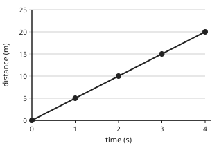

Check question: `p2-2-read` · number, level 1 · computed by rule, reused from practice

> The graph shows the distance travelled by a trolley. What distance has it travelled after 1 s?

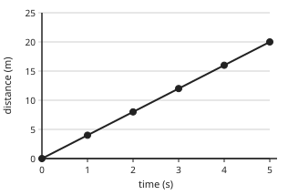

Answer: **4 m**
- Typed **1** (swap) → “1 is the time; read the distance on the side axis.”

Full working after a second miss:

> Go up from 1 s to the line, then across to the distance axis.  
> The distance is 4 m.  

**Card c2-2** (draft)

> The trend tells what happens to y as x increases: it increases, decreases or stays the same.
>
> _A line going up from left to right: y increases._  
> _A line going down: y decreases._  

Check question: `p2-2-trend` · multiple choice, level 1 · **authored key**, reused from practice

> As a hot drink cools in a room, its temperature falls. What is the trend?

- ◻️ the temperature increases with time  
  _↳ feedback if chosen: Read the description again: The temperature goes down as time goes on._
- ◻️ the temperature stays the same  
  _↳ feedback if chosen: Something changes: The temperature goes down as time goes on._
- ✅ the temperature decreases with time

Full working after a second miss:

> The temperature goes down as time goes on.  
> So the trend is: the temperature decreases with time.  

**Card c2-3** (draft)

> A conclusion uses the data to answer the question, without claiming more than the data show.
>
> _Good: “As the mass increases, the stretch increases.”_  
> _Too much: “Every spring in the world stretches the same.”_  

Check question: `p2-2-conclude` · multiple choice, level 1 · **authored key**, reused from practice

> A pupil heated water and recorded that its temperature rose by the same amount every minute. Which conclusion is best?

- ◻️ Heating water is dangerous.  
  _↳ feedback if chosen: That does not answer the question from the data._
- ✅ The temperature of the water rose at a steady rate while it was heated.
- ◻️ The temperature went down while heating.  
  _↳ feedback if chosen: The data show it went up._

Full working after a second miss:

> The true statement is “The temperature of the water rose at a steady rate while it was heated.”.  
> “Heating water is dangerous.” is false: That does not answer the question from the data.  
> “The temperature went down while heating.” is false: The data show it went up.  

**Worked example** (draft)

> A trolley's distance is measured every second: 0, 4, 8, 12, 16 m at the times 0, 1, 2, 3, 4 s. Describe the trend and find the distance at 3 s.

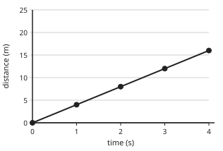

1. Each second the distance increases by the same amount, 4 m: the trend is a steady increase.
2. At 3 s the distance is 3 × 4 = 12 m.

**Answer:** Steady increase of 4 m each second; 12 m at 3 s.

**Practice** `p2-2-read` · number, level 1 · computed by rule

> The graph shows the distance travelled by a trolley. What distance has it travelled after 3 s?

Answer: **9 m**
- Typed **3** (swap) → “3 is the time; read the distance on the side axis.”

Full working after a second miss:

> Go up from 3 s to the line, then across to the distance axis.  
> The distance is 9 m.  

> The graph shows the distance travelled by a trolley. What distance has it travelled after 2 s?

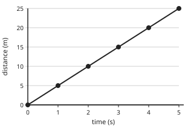

Answer: **10 m**
- Typed **2** (swap) → “2 is the time; read the distance on the side axis.”

Full working after a second miss:

> Go up from 2 s to the line, then across to the distance axis.  
> The distance is 10 m.  

**Practice** `p2-2-trend` · multiple choice, level 1 · **authored key**

> The further a torch is from a wall, the dimmer the light on the wall. What is the trend?

- ◻️ the brightness increases with distance  
  _↳ feedback if chosen: Read the description again: The light gets dimmer as the distance grows._
- ◻️ the brightness stays the same  
  _↳ feedback if chosen: Something changes: The light gets dimmer as the distance grows._
- ✅ the brightness decreases with distance

Full working after a second miss:

> The light gets dimmer as the distance grows.  
> So the trend is: the brightness decreases with distance.  

> The longer a pot of water is heated, the higher its temperature. What is the trend?

- ◻️ the temperature stays the same  
  _↳ feedback if chosen: Something changes: The temperature goes up as time goes on._
- ✅ the temperature increases with time
- ◻️ the temperature decreases with time  
  _↳ feedback if chosen: Read the description again: The temperature goes up as time goes on._

Full working after a second miss:

> The temperature goes up as time goes on.  
> So the trend is: the temperature increases with time.  

**Practice** `p2-2-rate` · number, level 2 · computed by rule

> From the graph, by how many metres does the distance increase each second?

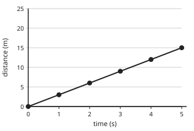

Answer: **3 m**
- Typed **15** (total) → “That is the total after five seconds; the increase each second is 3 m.”

Full working after a second miss:

> Read two points: at 1 s the distance is 3 m, at 2 s it is 6 m.  
> The increase each second is 6 − 3 = 3 m.  

> From the graph, by how many metres does the distance increase each second?

Answer: **10 m**
- Typed **50** (total) → “That is the total after five seconds; the increase each second is 10 m.”

Full working after a second miss:

> Read two points: at 1 s the distance is 10 m, at 2 s it is 20 m.  
> The increase each second is 20 − 10 = 10 m.  

**Practice** `p2-2-conclude` · multiple choice, level 1 · **authored key**

> A pupil heated water and recorded that its temperature rose by the same amount every minute. Which conclusion is best?

- ✅ The temperature of the water rose at a steady rate while it was heated.
- ◻️ Water boils at every temperature.  
  _↳ feedback if chosen: The data do not show that._
- ◻️ Heating water is dangerous.  
  _↳ feedback if chosen: That does not answer the question from the data._

Full working after a second miss:

> The true statement is “The temperature of the water rose at a steady rate while it was heated.”.  
> “Water boils at every temperature.” is false: The data do not show that.  
> “Heating water is dangerous.” is false: That does not answer the question from the data.  

> A pupil heated water and recorded that its temperature rose by the same amount every minute. Which conclusion is best?

- ✅ As the heating time increases, the temperature of the water increases steadily.
- ◻️ Heating water is dangerous.  
  _↳ feedback if chosen: That does not answer the question from the data._
- ◻️ Water boils at every temperature.  
  _↳ feedback if chosen: The data do not show that._

Full working after a second miss:

> The true statement is “As the heating time increases, the temperature of the water increases steadily.”.  
> “Heating water is dangerous.” is false: That does not answer the question from the data.  
> “Water boils at every temperature.” is false: The data do not show that.  

**Practice** `p2-2-proportional` · number, level 3 · computed by rule

> Distance is proportional to time in this experiment: in 3 s the trolley goes 9 m. How far does it go in 6 s?

Answer: **18 m**
- Typed **11** (added) → “Proportional means multiply: double the time gives double the distance.”

Full working after a second miss:

> Proportional: double the time, double the distance.  
> 9 × 2 = 18 m.  

> Distance is proportional to time in this experiment: in 5 s the trolley goes 10 m. How far does it go in 10 s?

Answer: **20 m**
- Typed **12** (added) → “Proportional means multiply: double the time gives double the distance.”

Full working after a second miss:

> Proportional: double the time, double the distance.  
> 10 × 2 = 20 m.  

## Lesson 3: Predicting and evaluating

Prerequisites: 2 · Skill: p2-3 (Predicting and evaluating)

**Note** (draft)

> Predicting: when data follow a pattern, we can predict new values.
> • Inside the range measured, read the value from the line (interpolation).
> • Beyond the range, continue the pattern (extrapolation), carefully: the pattern may change.
> A fair test changes one variable only:
> • the independent variable is the one we change;
> • the dependent variable is the one we measure;
> • the controlled variables are kept the same.
> Evaluating an experiment: Were the readings repeatable? Was the test fair? What could cause errors (reaction time with a stopwatch, reading a scale at an angle)? How could it be improved (repeat readings, use a more precise instrument, take more readings)?

**Card c3-1** (draft)

> If the pattern adds the same amount each time, continue it to predict the next value.
>
> _10, 15, 20, 25 …: next 30._  

Check question: `p2-3-next` · number, level 1 · computed by rule, reused from practice

> A plant's height is measured each week: 8, 12, 16, 20 cm. Predict the height next week if the pattern continues.

Answer: **24 cm**
- Typed **4** (diff) → “4 cm is the growth each week; add it to the last height.”

Full working after a second miss:

> It grows 4 cm each week.  
> 20 + 4 = 24 cm.  

**Card c3-2** (draft)

> In a fair test, change one variable, measure one, and keep all the others the same.
>
> _Changed: the height of the ramp. Measured: the time._  
> _Kept the same: the ball, the ramp length, the surface._  

Check question: `p2-3-var` · matching, level 1 · **authored key**, reused from practice

> In an experiment on how the height of a ramp affects the time a ball takes to roll down it, sort the variables.

Groups: changed (independent) · measured (dependent) · kept the same (controlled)
- the same length of ramp → **kept the same (controlled)**
- the time taken → **measured (dependent)**
- the height of the ramp → **changed (independent)**
- the same ball each time → **kept the same (controlled)**

Full working after a second miss:

> The right pairs are:  
> the same length of ramp → kept the same (controlled)  
> the time taken → measured (dependent)  
> the height of the ramp → changed (independent)  
> the same ball each time → kept the same (controlled)  

**Card c3-3** (draft)

> To improve an experiment: repeat readings, use more precise instruments, take more readings.
>
> _Timing by hand has a reaction-time error._  
> _Repeat and find the mean to reduce it._  

Check question: `p2-3-improve` · multiple choice, level 1 · **authored key**, reused from practice

> Bih's three readings are very different from each other. What should she do?

- ◻️ Make up a new reading.  
  _↳ feedback if chosen: Never make up data._
- ✅ Repeat the measurement and check for mistakes.
- ◻️ Stop the experiment.  
  _↳ feedback if chosen: Find out why first._
- ◻️ Keep only the biggest.  
  _↳ feedback if chosen: Choosing the biggest is not fair._

Full working after a second miss:

> Readings that disagree must be checked and repeated.  
> So the answer is “Repeat the measurement and check for mistakes.”.  

**Worked example** (draft)

> A spring stretches 3 cm for every 100 g hung on it, up to 500 g. Predict the stretch for 600 g, and say why the prediction may be wrong.

1. Continue the pattern: 6 × 3 = 18 cm.
2. 600 g is beyond the range measured: the spring may stop stretching evenly, so this is only a prediction.

**Answer:** About 18 cm, but the pattern may change beyond the range measured.

**Practice** `p2-3-next` · number, level 1 · computed by rule

> A plant's height is measured each week: 4, 8, 12, 16 cm. Predict the height next week if the pattern continues.

Answer: **20 cm**
- Typed **4** (diff) → “4 cm is the growth each week; add it to the last height.”

Full working after a second miss:

> It grows 4 cm each week.  
> 16 + 4 = 20 cm.  

> A plant's height is measured each week: 14, 19, 24, 29 cm. Predict the height next week if the pattern continues.

Answer: **34 cm**
- Typed **5** (diff) → “5 cm is the growth each week; add it to the last height.”

Full working after a second miss:

> It grows 5 cm each week.  
> 29 + 5 = 34 cm.  

**Practice** `p2-3-var` · matching, level 1 · **authored key**

> In an experiment on how the height of a ramp affects the time a ball takes to roll down it, sort the variables.

Groups: changed (independent) · kept the same (controlled)
- the same surface on the ramp → **kept the same (controlled)**
- the same ball each time → **kept the same (controlled)**
- the same length of ramp → **kept the same (controlled)**
- the height of the ramp → **changed (independent)**

Full working after a second miss:

> The right pairs are:  
> the same surface on the ramp → kept the same (controlled)  
> the same ball each time → kept the same (controlled)  
> the same length of ramp → kept the same (controlled)  
> the height of the ramp → changed (independent)  

> In an experiment on how the height of a ramp affects the time a ball takes to roll down it, sort the variables.

Groups: changed (independent) · kept the same (controlled)
- the same ball each time → **kept the same (controlled)**
- the same length of ramp → **kept the same (controlled)**
- the height of the ramp → **changed (independent)**
- the same surface on the ramp → **kept the same (controlled)**

Full working after a second miss:

> The right pairs are:  
> the same ball each time → kept the same (controlled)  
> the same length of ramp → kept the same (controlled)  
> the height of the ramp → changed (independent)  
> the same surface on the ramp → kept the same (controlled)  

**Practice** `p2-3-between` · number, level 2 · computed by rule

> A spring stretches 8 cm with 400 g and 16 cm with 800 g, evenly. What is its stretch with 600 g?

Answer: **12 cm**

Full working after a second miss:

> The stretch is proportional: halfway between 400 g and 800 g gives halfway between 8 cm and 16 cm.  
> 8 + 4 = 12 cm.  

> A spring stretches 8 cm with 400 g and 16 cm with 800 g, evenly. What is its stretch with 600 g?

Answer: **12 cm**

Full working after a second miss:

> The stretch is proportional: halfway between 400 g and 800 g gives halfway between 8 cm and 16 cm.  
> 8 + 4 = 12 cm.  

**Practice** `p2-3-improve` · multiple choice, level 1 · **authored key**

> Ayuk times one swing of a pendulum with a stopwatch. What is the best way to improve his result?

- ◻️ Time it once very fast.  
  _↳ feedback if chosen: One quick reading has a large reaction-time error._
- ◻️ Guess the time.  
  _↳ feedback if chosen: Guessing is not measuring._
- ✅ Time 10 swings and divide by 10.
- ◻️ Use a ruler.  
  _↳ feedback if chosen: A ruler measures length, not time._

Full working after a second miss:

> Timing many swings makes the reaction-time error small compared with the total.  
> So the answer is “Time 10 swings and divide by 10.”.  

> A pupil reads a measuring cylinder from above. What error can this cause?

- ◻️ a zero error  
  _↳ feedback if chosen: A zero error is when an instrument does not start at zero._
- ✅ a parallax error
- ◻️ a reaction-time error  
  _↳ feedback if chosen: Reaction time is about timing._
- ◻️ no error  
  _↳ feedback if chosen: Reading at an angle gives a wrong value._

Full working after a second miss:

> Reading at an angle gives a parallax error: read at eye level.  
> So the answer is “a parallax error”.  

**Practice** `p2-3-spot` · spot the error, level 3 · **authored key**

> Which statement about a fair test is wrong?

- ◻️ Keep the controlled variables the same.
- ◻️ Measure the dependent variable.
- ◻️ Repeat readings and take the mean.
- ✅ Change two variables at once to save time.  
  _↳ explanation: Then you cannot tell which change caused the result._

Full working after a second miss:

> The wrong statement is “Change two variables at once to save time.”.  
> Then you cannot tell which change caused the result.  

> Which statement about a fair test is wrong?

- ◻️ Repeat readings and take the mean.
- ✅ Leave out readings you do not like.  
  _↳ explanation: Only anomalous readings, after checking, may be left out._
- ◻️ Change only one variable at a time.
- ◻️ Measure the dependent variable.

Full working after a second miss:

> The wrong statement is “Leave out readings you do not like.”.  
> Only anomalous readings, after checking, may be left out.  

## Lesson 4: Base physical quantities, their units and instruments

Prerequisites: none · Skill: p2-4 (Base physical quantities, their units and instruments)

**Note** (draft)

> A physical quantity is something we can measure, with a number and a unit. The SI system has seven base quantities; in Form 2 we use five:
> • length: metre (m), measured with a ruler, metre rule or tape measure;
> • mass: kilogram (kg), measured with a balance;
> • time: second (s), measured with a stopwatch or clock;
> • temperature: kelvin (K), measured with a thermometer (we also use °C);
> • electric current: ampere (A), measured with an ammeter.
> (The other two are the amount of substance, mole, and luminous intensity, candela.)
> Other quantities are derived from these: area (m²), volume (m³), speed (m/s), density (kg/m³).
> Prefixes: kilo- = 1000 (1 km = 1000 m), centi- = one hundredth (100 cm = 1 m), milli- = one thousandth (1000 mm = 1 m).

**Card c4-1** (draft)

> Each base quantity has an SI unit.
>
> _length: metre (m); mass: kilogram (kg); time: second (s)_  
> _temperature: kelvin (K); current: ampere (A)_  

Check question: `p2-4-unit` · matching, level 1 · **authored key**, reused from practice

> Match each base quantity to its SI unit.

Right-hand side (shuffled): ampere (A) · kelvin (K) · second (s) · kilogram (kg)
- mass → **kilogram (kg)**
- electric current → **ampere (A)**
- time → **second (s)**
- temperature → **kelvin (K)**

Full working after a second miss:

> The right pairs are:  
> mass → kilogram (kg)  
> electric current → ampere (A)  
> time → second (s)  
> temperature → kelvin (K)  

**Card c4-2** (draft)

> Each quantity has its instrument.
>
> _mass: a balance; time: a stopwatch_  
> _current: an ammeter; temperature: a thermometer_  

Check question: `p2-4-tool` · matching, level 1 · **authored key**, reused from practice

> Match each quantity to the instrument that measures it.

Right-hand side (shuffled): a measuring cylinder · a stopwatch · a metre rule · an ammeter
- time → **a stopwatch**
- volume of a liquid → **a measuring cylinder**
- electric current → **an ammeter**
- length → **a metre rule**

Full working after a second miss:

> The right pairs are:  
> time → a stopwatch  
> volume of a liquid → a measuring cylinder  
> electric current → an ammeter  
> length → a metre rule  

**Card c4-3** (draft)

> Prefixes: kilo- is a thousand times; centi- a hundredth; milli- a thousandth.
>
> _1 km = 1000 m; 1 m = 100 cm_  
> _1 kg = 1000 g; 1 g = 1000 mg_  

Check question: `p2-4-convert` · number, level 1 · computed by rule, reused from practice

> Convert 12 m to mm.

Answer: **12 000**
- Typed **0.012** (wrong-way) → “Check the direction: smaller units means a bigger number.”

Full working after a second miss:

> 1 m = 1000 mm.  
> 12 m = 12 × 1000 = 12 000 mm.  

**Worked example** (draft)

> Write 2.5 km in metres and 350 cm in metres.

1. Kilo means a thousand: 2.5 km = 2.5 × 1000 = 2500 m.
2. Centi means one hundredth: 350 cm = 350 ÷ 100 = 3.5 m.

**Answer:** 2500 m and 3.5 m

**Practice** `p2-4-unit` · matching, level 1 · **authored key**

> Match each base quantity to its SI unit.

Right-hand side (shuffled): kilogram (kg) · second (s) · kelvin (K) · metre (m)
- length → **metre (m)**
- mass → **kilogram (kg)**
- time → **second (s)**
- temperature → **kelvin (K)**

Full working after a second miss:

> The right pairs are:  
> length → metre (m)  
> mass → kilogram (kg)  
> time → second (s)  
> temperature → kelvin (K)  

> Match each base quantity to its SI unit.

Right-hand side (shuffled): second (s) · kelvin (K) · kilogram (kg) · metre (m)
- time → **second (s)**
- temperature → **kelvin (K)**
- length → **metre (m)**
- mass → **kilogram (kg)**

Full working after a second miss:

> The right pairs are:  
> time → second (s)  
> temperature → kelvin (K)  
> length → metre (m)  
> mass → kilogram (kg)  

**Practice** `p2-4-tool` · matching, level 1 · **authored key**

> Match each quantity to the instrument that measures it.

Right-hand side (shuffled): a balance · a stopwatch · a metre rule · a measuring cylinder
- mass → **a balance**
- time → **a stopwatch**
- volume of a liquid → **a measuring cylinder**
- length → **a metre rule**

Full working after a second miss:

> The right pairs are:  
> mass → a balance  
> time → a stopwatch  
> volume of a liquid → a measuring cylinder  
> length → a metre rule  

> Match each quantity to the instrument that measures it.

Right-hand side (shuffled): a thermometer · an ammeter · a stopwatch · a balance
- mass → **a balance**
- electric current → **an ammeter**
- time → **a stopwatch**
- temperature → **a thermometer**

Full working after a second miss:

> The right pairs are:  
> mass → a balance  
> electric current → an ammeter  
> time → a stopwatch  
> temperature → a thermometer  

**Practice** `p2-4-convert` · number, level 1 · computed by rule

> Convert 12 km to m.

Answer: **12 000**
- Typed **0.012** (wrong-way) → “Check the direction: smaller units means a bigger number.”

Full working after a second miss:

> 1 km = 1000 m.  
> 12 km = 12 × 1000 = 12 000 m.  

> Convert 750 m to cm.

Answer: **75 000**
- Typed **7.5** (wrong-way) → “Check the direction: smaller units means a bigger number.”

Full working after a second miss:

> 1 m = 100 cm.  
> 750 m = 750 × 100 = 75 000 cm.  

**Practice** `p2-4-which` · multiple choice, level 2 · **authored key**

> Which instrument measures electric current?

- ◻️ a balance  
  _↳ feedback if chosen: A balance measures mass._
- ◻️ a stopwatch  
  _↳ feedback if chosen: A stopwatch measures time._
- ◻️ a thermometer  
  _↳ feedback if chosen: A thermometer measures temperature._
- ✅ an ammeter

Full working after a second miss:

> An ammeter measures current in amperes.  
> So the answer is “an ammeter”.  

> Which of these is NOT a base quantity?

- ✅ speed
- ◻️ length  
  _↳ feedback if chosen: Length is a base quantity (metre)._
- ◻️ mass  
  _↳ feedback if chosen: Mass is a base quantity (kilogram)._
- ◻️ time  
  _↳ feedback if chosen: Time is a base quantity (second)._

Full working after a second miss:

> Speed is derived: distance ÷ time.  
> So the answer is “speed”.  

**Practice** `p2-4-time` · number, level 3 · computed by rule

> A football match lasts 15 minutes. How many seconds is that?

Answer: **900 s**
- Typed **1500** (hundred) → “A minute has 60 seconds, not a hundred.”

Full working after a second miss:

> One minute is 60 seconds.  
> 15 × 60 = 900 s.  

> A football match lasts 20 minutes. How many seconds is that?

Answer: **1200 s**
- Typed **2000** (hundred) → “A minute has 60 seconds, not a hundred.”

Full working after a second miss:

> One minute is 60 seconds.  
> 20 × 60 = 1200 s.  

## Lesson 5: Speed: Definition, Units and Measurements

Prerequisites: 4 · Skill: p2-5 (Speed: definition, units and measurement)

**Note** (draft)

> Speed is the distance travelled in one unit of time. Speed = distance ÷ time.
> Units: metres per second (m/s), the SI unit, or kilometres per hour (km/h) for vehicles.
> A car at 60 km/h would travel 60 km in one hour.
> Converting: 1 km/h = 1000 m ÷ 3600 s, so divide km/h by 3.6 to get m/s: 72 km/h = 20 m/s. Multiply m/s by 3.6 to get km/h.
> Measuring speed: mark a distance with a tape measure, time the object over it with a stopwatch, then divide. This gives the average speed: the object may go faster and slower along the way.
> A speedometer shows a vehicle's speed at each moment.

**Card c5-1** (draft)

> Speed is the distance travelled each second (or each hour): distance ÷ time.
>
> _60 m in 12 s: 60 ÷ 12 = 5 m/s._  

Check question: `p2-5-speed` · number, level 1 · computed by rule, reused from practice

> A cyclist travels 312 m in 26 s. What is the average speed?

Answer: **12 m/s**
- Typed **8112** (times) → “Divide the distance by the time, do not multiply.”
- Typed **0.083333333** (upside) → “Speed is distance ÷ time, not time ÷ distance.”

Full working after a second miss:

> Speed = distance ÷ time.  
> 312 ÷ 26 = 12 m/s.  

**Card c5-2** (draft)

> Speed is in m/s or km/h. Divide km/h by 3.6 to get m/s.
>
> _36 km/h = 36 ÷ 3.6 = 10 m/s._  

Check question: `p2-5-convert` · number, level 1 · computed by rule, reused from practice

> Convert 36 km/h to m/s.

Answer: **10 m/s**
- Typed **129.6** (times) → “To go from km/h to m/s, divide by 3.6.”

Full working after a second miss:

> Divide by 3.6: 1 km/h = 1000 m ÷ 3600 s.  
> 36 ÷ 3.6 = 10 m/s.  

**Card c5-3** (draft)

> To measure speed, measure a distance and the time taken, then divide. This gives the average speed.
>
> _Tape measure for the distance, stopwatch for the time._  
> _A speedometer shows the speed at each moment._  

Check question: `p2-5-measure` · multiple choice, level 1 · **authored key**, reused from practice

> What does a speedometer show?

- ✅ the speed at each moment
- ◻️ the time only  
  _↳ feedback if chosen: That is a clock._
- ◻️ the distance only  
  _↳ feedback if chosen: That is an odometer._
- ◻️ the average speed of the whole trip  
  _↳ feedback if chosen: Distance ÷ total time gives the average speed._

Full working after a second miss:

> A speedometer shows the speed at that moment.  
> So the answer is “the speed at each moment”.  

**Worked example** (draft)

> Ewane runs 100 m in 20 s. What is his average speed?

1. Speed = distance ÷ time.
2. Speed = 100 ÷ 20 = 5 m/s.

**Answer:** 5 m/s

**Practice** `p2-5-speed` · number, level 1 · computed by rule

> A cyclist travels 108 m in 18 s. What is the average speed?

Answer: **6 m/s**
- Typed **1944** (times) → “Divide the distance by the time, do not multiply.”
- Typed **0.166666667** (upside) → “Speed is distance ÷ time, not time ÷ distance.”

Full working after a second miss:

> Speed = distance ÷ time.  
> 108 ÷ 18 = 6 m/s.  

> A cyclist travels 280 m in 35 s. What is the average speed?

Answer: **8 m/s**
- Typed **9800** (times) → “Divide the distance by the time, do not multiply.”
- Typed **0.125** (upside) → “Speed is distance ÷ time, not time ÷ distance.”

Full working after a second miss:

> Speed = distance ÷ time.  
> 280 ÷ 35 = 8 m/s.  

**Practice** `p2-5-convert` · number, level 1 · computed by rule

> Convert 36 km/h to m/s.

Answer: **10 m/s**
- Typed **129.6** (times) → “To go from km/h to m/s, divide by 3.6.”

Full working after a second miss:

> Divide by 3.6: 1 km/h = 1000 m ÷ 3600 s.  
> 36 ÷ 3.6 = 10 m/s.  

> Convert 90 km/h to m/s.

Answer: **25 m/s**
- Typed **324** (times) → “To go from km/h to m/s, divide by 3.6.”

Full working after a second miss:

> Divide by 3.6: 1 km/h = 1000 m ÷ 3600 s.  
> 90 ÷ 3.6 = 25 m/s.  

**Practice** `p2-5-measure` · multiple choice, level 1 · **authored key**

> What does a speedometer show?

- ✅ the speed at each moment
- ◻️ the distance only  
  _↳ feedback if chosen: That is an odometer._
- ◻️ the time only  
  _↳ feedback if chosen: That is a clock._
- ◻️ the average speed of the whole trip  
  _↳ feedback if chosen: Distance ÷ total time gives the average speed._

Full working after a second miss:

> A speedometer shows the speed at that moment.  
> So the answer is “the speed at each moment”.  

> What is the SI unit of speed?

- ◻️ second (s)  
  _↳ feedback if chosen: That is a unit of time._
- ✅ metre per second (m/s)
- ◻️ kilometre (km)  
  _↳ feedback if chosen: That is a unit of length._
- ◻️ kilogram (kg)  
  _↳ feedback if chosen: That is a unit of mass._

Full working after a second miss:

> Speed is distance per time: m/s.  
> So the answer is “metre per second (m/s)”.  

**Practice** `p2-5-kmh` · number, level 2 · computed by rule

> A bus travels 300 km in 5 hours. What is its average speed in km/h?

Answer: **60 km/h**
- Typed **1500** (times) → “Divide the distance by the time.”

Full working after a second miss:

> Speed = distance ÷ time.  
> 300 ÷ 5 = 60 km/h.  

> A bus travels 240 km in 3 hours. What is its average speed in km/h?

Answer: **80 km/h**
- Typed **720** (times) → “Divide the distance by the time.”

Full working after a second miss:

> Speed = distance ÷ time.  
> 240 ÷ 3 = 80 km/h.  

**Practice** `p2-5-back` · number, level 3 · computed by rule

> A car moves at 20 m/s. What is its speed in km/h?

Answer: **72 km/h**
- Typed **5.56** (divide) → “From m/s to km/h, multiply by 3.6.”

Full working after a second miss:

> Multiply m/s by 3.6 to get km/h.  
> 20 × 3.6 = 72 km/h.  

> A car moves at 10 m/s. What is its speed in km/h?

Answer: **36 km/h**
- Typed **2.78** (divide) → “From m/s to km/h, multiply by 3.6.”

Full working after a second miss:

> Multiply m/s by 3.6 to get km/h.  
> 10 × 3.6 = 36 km/h.  

## Lesson 6: Calculation of Distance, time and speed using v = d/t

Prerequisites: 5 · Skill: p2-6 (Calculating distance, time and speed)

**Note** (draft)

> The formula v = d/t links speed (v), distance (d) and time (t).
> • Speed: v = d ÷ t.
> • Distance: d = v × t.
> • Time: t = d ÷ v.
> A triangle helps: d on top, v and t at the bottom. Cover the one you want.
> Use matching units: m and s give m/s; km and h give km/h. Convert first if they do not match (for example minutes to hours).
> Example: a bus at 60 km/h for 3 h travels 60 × 3 = 180 km. To travel 150 km at 50 km/h takes 150 ÷ 50 = 3 h.

**Card c6-1** (draft)

> Distance = speed × time.
>
> _8 m/s for 15 s: 8 × 15 = 120 m._  

Check question: `p2-6-distance` · number, level 1 · computed by rule, reused from practice

> A train moves at 14 m/s for 25 s. How far does it travel?

Answer: **350 m**
- Typed **0.56** (divide) → “Distance = speed × time: multiply.”

Full working after a second miss:

> d = v × t.  
> 14 × 25 = 350 m.  

**Card c6-2** (draft)

> Time = distance ÷ speed.
>
> _150 km at 50 km/h: 150 ÷ 50 = 3 h._  

Check question: `p2-6-time` · number, level 1 · computed by rule, reused from practice

> A bus travels 100 km at 50 km/h. How many hours does the journey take?

Answer: **2 h**
- Typed **5000** (times) → “Time = distance ÷ speed.”

Full working after a second miss:

> t = d ÷ v.  
> 100 ÷ 50 = 2 h.  

**Card c6-3** (draft)

> Make the units match before you calculate: change minutes to hours, or km to m.
>
> _30 minutes = 0.5 h._  
> _2 km = 2000 m._  

Check question: `p2-6-units-card` · number, level 1 · computed by rule

> A motorbike travels at 60 km/h for 30 minutes. How many kilometres does it travel?

Answer: **30 km**
- Typed **1800** (no-convert) → “Change the minutes to hours first.”

Full working after a second miss:

> Change minutes to hours: 30 min = 0.5 h.  
> d = 60 × 0.5 = 30 km.  

**Worked example** (draft)

> A taxi travels at 60 km/h for 30 minutes. How far does it go?

1. Units must match: 30 minutes = 30 ÷ 60 = 0.5 h.
2. d = v × t = 60 × 0.5 = 30 km.

**Answer:** 30 km

**Practice** `p2-6-distance` · number, level 1 · computed by rule

> A train moves at 23 m/s for 24 s. How far does it travel?

Answer: **552 m**
- Typed **0.958333333** (divide) → “Distance = speed × time: multiply.”

Full working after a second miss:

> d = v × t.  
> 23 × 24 = 552 m.  

> A train moves at 28 m/s for 19 s. How far does it travel?

Answer: **532 m**
- Typed **1.473684211** (divide) → “Distance = speed × time: multiply.”

Full working after a second miss:

> d = v × t.  
> 28 × 19 = 532 m.  

**Practice** `p2-6-time` · number, level 1 · computed by rule

> A bus travels 320 km at 80 km/h. How many hours does the journey take?

Answer: **4 h**
- Typed **25 600** (times) → “Time = distance ÷ speed.”

Full working after a second miss:

> t = d ÷ v.  
> 320 ÷ 80 = 4 h.  

> A bus travels 200 km at 50 km/h. How many hours does the journey take?

Answer: **4 h**
- Typed **10 000** (times) → “Time = distance ÷ speed.”

Full working after a second miss:

> t = d ÷ v.  
> 200 ÷ 50 = 4 h.  

**Practice** `p2-6-units` · number, level 2 · computed by rule

> A motorbike travels at 120 km/h for 45 minutes. How many kilometres does it travel?

Answer: **90 km**
- Typed **5400** (no-convert) → “Change the minutes to hours first.”

Full working after a second miss:

> Change minutes to hours: 45 min = 0.75 h.  
> d = 120 × 0.75 = 90 km.  

> A motorbike travels at 40 km/h for 30 minutes. How many kilometres does it travel?

Answer: **20 km**
- Typed **1200** (no-convert) → “Change the minutes to hours first.”

Full working after a second miss:

> Change minutes to hours: 30 min = 0.5 h.  
> d = 40 × 0.5 = 20 km.  

**Practice** `p2-6-trip` · number, level 3 · computed by rule

> Mrs Fon drives 100 km in 2 h, then 180 km in 3 h. What is her average speed for the whole trip?

Answer: **56 km/h**
- Typed **55** (mean-speeds) → “Do not average the two speeds: divide the total distance by the total time.”

Full working after a second miss:

> Total distance: 100 + 180 = 280 km. Total time: 2 + 3 = 5 h.  
> Average speed = 280 ÷ 5 = 56 km/h.  

> Mrs Fon drives 240 km in 3 h, then 60 km in 1 h. What is her average speed for the whole trip?

Answer: **75 km/h**
- Typed **70** (mean-speeds) → “Do not average the two speeds: divide the total distance by the total time.”

Full working after a second miss:

> Total distance: 240 + 60 = 300 km. Total time: 3 + 1 = 4 h.  
> Average speed = 300 ÷ 4 = 75 km/h.  

## Lesson 7: Density: Definition, Units and Measurement

Prerequisites: 4 · Skill: p2-7 (Density: definition, units and measurement)

**Note** (draft)

> Density is the mass of one unit of volume of a substance. Density = mass ÷ volume (ρ = m/V).
> Units: g/cm³ (grams per cubic centimetre) or kg/m³. 1 g/cm³ = 1000 kg/m³. Water: 1 g/cm³.
> Measuring density:
> • mass with a balance;
> • volume of a regular solid: length × width × height;
> • volume of an irregular solid (a stone): by displacement. Read the water in a measuring cylinder, put the stone in, read again: the volume of the stone is the difference.
> An object less dense than water floats; a denser one sinks. Iron (7.9 g/cm³) sinks; wood (about 0.6 g/cm³) floats.

**Card c7-1** (draft)

> Density = mass ÷ volume.
>
> _80 g in 40 cm³: 80 ÷ 40 = 2 g/cm³._  

Check question: `p2-7-density` · number, level 1 · computed by rule, reused from practice

> A block has a mass of 20 g and a volume of 8 cm³. What is its density?

Answer: **2.5 g/cm³**
- Typed **0.4** (upside) → “Density is mass ÷ volume.”
- Typed **160** (times) → “Divide the mass by the volume.”

Full working after a second miss:

> Density = mass ÷ volume.  
> 20 ÷ 8 = 2.5 g/cm³.  

**Card c7-2** (draft)

> The volume of an irregular solid is found by displacement: the rise of the water level.
>
> _Before 40 mL, after 56 mL: volume 16 cm³._  

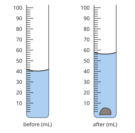

Check question: `p2-7-displace` · number, level 1 · computed by rule, reused from practice

> Water in a measuring cylinder is at 30 mL. A stone is put in and the level rises to 42 mL. What is the volume of the stone?

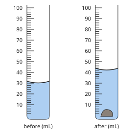

Answer: **12 cm³**
- Typed **42** (after) → “That is the level with the stone; subtract the level before.”

Full working after a second miss:

> Volume of the stone = the rise in level.  
> 42 − 30 = 12 cm³.  

**Card c7-3** (draft)

> Less dense than water (1 g/cm³): it floats. Denser: it sinks.
>
> _Cork 0.25 g/cm³: floats._  
> _Aluminium 2.7 g/cm³: sinks._  

Check question: `p2-7-float` · multiple choice, level 1 · **authored key**, reused from practice

> Ice has a density of 0.92 g/cm³. In water it …

- ◻️ sinks  
  _↳ feedback if chosen: Compare with water, 1 g/cm³: less dense floats, denser sinks._
- ✅ floats

Full working after a second miss:

> Water has a density of 1 g/cm³.  
> 0.92 is less than 1, so it floats.  

**Worked example** (draft)

> A stone has a mass of 60 g. Water in a measuring cylinder rises from 50 cm³ to 70 cm³ when the stone is put in. Find its density.

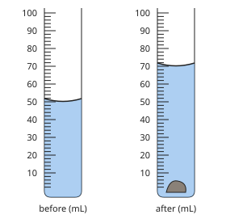

1. Volume of the stone = 70 − 50 = 20 cm³.
2. Density = 60 ÷ 20 = 3 g/cm³.

**Answer:** 3 g/cm³: it sinks in water.

**Practice** `p2-7-density` · number, level 1 · computed by rule

> A block has a mass of 18 g and a volume of 6 cm³. What is its density?

Answer: **3 g/cm³**
- Typed **0.33** (upside) → “Density is mass ÷ volume.”
- Typed **108** (times) → “Divide the mass by the volume.”

Full working after a second miss:

> Density = mass ÷ volume.  
> 18 ÷ 6 = 3 g/cm³.  

> A block has a mass of 40 g and a volume of 10 cm³. What is its density?

Answer: **4 g/cm³**
- Typed **0.25** (upside) → “Density is mass ÷ volume.”
- Typed **400** (times) → “Divide the mass by the volume.”

Full working after a second miss:

> Density = mass ÷ volume.  
> 40 ÷ 10 = 4 g/cm³.  

**Practice** `p2-7-displace` · number, level 1 · computed by rule

> Water in a measuring cylinder is at 30 mL. A stone is put in and the level rises to 42 mL. What is the volume of the stone?

Answer: **12 cm³**
- Typed **42** (after) → “That is the level with the stone; subtract the level before.”

Full working after a second miss:

> Volume of the stone = the rise in level.  
> 42 − 30 = 12 cm³.  

> Water in a measuring cylinder is at 40 mL. A stone is put in and the level rises to 54 mL. What is the volume of the stone?

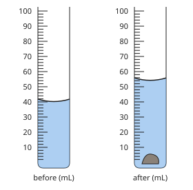

Answer: **14 cm³**
- Typed **54** (after) → “That is the level with the stone; subtract the level before.”

Full working after a second miss:

> Volume of the stone = the rise in level.  
> 54 − 40 = 14 cm³.  

**Practice** `p2-7-float` · multiple choice, level 1 · **authored key**

> Iron has a density of 7.9 g/cm³. In water it …

- ◻️ floats  
  _↳ feedback if chosen: Compare with water, 1 g/cm³: less dense floats, denser sinks._
- ✅ sinks

Full working after a second miss:

> Water has a density of 1 g/cm³.  
> 7.9 is more than 1, so it sinks.  

> Dry wood has a density of 0.6 g/cm³. In water it …

- ✅ floats
- ◻️ sinks  
  _↳ feedback if chosen: Compare with water, 1 g/cm³: less dense floats, denser sinks._

Full working after a second miss:

> Water has a density of 1 g/cm³.  
> 0.6 is less than 1, so it floats.  

**Practice** `p2-7-mass` · number, level 2 · computed by rule

> Iron has a density of 7.9 g/cm³. What is the mass of 2 cm³ of iron?

Answer: **15.8 g**
- Typed **0.25** (divide) → “Mass = density × volume: multiply.”

Full working after a second miss:

> Mass = density × volume.  
> 7.9 × 2 = 15.8 g.  

> Iron has a density of 7.9 g/cm³. What is the mass of 18 cm³ of iron?

Answer: **142.2 g**
- Typed **2.28** (divide) → “Mass = density × volume: multiply.”

Full working after a second miss:

> Mass = density × volume.  
> 7.9 × 18 = 142.2 g.  

**Practice** `p2-7-stone` · number, level 3 · computed by rule

> A stone of mass 30 g is put in a cylinder of water. The level rises from 40 mL to 55 mL. What is the stone's density?

Answer: **2 g/cm³**
- Typed **0.55** (level) → “Use the volume of the stone, 15 cm³, not the water level.”

Full working after a second miss:

> Volume = 55 − 40 = 15 cm³.  
> Density = 30 ÷ 15 = 2 g/cm³.  

> A stone of mass 50 g is put in a cylinder of water. The level rises from 40 mL to 65 mL. What is the stone's density?

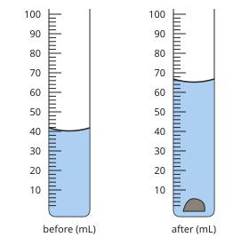

Answer: **2 g/cm³**
- Typed **0.77** (level) → “Use the volume of the stone, 25 cm³, not the water level.”

Full working after a second miss:

> Volume = 65 − 40 = 25 cm³.  
> Density = 50 ÷ 25 = 2 g/cm³.  

## Lesson 8: Physical state of matter

Prerequisites: none · Skill: p2-8 (The physical states of matter)

**Note** (draft)

> Matter is anything that has mass and takes up space. It exists in three main states:
> • solid: stone, ice, wood, iron, salt;
> • liquid: water, palm oil, petrol, milk, kerosene;
> • gas: air, oxygen, steam (water vapour), cooking gas, carbon dioxide.
> The same substance can exist in all three states: ice (solid), water (liquid), steam (gas).
> A substance changes state when it is heated or cooled: melting (solid → liquid), evaporation or boiling (liquid → gas), condensation (gas → liquid), freezing (liquid → solid), sublimation (solid → gas, for example naphthalene balls).

**Card c8-1** (draft)

> Matter has three main states: solid, liquid and gas.
>
> _Solid: stone. Liquid: palm oil._  
> _Gas: the air we breathe._  

Check question: `p2-8-sort` · matching, level 1 · **authored key**, reused from practice

> Sort each substance by its state at room temperature.

Groups: solid · liquid · gas
- cooking gas → **gas**
- milk → **liquid**
- air → **gas**
- steam → **gas**
- salt → **solid**
- iron nail → **solid**

Full working after a second miss:

> The right pairs are:  
> cooking gas → gas  
> milk → liquid  
> air → gas  
> steam → gas  
> salt → solid  
> iron nail → solid  

**Card c8-2** (draft)

> One substance can exist in all three states.
>
> _Ice, water and steam are all water._  
> _Candle wax: solid, then liquid when it melts._  

Check question: `p2-8-same` · multiple choice, level 1 · **authored key**, reused from practice

> Candle wax that melts becomes …

- ◻️ a harder solid  
  _↳ feedback if chosen: Melting makes it liquid._
- ✅ a liquid
- ◻️ a gas  
  _↳ feedback if chosen: Melting gives a liquid._
- ◻️ nothing  
  _↳ feedback if chosen: The wax is still there._

Full working after a second miss:

> Melting changes a solid into a liquid.  
> So the answer is “a liquid”.  

**Card c8-3** (draft)

> Heating or cooling changes the state: melting, boiling, condensation, freezing, sublimation.
>
> _solid → liquid: melting_  
> _gas → liquid: condensation_  

Check question: `p2-8-change` · multiple choice, level 1 · computed by rule, reused from practice

> What is the change from solid to gas called?

- ◻️ condensation  
  _↳ feedback if chosen: That is a different change: solid → gas is sublimation._
- ✅ sublimation
- ◻️ evaporation  
  _↳ feedback if chosen: That is a different change: solid → gas is sublimation._
- ◻️ freezing  
  _↳ feedback if chosen: That is a different change: solid → gas is sublimation._

Full working after a second miss:

> solid → gas is sublimation.  

**Worked example** (draft)

> Name the three states of water and the change of state from each one to the next when it is heated.

1. Solid: ice. Heating it: melting, it becomes liquid water.
2. Liquid: water. Heating it more: boiling, it becomes steam.
3. Gas: steam (water vapour).

**Answer:** ice → (melting) → water → (boiling) → steam

**Practice** `p2-8-sort` · matching, level 1 · **authored key**

> Sort each substance by its state at room temperature.

Groups: solid · liquid · gas
- oxygen → **gas**
- ice cube → **solid**
- milk → **liquid**
- cooking gas → **gas**
- air → **gas**
- salt → **solid**

Full working after a second miss:

> The right pairs are:  
> oxygen → gas  
> ice cube → solid  
> milk → liquid  
> cooking gas → gas  
> air → gas  
> salt → solid  

> Sort each substance by its state at room temperature.

Groups: solid · liquid · gas
- petrol → **liquid**
- oxygen → **gas**
- cooking gas → **gas**
- stone → **solid**
- iron nail → **solid**
- steam → **gas**

Full working after a second miss:

> The right pairs are:  
> petrol → liquid  
> oxygen → gas  
> cooking gas → gas  
> stone → solid  
> iron nail → solid  
> steam → gas  

**Practice** `p2-8-same` · multiple choice, level 1 · **authored key**

> What is water in the gas state called?

- ◻️ ice  
  _↳ feedback if chosen: Ice is solid._
- ◻️ dew  
  _↳ feedback if chosen: Dew is liquid water._
- ◻️ frost  
  _↳ feedback if chosen: Frost is solid ice._
- ✅ steam (water vapour)

Full working after a second miss:

> Water as a gas is steam or water vapour.  
> So the answer is “steam (water vapour)”.  

> Candle wax that melts becomes …

- ✅ a liquid
- ◻️ a harder solid  
  _↳ feedback if chosen: Melting makes it liquid._
- ◻️ a gas  
  _↳ feedback if chosen: Melting gives a liquid._
- ◻️ nothing  
  _↳ feedback if chosen: The wax is still there._

Full working after a second miss:

> Melting changes a solid into a liquid.  
> So the answer is “a liquid”.  

**Practice** `p2-8-change` · multiple choice, level 1 · computed by rule

> What is the change from liquid to solid called?

- ◻️ condensation  
  _↳ feedback if chosen: That is a different change: liquid → solid is freezing._
- ✅ freezing
- ◻️ evaporation  
  _↳ feedback if chosen: That is a different change: liquid → solid is freezing._
- ◻️ sublimation  
  _↳ feedback if chosen: That is a different change: liquid → solid is freezing._

Full working after a second miss:

> liquid → solid is freezing.  

> What is the change from gas to liquid called?

- ◻️ evaporation  
  _↳ feedback if chosen: That is a different change: gas → liquid is condensation._
- ✅ condensation
- ◻️ sublimation  
  _↳ feedback if chosen: That is a different change: gas → liquid is condensation._
- ◻️ melting  
  _↳ feedback if chosen: That is a different change: gas → liquid is condensation._

Full working after a second miss:

> gas → liquid is condensation.  

**Practice** `p2-8-life` · multiple choice, level 2 · **authored key**

> Shea butter becomes runny in the hot sun. Which change of state is this?

- ◻️ freezing  
  _↳ feedback if chosen: Freezing is liquid → solid._
- ◻️ condensation  
  _↳ feedback if chosen: Condensation is gas → liquid._
- ◻️ boiling  
  _↳ feedback if chosen: Boiling is liquid → gas._
- ✅ melting

Full working after a second miss:

> A solid becomes liquid: melting.  
> So the answer is “melting”.  

> Drops form on the outside of a cold bottle of water. Which change of state is this?

- ◻️ melting  
  _↳ feedback if chosen: Nothing solid melts here._
- ◻️ evaporation  
  _↳ feedback if chosen: Evaporation turns liquid into gas._
- ◻️ sublimation  
  _↳ feedback if chosen: Sublimation turns solid into gas._
- ✅ condensation

Full working after a second miss:

> Water vapour in the air cools and becomes liquid.  
> So the answer is “condensation”.  

**Practice** `p2-8-spot` · spot the error, level 3 · **authored key**

> Which statement is wrong?

- ◻️ Air is a gas.
- ✅ Steam is water in the solid state.  
  _↳ explanation: Steam is water as a gas; ice is the solid._
- ◻️ Melting changes a solid into a liquid.
- ◻️ Matter has mass and takes up space.

Full working after a second miss:

> The wrong statement is “Steam is water in the solid state.”.  
> Steam is water as a gas; ice is the solid.  

> Which statement is wrong?

- ◻️ Matter has mass and takes up space.
- ◻️ Melting changes a solid into a liquid.
- ✅ Air has no mass.  
  _↳ explanation: Air is matter: it has mass._
- ◻️ Ice, water and steam are the same substance.

Full working after a second miss:

> The wrong statement is “Air has no mass.”.  
> Air is matter: it has mass.  

## Lesson 9: Characteristics of matter in the different states

Prerequisites: 8 · Skill: p2-9 (Characteristics of matter in the different states)

**Note** (draft)

> Matter is made of tiny particles. The states differ in how the particles are arranged and how they move:
> • Solid: particles packed close in a regular pattern; they only vibrate. A solid has a fixed shape and a fixed volume, and cannot be compressed.
> • Liquid: particles close together but able to slide past one another. A liquid has a fixed volume but takes the shape of its container; it is hardly compressible and it flows.
> • Gas: particles far apart, moving fast in all directions. A gas has no fixed shape and no fixed volume: it fills its container, and it is easy to compress.
> Diffusion (the spreading of a smell through a room) shows that gas particles move.

**Card c9-1** (draft)

> A solid has a fixed shape and volume; a liquid has a fixed volume but no fixed shape; a gas has neither.
>
> _A stone keeps its shape._  
> _Water takes the shape of the cup._  

Check question: `p2-9-props` · matching, level 1 · **authored key**, reused from practice

> Match each description to the state of matter.

Right-hand side (shuffled): liquid · gas · solid
- fixed volume, takes the shape of its container → **liquid**
- fixed shape and fixed volume → **solid**
- no fixed shape and no fixed volume → **gas**

Full working after a second miss:

> The right pairs are:  
> fixed volume, takes the shape of its container → liquid  
> fixed shape and fixed volume → solid  
> no fixed shape and no fixed volume → gas  

**Card c9-2** (draft)

> Particles: close and vibrating in a solid; close and sliding in a liquid; far apart and fast in a gas.
>
> _Solid: regular pattern._  
> _Gas: lots of empty space._  

Check question: `p2-9-particles` · multiple choice, level 1 · **authored key**, reused from practice

> In which state are the particles furthest apart?

- ◻️ solid  
  _↳ feedback if chosen: Solid particles are packed close._
- ✅ gas
- ◻️ all the same  
  _↳ feedback if chosen: They differ._
- ◻️ liquid  
  _↳ feedback if chosen: Liquid particles are close._

Full working after a second miss:

> Gas particles are far apart.  
> So the answer is “gas”.  

**Card c9-3** (draft)

> Gases are easy to compress; liquids and solids are not.
>
> _Air in a bicycle pump can be squeezed._  
> _Water in a closed syringe cannot._  

Check question: `p2-9-compress-card` · multiple choice, level 1 · **authored key**

> The smell of fried plantains reaches the whole house. What does this show?

- ◻️ Liquids flow.  
  _↳ feedback if chosen: This is about a gas._
- ◻️ Particles do not move.  
  _↳ feedback if chosen: It shows they do move._
- ◻️ Smells are solids.  
  _↳ feedback if chosen: Smells are gases._
- ✅ Gas particles move and spread out (diffusion).

Full working after a second miss:

> Spreading of a gas is diffusion.  
> So the answer is “Gas particles move and spread out (diffusion).”.  

**Worked example** (draft)

> Explain why cooking gas can be squeezed into a small cylinder, but water in a syringe cannot be squeezed.

1. In a gas the particles are far apart, with a lot of space between them: they can be pushed closer.
2. In a liquid the particles already touch: there is almost no space, so it is hardly compressible.

**Answer:** Gas particles are far apart; liquid particles are close together.

**Practice** `p2-9-props` · matching, level 1 · **authored key**

> Match each description to the state of matter.

Right-hand side (shuffled): gas · solid · liquid
- particles slide past one another → **liquid**
- particles only vibrate in fixed places → **solid**
- no fixed shape and no fixed volume → **gas**

Full working after a second miss:

> The right pairs are:  
> particles slide past one another → liquid  
> particles only vibrate in fixed places → solid  
> no fixed shape and no fixed volume → gas  

> Match each description to the state of matter.

Right-hand side (shuffled): solid · liquid · gas
- no fixed shape and no fixed volume → **gas**
- particles only vibrate in fixed places → **solid**
- fixed volume, takes the shape of its container → **liquid**

Full working after a second miss:

> The right pairs are:  
> no fixed shape and no fixed volume → gas  
> particles only vibrate in fixed places → solid  
> fixed volume, takes the shape of its container → liquid  

**Practice** `p2-9-particles` · multiple choice, level 1 · **authored key**

> In which state do the particles only vibrate?

- ◻️ gas  
  _↳ feedback if chosen: Gas particles move fast everywhere._
- ◻️ liquid  
  _↳ feedback if chosen: Liquid particles slide._
- ◻️ none  
  _↳ feedback if chosen: Solid particles vibrate._
- ✅ solid

Full working after a second miss:

> Solid particles vibrate in fixed places.  
> So the answer is “solid”.  

> In which state do the particles only vibrate?

- ◻️ none  
  _↳ feedback if chosen: Solid particles vibrate._
- ◻️ gas  
  _↳ feedback if chosen: Gas particles move fast everywhere._
- ✅ solid
- ◻️ liquid  
  _↳ feedback if chosen: Liquid particles slide._

Full working after a second miss:

> Solid particles vibrate in fixed places.  
> So the answer is “solid”.  

**Practice** `p2-9-compress` · multiple choice, level 2 · **authored key**

> Why is it easy to pump air into a tyre?

- ◻️ Air is a liquid.  
  _↳ feedback if chosen: Air is a gas._
- ◻️ Air has no particles.  
  _↳ feedback if chosen: Air is made of particles._
- ✅ Gas particles have spaces between them.
- ◻️ Tyres pull air in.  
  _↳ feedback if chosen: The pump pushes the air._

Full working after a second miss:

> There is space between gas particles, so gas compresses.  
> So the answer is “Gas particles have spaces between them.”.  

> Why does a stone keep its shape?

- ◻️ Its particles are far apart.  
  _↳ feedback if chosen: That describes a gas._
- ◻️ It is very heavy.  
  _↳ feedback if chosen: Weight does not fix shape._
- ◻️ It is cold.  
  _↳ feedback if chosen: Temperature is not the reason._
- ✅ Its particles are held in fixed places.

Full working after a second miss:

> In a solid the particles stay in a fixed pattern.  
> So the answer is “Its particles are held in fixed places.”.  

**Practice** `p2-9-spot` · spot the error, level 3 · **authored key**

> Which statement is wrong?

- ◻️ A gas fills its container.
- ◻️ A liquid takes the shape of its container.
- ◻️ A gas is easy to compress.
- ✅ A solid is easy to compress.  
  _↳ explanation: A solid cannot be compressed: its particles touch._

Full working after a second miss:

> The wrong statement is “A solid is easy to compress.”.  
> A solid cannot be compressed: its particles touch.  

> Which statement is wrong?

- ◻️ A liquid takes the shape of its container.
- ✅ A solid is easy to compress.  
  _↳ explanation: A solid cannot be compressed: its particles touch._
- ◻️ Solid particles vibrate.
- ◻️ A gas fills its container.

Full working after a second miss:

> The wrong statement is “A solid is easy to compress.”.  
> A solid cannot be compressed: its particles touch.  

## Lesson 10: Temperature: Definition, Units, Measurement and effects on matter

Prerequisites: 8 · Skill: p2-10 (Temperature: definition, units, measurement and effects)

**Note** (draft)

> Temperature tells how hot or cold something is. It is measured with a thermometer.
> Units: degrees Celsius (°C) in daily life; the SI unit is the kelvin (K). T(K) = T(°C) + 273. Water freezes at 0 °C (273 K) and boils at 100 °C (373 K).
> A liquid-in-glass thermometer has mercury or coloured alcohol, which expands when warmed. Read it at eye level. A clinical thermometer measures body temperature (normal about 37 °C).
> Effects of temperature on matter: heating makes most things expand (get bigger) and cooling makes them contract; a big enough change in temperature changes the state (melting, boiling).

**Card c10-1** (draft)

> Temperature tells how hot or cold something is. We measure it with a thermometer.
>
> _Read the level of the liquid at eye level._  
> _This one reads 28 °C._  

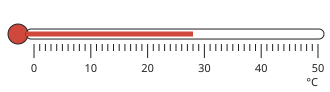

Check question: `p2-10-read` · number, level 1 · computed by rule, reused from practice

> What temperature does the thermometer show?

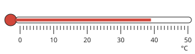

Answer: **39 °C**

Full working after a second miss:

> Read the top of the red liquid against the scale.  
> It shows 39 °C.  

**Card c10-2** (draft)

> Kelvin = degrees Celsius + 273.
>
> _25 °C = 25 + 273 = 298 K._  
> _373 K = 373 − 273 = 100 °C._  

Check question: `p2-10-kelvin` · number, level 1 · computed by rule, reused from practice

> Convert −6 °C to kelvin.

Answer: **267 K**
- Typed **−279** (minus) → “Add 273 to go from °C to K.”

Full working after a second miss:

> T(K) = T(°C) + 273.  
> −6 + 273 = 267 K.  

**Card c10-3** (draft)

> Heating makes most substances expand; cooling makes them contract.
>
> _The liquid in a thermometer rises when it is warmed._  
> _Electric wires sag on a hot day._  

Check question: `p2-10-effect` · multiple choice, level 1 · **authored key**, reused from practice

> Why does the liquid in a thermometer rise when it is warmed?

- ◻️ The liquid boils.  
  _↳ feedback if chosen: It does not boil._
- ◻️ The glass shrinks.  
  _↳ feedback if chosen: The glass hardly changes._
- ✅ The liquid expands.
- ◻️ Air pushes it up.  
  _↳ feedback if chosen: It rises because it expands._

Full working after a second miss:

> Warmed liquid expands and moves up the tube.  
> So the answer is “The liquid expands.”.  

**Worked example** (draft)

> Normal body temperature is 37 °C. Write it in kelvin.

1. T(K) = T(°C) + 273.
2. 37 + 273 = 310 K.

**Answer:** 310 K

**Practice** `p2-10-read` · number, level 1 · computed by rule

> What temperature does the thermometer show?

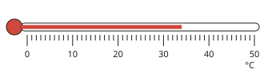

Answer: **34 °C**

Full working after a second miss:

> Read the top of the red liquid against the scale.  
> It shows 34 °C.  

> What temperature does the thermometer show?

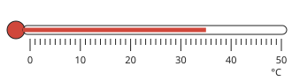

Answer: **35 °C**

Full working after a second miss:

> Read the top of the red liquid against the scale.  
> It shows 35 °C.  

**Practice** `p2-10-kelvin` · number, level 1 · computed by rule

> Convert 84 °C to kelvin.

Answer: **357 K**
- Typed **−189** (minus) → “Add 273 to go from °C to K.”

Full working after a second miss:

> T(K) = T(°C) + 273.  
> 84 + 273 = 357 K.  

> Convert 48 °C to kelvin.

Answer: **321 K**
- Typed **−225** (minus) → “Add 273 to go from °C to K.”

Full working after a second miss:

> T(K) = T(°C) + 273.  
> 48 + 273 = 321 K.  

**Practice** `p2-10-effect` · multiple choice, level 1 · **authored key**

> Why do railway lines have small gaps between the rails?

- ◻️ So trains are quieter.  
  _↳ feedback if chosen: Gaps actually make noise._
- ◻️ To let water drain.  
  _↳ feedback if chosen: The gaps are for expansion._
- ✅ Heat makes the rails expand.
- ◻️ To save metal.  
  _↳ feedback if chosen: It is not about saving metal._

Full working after a second miss:

> In the heat the rails expand into the gaps instead of bending.  
> So the answer is “Heat makes the rails expand.”.  

> What is the normal temperature of the human body?

- ◻️ about 100 °C  
  _↳ feedback if chosen: That is boiling water._
- ✅ about 37 °C
- ◻️ about 0 °C  
  _↳ feedback if chosen: That is freezing water._
- ◻️ about 20 °C  
  _↳ feedback if chosen: That is a cool room._

Full working after a second miss:

> Normal body temperature is about 37 °C.  
> So the answer is “about 37 °C”.  

**Practice** `p2-10-celsius` · number, level 2 · computed by rule

> Convert 325 K to degrees Celsius.

Answer: **52 °C**
- Typed **598** (plus) → “Subtract 273 to go from K to °C.”

Full working after a second miss:

> T(°C) = T(K) − 273.  
> 325 − 273 = 52 °C.  

> Convert 324 K to degrees Celsius.

Answer: **51 °C**
- Typed **597** (plus) → “Subtract 273 to go from K to °C.”

Full working after a second miss:

> T(°C) = T(K) − 273.  
> 324 − 273 = 51 °C.  

**Practice** `p2-10-change` · number, level 3 · computed by rule

> Water is heated from 15 °C to 62 °C. By how many kelvin has its temperature risen?

Answer: **47 K**
- Typed **320** (added) → “A temperature change is the same in °C and K: do not add 273.”

Full working after a second miss:

> A change of 1 °C is a change of 1 K.  
> 62 − 15 = 47 K.  

> Water is heated from 13 °C to 63 °C. By how many kelvin has its temperature risen?

Answer: **50 K**
- Typed **323** (added) → “A temperature change is the same in °C and K: do not add 273.”

Full working after a second miss:

> A change of 1 °C is a change of 1 K.  
> 63 − 13 = 50 K.  

## Lesson 11: Thermal and electrical insulation

Prerequisites: none · Skill: p2-11 (Thermal and electrical insulation)

**Note** (draft)

> A conductor lets heat or electricity pass through it easily. Metals are good conductors of both: copper, aluminium, iron, silver.
> An insulator does not let heat or electricity pass easily: plastic, wood, rubber, glass, dry cloth, air.
> Thermal insulation keeps heat in or out: wooden or plastic handles on pots, a flask with a vacuum, woollen clothes, ceilings under a tin roof, cold boxes for fish.
> Electrical insulation keeps us safe: plastic covering on wires, rubber gloves and boots for electricians, plastic plugs and switches.
> Water with salts in it conducts electricity: never touch switches with wet hands.

**Card c11-1** (draft)

> Metals conduct heat and electricity. Plastic, wood, rubber and glass are insulators.
>
> _Copper wire carries current._  
> _Its plastic covering is an insulator._  

Check question: `p2-11-sort` · matching, level 1 · **authored key**, reused from practice

> Sort the materials: conductor or insulator?

Groups: conductor · insulator
- rubber → **insulator**
- air → **insulator**
- aluminium → **conductor**
- silver → **conductor**
- dry cloth → **insulator**
- glass → **insulator**

Full working after a second miss:

> The right pairs are:  
> rubber → insulator  
> air → insulator  
> aluminium → conductor  
> silver → conductor  
> dry cloth → insulator  
> glass → insulator  

**Card c11-2** (draft)

> Thermal insulators keep heat in or out.
>
> _A flask keeps tea hot._  
> _A ceiling keeps a house cool under a tin roof._  

Check question: `p2-11-thermal` · multiple choice, level 1 · **authored key**, reused from practice

> Which keeps a drink hot longest?

- ✅ a vacuum flask
- ◻️ a glass bottle in the sun  
  _↳ feedback if chosen: Glass loses heat and the sun is not insulation._
- ◻️ a metal cup  
  _↳ feedback if chosen: Metal conducts heat away._
- ◻️ an open bowl  
  _↳ feedback if chosen: An open bowl loses heat quickly._

Full working after a second miss:

> A vacuum flask is a good thermal insulator.  
> So the answer is “a vacuum flask”.  

**Card c11-3** (draft)

> Electrical insulators protect us from electric shocks.
>
> _Plastic covers wires and plugs._  
> _Electricians wear rubber gloves and boots._  

Check question: `p2-11-safe-card` · multiple choice, level 1 · **authored key**

> What should an electrician wear?

- ◻️ wet clothes  
  _↳ feedback if chosen: Wet clothes conduct._
- ◻️ a copper bracelet  
  _↳ feedback if chosen: Copper conducts._
- ✅ rubber gloves and boots
- ◻️ metal gloves  
  _↳ feedback if chosen: Metal conducts._

Full working after a second miss:

> Rubber is an electrical insulator.  
> So the answer is “rubber gloves and boots”.  

**Worked example** (draft)

> Explain why a cooking pot is made of aluminium but has a plastic handle.

1. Aluminium is a good conductor of heat: it carries heat from the fire to the food.
2. Plastic is an insulator: the handle stays cool enough to hold.

**Answer:** The metal conducts heat to the food; the plastic handle insulates the hand.

**Practice** `p2-11-sort` · matching, level 1 · **authored key**

> Sort the materials: conductor or insulator?

Groups: conductor · insulator
- aluminium → **conductor**
- rubber → **insulator**
- silver → **conductor**
- glass → **insulator**
- iron → **conductor**
- wood → **insulator**

Full working after a second miss:

> The right pairs are:  
> aluminium → conductor  
> rubber → insulator  
> silver → conductor  
> glass → insulator  
> iron → conductor  
> wood → insulator  

> Sort the materials: conductor or insulator?

Groups: conductor · insulator
- aluminium → **conductor**
- glass → **insulator**
- dry cloth → **insulator**
- rubber → **insulator**
- steel spoon → **conductor**
- iron → **conductor**

Full working after a second miss:

> The right pairs are:  
> aluminium → conductor  
> glass → insulator  
> dry cloth → insulator  
> rubber → insulator  
> steel spoon → conductor  
> iron → conductor  

**Practice** `p2-11-thermal` · multiple choice, level 1 · **authored key**

> Why do fish sellers keep fish in a cold box?

- ✅ The box insulates the fish from the heat outside.
- ◻️ The box makes the fish heavier.  
  _↳ feedback if chosen: Weight is not the reason._
- ◻️ The box cooks the fish.  
  _↳ feedback if chosen: It keeps them cold._
- ◻️ The box conducts heat in.  
  _↳ feedback if chosen: It does the opposite._

Full working after a second miss:

> An insulated box keeps heat out.  
> So the answer is “The box insulates the fish from the heat outside.”.  

> Why do fish sellers keep fish in a cold box?

- ◻️ The box conducts heat in.  
  _↳ feedback if chosen: It does the opposite._
- ◻️ The box makes the fish heavier.  
  _↳ feedback if chosen: Weight is not the reason._
- ✅ The box insulates the fish from the heat outside.
- ◻️ The box cooks the fish.  
  _↳ feedback if chosen: It keeps them cold._

Full working after a second miss:

> An insulated box keeps heat out.  
> So the answer is “The box insulates the fish from the heat outside.”.  

**Practice** `p2-11-safe` · multiple choice, level 2 · **authored key**

> What should an electrician wear?

- ◻️ metal gloves  
  _↳ feedback if chosen: Metal conducts._
- ◻️ a copper bracelet  
  _↳ feedback if chosen: Copper conducts._
- ✅ rubber gloves and boots
- ◻️ wet clothes  
  _↳ feedback if chosen: Wet clothes conduct._

Full working after a second miss:

> Rubber is an electrical insulator.  
> So the answer is “rubber gloves and boots”.  

> Why are electric wires covered with plastic?

- ✅ Plastic is an electrical insulator and protects us from shocks.
- ◻️ Plastic is a conductor.  
  _↳ feedback if chosen: Plastic is an insulator._
- ◻️ Plastic makes the current faster.  
  _↳ feedback if chosen: Plastic does not speed up current._
- ◻️ Plastic makes the wire heavier.  
  _↳ feedback if chosen: Weight is not the reason._

Full working after a second miss:

> The plastic insulates the wire.  
> So the answer is “Plastic is an electrical insulator and protects us from shocks.”.  

**Practice** `p2-11-spot` · spot the error, level 3 · **authored key**

> Which statement is wrong?

- ◻️ Air is a poor conductor of heat.
- ◻️ Metals conduct heat well.
- ✅ Plastic is a good conductor of electricity.  
  _↳ explanation: Plastic is an insulator._
- ◻️ Rubber is an electrical insulator.

Full working after a second miss:

> The wrong statement is “Plastic is a good conductor of electricity.”.  
> Plastic is an insulator.  

> Which statement is wrong?

- ◻️ Rubber is an electrical insulator.
- ✅ Plastic is a good conductor of electricity.  
  _↳ explanation: Plastic is an insulator._
- ◻️ Copper is a good conductor of electricity.
- ◻️ Metals conduct heat well.

Full working after a second miss:

> The wrong statement is “Plastic is a good conductor of electricity.”.  
> Plastic is an insulator.  

## Lesson 12: Action of heat on materials

Prerequisites: 10, 11 · Skill: p2-12 (The action of heat on materials)

**Note** (draft)

> Heat can change materials in several ways:
> • Expansion: solids, liquids and gases get bigger when heated (gases expand the most). Engineers leave gaps in bridges and railway lines; a tight metal lid opens after it is warmed.
> • Change of state: heat melts solids and boils liquids.
> • Change of colour or burning: paper and wood burn and change into ash, smoke and gases; bread turns brown when toasted.
> • Decomposition: some substances break down into new ones (sugar heated strongly turns black: carbon).
> Some changes can be reversed (melting ice, expansion); others cannot (burning, cooking an egg).
> A bimetallic strip (two metals joined) bends when heated because the metals expand by different amounts: it is used in thermostats in irons and fridges.

**Card c12-1** (draft)

> Heating makes solids, liquids and gases expand; gases expand the most.
>
> _A football left in the sun becomes harder._  
> _Bridges have expansion gaps._  

Check question: `p2-12-expand` · multiple choice, level 1 · **authored key**, reused from practice

> A football left in the hot sun becomes harder. Why?

- ◻️ The air leaks out.  
  _↳ feedback if chosen: That would make it softer._
- ◻️ The leather shrinks only.  
  _↳ feedback if chosen: The main reason is the air expanding._
- ◻️ The ball gets heavier.  
  _↳ feedback if chosen: Its mass does not change._
- ✅ The air inside expands.

Full working after a second miss:

> Heated air expands and presses harder on the ball.  
> So the answer is “The air inside expands.”.  

**Card c12-2** (draft)

> Some changes caused by heat can be reversed; others cannot.
>
> _Reversible: melting shea butter._  
> _Not reversible: burning wood, frying an egg._  

Check question: `p2-12-reverse` · matching, level 1 · **authored key**, reused from practice

> Sort the changes: can they be reversed?

Groups: reversible · not reversible
- melting ice → **reversible**
- toasting bread → **not reversible**
- melting candle wax → **reversible**
- boiling water → **reversible**

Full working after a second miss:

> The right pairs are:  
> melting ice → reversible  
> toasting bread → not reversible  
> melting candle wax → reversible  
> boiling water → reversible  

**Card c12-3** (draft)

> A bimetallic strip bends when heated, because its two metals expand by different amounts.
>
> _It switches off an electric iron when it is hot enough._  
> _It is used in thermostats._  

Check question: `p2-12-bimetal-card` · multiple choice, level 1 · **authored key**

> Why does a bimetallic strip bend when heated?

- ◻️ It melts.  
  _↳ feedback if chosen: It does not melt._
- ✅ Its two metals expand by different amounts.
- ◻️ Only one metal gets hot.  
  _↳ feedback if chosen: Both are heated._
- ◻️ It loses mass.  
  _↳ feedback if chosen: Its mass does not change._

Full working after a second miss:

> Different expansion makes it bend.  
> So the answer is “Its two metals expand by different amounts.”.  

**Worked example** (draft)

> Explain why pouring hot water over a tight metal lid on a glass jar helps to open it.

1. The hot water heats the metal lid.
2. Metal expands more than glass when heated, so the lid becomes slightly bigger and loosens.

**Answer:** The metal lid expands more than the glass, so it loosens.

**Practice** `p2-12-expand` · multiple choice, level 1 · **authored key**

> Which expands the most when heated by the same amount?

- ◻️ a liquid  
  _↳ feedback if chosen: Liquids expand less than gases._
- ◻️ a solid  
  _↳ feedback if chosen: Solids expand the least._
- ✅ a gas
- ◻️ they all expand the same  
  _↳ feedback if chosen: They expand differently._

Full working after a second miss:

> Gases expand the most.  
> So the answer is “a gas”.  

> Why are gaps left in a long concrete bridge?

- ✅ To let it expand in the heat without cracking.
- ◻️ To let rain fall through.  
  _↳ feedback if chosen: The gaps are for expansion._
- ◻️ For decoration.  
  _↳ feedback if chosen: They have a purpose._
- ◻️ To save concrete.  
  _↳ feedback if chosen: Saving material is not the reason._

Full working after a second miss:

> Expansion gaps stop cracking.  
> So the answer is “To let it expand in the heat without cracking.”.  

**Practice** `p2-12-reverse` · matching, level 1 · **authored key**

> Sort the changes: can they be reversed?

Groups: reversible · not reversible
- toasting bread → **not reversible**
- burning firewood → **not reversible**
- melting ice → **reversible**
- burning paper → **not reversible**

Full working after a second miss:

> The right pairs are:  
> toasting bread → not reversible  
> burning firewood → not reversible  
> melting ice → reversible  
> burning paper → not reversible  

> Sort the changes: can they be reversed?

Groups: reversible · not reversible
- melting ice → **reversible**
- toasting bread → **not reversible**
- melting candle wax → **reversible**
- frying an egg → **not reversible**

Full working after a second miss:

> The right pairs are:  
> melting ice → reversible  
> toasting bread → not reversible  
> melting candle wax → reversible  
> frying an egg → not reversible  

**Practice** `p2-12-bimetal` · multiple choice, level 2 · **authored key**

> Where is a bimetallic strip used?

- ◻️ in a football  
  _↳ feedback if chosen: A football has no thermostat._
- ✅ in the thermostat of an electric iron
- ◻️ in a light bulb filament  
  _↳ feedback if chosen: A filament is a thin wire that glows._
- ◻️ in a ruler  
  _↳ feedback if chosen: A ruler measures length._

Full working after a second miss:

> It switches the iron off when hot.  
> So the answer is “in the thermostat of an electric iron”.  

> Where is a bimetallic strip used?

- ◻️ in a football  
  _↳ feedback if chosen: A football has no thermostat._
- ✅ in the thermostat of an electric iron
- ◻️ in a ruler  
  _↳ feedback if chosen: A ruler measures length._
- ◻️ in a light bulb filament  
  _↳ feedback if chosen: A filament is a thin wire that glows._

Full working after a second miss:

> It switches the iron off when hot.  
> So the answer is “in the thermostat of an electric iron”.  

**Practice** `p2-12-spot` · spot the error, level 3 · **authored key**

> Which statement is wrong?

- ✅ Railways need no gaps because steel does not expand.  
  _↳ explanation: Steel expands in the heat: gaps are needed._
- ◻️ A bimetallic strip bends when heated.
- ◻️ Gases expand more than solids.
- ◻️ Burning wood cannot be reversed.

Full working after a second miss:

> The wrong statement is “Railways need no gaps because steel does not expand.”.  
> Steel expands in the heat: gaps are needed.  

> Which statement is wrong?

- ◻️ Burning wood cannot be reversed.
- ◻️ Heating makes most materials expand.
- ◻️ A bimetallic strip bends when heated.
- ✅ Burning paper is easy to reverse.  
  _↳ explanation: Burning cannot be reversed._

Full working after a second miss:

> The wrong statement is “Burning paper is easy to reverse.”.  
> Burning cannot be reversed.  

## Lesson 13: Action of electrical energy on materials

Prerequisites: 11 · Skill: p2-13 (The action of electrical energy on materials)

**Note** (draft)

> When an electric current passes through a material it can produce:
> • a heating effect: the wire gets hot (electric iron, hot plate, kettle, water heater, fuse);
> • a lighting effect: a thin wire glows (filament bulb), or a lamp gives light (LED, fluorescent tube);
> • a magnetic effect: a coil of wire with current becomes a magnet (electromagnet, electric bell, motor, loudspeaker);
> • a chemical effect: current breaks down some liquids (electrolysis); it is used for electroplating and for charging batteries.
> A fuse is a thin wire that melts if the current is too big, to protect the circuit.
> Electrical energy is converted into other forms: heat, light, movement, sound.

**Card c13-1** (draft)

> Current can heat, give light, make a magnet, or cause chemical change.
>
> _An iron uses the heating effect._  
> _A bell uses the magnetic effect._  

Check question: `p2-13-effect` · matching, level 1 · **authored key**, reused from practice

> Match each device to the effect of current it uses.

Groups: lighting effect · magnetic effect · chemical effect
- silver-plating a spoon → **chemical effect**
- an electric motor in a fan → **magnetic effect**
- an electromagnet in a scrapyard crane → **magnetic effect**
- a torch → **lighting effect**

Full working after a second miss:

> The right pairs are:  
> silver-plating a spoon → chemical effect  
> an electric motor in a fan → magnetic effect  
> an electromagnet in a scrapyard crane → magnetic effect  
> a torch → lighting effect  

**Card c13-2** (draft)

> A fuse melts when the current is too big, and so protects the circuit.
>
> _A fuse is a thin wire._  
> _Too much current heats it until it melts._  

Check question: `p2-13-fuse` · multiple choice, level 1 · **authored key**, reused from practice

> Which effect of current does a fuse use?

- ◻️ the chemical effect  
  _↳ feedback if chosen: It does not break down liquids._
- ◻️ the lighting effect  
  _↳ feedback if chosen: It does not give light._
- ✅ the heating effect
- ◻️ the magnetic effect  
  _↳ feedback if chosen: A fuse is not a magnet._

Full working after a second miss:

> Too much current heats the fuse wire until it melts.  
> So the answer is “the heating effect”.  

**Card c13-3** (draft)

> Devices change electrical energy into other forms: heat, light, movement, sound.
>
> _Fan: electrical → movement._  
> _Radio: electrical → sound._  

Check question: `p2-13-energy-card` · multiple choice, level 1 · **authored key**

> Which energy change happens in a radio?

- ◻️ light → electrical  
  _↳ feedback if chosen: It uses electrical energy._
- ✅ electrical → sound
- ◻️ electrical → heat only  
  _↳ feedback if chosen: Its main output is sound._
- ◻️ sound → electrical  
  _↳ feedback if chosen: A radio makes sound._

Full working after a second miss:

> The loudspeaker gives sound.  
> So the answer is “electrical → sound”.  

**Worked example** (draft)

> Which effect of electric current does an electric kettle use, and what energy change happens?

1. The current passes through a heating element, which gets very hot: the heating effect.
2. Electrical energy is changed into heat energy, which boils the water.

**Answer:** The heating effect: electrical energy → heat.

**Practice** `p2-13-effect` · matching, level 1 · **authored key**

> Match each device to the effect of current it uses.

Groups: heating effect · lighting effect · magnetic effect
- a torch → **lighting effect**
- an electric iron → **heating effect**
- an electric bell → **magnetic effect**
- an electromagnet in a scrapyard crane → **magnetic effect**

Full working after a second miss:

> The right pairs are:  
> a torch → lighting effect  
> an electric iron → heating effect  
> an electric bell → magnetic effect  
> an electromagnet in a scrapyard crane → magnetic effect  

> Match each device to the effect of current it uses.

Groups: heating effect · magnetic effect · chemical effect
- silver-plating a spoon → **chemical effect**
- a hot plate → **heating effect**
- charging a car battery → **chemical effect**
- an electric motor in a fan → **magnetic effect**

Full working after a second miss:

> The right pairs are:  
> silver-plating a spoon → chemical effect  
> a hot plate → heating effect  
> charging a car battery → chemical effect  
> an electric motor in a fan → magnetic effect  

**Practice** `p2-13-fuse` · multiple choice, level 1 · **authored key**

> Which effect of current does a fuse use?

- ◻️ the chemical effect  
  _↳ feedback if chosen: It does not break down liquids._
- ✅ the heating effect
- ◻️ the lighting effect  
  _↳ feedback if chosen: It does not give light._
- ◻️ the magnetic effect  
  _↳ feedback if chosen: A fuse is not a magnet._

Full working after a second miss:

> Too much current heats the fuse wire until it melts.  
> So the answer is “the heating effect”.  

> What does a fuse do when the current is too big?

- ✅ It melts and breaks the circuit.
- ◻️ It becomes a magnet.  
  _↳ feedback if chosen: It works by heating._
- ◻️ It lights up.  
  _↳ feedback if chosen: It is not a lamp._
- ◻️ It makes the current bigger.  
  _↳ feedback if chosen: It stops the current._

Full working after a second miss:

> The thin wire melts and protects the circuit.  
> So the answer is “It melts and breaks the circuit.”.  

**Practice** `p2-13-energy` · multiple choice, level 2 · **authored key**

> Which energy change happens in a radio?

- ◻️ light → electrical  
  _↳ feedback if chosen: It uses electrical energy._
- ◻️ sound → electrical  
  _↳ feedback if chosen: A radio makes sound._
- ✅ electrical → sound
- ◻️ electrical → heat only  
  _↳ feedback if chosen: Its main output is sound._

Full working after a second miss:

> The loudspeaker gives sound.  
> So the answer is “electrical → sound”.  

> Which energy change happens in an electric iron?

- ✅ electrical → heat
- ◻️ electrical → sound  
  _↳ feedback if chosen: It does not make sound._
- ◻️ electrical → movement  
  _↳ feedback if chosen: It does not move by itself._
- ◻️ heat → electrical  
  _↳ feedback if chosen: It uses electricity._

Full working after a second miss:

> An iron's plate gets hot.  
> So the answer is “electrical → heat”.  

**Practice** `p2-13-spot` · spot the error, level 3 · **authored key**

> Which statement is wrong?

- ✅ A light bulb uses the chemical effect of current.  
  _↳ explanation: A bulb uses the lighting (and heating) effect._
- ◻️ A fuse melts if the current is too big.
- ◻️ An electric bell uses the magnetic effect.
- ◻️ Electroplating uses the chemical effect.

Full working after a second miss:

> The wrong statement is “A light bulb uses the chemical effect of current.”.  
> A bulb uses the lighting (and heating) effect.  

> Which statement is wrong?

- ◻️ A fuse melts if the current is too big.
- ✅ An electric fan changes movement into electrical energy.  
  _↳ explanation: A fan changes electrical energy into movement._
- ◻️ An electric bell uses the magnetic effect.
- ◻️ Electroplating uses the chemical effect.

Full working after a second miss:

> The wrong statement is “An electric fan changes movement into electrical energy.”.  
> A fan changes electrical energy into movement.  

## Lesson 14: Transmission of heat and electrical energy by conduction

Prerequisites: 11, 13 · Skill: p2-14 (Transmission of heat and electricity by conduction)

**Note** (draft)

> Conduction is the transfer of heat (or electricity) through a material without the material itself moving.
> Heat conduction: the particles at the hot end vibrate faster and pass the energy to their neighbours. Metals conduct heat best, because they also have free electrons that carry energy.
> Experiment: fix drops of wax along rods of copper, aluminium, iron and glass and heat one end of each: the wax melts furthest along the copper rod first.
> Order (best conductor first): copper, aluminium, iron, … glass, wood, plastic.
> Electrical conduction: a current flows only in a closed circuit made of conductors. In metals, electrons carry the current. Put a material in a circuit with a cell and a bulb: if the bulb lights, the material conducts.

**Card c14-1** (draft)

> In conduction, energy passes from particle to particle; the material does not move.
>
> _The handle of a metal spoon in hot tea gets hot._  
> _The spoon stays where it is._  

Check question: `p2-14-what` · multiple choice, level 1 · **authored key**, reused from practice

> Why do metals conduct heat well?

- ✅ They have free electrons that carry energy.
- ◻️ They are shiny.  
  _↳ feedback if chosen: Shine is not the reason._
- ◻️ They are cold.  
  _↳ feedback if chosen: Temperature is not the reason._
- ◻️ They are heavy.  
  _↳ feedback if chosen: Weight is not the reason._

Full working after a second miss:

> Free electrons carry energy quickly through a metal.  
> So the answer is “They have free electrons that carry energy.”.  

**Card c14-2** (draft)

> Metals conduct heat best; copper is better than aluminium, which is better than iron.
>
> _Wax melts first along the copper rod._  
> _Glass and wood conduct poorly._  

Check question: `p2-14-order` · ordering, level 1 · **authored key**, reused from practice

> Put these materials in order, best conductor of heat first.

Shown as: glass · iron · copper · aluminium · wood
Correct order: copper → aluminium → iron → glass → wood

Full working after a second miss:

> The correct order is: copper → aluminium → iron → glass → wood.  

**Card c14-3** (draft)

> Electric current flows only in a closed circuit of conductors.
>
> _A bulb lights when a metal key closes the circuit._  
> _A plastic pen leaves the bulb off._  

Check question: `p2-14-circuit` · multiple choice, level 1 · **authored key**, reused from practice

> A material is placed in a circuit with a cell and a bulb. The bulb lights. What does this show?

- ◻️ The material is an insulator.  
  _↳ feedback if chosen: Insulators stop the current._
- ◻️ The cell is flat.  
  _↳ feedback if chosen: A flat cell would not light the bulb._
- ✅ The material conducts electricity.
- ◻️ The bulb is broken.  
  _↳ feedback if chosen: A broken bulb would not light._

Full working after a second miss:

> The circuit is closed through a conductor.  
> So the answer is “The material conducts electricity.”.  

**Worked example** (draft)

> Ngwa leaves a steel spoon in a pot of hot soup. After a while the handle is hot. Explain.

1. The spoon touches the hot soup at one end.
2. Its particles there vibrate faster and pass the energy along the spoon: conduction.
3. Steel is a metal, a good conductor, so the handle soon gets hot.

**Answer:** Heat is conducted along the metal spoon to the handle.

**Practice** `p2-14-what` · multiple choice, level 1 · **authored key**

> What is conduction?

- ◻️ a material losing its mass  
  _↳ feedback if chosen: Conduction does not change mass._
- ◻️ a material moving to carry heat  
  _↳ feedback if chosen: That is convection._
- ◻️ heat travelling as light  
  _↳ feedback if chosen: That is radiation._
- ✅ heat passing through a material from particle to particle

Full working after a second miss:

> Energy passes between particles; the material stays still.  
> So the answer is “heat passing through a material from particle to particle”.  

> Why do metals conduct heat well?

- ◻️ They are heavy.  
  _↳ feedback if chosen: Weight is not the reason._
- ◻️ They are cold.  
  _↳ feedback if chosen: Temperature is not the reason._
- ✅ They have free electrons that carry energy.
- ◻️ They are shiny.  
  _↳ feedback if chosen: Shine is not the reason._

Full working after a second miss:

> Free electrons carry energy quickly through a metal.  
> So the answer is “They have free electrons that carry energy.”.  

**Practice** `p2-14-order` · ordering, level 1 · **authored key**

> Put these materials in order, best conductor of heat first.

Shown as: wood · copper · aluminium · iron · glass
Correct order: copper → aluminium → iron → glass → wood

Full working after a second miss:

> The correct order is: copper → aluminium → iron → glass → wood.  

> Put these materials in order, best conductor of heat first.

Shown as: copper · aluminium · glass · wood · iron
Correct order: copper → aluminium → iron → glass → wood

Full working after a second miss:

> The correct order is: copper → aluminium → iron → glass → wood.  

**Practice** `p2-14-circuit` · multiple choice, level 1 · **authored key**

> A material is placed in a circuit with a cell and a bulb. The bulb lights. What does this show?

- ◻️ The material is an insulator.  
  _↳ feedback if chosen: Insulators stop the current._
- ◻️ The bulb is broken.  
  _↳ feedback if chosen: A broken bulb would not light._
- ✅ The material conducts electricity.
- ◻️ The cell is flat.  
  _↳ feedback if chosen: A flat cell would not light the bulb._

Full working after a second miss:

> The circuit is closed through a conductor.  
> So the answer is “The material conducts electricity.”.  

> A material is placed in a circuit with a cell and a bulb. The bulb lights. What does this show?

- ◻️ The cell is flat.  
  _↳ feedback if chosen: A flat cell would not light the bulb._
- ◻️ The material is an insulator.  
  _↳ feedback if chosen: Insulators stop the current._
- ✅ The material conducts electricity.
- ◻️ The bulb is broken.  
  _↳ feedback if chosen: A broken bulb would not light._

Full working after a second miss:

> The circuit is closed through a conductor.  
> So the answer is “The material conducts electricity.”.  

**Practice** `p2-14-wax` · multiple choice, level 2 · **authored key**

> Drops of wax are stuck along rods of different materials, and one end of each rod is heated. On which rod does the wax melt furthest first?

- ✅ copper
- ◻️ glass  
  _↳ feedback if chosen: Glass is a poor conductor._
- ◻️ wood  
  _↳ feedback if chosen: Wood is an insulator._
- ◻️ iron  
  _↳ feedback if chosen: Iron conducts, but less well than copper._

Full working after a second miss:

> Copper is the best conductor of the four.  
> So the answer is “copper”.  

> Drops of wax are stuck along rods of different materials, and one end of each rod is heated. On which rod does the wax hardly melt?

- ◻️ iron  
  _↳ feedback if chosen: Iron is a metal and conducts._
- ◻️ copper  
  _↳ feedback if chosen: Copper conducts best._
- ✅ glass
- ◻️ aluminium  
  _↳ feedback if chosen: Aluminium conducts well._

Full working after a second miss:

> Glass is a poor conductor of heat.  
> So the answer is “glass”.  

**Practice** `p2-14-spot` · spot the error, level 3 · **authored key**

> Which statement is wrong?

- ◻️ In conduction the material does not move.
- ◻️ Copper conducts heat better than iron.
- ◻️ Wood is a poor conductor of heat.
- ✅ In conduction the hot material flows to the cold place.  
  _↳ explanation: That is convection; in conduction the material stays still._

Full working after a second miss:

> The wrong statement is “In conduction the hot material flows to the cold place.”.  
> That is convection; in conduction the material stays still.  

> Which statement is wrong?

- ✅ Glass conducts heat better than copper.  
  _↳ explanation: Copper is a far better conductor._
- ◻️ Wood is a poor conductor of heat.
- ◻️ In conduction the material does not move.
- ◻️ Copper conducts heat better than iron.

Full working after a second miss:

> The wrong statement is “Glass conducts heat better than copper.”.  
> Copper is a far better conductor.  

## Lesson 15: Non-Renewable Energy Sources and Uses

Prerequisites: none · Skill: p2-15 (Non-renewable energy sources and their uses)

**Note** (draft)

> An energy source is something from which we get energy. A non-renewable source is used up faster than nature can replace it: one day it will run out.
> Non-renewable sources:
> • fossil fuels, formed over millions of years from dead plants and animals: coal, crude oil (giving petrol, diesel, kerosene) and natural gas (cooking gas);
> • nuclear fuel: uranium.
> Uses: petrol and diesel for cars, buses and generators; kerosene for lamps and stoves; cooking gas; thermal power stations that make electricity; Cameroon exports crude oil.
> Problems: they will run out; burning them gives smoke and carbon dioxide, which pollute the air and warm the Earth; oil spills harm the sea.
> Renewable sources (sun, wind, flowing water as at the Edéa and Song Loulou dams, trees that are replanted) do not run out.

**Card c15-1** (draft)

> Non-renewable sources will run out: coal, crude oil, natural gas and uranium.
>
> _Petrol and kerosene come from crude oil._  
> _Cooking gas is natural gas._  

Check question: `p2-15-sort` · matching, level 1 · **authored key**, reused from practice

> Sort the energy sources: renewable or non-renewable?

Groups: non-renewable · renewable
- coal → **non-renewable**
- sunlight → **renewable**
- flowing water in a dam → **renewable**
- uranium (nuclear fuel) → **non-renewable**

Full working after a second miss:

> The right pairs are:  
> coal → non-renewable  
> sunlight → renewable  
> flowing water in a dam → renewable  
> uranium (nuclear fuel) → non-renewable  

**Card c15-2** (draft)

> Fossil fuels formed over millions of years from dead plants and animals.
>
> _Coal from ancient plants._  
> _Crude oil and gas from tiny sea creatures._  

Check question: `p2-15-fossil` · multiple choice, level 1 · **authored key**, reused from practice

> How did fossil fuels form?

- ◻️ from rain last year  
  _↳ feedback if chosen: It took millions of years._
- ✅ from dead plants and animals over millions of years
- ◻️ from sunlight in one day  
  _↳ feedback if chosen: It took millions of years._
- ◻️ from rocks melting quickly  
  _↳ feedback if chosen: They come from living things._

Full working after a second miss:

> They formed slowly from buried remains of living things.  
> So the answer is “from dead plants and animals over millions of years”.  

**Card c15-3** (draft)

> Burning fossil fuels pollutes the air and adds carbon dioxide, which warms the Earth.
>
> _Generators give off smoke._  
> _Renewable sources, like the sun, do not run out._  

Check question: `p2-15-problem-card` · multiple choice, level 1 · **authored key**

> Why are fossil fuels called non-renewable?

- ✅ They will run out: they form far more slowly than we use them.
- ◻️ They are cheap.  
  _↳ feedback if chosen: Price is not the reason._
- ◻️ They do not burn.  
  _↳ feedback if chosen: They do burn._
- ◻️ They come from the sun every day.  
  _↳ feedback if chosen: That describes solar energy._

Full working after a second miss:

> We use them much faster than they form.  
> So the answer is “They will run out: they form far more slowly than we use them.”.  

**Worked example** (draft)

> A family uses a petrol generator when there is no electricity. Name its energy source, say if it is renewable, and give one problem.

1. Petrol comes from crude oil, a fossil fuel.
2. Fossil fuels are non-renewable: they will run out.
3. Burning petrol gives smoke and carbon dioxide, which pollute the air.

**Answer:** Crude oil (petrol), non-renewable; it pollutes the air.

**Practice** `p2-15-sort` · matching, level 1 · **authored key**

> Sort the energy sources: renewable or non-renewable?

Groups: non-renewable · renewable
- coal → **non-renewable**
- sunlight → **renewable**
- wind → **renewable**
- crude oil (petrol, kerosene) → **non-renewable**

Full working after a second miss:

> The right pairs are:  
> coal → non-renewable  
> sunlight → renewable  
> wind → renewable  
> crude oil (petrol, kerosene) → non-renewable  

> Sort the energy sources: renewable or non-renewable?

Groups: non-renewable · renewable
- sunlight → **renewable**
- coal → **non-renewable**
- uranium (nuclear fuel) → **non-renewable**
- firewood from new trees → **renewable**

Full working after a second miss:

> The right pairs are:  
> sunlight → renewable  
> coal → non-renewable  
> uranium (nuclear fuel) → non-renewable  
> firewood from new trees → renewable  

**Practice** `p2-15-fossil` · multiple choice, level 1 · **authored key**

> Which of these is a fossil fuel?

- ◻️ sunlight  
  _↳ feedback if chosen: Sunlight is renewable._
- ◻️ uranium  
  _↳ feedback if chosen: Uranium is a nuclear fuel, not a fossil fuel._
- ✅ coal
- ◻️ wind  
  _↳ feedback if chosen: Wind is renewable._

Full working after a second miss:

> Coal formed from ancient plants.  
> So the answer is “coal”.  

> Where does kerosene come from?

- ✅ crude oil
- ◻️ wind  
  _↳ feedback if chosen: Wind is not a fuel._
- ◻️ uranium  
  _↳ feedback if chosen: Uranium is a nuclear fuel._
- ◻️ coal  
  _↳ feedback if chosen: Kerosene is refined from crude oil._

Full working after a second miss:

> Kerosene is made from crude oil.  
> So the answer is “crude oil”.  

**Practice** `p2-15-problem` · multiple choice, level 2 · **authored key**

> Which is a problem of burning fossil fuels?

- ✅ It pollutes the air with smoke and carbon dioxide.
- ◻️ It cools the Earth.  
  _↳ feedback if chosen: Carbon dioxide warms the Earth._
- ◻️ It makes the air cleaner.  
  _↳ feedback if chosen: It makes the air dirtier._
- ◻️ It makes more fuel.  
  _↳ feedback if chosen: It uses fuel up._

Full working after a second miss:

> Burning releases smoke and carbon dioxide.  
> So the answer is “It pollutes the air with smoke and carbon dioxide.”.  

> Which is a problem of burning fossil fuels?

- ◻️ It makes more fuel.  
  _↳ feedback if chosen: It uses fuel up._
- ✅ It pollutes the air with smoke and carbon dioxide.
- ◻️ It cools the Earth.  
  _↳ feedback if chosen: Carbon dioxide warms the Earth._
- ◻️ It makes the air cleaner.  
  _↳ feedback if chosen: It makes the air dirtier._

Full working after a second miss:

> Burning releases smoke and carbon dioxide.  
> So the answer is “It pollutes the air with smoke and carbon dioxide.”.  

**Practice** `p2-15-spot` · spot the error, level 3 · **authored key**

> Which statement is wrong?

- ◻️ Crude oil will run out one day.
- ✅ Wind is a non-renewable energy source.  
  _↳ explanation: Wind does not run out: it is renewable._
- ◻️ Cooking gas is natural gas.
- ◻️ Coal is a fossil fuel.

Full working after a second miss:

> The wrong statement is “Wind is a non-renewable energy source.”.  
> Wind does not run out: it is renewable.  

> Which statement is wrong?

- ◻️ Cooking gas is natural gas.
- ✅ Burning coal makes the air cleaner.  
  _↳ explanation: It pollutes the air._
- ◻️ Crude oil will run out one day.
- ◻️ Burning petrol produces carbon dioxide.

Full working after a second miss:

> The wrong statement is “Burning coal makes the air cleaner.”.  
> It pollutes the air.  

