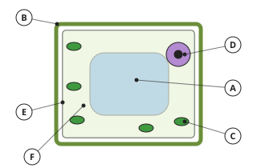
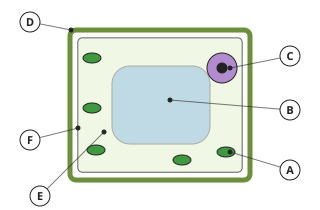

# Biology Form 3, Form Three Biology: drafts for review (Lessons 18 lessons (1–21))

Generated by `npm run review:f3-biology` from `content/form-3/biology/*.json`. Every question and drawing below was built by the engine.
All notes, teach cards, worked examples and paper tasks are **status: draft**. “Authored key” means a person fixed the
right answer (see `AUTHORED.md`); “computed by rule” means code worked it out (a formula, a conversion, a spelling rule).

Teach mode: cards (idea + example + 1 level-1 check) → worked example → practice (levels 1–3) → the note as a summary.

## Sample rendered lesson: Lesson 1 in teach mode

### Lesson 1: Notion of cells, types (prokaryotic and eukaryotic cells) and cell theory

**Card c3b1-1** (draft)

> All living things are made of cells, and cells come from other cells.
>
> _A new skin cell forms when an old one divides._  

Check question: `b3-1-theory` · multiple choice, level 1 · **authored key**, reused from practice

> What is the basic unit of structure and function in living things?

- ✅ the cell
- ◻️ the tissue  
  _↳ feedback if chosen: Tissues are groups of cells._
- ◻️ the organ  
  _↳ feedback if chosen: Organs are made of many cells._
- ◻️ the atom  
  _↳ feedback if chosen: Atoms are not alive._

Full working after a second miss:

> Every living thing is made of one or more cells.  
> So the answer is the cell.  

**Card c3b1-2** (draft)

> Prokaryotic cells have no true nucleus; eukaryotic cells do.
>
> _Bacteria are prokaryotes; you are made of eukaryotic cells._  

Check question: `b3-1-type` · multiple choice, level 1 · **authored key**, reused from practice

> Which statement about prokaryotic cells is true?

- ◻️ They have a true nucleus  
  _↳ feedback if chosen: They have no true nucleus._
- ◻️ They are larger than eukaryotic cells  
  _↳ feedback if chosen: They are usually much smaller._
- ◻️ They are found only in animals  
  _↳ feedback if chosen: Bacteria are not animals._
- ✅ They have no membrane-bound organelles such as mitochondria

Full working after a second miss:

> Prokaryotes lack a nucleus and membrane-bound organelles.  
> So the answer is They have no membrane-bound organelles such as mitochondria.  

**Card c3b1-3** (draft)

> Real size = image size ÷ magnification.
>
> _Image 20 mm at ×100: real size 0.2 mm = 200 µm_  

Check question: `b3-1-size-card` · number, level 1 · computed by rule

> A cell's image is 26 mm long at magnification ×400. What is its real length in micrometres (µm)?

Answer: **65 µm**
- Typed **0.065** (mm) → “That is in millimetres. 1 mm = 1000 µm.”
- Typed **10 400** (times) → “Divide by the magnification: the real cell is smaller than the drawing.”

Full working after a second miss:

> Real size = 26 ÷ 400 = 0.065 mm.  
> × 1000 for µm: 65 µm.  

**Worked example** (draft)

> A drawing of a cheek cell is 50 mm long at a magnification of ×400. Find the real length of the cell in µm.

1. Real size = image size ÷ magnification = 50 ÷ 400 = 0.125 mm.
2. 1 mm = 1000 µm, so the cell is 125 µm long.

**Answer:** 125 µm

**Practice** (one generated question per template, easiest first)

Practice 1: `b3-1-theory` · multiple choice, level 1 · **authored key**

> Who first named 'cells' after looking at cork?

- ◻️ Louis Pasteur  
  _↳ feedback if chosen: Pasteur worked on germs and vaccines._
- ◻️ Charles Darwin  
  _↳ feedback if chosen: Darwin is known for evolution._
- ◻️ Isaac Newton  
  _↳ feedback if chosen: Newton worked on forces and light._
- ✅ Robert Hooke

Full working after a second miss:

> Hooke looked at cork in 1665.  
> So the answer is Robert Hooke.  

Practice 2: `b3-1-type` · multiple choice, level 1 · **authored key**

> Which organism is made of prokaryotic cells?

- ◻️ a mushroom  
  _↳ feedback if chosen: Fungi are eukaryotes._
- ◻️ a maize plant  
  _↳ feedback if chosen: Plants are eukaryotes._
- ◻️ an amoeba  
  _↳ feedback if chosen: Protoctists like Amoeba are eukaryotes._
- ✅ a bacterium

Full working after a second miss:

> Bacteria are the prokaryotes.  
> So the answer is a bacterium.  

Practice 3: `b3-1-size` · number, level 2 · computed by rule

> A cell's image is 10 mm long at magnification ×100. What is its real length in micrometres (µm)?

Answer: **100 µm**
- Typed **0.1** (mm) → “That is in millimetres. 1 mm = 1000 µm.”
- Typed **1000** (times) → “Divide by the magnification: the real cell is smaller than the drawing.”

Full working after a second miss:

> Real size = 10 ÷ 100 = 0.1 mm.  
> × 1000 for µm: 100 µm.  

Practice 4: `b3-1-mag` · number, level 3 · computed by rule

> A bacterium 5 µm long is drawn 18 mm long. What is the magnification of the drawing?

Answer: **3600**
- Typed **3.6** (units) → “Change the image size to µm first (× 1000).”
- Typed **0.000277778** (flip) → “Magnification = image size ÷ real size.”

Full working after a second miss:

> Same units: 18 mm = 18 000 µm.  
> Magnification = image ÷ real = 18 000 ÷ 5 = ×3600.  

**Summary (the note)**

> The cell is the basic unit of structure and function of all living things.
> Cell theory: (1) all living things are made of one or more cells; (2) the cell is the basic unit of life; (3) all cells come from pre-existing cells.
> Two types of cell:
> • Prokaryotic (bacteria): small (about 1–10 µm), no true nucleus (DNA lies free in the cytoplasm), no membrane-bound organelles, small ribosomes.
> • Eukaryotic (plants, animals, fungi, protoctists): larger (10–100 µm), a true nucleus with a nuclear membrane, membrane-bound organelles such as mitochondria.
> Sizes: 1 mm = 1000 µm. Real size = image size ÷ magnification.

## All drafts

| Lesson | Title (sheet) | Status | Cards | Practice | Paper task |
|---|---|---|---|---|---|
| 1 | Notion of cells, types (prokaryotic and eukaryotic cells) and cell theory | draft | 3 | 4 | — |
| 2 | Ultrastructure of plant and animal cells | draft | 3 | 5 | — |
| 3 | Experiment 1 - Observing plant and animal cells | draft | 3 | 5 | — |
| 4 | Water and its importance to living organisms | draft | 3 | 4 | — |
| 5 | The water cycle | draft | 3 | 4 | — |
| 6 | Diffusion and Active transport | draft | 3 | 4 | — |
| 7 | Osmosis: Notion, experiment, importance | draft | 3 | 4 | — |
| 8 | Experiment 2- Practical on diffusion and osmosis | draft | 3 | 4 | — |
| 9 | Notion, reasons for classification and the five-kingdom classification system | draft | 3 | 4 | — |
| 13 | Viruses: Characteristics, structure of T2 virus, replication | draft | 3 | 4 | — |
| 14 | Prokaryotae: Bacterium (characteristics, forms, structure, importance) | draft | 3 | 5 | — |
| 15 | Kingdom Protoctista - General characteristics. Amoeba - Structure and mode of life | draft | 3 | 4 | — |
| 16 | Spirogyra - Structure and mode of life. Plasmodium - Simplified life cycle and control of malaria | draft | 3 | 4 | — |
| 17 | Kingdom Fungi - General characteristics and exmaples Mould Fongus: Structure and mode of life | draft | 3 | 4 | — |
| 18 | Kingdom Fungi (Mushroom and Yeast): Structure, mode of life, importance of fungi | draft | 3 | 4 | — |
| 19 | Kingdom Plantae: Characteristics, classification (as flowering and non-flowering plants with examples), Monocots: Characteristics, diagram of a maize plant, and functions of parts | draft | 3 | 4 | — |
| 20 | Kingdom Plantae: Dicots: characteristics, diagram of a bean plant and functions of parts, differences between monocots and dicots, importance of plants | draft | 3 | 4 | — |
| 21 | Kingdom Animalia- Bony fish (Tilapia) - structure, functions of parts, adaptations to its environment, economic importance of fish | draft | 3 | 4 | — |

## Lesson 1: Notion of cells, types (prokaryotic and eukaryotic cells) and cell theory

Prerequisites: none · Skill: b3-1 (Cells: prokaryotic and eukaryotic cells; the cell theory)

**Note** (draft)

> The cell is the basic unit of structure and function of all living things.
> Cell theory: (1) all living things are made of one or more cells; (2) the cell is the basic unit of life; (3) all cells come from pre-existing cells.
> Two types of cell:
> • Prokaryotic (bacteria): small (about 1–10 µm), no true nucleus (DNA lies free in the cytoplasm), no membrane-bound organelles, small ribosomes.
> • Eukaryotic (plants, animals, fungi, protoctists): larger (10–100 µm), a true nucleus with a nuclear membrane, membrane-bound organelles such as mitochondria.
> Sizes: 1 mm = 1000 µm. Real size = image size ÷ magnification.

**Learn: The unit of life** (draft)

> Every living thing, from a bacterium to a mango tree to you, is made of cells. Some organisms, like bacteria and Amoeba, are a single cell; you are made of millions of millions.
> The cell theory sums this up:
> • all living things are made of cells;
> • the cell is the basic unit of structure and function;
> • all cells come from pre-existing cells by division.

**Learn: Two kinds of cell** (draft)

> • Prokaryotic cells (bacteria) are small. Their DNA lies free in the cytoplasm: there is no true nucleus. They have no membrane-bound organelles.
> • Eukaryotic cells (plants, animals, fungi, protoctists) are larger. Their DNA is inside a nucleus surrounded by a nuclear membrane, and they contain organelles such as mitochondria.
> 'Pro' means before and 'karyon' means nucleus: prokaryotes came before the nucleus.

**Learn: How big are cells?** (draft)

> Cells are measured in micrometres: 1 mm = 1000 µm. Most bacteria are 1–10 µm long; most plant and animal cells 10–100 µm.
> In a drawing or photograph: real size = image size ÷ magnification. A cell drawn 50 mm long at ×400 is really 0.125 mm = 125 µm long.

**Learn: key words and examples** (draft)

- **cell**: the basic unit of life
- **prokaryote**: an organism whose cells have no true nucleus (bacteria)
- **eukaryote**: an organism whose cells have a nucleus
- **micrometre (µm)**: one thousandth of a millimetre

- Bacterium: prokaryote, about 2 µm
- Onion epidermis cell: eukaryote, about 100 µm
- Real size = 20 mm ÷ 100 = 0.2 mm

Common mistake: “Real size = image size × magnification” → “Real size = image size ÷ magnification”. The drawing is magnified, so the real cell is smaller: divide.

**Card c3b1-1** (draft)

> All living things are made of cells, and cells come from other cells.
>
> _A new skin cell forms when an old one divides._  

Check question: `b3-1-theory` · multiple choice, level 1 · **authored key**, reused from practice

> Who first named 'cells' after looking at cork?

- ◻️ Louis Pasteur  
  _↳ feedback if chosen: Pasteur worked on germs and vaccines._
- ◻️ Isaac Newton  
  _↳ feedback if chosen: Newton worked on forces and light._
- ✅ Robert Hooke
- ◻️ Charles Darwin  
  _↳ feedback if chosen: Darwin is known for evolution._

Full working after a second miss:

> Hooke looked at cork in 1665.  
> So the answer is Robert Hooke.  

**Card c3b1-2** (draft)

> Prokaryotic cells have no true nucleus; eukaryotic cells do.
>
> _Bacteria are prokaryotes; you are made of eukaryotic cells._  

Check question: `b3-1-type` · multiple choice, level 1 · **authored key**, reused from practice

> Which feature is found only in eukaryotic cells?

- ◻️ ribosomes  
  _↳ feedback if chosen: Prokaryotes have (smaller) ribosomes too._
- ◻️ cytoplasm  
  _↳ feedback if chosen: All cells have cytoplasm._
- ◻️ a cell membrane  
  _↳ feedback if chosen: All cells have a cell membrane._
- ✅ a nucleus with a nuclear membrane

Full working after a second miss:

> Prokaryotes have DNA free in the cytoplasm, not in a nucleus.  
> So the answer is a nucleus with a nuclear membrane.  

**Card c3b1-3** (draft)

> Real size = image size ÷ magnification.
>
> _Image 20 mm at ×100: real size 0.2 mm = 200 µm_  

Check question: `b3-1-size-card` · number, level 1 · computed by rule

> A cell's image is 1.2 mm long at magnification ×40. What is its real length in micrometres (µm)?

Answer: **30 µm**
- Typed **0.03** (mm) → “That is in millimetres. 1 mm = 1000 µm.”
- Typed **48** (times) → “Divide by the magnification: the real cell is smaller than the drawing.”

Full working after a second miss:

> Real size = 1.2 ÷ 40 = 0.03 mm.  
> × 1000 for µm: 30 µm.  

**Worked example** (draft)

> A drawing of a cheek cell is 50 mm long at a magnification of ×400. Find the real length of the cell in µm.

1. Real size = image size ÷ magnification = 50 ÷ 400 = 0.125 mm.
2. 1 mm = 1000 µm, so the cell is 125 µm long.

**Answer:** 125 µm

**Practice** `b3-1-theory` · multiple choice, level 1 · **authored key**

> Which is a statement of the cell theory?

- ◻️ Viruses are the smallest cells  
  _↳ feedback if chosen: Viruses are not cells._
- ◻️ Only animals are made of cells  
  _↳ feedback if chosen: Plants, fungi and bacteria are made of cells too._
- ✅ All cells come from pre-existing cells
- ◻️ Cells can form from non-living matter  
  _↳ feedback if chosen: The theory says new cells come only from dividing cells._

Full working after a second miss:

> Cells arise only from other cells by division.  
> So the answer is All cells come from pre-existing cells.  

> What is the basic unit of structure and function in living things?

- ✅ the cell
- ◻️ the organ  
  _↳ feedback if chosen: Organs are made of many cells._
- ◻️ the tissue  
  _↳ feedback if chosen: Tissues are groups of cells._
- ◻️ the atom  
  _↳ feedback if chosen: Atoms are not alive._

Full working after a second miss:

> Every living thing is made of one or more cells.  
> So the answer is the cell.  

**Practice** `b3-1-type` · multiple choice, level 1 · **authored key**

> Which statement about prokaryotic cells is true?

- ✅ They have no membrane-bound organelles such as mitochondria
- ◻️ They are larger than eukaryotic cells  
  _↳ feedback if chosen: They are usually much smaller._
- ◻️ They are found only in animals  
  _↳ feedback if chosen: Bacteria are not animals._
- ◻️ They have a true nucleus  
  _↳ feedback if chosen: They have no true nucleus._

Full working after a second miss:

> Prokaryotes lack a nucleus and membrane-bound organelles.  
> So the answer is They have no membrane-bound organelles such as mitochondria.  

> Which organism is made of prokaryotic cells?

- ◻️ an amoeba  
  _↳ feedback if chosen: Protoctists like Amoeba are eukaryotes._
- ◻️ a maize plant  
  _↳ feedback if chosen: Plants are eukaryotes._
- ✅ a bacterium
- ◻️ a mushroom  
  _↳ feedback if chosen: Fungi are eukaryotes._

Full working after a second miss:

> Bacteria are the prokaryotes.  
> So the answer is a bacterium.  

**Practice** `b3-1-size` · number, level 2 · computed by rule

> A cell's image is 16 mm long at magnification ×400. What is its real length in micrometres (µm)?

Answer: **40 µm**
- Typed **0.04** (mm) → “That is in millimetres. 1 mm = 1000 µm.”
- Typed **6400** (times) → “Divide by the magnification: the real cell is smaller than the drawing.”

Full working after a second miss:

> Real size = 16 ÷ 400 = 0.04 mm.  
> × 1000 for µm: 40 µm.  

> A cell's image is 3.6 mm long at magnification ×40. What is its real length in micrometres (µm)?

Answer: **90 µm**
- Typed **0.09** (mm) → “That is in millimetres. 1 mm = 1000 µm.”
- Typed **144** (times) → “Divide by the magnification: the real cell is smaller than the drawing.”

Full working after a second miss:

> Real size = 3.6 ÷ 40 = 0.09 mm.  
> × 1000 for µm: 90 µm.  

**Practice** `b3-1-mag` · number, level 3 · computed by rule

> A bacterium 4 µm long is drawn 12 mm long. What is the magnification of the drawing?

Answer: **3000**
- Typed **3** (units) → “Change the image size to µm first (× 1000).”
- Typed **0.000333333** (flip) → “Magnification = image size ÷ real size.”

Full working after a second miss:

> Same units: 12 mm = 12 000 µm.  
> Magnification = image ÷ real = 12 000 ÷ 4 = ×3000.  

> A bacterium 4 µm long is drawn 36 mm long. What is the magnification of the drawing?

Answer: **9000**
- Typed **9** (units) → “Change the image size to µm first (× 1000).”
- Typed **0.000111111** (flip) → “Magnification = image size ÷ real size.”

Full working after a second miss:

> Same units: 36 mm = 36 000 µm.  
> Magnification = image ÷ real = 36 000 ÷ 4 = ×9000.  

## Lesson 2: Ultrastructure of plant and animal cells

Prerequisites: 1 · Skill: b3-2 (Ultrastructure of plant and animal cells)

**Note** (draft)

> Under the electron microscope cells show many organelles:
> • Nucleus: contains DNA, controls the cell. • Mitochondria: aerobic respiration, release energy. • Ribosomes: make proteins.
> • Endoplasmic reticulum (ER): transport channels; rough ER has ribosomes. • Golgi body: packages and secretes substances.
> • Cell membrane: partially permeable, controls entry and exit. • Cytoplasm: where most reactions happen.
> Only in plant cells: cellulose cell wall (support), chloroplasts (photosynthesis), large permanent vacuole with cell sap.
> Animal cells have small temporary vacuoles and centrioles (used in cell division).

**Learn: Seeing more detail** (draft)

> With a light microscope you see the cell wall, membrane, cytoplasm, nucleus, vacuole and chloroplasts. An electron microscope magnifies much more and shows the ultrastructure: many tiny organelles, each with a job.
> • Nucleus: holds the DNA and controls the cell.
> • Mitochondria: aerobic respiration releases energy.
> • Ribosomes: make proteins.
> • Endoplasmic reticulum: a network of channels; rough ER is covered in ribosomes.
> • Golgi body: packages substances for export.

**Learn: Plant cells** (draft)

> Plant cells have, in addition:
> • a cellulose cell wall, which gives shape and support;
> • chloroplasts, where photosynthesis happens;
> • a large permanent vacuole full of cell sap, which keeps the cell firm.
> Inside the wall is the cell membrane, which is partially permeable: it controls what enters and leaves.

**Learn: Animal cells** (draft)

> Animal cells have a membrane, cytoplasm, nucleus, mitochondria, ribosomes, ER and Golgi, but no cell wall, no chloroplasts and only small temporary vacuoles. They have centrioles, which help in cell division.
> Cells that do a lot of work have more of certain organelles: muscle cells are packed with mitochondria; gland cells with ribosomes and Golgi bodies.

**Learn: key words and examples** (draft)

- **organelle**: a structure with a particular job inside a cell
- **mitochondrion**: organelle of aerobic respiration (plural: mitochondria)
- **ribosome**: tiny organelle that makes proteins
- **partially permeable**: letting some substances through but not others

- Nucleus: control
- Chloroplast: photosynthesis
- Golgi body: packaging and secretion

Common mistake: “Plant cells do not have mitochondria because they have chloroplasts” → “Plant cells have both: they photosynthesise and also respire”. All living cells respire, day and night, so plant cells need mitochondria too.

**Card c3b2-1** (draft)

> Each organelle has a job.
>
> _Mitochondria release energy by respiration._  

Check question: `b3-2-func` · multiple choice, level 1 · **authored key**, reused from practice

> What is the function of the ribosome?

- ✅ makes proteins
- ◻️ packages and sends out substances made by the cell  
  _↳ feedback if chosen: That is the job of the Golgi body._
- ◻️ controls the cell's activities and contains the DNA (genetic material)  
  _↳ feedback if chosen: That is the job of the nucleus._
- ◻️ controls what enters and leaves the cell  
  _↳ feedback if chosen: That is the job of the cell membrane._

Full working after a second miss:

> The ribosome makes proteins.  
> So the answer is: makes proteins.  

**Card c3b2-2** (draft)

> Plant cells have a cell wall, chloroplasts and a large vacuole.
>
> _Animal cells have none of these._  

Check question: `b3-2-plant` · multiple choice, level 1 · **authored key**, reused from practice

> Which structure is found in both plant and animal cells?

- ◻️ cellulose cell wall  
  _↳ feedback if chosen: Only plant cells have a cell wall._
- ◻️ large permanent vacuole  
  _↳ feedback if chosen: Animal cells have only small vacuoles._
- ◻️ chloroplast  
  _↳ feedback if chosen: Only plant cells have chloroplasts._
- ✅ mitochondrion

Full working after a second miss:

> Both kinds of cell respire.  
> So the answer is mitochondrion.  

**Card c3b2-3** (draft)

> Use the lettered drawing to name parts.
>
> _Find the green discs: the chloroplasts._  

Check question: `b3-2-letter-card` · multiple choice, level 1 · computed by rule

> In the drawing of a plant cell, which letter labels the vacuole?

- ✅ A
- ◻️ E  
  _↳ feedback if chosen: That is the cell membrane._
- ◻️ B  
  _↳ feedback if chosen: That is the cell wall._
- ◻️ C  
  _↳ feedback if chosen: That is the chloroplast._

Full working after a second miss:

> The vacuole is labelled A.  

**Worked example** (draft)

> Give three differences between a palisade cell of a leaf and a cell from the lining of your cheek.

1. The leaf cell has a cellulose cell wall; the cheek cell has only a cell membrane.
2. The leaf cell has chloroplasts; the cheek cell has none.
3. The leaf cell has a large permanent vacuole; the cheek cell has only small temporary vacuoles.

**Answer:** Cell wall, chloroplasts and a large vacuole in the plant cell only

**Practice** `b3-2-func` · multiple choice, level 1 · **authored key**

> What is the function of the Golgi body?

- ◻️ transports proteins made by its ribosomes  
  _↳ feedback if chosen: That is the job of the rough endoplasmic reticulum._
- ✅ packages and sends out substances made by the cell
- ◻️ makes proteins  
  _↳ feedback if chosen: That is the job of the ribosome._
- ◻️ controls the cell's activities and contains the DNA (genetic material)  
  _↳ feedback if chosen: That is the job of the nucleus._

Full working after a second miss:

> The Golgi body packages and sends out substances made by the cell.  
> So the answer is: packages and sends out substances made by the cell.  

> What is the function of the cell membrane?

- ◻️ carries out aerobic respiration, releasing energy  
  _↳ feedback if chosen: That is the job of the mitochondrion._
- ◻️ stores cell sap and keeps the plant cell firm (turgid)  
  _↳ feedback if chosen: That is the job of the vacuole._
- ✅ controls what enters and leaves the cell
- ◻️ makes proteins  
  _↳ feedback if chosen: That is the job of the ribosome._

Full working after a second miss:

> The cell membrane controls what enters and leaves the cell.  
> So the answer is: controls what enters and leaves the cell.  

**Practice** `b3-2-plant` · multiple choice, level 1 · **authored key**

> Which structure is found in plant cells but not in animal cells?

- ✅ cell wall
- ◻️ cell membrane  
  _↳ feedback if chosen: Both have a cell membrane._
- ◻️ nucleus  
  _↳ feedback if chosen: Both have a nucleus._
- ◻️ mitochondrion  
  _↳ feedback if chosen: Both have mitochondria._

Full working after a second miss:

> Only plant cells have a cellulose cell wall.  
> So the answer is cell wall.  

> Which structure is found in plant cells but not in animal cells?

- ◻️ cell membrane  
  _↳ feedback if chosen: Both have a cell membrane._
- ✅ cell wall
- ◻️ nucleus  
  _↳ feedback if chosen: Both have a nucleus._
- ◻️ mitochondrion  
  _↳ feedback if chosen: Both have mitochondria._

Full working after a second miss:

> Only plant cells have a cellulose cell wall.  
> So the answer is cell wall.  

**Practice** `b3-2-letter` · multiple choice, level 2 · computed by rule

> In the drawing of a plant cell, which letter labels the cytoplasm?

- ◻️ B  
  _↳ feedback if chosen: That is the vacuole._
- ✅ E
- ◻️ C  
  _↳ feedback if chosen: That is the nucleus._
- ◻️ A  
  _↳ feedback if chosen: That is the chloroplast._

Full working after a second miss:

> The cytoplasm is labelled E.  

> In the drawing of a plant cell, which letter labels the chloroplast?

- ✅ A
- ◻️ D  
  _↳ feedback if chosen: That is the cytoplasm._
- ◻️ F  
  _↳ feedback if chosen: That is the cell wall._
- ◻️ E  
  _↳ feedback if chosen: That is the cell membrane._

Full working after a second miss:

> The chloroplast is labelled A.  

**Practice** `b3-2-which` · multiple choice, level 2 · **authored key**

> A cell makes and sends out many enzymes (proteins). Which organelles will it have many of?

- ◻️ cell walls  
  _↳ feedback if chosen: Cell walls give support._
- ◻️ large vacuoles  
  _↳ feedback if chosen: Vacuoles store sap._
- ✅ ribosomes, rough ER and Golgi bodies
- ◻️ chloroplasts  
  _↳ feedback if chosen: Chloroplasts make sugar, not enzymes._

Full working after a second miss:

> Proteins are made on ribosomes, moved by rough ER and packaged by Golgi.  
> So the answer is ribosomes, rough ER and Golgi bodies.  

> A cell makes and sends out many enzymes (proteins). Which organelles will it have many of?

- ◻️ large vacuoles  
  _↳ feedback if chosen: Vacuoles store sap._
- ◻️ cell walls  
  _↳ feedback if chosen: Cell walls give support._
- ✅ ribosomes, rough ER and Golgi bodies
- ◻️ chloroplasts  
  _↳ feedback if chosen: Chloroplasts make sugar, not enzymes._

Full working after a second miss:

> Proteins are made on ribosomes, moved by rough ER and packaged by Golgi.  
> So the answer is ribosomes, rough ER and Golgi bodies.  

**Practice** `b3-2-compare` · multiple choice, level 3 · **authored key**

> Why is the cell membrane described as partially permeable?

- ◻️ It lets everything through  
  _↳ feedback if chosen: Then it could not control entry._
- ◻️ It is only partly made  
  _↳ feedback if chosen: It is complete._
- ✅ It lets some substances through but not others
- ◻️ It lets nothing through  
  _↳ feedback if chosen: Then the cell could not take in food or oxygen._

Full working after a second miss:

> It controls which substances enter and leave.  
> So the answer is It lets some substances through but not others.  

> A cell has a nucleus, mitochondria, a cellulose wall and chloroplasts. It is…

- ◻️ a bacterium  
  _↳ feedback if chosen: Bacteria have no nucleus._
- ◻️ an animal cell  
  _↳ feedback if chosen: Animal cells have no cell wall or chloroplasts._
- ◻️ a virus  
  _↳ feedback if chosen: A virus is not a cell._
- ✅ a plant cell

Full working after a second miss:

> Wall and chloroplasts: plant.  
> So the answer is a plant cell.  

## Lesson 3: Experiment 1 - Observing plant and animal cells

Prerequisites: 1, 2 · Skill: b3-3 (Practical: observing plant and animal cells under the microscope)

**Note** (draft)

> Onion epidermis (plant cells): peel a thin layer from the inside of an onion scale, lay it flat in a drop of water or iodine solution on a slide, lower a cover slip at an angle to avoid air bubbles, observe at low then high power.
> Cheek cells (animal cells): gently scrape the inside of your cheek with a clean spatula, smear on a slide, add a drop of methylene blue, cover and observe.
> Stains make parts visible: iodine stains the nucleus and starch; methylene blue stains the nucleus.
> Biological drawings: pencil, clear single lines, no shading, label lines ruled and not crossing, state the magnification.
> Total magnification = eyepiece × objective.

**Learn: Preparing an onion slide** (draft)

> • Peel a thin, almost transparent layer (epidermis) from the inside of an onion scale with forceps.
> • Lay it flat in a drop of iodine solution on a clean slide.
> • Lower a cover slip at an angle, using a mounted needle, so no air bubbles are trapped.
> • Observe under low power first, then high power.
> You will see a brick-like pattern of cells, each with a cell wall and a dark nucleus.

**Learn: Preparing cheek cells** (draft)

> • Gently scrape the inside of your cheek with a clean spatula (or the flat end of a clean toothpick).
> • Smear the scrapings on a slide, add a drop of methylene blue and cover.
> • Throw used spatulas into disinfectant.
> The cells are irregular in shape, with a blue nucleus and no cell wall.

**Learn: Microscope and drawings** (draft)

> Total magnification = eyepiece × objective: ×10 and ×40 give ×400.
> Draw what you see, not what you expect: sharp pencil, clear single lines, no shading, ruled label lines that do not cross, a title and the magnification.
> Then you can work out real sizes: real size = drawing size ÷ magnification.

**Learn: key words and examples** (draft)

- **epidermis**: a thin outer layer of cells
- **stain**: a dye that makes cell parts visible
- **cover slip**: a thin square of glass placed over the specimen

- ×10 × ×40 = ×400
- Onion: iodine stain, cell wall visible
- Cheek: methylene blue, no cell wall

Common mistake: “Total magnification = 10 + 40 = 50” → “Total magnification = 10 × 40 = 400”. The two lenses multiply the magnification.

**Card c3b3-1** (draft)

> Total magnification = eyepiece × objective.
>
> _×10 eyepiece and ×10 objective: ×100_  

Check question: `b3-3-mag` · number, level 1 · computed by rule, reused from practice

> What is the total magnification with a ×15 eyepiece and a ×10 objective?

Answer: **150**
- Typed **25** (add) → “Multiply the two magnifications, do not add them.”

Full working after a second miss:

> Total = eyepiece × objective = 15 × 10.  
> = ×150.  

**Card c3b3-2** (draft)

> Stains make cell parts easier to see.
>
> _Iodine for onion cells; methylene blue for cheek cells._  

Check question: `b3-3-stain` · multiple choice, level 1 · **authored key**, reused from practice

> Which stain is used for onion epidermis cells?

- ✅ iodine solution
- ◻️ salt solution  
  _↳ feedback if chosen: Salt solution does not stain._
- ◻️ ink  
  _↳ feedback if chosen: Ink is not a laboratory stain._
- ◻️ methylene blue only  
  _↳ feedback if chosen: Methylene blue is usually used for cheek cells._

Full working after a second miss:

> Iodine stains the nucleus and any starch.  
> So the answer is iodine solution.  

**Card c3b3-3** (draft)

> Lower the cover slip at an angle to avoid air bubbles.
>
> _Air bubbles look like black-edged circles._  

Check question: `b3-3-steps-card` · ordering, level 1 · **authored key**

> Put the steps for preparing an onion slide in order.

Shown as: Lay it flat in a drop of iodine solution on a clean slide. · Peel a thin layer of epidermis from an onion scale. · Observe first under low power, then under high power. · Lower a cover slip at an angle with a mounted needle.
Correct order: Peel a thin layer of epidermis from an onion scale. → Lay it flat in a drop of iodine solution on a clean slide. → Lower a cover slip at an angle with a mounted needle. → Observe first under low power, then under high power.

Hint (draft): Prepare the specimen before covering and viewing it.

Full working after a second miss:

> The correct order is: Peel a thin layer of epidermis from an onion scale. → Lay it flat in a drop of iodine solution on a clean slide. → Lower a cover slip at an angle with a mounted needle. → Observe first under low power, then under high power..  

**Worked example** (draft)

> A student uses a ×10 eyepiece and a ×40 objective lens. What is the total magnification?

1. Total magnification = eyepiece × objective.
2. = 10 × 40 = ×400.

**Answer:** ×400

**Practice** `b3-3-mag` · number, level 1 · computed by rule

> What is the total magnification with a ×15 eyepiece and a ×10 objective?

Answer: **150**
- Typed **25** (add) → “Multiply the two magnifications, do not add them.”

Full working after a second miss:

> Total = eyepiece × objective = 15 × 10.  
> = ×150.  

> What is the total magnification with a ×10 eyepiece and a ×4 objective?

Answer: **40**
- Typed **14** (add) → “Multiply the two magnifications, do not add them.”

Full working after a second miss:

> Total = eyepiece × objective = 10 × 4.  
> = ×40.  

**Practice** `b3-3-stain` · multiple choice, level 1 · **authored key**

> Which stain is used for onion epidermis cells?

- ◻️ salt solution  
  _↳ feedback if chosen: Salt solution does not stain._
- ◻️ methylene blue only  
  _↳ feedback if chosen: Methylene blue is usually used for cheek cells._
- ✅ iodine solution
- ◻️ ink  
  _↳ feedback if chosen: Ink is not a laboratory stain._

Full working after a second miss:

> Iodine stains the nucleus and any starch.  
> So the answer is iodine solution.  

> Why is a stain added to cheek cells?

- ✅ To make the nucleus and other parts visible
- ◻️ To kill bacteria  
  _↳ feedback if chosen: That is not its purpose._
- ◻️ To make the cells larger  
  _↳ feedback if chosen: Stains do not change size._
- ◻️ To dissolve the membrane  
  _↳ feedback if chosen: The membrane stays._

Full working after a second miss:

> Cells are almost transparent without stain.  
> So the answer is To make the nucleus and other parts visible.  

**Practice** `b3-3-steps` · ordering, level 2 · **authored key**

> Put the steps for preparing an onion slide in order.

Shown as: Observe first under low power, then under high power. · Lower a cover slip at an angle with a mounted needle. · Peel a thin layer of epidermis from an onion scale. · Lay it flat in a drop of iodine solution on a clean slide.
Correct order: Peel a thin layer of epidermis from an onion scale. → Lay it flat in a drop of iodine solution on a clean slide. → Lower a cover slip at an angle with a mounted needle. → Observe first under low power, then under high power.

Hint (draft): Prepare the specimen before covering and viewing it.

Full working after a second miss:

> The correct order is: Peel a thin layer of epidermis from an onion scale. → Lay it flat in a drop of iodine solution on a clean slide. → Lower a cover slip at an angle with a mounted needle. → Observe first under low power, then under high power..  

> Put the steps for preparing an onion slide in order.

Shown as: Lower a cover slip at an angle with a mounted needle. · Lay it flat in a drop of iodine solution on a clean slide. · Observe first under low power, then under high power. · Peel a thin layer of epidermis from an onion scale.
Correct order: Peel a thin layer of epidermis from an onion scale. → Lay it flat in a drop of iodine solution on a clean slide. → Lower a cover slip at an angle with a mounted needle. → Observe first under low power, then under high power.

Hint (draft): Prepare the specimen before covering and viewing it.

Full working after a second miss:

> The correct order is: Peel a thin layer of epidermis from an onion scale. → Lay it flat in a drop of iodine solution on a clean slide. → Lower a cover slip at an angle with a mounted needle. → Observe first under low power, then under high power..  

**Practice** `b3-3-draw` · multiple choice, level 2 · **authored key**

> A drawing should also include…

- ◻️ the student's favourite colour  
  _↳ feedback if chosen: That is not needed._
- ◻️ a background picture  
  _↳ feedback if chosen: Only the specimen is drawn._
- ✅ a title and the magnification
- ◻️ shading to show depth  
  _↳ feedback if chosen: Shading is not used._

Full working after a second miss:

> The title and magnification tell the reader what and how big.  
> So the answer is a title and the magnification.  

> A drawing should also include…

- ◻️ the student's favourite colour  
  _↳ feedback if chosen: That is not needed._
- ✅ a title and the magnification
- ◻️ shading to show depth  
  _↳ feedback if chosen: Shading is not used._
- ◻️ a background picture  
  _↳ feedback if chosen: Only the specimen is drawn._

Full working after a second miss:

> The title and magnification tell the reader what and how big.  
> So the answer is a title and the magnification.  

**Practice** `b3-3-real` · number, level 3 · computed by rule

> Under ×40 total magnification, an onion cell appears 0.6 mm long in your drawing. What is its real length (µm)?

Answer: **15 µm**
- Typed **0.015** (mm) → “That is in mm; × 1000 for µm.”

Full working after a second miss:

> Real = image ÷ magnification = 0.6 ÷ 40 = 0.015 mm.  
> = 15 µm.  

> Under ×40 total magnification, an onion cell appears 2 mm long in your drawing. What is its real length (µm)?

Answer: **50 µm**
- Typed **0.05** (mm) → “That is in mm; × 1000 for µm.”

Full working after a second miss:

> Real = image ÷ magnification = 2 ÷ 40 = 0.05 mm.  
> = 50 µm.  

## Lesson 4: Water and its importance to living organisms

Prerequisites: 1 · Skill: b3-4 (Water and its importance to living organisms)

**Note** (draft)

> Water makes up about 60–70% of the human body and up to 90% of some plants and jellyfish.
> Importance:
> • Solvent: many substances dissolve in it, so reactions can happen in cells.
> • Transport: blood plasma, xylem and phloem carry dissolved substances.
> • Temperature control: sweating and transpiration cool organisms.
> • Raw material for photosynthesis; product of respiration.
> • Support: water keeps plant cells turgid; it also forms a habitat for aquatic organisms.
> • Lubrication (tears, joints) and removal of wastes (urine).

**Learn: Life depends on water** (draft)

> Water is the most common substance in living things: about 60–70% of your body, about 90% of a ripe pawpaw or a leaf of lettuce, even more in a jellyfish.
> All the chemical reactions of life happen in water solutions inside cells.

**Learn: Jobs that water does** (draft)

> • Solvent: salts, sugars and gases dissolve in it.
> • Transport: blood plasma, lymph, xylem and phloem are mostly water.
> • Reactant: photosynthesis uses water; digestion splits food using water.
> • Cooling: sweating and transpiration take heat away as water evaporates.
> • Support: water keeps plant cells firm and stems upright.
> • Lubrication and removal of wastes: tears, mucus, joint fluid, urine.

**Learn: Measuring water content** (draft)

> Weigh a fresh sample, dry it slowly in an oven until the mass stops changing, and weigh it again.
> Water lost = fresh mass − dry mass, and percentage of water = water lost ÷ fresh mass × 100.
> A 100 g piece of pawpaw that dries to 10 g was 90% water.

**Learn: key words and examples** (draft)

- **solvent**: a liquid that dissolves other substances
- **turgid**: swollen and firm because full of water
- **plasma**: the liquid part of the blood

- Water in a 50 kg person at 65%: 32.5 kg
- Transpiration cools leaves
- Water is a product of respiration

Common mistake: “Percentage of water = dry mass ÷ fresh mass × 100” → “Percentage of water = (fresh − dry) ÷ fresh × 100”. The water is the mass that was lost on drying.

**Card c3b4-1** (draft)

> Water is a solvent: reactions in cells happen in solution.
>
> _Sugar and salts dissolve in the cytoplasm._  

Check question: `b3-4-role` · multiple choice, level 1 · **authored key**, reused from practice

> How does water help plants stay upright?

- ◻️ It makes the stem heavier  
  _↳ feedback if chosen: Weight does not support a plant._
- ◻️ It produces oxygen  
  _↳ feedback if chosen: Oxygen production is photosynthesis._
- ◻️ It dissolves the cell walls  
  _↳ feedback if chosen: Cell walls do not dissolve._
- ✅ It keeps cells firm (turgid)

Full working after a second miss:

> Turgid cells press against each other and support soft parts.  
> So the answer is It keeps cells firm (turgid).  

**Card c3b4-2** (draft)

> Water carries substances: in blood plasma and in xylem.
>
> _Glucose travels dissolved in plasma._  

Check question: `b3-4-transport` · multiple choice, level 1 · **authored key**, reused from practice

> How does sweating cool the body?

- ✅ Heat is taken from the skin to evaporate the sweat
- ◻️ Sweat contains ice  
  _↳ feedback if chosen: Sweat is liquid._
- ◻️ Sweat is cold  
  _↳ feedback if chosen: Sweat is at body temperature._
- ◻️ Sweat blocks the sun  
  _↳ feedback if chosen: It does not block sunlight._

Full working after a second miss:

> Evaporation uses heat energy from the skin.  
> So the answer is Heat is taken from the skin to evaporate the sweat.  

**Card c3b4-3** (draft)

> Evaporation of water (sweat) cools the body.
>
> _You sweat on a hot afternoon in Garoua._  

Check question: `b3-4-pct-card` · number, level 1 · computed by rule

> A person of mass 43 kg is about 65% water. Find the mass of water in the body (kg).

Answer: **27.95 kg**
- Typed **15.05** (other) → “That is the mass of everything else. Water is 65%.”
- Typed **2795** (noper) → “Divide by 100: 65% means 65 out of 100.”

Full working after a second miss:

> Mass of water = 65 ÷ 100 × 43.  
> = 27.95 kg.  

**Worked example** (draft)

> About 65% of Ayuk's body mass is water. His mass is 50 kg. What mass of water is in his body?

1. Mass of water = 65% of 50 kg.
2. = 65 ÷ 100 × 50 = 32.5 kg.

**Answer:** 32.5 kg

**Practice** `b3-4-role` · multiple choice, level 1 · **authored key**

> Why is water called a good solvent?

- ◻️ It is colourless  
  _↳ feedback if chosen: Colour does not make a solvent._
- ◻️ It boils at 100 °C  
  _↳ feedback if chosen: Boiling point is a different property._
- ✅ Many substances dissolve in it
- ◻️ It is found in rivers  
  _↳ feedback if chosen: Where it is found does not matter._

Full working after a second miss:

> Reactions in cells happen in water solutions.  
> So the answer is Many substances dissolve in it.  

> Why is water called a good solvent?

- ◻️ It boils at 100 °C  
  _↳ feedback if chosen: Boiling point is a different property._
- ✅ Many substances dissolve in it
- ◻️ It is colourless  
  _↳ feedback if chosen: Colour does not make a solvent._
- ◻️ It is found in rivers  
  _↳ feedback if chosen: Where it is found does not matter._

Full working after a second miss:

> Reactions in cells happen in water solutions.  
> So the answer is Many substances dissolve in it.  

**Practice** `b3-4-transport` · multiple choice, level 1 · **authored key**

> How does sweating cool the body?

- ◻️ Sweat is cold  
  _↳ feedback if chosen: Sweat is at body temperature._
- ◻️ Sweat contains ice  
  _↳ feedback if chosen: Sweat is liquid._
- ✅ Heat is taken from the skin to evaporate the sweat
- ◻️ Sweat blocks the sun  
  _↳ feedback if chosen: It does not block sunlight._

Full working after a second miss:

> Evaporation uses heat energy from the skin.  
> So the answer is Heat is taken from the skin to evaporate the sweat.  

> Which plant tissue carries water from the roots to the leaves?

- ◻️ epidermis  
  _↳ feedback if chosen: Epidermis is a covering layer._
- ◻️ cambium  
  _↳ feedback if chosen: Cambium makes new cells._
- ✅ xylem
- ◻️ phloem  
  _↳ feedback if chosen: Phloem carries food (sugars)._

Full working after a second miss:

> Xylem vessels carry water and minerals upwards.  
> So the answer is xylem.  

**Practice** `b3-4-pct` · number, level 2 · computed by rule

> A person of mass 63 kg is about 70% water. Find the mass of water in the body (kg).

Answer: **44.1 kg**
- Typed **18.9** (other) → “That is the mass of everything else. Water is 70%.”
- Typed **4410** (noper) → “Divide by 100: 70% means 70 out of 100.”

Full working after a second miss:

> Mass of water = 70 ÷ 100 × 63.  
> = 44.1 kg.  

> A person of mass 75 kg is about 70% water. Find the mass of water in the body (kg).

Answer: **52.5 kg**
- Typed **22.5** (other) → “That is the mass of everything else. Water is 70%.”
- Typed **5250** (noper) → “Divide by 100: 70% means 70 out of 100.”

Full working after a second miss:

> Mass of water = 70 ÷ 100 × 75.  
> = 52.5 kg.  

**Practice** `b3-4-dry` · number, level 3 · computed by rule

> A 200 g piece of pawpaw is dried in an oven until its mass stops changing at 12 g. What percentage of the fresh mass was water?

Answer: **94 %**
- Typed **6** (dry) → “That is the dry matter. Water = fresh mass − dry mass.”
- Typed **1566.7** (ofdry) → “Divide by the fresh mass, not the dry mass.”

Full working after a second miss:

> Water lost = 200 − 12 = 188 g.  
> Percentage = 188 ÷ 200 × 100 = 94%.  

> A 80 g piece of pawpaw is dried in an oven until its mass stops changing at 8.8 g. What percentage of the fresh mass was water?

Answer: **89 %**
- Typed **11** (dry) → “That is the dry matter. Water = fresh mass − dry mass.”
- Typed **809.1** (ofdry) → “Divide by the fresh mass, not the dry mass.”

Full working after a second miss:

> Water lost = 80 − 8.8 = 71.2 g.  
> Percentage = 71.2 ÷ 80 × 100 = 89%.  

## Lesson 5: The water cycle

Prerequisites: 4 · Skill: b3-5 (The water cycle)

**Note** (draft)

> Water moves continuously between the sea, the air, the land and living things: the water cycle.
> • Evaporation: the sun heats seas, rivers and lakes; water vapour rises.
> • Transpiration: plants lose water vapour from their leaves; with evaporation from soil it is evapotranspiration.
> • Condensation: rising vapour cools and forms tiny droplets: clouds.
> • Precipitation: droplets join and fall as rain (or hail).
> • Infiltration (into the soil), runoff (into streams and rivers) and groundwater flow return water to the sea.
> Animals take in water by drinking and in food, and return it by breathing out, sweating and excreting.

**Learn: Water on the move** (draft)

> The same water has been used again and again for millions of years. It moves round and round between the sea, the air and the land: the water cycle.
> The sun provides the energy: it heats seas, lakes and rivers, and water evaporates.

**Learn: The main stages** (draft)

> • Evaporation: liquid water becomes vapour.
> • Transpiration: plants release water vapour from their leaves.
> • Condensation: vapour rises, cools and forms droplets: clouds and mist.
> • Precipitation: droplets join and fall as rain.
> • Infiltration and runoff: rain soaks into the soil or flows into streams, rivers and back to the sea.
> Salt does not evaporate, so rain is fresh water.

**Learn: Living things in the cycle** (draft)

> Plants take water from the soil and transpire it; animals drink and eat water and return it by breathing out, sweating and excreting.
> Forests put a lot of water vapour into the air, so cutting them down can reduce local rainfall. Concrete and bare soil reduce infiltration and increase floods.

**Learn: key words and examples** (draft)

- **evaporation**: liquid water becoming vapour
- **condensation**: vapour cooling into droplets
- **precipitation**: rain, hail or snow falling
- **transpiration**: loss of water vapour from leaves

- Morning mist: condensation
- Drying clothes: evaporation
- Flooded streets after a storm: runoff

Common mistake: “Clouds are made of water vapour” → “Clouds are made of tiny droplets of liquid water”. Water vapour is invisible; clouds form when it condenses.

**Card c3b5-1** (draft)

> Evaporation: liquid water becomes vapour when heated.
>
> _Puddles dry after the rain._  

Check question: `b3-5-proc` · multiple choice, level 1 · **authored key**, reused from practice

> Which process is this? Water vapour cools high in the sky and forms clouds.

- ◻️ transpiration  
  _↳ feedback if chosen: Transpiration is water loss from leaves._
- ◻️ evaporation  
  _↳ feedback if chosen: Evaporation turns liquid into vapour._
- ✅ condensation
- ◻️ infiltration  
  _↳ feedback if chosen: Infiltration is water soaking into soil._

Full working after a second miss:

> Vapour → droplets is condensation.  
> So the answer is condensation.  

**Card c3b5-2** (draft)

> Condensation: vapour cools and becomes droplets (clouds).
>
> _Mist on Mount Cameroon in the morning_  

Check question: `b3-5-step-card` · ordering, level 1 · **authored key**

> Put these stages of the water cycle in order, starting at the sea.

Shown as: Water vapour rises and cools. · Rivers carry the water back to the sea. · Water evaporates from the sea. · It condenses into clouds. · Rain falls on the land.
Correct order: Water evaporates from the sea. → Water vapour rises and cools. → It condenses into clouds. → Rain falls on the land. → Rivers carry the water back to the sea.

Hint (draft): Evaporation starts it; rivers finish it.

Full working after a second miss:

> The correct order is: Water evaporates from the sea. → Water vapour rises and cools. → It condenses into clouds. → Rain falls on the land. → Rivers carry the water back to the sea..  

**Card c3b5-3** (draft)

> Plants return water to the air by transpiration.
>
> _Forests make the air humid._  

Check question: `b3-5-living-card` · multiple choice, level 1 · **authored key**

> How do animals return water to the water cycle?

- ◻️ Only by drinking  
  _↳ feedback if chosen: Drinking takes water in._
- ◻️ By photosynthesis  
  _↳ feedback if chosen: Animals do not photosynthesise._
- ◻️ They do not return water  
  _↳ feedback if chosen: They lose water in several ways._
- ✅ By breathing out, sweating and excreting urine

Full working after a second miss:

> Water leaves animals as vapour and liquid.  
> So the answer is By breathing out, sweating and excreting urine.  

**Worked example** (draft)

> Describe the path of a drop of water from the Atlantic Ocean at Kribi to a farm near Ebolowa and back.

1. The sun heats the sea: water evaporates.
2. The vapour rises, cools and condenses into clouds, which the wind carries inland.
3. Rain falls on the farm; some soaks into the soil and is taken up by plants, then transpired; some runs off into rivers that flow back to the ocean.

**Answer:** Evaporation → condensation → precipitation → infiltration/runoff (and transpiration) → back to the sea

**Practice** `b3-5-proc` · multiple choice, level 1 · **authored key**

> Which process is this? Rain water soaks into the soil.

- ◻️ condensation  
  _↳ feedback if chosen: Condensation happens in the air._
- ◻️ runoff  
  _↳ feedback if chosen: Runoff flows over the surface._
- ◻️ evaporation  
  _↳ feedback if chosen: Evaporation sends water into the air._
- ✅ infiltration

Full working after a second miss:

> Water entering the soil is infiltration.  
> So the answer is infiltration.  

> Which process is this? Rain water soaks into the soil.

- ◻️ runoff  
  _↳ feedback if chosen: Runoff flows over the surface._
- ✅ infiltration
- ◻️ evaporation  
  _↳ feedback if chosen: Evaporation sends water into the air._
- ◻️ condensation  
  _↳ feedback if chosen: Condensation happens in the air._

Full working after a second miss:

> Water entering the soil is infiltration.  
> So the answer is infiltration.  

**Practice** `b3-5-step` · ordering, level 2 · **authored key**

> Put these stages of the water cycle in order, starting at the sea.

Shown as: It condenses into clouds. · Rain falls on the land. · Water vapour rises and cools. · Rivers carry the water back to the sea. · Water evaporates from the sea.
Correct order: Water evaporates from the sea. → Water vapour rises and cools. → It condenses into clouds. → Rain falls on the land. → Rivers carry the water back to the sea.

Hint (draft): Evaporation starts it; rivers finish it.

Full working after a second miss:

> The correct order is: Water evaporates from the sea. → Water vapour rises and cools. → It condenses into clouds. → Rain falls on the land. → Rivers carry the water back to the sea..  

> Put these stages of the water cycle in order, starting at the sea.

Shown as: Water vapour rises and cools. · It condenses into clouds. · Rivers carry the water back to the sea. · Rain falls on the land. · Water evaporates from the sea.
Correct order: Water evaporates from the sea. → Water vapour rises and cools. → It condenses into clouds. → Rain falls on the land. → Rivers carry the water back to the sea.

Hint (draft): Evaporation starts it; rivers finish it.

Full working after a second miss:

> The correct order is: Water evaporates from the sea. → Water vapour rises and cools. → It condenses into clouds. → Rain falls on the land. → Rivers carry the water back to the sea..  

**Practice** `b3-5-living` · multiple choice, level 2 · **authored key**

> How do animals return water to the water cycle?

- ✅ By breathing out, sweating and excreting urine
- ◻️ They do not return water  
  _↳ feedback if chosen: They lose water in several ways._
- ◻️ By photosynthesis  
  _↳ feedback if chosen: Animals do not photosynthesise._
- ◻️ Only by drinking  
  _↳ feedback if chosen: Drinking takes water in._

Full working after a second miss:

> Water leaves animals as vapour and liquid.  
> So the answer is By breathing out, sweating and excreting urine.  

> Why does cutting down large forests reduce rainfall in an area?

- ◻️ Trees store all the rain  
  _↳ feedback if chosen: Most water passes through trees, not stays._
- ◻️ Forests cool the sea  
  _↳ feedback if chosen: Forests do not cool the sea._
- ◻️ Trees make clouds directly  
  _↳ feedback if chosen: Trees release vapour; clouds form by condensation._
- ✅ Less transpiration puts less water vapour into the air

Full working after a second miss:

> Transpiration is a big source of vapour over land.  
> So the answer is Less transpiration puts less water vapour into the air.  

**Practice** `b3-5-why` · multiple choice, level 3 · **authored key**

> Paving large areas of a town with concrete increases flooding. Why?

- ◻️ Concrete makes more rain  
  _↳ feedback if chosen: Concrete does not change rainfall._
- ✅ Less water infiltrates, so more runs off
- ◻️ Concrete evaporates water  
  _↳ feedback if chosen: It mainly stops infiltration._
- ◻️ Concrete increases transpiration  
  _↳ feedback if chosen: Concrete has no leaves._

Full working after a second miss:

> Water that cannot soak in flows over the surface.  
> So the answer is Less water infiltrates, so more runs off.  

> Why is rain water fresh even though much of it comes from the sea?

- ◻️ The wind removes salt  
  _↳ feedback if chosen: Salt stays in the sea._
- ◻️ Sea water is fresh  
  _↳ feedback if chosen: Sea water is salty._
- ✅ Salt does not evaporate; only water does
- ◻️ Clouds filter the salt  
  _↳ feedback if chosen: There is no filter._

Full working after a second miss:

> Evaporation leaves dissolved salts behind.  
> So the answer is Salt does not evaporate; only water does.  

## Lesson 6: Diffusion and Active transport

Prerequisites: 2 · Skill: b3-6 (Diffusion and active transport across cell membranes)

**Note** (draft)

> Diffusion: the net movement of particles from a region of higher concentration to a region of lower concentration, down a concentration gradient. It needs no energy from the cell.
> Examples: oxygen into blood in the lungs; carbon dioxide into a leaf; digested food into blood in the small intestine.
> Faster with: a steeper concentration gradient, higher temperature, larger surface area, shorter distance (thin surfaces).
> Small organisms have a large surface area to volume ratio, so diffusion alone can supply them.
> Active transport: movement of particles against a concentration gradient (low to high), using energy from respiration and carrier proteins. Examples: root hairs taking in mineral ions from dilute soil water; glucose absorption in the gut.

**Learn: Down the gradient** (draft)

> Particles in liquids and gases move about at random. Where there are many of them (high concentration) more move away than come in, so overall they spread to where there are few. This net movement is diffusion.
> The difference in concentration is the concentration gradient; diffusion goes 'down' it. It needs no energy from the cell.
> Oxygen diffuses from the air in the lungs into the blood; carbon dioxide diffuses into a leaf from the air.

**Learn: Speeding up diffusion** (draft)

> Diffusion is faster when:
> • the concentration gradient is steeper;
> • the temperature is higher;
> • the surface area is larger;
> • the distance is shorter (thin walls).
> Small organisms have a large surface area compared with their volume (a 1 cm cube has 6 cm² for 1 cm³; a 3 cm cube only 2 cm² per cm³), so diffusion can supply them. Big animals need lungs, gills and blood.

**Learn: Against the gradient: active transport** (draft)

> Sometimes a cell must take in a substance that is already more concentrated inside it, for example a root hair taking in nitrate ions from very dilute soil water.
> It uses carrier proteins in the membrane and energy from respiration. This is active transport: from low to high concentration, using energy.
> If respiration stops (no oxygen, poison), active transport stops.

**Learn: key words and examples** (draft)

- **diffusion**: net movement from high to low concentration
- **concentration gradient**: a difference in concentration between two regions
- **active transport**: movement against a concentration gradient using energy

- CO₂ into a leaf: diffusion
- Mineral ions into root hairs: active transport
- Cube side 2 cm: ratio 3 : 1

Common mistake: “Active transport moves substances from high to low concentration” → “Active transport moves them from low to high, using energy”. Moving down the gradient needs no energy; that is diffusion.

**Card c3b6-1** (draft)

> Diffusion: from high to low concentration, with no energy needed.
>
> _Oxygen diffuses from the air sacs into the blood._  

Check question: `b3-6-def` · multiple choice, level 1 · **authored key**, reused from practice

> Does diffusion need energy from respiration?

- ✅ No: particles move by their own random motion
- ◻️ Only in animals  
  _↳ feedback if chosen: It is passive in all organisms._
- ◻️ Yes, always  
  _↳ feedback if chosen: It is passive._
- ◻️ Only in plants  
  _↳ feedback if chosen: It is passive in all organisms._

Full working after a second miss:

> Diffusion is a passive process.  
> So the answer is No: particles move by their own random motion.  

**Card c3b6-2** (draft)

> Active transport: from low to high concentration, using energy.
>
> _Root hairs take in nitrate ions from dilute soil water._  

Check question: `b3-6-active` · multiple choice, level 1 · **authored key**, reused from practice

> A poison stops respiration in root cells. What happens to the uptake of mineral ions?

- ✅ It falls, because active transport stops
- ◻️ It stays the same  
  _↳ feedback if chosen: It needs energy._
- ◻️ It rises  
  _↳ feedback if chosen: Without energy, carriers cannot work._
- ◻️ Only water uptake stops  
  _↳ feedback if chosen: Mineral uptake is the process that needs energy._

Full working after a second miss:

> No respiration, no energy for active transport.  
> So the answer is It falls, because active transport stops.  

**Card c3b6-3** (draft)

> Smaller objects have a larger surface area to volume ratio.
>
> _Cube of side 1 cm: 6 : 1; side 3 cm: 2 : 1_  

Check question: `b3-6-ratio-card` · number, level 1 · computed by rule

> Find the surface area to volume ratio of a cube of side 3 cm. Give the first number of the ratio n : 1.

Answer: **2**
- Typed **0.5** (flip) → “Surface area ÷ volume, not volume ÷ surface area.”
- Typed **54** (area) → “Divide by the volume as well.”

Full working after a second miss:

> Surface area = 6 × 3² = 54 cm²; volume = 3³ = 27 cm³.  
> Ratio = 54 ÷ 27 = 2 : 1.  

**Worked example** (draft)

> Find the surface area to volume ratio of a cube of side 2 cm.

1. Surface area = 6 × 2² = 24 cm².
2. Volume = 2³ = 8 cm³.
3. Ratio = 24 ÷ 8 = 3 : 1.

**Answer:** 3 : 1

**Practice** `b3-6-def` · multiple choice, level 1 · **authored key**

> What is diffusion?

- ◻️ Movement of water only, through a membrane  
  _↳ feedback if chosen: That describes osmosis._
- ◻️ Movement from low to high concentration using energy  
  _↳ feedback if chosen: That is active transport._
- ◻️ Movement of particles that stops at once  
  _↳ feedback if chosen: Particles keep moving._
- ✅ Net movement of particles from high to low concentration

Full working after a second miss:

> Particles spread down the concentration gradient.  
> So the answer is Net movement of particles from high to low concentration.  

> What is diffusion?

- ◻️ Movement from low to high concentration using energy  
  _↳ feedback if chosen: That is active transport._
- ✅ Net movement of particles from high to low concentration
- ◻️ Movement of particles that stops at once  
  _↳ feedback if chosen: Particles keep moving._
- ◻️ Movement of water only, through a membrane  
  _↳ feedback if chosen: That describes osmosis._

Full working after a second miss:

> Particles spread down the concentration gradient.  
> So the answer is Net movement of particles from high to low concentration.  

**Practice** `b3-6-active` · multiple choice, level 1 · **authored key**

> Why do root hair cells need active transport to take in mineral ions?

- ◻️ Diffusion is faster  
  _↳ feedback if chosen: Diffusion would carry ions out, not in._
- ◻️ Ions cannot dissolve in water  
  _↳ feedback if chosen: Ions are dissolved in soil water._
- ◻️ Soil has no ions  
  _↳ feedback if chosen: Soil water contains dilute ions._
- ✅ The ions are more concentrated inside the cell than in the soil water

Full working after a second miss:

> Moving against the gradient needs energy.  
> So the answer is The ions are more concentrated inside the cell than in the soil water.  

> Where does the energy for active transport come from?

- ◻️ the sun directly  
  _↳ feedback if chosen: Sunlight is used in photosynthesis._
- ◻️ diffusion  
  _↳ feedback if chosen: Diffusion releases no usable energy._
- ✅ respiration in the cell's mitochondria
- ◻️ the cell wall  
  _↳ feedback if chosen: The cell wall does not supply energy._

Full working after a second miss:

> Respiration releases the energy carriers use.  
> So the answer is respiration in the cell's mitochondria.  

**Practice** `b3-6-ratio` · number, level 2 · computed by rule

> Find the surface area to volume ratio of a cube of side 3 cm. Give the first number of the ratio n : 1.

Answer: **2**
- Typed **0.5** (flip) → “Surface area ÷ volume, not volume ÷ surface area.”
- Typed **54** (area) → “Divide by the volume as well.”

Full working after a second miss:

> Surface area = 6 × 3² = 54 cm²; volume = 3³ = 27 cm³.  
> Ratio = 54 ÷ 27 = 2 : 1.  

> Find the surface area to volume ratio of a cube of side 2 cm. Give the first number of the ratio n : 1.

Answer: **3**
- Typed **0.33** (flip) → “Surface area ÷ volume, not volume ÷ surface area.”
- Typed **24** (area) → “Divide by the volume as well.”

Full working after a second miss:

> Surface area = 6 × 2² = 24 cm²; volume = 2³ = 8 cm³.  
> Ratio = 24 ÷ 8 = 3 : 1.  

**Practice** `b3-6-rate` · multiple choice, level 3 · **authored key**

> Why can an amoeba rely on diffusion alone for its oxygen, but a cow cannot?

- ✅ The amoeba is tiny, with a large surface area to volume ratio
- ◻️ The cow lives in water  
  _↳ feedback if chosen: The cow lives on land._
- ◻️ The amoeba does not respire  
  _↳ feedback if chosen: Amoeba respires._
- ◻️ The cow has no surface  
  _↳ feedback if chosen: Its body surface is small compared with its volume._

Full working after a second miss:

> Large animals need lungs and blood to deliver oxygen.  
> So the answer is The amoeba is tiny, with a large surface area to volume ratio.  

> Why can an amoeba rely on diffusion alone for its oxygen, but a cow cannot?

- ◻️ The amoeba does not respire  
  _↳ feedback if chosen: Amoeba respires._
- ◻️ The cow lives in water  
  _↳ feedback if chosen: The cow lives on land._
- ✅ The amoeba is tiny, with a large surface area to volume ratio
- ◻️ The cow has no surface  
  _↳ feedback if chosen: Its body surface is small compared with its volume._

Full working after a second miss:

> Large animals need lungs and blood to deliver oxygen.  
> So the answer is The amoeba is tiny, with a large surface area to volume ratio.  

## Lesson 7: Osmosis: Notion, experiment, importance

Prerequisites: 6 · Skill: b3-7 (Osmosis: meaning, experiments and importance)

**Note** (draft)

> Osmosis is the net movement of water molecules from a region of higher water concentration (dilute solution) to a region of lower water concentration (concentrated solution) through a partially permeable membrane.
> • Plant cell in pure water or a dilute solution: water enters, the cell becomes turgid (firm). In a concentrated solution: water leaves, the cell becomes flaccid, then plasmolysed (membrane pulls away from the wall).
> • Animal cell (red blood cell) in water: swells and bursts (no wall). In a concentrated solution: shrinks (crenated).
> Importance: water uptake by root hairs; support (turgor); opening of stomata. Salting fish and adding sugar to jam preserve food by drawing water out of microbes.

**Learn: A special kind of diffusion** (draft)

> Osmosis is the diffusion of water through a partially permeable membrane, which lets water molecules through but holds back larger dissolved particles such as sugar.
> Water moves from where it is more concentrated (a dilute solution) to where it is less concentrated (a concentrated solution).
> Remember: a dilute solution has a lot of water; a concentrated solution has less.

**Learn: Plant and animal cells** (draft)

> • Plant cell in water: water enters, the vacuole swells and the cell presses on its wall: turgid. The wall stops it bursting.
> • Plant cell in a strong solution: water leaves, the cell becomes flaccid, and the membrane may pull away from the wall: plasmolysis.
> • Red blood cell in water: it swells and bursts, because it has no wall. In a strong solution it shrinks and becomes crenated.

**Learn: Measuring osmosis and using it** (draft)

> Put equal potato cylinders into solutions of different concentration, weigh them before and after, and work out the percentage change in mass:
> change ÷ starting mass × 100. A gain means water went in; a loss means water came out.
> Osmosis lets roots absorb water and keeps plants upright; salting fish and making jam preserve food by drawing water out of microbes.

**Learn: key words and examples** (draft)

- **osmosis**: movement of water through a partially permeable membrane from dilute to concentrated solution
- **turgid**: firm, full of water
- **plasmolysis**: membrane pulling away from the cell wall after water loss
- **flaccid**: soft, having lost water

- Soaked raisins swell
- Salted fish keeps
- Potato 5 g → 5.6 g: +12%

Common mistake: “Water moves from the concentrated to the dilute solution” → “Water moves from the dilute to the concentrated solution”. Think of water: it moves from where there is more water to where there is less.

**Card c3b7-1** (draft)

> Osmosis: water moves from dilute to concentrated through a partially permeable membrane.
>
> _Raisins swell when soaked in water._  

Check question: `b3-7-def` · multiple choice, level 1 · **authored key**, reused from practice

> What is osmosis?

- ◻️ Movement of any particle down a gradient  
  _↳ feedback if chosen: That is diffusion in general._
- ◻️ Movement of salt from a concentrated to a dilute solution  
  _↳ feedback if chosen: Osmosis is about water, not salt._
- ✅ Movement of water from a dilute to a concentrated solution through a partially permeable membrane
- ◻️ Movement of water using energy  
  _↳ feedback if chosen: Osmosis is passive._

Full working after a second miss:

> It is a special case of diffusion: water through a membrane.  
> So the answer is Movement of water from a dilute to a concentrated solution through a partially permeable membrane.  

**Card c3b7-2** (draft)

> Plant cells become turgid in water and plasmolysed in strong solutions.
>
> _Wilted vegetables recover in fresh water._  

Check question: `b3-7-plant` · multiple choice, level 1 · **authored key**, reused from practice

> Salt is sprinkled on fresh fish to preserve it. Why does it work?

- ◻️ Salt feeds the bacteria  
  _↳ feedback if chosen: Salt does not feed them._
- ◻️ Salt adds water  
  _↳ feedback if chosen: It draws water out._
- ✅ Water leaves bacteria by osmosis, so they cannot grow
- ◻️ Salt kills fish cells by heat  
  _↳ feedback if chosen: There is no heating._

Full working after a second miss:

> The concentrated salt draws water out of microbes.  
> So the answer is Water leaves bacteria by osmosis, so they cannot grow.  

**Card c3b7-3** (draft)

> Percentage change = change ÷ starting mass × 100.
>
> _4.0 g → 4.4 g: +10%_  

Check question: `b3-7-pct-card` · number, level 1 · computed by rule

> A potato cylinder of mass 4 g is left in a sugar solution. Its mass becomes 3.76 g. Find the percentage change in mass (use − for a loss).

Answer: **−6 %**
- Typed **−6.4** (final) → “Divide the change by the starting mass 4 g, not the final mass.”
- Typed **0.24** (abs) → “That is the change in grams. Divide by 4 and multiply by 100.”

Full working after a second miss:

> Change = 3.76 − 4 = −0.24 g.  
> Percentage change = −0.24 ÷ 4 × 100 = −6%.  

**Worked example** (draft)

> A potato cylinder of mass 5 g is left in pure water. Its mass becomes 5.6 g. Find the percentage change in mass and explain it.

1. Change = 5.6 − 5 = 0.6 g.
2. Percentage change = 0.6 ÷ 5 × 100 = 12%.
3. Water moved into the potato cells by osmosis because pure water has a higher water concentration than the cell sap.

**Answer:** +12%: water entered by osmosis

**Practice** `b3-7-def` · multiple choice, level 1 · **authored key**

> Why must the membrane be partially permeable for osmosis?

- ✅ Water molecules pass through but larger solute molecules cannot
- ◻️ Everything must pass through  
  _↳ feedback if chosen: If solutes passed, they would just diffuse._
- ◻️ Only salt must pass through  
  _↳ feedback if chosen: Salt is held back._
- ◻️ Nothing must pass through  
  _↳ feedback if chosen: Water passes._

Full working after a second miss:

> Only water can cross, so water moves.  
> So the answer is Water molecules pass through but larger solute molecules cannot.  

> Which way does water move by osmosis?

- ◻️ always into cells  
  _↳ feedback if chosen: It depends on the solutions._
- ◻️ from a concentrated solution to a dilute solution  
  _↳ feedback if chosen: Water moves to where there is less water._
- ◻️ always out of cells  
  _↳ feedback if chosen: It depends on the solutions._
- ✅ from a dilute solution to a concentrated solution

Full working after a second miss:

> A dilute solution has more water molecules.  
> So the answer is from a dilute solution to a concentrated solution.  

**Practice** `b3-7-plant` · multiple choice, level 1 · **authored key**

> Salt is sprinkled on fresh fish to preserve it. Why does it work?

- ◻️ Salt feeds the bacteria  
  _↳ feedback if chosen: Salt does not feed them._
- ✅ Water leaves bacteria by osmosis, so they cannot grow
- ◻️ Salt adds water  
  _↳ feedback if chosen: It draws water out._
- ◻️ Salt kills fish cells by heat  
  _↳ feedback if chosen: There is no heating._

Full working after a second miss:

> The concentrated salt draws water out of microbes.  
> So the answer is Water leaves bacteria by osmosis, so they cannot grow.  

> A plant cell is placed in pure water. It becomes…

- ◻️ plasmolysed  
  _↳ feedback if chosen: That happens in strong solutions._
- ◻️ crenated  
  _↳ feedback if chosen: Crenation is for animal cells in strong solutions._
- ◻️ burst  
  _↳ feedback if chosen: The cell wall stops it bursting._
- ✅ turgid

Full working after a second miss:

> Water enters, the vacuole swells, the cell becomes firm.  
> So the answer is turgid.  

**Practice** `b3-7-pct` · number, level 2 · computed by rule

> A potato cylinder of mass 8 g is left in a sugar solution. Its mass becomes 9.52 g. Find the percentage change in mass (use − for a loss).

Answer: **19 %**
- Typed **16** (final) → “Divide the change by the starting mass 8 g, not the final mass.”
- Typed **1.52** (abs) → “That is the change in grams. Divide by 8 and multiply by 100.”

Full working after a second miss:

> Change = 9.52 − 8 = 1.52 g.  
> Percentage change = 1.52 ÷ 8 × 100 = 19%.  

> A potato cylinder of mass 4 g is left in a sugar solution. Its mass becomes 3.8 g. Find the percentage change in mass (use − for a loss).

Answer: **−5 %**
- Typed **−5.3** (final) → “Divide the change by the starting mass 4 g, not the final mass.”
- Typed **0.2** (abs) → “That is the change in grams. Divide by 4 and multiply by 100.”

Full working after a second miss:

> Change = 3.8 − 4 = −0.2 g.  
> Percentage change = −0.2 ÷ 4 × 100 = −5%.  

**Practice** `b3-7-why` · multiple choice, level 3 · **authored key**

> A farmer adds too much fertiliser near seedlings and they die. Why?

- ✅ The soil water becomes more concentrated than root sap, so water leaves the roots
- ◻️ Fertiliser blocks the sun  
  _↳ feedback if chosen: Fertiliser does not block light._
- ◻️ The roots get too much water  
  _↳ feedback if chosen: The roots lose water._
- ◻️ Fertiliser is too heavy  
  _↳ feedback if chosen: Weight is not the reason._

Full working after a second miss:

> Water moves out of the roots by osmosis.  
> So the answer is The soil water becomes more concentrated than root sap, so water leaves the roots.  

> Leaves of a plant wilt on a hot afternoon. Why?

- ◻️ The leaves are too heavy  
  _↳ feedback if chosen: Weight is not the cause._
- ◻️ The cells gain too much water  
  _↳ feedback if chosen: They lose water._
- ◻️ The sun melts the cells  
  _↳ feedback if chosen: Cells do not melt._
- ✅ The cells lose more water than they take in and become flaccid

Full working after a second miss:

> Flaccid cells cannot support the leaf.  
> So the answer is The cells lose more water than they take in and become flaccid.  

## Lesson 8: Experiment 2- Practical on diffusion and osmosis

Prerequisites: 6, 7 · Skill: b3-8 (Practical: diffusion and osmosis)

**Note** (draft)

> Diffusion: drop a crystal of potassium permanganate into still water in a beaker and watch the purple colour spread; repeat in warm water: it spreads faster.
> Osmosis with potato: cut equal cylinders with a cork borer, blot and weigh each, place them in sugar (or salt) solutions of different concentrations for 30 minutes, blot and weigh again.
> Calculate the percentage change in mass for each, plot it against concentration, and read where the line crosses zero: there the solution has the same water concentration as the potato cells.
> Osmosis with Visking tubing: tie sugar solution inside, stand it in water; the tubing swells and the liquid rises in an attached capillary.
> Control variables: same size of cylinder, same time, same temperature, blot the same way.

**Learn: Seeing diffusion** (draft)

> Drop a crystal of potassium permanganate into a beaker of still water. Over time, purple colour spreads through all the water: the particles diffuse from where they are concentrated to where they are not.
> Repeat in warm water: the colour spreads faster, because particles move faster when warmer.

**Learn: Osmosis with potato cylinders** (draft)

> • Cut equal cylinders of potato with a cork borer; blot and weigh each.
> • Put each into a sugar solution of a different concentration (including pure water) for the same time.
> • Blot and weigh again; work out the percentage change in mass.
> Gains show water entered (the solution was more dilute than the sap); losses show water left (it was more concentrated).

**Learn: Finding the sap concentration** (draft)

> Plot percentage change in mass against concentration. The line crosses 0% where the solution has the same water concentration as the potato cells: no net osmosis.
> Keep the test fair: same size of cylinder, same time, same temperature, and blot each the same way.
> Visking tubing (an artificial partially permeable membrane) filled with sugar solution and placed in water swells as water enters by osmosis.

**Learn: key words and examples** (draft)

- **cork borer**: a metal tube for cutting equal cylinders
- **control variable**: something kept the same so the test is fair
- **Visking tubing**: an artificial partially permeable membrane

- Cylinder 4 g → 4.4 g: +10%
- Cylinder 5 g → 4.5 g: −10%
- No change between 0.2 M and 0.4 M solutions

Common mistake: “A mass loss means water went into the potato” → “A mass loss means water left the potato by osmosis”. The potato gets lighter when water moves out.

**Card c3b8-1** (draft)

> Keep everything the same except the concentration (control variables).
>
> _Same size, same time, same temperature._  

Check question: `b3-8-fair` · multiple choice, level 1 · **authored key**, reused from practice

> Why are the cylinders blotted dry before weighing?

- ◻️ To kill the cells  
  _↳ feedback if chosen: Blotting does not kill them._
- ◻️ To add water  
  _↳ feedback if chosen: It removes water._
- ◻️ To make them float  
  _↳ feedback if chosen: Floating does not matter._
- ✅ To remove surface liquid that would add to the mass

Full working after a second miss:

> Only water inside the cells should be measured.  
> So the answer is To remove surface liquid that would add to the mass.  

**Card c3b8-2** (draft)

> Percentage change in mass shows the direction of osmosis.
>
> _Gain: water in. Loss: water out._  

Check question: `b3-8-calc-card` · number, level 1 · computed by rule

> A potato cylinder had mass 2.5 g before and 2.63 g after 30 minutes in a solution. Find the percentage change in mass (use − for a loss).

Answer: **5.2 %**
- Typed **4.9** (final) → “Divide by the starting mass 2.5 g.”

Full working after a second miss:

> Change = 2.63 − 2.5 = 0.13 g.  
> Percentage change = 0.13 ÷ 2.5 × 100 = 5.2%.  

**Card c3b8-3** (draft)

> Where there is no change, the solution matches the cell sap.
>
> _Read the concentration where the graph crosses 0%._  

Check question: `b3-8-zero-card` · number, level 1 · computed by rule

> The percentage change in mass is +4% in 0.2 M sugar and −12% in 0.4 M. Assuming a straight line between them, at what concentration (M) is there no change? Give 2 decimal places.

Answer: **0.25 M**
- Typed **0.3** (mid) → “The zero is not always half-way: it is nearer the solution with the smaller change.”

Full working after a second miss:

> Zero lies 4 ÷ (4 + 12) of the way from 0.2 to 0.4.  
> c = 0.2 + (0.4 − 0.2) × 4 ÷ 16 = 0.25 M.  

**Worked example** (draft)

> Potato cylinders gained 8% of their mass in 0.2 M sugar solution and lost 6% in 0.4 M. Between which concentrations is the potato's own sap concentration?

1. A gain means water entered: the solution was more dilute than the sap.
2. A loss means water left: the solution was more concentrated than the sap.
3. So the sap concentration lies between the two.

**Answer:** Between the two solutions (0.2 M and 0.4 M)

**Practice** `b3-8-fair` · multiple choice, level 1 · **authored key**

> In the permanganate experiment, why does the colour spread faster in warm water?

- ◻️ The crystal is bigger in warm water  
  _↳ feedback if chosen: The crystal is the same._
- ◻️ Warm water is purple  
  _↳ feedback if chosen: The colour comes from the crystal._
- ✅ Particles move faster at higher temperature
- ◻️ Cold water stops diffusion completely  
  _↳ feedback if chosen: Diffusion still happens in cold water, more slowly._

Full working after a second miss:

> More kinetic energy, faster diffusion.  
> So the answer is Particles move faster at higher temperature.  

> In the permanganate experiment, why does the colour spread faster in warm water?

- ◻️ Warm water is purple  
  _↳ feedback if chosen: The colour comes from the crystal._
- ✅ Particles move faster at higher temperature
- ◻️ The crystal is bigger in warm water  
  _↳ feedback if chosen: The crystal is the same._
- ◻️ Cold water stops diffusion completely  
  _↳ feedback if chosen: Diffusion still happens in cold water, more slowly._

Full working after a second miss:

> More kinetic energy, faster diffusion.  
> So the answer is Particles move faster at higher temperature.  

**Practice** `b3-8-calc` · number, level 2 · computed by rule

> A potato cylinder had mass 2 g before and 2.1 g after 30 minutes in a solution. Find the percentage change in mass (use − for a loss).

Answer: **5 %**
- Typed **4.8** (final) → “Divide by the starting mass 2 g.”

Full working after a second miss:

> Change = 2.1 − 2 = 0.1 g.  
> Percentage change = 0.1 ÷ 2 × 100 = 5%.  

> A potato cylinder had mass 2 g before and 1.6 g after 30 minutes in a solution. Find the percentage change in mass (use − for a loss).

Answer: **−20 %**
- Typed **−25** (final) → “Divide by the starting mass 2 g.”

Full working after a second miss:

> Change = 1.6 − 2 = −0.4 g.  
> Percentage change = −0.4 ÷ 2 × 100 = −20%.  

**Practice** `b3-8-steps` · ordering, level 1 · **authored key**

> Put the potato osmosis method in order.

Shown as: Blot and weigh each cylinder. · Place each in a different sugar solution for 30 minutes. · Cut equal potato cylinders with a cork borer. · Calculate the percentage change in mass. · Remove, blot and weigh again.
Correct order: Cut equal potato cylinders with a cork borer. → Blot and weigh each cylinder. → Place each in a different sugar solution for 30 minutes. → Remove, blot and weigh again. → Calculate the percentage change in mass.

Hint (draft): Weigh before and after.

Full working after a second miss:

> The correct order is: Cut equal potato cylinders with a cork borer. → Blot and weigh each cylinder. → Place each in a different sugar solution for 30 minutes. → Remove, blot and weigh again. → Calculate the percentage change in mass..  

> Put the potato osmosis method in order.

Shown as: Blot and weigh each cylinder. · Calculate the percentage change in mass. · Cut equal potato cylinders with a cork borer. · Remove, blot and weigh again. · Place each in a different sugar solution for 30 minutes.
Correct order: Cut equal potato cylinders with a cork borer. → Blot and weigh each cylinder. → Place each in a different sugar solution for 30 minutes. → Remove, blot and weigh again. → Calculate the percentage change in mass.

Hint (draft): Weigh before and after.

Full working after a second miss:

> The correct order is: Cut equal potato cylinders with a cork borer. → Blot and weigh each cylinder. → Place each in a different sugar solution for 30 minutes. → Remove, blot and weigh again. → Calculate the percentage change in mass..  

**Practice** `b3-8-zero` · number, level 3 · computed by rule

> The percentage change in mass is +9% in 0.2 M sugar and −8% in 0.4 M. Assuming a straight line between them, at what concentration (M) is there no change? Give 2 decimal places.

Answer: **0.31 M**
- Typed **0.3** (mid) → “The zero is not always half-way: it is nearer the solution with the smaller change.”

Full working after a second miss:

> Zero lies 9 ÷ (9 + 8) of the way from 0.2 to 0.4.  
> c = 0.2 + (0.4 − 0.2) × 9 ÷ 17 = 0.31 M.  

> The percentage change in mass is +8% in 0.2 M sugar and −6% in 0.4 M. Assuming a straight line between them, at what concentration (M) is there no change? Give 2 decimal places.

Answer: **0.31 M**
- Typed **0.3** (mid) → “The zero is not always half-way: it is nearer the solution with the smaller change.”

Full working after a second miss:

> Zero lies 8 ÷ (8 + 6) of the way from 0.2 to 0.4.  
> c = 0.2 + (0.4 − 0.2) × 8 ÷ 14 = 0.31 M.  

## Lesson 9: Notion, reasons for classification and the five-kingdom classification system

Prerequisites: 1 · Skill: b3-9 (Classification: reasons and the five-kingdom system)

**Note** (draft)

> Classification is sorting living things into groups by their shared features. It makes the huge variety of life easier to study, name and identify, and shows relationships.
> The five kingdoms: Prokaryotae (Monera: bacteria), Protoctista (Amoeba, Spirogyra, Plasmodium), Fungi (moulds, mushrooms, yeast), Plantae (plants), Animalia (animals).
> Levels (largest to smallest): kingdom, phylum, class, order, family, genus, species.
> Binomial system (Linnaeus): every species has two Latin names, genus then species, e.g. Homo sapiens (human), Zea mays (maize). The genus starts with a capital letter; both names are written in italics or underlined.

**Learn: Why classify?** (draft)

> There are millions of kinds of living things. Sorting them into groups by the features they share makes them easier to study, to name and to identify, and shows which organisms are related.
> For example, all animals with a backbone (fish, frogs, lizards, birds, mammals) are grouped as vertebrates.

**Learn: Five kingdoms** (draft)

> • Prokaryotae (Monera): bacteria; no true nucleus.
> • Protoctista: mostly single-celled eukaryotes such as Amoeba, Spirogyra and Plasmodium.
> • Fungi: moulds, mushrooms and yeast; no chlorophyll, feed by absorbing food.
> • Plantae: multicellular, photosynthesise, cellulose cell walls.
> • Animalia: multicellular, feed on other organisms, no cell walls.
> Each kingdom is divided again: phylum, class, order, family, genus and species.

**Learn: Two-part names** (draft)

> Common names change from place to place (maize, corn, 'kon'). Scientists use the binomial system invented by Linnaeus: every species has a two-part Latin name, genus then species.
> • Human: Homo sapiens. • Maize: Zea mays. • Lion: Panthera leo.
> The genus starts with a capital letter, the species with a small one, and the name is printed in italics (underlined when handwritten).

**Learn: key words and examples** (draft)

- **classification**: sorting organisms into groups by shared features
- **kingdom**: the largest group
- **species**: organisms that can breed together to give fertile offspring
- **binomial name**: genus + species, e.g. Homo sapiens

- Kingdom Fungi: yeast
- Kingdom Protoctista: Plasmodium
- Panthera leo and Panthera pardus: same genus

Common mistake: “Homo Sapiens” → “Homo sapiens”. Only the genus name begins with a capital letter.

**Card c3b9-1** (draft)

> Classification groups organisms by shared features.
>
> _Animals with backbones are vertebrates._  

Check question: `b3-9-why` · multiple choice, level 1 · **authored key**, reused from practice

> Why do biologists classify living things?

- ✅ To make the variety of life easier to study and identify
- ◻️ To change their features  
  _↳ feedback if chosen: It describes features; it does not change them._
- ◻️ To make organisms grow faster  
  _↳ feedback if chosen: Classification does not affect growth._
- ◻️ To reduce the number of species  
  _↳ feedback if chosen: It does not change how many species there are._

Full working after a second miss:

> Grouping shows similarities and relationships.  
> So the answer is To make the variety of life easier to study and identify.  

**Card c3b9-2** (draft)

> Five kingdoms: Prokaryotae, Protoctista, Fungi, Plantae, Animalia.
>
> _Mushrooms are in kingdom Fungi._  

Check question: `b3-9-kingdom` · multiple choice, level 1 · **authored key**, reused from practice

> To which kingdom does this belong? A mango tree

- ◻️ Protoctista  
  _↳ feedback if chosen: Protoctists are simple, mostly single-celled._
- ✅ Plantae
- ◻️ Fungi  
  _↳ feedback if chosen: Fungi do not photosynthesise._
- ◻️ Animalia  
  _↳ feedback if chosen: Animals do not photosynthesise._

Full working after a second miss:

> Multicellular, photosynthesises, cellulose walls: plant.  
> So the answer is Plantae.  

**Card c3b9-3** (draft)

> A scientific name is genus + species: Homo sapiens.
>
> _Genus with a capital letter; species small._  

Check question: `b3-9-name-card` · multiple choice, level 1 · **authored key**

> Which is the correct way to write the scientific name of humans?

- ◻️ Homo Sapiens  
  _↳ feedback if chosen: The species name starts with a small letter._
- ◻️ HOMO SAPIENS  
  _↳ feedback if chosen: Only the first letter of the genus is capital._
- ✅ Homo sapiens
- ◻️ homo Sapiens  
  _↳ feedback if chosen: The genus takes the capital, not the species._

Full working after a second miss:

> Genus with a capital, species small, in italics.  
> So the answer is Homo sapiens.  

**Worked example** (draft)

> Write the scientific name of maize correctly and say what each part means.

1. The genus is Zea and the species is mays.
2. The genus starts with a capital, the species with a small letter, both italic (underlined when handwritten).

**Answer:** Zea mays: genus Zea, species mays

**Practice** `b3-9-why` · multiple choice, level 1 · **authored key**

> Organisms are put in the same group because they…

- ✅ share important features
- ◻️ are the same colour  
  _↳ feedback if chosen: Colour is not a reliable feature._
- ◻️ are the same size  
  _↳ feedback if chosen: Size is not used._
- ◻️ live in the same place  
  _↳ feedback if chosen: A fish and a frog may share a pond but are in different classes._

Full working after a second miss:

> Shared body features show relationships.  
> So the answer is share important features.  

> Why do biologists classify living things?

- ✅ To make the variety of life easier to study and identify
- ◻️ To change their features  
  _↳ feedback if chosen: It describes features; it does not change them._
- ◻️ To make organisms grow faster  
  _↳ feedback if chosen: Classification does not affect growth._
- ◻️ To reduce the number of species  
  _↳ feedback if chosen: It does not change how many species there are._

Full working after a second miss:

> Grouping shows similarities and relationships.  
> So the answer is To make the variety of life easier to study and identify.  

**Practice** `b3-9-kingdom` · multiple choice, level 1 · **authored key**

> To which kingdom does this belong? Amoeba

- ◻️ Prokaryotae  
  _↳ feedback if chosen: Amoeba has a nucleus._
- ◻️ Animalia  
  _↳ feedback if chosen: Animals are multicellular._
- ◻️ Fungi  
  _↳ feedback if chosen: Amoeba is not a fungus._
- ✅ Protoctista

Full working after a second miss:

> A single eukaryotic cell: protoctist.  
> So the answer is Protoctista.  

> To which kingdom does this belong? A bacterium causing cholera

- ✅ Prokaryotae
- ◻️ Protoctista  
  _↳ feedback if chosen: Protoctists have a nucleus._
- ◻️ Animalia  
  _↳ feedback if chosen: Bacteria are not animals._
- ◻️ Fungi  
  _↳ feedback if chosen: Bacteria are not fungi._

Full working after a second miss:

> No true nucleus: prokaryote.  
> So the answer is Prokaryotae.  

**Practice** `b3-9-levels` · ordering, level 2 · **authored key**

> Put the levels of classification in order from largest to smallest.

Shown as: order · species · kingdom · genus · class · phylum · family
Correct order: kingdom → phylum → class → order → family → genus → species

Hint (draft): 'King Philip Came Over For Good Soup'.

Full working after a second miss:

> The correct order is: kingdom → phylum → class → order → family → genus → species.  

> Put the levels of classification in order from largest to smallest.

Shown as: order · phylum · genus · species · kingdom · family · class
Correct order: kingdom → phylum → class → order → family → genus → species

Hint (draft): 'King Philip Came Over For Good Soup'.

Full working after a second miss:

> The correct order is: kingdom → phylum → class → order → family → genus → species.  

**Practice** `b3-9-name` · multiple choice, level 3 · **authored key**

> In Zea mays (maize), what is 'mays'?

- ◻️ the genus name  
  _↳ feedback if chosen: Zea is the genus._
- ✅ the species name
- ◻️ the kingdom name  
  _↳ feedback if chosen: Kingdoms are not part of the name._
- ◻️ the family name  
  _↳ feedback if chosen: Families are not part of the binomial name._

Full working after a second miss:

> The second name is the species.  
> So the answer is the species name.  

> In Zea mays (maize), what is 'mays'?

- ◻️ the genus name  
  _↳ feedback if chosen: Zea is the genus._
- ◻️ the kingdom name  
  _↳ feedback if chosen: Kingdoms are not part of the name._
- ✅ the species name
- ◻️ the family name  
  _↳ feedback if chosen: Families are not part of the binomial name._

Full working after a second miss:

> The second name is the species.  
> So the answer is the species name.  

## Lesson 13: Viruses: Characteristics, structure of T2 virus, replication

Prerequisites: 9 · Skill: b3-13 (Viruses: characteristics, the T2 virus and how viruses replicate)

**Note** (draft)

> Viruses are extremely small particles (20–300 nm), seen only with an electron microscope. They are not cells.
> • They have a protein coat (capsid) around genetic material (DNA or RNA); no cytoplasm, no organelles, no respiration or nutrition of their own.
> • They can reproduce only inside a living host cell (they are obligate parasites); outside a host some can be crystallised.
> T2 bacteriophage (infects bacteria): head (protein capsid with DNA), tail (hollow sheath), tail fibres and base plate.
> Replication: attach to host → inject DNA → host makes new virus DNA and protein coats → new viruses assemble → host cell bursts, releasing them.
> Diseases: HIV/AIDS, measles, polio, influenza, COVID-19, yellow fever. Antibiotics do not work against viruses; vaccines prevent many viral diseases.

**Learn: Particles on the edge of life** (draft)

> Viruses are far smaller than bacteria and can be seen only with an electron microscope. A virus is not a cell: it is a protein coat (capsid) wrapped round a little genetic material, DNA or RNA.
> It has no cytoplasm, no ribosomes, does not feed or respire, and cannot reproduce on its own. Outside a living cell it is inactive; some viruses can even be crystallised like salt.

**Learn: The T2 bacteriophage** (draft)

> T2 infects bacteria. It has a head (a protein capsid holding DNA), a hollow tail, a base plate and tail fibres.
> • It attaches to a bacterium with its tail fibres.
> • It injects its DNA through the tail.
> • The bacterium's machinery is taken over and makes new virus DNA and coats.
> • New viruses assemble, the bacterium bursts, and they are released to infect more cells.

**Learn: Viruses and health** (draft)

> Viruses cause HIV/AIDS, measles, polio, influenza, yellow fever and COVID-19. They also attack crops (cassava mosaic) and livestock.
> Antibiotics do not work on viruses. Vaccines (measles, polio, yellow fever) help the body resist them, and hygiene and safe behaviour stop their spread.

**Learn: key words and examples** (draft)

- **virus**: a particle of genetic material in a protein coat that reproduces only inside host cells
- **capsid**: the protein coat of a virus
- **host**: the living organism a parasite lives in
- **bacteriophage**: a virus that infects bacteria

- HIV: infects white blood cells
- Measles: prevented by vaccine
- T2: infects bacteria

Common mistake: “Antibiotics cure viral infections” → “Antibiotics act on bacteria, not viruses”. Viruses have none of the structures antibiotics attack.

**Card c3b13-1** (draft)

> A virus is genetic material in a protein coat; it is not a cell.
>
> _No cytoplasm, no nucleus, no ribosomes_  

Check question: `b3-13-char` · multiple choice, level 1 · **authored key**, reused from practice

> What is a virus made of?

- ◻️ cytoplasm and a cell wall  
  _↳ feedback if chosen: They have no cytoplasm or wall._
- ◻️ a single bacterium  
  _↳ feedback if chosen: A bacterium is a cell; a virus is not._
- ✅ genetic material (DNA or RNA) inside a protein coat
- ◻️ a cell with a nucleus  
  _↳ feedback if chosen: Viruses are not cells._

Full working after a second miss:

> Just a capsid around nucleic acid.  
> So the answer is genetic material (DNA or RNA) inside a protein coat.  

**Card c3b13-2** (draft)

> Viruses reproduce only inside living host cells.
>
> _HIV reproduces inside white blood cells._  

Check question: `b3-13-rep-card` · ordering, level 1 · **authored key**

> Put the stages of replication of a T2 virus in order.

Shown as: The virus attaches to the bacterium with its tail fibres. · It injects its DNA into the bacterium. · The bacterium makes new virus DNA and protein coats. · The bacterium bursts and releases the new viruses. · New viruses are assembled inside the cell.
Correct order: The virus attaches to the bacterium with its tail fibres. → It injects its DNA into the bacterium. → The bacterium makes new virus DNA and protein coats. → New viruses are assembled inside the cell. → The bacterium bursts and releases the new viruses.

Hint (draft): Attach, inject, copy, assemble, burst.

Full working after a second miss:

> The correct order is: The virus attaches to the bacterium with its tail fibres. → It injects its DNA into the bacterium. → The bacterium makes new virus DNA and protein coats. → New viruses are assembled inside the cell. → The bacterium bursts and releases the new viruses..  

**Card c3b13-3** (draft)

> Antibiotics do not kill viruses; vaccines help prevent viral diseases.
>
> _The measles vaccine protects children._  

Check question: `b3-13-disease-card` · multiple choice, level 1 · **authored key**

> Which disease is caused by a virus?

- ◻️ cholera  
  _↳ feedback if chosen: Cholera is caused by a bacterium._
- ◻️ malaria  
  _↳ feedback if chosen: Malaria is caused by a protoctist (Plasmodium)._
- ✅ measles
- ◻️ tuberculosis  
  _↳ feedback if chosen: TB is caused by a bacterium._

Full working after a second miss:

> Measles, HIV, polio and influenza are viral.  
> So the answer is measles.  

**Worked example** (draft)

> Give two reasons why many biologists say viruses are not living organisms.

1. They are not made of cells: just genetic material inside a protein coat.
2. They cannot feed, respire or reproduce on their own; they reproduce only inside living host cells.

**Answer:** Not cells; cannot carry out life processes outside a host

**Practice** `b3-13-char` · multiple choice, level 1 · **authored key**

> How big are viruses compared with bacteria?

- ◻️ much larger  
  _↳ feedback if chosen: Bacteria are about 1–10 µm; viruses about 0.02–0.3 µm._
- ◻️ larger than human cells  
  _↳ feedback if chosen: Human cells are far larger._
- ✅ much smaller
- ◻️ the same size  
  _↳ feedback if chosen: They are far smaller._

Full working after a second miss:

> Viruses are measured in nanometres.  
> So the answer is much smaller.  

> What is a virus made of?

- ◻️ a single bacterium  
  _↳ feedback if chosen: A bacterium is a cell; a virus is not._
- ◻️ a cell with a nucleus  
  _↳ feedback if chosen: Viruses are not cells._
- ✅ genetic material (DNA or RNA) inside a protein coat
- ◻️ cytoplasm and a cell wall  
  _↳ feedback if chosen: They have no cytoplasm or wall._

Full working after a second miss:

> Just a capsid around nucleic acid.  
> So the answer is genetic material (DNA or RNA) inside a protein coat.  

**Practice** `b3-13-rep` · ordering, level 2 · **authored key**

> Put the stages of replication of a T2 virus in order.

Shown as: The virus attaches to the bacterium with its tail fibres. · New viruses are assembled inside the cell. · The bacterium bursts and releases the new viruses. · The bacterium makes new virus DNA and protein coats. · It injects its DNA into the bacterium.
Correct order: The virus attaches to the bacterium with its tail fibres. → It injects its DNA into the bacterium. → The bacterium makes new virus DNA and protein coats. → New viruses are assembled inside the cell. → The bacterium bursts and releases the new viruses.

Hint (draft): Attach, inject, copy, assemble, burst.

Full working after a second miss:

> The correct order is: The virus attaches to the bacterium with its tail fibres. → It injects its DNA into the bacterium. → The bacterium makes new virus DNA and protein coats. → New viruses are assembled inside the cell. → The bacterium bursts and releases the new viruses..  

> Put the stages of replication of a T2 virus in order.

Shown as: The virus attaches to the bacterium with its tail fibres. · The bacterium makes new virus DNA and protein coats. · New viruses are assembled inside the cell. · The bacterium bursts and releases the new viruses. · It injects its DNA into the bacterium.
Correct order: The virus attaches to the bacterium with its tail fibres. → It injects its DNA into the bacterium. → The bacterium makes new virus DNA and protein coats. → New viruses are assembled inside the cell. → The bacterium bursts and releases the new viruses.

Hint (draft): Attach, inject, copy, assemble, burst.

Full working after a second miss:

> The correct order is: The virus attaches to the bacterium with its tail fibres. → It injects its DNA into the bacterium. → The bacterium makes new virus DNA and protein coats. → New viruses are assembled inside the cell. → The bacterium bursts and releases the new viruses..  

**Practice** `b3-13-part` · multiple choice, level 1 · **authored key**

> What is the job of the tail fibres of a T2 virus?

- ◻️ to store DNA  
  _↳ feedback if chosen: DNA is in the head._
- ◻️ to digest the host  
  _↳ feedback if chosen: Viruses do not digest._
- ◻️ to make proteins  
  _↳ feedback if chosen: The virus cannot make proteins itself._
- ✅ to attach the virus to the host bacterium

Full working after a second miss:

> They grip special sites on the bacterium.  
> So the answer is to attach the virus to the host bacterium.  

> What does a T2 bacteriophage infect?

- ✅ bacteria
- ◻️ fungi  
  _↳ feedback if chosen: It infects bacteria only._
- ◻️ humans  
  _↳ feedback if chosen: It infects bacteria only._
- ◻️ plants  
  _↳ feedback if chosen: It infects bacteria only._

Full working after a second miss:

> 'Bacteriophage' means 'bacteria eater'.  
> So the answer is bacteria.  

**Practice** `b3-13-disease` · multiple choice, level 3 · **authored key**

> How can the spread of HIV be reduced?

- ◻️ Sleeping under a net  
  _↳ feedback if chosen: Nets stop mosquitoes; HIV is not carried by mosquitoes._
- ✅ Avoiding contact with infected blood and practising safe sex
- ◻️ Taking antibiotics  
  _↳ feedback if chosen: Antibiotics do not kill HIV._
- ◻️ Drinking boiled water only  
  _↳ feedback if chosen: HIV is not spread by water._

Full working after a second miss:

> HIV spreads through blood and sexual fluids.  
> So the answer is Avoiding contact with infected blood and practising safe sex.  

> How can the spread of HIV be reduced?

- ◻️ Taking antibiotics  
  _↳ feedback if chosen: Antibiotics do not kill HIV._
- ◻️ Drinking boiled water only  
  _↳ feedback if chosen: HIV is not spread by water._
- ◻️ Sleeping under a net  
  _↳ feedback if chosen: Nets stop mosquitoes; HIV is not carried by mosquitoes._
- ✅ Avoiding contact with infected blood and practising safe sex

Full working after a second miss:

> HIV spreads through blood and sexual fluids.  
> So the answer is Avoiding contact with infected blood and practising safe sex.  

## Lesson 14: Prokaryotae: Bacterium (characteristics, forms, structure, importance)

Prerequisites: 13 · Skill: b3-14 (Prokaryotae: bacteria)

**Note** (draft)

> Bacteria are single-celled prokaryotes (no true nucleus), about 1–10 µm long.
> Structure: cell wall, cell membrane, cytoplasm, circular DNA (nucleoid), plasmids, ribosomes; some have a slime capsule and flagella.
> Shapes: cocci (spheres), bacilli (rods), spirilla (spirals), vibrios (commas).
> Reproduction: binary fission (one cell splits into two); in good conditions every 20–30 minutes, so numbers double quickly. Some form resistant spores.
> Importance: decomposers (recycling nutrients), nitrogen fixation in legume roots, making yoghurt and cheese, sewage treatment; but some cause disease (cholera, typhoid, tuberculosis, tetanus) and spoil food.

**Learn: Simple but successful** (draft)

> Bacteria are tiny single cells, about 1–10 µm long. They are prokaryotes: their DNA is a loop lying free in the cytoplasm, not inside a nucleus.
> A typical bacterium has a cell wall, cell membrane, cytoplasm with ribosomes, a DNA loop and often small rings of DNA called plasmids. Some have a slimy capsule and whip-like flagella for movement.

**Learn: Shapes and growth** (draft)

> Bacteria are named by shape: cocci (spheres), bacilli (rods), spirilla (spirals) and vibrios (commas).
> They reproduce by binary fission: one cell splits into two. In warm, moist conditions with food this can happen every 20–30 minutes, so one bacterium can become 64 in two hours (6 doublings).
> Some form tough spores that survive heat and drought.

**Learn: Friends and enemies** (draft)

> Useful: decomposers recycle nutrients; nitrogen-fixing bacteria in bean and groundnut nodules enrich soil; bacteria make yoghurt and cheese and clean sewage.
> Harmful: cholera, typhoid, tuberculosis and tetanus are bacterial diseases; bacteria also spoil food. Antibiotics can kill bacteria, but must be used properly to avoid resistance.

**Learn: key words and examples** (draft)

- **binary fission**: splitting of one cell into two
- **plasmid**: a small ring of extra DNA in a bacterium
- **decomposer**: an organism that breaks down dead matter
- **nitrogen fixation**: turning nitrogen gas into compounds plants can use

- Bacilli: tuberculosis
- Vibrio: cholera
- 1 bacterium, 5 doublings: 32

Common mistake: “All bacteria cause disease” → “Most bacteria are harmless or useful”. Only some bacteria are pathogens; many recycle nutrients or make food.

**Card c3b14-1** (draft)

> Bacteria are prokaryotes: no true nucleus, DNA free in the cytoplasm.
>
> _They also have a cell wall and ribosomes._  

Check question: `b3-14-struct` · multiple choice, level 1 · **authored key**, reused from practice

> What is the function of a bacterium's flagellum?

- ◻️ making proteins  
  _↳ feedback if chosen: Ribosomes make proteins._
- ◻️ storing DNA  
  _↳ feedback if chosen: DNA is in the cytoplasm._
- ✅ movement
- ◻️ photosynthesis  
  _↳ feedback if chosen: Most bacteria do not photosynthesise._

Full working after a second miss:

> The whip-like flagellum spins to move the cell.  
> So the answer is movement.  

**Card c3b14-2** (draft)

> Shapes: cocci (round), bacilli (rods), spirilla (spirals).
>
> _Cholera bacteria are comma-shaped (vibrios)._  

Check question: `b3-14-shape` · multiple choice, level 1 · **authored key**, reused from practice

> The cholera bacterium is comma-shaped. It is a…

- ◻️ bacillus  
  _↳ feedback if chosen: Bacilli are straight rods._
- ✅ vibrio
- ◻️ spirillum  
  _↳ feedback if chosen: Spirilla are spirals._
- ◻️ coccus  
  _↳ feedback if chosen: Cocci are round._

Full working after a second miss:

> Vibrio cholerae is comma-shaped.  
> So the answer is vibrio.  

**Card c3b14-3** (draft)

> Binary fission doubles the number at each generation.
>
> _3 generations: × 8_  

Check question: `b3-14-grow-card` · number, level 1 · computed by rule

> A bacterium divides every 30 minutes. Starting with 10 bacteria, how many will there be after 60 minutes?

Answer: **40**
- Typed **14** (add) → “Each division doubles the number; do not add 2 each time.”

Full working after a second miss:

> Divisions = 60 ÷ 30 = 2.  
> Number = 10 × 2² = 40.  

**Worked example** (draft)

> A bacterium divides every 20 minutes. Starting with 10 bacteria, how many will there be after 120 minutes?

1. Number of divisions = 120 ÷ 20 = 6.
2. Each division doubles the number: 10 × 2⁶ = 10 × 64 = 640.

**Answer:** 640 bacteria

**Practice** `b3-14-struct` · multiple choice, level 1 · **authored key**

> What are plasmids?

- ◻️ food stores  
  _↳ feedback if chosen: They are genetic material._
- ◻️ flagella  
  _↳ feedback if chosen: Flagella are for movement._
- ✅ small extra rings of DNA in bacteria
- ◻️ cell walls  
  _↳ feedback if chosen: The wall surrounds the cell._

Full working after a second miss:

> Plasmids often carry genes such as antibiotic resistance.  
> So the answer is small extra rings of DNA in bacteria.  

> What is the function of a bacterium's flagellum?

- ◻️ making proteins  
  _↳ feedback if chosen: Ribosomes make proteins._
- ◻️ storing DNA  
  _↳ feedback if chosen: DNA is in the cytoplasm._
- ✅ movement
- ◻️ photosynthesis  
  _↳ feedback if chosen: Most bacteria do not photosynthesise._

Full working after a second miss:

> The whip-like flagellum spins to move the cell.  
> So the answer is movement.  

**Practice** `b3-14-shape` · multiple choice, level 1 · **authored key**

> The cholera bacterium is comma-shaped. It is a…

- ◻️ coccus  
  _↳ feedback if chosen: Cocci are round._
- ✅ vibrio
- ◻️ bacillus  
  _↳ feedback if chosen: Bacilli are straight rods._
- ◻️ spirillum  
  _↳ feedback if chosen: Spirilla are spirals._

Full working after a second miss:

> Vibrio cholerae is comma-shaped.  
> So the answer is vibrio.  

> Spherical bacteria are called…

- ◻️ bacilli  
  _↳ feedback if chosen: Bacilli are rods._
- ◻️ vibrios  
  _↳ feedback if chosen: Vibrios are commas._
- ✅ cocci
- ◻️ spirilla  
  _↳ feedback if chosen: Spirilla are spirals._

Full working after a second miss:

> Coccus means berry.  
> So the answer is cocci.  

**Practice** `b3-14-grow` · number, level 2 · computed by rule

> A bacterium divides every 20 minutes. Starting with 10 bacteria, how many will there be after 160 minutes?

Answer: **2560**
- Typed **26** (add) → “Each division doubles the number; do not add 2 each time.”
- Typed **160** (mult) → “Doubling repeatedly means a power of 2, not × 2 × the number of divisions.”

Full working after a second miss:

> Divisions = 160 ÷ 20 = 8.  
> Number = 10 × 2⁸ = 2560.  

> A bacterium divides every 20 minutes. Starting with 10 bacteria, how many will there be after 160 minutes?

Answer: **2560**
- Typed **26** (add) → “Each division doubles the number; do not add 2 each time.”
- Typed **160** (mult) → “Doubling repeatedly means a power of 2, not × 2 × the number of divisions.”

Full working after a second miss:

> Divisions = 160 ÷ 20 = 8.  
> Number = 10 × 2⁸ = 2560.  

**Practice** `b3-14-use` · multiple choice, level 2 · **authored key**

> Which is a useful activity of bacteria?

- ◻️ causing cholera  
  _↳ feedback if chosen: That is harmful._
- ◻️ causing tetanus  
  _↳ feedback if chosen: That is harmful._
- ◻️ spoiling food  
  _↳ feedback if chosen: That is harmful._
- ✅ turning milk into yoghurt

Full working after a second miss:

> Lactobacillus turns milk sugar into lactic acid.  
> So the answer is turning milk into yoghurt.  

> Which is a useful activity of bacteria?

- ◻️ causing tetanus  
  _↳ feedback if chosen: That is harmful._
- ◻️ causing cholera  
  _↳ feedback if chosen: That is harmful._
- ◻️ spoiling food  
  _↳ feedback if chosen: That is harmful._
- ✅ turning milk into yoghurt

Full working after a second miss:

> Lactobacillus turns milk sugar into lactic acid.  
> So the answer is turning milk into yoghurt.  

**Practice** `b3-14-harm` · multiple choice, level 3 · **authored key**

> Why is tetanus a risk after a cut with a rusty nail in the soil?

- ◻️ Iron causes tetanus  
  _↳ feedback if chosen: Iron is not the cause._
- ◻️ The nail is too sharp  
  _↳ feedback if chosen: Sharpness is not the cause._
- ✅ Tetanus bacteria (spores) in soil can enter the wound
- ◻️ Rust is a virus  
  _↳ feedback if chosen: Rust is iron oxide._

Full working after a second miss:

> Clean the wound and keep tetanus vaccination up to date.  
> So the answer is Tetanus bacteria (spores) in soil can enter the wound.  

> Why is tetanus a risk after a cut with a rusty nail in the soil?

- ◻️ Iron causes tetanus  
  _↳ feedback if chosen: Iron is not the cause._
- ✅ Tetanus bacteria (spores) in soil can enter the wound
- ◻️ The nail is too sharp  
  _↳ feedback if chosen: Sharpness is not the cause._
- ◻️ Rust is a virus  
  _↳ feedback if chosen: Rust is iron oxide._

Full working after a second miss:

> Clean the wound and keep tetanus vaccination up to date.  
> So the answer is Tetanus bacteria (spores) in soil can enter the wound.  

## Lesson 15: Kingdom Protoctista - General characteristics. Amoeba - Structure and mode of life

Prerequisites: 9 · Skill: b3-15 (Kingdom Protoctista; Amoeba: structure and mode of life)

**Note** (draft)

> Protoctista are mostly single-celled eukaryotes (they have a nucleus). Some are animal-like (Amoeba, Plasmodium), some plant-like with chloroplasts (Spirogyra, Chlamydomonas).
> Amoeba lives in fresh water and mud. Structure: cell membrane, granular cytoplasm, nucleus, food vacuoles, contractile vacuole, pseudopodia ('false feet').
> Mode of life:
> • Movement: by pushing out pseudopodia.
> • Feeding: surrounds food with pseudopodia (phagocytosis), forming a food vacuole where it is digested.
> • Gas exchange and excretion: by diffusion through the membrane.
> • Osmoregulation: the contractile vacuole collects excess water and pumps it out.
> • Reproduction: binary fission.

**Learn: A kingdom of simple eukaryotes** (draft)

> Protoctista is a mixed kingdom of mostly single-celled organisms that have a nucleus. Some behave like tiny animals (Amoeba, Paramecium, Plasmodium), others like tiny plants with chloroplasts (Chlamydomonas, Spirogyra).
> They live in water, damp soil or inside other organisms.

**Learn: Amoeba: one cell doing everything** (draft)

> Amoeba lives in ponds and mud. It is a single cell with a flexible membrane, granular cytoplasm and a nucleus.
> • It moves by pushing out pseudopodia ('false feet') and flowing into them.
> • It feeds by surrounding food with pseudopodia, trapping it in a food vacuole, digesting it with enzymes and absorbing the products.
> • Oxygen and carbon dioxide diffuse through the membrane.

**Learn: Keeping water balance** (draft)

> Fresh water is more dilute than the amoeba's cytoplasm, so water constantly enters by osmosis. A contractile vacuole collects the extra water and squeezes it out, so the amoeba does not swell and burst.
> When conditions are good, the amoeba reproduces by binary fission: the nucleus divides, then the cytoplasm.

**Learn: key words and examples** (draft)

- **pseudopodium**: a temporary 'false foot' of cytoplasm
- **food vacuole**: a vacuole where captured food is digested
- **contractile vacuole**: a vacuole that collects and expels excess water
- **phagocytosis**: engulfing food particles

- Amoeba: animal-like protoctist
- Chlamydomonas: plant-like protoctist
- Contractile vacuole: osmoregulation

Common mistake: “The contractile vacuole digests food” → “The contractile vacuole removes excess water; food is digested in food vacuoles”. Each vacuole has its own job.

**Card c3b15-1** (draft)

> Protoctists are mostly single-celled organisms with a nucleus.
>
> _Amoeba, Spirogyra, Plasmodium_  

Check question: `b3-15-king` · multiple choice, level 1 · **authored key**, reused from practice

> Which organism is a protoctist?

- ◻️ a mosquito  
  _↳ feedback if chosen: Mosquitoes are animals._
- ◻️ a mushroom  
  _↳ feedback if chosen: Mushrooms are fungi._
- ◻️ a bacterium  
  _↳ feedback if chosen: Bacteria are prokaryotes._
- ✅ Amoeba

Full working after a second miss:

> Amoeba is a single eukaryotic cell.  
> So the answer is Amoeba.  

**Card c3b15-2** (draft)

> Amoeba moves and feeds using pseudopodia.
>
> _Food is enclosed in a food vacuole and digested._  

Check question: `b3-15-part` · multiple choice, level 1 · **authored key**, reused from practice

> What is the function of this part of an amoeba? Pseudopodium

- ✅ movement and capturing food
- ◻️ controlling the cell  
  _↳ feedback if chosen: That is the nucleus._
- ◻️ removing excess water  
  _↳ feedback if chosen: That is the contractile vacuole._
- ◻️ digesting food  
  _↳ feedback if chosen: That happens in the food vacuole._

Full working after a second miss:

> 'False foot': cytoplasm flows into it.  
> So the answer is movement and capturing food.  

**Card c3b15-3** (draft)

> The contractile vacuole removes excess water.
>
> _It fills and empties every few seconds._  

Check question: `b3-15-life-card` · multiple choice, level 1 · **authored key**

> An amoeba is moved into sea water (more concentrated than its cytoplasm). What happens to its contractile vacuole?

- ✅ It works less often, because less water enters
- ◻️ It bursts  
  _↳ feedback if chosen: Vacuoles do not burst from this._
- ◻️ It turns into a food vacuole  
  _↳ feedback if chosen: They have different jobs._
- ◻️ It works faster  
  _↳ feedback if chosen: Less water enters in a concentrated solution._

Full working after a second miss:

> Osmosis brings in less water.  
> So the answer is It works less often, because less water enters.  

**Worked example** (draft)

> Explain why an amoeba in fresh water needs a contractile vacuole.

1. Pond water is more dilute than the amoeba's cytoplasm.
2. Water keeps entering the amoeba by osmosis.
3. The contractile vacuole collects the extra water and expels it, so the amoeba does not burst.

**Answer:** To remove water that enters by osmosis, so it does not burst

**Practice** `b3-15-king` · multiple choice, level 1 · **authored key**

> Which feature do all protoctists have?

- ◻️ many cells  
  _↳ feedback if chosen: Most are single-celled._
- ◻️ a cell wall of chitin  
  _↳ feedback if chosen: Chitin walls are typical of fungi._
- ◻️ chloroplasts  
  _↳ feedback if chosen: Only plant-like protoctists have chloroplasts._
- ✅ cells with a true nucleus

Full working after a second miss:

> Protoctists are eukaryotes.  
> So the answer is cells with a true nucleus.  

> Which feature do all protoctists have?

- ◻️ many cells  
  _↳ feedback if chosen: Most are single-celled._
- ✅ cells with a true nucleus
- ◻️ a cell wall of chitin  
  _↳ feedback if chosen: Chitin walls are typical of fungi._
- ◻️ chloroplasts  
  _↳ feedback if chosen: Only plant-like protoctists have chloroplasts._

Full working after a second miss:

> Protoctists are eukaryotes.  
> So the answer is cells with a true nucleus.  

**Practice** `b3-15-part` · multiple choice, level 1 · **authored key**

> What is the function of this part of an amoeba? Contractile vacuole

- ◻️ reproduction  
  _↳ feedback if chosen: Reproduction is binary fission controlled by the nucleus._
- ◻️ movement  
  _↳ feedback if chosen: That is the pseudopodia._
- ◻️ digesting food  
  _↳ feedback if chosen: That is the food vacuole._
- ✅ removing excess water

Full working after a second miss:

> It pumps out water that enters by osmosis.  
> So the answer is removing excess water.  

> What is the function of this part of an amoeba? Contractile vacuole

- ◻️ movement  
  _↳ feedback if chosen: That is the pseudopodia._
- ◻️ digesting food  
  _↳ feedback if chosen: That is the food vacuole._
- ✅ removing excess water
- ◻️ reproduction  
  _↳ feedback if chosen: Reproduction is binary fission controlled by the nucleus._

Full working after a second miss:

> It pumps out water that enters by osmosis.  
> So the answer is removing excess water.  

**Practice** `b3-15-feed` · ordering, level 2 · **authored key**

> Put the steps of feeding in Amoeba in order.

Shown as: Amoeba senses a food particle. · Digested food diffuses into the cytoplasm; waste is left behind. · Pseudopodia flow round the particle. · Enzymes digest the food. · The food is enclosed in a food vacuole.
Correct order: Amoeba senses a food particle. → Pseudopodia flow round the particle. → The food is enclosed in a food vacuole. → Enzymes digest the food. → Digested food diffuses into the cytoplasm; waste is left behind.

Hint (draft): Surround, enclose, digest, absorb.

Full working after a second miss:

> The correct order is: Amoeba senses a food particle. → Pseudopodia flow round the particle. → The food is enclosed in a food vacuole. → Enzymes digest the food. → Digested food diffuses into the cytoplasm; waste is left behind..  

> Put the steps of feeding in Amoeba in order.

Shown as: Pseudopodia flow round the particle. · Enzymes digest the food. · The food is enclosed in a food vacuole. · Digested food diffuses into the cytoplasm; waste is left behind. · Amoeba senses a food particle.
Correct order: Amoeba senses a food particle. → Pseudopodia flow round the particle. → The food is enclosed in a food vacuole. → Enzymes digest the food. → Digested food diffuses into the cytoplasm; waste is left behind.

Hint (draft): Surround, enclose, digest, absorb.

Full working after a second miss:

> The correct order is: Amoeba senses a food particle. → Pseudopodia flow round the particle. → The food is enclosed in a food vacuole. → Enzymes digest the food. → Digested food diffuses into the cytoplasm; waste is left behind..  

**Practice** `b3-15-life` · multiple choice, level 3 · **authored key**

> How does an amoeba reproduce?

- ✅ By binary fission: the nucleus divides, then the cytoplasm
- ◻️ By laying eggs  
  _↳ feedback if chosen: Amoeba does not lay eggs._
- ◻️ By budding from a flower  
  _↳ feedback if chosen: It has no flowers._
- ◻️ By spores only  
  _↳ feedback if chosen: It mainly uses binary fission._

Full working after a second miss:

> One cell becomes two identical cells.  
> So the answer is By binary fission: the nucleus divides, then the cytoplasm.  

> How does an amoeba obtain oxygen?

- ◻️ Through the contractile vacuole  
  _↳ feedback if chosen: That removes water._
- ✅ By diffusion through its cell membrane
- ◻️ Through gills  
  _↳ feedback if chosen: It is a single cell._
- ◻️ Through lungs  
  _↳ feedback if chosen: It is a single cell._

Full working after a second miss:

> Its large surface area to volume ratio makes diffusion enough.  
> So the answer is By diffusion through its cell membrane.  

## Lesson 16: Spirogyra - Structure and mode of life. Plasmodium - Simplified life cycle and control of malaria

Prerequisites: 15 · Skill: b3-16 (Spirogyra; Plasmodium and the control of malaria)

**Note** (draft)

> Spirogyra: a green alga of ponds and slow streams. Unbranched filaments of cylindrical cells, each with a cellulose wall, a large vacuole, a central nucleus and one or more spiral (ribbon-shaped) chloroplasts with pyrenoids (starch stores). It photosynthesises, and reproduces by fragmentation and by conjugation.
> Plasmodium: the protoctist that causes malaria. It lives in two hosts: the female Anopheles mosquito and humans.
> Simplified cycle: an infected mosquito bites and injects sporozoites → they multiply in the liver → they invade red blood cells, multiply and burst them (fever every 48–72 hours) → some form gametocytes → a mosquito biting the person takes them up and the cycle continues in the mosquito.
> Control: sleep under insecticide-treated nets; drain stagnant water and clear bushes; spray insecticides; take antimalarial drugs; quick testing and treatment.

**Learn: Spirogyra: a green filament** (draft)

> Spirogyra forms slimy green threads in ponds and slow streams. Each thread is a row of cylindrical cells joined end to end.
> Each cell has a cellulose wall, a large vacuole, a nucleus held in the centre, and one or more ribbon-shaped chloroplasts coiled in a spiral, with pyrenoids that store starch.
> It makes its own food by photosynthesis and reproduces by breaking into pieces (fragmentation) and by conjugation between two filaments.

**Learn: Plasmodium: the malaria parasite** (draft)

> Malaria is caused by Plasmodium, a protoctist, and carried by female Anopheles mosquitoes (the vector).
> • An infected mosquito bites and injects sporozoites.
> • They multiply in the liver.
> • They enter red blood cells, multiply and burst them: every 48 to 72 hours the patient has fever, chills and sweating.
> • Some parasites become gametocytes; a mosquito drinking the blood takes them up, and they develop inside it.

**Learn: Breaking the cycle** (draft)

> Malaria can be controlled at every stage:
> • sleep under insecticide-treated nets; use repellents and window screens;
> • drain, cover or treat stagnant water and clear bushes near homes;
> • spray insecticides indoors;
> • get tested quickly and take the full course of antimalarial drugs; pregnant women and young children may get preventive treatment.

**Learn: key words and examples** (draft)

- **filament**: a thread of cells joined end to end
- **pyrenoid**: a starch-storing body on a chloroplast
- **vector**: an organism that carries a pathogen between hosts
- **sporozoite**: the stage of Plasmodium injected by the mosquito

- Spirogyra: spiral chloroplasts
- Plasmodium: two hosts, human and mosquito
- Treated nets: protect while sleeping

Common mistake: “The mosquito causes malaria” → “Plasmodium causes malaria; the mosquito carries it”. The mosquito is the vector, not the pathogen.

**Card c3b16-1** (draft)

> Spirogyra: green filaments with spiral chloroplasts.
>
> _Common in still ponds_  

Check question: `b3-16-spiro` · multiple choice, level 1 · **authored key**, reused from practice

> What shape are the chloroplasts of Spirogyra?

- ✅ spiral ribbons
- ◻️ small round discs  
  _↳ feedback if chosen: That describes most plant cells._
- ◻️ it has none  
  _↳ feedback if chosen: Spirogyra photosynthesises, so it has chloroplasts._
- ◻️ star shapes  
  _↳ feedback if chosen: Star-shaped chloroplasts belong to other algae._

Full working after a second miss:

> Its name comes from the spiral chloroplasts.  
> So the answer is spiral ribbons.  

**Card c3b16-2** (draft)

> Plasmodium is carried by the female Anopheles mosquito.
>
> _Only the female sucks blood._  

Check question: `b3-16-cycle-card` · ordering, level 1 · **authored key**

> Put the stages of the life cycle of Plasmodium in order, starting with the bite.

Shown as: The parasites multiply in the liver. · Some form gametocytes in the blood. · An infected female Anopheles mosquito bites a person and injects sporozoites. · They invade red blood cells, multiply and burst them, causing fever. · A mosquito biting the person takes up the gametocytes.
Correct order: An infected female Anopheles mosquito bites a person and injects sporozoites. → The parasites multiply in the liver. → They invade red blood cells, multiply and burst them, causing fever. → Some form gametocytes in the blood. → A mosquito biting the person takes up the gametocytes.

Hint (draft): Bite, liver, blood, gametocytes, mosquito.

Full working after a second miss:

> The correct order is: An infected female Anopheles mosquito bites a person and injects sporozoites. → The parasites multiply in the liver. → They invade red blood cells, multiply and burst them, causing fever. → Some form gametocytes in the blood. → A mosquito biting the person takes up the gametocytes..  

**Card c3b16-3** (draft)

> Control malaria by breaking the cycle: nets, draining water, drugs.
>
> _No stagnant water, fewer mosquito larvae._  

Check question: `b3-16-control` · multiple choice, level 1 · **authored key**, reused from practice

> Which measure kills the larvae of mosquitoes?

- ◻️ taking antimalarial drugs  
  _↳ feedback if chosen: Drugs treat people._
- ◻️ wearing light clothes  
  _↳ feedback if chosen: Clothes protect from bites only._
- ◻️ sleeping under a net  
  _↳ feedback if chosen: Nets protect people from adults._
- ✅ draining or covering stagnant water

Full working after a second miss:

> Larvae develop in still water.  
> So the answer is draining or covering stagnant water.  

**Worked example** (draft)

> Explain how sleeping under an insecticide-treated net reduces malaria.

1. Female Anopheles mosquitoes bite mostly at night.
2. The net stops them biting, so Plasmodium is not injected.
3. The insecticide also kills mosquitoes that land on it, reducing their numbers.

**Answer:** It stops infected mosquitoes biting, and kills them

**Practice** `b3-16-spiro` · multiple choice, level 1 · **authored key**

> How does Spirogyra feed?

- ✅ by photosynthesis
- ◻️ by engulfing food  
  _↳ feedback if chosen: That is Amoeba._
- ◻️ by absorbing digested food from a host  
  _↳ feedback if chosen: That is a parasite like Plasmodium._
- ◻️ by sucking blood  
  _↳ feedback if chosen: That is a mosquito._

Full working after a second miss:

> It has chloroplasts and makes its own food.  
> So the answer is by photosynthesis.  

> What shape are the chloroplasts of Spirogyra?

- ◻️ small round discs  
  _↳ feedback if chosen: That describes most plant cells._
- ✅ spiral ribbons
- ◻️ star shapes  
  _↳ feedback if chosen: Star-shaped chloroplasts belong to other algae._
- ◻️ it has none  
  _↳ feedback if chosen: Spirogyra photosynthesises, so it has chloroplasts._

Full working after a second miss:

> Its name comes from the spiral chloroplasts.  
> So the answer is spiral ribbons.  

**Practice** `b3-16-cycle` · ordering, level 2 · **authored key**

> Put the stages of the life cycle of Plasmodium in order, starting with the bite.

Shown as: A mosquito biting the person takes up the gametocytes. · The parasites multiply in the liver. · An infected female Anopheles mosquito bites a person and injects sporozoites. · They invade red blood cells, multiply and burst them, causing fever. · Some form gametocytes in the blood.
Correct order: An infected female Anopheles mosquito bites a person and injects sporozoites. → The parasites multiply in the liver. → They invade red blood cells, multiply and burst them, causing fever. → Some form gametocytes in the blood. → A mosquito biting the person takes up the gametocytes.

Hint (draft): Bite, liver, blood, gametocytes, mosquito.

Full working after a second miss:

> The correct order is: An infected female Anopheles mosquito bites a person and injects sporozoites. → The parasites multiply in the liver. → They invade red blood cells, multiply and burst them, causing fever. → Some form gametocytes in the blood. → A mosquito biting the person takes up the gametocytes..  

> Put the stages of the life cycle of Plasmodium in order, starting with the bite.

Shown as: The parasites multiply in the liver. · Some form gametocytes in the blood. · A mosquito biting the person takes up the gametocytes. · An infected female Anopheles mosquito bites a person and injects sporozoites. · They invade red blood cells, multiply and burst them, causing fever.
Correct order: An infected female Anopheles mosquito bites a person and injects sporozoites. → The parasites multiply in the liver. → They invade red blood cells, multiply and burst them, causing fever. → Some form gametocytes in the blood. → A mosquito biting the person takes up the gametocytes.

Hint (draft): Bite, liver, blood, gametocytes, mosquito.

Full working after a second miss:

> The correct order is: An infected female Anopheles mosquito bites a person and injects sporozoites. → The parasites multiply in the liver. → They invade red blood cells, multiply and burst them, causing fever. → Some form gametocytes in the blood. → A mosquito biting the person takes up the gametocytes..  

**Practice** `b3-16-control` · multiple choice, level 1 · **authored key**

> Which measure kills the larvae of mosquitoes?

- ◻️ sleeping under a net  
  _↳ feedback if chosen: Nets protect people from adults._
- ◻️ wearing light clothes  
  _↳ feedback if chosen: Clothes protect from bites only._
- ✅ draining or covering stagnant water
- ◻️ taking antimalarial drugs  
  _↳ feedback if chosen: Drugs treat people._

Full working after a second miss:

> Larvae develop in still water.  
> So the answer is draining or covering stagnant water.  

> Why does a malaria patient have fever every two or three days?

- ◻️ The liver stops working  
  _↳ feedback if chosen: Liver stage causes no fever._
- ✅ Parasites burst out of red blood cells at regular intervals
- ◻️ The mosquito bites every two days  
  _↳ feedback if chosen: The fever comes from inside the body._
- ◻️ The patient drinks dirty water  
  _↳ feedback if chosen: Water does not spread malaria._

Full working after a second miss:

> Each burst releases parasites and toxins.  
> So the answer is Parasites burst out of red blood cells at regular intervals.  

**Practice** `b3-16-why` · multiple choice, level 3 · **authored key**

> A person living in Douala has fever, chills and headache every two days. What should be done first?

- ◻️ Drink salty water  
  _↳ feedback if chosen: Salt water does not treat malaria._
- ◻️ Take any antibiotic at home  
  _↳ feedback if chosen: Antibiotics do not cure malaria._
- ◻️ Wait for it to pass  
  _↳ feedback if chosen: Untreated malaria can kill._
- ✅ Go to a health centre for a malaria test and correct treatment

Full working after a second miss:

> Quick testing and proper antimalarials save lives.  
> So the answer is Go to a health centre for a malaria test and correct treatment.  

> A person living in Douala has fever, chills and headache every two days. What should be done first?

- ✅ Go to a health centre for a malaria test and correct treatment
- ◻️ Take any antibiotic at home  
  _↳ feedback if chosen: Antibiotics do not cure malaria._
- ◻️ Wait for it to pass  
  _↳ feedback if chosen: Untreated malaria can kill._
- ◻️ Drink salty water  
  _↳ feedback if chosen: Salt water does not treat malaria._

Full working after a second miss:

> Quick testing and proper antimalarials save lives.  
> So the answer is Go to a health centre for a malaria test and correct treatment.  

## Lesson 17: Kingdom Fungi - General characteristics and exmaples Mould Fongus: Structure and mode of life

Prerequisites: 9 · Skill: b3-17 (Kingdom Fungi: characteristics; mould: structure and mode of life)

**Note** (draft)

> Fungi are eukaryotes with no chlorophyll, so they cannot photosynthesise. Most are made of thread-like hyphae forming a network (mycelium); yeast is single-celled. Their cell walls contain chitin.
> Nutrition: saprophytic (feeding on dead matter by releasing enzymes and absorbing the products) or parasitic.
> Reproduction: mainly by spores, carried by air or water.
> Bread mould (Mucor / Rhizopus): white hyphae spreading over damp bread; vertical hyphae carry black sporangia full of spores; rhizoids anchor it. It grows best where it is warm, damp and dark, with food.

**Learn: A kingdom of absorbers** (draft)

> Fungi include moulds, mushrooms, toadstools and yeast. They have nuclei but no chlorophyll, so they cannot make food. Their cell walls are made of chitin, not cellulose.
> Most are built from fine threads called hyphae, which branch into a network called a mycelium. Yeast is an exception: it is single-celled.

**Learn: How fungi feed** (draft)

> Most fungi are saprophytes: they feed on dead plants and animals, rotting fruit, leaves and bread. Their hyphae release enzymes that digest the food outside the fungus; the dissolved products are then absorbed.
> Some are parasites, living on living hosts: ringworm on skin, black pod disease on cocoa.

**Learn: Bread mould** (draft)

> Leave damp bread in a warm, dark place and white fluffy threads appear: the hyphae of Mucor or Rhizopus. Rhizoids anchor it; upright hyphae carry black round sporangia.
> Each sporangium releases thousands of tiny spores into the air. When a spore lands on suitable food, it grows a new hypha. Keeping food cool, dry and covered slows mould.

**Learn: key words and examples** (draft)

- **hypha**: a thread of a fungus (plural hyphae)
- **mycelium**: a network of hyphae
- **sporangium**: a structure that makes spores
- **saprophyte**: an organism that feeds on dead organic matter

- Bread mould: Mucor, Rhizopus
- Black pod of cocoa: parasitic fungus
- Mushrooms: saprophytes

Common mistake: “Fungi are plants” → “Fungi are a separate kingdom”. They have no chlorophyll and their walls are made of chitin, not cellulose.

**Card c3b17-1** (draft)

> Fungi have no chlorophyll and feed by absorbing food.
>
> _Mushrooms do not need light._  

Check question: `b3-17-char` · multiple choice, level 1 · **authored key**, reused from practice

> What are fungal cell walls made of?

- ◻️ protein only  
  _↳ feedback if chosen: Chitin is a carbohydrate._
- ◻️ no wall at all  
  _↳ feedback if chosen: Fungi do have walls._
- ◻️ cellulose  
  _↳ feedback if chosen: Cellulose is in plant walls._
- ✅ chitin

Full working after a second miss:

> Chitin is also found in insect skeletons.  
> So the answer is chitin.  

**Card c3b17-2** (draft)

> Most fungi are made of hyphae forming a mycelium.
>
> _White threads of mould on old bread_  

Check question: `b3-17-part` · multiple choice, level 1 · **authored key**, reused from practice

> What is a hypha?

- ◻️ a single bacterium  
  _↳ feedback if chosen: Bacteria are a different kingdom._
- ◻️ a spore case  
  _↳ feedback if chosen: That is a sporangium._
- ✅ one thread of a fungus
- ◻️ a root of a plant  
  _↳ feedback if chosen: Fungi have no roots; they have rhizoids._

Full working after a second miss:

> Many hyphae make a mycelium.  
> So the answer is one thread of a fungus.  

**Card c3b17-3** (draft)

> Fungi reproduce by spores.
>
> _The black dots on mould are sporangia full of spores._  

Check question: `b3-17-cond-card` · multiple choice, level 1 · **authored key**

> How do mould spores reach new bread?

- ✅ They are carried by air currents
- ◻️ They grow from the flour  
  _↳ feedback if chosen: Spores come from outside._
- ◻️ They are made by the bread  
  _↳ feedback if chosen: Bread does not make spores._
- ◻️ The mould walks there  
  _↳ feedback if chosen: Moulds do not move._

Full working after a second miss:

> Light spores float in the air everywhere.  
> So the answer is They are carried by air currents.  

**Worked example** (draft)

> Explain how bread mould feeds.

1. The hyphae grow over and into the bread.
2. They release digestive enzymes that break down starch into sugars outside the mould.
3. The hyphae absorb the dissolved products.

**Answer:** Saprophytic: external digestion by enzymes, then absorption

**Practice** `b3-17-char` · multiple choice, level 1 · **authored key**

> Why can fungi not make their own food?

- ◻️ They have no cells  
  _↳ feedback if chosen: They are made of cells._
- ◻️ They live in the dark  
  _↳ feedback if chosen: Some grow in light; the reason is chlorophyll._
- ◻️ They have no nucleus  
  _↳ feedback if chosen: They have nuclei._
- ✅ They have no chlorophyll

Full working after a second miss:

> Without chlorophyll there is no photosynthesis.  
> So the answer is They have no chlorophyll.  

> What is saprophytic nutrition?

- ✅ Feeding on dead organic matter by digesting it outside the body and absorbing the products
- ◻️ Making food by photosynthesis  
  _↳ feedback if chosen: That is plant nutrition._
- ◻️ Swallowing food whole  
  _↳ feedback if chosen: Fungi do not swallow._
- ◻️ Living inside a living host  
  _↳ feedback if chosen: That is parasitism._

Full working after a second miss:

> Saprophytes are decomposers.  
> So the answer is Feeding on dead organic matter by digesting it outside the body and absorbing the products.  

**Practice** `b3-17-part` · multiple choice, level 1 · **authored key**

> What anchors bread mould to the bread?

- ◻️ sporangia  
  _↳ feedback if chosen: Sporangia make spores._
- ◻️ flagella  
  _↳ feedback if chosen: Moulds do not swim._
- ✅ rhizoids
- ◻️ chloroplasts  
  _↳ feedback if chosen: Moulds have none._

Full working after a second miss:

> Rhizoids are root-like hyphae.  
> So the answer is rhizoids.  

> What is a hypha?

- ◻️ a single bacterium  
  _↳ feedback if chosen: Bacteria are a different kingdom._
- ✅ one thread of a fungus
- ◻️ a spore case  
  _↳ feedback if chosen: That is a sporangium._
- ◻️ a root of a plant  
  _↳ feedback if chosen: Fungi have no roots; they have rhizoids._

Full working after a second miss:

> Many hyphae make a mycelium.  
> So the answer is one thread of a fungus.  

**Practice** `b3-17-cond` · multiple choice, level 2 · **authored key**

> Under which conditions does bread mould grow fastest?

- ◻️ in a hot oven  
  _↳ feedback if chosen: Very high heat kills it._
- ◻️ cold and dry  
  _↳ feedback if chosen: Cold and dry slow it._
- ✅ warm, damp and dark
- ◻️ in a fridge  
  _↳ feedback if chosen: Cold slows it._

Full working after a second miss:

> Warmth and moisture help enzymes and growth.  
> So the answer is warm, damp and dark.  

> Why does keeping bread dry help stop mould?

- ◻️ Dry bread is too hard to see  
  _↳ feedback if chosen: That is not a reason._
- ◻️ Spores cannot fly in dry air  
  _↳ feedback if chosen: Spores travel well in dry air._
- ◻️ Dry bread has no food  
  _↳ feedback if chosen: Dry bread still contains starch._
- ✅ Mould needs moisture to grow and digest food

Full working after a second miss:

> No water, little growth.  
> So the answer is Mould needs moisture to grow and digest food.  

**Practice** `b3-17-grow` · ordering, level 3 · **authored key**

> Put the growth of mould on bread in order.

Shown as: Hyphae branch to form a mycelium and digest the bread. · Sporangia burst and release new spores. · It germinates and a hypha grows. · A spore lands on damp bread. · Upright hyphae form sporangia.
Correct order: A spore lands on damp bread. → It germinates and a hypha grows. → Hyphae branch to form a mycelium and digest the bread. → Upright hyphae form sporangia. → Sporangia burst and release new spores.

Hint (draft): Spore, hypha, mycelium, sporangia, spores.

Full working after a second miss:

> The correct order is: A spore lands on damp bread. → It germinates and a hypha grows. → Hyphae branch to form a mycelium and digest the bread. → Upright hyphae form sporangia. → Sporangia burst and release new spores..  

> Put the growth of mould on bread in order.

Shown as: It germinates and a hypha grows. · Upright hyphae form sporangia. · Sporangia burst and release new spores. · A spore lands on damp bread. · Hyphae branch to form a mycelium and digest the bread.
Correct order: A spore lands on damp bread. → It germinates and a hypha grows. → Hyphae branch to form a mycelium and digest the bread. → Upright hyphae form sporangia. → Sporangia burst and release new spores.

Hint (draft): Spore, hypha, mycelium, sporangia, spores.

Full working after a second miss:

> The correct order is: A spore lands on damp bread. → It germinates and a hypha grows. → Hyphae branch to form a mycelium and digest the bread. → Upright hyphae form sporangia. → Sporangia burst and release new spores..  

## Lesson 18: Kingdom Fungi (Mushroom and Yeast): Structure, mode of life, importance of fungi

Prerequisites: 17 · Skill: b3-18 (Mushroom and yeast: structure, mode of life and importance of fungi)

**Note** (draft)

> Mushroom: the part above ground is the fruiting body: a stalk (stipe) and a cap (pileus) with gills underneath, where spores are made. Most of the mushroom is an underground mycelium feeding saprophytically on dead matter.
> Yeast: single oval cells; reproduces by budding. It respires anaerobically in sugar solution (fermentation): glucose → ethanol (alcohol) + carbon dioxide + energy.
> Importance of fungi:
> • Useful: food (mushrooms), yeast in bread (CO₂ makes dough rise) and in brewing; antibiotics (penicillin from Penicillium); decomposers that recycle nutrients.
> • Harmful: diseases of people (ringworm, athlete's foot, thrush), of crops (black pod of cocoa, maize smut), food spoilage, and poisonous mushrooms.

**Learn: The mushroom** (draft)

> What we call a mushroom is only the fruiting body. It has a stalk and a cap; under the cap are thin gills where millions of spores form and drop into the wind.
> The main body of the fungus is a mycelium of hyphae spread through the soil or rotting wood, feeding on dead matter as a saprophyte.

**Learn: Yeast** (draft)

> Yeast is a single-celled fungus with oval cells. It reproduces by budding: a small bud grows out and breaks off.
> In sugar solution without oxygen it ferments: glucose → ethanol + carbon dioxide + energy.
> Bakers use the carbon dioxide to make dough rise; brewers and palm wine tappers rely on the alcohol.

**Learn: Friends and foes** (draft)

> Useful fungi: edible mushrooms; yeast for bread and fermentation; Penicillium, which gives the antibiotic penicillin; decomposers that recycle nutrients.
> Harmful fungi: ringworm, athlete's foot and thrush in people; black pod of cocoa and smuts of maize; moulds that spoil food; poisonous mushrooms.

**Learn: key words and examples** (draft)

- **fruiting body**: the part of a fungus that produces spores
- **budding**: reproduction by a small outgrowth that breaks off
- **fermentation**: anaerobic respiration of sugar by yeast
- **antibiotic**: a substance from a microbe that kills bacteria

- Bread: yeast makes CO₂
- Penicillin: from Penicillium mould
- Black pod: fungal disease of cocoa

Common mistake: “Yeast makes bread rise by producing oxygen” → “Yeast makes bread rise by producing carbon dioxide”. Fermentation releases carbon dioxide, which is trapped in the dough.

**Card c3b18-1** (draft)

> A mushroom is the fruiting body; spores form on the gills.
>
> _Cap, gills and stalk above ground; mycelium below_  

Check question: `b3-18-part` · multiple choice, level 1 · **authored key**, reused from practice

> Most of a mushroom's body is…

- ◻️ the gills  
  _↳ feedback if chosen: Gills are only part of the cap._
- ◻️ the roots  
  _↳ feedback if chosen: Fungi have no roots._
- ◻️ the cap  
  _↳ feedback if chosen: The cap is only the fruiting body._
- ✅ an underground mycelium

Full working after a second miss:

> The visible part is just for spreading spores.  
> So the answer is an underground mycelium.  

**Card c3b18-2** (draft)

> Yeast ferments sugar to alcohol and carbon dioxide.
>
> _Used in bread and in palm wine fermentation_  

Check question: `b3-18-yeast` · multiple choice, level 1 · **authored key**, reused from practice

> Which gas makes bread dough rise?

- ◻️ oxygen  
  _↳ feedback if chosen: Yeast uses oxygen if available but does not release it._
- ◻️ hydrogen  
  _↳ feedback if chosen: Hydrogen is not produced._
- ✅ carbon dioxide
- ◻️ nitrogen  
  _↳ feedback if chosen: Nitrogen is not produced._

Full working after a second miss:

> Yeast releases CO₂ that is trapped in the dough.  
> So the answer is carbon dioxide.  

**Card c3b18-3** (draft)

> Fungi can be useful or harmful.
>
> _Penicillin (useful); black pod of cocoa (harmful)_  

Check question: `b3-18-imp-card` · multiple choice, level 1 · **authored key**

> Which disease of cocoa in Cameroon is caused by a fungus?

- ◻️ measles  
  _↳ feedback if chosen: Measles is a viral human disease._
- ◻️ cholera  
  _↳ feedback if chosen: Cholera is a bacterial human disease._
- ✅ black pod disease
- ◻️ malaria  
  _↳ feedback if chosen: Malaria is a human disease caused by a protoctist._

Full working after a second miss:

> Black pod rots cocoa pods; farmers spray fungicides.  
> So the answer is black pod disease.  

**Worked example** (draft)

> Explain why yeast makes bread dough rise.

1. Yeast respires the sugar in the dough.
2. It produces carbon dioxide gas.
3. The gas bubbles are trapped in the dough, so it swells; baking kills the yeast and sets the bread.

**Answer:** Carbon dioxide from yeast respiration is trapped in the dough

**Practice** `b3-18-part` · multiple choice, level 1 · **authored key**

> How does yeast reproduce?

- ✅ by budding
- ◻️ by binary fission only  
  _↳ feedback if chosen: Yeast mainly buds._
- ◻️ by pollination  
  _↳ feedback if chosen: Fungi have no flowers._
- ◻️ by seeds  
  _↳ feedback if chosen: Fungi have no seeds._

Full working after a second miss:

> A small bud grows from the parent cell and breaks off.  
> So the answer is by budding.  

> Most of a mushroom's body is…

- ◻️ the cap  
  _↳ feedback if chosen: The cap is only the fruiting body._
- ◻️ the gills  
  _↳ feedback if chosen: Gills are only part of the cap._
- ✅ an underground mycelium
- ◻️ the roots  
  _↳ feedback if chosen: Fungi have no roots._

Full working after a second miss:

> The visible part is just for spreading spores.  
> So the answer is an underground mycelium.  

**Practice** `b3-18-yeast` · multiple choice, level 1 · **authored key**

> Which gas makes bread dough rise?

- ◻️ oxygen  
  _↳ feedback if chosen: Yeast uses oxygen if available but does not release it._
- ◻️ nitrogen  
  _↳ feedback if chosen: Nitrogen is not produced._
- ✅ carbon dioxide
- ◻️ hydrogen  
  _↳ feedback if chosen: Hydrogen is not produced._

Full working after a second miss:

> Yeast releases CO₂ that is trapped in the dough.  
> So the answer is carbon dioxide.  

> What are the products of fermentation by yeast?

- ◻️ lactic acid only  
  _↳ feedback if chosen: That is muscle anaerobic respiration._
- ◻️ oxygen and water  
  _↳ feedback if chosen: Those are not products of fermentation._
- ◻️ glucose and oxygen  
  _↳ feedback if chosen: Glucose is the starting material._
- ✅ ethanol (alcohol) and carbon dioxide

Full working after a second miss:

> Glucose → ethanol + carbon dioxide + energy.  
> So the answer is ethanol (alcohol) and carbon dioxide.  

**Practice** `b3-18-imp` · multiple choice, level 2 · **authored key**

> How do fungi help keep soils fertile?

- ◻️ They eat insects  
  _↳ feedback if chosen: Most fungi do not eat insects._
- ◻️ They fix nitrogen in root nodules  
  _↳ feedback if chosen: That is done by bacteria._
- ✅ As decomposers they break down dead matter and release nutrients
- ◻️ They photosynthesise  
  _↳ feedback if chosen: Fungi do not photosynthesise._

Full working after a second miss:

> Recycling nutrients for plants.  
> So the answer is As decomposers they break down dead matter and release nutrients.  

> How do fungi help keep soils fertile?

- ◻️ They photosynthesise  
  _↳ feedback if chosen: Fungi do not photosynthesise._
- ◻️ They fix nitrogen in root nodules  
  _↳ feedback if chosen: That is done by bacteria._
- ✅ As decomposers they break down dead matter and release nutrients
- ◻️ They eat insects  
  _↳ feedback if chosen: Most fungi do not eat insects._

Full working after a second miss:

> Recycling nutrients for plants.  
> So the answer is As decomposers they break down dead matter and release nutrients.  

**Practice** `b3-18-safety` · multiple choice, level 3 · **authored key**

> Why should you not eat wild mushrooms you cannot identify?

- ◻️ Mushrooms have no food value  
  _↳ feedback if chosen: Edible mushrooms are nutritious._
- ✅ Some are poisonous and can kill
- ◻️ They are always bitter  
  _↳ feedback if chosen: Taste is no guide to safety._
- ◻️ All mushrooms are poisonous  
  _↳ feedback if chosen: Many are edible._

Full working after a second miss:

> Poisonous and edible species can look alike.  
> So the answer is Some are poisonous and can kill.  

> Why should you not eat wild mushrooms you cannot identify?

- ✅ Some are poisonous and can kill
- ◻️ Mushrooms have no food value  
  _↳ feedback if chosen: Edible mushrooms are nutritious._
- ◻️ All mushrooms are poisonous  
  _↳ feedback if chosen: Many are edible._
- ◻️ They are always bitter  
  _↳ feedback if chosen: Taste is no guide to safety._

Full working after a second miss:

> Poisonous and edible species can look alike.  
> So the answer is Some are poisonous and can kill.  

## Lesson 19: Kingdom Plantae: Characteristics, classification (as flowering and non-flowering plants with examples), Monocots: Characteristics, diagram of a maize plant, and functions of parts

Prerequisites: 9 · Skill: b3-19 (Kingdom Plantae: characteristics and classification)

**Note** (draft)

> Plants are multicellular eukaryotes with cellulose cell walls and chlorophyll; they make food by photosynthesis and store it as starch.
> Main groups:
> • Non-flowering plants: mosses (no true roots, damp places), ferns (roots, stems, leaves; spores under the leaves), conifers (cones, needle leaves, seeds not in fruits).
> • Flowering plants (angiosperms): reproduce by flowers and seeds enclosed in fruits. Two classes:
>   monocotyledons (one seed leaf; e.g. maize, rice, grasses, palms, bananas) and dicotyledons (two seed leaves; e.g. beans, groundnuts, mango, cocoa, hibiscus).

**Learn: What makes a plant** (draft)

> Plants are multicellular organisms whose cells have nuclei, cellulose walls and chloroplasts. They make their own food by photosynthesis and store it as starch: think of cassava roots, yam tubers and maize grains.
> They are fixed in one place and grow throughout their lives.

**Learn: Plants without flowers** (draft)

> • Mosses: small, soft plants of damp walls and tree trunks; no true roots (only rhizoids), no flowers, reproduce by spores.
> • Ferns: true roots, stems and leaves (fronds); brown spore patches under the fronds; no flowers or seeds.
> • Conifers: trees with needle-like leaves; seeds are carried in cones, not inside fruits.

**Learn: Flowering plants** (draft)

> Flowering plants reproduce with flowers, and their seeds are enclosed in fruits. They are divided by the number of seed leaves (cotyledons) in the seed:
> • monocotyledons, one: maize, rice, sorghum, grasses, oil palm, banana, onion;
> • dicotyledons, two: beans, groundnuts, mango, cocoa, coffee, hibiscus.
> Next lesson compares them in detail.

**Learn: key words and examples** (draft)

- **cotyledon**: a seed leaf
- **monocotyledon**: flowering plant with one seed leaf
- **dicotyledon**: flowering plant with two seed leaves
- **angiosperm**: a flowering plant with seeds in fruits

- Moss: damp walls
- Fern: spores under fronds
- Maize: monocot
- Mango: dicot

Common mistake: “Ferns reproduce by seeds” → “Ferns reproduce by spores”. Ferns have no flowers and no seeds; spores form under their fronds.

**Card c3b19-1** (draft)

> Plants photosynthesise and have cellulose cell walls.
>
> _All green plants make their own food._  

Check question: `b3-19-char` · multiple choice, level 1 · **authored key**, reused from practice

> How do plants store food?

- ✅ mainly as starch
- ◻️ as chitin  
  _↳ feedback if chosen: Chitin is a fungal wall material._
- ◻️ mainly as glycogen  
  _↳ feedback if chosen: Glycogen is stored by animals and fungi._
- ◻️ they cannot store food  
  _↳ feedback if chosen: Cassava roots and maize grains are full of starch._

Full working after a second miss:

> Starch is the plant storage carbohydrate.  
> So the answer is mainly as starch.  

**Card c3b19-2** (draft)

> Non-flowering plants: mosses, ferns, conifers.
>
> _Ferns have spores under their leaves._  

Check question: `b3-19-group` · multiple choice, level 1 · **authored key**, reused from practice

> To which group does this plant belong? It has fronds with brown spore patches underneath and no flowers.

- ◻️ mosses  
  _↳ feedback if chosen: Mosses are tiny with no true roots or fronds._
- ✅ ferns
- ◻️ monocotyledons  
  _↳ feedback if chosen: Monocots have flowers._
- ◻️ dicotyledons  
  _↳ feedback if chosen: Dicots have flowers._

Full working after a second miss:

> Ferns reproduce by spores under their leaves.  
> So the answer is ferns.  

**Card c3b19-3** (draft)

> Flowering plants are monocots (one seed leaf) or dicots (two).
>
> _Maize: monocot. Bean: dicot._  

Check question: `b3-19-mono-card` · multiple choice, level 1 · **authored key**

> Is this plant a monocot or a dicot? groundnut

- ◻️ moss  
  _↳ feedback if chosen: It has flowers._
- ✅ dicotyledon
- ◻️ fern  
  _↳ feedback if chosen: It has flowers and seeds._
- ◻️ monocotyledon  
  _↳ feedback if chosen: The groundnut seed splits into two halves: two seed leaves._

Full working after a second miss:

> Beans and groundnuts are dicots.  
> So the answer is dicotyledon.  

**Worked example** (draft)

> Classify maize, a fern and a mango tree.

1. Maize: flowering plant with one seed leaf → monocotyledon.
2. Fern: no flowers or seeds; spores under its leaves → non-flowering (fern).
3. Mango: flowering plant with two seed leaves → dicotyledon.

**Answer:** Maize: monocot; fern: non-flowering; mango: dicot

**Practice** `b3-19-char` · multiple choice, level 1 · **authored key**

> Which feature do all plants share?

- ◻️ woody stems  
  _↳ feedback if chosen: Many plants are not woody._
- ✅ cellulose cell walls and chlorophyll
- ◻️ flowers  
  _↳ feedback if chosen: Mosses and ferns have no flowers._
- ◻️ seeds  
  _↳ feedback if chosen: Mosses and ferns have no seeds._

Full working after a second miss:

> All plants photosynthesise.  
> So the answer is cellulose cell walls and chlorophyll.  

> How do plants store food?

- ◻️ they cannot store food  
  _↳ feedback if chosen: Cassava roots and maize grains are full of starch._
- ◻️ as chitin  
  _↳ feedback if chosen: Chitin is a fungal wall material._
- ✅ mainly as starch
- ◻️ mainly as glycogen  
  _↳ feedback if chosen: Glycogen is stored by animals and fungi._

Full working after a second miss:

> Starch is the plant storage carbohydrate.  
> So the answer is mainly as starch.  

**Practice** `b3-19-group` · multiple choice, level 1 · **authored key**

> To which group does this plant belong? It has fronds with brown spore patches underneath and no flowers.

- ◻️ mosses  
  _↳ feedback if chosen: Mosses are tiny with no true roots or fronds._
- ◻️ dicotyledons  
  _↳ feedback if chosen: Dicots have flowers._
- ◻️ monocotyledons  
  _↳ feedback if chosen: Monocots have flowers._
- ✅ ferns

Full working after a second miss:

> Ferns reproduce by spores under their leaves.  
> So the answer is ferns.  

> To which group does this plant belong? It has needle-shaped leaves and seeds in cones.

- ◻️ monocotyledons  
  _↳ feedback if chosen: Monocots make seeds in fruits._
- ✅ conifers
- ◻️ ferns  
  _↳ feedback if chosen: Ferns have no seeds._
- ◻️ mosses  
  _↳ feedback if chosen: Mosses have no seeds._

Full working after a second miss:

> Conifers bear naked seeds in cones.  
> So the answer is conifers.  

**Practice** `b3-19-mono` · multiple choice, level 2 · **authored key**

> Is this plant a monocot or a dicot? groundnut

- ◻️ moss  
  _↳ feedback if chosen: It has flowers._
- ✅ dicotyledon
- ◻️ monocotyledon  
  _↳ feedback if chosen: The groundnut seed splits into two halves: two seed leaves._
- ◻️ fern  
  _↳ feedback if chosen: It has flowers and seeds._

Full working after a second miss:

> Beans and groundnuts are dicots.  
> So the answer is dicotyledon.  

> Is this plant a monocot or a dicot? maize

- ◻️ conifer  
  _↳ feedback if chosen: Maize has no cones._
- ✅ monocotyledon
- ◻️ dicotyledon  
  _↳ feedback if chosen: Maize has one seed leaf._
- ◻️ fern  
  _↳ feedback if chosen: Maize has flowers and seeds._

Full working after a second miss:

> Grasses and cereals are monocots.  
> So the answer is monocotyledon.  

**Practice** `b3-19-why` · multiple choice, level 3 · **authored key**

> Why can mosses grow only in damp places?

- ◻️ They have large roots that need mud  
  _↳ feedback if chosen: They have no true roots._
- ◻️ They are fungi  
  _↳ feedback if chosen: Mosses are plants._
- ✅ They have no true roots or water-carrying tissue and need water for reproduction
- ◻️ They need darkness  
  _↳ feedback if chosen: Light is not the reason._

Full working after a second miss:

> Water must be close at hand.  
> So the answer is They have no true roots or water-carrying tissue and need water for reproduction.  

> Why can mosses grow only in damp places?

- ◻️ They have large roots that need mud  
  _↳ feedback if chosen: They have no true roots._
- ✅ They have no true roots or water-carrying tissue and need water for reproduction
- ◻️ They need darkness  
  _↳ feedback if chosen: Light is not the reason._
- ◻️ They are fungi  
  _↳ feedback if chosen: Mosses are plants._

Full working after a second miss:

> Water must be close at hand.  
> So the answer is They have no true roots or water-carrying tissue and need water for reproduction.  

## Lesson 20: Kingdom Plantae: Dicots: characteristics, diagram of a bean plant and functions of parts, differences between monocots and dicots, importance of plants

Prerequisites: 19 · Skill: b3-20 (Dicotyledons: the bean plant, and differences from monocotyledons)

**Note** (draft)

> A bean plant (dicot): taproot with lateral roots and root nodules (nitrogen-fixing bacteria); stem carrying leaves, flowers and pods; broad leaves with net (reticulate) veins; seeds with two cotyledons.
> Functions: roots anchor the plant and absorb water and minerals; the stem supports and transports; leaves photosynthesise; flowers make seeds; pods protect and spread seeds.
> Monocot vs dicot:
> • seed leaves: one vs two; • leaf veins: parallel vs net;
> • roots: fibrous vs taproot; • flower parts: in threes vs in fours or fives;
> • vascular bundles in the stem: scattered vs in a ring.

**Learn: The bean plant** (draft)

> A bean plant is a typical dicot. It has:
> • a taproot with side roots and small swellings (nodules) holding nitrogen-fixing bacteria;
> • a stem that holds up the leaves and flowers and carries water and food;
> • broad leaves with a network of veins, where photosynthesis happens;
> • flowers that develop into pods (fruits) containing seeds, each seed with two cotyledons.

**Learn: Monocots and dicots compared** (draft)

> • Seed leaves: one (monocot) vs two (dicot).
> • Leaf veins: parallel vs net.
> • Leaf shape: often long and narrow vs broad.
> • Roots: fibrous vs taproot.
> • Flower parts: in threes vs in fours or fives.
> • Vascular bundles in the stem: scattered vs in a ring.
> Maize, rice and palm are monocots; beans, mango and cocoa are dicots.

**Learn: Why it matters on the farm** (draft)

> Knowing the group helps farmers. Legumes (beans, groundnuts, soya) are dicots whose nodules add nitrogen to the soil, so they are rotated or intercropped with maize.
> Some weedkillers kill broad-leaved dicot weeds but not monocot grasses like maize: knowing the difference avoids killing the crop.

**Learn: key words and examples** (draft)

- **taproot**: one main root with side roots
- **fibrous roots**: many similar thin roots
- **net venation**: a branching network of veins
- **legume**: a plant of the bean family with nitrogen-fixing nodules

- Bean: dicot, taproot, net veins
- Maize: monocot, fibrous roots, parallel veins
- Hibiscus: 5 petals, dicot

Common mistake: “Maize has net veins like beans” → “Maize has parallel veins”. Parallel veins are a monocot feature; maize is a monocot.

**Card c3b20-1** (draft)

> Each part of the bean plant has a job.
>
> _Root nodules contain nitrogen-fixing bacteria._  

Check question: `b3-20-func` · multiple choice, level 1 · **authored key**, reused from practice

> What is the main function of this part of a bean plant? Root

- ◻️ producing seeds  
  _↳ feedback if chosen: Flowers produce seeds._
- ✅ anchoring the plant and absorbing water and minerals
- ◻️ carrying out gas exchange only  
  _↳ feedback if chosen: Leaves are the main site of gas exchange._
- ◻️ making food  
  _↳ feedback if chosen: Leaves make food._

Full working after a second miss:

> Roots hold the plant and take in water.  
> So the answer is anchoring the plant and absorbing water and minerals.  

**Card c3b20-2** (draft)

> Dicots have net veins and taproots; monocots parallel veins and fibrous roots.
>
> _Bean: net veins. Maize: parallel veins._  

Check question: `b3-20-diff` · multiple choice, level 1 · **authored key**, reused from practice

> What kind of veins does a dicot leaf have?

- ◻️ veins only at the edge  
  _↳ feedback if chosen: Veins run through the whole leaf._
- ◻️ parallel veins  
  _↳ feedback if chosen: Parallel veins are monocot._
- ✅ a network of branching veins
- ◻️ no veins  
  _↳ feedback if chosen: All leaves have veins._

Full working after a second miss:

> Net (reticulate) venation.  
> So the answer is a network of branching veins.  

**Card c3b20-3** (draft)

> Dicot flower parts are in fours or fives; monocot parts in threes.
>
> _Hibiscus has 5 petals._  

Check question: `b3-20-id-card` · multiple choice, level 1 · **authored key**

> Monocot or dicot? Long narrow leaves with parallel veins and fibrous roots

- ◻️ conifer  
  _↳ feedback if chosen: Conifers have needles._
- ✅ monocotyledon
- ◻️ fern  
  _↳ feedback if chosen: Ferns do not have these features._
- ◻️ dicotyledon  
  _↳ feedback if chosen: Dicots have net veins and taproots._

Full working after a second miss:

> Parallel veins and fibrous roots: monocot.  
> So the answer is monocotyledon.  

**Worked example** (draft)

> A plant has broad leaves with net veins, a taproot and flowers with five petals. Is it a monocot or a dicot?

1. Net veins → dicot.
2. Taproot → dicot.
3. Flower parts in fives → dicot.

**Answer:** Dicotyledon

**Practice** `b3-20-func` · multiple choice, level 1 · **authored key**

> What is the main function of this part of a bean plant? Pod

- ◻️ absorbing water  
  _↳ feedback if chosen: Roots absorb water._
- ✅ protecting the seeds and helping to disperse them
- ◻️ photosynthesis only  
  _↳ feedback if chosen: Leaves are the main photosynthetic organs._
- ◻️ anchoring the plant  
  _↳ feedback if chosen: Roots anchor._

Full working after a second miss:

> The pod is the fruit; it splits to release seeds.  
> So the answer is protecting the seeds and helping to disperse them.  

> What is the main function of this part of a bean plant? Leaf

- ✅ photosynthesis
- ◻️ storing seeds  
  _↳ feedback if chosen: Pods hold seeds._
- ◻️ absorbing water from soil  
  _↳ feedback if chosen: Roots absorb water._
- ◻️ anchoring the plant  
  _↳ feedback if chosen: Roots anchor._

Full working after a second miss:

> Leaves have the most chloroplasts.  
> So the answer is photosynthesis.  

**Practice** `b3-20-diff` · multiple choice, level 1 · **authored key**

> In which plants are the flower parts usually in threes?

- ✅ monocotyledons
- ◻️ dicotyledons  
  _↳ feedback if chosen: Dicot flowers have parts in fours or fives._
- ◻️ mosses  
  _↳ feedback if chosen: Mosses have no flowers._
- ◻️ ferns  
  _↳ feedback if chosen: Ferns have no flowers._

Full working after a second miss:

> Lilies and onions: parts in threes.  
> So the answer is monocotyledons.  

> What kind of root system does maize have?

- ✅ fibrous roots
- ◻️ root nodules  
  _↳ feedback if chosen: Nodules are typical of legumes._
- ◻️ a taproot  
  _↳ feedback if chosen: Taproots are dicot._
- ◻️ no roots  
  _↳ feedback if chosen: Maize has roots._

Full working after a second miss:

> Monocots have many similar fibrous roots.  
> So the answer is fibrous roots.  

**Practice** `b3-20-id` · multiple choice, level 2 · **authored key**

> Monocot or dicot? A flower with 5 petals and leaves with a network of veins

- ◻️ fern  
  _↳ feedback if chosen: Ferns have no flowers._
- ✅ dicotyledon
- ◻️ moss  
  _↳ feedback if chosen: Mosses have no flowers._
- ◻️ monocotyledon  
  _↳ feedback if chosen: Monocot flowers are in threes, with parallel veins._

Full working after a second miss:

> Five petals and net veins: dicot.  
> So the answer is dicotyledon.  

> Monocot or dicot? Long narrow leaves with parallel veins and fibrous roots

- ◻️ fern  
  _↳ feedback if chosen: Ferns do not have these features._
- ◻️ dicotyledon  
  _↳ feedback if chosen: Dicots have net veins and taproots._
- ◻️ conifer  
  _↳ feedback if chosen: Conifers have needles._
- ✅ monocotyledon

Full working after a second miss:

> Parallel veins and fibrous roots: monocot.  
> So the answer is monocotyledon.  

**Practice** `b3-20-compare` · multiple choice, level 3 · **authored key**

> Which pair shows one monocot feature and one dicot feature?

- ◻️ one cotyledon (dicot); two cotyledons (monocot)  
  _↳ feedback if chosen: Monocots have one cotyledon; dicots two._
- ✅ parallel veins (monocot); taproot (dicot)
- ◻️ parts in threes (dicot); parts in fives (monocot)  
  _↳ feedback if chosen: Threes are monocot; fives are dicot._
- ◻️ net veins (monocot); fibrous roots (dicot)  
  _↳ feedback if chosen: Net veins are dicot; fibrous roots are monocot._

Full working after a second miss:

> Match each feature to its group.  
> So the answer is parallel veins (monocot); taproot (dicot).  

> Why do farmers often plant beans or groundnuts between rows of maize?

- ◻️ They shade out weeds completely  
  _↳ feedback if chosen: Shading is a small benefit, not the main one._
- ◻️ They make the maize grow faster by photosynthesis  
  _↳ feedback if chosen: They do not photosynthesise for maize._
- ◻️ They repel all insects  
  _↳ feedback if chosen: They do not repel all insects._
- ✅ Their root nodules add nitrogen to the soil

Full working after a second miss:

> Legumes improve soil fertility.  
> So the answer is Their root nodules add nitrogen to the soil.  

## Lesson 21: Kingdom Animalia- Bony fish (Tilapia) - structure, functions of parts, adaptations to its environment, economic importance of fish

Prerequisites: 9 · Skill: b3-21 (Kingdom Animalia: the bony fish (Tilapia))

**Note** (draft)

> Tilapia is a bony fish of rivers, lakes and fish ponds. Body: head, trunk and tail, streamlined.
> External features and functions: scales (protection, reduce friction), mucus (smooth surface), operculum (gill cover), gills (gas exchange), fins (dorsal and anal: stability; pectoral and pelvic: steering, braking, balance; caudal/tail fin: forward thrust), lateral line (senses vibrations and pressure changes), eyes without eyelids, nostrils (smell), mouth.
> Internal: swim bladder (adjusts buoyancy), bony skeleton.
> Adaptations: streamlined shape, overlapping backward-pointing scales, gills with large surface area, swim bladder, lateral line.
> Economic importance: cheap protein food, income for fishermen and fish farmers (fish ponds, Lagdo and Mape dams), fish meal; controlling mosquito larvae.

**Learn: A fish built for water** (draft)

> Tilapia lives in rivers, lakes and fish ponds across Cameroon. Its body has a head, a trunk and a tail, and is streamlined: smooth and tapering at both ends, so it moves through water easily.
> Overlapping scales point backwards and are covered with slimy mucus, which protects the fish and reduces friction.

**Learn: Parts and their jobs** (draft)

> • Gills, under a bony cover (operculum): water enters the mouth and passes over the gills; oxygen diffuses into the blood.
> • Fins: the tail (caudal) fin pushes forward; dorsal and anal fins keep the fish upright; paired pectoral and pelvic fins steer, balance and brake.
> • Lateral line: a line of sense organs along each side that detects vibrations.
> • Swim bladder: a gas-filled sac inside that lets the fish float at any depth.
> • Eyes (no eyelids), nostrils and a mouth for feeding.

**Learn: Fish and people** (draft)

> Tilapia is a cheap, rich source of protein. Fishermen on rivers and lakes, and fish farmers with ponds (and at dams such as Lagdo and Mape), earn their living from it.
> Fish also give fish meal for animal feed, and tilapia eat mosquito larvae. Overfishing and pollution threaten fish stocks.

**Learn: key words and examples** (draft)

- **streamlined**: shaped to move through water or air with little resistance
- **operculum**: the bony gill cover
- **lateral line**: sense organ along the side that detects vibrations
- **swim bladder**: gas-filled sac controlling buoyancy

- Caudal fin: thrust
- Gills: gas exchange
- Swim bladder: buoyancy

Common mistake: “Fish breathe by taking air into lungs” → “Fish breathe by gills that absorb oxygen dissolved in water”. Water flows over the gills, and oxygen diffuses into the blood.

**Card c3b21-1** (draft)

> Fins: the tail fin pushes the fish forward; the others steer and balance.
>
> _Pectoral fins act as brakes._  

Check question: `b3-21-fin` · multiple choice, level 1 · **authored key**, reused from practice

> What is the main function of the dorsal fin?

- ◻️ sensing smell  
  _↳ feedback if chosen: Nostrils smell._
- ✅ keeping the fish upright (stopping rolling)
- ◻️ pushing forward  
  _↳ feedback if chosen: The tail pushes._
- ◻️ breathing  
  _↳ feedback if chosen: Gills breathe._

Full working after a second miss:

> Like a keel, it stops the fish rolling over.  
> So the answer is keeping the fish upright (stopping rolling).  

**Card c3b21-2** (draft)

> Gills exchange gases with the water.
>
> _Oxygen diffuses into the blood in the gill filaments._  

Check question: `b3-21-part` · multiple choice, level 1 · **authored key**, reused from practice

> What does the lateral line detect?

- ◻️ oxygen  
  _↳ feedback if chosen: Gills take in oxygen; the lateral line does not detect it._
- ◻️ taste  
  _↳ feedback if chosen: Taste buds detect taste._
- ✅ vibrations and pressure changes in the water
- ◻️ light  
  _↳ feedback if chosen: The eyes detect light._

Full working after a second miss:

> It helps the fish sense movement nearby.  
> So the answer is vibrations and pressure changes in the water.  

**Card c3b21-3** (draft)

> Tilapia is an important cheap source of protein and income.
>
> _Fish ponds in the West and North regions_  

Check question: `b3-21-econ-card` · multiple choice, level 1 · **authored key**

> Which human activity can reduce fish numbers in a lake?

- ◻️ planting trees on the banks  
  _↳ feedback if chosen: Trees protect banks and water._
- ◻️ fishing only adult fish  
  _↳ feedback if chosen: Leaving young fish lets stocks recover._
- ✅ overfishing with very small-meshed nets
- ◻️ keeping the water clean  
  _↳ feedback if chosen: Clean water helps fish._

Full working after a second miss:

> Catching young fish stops the population replacing itself.  
> So the answer is overfishing with very small-meshed nets.  

**Worked example** (draft)

> Explain how the gills of a tilapia are adapted for gas exchange.

1. Many thin gill filaments give a very large surface area.
2. They have a rich blood supply close to the surface, so the distance for diffusion is short.
3. Water flows over them all the time, keeping a steep concentration gradient for oxygen.

**Answer:** Large surface area, thin walls, good blood supply, constant water flow

**Practice** `b3-21-fin` · multiple choice, level 1 · **authored key**

> What is the main function of the caudal (tail) fin?

- ✅ pushing the fish forward
- ◻️ steering only  
  _↳ feedback if chosen: Paired fins do the steering._
- ◻️ detecting vibrations  
  _↳ feedback if chosen: The lateral line detects vibrations._
- ◻️ breathing  
  _↳ feedback if chosen: Gills are for breathing._

Full working after a second miss:

> Side-to-side beats of the tail drive the fish.  
> So the answer is pushing the fish forward.  

> What is the main function of the caudal (tail) fin?

- ◻️ detecting vibrations  
  _↳ feedback if chosen: The lateral line detects vibrations._
- ◻️ steering only  
  _↳ feedback if chosen: Paired fins do the steering._
- ◻️ breathing  
  _↳ feedback if chosen: Gills are for breathing._
- ✅ pushing the fish forward

Full working after a second miss:

> Side-to-side beats of the tail drive the fish.  
> So the answer is pushing the fish forward.  

**Practice** `b3-21-part` · multiple choice, level 1 · **authored key**

> What is the function of the operculum?

- ◻️ detecting vibrations  
  _↳ feedback if chosen: The lateral line does that._
- ◻️ storing air  
  _↳ feedback if chosen: The swim bladder holds gas._
- ◻️ moving the fish forward  
  _↳ feedback if chosen: The tail fin does that._
- ✅ covering and protecting the gills

Full working after a second miss:

> The gill cover also helps pump water over the gills.  
> So the answer is covering and protecting the gills.  

> What is the function of the operculum?

- ◻️ moving the fish forward  
  _↳ feedback if chosen: The tail fin does that._
- ◻️ detecting vibrations  
  _↳ feedback if chosen: The lateral line does that._
- ✅ covering and protecting the gills
- ◻️ storing air  
  _↳ feedback if chosen: The swim bladder holds gas._

Full working after a second miss:

> The gill cover also helps pump water over the gills.  
> So the answer is covering and protecting the gills.  

**Practice** `b3-21-adapt` · multiple choice, level 2 · **authored key**

> Why do a fish's scales overlap and point backwards?

- ◻️ They are used for breathing  
  _↳ feedback if chosen: Gills are for breathing._
- ✅ They protect the body and let water flow smoothly over it
- ◻️ They store food  
  _↳ feedback if chosen: Scales do not store food._
- ◻️ They help the fish climb  
  _↳ feedback if chosen: Fish do not climb._

Full working after a second miss:

> Backward-pointing scales reduce friction.  
> So the answer is They protect the body and let water flow smoothly over it.  

> Why is a streamlined body useful to a fish?

- ✅ It reduces water resistance, so the fish swims with less effort
- ◻️ It helps the fish breathe air  
  _↳ feedback if chosen: Fish breathe dissolved oxygen through gills._
- ◻️ It keeps the fish warm  
  _↳ feedback if chosen: Fish are cold-blooded._
- ◻️ It makes the fish heavier  
  _↳ feedback if chosen: Shape does not add weight._

Full working after a second miss:

> Smooth tapered shape cuts through water.  
> So the answer is It reduces water resistance, so the fish swims with less effort.  

**Practice** `b3-21-econ` · multiple choice, level 3 · **authored key**

> Which human activity can reduce fish numbers in a lake?

- ◻️ fishing only adult fish  
  _↳ feedback if chosen: Leaving young fish lets stocks recover._
- ◻️ keeping the water clean  
  _↳ feedback if chosen: Clean water helps fish._
- ◻️ planting trees on the banks  
  _↳ feedback if chosen: Trees protect banks and water._
- ✅ overfishing with very small-meshed nets

Full working after a second miss:

> Catching young fish stops the population replacing itself.  
> So the answer is overfishing with very small-meshed nets.  

> Which human activity can reduce fish numbers in a lake?

- ◻️ fishing only adult fish  
  _↳ feedback if chosen: Leaving young fish lets stocks recover._
- ✅ overfishing with very small-meshed nets
- ◻️ planting trees on the banks  
  _↳ feedback if chosen: Trees protect banks and water._
- ◻️ keeping the water clean  
  _↳ feedback if chosen: Clean water helps fish._

Full working after a second miss:

> Catching young fish stops the population replacing itself.  
> So the answer is overfishing with very small-meshed nets.  

