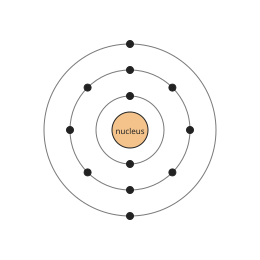
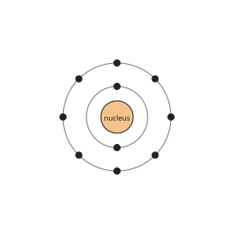
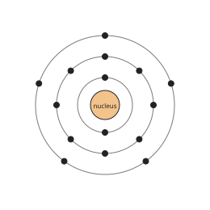
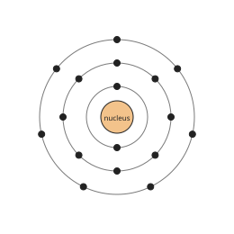

# Chemistry Form 3, Form Three Chemistry: drafts for review (Lessons 24 lessons (1–26))

Generated by `npm run review:f3-chemistry` from `content/form-3/chemistry/*.json`. Every question and drawing below was built by the engine.
All notes, teach cards, worked examples and paper tasks are **status: draft**. “Authored key” means a person fixed the
right answer (see `AUTHORED.md`); “computed by rule” means code worked it out (a formula, a conversion, a spelling rule).

Teach mode: cards (idea + example + 1 level-1 check) → worked example → practice (levels 1–3) → the note as a summary.

## Sample rendered lesson: Lesson 1 in teach mode

### Lesson 1: Review of simple structure of the Atom

**Card c3k1-1** (draft)

> Protons and neutrons are in the nucleus; electrons move around it in shells.
>
> _Hydrogen has 1 proton and 1 electron and no neutron._  

Check question: `k3-1-where` · multiple choice, level 1 · **authored key**, reused from practice

> Why is an atom electrically neutral?

- ✅ It has equal numbers of protons and electrons
- ◻️ Its neutrons cancel the charges  
  _↳ feedback if chosen: Neutrons have no charge._
- ◻️ It has equal numbers of protons and neutrons  
  _↳ feedback if chosen: Neutrons have no charge, so they do not balance anything._
- ◻️ It has no particles with charge  
  _↳ feedback if chosen: Protons and electrons are charged._

Full working after a second miss:

> Each proton's + charge is balanced by an electron's − charge.  
> So the answer is It has equal numbers of protons and electrons.  

**Card c3k1-2** (draft)

> In a neutral atom, the number of electrons equals the number of protons.
>
> _Oxygen: 8 protons, so 8 electrons._  

Check question: `k3-1-e` · number, level 1 · computed by rule, reused from practice

> An atom of sodium has atomic number 11. How many electrons does it have?

Answer: **11**
- Typed **23** (mass) → “The mass number counts protons and neutrons. Electrons = atomic number.”

Full working after a second miss:

> The atom is neutral: electrons = protons = atomic number.  
> So it has 11 electrons.  

**Card c3k1-3** (draft)

> Neutrons = mass number − atomic number.
>
> _Carbon: 12 − 6 = 6 neutrons._  

Check question: `k3-1-n-card` · number, level 1 · computed by rule

> An atom of phosphorus has atomic number 15 and mass number 31. How many neutrons does it have?

Answer: **16**
- Typed **46** (sum) → “Subtract the atomic number from the mass number.”
- Typed **15** (z) → “That is the number of protons.”

Full working after a second miss:

> Neutrons = mass number − atomic number.  
> = 31 − 15 = 16.  

**Worked example** (draft)

> A sodium atom has atomic number 11 and mass number 23. How many protons, electrons and neutrons does it have?

1. Protons = atomic number = 11.
2. The atom is neutral, so electrons = protons = 11.
3. Neutrons = mass number − atomic number = 23 − 11 = 12.

**Answer:** 11 protons, 11 electrons, 12 neutrons

**Practice** (one generated question per template, easiest first)

Practice 1: `k3-1-where` · multiple choice, level 1 · **authored key**

> Where are the protons in an atom?

- ◻️ outside the atom  
  _↳ feedback if chosen: All particles of an atom are inside it._
- ◻️ in the shells around the nucleus  
  _↳ feedback if chosen: Electrons are in the shells._
- ◻️ spread evenly through the atom  
  _↳ feedback if chosen: The nucleus is a tiny dense centre._
- ✅ in the nucleus

Full working after a second miss:

> Protons and neutrons make up the nucleus.  
> So the answer is in the nucleus.  

Practice 2: `k3-1-e` · number, level 1 · computed by rule

> An atom of boron has atomic number 5. How many electrons does it have?

Answer: **5**
- Typed **11** (mass) → “The mass number counts protons and neutrons. Electrons = atomic number.”

Full working after a second miss:

> The atom is neutral: electrons = protons = atomic number.  
> So it has 5 electrons.  

Practice 3: `k3-1-n` · number, level 2 · computed by rule

> An atom of potassium has atomic number 19 and mass number 39. How many neutrons does it have?

Answer: **20**
- Typed **58** (sum) → “Subtract the atomic number from the mass number.”
- Typed **19** (z) → “That is the number of protons.”

Full working after a second miss:

> Neutrons = mass number − atomic number.  
> = 39 − 19 = 20.  

Practice 4: `k3-1-a` · number, level 2 · computed by rule

> An atom has 3 protons and 22 neutrons. What is its mass number?

Answer: **25**
- Typed **19** (diff) → “Add protons and neutrons: both are in the nucleus.”

Full working after a second miss:

> Mass number = protons + neutrons.  
> = 3 + 22 = 25.  

Practice 5: `k3-1-model` · multiple choice, level 3 · **authored key**

> Most of the volume of an atom is…

- ◻️ filled with protons  
  _↳ feedback if chosen: Protons are in the tiny nucleus._
- ✅ empty space around the nucleus
- ◻️ filled with neutrons  
  _↳ feedback if chosen: Neutrons are in the tiny nucleus._
- ◻️ filled by the nucleus  
  _↳ feedback if chosen: The nucleus is tiny compared with the atom._

Full working after a second miss:

> Electrons move in a large space around a tiny nucleus.  
> So the answer is empty space around the nucleus.  

**Summary (the note)**

> All matter is made of tiny particles called atoms. An atom has:
> • a very small, dense nucleus at the centre, containing protons (positive) and neutrons (no charge);
> • electrons (negative) moving around the nucleus in shells (energy levels).
> An atom is electrically neutral: number of protons = number of electrons.
> The number of protons is the atomic number (Z); protons + neutrons is the mass number (A). Neutrons = A − Z.

## All drafts

| Lesson | Title (sheet) | Status | Cards | Practice | Paper task |
|---|---|---|---|---|---|
| 1 | Review of simple structure of the Atom | draft | 3 | 5 | — |
| 2 | Simple experiments to illustrate diffusion and Brownian motion | draft | 3 | 4 | — |
| 3 | Characteristics of subatomic particles | draft | 3 | 4 | — |
| 4 | Atomic number and mass number | draft | 3 | 5 | — |
| 5 | Isotopy and Calculation of Relative Atomic Mass (RAM) | draft | 3 | 5 | — |
| 6 | RAM of an element and mole of atoms | draft | 3 | 5 | — |
| 7 | A Mole of atoms and the Avogadro’s Constant | draft | 3 | 5 | — |
| 9 | Structure of the atom: Nucleus and electrons | draft | 3 | 5 | — |
| 10 | . Electronic configuration of the first 20 elements of the Periodic Table | draft | 3 | 5 | — |
| 11 | Valence Electrons and the Periodic Table | draft | 3 | 5 | — |
| 12 | Electronic Configuration and Chemical Properties (Alkali metals and halogens) | draft | 3 | 5 | — |
| 13 | Electronic Configuration and Chemical Properties (Alkaline earth metals and halogens) | draft | 3 | 5 | — |
| 15 | The octet rule (Noble gas electronic configuration) | draft | 3 | 4 | — |
| 16 | Chemical Bond formation and the Octet rule | draft | 3 | 4 | — |
| 17 | Ionic bonding: Formation | draft | 3 | 5 | — |
| 18 | Properties of ionic compounds | draft | 3 | 4 | — |
| 19 | Covalent Bonding: Formation | draft | 3 | 4 | — |
| 20 | Properties of covalent compounds | draft | 3 | 4 | — |
| 21 | Structure and shapes of simple covalent molecules (VSERP theory) | draft | 3 | 4 | — |
| 22 | The metallic bond: Formation | draft | 3 | 4 | — |
| 23 | Properties of metals | draft | 3 | 4 | — |
| 24 | Crystals: Definition and types of crystal structures | draft | 3 | 4 | — |
| 25 | Properties of Substances related to bond type and structure | draft | 3 | 4 | — |
| 26 | Giant molecular structures - Diamond and graphite | draft | 3 | 4 | — |

## Lesson 1: Review of simple structure of the Atom

Prerequisites: none · Skill: k3-1 (Review: the simple structure of the atom)

**Note** (draft)

> All matter is made of tiny particles called atoms. An atom has:
> • a very small, dense nucleus at the centre, containing protons (positive) and neutrons (no charge);
> • electrons (negative) moving around the nucleus in shells (energy levels).
> An atom is electrically neutral: number of protons = number of electrons.
> The number of protons is the atomic number (Z); protons + neutrons is the mass number (A). Neutrons = A − Z.

**Learn: Inside an atom** (draft)

> Everything around you, the air, water, the wood of your desk, is made of atoms. They are far too small to see: millions of them would fit across the full stop at the end of this sentence.
> An atom has a tiny, heavy centre called the nucleus. Around it, much lighter particles called electrons move in shells (energy levels).

**Learn: Three particles** (draft)

> • Protons: in the nucleus, positive charge.
> • Neutrons: in the nucleus, no charge.
> • Electrons: in the shells, negative charge, very light.
> An atom has the same number of electrons as protons, so the charges cancel: the atom is neutral.
> Almost all the mass of an atom is in the nucleus, but almost all its volume is the space where the electrons move.

**Learn: Atomic number and mass number** (draft)

> The atomic number (Z) is the number of protons. It decides which element the atom is: every atom with 6 protons is carbon.
> The mass number (A) is the number of protons plus neutrons.
> So neutrons = A − Z. A sodium atom (Z = 11, A = 23) has 11 protons, 11 electrons and 12 neutrons.

**Learn: key words and examples** (draft)

- **nucleus**: the small, dense centre of an atom
- **proton**: positive particle in the nucleus
- **neutron**: neutral particle in the nucleus
- **electron**: negative particle moving around the nucleus

- Hydrogen: 1 proton, 1 electron, no neutron
- Oxygen (Z = 8, A = 16): 8 neutrons
- Calcium (Z = 20): 20 electrons

Common mistake: “Electrons = mass number” → “Electrons = protons = atomic number (in a neutral atom)”. The mass number counts protons and neutrons together.

**Card c3k1-1** (draft)

> Protons and neutrons are in the nucleus; electrons move around it in shells.
>
> _Hydrogen has 1 proton and 1 electron and no neutron._  

Check question: `k3-1-where` · multiple choice, level 1 · **authored key**, reused from practice

> Where are the protons in an atom?

- ◻️ in the shells around the nucleus  
  _↳ feedback if chosen: Electrons are in the shells._
- ◻️ outside the atom  
  _↳ feedback if chosen: All particles of an atom are inside it._
- ◻️ spread evenly through the atom  
  _↳ feedback if chosen: The nucleus is a tiny dense centre._
- ✅ in the nucleus

Full working after a second miss:

> Protons and neutrons make up the nucleus.  
> So the answer is in the nucleus.  

**Card c3k1-2** (draft)

> In a neutral atom, the number of electrons equals the number of protons.
>
> _Oxygen: 8 protons, so 8 electrons._  

Check question: `k3-1-e` · number, level 1 · computed by rule, reused from practice

> An atom of nitrogen has atomic number 7. How many electrons does it have?

Answer: **7**
- Typed **14** (mass) → “The mass number counts protons and neutrons. Electrons = atomic number.”

Full working after a second miss:

> The atom is neutral: electrons = protons = atomic number.  
> So it has 7 electrons.  

**Card c3k1-3** (draft)

> Neutrons = mass number − atomic number.
>
> _Carbon: 12 − 6 = 6 neutrons._  

Check question: `k3-1-n-card` · number, level 1 · computed by rule

> An atom of sodium has atomic number 11 and mass number 23. How many neutrons does it have?

Answer: **12**
- Typed **34** (sum) → “Subtract the atomic number from the mass number.”
- Typed **11** (z) → “That is the number of protons.”

Full working after a second miss:

> Neutrons = mass number − atomic number.  
> = 23 − 11 = 12.  

**Worked example** (draft)

> A sodium atom has atomic number 11 and mass number 23. How many protons, electrons and neutrons does it have?

1. Protons = atomic number = 11.
2. The atom is neutral, so electrons = protons = 11.
3. Neutrons = mass number − atomic number = 23 − 11 = 12.

**Answer:** 11 protons, 11 electrons, 12 neutrons

**Practice** `k3-1-where` · multiple choice, level 1 · **authored key**

> Where are the protons in an atom?

- ◻️ in the shells around the nucleus  
  _↳ feedback if chosen: Electrons are in the shells._
- ◻️ outside the atom  
  _↳ feedback if chosen: All particles of an atom are inside it._
- ✅ in the nucleus
- ◻️ spread evenly through the atom  
  _↳ feedback if chosen: The nucleus is a tiny dense centre._

Full working after a second miss:

> Protons and neutrons make up the nucleus.  
> So the answer is in the nucleus.  

> Which particle moves around the nucleus?

- ◻️ the nucleus  
  _↳ feedback if chosen: The nucleus is the centre itself._
- ◻️ the proton  
  _↳ feedback if chosen: Protons stay in the nucleus._
- ◻️ the neutron  
  _↳ feedback if chosen: Neutrons stay in the nucleus._
- ✅ the electron

Full working after a second miss:

> Electrons move in shells around the nucleus.  
> So the answer is the electron.  

**Practice** `k3-1-e` · number, level 1 · computed by rule

> An atom of fluorine has atomic number 9. How many electrons does it have?

Answer: **9**
- Typed **19** (mass) → “The mass number counts protons and neutrons. Electrons = atomic number.”

Full working after a second miss:

> The atom is neutral: electrons = protons = atomic number.  
> So it has 9 electrons.  

> An atom of lithium has atomic number 3. How many electrons does it have?

Answer: **3**
- Typed **7** (mass) → “The mass number counts protons and neutrons. Electrons = atomic number.”

Full working after a second miss:

> The atom is neutral: electrons = protons = atomic number.  
> So it has 3 electrons.  

**Practice** `k3-1-n` · number, level 2 · computed by rule

> An atom of argon has atomic number 18 and mass number 40. How many neutrons does it have?

Answer: **22**
- Typed **58** (sum) → “Subtract the atomic number from the mass number.”
- Typed **18** (z) → “That is the number of protons.”

Full working after a second miss:

> Neutrons = mass number − atomic number.  
> = 40 − 18 = 22.  

> An atom of argon has atomic number 18 and mass number 40. How many neutrons does it have?

Answer: **22**
- Typed **58** (sum) → “Subtract the atomic number from the mass number.”
- Typed **18** (z) → “That is the number of protons.”

Full working after a second miss:

> Neutrons = mass number − atomic number.  
> = 40 − 18 = 22.  

**Practice** `k3-1-a` · number, level 2 · computed by rule

> An atom has 9 protons and 12 neutrons. What is its mass number?

Answer: **21**
- Typed **3** (diff) → “Add protons and neutrons: both are in the nucleus.”

Full working after a second miss:

> Mass number = protons + neutrons.  
> = 9 + 12 = 21.  

> An atom has 5 protons and 22 neutrons. What is its mass number?

Answer: **27**
- Typed **17** (diff) → “Add protons and neutrons: both are in the nucleus.”

Full working after a second miss:

> Mass number = protons + neutrons.  
> = 5 + 22 = 27.  

**Practice** `k3-1-model` · multiple choice, level 3 · **authored key**

> Which statement about the nucleus is correct?

- ◻️ It is negatively charged  
  _↳ feedback if chosen: It holds protons (positive) and neutrons (none)._
- ◻️ It contains the electrons  
  _↳ feedback if chosen: Electrons are outside it._
- ◻️ It has no charge  
  _↳ feedback if chosen: The protons give it a positive charge._
- ✅ It is positively charged

Full working after a second miss:

> Protons give the nucleus its positive charge.  
> So the answer is It is positively charged.  

> Which statement about the nucleus is correct?

- ✅ It is positively charged
- ◻️ It has no charge  
  _↳ feedback if chosen: The protons give it a positive charge._
- ◻️ It contains the electrons  
  _↳ feedback if chosen: Electrons are outside it._
- ◻️ It is negatively charged  
  _↳ feedback if chosen: It holds protons (positive) and neutrons (none)._

Full working after a second miss:

> Protons give the nucleus its positive charge.  
> So the answer is It is positively charged.  

## Lesson 2: Simple experiments to illustrate diffusion and Brownian motion

Prerequisites: 1 · Skill: k3-2 (Diffusion and Brownian motion: evidence for moving particles)

**Note** (draft)

> Diffusion is the spreading of particles from a region of high concentration to a region of low concentration until they are evenly mixed.
> • Smell of food spreading through a house; a crystal of potassium permanganate colouring still water.
> • Ammonia and hydrogen chloride from the two ends of a tube meet and form a white ring of ammonium chloride nearer the hydrogen chloride end: lighter particles (ammonia) diffuse faster.
> • Gases diffuse faster than liquids; diffusion is faster when hot.
> Brownian motion: under a microscope, smoke or pollen particles move in a jerky, random way because invisible air or water particles keep hitting them.

**Learn: Particles on the move** (draft)

> When someone cooks ndolé, you can smell it in another room. Particles of the smell travel through the air, spreading from where there are many of them to where there are few.
> This spreading is diffusion: movement from high concentration to low concentration until the particles are evenly mixed. It happens because particles move all the time, at random.

**Learn: Fast and slow diffusion** (draft)

> • Gases diffuse faster than liquids; solids hardly at all.
> • Heat makes particles move faster, so diffusion speeds up.
> • Lighter particles diffuse faster than heavier ones.
> In a long tube with ammonia at one end and hydrogen chloride at the other, a white ring of ammonium chloride forms nearer the hydrogen chloride: ammonia (lighter) travelled further.

**Learn: Brownian motion** (draft)

> Look at smoke in a small glass cell under a microscope: the bright specks dance about in a jerky, random way. The same happens to pollen grains in water.
> The specks are being hit by air (or water) molecules, which are far too small to see. Because the hits are uneven, the specks are pushed one way, then another.
> This is strong evidence that matter is made of tiny, constantly moving particles.

**Learn: key words and examples** (draft)

- **diffusion**: spreading of particles from high to low concentration
- **concentration**: how many particles are in a given space
- **Brownian motion**: the random movement of small visible particles caused by invisible moving molecules

- Perfume spreading across a classroom
- Purple colour spreading from a permanganate crystal
- Smoke specks jiggling under a microscope

Common mistake: “Heavier gases diffuse faster” → “Lighter gases diffuse faster”. Lighter particles move faster at the same temperature.

**Card c3k2-1** (draft)

> Diffusion: particles spread from high to low concentration.
>
> _The smell of ndolé cooking spreads through the house._  

Check question: `k3-2-def` · multiple choice, level 1 · **authored key**, reused from practice

> Which shows diffusion?

- ✅ The smell of perfume spreading across a room
- ◻️ Ice melting in the sun  
  _↳ feedback if chosen: That is melting._
- ◻️ A stone sinking in water  
  _↳ feedback if chosen: That is sinking (density)._
- ◻️ Water freezing in a fridge  
  _↳ feedback if chosen: That is freezing._

Full working after a second miss:

> Perfume particles spread through the air.  
> So the answer is The smell of perfume spreading across a room.  

**Card c3k2-2** (draft)

> Lighter particles diffuse faster; heat speeds diffusion.
>
> _Ammonia diffuses faster than hydrogen chloride._  

Check question: `k3-2-ring-card` · multiple choice, level 1 · **authored key**

> How does temperature affect diffusion?

- ✅ Diffusion is faster at higher temperature
- ◻️ Diffusion is slower at higher temperature  
  _↳ feedback if chosen: Heat makes particles move faster._
- ◻️ Temperature has no effect  
  _↳ feedback if chosen: Faster particles spread faster._
- ◻️ Diffusion stops above 50 °C  
  _↳ feedback if chosen: It does not stop._

Full working after a second miss:

> Particles have more energy when hot.  
> So the answer is Diffusion is faster at higher temperature.  

**Card c3k2-3** (draft)

> Brownian motion: tiny visible particles jiggle because invisible particles hit them.
>
> _Smoke particles seen under a microscope move randomly._  

Check question: `k3-2-brown-card` · multiple choice, level 1 · **authored key**

> Brownian motion is evidence that…

- ◻️ solids do not contain particles  
  _↳ feedback if chosen: It says nothing about solids._
- ◻️ air has no mass  
  _↳ feedback if chosen: Air particles have mass; that is why they can push._
- ◻️ particles are larger than smoke specks  
  _↳ feedback if chosen: The particles are much smaller._
- ✅ the particles of liquids and gases are always moving

Full working after a second miss:

> Only moving particles could keep jostling the specks.  
> So the answer is the particles of liquids and gases are always moving.  

**Worked example** (draft)

> Cotton wool soaked in ammonia is put at one end of a long glass tube and cotton wool soaked in hydrochloric acid at the other. A white ring forms nearer the acid end. Explain.

1. Both gases diffuse along the tube; where they meet they react to make white ammonium chloride.
2. The ring is nearer the acid, so the ammonia travelled further in the same time.
3. Ammonia particles are lighter, so they diffuse faster.

**Answer:** Ammonia is lighter and diffuses faster

**Practice** `k3-2-def` · multiple choice, level 1 · **authored key**

> What is diffusion?

- ◻️ The movement of particles from low to high concentration  
  _↳ feedback if chosen: Particles spread from where there are many to where there are few._
- ◻️ The melting of a solid  
  _↳ feedback if chosen: Melting is a change of state._
- ✅ The spreading of particles from high to low concentration
- ◻️ The dissolving of a gas in a liquid only  
  _↳ feedback if chosen: Diffusion happens in gases and liquids generally._

Full working after a second miss:

> Random motion spreads particles out evenly.  
> So the answer is The spreading of particles from high to low concentration.  

> What is diffusion?

- ✅ The spreading of particles from high to low concentration
- ◻️ The melting of a solid  
  _↳ feedback if chosen: Melting is a change of state._
- ◻️ The dissolving of a gas in a liquid only  
  _↳ feedback if chosen: Diffusion happens in gases and liquids generally._
- ◻️ The movement of particles from low to high concentration  
  _↳ feedback if chosen: Particles spread from where there are many to where there are few._

Full working after a second miss:

> Random motion spreads particles out evenly.  
> So the answer is The spreading of particles from high to low concentration.  

**Practice** `k3-2-ring` · multiple choice, level 2 · **authored key**

> Which gas diffuses fastest?

- ✅ hydrogen (the lightest gas)
- ◻️ chlorine  
  _↳ feedback if chosen: Chlorine is very heavy._
- ◻️ carbon dioxide  
  _↳ feedback if chosen: Carbon dioxide is heavier._
- ◻️ oxygen  
  _↳ feedback if chosen: Oxygen is heavier than hydrogen._

Full working after a second miss:

> Lighter particles move faster.  
> So the answer is hydrogen (the lightest gas).  

> In the ammonia / hydrogen chloride tube experiment, why does the white ring form nearer the hydrogen chloride end?

- ◻️ Ammonia was put in first  
  _↳ feedback if chosen: Both are put in at the same time._
- ✅ Ammonia particles are lighter and diffuse faster
- ◻️ Hydrogen chloride is lighter  
  _↳ feedback if chosen: Hydrogen chloride (36.5) is heavier than ammonia (17)._
- ◻️ The ring always forms in the middle  
  _↳ feedback if chosen: Then the ring would be in the middle._

Full working after a second miss:

> The faster gas travels further before they meet.  
> So the answer is Ammonia particles are lighter and diffuse faster.  

**Practice** `k3-2-brown` · multiple choice, level 2 · **authored key**

> Brownian motion is evidence that…

- ◻️ air has no mass  
  _↳ feedback if chosen: Air particles have mass; that is why they can push._
- ✅ the particles of liquids and gases are always moving
- ◻️ particles are larger than smoke specks  
  _↳ feedback if chosen: The particles are much smaller._
- ◻️ solids do not contain particles  
  _↳ feedback if chosen: It says nothing about solids._

Full working after a second miss:

> Only moving particles could keep jostling the specks.  
> So the answer is the particles of liquids and gases are always moving.  

> Brownian motion is evidence that…

- ✅ the particles of liquids and gases are always moving
- ◻️ particles are larger than smoke specks  
  _↳ feedback if chosen: The particles are much smaller._
- ◻️ air has no mass  
  _↳ feedback if chosen: Air particles have mass; that is why they can push._
- ◻️ solids do not contain particles  
  _↳ feedback if chosen: It says nothing about solids._

Full working after a second miss:

> Only moving particles could keep jostling the specks.  
> So the answer is the particles of liquids and gases are always moving.  

**Practice** `k3-2-order` · ordering, level 3 · **authored key**

> Put the explanation of the white ring in the ammonia / hydrogen chloride tube in order.

Shown as: They react to form a white ring of solid ammonium chloride. · Ammonia and hydrogen chloride particles move along the tube by diffusion. · Ammonia particles are lighter, so they move faster. · The two gases meet nearer the hydrogen chloride end.
Correct order: Ammonia and hydrogen chloride particles move along the tube by diffusion. → Ammonia particles are lighter, so they move faster. → The two gases meet nearer the hydrogen chloride end. → They react to form a white ring of solid ammonium chloride.

Hint (draft): Start with the particles moving.

Full working after a second miss:

> The correct order is: Ammonia and hydrogen chloride particles move along the tube by diffusion. → Ammonia particles are lighter, so they move faster. → The two gases meet nearer the hydrogen chloride end. → They react to form a white ring of solid ammonium chloride..  

> Put the explanation of the white ring in the ammonia / hydrogen chloride tube in order.

Shown as: Ammonia particles are lighter, so they move faster. · Ammonia and hydrogen chloride particles move along the tube by diffusion. · The two gases meet nearer the hydrogen chloride end. · They react to form a white ring of solid ammonium chloride.
Correct order: Ammonia and hydrogen chloride particles move along the tube by diffusion. → Ammonia particles are lighter, so they move faster. → The two gases meet nearer the hydrogen chloride end. → They react to form a white ring of solid ammonium chloride.

Hint (draft): Start with the particles moving.

Full working after a second miss:

> The correct order is: Ammonia and hydrogen chloride particles move along the tube by diffusion. → Ammonia particles are lighter, so they move faster. → The two gases meet nearer the hydrogen chloride end. → They react to form a white ring of solid ammonium chloride..  

## Lesson 3: Characteristics of subatomic particles

Prerequisites: 1 · Skill: k3-3 (Characteristics of protons, neutrons and electrons)

**Note** (draft)

> Particle — relative mass — relative charge — where:
> • proton — 1 — +1 — nucleus
> • neutron — 1 — 0 — nucleus
> • electron — 1/1840 (almost 0) — −1 — shells
> Ions: an atom that loses electrons becomes a positive ion (Na → Na⁺); one that gains electrons becomes a negative ion (Cl → Cl⁻).
> Electrons in an ion = protons − charge: Na⁺ has 11 − 1 = 10 electrons; Cl⁻ has 17 + 1 = 18.

**Learn: Comparing the particles** (draft)

> • Proton: relative mass 1, charge +1, in the nucleus.
> • Neutron: relative mass 1, charge 0, in the nucleus.
> • Electron: relative mass about 1 ÷ 1840, charge −1, in the shells.
> Because electrons are so light, the mass of an atom is practically the mass of its protons and neutrons.

**Learn: Ions** (draft)

> Atoms can lose or gain electrons in chemical reactions, but never protons. Then the charges no longer balance and the particle is an ion.
> • Lose electrons → more protons than electrons → positive ion. Sodium loses 1: Na⁺.
> • Gain electrons → more electrons than protons → negative ion. Chlorine gains 1: Cl⁻.
> Metals usually form positive ions; non-metals form negative ions.

**Learn: Counting electrons in an ion** (draft)

> Electrons = protons − charge.
> • Na⁺: 11 − 1 = 10 electrons.
> • Mg²⁺: 12 − 2 = 10.
> • O²⁻: 8 + 2 = 10.
> Interesting: these ions all have 10 electrons, like the noble gas neon. You will see why in the lessons on bonding.

**Learn: key words and examples** (draft)

- **relative mass**: mass compared with a proton (proton = 1)
- **ion**: a charged particle formed when an atom loses or gains electrons
- **cation**: a positive ion
- **anion**: a negative ion

- K⁺: 19 protons, 18 electrons
- F⁻: 9 protons, 10 electrons
- Al³⁺: 13 protons, 10 electrons

Common mistake: “Na⁺ has 12 electrons because it is positive” → “Na⁺ has 10 electrons: it lost one”. A positive charge means electrons were lost, so there are fewer of them.

**Card c3k3-1** (draft)

> Proton: mass 1, charge +1. Neutron: mass 1, charge 0. Electron: mass almost 0, charge −1.
>
> _The electron is about 1840 times lighter than a proton._  

Check question: `k3-3-table` · multiple choice, level 1 · **authored key**, reused from practice

> What is the relative charge of a neutron?

- ◻️ +1  
  _↳ feedback if chosen: +1 is the proton._
- ◻️ −1  
  _↳ feedback if chosen: −1 is the electron._
- ✅ 0
- ◻️ +2  
  _↳ feedback if chosen: No subatomic particle has +2._

Full working after a second miss:

> Neutrons are neutral.  
> So the answer is 0.  

**Card c3k3-2** (draft)

> A positive ion has lost electrons; a negative ion has gained them.
>
> _Na⁺: 11 protons, 10 electrons_  

Check question: `k3-3-ion` · number, level 1 · computed by rule, reused from practice

> How many electrons are in the ion Mg²⁺ (atomic number 12)?

Answer: **10**
- Typed **12** (atom) → “That is the neutral atom. The ion has lost 2 electron(s).”
- Typed **14** (sign) → “A positive ion has fewer electrons than protons.”

Full working after a second miss:

> Protons = 12.  
> Lost 2 electron(s): 12 − 2 = 10.  

**Card c3k3-3** (draft)

> The number of protons never changes when an ion forms.
>
> _Cl⁻ still has 17 protons._  

Check question: `k3-3-p-card` · number, level 1 · computed by rule

> How many protons are in the ion Cl⁻? (atomic number 17)

Answer: **17**
- Typed **18** (e) → “That is the number of electrons. Protons do not change.”

Full working after a second miss:

> Forming an ion changes only the electrons.  
> Protons = atomic number = 17.  

**Worked example** (draft)

> How many protons and electrons are in a magnesium ion, Mg²⁺ (atomic number 12)?

1. Protons = atomic number = 12 (the nucleus does not change).
2. The ion has lost 2 electrons: 12 − 2 = 10 electrons.

**Answer:** 12 protons, 10 electrons

**Practice** `k3-3-table` · multiple choice, level 1 · **authored key**

> Which particle has a relative mass of about 1/1840?

- ◻️ the proton  
  _↳ feedback if chosen: A proton has relative mass 1._
- ✅ the electron
- ◻️ the nucleus  
  _↳ feedback if chosen: The nucleus is the heaviest part._
- ◻️ the neutron  
  _↳ feedback if chosen: A neutron has relative mass 1._

Full working after a second miss:

> Electrons are about 1840 times lighter than protons.  
> So the answer is the electron.  

> What is the relative charge of a proton?

- ◻️ −1  
  _↳ feedback if chosen: −1 is the electron._
- ✅ +1
- ◻️ 0  
  _↳ feedback if chosen: 0 is the neutron._
- ◻️ +1840  
  _↳ feedback if chosen: 1840 compares masses, not charges._

Full working after a second miss:

> Protons carry one positive charge each.  
> So the answer is +1.  

**Practice** `k3-3-ion` · number, level 1 · computed by rule

> How many electrons are in the ion Al³⁺ (atomic number 13)?

Answer: **10**
- Typed **13** (atom) → “That is the neutral atom. The ion has lost 3 electron(s).”
- Typed **16** (sign) → “A positive ion has fewer electrons than protons.”

Full working after a second miss:

> Protons = 13.  
> Lost 3 electron(s): 13 − 3 = 10.  

> How many electrons are in the ion F⁻ (atomic number 9)?

Answer: **10**
- Typed **9** (atom) → “That is the neutral atom. The ion has gained 1 electron(s).”
- Typed **8** (sign) → “A negative ion has more electrons than protons.”

Full working after a second miss:

> Protons = 9.  
> Gained 1 electron(s): 9 + 1 = 10.  

**Practice** `k3-3-p` · number, level 2 · computed by rule

> How many protons are in the ion Al³⁺? (atomic number 13)

Answer: **13**
- Typed **10** (e) → “That is the number of electrons. Protons do not change.”

Full working after a second miss:

> Forming an ion changes only the electrons.  
> Protons = atomic number = 13.  

> How many protons are in the ion Mg²⁺? (atomic number 12)

Answer: **12**
- Typed **10** (e) → “That is the number of electrons. Protons do not change.”

Full working after a second miss:

> Forming an ion changes only the electrons.  
> Protons = atomic number = 12.  

**Practice** `k3-3-charge` · multiple choice, level 3 · **authored key**

> An ion has 17 protons and 18 electrons. What is its charge?

- ◻️ 0  
  _↳ feedback if chosen: The numbers are not equal._
- ◻️ 35−  
  _↳ feedback if chosen: Charge = protons − electrons = −1._
- ◻️ 1+  
  _↳ feedback if chosen: It has more electrons than protons._
- ✅ 1−

Full working after a second miss:

> One extra electron: 1−.  
> So the answer is 1−.  

> An atom loses two electrons. What is the charge of the ion?

- ◻️ 0  
  _↳ feedback if chosen: It now has more protons than electrons._
- ◻️ 2−  
  _↳ feedback if chosen: Losing negative electrons leaves extra positive charge._
- ◻️ 1+  
  _↳ feedback if chosen: It lost two, not one._
- ✅ 2+

Full working after a second miss:

> Two more protons than electrons: 2+.  
> So the answer is 2+.  

## Lesson 4: Atomic number and mass number

Prerequisites: 1, 3 · Skill: k3-4 (Atomic number, mass number and nuclide notation)

**Note** (draft)

> Atomic number Z = number of protons (also the number of electrons in a neutral atom). It identifies the element.
> Mass number A = number of protons + number of neutrons.
> Nuclide notation: the mass number is written at the top left and the atomic number at the bottom left of the symbol, e.g. ²³₁₁Na.
> So: protons = Z, electrons = Z (neutral atom), neutrons = A − Z.
> Elements are arranged in the Periodic Table in order of atomic number.

**Learn: Two numbers describe a nucleus** (draft)

> The atomic number Z is the number of protons. It is the identity of the element: 1 proton is hydrogen, 6 is carbon, 8 is oxygen, 11 is sodium.
> The mass number A is the total number of protons and neutrons, the heavy particles in the nucleus.
> In a neutral atom the number of electrons equals Z.

**Learn: Nuclide notation** (draft)

> We write the mass number at the top left and the atomic number at the bottom left of the symbol: ²³₁₁Na.
> From this you can read everything:
> • protons = 11
> • electrons = 11
> • neutrons = 23 − 11 = 12
> The bigger number is always the mass number.

**Learn: Order in the Periodic Table** (draft)

> The Periodic Table lists the elements in order of increasing atomic number: H (1), He (2), Li (3), … Ca (20).
> Knowing the first 20 elements and their atomic numbers will help you in every chemistry lesson this year.

**Learn: key words and examples** (draft)

- **atomic number (Z)**: the number of protons
- **mass number (A)**: protons + neutrons
- **nuclide notation**: ᴬ_Z X: A on top, Z below

- ³⁵₁₇Cl: 17 p, 18 n, 17 e
- ⁴⁰₂₀Ca: 20 p, 20 n, 20 e
- ⁴₂He: 2 p, 2 n, 2 e

Common mistake: “²³₁₁Na has 23 neutrons” → “23 − 11 = 12 neutrons”. The top number counts protons and neutrons together.

**Card c3k4-1** (draft)

> Z (bottom) = protons; A (top) = protons + neutrons.
>
> _¹⁶₈O: 8 protons, 8 neutrons_  

Check question: `k3-4-read` · number, level 1 · computed by rule, reused from practice

> In the notation ²³₁₁Na, how many protons are there?

Answer: **11**
- Typed **23** (top) → “The top number is the mass number (protons + neutrons). Protons = the bottom number.”

Full working after a second miss:

> The bottom number is the atomic number = number of protons.  
> So there are 11 protons.  

**Card c3k4-2** (draft)

> The atomic number identifies the element.
>
> _Every atom with 6 protons is carbon._  

Check question: `k3-4-which` · number, level 1 · computed by rule, reused from practice

> An atom has 10 protons. Which element is it? Give its atomic number.

Answer: **10**
- Typed **20** (mass) → “The number of protons is the atomic number, not the mass number.”

Full working after a second miss:

> The number of protons is the atomic number: 10.  
> Atomic number 10 is neon (Ne).  

**Card c3k4-3** (draft)

> Neutrons = A − Z.
>
> _³⁹₁₉K: 39 − 19 = 20 neutrons_  

Check question: `k3-4-n-card` · number, level 1 · computed by rule

> How many neutrons are in ²³₁₁Na?

Answer: **12**
- Typed **23** (a) → “Subtract the atomic number from the mass number.”
- Typed **34** (sum) → “Neutrons = A − Z: subtract.”

Full working after a second miss:

> Neutrons = A − Z = 23 − 11.  
> = 12.  

**Worked example** (draft)

> For ²⁷₁₃Al, give the number of protons, neutrons and electrons.

1. Bottom number (Z) = 13: 13 protons and 13 electrons.
2. Top number (A) = 27: neutrons = 27 − 13 = 14.

**Answer:** 13 protons, 14 neutrons, 13 electrons

**Practice** `k3-4-read` · number, level 1 · computed by rule

> In the notation ³¹₁₅P, how many protons are there?

Answer: **15**
- Typed **31** (top) → “The top number is the mass number (protons + neutrons). Protons = the bottom number.”

Full working after a second miss:

> The bottom number is the atomic number = number of protons.  
> So there are 15 protons.  

> In the notation ²⁸₁₄Si, how many protons are there?

Answer: **14**
- Typed **28** (top) → “The top number is the mass number (protons + neutrons). Protons = the bottom number.”

Full working after a second miss:

> The bottom number is the atomic number = number of protons.  
> So there are 14 protons.  

**Practice** `k3-4-which` · number, level 1 · computed by rule

> An atom has 12 protons. Which element is it? Give its atomic number.

Answer: **12**
- Typed **24** (mass) → “The number of protons is the atomic number, not the mass number.”

Full working after a second miss:

> The number of protons is the atomic number: 12.  
> Atomic number 12 is magnesium (Mg).  

> An atom has 3 protons. Which element is it? Give its atomic number.

Answer: **3**
- Typed **7** (mass) → “The number of protons is the atomic number, not the mass number.”

Full working after a second miss:

> The number of protons is the atomic number: 3.  
> Atomic number 3 is lithium (Li).  

**Practice** `k3-4-n` · number, level 2 · computed by rule

> How many neutrons are in ²³₁₁Na?

Answer: **12**
- Typed **23** (a) → “Subtract the atomic number from the mass number.”
- Typed **34** (sum) → “Neutrons = A − Z: subtract.”

Full working after a second miss:

> Neutrons = A − Z = 23 − 11.  
> = 12.  

> How many neutrons are in ³⁵₁₇Cl?

Answer: **18**
- Typed **35** (a) → “Subtract the atomic number from the mass number.”
- Typed **52** (sum) → “Neutrons = A − Z: subtract.”

Full working after a second miss:

> Neutrons = A − Z = 35 − 17.  
> = 18.  

**Practice** `k3-4-write` · multiple choice, level 2 · computed by rule

> An atom of sodium has 11 protons and 12 neutrons. How is it written in nuclide notation?

- ◻️ ¹²₁₁Na  
  _↳ feedback if chosen: The top number is protons + neutrons, not neutrons alone._
- ◻️ ¹¹₂₃Na  
  _↳ feedback if chosen: The mass number (bigger) goes on top; the atomic number at the bottom._
- ✅ ²³₁₁Na
- ◻️ ³⁴₁₁Na  
  _↳ feedback if chosen: The mass number is protons + neutrons = 23._

Full working after a second miss:

> Mass number = 11 + 12 = 23 (top).  
> Atomic number = 11 (bottom). So: ²³₁₁Na.  

> An atom of argon has 18 protons and 22 neutrons. How is it written in nuclide notation?

- ◻️ ¹⁸₄₀Ar  
  _↳ feedback if chosen: The mass number (bigger) goes on top; the atomic number at the bottom._
- ◻️ ²²₁₈Ar  
  _↳ feedback if chosen: The top number is protons + neutrons, not neutrons alone._
- ✅ ⁴⁰₁₈Ar
- ◻️ ⁵⁸₁₈Ar  
  _↳ feedback if chosen: The mass number is protons + neutrons = 40._

Full working after a second miss:

> Mass number = 18 + 22 = 40 (top).  
> Atomic number = 18 (bottom). So: ⁴⁰₁₈Ar.  

**Practice** `k3-4-a` · number, level 3 · computed by rule

> An atom has 6 electrons and 6 neutrons. What is its mass number?

Answer: **12**
- Typed **18** (e) → “Electrons do not count in the mass number: A = protons + neutrons.”

Full working after a second miss:

> Neutral atom: protons = electrons = 6.  
> Mass number = protons + neutrons = 6 + 6 = 12.  

> An atom has 13 electrons and 13 neutrons. What is its mass number?

Answer: **26**
- Typed **39** (e) → “Electrons do not count in the mass number: A = protons + neutrons.”

Full working after a second miss:

> Neutral atom: protons = electrons = 13.  
> Mass number = protons + neutrons = 13 + 13 = 26.  

## Lesson 5: Isotopy and Calculation of Relative Atomic Mass (RAM)

Prerequisites: 4 · Skill: k3-5 (Isotopes and calculating relative atomic mass)

**Note** (draft)

> Isotopes are atoms of the same element (same number of protons) with different numbers of neutrons, so different mass numbers: ³⁵Cl and ³⁷Cl; ¹²C and ¹⁴C.
> Isotopes of an element have the same chemical properties (same electrons) but slightly different physical properties (mass, density).
> Relative atomic mass (RAM, Ar) is the average mass of the atoms of an element compared with 1/12 of the mass of a carbon-12 atom. It takes account of the abundance (percentage) of each isotope:
> RAM = (mass₁ × %₁ + mass₂ × %₂) ÷ 100. For chlorine: (35 × 75 + 37 × 25) ÷ 100 = 35.5.

**Learn: Same element, different masses** (draft)

> All chlorine atoms have 17 protons, but not all have the same number of neutrons. About three in four have 18 neutrons (mass 35); about one in four has 20 neutrons (mass 37).
> Atoms of the same element with different numbers of neutrons are isotopes. They are written ³⁵Cl and ³⁷Cl, or chlorine-35 and chlorine-37.
> Carbon has ¹²C (common) and ¹⁴C (rare, used to date old objects).

**Learn: Same chemistry** (draft)

> Chemical reactions depend on electrons. Isotopes of an element have the same number of protons and therefore the same number of electrons, so they react in exactly the same way.
> They differ only in mass, which slightly changes physical properties such as density.

**Learn: Relative atomic mass** (draft)

> A sample of an element contains a mixture of its isotopes, so its average atomic mass is not a whole number. We compare it with 1/12 of the mass of a carbon-12 atom.
> RAM = (mass × percentage for each isotope, added up) ÷ 100.
> Chlorine: (35 × 75 + 37 × 25) ÷ 100 = (2625 + 925) ÷ 100 = 35.5.

**Learn: key words and examples** (draft)

- **isotopes**: atoms with the same atomic number but different mass numbers
- **abundance**: the percentage of each isotope in the element
- **relative atomic mass (Ar)**: the average mass of an element's atoms compared with 1/12 of carbon-12

- Boron: 20% ¹⁰B, 80% ¹¹B → RAM 10.8
- Hydrogen isotopes: ¹H, ²H (deuterium), ³H (tritium)

Common mistake: “RAM of chlorine = (35 + 37) ÷ 2 = 36” → “RAM = (35 × 75 + 37 × 25) ÷ 100 = 35.5”. The commoner isotope counts more: use the percentages, not a simple average.

**Card c3k5-1** (draft)

> Isotopes: same protons, different neutrons.
>
> _¹²C and ¹⁴C both have 6 protons; ¹⁴C has 2 more neutrons._  

Check question: `k3-5-def` · multiple choice, level 1 · **authored key**, reused from practice

> Which pair are isotopes?

- ✅ ³⁵₁₇Cl and ³⁷₁₇Cl
- ◻️ ²³₁₁Na and ²⁴₁₂Mg  
  _↳ feedback if chosen: Different elements._
- ◻️ ⁴⁰₁₈Ar and ⁴⁰₂₀Ca  
  _↳ feedback if chosen: Same mass number but different elements (different Z)._
- ◻️ ¹⁶₈O and ¹⁴₇N  
  _↳ feedback if chosen: Different elements._

Full working after a second miss:

> Same atomic number (17), different mass numbers.  
> So the answer is ³⁵₁₇Cl and ³⁷₁₇Cl.  

**Card c3k5-2** (draft)

> RAM is the average of the isotope masses, weighted by abundance.
>
> _(35 × 75 + 37 × 25) ÷ 100 = 35.5_  

Check question: `k3-5-ram-card` · number, level 1 · computed by rule

> An element has two isotopes: mass 12 (90%) and mass 14 (10%). Calculate its relative atomic mass.

Answer: **12.2**
- Typed **13** (plain) → “That is the simple average. Use the percentages: the commoner isotope counts more.”
- Typed **13.8** (swap) → “Each mass goes with its own percentage: 12 with 90%.”

Full working after a second miss:

> RAM = (12 × 90 + 14 × 10) ÷ 100.  
> = (1080 + 140) ÷ 100 = 12.2.  

**Card c3k5-3** (draft)

> Isotopes react in the same way because they have the same electrons.
>
> _³⁵Cl and ³⁷Cl both form Cl⁻._  

Check question: `k3-5-prop-card` · multiple choice, level 1 · **authored key**

> Which property differs between two isotopes of the same element?

- ◻️ their number of protons  
  _↳ feedback if chosen: Protons are the same._
- ◻️ their chemical reactions  
  _↳ feedback if chosen: Reactions are the same._
- ◻️ their atomic number  
  _↳ feedback if chosen: The atomic number is the same._
- ✅ their mass

Full working after a second miss:

> Different numbers of neutrons give different masses.  
> So the answer is their mass.  

**Worked example** (draft)

> Chlorine is 75% ³⁵Cl and 25% ³⁷Cl. Calculate its relative atomic mass.

1. RAM = (mass × % for each isotope, added) ÷ 100.
2. = (35 × 75 + 37 × 25) ÷ 100 = (2625 + 925) ÷ 100.
3. = 35.5.

**Answer:** 35.5

**Practice** `k3-5-def` · multiple choice, level 1 · **authored key**

> What are isotopes?

- ◻️ Atoms with different numbers of electrons only  
  _↳ feedback if chosen: That describes ions._
- ✅ Atoms of the same element with different numbers of neutrons
- ◻️ Atoms with different numbers of protons  
  _↳ feedback if chosen: Changing the protons changes the element._
- ◻️ Atoms of different elements with the same mass number  
  _↳ feedback if chosen: Different elements have different numbers of protons._

Full working after a second miss:

> Same Z, different A.  
> So the answer is Atoms of the same element with different numbers of neutrons.  

> ¹²₆C and ¹⁴₆C are isotopes. How do they differ?

- ◻️ ¹⁴C has two more protons  
  _↳ feedback if chosen: Both have 6 protons._
- ◻️ They are different elements  
  _↳ feedback if chosen: Both are carbon (Z = 6)._
- ✅ ¹⁴C has two more neutrons
- ◻️ ¹⁴C has two more electrons  
  _↳ feedback if chosen: Both neutral atoms have 6 electrons._

Full working after a second miss:

> Mass numbers differ by 2, protons are equal, so neutrons differ by 2.  
> So the answer is ¹⁴C has two more neutrons.  

**Practice** `k3-5-ram` · number, level 2 · computed by rule

> An element has two isotopes: mass 72 (85%) and mass 74 (15%). Calculate its relative atomic mass.

Answer: **72.3**
- Typed **73** (plain) → “That is the simple average. Use the percentages: the commoner isotope counts more.”
- Typed **73.7** (swap) → “Each mass goes with its own percentage: 72 with 85%.”

Full working after a second miss:

> RAM = (72 × 85 + 74 × 15) ÷ 100.  
> = (6120 + 1110) ÷ 100 = 72.3.  

> An element has two isotopes: mass 52 (85%) and mass 54 (15%). Calculate its relative atomic mass.

Answer: **52.3**
- Typed **53** (plain) → “That is the simple average. Use the percentages: the commoner isotope counts more.”
- Typed **53.7** (swap) → “Each mass goes with its own percentage: 52 with 85%.”

Full working after a second miss:

> RAM = (52 × 85 + 54 × 15) ÷ 100.  
> = (4420 + 810) ÷ 100 = 52.3.  

**Practice** `k3-5-real` · number, level 1 · **authored key**

> Neon: 90% ²⁰Ne and 10% ²²Ne. Calculate the relative atomic mass of Neon to 1 decimal place.

Answer: **20.2**

Full working after a second miss:

> (20 × 90 + 22 × 10) ÷ 100 = 20.2  
> ≈ 20.2.  

> Chlorine: 75% ³⁵Cl and 25% ³⁷Cl. Calculate the relative atomic mass of Chlorine to 1 decimal place.

Answer: **35.5**

Full working after a second miss:

> (35 × 75 + 37 × 25) ÷ 100 = 35.5  
> ≈ 35.5.  

**Practice** `k3-5-prop` · multiple choice, level 2 · **authored key**

> Why is the RAM of chlorine 35.5 and not a whole number?

- ✅ It is an average of isotopes of mass 35 and 37
- ◻️ It has 35.5 protons  
  _↳ feedback if chosen: Chlorine has 17 protons._
- ◻️ It was measured wrongly  
  _↳ feedback if chosen: It is an exact average._
- ◻️ A chlorine atom has half a neutron  
  _↳ feedback if chosen: Particles are not split._

Full working after a second miss:

> The weighted average of 35 (75%) and 37 (25%) is 35.5.  
> So the answer is It is an average of isotopes of mass 35 and 37.  

> Why do ³⁵Cl and ³⁷Cl have the same chemical properties?

- ✅ They have the same number of electrons
- ◻️ They are different elements  
  _↳ feedback if chosen: Both are chlorine._
- ◻️ They have the same mass number  
  _↳ feedback if chosen: Their mass numbers differ._
- ◻️ They have the same number of neutrons  
  _↳ feedback if chosen: Their neutrons differ._

Full working after a second miss:

> Chemical reactions involve electrons, which are the same.  
> So the answer is They have the same number of electrons.  

**Practice** `k3-5-pct` · number, level 3 · computed by rule

> An element has RAM 30.2 and two isotopes of mass 29 and 31. What percentage is the isotope of mass 29?

Answer: **40 %**
- Typed **60** (other) → “That is the percentage of the heavier isotope.”
- Typed **50** (half) → “Work it out from the RAM; it is not always half.”

Full working after a second miss:

> Let x% be mass 29: (29x + 31(100 − x)) ÷ 100 = 30.2.  
> 29x + 3100 − 31x = 3020, so 2x = 80, x = 40%.  

> An element has RAM 21.2 and two isotopes of mass 20 and 22. What percentage is the isotope of mass 20?

Answer: **40 %**
- Typed **60** (other) → “That is the percentage of the heavier isotope.”
- Typed **50** (half) → “Work it out from the RAM; it is not always half.”

Full working after a second miss:

> Let x% be mass 20: (20x + 22(100 − x)) ÷ 100 = 21.2.  
> 20x + 2200 − 22x = 2120, so 2x = 80, x = 40%.  

## Lesson 6: RAM of an element and mole of atoms

Prerequisites: 5 · Skill: k3-6 (Relative atomic mass and the mole of atoms)

**Note** (draft)

> Chemists count atoms by weighing them. A mole (mol) of atoms of an element is its relative atomic mass in grams:
> • 1 mol of carbon (C = 12) has a mass of 12 g; 1 mol of magnesium (Mg = 24) has a mass of 24 g.
> • This mass per mole is the molar mass, in g/mol.
> Formulas: number of moles = mass ÷ molar mass; mass = moles × molar mass.
> Example: 48 g of magnesium = 48 ÷ 24 = 2 mol.

**Learn: Counting by weighing** (draft)

> Atoms are far too small to count one by one. Market traders in Mokolo sell rice by the cup or the bag, not grain by grain; chemists count atoms by weighing them.
> The unit chemists use for 'a certain number of particles' is the mole (mol).

**Learn: What a mole of atoms weighs** (draft)

> One mole of atoms of an element has a mass equal to its relative atomic mass in grams.
> • C = 12: 1 mol of carbon atoms is 12 g.
> • Mg = 24: 1 mol is 24 g.
> • Fe = 56: 1 mol is 56 g.
> This mass per mole is the molar mass (g/mol). One mole of any element contains the same number of atoms.

**Learn: Two formulas** (draft)

> • moles = mass ÷ molar mass: 48 g of magnesium is 48 ÷ 24 = 2 mol.
> • mass = moles × molar mass: 0.5 mol of iron is 0.5 × 56 = 28 g.
> To compare numbers of atoms in two samples, compare their moles, not their masses: 12 g of carbon has more atoms than 32 g of sulphur? Both are 1 mol, so they have the same number.

**Learn: key words and examples** (draft)

- **mole (mol)**: the chemist's unit for an amount of particles
- **molar mass**: the mass of 1 mol, in g/mol: the RAM in grams

- 36 g of carbon = 3 mol
- 0.25 mol of calcium = 10 g
- 56 g of iron and 12 g of carbon: both 1 mol

Common mistake: “48 g of Mg = 48 × 24 mol” → “48 g of Mg = 48 ÷ 24 = 2 mol”. Divide the mass by the molar mass to get moles.

**Card c3k6-1** (draft)

> One mole of an element has a mass equal to its RAM in grams.
>
> _C = 12: 1 mol of carbon is 12 g._  

Check question: `k3-6-molar` · number, level 1 · computed by rule, reused from practice

> What is the mass of 1 mole of sulphur atoms (g)? (S = 32)

Answer: **32 g**
- Typed **1** (one) → “A mole is not 1 g: it is the RAM in grams.”

Full working after a second miss:

> The mass of 1 mol is the RAM in grams.  
> 1 mol of sulphur = 32 g.  

**Card c3k6-2** (draft)

> Moles = mass ÷ molar mass.
>
> _48 g of Mg (Mg = 24): 2 mol_  

Check question: `k3-6-n` · number, level 1 · computed by rule, reused from practice

> How many moles of atoms are in 54 g of aluminium? (Al = 27)

Answer: **2 mol**
- Typed **1458** (times) → “Divide the mass by the molar mass.”
- Typed **0.5** (flip) → “Moles = mass ÷ molar mass, not molar mass ÷ mass.”

Full working after a second miss:

> Moles = mass ÷ molar mass = 54 ÷ 27.  
> = 2 mol.  

**Card c3k6-3** (draft)

> Mass = moles × molar mass.
>
> _3 mol of O atoms (O = 16): 48 g_  

Check question: `k3-6-m-card` · number, level 1 · computed by rule

> Find the mass of 1.5 mol of aluminium atoms (g). (Al = 27)

Answer: **40.5 g**
- Typed **18** (div) → “Mass = moles × molar mass: multiply.”

Full working after a second miss:

> Mass = moles × molar mass = 1.5 × 27.  
> = 40.5 g.  

**Worked example** (draft)

> How many moles of magnesium atoms are in 60 g of magnesium? (Mg = 24)

1. Molar mass of Mg = 24 g/mol.
2. Moles = mass ÷ molar mass = 60 ÷ 24 = 2.5 mol.

**Answer:** 2.5 mol

**Practice** `k3-6-molar` · number, level 1 · computed by rule

> What is the mass of 1 mole of aluminium atoms (g)? (Al = 27)

Answer: **27 g**
- Typed **1** (one) → “A mole is not 1 g: it is the RAM in grams.”

Full working after a second miss:

> The mass of 1 mol is the RAM in grams.  
> 1 mol of aluminium = 27 g.  

> What is the mass of 1 mole of magnesium atoms (g)? (Mg = 24)

Answer: **24 g**
- Typed **1** (one) → “A mole is not 1 g: it is the RAM in grams.”

Full working after a second miss:

> The mass of 1 mol is the RAM in grams.  
> 1 mol of magnesium = 24 g.  

**Practice** `k3-6-n` · number, level 1 · computed by rule

> How many moles of atoms are in 168 g of iron? (Fe = 56)

Answer: **3 mol**
- Typed **9408** (times) → “Divide the mass by the molar mass.”
- Typed **0.3333** (flip) → “Moles = mass ÷ molar mass, not molar mass ÷ mass.”

Full working after a second miss:

> Moles = mass ÷ molar mass = 168 ÷ 56.  
> = 3 mol.  

> How many moles of atoms are in 160 g of calcium? (Ca = 40)

Answer: **4 mol**
- Typed **6400** (times) → “Divide the mass by the molar mass.”
- Typed **0.25** (flip) → “Moles = mass ÷ molar mass, not molar mass ÷ mass.”

Full working after a second miss:

> Moles = mass ÷ molar mass = 160 ÷ 40.  
> = 4 mol.  

**Practice** `k3-6-m` · number, level 2 · computed by rule

> Find the mass of 0.25 mol of carbon atoms (g). (C = 12)

Answer: **3 g**
- Typed **48** (div) → “Mass = moles × molar mass: multiply.”

Full working after a second miss:

> Mass = moles × molar mass = 0.25 × 12.  
> = 3 g.  

> Find the mass of 1.5 mol of calcium atoms (g). (Ca = 40)

Answer: **60 g**
- Typed **26.67** (div) → “Mass = moles × molar mass: multiply.”

Full working after a second miss:

> Mass = moles × molar mass = 1.5 × 40.  
> = 60 g.  

**Practice** `k3-6-frac` · number, level 2 · computed by rule

> How many moles of atoms are in 21 g of iron? (Fe = 56) Give the answer to 2 decimal places.

Answer: **0.38 mol**
- Typed **1176** (times) → “Divide the mass by the molar mass.”

Full working after a second miss:

> Moles = 21 ÷ 56.  
> = 0.38 mol.  

> How many moles of atoms are in 4 g of calcium? (Ca = 40) Give the answer to 2 decimal places.

Answer: **0.1 mol**
- Typed **160** (times) → “Divide the mass by the molar mass.”

Full working after a second miss:

> Moles = 4 ÷ 40.  
> = 0.1 mol.  

**Practice** `k3-6-compare` · number, level 3 · computed by rule

> Which contains more atoms: 10 g of carbon (C = 12) or 42 g of iron (Fe = 56)? Give the number of moles of atoms in the one with more, to 2 decimal places.

Answer: **0.83 mol**
- Typed **42** (mass) → “More grams does not mean more atoms: compare moles.”
- Typed **0.75** (min) → “That is the one with fewer atoms.”

Full working after a second miss:

> carbon: 10 ÷ 12 = 0.83 mol.  
> iron: 42 ÷ 56 = 0.75 mol.  
> More moles means more atoms: 0.83 mol.  

> Which contains more atoms: 26 g of carbon (C = 12) or 52 g of sulphur (S = 32)? Give the number of moles of atoms in the one with more, to 2 decimal places.

Answer: **2.17 mol**
- Typed **52** (mass) → “More grams does not mean more atoms: compare moles.”
- Typed **1.63** (min) → “That is the one with fewer atoms.”

Full working after a second miss:

> carbon: 26 ÷ 12 = 2.17 mol.  
> sulphur: 52 ÷ 32 = 1.63 mol.  
> More moles means more atoms: 2.17 mol.  

## Lesson 7: A Mole of atoms and the Avogadro’s Constant

Prerequisites: 6 · Skill: k3-7 (A mole of atoms and the Avogadro constant)

**Note** (draft)

> One mole of any substance contains 6.02 × 10²³ particles (atoms, molecules or ions). This number is the Avogadro constant, L or Nₐ.
> • Number of particles = moles × 6.02 × 10²³.
> • Moles = number of particles ÷ 6.02 × 10²³.
> • 12 g of carbon (1 mol) and 24 g of magnesium (1 mol) contain the same number of atoms: 6.02 × 10²³.
> Combine with mass: atoms = (mass ÷ molar mass) × 6.02 × 10²³.

**Learn: How many in a mole?** (draft)

> A dozen means 12; a ream of paper means 500 sheets. A mole means 6.02 × 10²³ particles.
> This huge number is the Avogadro constant (L). It was chosen so that 12 g of carbon-12 contains exactly one mole of atoms.
> 6.02 × 10²³ is 602 000 million million million: if you counted one atom every second, it would take far longer than the age of the universe.

**Learn: Particles and moles** (draft)

> • particles = moles × 6.02 × 10²³
> • moles = particles ÷ (6.02 × 10²³)
> 2 mol of copper contains 2 × 6.02 × 10²³ = 12.04 × 10²³ = 1.204 × 10²⁴ atoms.
> 3.01 × 10²³ atoms is half a mole.

**Learn: From grams to atoms** (draft)

> Go through moles:
> • grams → moles: divide by the molar mass;
> • moles → atoms: multiply by 6.02 × 10²³.
> 46 g of sodium (Na = 23) is 2 mol, which is 12.04 × 10²³ atoms. Equal numbers of moles always contain equal numbers of particles.

**Learn: key words and examples** (draft)

- **Avogadro constant**: 6.02 × 10²³ particles per mole
- **particle**: an atom, molecule or ion
- **standard form**: a × 10ⁿ with 1 ≤ a < 10

- 0.5 mol = 3.01 × 10²³ atoms
- 3 mol = 1.806 × 10²⁴ atoms
- 64 g of copper (Cu = 64) = 6.02 × 10²³ atoms

Common mistake: “2 mol = 6.02 × 10²³ atoms” → “2 mol = 2 × 6.02 × 10²³ = 1.204 × 10²⁴ atoms”. Each mole contains 6.02 × 10²³ particles; multiply by the number of moles.

**Card c3k7-1** (draft)

> One mole contains 6.02 × 10²³ particles: the Avogadro constant.
>
> _1 mol of carbon atoms: 6.02 × 10²³ atoms_  

Check question: `k3-7-L` · multiple choice, level 1 · **authored key**, reused from practice

> Which contains 6.02 × 10²³ atoms?

- ◻️ 1 g of magnesium  
  _↳ feedback if chosen: 1 g is 1/24 mol._
- ✅ 24 g of magnesium (Mg = 24)
- ◻️ 6.02 g of magnesium  
  _↳ feedback if chosen: The number 6.02 is not a mass._
- ◻️ 12 g of magnesium  
  _↳ feedback if chosen: 12 g is 0.5 mol._

Full working after a second miss:

> 24 g of magnesium is 1 mol.  
> So the answer is 24 g of magnesium (Mg = 24).  

**Card c3k7-2** (draft)

> Particles = moles × 6.02 × 10²³.
>
> _0.5 mol: 3.01 × 10²³ atoms_  

Check question: `k3-7-count` · number, level 1 · computed by rule, reused from practice

> How many atoms are in 0.5 mol of an element? Write the answer as a × 10²³; give a.

Answer: **3.01**
- Typed **12.04** (div) → “Multiply the moles by the Avogadro constant.”

Full working after a second miss:

> Atoms = moles × 6.02 × 10²³.  
> = 0.5 × 6.02 × 10²³ = 3.01 × 10²³.  

**Card c3k7-3** (draft)

> Moles = particles ÷ 6.02 × 10²³.
>
> _12.04 × 10²³ atoms = 2 mol_  

Check question: `k3-7-back-card` · number, level 1 · computed by rule

> A sample contains 30.1 × 10²³ atoms. How many moles is that?

Answer: **5 mol**
- Typed **181.2** (times) → “Divide the number of atoms by the Avogadro constant.”

Full working after a second miss:

> Moles = atoms ÷ 6.02 × 10²³.  
> = 30.1 ÷ 6.02 = 5 mol.  

**Worked example** (draft)

> How many atoms are in 2 mol of copper? Give the answer in standard form.

1. Atoms = moles × 6.02 × 10²³.
2. = 2 × 6.02 × 10²³ = 12.04 × 10²³.
3. In standard form: 1.204 × 10²⁴.

**Answer:** 1.204 × 10²⁴ atoms

**Practice** `k3-7-L` · multiple choice, level 1 · **authored key**

> 12 g of carbon and 32 g of sulphur (C = 12, S = 32). Which has more atoms?

- ✅ They have the same number
- ◻️ It cannot be told  
  _↳ feedback if chosen: Both are 1 mol, so the numbers can be compared._
- ◻️ The sulphur  
  _↳ feedback if chosen: 32 g of S is only 1 mol._
- ◻️ The carbon  
  _↳ feedback if chosen: 12 g of C is only 1 mol._

Full working after a second miss:

> 1 mol of each: 6.02 × 10²³ atoms.  
> So the answer is They have the same number.  

> What is the Avogadro constant?

- ◻️ 1840  
  _↳ feedback if chosen: 1840 compares the masses of a proton and an electron._
- ✅ 6.02 × 10²³ particles per mole
- ◻️ 12 g of carbon  
  _↳ feedback if chosen: 12 g of carbon is one mole; it contains 6.02 × 10²³ atoms._
- ◻️ 6.02 × 10²³ grams  
  _↳ feedback if chosen: It is a number of particles, not a mass._

Full working after a second miss:

> The number of particles in one mole.  
> So the answer is 6.02 × 10²³ particles per mole.  

**Practice** `k3-7-count` · number, level 1 · computed by rule

> How many atoms are in 1.75 mol of an element? Write the answer as a × 10²³; give a.

Answer: **10.535**
- Typed **3.44** (div) → “Multiply the moles by the Avogadro constant.”

Full working after a second miss:

> Atoms = moles × 6.02 × 10²³.  
> = 1.75 × 6.02 × 10²³ = 10.535 × 10²³.  

> How many atoms are in 0.25 mol of an element? Write the answer as a × 10²³; give a.

Answer: **1.505**
- Typed **24.08** (div) → “Multiply the moles by the Avogadro constant.”

Full working after a second miss:

> Atoms = moles × 6.02 × 10²³.  
> = 0.25 × 6.02 × 10²³ = 1.505 × 10²³.  

**Practice** `k3-7-back` · number, level 2 · computed by rule

> A sample contains 6.02 × 10²³ atoms. How many moles is that?

Answer: **1 mol**
- Typed **36.24** (times) → “Divide the number of atoms by the Avogadro constant.”

Full working after a second miss:

> Moles = atoms ÷ 6.02 × 10²³.  
> = 6.02 ÷ 6.02 = 1 mol.  

> A sample contains 9.03 × 10²³ atoms. How many moles is that?

Answer: **1.5 mol**
- Typed **54.36** (times) → “Divide the number of atoms by the Avogadro constant.”

Full working after a second miss:

> Moles = atoms ÷ 6.02 × 10²³.  
> = 9.03 ÷ 6.02 = 1.5 mol.  

**Practice** `k3-7-mass` · number, level 2 · computed by rule

> How many atoms are in 200 g of calcium (Ca = 40)? Write the answer as a × 10²³; give a.

Answer: **30.1**
- Typed **1204** (mass) → “Change the mass to moles first (÷ 40).”
- Typed **6.02** (one) → “That is for 1 mol; there are 5 mol.”

Full working after a second miss:

> Moles = 200 ÷ 40 = 5 mol.  
> Atoms = 5 × 6.02 × 10²³ = 30.1 × 10²³.  

> How many atoms are in 32 g of oxygen (O = 16)? Write the answer as a × 10²³; give a.

Answer: **12.04**
- Typed **192.64** (mass) → “Change the mass to moles first (÷ 16).”
- Typed **6.02** (one) → “That is for 1 mol; there are 2 mol.”

Full working after a second miss:

> Moles = 32 ÷ 16 = 2 mol.  
> Atoms = 2 × 6.02 × 10²³ = 12.04 × 10²³.  

**Practice** `k3-7-std` · number, level 3 · computed by rule

> How many atoms are in 92 g of magnesium (Mg = 24)? Write the answer in standard form a × 10ⁿ; give a to 2 decimal places.

Answer: **2.31**
- Typed **23.08** (nostd) → “That number is not between 1 and 10: move the decimal point.”

Full working after a second miss:

> Moles = 92 ÷ 24 = 3.8333 mol.  
> Atoms = 3.8333 × 6.02 × 10²³ = 23.08 × 10²³.  
> In standard form a = 2.31.  

> How many atoms are in 72 g of sodium (Na = 23)? Write the answer in standard form a × 10ⁿ; give a to 2 decimal places.

Answer: **1.88**
- Typed **18.85** (nostd) → “That number is not between 1 and 10: move the decimal point.”

Full working after a second miss:

> Moles = 72 ÷ 23 = 3.1304 mol.  
> Atoms = 3.1304 × 6.02 × 10²³ = 18.85 × 10²³.  
> In standard form a = 1.88.  

## Lesson 9: Structure of the atom: Nucleus and electrons

Prerequisites: 1 · Skill: k3-9 (Structure of the atom: the nucleus and electron shells)

**Note** (draft)

> Electrons are arranged in shells (energy levels) around the nucleus.
> • The first shell, nearest the nucleus, holds at most 2 electrons; the second at most 8; for the first 20 elements the third holds 8 before the fourth starts.
> • Shells fill from the inside out: inner shells first.
> • Electrons in shells further out have more energy and are held less strongly.
> A Bohr (shell) diagram shows the nucleus and each shell with its electrons as dots or crosses.

**Learn: Electrons live in shells** (draft)

> Electrons do not move anywhere they like around the nucleus. They are found in shells (energy levels) at different distances from it.
> The first shell is closest to the nucleus. Electrons there have the least energy and are held most strongly.
> A shell diagram (Bohr diagram) shows the nucleus as a small circle and each shell as a ring with its electrons.

**Learn: How many in each shell?** (draft)

> For the first 20 elements:
> • first shell: at most 2;
> • second shell: at most 8;
> • third shell: 8 before the fourth shell starts.
> Fill from the inside out. Sodium has 11 electrons: 2 in the first shell, 8 in the second, 1 in the third: written 2, 8, 1.

**Learn: Outer electrons matter** (draft)

> The electrons in the outer shell are furthest from the nucleus and held least strongly. They take part in chemical reactions.
> That is why the next lessons count outer electrons so carefully: they explain the Periodic Table and how atoms bond.

**Learn: key words and examples** (draft)

- **shell (energy level)**: a region around the nucleus where electrons are found
- **Bohr diagram**: a drawing of the nucleus and electron shells
- **outer shell**: the last shell that contains electrons

- Carbon (6): 2, 4
- Chlorine (17): 2, 8, 7
- Calcium (20): 2, 8, 8, 2

Common mistake: “Sodium (11): 2, 9” → “Sodium: 2, 8, 1”. The second shell is full at 8; the next electron starts the third shell.

**Card c3k9-1** (draft)

> Shell capacities for the first 20 elements: 2, then 8, then 8.
>
> _Sodium (11): 2, 8, 1_  

Check question: `k3-9-cap` · number, level 1 · **authored key**, reused from practice

> What is the greatest number of electrons the first shell can hold (for the first 20 elements)?

Answer: **2**
- Typed **18** (eighteen) → “For the first 20 elements, the third shell takes 8 before the fourth starts.”

Full working after a second miss:

> Shell capacities: first 2, second 8, third 8 (before the fourth starts).  
> So the first shell holds 2.  

**Card c3k9-2** (draft)

> Fill the inner shells first.
>
> _Oxygen (8): 2, 6_  

Check question: `k3-9-count` · number, level 1 · computed by rule, reused from practice

> How many shells contain electrons in an atom of carbon (atomic number 6)?

Answer: **2**
- Typed **4** (outer) → “That is the number of electrons in the outer shell. Count the shells.”

Full working after a second miss:

> Arrangement: 2, 4.  
> That is 2 shell(s).  

**Card c3k9-3** (draft)

> Outer electrons are further from the nucleus and held less tightly.
>
> _Potassium's outer electron is easy to remove._  

Check question: `k3-9-fig-card` · number, level 1 · computed by rule

> The diagram shows the shells of an atom. What is its atomic number?

Answer: **15**
- Typed **5** (outer) → “Count the electrons in every shell, not only the outer one.”

Full working after a second miss:

> Count all the electrons: 2, 8, 5.  
> Total = 15, so the atomic number is 15.  

**Worked example** (draft)

> Draw the shells of a magnesium atom (atomic number 12) and state how many electrons are in each.

1. 12 electrons to place.
2. First shell: 2; second shell: 8; that makes 10.
3. The remaining 2 go into the third shell.

**Answer:** 2, 8, 2

**Practice** `k3-9-cap` · number, level 1 · **authored key**

> What is the greatest number of electrons the second shell can hold (for the first 20 elements)?

Answer: **8**
- Typed **18** (eighteen) → “For the first 20 elements, the third shell takes 8 before the fourth starts.”

Full working after a second miss:

> Shell capacities: first 2, second 8, third 8 (before the fourth starts).  
> So the second shell holds 8.  

> What is the greatest number of electrons the first shell can hold (for the first 20 elements)?

Answer: **2**
- Typed **18** (eighteen) → “For the first 20 elements, the third shell takes 8 before the fourth starts.”

Full working after a second miss:

> Shell capacities: first 2, second 8, third 8 (before the fourth starts).  
> So the first shell holds 2.  

**Practice** `k3-9-count` · number, level 1 · computed by rule

> How many shells contain electrons in an atom of calcium (atomic number 20)?

Answer: **4**
- Typed **2** (outer) → “That is the number of electrons in the outer shell. Count the shells.”

Full working after a second miss:

> Arrangement: 2, 8, 8, 2.  
> That is 4 shell(s).  

> How many shells contain electrons in an atom of magnesium (atomic number 12)?

Answer: **3**
- Typed **2** (outer) → “That is the number of electrons in the outer shell. Count the shells.”

Full working after a second miss:

> Arrangement: 2, 8, 2.  
> That is 3 shell(s).  

**Practice** `k3-9-fig` · number, level 2 · computed by rule

> The diagram shows the shells of an atom. What is its atomic number?

Answer: **10**
- Typed **8** (outer) → “Count the electrons in every shell, not only the outer one.”

Full working after a second miss:

> Count all the electrons: 2, 8.  
> Total = 10, so the atomic number is 10.  

> The diagram shows the shells of an atom. What is its atomic number?

Answer: **15**
- Typed **5** (outer) → “Count the electrons in every shell, not only the outer one.”

Full working after a second miss:

> Count all the electrons: 2, 8, 5.  
> Total = 15, so the atomic number is 15.  

**Practice** `k3-9-energy` · multiple choice, level 2 · **authored key**

> Which electrons are held most strongly by the nucleus?

- ◻️ those in the outer shell  
  _↳ feedback if chosen: Outer electrons are further away and held less strongly._
- ✅ those in the first (innermost) shell
- ◻️ all electrons equally  
  _↳ feedback if chosen: Distance makes a difference._
- ◻️ those furthest away  
  _↳ feedback if chosen: Further electrons are held less strongly._

Full working after a second miss:

> The closer to the nucleus, the stronger the attraction.  
> So the answer is those in the first (innermost) shell.  

> In which order do shells fill?

- ◻️ all at the same time  
  _↳ feedback if chosen: One shell fills before the next._
- ✅ from the nucleus outwards
- ◻️ from the outside inwards  
  _↳ feedback if chosen: Inner shells fill first._
- ◻️ at random  
  _↳ feedback if chosen: There is a fixed order._

Full working after a second miss:

> Electrons occupy the lowest energy levels first.  
> So the answer is from the nucleus outwards.  

**Practice** `k3-9-left` · number, level 3 · computed by rule

> An atom has 19 electrons. How many electrons are in its outer shell?

Answer: **1**
- Typed **17** (mod) → “Fill the second shell (up to 8) before the third.”
- Typed **19** (all) → “Only the outermost shell counts.”

Full working after a second miss:

> Fill the shells: 2, 8, 8, 1.  
> The outer shell has 1.  

> An atom has 20 electrons. How many electrons are in its outer shell?

Answer: **2**
- Typed **18** (mod) → “Fill the second shell (up to 8) before the third.”
- Typed **20** (all) → “Only the outermost shell counts.”

Full working after a second miss:

> Fill the shells: 2, 8, 8, 2.  
> The outer shell has 2.  

## Lesson 10: . Electronic configuration of the first 20 elements of the Periodic Table

Prerequisites: 9 · Skill: k3-10 (Electronic configuration of the first 20 elements)

**Note** (draft)

> The electronic configuration lists the electrons in each shell, inner to outer: 2, 8, 1 for sodium.
> Rule for the first 20: fill 2, then 8, then 8, then the rest.
> • H 1 · He 2 · Li 2,1 · Be 2,2 · B 2,3 · C 2,4 · N 2,5 · O 2,6 · F 2,7 · Ne 2,8
> • Na 2,8,1 · Mg 2,8,2 · Al 2,8,3 · Si 2,8,4 · P 2,8,5 · S 2,8,6 · Cl 2,8,7 · Ar 2,8,8 · K 2,8,8,1 · Ca 2,8,8,2
> The total of the numbers equals the atomic number.

**Learn: Writing configurations** (draft)

> The electronic configuration lists the number of electrons in each shell from the nucleus outwards, separated by commas.
> Method: start with the atomic number, put 2 in the first shell, up to 8 in the second, up to 8 in the third, and the rest in the fourth.
> Phosphorus (15): 2, 8, 5. Check: 2 + 8 + 5 = 15.

**Learn: The first twenty** (draft)

> • H 1 · He 2
> • Li 2,1 · Be 2,2 · B 2,3 · C 2,4 · N 2,5 · O 2,6 · F 2,7 · Ne 2,8
> • Na 2,8,1 · Mg 2,8,2 · Al 2,8,3 · Si 2,8,4 · P 2,8,5 · S 2,8,6 · Cl 2,8,7 · Ar 2,8,8
> • K 2,8,8,1 · Ca 2,8,8,2
> Notice the pattern repeating in each row.

**Learn: Configurations of ions** (draft)

> When an atom becomes an ion, only the electrons change.
> • Na (2,8,1) loses 1 → Na⁺ 2,8.
> • Cl (2,8,7) gains 1 → Cl⁻ 2,8,8.
> Both ions end up with a full outer shell, like a noble gas. This is the key to chemical bonding.

**Learn: key words and examples** (draft)

- **electronic configuration**: the number of electrons in each shell, e.g. 2, 8, 1
- **noble gas configuration**: a full outer shell, like He, Ne or Ar

- Nitrogen (7): 2, 5
- Silicon (14): 2, 8, 4
- Mg²⁺: 2, 8

Common mistake: “Potassium (19): 2, 8, 9” → “Potassium: 2, 8, 8, 1”. For the first 20 elements the third shell holds 8 before the fourth starts.

**Card c3k10-1** (draft)

> Write the electrons shell by shell: 2, then 8, then 8.
>
> _Aluminium (13): 2, 8, 3_  

Check question: `k3-10-write` · multiple choice, level 1 · computed by rule, reused from practice

> What is the electronic configuration of sodium (atomic number 11)?

- ◻️ 2, 8, 2  
  _↳ feedback if chosen: Count again: those numbers add up to 12, not 11._
- ✅ 2, 8, 1
- ◻️ 2, 9  
  _↳ feedback if chosen: The second shell holds at most 8: go on to the next shell._
- ◻️ 2, 8  
  _↳ feedback if chosen: Count again: those numbers add up to 10, not 11._

Full working after a second miss:

> Fill 2, then 8, then 8.  
> 11 electrons: 2, 8, 1.  

**Card c3k10-2** (draft)

> The numbers in a configuration add up to the atomic number.
>
> _2 + 8 + 6 = 16: sulphur_  

Check question: `k3-10-which` · number, level 1 · computed by rule, reused from practice

> An atom has the configuration 2, 6. What is its atomic number?

Answer: **8**
- Typed **6** (outer) → “Add all the shells, not just the last.”
- Typed **2** (shells) → “That is the number of shells. Add the electrons.”

Full working after a second miss:

> Add the electrons: 2, 6.  
> Total = 8.  

**Card c3k10-3** (draft)

> Potassium and calcium start a fourth shell.
>
> _K: 2, 8, 8, 1_  

Check question: `k3-10-k-card` · multiple choice, level 1 · **authored key**

> Which element has the configuration 2, 8, 8?

- ◻️ calcium (20)  
  _↳ feedback if chosen: Calcium is 2, 8, 8, 2._
- ◻️ neon (10)  
  _↳ feedback if chosen: Neon is 2, 8._
- ◻️ chlorine (17)  
  _↳ feedback if chosen: Chlorine is 2, 8, 7._
- ✅ argon (18)

Full working after a second miss:

> 2 + 8 + 8 = 18: argon.  
> So the answer is argon (18).  

**Worked example** (draft)

> Write the electronic configuration of chlorine (atomic number 17).

1. First shell: 2 (leaves 15).
2. Second shell: 8 (leaves 7).
3. Third shell: the remaining 7.

**Answer:** 2, 8, 7

**Practice** `k3-10-write` · multiple choice, level 1 · computed by rule

> What is the electronic configuration of sulfur (atomic number 16)?

- ◻️ 2, 8, 7  
  _↳ feedback if chosen: Count again: those numbers add up to 17, not 16._
- ◻️ 2, 14  
  _↳ feedback if chosen: The second shell holds at most 8: go on to the next shell._
- ✅ 2, 8, 6
- ◻️ 2, 8, 5  
  _↳ feedback if chosen: Count again: those numbers add up to 15, not 16._

Full working after a second miss:

> Fill 2, then 8, then 8.  
> 16 electrons: 2, 8, 6.  

> What is the electronic configuration of neon (atomic number 10)?

- ✅ 2, 8
- ◻️ 2, 8, 8  
  _↳ feedback if chosen: The second shell holds at most 8: there are not enough electrons to fill it._
- ◻️ 2, 8, 1  
  _↳ feedback if chosen: Count again: those numbers add up to 11, not 10._
- ◻️ 2, 7  
  _↳ feedback if chosen: Count again: those numbers add up to 9, not 10._

Full working after a second miss:

> Fill 2, then 8, then 8.  
> 10 electrons: 2, 8.  

**Practice** `k3-10-which` · number, level 1 · computed by rule

> An atom has the configuration 2, 5. What is its atomic number?

Answer: **7**
- Typed **5** (outer) → “Add all the shells, not just the last.”
- Typed **2** (shells) → “That is the number of shells. Add the electrons.”

Full working after a second miss:

> Add the electrons: 2, 5.  
> Total = 7.  

> An atom has the configuration 2, 3. What is its atomic number?

Answer: **5**
- Typed **3** (outer) → “Add all the shells, not just the last.”
- Typed **2** (shells) → “That is the number of shells. Add the electrons.”

Full working after a second miss:

> Add the electrons: 2, 3.  
> Total = 5.  

**Practice** `k3-10-k` · multiple choice, level 2 · **authored key**

> Which element has the configuration 2, 8, 8?

- ◻️ neon (10)  
  _↳ feedback if chosen: Neon is 2, 8._
- ◻️ chlorine (17)  
  _↳ feedback if chosen: Chlorine is 2, 8, 7._
- ✅ argon (18)
- ◻️ calcium (20)  
  _↳ feedback if chosen: Calcium is 2, 8, 8, 2._

Full working after a second miss:

> 2 + 8 + 8 = 18: argon.  
> So the answer is argon (18).  

> What is the electronic configuration of calcium (atomic number 20)?

- ◻️ 2, 8, 2, 8  
  _↳ feedback if chosen: Shells fill from the inside out._
- ◻️ 2, 8, 10  
  _↳ feedback if chosen: The third shell takes 8, then the fourth starts._
- ✅ 2, 8, 8, 2
- ◻️ 2, 10, 8  
  _↳ feedback if chosen: The second shell holds at most 8._

Full working after a second miss:

> 2, 8, 8, then 2 in the fourth shell.  
> So the answer is 2, 8, 8, 2.  

**Practice** `k3-10-ion` · number, level 2 · computed by rule

> Write the configuration of the ion K⁺. How many electrons are in its outer shell?

Answer: **8**
- Typed **1** (atom) → “That is the neutral atom. The ion has lost electrons.”

Full working after a second miss:

> K⁺ has 18 electrons.  
> Configuration: 2, 8, 8: outer shell 8.  

> Write the configuration of the ion Mg²⁺. How many electrons are in its outer shell?

Answer: **8**
- Typed **2** (atom) → “That is the neutral atom. The ion has lost electrons.”

Full working after a second miss:

> Mg²⁺ has 10 electrons.  
> Configuration: 2, 8: outer shell 8.  

**Practice** `k3-10-pick` · multiple choice, level 3 · computed by rule

> Which configuration belongs to an element with 3 electrons in its outer shell and 2 shells?

- ✅ 2, 3
- ◻️ 2, 4  
  _↳ feedback if chosen: That has 4 outer electron(s) and 2 shell(s)._
- ◻️ 2, 8, 3  
  _↳ feedback if chosen: That has 3 shells, not 2._
- ◻️ 2, 2  
  _↳ feedback if chosen: That has 2 outer electron(s) and 2 shell(s)._

Full working after a second miss:

> 2 shells, with 3 in the last: 2, 3.  
> That is element number 5.  

> Which configuration belongs to an element with 5 electrons in its outer shell and 2 shells?

- ◻️ 2, 8, 5  
  _↳ feedback if chosen: That has 3 shells, not 2._
- ◻️ 2, 4  
  _↳ feedback if chosen: That has 4 outer electron(s) and 2 shell(s)._
- ✅ 2, 5
- ◻️ 2, 6  
  _↳ feedback if chosen: That has 6 outer electron(s) and 2 shell(s)._

Full working after a second miss:

> 2 shells, with 5 in the last: 2, 5.  
> That is element number 7.  

## Lesson 11: Valence Electrons and the Periodic Table

Prerequisites: 10 · Skill: k3-11 (Valence electrons and the Periodic Table)

**Note** (draft)

> Valence electrons are the electrons in the outer shell.
> In the Periodic Table:
> • the group number = the number of valence electrons (groups I to VII; group VIII or 0 = noble gases, with a full outer shell);
> • the period number = the number of shells containing electrons.
> Elements in the same group have the same number of valence electrons, so they have similar chemical properties.
> Families: group I alkali metals, group II alkaline earth metals, group VII halogens, group VIII (0) noble gases.

**Learn: Outer electrons decide the group** (draft)

> The electrons in the outer shell are called valence electrons. They are the ones used in reactions.
> In the Periodic Table, the group (column) number tells you the number of valence electrons: group I has 1, group II has 2, … group VII has 7.
> Group VIII (also called group 0) holds the noble gases, whose outer shells are full.

**Learn: Shells decide the period** (draft)

> The period (row) number tells you how many shells contain electrons. Lithium (2, 1) has 2 shells, so it is in period 2; sodium (2, 8, 1) is in period 3.
> So from the configuration you can place any of the first 20 elements: chlorine (2, 8, 7) is group VII, period 3.

**Learn: Families with similar chemistry** (draft)

> Elements in the same group have the same number of valence electrons, so they react in similar ways:
> • group I: alkali metals (Li, Na, K);
> • group II: alkaline earth metals (Be, Mg, Ca);
> • group VII: halogens (F, Cl, Br, I);
> • group VIII (0): noble gases (He, Ne, Ar).
> Going down a group, the number of shells increases.

**Learn: key words and examples** (draft)

- **valence electrons**: electrons in the outer shell
- **group**: a column of the Periodic Table: same number of valence electrons
- **period**: a row of the Periodic Table: same number of shells

- Magnesium 2,8,2: group II, period 3
- Oxygen 2,6: group VI, period 2
- Potassium 2,8,8,1: group I, period 4

Common mistake: “Chlorine (2, 8, 7) is in group 3” → “Chlorine is in group VII (seven outer electrons) and period 3”. The group counts outer electrons; the period counts shells.

**Card c3k11-1** (draft)

> Group = number of outer (valence) electrons.
>
> _Chlorine 2, 8, 7: group 7_  

Check question: `k3-11-group` · number, level 1 · computed by rule, reused from practice

> sulfur has atomic number 16. Which group is it in?

Answer: **6**
- Typed **3** (period) → “That is the period (number of shells). The group is the number of outer electrons.”

Full working after a second miss:

> Configuration: 2, 8, 6.  
> Valence electrons: 6. Group 6.  

**Card c3k11-2** (draft)

> Period = number of shells.
>
> _Chlorine has 3 shells: period 3_  

Check question: `k3-11-period` · number, level 1 · computed by rule, reused from practice

> magnesium has atomic number 12. Which period is it in?

Answer: **3**
- Typed **2** (group) → “That is the group. The period is the number of shells.”

Full working after a second miss:

> Configuration: 2, 8, 2.  
> Number of shells: 3, so period 3.  

**Card c3k11-3** (draft)

> Same group, same number of valence electrons, similar chemistry.
>
> _Li, Na and K are all in group 1: alkali metals._  

Check question: `k3-11-family-card` · multiple choice, level 1 · computed by rule

> calcium (atomic number 20) belongs to which family?

- ◻️ alkali metals  
  _↳ feedback if chosen: Group 2: alkaline earth metals. Alkali metals are group 1, halogens group 7._
- ◻️ noble gases  
  _↳ feedback if chosen: Group 2: alkaline earth metals. Noble gases have a full outer shell._
- ◻️ halogens  
  _↳ feedback if chosen: Group 2: alkaline earth metals. Halogens are group 7._
- ✅ alkaline earth metals

Full working after a second miss:

> Configuration 2, 8, 8, 2: group 2.  
> Group 2 is the alkaline earth metals.  

**Worked example** (draft)

> Sulphur has atomic number 16. Find its group and period.

1. Configuration: 2, 8, 6.
2. Valence electrons: 6, so group 6.
3. Shells: 3, so period 3.

**Answer:** Group 6, period 3

**Practice** `k3-11-group` · number, level 1 · computed by rule

> neon has atomic number 10. Which group is it in?

Answer: **8**
- Typed **2** (period) → “That is the period (number of shells). The group is the number of outer electrons.”

Full working after a second miss:

> Configuration: 2, 8.  
> Valence electrons: 8. Group 8.  

> neon has atomic number 10. Which group is it in?

Answer: **8**
- Typed **2** (period) → “That is the period (number of shells). The group is the number of outer electrons.”

Full working after a second miss:

> Configuration: 2, 8.  
> Valence electrons: 8. Group 8.  

**Practice** `k3-11-period` · number, level 1 · computed by rule

> neon has atomic number 10. Which period is it in?

Answer: **2**
- Typed **8** (group) → “That is the group. The period is the number of shells.”

Full working after a second miss:

> Configuration: 2, 8.  
> Number of shells: 2, so period 2.  

> carbon has atomic number 6. Which period is it in?

Answer: **2**
- Typed **4** (group) → “That is the group. The period is the number of shells.”

Full working after a second miss:

> Configuration: 2, 4.  
> Number of shells: 2, so period 2.  

**Practice** `k3-11-family` · multiple choice, level 2 · computed by rule

> calcium (atomic number 20) belongs to which family?

- ◻️ noble gases  
  _↳ feedback if chosen: Group 2: alkaline earth metals. Noble gases have a full outer shell._
- ◻️ halogens  
  _↳ feedback if chosen: Group 2: alkaline earth metals. Halogens are group 7._
- ◻️ alkali metals  
  _↳ feedback if chosen: Group 2: alkaline earth metals. Alkali metals are group 1, halogens group 7._
- ✅ alkaline earth metals

Full working after a second miss:

> Configuration 2, 8, 8, 2: group 2.  
> Group 2 is the alkaline earth metals.  

> sodium (atomic number 11) belongs to which family?

- ◻️ alkaline earth metals  
  _↳ feedback if chosen: Group 1: alkali metals. Alkaline earth metals are group 2._
- ✅ alkali metals
- ◻️ noble gases  
  _↳ feedback if chosen: Group 1: alkali metals. Noble gases have a full outer shell._
- ◻️ halogens  
  _↳ feedback if chosen: Group 1: alkali metals. Alkali metals are group 1, halogens group 7._

Full working after a second miss:

> Configuration 2, 8, 1: group 1.  
> Group 1 is the alkali metals.  

**Practice** `k3-11-z` · number, level 2 · computed by rule

> An element is in group 4 and period 3. What is its atomic number?

Answer: **14**
- Typed **7** (add) → “Build the configuration and add all the electrons, not just the group and period numbers.”

Full working after a second miss:

> Period 3: 3 shells; group 4: 4 electron(s) in the outer shell.  
> Configuration 2, 8, 4, so the atomic number is 14.  

> An element is in group 1 and period 3. What is its atomic number?

Answer: **11**
- Typed **4** (add) → “Build the configuration and add all the electrons, not just the group and period numbers.”

Full working after a second miss:

> Period 3: 3 shells; group 1: 1 electron(s) in the outer shell.  
> Configuration 2, 8, 1, so the atomic number is 11.  

**Practice** `k3-11-same` · multiple choice, level 3 · **authored key**

> Why do sodium and potassium react in a similar way?

- ◻️ Both have the same number of shells  
  _↳ feedback if chosen: Sodium has 3 shells, potassium 4._
- ◻️ Both have the same atomic number  
  _↳ feedback if chosen: Their atomic numbers are 11 and 19._
- ◻️ Both are gases  
  _↳ feedback if chosen: Both are solid metals._
- ✅ Both have one electron in the outer shell

Full working after a second miss:

> Same group: same number of valence electrons.  
> So the answer is Both have one electron in the outer shell.  

> Why do sodium and potassium react in a similar way?

- ◻️ Both have the same number of shells  
  _↳ feedback if chosen: Sodium has 3 shells, potassium 4._
- ✅ Both have one electron in the outer shell
- ◻️ Both are gases  
  _↳ feedback if chosen: Both are solid metals._
- ◻️ Both have the same atomic number  
  _↳ feedback if chosen: Their atomic numbers are 11 and 19._

Full working after a second miss:

> Same group: same number of valence electrons.  
> So the answer is Both have one electron in the outer shell.  

## Lesson 12: Electronic Configuration and Chemical Properties (Alkali metals and halogens)

Prerequisites: 11 · Skill: k3-12 (Electronic configuration and chemical properties: alkali metals and halogens)

**Note** (draft)

> Alkali metals (group I: Li, Na, K) have 1 valence electron, which they lose easily to form +1 ions.
> • Soft, shiny when cut, stored under oil; react vigorously with water to give an alkaline hydroxide and hydrogen: 2Na + 2H₂O → 2NaOH + H₂.
> • Reactivity increases down the group (the outer electron is further from the nucleus and lost more easily): K > Na > Li.
> Halogens (group VII: F, Cl, Br, I) have 7 valence electrons and gain 1 to form −1 ions (halide ions).
> • Coloured, poisonous non-metals; diatomic molecules (Cl₂). Reactivity decreases down the group: F > Cl > Br > I.
> • They react with alkali metals to form salts: 2Na + Cl₂ → 2NaCl.

**Learn: Group I: the alkali metals** (draft)

> Lithium, sodium and potassium have 1 electron in the outer shell. They react by losing it to form ions with a +1 charge: Na → Na⁺ + e⁻.
> They are soft (they can be cut with a knife), shiny when freshly cut, and so reactive that they are stored under oil.
> With water they fizz, giving hydrogen gas and an alkaline solution of the hydroxide: 2Na + 2H₂O → 2NaOH + H₂. That is why they are called alkali metals.

**Learn: Reactivity down group I** (draft)

> Going down the group, atoms have more shells, so the outer electron is further from the nucleus and more shielded. It is held less strongly and lost more easily.
> So reactivity increases: lithium fizzes steadily, sodium melts into a ball and races around, potassium bursts into a lilac flame.

**Learn: Group VII: the halogens** (draft)

> Fluorine, chlorine, bromine and iodine have 7 outer electrons. They react by gaining 1 electron to form −1 ions (fluoride, chloride, bromide, iodide).
> They are coloured, poisonous non-metals made of pairs of atoms (Cl₂). Going down the group, the extra electron is attracted less strongly, so reactivity decreases: fluorine is the most reactive.
> A more reactive halogen displaces a less reactive one from its salts.

**Learn: key words and examples** (draft)

- **alkali metals**: group I: Li, Na, K…
- **halogens**: group VII: F, Cl, Br, I
- **halide**: a −1 ion of a halogen
- **displacement**: a more reactive element pushing a less reactive one out of a compound

- 2K + 2H₂O → 2KOH + H₂
- 2Na + Cl₂ → 2NaCl
- Cl₂ + 2KI → 2KCl + I₂

Common mistake: “Halogens get more reactive down the group, like alkali metals” → “Halogen reactivity decreases down the group”. Halogens gain an electron, and that is harder when the outer shell is further from the nucleus.

**Card c3k12-1** (draft)

> Alkali metals lose 1 electron to form +1 ions; reactivity increases down the group.
>
> _Na → Na⁺ + e⁻_  

Check question: `k3-12-alk` · multiple choice, level 1 · **authored key**, reused from practice

> Which alkali metal is the most reactive?

- ◻️ sodium  
  _↳ feedback if chosen: Sodium is less reactive than potassium._
- ◻️ they are all equally reactive  
  _↳ feedback if chosen: Reactivity increases down the group._
- ◻️ lithium  
  _↳ feedback if chosen: Lithium is the least reactive of the three._
- ✅ potassium

Full working after a second miss:

> Potassium's outer electron is furthest from the nucleus.  
> So the answer is potassium.  

**Card c3k12-2** (draft)

> Halogens gain 1 electron to form −1 ions; reactivity decreases down the group.
>
> _Cl + e⁻ → Cl⁻_  

Check question: `k3-12-hal` · multiple choice, level 1 · **authored key**, reused from practice

> Which halogen is the most reactive?

- ✅ fluorine
- ◻️ iodine  
  _↳ feedback if chosen: Iodine is the least reactive._
- ◻️ chlorine  
  _↳ feedback if chosen: Chlorine is below fluorine._
- ◻️ bromine  
  _↳ feedback if chosen: Bromine is below chlorine._

Full working after a second miss:

> Reactivity of halogens decreases down the group.  
> So the answer is fluorine.  

**Card c3k12-3** (draft)

> Alkali metal + water → alkaline hydroxide + hydrogen.
>
> _2Na + 2H₂O → 2NaOH + H₂_  

Check question: `k3-12-water-card` · multiple choice, level 1 · **authored key**

> What forms when sodium burns in chlorine?

- ◻️ sodium hydroxide  
  _↳ feedback if chosen: No water is involved._
- ✅ sodium chloride (common salt)
- ◻️ hydrogen chloride  
  _↳ feedback if chosen: No hydrogen is involved._
- ◻️ chlorine oxide  
  _↳ feedback if chosen: Oxygen is not involved._

Full working after a second miss:

> 2Na + Cl₂ → 2NaCl.  
> So the answer is sodium chloride (common salt).  

**Worked example** (draft)

> Explain why potassium reacts more vigorously with water than sodium.

1. Both have 1 valence electron and react by losing it.
2. Potassium has more shells (2, 8, 8, 1), so its outer electron is further from the nucleus.
3. It is held less strongly and lost more easily, so potassium is more reactive.

**Answer:** Its outer electron is further from the nucleus and is lost more easily

**Practice** `k3-12-alk` · multiple choice, level 1 · **authored key**

> Why are sodium and potassium stored under oil?

- ◻️ They dissolve in oil  
  _↳ feedback if chosen: The oil keeps air and water away; they do not dissolve in it._
- ✅ They react quickly with air and water
- ◻️ They are too heavy  
  _↳ feedback if chosen: They are light metals._
- ◻️ They are poisonous gases  
  _↳ feedback if chosen: They are solid metals._

Full working after a second miss:

> Oil keeps out the air and moisture.  
> So the answer is They react quickly with air and water.  

> Why are sodium and potassium stored under oil?

- ◻️ They are poisonous gases  
  _↳ feedback if chosen: They are solid metals._
- ✅ They react quickly with air and water
- ◻️ They are too heavy  
  _↳ feedback if chosen: They are light metals._
- ◻️ They dissolve in oil  
  _↳ feedback if chosen: The oil keeps air and water away; they do not dissolve in it._

Full working after a second miss:

> Oil keeps out the air and moisture.  
> So the answer is They react quickly with air and water.  

**Practice** `k3-12-hal` · multiple choice, level 1 · **authored key**

> How does chlorine exist at room temperature?

- ◻️ as a shiny metal  
  _↳ feedback if chosen: Chlorine is a non-metal._
- ◻️ as a purple solid  
  _↳ feedback if chosen: That describes iodine._
- ◻️ as single Cl atoms  
  _↳ feedback if chosen: Chlorine atoms pair up into Cl₂._
- ✅ as a green-yellow gas of Cl₂ molecules

Full working after a second miss:

> Halogens are diatomic: Cl₂.  
> So the answer is as a green-yellow gas of Cl₂ molecules.  

> What ion does a halogen form?

- ◻️ a +7 ion  
  _↳ feedback if chosen: It gains, not loses, electrons._
- ✅ a −1 ion (halide)
- ◻️ a −7 ion  
  _↳ feedback if chosen: It gains only one electron to fill its shell._
- ◻️ a +1 ion  
  _↳ feedback if chosen: Non-metals gain electrons._

Full working after a second miss:

> Seven outer electrons: gaining one fills the shell.  
> So the answer is a −1 ion (halide).  

**Practice** `k3-12-water` · multiple choice, level 2 · **authored key**

> After potassium reacts with water, the solution turns universal indicator purple. Why?

- ◻️ The solution is acidic  
  _↳ feedback if chosen: Purple means alkaline._
- ◻️ Hydrogen colours the indicator  
  _↳ feedback if chosen: Hydrogen gas escapes; it does not colour the solution._
- ◻️ Potassium is purple  
  _↳ feedback if chosen: Potassium is a silvery metal._
- ✅ Potassium hydroxide is a strong alkali

Full working after a second miss:

> Alkali metals form alkaline hydroxides.  
> So the answer is Potassium hydroxide is a strong alkali.  

> What forms when sodium burns in chlorine?

- ◻️ chlorine oxide  
  _↳ feedback if chosen: Oxygen is not involved._
- ◻️ hydrogen chloride  
  _↳ feedback if chosen: No hydrogen is involved._
- ◻️ sodium hydroxide  
  _↳ feedback if chosen: No water is involved._
- ✅ sodium chloride (common salt)

Full working after a second miss:

> 2Na + Cl₂ → 2NaCl.  
> So the answer is sodium chloride (common salt).  

**Practice** `k3-12-e` · number, level 2 · **authored key**

> How many electrons must sodium lose to reach a full outer shell?

Answer: **1**
- Typed **7** (seven) → “Losing seven would be much harder than losing one.”

Full working after a second miss:

> Configuration of sodium: 2, 8, 1.  
> It is easier to lose 1 electron(s) than to gain 7.  

> How many electrons must lithium lose to reach a full outer shell?

Answer: **1**
- Typed **7** (seven) → “Losing seven would be much harder than losing one.”

Full working after a second miss:

> Configuration of lithium: 2, 1.  
> It is easier to lose 1 electron(s) than to gain 7.  

**Practice** `k3-12-trend` · multiple choice, level 3 · **authored key**

> Rubidium is below potassium in group I. Predict its reaction with water.

- ◻️ slower than lithium  
  _↳ feedback if chosen: It is lower in the group, so more reactive._
- ✅ even more violent than potassium
- ◻️ it forms an acid  
  _↳ feedback if chosen: It forms an alkaline hydroxide._
- ◻️ no reaction  
  _↳ feedback if chosen: All alkali metals react with water._

Full working after a second miss:

> Reactivity increases down group I.  
> So the answer is even more violent than potassium.  

> Chlorine water is added to potassium bromide solution and the solution turns orange. Why?

- ◻️ Potassium turns orange  
  _↳ feedback if chosen: Potassium ions are colourless._
- ◻️ No reaction happens  
  _↳ feedback if chosen: The orange colour shows bromine has formed._
- ✅ Chlorine is more reactive and displaces bromine
- ◻️ Bromine displaces chlorine  
  _↳ feedback if chosen: The less reactive halogen cannot displace a more reactive one._

Full working after a second miss:

> Cl₂ + 2KBr → 2KCl + Br₂.  
> So the answer is Chlorine is more reactive and displaces bromine.  

## Lesson 13: Electronic Configuration and Chemical Properties (Alkaline earth metals and halogens)

Prerequisites: 12 · Skill: k3-13 (Electronic configuration and chemical properties: alkaline earth metals and halogens)

**Note** (draft)

> Alkaline earth metals (group II: Be, Mg, Ca) have 2 valence electrons and lose both to form +2 ions (Mg²⁺, Ca²⁺).
> • Harder and less reactive than group I. Reactivity increases down the group: Ca > Mg > Be.
> • Calcium reacts steadily with cold water: Ca + 2H₂O → Ca(OH)₂ + H₂. Magnesium reacts very slowly with cold water but burns in steam and with a bright white flame in air: 2Mg + O₂ → 2MgO.
> With halogens they form halides with formula MX₂: Mg + Cl₂ → MgCl₂ (one Mg²⁺ for two Cl⁻).
> Their oxides and hydroxides are basic; calcium hydroxide solution is limewater.

**Learn: Group II: the alkaline earth metals** (draft)

> Beryllium, magnesium and calcium have 2 outer electrons. They react by losing both to form ions with a +2 charge: Mg → Mg²⁺ + 2e⁻.
> Losing two electrons takes more energy than losing one, so they are less reactive than the alkali metals next to them. They are also harder and denser.

**Learn: How they react** (draft)

> • With water: calcium fizzes steadily in cold water, giving calcium hydroxide and hydrogen; magnesium reacts only very slowly with cold water but quickly with steam.
> • With air: magnesium ribbon burns with a dazzling white flame, forming white magnesium oxide.
> • Reactivity increases down the group: beryllium < magnesium < calcium.
> Calcium hydroxide solution is limewater, used to test for carbon dioxide.

**Learn: With halogens** (draft)

> Group II metals react with halogens to form salts. One M²⁺ ion needs two halide ions (each −1) to balance its charge, so the formula is MX₂: MgCl₂, CaF₂, CaCl₂.
> The halogens behave as in the last lesson: they gain one electron each, and fluorine is the most reactive.

**Learn: key words and examples** (draft)

- **alkaline earth metals**: group II: Be, Mg, Ca…
- **limewater**: calcium hydroxide solution
- **basic oxide**: a metal oxide that neutralises acids

- Ca + 2H₂O → Ca(OH)₂ + H₂
- 2Mg + O₂ → 2MgO
- Mg + Cl₂ → MgCl₂

Common mistake: “Magnesium chloride is MgCl” → “Magnesium chloride is MgCl₂”. Mg²⁺ carries two positive charges, so it needs two Cl⁻ ions.

**Card c3k13-1** (draft)

> Group II metals lose 2 electrons to form +2 ions.
>
> _Mg → Mg²⁺ + 2e⁻_  

Check question: `k3-13-ion` · multiple choice, level 1 · **authored key**, reused from practice

> What is the configuration of the calcium ion Ca²⁺?

- ◻️ 2, 8, 8, 4  
  _↳ feedback if chosen: It loses electrons, not gains._
- ◻️ 2, 8, 8, 2  
  _↳ feedback if chosen: That is the atom; the ion has lost two electrons._
- ◻️ 2, 8  
  _↳ feedback if chosen: It loses only 2 electrons, not 10._
- ✅ 2, 8, 8

Full working after a second miss:

> 20 − 2 = 18 electrons: 2, 8, 8.  
> So the answer is 2, 8, 8.  

**Card c3k13-2** (draft)

> Reactivity increases down group II but is less than group I.
>
> _Calcium reacts with cold water; magnesium hardly._  

Check question: `k3-13-react` · multiple choice, level 1 · **authored key**, reused from practice

> Compared with sodium, magnesium is…

- ◻️ unreactive like a noble gas  
  _↳ feedback if chosen: It does react._
- ◻️ more reactive  
  _↳ feedback if chosen: Losing two electrons takes more energy than losing one._
- ◻️ equally reactive  
  _↳ feedback if chosen: Group II is less reactive than group I in the same period._
- ✅ less reactive

Full working after a second miss:

> Group II metals are less reactive than group I.  
> So the answer is less reactive.  

**Card c3k13-3** (draft)

> Group II halides have formula MX₂.
>
> _Mg²⁺ + 2Cl⁻ → MgCl₂_  

Check question: `k3-13-formula-card` · multiple choice, level 1 · computed by rule

> What is the formula of calcium chloride?

- ◻️ Ca₂Cl  
  _↳ feedback if chosen: The metal has the +2 charge; you need two halide ions, not two metal atoms._
- ◻️ CaCl  
  _↳ feedback if chosen: One Cl⁻ cannot balance a +2 charge._
- ◻️ CaCl₃  
  _↳ feedback if chosen: +2 is balanced by two −1 ions, not three._
- ✅ CaCl₂

Full working after a second miss:

> Ca forms Ca²⁺; Cl forms Cl⁻.  
> Two Cl⁻ balance one Ca²⁺: CaCl₂.  

**Worked example** (draft)

> Write the formula of calcium chloride and explain it.

1. Calcium is in group II: it loses 2 electrons, forming Ca²⁺.
2. Chlorine is in group VII: each atom gains 1 electron, forming Cl⁻.
3. Two Cl⁻ balance one Ca²⁺.

**Answer:** CaCl₂

**Practice** `k3-13-ion` · multiple choice, level 1 · **authored key**

> What is the configuration of the calcium ion Ca²⁺?

- ✅ 2, 8, 8
- ◻️ 2, 8, 8, 4  
  _↳ feedback if chosen: It loses electrons, not gains._
- ◻️ 2, 8  
  _↳ feedback if chosen: It loses only 2 electrons, not 10._
- ◻️ 2, 8, 8, 2  
  _↳ feedback if chosen: That is the atom; the ion has lost two electrons._

Full working after a second miss:

> 20 − 2 = 18 electrons: 2, 8, 8.  
> So the answer is 2, 8, 8.  

> How many valence electrons does calcium have?

- ◻️ 8  
  _↳ feedback if chosen: That is a full shell._
- ◻️ 20  
  _↳ feedback if chosen: 20 is the atomic number._
- ◻️ 1  
  _↳ feedback if chosen: That is group I._
- ✅ 2

Full working after a second miss:

> Ca: 2, 8, 8, 2 — group II.  
> So the answer is 2.  

**Practice** `k3-13-react` · multiple choice, level 1 · **authored key**

> How does magnesium burn in air?

- ◻️ it does not burn  
  _↳ feedback if chosen: Magnesium ribbon burns brightly._
- ◻️ with a green flame forming magnesium chloride  
  _↳ feedback if chosen: No chlorine is in air._
- ✅ with a very bright white flame, forming magnesium oxide
- ◻️ with a lilac flame  
  _↳ feedback if chosen: Lilac is potassium._

Full working after a second miss:

> 2Mg + O₂ → 2MgO.  
> So the answer is with a very bright white flame, forming magnesium oxide.  

> Compared with sodium, magnesium is…

- ◻️ equally reactive  
  _↳ feedback if chosen: Group II is less reactive than group I in the same period._
- ✅ less reactive
- ◻️ more reactive  
  _↳ feedback if chosen: Losing two electrons takes more energy than losing one._
- ◻️ unreactive like a noble gas  
  _↳ feedback if chosen: It does react._

Full working after a second miss:

> Group II metals are less reactive than group I.  
> So the answer is less reactive.  

**Practice** `k3-13-formula` · multiple choice, level 2 · computed by rule

> What is the formula of calcium chloride?

- ◻️ Ca₂Cl  
  _↳ feedback if chosen: The metal has the +2 charge; you need two halide ions, not two metal atoms._
- ◻️ CaCl₃  
  _↳ feedback if chosen: +2 is balanced by two −1 ions, not three._
- ◻️ CaCl  
  _↳ feedback if chosen: One Cl⁻ cannot balance a +2 charge._
- ✅ CaCl₂

Full working after a second miss:

> Ca forms Ca²⁺; Cl forms Cl⁻.  
> Two Cl⁻ balance one Ca²⁺: CaCl₂.  

> What is the formula of magnesium iodide?

- ◻️ Mg₂I  
  _↳ feedback if chosen: The metal has the +2 charge; you need two halide ions, not two metal atoms._
- ◻️ MgI  
  _↳ feedback if chosen: One I⁻ cannot balance a +2 charge._
- ✅ MgI₂
- ◻️ MgI₃  
  _↳ feedback if chosen: +2 is balanced by two −1 ions, not three._

Full working after a second miss:

> Mg forms Mg²⁺; I forms I⁻.  
> Two I⁻ balance one Mg²⁺: MgI₂.  

**Practice** `k3-13-water` · multiple choice, level 2 · **authored key**

> Calcium reacts with water. What are the products?

- ◻️ calcium oxide and oxygen  
  _↳ feedback if chosen: The gas is hydrogen; the hydroxide forms in water._
- ✅ calcium hydroxide and hydrogen
- ◻️ calcium chloride and hydrogen  
  _↳ feedback if chosen: There is no chlorine._
- ◻️ calcium carbonate and water  
  _↳ feedback if chosen: There is no carbon._

Full working after a second miss:

> Ca + 2H₂O → Ca(OH)₂ + H₂.  
> So the answer is calcium hydroxide and hydrogen.  

> What is limewater?

- ◻️ a solution of lemon juice  
  _↳ feedback if chosen: It is alkaline, not acidic._
- ✅ a solution of calcium hydroxide
- ◻️ sodium hydroxide solution  
  _↳ feedback if chosen: Limewater contains calcium, not sodium._
- ◻️ calcium carbonate  
  _↳ feedback if chosen: Calcium carbonate is chalk; it is insoluble._

Full working after a second miss:

> Ca(OH)₂ in water; it turns milky with carbon dioxide.  
> So the answer is a solution of calcium hydroxide.  

**Practice** `k3-13-compare` · multiple choice, level 3 · **authored key**

> Strontium is below calcium in group II. How does it react with water?

- ✅ faster than calcium
- ◻️ slower than magnesium  
  _↳ feedback if chosen: It is lower in the group, so more reactive._
- ◻️ it forms an acid  
  _↳ feedback if chosen: It forms an alkaline hydroxide._
- ◻️ not at all  
  _↳ feedback if chosen: Group II metals react with water._

Full working after a second miss:

> Reactivity increases down group II.  
> So the answer is faster than calcium.  

> Strontium is below calcium in group II. How does it react with water?

- ◻️ it forms an acid  
  _↳ feedback if chosen: It forms an alkaline hydroxide._
- ◻️ not at all  
  _↳ feedback if chosen: Group II metals react with water._
- ◻️ slower than magnesium  
  _↳ feedback if chosen: It is lower in the group, so more reactive._
- ✅ faster than calcium

Full working after a second miss:

> Reactivity increases down group II.  
> So the answer is faster than calcium.  

## Lesson 15: The octet rule (Noble gas electronic configuration)

Prerequisites: 11 · Skill: k3-15 (The octet rule: noble gas configuration)

**Note** (draft)

> Noble gases (He, Ne, Ar) are very unreactive because their outer shell is full: 2 for helium, 8 for the others (an octet).
> Octet rule: atoms react by losing, gaining or sharing electrons so that they end up with a full outer shell like the nearest noble gas.
> • Metals with 1, 2 or 3 outer electrons lose them: Na (2,8,1) → Na⁺ (2,8), like neon.
> • Non-metals with 5, 6 or 7 outer electrons gain 3, 2 or 1: O (2,6) → O²⁻ (2,8), like neon.
> • Non-metals can also share electrons to complete their octets (covalent bonds).

**Learn: Why noble gases are special** (draft)

> Helium, neon and argon hardly react at all. Their outer shells are full: 2 electrons for helium, 8 for neon and argon.
> A full outer shell is a very stable arrangement. Eight outer electrons is called an octet.

**Learn: The octet rule** (draft)

> Other atoms react in ways that give them a full outer shell, like the nearest noble gas.
> • Metals have 1, 2 or 3 outer electrons. It is easiest to lose them: sodium (2, 8, 1) becomes Na⁺ (2, 8).
> • Non-metals have 5, 6 or 7. It is easiest to gain the few that are missing: chlorine (2, 8, 7) becomes Cl⁻ (2, 8, 8).
> • Two non-metals can also share electrons so that both complete their octets.

**Learn: Predicting the charge** (draft)

> Losing electrons gives a positive ion; gaining gives a negative ion:
> • group I → +1; group II → +2; group III → +3;
> • group V → −3; group VI → −2; group VII → −1.
> So aluminium forms Al³⁺ and oxygen forms O²⁻.

**Learn: key words and examples** (draft)

- **octet**: eight electrons in the outer shell
- **noble gas configuration**: a full outer shell like He, Ne or Ar
- **stable**: unlikely to react

- K (2,8,8,1) → K⁺ (2,8,8)
- N (2,5) gains 3 → N³⁻ (2,8)
- Ca loses 2 → Ca²⁺

Common mistake: “Chlorine loses 7 electrons to empty its outer shell” → “Chlorine gains 1 electron to complete its octet”. Gaining one electron is far easier than losing seven.

**Card c3k15-1** (draft)

> A full outer shell (an octet, or 2 for helium) is stable.
>
> _Neon 2, 8 and argon 2, 8, 8 do not react._  

Check question: `k3-15-why` · multiple choice, level 1 · **authored key**, reused from practice

> Why are the noble gases unreactive?

- ✅ Their outer shells are full
- ◻️ They have no electrons  
  _↳ feedback if chosen: They have electrons in full shells._
- ◻️ They have only one shell  
  _↳ feedback if chosen: Argon has three shells._
- ◻️ They are too heavy to react  
  _↳ feedback if chosen: Mass does not decide reactivity._

Full working after a second miss:

> A full outer shell is a stable arrangement.  
> So the answer is Their outer shells are full.  

**Card c3k15-2** (draft)

> Metals lose their 1, 2 or 3 outer electrons.
>
> _Mg (2, 8, 2) → Mg²⁺ (2, 8)_  

Check question: `k3-15-lose` · number, level 1 · computed by rule, reused from practice

> How many electrons does beryllium (atomic number 4) lose to reach a noble gas configuration?

Answer: **2**
- Typed **6** (gain) → “Metals lose their few outer electrons rather than gaining many.”

Full working after a second miss:

> Configuration 2, 2: 2 outer electron(s).  
> It loses all 2 to leave a full shell.  

**Card c3k15-3** (draft)

> Non-metals gain electrons to make 8.
>
> _Cl (2, 8, 7) → Cl⁻ (2, 8, 8)_  

Check question: `k3-15-gain-card` · number, level 1 · computed by rule

> How many electrons does nitrogen (atomic number 7) gain to reach a noble gas configuration?

Answer: **3**
- Typed **5** (lose) → “Non-metals with 5 outer electrons gain electrons rather than losing so many.”

Full working after a second miss:

> Configuration 2, 5: 5 outer electrons.  
> It needs 8 − 5 = 3 more to complete the octet.  

**Worked example** (draft)

> Sulphur has atomic number 16. How does it reach a noble gas configuration, and what ion forms?

1. Configuration: 2, 8, 6: 6 outer electrons.
2. Gaining 2 is easier than losing 6.
3. It gains 2 electrons: 2, 8, 8, like argon. The ion is S²⁻.

**Answer:** It gains 2 electrons to form S²⁻

**Practice** `k3-15-why` · multiple choice, level 1 · **authored key**

> What does the octet rule say?

- ◻️ Every atom has eight shells  
  _↳ feedback if chosen: Shells, not eight of them._
- ✅ Atoms tend to gain, lose or share electrons to get eight in the outer shell
- ◻️ Atoms always gain eight electrons  
  _↳ feedback if chosen: They gain or lose only what they need._
- ◻️ Atoms always have eight electrons  
  _↳ feedback if chosen: Most atoms do not have eight outer electrons to start with._

Full working after a second miss:

> Eight outer electrons, like a noble gas, is stable.  
> So the answer is Atoms tend to gain, lose or share electrons to get eight in the outer shell.  

> What does the octet rule say?

- ◻️ Atoms always have eight electrons  
  _↳ feedback if chosen: Most atoms do not have eight outer electrons to start with._
- ◻️ Every atom has eight shells  
  _↳ feedback if chosen: Shells, not eight of them._
- ◻️ Atoms always gain eight electrons  
  _↳ feedback if chosen: They gain or lose only what they need._
- ✅ Atoms tend to gain, lose or share electrons to get eight in the outer shell

Full working after a second miss:

> Eight outer electrons, like a noble gas, is stable.  
> So the answer is Atoms tend to gain, lose or share electrons to get eight in the outer shell.  

**Practice** `k3-15-lose` · number, level 1 · computed by rule

> How many electrons does calcium (atomic number 20) lose to reach a noble gas configuration?

Answer: **2**
- Typed **6** (gain) → “Metals lose their few outer electrons rather than gaining many.”

Full working after a second miss:

> Configuration 2, 8, 8, 2: 2 outer electron(s).  
> It loses all 2 to leave a full shell.  

> How many electrons does potassium (atomic number 19) lose to reach a noble gas configuration?

Answer: **1**
- Typed **7** (gain) → “Metals lose their few outer electrons rather than gaining many.”

Full working after a second miss:

> Configuration 2, 8, 8, 1: 1 outer electron(s).  
> It loses all 1 to leave a full shell.  

**Practice** `k3-15-gain` · number, level 2 · computed by rule

> How many electrons does fluorine (atomic number 9) gain to reach a noble gas configuration?

Answer: **1**
- Typed **7** (lose) → “Non-metals with 7 outer electrons gain electrons rather than losing so many.”

Full working after a second miss:

> Configuration 2, 7: 7 outer electrons.  
> It needs 8 − 7 = 1 more to complete the octet.  

> How many electrons does oxygen (atomic number 8) gain to reach a noble gas configuration?

Answer: **2**
- Typed **6** (lose) → “Non-metals with 6 outer electrons gain electrons rather than losing so many.”

Full working after a second miss:

> Configuration 2, 6: 6 outer electrons.  
> It needs 8 − 6 = 2 more to complete the octet.  

**Practice** `k3-15-charge` · number, level 3 · computed by rule

> What is the charge of the ion formed by aluminium (atomic number 13)? Give a signed number, e.g. −1.

Answer: **3**
- Typed **−3** (sign) → “Losing electrons gives a positive ion; gaining gives a negative ion.”

Full working after a second miss:

> Configuration 2, 8, 3.  
> It loses 3 electron(s), so the ion is positive. Charge 3.  

> What is the charge of the ion formed by oxygen (atomic number 8)? Give a signed number, e.g. −1.

Answer: **−2**
- Typed **2** (sign) → “Losing electrons gives a positive ion; gaining gives a negative ion.”

Full working after a second miss:

> Configuration 2, 6.  
> It gains 2 electron(s), so the ion is negative. Charge −2.  

## Lesson 16: Chemical Bond formation and the Octet rule

Prerequisites: 15 · Skill: k3-16 (Chemical bonds and the octet rule: ionic, covalent and metallic)

**Note** (draft)

> A chemical bond holds atoms together. Atoms form bonds to reach a stable, full outer shell.
> • Ionic bond: a metal transfers electrons to a non-metal; the oppositely charged ions attract (NaCl).
> • Covalent bond: two non-metal atoms share a pair of electrons (H₂, H₂O, CH₄).
> • Metallic bond: metal atoms lose their outer electrons into a 'sea' of electrons shared by all the positive ions (copper, iron).
> Quick guide: metal + non-metal → ionic; non-metal + non-metal → covalent; metal alone → metallic.

**Learn: Why atoms bond** (draft)

> Most atoms do not have a full outer shell, so they are not stable on their own. By bonding with other atoms they can reach a full shell, like a noble gas.
> There are three main ways: transferring electrons, sharing electrons, and pooling electrons.

**Learn: Three types of bond** (draft)

> • Ionic: between a metal and a non-metal. The metal gives its outer electrons to the non-metal; the positive and negative ions attract strongly. Example: sodium chloride (table salt).
> • Covalent: between non-metals. Atoms share pairs of electrons. Examples: water, methane, oxygen gas.
> • Metallic: in metals. Atoms release their outer electrons into a sea of electrons that moves through a lattice of positive ions. Examples: copper, iron, aluminium.

**Learn: Telling them apart** (draft)

> Look at the elements:
> • metal + non-metal → ionic;
> • non-metal + non-metal → covalent;
> • a metal element (or alloy) → metallic.
> The type of bond explains many properties, such as melting point and electrical conductivity, which you will meet in the next lessons.

**Learn: key words and examples** (draft)

- **chemical bond**: a force holding atoms or ions together
- **ionic bond**: attraction between oppositely charged ions
- **covalent bond**: a shared pair of electrons
- **metallic bond**: attraction between metal ions and a sea of electrons

- KCl: ionic
- NH₃: covalent
- Brass (an alloy): metallic

Common mistake: “Water is ionic because it has two elements” → “Water is covalent: hydrogen and oxygen are both non-metals”. It is the kind of element (metal or non-metal), not the number of elements, that decides.

**Card c3k16-1** (draft)

> Metal + non-metal: electrons are transferred (ionic bond).
>
> _Sodium + chlorine → sodium chloride_  

Check question: `k3-16-type` · multiple choice, level 1 · **authored key**, reused from practice

> What type of bonding is in water, H₂O?

- ◻️ ionic  
  _↳ feedback if chosen: Hydrogen and oxygen are both non-metals: they share electrons._
- ◻️ no bonding  
  _↳ feedback if chosen: The atoms are bonded._
- ✅ covalent
- ◻️ metallic  
  _↳ feedback if chosen: There is no metal._

Full working after a second miss:

> Non-metal + non-metal: covalent.  
> So the answer is covalent.  

**Card c3k16-2** (draft)

> Non-metal + non-metal: electrons are shared (covalent bond).
>
> _Hydrogen + oxygen → water_  

Check question: `k3-16-pair` · multiple choice, level 1 · **authored key**, reused from practice

> Which pair of elements will form an ionic compound?

- ◻️ chlorine and chlorine  
  _↳ feedback if chosen: Two identical non-metals share electrons._
- ◻️ nitrogen and hydrogen  
  _↳ feedback if chosen: Both are non-metals: covalent._
- ◻️ carbon and oxygen  
  _↳ feedback if chosen: Both are non-metals: covalent._
- ✅ potassium and fluorine

Full working after a second miss:

> A metal and a non-metal: ionic.  
> So the answer is potassium and fluorine.  

**Card c3k16-3** (draft)

> In a metal, positive ions sit in a sea of shared electrons (metallic bond).
>
> _Iron, copper, aluminium_  

Check question: `k3-16-metal-card` · multiple choice, level 1 · **authored key**

> Which substance has metallic bonding?

- ◻️ table salt  
  _↳ feedback if chosen: Salt is ionic._
- ◻️ carbon dioxide  
  _↳ feedback if chosen: Carbon dioxide is covalent._
- ◻️ sugar  
  _↳ feedback if chosen: Sugar is covalent._
- ✅ aluminium foil

Full working after a second miss:

> Aluminium is a metal.  
> So the answer is aluminium foil.  

**Worked example** (draft)

> State the type of bonding in sodium chloride, water and copper.

1. Sodium chloride: metal + non-metal → ionic.
2. Water: hydrogen and oxygen, both non-metals → covalent.
3. Copper: a metal element → metallic.

**Answer:** ionic, covalent, metallic

**Practice** `k3-16-type` · multiple choice, level 1 · **authored key**

> What type of bonding is in sodium chloride, NaCl?

- ◻️ covalent  
  _↳ feedback if chosen: Sodium is a metal and chlorine a non-metal: electrons are transferred._
- ◻️ metallic  
  _↳ feedback if chosen: Only one of the elements is a metal._
- ◻️ no bonding  
  _↳ feedback if chosen: The atoms are bonded._
- ✅ ionic

Full working after a second miss:

> Metal + non-metal: ionic.  
> So the answer is ionic.  

> What type of bonding is in magnesium oxide, MgO?

- ◻️ covalent  
  _↳ feedback if chosen: Magnesium is a metal: it transfers electrons to oxygen._
- ✅ ionic
- ◻️ no bonding  
  _↳ feedback if chosen: The atoms are bonded._
- ◻️ metallic  
  _↳ feedback if chosen: Oxygen is a non-metal._

Full working after a second miss:

> Metal + non-metal: ionic.  
> So the answer is ionic.  

**Practice** `k3-16-pair` · multiple choice, level 1 · **authored key**

> Which pair of elements will form an ionic compound?

- ◻️ nitrogen and hydrogen  
  _↳ feedback if chosen: Both are non-metals: covalent._
- ◻️ carbon and oxygen  
  _↳ feedback if chosen: Both are non-metals: covalent._
- ✅ potassium and fluorine
- ◻️ chlorine and chlorine  
  _↳ feedback if chosen: Two identical non-metals share electrons._

Full working after a second miss:

> A metal and a non-metal: ionic.  
> So the answer is potassium and fluorine.  

> In an ionic bond, what happens to the electrons?

- ◻️ They are shared equally  
  _↳ feedback if chosen: Sharing is covalent bonding._
- ✅ They are transferred from the metal to the non-metal
- ◻️ They move from the non-metal to the metal  
  _↳ feedback if chosen: The metal loses electrons; the non-metal gains them._
- ◻️ They are destroyed  
  _↳ feedback if chosen: Electrons are never destroyed._

Full working after a second miss:

> The metal becomes a positive ion and the non-metal a negative ion.  
> So the answer is They are transferred from the metal to the non-metal.  

**Practice** `k3-16-metal` · multiple choice, level 2 · **authored key**

> Why do atoms form chemical bonds?

- ◻️ To change into another element  
  _↳ feedback if chosen: The element does not change._
- ✅ To reach a stable, full outer shell
- ◻️ To become heavier  
  _↳ feedback if chosen: Mass is not the reason._
- ◻️ To lose their protons  
  _↳ feedback if chosen: Protons never change in a reaction._

Full working after a second miss:

> Losing, gaining or sharing electrons gives full outer shells.  
> So the answer is To reach a stable, full outer shell.  

> Which substance has metallic bonding?

- ◻️ sugar  
  _↳ feedback if chosen: Sugar is covalent._
- ◻️ table salt  
  _↳ feedback if chosen: Salt is ionic._
- ◻️ carbon dioxide  
  _↳ feedback if chosen: Carbon dioxide is covalent._
- ✅ aluminium foil

Full working after a second miss:

> Aluminium is a metal.  
> So the answer is aluminium foil.  

**Practice** `k3-16-octet` · multiple choice, level 3 · **authored key**

> How does magnesium oxide form?

- ◻️ Oxygen transfers two electrons to magnesium  
  _↳ feedback if chosen: The metal loses; the non-metal gains._
- ◻️ Magnesium and oxygen share two pairs of electrons  
  _↳ feedback if chosen: A metal and a non-metal transfer electrons._
- ◻️ Magnesium and oxygen share a sea of electrons  
  _↳ feedback if chosen: That is metallic bonding._
- ✅ Magnesium transfers two electrons to oxygen

Full working after a second miss:

> Mg²⁺ and O²⁻ form, both with a full shell.  
> So the answer is Magnesium transfers two electrons to oxygen.  

> How does magnesium oxide form?

- ◻️ Magnesium and oxygen share a sea of electrons  
  _↳ feedback if chosen: That is metallic bonding._
- ◻️ Magnesium and oxygen share two pairs of electrons  
  _↳ feedback if chosen: A metal and a non-metal transfer electrons._
- ✅ Magnesium transfers two electrons to oxygen
- ◻️ Oxygen transfers two electrons to magnesium  
  _↳ feedback if chosen: The metal loses; the non-metal gains._

Full working after a second miss:

> Mg²⁺ and O²⁻ form, both with a full shell.  
> So the answer is Magnesium transfers two electrons to oxygen.  

## Lesson 17: Ionic bonding: Formation

Prerequisites: 16 · Skill: k3-17 (Ionic bonding: formation and formulae of ionic compounds)

**Note** (draft)

> In ionic bonding, a metal atom transfers electrons to a non-metal atom:
> • Na (2,8,1) loses 1 → Na⁺ (2,8); Cl (2,8,7) gains 1 → Cl⁻ (2,8,8). The ions attract: NaCl.
> • Mg (2,8,2) loses 2 → Mg²⁺; O (2,6) gains 2 → O²⁻: MgO.
> Dot-and-cross diagrams show the outer electrons of each atom (dots for one, crosses for the other) and the charges of the ions.
> Formula: the total positive charge must equal the total negative charge. Mg²⁺ with Cl⁻ needs two Cl⁻: MgCl₂. Al³⁺ with O²⁻: Al₂O₃.

**Learn: Transferring electrons** (draft)

> When a metal meets a non-metal, the metal atom gives its outer electrons to the non-metal atom.
> Sodium (2,8,1) gives its one outer electron to chlorine (2,8,7). Now sodium is Na⁺ (2,8) and chlorine is Cl⁻ (2,8,8): both have full shells.
> The positive and negative ions attract each other strongly. This attraction is the ionic bond.

**Learn: Dot-and-cross diagrams** (draft)

> To show the transfer, draw the outer shells only: the metal's electrons as crosses (×) and the non-metal's as dots (•).
> After the transfer, draw each ion in square brackets with its charge outside, for example [Na]⁺ and [Cl]⁻ with eight electrons around chlorine.
> Remember: electrons move from the metal to the non-metal, never the other way.

**Learn: Writing formulae** (draft)

> An ionic compound has no overall charge, so the charges must balance.
> • Na⁺ and Cl⁻: one of each, NaCl.
> • Mg²⁺ and Cl⁻: two chlorides, MgCl₂.
> • Al³⁺ and O²⁻: lowest common multiple 6, so two Al and three O: Al₂O₃.
> Use the smallest whole numbers that balance.

**Learn: key words and examples** (draft)

- **ion**: a charged particle
- **dot-and-cross diagram**: a drawing of outer electrons showing transfer or sharing
- **ionic lattice**: a giant regular arrangement of positive and negative ions

- K⁺ + Br⁻ → KBr
- Ca²⁺ + O²⁻ → CaO
- 2Na⁺ + O²⁻ → Na₂O

Common mistake: “Chlorine gives an electron to sodium” → “Sodium (the metal) gives an electron to chlorine”. Metals lose electrons; non-metals gain them.

**Card c3k17-1** (draft)

> The metal loses electrons and the non-metal gains them.
>
> _Na → Na⁺ + e⁻;  Cl + e⁻ → Cl⁻_  

Check question: `k3-17-formula` · multiple choice, level 1 · computed by rule, reused from practice

> What is the formula of calcium fluoride?

- ◻️ Ca₂F  
  _↳ feedback if chosen: The numbers are the wrong way round: the number of F comes from the charge of Ca._
- ◻️ CaF  
  _↳ feedback if chosen: One of each does not balance +2 and −1._
- ✅ CaF₂
- ◻️ Ca₂F₄  
  _↳ feedback if chosen: Use the smallest whole numbers that balance the charges._

Full working after a second miss:

> Ca forms an ion of charge +2; F forms an ion of charge −1.  
> The charges must balance: CaF₂.  

**Card c3k17-2** (draft)

> Balance the charges to get the formula.
>
> _Ca²⁺ with Cl⁻: CaCl₂_  

Check question: `k3-17-ions-card` · multiple choice, level 1 · **authored key**

> What holds the ions together in an ionic compound?

- ◻️ Weak forces between molecules  
  _↳ feedback if chosen: Ionic bonds are strong._
- ◻️ Shared pairs of electrons  
  _↳ feedback if chosen: That is covalent bonding._
- ✅ Strong attraction between opposite charges
- ◻️ A sea of electrons  
  _↳ feedback if chosen: That is metallic bonding._

Full working after a second miss:

> Electrostatic attraction between + and − ions.  
> So the answer is Strong attraction between opposite charges.  

**Card c3k17-3** (draft)

> The ions attract because they have opposite charges.
>
> _Na⁺ and Cl⁻ pack together in a giant lattice._  

Check question: `k3-17-e` · number, level 1 · computed by rule, reused from practice

> How many electrons does each magnesium atom transfer when it forms an ionic compound?

Answer: **2**
- Typed **6** (gain) → “Metals lose their few outer electrons; they do not gain.”

Full working after a second miss:

> magnesium has 2 outer electron(s).  
> It transfers all 2 to the non-metal.  

**Worked example** (draft)

> Show how aluminium and oxygen form an ionic compound, and give its formula.

1. Al (2,8,3) loses 3 electrons → Al³⁺. O (2,6) gains 2 → O²⁻.
2. Charges must balance: the lowest common multiple of 3 and 2 is 6.
3. Two Al³⁺ give +6; three O²⁻ give −6.

**Answer:** Al₂O₃

**Practice** `k3-17-formula` · multiple choice, level 1 · computed by rule

> What is the formula of sodium oxide?

- ◻️ NaO  
  _↳ feedback if chosen: One of each does not balance +1 and −2._
- ✅ Na₂O
- ◻️ Na₄O₂  
  _↳ feedback if chosen: Use the smallest whole numbers that balance the charges._
- ◻️ NaO₂  
  _↳ feedback if chosen: The numbers are the wrong way round: the number of O comes from the charge of Na._

Full working after a second miss:

> Na forms an ion of charge +1; O forms an ion of charge −2.  
> The charges must balance: Na₂O.  

> What is the formula of calcium fluoride?

- ◻️ Ca₂F  
  _↳ feedback if chosen: The numbers are the wrong way round: the number of F comes from the charge of Ca._
- ◻️ Ca₂F₄  
  _↳ feedback if chosen: Use the smallest whole numbers that balance the charges._
- ✅ CaF₂
- ◻️ CaF  
  _↳ feedback if chosen: One of each does not balance +2 and −1._

Full working after a second miss:

> Ca forms an ion of charge +2; F forms an ion of charge −1.  
> The charges must balance: CaF₂.  

**Practice** `k3-17-e` · number, level 1 · computed by rule

> How many electrons does each magnesium atom transfer when it forms an ionic compound?

Answer: **2**
- Typed **6** (gain) → “Metals lose their few outer electrons; they do not gain.”

Full working after a second miss:

> magnesium has 2 outer electron(s).  
> It transfers all 2 to the non-metal.  

> How many electrons does each lithium atom transfer when it forms an ionic compound?

Answer: **1**
- Typed **7** (gain) → “Metals lose their few outer electrons; they do not gain.”

Full working after a second miss:

> lithium has 1 outer electron(s).  
> It transfers all 1 to the non-metal.  

**Practice** `k3-17-ions` · multiple choice, level 2 · **authored key**

> What holds the ions together in an ionic compound?

- ◻️ A sea of electrons  
  _↳ feedback if chosen: That is metallic bonding._
- ◻️ Shared pairs of electrons  
  _↳ feedback if chosen: That is covalent bonding._
- ✅ Strong attraction between opposite charges
- ◻️ Weak forces between molecules  
  _↳ feedback if chosen: Ionic bonds are strong._

Full working after a second miss:

> Electrostatic attraction between + and − ions.  
> So the answer is Strong attraction between opposite charges.  

> When magnesium reacts with oxygen, what ions form?

- ◻️ Mg²⁺ and O⁻  
  _↳ feedback if chosen: Oxygen gains two electrons, not one._
- ◻️ Mg⁺ and O⁻  
  _↳ feedback if chosen: Magnesium loses two electrons and oxygen gains two._
- ✅ Mg²⁺ and O²⁻
- ◻️ Mg²⁻ and O²⁺  
  _↳ feedback if chosen: The metal becomes positive, the non-metal negative._

Full working after a second miss:

> Two electrons are transferred.  
> So the answer is Mg²⁺ and O²⁻.  

**Practice** `k3-17-count` · number, level 2 · computed by rule

> In the formula of aluminium fluoride, how many fluorine ions are there for each formula unit? (Give the number of F in the formula.)

Answer: **3**
- Typed **1** (swap) → “The number of F comes from the metal's charge (+3).”

Full working after a second miss:

> Charges: Al +3, F −1.  
> Formula AlF₃: there are 3 F in it.  

> In the formula of calcium chloride, how many chlorine ions are there for each formula unit? (Give the number of Cl in the formula.)

Answer: **2**
- Typed **1** (swap) → “The number of Cl comes from the metal's charge (+2).”

Full working after a second miss:

> Charges: Ca +2, Cl −1.  
> Formula CaCl₂: there are 2 Cl in it.  

**Practice** `k3-17-steps` · ordering, level 3 · **authored key**

> Put the steps of forming sodium chloride in order.

Shown as: The chlorine atom (2, 8, 7) gains that electron. · Na⁺ (2, 8) and Cl⁻ (2, 8, 8) are formed, each with a full outer shell. · The sodium atom (2, 8, 1) loses its outer electron. · The oppositely charged ions attract to form an ionic lattice.
Correct order: The sodium atom (2, 8, 1) loses its outer electron. → The chlorine atom (2, 8, 7) gains that electron. → Na⁺ (2, 8) and Cl⁻ (2, 8, 8) are formed, each with a full outer shell. → The oppositely charged ions attract to form an ionic lattice.

Hint (draft): Start with the metal losing its electron.

Full working after a second miss:

> The correct order is: The sodium atom (2, 8, 1) loses its outer electron. → The chlorine atom (2, 8, 7) gains that electron. → Na⁺ (2, 8) and Cl⁻ (2, 8, 8) are formed, each with a full outer shell. → The oppositely charged ions attract to form an ionic lattice..  

> Put the steps of forming sodium chloride in order.

Shown as: The sodium atom (2, 8, 1) loses its outer electron. · The chlorine atom (2, 8, 7) gains that electron. · The oppositely charged ions attract to form an ionic lattice. · Na⁺ (2, 8) and Cl⁻ (2, 8, 8) are formed, each with a full outer shell.
Correct order: The sodium atom (2, 8, 1) loses its outer electron. → The chlorine atom (2, 8, 7) gains that electron. → Na⁺ (2, 8) and Cl⁻ (2, 8, 8) are formed, each with a full outer shell. → The oppositely charged ions attract to form an ionic lattice.

Hint (draft): Start with the metal losing its electron.

Full working after a second miss:

> The correct order is: The sodium atom (2, 8, 1) loses its outer electron. → The chlorine atom (2, 8, 7) gains that electron. → Na⁺ (2, 8) and Cl⁻ (2, 8, 8) are formed, each with a full outer shell. → The oppositely charged ions attract to form an ionic lattice..  

## Lesson 18: Properties of ionic compounds

Prerequisites: 17 · Skill: k3-18 (Properties of ionic compounds)

**Note** (draft)

> Ionic compounds form giant lattices of ions held by strong electrostatic forces. So they:
> • have high melting and boiling points (much energy is needed to separate the ions), e.g. NaCl melts at 801 °C;
> • are hard but brittle crystalline solids at room temperature;
> • are often soluble in water but insoluble in organic solvents (petrol, kerosene);
> • do not conduct electricity when solid (ions cannot move) but do conduct when molten or dissolved in water (ions free to move).

**Learn: A giant lattice of ions** (draft)

> An ionic compound is not made of separate molecules. Millions of positive and negative ions are packed in a regular three-dimensional pattern called a giant ionic lattice.
> Every ion is attracted strongly by the oppositely charged ions around it. These strong forces explain the properties.

**Learn: High melting points, brittle crystals** (draft)

> Melting means freeing the ions, which needs a lot of energy: salt melts at about 801 °C, magnesium oxide at about 2800 °C.
> Ionic compounds are hard crystals, but brittle: a sharp blow shifts the layers so that ions of the same charge meet, they repel, and the crystal shatters.

**Learn: Dissolving and conducting** (draft)

> Many ionic compounds dissolve in water, because water molecules attract the ions and pull them apart; they do not dissolve in kerosene or petrol.
> To conduct electricity, charged particles must move. In the solid the ions are fixed, so it does not conduct. Molten or dissolved, the ions move freely, so it conducts.

**Learn: key words and examples** (draft)

- **giant ionic lattice**: a huge regular arrangement of ions
- **brittle**: breaks into pieces when hit
- **electrolyte**: a molten or dissolved ionic compound that conducts

- NaCl: m.p. 801 °C, soluble, conducts in solution
- MgO: very high m.p., used to line furnaces

Common mistake: “Solid salt conducts because it contains ions” → “Solid salt does not conduct: its ions cannot move”. Ions must be free to move to carry a current.

**Card c3k18-1** (draft)

> Strong forces between ions: high melting points.
>
> _Salt melts at about 801 °C._  

Check question: `k3-18-mp` · multiple choice, level 1 · **authored key**, reused from practice

> Which has the highest melting point?

- ◻️ water (covalent)  
  _↳ feedback if chosen: Water melts at 0 °C._
- ◻️ oxygen (covalent)  
  _↳ feedback if chosen: Oxygen is a gas._
- ✅ magnesium oxide (ionic)
- ◻️ methane (covalent)  
  _↳ feedback if chosen: Methane is a gas._

Full working after a second miss:

> Ionic lattices have high melting points.  
> So the answer is magnesium oxide (ionic).  

**Card c3k18-2** (draft)

> Ionic compounds conduct only when molten or dissolved.
>
> _The ions must be free to move._  

Check question: `k3-18-cond` · multiple choice, level 1 · **authored key**, reused from practice

> Why does solid potassium chloride not conduct electricity?

- ◻️ Its electrons are free  
  _↳ feedback if chosen: Free electrons would make it conduct._
- ◻️ It has no ions  
  _↳ feedback if chosen: It is made of ions._
- ◻️ It contains no metal  
  _↳ feedback if chosen: Potassium is a metal._
- ✅ Its ions are fixed in place

Full working after a second miss:

> Charged particles must move to carry current.  
> So the answer is Its ions are fixed in place.  

**Card c3k18-3** (draft)

> Many ionic compounds dissolve in water, not in kerosene.
>
> _Salt dissolves in water; it does not dissolve in kerosene._  

Check question: `k3-18-sol-card` · multiple choice, level 1 · **authored key**

> Common salt is mixed with kerosene. What happens?

- ✅ It does not dissolve
- ◻️ It dissolves quickly  
  _↳ feedback if chosen: Ionic compounds dissolve in water, not organic solvents._
- ◻️ It burns  
  _↳ feedback if chosen: Salt does not burn._
- ◻️ It melts  
  _↳ feedback if chosen: Salt melts at 801 °C._

Full working after a second miss:

> Ionic compounds are generally insoluble in organic solvents.  
> So the answer is It does not dissolve.  

**Worked example** (draft)

> Explain why solid salt does not conduct electricity but salt water does.

1. Electricity needs charged particles that can move.
2. In solid salt the ions are held in fixed positions in the lattice.
3. When salt dissolves, the ions separate and move freely, so the solution conducts.

**Answer:** The ions can move only when dissolved (or molten)

**Practice** `k3-18-mp` · multiple choice, level 1 · **authored key**

> At room temperature, ionic compounds are usually…

- ◻️ liquids  
  _↳ feedback if chosen: Their melting points are high._
- ✅ crystalline solids
- ◻️ soft waxy solids  
  _↳ feedback if chosen: They are hard and brittle._
- ◻️ gases  
  _↳ feedback if chosen: Strong bonds keep them solid._

Full working after a second miss:

> High melting points: solid at room temperature.  
> So the answer is crystalline solids.  

> At room temperature, ionic compounds are usually…

- ◻️ liquids  
  _↳ feedback if chosen: Their melting points are high._
- ◻️ gases  
  _↳ feedback if chosen: Strong bonds keep them solid._
- ✅ crystalline solids
- ◻️ soft waxy solids  
  _↳ feedback if chosen: They are hard and brittle._

Full working after a second miss:

> High melting points: solid at room temperature.  
> So the answer is crystalline solids.  

**Practice** `k3-18-cond` · multiple choice, level 1 · **authored key**

> What carries the current in molten sodium chloride?

- ✅ moving Na⁺ and Cl⁻ ions
- ◻️ protons  
  _↳ feedback if chosen: Protons stay in the nuclei._
- ◻️ water molecules  
  _↳ feedback if chosen: There is no water in the melt._
- ◻️ free electrons  
  _↳ feedback if chosen: Free electrons carry current in metals._

Full working after a second miss:

> In ionic liquids, ions carry the current.  
> So the answer is moving Na⁺ and Cl⁻ ions.  

> Why does solid potassium chloride not conduct electricity?

- ◻️ Its electrons are free  
  _↳ feedback if chosen: Free electrons would make it conduct._
- ◻️ It contains no metal  
  _↳ feedback if chosen: Potassium is a metal._
- ✅ Its ions are fixed in place
- ◻️ It has no ions  
  _↳ feedback if chosen: It is made of ions._

Full working after a second miss:

> Charged particles must move to carry current.  
> So the answer is Its ions are fixed in place.  

**Practice** `k3-18-sol` · multiple choice, level 2 · **authored key**

> Which property is typical of an ionic compound?

- ◻️ conducts when solid  
  _↳ feedback if chosen: Solid ionic compounds do not conduct._
- ◻️ low boiling point  
  _↳ feedback if chosen: Ionic compounds have high boiling points._
- ✅ brittle: it shatters when hit
- ◻️ bends easily  
  _↳ feedback if chosen: Metals bend; ionic crystals break._

Full working after a second miss:

> Shifting the layers brings like charges together, so the crystal splits.  
> So the answer is brittle: it shatters when hit.  

> Why do many ionic compounds dissolve in water?

- ✅ Water molecules attract and separate the ions
- ◻️ Water contains free electrons  
  _↳ feedback if chosen: Water has no free electrons._
- ◻️ They react to form gases  
  _↳ feedback if chosen: No gas is formed._
- ◻️ Water melts them  
  _↳ feedback if chosen: Dissolving is not melting._

Full working after a second miss:

> The ions spread out among the water molecules.  
> So the answer is Water molecules attract and separate the ions.  

**Practice** `k3-18-ident` · multiple choice, level 3 · **authored key**

> A white solid melts at 770 °C, dissolves in water, and its solution conducts electricity. What type of substance is it?

- ✅ ionic
- ◻️ a noble gas  
  _↳ feedback if chosen: Noble gases are gases._
- ◻️ metallic  
  _↳ feedback if chosen: Metals conduct as solids and do not dissolve in water._
- ◻️ simple covalent  
  _↳ feedback if chosen: Simple covalent substances have low melting points and do not conduct._

Full working after a second miss:

> High melting point, soluble, conducts in solution: ionic.  
> So the answer is ionic.  

> A white solid melts at 770 °C, dissolves in water, and its solution conducts electricity. What type of substance is it?

- ◻️ metallic  
  _↳ feedback if chosen: Metals conduct as solids and do not dissolve in water._
- ◻️ simple covalent  
  _↳ feedback if chosen: Simple covalent substances have low melting points and do not conduct._
- ◻️ a noble gas  
  _↳ feedback if chosen: Noble gases are gases._
- ✅ ionic

Full working after a second miss:

> High melting point, soluble, conducts in solution: ionic.  
> So the answer is ionic.  

## Lesson 19: Covalent Bonding: Formation

Prerequisites: 16 · Skill: k3-19 (Covalent bonding: formation)

**Note** (draft)

> A covalent bond is a shared pair of electrons between two non-metal atoms. Each atom puts in one electron and both atoms count the pair, so both complete their outer shells.
> • Single bond: one shared pair (H–H, Cl–Cl). Double bond: two pairs (O=O). Triple bond: three pairs (N≡N).
> • Number of bonds an atom forms = electrons it needs to complete its shell: H 1, Cl 1, O 2, N 3, C 4.
> • Covalent substances are made of molecules: H₂, O₂, H₂O, NH₃, CH₄, CO₂.
> Dot-and-cross diagrams show the shared pairs in the overlap of the two atoms' outer shells.

**Learn: Sharing instead of transferring** (draft)

> Two non-metal atoms both want to gain electrons, so neither will give electrons away. Instead they share.
> Each atom puts one electron into a pair that sits between the two nuclei. The shared pair is attracted by both nuclei: that is the covalent bond.
> Both atoms count the shared electrons as their own, so both complete their outer shells.

**Learn: How many bonds?** (draft)

> An atom forms as many covalent bonds as the electrons it is missing:
> • H (1) and Cl (7): one bond;
> • O (6): two;
> • N (5): three;
> • C (4): four.
> So water is H–O–H, ammonia has three N–H bonds, and methane has four C–H bonds.
> Sometimes two atoms share two pairs (a double bond, O=O, as in CO₂: O=C=O) or three pairs (a triple bond, N≡N).

**Learn: Dot-and-cross diagrams** (draft)

> Draw the outer shells of the atoms overlapping. Put the shared pairs in the overlap: one electron as a dot (from one atom) and one as a cross (from the other).
> Electrons that are not shared are lone pairs. In water, oxygen has two shared pairs and two lone pairs: 8 electrons in all.

**Learn: key words and examples** (draft)

- **covalent bond**: a pair of electrons shared between two atoms
- **molecule**: a group of atoms joined by covalent bonds
- **double bond**: two shared pairs
- **lone pair**: a pair of outer electrons not used in bonding

- H–Cl: one shared pair
- O=C=O: two double bonds
- NH₃: three single bonds, one lone pair

Common mistake: “In a covalent bond one atom gives an electron to the other” → “In a covalent bond the atoms share a pair of electrons”. Transferring electrons is ionic bonding, between a metal and a non-metal.

**Card c3k19-1** (draft)

> A covalent bond is a shared pair of electrons.
>
> _H–H: each hydrogen gives one electron to the pair._  

Check question: `k3-19-pairs` · number, level 1 · **authored key**, reused from practice

> How many pairs of electrons are shared in a molecule of hydrogen chloride, HCl?

Answer: **1**
- Typed **2** (atoms) → “Count pairs of electrons, not single electrons.”

Full working after a second miss:

> Count the shared pairs: hydrogen chloride has single bond(s).  
> That is 1 shared pair(s).  

**Card c3k19-2** (draft)

> An atom forms as many bonds as the electrons it needs.
>
> _Oxygen needs 2: it forms 2 bonds._  

Check question: `k3-19-bonds` · number, level 1 · **authored key**, reused from practice

> How many covalent bonds does a oxygen atom usually form? (oxygen: 2, 6)

Answer: **2**
- Typed **6** (outer) → “That is the number of outer electrons it already has. Count those it still needs.”

Full working after a second miss:

> It needs 2 more electron(s) to complete its outer shell.  
> So it forms 2 bond(s).  

**Card c3k19-3** (draft)

> Two pairs make a double bond; three pairs a triple bond.
>
> _O=O (double), N≡N (triple)_  

Check question: `k3-19-type-card` · multiple choice, level 1 · **authored key**

> What type of bond holds the two atoms in an oxygen molecule, O₂?

- ✅ a double covalent bond
- ◻️ a triple covalent bond  
  _↳ feedback if chosen: That is nitrogen, N₂._
- ◻️ an ionic bond  
  _↳ feedback if chosen: Oxygen atoms are both non-metals: they share._
- ◻️ a single covalent bond  
  _↳ feedback if chosen: Each oxygen needs two electrons, so two pairs are shared._

Full working after a second miss:

> Two shared pairs: O=O.  
> So the answer is a double covalent bond.  

**Worked example** (draft)

> Show how a molecule of methane, CH₄, is held together.

1. Carbon (2, 4) needs 4 more electrons; each hydrogen needs 1.
2. Carbon shares one pair with each of 4 hydrogen atoms.
3. Carbon now has 8 outer electrons and each hydrogen has 2: all shells are full.

**Answer:** Four single covalent bonds (four shared pairs)

**Practice** `k3-19-pairs` · number, level 1 · **authored key**

> How many pairs of electrons are shared in a molecule of ammonia, NH₃?

Answer: **3**
- Typed **6** (atoms) → “Count pairs of electrons, not single electrons.”

Full working after a second miss:

> Count the shared pairs: ammonia has three single bond(s).  
> That is 3 shared pair(s).  

> How many pairs of electrons are shared in a molecule of ammonia, NH₃?

Answer: **3**
- Typed **6** (atoms) → “Count pairs of electrons, not single electrons.”

Full working after a second miss:

> Count the shared pairs: ammonia has three single bond(s).  
> That is 3 shared pair(s).  

**Practice** `k3-19-bonds` · number, level 1 · **authored key**

> How many covalent bonds does a hydrogen atom usually form? (hydrogen: 1)

Answer: **1**
- Typed **7** (outer) → “That is the number of outer electrons it already has. Count those it still needs.”

Full working after a second miss:

> It needs 1 more electron(s) to complete its outer shell.  
> So it forms 1 bond(s).  

> How many covalent bonds does a hydrogen atom usually form? (hydrogen: 1)

Answer: **1**
- Typed **7** (outer) → “That is the number of outer electrons it already has. Count those it still needs.”

Full working after a second miss:

> It needs 1 more electron(s) to complete its outer shell.  
> So it forms 1 bond(s).  

**Practice** `k3-19-type` · multiple choice, level 2 · **authored key**

> In a covalent bond, the shared electrons come from…

- ◻️ the metal atom only  
  _↳ feedback if chosen: There is no metal in a covalent bond._
- ◻️ a third atom  
  _↳ feedback if chosen: Only the two bonded atoms are involved._
- ◻️ the nucleus  
  _↳ feedback if chosen: Electrons are outside the nucleus._
- ✅ both atoms, one electron each

Full working after a second miss:

> Each atom gives one electron to the shared pair.  
> So the answer is both atoms, one electron each.  

> What type of bond holds the two atoms in an oxygen molecule, O₂?

- ◻️ an ionic bond  
  _↳ feedback if chosen: Oxygen atoms are both non-metals: they share._
- ◻️ a single covalent bond  
  _↳ feedback if chosen: Each oxygen needs two electrons, so two pairs are shared._
- ✅ a double covalent bond
- ◻️ a triple covalent bond  
  _↳ feedback if chosen: That is nitrogen, N₂._

Full working after a second miss:

> Two shared pairs: O=O.  
> So the answer is a double covalent bond.  

**Practice** `k3-19-dot` · multiple choice, level 3 · **authored key**

> In a dot-and-cross diagram of water, how many electrons are in the outer shell of oxygen?

- ✅ 8 (two shared pairs and two lone pairs)
- ◻️ 6  
  _↳ feedback if chosen: Count the shared electrons too._
- ◻️ 10  
  _↳ feedback if chosen: Oxygen's second shell holds at most 8._
- ◻️ 2  
  _↳ feedback if chosen: That is hydrogen's shell._

Full working after a second miss:

> The shared pairs complete oxygen's octet.  
> So the answer is 8 (two shared pairs and two lone pairs).  

> Why does hydrogen form only one covalent bond?

- ◻️ It has no electrons  
  _↳ feedback if chosen: Hydrogen has one electron._
- ✅ Its only shell is full with two electrons
- ◻️ It always loses its electron  
  _↳ feedback if chosen: In covalent bonds it shares, not loses._
- ◻️ It needs eight electrons  
  _↳ feedback if chosen: Its first shell holds only two._

Full working after a second miss:

> One shared pair gives hydrogen two electrons, like helium.  
> So the answer is Its only shell is full with two electrons.  

## Lesson 20: Properties of covalent compounds

Prerequisites: 19 · Skill: k3-20 (Properties of covalent (molecular) compounds)

**Note** (draft)

> Simple covalent substances are made of small molecules. The bonds inside each molecule are strong, but the forces between molecules are weak. So they:
> • have low melting and boiling points; many are gases or liquids at room temperature (O₂, CO₂, H₂O, ethanol);
> • do not conduct electricity in any state (no ions or free electrons);
> • are often insoluble in water but soluble in organic solvents (kerosene, ethanol), though some (sugar, ethanol, ammonia) dissolve in water;
> • solids are soft (iodine, wax, sugar).
> Exception: giant covalent structures (diamond, graphite, sand) have very high melting points.

**Learn: Strong inside, weak outside** (draft)

> In a simple covalent substance, each molecule is held together by strong covalent bonds. But the molecules attract one another only weakly.
> When the substance melts or boils, only these weak forces between molecules are overcome; the molecules themselves stay whole.
> So little energy is needed: oxygen, carbon dioxide and methane are gases; water and ethanol are liquids; wax, sugar and iodine are soft solids.

**Learn: No conduction** (draft)

> To conduct, a substance needs charged particles that can move. Molecular substances have neither ions nor free electrons, so they do not conduct when solid, liquid or dissolved.
> That is why plastics, which are covalent, are used to insulate electric wires.

**Learn: Solubility, and an important exception** (draft)

> Many covalent substances do not dissolve in water but do dissolve in organic solvents such as kerosene, petrol or ethanol (grease on hands is removed with kerosene). Some, like sugar and ethanol, dissolve in water.
> Not all covalent substances are molecular: diamond, graphite and sand (silicon dioxide) are giant covalent structures with very high melting points. You will meet them in a later lesson.

**Learn: key words and examples** (draft)

- **molecular (simple covalent) substance**: made of separate small molecules
- **intermolecular forces**: the weak forces between molecules
- **organic solvent**: a carbon-based liquid such as kerosene or ethanol

- Water: b.p. 100 °C, does not conduct
- Iodine: soft, turns to vapour easily
- Sugar: dissolves in water, solution does not conduct

Common mistake: “When water boils, the O–H bonds break” → “When water boils, the molecules separate; the O–H bonds stay”. Steam is still H₂O: only the weak forces between molecules are overcome.

**Card c3k20-1** (draft)

> Weak forces between molecules: low melting and boiling points.
>
> _Carbon dioxide is a gas at room temperature._  

Check question: `k3-20-mp` · multiple choice, level 1 · **authored key**, reused from practice

> Why does carbon dioxide have a low boiling point?

- ◻️ It contains a metal  
  _↳ feedback if chosen: Carbon and oxygen are non-metals._
- ✅ The forces between its molecules are weak
- ◻️ The bonds inside the molecule are weak  
  _↳ feedback if chosen: The covalent bonds inside are strong; they do not break when it boils._
- ◻️ It is an ionic compound  
  _↳ feedback if chosen: It is covalent._

Full working after a second miss:

> Boiling separates molecules, which are weakly attracted.  
> So the answer is The forces between its molecules are weak.  

**Card c3k20-2** (draft)

> Molecular substances do not conduct: there are no free charged particles.
>
> _Pure water and sugar solution conduct very poorly._  

Check question: `k3-20-cond` · multiple choice, level 1 · **authored key**, reused from practice

> Which substance does not conduct electricity when molten?

- ◻️ potassium bromide  
  _↳ feedback if chosen: Molten KBr conducts (ions)._
- ✅ wax (covalent)
- ◻️ sodium chloride  
  _↳ feedback if chosen: Molten NaCl conducts (ions)._
- ◻️ copper  
  _↳ feedback if chosen: Copper conducts (free electrons)._

Full working after a second miss:

> Wax has neither ions nor free electrons.  
> So the answer is wax (covalent).  

**Card c3k20-3** (draft)

> Many dissolve in organic solvents rather than water.
>
> _Candle wax dissolves in kerosene, not in water._  

Check question: `k3-20-sol-card` · multiple choice, level 1 · **authored key**

> Which covalent substance dissolves well in water?

- ◻️ iodine  
  _↳ feedback if chosen: Iodine hardly dissolves in water._
- ◻️ wax  
  _↳ feedback if chosen: Wax is insoluble in water._
- ◻️ petrol  
  _↳ feedback if chosen: Petrol floats on water._
- ✅ sugar

Full working after a second miss:

> Some covalent molecules, such as sugar and ethanol, dissolve in water.  
> So the answer is sugar.  

**Worked example** (draft)

> Explain why water boils at 100 °C while sodium chloride boils at about 1400 °C.

1. Boiling water only separates the molecules from one another; the forces between molecules are weak.
2. Boiling salt means separating ions held by strong ionic bonds throughout the lattice.
3. Much less energy is needed for water.

**Answer:** Weak forces between water molecules; strong ionic bonds in salt

**Practice** `k3-20-mp` · multiple choice, level 1 · **authored key**

> When ice melts, what is broken?

- ◻️ ionic bonds  
  _↳ feedback if chosen: Water is not ionic._
- ◻️ the O–H covalent bonds  
  _↳ feedback if chosen: The molecules stay whole: still H₂O._
- ✅ the weak forces between water molecules
- ◻️ the nuclei of the atoms  
  _↳ feedback if chosen: Nuclei are never broken in melting._

Full working after a second miss:

> Melting separates molecules, not atoms.  
> So the answer is the weak forces between water molecules.  

> Why does carbon dioxide have a low boiling point?

- ◻️ The bonds inside the molecule are weak  
  _↳ feedback if chosen: The covalent bonds inside are strong; they do not break when it boils._
- ◻️ It is an ionic compound  
  _↳ feedback if chosen: It is covalent._
- ✅ The forces between its molecules are weak
- ◻️ It contains a metal  
  _↳ feedback if chosen: Carbon and oxygen are non-metals._

Full working after a second miss:

> Boiling separates molecules, which are weakly attracted.  
> So the answer is The forces between its molecules are weak.  

**Practice** `k3-20-cond` · multiple choice, level 1 · **authored key**

> Pure water conducts very poorly. Why?

- ✅ It is made of covalent molecules with almost no ions
- ◻️ It is ionic  
  _↳ feedback if chosen: Water is covalent._
- ◻️ It is a gas  
  _↳ feedback if chosen: Water is a liquid at room temperature._
- ◻️ It is a metal  
  _↳ feedback if chosen: Water is not a metal._

Full working after a second miss:

> Without moving ions there is almost no current.  
> So the answer is It is made of covalent molecules with almost no ions.  

> Which substance does not conduct electricity when molten?

- ✅ wax (covalent)
- ◻️ potassium bromide  
  _↳ feedback if chosen: Molten KBr conducts (ions)._
- ◻️ copper  
  _↳ feedback if chosen: Copper conducts (free electrons)._
- ◻️ sodium chloride  
  _↳ feedback if chosen: Molten NaCl conducts (ions)._

Full working after a second miss:

> Wax has neither ions nor free electrons.  
> So the answer is wax (covalent).  

**Practice** `k3-20-sol` · multiple choice, level 2 · **authored key**

> Iodine crystals are soft and turn into vapour on gentle heating. This shows that…

- ◻️ the I–I bond is weak  
  _↳ feedback if chosen: The molecules stay as I₂; it is the forces between them that are weak._
- ◻️ iodine is ionic  
  _↳ feedback if chosen: Ionic solids are hard with high melting points._
- ◻️ iodine is a metal  
  _↳ feedback if chosen: Iodine is a non-metal._
- ✅ the forces between iodine molecules are weak

Full working after a second miss:

> Little energy is needed to separate the molecules.  
> So the answer is the forces between iodine molecules are weak.  

> Iodine crystals are soft and turn into vapour on gentle heating. This shows that…

- ◻️ iodine is ionic  
  _↳ feedback if chosen: Ionic solids are hard with high melting points._
- ◻️ iodine is a metal  
  _↳ feedback if chosen: Iodine is a non-metal._
- ◻️ the I–I bond is weak  
  _↳ feedback if chosen: The molecules stay as I₂; it is the forces between them that are weak._
- ✅ the forces between iodine molecules are weak

Full working after a second miss:

> Little energy is needed to separate the molecules.  
> So the answer is the forces between iodine molecules are weak.  

**Practice** `k3-20-compare` · multiple choice, level 3 · **authored key**

> Sand (silicon dioxide) is covalent but melts at about 1700 °C. Why?

- ◻️ It is ionic  
  _↳ feedback if chosen: Silicon and oxygen are non-metals._
- ◻️ It is made of small molecules  
  _↳ feedback if chosen: Small molecules would melt easily._
- ✅ It is a giant covalent structure: many strong bonds must break
- ◻️ It contains a metal  
  _↳ feedback if chosen: Silicon is a non-metal (metalloid)._

Full working after a second miss:

> Giant covalent lattices have very high melting points.  
> So the answer is It is a giant covalent structure: many strong bonds must break.  

> Sand (silicon dioxide) is covalent but melts at about 1700 °C. Why?

- ◻️ It is made of small molecules  
  _↳ feedback if chosen: Small molecules would melt easily._
- ◻️ It contains a metal  
  _↳ feedback if chosen: Silicon is a non-metal (metalloid)._
- ✅ It is a giant covalent structure: many strong bonds must break
- ◻️ It is ionic  
  _↳ feedback if chosen: Silicon and oxygen are non-metals._

Full working after a second miss:

> Giant covalent lattices have very high melting points.  
> So the answer is It is a giant covalent structure: many strong bonds must break.  

## Lesson 21: Structure and shapes of simple covalent molecules (VSERP theory)

Prerequisites: 19 · Skill: k3-21 (Shapes of simple covalent molecules (VSEPR))

**Note** (draft)

> VSEPR (valence shell electron pair repulsion): pairs of electrons around the central atom repel each other and get as far apart as possible.
> • 2 bonding groups: linear, 180° (CO₂, BeCl₂).
> • 3 bonding pairs: trigonal planar, 120° (BF₃).
> • 4 bonding pairs: tetrahedral, 109.5° (CH₄).
> • Lone pairs repel more than bonding pairs, squeezing the bonds closer:
>   NH₃ (3 bonding, 1 lone pair): pyramidal, about 107°; H₂O (2 bonding, 2 lone pairs): bent, about 104.5°.

**Learn: Electron pairs push apart** (draft)

> Electron pairs are all negatively charged, so they repel. Around a central atom they arrange themselves to be as far apart as possible.
> This idea is VSEPR: valence shell electron pair repulsion. It lets us predict the shape of a molecule from the number of electron pairs around the centre.

**Learn: The basic shapes** (draft)

> • Two groups (CO₂, BeCl₂): opposite sides, linear, 180°.
> • Three pairs (BF₃): flat triangle, trigonal planar, 120°.
> • Four pairs (CH₄): pointing to the corners of a tetrahedron, 109.5°. A tetrahedron is a pyramid with a triangular base: the molecule is three-dimensional.
> A double bond counts as one group when predicting shape.

**Learn: Lone pairs squeeze the angle** (draft)

> Lone pairs repel more strongly than bonding pairs.
> • Ammonia, NH₃: three bonding pairs and one lone pair → pyramidal, about 107°.
> • Water, H₂O: two bonding pairs and two lone pairs → bent (V-shaped), about 104.5°.
> The shape of water molecules explains many of its special properties.

**Learn: key words and examples** (draft)

- **VSEPR**: electron pairs repel and spread as far apart as possible
- **bond angle**: the angle between two bonds at the central atom
- **tetrahedral**: four pairs pointing to the corners of a tetrahedron
- **lone pair**: a non-bonding pair that still takes up space

- CH₄: tetrahedral, 109.5°
- NH₃: pyramidal, 107°
- H₂O: bent, 104.5°
- CO₂: linear, 180°

Common mistake: “Water is linear like carbon dioxide” → “Water is bent (about 104.5°) because of its two lone pairs”. The lone pairs on oxygen push the two O–H bonds together.

**Card c3k21-1** (draft)

> Electron pairs around a central atom repel and spread out as far as possible.
>
> _Four pairs → tetrahedral, 109.5°_  

Check question: `k3-21-shape` · multiple choice, level 1 · **authored key**, reused from practice

> What is the shape of a molecule of carbon dioxide, CO₂?

- ◻️ tetrahedral  
  _↳ feedback if chosen: Count the electron pairs round the centre: 2 bonding and 0 lone._
- ◻️ pyramidal  
  _↳ feedback if chosen: Count the pairs: 2 bonding and 0 lone pair(s)._
- ✅ linear
- ◻️ bent (V-shaped)  
  _↳ feedback if chosen: Count the pairs: 2 bonding and 0 lone pair(s)._

Full working after a second miss:

> The central atom has 2 bonding group(s) and 0 lone pair(s).  
> So the shape is linear.  

**Card c3k21-2** (draft)

> Lone pairs repel more strongly than bonding pairs.
>
> _NH₃: 107°; H₂O: 104.5°_  

Check question: `k3-21-angle-card` · number, level 1 · **authored key**

> What is the bond angle in a molecule of water, H₂O (degrees)?

Answer: **104.5 °**
- Typed **109.5** (tet) → “That is the tetrahedral angle. Lone pairs or fewer pairs change it.”

Full working after a second miss:

> Shape: bent (V-shaped) (2 bonding pair(s), 2 lone pair(s)).  
> Bond angle: 104.5°.  

**Card c3k21-3** (draft)

> Two bonding groups with no lone pairs give a straight (linear) molecule.
>
> _O=C=O: 180°_  

Check question: `k3-21-pairs` · number, level 1 · **authored key**, reused from practice

> How many lone pairs are on the central atom of methane, CH₄?

Answer: **0**
- Typed **4** (bp) → “That is the number of bonding pairs. Lone pairs are not used in bonds.”

Full working after a second miss:

> Central atom: 4 bonding pair(s).  
> Lone pairs: 0.  

**Worked example** (draft)

> Predict the shape and bond angle of methane, CH₄.

1. Carbon has 4 bonding pairs and no lone pairs.
2. Four pairs get furthest apart pointing to the corners of a tetrahedron.
3. The bond angle is 109.5°.

**Answer:** Tetrahedral, 109.5°

**Practice** `k3-21-shape` · multiple choice, level 1 · **authored key**

> What is the shape of a molecule of water, H₂O?

- ◻️ pyramidal  
  _↳ feedback if chosen: Count the pairs: 2 bonding and 2 lone pair(s)._
- ◻️ linear  
  _↳ feedback if chosen: Count the pairs: 2 bonding and 2 lone pair(s)._
- ✅ bent (V-shaped)
- ◻️ tetrahedral  
  _↳ feedback if chosen: Count the electron pairs round the centre: 2 bonding and 2 lone._

Full working after a second miss:

> The central atom has 2 bonding group(s) and 2 lone pair(s).  
> So the shape is bent (V-shaped).  

> What is the shape of a molecule of water, H₂O?

- ◻️ linear  
  _↳ feedback if chosen: Count the pairs: 2 bonding and 2 lone pair(s)._
- ◻️ tetrahedral  
  _↳ feedback if chosen: Count the electron pairs round the centre: 2 bonding and 2 lone._
- ✅ bent (V-shaped)
- ◻️ pyramidal  
  _↳ feedback if chosen: Count the pairs: 2 bonding and 2 lone pair(s)._

Full working after a second miss:

> The central atom has 2 bonding group(s) and 2 lone pair(s).  
> So the shape is bent (V-shaped).  

**Practice** `k3-21-angle` · number, level 2 · **authored key**

> What is the bond angle in a molecule of carbon dioxide, CO₂ (degrees)?

Answer: **180 °**
- Typed **109.5** (tet) → “That is the tetrahedral angle. Lone pairs or fewer pairs change it.”

Full working after a second miss:

> Shape: linear (2 bonding pair(s), 0 lone pair(s)).  
> Bond angle: 180°.  

> What is the bond angle in a molecule of boron trifluoride, BF₃ (degrees)?

Answer: **120 °**
- Typed **109.5** (tet) → “That is the tetrahedral angle. Lone pairs or fewer pairs change it.”

Full working after a second miss:

> Shape: trigonal planar (3 bonding pair(s), 0 lone pair(s)).  
> Bond angle: 120°.  

**Practice** `k3-21-pairs` · number, level 1 · **authored key**

> How many lone pairs are on the central atom of ammonia, NH₃?

Answer: **1**
- Typed **3** (bp) → “That is the number of bonding pairs. Lone pairs are not used in bonds.”

Full working after a second miss:

> Central atom: 3 bonding pair(s).  
> Lone pairs: 1.  

> How many lone pairs are on the central atom of carbon dioxide, CO₂?

Answer: **0**
- Typed **2** (bp) → “That is the number of bonding pairs. Lone pairs are not used in bonds.”

Full working after a second miss:

> Central atom: 2 bonding pair(s).  
> Lone pairs: 0.  

**Practice** `k3-21-why` · multiple choice, level 3 · **authored key**

> BF₃ is trigonal planar but NH₃ is pyramidal. Why?

- ✅ Nitrogen has a lone pair; boron has none
- ◻️ NH₃ has four bonds  
  _↳ feedback if chosen: NH₃ has three bonds._
- ◻️ Fluorine is larger than hydrogen  
  _↳ feedback if chosen: Atom size does not explain the shape._
- ◻️ Boron has a lone pair  
  _↳ feedback if chosen: Boron has no lone pair in BF₃._

Full working after a second miss:

> The lone pair on nitrogen pushes the three bonds down into a pyramid.  
> So the answer is Nitrogen has a lone pair; boron has none.  

> Why is the bond angle in water (104.5°) smaller than in methane (109.5°)?

- ✅ Water's two lone pairs repel the bonding pairs more strongly
- ◻️ Oxygen is smaller than hydrogen  
  _↳ feedback if chosen: Size is not the reason here._
- ◻️ Water is ionic  
  _↳ feedback if chosen: Water is covalent._
- ◻️ Water has more bonds than methane  
  _↳ feedback if chosen: Water has two bonds; methane has four._

Full working after a second miss:

> Lone pairs push the O–H bonds closer together.  
> So the answer is Water's two lone pairs repel the bonding pairs more strongly.  

## Lesson 22: The metallic bond: Formation

Prerequisites: 16 · Skill: k3-22 (The metallic bond: formation)

**Note** (draft)

> In a metal, each atom releases its outer (valence) electrons. The atoms become positive ions arranged in a regular lattice, and the released electrons move freely among them: a 'sea' of delocalised electrons.
> The metallic bond is the attraction between the positive ions and the sea of electrons.
> • Sodium gives 1 electron per atom, magnesium 2, aluminium 3: more delocalised electrons and higher ion charge give a stronger bond (aluminium melts higher than sodium).
> • The bond is not between particular pairs of atoms: it holds the whole lattice together.

**Learn: Atoms that give up electrons** (draft)

> Metal atoms have only 1, 2 or 3 outer electrons, held loosely. In a piece of metal, every atom lets its outer electrons go.
> The atoms become positive ions, packed tightly in a regular pattern (a lattice). The released electrons are free to move anywhere in the metal: they are delocalised.

**Learn: The sea of electrons** (draft)

> Picture rows of positive ions sitting in a 'sea' of moving electrons. The ions are attracted to the negative sea all around them.
> This attraction is the metallic bond. It does not join particular pairs of atoms; it holds the whole lattice together, which is why metals are strong.

**Learn: Stronger and weaker metallic bonds** (draft)

> The more electrons each atom puts into the sea, and the higher the charge on the ions, the stronger the bonding.
> • Sodium (Na⁺, 1 electron each) is soft and melts at 98 °C.
> • Magnesium (Mg²⁺, 2 each) melts at 650 °C.
> • Aluminium (Al³⁺, 3 each) melts at 660 °C.

**Learn: key words and examples** (draft)

- **metallic bond**: attraction between metal ions and delocalised electrons
- **delocalised electrons**: electrons free to move through the whole metal
- **lattice**: a regular repeating arrangement of particles

- Potassium: K⁺ ions, 1 free electron per atom
- Calcium: Ca²⁺ ions, 2 free electrons per atom

Common mistake: “A metal is held together by negative ions” → “A metal has positive ions held by a sea of free electrons”. Metal atoms lose electrons; there are no negative ions in a pure metal.

**Card c3k22-1** (draft)

> Metal atoms release their outer electrons into a shared sea.
>
> _Each sodium atom gives 1 electron._  

Check question: `k3-22-e` · number, level 1 · computed by rule, reused from practice

> How many electrons does each calcium atom (atomic number 20) give to the sea of electrons?

Answer: **2**
- Typed **20** (all) → “Only the outer electrons are released; inner electrons stay with the ion.”

Full working after a second miss:

> Configuration: 2, 8, 8, 2.  
> It releases its 2 outer electron(s).  

**Card c3k22-2** (draft)

> The metallic bond: positive ions attracted to delocalised electrons.
>
> _The electrons are not attached to any one ion._  

Check question: `k3-22-what` · multiple choice, level 1 · **authored key**, reused from practice

> What is a metallic bond?

- ◻️ A weak force between molecules  
  _↳ feedback if chosen: Metallic bonds are strong._
- ✅ The attraction between positive metal ions and a sea of delocalised electrons
- ◻️ A shared pair of electrons between two atoms  
  _↳ feedback if chosen: That is a covalent bond._
- ◻️ The attraction between positive and negative ions  
  _↳ feedback if chosen: That is an ionic bond; there are no negative ions in a metal._

Full working after a second miss:

> Delocalised electrons hold the ions together.  
> So the answer is The attraction between positive metal ions and a sea of delocalised electrons.  

**Card c3k22-3** (draft)

> More delocalised electrons per atom: a stronger metallic bond.
>
> _Aluminium (3) melts higher than sodium (1)._  

Check question: `k3-22-strong-card` · multiple choice, level 1 · **authored key**

> Which metal would you expect to have the strongest metallic bonding?

- ◻️ lithium  
  _↳ feedback if chosen: Lithium gives 1 electron per atom._
- ◻️ sodium  
  _↳ feedback if chosen: Sodium gives 1 electron per atom._
- ✅ aluminium
- ◻️ potassium  
  _↳ feedback if chosen: Potassium gives 1 and has larger ions._

Full working after a second miss:

> Aluminium gives 3 electrons per atom.  
> So the answer is aluminium.  

**Worked example** (draft)

> Describe the bonding in magnesium (atomic number 12).

1. Magnesium (2, 8, 2) releases its 2 outer electrons.
2. It becomes Mg²⁺ ions in a regular lattice.
3. The released electrons move freely between the ions; the ions are held by attraction to this sea of electrons.

**Answer:** Mg²⁺ ions in a sea of delocalised electrons

**Practice** `k3-22-e` · number, level 1 · computed by rule

> How many electrons does each magnesium atom (atomic number 12) give to the sea of electrons?

Answer: **2**
- Typed **12** (all) → “Only the outer electrons are released; inner electrons stay with the ion.”

Full working after a second miss:

> Configuration: 2, 8, 2.  
> It releases its 2 outer electron(s).  

> How many electrons does each magnesium atom (atomic number 12) give to the sea of electrons?

Answer: **2**
- Typed **12** (all) → “Only the outer electrons are released; inner electrons stay with the ion.”

Full working after a second miss:

> Configuration: 2, 8, 2.  
> It releases its 2 outer electron(s).  

**Practice** `k3-22-what` · multiple choice, level 1 · **authored key**

> In a lump of sodium, what particles make up the lattice?

- ◻️ Na atoms sharing pairs of electrons  
  _↳ feedback if chosen: Metals do not form shared pairs between atoms._
- ✅ Na⁺ ions surrounded by free electrons
- ◻️ Na⁺ and Cl⁻ ions  
  _↳ feedback if chosen: There is no chlorine._
- ◻️ Na₂ molecules  
  _↳ feedback if chosen: Sodium is not made of molecules._

Full working after a second miss:

> Each atom gives up its outer electron to the sea.  
> So the answer is Na⁺ ions surrounded by free electrons.  

> What does 'delocalised' mean for the electrons in a metal?

- ◻️ They are lost from the metal  
  _↳ feedback if chosen: They stay in the metal._
- ◻️ They are in the nucleus  
  _↳ feedback if chosen: Electrons are never in the nucleus._
- ✅ They are free to move through the whole lattice
- ◻️ They are fixed to one atom  
  _↳ feedback if chosen: Those would be localised._

Full working after a second miss:

> They belong to the whole lattice, not one ion.  
> So the answer is They are free to move through the whole lattice.  

**Practice** `k3-22-charge` · number, level 2 · computed by rule

> What is the charge on the ions in the lattice of magnesium? (atomic number 12)

Answer: **2**
- Typed **−2** (neg) → “Losing electrons makes positive ions.”

Full working after a second miss:

> magnesium releases 2 electron(s) per atom.  
> So the ions are +2.  

> What is the charge on the ions in the lattice of sodium? (atomic number 11)

Answer: **1**
- Typed **−1** (neg) → “Losing electrons makes positive ions.”

Full working after a second miss:

> sodium releases 1 electron(s) per atom.  
> So the ions are +1.  

**Practice** `k3-22-strong` · multiple choice, level 3 · **authored key**

> Aluminium (660 °C) melts at a higher temperature than sodium (98 °C). Why?

- ✅ Each Al atom gives 3 electrons and forms Al³⁺, so the attraction is stronger
- ◻️ Aluminium is ionic  
  _↳ feedback if chosen: Aluminium is a metal: metallic bonding._
- ◻️ Aluminium is made of molecules  
  _↳ feedback if chosen: Metals are not molecular._
- ◻️ Sodium has more delocalised electrons  
  _↳ feedback if chosen: Sodium gives only 1 electron per atom._

Full working after a second miss:

> More electrons in the sea and higher charge on the ions: stronger metallic bonding.  
> So the answer is Each Al atom gives 3 electrons and forms Al³⁺, so the attraction is stronger.  

> Aluminium (660 °C) melts at a higher temperature than sodium (98 °C). Why?

- ✅ Each Al atom gives 3 electrons and forms Al³⁺, so the attraction is stronger
- ◻️ Aluminium is made of molecules  
  _↳ feedback if chosen: Metals are not molecular._
- ◻️ Sodium has more delocalised electrons  
  _↳ feedback if chosen: Sodium gives only 1 electron per atom._
- ◻️ Aluminium is ionic  
  _↳ feedback if chosen: Aluminium is a metal: metallic bonding._

Full working after a second miss:

> More electrons in the sea and higher charge on the ions: stronger metallic bonding.  
> So the answer is Each Al atom gives 3 electrons and forms Al³⁺, so the attraction is stronger.  

## Lesson 23: Properties of metals

Prerequisites: 22 · Skill: k3-23 (Properties of metals explained by metallic bonding)

**Note** (draft)

> Metallic bonding explains the properties of metals:
> • Good conductors of electricity: delocalised electrons move through the metal and carry the current.
> • Good conductors of heat: free electrons and vibrating ions pass on energy.
> • Malleable (can be hammered into shape) and ductile (can be drawn into wires): layers of ions can slide over each other without breaking the bond, because the electron sea moves with them.
> • Usually high melting points and high density; shiny (lustrous) when freshly cut; sonorous (ring when struck).
> Uses: copper for wires, aluminium for cooking pots and power cables, iron (steel) for building.

**Learn: Conducting electricity and heat** (draft)

> The delocalised electrons in a metal are free to move. When a battery is connected, they drift through the metal: that is an electric current. So metals conduct electricity even when solid.
> They also carry heat energy quickly from hot parts to cold parts, together with the vibrating ions. That is why a metal spoon in hot tea soon feels hot.

**Learn: Bending without breaking** (draft)

> When a metal is hammered, the layers of ions slide over each other. The sea of electrons moves with them, so the bonding is not broken.
> So metals are malleable (can be hammered into sheets, such as roofing sheets) and ductile (can be drawn into wires, such as copper wire).
> Compare an ionic crystal: when its layers shift, like charges meet, repel, and it shatters.

**Learn: Other properties and uses** (draft)

> • Shiny when freshly cut (lustrous) and ringing when struck (sonorous).
> • Usually high melting points and high densities (but sodium and potassium are soft, light and low-melting).
> Uses follow from properties: copper wires (conducts, ductile), aluminium pots and cables (conducts heat and electricity, light), iron and steel for building (strong).

**Learn: key words and examples** (draft)

- **malleable**: can be hammered into shape
- **ductile**: can be drawn into wires
- **lustrous**: shiny
- **conductor**: a material that lets electricity or heat pass through easily

- Copper: electric wires
- Aluminium: pots and overhead cables
- Steel: bridges and roofing

Common mistake: “Metals conduct because their ions move” → “Metals conduct because their delocalised electrons move”. In a solid metal the ions stay in place; only the electrons move freely.

**Card c3k23-1** (draft)

> Free electrons carry electric current through a metal.
>
> _Copper and aluminium cables_  

Check question: `k3-23-cond` · multiple choice, level 1 · **authored key**, reused from practice

> Why do metals conduct electricity when solid?

- ✅ Their delocalised electrons can move
- ◻️ Their ions can move  
  _↳ feedback if chosen: In a solid metal the ions stay in place._
- ◻️ Their atoms share pairs of electrons  
  _↳ feedback if chosen: Shared pairs are fixed; they cannot carry current._
- ◻️ They contain water  
  _↳ feedback if chosen: Metals conduct when dry._

Full working after a second miss:

> Moving free electrons carry the current.  
> So the answer is Their delocalised electrons can move.  

**Card c3k23-2** (draft)

> Layers of ions slide without breaking the bond: malleable and ductile.
>
> _Gold can be beaten into very thin sheets._  

Check question: `k3-23-mall` · multiple choice, level 1 · **authored key**, reused from practice

> Why can metals be bent without breaking?

- ◻️ Metals have no bonds  
  _↳ feedback if chosen: Metals have strong bonds._
- ◻️ Metals are made of molecules  
  _↳ feedback if chosen: Metals are not molecular._
- ✅ Layers of ions slide over each other and the electron sea keeps them bonded
- ◻️ The ions repel when moved  
  _↳ feedback if chosen: The sea of electrons stops the ions repelling apart._

Full working after a second miss:

> The bonding is not fixed between particular atoms.  
> So the answer is Layers of ions slide over each other and the electron sea keeps them bonded.  

**Card c3k23-3** (draft)

> Each property suits a use.
>
> _Aluminium pots conduct heat well and do not rust._  

Check question: `k3-23-use-card` · multiple choice, level 1 · **authored key**

> Which property of the metal explains this use? Gold is used in jewellery.

- ◻️ good conductor of heat  
  _↳ feedback if chosen: Conductivity is not why jewellery is gold._
- ✅ shiny (lustrous) and does not corrode
- ◻️ brittle  
  _↳ feedback if chosen: Gold is malleable, not brittle._
- ◻️ high density  
  _↳ feedback if chosen: Density is not the reason._

Full working after a second miss:

> It stays bright and attractive.  
> So the answer is shiny (lustrous) and does not corrode.  

**Worked example** (draft)

> Explain why copper is used for electric wires.

1. Copper has metallic bonding with many delocalised electrons.
2. These electrons can move through the metal, carrying an electric current.
3. Copper is also ductile, so it can be drawn into thin wires.

**Answer:** It conducts well (free electrons) and is ductile

**Practice** `k3-23-cond` · multiple choice, level 1 · **authored key**

> Why do metals conduct electricity when solid?

- ◻️ They contain water  
  _↳ feedback if chosen: Metals conduct when dry._
- ◻️ Their atoms share pairs of electrons  
  _↳ feedback if chosen: Shared pairs are fixed; they cannot carry current._
- ✅ Their delocalised electrons can move
- ◻️ Their ions can move  
  _↳ feedback if chosen: In a solid metal the ions stay in place._

Full working after a second miss:

> Moving free electrons carry the current.  
> So the answer is Their delocalised electrons can move.  

> Why do metals conduct electricity when solid?

- ✅ Their delocalised electrons can move
- ◻️ Their ions can move  
  _↳ feedback if chosen: In a solid metal the ions stay in place._
- ◻️ Their atoms share pairs of electrons  
  _↳ feedback if chosen: Shared pairs are fixed; they cannot carry current._
- ◻️ They contain water  
  _↳ feedback if chosen: Metals conduct when dry._

Full working after a second miss:

> Moving free electrons carry the current.  
> So the answer is Their delocalised electrons can move.  

**Practice** `k3-23-mall` · multiple choice, level 1 · **authored key**

> What does 'ductile' mean?

- ◻️ rings when struck  
  _↳ feedback if chosen: That is sonorous._
- ◻️ is shiny  
  _↳ feedback if chosen: That is lustrous._
- ◻️ can be hammered flat  
  _↳ feedback if chosen: That is malleable._
- ✅ can be drawn out into a wire

Full working after a second miss:

> Copper is drawn into thin wires.  
> So the answer is can be drawn out into a wire.  

> What does 'malleable' mean?

- ✅ can be hammered into shape without breaking
- ◻️ breaks easily  
  _↳ feedback if chosen: That is brittle._
- ◻️ can be drawn into wires  
  _↳ feedback if chosen: That is ductile._
- ◻️ conducts heat  
  _↳ feedback if chosen: That is thermal conductivity._

Full working after a second miss:

> Blacksmiths hammer iron into tools.  
> So the answer is can be hammered into shape without breaking.  

**Practice** `k3-23-use` · multiple choice, level 2 · **authored key**

> Which property of the metal explains this use? Aluminium is used to make cooking pots.

- ✅ good conductor of heat
- ◻️ magnetic  
  _↳ feedback if chosen: Aluminium is not magnetic._
- ◻️ low melting point  
  _↳ feedback if chosen: Its melting point is high enough for cooking._
- ◻️ high density  
  _↳ feedback if chosen: Aluminium is light, not dense._

Full working after a second miss:

> Heat passes quickly from the fire to the food.  
> So the answer is good conductor of heat.  

> Which property of the metal explains this use? Gold is used in jewellery.

- ◻️ good conductor of heat  
  _↳ feedback if chosen: Conductivity is not why jewellery is gold._
- ◻️ brittle  
  _↳ feedback if chosen: Gold is malleable, not brittle._
- ◻️ high density  
  _↳ feedback if chosen: Density is not the reason._
- ✅ shiny (lustrous) and does not corrode

Full working after a second miss:

> It stays bright and attractive.  
> So the answer is shiny (lustrous) and does not corrode.  

**Practice** `k3-23-compare` · multiple choice, level 3 · **authored key**

> Which property of metals is NOT explained by free electrons?

- ◻️ thermal conductivity  
  _↳ feedback if chosen: Free electrons carry heat._
- ◻️ electrical conductivity  
  _↳ feedback if chosen: Free electrons carry current._
- ✅ high density
- ◻️ shininess  
  _↳ feedback if chosen: Free electrons reflect light, making metals shiny._

Full working after a second miss:

> Density depends on how heavy the ions are and how closely they pack.  
> So the answer is high density.  

> Why is aluminium, not copper, used for overhead power cables?

- ◻️ It is an insulator  
  _↳ feedback if chosen: Aluminium is a conductor._
- ◻️ It is more dense  
  _↳ feedback if chosen: It is less dense._
- ✅ It conducts well and is much less dense, so the cables are lighter
- ◻️ It conducts better than copper  
  _↳ feedback if chosen: Copper conducts slightly better._

Full working after a second miss:

> Light cables need fewer, cheaper pylons.  
> So the answer is It conducts well and is much less dense, so the cables are lighter.  

## Lesson 24: Crystals: Definition and types of crystal structures

Prerequisites: 18, 20, 22 · Skill: k3-24 (Crystals: definition and types of crystal structure)

**Note** (draft)

> A crystal is a solid whose particles are arranged in a regular, repeating pattern (a lattice). Crystals have flat faces, straight edges and sharp angles.
> Types of crystal structure, by the particles and bonds:
> • Ionic: positive and negative ions (NaCl, cubic crystals).
> • Giant covalent (macromolecular): atoms joined by covalent bonds throughout (diamond, graphite, quartz).
> • Simple molecular: molecules held by weak forces (ice, iodine, sugar).
> • Metallic: positive ions in a sea of electrons (copper, iron).
> Crystals can be grown by slowly cooling or evaporating a saturated solution (e.g. copper(II) sulphate).

**Learn: Order inside, shape outside** (draft)

> In a crystal, the particles (atoms, ions or molecules) are arranged in a regular pattern that repeats in every direction: a lattice.
> Because of this inner order, crystals have flat faces, straight edges and fixed angles. Salt grains seen under a hand lens are little cubes.

**Learn: Four kinds of crystal** (draft)

> Crystals are grouped by what the particles are and how they are bonded:
> • Ionic: positive and negative ions (salt, magnesium oxide).
> • Giant covalent: a network of covalently bonded atoms (diamond, graphite, quartz in sand).
> • Simple molecular: separate molecules held by weak forces (ice, iodine, sugar).
> • Metallic: metal ions in a sea of electrons (copper, iron, gold).
> The type of crystal tells you a lot about its properties.

**Learn: Growing crystals** (draft)

> Dissolve as much copper(II) sulphate as possible in hot water to make a saturated solution, filter it, and leave it to cool slowly or evaporate slowly.
> Blue crystals form as the water can no longer hold all the solute. Slow cooling gives large, well-shaped crystals; fast cooling gives many tiny ones.

**Learn: key words and examples** (draft)

- **crystal**: a solid with a regular, repeating arrangement of particles
- **lattice**: the repeating pattern of particles
- **saturated solution**: a solution that can dissolve no more solute at that temperature

- Salt: ionic cubes
- Sugar: simple molecular crystals
- Diamond: giant covalent
- Copper: metallic

Common mistake: “All crystals are made of ions” → “Crystals can be made of ions, atoms, molecules or metal ions”. Ice and sugar crystals contain molecules; diamond contains atoms.

**Card c3k24-1** (draft)

> A crystal has a regular, repeating arrangement of particles.
>
> _Salt crystals are tiny cubes._  

Check question: `k3-24-def` · multiple choice, level 1 · **authored key**, reused from practice

> What is a crystal?

- ✅ a solid with its particles in a regular, repeating pattern
- ◻️ any shiny solid  
  _↳ feedback if chosen: Shininess is not the definition._
- ◻️ a mixture of solids  
  _↳ feedback if chosen: A crystal is one substance in a regular pattern._
- ◻️ a liquid that has frozen quickly  
  _↳ feedback if chosen: Quick freezing can give no crystals at all._

Full working after a second miss:

> The regular lattice gives flat faces and sharp edges.  
> So the answer is a solid with its particles in a regular, repeating pattern.  

**Card c3k24-2** (draft)

> Four types: ionic, giant covalent, simple molecular, metallic.
>
> _Quartz (sand) is giant covalent._  

Check question: `k3-24-type` · multiple choice, level 1 · **authored key**, reused from practice

> What type of crystal structure has ice?

- ◻️ ionic  
  _↳ feedback if chosen: Water is covalent._
- ◻️ giant covalent  
  _↳ feedback if chosen: Ice melts at 0 °C: weak forces between molecules._
- ✅ simple molecular
- ◻️ metallic  
  _↳ feedback if chosen: Water is not a metal._

Full working after a second miss:

> H₂O molecules held by weak forces.  
> So the answer is simple molecular.  

**Card c3k24-3** (draft)

> Grow crystals by slowly cooling or evaporating a saturated solution.
>
> _Slow cooling gives larger crystals._  

Check question: `k3-24-grow-card` · multiple choice, level 1 · **authored key**

> Why do slowly cooled solutions give larger crystals?

- ◻️ The particles get bigger  
  _↳ feedback if chosen: The particles themselves do not grow._
- ◻️ The solvent becomes solid  
  _↳ feedback if chosen: The water stays liquid._
- ✅ Particles have time to join the lattice in a regular way
- ◻️ Slow cooling adds more solute  
  _↳ feedback if chosen: No solute is added._

Full working after a second miss:

> Fewer, larger crystals grow when particles are added gradually.  
> So the answer is Particles have time to join the lattice in a regular way.  

**Worked example** (draft)

> Classify the crystals of common salt, ice, diamond and copper.

1. Salt: Na⁺ and Cl⁻ ions → ionic.
2. Ice: H₂O molecules → simple molecular.
3. Diamond: carbon atoms all covalently bonded → giant covalent.
4. Copper: Cu²⁺ ions in a sea of electrons → metallic.

**Answer:** ionic, simple molecular, giant covalent, metallic

**Practice** `k3-24-def` · multiple choice, level 1 · **authored key**

> Which feature shows that a solid is crystalline?

- ◻️ it is soft  
  _↳ feedback if chosen: Hardness does not decide it._
- ✅ flat faces and sharp, regular angles
- ◻️ a rough, irregular surface  
  _↳ feedback if chosen: Irregular surfaces suggest no regular pattern._
- ◻️ it is coloured  
  _↳ feedback if chosen: Colour does not decide it._

Full working after a second miss:

> The outer shape reflects the regular arrangement inside.  
> So the answer is flat faces and sharp, regular angles.  

> What shape are common salt crystals?

- ◻️ needles  
  _↳ feedback if chosen: Salt crystals are not needle-shaped._
- ◻️ spheres  
  _↳ feedback if chosen: Crystals have flat faces._
- ◻️ hexagonal plates  
  _↳ feedback if chosen: Salt's lattice is cubic._
- ✅ cubes

Full working after a second miss:

> Na⁺ and Cl⁻ pack in a cubic lattice.  
> So the answer is cubes.  

**Practice** `k3-24-type` · multiple choice, level 1 · **authored key**

> What type of crystal structure has quartz (silicon dioxide)?

- ◻️ ionic  
  _↳ feedback if chosen: Silicon and oxygen are non-metals._
- ✅ giant covalent
- ◻️ metallic  
  _↳ feedback if chosen: It has no free electrons._
- ◻️ simple molecular  
  _↳ feedback if chosen: Quartz melts at about 1700 °C: not small molecules._

Full working after a second miss:

> Every atom is covalently bonded to its neighbours throughout.  
> So the answer is giant covalent.  

> What type of crystal structure has sodium chloride?

- ◻️ simple molecular  
  _↳ feedback if chosen: It is made of ions, not molecules._
- ✅ ionic
- ◻️ giant covalent  
  _↳ feedback if chosen: It has ions, not a network of covalent bonds._
- ◻️ metallic  
  _↳ feedback if chosen: There is no free electron sea._

Full working after a second miss:

> A lattice of Na⁺ and Cl⁻ ions.  
> So the answer is ionic.  

**Practice** `k3-24-grow` · multiple choice, level 2 · **authored key**

> How can large crystals of copper(II) sulphate be grown?

- ◻️ Boil the solution to dryness quickly  
  _↳ feedback if chosen: Fast evaporation gives tiny crystals._
- ◻️ Freeze it quickly  
  _↳ feedback if chosen: Fast cooling gives small crystals._
- ✅ Let a hot saturated solution cool slowly
- ◻️ Add more water  
  _↳ feedback if chosen: Adding water dissolves crystals._

Full working after a second miss:

> Slow cooling lets particles join the lattice in order.  
> So the answer is Let a hot saturated solution cool slowly.  

> Why do slowly cooled solutions give larger crystals?

- ◻️ Slow cooling adds more solute  
  _↳ feedback if chosen: No solute is added._
- ◻️ The particles get bigger  
  _↳ feedback if chosen: The particles themselves do not grow._
- ◻️ The solvent becomes solid  
  _↳ feedback if chosen: The water stays liquid._
- ✅ Particles have time to join the lattice in a regular way

Full working after a second miss:

> Fewer, larger crystals grow when particles are added gradually.  
> So the answer is Particles have time to join the lattice in a regular way.  

**Practice** `k3-24-link` · multiple choice, level 3 · **authored key**

> A crystal melts at 115 °C and does not conduct. Its structure is…

- ◻️ giant covalent  
  _↳ feedback if chosen: Giant covalent crystals melt much higher._
- ◻️ ionic  
  _↳ feedback if chosen: Ionic crystals melt much higher._
- ✅ simple molecular
- ◻️ metallic  
  _↳ feedback if chosen: Metals conduct._

Full working after a second miss:

> Low melting point: weak forces between molecules (sulphur).  
> So the answer is simple molecular.  

> A crystal melts at 1600 °C, does not conduct when molten, and is very hard. Its structure is…

- ✅ giant covalent
- ◻️ simple molecular  
  _↳ feedback if chosen: Simple molecular substances melt easily._
- ◻️ ionic  
  _↳ feedback if chosen: A molten ionic compound conducts._
- ◻️ metallic  
  _↳ feedback if chosen: Metals conduct._

Full working after a second miss:

> Very high melting point and no conduction: giant covalent.  
> So the answer is giant covalent.  

## Lesson 25: Properties of Substances related to bond type and structure

Prerequisites: 24 · Skill: k3-25 (Properties of substances related to bond type and structure)

**Note** (draft)

> Bond type and structure decide physical properties:
> • Ionic lattice: high m.p.; conducts when molten or dissolved; often soluble in water; brittle.
> • Simple molecular: low m.p./b.p.; does not conduct; often insoluble in water, soluble in organic solvents.
> • Giant covalent: very high m.p.; hard (diamond) or slippery (graphite); does not conduct (except graphite); insoluble.
> • Metallic: high m.p. (usually); conducts when solid and liquid; malleable and ductile; insoluble.
> Use test results (melting point, conductivity, solubility) to identify the structure of an unknown substance.

**Learn: Structure explains properties** (draft)

> Every property you test in the laboratory comes back to the particles and the forces between them.
> • Strong forces throughout a giant structure → high melting point.
> • Weak forces between small molecules → low melting point.
> • Charged particles that can move → electrical conductivity.

**Learn: The four patterns** (draft)

> • Ionic: high m.p.; conducts only when molten or dissolved; often soluble in water; brittle.
> • Simple molecular: low m.p.; never conducts; often insoluble in water but soluble in organic solvents.
> • Giant covalent: very high m.p.; insoluble; does not conduct (graphite is the exception).
> • Metallic: usually high m.p.; conducts as solid and liquid; malleable and ductile; insoluble.

**Learn: Identifying an unknown** (draft)

> Test three things: melting point, conductivity (solid, molten, in solution) and solubility.
> Conducts when solid → metallic (or graphite). Conducts only when molten or dissolved → ionic. Low melting point and never conducts → simple molecular. Very high melting point, insoluble, does not conduct → giant covalent.

**Learn: key words and examples** (draft)

- **melting point**: the temperature at which a solid becomes a liquid
- **conductivity**: how well a substance lets electricity through
- **solubility**: how well a substance dissolves

- Salt: ionic
- Candle wax: molecular
- Sand: giant covalent
- Iron: metallic

Common mistake: “All substances with high melting points are ionic” → “Giant covalent and metallic substances also have high melting points”. Use conductivity too: it separates ionic, metallic and giant covalent substances.

**Card c3k25-1** (draft)

> Conducts when solid: metallic (or graphite).
>
> _Copper and graphite conduct as solids._  

Check question: `k3-25-cond` · multiple choice, level 1 · **authored key**, reused from practice

> Which non-metal conducts electricity?

- ◻️ diamond  
  _↳ feedback if chosen: All of diamond's electrons are in bonds._
- ◻️ sulphur  
  _↳ feedback if chosen: Sulphur is a molecular insulator._
- ✅ graphite
- ◻️ iodine  
  _↳ feedback if chosen: Iodine is a molecular insulator._

Full working after a second miss:

> Graphite has one free electron per carbon atom.  
> So the answer is graphite.  

**Card c3k25-2** (draft)

> Conducts only when molten or dissolved: ionic.
>
> _Molten salt conducts; solid salt does not._  

Check question: `k3-25-ionic` · multiple choice, level 1 · **authored key**, reused from practice

> Potassium iodide dissolves in water and the solution conducts. KI is…

- ✅ ionic
- ◻️ metallic  
  _↳ feedback if chosen: It is a compound of a metal and a non-metal; it dissolves, unlike metals._
- ◻️ giant covalent  
  _↳ feedback if chosen: Giant covalent substances are insoluble._
- ◻️ simple molecular  
  _↳ feedback if chosen: Its solution conducts, so it has ions._

Full working after a second miss:

> A metal + non-metal compound that conducts in solution.  
> So the answer is ionic.  

**Card c3k25-3** (draft)

> Low melting point and no conduction: simple molecular.
>
> _Wax, sugar, iodine_  

Check question: `k3-25-mol-card` · multiple choice, level 1 · **authored key**

> A white solid melts at 186 °C, does not conduct and dissolves in water. It is most likely…

- ◻️ ionic  
  _↳ feedback if chosen: An ionic solution would conduct._
- ◻️ giant covalent  
  _↳ feedback if chosen: Giant covalent substances melt much higher and are insoluble._
- ◻️ metallic  
  _↳ feedback if chosen: Metals conduct._
- ✅ simple molecular (sugar)

Full working after a second miss:

> Low melting point and no conduction: molecular.  
> So the answer is simple molecular (sugar).  

**Worked example** (draft)

> Substance X melts at 1083 °C, conducts electricity as a solid and is ductile. Identify its structure.

1. Conducts as a solid: only metals (and graphite) do this.
2. Ductile: metals can be drawn into wires.
3. So X is metallic (it is copper).

**Answer:** Metallic

**Practice** `k3-25-cond` · multiple choice, level 1 · **authored key**

> Which non-metal conducts electricity?

- ◻️ diamond  
  _↳ feedback if chosen: All of diamond's electrons are in bonds._
- ✅ graphite
- ◻️ iodine  
  _↳ feedback if chosen: Iodine is a molecular insulator._
- ◻️ sulphur  
  _↳ feedback if chosen: Sulphur is a molecular insulator._

Full working after a second miss:

> Graphite has one free electron per carbon atom.  
> So the answer is graphite.  

> A substance conducts both when solid and when molten. It is most likely…

- ◻️ an ionic compound  
  _↳ feedback if chosen: Solid ionic compounds do not conduct._
- ◻️ a molecular compound  
  _↳ feedback if chosen: Molecular compounds never conduct._
- ✅ a metal
- ◻️ diamond  
  _↳ feedback if chosen: Diamond does not conduct._

Full working after a second miss:

> Free electrons conduct in both states.  
> So the answer is a metal.  

**Practice** `k3-25-ionic` · multiple choice, level 1 · **authored key**

> Why is magnesium oxide used to line furnaces?

- ◻️ It conducts electricity  
  _↳ feedback if chosen: Conductivity is not the reason._
- ✅ Its ionic lattice gives a very high melting point
- ◻️ It is a gas  
  _↳ feedback if chosen: It is a solid._
- ◻️ It is soft  
  _↳ feedback if chosen: Hardness and high melting point are needed._

Full working after a second miss:

> Strong ionic bonds withstand the heat.  
> So the answer is Its ionic lattice gives a very high melting point.  

> Potassium iodide dissolves in water and the solution conducts. KI is…

- ✅ ionic
- ◻️ metallic  
  _↳ feedback if chosen: It is a compound of a metal and a non-metal; it dissolves, unlike metals._
- ◻️ simple molecular  
  _↳ feedback if chosen: Its solution conducts, so it has ions._
- ◻️ giant covalent  
  _↳ feedback if chosen: Giant covalent substances are insoluble._

Full working after a second miss:

> A metal + non-metal compound that conducts in solution.  
> So the answer is ionic.  

**Practice** `k3-25-mol` · multiple choice, level 2 · **authored key**

> Why does sulphur not conduct electricity, even when molten?

- ◻️ Its ions are fixed  
  _↳ feedback if chosen: Sulphur has no ions._
- ◻️ It is a metal  
  _↳ feedback if chosen: Sulphur is a non-metal._
- ◻️ It is a gas  
  _↳ feedback if chosen: It is a solid at room temperature._
- ✅ It is made of molecules with no ions or free electrons

Full working after a second miss:

> No charged particles can move.  
> So the answer is It is made of molecules with no ions or free electrons.  

> Which substance has the lowest melting point?

- ◻️ diamond (giant covalent)  
  _↳ feedback if chosen: Diamond has very strong covalent bonds throughout._
- ◻️ sodium chloride (ionic)  
  _↳ feedback if chosen: Ionic bonds are strong._
- ✅ methane (simple molecular)
- ◻️ iron (metallic)  
  _↳ feedback if chosen: Metallic bonds are strong._

Full working after a second miss:

> Only weak forces hold methane molecules together.  
> So the answer is methane (simple molecular).  

**Practice** `k3-25-table` · multiple choice, level 3 · **authored key**

> Which set of properties fits a metal?

- ◻️ brittle, conducts when molten only  
  _↳ feedback if chosen: That is ionic._
- ✅ conducts as a solid, malleable, usually high m.p.
- ◻️ very hard, does not conduct  
  _↳ feedback if chosen: That is diamond-like._
- ◻️ low m.p., does not conduct  
  _↳ feedback if chosen: That is molecular._

Full working after a second miss:

> Free electrons and sliding layers.  
> So the answer is conducts as a solid, malleable, usually high m.p..  

> Which set of properties fits a metal?

- ◻️ brittle, conducts when molten only  
  _↳ feedback if chosen: That is ionic._
- ◻️ low m.p., does not conduct  
  _↳ feedback if chosen: That is molecular._
- ✅ conducts as a solid, malleable, usually high m.p.
- ◻️ very hard, does not conduct  
  _↳ feedback if chosen: That is diamond-like._

Full working after a second miss:

> Free electrons and sliding layers.  
> So the answer is conducts as a solid, malleable, usually high m.p..  

## Lesson 26: Giant molecular structures - Diamond and graphite

Prerequisites: 24, 25 · Skill: k3-26 (Giant covalent structures: diamond and graphite)

**Note** (draft)

> Diamond and graphite are both pure carbon (allotropes) but have different structures.
> • Diamond: each carbon is covalently bonded to 4 others in a rigid 3-D tetrahedral network. Very hard, very high m.p., does not conduct (no free electrons). Uses: cutting and drilling tools, jewellery.
> • Graphite: each carbon bonded to 3 others in flat hexagonal layers; the fourth electron is delocalised. Layers are held by weak forces and slide over each other. Soft and slippery, conducts electricity, high m.p. Uses: pencil 'lead', lubricant, electrodes.

**Learn: Same element, two structures** (draft)

> Diamond and graphite are both made only of carbon atoms. Different forms of the same element are called allotropes.
> Their properties are very different because their atoms are joined in different ways. Both are giant covalent structures: no small molecules, just huge networks of bonded atoms.

**Learn: Diamond** (draft)

> Each carbon atom forms 4 covalent bonds to four other carbon atoms, arranged as a tetrahedron. This makes a rigid three-dimensional network.
> • Extremely hard: used on drill tips and cutting tools.
> • Very high melting point.
> • Does not conduct: all outer electrons are in bonds.
> • Sparkles when cut: used in jewellery.

**Learn: Graphite** (draft)

> Each carbon atom bonds to only 3 others, forming flat layers of hexagons. The fourth outer electron of each atom is delocalised, free to move along the layer.
> • Layers held by weak forces slide easily: soft and slippery, used in pencils and as a lubricant.
> • Conducts electricity: used for electrodes and in batteries.
> • High melting point, like diamond.

**Learn: key words and examples** (draft)

- **allotropes**: different forms of the same element
- **giant covalent structure**: a huge network of atoms joined by covalent bonds
- **delocalised electron**: an electron free to move, not tied to one bond

- Diamond: drill tips, jewellery
- Graphite: pencils, lubricants, electrodes

Common mistake: “Graphite is soft because its covalent bonds are weak” → “Graphite is soft because the forces between its layers are weak”. The bonds within each layer are strong; it is the layers that slide.

**Card c3k26-1** (draft)

> Diamond: each carbon bonded to 4 others in a rigid network.
>
> _The hardest natural substance_  

Check question: `k3-26-bonds` · number, level 1 · **authored key**, reused from practice

> In diamond, to how many other carbon atoms is each carbon atom covalently bonded?

Answer: **4**
- Typed **3** (other) → “That is graphite. In diamond all four outer electrons bond.”

Full working after a second miss:

> In diamond all four outer electrons form bonds in a 3-D network.  
> So each carbon is bonded to 4 others.  

**Card c3k26-2** (draft)

> Graphite: layers of carbon (each bonded to 3) that slide over each other.
>
> _Pencil marks are layers of graphite left on paper._  

Check question: `k3-26-prop` · multiple choice, level 1 · **authored key**, reused from practice

> Why is graphite soft and slippery?

- ✅ Its layers are held only by weak forces and slide over each other
- ◻️ It has no covalent bonds  
  _↳ feedback if chosen: The bonds within each layer are strong covalent bonds._
- ◻️ It is a metal  
  _↳ feedback if chosen: Graphite is a non-metal._
- ◻️ Its atoms are not bonded  
  _↳ feedback if chosen: Atoms within a layer are strongly bonded._

Full working after a second miss:

> Weak forces between layers.  
> So the answer is Its layers are held only by weak forces and slide over each other.  

**Card c3k26-3** (draft)

> Graphite conducts because each carbon has 1 free electron.
>
> _Graphite electrodes are used in electrolysis._  

Check question: `k3-26-use-card` · multiple choice, level 1 · **authored key**

> Which property explains this use? Diamond is used on the tips of drills for drilling wells.

- ◻️ it is shiny  
  _↳ feedback if chosen: Shine is not why it is used for drilling._
- ◻️ it is slippery  
  _↳ feedback if chosen: Diamond is not slippery._
- ✅ it is extremely hard
- ◻️ it conducts electricity  
  _↳ feedback if chosen: Diamond does not conduct._

Full working after a second miss:

> Only something very hard can cut through rock.  
> So the answer is it is extremely hard.  

**Worked example** (draft)

> Explain why graphite conducts electricity but diamond does not.

1. In diamond, all four outer electrons of each carbon are used in covalent bonds: none are free.
2. In graphite, each carbon uses only 3 electrons in bonds; the 4th is delocalised along the layers.
3. These free electrons carry the current.

**Answer:** Graphite has one free electron per carbon atom; diamond has none

**Practice** `k3-26-bonds` · number, level 1 · **authored key**

> In diamond, to how many other carbon atoms is each carbon atom covalently bonded?

Answer: **4**
- Typed **3** (other) → “That is graphite. In diamond all four outer electrons bond.”

Full working after a second miss:

> In diamond all four outer electrons form bonds in a 3-D network.  
> So each carbon is bonded to 4 others.  

> In diamond, to how many other carbon atoms is each carbon atom covalently bonded?

Answer: **4**
- Typed **3** (other) → “That is graphite. In diamond all four outer electrons bond.”

Full working after a second miss:

> In diamond all four outer electrons form bonds in a 3-D network.  
> So each carbon is bonded to 4 others.  

**Practice** `k3-26-prop` · multiple choice, level 1 · **authored key**

> Why is diamond very hard?

- ✅ Each carbon is held by four strong covalent bonds in a rigid 3-D network
- ◻️ It has free electrons  
  _↳ feedback if chosen: Diamond has no free electrons._
- ◻️ It is ionic  
  _↳ feedback if chosen: Diamond is covalent._
- ◻️ Its layers slide easily  
  _↳ feedback if chosen: That describes graphite._

Full working after a second miss:

> Breaking it means breaking many strong bonds.  
> So the answer is Each carbon is held by four strong covalent bonds in a rigid 3-D network.  

> Why is graphite soft and slippery?

- ✅ Its layers are held only by weak forces and slide over each other
- ◻️ It is a metal  
  _↳ feedback if chosen: Graphite is a non-metal._
- ◻️ Its atoms are not bonded  
  _↳ feedback if chosen: Atoms within a layer are strongly bonded._
- ◻️ It has no covalent bonds  
  _↳ feedback if chosen: The bonds within each layer are strong covalent bonds._

Full working after a second miss:

> Weak forces between layers.  
> So the answer is Its layers are held only by weak forces and slide over each other.  

**Practice** `k3-26-use` · multiple choice, level 2 · **authored key**

> Which property explains this use? Diamond is used on the tips of drills for drilling wells.

- ✅ it is extremely hard
- ◻️ it is shiny  
  _↳ feedback if chosen: Shine is not why it is used for drilling._
- ◻️ it conducts electricity  
  _↳ feedback if chosen: Diamond does not conduct._
- ◻️ it is slippery  
  _↳ feedback if chosen: Diamond is not slippery._

Full working after a second miss:

> Only something very hard can cut through rock.  
> So the answer is it is extremely hard.  

> Which property explains this use? Graphite is used as a lubricant in machines.

- ◻️ it dissolves in oil  
  _↳ feedback if chosen: It is insoluble; it works because it is slippery._
- ✅ its layers slide over each other easily
- ◻️ it is transparent  
  _↳ feedback if chosen: Graphite is black._
- ◻️ it is very hard  
  _↳ feedback if chosen: Graphite is soft._

Full working after a second miss:

> Sliding layers reduce friction.  
> So the answer is its layers slide over each other easily.  

**Practice** `k3-26-explain` · multiple choice, level 3 · **authored key**

> Why does diamond not conduct electricity although it is carbon like graphite?

- ◻️ It contains water  
  _↳ feedback if chosen: Diamond is dry._
- ◻️ It is a metal  
  _↳ feedback if chosen: Diamond is a non-metal._
- ◻️ Its ions are fixed  
  _↳ feedback if chosen: Diamond has no ions._
- ✅ All its outer electrons are used in bonds, so none are free

Full working after a second miss:

> Conduction needs free electrons; diamond has none.  
> So the answer is All its outer electrons are used in bonds, so none are free.  

> Pencil 'lead' leaves a mark on paper. Why?

- ✅ Layers of graphite slide off onto the paper
- ◻️ Diamond scratches the paper  
  _↳ feedback if chosen: Pencils contain graphite._
- ◻️ The carbon melts  
  _↳ feedback if chosen: Graphite does not melt at room temperature._
- ◻️ Lead metal rubs off  
  _↳ feedback if chosen: Pencils contain graphite, not lead metal._

Full working after a second miss:

> Weak forces between layers let them flake off.  
> So the answer is Layers of graphite slide off onto the paper.  

