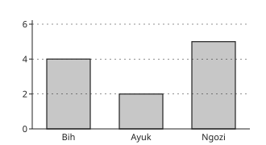
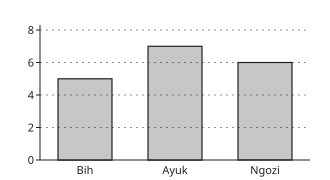
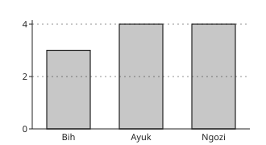
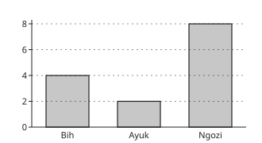

# Economics Form 3, Form Three Economics: drafts for review (Lessons 14 lessons (1–14))

Generated by `npm run review:f3-economics` from `content/form-3/economics/*.json`. Every question and drawing below was built by the engine.
All notes, teach cards, worked examples and paper tasks are **status: draft**. “Authored key” means a person fixed the
right answer (see `AUTHORED.md`); “computed by rule” means code worked it out (a formula, a conversion, a spelling rule).

Teach mode: cards (idea + example + 1 level-1 check) → worked example → practice (levels 1–3) → the note as a summary.

## Sample rendered lesson: Lesson 1 in teach mode

### Lesson 1: T U 1: Lesson1-Fundamentals of economics: Part 1

**Card cn3-1-terms** (draft)

> Distinguish the lesson's concepts before applying them.
>
> _want: a desire for a good, service or activity._  
> _resource: a means that can help satisfy wants._  
> _scarcity: limited resources relative to competing wants._  
> _choice: selection between alternatives._  

Check question: `n3-1-terms` · multiple choice, level 1 · **authored key**, reused from practice

> Which term means: a means that can help satisfy wants ?

- ✅ resource
- ◻️ choice  
  _↳ feedback if chosen: choice means selection between alternatives; the question instead describes a means that can help satisfy wants._
- ◻️ scarcity  
  _↳ feedback if chosen: scarcity means limited resources relative to competing wants; the question instead describes a means that can help satisfy wants._
- ◻️ want  
  _↳ feedback if chosen: want means a desire for a good, service or activity; the question instead describes a means that can help satisfy wants._

Full working after a second miss:

> A means that can help satisfy wants.  
> So the answer is “resource”.  

**Card cn3-1-cases** (draft)

> Classify a case by its features, rather than by a familiar word alone.
>
> _Ayuk would like a bicycle for travel._  
> _want: a desire for a good, service or activity._  

Check question: `n3-1-cases` · multiple choice, level 1 · **authored key**, reused from practice

> A club has time for either a debate or a match this afternoon.
> Which term best fits this example?

- ◻️ resource  
  _↳ feedback if chosen: resource concerns a means that can help satisfy wants. This case instead illustrates limited resources relative to competing wants._
- ◻️ choice  
  _↳ feedback if chosen: choice concerns selection between alternatives. This case instead illustrates limited resources relative to competing wants._
- ✅ scarcity
- ◻️ want  
  _↳ feedback if chosen: want concerns a desire for a good, service or activity. This case instead illustrates limited resources relative to competing wants._

Full working after a second miss:

> A club has time for either a debate or a match this afternoon. Limited resources relative to competing wants.  
> So the answer is “scarcity”.  

**Card cn3-1-repair** (draft)

> Check that a claim agrees with the rule or definition it uses.
>
> _Every want is automatically satisfied._  
> _A desire is a want; satisfying it depends on available resources._  

Check question: `n3-1-repair-card` · spot the error, level 1 · **authored key**

> Find the incorrect claim.

- ◻️ resource: a means that can help satisfy wants.  
  _↳ explanation: This statement is correct: resource means a means that can help satisfy wants. Look for a claim that conflicts with its definition._
- ✅ Choice is unnecessary when resources are scarce.  
  _↳ explanation: Scarcity makes selection necessary because all wants cannot be met together._
- ◻️ want: a desire for a good, service or activity.  
  _↳ explanation: This statement is correct: want means a desire for a good, service or activity. Look for a claim that conflicts with its definition._
- ◻️ scarcity: limited resources relative to competing wants.  
  _↳ explanation: This statement is correct: scarcity means limited resources relative to competing wants. Look for a claim that conflicts with its definition._

Full working after a second miss:

> The wrong statement is “Choice is unnecessary when resources are scarce.”.  
> Scarcity makes selection necessary because all wants cannot be met together.  

**Worked example** (draft)

> Ayuk would like a bicycle for travel. Which concept applies?

1. Identify the features of the case.
2. A desire for a good, service or activity.
3. A desire is a want; satisfying it depends on available resources.

**Answer:** want

**Practice** (one generated question per template, easiest first)

Practice 1: `n3-1-terms` · multiple choice, level 1 · **authored key**

> Which term means: a desire for a good, service or activity ?

- ✅ want
- ◻️ choice  
  _↳ feedback if chosen: choice means selection between alternatives; the question instead describes a desire for a good, service or activity._
- ◻️ resource  
  _↳ feedback if chosen: resource means a means that can help satisfy wants; the question instead describes a desire for a good, service or activity._
- ◻️ scarcity  
  _↳ feedback if chosen: scarcity means limited resources relative to competing wants; the question instead describes a desire for a good, service or activity._

Full working after a second miss:

> A desire for a good, service or activity.  
> So the answer is “want”.  

Practice 2: `n3-1-cases` · multiple choice, level 1 · **authored key**

> A school uses land, teachers' time and books.
> Which term best fits this example?

- ✅ resource
- ◻️ choice  
  _↳ feedback if chosen: choice concerns selection between alternatives. This case instead illustrates a means that can help satisfy wants._
- ◻️ scarcity  
  _↳ feedback if chosen: scarcity concerns limited resources relative to competing wants. This case instead illustrates a means that can help satisfy wants._
- ◻️ want  
  _↳ feedback if chosen: want concerns a desire for a good, service or activity. This case instead illustrates a means that can help satisfy wants._

Full working after a second miss:

> A school uses land, teachers' time and books. A means that can help satisfy wants.  
> So the answer is “resource”.  

Practice 3: `n3-1-reason` · multiple choice, level 2 · **authored key**

> Bih decides to revise rather than visit a friend.
> Which explanation justifies the classification?

- ✅ Selection between alternatives.
- ◻️ A means that can help satisfy wants.  
  _↳ feedback if chosen: That explanation describes resource, rather than the relationship illustrated in this example._
- ◻️ A desire for a good, service or activity.  
  _↳ feedback if chosen: That explanation describes want, rather than the relationship illustrated in this example._
- ◻️ Limited resources relative to competing wants.  
  _↳ feedback if chosen: That explanation describes scarcity, rather than the relationship illustrated in this example._

Full working after a second miss:

> Scarcity makes selection necessary because all wants cannot be met together.  
> So the answer is “Selection between alternatives.”.  

Practice 4: `n3-1-link` · matching, level 2 · **authored key**

> Match each term to its example.

Right-hand side (shuffled): A club has time for either a debate or a match this afternoon. · A school uses land, teachers' time and books. · Bih decides to revise rather than visit a friend.
- choice → **Bih decides to revise rather than visit a friend.**
- resource → **A school uses land, teachers' time and books.**
- scarcity → **A club has time for either a debate or a match this afternoon.**

Full working after a second miss:

> The right pairs are:  
> choice → Bih decides to revise rather than visit a friend.  
> resource → A school uses land, teachers' time and books.  
> scarcity → A club has time for either a debate or a match this afternoon.  

Practice 5: `n3-1-repair` · spot the error, level 3 · **authored key**

> Find the incorrect claim.

- ◻️ scarcity: limited resources relative to competing wants.  
  _↳ explanation: This statement is correct: scarcity means limited resources relative to competing wants. Look for a claim that conflicts with its definition._
- ◻️ want: a desire for a good, service or activity.  
  _↳ explanation: This statement is correct: want means a desire for a good, service or activity. Look for a claim that conflicts with its definition._
- ◻️ resource: a means that can help satisfy wants.  
  _↳ explanation: This statement is correct: resource means a means that can help satisfy wants. Look for a claim that conflicts with its definition._
- ✅ Scarcity affects only people with no income.  
  _↳ explanation: All decision makers can face limits relative to their wants._

Full working after a second miss:

> The wrong statement is “Scarcity affects only people with no income.”.  
> All decision makers can face limits relative to their wants.  

**Summary (the note)**

> Economics examines choices about scarce resources and the production, distribution and use of goods and services. A want is a desire for something; resources are means used to satisfy wants. Scarcity means resources are limited relative to the wants they could satisfy. It affects rich as well as poor people. Because not every want can be met at once, people rank alternatives and choose. A school, household or government also faces choices about time, land, labour and materials.

## All drafts

| Lesson | Title (sheet) | Status | Cards | Practice | Paper task |
|---|---|---|---|---|---|
| 1 | T U 1: Lesson1-Fundamentals of economics: Part 1 | draft | 3 | 5 | — |
| 2 | Fundamentals of economics: Part 2 | draft | 3 | 5 | — |
| 3 | Introduction to the tools of economic analysis: Part 1 | draft | 3 | 5 | — |
| 4 | Introduction to the tools of economic analysis: Part 2 | draft | 3 | 5 | — |
| 5 | Practical work 1: Tools of economic analysis- Graphs and charts (Part 1) | draft | 3 | 5 | — |
| 6 | Practical work 1: Tools of economic analysis- Graphs and charts (Part 2) | draft | 3 | 5 | — |
| 7 | Utility concepts | draft | 3 | 5 | — |
| 8 | Practical work 2: Utility concepts | draft | 3 | 5 | — |
| 9 | Fundamental notions of economic systems: Part 1 | draft | 3 | 5 | — |
| 10 | Fundamental notions of economic systems: Part 2 | draft | 3 | 5 | — |
| 11 | Market economic system: Part 1 | draft | 3 | 5 | — |
| 12 | Market economic system: Part 2 | draft | 3 | 5 | — |
| 13 | Planned economic system | draft | 3 | 5 | — |
| 14 | Mixed economic system | draft | 3 | 5 | — |

## Lesson 1: T U 1: Lesson1-Fundamentals of economics: Part 1

Prerequisites: none · Skill: n3-1 (Fundamentals: scarcity, wants and choice)

**Note** (draft)

> Economics examines choices about scarce resources and the production, distribution and use of goods and services. A want is a desire for something; resources are means used to satisfy wants. Scarcity means resources are limited relative to the wants they could satisfy. It affects rich as well as poor people. Because not every want can be met at once, people rank alternatives and choose. A school, household or government also faces choices about time, land, labour and materials.

**Learn: Understand the ideas** (draft)

> Economics examines choices about scarce resources and the production, distribution and use of goods and services. A want is a desire for something; resources are means used to satisfy wants. Scarcity means resources are limited relative to the wants they could satisfy. It affects rich as well as poor people. Because not every want can be met at once, people rank alternatives and choose. A school, household or government also faces choices about time, land, labour and materials.

**Learn: Apply the ideas locally** (draft)

> Bih has one free afternoon. She wants to revise, help at a stall and visit a friend. Even if no money changes hands, time is scarce. A school in Buea may have enough land for a garden or an extra play area but not both on the same plot. Economics asks how such choices are made and what must be given up.

**Learn: Reason and check** (draft)

> Identify the decision maker, the resource constraint and the alternatives. Do not define scarcity simply as having no money: a well-funded club may still lack time or space. Explain the connection: limited resources in relation to wants make choice necessary.

**Learn: key words and examples** (draft)

- **want**: a desire for a good, service or activity
- **resource**: a means that can help satisfy wants
- **scarcity**: limited resources relative to competing wants
- **choice**: selection between alternatives

- Ayuk would like a bicycle for travel.
- A school uses land, teachers' time and books.
- A club has time for either a debate or a match this afternoon.

Common mistake: “Every want is automatically satisfied.” → “want: a desire for a good, service or activity.”. A desire is a want; satisfying it depends on available resources.

**Card cn3-1-terms** (draft)

> Distinguish the lesson's concepts before applying them.
>
> _want: a desire for a good, service or activity._  
> _resource: a means that can help satisfy wants._  
> _scarcity: limited resources relative to competing wants._  
> _choice: selection between alternatives._  

Check question: `n3-1-terms` · multiple choice, level 1 · **authored key**, reused from practice

> Which term means: selection between alternatives ?

- ◻️ want  
  _↳ feedback if chosen: want means a desire for a good, service or activity; the question instead describes selection between alternatives._
- ◻️ scarcity  
  _↳ feedback if chosen: scarcity means limited resources relative to competing wants; the question instead describes selection between alternatives._
- ◻️ resource  
  _↳ feedback if chosen: resource means a means that can help satisfy wants; the question instead describes selection between alternatives._
- ✅ choice

Full working after a second miss:

> Selection between alternatives.  
> So the answer is “choice”.  

**Card cn3-1-cases** (draft)

> Classify a case by its features, rather than by a familiar word alone.
>
> _Ayuk would like a bicycle for travel._  
> _want: a desire for a good, service or activity._  

Check question: `n3-1-cases` · multiple choice, level 1 · **authored key**, reused from practice

> Bih decides to revise rather than visit a friend.
> Which term best fits this example?

- ◻️ want  
  _↳ feedback if chosen: want concerns a desire for a good, service or activity. This case instead illustrates selection between alternatives._
- ✅ choice
- ◻️ resource  
  _↳ feedback if chosen: resource concerns a means that can help satisfy wants. This case instead illustrates selection between alternatives._
- ◻️ scarcity  
  _↳ feedback if chosen: scarcity concerns limited resources relative to competing wants. This case instead illustrates selection between alternatives._

Full working after a second miss:

> Bih decides to revise rather than visit a friend. Selection between alternatives.  
> So the answer is “choice”.  

**Card cn3-1-repair** (draft)

> Check that a claim agrees with the rule or definition it uses.
>
> _Every want is automatically satisfied._  
> _A desire is a want; satisfying it depends on available resources._  

Check question: `n3-1-repair-card` · spot the error, level 1 · **authored key**

> Find the incorrect claim.

- ◻️ want: a desire for a good, service or activity.  
  _↳ explanation: This statement is correct: want means a desire for a good, service or activity. Look for a claim that conflicts with its definition._
- ◻️ scarcity: limited resources relative to competing wants.  
  _↳ explanation: This statement is correct: scarcity means limited resources relative to competing wants. Look for a claim that conflicts with its definition._
- ✅ Every want is automatically satisfied.  
  _↳ explanation: A desire is a want; satisfying it depends on available resources._
- ◻️ resource: a means that can help satisfy wants.  
  _↳ explanation: This statement is correct: resource means a means that can help satisfy wants. Look for a claim that conflicts with its definition._

Full working after a second miss:

> The wrong statement is “Every want is automatically satisfied.”.  
> A desire is a want; satisfying it depends on available resources.  

**Worked example** (draft)

> Ayuk would like a bicycle for travel. Which concept applies?

1. Identify the features of the case.
2. A desire for a good, service or activity.
3. A desire is a want; satisfying it depends on available resources.

**Answer:** want

**Practice** `n3-1-terms` · multiple choice, level 1 · **authored key**

> Which term means: selection between alternatives ?

- ◻️ scarcity  
  _↳ feedback if chosen: scarcity means limited resources relative to competing wants; the question instead describes selection between alternatives._
- ✅ choice
- ◻️ want  
  _↳ feedback if chosen: want means a desire for a good, service or activity; the question instead describes selection between alternatives._
- ◻️ resource  
  _↳ feedback if chosen: resource means a means that can help satisfy wants; the question instead describes selection between alternatives._

Full working after a second miss:

> Selection between alternatives.  
> So the answer is “choice”.  

> Which term means: a desire for a good, service or activity ?

- ✅ want
- ◻️ resource  
  _↳ feedback if chosen: resource means a means that can help satisfy wants; the question instead describes a desire for a good, service or activity._
- ◻️ choice  
  _↳ feedback if chosen: choice means selection between alternatives; the question instead describes a desire for a good, service or activity._
- ◻️ scarcity  
  _↳ feedback if chosen: scarcity means limited resources relative to competing wants; the question instead describes a desire for a good, service or activity._

Full working after a second miss:

> A desire for a good, service or activity.  
> So the answer is “want”.  

**Practice** `n3-1-cases` · multiple choice, level 1 · **authored key**

> A school uses land, teachers' time and books.
> Which term best fits this example?

- ◻️ want  
  _↳ feedback if chosen: want concerns a desire for a good, service or activity. This case instead illustrates a means that can help satisfy wants._
- ◻️ choice  
  _↳ feedback if chosen: choice concerns selection between alternatives. This case instead illustrates a means that can help satisfy wants._
- ✅ resource
- ◻️ scarcity  
  _↳ feedback if chosen: scarcity concerns limited resources relative to competing wants. This case instead illustrates a means that can help satisfy wants._

Full working after a second miss:

> A school uses land, teachers' time and books. A means that can help satisfy wants.  
> So the answer is “resource”.  

> A club has time for either a debate or a match this afternoon.
> Which term best fits this example?

- ◻️ choice  
  _↳ feedback if chosen: choice concerns selection between alternatives. This case instead illustrates limited resources relative to competing wants._
- ◻️ want  
  _↳ feedback if chosen: want concerns a desire for a good, service or activity. This case instead illustrates limited resources relative to competing wants._
- ◻️ resource  
  _↳ feedback if chosen: resource concerns a means that can help satisfy wants. This case instead illustrates limited resources relative to competing wants._
- ✅ scarcity

Full working after a second miss:

> A club has time for either a debate or a match this afternoon. Limited resources relative to competing wants.  
> So the answer is “scarcity”.  

**Practice** `n3-1-reason` · multiple choice, level 2 · **authored key**

> A school uses land, teachers' time and books.
> Which explanation justifies the classification?

- ◻️ A desire for a good, service or activity.  
  _↳ feedback if chosen: That explanation describes want, rather than the relationship illustrated in this example._
- ✅ A means that can help satisfy wants.
- ◻️ Limited resources relative to competing wants.  
  _↳ feedback if chosen: That explanation describes scarcity, rather than the relationship illustrated in this example._
- ◻️ Selection between alternatives.  
  _↳ feedback if chosen: That explanation describes choice, rather than the relationship illustrated in this example._

Full working after a second miss:

> Time, land and labour can be resources as well as money.  
> So the answer is “A means that can help satisfy wants.”.  

> Ayuk would like a bicycle for travel.
> Which explanation justifies the classification?

- ◻️ Limited resources relative to competing wants.  
  _↳ feedback if chosen: That explanation describes scarcity, rather than the relationship illustrated in this example._
- ✅ A desire for a good, service or activity.
- ◻️ A means that can help satisfy wants.  
  _↳ feedback if chosen: That explanation describes resource, rather than the relationship illustrated in this example._
- ◻️ Selection between alternatives.  
  _↳ feedback if chosen: That explanation describes choice, rather than the relationship illustrated in this example._

Full working after a second miss:

> A desire is a want; satisfying it depends on available resources.  
> So the answer is “A desire for a good, service or activity.”.  

**Practice** `n3-1-link` · matching, level 2 · **authored key**

> Match each term to its example.

Right-hand side (shuffled): Bih decides to revise rather than visit a friend. · A club has time for either a debate or a match this afternoon. · A school uses land, teachers' time and books.
- resource → **A school uses land, teachers' time and books.**
- scarcity → **A club has time for either a debate or a match this afternoon.**
- choice → **Bih decides to revise rather than visit a friend.**

Full working after a second miss:

> The right pairs are:  
> resource → A school uses land, teachers' time and books.  
> scarcity → A club has time for either a debate or a match this afternoon.  
> choice → Bih decides to revise rather than visit a friend.  

> Match each term to its example.

Right-hand side (shuffled): A school uses land, teachers' time and books. · Ayuk would like a bicycle for travel. · A club has time for either a debate or a match this afternoon.
- resource → **A school uses land, teachers' time and books.**
- scarcity → **A club has time for either a debate or a match this afternoon.**
- want → **Ayuk would like a bicycle for travel.**

Full working after a second miss:

> The right pairs are:  
> resource → A school uses land, teachers' time and books.  
> scarcity → A club has time for either a debate or a match this afternoon.  
> want → Ayuk would like a bicycle for travel.  

**Practice** `n3-1-repair` · spot the error, level 3 · **authored key**

> Find the incorrect claim.

- ◻️ scarcity: limited resources relative to competing wants.  
  _↳ explanation: This statement is correct: scarcity means limited resources relative to competing wants. Look for a claim that conflicts with its definition._
- ◻️ resource: a means that can help satisfy wants.  
  _↳ explanation: This statement is correct: resource means a means that can help satisfy wants. Look for a claim that conflicts with its definition._
- ◻️ choice: selection between alternatives.  
  _↳ explanation: This statement is correct: choice means selection between alternatives. Look for a claim that conflicts with its definition._
- ✅ Only cash can be a resource.  
  _↳ explanation: Time, land and labour can be resources as well as money._

Full working after a second miss:

> The wrong statement is “Only cash can be a resource.”.  
> Time, land and labour can be resources as well as money.  

> Find the incorrect claim.

- ◻️ want: a desire for a good, service or activity.  
  _↳ explanation: This statement is correct: want means a desire for a good, service or activity. Look for a claim that conflicts with its definition._
- ◻️ scarcity: limited resources relative to competing wants.  
  _↳ explanation: This statement is correct: scarcity means limited resources relative to competing wants. Look for a claim that conflicts with its definition._
- ◻️ resource: a means that can help satisfy wants.  
  _↳ explanation: This statement is correct: resource means a means that can help satisfy wants. Look for a claim that conflicts with its definition._
- ✅ Choice is unnecessary when resources are scarce.  
  _↳ explanation: Scarcity makes selection necessary because all wants cannot be met together._

Full working after a second miss:

> The wrong statement is “Choice is unnecessary when resources are scarce.”.  
> Scarcity makes selection necessary because all wants cannot be met together.  

## Lesson 2: Fundamentals of economics: Part 2

Prerequisites: none · Skill: n3-2 (Fundamentals: scale of preference and opportunity cost)

**Note** (draft)

> A scale of preference ranks wants in order of importance to a decision maker. Choice depends on this ranking and on available resources. Opportunity cost is the value of the next-best alternative forgone, not all rejected alternatives added together. It can involve time or an activity rather than money. A monetary cost is an amount paid; it need not measure the full opportunity cost. State what was actually given up and what the decision maker would otherwise have chosen.

**Learn: Understand the ideas** (draft)

> A scale of preference ranks wants in order of importance to a decision maker. Choice depends on this ranking and on available resources. Opportunity cost is the value of the next-best alternative forgone, not all rejected alternatives added together. It can involve time or an activity rather than money. A monetary cost is an amount paid; it need not measure the full opportunity cost. State what was actually given up and what the decision maker would otherwise have chosen.

**Learn: Apply the ideas locally** (draft)

> Ngozi ranks repairing her school bag above buying a novel, and the novel above buying a bracelet. If she can afford only one, choosing the repair gives up the novel as the next-best alternative. The bracelet is also not bought, but it is not added to the opportunity cost. If she later receives more resources, the feasible set can change without changing the meaning of opportunity cost.

**Learn: Reason and check** (draft)

> List feasible alternatives, rank them and identify the best rejected option. Do not confuse the chosen benefit with what is forgone. If an exercise asks for a remaining balance, subtract spending from the available budget and keep CFA francs in the answer.

**Learn: key words and examples** (draft)

- **scale of preference**: a ranking of wants in order of importance
- **opportunity cost**: the next-best alternative forgone by a choice
- **monetary cost**: the amount paid for a purchase
- **budget constraint**: the resource limit on affordable choices

- Bih places school-bag repair above a novel and a bracelet.
- Bih chooses bag repair; the novel was her best rejected option.
- A trader pays for a notebook.

Common mistake: “A preference ranking lists all items as equally important.” → “scale of preference: a ranking of wants in order of importance.”. A scale of preference shows priority, rather than an unranked list.

**Card cn3-2-terms** (draft)

> Distinguish the lesson's concepts before applying them.
>
> _scale of preference: a ranking of wants in order of importance._  
> _opportunity cost: the next-best alternative forgone by a choice._  
> _monetary cost: the amount paid for a purchase._  
> _budget constraint: the resource limit on affordable choices._  

Check question: `n3-2-terms` · multiple choice, level 1 · **authored key**, reused from practice

> Which term means: the next-best alternative forgone by a choice ?

- ◻️ budget constraint  
  _↳ feedback if chosen: budget constraint means the resource limit on affordable choices; the question instead describes the next-best alternative forgone by a choice._
- ✅ opportunity cost
- ◻️ monetary cost  
  _↳ feedback if chosen: monetary cost means the amount paid for a purchase; the question instead describes the next-best alternative forgone by a choice._
- ◻️ scale of preference  
  _↳ feedback if chosen: scale of preference means a ranking of wants in order of importance; the question instead describes the next-best alternative forgone by a choice._

Full working after a second miss:

> The next-best alternative forgone by a choice.  
> So the answer is “opportunity cost”.  

**Card cn3-2-cases** (draft)

> Classify a case by its features, rather than by a familiar word alone.
>
> _Bih places school-bag repair above a novel and a bracelet._  
> _scale of preference: a ranking of wants in order of importance._  

Check question: `n3-2-cases` · multiple choice, level 1 · **authored key**, reused from practice

> A trader pays for a notebook.
> Which term best fits this example?

- ◻️ budget constraint  
  _↳ feedback if chosen: budget constraint concerns the resource limit on affordable choices. This case instead illustrates the amount paid for a purchase._
- ◻️ scale of preference  
  _↳ feedback if chosen: scale of preference concerns a ranking of wants in order of importance. This case instead illustrates the amount paid for a purchase._
- ✅ monetary cost
- ◻️ opportunity cost  
  _↳ feedback if chosen: opportunity cost concerns the next-best alternative forgone by a choice. This case instead illustrates the amount paid for a purchase._

Full working after a second miss:

> A trader pays for a notebook. The amount paid for a purchase.  
> So the answer is “monetary cost”.  

**Card cn3-2-repair** (draft)

> Check that a claim agrees with the rule or definition it uses.
>
> _A preference ranking lists all items as equally important._  
> _A scale of preference shows priority, rather than an unranked list._  

Check question: `n3-2-repair-card` · spot the error, level 1 · **authored key**

> Find the incorrect claim.

- ◻️ scale of preference: a ranking of wants in order of importance.  
  _↳ explanation: This statement is correct: scale of preference means a ranking of wants in order of importance. Look for a claim that conflicts with its definition._
- ◻️ opportunity cost: the next-best alternative forgone by a choice.  
  _↳ explanation: This statement is correct: opportunity cost means the next-best alternative forgone by a choice. Look for a claim that conflicts with its definition._
- ✅ A high preference makes any item affordable.  
  _↳ explanation: Preference does not remove the resource constraint._
- ◻️ budget constraint: the resource limit on affordable choices.  
  _↳ explanation: This statement is correct: budget constraint means the resource limit on affordable choices. Look for a claim that conflicts with its definition._

Full working after a second miss:

> The wrong statement is “A high preference makes any item affordable.”.  
> Preference does not remove the resource constraint.  

**Worked example** (draft)

> Bih places school-bag repair above a novel and a bracelet. Which concept applies?

1. Identify the features of the case.
2. A ranking of wants in order of importance.
3. A scale of preference shows priority, rather than an unranked list.

**Answer:** scale of preference

**Practice** `n3-2-terms` · multiple choice, level 1 · **authored key**

> Which term means: a ranking of wants in order of importance ?

- ◻️ budget constraint  
  _↳ feedback if chosen: budget constraint means the resource limit on affordable choices; the question instead describes a ranking of wants in order of importance._
- ◻️ opportunity cost  
  _↳ feedback if chosen: opportunity cost means the next-best alternative forgone by a choice; the question instead describes a ranking of wants in order of importance._
- ✅ scale of preference
- ◻️ monetary cost  
  _↳ feedback if chosen: monetary cost means the amount paid for a purchase; the question instead describes a ranking of wants in order of importance._

Full working after a second miss:

> A ranking of wants in order of importance.  
> So the answer is “scale of preference”.  

> Which term means: the amount paid for a purchase ?

- ✅ monetary cost
- ◻️ budget constraint  
  _↳ feedback if chosen: budget constraint means the resource limit on affordable choices; the question instead describes the amount paid for a purchase._
- ◻️ scale of preference  
  _↳ feedback if chosen: scale of preference means a ranking of wants in order of importance; the question instead describes the amount paid for a purchase._
- ◻️ opportunity cost  
  _↳ feedback if chosen: opportunity cost means the next-best alternative forgone by a choice; the question instead describes the amount paid for a purchase._

Full working after a second miss:

> The amount paid for a purchase.  
> So the answer is “monetary cost”.  

**Practice** `n3-2-cases` · multiple choice, level 1 · **authored key**

> Ayuk cannot buy a basket costing more than the money he has.
> Which term best fits this example?

- ◻️ monetary cost  
  _↳ feedback if chosen: monetary cost concerns the amount paid for a purchase. This case instead illustrates the resource limit on affordable choices._
- ◻️ opportunity cost  
  _↳ feedback if chosen: opportunity cost concerns the next-best alternative forgone by a choice. This case instead illustrates the resource limit on affordable choices._
- ✅ budget constraint
- ◻️ scale of preference  
  _↳ feedback if chosen: scale of preference concerns a ranking of wants in order of importance. This case instead illustrates the resource limit on affordable choices._

Full working after a second miss:

> Ayuk cannot buy a basket costing more than the money he has. The resource limit on affordable choices.  
> So the answer is “budget constraint”.  

> Bih places school-bag repair above a novel and a bracelet.
> Which term best fits this example?

- ◻️ budget constraint  
  _↳ feedback if chosen: budget constraint concerns the resource limit on affordable choices. This case instead illustrates a ranking of wants in order of importance._
- ✅ scale of preference
- ◻️ monetary cost  
  _↳ feedback if chosen: monetary cost concerns the amount paid for a purchase. This case instead illustrates a ranking of wants in order of importance._
- ◻️ opportunity cost  
  _↳ feedback if chosen: opportunity cost concerns the next-best alternative forgone by a choice. This case instead illustrates a ranking of wants in order of importance._

Full working after a second miss:

> Bih places school-bag repair above a novel and a bracelet. A ranking of wants in order of importance.  
> So the answer is “scale of preference”.  

**Practice** `n3-2-reason` · multiple choice, level 2 · **authored key**

> Bih places school-bag repair above a novel and a bracelet.
> Which explanation justifies the classification?

- ✅ A ranking of wants in order of importance.
- ◻️ The next-best alternative forgone by a choice.  
  _↳ feedback if chosen: That explanation describes opportunity cost, rather than the relationship illustrated in this example._
- ◻️ The resource limit on affordable choices.  
  _↳ feedback if chosen: That explanation describes budget constraint, rather than the relationship illustrated in this example._
- ◻️ The amount paid for a purchase.  
  _↳ feedback if chosen: That explanation describes monetary cost, rather than the relationship illustrated in this example._

Full working after a second miss:

> A scale of preference shows priority, rather than an unranked list.  
> So the answer is “A ranking of wants in order of importance.”.  

> Bih places school-bag repair above a novel and a bracelet.
> Which explanation justifies the classification?

- ◻️ The resource limit on affordable choices.  
  _↳ feedback if chosen: That explanation describes budget constraint, rather than the relationship illustrated in this example._
- ◻️ The amount paid for a purchase.  
  _↳ feedback if chosen: That explanation describes monetary cost, rather than the relationship illustrated in this example._
- ✅ A ranking of wants in order of importance.
- ◻️ The next-best alternative forgone by a choice.  
  _↳ feedback if chosen: That explanation describes opportunity cost, rather than the relationship illustrated in this example._

Full working after a second miss:

> A scale of preference shows priority, rather than an unranked list.  
> So the answer is “A ranking of wants in order of importance.”.  

**Practice** `n3-2-balance` · number, level 2 · computed by rule

> Ngozi has 4000 CFA francs and pays 1500 CFA francs to repair a bag. How much remains?

Answer: **2500 CFA francs**
- Typed **5500** (add) → “Spending reduces the balance; you added the payment instead of subtracting it.”
- Typed **1500** (spent) → “That is the amount spent, not the amount remaining.”

Full working after a second miss:

> Remaining budget = 4000 − 1500 = 2500 CFA francs.  

> Ngozi has 4500 CFA francs and pays 500 CFA francs to repair a bag. How much remains?

Answer: **4000 CFA francs**
- Typed **5000** (add) → “Spending reduces the balance; you added the payment instead of subtracting it.”
- Typed **500** (spent) → “That is the amount spent, not the amount remaining.”

Full working after a second miss:

> Remaining budget = 4500 − 500 = 4000 CFA francs.  

**Practice** `n3-2-repair` · spot the error, level 3 · **authored key**

> Find the incorrect claim.

- ◻️ scale of preference: a ranking of wants in order of importance.  
  _↳ explanation: This statement is correct: scale of preference means a ranking of wants in order of importance. Look for a claim that conflicts with its definition._
- ◻️ monetary cost: the amount paid for a purchase.  
  _↳ explanation: This statement is correct: monetary cost means the amount paid for a purchase. Look for a claim that conflicts with its definition._
- ◻️ budget constraint: the resource limit on affordable choices.  
  _↳ explanation: This statement is correct: budget constraint means the resource limit on affordable choices. Look for a claim that conflicts with its definition._
- ✅ A preference ranking lists all items as equally important.  
  _↳ explanation: A scale of preference shows priority, rather than an unranked list._

Full working after a second miss:

> The wrong statement is “A preference ranking lists all items as equally important.”.  
> A scale of preference shows priority, rather than an unranked list.  

> Find the incorrect claim.

- ✅ Opportunity cost is the sum of every rejected option.  
  _↳ explanation: Use the best forgone alternative, not the total of all alternatives._
- ◻️ budget constraint: the resource limit on affordable choices.  
  _↳ explanation: This statement is correct: budget constraint means the resource limit on affordable choices. Look for a claim that conflicts with its definition._
- ◻️ monetary cost: the amount paid for a purchase.  
  _↳ explanation: This statement is correct: monetary cost means the amount paid for a purchase. Look for a claim that conflicts with its definition._
- ◻️ scale of preference: a ranking of wants in order of importance.  
  _↳ explanation: This statement is correct: scale of preference means a ranking of wants in order of importance. Look for a claim that conflicts with its definition._

Full working after a second miss:

> The wrong statement is “Opportunity cost is the sum of every rejected option.”.  
> Use the best forgone alternative, not the total of all alternatives.  

## Lesson 3: Introduction to the tools of economic analysis: Part 1

Prerequisites: none · Skill: n3-3 (Tools of analysis: variables, tables and relationships)

**Note** (draft)

> Economists organise information using words, tables, diagrams and simple calculations. A variable can take different values, such as quantity sold. A table places observations in labelled rows and columns. Units identify what the values measure. A relationship describes how variables are associated. Association alone does not prove that one variable caused another to change: other influences may matter. Read the title, labels and units before using any values.

**Learn: Understand the ideas** (draft)

> Economists organise information using words, tables, diagrams and simple calculations. A variable can take different values, such as quantity sold. A table places observations in labelled rows and columns. Units identify what the values measure. A relationship describes how variables are associated. Association alone does not prove that one variable caused another to change: other influences may matter. Read the title, labels and units before using any values.

**Learn: Apply the ideas locally** (draft)

> A Bamenda trader records baskets of tomatoes sold on market days. A column headed baskets measures quantity, not CFA francs. A second column may record price per basket. Clear labels prevent a learner from adding a price to a quantity as though they measured the same thing. A record of higher sales on sunny days suggests a relationship to investigate, not proof that sunshine alone caused sales.

**Learn: Reason and check** (draft)

> Name the variable and its unit. Read across the same row when comparing an observation. Keep price per item separate from total expenditure. When drawing a conclusion, say exactly which relationship the data show and which possible causes have not been checked.

**Learn: key words and examples** (draft)

- **variable**: a quantity or characteristic that can take different values
- **table**: information arranged in labelled rows and columns
- **unit**: the measure in which a value is expressed
- **association**: an observed relationship between variables

- The number of baskets sold changes from market day to market day.
- A trader records each market day beside its quantity sold.
- A heading says the price is in CFA francs per basket.

Common mistake: “A variable must have the same value in every observation.” → “variable: a quantity or characteristic that can take different values.”. It is called a variable because different values are possible.

**Card cn3-3-terms** (draft)

> Distinguish the lesson's concepts before applying them.
>
> _variable: a quantity or characteristic that can take different values._  
> _table: information arranged in labelled rows and columns._  
> _unit: the measure in which a value is expressed._  
> _association: an observed relationship between variables._  

Check question: `n3-3-terms` · multiple choice, level 1 · **authored key**, reused from practice

> Which term means: information arranged in labelled rows and columns ?

- ◻️ association  
  _↳ feedback if chosen: association means an observed relationship between variables; the question instead describes information arranged in labelled rows and columns._
- ✅ table
- ◻️ unit  
  _↳ feedback if chosen: unit means the measure in which a value is expressed; the question instead describes information arranged in labelled rows and columns._
- ◻️ variable  
  _↳ feedback if chosen: variable means a quantity or characteristic that can take different values; the question instead describes information arranged in labelled rows and columns._

Full working after a second miss:

> Information arranged in labelled rows and columns.  
> So the answer is “table”.  

**Card cn3-3-cases** (draft)

> Classify a case by its features, rather than by a familiar word alone.
>
> _The number of baskets sold changes from market day to market day._  
> _variable: a quantity or characteristic that can take different values._  

Check question: `n3-3-cases` · multiple choice, level 1 · **authored key**, reused from practice

> A heading says the price is in CFA francs per basket.
> Which term best fits this example?

- ◻️ variable  
  _↳ feedback if chosen: variable concerns a quantity or characteristic that can take different values. This case instead illustrates the measure in which a value is expressed._
- ◻️ association  
  _↳ feedback if chosen: association concerns an observed relationship between variables. This case instead illustrates the measure in which a value is expressed._
- ◻️ table  
  _↳ feedback if chosen: table concerns information arranged in labelled rows and columns. This case instead illustrates the measure in which a value is expressed._
- ✅ unit

Full working after a second miss:

> A heading says the price is in CFA francs per basket. The measure in which a value is expressed.  
> So the answer is “unit”.  

**Card cn3-3-repair** (draft)

> Check that a claim agrees with the rule or definition it uses.
>
> _A variable must have the same value in every observation._  
> _It is called a variable because different values are possible._  

Check question: `n3-3-repair-card` · spot the error, level 1 · **authored key**

> Find the incorrect claim.

- ◻️ association: an observed relationship between variables.  
  _↳ explanation: This statement is correct: association means an observed relationship between variables. Look for a claim that conflicts with its definition._
- ◻️ variable: a quantity or characteristic that can take different values.  
  _↳ explanation: This statement is correct: variable means a quantity or characteristic that can take different values. Look for a claim that conflicts with its definition._
- ◻️ unit: the measure in which a value is expressed.  
  _↳ explanation: This statement is correct: unit means the measure in which a value is expressed. Look for a claim that conflicts with its definition._
- ✅ Every association proves a direct cause.  
  _↳ explanation: Other factors may explain a relationship; association alone does not establish causation._

Full working after a second miss:

> The wrong statement is “Every association proves a direct cause.”.  
> Other factors may explain a relationship; association alone does not establish causation.  

**Worked example** (draft)

> The number of baskets sold changes from market day to market day. Which concept applies?

1. Identify the features of the case.
2. A quantity or characteristic that can take different values.
3. It is called a variable because different values are possible.

**Answer:** variable

**Practice** `n3-3-terms` · multiple choice, level 1 · **authored key**

> Which term means: the measure in which a value is expressed ?

- ✅ unit
- ◻️ variable  
  _↳ feedback if chosen: variable means a quantity or characteristic that can take different values; the question instead describes the measure in which a value is expressed._
- ◻️ table  
  _↳ feedback if chosen: table means information arranged in labelled rows and columns; the question instead describes the measure in which a value is expressed._
- ◻️ association  
  _↳ feedback if chosen: association means an observed relationship between variables; the question instead describes the measure in which a value is expressed._

Full working after a second miss:

> The measure in which a value is expressed.  
> So the answer is “unit”.  

> Which term means: information arranged in labelled rows and columns ?

- ✅ table
- ◻️ variable  
  _↳ feedback if chosen: variable means a quantity or characteristic that can take different values; the question instead describes information arranged in labelled rows and columns._
- ◻️ unit  
  _↳ feedback if chosen: unit means the measure in which a value is expressed; the question instead describes information arranged in labelled rows and columns._
- ◻️ association  
  _↳ feedback if chosen: association means an observed relationship between variables; the question instead describes information arranged in labelled rows and columns._

Full working after a second miss:

> Information arranged in labelled rows and columns.  
> So the answer is “table”.  

**Practice** `n3-3-cases` · multiple choice, level 1 · **authored key**

> Sunny market days in a small record also show higher sales.
> Which term best fits this example?

- ◻️ unit  
  _↳ feedback if chosen: unit concerns the measure in which a value is expressed. This case instead illustrates an observed relationship between variables._
- ◻️ table  
  _↳ feedback if chosen: table concerns information arranged in labelled rows and columns. This case instead illustrates an observed relationship between variables._
- ✅ association
- ◻️ variable  
  _↳ feedback if chosen: variable concerns a quantity or characteristic that can take different values. This case instead illustrates an observed relationship between variables._

Full working after a second miss:

> Sunny market days in a small record also show higher sales. An observed relationship between variables.  
> So the answer is “association”.  

> A trader records each market day beside its quantity sold.
> Which term best fits this example?

- ◻️ unit  
  _↳ feedback if chosen: unit concerns the measure in which a value is expressed. This case instead illustrates information arranged in labelled rows and columns._
- ✅ table
- ◻️ variable  
  _↳ feedback if chosen: variable concerns a quantity or characteristic that can take different values. This case instead illustrates information arranged in labelled rows and columns._
- ◻️ association  
  _↳ feedback if chosen: association concerns an observed relationship between variables. This case instead illustrates information arranged in labelled rows and columns._

Full working after a second miss:

> A trader records each market day beside its quantity sold. Information arranged in labelled rows and columns.  
> So the answer is “table”.  

**Practice** `n3-3-reason` · multiple choice, level 2 · **authored key**

> The number of baskets sold changes from market day to market day.
> Which explanation justifies the classification?

- ◻️ Information arranged in labelled rows and columns.  
  _↳ feedback if chosen: That explanation describes table, rather than the relationship illustrated in this example._
- ◻️ The measure in which a value is expressed.  
  _↳ feedback if chosen: That explanation describes unit, rather than the relationship illustrated in this example._
- ◻️ An observed relationship between variables.  
  _↳ feedback if chosen: That explanation describes association, rather than the relationship illustrated in this example._
- ✅ A quantity or characteristic that can take different values.

Full working after a second miss:

> It is called a variable because different values are possible.  
> So the answer is “A quantity or characteristic that can take different values.”.  

> Sunny market days in a small record also show higher sales.
> Which explanation justifies the classification?

- ◻️ Information arranged in labelled rows and columns.  
  _↳ feedback if chosen: That explanation describes table, rather than the relationship illustrated in this example._
- ◻️ The measure in which a value is expressed.  
  _↳ feedback if chosen: That explanation describes unit, rather than the relationship illustrated in this example._
- ◻️ A quantity or characteristic that can take different values.  
  _↳ feedback if chosen: That explanation describes variable, rather than the relationship illustrated in this example._
- ✅ An observed relationship between variables.

Full working after a second miss:

> Other factors may explain a relationship; association alone does not establish causation.  
> So the answer is “An observed relationship between variables.”.  

**Practice** `n3-3-link` · matching, level 2 · **authored key**

> Match each term to its example.

Right-hand side (shuffled): The number of baskets sold changes from market day to market day. · A heading says the price is in CFA francs per basket. · A trader records each market day beside its quantity sold.
- table → **A trader records each market day beside its quantity sold.**
- unit → **A heading says the price is in CFA francs per basket.**
- variable → **The number of baskets sold changes from market day to market day.**

Full working after a second miss:

> The right pairs are:  
> table → A trader records each market day beside its quantity sold.  
> unit → A heading says the price is in CFA francs per basket.  
> variable → The number of baskets sold changes from market day to market day.  

> Match each term to its example.

Right-hand side (shuffled): A trader records each market day beside its quantity sold. · A heading says the price is in CFA francs per basket. · Sunny market days in a small record also show higher sales.
- unit → **A heading says the price is in CFA francs per basket.**
- table → **A trader records each market day beside its quantity sold.**
- association → **Sunny market days in a small record also show higher sales.**

Full working after a second miss:

> The right pairs are:  
> unit → A heading says the price is in CFA francs per basket.  
> table → A trader records each market day beside its quantity sold.  
> association → Sunny market days in a small record also show higher sales.  

**Practice** `n3-3-repair` · spot the error, level 3 · **authored key**

> Find the incorrect claim.

- ◻️ variable: a quantity or characteristic that can take different values.  
  _↳ explanation: This statement is correct: variable means a quantity or characteristic that can take different values. Look for a claim that conflicts with its definition._
- ◻️ unit: the measure in which a value is expressed.  
  _↳ explanation: This statement is correct: unit means the measure in which a value is expressed. Look for a claim that conflicts with its definition._
- ◻️ table: information arranged in labelled rows and columns.  
  _↳ explanation: This statement is correct: table means information arranged in labelled rows and columns. Look for a claim that conflicts with its definition._
- ✅ Every association proves a direct cause.  
  _↳ explanation: Other factors may explain a relationship; association alone does not establish causation._

Full working after a second miss:

> The wrong statement is “Every association proves a direct cause.”.  
> Other factors may explain a relationship; association alone does not establish causation.  

> Find the incorrect claim.

- ✅ A price per basket is measured in baskets alone.  
  _↳ explanation: CFA francs per basket measures a unit price, not a physical quantity._
- ◻️ variable: a quantity or characteristic that can take different values.  
  _↳ explanation: This statement is correct: variable means a quantity or characteristic that can take different values. Look for a claim that conflicts with its definition._
- ◻️ unit: the measure in which a value is expressed.  
  _↳ explanation: This statement is correct: unit means the measure in which a value is expressed. Look for a claim that conflicts with its definition._
- ◻️ table: information arranged in labelled rows and columns.  
  _↳ explanation: This statement is correct: table means information arranged in labelled rows and columns. Look for a claim that conflicts with its definition._

Full working after a second miss:

> The wrong statement is “A price per basket is measured in baskets alone.”.  
> CFA francs per basket measures a unit price, not a physical quantity.  

## Lesson 4: Introduction to the tools of economic analysis: Part 2

Prerequisites: none · Skill: n3-4 (Tools of analysis: axes, graphs and scales)

**Note** (draft)

> A graph represents relationships visually. Axes must be labelled with variables and units. A scale states the value represented by equal spaces. Points show paired observations. In a conventional demand diagram, quantity is on the horizontal axis and price on the vertical axis; the convention should be stated rather than guessed. A change in a graph can be misread if an axis is truncated or intervals are unequal. Use labels before interpreting height or slope.

**Learn: Understand the ideas** (draft)

> A graph represents relationships visually. Axes must be labelled with variables and units. A scale states the value represented by equal spaces. Points show paired observations. In a conventional demand diagram, quantity is on the horizontal axis and price on the vertical axis; the convention should be stated rather than guessed. A change in a graph can be misread if an axis is truncated or intervals are unequal. Use labels before interpreting height or slope.

**Learn: Apply the ideas locally** (draft)

> Ngozi compares weekly basket sales with a bar chart. The horizontal axis identifies the weeks and the vertical axis counts baskets. If one marked interval represents several baskets, the height must be read using that scale. A taller bar is not automatically more revenue: revenue also depends on the price charged.

**Learn: Reason and check** (draft)

> Read the title, both axis labels and the scale. Follow a point or bar to the correct axis, then include the unit. Do not treat a category label as a numerical measurement. If a graph and its table disagree, identify which plotted point or label needs checking.

**Learn: key words and examples** (draft)

- **horizontal axis**: the axis running across a graph
- **vertical axis**: the upright axis of a graph
- **scale**: the values assigned to equally spaced marks
- **plotted point**: a position representing a pair of values

- Quantity labels are placed along the bottom of a demand diagram.
- Price is labelled on the upright axis in a conventional demand diagram.
- A graph key explains how many baskets each interval represents.

Common mistake: “The horizontal axis is always the upright line.” → “horizontal axis: the axis running across a graph.”. Horizontal runs across; vertical runs up and down.

**Card cn3-4-terms** (draft)

> Distinguish the lesson's concepts before applying them.
>
> _horizontal axis: the axis running across a graph._  
> _vertical axis: the upright axis of a graph._  
> _scale: the values assigned to equally spaced marks._  
> _plotted point: a position representing a pair of values._  

Check question: `n3-4-terms` · multiple choice, level 1 · **authored key**, reused from practice

> Which term means: the axis running across a graph ?

- ✅ horizontal axis
- ◻️ scale  
  _↳ feedback if chosen: scale means the values assigned to equally spaced marks; the question instead describes the axis running across a graph._
- ◻️ vertical axis  
  _↳ feedback if chosen: vertical axis means the upright axis of a graph; the question instead describes the axis running across a graph._
- ◻️ plotted point  
  _↳ feedback if chosen: plotted point means a position representing a pair of values; the question instead describes the axis running across a graph._

Full working after a second miss:

> The axis running across a graph.  
> So the answer is “horizontal axis”.  

**Card cn3-4-cases** (draft)

> Classify a case by its features, rather than by a familiar word alone.
>
> _Quantity labels are placed along the bottom of a demand diagram._  
> _horizontal axis: the axis running across a graph._  

Check question: `n3-4-cases` · multiple choice, level 1 · **authored key**, reused from practice

> A learner marks the position for a stated price and quantity.
> Which term best fits this example?

- ◻️ vertical axis  
  _↳ feedback if chosen: vertical axis concerns the upright axis of a graph. This case instead illustrates a position representing a pair of values._
- ◻️ horizontal axis  
  _↳ feedback if chosen: horizontal axis concerns the axis running across a graph. This case instead illustrates a position representing a pair of values._
- ✅ plotted point
- ◻️ scale  
  _↳ feedback if chosen: scale concerns the values assigned to equally spaced marks. This case instead illustrates a position representing a pair of values._

Full working after a second miss:

> A learner marks the position for a stated price and quantity. A position representing a pair of values.  
> So the answer is “plotted point”.  

**Card cn3-4-repair** (draft)

> Check that a claim agrees with the rule or definition it uses.
>
> _The horizontal axis is always the upright line._  
> _Horizontal runs across; vertical runs up and down._  

Check question: `n3-4-repair-card` · spot the error, level 1 · **authored key**

> Find the incorrect claim.

- ◻️ scale: the values assigned to equally spaced marks.  
  _↳ explanation: This statement is correct: scale means the values assigned to equally spaced marks. Look for a claim that conflicts with its definition._
- ✅ The horizontal axis is always the upright line.  
  _↳ explanation: Horizontal runs across; vertical runs up and down._
- ◻️ horizontal axis: the axis running across a graph.  
  _↳ explanation: This statement is correct: horizontal axis means the axis running across a graph. Look for a claim that conflicts with its definition._
- ◻️ plotted point: a position representing a pair of values.  
  _↳ explanation: This statement is correct: plotted point means a position representing a pair of values. Look for a claim that conflicts with its definition._

Full working after a second miss:

> The wrong statement is “The horizontal axis is always the upright line.”.  
> Horizontal runs across; vertical runs up and down.  

**Worked example** (draft)

> Quantity labels are placed along the bottom of a demand diagram. Which concept applies?

1. Identify the features of the case.
2. The axis running across a graph.
3. Horizontal runs across; vertical runs up and down.

**Answer:** horizontal axis

**Practice** `n3-4-terms` · multiple choice, level 1 · **authored key**

> Which term means: the upright axis of a graph ?

- ◻️ horizontal axis  
  _↳ feedback if chosen: horizontal axis means the axis running across a graph; the question instead describes the upright axis of a graph._
- ◻️ plotted point  
  _↳ feedback if chosen: plotted point means a position representing a pair of values; the question instead describes the upright axis of a graph._
- ◻️ scale  
  _↳ feedback if chosen: scale means the values assigned to equally spaced marks; the question instead describes the upright axis of a graph._
- ✅ vertical axis

Full working after a second miss:

> The upright axis of a graph.  
> So the answer is “vertical axis”.  

> Which term means: the values assigned to equally spaced marks ?

- ✅ scale
- ◻️ horizontal axis  
  _↳ feedback if chosen: horizontal axis means the axis running across a graph; the question instead describes the values assigned to equally spaced marks._
- ◻️ vertical axis  
  _↳ feedback if chosen: vertical axis means the upright axis of a graph; the question instead describes the values assigned to equally spaced marks._
- ◻️ plotted point  
  _↳ feedback if chosen: plotted point means a position representing a pair of values; the question instead describes the values assigned to equally spaced marks._

Full working after a second miss:

> The values assigned to equally spaced marks.  
> So the answer is “scale”.  

**Practice** `n3-4-cases` · multiple choice, level 1 · **authored key**

> Price is labelled on the upright axis in a conventional demand diagram.
> Which term best fits this example?

- ◻️ horizontal axis  
  _↳ feedback if chosen: horizontal axis concerns the axis running across a graph. This case instead illustrates the upright axis of a graph._
- ✅ vertical axis
- ◻️ plotted point  
  _↳ feedback if chosen: plotted point concerns a position representing a pair of values. This case instead illustrates the upright axis of a graph._
- ◻️ scale  
  _↳ feedback if chosen: scale concerns the values assigned to equally spaced marks. This case instead illustrates the upright axis of a graph._

Full working after a second miss:

> Price is labelled on the upright axis in a conventional demand diagram. The upright axis of a graph.  
> So the answer is “vertical axis”.  

> Price is labelled on the upright axis in a conventional demand diagram.
> Which term best fits this example?

- ✅ vertical axis
- ◻️ plotted point  
  _↳ feedback if chosen: plotted point concerns a position representing a pair of values. This case instead illustrates the upright axis of a graph._
- ◻️ horizontal axis  
  _↳ feedback if chosen: horizontal axis concerns the axis running across a graph. This case instead illustrates the upright axis of a graph._
- ◻️ scale  
  _↳ feedback if chosen: scale concerns the values assigned to equally spaced marks. This case instead illustrates the upright axis of a graph._

Full working after a second miss:

> Price is labelled on the upright axis in a conventional demand diagram. The upright axis of a graph.  
> So the answer is “vertical axis”.  

**Practice** `n3-4-reason` · multiple choice, level 2 · **authored key**

> Price is labelled on the upright axis in a conventional demand diagram.
> Which explanation justifies the classification?

- ◻️ The axis running across a graph.  
  _↳ feedback if chosen: That explanation describes horizontal axis, rather than the relationship illustrated in this example._
- ✅ The upright axis of a graph.
- ◻️ The values assigned to equally spaced marks.  
  _↳ feedback if chosen: That explanation describes scale, rather than the relationship illustrated in this example._
- ◻️ A position representing a pair of values.  
  _↳ feedback if chosen: That explanation describes plotted point, rather than the relationship illustrated in this example._

Full working after a second miss:

> The usual school demand convention places price vertically.  
> So the answer is “The upright axis of a graph.”.  

> A learner marks the position for a stated price and quantity.
> Which explanation justifies the classification?

- ◻️ The axis running across a graph.  
  _↳ feedback if chosen: That explanation describes horizontal axis, rather than the relationship illustrated in this example._
- ✅ A position representing a pair of values.
- ◻️ The upright axis of a graph.  
  _↳ feedback if chosen: That explanation describes vertical axis, rather than the relationship illustrated in this example._
- ◻️ The values assigned to equally spaced marks.  
  _↳ feedback if chosen: That explanation describes scale, rather than the relationship illustrated in this example._

Full working after a second miss:

> A point is interpreted through the values on its axes.  
> So the answer is “A position representing a pair of values.”.  

**Practice** `n3-4-link` · matching, level 2 · **authored key**

> Match each term to its example.

Right-hand side (shuffled): A graph key explains how many baskets each interval represents. · A learner marks the position for a stated price and quantity. · Quantity labels are placed along the bottom of a demand diagram.
- scale → **A graph key explains how many baskets each interval represents.**
- horizontal axis → **Quantity labels are placed along the bottom of a demand diagram.**
- plotted point → **A learner marks the position for a stated price and quantity.**

Full working after a second miss:

> The right pairs are:  
> scale → A graph key explains how many baskets each interval represents.  
> horizontal axis → Quantity labels are placed along the bottom of a demand diagram.  
> plotted point → A learner marks the position for a stated price and quantity.  

> Match each term to its example.

Right-hand side (shuffled): Quantity labels are placed along the bottom of a demand diagram. · A graph key explains how many baskets each interval represents. · Price is labelled on the upright axis in a conventional demand diagram.
- scale → **A graph key explains how many baskets each interval represents.**
- vertical axis → **Price is labelled on the upright axis in a conventional demand diagram.**
- horizontal axis → **Quantity labels are placed along the bottom of a demand diagram.**

Full working after a second miss:

> The right pairs are:  
> scale → A graph key explains how many baskets each interval represents.  
> vertical axis → Price is labelled on the upright axis in a conventional demand diagram.  
> horizontal axis → Quantity labels are placed along the bottom of a demand diagram.  

**Practice** `n3-4-repair` · spot the error, level 3 · **authored key**

> Find the incorrect claim.

- ◻️ horizontal axis: the axis running across a graph.  
  _↳ explanation: This statement is correct: horizontal axis means the axis running across a graph. Look for a claim that conflicts with its definition._
- ◻️ plotted point: a position representing a pair of values.  
  _↳ explanation: This statement is correct: plotted point means a position representing a pair of values. Look for a claim that conflicts with its definition._
- ◻️ scale: the values assigned to equally spaced marks.  
  _↳ explanation: This statement is correct: scale means the values assigned to equally spaced marks. Look for a claim that conflicts with its definition._
- ✅ A demand diagram convention puts price on the bottom axis.  
  _↳ explanation: The usual school demand convention places price vertically._

Full working after a second miss:

> The wrong statement is “A demand diagram convention puts price on the bottom axis.”.  
> The usual school demand convention places price vertically.  

> Find the incorrect claim.

- ◻️ scale: the values assigned to equally spaced marks.  
  _↳ explanation: This statement is correct: scale means the values assigned to equally spaced marks. Look for a claim that conflicts with its definition._
- ✅ A demand diagram convention puts price on the bottom axis.  
  _↳ explanation: The usual school demand convention places price vertically._
- ◻️ horizontal axis: the axis running across a graph.  
  _↳ explanation: This statement is correct: horizontal axis means the axis running across a graph. Look for a claim that conflicts with its definition._
- ◻️ vertical axis: the upright axis of a graph.  
  _↳ explanation: This statement is correct: vertical axis means the upright axis of a graph. Look for a claim that conflicts with its definition._

Full working after a second miss:

> The wrong statement is “A demand diagram convention puts price on the bottom axis.”.  
> The usual school demand convention places price vertically.  

## Lesson 5: Practical work 1: Tools of economic analysis- Graphs and charts (Part 1)

Prerequisites: none · Skill: n3-5 (Practical preparation: reading a bar chart)

**Note** (draft)

> A bar chart compares separate categories using bars of equal width and a common scale. Leave gaps between categories. The height measures the value, not the width or colour. Start a simple frequency bar chart at zero to make length comparisons fair. Always label the measured unit. In this guided practical, use the chart on screen, read the values and check them against a table in your exercise book.

**Learn: Understand the ideas** (draft)

> A bar chart compares separate categories using bars of equal width and a common scale. Leave gaps between categories. The height measures the value, not the width or colour. Start a simple frequency bar chart at zero to make length comparisons fair. Always label the measured unit. In this guided practical, use the chart on screen, read the values and check them against a table in your exercise book.

**Learn: Apply the ideas locally** (draft)

> The chart compares basket sales by Bih, Ayuk and Ngozi. The names are categories; the vertical values count baskets. Read each bar from the same baseline. Record name and quantity in a small table, then compare the largest and smallest values. These are invented classroom data, not a survey of actual traders.

**Learn: Reason and check** (draft)

> Write a title, category labels and the baskets unit. Plot equal-width bars at a consistent scale. To check a drawing, reread each height and compare it with the original data. A taller bar represents more baskets in this chart, not automatically a higher price or profit.

**Learn: key words and examples** (draft)

- **category**: a separate group being compared
- **bar height**: the value read against the common scale
- **baseline**: the common starting line for the bars
- **frequency**: the number of occurrences or items counted

- The chart has separate bars for named traders.
- Bih's bar reaches a marked baskets value.
- Each bar starts at the same zero line.

Common mistake: “The width of a category bar is the trader's profit.” → “category: a separate group being compared.”. Categories identify groups; heights show the measured quantity.

**Card cn3-5-terms** (draft)

> Distinguish the lesson's concepts before applying them.
>
> _category: a separate group being compared._  
> _bar height: the value read against the common scale._  
> _baseline: the common starting line for the bars._  
> _frequency: the number of occurrences or items counted._  

Check question: `n3-5-terms` · multiple choice, level 1 · **authored key**, reused from practice

> Which term means: the value read against the common scale ?

- ✅ bar height
- ◻️ frequency  
  _↳ feedback if chosen: frequency means the number of occurrences or items counted; the question instead describes the value read against the common scale._
- ◻️ category  
  _↳ feedback if chosen: category means a separate group being compared; the question instead describes the value read against the common scale._
- ◻️ baseline  
  _↳ feedback if chosen: baseline means the common starting line for the bars; the question instead describes the value read against the common scale._

Full working after a second miss:

> The value read against the common scale.  
> So the answer is “bar height”.  

**Card cn3-5-cases** (draft)

> Classify a case by its features, rather than by a familiar word alone.
>
> _The chart has separate bars for named traders._  
> _category: a separate group being compared._  

Check question: `n3-5-cases` · multiple choice, level 1 · **authored key**, reused from practice

> A table counts baskets sold by each trader.
> Which term best fits this example?

- ◻️ category  
  _↳ feedback if chosen: category concerns a separate group being compared. This case instead illustrates the number of occurrences or items counted._
- ◻️ bar height  
  _↳ feedback if chosen: bar height concerns the value read against the common scale. This case instead illustrates the number of occurrences or items counted._
- ✅ frequency
- ◻️ baseline  
  _↳ feedback if chosen: baseline concerns the common starting line for the bars. This case instead illustrates the number of occurrences or items counted._

Full working after a second miss:

> A table counts baskets sold by each trader. The number of occurrences or items counted.  
> So the answer is “frequency”.  

**Card cn3-5-repair** (draft)

> Check that a claim agrees with the rule or definition it uses.
>
> _The width of a category bar is the trader's profit._  
> _Categories identify groups; heights show the measured quantity._  

Check question: `n3-5-repair-card` · spot the error, level 1 · **authored key**

> Find the incorrect claim.

- ◻️ baseline: the common starting line for the bars.  
  _↳ explanation: This statement is correct: baseline means the common starting line for the bars. Look for a claim that conflicts with its definition._
- ◻️ category: a separate group being compared.  
  _↳ explanation: This statement is correct: category means a separate group being compared. Look for a claim that conflicts with its definition._
- ✅ The colour alone gives the numerical value.  
  _↳ explanation: Read the height on the labelled scale rather than guessing from colour._
- ◻️ bar height: the value read against the common scale.  
  _↳ explanation: This statement is correct: bar height means the value read against the common scale. Look for a claim that conflicts with its definition._

Full working after a second miss:

> The wrong statement is “The colour alone gives the numerical value.”.  
> Read the height on the labelled scale rather than guessing from colour.  

**Worked example** (draft)

> The chart has separate bars for named traders. Which concept applies?

1. Identify the features of the case.
2. A separate group being compared.
3. Categories identify groups; heights show the measured quantity.

**Answer:** category

**Practice** `n3-5-terms` · multiple choice, level 1 · **authored key**

> Which term means: a separate group being compared ?

- ◻️ frequency  
  _↳ feedback if chosen: frequency means the number of occurrences or items counted; the question instead describes a separate group being compared._
- ◻️ bar height  
  _↳ feedback if chosen: bar height means the value read against the common scale; the question instead describes a separate group being compared._
- ✅ category
- ◻️ baseline  
  _↳ feedback if chosen: baseline means the common starting line for the bars; the question instead describes a separate group being compared._

Full working after a second miss:

> A separate group being compared.  
> So the answer is “category”.  

> Which term means: the common starting line for the bars ?

- ✅ baseline
- ◻️ bar height  
  _↳ feedback if chosen: bar height means the value read against the common scale; the question instead describes the common starting line for the bars._
- ◻️ category  
  _↳ feedback if chosen: category means a separate group being compared; the question instead describes the common starting line for the bars._
- ◻️ frequency  
  _↳ feedback if chosen: frequency means the number of occurrences or items counted; the question instead describes the common starting line for the bars._

Full working after a second miss:

> The common starting line for the bars.  
> So the answer is “baseline”.  

**Practice** `n3-5-cases` · multiple choice, level 1 · **authored key**

> Bih's bar reaches a marked baskets value.
> Which term best fits this example?

- ✅ bar height
- ◻️ baseline  
  _↳ feedback if chosen: baseline concerns the common starting line for the bars. This case instead illustrates the value read against the common scale._
- ◻️ frequency  
  _↳ feedback if chosen: frequency concerns the number of occurrences or items counted. This case instead illustrates the value read against the common scale._
- ◻️ category  
  _↳ feedback if chosen: category concerns a separate group being compared. This case instead illustrates the value read against the common scale._

Full working after a second miss:

> Bih's bar reaches a marked baskets value. The value read against the common scale.  
> So the answer is “bar height”.  

> A table counts baskets sold by each trader.
> Which term best fits this example?

- ◻️ baseline  
  _↳ feedback if chosen: baseline concerns the common starting line for the bars. This case instead illustrates the number of occurrences or items counted._
- ◻️ category  
  _↳ feedback if chosen: category concerns a separate group being compared. This case instead illustrates the number of occurrences or items counted._
- ◻️ bar height  
  _↳ feedback if chosen: bar height concerns the value read against the common scale. This case instead illustrates the number of occurrences or items counted._
- ✅ frequency

Full working after a second miss:

> A table counts baskets sold by each trader. The number of occurrences or items counted.  
> So the answer is “frequency”.  

**Practice** `n3-5-chart-0` · number, level 2 · computed by rule

> Read the bar chart. How many baskets were sold by Bih?

Answer: **4 baskets**

Full working after a second miss:

> Find Bih on the horizontal axis.  
> Read its height on the baskets scale: 4 baskets.  

> Read the bar chart. How many baskets were sold by Bih?

Answer: **5 baskets**

Full working after a second miss:

> Find Bih on the horizontal axis.  
> Read its height on the baskets scale: 5 baskets.  

**Practice** `n3-5-chart-1` · number, level 2 · computed by rule

> Read the bar chart. How many baskets were sold by Ayuk?

Answer: **4 baskets**

Full working after a second miss:

> Find Ayuk on the horizontal axis.  
> Read its height on the baskets scale: 4 baskets.  

> Read the bar chart. How many baskets were sold by Ayuk?

Answer: **2 baskets**

Full working after a second miss:

> Find Ayuk on the horizontal axis.  
> Read its height on the baskets scale: 2 baskets.  

**Practice** `n3-5-repair` · spot the error, level 3 · **authored key**

> Find the incorrect claim.

- ✅ Each bar can start at a different value without affecting comparison.  
  _↳ explanation: Different baselines distort direct comparisons of bar length._
- ◻️ category: a separate group being compared.  
  _↳ explanation: This statement is correct: category means a separate group being compared. Look for a claim that conflicts with its definition._
- ◻️ frequency: the number of occurrences or items counted.  
  _↳ explanation: This statement is correct: frequency means the number of occurrences or items counted. Look for a claim that conflicts with its definition._
- ◻️ bar height: the value read against the common scale.  
  _↳ explanation: This statement is correct: bar height means the value read against the common scale. Look for a claim that conflicts with its definition._

Full working after a second miss:

> The wrong statement is “Each bar can start at a different value without affecting comparison.”.  
> Different baselines distort direct comparisons of bar length.  

> Find the incorrect claim.

- ◻️ baseline: the common starting line for the bars.  
  _↳ explanation: This statement is correct: baseline means the common starting line for the bars. Look for a claim that conflicts with its definition._
- ◻️ bar height: the value read against the common scale.  
  _↳ explanation: This statement is correct: bar height means the value read against the common scale. Look for a claim that conflicts with its definition._
- ✅ The colour alone gives the numerical value.  
  _↳ explanation: Read the height on the labelled scale rather than guessing from colour._
- ◻️ category: a separate group being compared.  
  _↳ explanation: This statement is correct: category means a separate group being compared. Look for a claim that conflicts with its definition._

Full working after a second miss:

> The wrong statement is “The colour alone gives the numerical value.”.  
> Read the height on the labelled scale rather than guessing from colour.  

## Lesson 6: Practical work 1: Tools of economic analysis- Graphs and charts (Part 2)

Prerequisites: none · Skill: n3-6 (Practical preparation: pie charts and totals)

**Note** (draft)

> A pie chart divides a whole into sectors. Each sector represents a share of the same total; sector angles add to a full turn. The larger the share, the larger its angle. Calculate a share by dividing the category's value by the total, then multiply by the angle of a full turn. The chart is inappropriate when the categories overlap and cannot form one whole. Keep the total and unit visible.

**Learn: Understand the ideas** (draft)

> A pie chart divides a whole into sectors. Each sector represents a share of the same total; sector angles add to a full turn. The larger the share, the larger its angle. Calculate a share by dividing the category's value by the total, then multiply by the angle of a full turn. The chart is inappropriate when the categories overlap and cannot form one whole. Keep the total and unit visible.

**Learn: Apply the ideas locally** (draft)

> A classroom record divides a fruit stall's basket sales into oranges, bananas and plantains. These categories form one counted total. The pie chart represents proportions, not the number of traders. A half share occupies half the circle. Before drawing, add all category counts and check that no basket has been counted twice.

**Learn: Reason and check** (draft)

> Add the values, calculate each fraction and convert it to an angle. Check that the angles sum to 360 degrees. Use a key to identify sectors. Do not use each separate category as its own denominator: every share refers to the common total.

**Learn: key words and examples** (draft)

- **sector**: a wedge representing part of a whole
- **total**: the sum of all category values in the chart
- **share**: a category's value divided by the common total
- **angle**: the share multiplied by the degrees in a full turn

- The banana share occupies one labelled wedge.
- A learner adds orange, banana and plantain basket counts.
- Banana baskets are compared with all fruit baskets counted.

Common mistake: “Every sector represents the entire whole.” → “sector: a wedge representing part of a whole.”. A sector is part of the pie; all sectors together represent the whole.

**Card cn3-6-terms** (draft)

> Distinguish the lesson's concepts before applying them.
>
> _sector: a wedge representing part of a whole._  
> _total: the sum of all category values in the chart._  
> _share: a category's value divided by the common total._  
> _angle: the share multiplied by the degrees in a full turn._  

Check question: `n3-6-terms` · multiple choice, level 1 · **authored key**, reused from practice

> Which term means: the share multiplied by the degrees in a full turn ?

- ✅ angle
- ◻️ total  
  _↳ feedback if chosen: total means the sum of all category values in the chart; the question instead describes the share multiplied by the degrees in a full turn._
- ◻️ sector  
  _↳ feedback if chosen: sector means a wedge representing part of a whole; the question instead describes the share multiplied by the degrees in a full turn._
- ◻️ share  
  _↳ feedback if chosen: share means a category's value divided by the common total; the question instead describes the share multiplied by the degrees in a full turn._

Full working after a second miss:

> The share multiplied by the degrees in a full turn.  
> So the answer is “angle”.  

**Card cn3-6-cases** (draft)

> Classify a case by its features, rather than by a familiar word alone.
>
> _The banana share occupies one labelled wedge._  
> _sector: a wedge representing part of a whole._  

Check question: `n3-6-cases` · multiple choice, level 1 · **authored key**, reused from practice

> The banana share occupies one labelled wedge.
> Which term best fits this example?

- ◻️ total  
  _↳ feedback if chosen: total concerns the sum of all category values in the chart. This case instead illustrates a wedge representing part of a whole._
- ◻️ share  
  _↳ feedback if chosen: share concerns a category's value divided by the common total. This case instead illustrates a wedge representing part of a whole._
- ✅ sector
- ◻️ angle  
  _↳ feedback if chosen: angle concerns the share multiplied by the degrees in a full turn. This case instead illustrates a wedge representing part of a whole._

Full working after a second miss:

> The banana share occupies one labelled wedge. A wedge representing part of a whole.  
> So the answer is “sector”.  

**Card cn3-6-repair** (draft)

> Check that a claim agrees with the rule or definition it uses.
>
> _Every sector represents the entire whole._  
> _A sector is part of the pie; all sectors together represent the whole._  

Check question: `n3-6-repair-card` · spot the error, level 1 · **authored key**

> Find the incorrect claim.

- ✅ Every sector represents the entire whole.  
  _↳ explanation: A sector is part of the pie; all sectors together represent the whole._
- ◻️ share: a category's value divided by the common total.  
  _↳ explanation: This statement is correct: share means a category's value divided by the common total. Look for a claim that conflicts with its definition._
- ◻️ sector: a wedge representing part of a whole.  
  _↳ explanation: This statement is correct: sector means a wedge representing part of a whole. Look for a claim that conflicts with its definition._
- ◻️ total: the sum of all category values in the chart.  
  _↳ explanation: This statement is correct: total means the sum of all category values in the chart. Look for a claim that conflicts with its definition._

Full working after a second miss:

> The wrong statement is “Every sector represents the entire whole.”.  
> A sector is part of the pie; all sectors together represent the whole.  

**Worked example** (draft)

> The banana share occupies one labelled wedge. Which concept applies?

1. Identify the features of the case.
2. A wedge representing part of a whole.
3. A sector is part of the pie; all sectors together represent the whole.

**Answer:** sector

**Practice** `n3-6-terms` · multiple choice, level 1 · **authored key**

> Which term means: the sum of all category values in the chart ?

- ◻️ share  
  _↳ feedback if chosen: share means a category's value divided by the common total; the question instead describes the sum of all category values in the chart._
- ✅ total
- ◻️ sector  
  _↳ feedback if chosen: sector means a wedge representing part of a whole; the question instead describes the sum of all category values in the chart._
- ◻️ angle  
  _↳ feedback if chosen: angle means the share multiplied by the degrees in a full turn; the question instead describes the sum of all category values in the chart._

Full working after a second miss:

> The sum of all category values in the chart.  
> So the answer is “total”.  

> Which term means: the share multiplied by the degrees in a full turn ?

- ◻️ sector  
  _↳ feedback if chosen: sector means a wedge representing part of a whole; the question instead describes the share multiplied by the degrees in a full turn._
- ◻️ total  
  _↳ feedback if chosen: total means the sum of all category values in the chart; the question instead describes the share multiplied by the degrees in a full turn._
- ◻️ share  
  _↳ feedback if chosen: share means a category's value divided by the common total; the question instead describes the share multiplied by the degrees in a full turn._
- ✅ angle

Full working after a second miss:

> The share multiplied by the degrees in a full turn.  
> So the answer is “angle”.  

**Practice** `n3-6-cases` · multiple choice, level 1 · **authored key**

> The banana share occupies one labelled wedge.
> Which term best fits this example?

- ◻️ share  
  _↳ feedback if chosen: share concerns a category's value divided by the common total. This case instead illustrates a wedge representing part of a whole._
- ◻️ angle  
  _↳ feedback if chosen: angle concerns the share multiplied by the degrees in a full turn. This case instead illustrates a wedge representing part of a whole._
- ◻️ total  
  _↳ feedback if chosen: total concerns the sum of all category values in the chart. This case instead illustrates a wedge representing part of a whole._
- ✅ sector

Full working after a second miss:

> The banana share occupies one labelled wedge. A wedge representing part of a whole.  
> So the answer is “sector”.  

> A half share occupies half the pie.
> Which term best fits this example?

- ✅ angle
- ◻️ sector  
  _↳ feedback if chosen: sector concerns a wedge representing part of a whole. This case instead illustrates the share multiplied by the degrees in a full turn._
- ◻️ share  
  _↳ feedback if chosen: share concerns a category's value divided by the common total. This case instead illustrates the share multiplied by the degrees in a full turn._
- ◻️ total  
  _↳ feedback if chosen: total concerns the sum of all category values in the chart. This case instead illustrates the share multiplied by the degrees in a full turn._

Full working after a second miss:

> A half share occupies half the pie. The share multiplied by the degrees in a full turn.  
> So the answer is “angle”.  

**Practice** `n3-6-reason` · multiple choice, level 2 · **authored key**

> The banana share occupies one labelled wedge.
> Which explanation justifies the classification?

- ◻️ The sum of all category values in the chart.  
  _↳ feedback if chosen: That explanation describes total, rather than the relationship illustrated in this example._
- ◻️ The share multiplied by the degrees in a full turn.  
  _↳ feedback if chosen: That explanation describes angle, rather than the relationship illustrated in this example._
- ✅ A wedge representing part of a whole.
- ◻️ A category's value divided by the common total.  
  _↳ feedback if chosen: That explanation describes share, rather than the relationship illustrated in this example._

Full working after a second miss:

> A sector is part of the pie; all sectors together represent the whole.  
> So the answer is “A wedge representing part of a whole.”.  

> Banana baskets are compared with all fruit baskets counted.
> Which explanation justifies the classification?

- ◻️ A wedge representing part of a whole.  
  _↳ feedback if chosen: That explanation describes sector, rather than the relationship illustrated in this example._
- ✅ A category's value divided by the common total.
- ◻️ The share multiplied by the degrees in a full turn.  
  _↳ feedback if chosen: That explanation describes angle, rather than the relationship illustrated in this example._
- ◻️ The sum of all category values in the chart.  
  _↳ feedback if chosen: That explanation describes total, rather than the relationship illustrated in this example._

Full working after a second miss:

> Shares of one pie use the same whole.  
> So the answer is “A category's value divided by the common total.”.  

**Practice** `n3-6-angle` · number, level 2 · computed by rule

> A fruit record contains 2 banana baskets out of 6 baskets altogether. What is the banana sector angle?

Answer: **120 degrees**
- Typed **2** (count) → “You gave a basket count; convert the share to degrees.”
- Typed **360** (full) → “The full turn is for all baskets, not bananas alone.”

Full working after a second miss:

> Share = 2 ÷ 6.  
> Angle = 2 ÷ 6 × 360 = 120°.  

> A fruit record contains 3 banana baskets out of 6 baskets altogether. What is the banana sector angle?

Answer: **180 degrees**
- Typed **3** (count) → “You gave a basket count; convert the share to degrees.”
- Typed **360** (full) → “The full turn is for all baskets, not bananas alone.”

Full working after a second miss:

> Share = 3 ÷ 6.  
> Angle = 3 ÷ 6 × 360 = 180°.  

**Practice** `n3-6-repair` · spot the error, level 3 · **authored key**

> Find the incorrect claim.

- ◻️ angle: the share multiplied by the degrees in a full turn.  
  _↳ explanation: This statement is correct: angle means the share multiplied by the degrees in a full turn. Look for a claim that conflicts with its definition._
- ◻️ sector: a wedge representing part of a whole.  
  _↳ explanation: This statement is correct: sector means a wedge representing part of a whole. Look for a claim that conflicts with its definition._
- ✅ Every sector represents the entire whole.  
  _↳ explanation: A sector is part of the pie; all sectors together represent the whole._
- ◻️ share: a category's value divided by the common total.  
  _↳ explanation: This statement is correct: share means a category's value divided by the common total. Look for a claim that conflicts with its definition._

Full working after a second miss:

> The wrong statement is “Every sector represents the entire whole.”.  
> A sector is part of the pie; all sectors together represent the whole.  

> Find the incorrect claim.

- ◻️ total: the sum of all category values in the chart.  
  _↳ explanation: This statement is correct: total means the sum of all category values in the chart. Look for a claim that conflicts with its definition._
- ✅ The total is only the largest category.  
  _↳ explanation: Add all categories to find the common denominator._
- ◻️ share: a category's value divided by the common total.  
  _↳ explanation: This statement is correct: share means a category's value divided by the common total. Look for a claim that conflicts with its definition._
- ◻️ sector: a wedge representing part of a whole.  
  _↳ explanation: This statement is correct: sector means a wedge representing part of a whole. Look for a claim that conflicts with its definition._

Full working after a second miss:

> The wrong statement is “The total is only the largest category.”.  
> Add all categories to find the common denominator.  

## Lesson 7: Utility concepts

Prerequisites: none · Skill: n3-7 (Utility: total and marginal satisfaction)

**Note** (draft)

> Utility is the satisfaction a consumer obtains from consuming a good or service. It is subjective: people can value the same item differently. Total utility is satisfaction from all units consumed in a stated situation. Marginal utility is the change in total utility from an additional unit. Diminishing marginal utility means successive units add less satisfaction, other conditions held constant. Falling marginal utility need not mean falling total utility while each additional gain remains positive.

**Learn: Understand the ideas** (draft)

> Utility is the satisfaction a consumer obtains from consuming a good or service. It is subjective: people can value the same item differently. Total utility is satisfaction from all units consumed in a stated situation. Marginal utility is the change in total utility from an additional unit. Diminishing marginal utility means successive units add less satisfaction, other conditions held constant. Falling marginal utility need not mean falling total utility while each additional gain remains positive.

**Learn: Apply the ideas locally** (draft)

> After walking in warm weather, Ayuk may value the first cup of water highly. A later cup can add less satisfaction. In a classroom numerical illustration, utility units are assumed, not scientifically measured happiness. They should not be used to claim that one person's satisfaction is objectively comparable with another's.

**Learn: Reason and check** (draft)

> Keep total and additional satisfaction separate. Subtract consecutive total-utility values to calculate marginal utility for that increment. Check whether the increment is positive, zero or negative before stating how total utility changes. Hold the consumer and circumstances fixed when discussing diminishing marginal utility.

**Learn: key words and examples** (draft)

- **utility**: satisfaction obtained from consuming a good or service
- **total utility**: satisfaction from all units consumed in a stated situation
- **marginal utility**: the change in total satisfaction from an additional unit
- **diminishing marginal utility**: successive additional units adding less satisfaction with other conditions fixed

- Bih enjoys reading a borrowed novel.
- A record describes Ayuk's satisfaction from all cups so far.
- A learner compares satisfaction before and after one more cup.

Common mistake: “Utility always means the money price of a good.” → “utility: satisfaction obtained from consuming a good or service.”. Price is a payment; utility is satisfaction.

**Card cn3-7-terms** (draft)

> Distinguish the lesson's concepts before applying them.
>
> _utility: satisfaction obtained from consuming a good or service._  
> _total utility: satisfaction from all units consumed in a stated situation._  
> _marginal utility: the change in total satisfaction from an additional unit._  
> _diminishing marginal utility: successive additional units adding less satisfaction with other conditions fixed._  

Check question: `n3-7-terms` · multiple choice, level 1 · **authored key**, reused from practice

> Which term means: the change in total satisfaction from an additional unit ?

- ◻️ diminishing marginal utility  
  _↳ feedback if chosen: diminishing marginal utility means successive additional units adding less satisfaction with other conditions fixed; the question instead describes the change in total satisfaction from an additional unit._
- ✅ marginal utility
- ◻️ utility  
  _↳ feedback if chosen: utility means satisfaction obtained from consuming a good or service; the question instead describes the change in total satisfaction from an additional unit._
- ◻️ total utility  
  _↳ feedback if chosen: total utility means satisfaction from all units consumed in a stated situation; the question instead describes the change in total satisfaction from an additional unit._

Full working after a second miss:

> The change in total satisfaction from an additional unit.  
> So the answer is “marginal utility”.  

**Card cn3-7-cases** (draft)

> Classify a case by its features, rather than by a familiar word alone.
>
> _Bih enjoys reading a borrowed novel._  
> _utility: satisfaction obtained from consuming a good or service._  

Check question: `n3-7-cases` · multiple choice, level 1 · **authored key**, reused from practice

> Bih enjoys reading a borrowed novel.
> Which term best fits this example?

- ◻️ marginal utility  
  _↳ feedback if chosen: marginal utility concerns the change in total satisfaction from an additional unit. This case instead illustrates satisfaction obtained from consuming a good or service._
- ✅ utility
- ◻️ total utility  
  _↳ feedback if chosen: total utility concerns satisfaction from all units consumed in a stated situation. This case instead illustrates satisfaction obtained from consuming a good or service._
- ◻️ diminishing marginal utility  
  _↳ feedback if chosen: diminishing marginal utility concerns successive additional units adding less satisfaction with other conditions fixed. This case instead illustrates satisfaction obtained from consuming a good or service._

Full working after a second miss:

> Bih enjoys reading a borrowed novel. Satisfaction obtained from consuming a good or service.  
> So the answer is “utility”.  

**Card cn3-7-repair** (draft)

> Check that a claim agrees with the rule or definition it uses.
>
> _Utility always means the money price of a good._  
> _Price is a payment; utility is satisfaction._  

Check question: `n3-7-repair-card` · spot the error, level 1 · **authored key**

> Find the incorrect claim.

- ◻️ total utility: satisfaction from all units consumed in a stated situation.  
  _↳ explanation: This statement is correct: total utility means satisfaction from all units consumed in a stated situation. Look for a claim that conflicts with its definition._
- ✅ Utility always means the money price of a good.  
  _↳ explanation: Price is a payment; utility is satisfaction._
- ◻️ diminishing marginal utility: successive additional units adding less satisfaction with other conditions fixed.  
  _↳ explanation: This statement is correct: diminishing marginal utility means successive additional units adding less satisfaction with other conditions fixed. Look for a claim that conflicts with its definition._
- ◻️ marginal utility: the change in total satisfaction from an additional unit.  
  _↳ explanation: This statement is correct: marginal utility means the change in total satisfaction from an additional unit. Look for a claim that conflicts with its definition._

Full working after a second miss:

> The wrong statement is “Utility always means the money price of a good.”.  
> Price is a payment; utility is satisfaction.  

**Worked example** (draft)

> Bih enjoys reading a borrowed novel. Which concept applies?

1. Identify the features of the case.
2. Satisfaction obtained from consuming a good or service.
3. Price is a payment; utility is satisfaction.

**Answer:** utility

**Practice** `n3-7-terms` · multiple choice, level 1 · **authored key**

> Which term means: successive additional units adding less satisfaction with other conditions fixed ?

- ◻️ total utility  
  _↳ feedback if chosen: total utility means satisfaction from all units consumed in a stated situation; the question instead describes successive additional units adding less satisfaction with other conditions fixed._
- ◻️ utility  
  _↳ feedback if chosen: utility means satisfaction obtained from consuming a good or service; the question instead describes successive additional units adding less satisfaction with other conditions fixed._
- ✅ diminishing marginal utility
- ◻️ marginal utility  
  _↳ feedback if chosen: marginal utility means the change in total satisfaction from an additional unit; the question instead describes successive additional units adding less satisfaction with other conditions fixed._

Full working after a second miss:

> Successive additional units adding less satisfaction with other conditions fixed.  
> So the answer is “diminishing marginal utility”.  

> Which term means: the change in total satisfaction from an additional unit ?

- ◻️ diminishing marginal utility  
  _↳ feedback if chosen: diminishing marginal utility means successive additional units adding less satisfaction with other conditions fixed; the question instead describes the change in total satisfaction from an additional unit._
- ◻️ total utility  
  _↳ feedback if chosen: total utility means satisfaction from all units consumed in a stated situation; the question instead describes the change in total satisfaction from an additional unit._
- ◻️ utility  
  _↳ feedback if chosen: utility means satisfaction obtained from consuming a good or service; the question instead describes the change in total satisfaction from an additional unit._
- ✅ marginal utility

Full working after a second miss:

> The change in total satisfaction from an additional unit.  
> So the answer is “marginal utility”.  

**Practice** `n3-7-cases` · multiple choice, level 1 · **authored key**

> A record describes Ayuk's satisfaction from all cups so far.
> Which term best fits this example?

- ✅ total utility
- ◻️ diminishing marginal utility  
  _↳ feedback if chosen: diminishing marginal utility concerns successive additional units adding less satisfaction with other conditions fixed. This case instead illustrates satisfaction from all units consumed in a stated situation._
- ◻️ marginal utility  
  _↳ feedback if chosen: marginal utility concerns the change in total satisfaction from an additional unit. This case instead illustrates satisfaction from all units consumed in a stated situation._
- ◻️ utility  
  _↳ feedback if chosen: utility concerns satisfaction obtained from consuming a good or service. This case instead illustrates satisfaction from all units consumed in a stated situation._

Full working after a second miss:

> A record describes Ayuk's satisfaction from all cups so far. Satisfaction from all units consumed in a stated situation.  
> So the answer is “total utility”.  

> A record describes Ayuk's satisfaction from all cups so far.
> Which term best fits this example?

- ◻️ utility  
  _↳ feedback if chosen: utility concerns satisfaction obtained from consuming a good or service. This case instead illustrates satisfaction from all units consumed in a stated situation._
- ✅ total utility
- ◻️ diminishing marginal utility  
  _↳ feedback if chosen: diminishing marginal utility concerns successive additional units adding less satisfaction with other conditions fixed. This case instead illustrates satisfaction from all units consumed in a stated situation._
- ◻️ marginal utility  
  _↳ feedback if chosen: marginal utility concerns the change in total satisfaction from an additional unit. This case instead illustrates satisfaction from all units consumed in a stated situation._

Full working after a second miss:

> A record describes Ayuk's satisfaction from all cups so far. Satisfaction from all units consumed in a stated situation.  
> So the answer is “total utility”.  

**Practice** `n3-7-reason` · multiple choice, level 2 · **authored key**

> A record describes Ayuk's satisfaction from all cups so far.
> Which explanation justifies the classification?

- ◻️ Successive additional units adding less satisfaction with other conditions fixed.  
  _↳ feedback if chosen: That explanation describes diminishing marginal utility, rather than the relationship illustrated in this example._
- ✅ Satisfaction from all units consumed in a stated situation.
- ◻️ The change in total satisfaction from an additional unit.  
  _↳ feedback if chosen: That explanation describes marginal utility, rather than the relationship illustrated in this example._
- ◻️ Satisfaction obtained from consuming a good or service.  
  _↳ feedback if chosen: That explanation describes utility, rather than the relationship illustrated in this example._

Full working after a second miss:

> The last increment is marginal utility, not total utility.  
> So the answer is “Satisfaction from all units consumed in a stated situation.”.  

> Ayuk's later cups each add less satisfaction than the earlier cup.
> Which explanation justifies the classification?

- ✅ Successive additional units adding less satisfaction with other conditions fixed.
- ◻️ Satisfaction from all units consumed in a stated situation.  
  _↳ feedback if chosen: That explanation describes total utility, rather than the relationship illustrated in this example._
- ◻️ The change in total satisfaction from an additional unit.  
  _↳ feedback if chosen: That explanation describes marginal utility, rather than the relationship illustrated in this example._
- ◻️ Satisfaction obtained from consuming a good or service.  
  _↳ feedback if chosen: That explanation describes utility, rather than the relationship illustrated in this example._

Full working after a second miss:

> Positive but smaller gains still increase total utility.  
> So the answer is “Successive additional units adding less satisfaction with other conditions fixed.”.  

**Practice** `n3-7-mu` · number, level 2 · computed by rule

> In an assumed classroom utility table, total utility rises from 37 to 43 units after one extra item. Find marginal utility.

Answer: **6 assumed utility units**
- Typed **43** (total) → “You reported the new total rather than the extra satisfaction.”
- Typed **80** (add) → “Subtract the previous total; adding totals counts earlier satisfaction again.”

Full working after a second miss:

> Marginal utility = new total − previous total.  
> 43 − 37 = 6 assumed utility units.  

> In an assumed classroom utility table, total utility rises from 20 to 25 units after one extra item. Find marginal utility.

Answer: **5 assumed utility units**
- Typed **25** (total) → “You reported the new total rather than the extra satisfaction.”
- Typed **45** (add) → “Subtract the previous total; adding totals counts earlier satisfaction again.”

Full working after a second miss:

> Marginal utility = new total − previous total.  
> 25 − 20 = 5 assumed utility units.  

**Practice** `n3-7-repair` · spot the error, level 3 · **authored key**

> Find the incorrect claim.

- ◻️ marginal utility: the change in total satisfaction from an additional unit.  
  _↳ explanation: This statement is correct: marginal utility means the change in total satisfaction from an additional unit. Look for a claim that conflicts with its definition._
- ◻️ total utility: satisfaction from all units consumed in a stated situation.  
  _↳ explanation: This statement is correct: total utility means satisfaction from all units consumed in a stated situation. Look for a claim that conflicts with its definition._
- ✅ Utility always means the money price of a good.  
  _↳ explanation: Price is a payment; utility is satisfaction._
- ◻️ diminishing marginal utility: successive additional units adding less satisfaction with other conditions fixed.  
  _↳ explanation: This statement is correct: diminishing marginal utility means successive additional units adding less satisfaction with other conditions fixed. Look for a claim that conflicts with its definition._

Full working after a second miss:

> The wrong statement is “Utility always means the money price of a good.”.  
> Price is a payment; utility is satisfaction.  

> Find the incorrect claim.

- ◻️ total utility: satisfaction from all units consumed in a stated situation.  
  _↳ explanation: This statement is correct: total utility means satisfaction from all units consumed in a stated situation. Look for a claim that conflicts with its definition._
- ✅ Marginal utility is the total from every cup added together.  
  _↳ explanation: Marginal utility measures the increment from the extra unit._
- ◻️ utility: satisfaction obtained from consuming a good or service.  
  _↳ explanation: This statement is correct: utility means satisfaction obtained from consuming a good or service. Look for a claim that conflicts with its definition._
- ◻️ marginal utility: the change in total satisfaction from an additional unit.  
  _↳ explanation: This statement is correct: marginal utility means the change in total satisfaction from an additional unit. Look for a claim that conflicts with its definition._

Full working after a second miss:

> The wrong statement is “Marginal utility is the total from every cup added together.”.  
> Marginal utility measures the increment from the extra unit.  

## Lesson 8: Practical work 2: Utility concepts

Prerequisites: 7 · Skill: n3-8 (Practical preparation: a utility table)

**Note** (draft)

> A utility table can illustrate the relationship between total and marginal utility for one consumer in fixed circumstances. The figures are hypothetical. Read units in order. For an extra unit, subtract the previous total utility from the new total. Total utility rises when marginal utility is positive, stays unchanged when it is zero and falls when it is negative. A table can illustrate diminishing marginal utility without claiming that satisfaction is directly measurable in everyday life.

**Learn: Understand the ideas** (draft)

> A utility table can illustrate the relationship between total and marginal utility for one consumer in fixed circumstances. The figures are hypothetical. Read units in order. For an extra unit, subtract the previous total utility from the new total. Total utility rises when marginal utility is positive, stays unchanged when it is zero and falls when it is negative. A table can illustrate diminishing marginal utility without claiming that satisfaction is directly measurable in everyday life.

**Learn: Apply the ideas locally** (draft)

> Ngozi records an imagined example for portions of a snack. Each additional portion may add less satisfaction. Her exercise book needs separate columns for number consumed, total utility and marginal utility. Using one person's assumed values avoids pretending to compare different people's satisfaction. The practical asks you to calculate and interpret the differences, not to eat until uncomfortable.

**Learn: Reason and check** (draft)

> Copy the hypothetical totals, compute consecutive differences and label the columns. When an increase becomes smaller, say marginal utility is diminishing; do not say total utility has fallen unless the difference is negative. Check each row against the preceding row rather than against zero.

**Learn: key words and examples** (draft)

- **positive marginal utility**: an extra unit increasing total utility
- **zero marginal utility**: an extra unit leaving total utility unchanged
- **negative marginal utility**: an extra unit reducing total utility
- **hypothetical utility table**: assumed values used to illustrate a relationship

- A hypothetical total rises after another portion.
- A hypothetical total stays the same after another portion.
- A hypothetical total decreases after another portion.

Common mistake: “A positive increment lowers the total.” → “positive marginal utility: an extra unit increasing total utility.”. A positive change adds to total utility.

**Card cn3-8-terms** (draft)

> Distinguish the lesson's concepts before applying them.
>
> _positive marginal utility: an extra unit increasing total utility._  
> _zero marginal utility: an extra unit leaving total utility unchanged._  
> _negative marginal utility: an extra unit reducing total utility._  
> _hypothetical utility table: assumed values used to illustrate a relationship._  

Check question: `n3-8-terms` · multiple choice, level 1 · **authored key**, reused from practice

> Which term means: an extra unit increasing total utility ?

- ✅ positive marginal utility
- ◻️ hypothetical utility table  
  _↳ feedback if chosen: hypothetical utility table means assumed values used to illustrate a relationship; the question instead describes an extra unit increasing total utility._
- ◻️ negative marginal utility  
  _↳ feedback if chosen: negative marginal utility means an extra unit reducing total utility; the question instead describes an extra unit increasing total utility._
- ◻️ zero marginal utility  
  _↳ feedback if chosen: zero marginal utility means an extra unit leaving total utility unchanged; the question instead describes an extra unit increasing total utility._

Full working after a second miss:

> An extra unit increasing total utility.  
> So the answer is “positive marginal utility”.  

**Card cn3-8-cases** (draft)

> Classify a case by its features, rather than by a familiar word alone.
>
> _A hypothetical total rises after another portion._  
> _positive marginal utility: an extra unit increasing total utility._  

Check question: `n3-8-cases` · multiple choice, level 1 · **authored key**, reused from practice

> A hypothetical total rises after another portion.
> Which term best fits this example?

- ◻️ negative marginal utility  
  _↳ feedback if chosen: negative marginal utility concerns an extra unit reducing total utility. This case instead illustrates an extra unit increasing total utility._
- ◻️ zero marginal utility  
  _↳ feedback if chosen: zero marginal utility concerns an extra unit leaving total utility unchanged. This case instead illustrates an extra unit increasing total utility._
- ◻️ hypothetical utility table  
  _↳ feedback if chosen: hypothetical utility table concerns assumed values used to illustrate a relationship. This case instead illustrates an extra unit increasing total utility._
- ✅ positive marginal utility

Full working after a second miss:

> A hypothetical total rises after another portion. An extra unit increasing total utility.  
> So the answer is “positive marginal utility”.  

**Card cn3-8-repair** (draft)

> Check that a claim agrees with the rule or definition it uses.
>
> _A positive increment lowers the total._  
> _A positive change adds to total utility._  

Check question: `n3-8-repair-card` · spot the error, level 1 · **authored key**

> Find the incorrect claim.

- ◻️ negative marginal utility: an extra unit reducing total utility.  
  _↳ explanation: This statement is correct: negative marginal utility means an extra unit reducing total utility. Look for a claim that conflicts with its definition._
- ✅ A positive increment lowers the total.  
  _↳ explanation: A positive change adds to total utility._
- ◻️ zero marginal utility: an extra unit leaving total utility unchanged.  
  _↳ explanation: This statement is correct: zero marginal utility means an extra unit leaving total utility unchanged. Look for a claim that conflicts with its definition._
- ◻️ hypothetical utility table: assumed values used to illustrate a relationship.  
  _↳ explanation: This statement is correct: hypothetical utility table means assumed values used to illustrate a relationship. Look for a claim that conflicts with its definition._

Full working after a second miss:

> The wrong statement is “A positive increment lowers the total.”.  
> A positive change adds to total utility.  

**Worked example** (draft)

> A hypothetical total rises after another portion. Which concept applies?

1. Identify the features of the case.
2. An extra unit increasing total utility.
3. A positive change adds to total utility.

**Answer:** positive marginal utility

**Practice** `n3-8-terms` · multiple choice, level 1 · **authored key**

> Which term means: an extra unit leaving total utility unchanged ?

- ◻️ positive marginal utility  
  _↳ feedback if chosen: positive marginal utility means an extra unit increasing total utility; the question instead describes an extra unit leaving total utility unchanged._
- ✅ zero marginal utility
- ◻️ hypothetical utility table  
  _↳ feedback if chosen: hypothetical utility table means assumed values used to illustrate a relationship; the question instead describes an extra unit leaving total utility unchanged._
- ◻️ negative marginal utility  
  _↳ feedback if chosen: negative marginal utility means an extra unit reducing total utility; the question instead describes an extra unit leaving total utility unchanged._

Full working after a second miss:

> An extra unit leaving total utility unchanged.  
> So the answer is “zero marginal utility”.  

> Which term means: an extra unit reducing total utility ?

- ✅ negative marginal utility
- ◻️ hypothetical utility table  
  _↳ feedback if chosen: hypothetical utility table means assumed values used to illustrate a relationship; the question instead describes an extra unit reducing total utility._
- ◻️ zero marginal utility  
  _↳ feedback if chosen: zero marginal utility means an extra unit leaving total utility unchanged; the question instead describes an extra unit reducing total utility._
- ◻️ positive marginal utility  
  _↳ feedback if chosen: positive marginal utility means an extra unit increasing total utility; the question instead describes an extra unit reducing total utility._

Full working after a second miss:

> An extra unit reducing total utility.  
> So the answer is “negative marginal utility”.  

**Practice** `n3-8-cases` · multiple choice, level 1 · **authored key**

> A hypothetical total stays the same after another portion.
> Which term best fits this example?

- ✅ zero marginal utility
- ◻️ hypothetical utility table  
  _↳ feedback if chosen: hypothetical utility table concerns assumed values used to illustrate a relationship. This case instead illustrates an extra unit leaving total utility unchanged._
- ◻️ negative marginal utility  
  _↳ feedback if chosen: negative marginal utility concerns an extra unit reducing total utility. This case instead illustrates an extra unit leaving total utility unchanged._
- ◻️ positive marginal utility  
  _↳ feedback if chosen: positive marginal utility concerns an extra unit increasing total utility. This case instead illustrates an extra unit leaving total utility unchanged._

Full working after a second miss:

> A hypothetical total stays the same after another portion. An extra unit leaving total utility unchanged.  
> So the answer is “zero marginal utility”.  

> A teacher invents totals for practice and labels them assumed utility units.
> Which term best fits this example?

- ✅ hypothetical utility table
- ◻️ positive marginal utility  
  _↳ feedback if chosen: positive marginal utility concerns an extra unit increasing total utility. This case instead illustrates assumed values used to illustrate a relationship._
- ◻️ zero marginal utility  
  _↳ feedback if chosen: zero marginal utility concerns an extra unit leaving total utility unchanged. This case instead illustrates assumed values used to illustrate a relationship._
- ◻️ negative marginal utility  
  _↳ feedback if chosen: negative marginal utility concerns an extra unit reducing total utility. This case instead illustrates assumed values used to illustrate a relationship._

Full working after a second miss:

> A teacher invents totals for practice and labels them assumed utility units. Assumed values used to illustrate a relationship.  
> So the answer is “hypothetical utility table”.  

**Practice** `n3-8-reason` · multiple choice, level 2 · **authored key**

> A hypothetical total rises after another portion.
> Which explanation justifies the classification?

- ◻️ An extra unit reducing total utility.  
  _↳ feedback if chosen: That explanation describes negative marginal utility, rather than the relationship illustrated in this example._
- ✅ An extra unit increasing total utility.
- ◻️ An extra unit leaving total utility unchanged.  
  _↳ feedback if chosen: That explanation describes zero marginal utility, rather than the relationship illustrated in this example._
- ◻️ Assumed values used to illustrate a relationship.  
  _↳ feedback if chosen: That explanation describes hypothetical utility table, rather than the relationship illustrated in this example._

Full working after a second miss:

> A positive change adds to total utility.  
> So the answer is “An extra unit increasing total utility.”.  

> A teacher invents totals for practice and labels them assumed utility units.
> Which explanation justifies the classification?

- ◻️ An extra unit leaving total utility unchanged.  
  _↳ feedback if chosen: That explanation describes zero marginal utility, rather than the relationship illustrated in this example._
- ✅ Assumed values used to illustrate a relationship.
- ◻️ An extra unit reducing total utility.  
  _↳ feedback if chosen: That explanation describes negative marginal utility, rather than the relationship illustrated in this example._
- ◻️ An extra unit increasing total utility.  
  _↳ feedback if chosen: That explanation describes positive marginal utility, rather than the relationship illustrated in this example._

Full working after a second miss:

> The figures are an illustration, not objective interpersonal measurements.  
> So the answer is “Assumed values used to illustrate a relationship.”.  

**Practice** `n3-8-difference` · number, level 2 · computed by rule

> An assumed utility total changes from 34 to 32 after an additional portion. Find marginal utility, including its sign.

Answer: **−2 assumed utility units**
- Typed **2** (reverse) → “You reversed the subtraction; use new total minus previous total.”

Full working after a second miss:

> New total minus previous total = 32 − 34 = −2.  
> A negative answer means the extra portion reduced total utility.  

> An assumed utility total changes from 28 to 28 after an additional portion. Find marginal utility, including its sign.

Answer: **0 assumed utility units**

Full working after a second miss:

> New total minus previous total = 28 − 28 = 0.  
> A negative answer means the extra portion reduced total utility.  

**Practice** `n3-8-repair` · spot the error, level 3 · **authored key**

> Find the incorrect claim.

- ◻️ negative marginal utility: an extra unit reducing total utility.  
  _↳ explanation: This statement is correct: negative marginal utility means an extra unit reducing total utility. Look for a claim that conflicts with its definition._
- ✅ A negative increment must increase the total.  
  _↳ explanation: A negative change reduces the total._
- ◻️ zero marginal utility: an extra unit leaving total utility unchanged.  
  _↳ explanation: This statement is correct: zero marginal utility means an extra unit leaving total utility unchanged. Look for a claim that conflicts with its definition._
- ◻️ positive marginal utility: an extra unit increasing total utility.  
  _↳ explanation: This statement is correct: positive marginal utility means an extra unit increasing total utility. Look for a claim that conflicts with its definition._

Full working after a second miss:

> The wrong statement is “A negative increment must increase the total.”.  
> A negative change reduces the total.  

> Find the incorrect claim.

- ✅ A positive increment lowers the total.  
  _↳ explanation: A positive change adds to total utility._
- ◻️ zero marginal utility: an extra unit leaving total utility unchanged.  
  _↳ explanation: This statement is correct: zero marginal utility means an extra unit leaving total utility unchanged. Look for a claim that conflicts with its definition._
- ◻️ positive marginal utility: an extra unit increasing total utility.  
  _↳ explanation: This statement is correct: positive marginal utility means an extra unit increasing total utility. Look for a claim that conflicts with its definition._
- ◻️ negative marginal utility: an extra unit reducing total utility.  
  _↳ explanation: This statement is correct: negative marginal utility means an extra unit reducing total utility. Look for a claim that conflicts with its definition._

Full working after a second miss:

> The wrong statement is “A positive increment lowers the total.”.  
> A positive change adds to total utility.  

## Lesson 9: Fundamental notions of economic systems: Part 1

Prerequisites: none · Skill: n3-9 (Economic systems: the basic allocation questions)

**Note** (draft)

> An economic system organises how resources are owned, production is coordinated and output is distributed. Every society faces what to produce, how to produce and for whom to produce. What concerns the goods and services chosen. How concerns methods and resource combinations. For whom concerns who receives output and on what basis. These questions arise because resources are scarce. A system's label alone does not tell us whether every outcome is fair or efficient.

**Learn: Understand the ideas** (draft)

> An economic system organises how resources are owned, production is coordinated and output is distributed. Every society faces what to produce, how to produce and for whom to produce. What concerns the goods and services chosen. How concerns methods and resource combinations. For whom concerns who receives output and on what basis. These questions arise because resources are scarce. A system's label alone does not tell us whether every outcome is fair or efficient.

**Learn: Apply the ideas locally** (draft)

> A community near Buea may decide whether land should support food crops or housing. That is a what question. Choosing hand tools or machinery concerns how. Deciding who receives housing or can buy food concerns for whom. A single project can involve all these questions, but they remain analytically different.

**Learn: Reason and check** (draft)

> Identify what decision is being made before naming the question. Look for product, method or recipient. Do not turn a question about production technique into one about ownership without evidence. Systems can combine different ways of answering the allocation questions.

**Learn: key words and examples** (draft)

- **what to produce**: which goods and services to make
- **how to produce**: which techniques and resource combinations to use
- **for whom to produce**: who receives output and on what basis
- **allocation**: assigning scarce resources among competing uses

- A community chooses between a clinic building and a market shelter.
- A farmer chooses between hand tools and a hired machine.
- A housing scheme decides which households qualify.

Common mistake: “Choosing the product is only a question about the buyer's identity.” → “what to produce: which goods and services to make.”. What concerns the output selected, not who eventually receives it.

**Card cn3-9-terms** (draft)

> Distinguish the lesson's concepts before applying them.
>
> _what to produce: which goods and services to make._  
> _how to produce: which techniques and resource combinations to use._  
> _for whom to produce: who receives output and on what basis._  
> _allocation: assigning scarce resources among competing uses._  

Check question: `n3-9-terms` · multiple choice, level 1 · **authored key**, reused from practice

> Which term means: which techniques and resource combinations to use ?

- ◻️ for whom to produce  
  _↳ feedback if chosen: for whom to produce means who receives output and on what basis; the question instead describes which techniques and resource combinations to use._
- ✅ how to produce
- ◻️ what to produce  
  _↳ feedback if chosen: what to produce means which goods and services to make; the question instead describes which techniques and resource combinations to use._
- ◻️ allocation  
  _↳ feedback if chosen: allocation means assigning scarce resources among competing uses; the question instead describes which techniques and resource combinations to use._

Full working after a second miss:

> Which techniques and resource combinations to use.  
> So the answer is “how to produce”.  

**Card cn3-9-cases** (draft)

> Classify a case by its features, rather than by a familiar word alone.
>
> _A community chooses between a clinic building and a market shelter._  
> _what to produce: which goods and services to make._  

Check question: `n3-9-cases` · multiple choice, level 1 · **authored key**, reused from practice

> A village divides available land between housing and farming.
> Which term best fits this example?

- ◻️ how to produce  
  _↳ feedback if chosen: how to produce concerns which techniques and resource combinations to use. This case instead illustrates assigning scarce resources among competing uses._
- ◻️ what to produce  
  _↳ feedback if chosen: what to produce concerns which goods and services to make. This case instead illustrates assigning scarce resources among competing uses._
- ◻️ for whom to produce  
  _↳ feedback if chosen: for whom to produce concerns who receives output and on what basis. This case instead illustrates assigning scarce resources among competing uses._
- ✅ allocation

Full working after a second miss:

> A village divides available land between housing and farming. Assigning scarce resources among competing uses.  
> So the answer is “allocation”.  

**Card cn3-9-repair** (draft)

> Check that a claim agrees with the rule or definition it uses.
>
> _Choosing the product is only a question about the buyer's identity._  
> _What concerns the output selected, not who eventually receives it._  

Check question: `n3-9-repair-card` · spot the error, level 1 · **authored key**

> Find the incorrect claim.

- ✅ Distribution is identical to choosing a machine.  
  _↳ explanation: Recipients concern distribution; machinery concerns technique._
- ◻️ how to produce: which techniques and resource combinations to use.  
  _↳ explanation: This statement is correct: how to produce means which techniques and resource combinations to use. Look for a claim that conflicts with its definition._
- ◻️ what to produce: which goods and services to make.  
  _↳ explanation: This statement is correct: what to produce means which goods and services to make. Look for a claim that conflicts with its definition._
- ◻️ for whom to produce: who receives output and on what basis.  
  _↳ explanation: This statement is correct: for whom to produce means who receives output and on what basis. Look for a claim that conflicts with its definition._

Full working after a second miss:

> The wrong statement is “Distribution is identical to choosing a machine.”.  
> Recipients concern distribution; machinery concerns technique.  

**Worked example** (draft)

> A community chooses between a clinic building and a market shelter. Which concept applies?

1. Identify the features of the case.
2. Which goods and services to make.
3. What concerns the output selected, not who eventually receives it.

**Answer:** what to produce

**Practice** `n3-9-terms` · multiple choice, level 1 · **authored key**

> Which term means: who receives output and on what basis ?

- ◻️ what to produce  
  _↳ feedback if chosen: what to produce means which goods and services to make; the question instead describes who receives output and on what basis._
- ✅ for whom to produce
- ◻️ how to produce  
  _↳ feedback if chosen: how to produce means which techniques and resource combinations to use; the question instead describes who receives output and on what basis._
- ◻️ allocation  
  _↳ feedback if chosen: allocation means assigning scarce resources among competing uses; the question instead describes who receives output and on what basis._

Full working after a second miss:

> Who receives output and on what basis.  
> So the answer is “for whom to produce”.  

> Which term means: who receives output and on what basis ?

- ◻️ allocation  
  _↳ feedback if chosen: allocation means assigning scarce resources among competing uses; the question instead describes who receives output and on what basis._
- ◻️ what to produce  
  _↳ feedback if chosen: what to produce means which goods and services to make; the question instead describes who receives output and on what basis._
- ✅ for whom to produce
- ◻️ how to produce  
  _↳ feedback if chosen: how to produce means which techniques and resource combinations to use; the question instead describes who receives output and on what basis._

Full working after a second miss:

> Who receives output and on what basis.  
> So the answer is “for whom to produce”.  

**Practice** `n3-9-cases` · multiple choice, level 1 · **authored key**

> A farmer chooses between hand tools and a hired machine.
> Which term best fits this example?

- ◻️ for whom to produce  
  _↳ feedback if chosen: for whom to produce concerns who receives output and on what basis. This case instead illustrates which techniques and resource combinations to use._
- ✅ how to produce
- ◻️ what to produce  
  _↳ feedback if chosen: what to produce concerns which goods and services to make. This case instead illustrates which techniques and resource combinations to use._
- ◻️ allocation  
  _↳ feedback if chosen: allocation concerns assigning scarce resources among competing uses. This case instead illustrates which techniques and resource combinations to use._

Full working after a second miss:

> A farmer chooses between hand tools and a hired machine. Which techniques and resource combinations to use.  
> So the answer is “how to produce”.  

> A community chooses between a clinic building and a market shelter.
> Which term best fits this example?

- ✅ what to produce
- ◻️ for whom to produce  
  _↳ feedback if chosen: for whom to produce concerns who receives output and on what basis. This case instead illustrates which goods and services to make._
- ◻️ allocation  
  _↳ feedback if chosen: allocation concerns assigning scarce resources among competing uses. This case instead illustrates which goods and services to make._
- ◻️ how to produce  
  _↳ feedback if chosen: how to produce concerns which techniques and resource combinations to use. This case instead illustrates which goods and services to make._

Full working after a second miss:

> A community chooses between a clinic building and a market shelter. Which goods and services to make.  
> So the answer is “what to produce”.  

**Practice** `n3-9-reason` · multiple choice, level 2 · **authored key**

> A village divides available land between housing and farming.
> Which explanation justifies the classification?

- ◻️ Who receives output and on what basis.  
  _↳ feedback if chosen: That explanation describes for whom to produce, rather than the relationship illustrated in this example._
- ✅ Assigning scarce resources among competing uses.
- ◻️ Which techniques and resource combinations to use.  
  _↳ feedback if chosen: That explanation describes how to produce, rather than the relationship illustrated in this example._
- ◻️ Which goods and services to make.  
  _↳ feedback if chosen: That explanation describes what to produce, rather than the relationship illustrated in this example._

Full working after a second miss:

> Competing uses are precisely why allocation decisions are needed.  
> So the answer is “Assigning scarce resources among competing uses.”.  

> A community chooses between a clinic building and a market shelter.
> Which explanation justifies the classification?

- ✅ Which goods and services to make.
- ◻️ Assigning scarce resources among competing uses.  
  _↳ feedback if chosen: That explanation describes allocation, rather than the relationship illustrated in this example._
- ◻️ Who receives output and on what basis.  
  _↳ feedback if chosen: That explanation describes for whom to produce, rather than the relationship illustrated in this example._
- ◻️ Which techniques and resource combinations to use.  
  _↳ feedback if chosen: That explanation describes how to produce, rather than the relationship illustrated in this example._

Full working after a second miss:

> What concerns the output selected, not who eventually receives it.  
> So the answer is “Which goods and services to make.”.  

**Practice** `n3-9-link` · matching, level 2 · **authored key**

> Match each term to its example.

Right-hand side (shuffled): A housing scheme decides which households qualify. · A community chooses between a clinic building and a market shelter. · A farmer chooses between hand tools and a hired machine.
- how to produce → **A farmer chooses between hand tools and a hired machine.**
- what to produce → **A community chooses between a clinic building and a market shelter.**
- for whom to produce → **A housing scheme decides which households qualify.**

Full working after a second miss:

> The right pairs are:  
> how to produce → A farmer chooses between hand tools and a hired machine.  
> what to produce → A community chooses between a clinic building and a market shelter.  
> for whom to produce → A housing scheme decides which households qualify.  

> Match each term to its example.

Right-hand side (shuffled): A housing scheme decides which households qualify. · A community chooses between a clinic building and a market shelter. · A village divides available land between housing and farming.
- allocation → **A village divides available land between housing and farming.**
- for whom to produce → **A housing scheme decides which households qualify.**
- what to produce → **A community chooses between a clinic building and a market shelter.**

Full working after a second miss:

> The right pairs are:  
> allocation → A village divides available land between housing and farming.  
> for whom to produce → A housing scheme decides which households qualify.  
> what to produce → A community chooses between a clinic building and a market shelter.  

**Practice** `n3-9-repair` · spot the error, level 3 · **authored key**

> Find the incorrect claim.

- ◻️ for whom to produce: who receives output and on what basis.  
  _↳ explanation: This statement is correct: for whom to produce means who receives output and on what basis. Look for a claim that conflicts with its definition._
- ✅ Choosing the product is only a question about the buyer's identity.  
  _↳ explanation: What concerns the output selected, not who eventually receives it._
- ◻️ what to produce: which goods and services to make.  
  _↳ explanation: This statement is correct: what to produce means which goods and services to make. Look for a claim that conflicts with its definition._
- ◻️ allocation: assigning scarce resources among competing uses.  
  _↳ explanation: This statement is correct: allocation means assigning scarce resources among competing uses. Look for a claim that conflicts with its definition._

Full working after a second miss:

> The wrong statement is “Choosing the product is only a question about the buyer's identity.”.  
> What concerns the output selected, not who eventually receives it.  

> Find the incorrect claim.

- ◻️ what to produce: which goods and services to make.  
  _↳ explanation: This statement is correct: what to produce means which goods and services to make. Look for a claim that conflicts with its definition._
- ✅ Allocation is unnecessary when land has competing uses.  
  _↳ explanation: Competing uses are precisely why allocation decisions are needed._
- ◻️ for whom to produce: who receives output and on what basis.  
  _↳ explanation: This statement is correct: for whom to produce means who receives output and on what basis. Look for a claim that conflicts with its definition._
- ◻️ allocation: assigning scarce resources among competing uses.  
  _↳ explanation: This statement is correct: allocation means assigning scarce resources among competing uses. Look for a claim that conflicts with its definition._

Full working after a second miss:

> The wrong statement is “Allocation is unnecessary when land has competing uses.”.  
> Competing uses are precisely why allocation decisions are needed.  

## Lesson 10: Fundamental notions of economic systems: Part 2

Prerequisites: 9 · Skill: n3-10 (Economic systems: ownership and coordination)

**Note** (draft)

> Systems differ in who owns productive resources and how decisions are coordinated. Private ownership places assets under individuals or firms. Public ownership places assets under the state or a public body. Markets coordinate many decisions through exchange and prices; planning coordinates through deliberate decisions and instructions. Traditional arrangements may rely on custom. Actual economies combine institutions, so a single private shop or state project cannot by itself classify an entire national economy.

**Learn: Understand the ideas** (draft)

> Systems differ in who owns productive resources and how decisions are coordinated. Private ownership places assets under individuals or firms. Public ownership places assets under the state or a public body. Markets coordinate many decisions through exchange and prices; planning coordinates through deliberate decisions and instructions. Traditional arrangements may rely on custom. Actual economies combine institutions, so a single private shop or state project cannot by itself classify an entire national economy.

**Learn: Apply the ideas locally** (draft)

> A family stall in Bamenda may be privately owned, while a public service belongs to a state body. A school can plan its timetable even within a wider market economy. Distinguish the institution being described from the whole country's system. Classification should use ownership and coordination together, rather than whether money appears in the story.

**Learn: Reason and check** (draft)

> Ask who controls the resource, who makes the decision and what coordinates other decisions. Do not assume public ownership means nobody is responsible, or private ownership means no rules apply. Use mixed arrangements when the evidence shows more than one mechanism.

**Learn: key words and examples** (draft)

- **private ownership**: productive assets controlled by private individuals or firms
- **public ownership**: productive assets owned by the state or a public body
- **market coordination**: decisions linked through exchange and prices
- **planning**: deliberate coordination through decisions and instructions

- A family owns and operates its stall.
- A public body owns a service's equipment.
- Buyers and sellers adjust purchases and sales through prices.

Common mistake: “A private stall must be owned by the state.” → “private ownership: productive assets controlled by private individuals or firms.”. Private ownership distinguishes the family's control from public ownership.

**Card cn3-10-terms** (draft)

> Distinguish the lesson's concepts before applying them.
>
> _private ownership: productive assets controlled by private individuals or firms._  
> _public ownership: productive assets owned by the state or a public body._  
> _market coordination: decisions linked through exchange and prices._  
> _planning: deliberate coordination through decisions and instructions._  

Check question: `n3-10-terms` · multiple choice, level 1 · **authored key**, reused from practice

> Which term means: deliberate coordination through decisions and instructions ?

- ◻️ market coordination  
  _↳ feedback if chosen: market coordination means decisions linked through exchange and prices; the question instead describes deliberate coordination through decisions and instructions._
- ✅ planning
- ◻️ private ownership  
  _↳ feedback if chosen: private ownership means productive assets controlled by private individuals or firms; the question instead describes deliberate coordination through decisions and instructions._
- ◻️ public ownership  
  _↳ feedback if chosen: public ownership means productive assets owned by the state or a public body; the question instead describes deliberate coordination through decisions and instructions._

Full working after a second miss:

> Deliberate coordination through decisions and instructions.  
> So the answer is “planning”.  

**Card cn3-10-cases** (draft)

> Classify a case by its features, rather than by a familiar word alone.
>
> _A family owns and operates its stall._  
> _private ownership: productive assets controlled by private individuals or firms._  

Check question: `n3-10-cases` · multiple choice, level 1 · **authored key**, reused from practice

> A public body owns a service's equipment.
> Which term best fits this example?

- ◻️ planning  
  _↳ feedback if chosen: planning concerns deliberate coordination through decisions and instructions. This case instead illustrates productive assets owned by the state or a public body._
- ✅ public ownership
- ◻️ market coordination  
  _↳ feedback if chosen: market coordination concerns decisions linked through exchange and prices. This case instead illustrates productive assets owned by the state or a public body._
- ◻️ private ownership  
  _↳ feedback if chosen: private ownership concerns productive assets controlled by private individuals or firms. This case instead illustrates productive assets owned by the state or a public body._

Full working after a second miss:

> A public body owns a service's equipment. Productive assets owned by the state or a public body.  
> So the answer is “public ownership”.  

**Card cn3-10-repair** (draft)

> Check that a claim agrees with the rule or definition it uses.
>
> _A private stall must be owned by the state._  
> _Private ownership distinguishes the family's control from public ownership._  

Check question: `n3-10-repair-card` · spot the error, level 1 · **authored key**

> Find the incorrect claim.

- ◻️ private ownership: productive assets controlled by private individuals or firms.  
  _↳ explanation: This statement is correct: private ownership means productive assets controlled by private individuals or firms. Look for a claim that conflicts with its definition._
- ◻️ planning: deliberate coordination through decisions and instructions.  
  _↳ explanation: This statement is correct: planning means deliberate coordination through decisions and instructions. Look for a claim that conflicts with its definition._
- ◻️ public ownership: productive assets owned by the state or a public body.  
  _↳ explanation: This statement is correct: public ownership means productive assets owned by the state or a public body. Look for a claim that conflicts with its definition._
- ✅ A private stall must be owned by the state.  
  _↳ explanation: Private ownership distinguishes the family's control from public ownership._

Full working after a second miss:

> The wrong statement is “A private stall must be owned by the state.”.  
> Private ownership distinguishes the family's control from public ownership.  

**Worked example** (draft)

> A family owns and operates its stall. Which concept applies?

1. Identify the features of the case.
2. Productive assets controlled by private individuals or firms.
3. Private ownership distinguishes the family's control from public ownership.

**Answer:** private ownership

**Practice** `n3-10-terms` · multiple choice, level 1 · **authored key**

> Which term means: productive assets owned by the state or a public body ?

- ◻️ planning  
  _↳ feedback if chosen: planning means deliberate coordination through decisions and instructions; the question instead describes productive assets owned by the state or a public body._
- ✅ public ownership
- ◻️ market coordination  
  _↳ feedback if chosen: market coordination means decisions linked through exchange and prices; the question instead describes productive assets owned by the state or a public body._
- ◻️ private ownership  
  _↳ feedback if chosen: private ownership means productive assets controlled by private individuals or firms; the question instead describes productive assets owned by the state or a public body._

Full working after a second miss:

> Productive assets owned by the state or a public body.  
> So the answer is “public ownership”.  

> Which term means: decisions linked through exchange and prices ?

- ◻️ planning  
  _↳ feedback if chosen: planning means deliberate coordination through decisions and instructions; the question instead describes decisions linked through exchange and prices._
- ◻️ public ownership  
  _↳ feedback if chosen: public ownership means productive assets owned by the state or a public body; the question instead describes decisions linked through exchange and prices._
- ◻️ private ownership  
  _↳ feedback if chosen: private ownership means productive assets controlled by private individuals or firms; the question instead describes decisions linked through exchange and prices._
- ✅ market coordination

Full working after a second miss:

> Decisions linked through exchange and prices.  
> So the answer is “market coordination”.  

**Practice** `n3-10-cases` · multiple choice, level 1 · **authored key**

> A family owns and operates its stall.
> Which term best fits this example?

- ◻️ planning  
  _↳ feedback if chosen: planning concerns deliberate coordination through decisions and instructions. This case instead illustrates productive assets controlled by private individuals or firms._
- ✅ private ownership
- ◻️ market coordination  
  _↳ feedback if chosen: market coordination concerns decisions linked through exchange and prices. This case instead illustrates productive assets controlled by private individuals or firms._
- ◻️ public ownership  
  _↳ feedback if chosen: public ownership concerns productive assets owned by the state or a public body. This case instead illustrates productive assets controlled by private individuals or firms._

Full working after a second miss:

> A family owns and operates its stall. Productive assets controlled by private individuals or firms.  
> So the answer is “private ownership”.  

> A family owns and operates its stall.
> Which term best fits this example?

- ◻️ market coordination  
  _↳ feedback if chosen: market coordination concerns decisions linked through exchange and prices. This case instead illustrates productive assets controlled by private individuals or firms._
- ◻️ planning  
  _↳ feedback if chosen: planning concerns deliberate coordination through decisions and instructions. This case instead illustrates productive assets controlled by private individuals or firms._
- ✅ private ownership
- ◻️ public ownership  
  _↳ feedback if chosen: public ownership concerns productive assets owned by the state or a public body. This case instead illustrates productive assets controlled by private individuals or firms._

Full working after a second miss:

> A family owns and operates its stall. Productive assets controlled by private individuals or firms.  
> So the answer is “private ownership”.  

**Practice** `n3-10-reason` · multiple choice, level 2 · **authored key**

> Buyers and sellers adjust purchases and sales through prices.
> Which explanation justifies the classification?

- ◻️ Deliberate coordination through decisions and instructions.  
  _↳ feedback if chosen: That explanation describes planning, rather than the relationship illustrated in this example._
- ✅ Decisions linked through exchange and prices.
- ◻️ Productive assets controlled by private individuals or firms.  
  _↳ feedback if chosen: That explanation describes private ownership, rather than the relationship illustrated in this example._
- ◻️ Productive assets owned by the state or a public body.  
  _↳ feedback if chosen: That explanation describes public ownership, rather than the relationship illustrated in this example._

Full working after a second miss:

> Market exchange is different from central allocation instructions.  
> So the answer is “Decisions linked through exchange and prices.”.  

> A family owns and operates its stall.
> Which explanation justifies the classification?

- ◻️ Decisions linked through exchange and prices.  
  _↳ feedback if chosen: That explanation describes market coordination, rather than the relationship illustrated in this example._
- ◻️ Productive assets owned by the state or a public body.  
  _↳ feedback if chosen: That explanation describes public ownership, rather than the relationship illustrated in this example._
- ✅ Productive assets controlled by private individuals or firms.
- ◻️ Deliberate coordination through decisions and instructions.  
  _↳ feedback if chosen: That explanation describes planning, rather than the relationship illustrated in this example._

Full working after a second miss:

> Private ownership distinguishes the family's control from public ownership.  
> So the answer is “Productive assets controlled by private individuals or firms.”.  

**Practice** `n3-10-link` · matching, level 2 · **authored key**

> Match each term to its example.

Right-hand side (shuffled): A family owns and operates its stall. · A public body owns a service's equipment. · A body allocates inputs according to a production plan.
- planning → **A body allocates inputs according to a production plan.**
- public ownership → **A public body owns a service's equipment.**
- private ownership → **A family owns and operates its stall.**

Full working after a second miss:

> The right pairs are:  
> planning → A body allocates inputs according to a production plan.  
> public ownership → A public body owns a service's equipment.  
> private ownership → A family owns and operates its stall.  

> Match each term to its example.

Right-hand side (shuffled): A body allocates inputs according to a production plan. · A public body owns a service's equipment. · Buyers and sellers adjust purchases and sales through prices.
- market coordination → **Buyers and sellers adjust purchases and sales through prices.**
- planning → **A body allocates inputs according to a production plan.**
- public ownership → **A public body owns a service's equipment.**

Full working after a second miss:

> The right pairs are:  
> market coordination → Buyers and sellers adjust purchases and sales through prices.  
> planning → A body allocates inputs according to a production plan.  
> public ownership → A public body owns a service's equipment.  

**Practice** `n3-10-repair` · spot the error, level 3 · **authored key**

> Find the incorrect claim.

- ✅ Planning cannot occur anywhere within a market economy.  
  _↳ explanation: Firms and public bodies can plan even when wider coordination uses markets._
- ◻️ market coordination: decisions linked through exchange and prices.  
  _↳ explanation: This statement is correct: market coordination means decisions linked through exchange and prices. Look for a claim that conflicts with its definition._
- ◻️ public ownership: productive assets owned by the state or a public body.  
  _↳ explanation: This statement is correct: public ownership means productive assets owned by the state or a public body. Look for a claim that conflicts with its definition._
- ◻️ private ownership: productive assets controlled by private individuals or firms.  
  _↳ explanation: This statement is correct: private ownership means productive assets controlled by private individuals or firms. Look for a claim that conflicts with its definition._

Full working after a second miss:

> The wrong statement is “Planning cannot occur anywhere within a market economy.”.  
> Firms and public bodies can plan even when wider coordination uses markets.  

> Find the incorrect claim.

- ✅ A price mechanism means all decisions are issued as central instructions.  
  _↳ explanation: Market exchange is different from central allocation instructions._
- ◻️ public ownership: productive assets owned by the state or a public body.  
  _↳ explanation: This statement is correct: public ownership means productive assets owned by the state or a public body. Look for a claim that conflicts with its definition._
- ◻️ market coordination: decisions linked through exchange and prices.  
  _↳ explanation: This statement is correct: market coordination means decisions linked through exchange and prices. Look for a claim that conflicts with its definition._
- ◻️ private ownership: productive assets controlled by private individuals or firms.  
  _↳ explanation: This statement is correct: private ownership means productive assets controlled by private individuals or firms. Look for a claim that conflicts with its definition._

Full working after a second miss:

> The wrong statement is “A price mechanism means all decisions are issued as central instructions.”.  
> Market exchange is different from central allocation instructions.  

## Lesson 11: Market economic system: Part 1

Prerequisites: none · Skill: n3-11 (Market system: price signals and enterprise)

**Note** (draft)

> A market system relies substantially on private decisions and exchange to allocate resources. Prices communicate information about willingness to buy and the conditions of supply. Firms respond to expected costs and revenue, while consumers choose within their budgets. Profit is revenue minus cost, not revenue alone. Competition can encourage attention to price and quality, but markets operate within institutions and rules. A market system does not mean that every seller succeeds or that every person can afford every good.

**Learn: Understand the ideas** (draft)

> A market system relies substantially on private decisions and exchange to allocate resources. Prices communicate information about willingness to buy and the conditions of supply. Firms respond to expected costs and revenue, while consumers choose within their budgets. Profit is revenue minus cost, not revenue alone. Competition can encourage attention to price and quality, but markets operate within institutions and rules. A market system does not mean that every seller succeeds or that every person can afford every good.

**Learn: Apply the ideas locally** (draft)

> At a Douala market, buyers can compare sellers and decide whether a basket is worth its price. A trader considers how much the stock costs and what buyers will pay. A higher selling price is not automatically a higher profit if costs also rise. This classroom example explains an incentive; it is not advice about how to invest money.

**Learn: Reason and check** (draft)

> Separate the consumer's choice from the producer's decision. Identify revenue and cost before calculating profit. Look for alternatives when discussing competition. Do not treat an expectation of profit as a guarantee that the business will earn it.

**Learn: key words and examples** (draft)

- **price signal**: information conveyed through a market price
- **enterprise**: organising resources and bearing business risk
- **profit**: revenue minus the costs counted in the exercise
- **competition**: rivalry among alternative suppliers or buyers

- A trader notices buyers switching away from a more costly basket.
- A trader arranges stock, transport and selling space.
- A classroom business subtracts its stated costs from sales revenue.

Common mistake: “A price signal is a central command fixing every transaction.” → “price signal: information conveyed through a market price.”. Prices influence decentralised choices rather than necessarily issuing a command.

**Card cn3-11-terms** (draft)

> Distinguish the lesson's concepts before applying them.
>
> _price signal: information conveyed through a market price._  
> _enterprise: organising resources and bearing business risk._  
> _profit: revenue minus the costs counted in the exercise._  
> _competition: rivalry among alternative suppliers or buyers._  

Check question: `n3-11-terms` · multiple choice, level 1 · **authored key**, reused from practice

> Which term means: revenue minus the costs counted in the exercise ?

- ◻️ competition  
  _↳ feedback if chosen: competition means rivalry among alternative suppliers or buyers; the question instead describes revenue minus the costs counted in the exercise._
- ✅ profit
- ◻️ enterprise  
  _↳ feedback if chosen: enterprise means organising resources and bearing business risk; the question instead describes revenue minus the costs counted in the exercise._
- ◻️ price signal  
  _↳ feedback if chosen: price signal means information conveyed through a market price; the question instead describes revenue minus the costs counted in the exercise._

Full working after a second miss:

> Revenue minus the costs counted in the exercise.  
> So the answer is “profit”.  

**Card cn3-11-cases** (draft)

> Classify a case by its features, rather than by a familiar word alone.
>
> _A trader notices buyers switching away from a more costly basket._  
> _price signal: information conveyed through a market price._  

Check question: `n3-11-cases` · multiple choice, level 1 · **authored key**, reused from practice

> A trader arranges stock, transport and selling space.
> Which term best fits this example?

- ◻️ profit  
  _↳ feedback if chosen: profit concerns revenue minus the costs counted in the exercise. This case instead illustrates organising resources and bearing business risk._
- ◻️ price signal  
  _↳ feedback if chosen: price signal concerns information conveyed through a market price. This case instead illustrates organising resources and bearing business risk._
- ◻️ competition  
  _↳ feedback if chosen: competition concerns rivalry among alternative suppliers or buyers. This case instead illustrates organising resources and bearing business risk._
- ✅ enterprise

Full working after a second miss:

> A trader arranges stock, transport and selling space. Organising resources and bearing business risk.  
> So the answer is “enterprise”.  

**Card cn3-11-repair** (draft)

> Check that a claim agrees with the rule or definition it uses.
>
> _A price signal is a central command fixing every transaction._  
> _Prices influence decentralised choices rather than necessarily issuing a command._  

Check question: `n3-11-repair-card` · spot the error, level 1 · **authored key**

> Find the incorrect claim.

- ◻️ competition: rivalry among alternative suppliers or buyers.  
  _↳ explanation: This statement is correct: competition means rivalry among alternative suppliers or buyers. Look for a claim that conflicts with its definition._
- ◻️ price signal: information conveyed through a market price.  
  _↳ explanation: This statement is correct: price signal means information conveyed through a market price. Look for a claim that conflicts with its definition._
- ◻️ enterprise: organising resources and bearing business risk.  
  _↳ explanation: This statement is correct: enterprise means organising resources and bearing business risk. Look for a claim that conflicts with its definition._
- ✅ A price signal is a central command fixing every transaction.  
  _↳ explanation: Prices influence decentralised choices rather than necessarily issuing a command._

Full working after a second miss:

> The wrong statement is “A price signal is a central command fixing every transaction.”.  
> Prices influence decentralised choices rather than necessarily issuing a command.  

**Worked example** (draft)

> A trader notices buyers switching away from a more costly basket. Which concept applies?

1. Identify the features of the case.
2. Information conveyed through a market price.
3. Prices influence decentralised choices rather than necessarily issuing a command.

**Answer:** price signal

**Practice** `n3-11-terms` · multiple choice, level 1 · **authored key**

> Which term means: revenue minus the costs counted in the exercise ?

- ✅ profit
- ◻️ competition  
  _↳ feedback if chosen: competition means rivalry among alternative suppliers or buyers; the question instead describes revenue minus the costs counted in the exercise._
- ◻️ price signal  
  _↳ feedback if chosen: price signal means information conveyed through a market price; the question instead describes revenue minus the costs counted in the exercise._
- ◻️ enterprise  
  _↳ feedback if chosen: enterprise means organising resources and bearing business risk; the question instead describes revenue minus the costs counted in the exercise._

Full working after a second miss:

> Revenue minus the costs counted in the exercise.  
> So the answer is “profit”.  

> Which term means: rivalry among alternative suppliers or buyers ?

- ◻️ price signal  
  _↳ feedback if chosen: price signal means information conveyed through a market price; the question instead describes rivalry among alternative suppliers or buyers._
- ✅ competition
- ◻️ profit  
  _↳ feedback if chosen: profit means revenue minus the costs counted in the exercise; the question instead describes rivalry among alternative suppliers or buyers._
- ◻️ enterprise  
  _↳ feedback if chosen: enterprise means organising resources and bearing business risk; the question instead describes rivalry among alternative suppliers or buyers._

Full working after a second miss:

> Rivalry among alternative suppliers or buyers.  
> So the answer is “competition”.  

**Practice** `n3-11-cases` · multiple choice, level 1 · **authored key**

> A classroom business subtracts its stated costs from sales revenue.
> Which term best fits this example?

- ◻️ competition  
  _↳ feedback if chosen: competition concerns rivalry among alternative suppliers or buyers. This case instead illustrates revenue minus the costs counted in the exercise._
- ✅ profit
- ◻️ price signal  
  _↳ feedback if chosen: price signal concerns information conveyed through a market price. This case instead illustrates revenue minus the costs counted in the exercise._
- ◻️ enterprise  
  _↳ feedback if chosen: enterprise concerns organising resources and bearing business risk. This case instead illustrates revenue minus the costs counted in the exercise._

Full working after a second miss:

> A classroom business subtracts its stated costs from sales revenue. Revenue minus the costs counted in the exercise.  
> So the answer is “profit”.  

> A classroom business subtracts its stated costs from sales revenue.
> Which term best fits this example?

- ◻️ enterprise  
  _↳ feedback if chosen: enterprise concerns organising resources and bearing business risk. This case instead illustrates revenue minus the costs counted in the exercise._
- ◻️ price signal  
  _↳ feedback if chosen: price signal concerns information conveyed through a market price. This case instead illustrates revenue minus the costs counted in the exercise._
- ◻️ competition  
  _↳ feedback if chosen: competition concerns rivalry among alternative suppliers or buyers. This case instead illustrates revenue minus the costs counted in the exercise._
- ✅ profit

Full working after a second miss:

> A classroom business subtracts its stated costs from sales revenue. Revenue minus the costs counted in the exercise.  
> So the answer is “profit”.  

**Practice** `n3-11-reason` · multiple choice, level 2 · **authored key**

> A trader arranges stock, transport and selling space.
> Which explanation justifies the classification?

- ✅ Organising resources and bearing business risk.
- ◻️ Rivalry among alternative suppliers or buyers.  
  _↳ feedback if chosen: That explanation describes competition, rather than the relationship illustrated in this example._
- ◻️ Information conveyed through a market price.  
  _↳ feedback if chosen: That explanation describes price signal, rather than the relationship illustrated in this example._
- ◻️ Revenue minus the costs counted in the exercise.  
  _↳ feedback if chosen: That explanation describes profit, rather than the relationship illustrated in this example._

Full working after a second miss:

> Organising a business involves uncertainty; success is not guaranteed.  
> So the answer is “Organising resources and bearing business risk.”.  

> A trader notices buyers switching away from a more costly basket.
> Which explanation justifies the classification?

- ◻️ Revenue minus the costs counted in the exercise.  
  _↳ feedback if chosen: That explanation describes profit, rather than the relationship illustrated in this example._
- ◻️ Organising resources and bearing business risk.  
  _↳ feedback if chosen: That explanation describes enterprise, rather than the relationship illustrated in this example._
- ✅ Information conveyed through a market price.
- ◻️ Rivalry among alternative suppliers or buyers.  
  _↳ feedback if chosen: That explanation describes competition, rather than the relationship illustrated in this example._

Full working after a second miss:

> Prices influence decentralised choices rather than necessarily issuing a command.  
> So the answer is “Information conveyed through a market price.”.  

**Practice** `n3-11-profit` · number, level 2 · computed by rule

> A classroom stall receives 18 000 CFA francs in sales and has stated costs of 7000 CFA francs. Find its profit.

Answer: **11 000 CFA francs**
- Typed **18 000** (revenue) → “That is revenue; profit deducts costs.”
- Typed **25 000** (add) → “Costs are subtracted from revenue, not added.”

Full working after a second miss:

> Profit = sales revenue − stated costs.  
> 18 000 − 7000 = 11 000 CFA francs.  

> A classroom stall receives 19 000 CFA francs in sales and has stated costs of 7000 CFA francs. Find its profit.

Answer: **12 000 CFA francs**
- Typed **19 000** (revenue) → “That is revenue; profit deducts costs.”
- Typed **26 000** (add) → “Costs are subtracted from revenue, not added.”

Full working after a second miss:

> Profit = sales revenue − stated costs.  
> 19 000 − 7000 = 12 000 CFA francs.  

**Practice** `n3-11-repair` · spot the error, level 3 · **authored key**

> Find the incorrect claim.

- ✅ A price signal is a central command fixing every transaction.  
  _↳ explanation: Prices influence decentralised choices rather than necessarily issuing a command._
- ◻️ enterprise: organising resources and bearing business risk.  
  _↳ explanation: This statement is correct: enterprise means organising resources and bearing business risk. Look for a claim that conflicts with its definition._
- ◻️ price signal: information conveyed through a market price.  
  _↳ explanation: This statement is correct: price signal means information conveyed through a market price. Look for a claim that conflicts with its definition._
- ◻️ profit: revenue minus the costs counted in the exercise.  
  _↳ explanation: This statement is correct: profit means revenue minus the costs counted in the exercise. Look for a claim that conflicts with its definition._

Full working after a second miss:

> The wrong statement is “A price signal is a central command fixing every transaction.”.  
> Prices influence decentralised choices rather than necessarily issuing a command.  

> Find the incorrect claim.

- ◻️ profit: revenue minus the costs counted in the exercise.  
  _↳ explanation: This statement is correct: profit means revenue minus the costs counted in the exercise. Look for a claim that conflicts with its definition._
- ◻️ competition: rivalry among alternative suppliers or buyers.  
  _↳ explanation: This statement is correct: competition means rivalry among alternative suppliers or buyers. Look for a claim that conflicts with its definition._
- ✅ A price signal is a central command fixing every transaction.  
  _↳ explanation: Prices influence decentralised choices rather than necessarily issuing a command._
- ◻️ price signal: information conveyed through a market price.  
  _↳ explanation: This statement is correct: price signal means information conveyed through a market price. Look for a claim that conflicts with its definition._

Full working after a second miss:

> The wrong statement is “A price signal is a central command fixing every transaction.”.  
> Prices influence decentralised choices rather than necessarily issuing a command.  

## Lesson 12: Market economic system: Part 2

Prerequisites: 11 · Skill: n3-12 (Market system: strengths and limits)

**Note** (draft)

> Market incentives can encourage innovation and responsiveness, but market outcomes also have limits. An externality affects people outside the transaction. A public good is non-rival and non-excludable in the technical sense, not simply anything government owns. Unequal purchasing power can make access unequal. Monopoly power may weaken competition. Assess a market outcome by the evidence and the criterion being used, rather than assuming that private exchange always produces the best social result.

**Learn: Understand the ideas** (draft)

> Market incentives can encourage innovation and responsiveness, but market outcomes also have limits. An externality affects people outside the transaction. A public good is non-rival and non-excludable in the technical sense, not simply anything government owns. Unequal purchasing power can make access unequal. Monopoly power may weaken competition. Assess a market outcome by the evidence and the criterion being used, rather than assuming that private exchange always produces the best social result.

**Learn: Apply the ideas locally** (draft)

> Smoke from a workshop may affect neighbouring households that did not buy its product. A buyer and seller may not account for that effect in their transaction. Another example is a shared warning signal: excluding non-payers can be difficult, and one person's hearing it need not prevent others hearing it. These cases explain why a price alone may not capture every social cost or benefit.

**Learn: Reason and check** (draft)

> Identify who is affected and whether they are party to the exchange. For a public-good claim, test both rivalry and exclusion. Do not call every publicly provided service a pure public good. Distinguish efficient production from fair access: they are different criteria.

**Learn: key words and examples** (draft)

- **externality**: an effect on a third party not fully reflected in the transaction
- **public good**: a good that is non-rival and non-excludable
- **market power**: ability to influence market conditions rather than merely accept them
- **inequality of access**: differences in ability to obtain goods or services

- Workshop smoke affects neighbouring residents.
- A common warning signal can alert many people without one person's hearing excluding others.
- A dominant supplier has few rivals and can influence its price.

Common mistake: “Only the buyer and seller can ever be affected by production.” → “externality: an effect on a third party not fully reflected in the transaction.”. Effects on neighbours are precisely the third-party issue.

**Card cn3-12-terms** (draft)

> Distinguish the lesson's concepts before applying them.
>
> _externality: an effect on a third party not fully reflected in the transaction._  
> _public good: a good that is non-rival and non-excludable._  
> _market power: ability to influence market conditions rather than merely accept them._  
> _inequality of access: differences in ability to obtain goods or services._  

Check question: `n3-12-terms` · multiple choice, level 1 · **authored key**, reused from practice

> Which term means: an effect on a third party not fully reflected in the transaction ?

- ◻️ market power  
  _↳ feedback if chosen: market power means ability to influence market conditions rather than merely accept them; the question instead describes an effect on a third party not fully reflected in the transaction._
- ✅ externality
- ◻️ public good  
  _↳ feedback if chosen: public good means a good that is non-rival and non-excludable; the question instead describes an effect on a third party not fully reflected in the transaction._
- ◻️ inequality of access  
  _↳ feedback if chosen: inequality of access means differences in ability to obtain goods or services; the question instead describes an effect on a third party not fully reflected in the transaction._

Full working after a second miss:

> An effect on a third party not fully reflected in the transaction.  
> So the answer is “externality”.  

**Card cn3-12-cases** (draft)

> Classify a case by its features, rather than by a familiar word alone.
>
> _Workshop smoke affects neighbouring residents._  
> _externality: an effect on a third party not fully reflected in the transaction._  

Check question: `n3-12-cases` · multiple choice, level 1 · **authored key**, reused from practice

> A dominant supplier has few rivals and can influence its price.
> Which term best fits this example?

- ◻️ public good  
  _↳ feedback if chosen: public good concerns a good that is non-rival and non-excludable. This case instead illustrates ability to influence market conditions rather than merely accept them._
- ◻️ inequality of access  
  _↳ feedback if chosen: inequality of access concerns differences in ability to obtain goods or services. This case instead illustrates ability to influence market conditions rather than merely accept them._
- ✅ market power
- ◻️ externality  
  _↳ feedback if chosen: externality concerns an effect on a third party not fully reflected in the transaction. This case instead illustrates ability to influence market conditions rather than merely accept them._

Full working after a second miss:

> A dominant supplier has few rivals and can influence its price. Ability to influence market conditions rather than merely accept them.  
> So the answer is “market power”.  

**Card cn3-12-repair** (draft)

> Check that a claim agrees with the rule or definition it uses.
>
> _Only the buyer and seller can ever be affected by production._  
> _Effects on neighbours are precisely the third-party issue._  

Check question: `n3-12-repair-card` · spot the error, level 1 · **authored key**

> Find the incorrect claim.

- ✅ Only the buyer and seller can ever be affected by production.  
  _↳ explanation: Effects on neighbours are precisely the third-party issue._
- ◻️ public good: a good that is non-rival and non-excludable.  
  _↳ explanation: This statement is correct: public good means a good that is non-rival and non-excludable. Look for a claim that conflicts with its definition._
- ◻️ inequality of access: differences in ability to obtain goods or services.  
  _↳ explanation: This statement is correct: inequality of access means differences in ability to obtain goods or services. Look for a claim that conflicts with its definition._
- ◻️ market power: ability to influence market conditions rather than merely accept them.  
  _↳ explanation: This statement is correct: market power means ability to influence market conditions rather than merely accept them. Look for a claim that conflicts with its definition._

Full working after a second miss:

> The wrong statement is “Only the buyer and seller can ever be affected by production.”.  
> Effects on neighbours are precisely the third-party issue.  

**Worked example** (draft)

> Workshop smoke affects neighbouring residents. Which concept applies?

1. Identify the features of the case.
2. An effect on a third party not fully reflected in the transaction.
3. Effects on neighbours are precisely the third-party issue.

**Answer:** externality

**Practice** `n3-12-terms` · multiple choice, level 1 · **authored key**

> Which term means: an effect on a third party not fully reflected in the transaction ?

- ◻️ market power  
  _↳ feedback if chosen: market power means ability to influence market conditions rather than merely accept them; the question instead describes an effect on a third party not fully reflected in the transaction._
- ✅ externality
- ◻️ inequality of access  
  _↳ feedback if chosen: inequality of access means differences in ability to obtain goods or services; the question instead describes an effect on a third party not fully reflected in the transaction._
- ◻️ public good  
  _↳ feedback if chosen: public good means a good that is non-rival and non-excludable; the question instead describes an effect on a third party not fully reflected in the transaction._

Full working after a second miss:

> An effect on a third party not fully reflected in the transaction.  
> So the answer is “externality”.  

> Which term means: differences in ability to obtain goods or services ?

- ✅ inequality of access
- ◻️ market power  
  _↳ feedback if chosen: market power means ability to influence market conditions rather than merely accept them; the question instead describes differences in ability to obtain goods or services._
- ◻️ externality  
  _↳ feedback if chosen: externality means an effect on a third party not fully reflected in the transaction; the question instead describes differences in ability to obtain goods or services._
- ◻️ public good  
  _↳ feedback if chosen: public good means a good that is non-rival and non-excludable; the question instead describes differences in ability to obtain goods or services._

Full working after a second miss:

> Differences in ability to obtain goods or services.  
> So the answer is “inequality of access”.  

**Practice** `n3-12-cases` · multiple choice, level 1 · **authored key**

> A dominant supplier has few rivals and can influence its price.
> Which term best fits this example?

- ◻️ inequality of access  
  _↳ feedback if chosen: inequality of access concerns differences in ability to obtain goods or services. This case instead illustrates ability to influence market conditions rather than merely accept them._
- ✅ market power
- ◻️ public good  
  _↳ feedback if chosen: public good concerns a good that is non-rival and non-excludable. This case instead illustrates ability to influence market conditions rather than merely accept them._
- ◻️ externality  
  _↳ feedback if chosen: externality concerns an effect on a third party not fully reflected in the transaction. This case instead illustrates ability to influence market conditions rather than merely accept them._

Full working after a second miss:

> A dominant supplier has few rivals and can influence its price. Ability to influence market conditions rather than merely accept them.  
> So the answer is “market power”.  

> A common warning signal can alert many people without one person's hearing excluding others.
> Which term best fits this example?

- ◻️ market power  
  _↳ feedback if chosen: market power concerns ability to influence market conditions rather than merely accept them. This case instead illustrates a good that is non-rival and non-excludable._
- ◻️ externality  
  _↳ feedback if chosen: externality concerns an effect on a third party not fully reflected in the transaction. This case instead illustrates a good that is non-rival and non-excludable._
- ✅ public good
- ◻️ inequality of access  
  _↳ feedback if chosen: inequality of access concerns differences in ability to obtain goods or services. This case instead illustrates a good that is non-rival and non-excludable._

Full working after a second miss:

> A common warning signal can alert many people without one person's hearing excluding others. A good that is non-rival and non-excludable.  
> So the answer is “public good”.  

**Practice** `n3-12-reason` · multiple choice, level 2 · **authored key**

> A common warning signal can alert many people without one person's hearing excluding others.
> Which explanation justifies the classification?

- ◻️ An effect on a third party not fully reflected in the transaction.  
  _↳ feedback if chosen: That explanation describes externality, rather than the relationship illustrated in this example._
- ✅ A good that is non-rival and non-excludable.
- ◻️ Ability to influence market conditions rather than merely accept them.  
  _↳ feedback if chosen: That explanation describes market power, rather than the relationship illustrated in this example._
- ◻️ Differences in ability to obtain goods or services.  
  _↳ feedback if chosen: That explanation describes inequality of access, rather than the relationship illustrated in this example._

Full working after a second miss:

> Ownership is not the test; non-rivalry and non-excludability are.  
> So the answer is “A good that is non-rival and non-excludable.”.  

> A common warning signal can alert many people without one person's hearing excluding others.
> Which explanation justifies the classification?

- ✅ A good that is non-rival and non-excludable.
- ◻️ Ability to influence market conditions rather than merely accept them.  
  _↳ feedback if chosen: That explanation describes market power, rather than the relationship illustrated in this example._
- ◻️ An effect on a third party not fully reflected in the transaction.  
  _↳ feedback if chosen: That explanation describes externality, rather than the relationship illustrated in this example._
- ◻️ Differences in ability to obtain goods or services.  
  _↳ feedback if chosen: That explanation describes inequality of access, rather than the relationship illustrated in this example._

Full working after a second miss:

> Ownership is not the test; non-rivalry and non-excludability are.  
> So the answer is “A good that is non-rival and non-excludable.”.  

**Practice** `n3-12-link` · matching, level 2 · **authored key**

> Match each term to its example.

Right-hand side (shuffled): A common warning signal can alert many people without one person's hearing excluding others. · A dominant supplier has few rivals and can influence its price. · Households with different budgets cannot all buy the same basket.
- inequality of access → **Households with different budgets cannot all buy the same basket.**
- public good → **A common warning signal can alert many people without one person's hearing excluding others.**
- market power → **A dominant supplier has few rivals and can influence its price.**

Full working after a second miss:

> The right pairs are:  
> inequality of access → Households with different budgets cannot all buy the same basket.  
> public good → A common warning signal can alert many people without one person's hearing excluding others.  
> market power → A dominant supplier has few rivals and can influence its price.  

> Match each term to its example.

Right-hand side (shuffled): A dominant supplier has few rivals and can influence its price. · A common warning signal can alert many people without one person's hearing excluding others. · Workshop smoke affects neighbouring residents.
- externality → **Workshop smoke affects neighbouring residents.**
- public good → **A common warning signal can alert many people without one person's hearing excluding others.**
- market power → **A dominant supplier has few rivals and can influence its price.**

Full working after a second miss:

> The right pairs are:  
> externality → Workshop smoke affects neighbouring residents.  
> public good → A common warning signal can alert many people without one person's hearing excluding others.  
> market power → A dominant supplier has few rivals and can influence its price.  

**Practice** `n3-12-repair` · spot the error, level 3 · **authored key**

> Find the incorrect claim.

- ◻️ public good: a good that is non-rival and non-excludable.  
  _↳ explanation: This statement is correct: public good means a good that is non-rival and non-excludable. Look for a claim that conflicts with its definition._
- ◻️ externality: an effect on a third party not fully reflected in the transaction.  
  _↳ explanation: This statement is correct: externality means an effect on a third party not fully reflected in the transaction. Look for a claim that conflicts with its definition._
- ◻️ market power: ability to influence market conditions rather than merely accept them.  
  _↳ explanation: This statement is correct: market power means ability to influence market conditions rather than merely accept them. Look for a claim that conflicts with its definition._
- ✅ Every government-owned item is automatically a pure public good.  
  _↳ explanation: Ownership is not the test; non-rivalry and non-excludability are._

Full working after a second miss:

> The wrong statement is “Every government-owned item is automatically a pure public good.”.  
> Ownership is not the test; non-rivalry and non-excludability are.  

> Find the incorrect claim.

- ✅ Having few alternatives guarantees vigorous competition.  
  _↳ explanation: Weak alternatives can strengthen a dominant supplier's influence._
- ◻️ inequality of access: differences in ability to obtain goods or services.  
  _↳ explanation: This statement is correct: inequality of access means differences in ability to obtain goods or services. Look for a claim that conflicts with its definition._
- ◻️ public good: a good that is non-rival and non-excludable.  
  _↳ explanation: This statement is correct: public good means a good that is non-rival and non-excludable. Look for a claim that conflicts with its definition._
- ◻️ externality: an effect on a third party not fully reflected in the transaction.  
  _↳ explanation: This statement is correct: externality means an effect on a third party not fully reflected in the transaction. Look for a claim that conflicts with its definition._

Full working after a second miss:

> The wrong statement is “Having few alternatives guarantees vigorous competition.”.  
> Weak alternatives can strengthen a dominant supplier's influence.  

## Lesson 13: Planned economic system

Prerequisites: none · Skill: n3-13 (Planned economic system)

**Note** (draft)

> A planned system relies substantially on central decisions about resource allocation and production. Planners may set targets, direct inputs and decide priorities. Public ownership is often important in the textbook model. Planning can coordinate large projects or priorities, but requires information about needs, resources and trade-offs. Weak information or incentives can lead to mismatches between targets and actual needs. Discuss the model without assuming that every public project makes an economy fully planned.

**Learn: Understand the ideas** (draft)

> A planned system relies substantially on central decisions about resource allocation and production. Planners may set targets, direct inputs and decide priorities. Public ownership is often important in the textbook model. Planning can coordinate large projects or priorities, but requires information about needs, resources and trade-offs. Weak information or incentives can lead to mismatches between targets and actual needs. Discuss the model without assuming that every public project makes an economy fully planned.

**Learn: Apply the ideas locally** (draft)

> An imagined planning office allocates equipment to food production and housing under a common plan. It must decide what to make, how to use resources and who receives output. If information about local needs is poor, the plan can produce too much of one item and too little of another. This is a hypothetical model, not a claim about a particular government's current arrangements.

**Learn: Reason and check** (draft)

> Identify the decision maker and the instructions given. Compare intended priorities with the information needed to meet them. Consider both coordination benefits and the risks of rigid targets. Avoid the claim that money, choice or local planning must vanish in every economy using planning.

**Learn: key words and examples** (draft)

- **central planning**: allocation coordinated substantially through central decisions
- **production target**: an intended output level or goal in a plan
- **information problem**: difficulty obtaining the knowledge needed for allocation
- **coordination**: aligning related activities toward a goal

- An imagined office directs inputs to stated production targets.
- A planning body sets the amount a workshop should produce.
- An office lacks reliable reports of local demand.

Common mistake: “Central planning means every producer independently follows only market prices.” → “central planning: allocation coordinated substantially through central decisions.”. Central instructions are different from predominantly decentralised price coordination.

**Card cn3-13-terms** (draft)

> Distinguish the lesson's concepts before applying them.
>
> _central planning: allocation coordinated substantially through central decisions._  
> _production target: an intended output level or goal in a plan._  
> _information problem: difficulty obtaining the knowledge needed for allocation._  
> _coordination: aligning related activities toward a goal._  

Check question: `n3-13-terms` · multiple choice, level 1 · **authored key**, reused from practice

> Which term means: difficulty obtaining the knowledge needed for allocation ?

- ◻️ production target  
  _↳ feedback if chosen: production target means an intended output level or goal in a plan; the question instead describes difficulty obtaining the knowledge needed for allocation._
- ◻️ central planning  
  _↳ feedback if chosen: central planning means allocation coordinated substantially through central decisions; the question instead describes difficulty obtaining the knowledge needed for allocation._
- ◻️ coordination  
  _↳ feedback if chosen: coordination means aligning related activities toward a goal; the question instead describes difficulty obtaining the knowledge needed for allocation._
- ✅ information problem

Full working after a second miss:

> Difficulty obtaining the knowledge needed for allocation.  
> So the answer is “information problem”.  

**Card cn3-13-cases** (draft)

> Classify a case by its features, rather than by a familiar word alone.
>
> _An imagined office directs inputs to stated production targets._  
> _central planning: allocation coordinated substantially through central decisions._  

Check question: `n3-13-cases` · multiple choice, level 1 · **authored key**, reused from practice

> A plan links transport, materials and construction schedules.
> Which term best fits this example?

- ◻️ production target  
  _↳ feedback if chosen: production target concerns an intended output level or goal in a plan. This case instead illustrates aligning related activities toward a goal._
- ◻️ information problem  
  _↳ feedback if chosen: information problem concerns difficulty obtaining the knowledge needed for allocation. This case instead illustrates aligning related activities toward a goal._
- ✅ coordination
- ◻️ central planning  
  _↳ feedback if chosen: central planning concerns allocation coordinated substantially through central decisions. This case instead illustrates aligning related activities toward a goal._

Full working after a second miss:

> A plan links transport, materials and construction schedules. Aligning related activities toward a goal.  
> So the answer is “coordination”.  

**Card cn3-13-repair** (draft)

> Check that a claim agrees with the rule or definition it uses.
>
> _Central planning means every producer independently follows only market prices._  
> _Central instructions are different from predominantly decentralised price coordination._  

Check question: `n3-13-repair-card` · spot the error, level 1 · **authored key**

> Find the incorrect claim.

- ◻️ central planning: allocation coordinated substantially through central decisions.  
  _↳ explanation: This statement is correct: central planning means allocation coordinated substantially through central decisions. Look for a claim that conflicts with its definition._
- ◻️ information problem: difficulty obtaining the knowledge needed for allocation.  
  _↳ explanation: This statement is correct: information problem means difficulty obtaining the knowledge needed for allocation. Look for a claim that conflicts with its definition._
- ◻️ coordination: aligning related activities toward a goal.  
  _↳ explanation: This statement is correct: coordination means aligning related activities toward a goal. Look for a claim that conflicts with its definition._
- ✅ A target is proof that the output was achieved.  
  _↳ explanation: An intended goal and the actual result must be distinguished._

Full working after a second miss:

> The wrong statement is “A target is proof that the output was achieved.”.  
> An intended goal and the actual result must be distinguished.  

**Worked example** (draft)

> An imagined office directs inputs to stated production targets. Which concept applies?

1. Identify the features of the case.
2. Allocation coordinated substantially through central decisions.
3. Central instructions are different from predominantly decentralised price coordination.

**Answer:** central planning

**Practice** `n3-13-terms` · multiple choice, level 1 · **authored key**

> Which term means: difficulty obtaining the knowledge needed for allocation ?

- ◻️ production target  
  _↳ feedback if chosen: production target means an intended output level or goal in a plan; the question instead describes difficulty obtaining the knowledge needed for allocation._
- ◻️ coordination  
  _↳ feedback if chosen: coordination means aligning related activities toward a goal; the question instead describes difficulty obtaining the knowledge needed for allocation._
- ◻️ central planning  
  _↳ feedback if chosen: central planning means allocation coordinated substantially through central decisions; the question instead describes difficulty obtaining the knowledge needed for allocation._
- ✅ information problem

Full working after a second miss:

> Difficulty obtaining the knowledge needed for allocation.  
> So the answer is “information problem”.  

> Which term means: an intended output level or goal in a plan ?

- ◻️ information problem  
  _↳ feedback if chosen: information problem means difficulty obtaining the knowledge needed for allocation; the question instead describes an intended output level or goal in a plan._
- ✅ production target
- ◻️ coordination  
  _↳ feedback if chosen: coordination means aligning related activities toward a goal; the question instead describes an intended output level or goal in a plan._
- ◻️ central planning  
  _↳ feedback if chosen: central planning means allocation coordinated substantially through central decisions; the question instead describes an intended output level or goal in a plan._

Full working after a second miss:

> An intended output level or goal in a plan.  
> So the answer is “production target”.  

**Practice** `n3-13-cases` · multiple choice, level 1 · **authored key**

> An imagined office directs inputs to stated production targets.
> Which term best fits this example?

- ◻️ coordination  
  _↳ feedback if chosen: coordination concerns aligning related activities toward a goal. This case instead illustrates allocation coordinated substantially through central decisions._
- ✅ central planning
- ◻️ production target  
  _↳ feedback if chosen: production target concerns an intended output level or goal in a plan. This case instead illustrates allocation coordinated substantially through central decisions._
- ◻️ information problem  
  _↳ feedback if chosen: information problem concerns difficulty obtaining the knowledge needed for allocation. This case instead illustrates allocation coordinated substantially through central decisions._

Full working after a second miss:

> An imagined office directs inputs to stated production targets. Allocation coordinated substantially through central decisions.  
> So the answer is “central planning”.  

> An imagined office directs inputs to stated production targets.
> Which term best fits this example?

- ◻️ production target  
  _↳ feedback if chosen: production target concerns an intended output level or goal in a plan. This case instead illustrates allocation coordinated substantially through central decisions._
- ✅ central planning
- ◻️ coordination  
  _↳ feedback if chosen: coordination concerns aligning related activities toward a goal. This case instead illustrates allocation coordinated substantially through central decisions._
- ◻️ information problem  
  _↳ feedback if chosen: information problem concerns difficulty obtaining the knowledge needed for allocation. This case instead illustrates allocation coordinated substantially through central decisions._

Full working after a second miss:

> An imagined office directs inputs to stated production targets. Allocation coordinated substantially through central decisions.  
> So the answer is “central planning”.  

**Practice** `n3-13-reason` · multiple choice, level 2 · **authored key**

> A plan links transport, materials and construction schedules.
> Which explanation justifies the classification?

- ◻️ Difficulty obtaining the knowledge needed for allocation.  
  _↳ feedback if chosen: That explanation describes information problem, rather than the relationship illustrated in this example._
- ◻️ An intended output level or goal in a plan.  
  _↳ feedback if chosen: That explanation describes production target, rather than the relationship illustrated in this example._
- ✅ Aligning related activities toward a goal.
- ◻️ Allocation coordinated substantially through central decisions.  
  _↳ feedback if chosen: That explanation describes central planning, rather than the relationship illustrated in this example._

Full working after a second miss:

> Activities can be aligned while scarce resources still require choices.  
> So the answer is “Aligning related activities toward a goal.”.  

> A planning body sets the amount a workshop should produce.
> Which explanation justifies the classification?

- ✅ An intended output level or goal in a plan.
- ◻️ Difficulty obtaining the knowledge needed for allocation.  
  _↳ feedback if chosen: That explanation describes information problem, rather than the relationship illustrated in this example._
- ◻️ Allocation coordinated substantially through central decisions.  
  _↳ feedback if chosen: That explanation describes central planning, rather than the relationship illustrated in this example._
- ◻️ Aligning related activities toward a goal.  
  _↳ feedback if chosen: That explanation describes coordination, rather than the relationship illustrated in this example._

Full working after a second miss:

> An intended goal and the actual result must be distinguished.  
> So the answer is “An intended output level or goal in a plan.”.  

**Practice** `n3-13-link` · matching, level 2 · **authored key**

> Match each term to its example.

Right-hand side (shuffled): An imagined office directs inputs to stated production targets. · An office lacks reliable reports of local demand. · A plan links transport, materials and construction schedules.
- information problem → **An office lacks reliable reports of local demand.**
- central planning → **An imagined office directs inputs to stated production targets.**
- coordination → **A plan links transport, materials and construction schedules.**

Full working after a second miss:

> The right pairs are:  
> information problem → An office lacks reliable reports of local demand.  
> central planning → An imagined office directs inputs to stated production targets.  
> coordination → A plan links transport, materials and construction schedules.  

> Match each term to its example.

Right-hand side (shuffled): A plan links transport, materials and construction schedules. · A planning body sets the amount a workshop should produce. · An office lacks reliable reports of local demand.
- information problem → **An office lacks reliable reports of local demand.**
- production target → **A planning body sets the amount a workshop should produce.**
- coordination → **A plan links transport, materials and construction schedules.**

Full working after a second miss:

> The right pairs are:  
> information problem → An office lacks reliable reports of local demand.  
> production target → A planning body sets the amount a workshop should produce.  
> coordination → A plan links transport, materials and construction schedules.  

**Practice** `n3-13-repair` · spot the error, level 3 · **authored key**

> Find the incorrect claim.

- ✅ A target is proof that the output was achieved.  
  _↳ explanation: An intended goal and the actual result must be distinguished._
- ◻️ coordination: aligning related activities toward a goal.  
  _↳ explanation: This statement is correct: coordination means aligning related activities toward a goal. Look for a claim that conflicts with its definition._
- ◻️ central planning: allocation coordinated substantially through central decisions.  
  _↳ explanation: This statement is correct: central planning means allocation coordinated substantially through central decisions. Look for a claim that conflicts with its definition._
- ◻️ information problem: difficulty obtaining the knowledge needed for allocation.  
  _↳ explanation: This statement is correct: information problem means difficulty obtaining the knowledge needed for allocation. Look for a claim that conflicts with its definition._

Full working after a second miss:

> The wrong statement is “A target is proof that the output was achieved.”.  
> An intended goal and the actual result must be distinguished.  

> Find the incorrect claim.

- ◻️ coordination: aligning related activities toward a goal.  
  _↳ explanation: This statement is correct: coordination means aligning related activities toward a goal. Look for a claim that conflicts with its definition._
- ◻️ central planning: allocation coordinated substantially through central decisions.  
  _↳ explanation: This statement is correct: central planning means allocation coordinated substantially through central decisions. Look for a claim that conflicts with its definition._
- ✅ A target is proof that the output was achieved.  
  _↳ explanation: An intended goal and the actual result must be distinguished._
- ◻️ production target: an intended output level or goal in a plan.  
  _↳ explanation: This statement is correct: production target means an intended output level or goal in a plan. Look for a claim that conflicts with its definition._

Full working after a second miss:

> The wrong statement is “A target is proof that the output was achieved.”.  
> An intended goal and the actual result must be distinguished.  

## Lesson 14: Mixed economic system

Prerequisites: 11, 13 · Skill: n3-14 (Mixed economic system)

**Note** (draft)

> A mixed economy combines market exchange with public action and different ownership arrangements. Private firms and households make many decisions, while public bodies may provide services, regulate activities or pursue distributional aims. The balance varies across countries and sectors. Mixed does not mean an exact equal split. Regulation is not the same thing as ownership: a private firm can be regulated without becoming publicly owned. Evaluate a particular policy through its purpose, mechanism, costs and effects.

**Learn: Understand the ideas** (draft)

> A mixed economy combines market exchange with public action and different ownership arrangements. Private firms and households make many decisions, while public bodies may provide services, regulate activities or pursue distributional aims. The balance varies across countries and sectors. Mixed does not mean an exact equal split. Regulation is not the same thing as ownership: a private firm can be regulated without becoming publicly owned. Evaluate a particular policy through its purpose, mechanism, costs and effects.

**Learn: Apply the ideas locally** (draft)

> A family stall can trade in a market while a public body maintains a road used by buyers and sellers. Rules about weights and product information can shape private exchange. The presence of both activities illustrates a mixed arrangement; it does not supply a numerical share for the whole economy or prove that every intervention works well.

**Learn: Reason and check** (draft)

> For each example, ask who owns the resource, who makes decisions and what public action is involved. Do not equate mixed with random or unplanned. Compare a policy's intended effect with evidence about its actual effect, including trade-offs and unintended consequences.

**Learn: key words and examples** (draft)

- **mixed economy**: a combination of market coordination and public action
- **regulation**: rules shaping how an activity is carried out
- **public provision**: a public body supplying or funding a service
- **policy trade-off**: a cost or competing goal involved in a policy choice

- Private stalls trade alongside publicly provided infrastructure.
- Rules require traders to use accurate weights.
- A public body provides road maintenance.

Common mistake: “A mixed economy must divide all activity into exactly equal halves.” → “mixed economy: a combination of market coordination and public action.”. The balance varies; equal shares are not part of the definition.

**Card cn3-14-terms** (draft)

> Distinguish the lesson's concepts before applying them.
>
> _mixed economy: a combination of market coordination and public action._  
> _regulation: rules shaping how an activity is carried out._  
> _public provision: a public body supplying or funding a service._  
> _policy trade-off: a cost or competing goal involved in a policy choice._  

Check question: `n3-14-terms` · multiple choice, level 1 · **authored key**, reused from practice

> Which term means: a public body supplying or funding a service ?

- ◻️ regulation  
  _↳ feedback if chosen: regulation means rules shaping how an activity is carried out; the question instead describes a public body supplying or funding a service._
- ✅ public provision
- ◻️ policy trade-off  
  _↳ feedback if chosen: policy trade-off means a cost or competing goal involved in a policy choice; the question instead describes a public body supplying or funding a service._
- ◻️ mixed economy  
  _↳ feedback if chosen: mixed economy means a combination of market coordination and public action; the question instead describes a public body supplying or funding a service._

Full working after a second miss:

> A public body supplying or funding a service.  
> So the answer is “public provision”.  

**Card cn3-14-cases** (draft)

> Classify a case by its features, rather than by a familiar word alone.
>
> _Private stalls trade alongside publicly provided infrastructure._  
> _mixed economy: a combination of market coordination and public action._  

Check question: `n3-14-cases` · multiple choice, level 1 · **authored key**, reused from practice

> A public body provides road maintenance.
> Which term best fits this example?

- ✅ public provision
- ◻️ policy trade-off  
  _↳ feedback if chosen: policy trade-off concerns a cost or competing goal involved in a policy choice. This case instead illustrates a public body supplying or funding a service._
- ◻️ regulation  
  _↳ feedback if chosen: regulation concerns rules shaping how an activity is carried out. This case instead illustrates a public body supplying or funding a service._
- ◻️ mixed economy  
  _↳ feedback if chosen: mixed economy concerns a combination of market coordination and public action. This case instead illustrates a public body supplying or funding a service._

Full working after a second miss:

> A public body provides road maintenance. A public body supplying or funding a service.  
> So the answer is “public provision”.  

**Card cn3-14-repair** (draft)

> Check that a claim agrees with the rule or definition it uses.
>
> _A mixed economy must divide all activity into exactly equal halves._  
> _The balance varies; equal shares are not part of the definition._  

Check question: `n3-14-repair-card` · spot the error, level 1 · **authored key**

> Find the incorrect claim.

- ✅ A mixed economy must divide all activity into exactly equal halves.  
  _↳ explanation: The balance varies; equal shares are not part of the definition._
- ◻️ public provision: a public body supplying or funding a service.  
  _↳ explanation: This statement is correct: public provision means a public body supplying or funding a service. Look for a claim that conflicts with its definition._
- ◻️ mixed economy: a combination of market coordination and public action.  
  _↳ explanation: This statement is correct: mixed economy means a combination of market coordination and public action. Look for a claim that conflicts with its definition._
- ◻️ regulation: rules shaping how an activity is carried out.  
  _↳ explanation: This statement is correct: regulation means rules shaping how an activity is carried out. Look for a claim that conflicts with its definition._

Full working after a second miss:

> The wrong statement is “A mixed economy must divide all activity into exactly equal halves.”.  
> The balance varies; equal shares are not part of the definition.  

**Worked example** (draft)

> Private stalls trade alongside publicly provided infrastructure. Which concept applies?

1. Identify the features of the case.
2. A combination of market coordination and public action.
3. The balance varies; equal shares are not part of the definition.

**Answer:** mixed economy

**Practice** `n3-14-terms` · multiple choice, level 1 · **authored key**

> Which term means: a public body supplying or funding a service ?

- ◻️ policy trade-off  
  _↳ feedback if chosen: policy trade-off means a cost or competing goal involved in a policy choice; the question instead describes a public body supplying or funding a service._
- ◻️ regulation  
  _↳ feedback if chosen: regulation means rules shaping how an activity is carried out; the question instead describes a public body supplying or funding a service._
- ✅ public provision
- ◻️ mixed economy  
  _↳ feedback if chosen: mixed economy means a combination of market coordination and public action; the question instead describes a public body supplying or funding a service._

Full working after a second miss:

> A public body supplying or funding a service.  
> So the answer is “public provision”.  

> Which term means: a combination of market coordination and public action ?

- ◻️ policy trade-off  
  _↳ feedback if chosen: policy trade-off means a cost or competing goal involved in a policy choice; the question instead describes a combination of market coordination and public action._
- ✅ mixed economy
- ◻️ regulation  
  _↳ feedback if chosen: regulation means rules shaping how an activity is carried out; the question instead describes a combination of market coordination and public action._
- ◻️ public provision  
  _↳ feedback if chosen: public provision means a public body supplying or funding a service; the question instead describes a combination of market coordination and public action._

Full working after a second miss:

> A combination of market coordination and public action.  
> So the answer is “mixed economy”.  

**Practice** `n3-14-cases` · multiple choice, level 1 · **authored key**

> Rules require traders to use accurate weights.
> Which term best fits this example?

- ✅ regulation
- ◻️ public provision  
  _↳ feedback if chosen: public provision concerns a public body supplying or funding a service. This case instead illustrates rules shaping how an activity is carried out._
- ◻️ mixed economy  
  _↳ feedback if chosen: mixed economy concerns a combination of market coordination and public action. This case instead illustrates rules shaping how an activity is carried out._
- ◻️ policy trade-off  
  _↳ feedback if chosen: policy trade-off concerns a cost or competing goal involved in a policy choice. This case instead illustrates rules shaping how an activity is carried out._

Full working after a second miss:

> Rules require traders to use accurate weights. Rules shaping how an activity is carried out.  
> So the answer is “regulation”.  

> Funds devoted to a road cannot simultaneously fund every alternative project.
> Which term best fits this example?

- ✅ policy trade-off
- ◻️ public provision  
  _↳ feedback if chosen: public provision concerns a public body supplying or funding a service. This case instead illustrates a cost or competing goal involved in a policy choice._
- ◻️ regulation  
  _↳ feedback if chosen: regulation concerns rules shaping how an activity is carried out. This case instead illustrates a cost or competing goal involved in a policy choice._
- ◻️ mixed economy  
  _↳ feedback if chosen: mixed economy concerns a combination of market coordination and public action. This case instead illustrates a cost or competing goal involved in a policy choice._

Full working after a second miss:

> Funds devoted to a road cannot simultaneously fund every alternative project. A cost or competing goal involved in a policy choice.  
> So the answer is “policy trade-off”.  

**Practice** `n3-14-reason` · multiple choice, level 2 · **authored key**

> Funds devoted to a road cannot simultaneously fund every alternative project.
> Which explanation justifies the classification?

- ◻️ Rules shaping how an activity is carried out.  
  _↳ feedback if chosen: That explanation describes regulation, rather than the relationship illustrated in this example._
- ✅ A cost or competing goal involved in a policy choice.
- ◻️ A combination of market coordination and public action.  
  _↳ feedback if chosen: That explanation describes mixed economy, rather than the relationship illustrated in this example._
- ◻️ A public body supplying or funding a service.  
  _↳ feedback if chosen: That explanation describes public provision, rather than the relationship illustrated in this example._

Full working after a second miss:

> Benefits do not remove the alternatives forgone when resources are used.  
> So the answer is “A cost or competing goal involved in a policy choice.”.  

> Private stalls trade alongside publicly provided infrastructure.
> Which explanation justifies the classification?

- ✅ A combination of market coordination and public action.
- ◻️ A cost or competing goal involved in a policy choice.  
  _↳ feedback if chosen: That explanation describes policy trade-off, rather than the relationship illustrated in this example._
- ◻️ Rules shaping how an activity is carried out.  
  _↳ feedback if chosen: That explanation describes regulation, rather than the relationship illustrated in this example._
- ◻️ A public body supplying or funding a service.  
  _↳ feedback if chosen: That explanation describes public provision, rather than the relationship illustrated in this example._

Full working after a second miss:

> The balance varies; equal shares are not part of the definition.  
> So the answer is “A combination of market coordination and public action.”.  

**Practice** `n3-14-link` · matching, level 2 · **authored key**

> Match each term to its example.

Right-hand side (shuffled): Rules require traders to use accurate weights. · Funds devoted to a road cannot simultaneously fund every alternative project. · A public body provides road maintenance.
- policy trade-off → **Funds devoted to a road cannot simultaneously fund every alternative project.**
- public provision → **A public body provides road maintenance.**
- regulation → **Rules require traders to use accurate weights.**

Full working after a second miss:

> The right pairs are:  
> policy trade-off → Funds devoted to a road cannot simultaneously fund every alternative project.  
> public provision → A public body provides road maintenance.  
> regulation → Rules require traders to use accurate weights.  

> Match each term to its example.

Right-hand side (shuffled): Rules require traders to use accurate weights. · Private stalls trade alongside publicly provided infrastructure. · A public body provides road maintenance.
- regulation → **Rules require traders to use accurate weights.**
- public provision → **A public body provides road maintenance.**
- mixed economy → **Private stalls trade alongside publicly provided infrastructure.**

Full working after a second miss:

> The right pairs are:  
> regulation → Rules require traders to use accurate weights.  
> public provision → A public body provides road maintenance.  
> mixed economy → Private stalls trade alongside publicly provided infrastructure.  

**Practice** `n3-14-repair` · spot the error, level 3 · **authored key**

> Find the incorrect claim.

- ✅ Public provision means no resources were needed.  
  _↳ explanation: Public services still use scarce labour, materials and funds._
- ◻️ mixed economy: a combination of market coordination and public action.  
  _↳ explanation: This statement is correct: mixed economy means a combination of market coordination and public action. Look for a claim that conflicts with its definition._
- ◻️ public provision: a public body supplying or funding a service.  
  _↳ explanation: This statement is correct: public provision means a public body supplying or funding a service. Look for a claim that conflicts with its definition._
- ◻️ regulation: rules shaping how an activity is carried out.  
  _↳ explanation: This statement is correct: regulation means rules shaping how an activity is carried out. Look for a claim that conflicts with its definition._

Full working after a second miss:

> The wrong statement is “Public provision means no resources were needed.”.  
> Public services still use scarce labour, materials and funds.  

> Find the incorrect claim.

- ◻️ mixed economy: a combination of market coordination and public action.  
  _↳ explanation: This statement is correct: mixed economy means a combination of market coordination and public action. Look for a claim that conflicts with its definition._
- ✅ Public provision means no resources were needed.  
  _↳ explanation: Public services still use scarce labour, materials and funds._
- ◻️ policy trade-off: a cost or competing goal involved in a policy choice.  
  _↳ explanation: This statement is correct: policy trade-off means a cost or competing goal involved in a policy choice. Look for a claim that conflicts with its definition._
- ◻️ public provision: a public body supplying or funding a service.  
  _↳ explanation: This statement is correct: public provision means a public body supplying or funding a service. Look for a claim that conflicts with its definition._

Full working after a second miss:

> The wrong statement is “Public provision means no resources were needed.”.  
> Public services still use scarce labour, materials and funds.  

