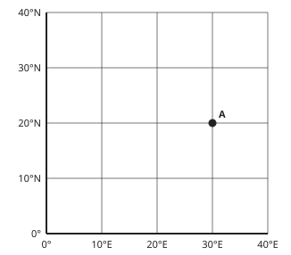
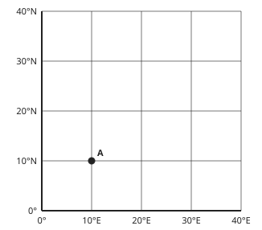
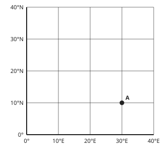
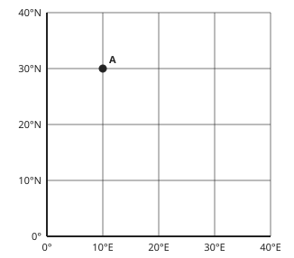
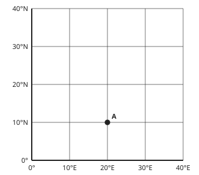

# Geography Form 3, Form Three Geography: drafts for review (Lessons 16 lessons (1–17))

Generated by `npm run review:f3-geography` from `content/form-3/geography/*.json`. Every question and drawing below was built by the engine.
All notes, teach cards, worked examples and paper tasks are **status: draft**. “Authored key” means a person fixed the
right answer (see `AUTHORED.md`); “computed by rule” means code worked it out (a formula, a conversion, a spelling rule).

Teach mode: cards (idea + example + 1 level-1 check) → worked example → practice (levels 1–3) → the note as a summary.

## Sample rendered lesson: Lesson 1 in teach mode

### Lesson 1: Our Planet: The Earth (size, shape & proofs)

**Card cg3-1-terms** (draft)

> Distinguish the lesson's concepts before applying them.
>
> _oblate shape: a near-sphere slightly flattened at the poles._  
> _globe: a reduced model of Earth's whole shape._  
> _map projection: a method of representing a curved surface on a plane._  
> _supporting evidence: observations that help test an explanation._  

Check question: `g3-1-terms` · multiple choice, level 1 · **authored key**, reused from practice

> Which term means: observations that help test an explanation ?

- ◻️ map projection  
  _↳ feedback if chosen: map projection means a method of representing a curved surface on a plane; the question instead describes observations that help test an explanation._
- ✅ supporting evidence
- ◻️ oblate shape  
  _↳ feedback if chosen: oblate shape means a near-sphere slightly flattened at the poles; the question instead describes observations that help test an explanation._
- ◻️ globe  
  _↳ feedback if chosen: globe means a reduced model of Earth's whole shape; the question instead describes observations that help test an explanation._

Full working after a second miss:

> Observations that help test an explanation.  
> So the answer is “supporting evidence”.  

**Card cg3-1-cases** (draft)

> Classify a case by its features, rather than by a familiar word alone.
>
> _A model shows a small equatorial bulge._  
> _oblate shape: a near-sphere slightly flattened at the poles._  

Check question: `g3-1-cases` · multiple choice, level 1 · **authored key**, reused from practice

> A model shows a small equatorial bulge.
> Which term best fits this example?

- ◻️ supporting evidence  
  _↳ feedback if chosen: supporting evidence concerns observations that help test an explanation. This case instead illustrates a near-sphere slightly flattened at the poles._
- ◻️ map projection  
  _↳ feedback if chosen: map projection concerns a method of representing a curved surface on a plane. This case instead illustrates a near-sphere slightly flattened at the poles._
- ◻️ globe  
  _↳ feedback if chosen: globe concerns a reduced model of Earth's whole shape. This case instead illustrates a near-sphere slightly flattened at the poles._
- ✅ oblate shape

Full working after a second miss:

> A model shows a small equatorial bulge. A near-sphere slightly flattened at the poles.  
> So the answer is “oblate shape”.  

**Card cg3-1-repair** (draft)

> Check that a claim agrees with the rule or definition it uses.
>
> _Earth is a perfectly flat circular plate._  
> _The global evidence supports a near-spherical planet with slight polar flattening._  

Check question: `g3-1-repair-card` · spot the error, level 1 · **authored key**

> Find the incorrect claim.

- ◻️ oblate shape: a near-sphere slightly flattened at the poles.  
  _↳ explanation: This statement is correct: oblate shape means a near-sphere slightly flattened at the poles. Look for a claim that conflicts with its definition._
- ◻️ map projection: a method of representing a curved surface on a plane.  
  _↳ explanation: This statement is correct: map projection means a method of representing a curved surface on a plane. Look for a claim that conflicts with its definition._
- ✅ One obstructed view disproves every independent observation.  
  _↳ explanation: Assess several lines of evidence and the conditions of each observation._
- ◻️ globe: a reduced model of Earth's whole shape.  
  _↳ explanation: This statement is correct: globe means a reduced model of Earth's whole shape. Look for a claim that conflicts with its definition._

Full working after a second miss:

> The wrong statement is “One obstructed view disproves every independent observation.”.  
> Assess several lines of evidence and the conditions of each observation.  

**Worked example** (draft)

> A model shows a small equatorial bulge. Which concept applies?

1. Identify the features of the case.
2. A near-sphere slightly flattened at the poles.
3. The global evidence supports a near-spherical planet with slight polar flattening.

**Answer:** oblate shape

**Practice** (one generated question per template, easiest first)

Practice 1: `g3-1-terms` · multiple choice, level 1 · **authored key**

> Which term means: a near-sphere slightly flattened at the poles ?

- ◻️ map projection  
  _↳ feedback if chosen: map projection means a method of representing a curved surface on a plane; the question instead describes a near-sphere slightly flattened at the poles._
- ✅ oblate shape
- ◻️ globe  
  _↳ feedback if chosen: globe means a reduced model of Earth's whole shape; the question instead describes a near-sphere slightly flattened at the poles._
- ◻️ supporting evidence  
  _↳ feedback if chosen: supporting evidence means observations that help test an explanation; the question instead describes a near-sphere slightly flattened at the poles._

Full working after a second miss:

> A near-sphere slightly flattened at the poles.  
> So the answer is “oblate shape”.  

Practice 2: `g3-1-cases` · multiple choice, level 1 · **authored key**

> A wall map stretches some regions when the globe is flattened.
> Which term best fits this example?

- ◻️ supporting evidence  
  _↳ feedback if chosen: supporting evidence concerns observations that help test an explanation. This case instead illustrates a method of representing a curved surface on a plane._
- ◻️ oblate shape  
  _↳ feedback if chosen: oblate shape concerns a near-sphere slightly flattened at the poles. This case instead illustrates a method of representing a curved surface on a plane._
- ✅ map projection
- ◻️ globe  
  _↳ feedback if chosen: globe concerns a reduced model of Earth's whole shape. This case instead illustrates a method of representing a curved surface on a plane._

Full working after a second miss:

> A wall map stretches some regions when the globe is flattened. A method of representing a curved surface on a plane.  
> So the answer is “map projection”.  

Practice 3: `g3-1-reason` · multiple choice, level 2 · **authored key**

> Images from space and a lunar-eclipse shadow agree with curvature.
> Which explanation justifies the classification?

- ◻️ A near-sphere slightly flattened at the poles.  
  _↳ feedback if chosen: That explanation describes oblate shape, rather than the relationship illustrated in this example._
- ◻️ A reduced model of earth's whole shape.  
  _↳ feedback if chosen: That explanation describes globe, rather than the relationship illustrated in this example._
- ✅ Observations that help test an explanation.
- ◻️ A method of representing a curved surface on a plane.  
  _↳ feedback if chosen: That explanation describes map projection, rather than the relationship illustrated in this example._

Full working after a second miss:

> Assess several lines of evidence and the conditions of each observation.  
> So the answer is “Observations that help test an explanation.”.  

Practice 4: `g3-1-link` · matching, level 2 · **authored key**

> Match each term to its example.

Right-hand side (shuffled): A wall map stretches some regions when the globe is flattened. · A class uses a spherical model to compare hemispheres. · A model shows a small equatorial bulge.
- oblate shape → **A model shows a small equatorial bulge.**
- globe → **A class uses a spherical model to compare hemispheres.**
- map projection → **A wall map stretches some regions when the globe is flattened.**

Full working after a second miss:

> The right pairs are:  
> oblate shape → A model shows a small equatorial bulge.  
> globe → A class uses a spherical model to compare hemispheres.  
> map projection → A wall map stretches some regions when the globe is flattened.  

Practice 5: `g3-1-repair` · spot the error, level 3 · **authored key**

> Find the incorrect claim.

- ◻️ oblate shape: a near-sphere slightly flattened at the poles.  
  _↳ explanation: This statement is correct: oblate shape means a near-sphere slightly flattened at the poles. Look for a claim that conflicts with its definition._
- ◻️ map projection: a method of representing a curved surface on a plane.  
  _↳ explanation: This statement is correct: map projection means a method of representing a curved surface on a plane. Look for a claim that conflicts with its definition._
- ◻️ globe: a reduced model of Earth's whole shape.  
  _↳ explanation: This statement is correct: globe means a reduced model of Earth's whole shape. Look for a claim that conflicts with its definition._
- ✅ Earth is a perfectly flat circular plate.  
  _↳ explanation: The global evidence supports a near-spherical planet with slight polar flattening._

Full working after a second miss:

> The wrong statement is “Earth is a perfectly flat circular plate.”.  
> The global evidence supports a near-spherical planet with slight polar flattening.  

**Summary (the note)**

> Earth is approximately spherical, with a slight equatorial bulge and flattening at the poles. Its mean radius is about {6371} km; its equatorial diameter is about {12756} km. A globe models this shape; a flat map represents selected features with some distortion. Evidence includes observations from space, a curved shadow during a lunar eclipse and changes in visible stars with latitude. A single local horizon observation needs careful interpretation because hills and atmospheric effects matter. Circumnavigation is consistent with the shape, but modern direct observation gives stronger evidence than an isolated travel story.

## All drafts

| Lesson | Title (sheet) | Status | Cards | Practice | Paper task |
|---|---|---|---|---|---|
| 1 | Our Planet: The Earth (size, shape & proofs) | draft | 3 | 5 | — |
| 3 | EarthDivisions (Latitudes& Longitudes) | draft | 3 | 5 | — |
| 4 | Practical Work 1: Locate a place on a map (Read geographical coordinates of a place) | draft | 3 | 5 | — |
| 5 | Great circles& The International Date Line (Meaning. Illustration, Importance) | draft | 3 | 5 | — |
| 6 | PW 1 (continued): Locate a place on a map | draft | 3 | 5 | — |
| 7 | Local time, Standard Time, Time Zones | draft | 3 | 5 | — |
| 8 | Practical Work 2: Calculation of time and date | draft | 3 | 5 | — |
| 9 | Rotation of the earth and effects | draft | 3 | 5 | — |
| 10 | Revolution of the earth and effects | draft | 3 | 5 | — |
| 11 | The Internal structure of the earth | draft | 3 | 5 | — |
| 12 | Rocks (Definition; classification; Characteristics; Rock cycle) | draft | 3 | 5 | — |
| 13 | The theories of the Earth's structure:(Continental drift) | draft | 3 | 5 | — |
| 14 | Plate Tectonics | draft | 3 | 5 | — |
| 15 | ; Volcanicity (Definition, Types, Illustration of Intrusive features, Features of Extrusive volcanism | draft | 3 | 5 | — |
| 16 | Impact of volcanicity on man | draft | 3 | 5 | — |
| 17 | Earthquakes: Definition, Causes, Manifestation, Impact on man Adaptation & Mitigation | draft | 3 | 5 | — |

## Lesson 1: Our Planet: The Earth (size, shape & proofs)

Prerequisites: none · Skill: g3-1 (Earth: shape, size and evidence)

**Note** (draft)

> Earth is approximately spherical, with a slight equatorial bulge and flattening at the poles. Its mean radius is about {6371} km; its equatorial diameter is about {12756} km. A globe models this shape; a flat map represents selected features with some distortion. Evidence includes observations from space, a curved shadow during a lunar eclipse and changes in visible stars with latitude. A single local horizon observation needs careful interpretation because hills and atmospheric effects matter. Circumnavigation is consistent with the shape, but modern direct observation gives stronger evidence than an isolated travel story.

**Learn: Understand the ideas** (draft)

> Earth is approximately spherical, with a slight equatorial bulge and flattening at the poles. Its mean radius is about 6371 km; its equatorial diameter is about 12 756 km. A globe models this shape; a flat map represents selected features with some distortion. Evidence includes observations from space, a curved shadow during a lunar eclipse and changes in visible stars with latitude. A single local horizon observation needs careful interpretation because hills and atmospheric effects matter. Circumnavigation is consistent with the shape, but modern direct observation gives stronger evidence than an isolated travel story.

**Learn: Apply the ideas locally** (draft)

> A pupil in Buea can compare a globe with a flat wall map. The map is convenient for routes, while the globe better represents the whole planet's shape. Neither is the planet itself. A ship disappearing hull-first over a clear sea can illustrate curvature, but one obscured view should not be treated as a complete proof by itself.

**Learn: Reason and check** (draft)

> Separate an observation from the conclusion it supports. Use several independent lines of evidence. Do not confuse spherical with perfectly smooth: mountains and valleys are small surface irregularities relative to the planet. State whether a measurement is approximate rather than pretending every model is exact.

**Learn: key words and examples** (draft)

- **oblate shape**: a near-sphere slightly flattened at the poles
- **globe**: a reduced model of Earth's whole shape
- **map projection**: a method of representing a curved surface on a plane
- **supporting evidence**: observations that help test an explanation

- A model shows a small equatorial bulge.
- A class uses a spherical model to compare hemispheres.
- A wall map stretches some regions when the globe is flattened.

Common mistake: “Earth is a perfectly flat circular plate.” → “oblate shape: a near-sphere slightly flattened at the poles.”. The global evidence supports a near-spherical planet with slight polar flattening.

**Card cg3-1-terms** (draft)

> Distinguish the lesson's concepts before applying them.
>
> _oblate shape: a near-sphere slightly flattened at the poles._  
> _globe: a reduced model of Earth's whole shape._  
> _map projection: a method of representing a curved surface on a plane._  
> _supporting evidence: observations that help test an explanation._  

Check question: `g3-1-terms` · multiple choice, level 1 · **authored key**, reused from practice

> Which term means: observations that help test an explanation ?

- ◻️ oblate shape  
  _↳ feedback if chosen: oblate shape means a near-sphere slightly flattened at the poles; the question instead describes observations that help test an explanation._
- ◻️ map projection  
  _↳ feedback if chosen: map projection means a method of representing a curved surface on a plane; the question instead describes observations that help test an explanation._
- ◻️ globe  
  _↳ feedback if chosen: globe means a reduced model of Earth's whole shape; the question instead describes observations that help test an explanation._
- ✅ supporting evidence

Full working after a second miss:

> Observations that help test an explanation.  
> So the answer is “supporting evidence”.  

**Card cg3-1-cases** (draft)

> Classify a case by its features, rather than by a familiar word alone.
>
> _A model shows a small equatorial bulge._  
> _oblate shape: a near-sphere slightly flattened at the poles._  

Check question: `g3-1-cases` · multiple choice, level 1 · **authored key**, reused from practice

> Images from space and a lunar-eclipse shadow agree with curvature.
> Which term best fits this example?

- ✅ supporting evidence
- ◻️ globe  
  _↳ feedback if chosen: globe concerns a reduced model of Earth's whole shape. This case instead illustrates observations that help test an explanation._
- ◻️ oblate shape  
  _↳ feedback if chosen: oblate shape concerns a near-sphere slightly flattened at the poles. This case instead illustrates observations that help test an explanation._
- ◻️ map projection  
  _↳ feedback if chosen: map projection concerns a method of representing a curved surface on a plane. This case instead illustrates observations that help test an explanation._

Full working after a second miss:

> Images from space and a lunar-eclipse shadow agree with curvature. Observations that help test an explanation.  
> So the answer is “supporting evidence”.  

**Card cg3-1-repair** (draft)

> Check that a claim agrees with the rule or definition it uses.
>
> _Earth is a perfectly flat circular plate._  
> _The global evidence supports a near-spherical planet with slight polar flattening._  

Check question: `g3-1-repair-card` · spot the error, level 1 · **authored key**

> Find the incorrect claim.

- ✅ One obstructed view disproves every independent observation.  
  _↳ explanation: Assess several lines of evidence and the conditions of each observation._
- ◻️ supporting evidence: observations that help test an explanation.  
  _↳ explanation: This statement is correct: supporting evidence means observations that help test an explanation. Look for a claim that conflicts with its definition._
- ◻️ oblate shape: a near-sphere slightly flattened at the poles.  
  _↳ explanation: This statement is correct: oblate shape means a near-sphere slightly flattened at the poles. Look for a claim that conflicts with its definition._
- ◻️ globe: a reduced model of Earth's whole shape.  
  _↳ explanation: This statement is correct: globe means a reduced model of Earth's whole shape. Look for a claim that conflicts with its definition._

Full working after a second miss:

> The wrong statement is “One obstructed view disproves every independent observation.”.  
> Assess several lines of evidence and the conditions of each observation.  

**Worked example** (draft)

> A model shows a small equatorial bulge. Which concept applies?

1. Identify the features of the case.
2. A near-sphere slightly flattened at the poles.
3. The global evidence supports a near-spherical planet with slight polar flattening.

**Answer:** oblate shape

**Practice** `g3-1-terms` · multiple choice, level 1 · **authored key**

> Which term means: a method of representing a curved surface on a plane ?

- ◻️ oblate shape  
  _↳ feedback if chosen: oblate shape means a near-sphere slightly flattened at the poles; the question instead describes a method of representing a curved surface on a plane._
- ✅ map projection
- ◻️ globe  
  _↳ feedback if chosen: globe means a reduced model of Earth's whole shape; the question instead describes a method of representing a curved surface on a plane._
- ◻️ supporting evidence  
  _↳ feedback if chosen: supporting evidence means observations that help test an explanation; the question instead describes a method of representing a curved surface on a plane._

Full working after a second miss:

> A method of representing a curved surface on a plane.  
> So the answer is “map projection”.  

> Which term means: a method of representing a curved surface on a plane ?

- ✅ map projection
- ◻️ supporting evidence  
  _↳ feedback if chosen: supporting evidence means observations that help test an explanation; the question instead describes a method of representing a curved surface on a plane._
- ◻️ globe  
  _↳ feedback if chosen: globe means a reduced model of Earth's whole shape; the question instead describes a method of representing a curved surface on a plane._
- ◻️ oblate shape  
  _↳ feedback if chosen: oblate shape means a near-sphere slightly flattened at the poles; the question instead describes a method of representing a curved surface on a plane._

Full working after a second miss:

> A method of representing a curved surface on a plane.  
> So the answer is “map projection”.  

**Practice** `g3-1-cases` · multiple choice, level 1 · **authored key**

> Images from space and a lunar-eclipse shadow agree with curvature.
> Which term best fits this example?

- ◻️ globe  
  _↳ feedback if chosen: globe concerns a reduced model of Earth's whole shape. This case instead illustrates observations that help test an explanation._
- ◻️ map projection  
  _↳ feedback if chosen: map projection concerns a method of representing a curved surface on a plane. This case instead illustrates observations that help test an explanation._
- ◻️ oblate shape  
  _↳ feedback if chosen: oblate shape concerns a near-sphere slightly flattened at the poles. This case instead illustrates observations that help test an explanation._
- ✅ supporting evidence

Full working after a second miss:

> Images from space and a lunar-eclipse shadow agree with curvature. Observations that help test an explanation.  
> So the answer is “supporting evidence”.  

> Images from space and a lunar-eclipse shadow agree with curvature.
> Which term best fits this example?

- ◻️ globe  
  _↳ feedback if chosen: globe concerns a reduced model of Earth's whole shape. This case instead illustrates observations that help test an explanation._
- ✅ supporting evidence
- ◻️ map projection  
  _↳ feedback if chosen: map projection concerns a method of representing a curved surface on a plane. This case instead illustrates observations that help test an explanation._
- ◻️ oblate shape  
  _↳ feedback if chosen: oblate shape concerns a near-sphere slightly flattened at the poles. This case instead illustrates observations that help test an explanation._

Full working after a second miss:

> Images from space and a lunar-eclipse shadow agree with curvature. Observations that help test an explanation.  
> So the answer is “supporting evidence”.  

**Practice** `g3-1-reason` · multiple choice, level 2 · **authored key**

> A model shows a small equatorial bulge.
> Which explanation justifies the classification?

- ◻️ A method of representing a curved surface on a plane.  
  _↳ feedback if chosen: That explanation describes map projection, rather than the relationship illustrated in this example._
- ◻️ A reduced model of earth's whole shape.  
  _↳ feedback if chosen: That explanation describes globe, rather than the relationship illustrated in this example._
- ✅ A near-sphere slightly flattened at the poles.
- ◻️ Observations that help test an explanation.  
  _↳ feedback if chosen: That explanation describes supporting evidence, rather than the relationship illustrated in this example._

Full working after a second miss:

> The global evidence supports a near-spherical planet with slight polar flattening.  
> So the answer is “A near-sphere slightly flattened at the poles.”.  

> Images from space and a lunar-eclipse shadow agree with curvature.
> Which explanation justifies the classification?

- ✅ Observations that help test an explanation.
- ◻️ A reduced model of earth's whole shape.  
  _↳ feedback if chosen: That explanation describes globe, rather than the relationship illustrated in this example._
- ◻️ A method of representing a curved surface on a plane.  
  _↳ feedback if chosen: That explanation describes map projection, rather than the relationship illustrated in this example._
- ◻️ A near-sphere slightly flattened at the poles.  
  _↳ feedback if chosen: That explanation describes oblate shape, rather than the relationship illustrated in this example._

Full working after a second miss:

> Assess several lines of evidence and the conditions of each observation.  
> So the answer is “Observations that help test an explanation.”.  

**Practice** `g3-1-link` · matching, level 2 · **authored key**

> Match each term to its example.

Right-hand side (shuffled): Images from space and a lunar-eclipse shadow agree with curvature. · A wall map stretches some regions when the globe is flattened. · A model shows a small equatorial bulge.
- supporting evidence → **Images from space and a lunar-eclipse shadow agree with curvature.**
- oblate shape → **A model shows a small equatorial bulge.**
- map projection → **A wall map stretches some regions when the globe is flattened.**

Full working after a second miss:

> The right pairs are:  
> supporting evidence → Images from space and a lunar-eclipse shadow agree with curvature.  
> oblate shape → A model shows a small equatorial bulge.  
> map projection → A wall map stretches some regions when the globe is flattened.  

> Match each term to its example.

Right-hand side (shuffled): Images from space and a lunar-eclipse shadow agree with curvature. · A class uses a spherical model to compare hemispheres. · A model shows a small equatorial bulge.
- oblate shape → **A model shows a small equatorial bulge.**
- supporting evidence → **Images from space and a lunar-eclipse shadow agree with curvature.**
- globe → **A class uses a spherical model to compare hemispheres.**

Full working after a second miss:

> The right pairs are:  
> oblate shape → A model shows a small equatorial bulge.  
> supporting evidence → Images from space and a lunar-eclipse shadow agree with curvature.  
> globe → A class uses a spherical model to compare hemispheres.  

**Practice** `g3-1-repair` · spot the error, level 3 · **authored key**

> Find the incorrect claim.

- ◻️ oblate shape: a near-sphere slightly flattened at the poles.  
  _↳ explanation: This statement is correct: oblate shape means a near-sphere slightly flattened at the poles. Look for a claim that conflicts with its definition._
- ◻️ globe: a reduced model of Earth's whole shape.  
  _↳ explanation: This statement is correct: globe means a reduced model of Earth's whole shape. Look for a claim that conflicts with its definition._
- ✅ Every flat world map preserves every shape, area and distance exactly.  
  _↳ explanation: Flattening a curved surface introduces trade-offs and distortion._
- ◻️ map projection: a method of representing a curved surface on a plane.  
  _↳ explanation: This statement is correct: map projection means a method of representing a curved surface on a plane. Look for a claim that conflicts with its definition._

Full working after a second miss:

> The wrong statement is “Every flat world map preserves every shape, area and distance exactly.”.  
> Flattening a curved surface introduces trade-offs and distortion.  

> Find the incorrect claim.

- ◻️ oblate shape: a near-sphere slightly flattened at the poles.  
  _↳ explanation: This statement is correct: oblate shape means a near-sphere slightly flattened at the poles. Look for a claim that conflicts with its definition._
- ◻️ globe: a reduced model of Earth's whole shape.  
  _↳ explanation: This statement is correct: globe means a reduced model of Earth's whole shape. Look for a claim that conflicts with its definition._
- ✅ Every flat world map preserves every shape, area and distance exactly.  
  _↳ explanation: Flattening a curved surface introduces trade-offs and distortion._
- ◻️ supporting evidence: observations that help test an explanation.  
  _↳ explanation: This statement is correct: supporting evidence means observations that help test an explanation. Look for a claim that conflicts with its definition._

Full working after a second miss:

> The wrong statement is “Every flat world map preserves every shape, area and distance exactly.”.  
> Flattening a curved surface introduces trade-offs and distortion.  

## Lesson 3: EarthDivisions (Latitudes& Longitudes)

Prerequisites: none · Skill: g3-3 (Latitude and longitude)

**Note** (draft)

> Latitude measures angular position north or south of the Equator. Longitude measures angular position east or west of the Greenwich meridian. Parallels join places of equal latitude; meridians connect the poles. Write latitude first and include the hemisphere. A coordinate without its hemisphere can describe more than one location. Cameroon is in the northern and eastern hemispheres, but classroom points on an invented grid are not surveyed locations of actual towns.

**Learn: Understand the ideas** (draft)

> Latitude measures angular position north or south of the Equator. Longitude measures angular position east or west of the Greenwich meridian. Parallels join places of equal latitude; meridians connect the poles. Write latitude first and include the hemisphere. A coordinate without its hemisphere can describe more than one location. Cameroon is in the northern and eastern hemispheres, but classroom points on an invented grid are not surveyed locations of actual towns.

**Learn: Apply the ideas locally** (draft)

> A learner locating a place near Buea first identifies the Equator and the Greenwich reference, then reads north/south and east/west separately. On a graticule, trace the place to the labelled lines. Do not swap a parallel with a meridian just because both appear as straight lines on a flat diagram.

**Learn: Reason and check** (draft)

> Identify the reference line, read the angle and add the hemisphere. If a point is between marked lines, estimate consistently with the scale. A grid reference based on eastings and northings is a different system from a latitude-longitude coordinate.

**Learn: key words and examples** (draft)

- **latitude**: angular position north or south of the Equator
- **longitude**: angular position east or west of Greenwich
- **parallel**: a line joining equal latitudes
- **meridian**: a line joining the poles at a given longitude

- A coordinate gives a place's northward angle from the Equator.
- A coordinate gives a place's eastward angle from the prime meridian.
- A learner follows the Equator around a globe.

Common mistake: “Latitude is measured east from Greenwich.” → “latitude: angular position north or south of the Equator.”. East/west from Greenwich describes longitude, not latitude.

**Card cg3-3-terms** (draft)

> Distinguish the lesson's concepts before applying them.
>
> _latitude: angular position north or south of the Equator._  
> _longitude: angular position east or west of Greenwich._  
> _parallel: a line joining equal latitudes._  
> _meridian: a line joining the poles at a given longitude._  

Check question: `g3-3-terms` · multiple choice, level 1 · **authored key**, reused from practice

> Which term means: angular position east or west of Greenwich ?

- ◻️ latitude  
  _↳ feedback if chosen: latitude means angular position north or south of the Equator; the question instead describes angular position east or west of Greenwich._
- ◻️ parallel  
  _↳ feedback if chosen: parallel means a line joining equal latitudes; the question instead describes angular position east or west of Greenwich._
- ◻️ meridian  
  _↳ feedback if chosen: meridian means a line joining the poles at a given longitude; the question instead describes angular position east or west of Greenwich._
- ✅ longitude

Full working after a second miss:

> Angular position east or west of greenwich.  
> So the answer is “longitude”.  

**Card cg3-3-cases** (draft)

> Classify a case by its features, rather than by a familiar word alone.
>
> _A coordinate gives a place's northward angle from the Equator._  
> _latitude: angular position north or south of the Equator._  

Check question: `g3-3-cases` · multiple choice, level 1 · **authored key**, reused from practice

> A learner traces Greenwich's reference line from pole to pole.
> Which term best fits this example?

- ◻️ latitude  
  _↳ feedback if chosen: latitude concerns angular position north or south of the Equator. This case instead illustrates a line joining the poles at a given longitude._
- ✅ meridian
- ◻️ longitude  
  _↳ feedback if chosen: longitude concerns angular position east or west of Greenwich. This case instead illustrates a line joining the poles at a given longitude._
- ◻️ parallel  
  _↳ feedback if chosen: parallel concerns a line joining equal latitudes. This case instead illustrates a line joining the poles at a given longitude._

Full working after a second miss:

> A learner traces Greenwich's reference line from pole to pole. A line joining the poles at a given longitude.  
> So the answer is “meridian”.  

**Card cg3-3-repair** (draft)

> Check that a claim agrees with the rule or definition it uses.
>
> _Latitude is measured east from Greenwich._  
> _East/west from Greenwich describes longitude, not latitude._  

Check question: `g3-3-repair-card` · spot the error, level 1 · **authored key**

> Find the incorrect claim.

- ◻️ parallel: a line joining equal latitudes.  
  _↳ explanation: This statement is correct: parallel means a line joining equal latitudes. Look for a claim that conflicts with its definition._
- ◻️ latitude: angular position north or south of the Equator.  
  _↳ explanation: This statement is correct: latitude means angular position north or south of the Equator. Look for a claim that conflicts with its definition._
- ✅ A meridian is a small circle parallel to the Equator.  
  _↳ explanation: A meridian runs between poles rather than parallel to the Equator._
- ◻️ longitude: angular position east or west of Greenwich.  
  _↳ explanation: This statement is correct: longitude means angular position east or west of Greenwich. Look for a claim that conflicts with its definition._

Full working after a second miss:

> The wrong statement is “A meridian is a small circle parallel to the Equator.”.  
> A meridian runs between poles rather than parallel to the Equator.  

**Worked example** (draft)

> A coordinate gives a place's northward angle from the Equator. Which concept applies?

1. Identify the features of the case.
2. Angular position north or south of the equator.
3. East/west from Greenwich describes longitude, not latitude.

**Answer:** latitude

**Practice** `g3-3-terms` · multiple choice, level 1 · **authored key**

> Which term means: a line joining the poles at a given longitude ?

- ◻️ parallel  
  _↳ feedback if chosen: parallel means a line joining equal latitudes; the question instead describes a line joining the poles at a given longitude._
- ✅ meridian
- ◻️ longitude  
  _↳ feedback if chosen: longitude means angular position east or west of Greenwich; the question instead describes a line joining the poles at a given longitude._
- ◻️ latitude  
  _↳ feedback if chosen: latitude means angular position north or south of the Equator; the question instead describes a line joining the poles at a given longitude._

Full working after a second miss:

> A line joining the poles at a given longitude.  
> So the answer is “meridian”.  

> Which term means: a line joining equal latitudes ?

- ◻️ meridian  
  _↳ feedback if chosen: meridian means a line joining the poles at a given longitude; the question instead describes a line joining equal latitudes._
- ◻️ latitude  
  _↳ feedback if chosen: latitude means angular position north or south of the Equator; the question instead describes a line joining equal latitudes._
- ◻️ longitude  
  _↳ feedback if chosen: longitude means angular position east or west of Greenwich; the question instead describes a line joining equal latitudes._
- ✅ parallel

Full working after a second miss:

> A line joining equal latitudes.  
> So the answer is “parallel”.  

**Practice** `g3-3-cases` · multiple choice, level 1 · **authored key**

> A coordinate gives a place's northward angle from the Equator.
> Which term best fits this example?

- ◻️ meridian  
  _↳ feedback if chosen: meridian concerns a line joining the poles at a given longitude. This case instead illustrates angular position north or south of the Equator._
- ◻️ longitude  
  _↳ feedback if chosen: longitude concerns angular position east or west of Greenwich. This case instead illustrates angular position north or south of the Equator._
- ◻️ parallel  
  _↳ feedback if chosen: parallel concerns a line joining equal latitudes. This case instead illustrates angular position north or south of the Equator._
- ✅ latitude

Full working after a second miss:

> A coordinate gives a place's northward angle from the Equator. Angular position north or south of the equator.  
> So the answer is “latitude”.  

> A learner follows the Equator around a globe.
> Which term best fits this example?

- ◻️ latitude  
  _↳ feedback if chosen: latitude concerns angular position north or south of the Equator. This case instead illustrates a line joining equal latitudes._
- ◻️ meridian  
  _↳ feedback if chosen: meridian concerns a line joining the poles at a given longitude. This case instead illustrates a line joining equal latitudes._
- ✅ parallel
- ◻️ longitude  
  _↳ feedback if chosen: longitude concerns angular position east or west of Greenwich. This case instead illustrates a line joining equal latitudes._

Full working after a second miss:

> A learner follows the Equator around a globe. A line joining equal latitudes.  
> So the answer is “parallel”.  

**Practice** `g3-3-reason` · multiple choice, level 2 · **authored key**

> A learner follows the Equator around a globe.
> Which explanation justifies the classification?

- ✅ A line joining equal latitudes.
- ◻️ A line joining the poles at a given longitude.  
  _↳ feedback if chosen: That explanation describes meridian, rather than the relationship illustrated in this example._
- ◻️ Angular position north or south of the equator.  
  _↳ feedback if chosen: That explanation describes latitude, rather than the relationship illustrated in this example._
- ◻️ Angular position east or west of greenwich.  
  _↳ feedback if chosen: That explanation describes longitude, rather than the relationship illustrated in this example._

Full working after a second miss:

> Meridians connect the poles; parallels circle at constant latitude.  
> So the answer is “A line joining equal latitudes.”.  

> A learner follows the Equator around a globe.
> Which explanation justifies the classification?

- ◻️ A line joining the poles at a given longitude.  
  _↳ feedback if chosen: That explanation describes meridian, rather than the relationship illustrated in this example._
- ✅ A line joining equal latitudes.
- ◻️ Angular position north or south of the equator.  
  _↳ feedback if chosen: That explanation describes latitude, rather than the relationship illustrated in this example._
- ◻️ Angular position east or west of greenwich.  
  _↳ feedback if chosen: That explanation describes longitude, rather than the relationship illustrated in this example._

Full working after a second miss:

> Meridians connect the poles; parallels circle at constant latitude.  
> So the answer is “A line joining equal latitudes.”.  

**Practice** `g3-3-link` · matching, level 2 · **authored key**

> Match each term to its example.

Right-hand side (shuffled): A learner follows the Equator around a globe. · A learner traces Greenwich's reference line from pole to pole. · A coordinate gives a place's northward angle from the Equator.
- meridian → **A learner traces Greenwich's reference line from pole to pole.**
- parallel → **A learner follows the Equator around a globe.**
- latitude → **A coordinate gives a place's northward angle from the Equator.**

Full working after a second miss:

> The right pairs are:  
> meridian → A learner traces Greenwich's reference line from pole to pole.  
> parallel → A learner follows the Equator around a globe.  
> latitude → A coordinate gives a place's northward angle from the Equator.  

> Match each term to its example.

Right-hand side (shuffled): A coordinate gives a place's eastward angle from the prime meridian. · A coordinate gives a place's northward angle from the Equator. · A learner traces Greenwich's reference line from pole to pole.
- meridian → **A learner traces Greenwich's reference line from pole to pole.**
- longitude → **A coordinate gives a place's eastward angle from the prime meridian.**
- latitude → **A coordinate gives a place's northward angle from the Equator.**

Full working after a second miss:

> The right pairs are:  
> meridian → A learner traces Greenwich's reference line from pole to pole.  
> longitude → A coordinate gives a place's eastward angle from the prime meridian.  
> latitude → A coordinate gives a place's northward angle from the Equator.  

**Practice** `g3-3-repair` · spot the error, level 3 · **authored key**

> Find the incorrect claim.

- ◻️ latitude: angular position north or south of the Equator.  
  _↳ explanation: This statement is correct: latitude means angular position north or south of the Equator. Look for a claim that conflicts with its definition._
- ✅ Every parallel passes through both poles.  
  _↳ explanation: Meridians connect the poles; parallels circle at constant latitude._
- ◻️ parallel: a line joining equal latitudes.  
  _↳ explanation: This statement is correct: parallel means a line joining equal latitudes. Look for a claim that conflicts with its definition._
- ◻️ meridian: a line joining the poles at a given longitude.  
  _↳ explanation: This statement is correct: meridian means a line joining the poles at a given longitude. Look for a claim that conflicts with its definition._

Full working after a second miss:

> The wrong statement is “Every parallel passes through both poles.”.  
> Meridians connect the poles; parallels circle at constant latitude.  

> Find the incorrect claim.

- ✅ Longitude is measured north from the Equator.  
  _↳ explanation: North/south from the Equator describes latitude._
- ◻️ meridian: a line joining the poles at a given longitude.  
  _↳ explanation: This statement is correct: meridian means a line joining the poles at a given longitude. Look for a claim that conflicts with its definition._
- ◻️ parallel: a line joining equal latitudes.  
  _↳ explanation: This statement is correct: parallel means a line joining equal latitudes. Look for a claim that conflicts with its definition._
- ◻️ latitude: angular position north or south of the Equator.  
  _↳ explanation: This statement is correct: latitude means angular position north or south of the Equator. Look for a claim that conflicts with its definition._

Full working after a second miss:

> The wrong statement is “Longitude is measured north from the Equator.”.  
> North/south from the Equator describes latitude.  

## Lesson 4: Practical Work 1: Locate a place on a map (Read geographical coordinates of a place)

Prerequisites: 3 · Skill: g3-4 (Practical preparation: reading a geographical coordinate)

**Note** (draft)

> To locate a point, read latitude and longitude from their reference lines and include the hemispheres. This guided practical uses an invented graticule on screen. Start with the parallel through the point, then the meridian. Check the spacing of the labelled lines before estimating an intermediate value. Record the coordinate in your exercise book with latitude first. The practice checks written map reading, not the accuracy of a real field survey.

**Learn: Understand the ideas** (draft)

> To locate a point, read latitude and longitude from their reference lines and include the hemispheres. This guided practical uses an invented graticule on screen. Start with the parallel through the point, then the meridian. Check the spacing of the labelled lines before estimating an intermediate value. Record the coordinate in your exercise book with latitude first. The practice checks written map reading, not the accuracy of a real field survey.

**Learn: Apply the ideas locally** (draft)

> The diagram marks A on an invented grid. All points used here lie north of the Equator and east of Greenwich. Trace A horizontally to the latitude labels, and vertically to the longitude labels. Because each point lies on labelled lines, no estimate is needed in these examples. These coordinates are not being presented as actual locations of named Cameroonian towns.

**Learn: Reason and check** (draft)

> Write the reference line and hemisphere beside each value. Check that the value you read belongs to the correct axis. For an actual map, consult its key and projection as well. Swapping the two values moves the point and changes its meaning.

**Learn: key words and examples** (draft)

- **latitude reading**: the north/south angle read from the parallel through a point
- **longitude reading**: the east/west angle read from the meridian through a point
- **hemisphere label**: the direction that completes an angular coordinate
- **coordinate order**: latitude followed by longitude

- A learner follows A's horizontal line to the northward labels.
- A learner follows A's vertical line to the eastward labels.
- A learner writes north or south after the latitude angle.

Common mistake: “Read longitude labels to obtain latitude.” → “latitude reading: the north/south angle read from the parallel through a point.”. Use the parallel's latitude label, not the meridian's longitude label.

**Card cg3-4-terms** (draft)

> Distinguish the lesson's concepts before applying them.
>
> _latitude reading: the north/south angle read from the parallel through a point._  
> _longitude reading: the east/west angle read from the meridian through a point._  
> _hemisphere label: the direction that completes an angular coordinate._  
> _coordinate order: latitude followed by longitude._  

Check question: `g3-4-terms` · multiple choice, level 1 · **authored key**, reused from practice

> Which term means: the east/west angle read from the meridian through a point ?

- ◻️ hemisphere label  
  _↳ feedback if chosen: hemisphere label means the direction that completes an angular coordinate; the question instead describes the east/west angle read from the meridian through a point._
- ✅ longitude reading
- ◻️ coordinate order  
  _↳ feedback if chosen: coordinate order means latitude followed by longitude; the question instead describes the east/west angle read from the meridian through a point._
- ◻️ latitude reading  
  _↳ feedback if chosen: latitude reading means the north/south angle read from the parallel through a point; the question instead describes the east/west angle read from the meridian through a point._

Full working after a second miss:

> The east/west angle read from the meridian through a point.  
> So the answer is “longitude reading”.  

**Card cg3-4-cases** (draft)

> Classify a case by its features, rather than by a familiar word alone.
>
> _A learner follows A's horizontal line to the northward labels._  
> _latitude reading: the north/south angle read from the parallel through a point._  

Check question: `g3-4-cases` · multiple choice, level 1 · **authored key**, reused from practice

> A learner writes north or south after the latitude angle.
> Which term best fits this example?

- ✅ hemisphere label
- ◻️ latitude reading  
  _↳ feedback if chosen: latitude reading concerns the north/south angle read from the parallel through a point. This case instead illustrates the direction that completes an angular coordinate._
- ◻️ coordinate order  
  _↳ feedback if chosen: coordinate order concerns latitude followed by longitude. This case instead illustrates the direction that completes an angular coordinate._
- ◻️ longitude reading  
  _↳ feedback if chosen: longitude reading concerns the east/west angle read from the meridian through a point. This case instead illustrates the direction that completes an angular coordinate._

Full working after a second miss:

> A learner writes north or south after the latitude angle. The direction that completes an angular coordinate.  
> So the answer is “hemisphere label”.  

**Card cg3-4-repair** (draft)

> Check that a claim agrees with the rule or definition it uses.
>
> _Read longitude labels to obtain latitude._  
> _Use the parallel's latitude label, not the meridian's longitude label._  

Check question: `g3-4-repair-card` · spot the error, level 1 · **authored key**

> Find the incorrect claim.

- ✅ Read latitude labels to obtain longitude.  
  _↳ explanation: Use the meridian's longitude label, not the parallel's latitude label._
- ◻️ longitude reading: the east/west angle read from the meridian through a point.  
  _↳ explanation: This statement is correct: longitude reading means the east/west angle read from the meridian through a point. Look for a claim that conflicts with its definition._
- ◻️ latitude reading: the north/south angle read from the parallel through a point.  
  _↳ explanation: This statement is correct: latitude reading means the north/south angle read from the parallel through a point. Look for a claim that conflicts with its definition._
- ◻️ hemisphere label: the direction that completes an angular coordinate.  
  _↳ explanation: This statement is correct: hemisphere label means the direction that completes an angular coordinate. Look for a claim that conflicts with its definition._

Full working after a second miss:

> The wrong statement is “Read latitude labels to obtain longitude.”.  
> Use the meridian's longitude label, not the parallel's latitude label.  

**Worked example** (draft)

> A learner follows A's horizontal line to the northward labels. Which concept applies?

1. Identify the features of the case.
2. The north/south angle read from the parallel through a point.
3. Use the parallel's latitude label, not the meridian's longitude label.

**Answer:** latitude reading

**Practice** `g3-4-terms` · multiple choice, level 1 · **authored key**

> Which term means: latitude followed by longitude ?

- ◻️ latitude reading  
  _↳ feedback if chosen: latitude reading means the north/south angle read from the parallel through a point; the question instead describes latitude followed by longitude._
- ◻️ hemisphere label  
  _↳ feedback if chosen: hemisphere label means the direction that completes an angular coordinate; the question instead describes latitude followed by longitude._
- ✅ coordinate order
- ◻️ longitude reading  
  _↳ feedback if chosen: longitude reading means the east/west angle read from the meridian through a point; the question instead describes latitude followed by longitude._

Full working after a second miss:

> Latitude followed by longitude.  
> So the answer is “coordinate order”.  

> Which term means: the direction that completes an angular coordinate ?

- ◻️ latitude reading  
  _↳ feedback if chosen: latitude reading means the north/south angle read from the parallel through a point; the question instead describes the direction that completes an angular coordinate._
- ◻️ coordinate order  
  _↳ feedback if chosen: coordinate order means latitude followed by longitude; the question instead describes the direction that completes an angular coordinate._
- ✅ hemisphere label
- ◻️ longitude reading  
  _↳ feedback if chosen: longitude reading means the east/west angle read from the meridian through a point; the question instead describes the direction that completes an angular coordinate._

Full working after a second miss:

> The direction that completes an angular coordinate.  
> So the answer is “hemisphere label”.  

**Practice** `g3-4-cases` · multiple choice, level 1 · **authored key**

> A learner follows A's vertical line to the eastward labels.
> Which term best fits this example?

- ◻️ coordinate order  
  _↳ feedback if chosen: coordinate order concerns latitude followed by longitude. This case instead illustrates the east/west angle read from the meridian through a point._
- ◻️ hemisphere label  
  _↳ feedback if chosen: hemisphere label concerns the direction that completes an angular coordinate. This case instead illustrates the east/west angle read from the meridian through a point._
- ✅ longitude reading
- ◻️ latitude reading  
  _↳ feedback if chosen: latitude reading concerns the north/south angle read from the parallel through a point. This case instead illustrates the east/west angle read from the meridian through a point._

Full working after a second miss:

> A learner follows A's vertical line to the eastward labels. The east/west angle read from the meridian through a point.  
> So the answer is “longitude reading”.  

> A learner writes north or south after the latitude angle.
> Which term best fits this example?

- ◻️ longitude reading  
  _↳ feedback if chosen: longitude reading concerns the east/west angle read from the meridian through a point. This case instead illustrates the direction that completes an angular coordinate._
- ◻️ latitude reading  
  _↳ feedback if chosen: latitude reading concerns the north/south angle read from the parallel through a point. This case instead illustrates the direction that completes an angular coordinate._
- ✅ hemisphere label
- ◻️ coordinate order  
  _↳ feedback if chosen: coordinate order concerns latitude followed by longitude. This case instead illustrates the direction that completes an angular coordinate._

Full working after a second miss:

> A learner writes north or south after the latitude angle. The direction that completes an angular coordinate.  
> So the answer is “hemisphere label”.  

**Practice** `g3-4-latitude` · number, level 2 · computed by rule

> Read point A on the graticule. Give its latitude in degrees north.

Answer: **10 degrees north**

Full working after a second miss:

> Read the horizontal parallel through A.  
> The angle is 10 degrees north.  

> Read point A on the graticule. Give its latitude in degrees north.

Answer: **20 degrees north**

Full working after a second miss:

> Read the horizontal parallel through A.  
> The angle is 20 degrees north.  

**Practice** `g3-4-longitude` · number, level 2 · computed by rule

> Read point A on the graticule. Give its longitude in degrees east.

Answer: **20 degrees east**

Full working after a second miss:

> Read the vertical meridian through A.  
> The angle is 20 degrees east.  

> Read point A on the graticule. Give its longitude in degrees east.

Answer: **30 degrees east**

Full working after a second miss:

> Read the vertical meridian through A.  
> The angle is 30 degrees east.  

**Practice** `g3-4-repair` · spot the error, level 3 · **authored key**

> Find the incorrect claim.

- ◻️ longitude reading: the east/west angle read from the meridian through a point.  
  _↳ explanation: This statement is correct: longitude reading means the east/west angle read from the meridian through a point. Look for a claim that conflicts with its definition._
- ◻️ latitude reading: the north/south angle read from the parallel through a point.  
  _↳ explanation: This statement is correct: latitude reading means the north/south angle read from the parallel through a point. Look for a claim that conflicts with its definition._
- ◻️ hemisphere label: the direction that completes an angular coordinate.  
  _↳ explanation: This statement is correct: hemisphere label means the direction that completes an angular coordinate. Look for a claim that conflicts with its definition._
- ✅ Read latitude labels to obtain longitude.  
  _↳ explanation: Use the meridian's longitude label, not the parallel's latitude label._

Full working after a second miss:

> The wrong statement is “Read latitude labels to obtain longitude.”.  
> Use the meridian's longitude label, not the parallel's latitude label.  

> Find the incorrect claim.

- ◻️ coordinate order: latitude followed by longitude.  
  _↳ explanation: This statement is correct: coordinate order means latitude followed by longitude. Look for a claim that conflicts with its definition._
- ◻️ latitude reading: the north/south angle read from the parallel through a point.  
  _↳ explanation: This statement is correct: latitude reading means the north/south angle read from the parallel through a point. Look for a claim that conflicts with its definition._
- ◻️ hemisphere label: the direction that completes an angular coordinate.  
  _↳ explanation: This statement is correct: hemisphere label means the direction that completes an angular coordinate. Look for a claim that conflicts with its definition._
- ✅ The two angles may always be swapped without changing the location.  
  _↳ explanation: Latitude and longitude perform different roles, so their order matters._

Full working after a second miss:

> The wrong statement is “The two angles may always be swapped without changing the location.”.  
> Latitude and longitude perform different roles, so their order matters.  

## Lesson 5: Great circles& The International Date Line (Meaning. Illustration, Importance)

Prerequisites: none · Skill: g3-5 (Great circles and the International Date Line)

**Note** (draft)

> A great circle is formed when a plane through Earth's centre cuts its surface, dividing the sphere into equal hemispheres. The Equator is a great circle; a meridian paired with its opposite also forms one. Other parallels are small circles. On a sphere, the shorter great-circle arc gives a shortest surface route between suitable points. The International Date Line is a civil-date boundary broadly near the opposite meridian to Greenwich, with deviations. Crossing it westward adds a day; eastward subtracts a day.

**Learn: Understand the ideas** (draft)

> A great circle is formed when a plane through Earth's centre cuts its surface, dividing the sphere into equal hemispheres. The Equator is a great circle; a meridian paired with its opposite also forms one. Other parallels are small circles. On a sphere, the shorter great-circle arc gives a shortest surface route between suitable points. The International Date Line is a civil-date boundary broadly near the opposite meridian to Greenwich, with deviations. Crossing it westward adds a day; eastward subtracts a day.

**Learn: Apply the ideas locally** (draft)

> A route drawn straight on a flat world map is not necessarily the shortest route on a globe. A traveller crossing the Date Line must adjust the calendar as well as the clock. A time difference near midnight can also change a date without crossing the line, so keep the two reasons for date changes distinct.

**Learn: Reason and check** (draft)

> Ask whether the cutting plane passes through the centre. For date exercises, identify travel direction and state the adopted line convention. Actual civil boundaries and standard-time decisions are irregular; do not treat the diagram as an exact map of present national rules.

**Learn: key words and examples** (draft)

- **great circle**: a circle dividing a sphere into equal hemispheres
- **small circle**: a circle whose plane does not pass through the sphere's centre
- **westward date-line crossing**: a crossing convention that advances the calendar by a day
- **eastward date-line crossing**: a crossing convention that moves the calendar back a day

- The Equator's plane passes through Earth's centre.
- A parallel north of the Equator divides unequal surface portions.
- An idealised traveller crosses the Date Line toward the west.

Common mistake: “Every parallel is a great circle.” → “great circle: a circle dividing a sphere into equal hemispheres.”. Only a parallel through the centre, the Equator, is a great circle.

**Card cg3-5-terms** (draft)

> Distinguish the lesson's concepts before applying them.
>
> _great circle: a circle dividing a sphere into equal hemispheres._  
> _small circle: a circle whose plane does not pass through the sphere's centre._  
> _westward date-line crossing: a crossing convention that advances the calendar by a day._  
> _eastward date-line crossing: a crossing convention that moves the calendar back a day._  

Check question: `g3-5-terms` · multiple choice, level 1 · **authored key**, reused from practice

> Which term means: a circle dividing a sphere into equal hemispheres ?

- ◻️ eastward date-line crossing  
  _↳ feedback if chosen: eastward date-line crossing means a crossing convention that moves the calendar back a day; the question instead describes a circle dividing a sphere into equal hemispheres._
- ◻️ westward date-line crossing  
  _↳ feedback if chosen: westward date-line crossing means a crossing convention that advances the calendar by a day; the question instead describes a circle dividing a sphere into equal hemispheres._
- ✅ great circle
- ◻️ small circle  
  _↳ feedback if chosen: small circle means a circle whose plane does not pass through the sphere's centre; the question instead describes a circle dividing a sphere into equal hemispheres._

Full working after a second miss:

> A circle dividing a sphere into equal hemispheres.  
> So the answer is “great circle”.  

**Card cg3-5-cases** (draft)

> Classify a case by its features, rather than by a familiar word alone.
>
> _The Equator's plane passes through Earth's centre._  
> _great circle: a circle dividing a sphere into equal hemispheres._  

Check question: `g3-5-cases` · multiple choice, level 1 · **authored key**, reused from practice

> A parallel north of the Equator divides unequal surface portions.
> Which term best fits this example?

- ◻️ eastward date-line crossing  
  _↳ feedback if chosen: eastward date-line crossing concerns a crossing convention that moves the calendar back a day. This case instead illustrates a circle whose plane does not pass through the sphere's centre._
- ◻️ westward date-line crossing  
  _↳ feedback if chosen: westward date-line crossing concerns a crossing convention that advances the calendar by a day. This case instead illustrates a circle whose plane does not pass through the sphere's centre._
- ◻️ great circle  
  _↳ feedback if chosen: great circle concerns a circle dividing a sphere into equal hemispheres. This case instead illustrates a circle whose plane does not pass through the sphere's centre._
- ✅ small circle

Full working after a second miss:

> A parallel north of the Equator divides unequal surface portions. A circle whose plane does not pass through the sphere's centre.  
> So the answer is “small circle”.  

**Card cg3-5-repair** (draft)

> Check that a claim agrees with the rule or definition it uses.
>
> _Every parallel is a great circle._  
> _Only a parallel through the centre, the Equator, is a great circle._  

Check question: `g3-5-repair-card` · spot the error, level 1 · **authored key**

> Find the incorrect claim.

- ◻️ small circle: a circle whose plane does not pass through the sphere's centre.  
  _↳ explanation: This statement is correct: small circle means a circle whose plane does not pass through the sphere's centre. Look for a claim that conflicts with its definition._
- ◻️ great circle: a circle dividing a sphere into equal hemispheres.  
  _↳ explanation: This statement is correct: great circle means a circle dividing a sphere into equal hemispheres. Look for a claim that conflicts with its definition._
- ◻️ eastward date-line crossing: a crossing convention that moves the calendar back a day.  
  _↳ explanation: This statement is correct: eastward date-line crossing means a crossing convention that moves the calendar back a day. Look for a claim that conflicts with its definition._
- ✅ Westward Date Line travel always subtracts a calendar day.  
  _↳ explanation: Under the standard crossing convention, westward travel adds a day._

Full working after a second miss:

> The wrong statement is “Westward Date Line travel always subtracts a calendar day.”.  
> Under the standard crossing convention, westward travel adds a day.  

**Worked example** (draft)

> The Equator's plane passes through Earth's centre. Which concept applies?

1. Identify the features of the case.
2. A circle dividing a sphere into equal hemispheres.
3. Only a parallel through the centre, the Equator, is a great circle.

**Answer:** great circle

**Practice** `g3-5-terms` · multiple choice, level 1 · **authored key**

> Which term means: a crossing convention that advances the calendar by a day ?

- ◻️ small circle  
  _↳ feedback if chosen: small circle means a circle whose plane does not pass through the sphere's centre; the question instead describes a crossing convention that advances the calendar by a day._
- ✅ westward date-line crossing
- ◻️ eastward date-line crossing  
  _↳ feedback if chosen: eastward date-line crossing means a crossing convention that moves the calendar back a day; the question instead describes a crossing convention that advances the calendar by a day._
- ◻️ great circle  
  _↳ feedback if chosen: great circle means a circle dividing a sphere into equal hemispheres; the question instead describes a crossing convention that advances the calendar by a day._

Full working after a second miss:

> A crossing convention that advances the calendar by a day.  
> So the answer is “westward date-line crossing”.  

> Which term means: a circle whose plane does not pass through the sphere's centre ?

- ✅ small circle
- ◻️ westward date-line crossing  
  _↳ feedback if chosen: westward date-line crossing means a crossing convention that advances the calendar by a day; the question instead describes a circle whose plane does not pass through the sphere's centre._
- ◻️ eastward date-line crossing  
  _↳ feedback if chosen: eastward date-line crossing means a crossing convention that moves the calendar back a day; the question instead describes a circle whose plane does not pass through the sphere's centre._
- ◻️ great circle  
  _↳ feedback if chosen: great circle means a circle dividing a sphere into equal hemispheres; the question instead describes a circle whose plane does not pass through the sphere's centre._

Full working after a second miss:

> A circle whose plane does not pass through the sphere's centre.  
> So the answer is “small circle”.  

**Practice** `g3-5-cases` · multiple choice, level 1 · **authored key**

> An idealised traveller crosses the Date Line toward the east.
> Which term best fits this example?

- ✅ eastward date-line crossing
- ◻️ westward date-line crossing  
  _↳ feedback if chosen: westward date-line crossing concerns a crossing convention that advances the calendar by a day. This case instead illustrates a crossing convention that moves the calendar back a day._
- ◻️ great circle  
  _↳ feedback if chosen: great circle concerns a circle dividing a sphere into equal hemispheres. This case instead illustrates a crossing convention that moves the calendar back a day._
- ◻️ small circle  
  _↳ feedback if chosen: small circle concerns a circle whose plane does not pass through the sphere's centre. This case instead illustrates a crossing convention that moves the calendar back a day._

Full working after a second miss:

> An idealised traveller crosses the Date Line toward the east. A crossing convention that moves the calendar back a day.  
> So the answer is “eastward date-line crossing”.  

> A parallel north of the Equator divides unequal surface portions.
> Which term best fits this example?

- ◻️ eastward date-line crossing  
  _↳ feedback if chosen: eastward date-line crossing concerns a crossing convention that moves the calendar back a day. This case instead illustrates a circle whose plane does not pass through the sphere's centre._
- ◻️ great circle  
  _↳ feedback if chosen: great circle concerns a circle dividing a sphere into equal hemispheres. This case instead illustrates a circle whose plane does not pass through the sphere's centre._
- ✅ small circle
- ◻️ westward date-line crossing  
  _↳ feedback if chosen: westward date-line crossing concerns a crossing convention that advances the calendar by a day. This case instead illustrates a circle whose plane does not pass through the sphere's centre._

Full working after a second miss:

> A parallel north of the Equator divides unequal surface portions. A circle whose plane does not pass through the sphere's centre.  
> So the answer is “small circle”.  

**Practice** `g3-5-reason` · multiple choice, level 2 · **authored key**

> An idealised traveller crosses the Date Line toward the east.
> Which explanation justifies the classification?

- ◻️ A circle whose plane does not pass through the sphere's centre.  
  _↳ feedback if chosen: That explanation describes small circle, rather than the relationship illustrated in this example._
- ✅ A crossing convention that moves the calendar back a day.
- ◻️ A crossing convention that advances the calendar by a day.  
  _↳ feedback if chosen: That explanation describes westward date-line crossing, rather than the relationship illustrated in this example._
- ◻️ A circle dividing a sphere into equal hemispheres.  
  _↳ feedback if chosen: That explanation describes great circle, rather than the relationship illustrated in this example._

Full working after a second miss:

> Under the standard crossing convention, eastward travel subtracts a day.  
> So the answer is “A crossing convention that moves the calendar back a day.”.  

> An idealised traveller crosses the Date Line toward the west.
> Which explanation justifies the classification?

- ✅ A crossing convention that advances the calendar by a day.
- ◻️ A circle dividing a sphere into equal hemispheres.  
  _↳ feedback if chosen: That explanation describes great circle, rather than the relationship illustrated in this example._
- ◻️ A crossing convention that moves the calendar back a day.  
  _↳ feedback if chosen: That explanation describes eastward date-line crossing, rather than the relationship illustrated in this example._
- ◻️ A circle whose plane does not pass through the sphere's centre.  
  _↳ feedback if chosen: That explanation describes small circle, rather than the relationship illustrated in this example._

Full working after a second miss:

> Under the standard crossing convention, westward travel adds a day.  
> So the answer is “A crossing convention that advances the calendar by a day.”.  

**Practice** `g3-5-link` · matching, level 2 · **authored key**

> Match each term to its example.

Right-hand side (shuffled): An idealised traveller crosses the Date Line toward the west. · The Equator's plane passes through Earth's centre. · A parallel north of the Equator divides unequal surface portions.
- small circle → **A parallel north of the Equator divides unequal surface portions.**
- westward date-line crossing → **An idealised traveller crosses the Date Line toward the west.**
- great circle → **The Equator's plane passes through Earth's centre.**

Full working after a second miss:

> The right pairs are:  
> small circle → A parallel north of the Equator divides unequal surface portions.  
> westward date-line crossing → An idealised traveller crosses the Date Line toward the west.  
> great circle → The Equator's plane passes through Earth's centre.  

> Match each term to its example.

Right-hand side (shuffled): An idealised traveller crosses the Date Line toward the east. · An idealised traveller crosses the Date Line toward the west. · A parallel north of the Equator divides unequal surface portions.
- westward date-line crossing → **An idealised traveller crosses the Date Line toward the west.**
- small circle → **A parallel north of the Equator divides unequal surface portions.**
- eastward date-line crossing → **An idealised traveller crosses the Date Line toward the east.**

Full working after a second miss:

> The right pairs are:  
> westward date-line crossing → An idealised traveller crosses the Date Line toward the west.  
> small circle → A parallel north of the Equator divides unequal surface portions.  
> eastward date-line crossing → An idealised traveller crosses the Date Line toward the east.  

**Practice** `g3-5-repair` · spot the error, level 3 · **authored key**

> Find the incorrect claim.

- ◻️ eastward date-line crossing: a crossing convention that moves the calendar back a day.  
  _↳ explanation: This statement is correct: eastward date-line crossing means a crossing convention that moves the calendar back a day. Look for a claim that conflicts with its definition._
- ✅ Every parallel is a great circle.  
  _↳ explanation: Only a parallel through the centre, the Equator, is a great circle._
- ◻️ westward date-line crossing: a crossing convention that advances the calendar by a day.  
  _↳ explanation: This statement is correct: westward date-line crossing means a crossing convention that advances the calendar by a day. Look for a claim that conflicts with its definition._
- ◻️ small circle: a circle whose plane does not pass through the sphere's centre.  
  _↳ explanation: This statement is correct: small circle means a circle whose plane does not pass through the sphere's centre. Look for a claim that conflicts with its definition._

Full working after a second miss:

> The wrong statement is “Every parallel is a great circle.”.  
> Only a parallel through the centre, the Equator, is a great circle.  

> Find the incorrect claim.

- ◻️ westward date-line crossing: a crossing convention that advances the calendar by a day.  
  _↳ explanation: This statement is correct: westward date-line crossing means a crossing convention that advances the calendar by a day. Look for a claim that conflicts with its definition._
- ◻️ small circle: a circle whose plane does not pass through the sphere's centre.  
  _↳ explanation: This statement is correct: small circle means a circle whose plane does not pass through the sphere's centre. Look for a claim that conflicts with its definition._
- ◻️ great circle: a circle dividing a sphere into equal hemispheres.  
  _↳ explanation: This statement is correct: great circle means a circle dividing a sphere into equal hemispheres. Look for a claim that conflicts with its definition._
- ✅ Westward Date Line travel always subtracts a calendar day.  
  _↳ explanation: Under the standard crossing convention, westward travel adds a day._

Full working after a second miss:

> The wrong statement is “Westward Date Line travel always subtracts a calendar day.”.  
> Under the standard crossing convention, westward travel adds a day.  

## Lesson 6: PW 1 (continued): Locate a place on a map

Prerequisites: 3 · Skill: g3-6 (Practical preparation: locating a longitude)

**Note** (draft)

> To locate a point, read latitude and longitude from their reference lines and include the hemispheres. This guided practical uses an invented graticule on screen. Start with the parallel through the point, then the meridian. Check the spacing of the labelled lines before estimating an intermediate value. Record the coordinate in your exercise book with latitude first. The practice checks written map reading, not the accuracy of a real field survey.

**Learn: Understand the ideas** (draft)

> To locate a point, read latitude and longitude from their reference lines and include the hemispheres. This guided practical uses an invented graticule on screen. Start with the parallel through the point, then the meridian. Check the spacing of the labelled lines before estimating an intermediate value. Record the coordinate in your exercise book with latitude first. The practice checks written map reading, not the accuracy of a real field survey.

**Learn: Apply the ideas locally** (draft)

> The diagram marks A on an invented grid. All points used here lie north of the Equator and east of Greenwich. Trace A horizontally to the latitude labels, and vertically to the longitude labels. Because each point lies on labelled lines, no estimate is needed in these examples. These coordinates are not being presented as actual locations of named Cameroonian towns.

**Learn: Reason and check** (draft)

> Write the reference line and hemisphere beside each value. Check that the value you read belongs to the correct axis. For an actual map, consult its key and projection as well. Swapping the two values moves the point and changes its meaning.

**Learn: key words and examples** (draft)

- **latitude reading**: the north/south angle read from the parallel through a point
- **longitude reading**: the east/west angle read from the meridian through a point
- **hemisphere label**: the direction that completes an angular coordinate
- **coordinate order**: latitude followed by longitude

- A learner follows A's horizontal line to the northward labels.
- A learner follows A's vertical line to the eastward labels.
- A learner writes north or south after the latitude angle.

Common mistake: “Read longitude labels to obtain latitude.” → “latitude reading: the north/south angle read from the parallel through a point.”. Use the parallel's latitude label, not the meridian's longitude label.

**Card cg3-6-terms** (draft)

> Distinguish the lesson's concepts before applying them.
>
> _latitude reading: the north/south angle read from the parallel through a point._  
> _longitude reading: the east/west angle read from the meridian through a point._  
> _hemisphere label: the direction that completes an angular coordinate._  
> _coordinate order: latitude followed by longitude._  

Check question: `g3-6-terms` · multiple choice, level 1 · **authored key**, reused from practice

> Which term means: latitude followed by longitude ?

- ◻️ hemisphere label  
  _↳ feedback if chosen: hemisphere label means the direction that completes an angular coordinate; the question instead describes latitude followed by longitude._
- ◻️ longitude reading  
  _↳ feedback if chosen: longitude reading means the east/west angle read from the meridian through a point; the question instead describes latitude followed by longitude._
- ✅ coordinate order
- ◻️ latitude reading  
  _↳ feedback if chosen: latitude reading means the north/south angle read from the parallel through a point; the question instead describes latitude followed by longitude._

Full working after a second miss:

> Latitude followed by longitude.  
> So the answer is “coordinate order”.  

**Card cg3-6-cases** (draft)

> Classify a case by its features, rather than by a familiar word alone.
>
> _A learner follows A's horizontal line to the northward labels._  
> _latitude reading: the north/south angle read from the parallel through a point._  

Check question: `g3-6-cases` · multiple choice, level 1 · **authored key**, reused from practice

> A learner follows A's vertical line to the eastward labels.
> Which term best fits this example?

- ◻️ hemisphere label  
  _↳ feedback if chosen: hemisphere label concerns the direction that completes an angular coordinate. This case instead illustrates the east/west angle read from the meridian through a point._
- ◻️ coordinate order  
  _↳ feedback if chosen: coordinate order concerns latitude followed by longitude. This case instead illustrates the east/west angle read from the meridian through a point._
- ✅ longitude reading
- ◻️ latitude reading  
  _↳ feedback if chosen: latitude reading concerns the north/south angle read from the parallel through a point. This case instead illustrates the east/west angle read from the meridian through a point._

Full working after a second miss:

> A learner follows A's vertical line to the eastward labels. The east/west angle read from the meridian through a point.  
> So the answer is “longitude reading”.  

**Card cg3-6-repair** (draft)

> Check that a claim agrees with the rule or definition it uses.
>
> _Read longitude labels to obtain latitude._  
> _Use the parallel's latitude label, not the meridian's longitude label._  

Check question: `g3-6-repair-card` · spot the error, level 1 · **authored key**

> Find the incorrect claim.

- ✅ Read latitude labels to obtain longitude.  
  _↳ explanation: Use the meridian's longitude label, not the parallel's latitude label._
- ◻️ latitude reading: the north/south angle read from the parallel through a point.  
  _↳ explanation: This statement is correct: latitude reading means the north/south angle read from the parallel through a point. Look for a claim that conflicts with its definition._
- ◻️ coordinate order: latitude followed by longitude.  
  _↳ explanation: This statement is correct: coordinate order means latitude followed by longitude. Look for a claim that conflicts with its definition._
- ◻️ hemisphere label: the direction that completes an angular coordinate.  
  _↳ explanation: This statement is correct: hemisphere label means the direction that completes an angular coordinate. Look for a claim that conflicts with its definition._

Full working after a second miss:

> The wrong statement is “Read latitude labels to obtain longitude.”.  
> Use the meridian's longitude label, not the parallel's latitude label.  

**Worked example** (draft)

> A learner follows A's horizontal line to the northward labels. Which concept applies?

1. Identify the features of the case.
2. The north/south angle read from the parallel through a point.
3. Use the parallel's latitude label, not the meridian's longitude label.

**Answer:** latitude reading

**Practice** `g3-6-terms` · multiple choice, level 1 · **authored key**

> Which term means: latitude followed by longitude ?

- ◻️ latitude reading  
  _↳ feedback if chosen: latitude reading means the north/south angle read from the parallel through a point; the question instead describes latitude followed by longitude._
- ✅ coordinate order
- ◻️ hemisphere label  
  _↳ feedback if chosen: hemisphere label means the direction that completes an angular coordinate; the question instead describes latitude followed by longitude._
- ◻️ longitude reading  
  _↳ feedback if chosen: longitude reading means the east/west angle read from the meridian through a point; the question instead describes latitude followed by longitude._

Full working after a second miss:

> Latitude followed by longitude.  
> So the answer is “coordinate order”.  

> Which term means: the direction that completes an angular coordinate ?

- ◻️ longitude reading  
  _↳ feedback if chosen: longitude reading means the east/west angle read from the meridian through a point; the question instead describes the direction that completes an angular coordinate._
- ◻️ coordinate order  
  _↳ feedback if chosen: coordinate order means latitude followed by longitude; the question instead describes the direction that completes an angular coordinate._
- ✅ hemisphere label
- ◻️ latitude reading  
  _↳ feedback if chosen: latitude reading means the north/south angle read from the parallel through a point; the question instead describes the direction that completes an angular coordinate._

Full working after a second miss:

> The direction that completes an angular coordinate.  
> So the answer is “hemisphere label”.  

**Practice** `g3-6-cases` · multiple choice, level 1 · **authored key**

> A learner writes north or south after the latitude angle.
> Which term best fits this example?

- ◻️ coordinate order  
  _↳ feedback if chosen: coordinate order concerns latitude followed by longitude. This case instead illustrates the direction that completes an angular coordinate._
- ✅ hemisphere label
- ◻️ latitude reading  
  _↳ feedback if chosen: latitude reading concerns the north/south angle read from the parallel through a point. This case instead illustrates the direction that completes an angular coordinate._
- ◻️ longitude reading  
  _↳ feedback if chosen: longitude reading concerns the east/west angle read from the meridian through a point. This case instead illustrates the direction that completes an angular coordinate._

Full working after a second miss:

> A learner writes north or south after the latitude angle. The direction that completes an angular coordinate.  
> So the answer is “hemisphere label”.  

> A learner records the north/south value before the east/west value.
> Which term best fits this example?

- ◻️ hemisphere label  
  _↳ feedback if chosen: hemisphere label concerns the direction that completes an angular coordinate. This case instead illustrates latitude followed by longitude._
- ✅ coordinate order
- ◻️ latitude reading  
  _↳ feedback if chosen: latitude reading concerns the north/south angle read from the parallel through a point. This case instead illustrates latitude followed by longitude._
- ◻️ longitude reading  
  _↳ feedback if chosen: longitude reading concerns the east/west angle read from the meridian through a point. This case instead illustrates latitude followed by longitude._

Full working after a second miss:

> A learner records the north/south value before the east/west value. Latitude followed by longitude.  
> So the answer is “coordinate order”.  

**Practice** `g3-6-longitude` · number, level 2 · computed by rule

> Read point A on the graticule. Give its longitude in degrees east.

Answer: **10 degrees east**

Full working after a second miss:

> Read the vertical meridian through A.  
> The angle is 10 degrees east.  

> Read point A on the graticule. Give its longitude in degrees east.

Answer: **30 degrees east**

Full working after a second miss:

> Read the vertical meridian through A.  
> The angle is 30 degrees east.  

**Practice** `g3-6-latitude` · number, level 2 · computed by rule

> Read point A on the graticule. Give its latitude in degrees north.

Answer: **30 degrees north**

Full working after a second miss:

> Read the horizontal parallel through A.  
> The angle is 30 degrees north.  

> Read point A on the graticule. Give its latitude in degrees north.

Answer: **10 degrees north**

Full working after a second miss:

> Read the horizontal parallel through A.  
> The angle is 10 degrees north.  

**Practice** `g3-6-repair` · spot the error, level 3 · **authored key**

> Find the incorrect claim.

- ◻️ longitude reading: the east/west angle read from the meridian through a point.  
  _↳ explanation: This statement is correct: longitude reading means the east/west angle read from the meridian through a point. Look for a claim that conflicts with its definition._
- ◻️ hemisphere label: the direction that completes an angular coordinate.  
  _↳ explanation: This statement is correct: hemisphere label means the direction that completes an angular coordinate. Look for a claim that conflicts with its definition._
- ◻️ coordinate order: latitude followed by longitude.  
  _↳ explanation: This statement is correct: coordinate order means latitude followed by longitude. Look for a claim that conflicts with its definition._
- ✅ The two angles may always be swapped without changing the location.  
  _↳ explanation: Latitude and longitude perform different roles, so their order matters._

Full working after a second miss:

> The wrong statement is “The two angles may always be swapped without changing the location.”.  
> Latitude and longitude perform different roles, so their order matters.  

> Find the incorrect claim.

- ✅ The two angles may always be swapped without changing the location.  
  _↳ explanation: Latitude and longitude perform different roles, so their order matters._
- ◻️ longitude reading: the east/west angle read from the meridian through a point.  
  _↳ explanation: This statement is correct: longitude reading means the east/west angle read from the meridian through a point. Look for a claim that conflicts with its definition._
- ◻️ hemisphere label: the direction that completes an angular coordinate.  
  _↳ explanation: This statement is correct: hemisphere label means the direction that completes an angular coordinate. Look for a claim that conflicts with its definition._
- ◻️ coordinate order: latitude followed by longitude.  
  _↳ explanation: This statement is correct: coordinate order means latitude followed by longitude. Look for a claim that conflicts with its definition._

Full working after a second miss:

> The wrong statement is “The two angles may always be swapped without changing the location.”.  
> Latitude and longitude perform different roles, so their order matters.  

## Lesson 7: Local time, Standard Time, Time Zones

Prerequisites: none · Skill: g3-7 (Local time, standard time and zones)

**Note** (draft)

> Longitude affects local solar time because Earth rotates. Places farther east are ahead of places farther west in the ideal longitude calculation. Earth turns through {360} degrees in about {24} hours, so {15} degrees corresponds to {1} hour and {1} degree to {4} minutes. Standard time is an adopted common time for a region, rather than a different clock for every meridian. Real civil zones follow political decisions and may differ from ideal equal-width zones.

**Learn: Understand the ideas** (draft)

> Longitude affects local solar time because Earth rotates. Places farther east are ahead of places farther west in the ideal longitude calculation. Earth turns through 360 degrees in about 24 hours, so 15 degrees corresponds to 1 hour and 1 degree to 4 minutes. Standard time is an adopted common time for a region, rather than a different clock for every meridian. Real civil zones follow political decisions and may differ from ideal equal-width zones.

**Learn: Apply the ideas locally** (draft)

> For an exercise, suppose local time at Greenwich is 720 minutes after midnight. At 15 degrees east the ideal local solar time is 780 minutes after midnight. The example illustrates rotation, not a statement that every country on that meridian uses the same current civil clock. Always distinguish a theoretical longitude exercise from a real journey timetable.

**Learn: Reason and check** (draft)

> Calculate the longitude difference, convert degrees to minutes and choose the sign: east ahead, west behind. Check whether the resulting minutes lie outside the current day. When asked about a real standard zone, use the stated offset rather than silently replacing it with longitude.

**Learn: key words and examples** (draft)

- **local solar time**: time related to the Sun at a particular longitude
- **standard time**: a common clock time adopted for a region
- **east ahead**: the sign convention that adds time toward greater eastern longitude
- **ideal time zone**: a simplified longitudinal band used in teaching time differences

- An ideal calculation gives different noon times at different meridians.
- Several towns use a shared official clock despite different longitudes.
- A theoretical point east of Greenwich reaches solar noon earlier.

Common mistake: “Every longitude has local solar noon at the same instant.” → “local solar time: time related to the Sun at a particular longitude.”. Rotation brings different meridians toward the Sun at different times.

**Card cg3-7-terms** (draft)

> Distinguish the lesson's concepts before applying them.
>
> _local solar time: time related to the Sun at a particular longitude._  
> _standard time: a common clock time adopted for a region._  
> _east ahead: the sign convention that adds time toward greater eastern longitude._  
> _ideal time zone: a simplified longitudinal band used in teaching time differences._  

Check question: `g3-7-terms` · multiple choice, level 1 · **authored key**, reused from practice

> Which term means: the sign convention that adds time toward greater eastern longitude ?

- ◻️ ideal time zone  
  _↳ feedback if chosen: ideal time zone means a simplified longitudinal band used in teaching time differences; the question instead describes the sign convention that adds time toward greater eastern longitude._
- ◻️ local solar time  
  _↳ feedback if chosen: local solar time means time related to the Sun at a particular longitude; the question instead describes the sign convention that adds time toward greater eastern longitude._
- ✅ east ahead
- ◻️ standard time  
  _↳ feedback if chosen: standard time means a common clock time adopted for a region; the question instead describes the sign convention that adds time toward greater eastern longitude._

Full working after a second miss:

> The sign convention that adds time toward greater eastern longitude.  
> So the answer is “east ahead”.  

**Card cg3-7-cases** (draft)

> Classify a case by its features, rather than by a familiar word alone.
>
> _An ideal calculation gives different noon times at different meridians._  
> _local solar time: time related to the Sun at a particular longitude._  

Check question: `g3-7-cases` · multiple choice, level 1 · **authored key**, reused from practice

> An ideal calculation gives different noon times at different meridians.
> Which term best fits this example?

- ◻️ standard time  
  _↳ feedback if chosen: standard time concerns a common clock time adopted for a region. This case instead illustrates time related to the Sun at a particular longitude._
- ✅ local solar time
- ◻️ ideal time zone  
  _↳ feedback if chosen: ideal time zone concerns a simplified longitudinal band used in teaching time differences. This case instead illustrates time related to the Sun at a particular longitude._
- ◻️ east ahead  
  _↳ feedback if chosen: east ahead concerns the sign convention that adds time toward greater eastern longitude. This case instead illustrates time related to the Sun at a particular longitude._

Full working after a second miss:

> An ideal calculation gives different noon times at different meridians. Time related to the sun at a particular longitude.  
> So the answer is “local solar time”.  

**Card cg3-7-repair** (draft)

> Check that a claim agrees with the rule or definition it uses.
>
> _Every longitude has local solar noon at the same instant._  
> _Rotation brings different meridians toward the Sun at different times._  

Check question: `g3-7-repair-card` · spot the error, level 1 · **authored key**

> Find the incorrect claim.

- ✅ Every actual civil border follows an ideal meridian exactly.  
  _↳ explanation: Civil zones can depart from the simplified angular model._
- ◻️ ideal time zone: a simplified longitudinal band used in teaching time differences.  
  _↳ explanation: This statement is correct: ideal time zone means a simplified longitudinal band used in teaching time differences. Look for a claim that conflicts with its definition._
- ◻️ local solar time: time related to the Sun at a particular longitude.  
  _↳ explanation: This statement is correct: local solar time means time related to the Sun at a particular longitude. Look for a claim that conflicts with its definition._
- ◻️ east ahead: the sign convention that adds time toward greater eastern longitude.  
  _↳ explanation: This statement is correct: east ahead means the sign convention that adds time toward greater eastern longitude. Look for a claim that conflicts with its definition._

Full working after a second miss:

> The wrong statement is “Every actual civil border follows an ideal meridian exactly.”.  
> Civil zones can depart from the simplified angular model.  

**Worked example** (draft)

> An ideal calculation gives different noon times at different meridians. Which concept applies?

1. Identify the features of the case.
2. Time related to the sun at a particular longitude.
3. Rotation brings different meridians toward the Sun at different times.

**Answer:** local solar time

**Practice** `g3-7-terms` · multiple choice, level 1 · **authored key**

> Which term means: the sign convention that adds time toward greater eastern longitude ?

- ◻️ local solar time  
  _↳ feedback if chosen: local solar time means time related to the Sun at a particular longitude; the question instead describes the sign convention that adds time toward greater eastern longitude._
- ◻️ standard time  
  _↳ feedback if chosen: standard time means a common clock time adopted for a region; the question instead describes the sign convention that adds time toward greater eastern longitude._
- ◻️ ideal time zone  
  _↳ feedback if chosen: ideal time zone means a simplified longitudinal band used in teaching time differences; the question instead describes the sign convention that adds time toward greater eastern longitude._
- ✅ east ahead

Full working after a second miss:

> The sign convention that adds time toward greater eastern longitude.  
> So the answer is “east ahead”.  

> Which term means: time related to the Sun at a particular longitude ?

- ◻️ standard time  
  _↳ feedback if chosen: standard time means a common clock time adopted for a region; the question instead describes time related to the Sun at a particular longitude._
- ◻️ east ahead  
  _↳ feedback if chosen: east ahead means the sign convention that adds time toward greater eastern longitude; the question instead describes time related to the Sun at a particular longitude._
- ✅ local solar time
- ◻️ ideal time zone  
  _↳ feedback if chosen: ideal time zone means a simplified longitudinal band used in teaching time differences; the question instead describes time related to the Sun at a particular longitude._

Full working after a second miss:

> Time related to the sun at a particular longitude.  
> So the answer is “local solar time”.  

**Practice** `g3-7-cases` · multiple choice, level 1 · **authored key**

> Several towns use a shared official clock despite different longitudes.
> Which term best fits this example?

- ✅ standard time
- ◻️ ideal time zone  
  _↳ feedback if chosen: ideal time zone concerns a simplified longitudinal band used in teaching time differences. This case instead illustrates a common clock time adopted for a region._
- ◻️ east ahead  
  _↳ feedback if chosen: east ahead concerns the sign convention that adds time toward greater eastern longitude. This case instead illustrates a common clock time adopted for a region._
- ◻️ local solar time  
  _↳ feedback if chosen: local solar time concerns time related to the Sun at a particular longitude. This case instead illustrates a common clock time adopted for a region._

Full working after a second miss:

> Several towns use a shared official clock despite different longitudes. A common clock time adopted for a region.  
> So the answer is “standard time”.  

> Several towns use a shared official clock despite different longitudes.
> Which term best fits this example?

- ◻️ ideal time zone  
  _↳ feedback if chosen: ideal time zone concerns a simplified longitudinal band used in teaching time differences. This case instead illustrates a common clock time adopted for a region._
- ◻️ local solar time  
  _↳ feedback if chosen: local solar time concerns time related to the Sun at a particular longitude. This case instead illustrates a common clock time adopted for a region._
- ✅ standard time
- ◻️ east ahead  
  _↳ feedback if chosen: east ahead concerns the sign convention that adds time toward greater eastern longitude. This case instead illustrates a common clock time adopted for a region._

Full working after a second miss:

> Several towns use a shared official clock despite different longitudes. A common clock time adopted for a region.  
> So the answer is “standard time”.  

**Practice** `g3-7-reason` · multiple choice, level 2 · **authored key**

> A theoretical point east of Greenwich reaches solar noon earlier.
> Which explanation justifies the classification?

- ✅ The sign convention that adds time toward greater eastern longitude.
- ◻️ A common clock time adopted for a region.  
  _↳ feedback if chosen: That explanation describes standard time, rather than the relationship illustrated in this example._
- ◻️ Time related to the sun at a particular longitude.  
  _↳ feedback if chosen: That explanation describes local solar time, rather than the relationship illustrated in this example._
- ◻️ A simplified longitudinal band used in teaching time differences.  
  _↳ feedback if chosen: That explanation describes ideal time zone, rather than the relationship illustrated in this example._

Full working after a second miss:

> Eastward longitude is ahead, so add the corresponding time difference.  
> So the answer is “The sign convention that adds time toward greater eastern longitude.”.  

> A theoretical point east of Greenwich reaches solar noon earlier.
> Which explanation justifies the classification?

- ◻️ A simplified longitudinal band used in teaching time differences.  
  _↳ feedback if chosen: That explanation describes ideal time zone, rather than the relationship illustrated in this example._
- ◻️ A common clock time adopted for a region.  
  _↳ feedback if chosen: That explanation describes standard time, rather than the relationship illustrated in this example._
- ◻️ Time related to the sun at a particular longitude.  
  _↳ feedback if chosen: That explanation describes local solar time, rather than the relationship illustrated in this example._
- ✅ The sign convention that adds time toward greater eastern longitude.

Full working after a second miss:

> Eastward longitude is ahead, so add the corresponding time difference.  
> So the answer is “The sign convention that adds time toward greater eastern longitude.”.  

**Practice** `g3-7-offset` · number, level 2 · computed by rule

> Two ideal meridians differ by 3 degrees. Find their local-time difference in minutes.

Answer: **12 minutes**
- Typed **0.2** (hours) → “That gives hours, but the question asks for minutes.”
- Typed **0.75** (divide) → “Multiply degrees by minutes per degree; do not divide.”

Full working after a second miss:

> Each degree corresponds to 4 minutes.  
> 3 × 4 = 12 minutes.  

> Two ideal meridians differ by 21 degrees. Find their local-time difference in minutes.

Answer: **84 minutes**
- Typed **1.4** (hours) → “That gives hours, but the question asks for minutes.”
- Typed **5.25** (divide) → “Multiply degrees by minutes per degree; do not divide.”

Full working after a second miss:

> Each degree corresponds to 4 minutes.  
> 21 × 4 = 84 minutes.  

**Practice** `g3-7-repair` · spot the error, level 3 · **authored key**

> Find the incorrect claim.

- ◻️ ideal time zone: a simplified longitudinal band used in teaching time differences.  
  _↳ explanation: This statement is correct: ideal time zone means a simplified longitudinal band used in teaching time differences. Look for a claim that conflicts with its definition._
- ◻️ local solar time: time related to the Sun at a particular longitude.  
  _↳ explanation: This statement is correct: local solar time means time related to the Sun at a particular longitude. Look for a claim that conflicts with its definition._
- ◻️ standard time: a common clock time adopted for a region.  
  _↳ explanation: This statement is correct: standard time means a common clock time adopted for a region. Look for a claim that conflicts with its definition._
- ✅ Standard time must differ at every street corner.  
  _↳ explanation: Its purpose is a shared regional convention rather than a separate solar clock everywhere._

Full working after a second miss:

> The wrong statement is “Standard time must differ at every street corner.”.  
> Its purpose is a shared regional convention rather than a separate solar clock everywhere.  

> Find the incorrect claim.

- ◻️ east ahead: the sign convention that adds time toward greater eastern longitude.  
  _↳ explanation: This statement is correct: east ahead means the sign convention that adds time toward greater eastern longitude. Look for a claim that conflicts with its definition._
- ◻️ standard time: a common clock time adopted for a region.  
  _↳ explanation: This statement is correct: standard time means a common clock time adopted for a region. Look for a claim that conflicts with its definition._
- ✅ Every longitude has local solar noon at the same instant.  
  _↳ explanation: Rotation brings different meridians toward the Sun at different times._
- ◻️ local solar time: time related to the Sun at a particular longitude.  
  _↳ explanation: This statement is correct: local solar time means time related to the Sun at a particular longitude. Look for a claim that conflicts with its definition._

Full working after a second miss:

> The wrong statement is “Every longitude has local solar noon at the same instant.”.  
> Rotation brings different meridians toward the Sun at different times.  

## Lesson 8: Practical Work 2: Calculation of time and date

Prerequisites: 7 · Skill: g3-8 (Practical preparation: calculating time and date)

**Note** (draft)

> A time-and-date exercise needs both an offset and a calendar check. Work in minutes after midnight to avoid mixing hours and minutes. Add the eastward time difference or subtract the westward difference. A result at or beyond the next midnight belongs to the following day; a negative result belongs to the preceding day. This guided practical uses ideal meridians, not current civil-zone regulations. State both the clock result and any date change when requested.

**Learn: Understand the ideas** (draft)

> A time-and-date exercise needs both an offset and a calendar check. Work in minutes after midnight to avoid mixing hours and minutes. Add the eastward time difference or subtract the westward difference. A result at or beyond the next midnight belongs to the following day; a negative result belongs to the preceding day. This guided practical uses ideal meridians, not current civil-zone regulations. State both the clock result and any date change when requested.

**Learn: Apply the ideas locally** (draft)

> A hypothetical point east of Greenwich is ahead. If the starting time is late at night, adding the offset may cross midnight. A point west can instead fall on the previous day when the starting time is early. In an exercise book, separate longitude difference, time offset, adjusted minutes and date change into labelled steps.

**Learn: Reason and check** (draft)

> Do not discard a negative sign before deciding the date. Reduce the clock value to one day only after recording whether the calculation crossed midnight. A Date Line journey and an ordinary offset calculation need careful interpretation of the convention stated in the question.

**Learn: key words and examples** (draft)

- **time offset**: the signed time difference applied to a starting time
- **following day**: the calendar result when a calculation passes the next midnight
- **preceding day**: the calendar result when a calculation goes before the starting midnight
- **clock normalisation**: expressing adjusted time within a single day's clock

- A learner adds an eastern meridian's difference to Greenwich time.
- An evening time plus an eastern offset exceeds a full day's minutes.
- An early time minus a western offset produces negative minutes.

Common mistake: “An offset can be ignored whenever it is inconvenient.” → “time offset: the signed time difference applied to a starting time.”. The offset is what connects the two times in the exercise.

**Card cg3-8-terms** (draft)

> Distinguish the lesson's concepts before applying them.
>
> _time offset: the signed time difference applied to a starting time._  
> _following day: the calendar result when a calculation passes the next midnight._  
> _preceding day: the calendar result when a calculation goes before the starting midnight._  
> _clock normalisation: expressing adjusted time within a single day's clock._  

Check question: `g3-8-terms` · multiple choice, level 1 · **authored key**, reused from practice

> Which term means: the signed time difference applied to a starting time ?

- ◻️ clock normalisation  
  _↳ feedback if chosen: clock normalisation means expressing adjusted time within a single day's clock; the question instead describes the signed time difference applied to a starting time._
- ◻️ following day  
  _↳ feedback if chosen: following day means the calendar result when a calculation passes the next midnight; the question instead describes the signed time difference applied to a starting time._
- ✅ time offset
- ◻️ preceding day  
  _↳ feedback if chosen: preceding day means the calendar result when a calculation goes before the starting midnight; the question instead describes the signed time difference applied to a starting time._

Full working after a second miss:

> The signed time difference applied to a starting time.  
> So the answer is “time offset”.  

**Card cg3-8-cases** (draft)

> Classify a case by its features, rather than by a familiar word alone.
>
> _A learner adds an eastern meridian's difference to Greenwich time._  
> _time offset: the signed time difference applied to a starting time._  

Check question: `g3-8-cases` · multiple choice, level 1 · **authored key**, reused from practice

> An evening time plus an eastern offset exceeds a full day's minutes.
> Which term best fits this example?

- ◻️ time offset  
  _↳ feedback if chosen: time offset concerns the signed time difference applied to a starting time. This case instead illustrates the calendar result when a calculation passes the next midnight._
- ◻️ preceding day  
  _↳ feedback if chosen: preceding day concerns the calendar result when a calculation goes before the starting midnight. This case instead illustrates the calendar result when a calculation passes the next midnight._
- ✅ following day
- ◻️ clock normalisation  
  _↳ feedback if chosen: clock normalisation concerns expressing adjusted time within a single day's clock. This case instead illustrates the calendar result when a calculation passes the next midnight._

Full working after a second miss:

> An evening time plus an eastern offset exceeds a full day's minutes. The calendar result when a calculation passes the next midnight.  
> So the answer is “following day”.  

**Card cg3-8-repair** (draft)

> Check that a claim agrees with the rule or definition it uses.
>
> _An offset can be ignored whenever it is inconvenient._  
> _The offset is what connects the two times in the exercise._  

Check question: `g3-8-repair-card` · spot the error, level 1 · **authored key**

> Find the incorrect claim.

- ◻️ following day: the calendar result when a calculation passes the next midnight.  
  _↳ explanation: This statement is correct: following day means the calendar result when a calculation passes the next midnight. Look for a claim that conflicts with its definition._
- ◻️ time offset: the signed time difference applied to a starting time.  
  _↳ explanation: This statement is correct: time offset means the signed time difference applied to a starting time. Look for a claim that conflicts with its definition._
- ◻️ preceding day: the calendar result when a calculation goes before the starting midnight.  
  _↳ explanation: This statement is correct: preceding day means the calendar result when a calculation goes before the starting midnight. Look for a claim that conflicts with its definition._
- ✅ Reducing a clock value proves that no date change occurred.  
  _↳ explanation: Clock display and calendar day must be recorded separately._

Full working after a second miss:

> The wrong statement is “Reducing a clock value proves that no date change occurred.”.  
> Clock display and calendar day must be recorded separately.  

**Worked example** (draft)

> A learner adds an eastern meridian's difference to Greenwich time. Which concept applies?

1. Identify the features of the case.
2. The signed time difference applied to a starting time.
3. The offset is what connects the two times in the exercise.

**Answer:** time offset

**Practice** `g3-8-terms` · multiple choice, level 1 · **authored key**

> Which term means: the signed time difference applied to a starting time ?

- ✅ time offset
- ◻️ following day  
  _↳ feedback if chosen: following day means the calendar result when a calculation passes the next midnight; the question instead describes the signed time difference applied to a starting time._
- ◻️ clock normalisation  
  _↳ feedback if chosen: clock normalisation means expressing adjusted time within a single day's clock; the question instead describes the signed time difference applied to a starting time._
- ◻️ preceding day  
  _↳ feedback if chosen: preceding day means the calendar result when a calculation goes before the starting midnight; the question instead describes the signed time difference applied to a starting time._

Full working after a second miss:

> The signed time difference applied to a starting time.  
> So the answer is “time offset”.  

> Which term means: the calendar result when a calculation goes before the starting midnight ?

- ◻️ time offset  
  _↳ feedback if chosen: time offset means the signed time difference applied to a starting time; the question instead describes the calendar result when a calculation goes before the starting midnight._
- ✅ preceding day
- ◻️ following day  
  _↳ feedback if chosen: following day means the calendar result when a calculation passes the next midnight; the question instead describes the calendar result when a calculation goes before the starting midnight._
- ◻️ clock normalisation  
  _↳ feedback if chosen: clock normalisation means expressing adjusted time within a single day's clock; the question instead describes the calendar result when a calculation goes before the starting midnight._

Full working after a second miss:

> The calendar result when a calculation goes before the starting midnight.  
> So the answer is “preceding day”.  

**Practice** `g3-8-cases` · multiple choice, level 1 · **authored key**

> A learner adds an eastern meridian's difference to Greenwich time.
> Which term best fits this example?

- ◻️ preceding day  
  _↳ feedback if chosen: preceding day concerns the calendar result when a calculation goes before the starting midnight. This case instead illustrates the signed time difference applied to a starting time._
- ◻️ following day  
  _↳ feedback if chosen: following day concerns the calendar result when a calculation passes the next midnight. This case instead illustrates the signed time difference applied to a starting time._
- ✅ time offset
- ◻️ clock normalisation  
  _↳ feedback if chosen: clock normalisation concerns expressing adjusted time within a single day's clock. This case instead illustrates the signed time difference applied to a starting time._

Full working after a second miss:

> A learner adds an eastern meridian's difference to Greenwich time. The signed time difference applied to a starting time.  
> So the answer is “time offset”.  

> A learner keeps the date change separate while reducing the clock time.
> Which term best fits this example?

- ◻️ time offset  
  _↳ feedback if chosen: time offset concerns the signed time difference applied to a starting time. This case instead illustrates expressing adjusted time within a single day's clock._
- ◻️ preceding day  
  _↳ feedback if chosen: preceding day concerns the calendar result when a calculation goes before the starting midnight. This case instead illustrates expressing adjusted time within a single day's clock._
- ✅ clock normalisation
- ◻️ following day  
  _↳ feedback if chosen: following day concerns the calendar result when a calculation passes the next midnight. This case instead illustrates expressing adjusted time within a single day's clock._

Full working after a second miss:

> A learner keeps the date change separate while reducing the clock time. Expressing adjusted time within a single day's clock.  
> So the answer is “clock normalisation”.  

**Practice** `g3-8-time` · number, level 2 · computed by rule

> Greenwich local time is 12:30 a.m.. An ideal point lies 0°. Give the adjusted time in minutes after the starting midnight, before reducing it to a clock display.

Answer: **30 minutes**

Full working after a second miss:

> East adds time; west subtracts.  
> 30 + (0 × 4) = 30 minutes.  

> Greenwich local time is 12:30 a.m.. An ideal point lies 0°. Give the adjusted time in minutes after the starting midnight, before reducing it to a clock display.

Answer: **30 minutes**

Full working after a second miss:

> East adds time; west subtracts.  
> 30 + (0 × 4) = 30 minutes.  

**Practice** `g3-8-date` · number, level 2 · computed by rule

> Starting at 12:00 noon in Greenwich local time, calculate the day change at 30°E: use −1 for previous day, 0 for same day, 1 for next day.

Answer: **0**

Full working after a second miss:

> Adjusted minutes = 720 + (30 × 4) = 840.  
> Compare with 0 and 1440; the day-change code is 0.  

> Starting at 12:30 a.m. in Greenwich local time, calculate the day change at 0°: use −1 for previous day, 0 for same day, 1 for next day.

Answer: **0**

Full working after a second miss:

> Adjusted minutes = 30 + (0 × 4) = 30.  
> Compare with 0 and 1440; the day-change code is 0.  

**Practice** `g3-8-repair` · spot the error, level 3 · **authored key**

> Find the incorrect claim.

- ◻️ following day: the calendar result when a calculation passes the next midnight.  
  _↳ explanation: This statement is correct: following day means the calendar result when a calculation passes the next midnight. Look for a claim that conflicts with its definition._
- ◻️ preceding day: the calendar result when a calculation goes before the starting midnight.  
  _↳ explanation: This statement is correct: preceding day means the calendar result when a calculation goes before the starting midnight. Look for a claim that conflicts with its definition._
- ◻️ time offset: the signed time difference applied to a starting time.  
  _↳ explanation: This statement is correct: time offset means the signed time difference applied to a starting time. Look for a claim that conflicts with its definition._
- ✅ Reducing a clock value proves that no date change occurred.  
  _↳ explanation: Clock display and calendar day must be recorded separately._

Full working after a second miss:

> The wrong statement is “Reducing a clock value proves that no date change occurred.”.  
> Clock display and calendar day must be recorded separately.  

> Find the incorrect claim.

- ✅ Reducing a clock value proves that no date change occurred.  
  _↳ explanation: Clock display and calendar day must be recorded separately._
- ◻️ following day: the calendar result when a calculation passes the next midnight.  
  _↳ explanation: This statement is correct: following day means the calendar result when a calculation passes the next midnight. Look for a claim that conflicts with its definition._
- ◻️ clock normalisation: expressing adjusted time within a single day's clock.  
  _↳ explanation: This statement is correct: clock normalisation means expressing adjusted time within a single day's clock. Look for a claim that conflicts with its definition._
- ◻️ time offset: the signed time difference applied to a starting time.  
  _↳ explanation: This statement is correct: time offset means the signed time difference applied to a starting time. Look for a claim that conflicts with its definition._

Full working after a second miss:

> The wrong statement is “Reducing a clock value proves that no date change occurred.”.  
> Clock display and calendar day must be recorded separately.  

## Lesson 9: Rotation of the earth and effects

Prerequisites: none · Skill: g3-9 (Earth's rotation and its effects)

**Note** (draft)

> Rotation is Earth's turning about its axis, approximately once per day. As a place turns into and out of sunlight, it experiences day and night. The apparent daily movement of the Sun across the sky is mainly a result of this rotation. Longitude-related local-time differences and the Coriolis effect are other consequences. Rotation is different from revolution around the Sun. The model used here treats the Sun's incoming rays as parallel.

**Learn: Understand the ideas** (draft)

> Rotation is Earth's turning about its axis, approximately once per day. As a place turns into and out of sunlight, it experiences day and night. The apparent daily movement of the Sun across the sky is mainly a result of this rotation. Longitude-related local-time differences and the Coriolis effect are other consequences. Rotation is different from revolution around the Sun. The model used here treats the Sun's incoming rays as parallel.

**Learn: Apply the ideas locally** (draft)

> On the diagram, a town on the side facing the Sun is in daylight. A town turning toward the illuminated side experiences sunrise; one turning away experiences sunset. A pupil in Cameroon sees the daily change between light and darkness, but should not infer from that observation that the Sun travels around Earth each day.

**Learn: Reason and check** (draft)

> Identify the axis and direction of turning. Locate the lit half before deciding whether a marked town is in day or night. State which movement explains the effect: daily turning is rotation, while the yearly orbit is revolution.

**Learn: key words and examples** (draft)

- **rotation**: Earth's turning about its axis
- **daylight**: the state of facing the Sun's illumination
- **sunrise**: a place turning into the illuminated part of Earth
- **sunset**: a place turning away from the illuminated part

- A marked town moves from the lit side to the dark side as the globe spins.
- A town lies on the illuminated half of the diagram.
- A marked town enters the sunlit half as the globe turns.

Common mistake: “Rotation means Earth's yearly journey around the Sun.” → “rotation: Earth's turning about its axis.”. The yearly journey is revolution; rotation is spinning about the axis.

**Card cg3-9-terms** (draft)

> Distinguish the lesson's concepts before applying them.
>
> _rotation: Earth's turning about its axis._  
> _daylight: the state of facing the Sun's illumination._  
> _sunrise: a place turning into the illuminated part of Earth._  
> _sunset: a place turning away from the illuminated part._  

Check question: `g3-9-terms` · multiple choice, level 1 · **authored key**, reused from practice

> Which term means: the state of facing the Sun's illumination ?

- ◻️ rotation  
  _↳ feedback if chosen: rotation means Earth's turning about its axis; the question instead describes the state of facing the Sun's illumination._
- ◻️ sunrise  
  _↳ feedback if chosen: sunrise means a place turning into the illuminated part of Earth; the question instead describes the state of facing the Sun's illumination._
- ◻️ sunset  
  _↳ feedback if chosen: sunset means a place turning away from the illuminated part; the question instead describes the state of facing the Sun's illumination._
- ✅ daylight

Full working after a second miss:

> The state of facing the sun's illumination.  
> So the answer is “daylight”.  

**Card cg3-9-cases** (draft)

> Classify a case by its features, rather than by a familiar word alone.
>
> _A marked town moves from the lit side to the dark side as the globe spins._  
> _rotation: Earth's turning about its axis._  

Check question: `g3-9-cases` · multiple choice, level 1 · **authored key**, reused from practice

> A marked town enters the sunlit half as the globe turns.
> Which term best fits this example?

- ◻️ daylight  
  _↳ feedback if chosen: daylight concerns the state of facing the Sun's illumination. This case instead illustrates a place turning into the illuminated part of Earth._
- ✅ sunrise
- ◻️ sunset  
  _↳ feedback if chosen: sunset concerns a place turning away from the illuminated part. This case instead illustrates a place turning into the illuminated part of Earth._
- ◻️ rotation  
  _↳ feedback if chosen: rotation concerns Earth's turning about its axis. This case instead illustrates a place turning into the illuminated part of Earth._

Full working after a second miss:

> A marked town enters the sunlit half as the globe turns. A place turning into the illuminated part of earth.  
> So the answer is “sunrise”.  

**Card cg3-9-repair** (draft)

> Check that a claim agrees with the rule or definition it uses.
>
> _Rotation means Earth's yearly journey around the Sun._  
> _The yearly journey is revolution; rotation is spinning about the axis._  

Check question: `g3-9-repair-card` · spot the error, level 1 · **authored key**

> Find the incorrect claim.

- ◻️ rotation: Earth's turning about its axis.  
  _↳ explanation: This statement is correct: rotation means Earth's turning about its axis. Look for a claim that conflicts with its definition._
- ◻️ sunset: a place turning away from the illuminated part.  
  _↳ explanation: This statement is correct: sunset means a place turning away from the illuminated part. Look for a claim that conflicts with its definition._
- ✅ Every point on Earth is in daylight simultaneously.  
  _↳ explanation: Only part of the rotating planet faces sunlight at once._
- ◻️ daylight: the state of facing the Sun's illumination.  
  _↳ explanation: This statement is correct: daylight means the state of facing the Sun's illumination. Look for a claim that conflicts with its definition._

Full working after a second miss:

> The wrong statement is “Every point on Earth is in daylight simultaneously.”.  
> Only part of the rotating planet faces sunlight at once.  

**Worked example** (draft)

> A marked town moves from the lit side to the dark side as the globe spins. Which concept applies?

1. Identify the features of the case.
2. Earth's turning about its axis.
3. The yearly journey is revolution; rotation is spinning about the axis.

**Answer:** rotation

**Practice** `g3-9-terms` · multiple choice, level 1 · **authored key**

> Which term means: a place turning into the illuminated part of Earth ?

- ◻️ daylight  
  _↳ feedback if chosen: daylight means the state of facing the Sun's illumination; the question instead describes a place turning into the illuminated part of Earth._
- ◻️ sunset  
  _↳ feedback if chosen: sunset means a place turning away from the illuminated part; the question instead describes a place turning into the illuminated part of Earth._
- ◻️ rotation  
  _↳ feedback if chosen: rotation means Earth's turning about its axis; the question instead describes a place turning into the illuminated part of Earth._
- ✅ sunrise

Full working after a second miss:

> A place turning into the illuminated part of earth.  
> So the answer is “sunrise”.  

> Which term means: a place turning away from the illuminated part ?

- ✅ sunset
- ◻️ daylight  
  _↳ feedback if chosen: daylight means the state of facing the Sun's illumination; the question instead describes a place turning away from the illuminated part._
- ◻️ sunrise  
  _↳ feedback if chosen: sunrise means a place turning into the illuminated part of Earth; the question instead describes a place turning away from the illuminated part._
- ◻️ rotation  
  _↳ feedback if chosen: rotation means Earth's turning about its axis; the question instead describes a place turning away from the illuminated part._

Full working after a second miss:

> A place turning away from the illuminated part.  
> So the answer is “sunset”.  

**Practice** `g3-9-cases` · multiple choice, level 1 · **authored key**

> A marked town moves from the sunlit side into darkness.
> Which term best fits this example?

- ◻️ rotation  
  _↳ feedback if chosen: rotation concerns Earth's turning about its axis. This case instead illustrates a place turning away from the illuminated part._
- ✅ sunset
- ◻️ sunrise  
  _↳ feedback if chosen: sunrise concerns a place turning into the illuminated part of Earth. This case instead illustrates a place turning away from the illuminated part._
- ◻️ daylight  
  _↳ feedback if chosen: daylight concerns the state of facing the Sun's illumination. This case instead illustrates a place turning away from the illuminated part._

Full working after a second miss:

> A marked town moves from the sunlit side into darkness. A place turning away from the illuminated part.  
> So the answer is “sunset”.  

> A marked town moves from the sunlit side into darkness.
> Which term best fits this example?

- ◻️ sunrise  
  _↳ feedback if chosen: sunrise concerns a place turning into the illuminated part of Earth. This case instead illustrates a place turning away from the illuminated part._
- ◻️ daylight  
  _↳ feedback if chosen: daylight concerns the state of facing the Sun's illumination. This case instead illustrates a place turning away from the illuminated part._
- ◻️ rotation  
  _↳ feedback if chosen: rotation concerns Earth's turning about its axis. This case instead illustrates a place turning away from the illuminated part._
- ✅ sunset

Full working after a second miss:

> A marked town moves from the sunlit side into darkness. A place turning away from the illuminated part.  
> So the answer is “sunset”.  

**Practice** `g3-9-reason` · multiple choice, level 2 · **authored key**

> A marked town moves from the lit side to the dark side as the globe spins.
> Which explanation justifies the classification?

- ◻️ A place turning away from the illuminated part.  
  _↳ feedback if chosen: That explanation describes sunset, rather than the relationship illustrated in this example._
- ◻️ The state of facing the sun's illumination.  
  _↳ feedback if chosen: That explanation describes daylight, rather than the relationship illustrated in this example._
- ✅ Earth's turning about its axis.
- ◻️ A place turning into the illuminated part of earth.  
  _↳ feedback if chosen: That explanation describes sunrise, rather than the relationship illustrated in this example._

Full working after a second miss:

> The yearly journey is revolution; rotation is spinning about the axis.  
> So the answer is “Earth's turning about its axis.”.  

> A marked town moves from the lit side to the dark side as the globe spins.
> Which explanation justifies the classification?

- ◻️ A place turning into the illuminated part of earth.  
  _↳ feedback if chosen: That explanation describes sunrise, rather than the relationship illustrated in this example._
- ◻️ A place turning away from the illuminated part.  
  _↳ feedback if chosen: That explanation describes sunset, rather than the relationship illustrated in this example._
- ✅ Earth's turning about its axis.
- ◻️ The state of facing the sun's illumination.  
  _↳ feedback if chosen: That explanation describes daylight, rather than the relationship illustrated in this example._

Full working after a second miss:

> The yearly journey is revolution; rotation is spinning about the axis.  
> So the answer is “Earth's turning about its axis.”.  

**Practice** `g3-9-link` · matching, level 2 · **authored key**

> Match each term to its example.

Right-hand side (shuffled): A town lies on the illuminated half of the diagram. · A marked town moves from the lit side to the dark side as the globe spins. · A marked town moves from the sunlit side into darkness.
- daylight → **A town lies on the illuminated half of the diagram.**
- sunset → **A marked town moves from the sunlit side into darkness.**
- rotation → **A marked town moves from the lit side to the dark side as the globe spins.**

Full working after a second miss:

> The right pairs are:  
> daylight → A town lies on the illuminated half of the diagram.  
> sunset → A marked town moves from the sunlit side into darkness.  
> rotation → A marked town moves from the lit side to the dark side as the globe spins.  

> Match each term to its example.

Right-hand side (shuffled): A marked town moves from the sunlit side into darkness. · A marked town enters the sunlit half as the globe turns. · A town lies on the illuminated half of the diagram.
- daylight → **A town lies on the illuminated half of the diagram.**
- sunrise → **A marked town enters the sunlit half as the globe turns.**
- sunset → **A marked town moves from the sunlit side into darkness.**

Full working after a second miss:

> The right pairs are:  
> daylight → A town lies on the illuminated half of the diagram.  
> sunrise → A marked town enters the sunlit half as the globe turns.  
> sunset → A marked town moves from the sunlit side into darkness.  

**Practice** `g3-9-repair` · spot the error, level 3 · **authored key**

> Find the incorrect claim.

- ✅ Sunset proves the Sun has stopped emitting light.  
  _↳ explanation: The local change follows Earth's turning, not the Sun switching off._
- ◻️ sunset: a place turning away from the illuminated part.  
  _↳ explanation: This statement is correct: sunset means a place turning away from the illuminated part. Look for a claim that conflicts with its definition._
- ◻️ rotation: Earth's turning about its axis.  
  _↳ explanation: This statement is correct: rotation means Earth's turning about its axis. Look for a claim that conflicts with its definition._
- ◻️ daylight: the state of facing the Sun's illumination.  
  _↳ explanation: This statement is correct: daylight means the state of facing the Sun's illumination. Look for a claim that conflicts with its definition._

Full working after a second miss:

> The wrong statement is “Sunset proves the Sun has stopped emitting light.”.  
> The local change follows Earth's turning, not the Sun switching off.  

> Find the incorrect claim.

- ✅ Sunset proves the Sun has stopped emitting light.  
  _↳ explanation: The local change follows Earth's turning, not the Sun switching off._
- ◻️ sunrise: a place turning into the illuminated part of Earth.  
  _↳ explanation: This statement is correct: sunrise means a place turning into the illuminated part of Earth. Look for a claim that conflicts with its definition._
- ◻️ sunset: a place turning away from the illuminated part.  
  _↳ explanation: This statement is correct: sunset means a place turning away from the illuminated part. Look for a claim that conflicts with its definition._
- ◻️ daylight: the state of facing the Sun's illumination.  
  _↳ explanation: This statement is correct: daylight means the state of facing the Sun's illumination. Look for a claim that conflicts with its definition._

Full working after a second miss:

> The wrong statement is “Sunset proves the Sun has stopped emitting light.”.  
> The local change follows Earth's turning, not the Sun switching off.  

## Lesson 10: Revolution of the earth and effects

Prerequisites: none · Skill: g3-10 (Earth's revolution, tilt and seasons)

**Note** (draft)

> Revolution is Earth's orbit around the Sun. Together with the tilt of the axis, it changes the angle of incoming sunlight and the duration of daylight through the year. This produces opposite seasonal tendencies in the northern and southern hemispheres. Seasons are not explained simply by changing distance from the Sun. Tropical Cameroon commonly describes rainfall seasons rather than copying every temperate seasonal label. Local rainfall also depends on atmospheric conditions; an orbit diagram alone is not a full account of Cameroon's rainfall.

**Learn: Understand the ideas** (draft)

> Revolution is Earth's orbit around the Sun. Together with the tilt of the axis, it changes the angle of incoming sunlight and the duration of daylight through the year. This produces opposite seasonal tendencies in the northern and southern hemispheres. Seasons are not explained simply by changing distance from the Sun. Tropical Cameroon commonly describes rainfall seasons rather than copying every temperate seasonal label. Local rainfall also depends on atmospheric conditions; an orbit diagram alone is not a full account of Cameroon's rainfall.

**Learn: Apply the ideas locally** (draft)

> When the northern hemisphere tilts toward the Sun, sunlight is generally more direct there and days are longer away from the Equator. The southern hemisphere has the opposite tendency. Near the Equator, seasonal daylight variation is smaller. A learner should connect the global mechanism to local conditions without claiming that every place has identical seasons.

**Learn: Reason and check** (draft)

> Track the same tilted axis around the orbit while keeping its direction approximately parallel in the diagram. Compare sunlight angle and daylight duration. Distinguish the daily cycle from the yearly one, and avoid using Earth's distance as the principal explanation of opposite hemispheric seasons.

**Learn: key words and examples** (draft)

- **revolution**: Earth's orbital movement around the Sun
- **axial tilt**: the inclination that changes seasonal illumination during revolution
- **daylight duration**: the length of time a place remains illuminated
- **local seasonal pattern**: a region's experienced annual weather cycle

- A model carries Earth around a yearly path.
- The northern hemisphere leans toward the Sun during part of the orbit.
- A hemisphere tilted sunward has longer days in its summer season away from the Equator.

Common mistake: “Revolution is only a globe spinning in place.” → “revolution: Earth's orbital movement around the Sun.”. Spinning is rotation; revolution is the orbital movement.

**Card cg3-10-terms** (draft)

> Distinguish the lesson's concepts before applying them.
>
> _revolution: Earth's orbital movement around the Sun._  
> _axial tilt: the inclination that changes seasonal illumination during revolution._  
> _daylight duration: the length of time a place remains illuminated._  
> _local seasonal pattern: a region's experienced annual weather cycle._  

Check question: `g3-10-terms` · multiple choice, level 1 · **authored key**, reused from practice

> Which term means: the inclination that changes seasonal illumination during revolution ?

- ◻️ daylight duration  
  _↳ feedback if chosen: daylight duration means the length of time a place remains illuminated; the question instead describes the inclination that changes seasonal illumination during revolution._
- ◻️ revolution  
  _↳ feedback if chosen: revolution means Earth's orbital movement around the Sun; the question instead describes the inclination that changes seasonal illumination during revolution._
- ✅ axial tilt
- ◻️ local seasonal pattern  
  _↳ feedback if chosen: local seasonal pattern means a region's experienced annual weather cycle; the question instead describes the inclination that changes seasonal illumination during revolution._

Full working after a second miss:

> The inclination that changes seasonal illumination during revolution.  
> So the answer is “axial tilt”.  

**Card cg3-10-cases** (draft)

> Classify a case by its features, rather than by a familiar word alone.
>
> _A model carries Earth around a yearly path._  
> _revolution: Earth's orbital movement around the Sun._  

Check question: `g3-10-cases` · multiple choice, level 1 · **authored key**, reused from practice

> A hemisphere tilted sunward has longer days in its summer season away from the Equator.
> Which term best fits this example?

- ◻️ local seasonal pattern  
  _↳ feedback if chosen: local seasonal pattern concerns a region's experienced annual weather cycle. This case instead illustrates the length of time a place remains illuminated._
- ◻️ revolution  
  _↳ feedback if chosen: revolution concerns Earth's orbital movement around the Sun. This case instead illustrates the length of time a place remains illuminated._
- ✅ daylight duration
- ◻️ axial tilt  
  _↳ feedback if chosen: axial tilt concerns the inclination that changes seasonal illumination during revolution. This case instead illustrates the length of time a place remains illuminated._

Full working after a second miss:

> A hemisphere tilted sunward has longer days in its summer season away from the Equator. The length of time a place remains illuminated.  
> So the answer is “daylight duration”.  

**Card cg3-10-repair** (draft)

> Check that a claim agrees with the rule or definition it uses.
>
> _Revolution is only a globe spinning in place._  
> _Spinning is rotation; revolution is the orbital movement._  

Check question: `g3-10-repair-card` · spot the error, level 1 · **authored key**

> Find the incorrect claim.

- ✅ Revolution is only a globe spinning in place.  
  _↳ explanation: Spinning is rotation; revolution is the orbital movement._
- ◻️ revolution: Earth's orbital movement around the Sun.  
  _↳ explanation: This statement is correct: revolution means Earth's orbital movement around the Sun. Look for a claim that conflicts with its definition._
- ◻️ local seasonal pattern: a region's experienced annual weather cycle.  
  _↳ explanation: This statement is correct: local seasonal pattern means a region's experienced annual weather cycle. Look for a claim that conflicts with its definition._
- ◻️ daylight duration: the length of time a place remains illuminated.  
  _↳ explanation: This statement is correct: daylight duration means the length of time a place remains illuminated. Look for a claim that conflicts with its definition._

Full working after a second miss:

> The wrong statement is “Revolution is only a globe spinning in place.”.  
> Spinning is rotation; revolution is the orbital movement.  

**Worked example** (draft)

> A model carries Earth around a yearly path. Which concept applies?

1. Identify the features of the case.
2. Earth's orbital movement around the sun.
3. Spinning is rotation; revolution is the orbital movement.

**Answer:** revolution

**Practice** `g3-10-terms` · multiple choice, level 1 · **authored key**

> Which term means: the length of time a place remains illuminated ?

- ✅ daylight duration
- ◻️ local seasonal pattern  
  _↳ feedback if chosen: local seasonal pattern means a region's experienced annual weather cycle; the question instead describes the length of time a place remains illuminated._
- ◻️ revolution  
  _↳ feedback if chosen: revolution means Earth's orbital movement around the Sun; the question instead describes the length of time a place remains illuminated._
- ◻️ axial tilt  
  _↳ feedback if chosen: axial tilt means the inclination that changes seasonal illumination during revolution; the question instead describes the length of time a place remains illuminated._

Full working after a second miss:

> The length of time a place remains illuminated.  
> So the answer is “daylight duration”.  

> Which term means: the inclination that changes seasonal illumination during revolution ?

- ◻️ daylight duration  
  _↳ feedback if chosen: daylight duration means the length of time a place remains illuminated; the question instead describes the inclination that changes seasonal illumination during revolution._
- ✅ axial tilt
- ◻️ revolution  
  _↳ feedback if chosen: revolution means Earth's orbital movement around the Sun; the question instead describes the inclination that changes seasonal illumination during revolution._
- ◻️ local seasonal pattern  
  _↳ feedback if chosen: local seasonal pattern means a region's experienced annual weather cycle; the question instead describes the inclination that changes seasonal illumination during revolution._

Full working after a second miss:

> The inclination that changes seasonal illumination during revolution.  
> So the answer is “axial tilt”.  

**Practice** `g3-10-cases` · multiple choice, level 1 · **authored key**

> A Cameroonian class distinguishes wet and dry periods when discussing its locality.
> Which term best fits this example?

- ◻️ revolution  
  _↳ feedback if chosen: revolution concerns Earth's orbital movement around the Sun. This case instead illustrates a region's experienced annual weather cycle._
- ◻️ axial tilt  
  _↳ feedback if chosen: axial tilt concerns the inclination that changes seasonal illumination during revolution. This case instead illustrates a region's experienced annual weather cycle._
- ✅ local seasonal pattern
- ◻️ daylight duration  
  _↳ feedback if chosen: daylight duration concerns the length of time a place remains illuminated. This case instead illustrates a region's experienced annual weather cycle._

Full working after a second miss:

> A Cameroonian class distinguishes wet and dry periods when discussing its locality. A region's experienced annual weather cycle.  
> So the answer is “local seasonal pattern”.  

> A Cameroonian class distinguishes wet and dry periods when discussing its locality.
> Which term best fits this example?

- ✅ local seasonal pattern
- ◻️ revolution  
  _↳ feedback if chosen: revolution concerns Earth's orbital movement around the Sun. This case instead illustrates a region's experienced annual weather cycle._
- ◻️ axial tilt  
  _↳ feedback if chosen: axial tilt concerns the inclination that changes seasonal illumination during revolution. This case instead illustrates a region's experienced annual weather cycle._
- ◻️ daylight duration  
  _↳ feedback if chosen: daylight duration concerns the length of time a place remains illuminated. This case instead illustrates a region's experienced annual weather cycle._

Full working after a second miss:

> A Cameroonian class distinguishes wet and dry periods when discussing its locality. A region's experienced annual weather cycle.  
> So the answer is “local seasonal pattern”.  

**Practice** `g3-10-reason` · multiple choice, level 2 · **authored key**

> The northern hemisphere leans toward the Sun during part of the orbit.
> Which explanation justifies the classification?

- ✅ The inclination that changes seasonal illumination during revolution.
- ◻️ Earth's orbital movement around the sun.  
  _↳ feedback if chosen: That explanation describes revolution, rather than the relationship illustrated in this example._
- ◻️ A region's experienced annual weather cycle.  
  _↳ feedback if chosen: That explanation describes local seasonal pattern, rather than the relationship illustrated in this example._
- ◻️ The length of time a place remains illuminated.  
  _↳ feedback if chosen: That explanation describes daylight duration, rather than the relationship illustrated in this example._

Full working after a second miss:

> Tilt changes how the hemispheres receive sunlight in opposite ways.  
> So the answer is “The inclination that changes seasonal illumination during revolution.”.  

> A hemisphere tilted sunward has longer days in its summer season away from the Equator.
> Which explanation justifies the classification?

- ◻️ A region's experienced annual weather cycle.  
  _↳ feedback if chosen: That explanation describes local seasonal pattern, rather than the relationship illustrated in this example._
- ◻️ Earth's orbital movement around the sun.  
  _↳ feedback if chosen: That explanation describes revolution, rather than the relationship illustrated in this example._
- ◻️ The inclination that changes seasonal illumination during revolution.  
  _↳ feedback if chosen: That explanation describes axial tilt, rather than the relationship illustrated in this example._
- ✅ The length of time a place remains illuminated.

Full working after a second miss:

> Latitude and season affect daylight duration.  
> So the answer is “The length of time a place remains illuminated.”.  

**Practice** `g3-10-link` · matching, level 2 · **authored key**

> Match each term to its example.

Right-hand side (shuffled): A Cameroonian class distinguishes wet and dry periods when discussing its locality. · The northern hemisphere leans toward the Sun during part of the orbit. · A hemisphere tilted sunward has longer days in its summer season away from the Equator.
- axial tilt → **The northern hemisphere leans toward the Sun during part of the orbit.**
- local seasonal pattern → **A Cameroonian class distinguishes wet and dry periods when discussing its locality.**
- daylight duration → **A hemisphere tilted sunward has longer days in its summer season away from the Equator.**

Full working after a second miss:

> The right pairs are:  
> axial tilt → The northern hemisphere leans toward the Sun during part of the orbit.  
> local seasonal pattern → A Cameroonian class distinguishes wet and dry periods when discussing its locality.  
> daylight duration → A hemisphere tilted sunward has longer days in its summer season away from the Equator.  

> Match each term to its example.

Right-hand side (shuffled): The northern hemisphere leans toward the Sun during part of the orbit. · A Cameroonian class distinguishes wet and dry periods when discussing its locality. · A hemisphere tilted sunward has longer days in its summer season away from the Equator.
- local seasonal pattern → **A Cameroonian class distinguishes wet and dry periods when discussing its locality.**
- axial tilt → **The northern hemisphere leans toward the Sun during part of the orbit.**
- daylight duration → **A hemisphere tilted sunward has longer days in its summer season away from the Equator.**

Full working after a second miss:

> The right pairs are:  
> local seasonal pattern → A Cameroonian class distinguishes wet and dry periods when discussing its locality.  
> axial tilt → The northern hemisphere leans toward the Sun during part of the orbit.  
> daylight duration → A hemisphere tilted sunward has longer days in its summer season away from the Equator.  

**Practice** `g3-10-repair` · spot the error, level 3 · **authored key**

> Find the incorrect claim.

- ◻️ revolution: Earth's orbital movement around the Sun.  
  _↳ explanation: This statement is correct: revolution means Earth's orbital movement around the Sun. Look for a claim that conflicts with its definition._
- ◻️ local seasonal pattern: a region's experienced annual weather cycle.  
  _↳ explanation: This statement is correct: local seasonal pattern means a region's experienced annual weather cycle. Look for a claim that conflicts with its definition._
- ✅ The length of daylight is identical at every latitude throughout the year.  
  _↳ explanation: Latitude and season affect daylight duration._
- ◻️ daylight duration: the length of time a place remains illuminated.  
  _↳ explanation: This statement is correct: daylight duration means the length of time a place remains illuminated. Look for a claim that conflicts with its definition._

Full working after a second miss:

> The wrong statement is “The length of daylight is identical at every latitude throughout the year.”.  
> Latitude and season affect daylight duration.  

> Find the incorrect claim.

- ✅ Opposite hemispheric seasons are caused only by both hemispheres changing their distance together.  
  _↳ explanation: Tilt changes how the hemispheres receive sunlight in opposite ways._
- ◻️ axial tilt: the inclination that changes seasonal illumination during revolution.  
  _↳ explanation: This statement is correct: axial tilt means the inclination that changes seasonal illumination during revolution. Look for a claim that conflicts with its definition._
- ◻️ revolution: Earth's orbital movement around the Sun.  
  _↳ explanation: This statement is correct: revolution means Earth's orbital movement around the Sun. Look for a claim that conflicts with its definition._
- ◻️ daylight duration: the length of time a place remains illuminated.  
  _↳ explanation: This statement is correct: daylight duration means the length of time a place remains illuminated. Look for a claim that conflicts with its definition._

Full working after a second miss:

> The wrong statement is “Opposite hemispheric seasons are caused only by both hemispheres changing their distance together.”.  
> Tilt changes how the hemispheres receive sunlight in opposite ways.  

## Lesson 11: The Internal structure of the earth

Prerequisites: none · Skill: g3-11 (The internal structure of Earth)

**Note** (draft)

> Earth's main compositional layers are crust, mantle and core. The crust is the thin outer layer; the mantle beneath it is mostly solid rock that can flow very slowly over geological time. The core is largely iron-rich material: its outer part is liquid and its inner part solid. The lithosphere is a mechanical layer including crust and uppermost mantle, not a synonym for crust alone. Much evidence comes from seismic waves and other indirect observations, not a borehole reaching the core.

**Learn: Understand the ideas** (draft)

> Earth's main compositional layers are crust, mantle and core. The crust is the thin outer layer; the mantle beneath it is mostly solid rock that can flow very slowly over geological time. The core is largely iron-rich material: its outer part is liquid and its inner part solid. The lithosphere is a mechanical layer including crust and uppermost mantle, not a synonym for crust alone. Much evidence comes from seismic waves and other indirect observations, not a borehole reaching the core.

**Learn: Apply the ideas locally** (draft)

> A schematic cross-section helps a class in Buea distinguish layers, but the diagram is not to scale. The thin crust would otherwise be difficult to show. Do not interpret the whole mantle as an open underground sea of liquid lava. Different temperatures, pressures and material properties explain why layers behave differently.

**Learn: Reason and check** (draft)

> State whether a classification concerns composition or mechanical behaviour. Identify crust, mantle, outer core and inner core without swapping solid and liquid. A drawing illustrates a model; examine the observations supporting that model rather than treating coloured bands as direct photographs of the interior.

**Learn: key words and examples** (draft)

- **crust**: Earth's thin outer compositional layer
- **mantle**: mostly solid rock below the crust that can flow slowly over long times
- **outer core**: the liquid part of the iron-rich core
- **inner core**: the solid central part of the core

- A rock sample is collected from the planet's outer surface.
- A model explains slow deformation below the rigid outer shell.
- A model places a liquid metallic layer around the inner core.

Common mistake: “The crust alone includes the entire mantle.” → “crust: Earth's thin outer compositional layer.”. Crust and mantle are distinct compositional layers.

**Card cg3-11-terms** (draft)

> Distinguish the lesson's concepts before applying them.
>
> _crust: Earth's thin outer compositional layer._  
> _mantle: mostly solid rock below the crust that can flow slowly over long times._  
> _outer core: the liquid part of the iron-rich core._  
> _inner core: the solid central part of the core._  

Check question: `g3-11-terms` · multiple choice, level 1 · **authored key**, reused from practice

> Which term means: Earth's thin outer compositional layer ?

- ◻️ inner core  
  _↳ feedback if chosen: inner core means the solid central part of the core; the question instead describes Earth's thin outer compositional layer._
- ◻️ outer core  
  _↳ feedback if chosen: outer core means the liquid part of the iron-rich core; the question instead describes Earth's thin outer compositional layer._
- ◻️ mantle  
  _↳ feedback if chosen: mantle means mostly solid rock below the crust that can flow slowly over long times; the question instead describes Earth's thin outer compositional layer._
- ✅ crust

Full working after a second miss:

> Earth's thin outer compositional layer.  
> So the answer is “crust”.  

**Card cg3-11-cases** (draft)

> Classify a case by its features, rather than by a familiar word alone.
>
> _A rock sample is collected from the planet's outer surface._  
> _crust: Earth's thin outer compositional layer._  

Check question: `g3-11-cases` · multiple choice, level 1 · **authored key**, reused from practice

> A model places a liquid metallic layer around the inner core.
> Which term best fits this example?

- ✅ outer core
- ◻️ crust  
  _↳ feedback if chosen: crust concerns Earth's thin outer compositional layer. This case instead illustrates the liquid part of the iron-rich core._
- ◻️ mantle  
  _↳ feedback if chosen: mantle concerns mostly solid rock below the crust that can flow slowly over long times. This case instead illustrates the liquid part of the iron-rich core._
- ◻️ inner core  
  _↳ feedback if chosen: inner core concerns the solid central part of the core. This case instead illustrates the liquid part of the iron-rich core._

Full working after a second miss:

> A model places a liquid metallic layer around the inner core. The liquid part of the iron-rich core.  
> So the answer is “outer core”.  

**Card cg3-11-repair** (draft)

> Check that a claim agrees with the rule or definition it uses.
>
> _The crust alone includes the entire mantle._  
> _Crust and mantle are distinct compositional layers._  

Check question: `g3-11-repair-card` · spot the error, level 1 · **authored key**

> Find the incorrect claim.

- ◻️ inner core: the solid central part of the core.  
  _↳ explanation: This statement is correct: inner core means the solid central part of the core. Look for a claim that conflicts with its definition._
- ◻️ outer core: the liquid part of the iron-rich core.  
  _↳ explanation: This statement is correct: outer core means the liquid part of the iron-rich core. Look for a claim that conflicts with its definition._
- ◻️ mantle: mostly solid rock below the crust that can flow slowly over long times.  
  _↳ explanation: This statement is correct: mantle means mostly solid rock below the crust that can flow slowly over long times. Look for a claim that conflicts with its definition._
- ✅ The crust alone includes the entire mantle.  
  _↳ explanation: Crust and mantle are distinct compositional layers._

Full working after a second miss:

> The wrong statement is “The crust alone includes the entire mantle.”.  
> Crust and mantle are distinct compositional layers.  

**Worked example** (draft)

> A rock sample is collected from the planet's outer surface. Which concept applies?

1. Identify the features of the case.
2. Earth's thin outer compositional layer.
3. Crust and mantle are distinct compositional layers.

**Answer:** crust

**Practice** `g3-11-terms` · multiple choice, level 1 · **authored key**

> Which term means: the liquid part of the iron-rich core ?

- ✅ outer core
- ◻️ crust  
  _↳ feedback if chosen: crust means Earth's thin outer compositional layer; the question instead describes the liquid part of the iron-rich core._
- ◻️ mantle  
  _↳ feedback if chosen: mantle means mostly solid rock below the crust that can flow slowly over long times; the question instead describes the liquid part of the iron-rich core._
- ◻️ inner core  
  _↳ feedback if chosen: inner core means the solid central part of the core; the question instead describes the liquid part of the iron-rich core._

Full working after a second miss:

> The liquid part of the iron-rich core.  
> So the answer is “outer core”.  

> Which term means: mostly solid rock below the crust that can flow slowly over long times ?

- ◻️ inner core  
  _↳ feedback if chosen: inner core means the solid central part of the core; the question instead describes mostly solid rock below the crust that can flow slowly over long times._
- ✅ mantle
- ◻️ outer core  
  _↳ feedback if chosen: outer core means the liquid part of the iron-rich core; the question instead describes mostly solid rock below the crust that can flow slowly over long times._
- ◻️ crust  
  _↳ feedback if chosen: crust means Earth's thin outer compositional layer; the question instead describes mostly solid rock below the crust that can flow slowly over long times._

Full working after a second miss:

> Mostly solid rock below the crust that can flow slowly over long times.  
> So the answer is “mantle”.  

**Practice** `g3-11-cases` · multiple choice, level 1 · **authored key**

> A rock sample is collected from the planet's outer surface.
> Which term best fits this example?

- ◻️ outer core  
  _↳ feedback if chosen: outer core concerns the liquid part of the iron-rich core. This case instead illustrates Earth's thin outer compositional layer._
- ◻️ mantle  
  _↳ feedback if chosen: mantle concerns mostly solid rock below the crust that can flow slowly over long times. This case instead illustrates Earth's thin outer compositional layer._
- ✅ crust
- ◻️ inner core  
  _↳ feedback if chosen: inner core concerns the solid central part of the core. This case instead illustrates Earth's thin outer compositional layer._

Full working after a second miss:

> A rock sample is collected from the planet's outer surface. Earth's thin outer compositional layer.  
> So the answer is “crust”.  

> A model places a liquid metallic layer around the inner core.
> Which term best fits this example?

- ◻️ inner core  
  _↳ feedback if chosen: inner core concerns the solid central part of the core. This case instead illustrates the liquid part of the iron-rich core._
- ◻️ mantle  
  _↳ feedback if chosen: mantle concerns mostly solid rock below the crust that can flow slowly over long times. This case instead illustrates the liquid part of the iron-rich core._
- ✅ outer core
- ◻️ crust  
  _↳ feedback if chosen: crust concerns Earth's thin outer compositional layer. This case instead illustrates the liquid part of the iron-rich core._

Full working after a second miss:

> A model places a liquid metallic layer around the inner core. The liquid part of the iron-rich core.  
> So the answer is “outer core”.  

**Practice** `g3-11-reason` · multiple choice, level 2 · **authored key**

> A model identifies the solid centre below the liquid outer core.
> Which explanation justifies the classification?

- ◻️ Mostly solid rock below the crust that can flow slowly over long times.  
  _↳ feedback if chosen: That explanation describes mantle, rather than the relationship illustrated in this example._
- ◻️ Earth's thin outer compositional layer.  
  _↳ feedback if chosen: That explanation describes crust, rather than the relationship illustrated in this example._
- ◻️ The liquid part of the iron-rich core.  
  _↳ feedback if chosen: That explanation describes outer core, rather than the relationship illustrated in this example._
- ✅ The solid central part of the core.

Full working after a second miss:

> The inner core is solid while the outer core is liquid.  
> So the answer is “The solid central part of the core.”.  

> A model explains slow deformation below the rigid outer shell.
> Which explanation justifies the classification?

- ◻️ The liquid part of the iron-rich core.  
  _↳ feedback if chosen: That explanation describes outer core, rather than the relationship illustrated in this example._
- ◻️ Earth's thin outer compositional layer.  
  _↳ feedback if chosen: That explanation describes crust, rather than the relationship illustrated in this example._
- ✅ Mostly solid rock below the crust that can flow slowly over long times.
- ◻️ The solid central part of the core.  
  _↳ feedback if chosen: That explanation describes inner core, rather than the relationship illustrated in this example._

Full working after a second miss:

> The mantle is predominantly solid, though it can deform slowly.  
> So the answer is “Mostly solid rock below the crust that can flow slowly over long times.”.  

**Practice** `g3-11-link` · matching, level 2 · **authored key**

> Match each term to its example.

Right-hand side (shuffled): A model places a liquid metallic layer around the inner core. · A model identifies the solid centre below the liquid outer core. · A rock sample is collected from the planet's outer surface.
- outer core → **A model places a liquid metallic layer around the inner core.**
- crust → **A rock sample is collected from the planet's outer surface.**
- inner core → **A model identifies the solid centre below the liquid outer core.**

Full working after a second miss:

> The right pairs are:  
> outer core → A model places a liquid metallic layer around the inner core.  
> crust → A rock sample is collected from the planet's outer surface.  
> inner core → A model identifies the solid centre below the liquid outer core.  

> Match each term to its example.

Right-hand side (shuffled): A model identifies the solid centre below the liquid outer core. · A model places a liquid metallic layer around the inner core. · A model explains slow deformation below the rigid outer shell.
- mantle → **A model explains slow deformation below the rigid outer shell.**
- inner core → **A model identifies the solid centre below the liquid outer core.**
- outer core → **A model places a liquid metallic layer around the inner core.**

Full working after a second miss:

> The right pairs are:  
> mantle → A model explains slow deformation below the rigid outer shell.  
> inner core → A model identifies the solid centre below the liquid outer core.  
> outer core → A model places a liquid metallic layer around the inner core.  

**Practice** `g3-11-repair` · spot the error, level 3 · **authored key**

> Find the incorrect claim.

- ◻️ outer core: the liquid part of the iron-rich core.  
  _↳ explanation: This statement is correct: outer core means the liquid part of the iron-rich core. Look for a claim that conflicts with its definition._
- ◻️ crust: Earth's thin outer compositional layer.  
  _↳ explanation: This statement is correct: crust means Earth's thin outer compositional layer. Look for a claim that conflicts with its definition._
- ✅ The outer core is the rocky continental crust.  
  _↳ explanation: The outer core is deep metallic material, not surface crust._
- ◻️ mantle: mostly solid rock below the crust that can flow slowly over long times.  
  _↳ explanation: This statement is correct: mantle means mostly solid rock below the crust that can flow slowly over long times. Look for a claim that conflicts with its definition._

Full working after a second miss:

> The wrong statement is “The outer core is the rocky continental crust.”.  
> The outer core is deep metallic material, not surface crust.  

> Find the incorrect claim.

- ◻️ outer core: the liquid part of the iron-rich core.  
  _↳ explanation: This statement is correct: outer core means the liquid part of the iron-rich core. Look for a claim that conflicts with its definition._
- ◻️ mantle: mostly solid rock below the crust that can flow slowly over long times.  
  _↳ explanation: This statement is correct: mantle means mostly solid rock below the crust that can flow slowly over long times. Look for a claim that conflicts with its definition._
- ✅ Inner and outer core must both be liquid.  
  _↳ explanation: The inner core is solid while the outer core is liquid._
- ◻️ crust: Earth's thin outer compositional layer.  
  _↳ explanation: This statement is correct: crust means Earth's thin outer compositional layer. Look for a claim that conflicts with its definition._

Full working after a second miss:

> The wrong statement is “Inner and outer core must both be liquid.”.  
> The inner core is solid while the outer core is liquid.  

## Lesson 12: Rocks (Definition; classification; Characteristics; Rock cycle)

Prerequisites: none · Skill: g3-12 (Rocks and the rock cycle)

**Note** (draft)

> A rock is an aggregate of minerals or other natural solid material. Igneous rocks form when molten material cools and solidifies. Sedimentary rocks form through accumulation and consolidation of sediment, or other sedimentary processes. Metamorphic rocks form when existing rock changes under heat, pressure or fluids without melting completely. The rock cycle links formation, weathering, erosion, deposition, burial, change and melting. It has several pathways, not one compulsory route for every rock.

**Learn: Understand the ideas** (draft)

> A rock is an aggregate of minerals or other natural solid material. Igneous rocks form when molten material cools and solidifies. Sedimentary rocks form through accumulation and consolidation of sediment, or other sedimentary processes. Metamorphic rocks form when existing rock changes under heat, pressure or fluids without melting completely. The rock cycle links formation, weathering, erosion, deposition, burial, change and melting. It has several pathways, not one compulsory route for every rock.

**Learn: Apply the ideas locally** (draft)

> A Cameroonian class may compare basalt from a volcanic area with layered sedimentary material and a metamorphic sample supplied by a teacher. Observation helps suggest a classification, but colour alone is not decisive. Ask about texture, minerals and how the sample formed. A rock can pass through several changes over long geological times.

**Learn: Reason and check** (draft)

> Classify by formation, then use observations as supporting evidence. Do not call any heated rock igneous unless melting and solidification are involved. Distinguish transport from deposition: moving material and laying it down are different stages.

**Learn: key words and examples** (draft)

- **igneous rock**: rock formed by cooling and solidification of molten material
- **sedimentary rock**: rock formed by sedimentary accumulation or related processes
- **metamorphic rock**: existing rock changed without complete melting
- **rock cycle**: linked processes that transform rocks along different pathways

- Lava cools into solid basalt.
- Deposited grains are compacted and cemented.
- Heat and pressure alter an existing rock while it remains largely solid.

Common mistake: “All rocks with layers must have crystallised from lava.” → “igneous rock: rock formed by cooling and solidification of molten material.”. Layering alone does not establish molten origin; ask how the rock formed.

**Card cg3-12-terms** (draft)

> Distinguish the lesson's concepts before applying them.
>
> _igneous rock: rock formed by cooling and solidification of molten material._  
> _sedimentary rock: rock formed by sedimentary accumulation or related processes._  
> _metamorphic rock: existing rock changed without complete melting._  
> _rock cycle: linked processes that transform rocks along different pathways._  

Check question: `g3-12-terms` · multiple choice, level 1 · **authored key**, reused from practice

> Which term means: linked processes that transform rocks along different pathways ?

- ◻️ igneous rock  
  _↳ feedback if chosen: igneous rock means rock formed by cooling and solidification of molten material; the question instead describes linked processes that transform rocks along different pathways._
- ✅ rock cycle
- ◻️ sedimentary rock  
  _↳ feedback if chosen: sedimentary rock means rock formed by sedimentary accumulation or related processes; the question instead describes linked processes that transform rocks along different pathways._
- ◻️ metamorphic rock  
  _↳ feedback if chosen: metamorphic rock means existing rock changed without complete melting; the question instead describes linked processes that transform rocks along different pathways._

Full working after a second miss:

> Linked processes that transform rocks along different pathways.  
> So the answer is “rock cycle”.  

**Card cg3-12-cases** (draft)

> Classify a case by its features, rather than by a familiar word alone.
>
> _Lava cools into solid basalt._  
> _igneous rock: rock formed by cooling and solidification of molten material._  

Check question: `g3-12-cases` · multiple choice, level 1 · **authored key**, reused from practice

> An existing rock weathers, is buried or melts under different conditions.
> Which term best fits this example?

- ◻️ sedimentary rock  
  _↳ feedback if chosen: sedimentary rock concerns rock formed by sedimentary accumulation or related processes. This case instead illustrates linked processes that transform rocks along different pathways._
- ◻️ igneous rock  
  _↳ feedback if chosen: igneous rock concerns rock formed by cooling and solidification of molten material. This case instead illustrates linked processes that transform rocks along different pathways._
- ✅ rock cycle
- ◻️ metamorphic rock  
  _↳ feedback if chosen: metamorphic rock concerns existing rock changed without complete melting. This case instead illustrates linked processes that transform rocks along different pathways._

Full working after a second miss:

> An existing rock weathers, is buried or melts under different conditions. Linked processes that transform rocks along different pathways.  
> So the answer is “rock cycle”.  

**Card cg3-12-repair** (draft)

> Check that a claim agrees with the rule or definition it uses.
>
> _All rocks with layers must have crystallised from lava._  
> _Layering alone does not establish molten origin; ask how the rock formed._  

Check question: `g3-12-repair-card` · spot the error, level 1 · **authored key**

> Find the incorrect claim.

- ✅ Metamorphism always requires total melting.  
  _↳ explanation: Complete melting leads toward igneous formation on cooling, not solid-state metamorphism._
- ◻️ metamorphic rock: existing rock changed without complete melting.  
  _↳ explanation: This statement is correct: metamorphic rock means existing rock changed without complete melting. Look for a claim that conflicts with its definition._
- ◻️ igneous rock: rock formed by cooling and solidification of molten material.  
  _↳ explanation: This statement is correct: igneous rock means rock formed by cooling and solidification of molten material. Look for a claim that conflicts with its definition._
- ◻️ sedimentary rock: rock formed by sedimentary accumulation or related processes.  
  _↳ explanation: This statement is correct: sedimentary rock means rock formed by sedimentary accumulation or related processes. Look for a claim that conflicts with its definition._

Full working after a second miss:

> The wrong statement is “Metamorphism always requires total melting.”.  
> Complete melting leads toward igneous formation on cooling, not solid-state metamorphism.  

**Worked example** (draft)

> Lava cools into solid basalt. Which concept applies?

1. Identify the features of the case.
2. Rock formed by cooling and solidification of molten material.
3. Layering alone does not establish molten origin; ask how the rock formed.

**Answer:** igneous rock

**Practice** `g3-12-terms` · multiple choice, level 1 · **authored key**

> Which term means: linked processes that transform rocks along different pathways ?

- ◻️ igneous rock  
  _↳ feedback if chosen: igneous rock means rock formed by cooling and solidification of molten material; the question instead describes linked processes that transform rocks along different pathways._
- ✅ rock cycle
- ◻️ metamorphic rock  
  _↳ feedback if chosen: metamorphic rock means existing rock changed without complete melting; the question instead describes linked processes that transform rocks along different pathways._
- ◻️ sedimentary rock  
  _↳ feedback if chosen: sedimentary rock means rock formed by sedimentary accumulation or related processes; the question instead describes linked processes that transform rocks along different pathways._

Full working after a second miss:

> Linked processes that transform rocks along different pathways.  
> So the answer is “rock cycle”.  

> Which term means: linked processes that transform rocks along different pathways ?

- ◻️ sedimentary rock  
  _↳ feedback if chosen: sedimentary rock means rock formed by sedimentary accumulation or related processes; the question instead describes linked processes that transform rocks along different pathways._
- ◻️ igneous rock  
  _↳ feedback if chosen: igneous rock means rock formed by cooling and solidification of molten material; the question instead describes linked processes that transform rocks along different pathways._
- ✅ rock cycle
- ◻️ metamorphic rock  
  _↳ feedback if chosen: metamorphic rock means existing rock changed without complete melting; the question instead describes linked processes that transform rocks along different pathways._

Full working after a second miss:

> Linked processes that transform rocks along different pathways.  
> So the answer is “rock cycle”.  

**Practice** `g3-12-cases` · multiple choice, level 1 · **authored key**

> Heat and pressure alter an existing rock while it remains largely solid.
> Which term best fits this example?

- ◻️ rock cycle  
  _↳ feedback if chosen: rock cycle concerns linked processes that transform rocks along different pathways. This case instead illustrates existing rock changed without complete melting._
- ◻️ sedimentary rock  
  _↳ feedback if chosen: sedimentary rock concerns rock formed by sedimentary accumulation or related processes. This case instead illustrates existing rock changed without complete melting._
- ◻️ igneous rock  
  _↳ feedback if chosen: igneous rock concerns rock formed by cooling and solidification of molten material. This case instead illustrates existing rock changed without complete melting._
- ✅ metamorphic rock

Full working after a second miss:

> Heat and pressure alter an existing rock while it remains largely solid. Existing rock changed without complete melting.  
> So the answer is “metamorphic rock”.  

> Lava cools into solid basalt.
> Which term best fits this example?

- ◻️ sedimentary rock  
  _↳ feedback if chosen: sedimentary rock concerns rock formed by sedimentary accumulation or related processes. This case instead illustrates rock formed by cooling and solidification of molten material._
- ✅ igneous rock
- ◻️ metamorphic rock  
  _↳ feedback if chosen: metamorphic rock concerns existing rock changed without complete melting. This case instead illustrates rock formed by cooling and solidification of molten material._
- ◻️ rock cycle  
  _↳ feedback if chosen: rock cycle concerns linked processes that transform rocks along different pathways. This case instead illustrates rock formed by cooling and solidification of molten material._

Full working after a second miss:

> Lava cools into solid basalt. Rock formed by cooling and solidification of molten material.  
> So the answer is “igneous rock”.  

**Practice** `g3-12-reason` · multiple choice, level 2 · **authored key**

> Heat and pressure alter an existing rock while it remains largely solid.
> Which explanation justifies the classification?

- ◻️ Rock formed by cooling and solidification of molten material.  
  _↳ feedback if chosen: That explanation describes igneous rock, rather than the relationship illustrated in this example._
- ✅ Existing rock changed without complete melting.
- ◻️ Linked processes that transform rocks along different pathways.  
  _↳ feedback if chosen: That explanation describes rock cycle, rather than the relationship illustrated in this example._
- ◻️ Rock formed by sedimentary accumulation or related processes.  
  _↳ feedback if chosen: That explanation describes sedimentary rock, rather than the relationship illustrated in this example._

Full working after a second miss:

> Complete melting leads toward igneous formation on cooling, not solid-state metamorphism.  
> So the answer is “Existing rock changed without complete melting.”.  

> Heat and pressure alter an existing rock while it remains largely solid.
> Which explanation justifies the classification?

- ◻️ Rock formed by cooling and solidification of molten material.  
  _↳ feedback if chosen: That explanation describes igneous rock, rather than the relationship illustrated in this example._
- ◻️ Linked processes that transform rocks along different pathways.  
  _↳ feedback if chosen: That explanation describes rock cycle, rather than the relationship illustrated in this example._
- ◻️ Rock formed by sedimentary accumulation or related processes.  
  _↳ feedback if chosen: That explanation describes sedimentary rock, rather than the relationship illustrated in this example._
- ✅ Existing rock changed without complete melting.

Full working after a second miss:

> Complete melting leads toward igneous formation on cooling, not solid-state metamorphism.  
> So the answer is “Existing rock changed without complete melting.”.  

**Practice** `g3-12-link` · matching, level 2 · **authored key**

> Match each term to its example.

Right-hand side (shuffled): An existing rock weathers, is buried or melts under different conditions. · Deposited grains are compacted and cemented. · Lava cools into solid basalt.
- sedimentary rock → **Deposited grains are compacted and cemented.**
- rock cycle → **An existing rock weathers, is buried or melts under different conditions.**
- igneous rock → **Lava cools into solid basalt.**

Full working after a second miss:

> The right pairs are:  
> sedimentary rock → Deposited grains are compacted and cemented.  
> rock cycle → An existing rock weathers, is buried or melts under different conditions.  
> igneous rock → Lava cools into solid basalt.  

> Match each term to its example.

Right-hand side (shuffled): Lava cools into solid basalt. · Deposited grains are compacted and cemented. · An existing rock weathers, is buried or melts under different conditions.
- sedimentary rock → **Deposited grains are compacted and cemented.**
- igneous rock → **Lava cools into solid basalt.**
- rock cycle → **An existing rock weathers, is buried or melts under different conditions.**

Full working after a second miss:

> The right pairs are:  
> sedimentary rock → Deposited grains are compacted and cemented.  
> igneous rock → Lava cools into solid basalt.  
> rock cycle → An existing rock weathers, is buried or melts under different conditions.  

**Practice** `g3-12-repair` · spot the error, level 3 · **authored key**

> Find the incorrect claim.

- ◻️ igneous rock: rock formed by cooling and solidification of molten material.  
  _↳ explanation: This statement is correct: igneous rock means rock formed by cooling and solidification of molten material. Look for a claim that conflicts with its definition._
- ◻️ rock cycle: linked processes that transform rocks along different pathways.  
  _↳ explanation: This statement is correct: rock cycle means linked processes that transform rocks along different pathways. Look for a claim that conflicts with its definition._
- ✅ All rocks with layers must have crystallised from lava.  
  _↳ explanation: Layering alone does not establish molten origin; ask how the rock formed._
- ◻️ sedimentary rock: rock formed by sedimentary accumulation or related processes.  
  _↳ explanation: This statement is correct: sedimentary rock means rock formed by sedimentary accumulation or related processes. Look for a claim that conflicts with its definition._

Full working after a second miss:

> The wrong statement is “All rocks with layers must have crystallised from lava.”.  
> Layering alone does not establish molten origin; ask how the rock formed.  

> Find the incorrect claim.

- ◻️ sedimentary rock: rock formed by sedimentary accumulation or related processes.  
  _↳ explanation: This statement is correct: sedimentary rock means rock formed by sedimentary accumulation or related processes. Look for a claim that conflicts with its definition._
- ✅ Sediment must melt completely before forming sedimentary rock.  
  _↳ explanation: Compaction and cementation can form rock without complete melting._
- ◻️ rock cycle: linked processes that transform rocks along different pathways.  
  _↳ explanation: This statement is correct: rock cycle means linked processes that transform rocks along different pathways. Look for a claim that conflicts with its definition._
- ◻️ metamorphic rock: existing rock changed without complete melting.  
  _↳ explanation: This statement is correct: metamorphic rock means existing rock changed without complete melting. Look for a claim that conflicts with its definition._

Full working after a second miss:

> The wrong statement is “Sediment must melt completely before forming sedimentary rock.”.  
> Compaction and cementation can form rock without complete melting.  

## Lesson 13: The theories of the Earth's structure:(Continental drift)

Prerequisites: none · Skill: g3-13 (Continental drift: evidence and limitations)

**Note** (draft)

> Continental drift proposes that continents have changed position over geological time. Wegener assembled evidence including the broad fit of continental margins, matching fossil distributions and corresponding rocks and ancient climatic indicators. Pangaea names a former supercontinent in this account. The early proposal lacked a convincing mechanism accepted at the time. Later seafloor and plate evidence helped develop plate tectonics. A similar outline alone is suggestive, not the entire argument.

**Learn: Understand the ideas** (draft)

> Continental drift proposes that continents have changed position over geological time. Wegener assembled evidence including the broad fit of continental margins, matching fossil distributions and corresponding rocks and ancient climatic indicators. Pangaea names a former supercontinent in this account. The early proposal lacked a convincing mechanism accepted at the time. Later seafloor and plate evidence helped develop plate tectonics. A similar outline alone is suggestive, not the entire argument.

**Learn: Apply the ideas locally** (draft)

> A learner compares continental margins across the Atlantic and then asks whether fossils and rock patterns also correspond. Several independent observations can support a reconstruction better than one jigsaw resemblance. Cameroon is part of the African plate framework, but an exact reconstruction needs geological evidence rather than simply moving modern political borders on paper.

**Learn: Reason and check** (draft)

> Separate the proposal, the supporting observations and the later mechanism. Use geological rather than national boundaries when considering continental history. Do not describe the early theory's incomplete mechanism as proof that every observation it used was worthless.

**Learn: key words and examples** (draft)

- **continental drift**: change in continental positions over geological time
- **Pangaea**: a former supercontinent in continental reconstructions
- **corresponding evidence**: independent matching geological or fossil patterns across separated land masses
- **mechanism problem**: the difficulty of explaining what could move the continents in the early proposal

- A reconstruction places now-separated continental masses together in the past.
- A model joins major continental masses into one ancient landmass.
- Similar fossil and rock patterns are compared across an ocean.

Common mistake: “Continental drift concerns daily changes in national borders.” → “continental drift: change in continental positions over geological time.”. The concept concerns geological land masses over long times, not political administration.

**Card cg3-13-terms** (draft)

> Distinguish the lesson's concepts before applying them.
>
> _continental drift: change in continental positions over geological time._  
> _Pangaea: a former supercontinent in continental reconstructions._  
> _corresponding evidence: independent matching geological or fossil patterns across separated land masses._  
> _mechanism problem: the difficulty of explaining what could move the continents in the early proposal._  

Check question: `g3-13-terms` · multiple choice, level 1 · **authored key**, reused from practice

> Which term means: independent matching geological or fossil patterns across separated land masses ?

- ✅ corresponding evidence
- ◻️ mechanism problem  
  _↳ feedback if chosen: mechanism problem means the difficulty of explaining what could move the continents in the early proposal; the question instead describes independent matching geological or fossil patterns across separated land masses._
- ◻️ Pangaea  
  _↳ feedback if chosen: Pangaea means a former supercontinent in continental reconstructions; the question instead describes independent matching geological or fossil patterns across separated land masses._
- ◻️ continental drift  
  _↳ feedback if chosen: continental drift means change in continental positions over geological time; the question instead describes independent matching geological or fossil patterns across separated land masses._

Full working after a second miss:

> Independent matching geological or fossil patterns across separated land masses.  
> So the answer is “corresponding evidence”.  

**Card cg3-13-cases** (draft)

> Classify a case by its features, rather than by a familiar word alone.
>
> _A reconstruction places now-separated continental masses together in the past._  
> _continental drift: change in continental positions over geological time._  

Check question: `g3-13-cases` · multiple choice, level 1 · **authored key**, reused from practice

> A reconstruction places now-separated continental masses together in the past.
> Which term best fits this example?

- ◻️ mechanism problem  
  _↳ feedback if chosen: mechanism problem concerns the difficulty of explaining what could move the continents in the early proposal. This case instead illustrates change in continental positions over geological time._
- ◻️ Pangaea  
  _↳ feedback if chosen: Pangaea concerns a former supercontinent in continental reconstructions. This case instead illustrates change in continental positions over geological time._
- ◻️ corresponding evidence  
  _↳ feedback if chosen: corresponding evidence concerns independent matching geological or fossil patterns across separated land masses. This case instead illustrates change in continental positions over geological time._
- ✅ continental drift

Full working after a second miss:

> A reconstruction places now-separated continental masses together in the past. Change in continental positions over geological time.  
> So the answer is “continental drift”.  

**Card cg3-13-repair** (draft)

> Check that a claim agrees with the rule or definition it uses.
>
> _Continental drift concerns daily changes in national borders._  
> _The concept concerns geological land masses over long times, not political administration._  

Check question: `g3-13-repair-card` · spot the error, level 1 · **authored key**

> Find the incorrect claim.

- ◻️ corresponding evidence: independent matching geological or fossil patterns across separated land masses.  
  _↳ explanation: This statement is correct: corresponding evidence means independent matching geological or fossil patterns across separated land masses. Look for a claim that conflicts with its definition._
- ✅ The coastline outline is the only evidence ever considered.  
  _↳ explanation: Fossils, rocks and ancient climate indicators provide additional lines of evidence._
- ◻️ mechanism problem: the difficulty of explaining what could move the continents in the early proposal.  
  _↳ explanation: This statement is correct: mechanism problem means the difficulty of explaining what could move the continents in the early proposal. Look for a claim that conflicts with its definition._
- ◻️ Pangaea: a former supercontinent in continental reconstructions.  
  _↳ explanation: This statement is correct: Pangaea means a former supercontinent in continental reconstructions. Look for a claim that conflicts with its definition._

Full working after a second miss:

> The wrong statement is “The coastline outline is the only evidence ever considered.”.  
> Fossils, rocks and ancient climate indicators provide additional lines of evidence.  

**Worked example** (draft)

> A reconstruction places now-separated continental masses together in the past. Which concept applies?

1. Identify the features of the case.
2. Change in continental positions over geological time.
3. The concept concerns geological land masses over long times, not political administration.

**Answer:** continental drift

**Practice** `g3-13-terms` · multiple choice, level 1 · **authored key**

> Which term means: independent matching geological or fossil patterns across separated land masses ?

- ✅ corresponding evidence
- ◻️ continental drift  
  _↳ feedback if chosen: continental drift means change in continental positions over geological time; the question instead describes independent matching geological or fossil patterns across separated land masses._
- ◻️ mechanism problem  
  _↳ feedback if chosen: mechanism problem means the difficulty of explaining what could move the continents in the early proposal; the question instead describes independent matching geological or fossil patterns across separated land masses._
- ◻️ Pangaea  
  _↳ feedback if chosen: Pangaea means a former supercontinent in continental reconstructions; the question instead describes independent matching geological or fossil patterns across separated land masses._

Full working after a second miss:

> Independent matching geological or fossil patterns across separated land masses.  
> So the answer is “corresponding evidence”.  

> Which term means: the difficulty of explaining what could move the continents in the early proposal ?

- ◻️ continental drift  
  _↳ feedback if chosen: continental drift means change in continental positions over geological time; the question instead describes the difficulty of explaining what could move the continents in the early proposal._
- ✅ mechanism problem
- ◻️ corresponding evidence  
  _↳ feedback if chosen: corresponding evidence means independent matching geological or fossil patterns across separated land masses; the question instead describes the difficulty of explaining what could move the continents in the early proposal._
- ◻️ Pangaea  
  _↳ feedback if chosen: Pangaea means a former supercontinent in continental reconstructions; the question instead describes the difficulty of explaining what could move the continents in the early proposal._

Full working after a second miss:

> The difficulty of explaining what could move the continents in the early proposal.  
> So the answer is “mechanism problem”.  

**Practice** `g3-13-cases` · multiple choice, level 1 · **authored key**

> A reviewer asks how the proposed movement would occur.
> Which term best fits this example?

- ✅ mechanism problem
- ◻️ corresponding evidence  
  _↳ feedback if chosen: corresponding evidence concerns independent matching geological or fossil patterns across separated land masses. This case instead illustrates the difficulty of explaining what could move the continents in the early proposal._
- ◻️ Pangaea  
  _↳ feedback if chosen: Pangaea concerns a former supercontinent in continental reconstructions. This case instead illustrates the difficulty of explaining what could move the continents in the early proposal._
- ◻️ continental drift  
  _↳ feedback if chosen: continental drift concerns change in continental positions over geological time. This case instead illustrates the difficulty of explaining what could move the continents in the early proposal._

Full working after a second miss:

> A reviewer asks how the proposed movement would occur. The difficulty of explaining what could move the continents in the early proposal.  
> So the answer is “mechanism problem”.  

> Similar fossil and rock patterns are compared across an ocean.
> Which term best fits this example?

- ◻️ continental drift  
  _↳ feedback if chosen: continental drift concerns change in continental positions over geological time. This case instead illustrates independent matching geological or fossil patterns across separated land masses._
- ◻️ mechanism problem  
  _↳ feedback if chosen: mechanism problem concerns the difficulty of explaining what could move the continents in the early proposal. This case instead illustrates independent matching geological or fossil patterns across separated land masses._
- ◻️ Pangaea  
  _↳ feedback if chosen: Pangaea concerns a former supercontinent in continental reconstructions. This case instead illustrates independent matching geological or fossil patterns across separated land masses._
- ✅ corresponding evidence

Full working after a second miss:

> Similar fossil and rock patterns are compared across an ocean. Independent matching geological or fossil patterns across separated land masses.  
> So the answer is “corresponding evidence”.  

**Practice** `g3-13-reason` · multiple choice, level 2 · **authored key**

> Similar fossil and rock patterns are compared across an ocean.
> Which explanation justifies the classification?

- ◻️ The difficulty of explaining what could move the continents in the early proposal.  
  _↳ feedback if chosen: That explanation describes mechanism problem, rather than the relationship illustrated in this example._
- ◻️ A former supercontinent in continental reconstructions.  
  _↳ feedback if chosen: That explanation describes Pangaea, rather than the relationship illustrated in this example._
- ✅ Independent matching geological or fossil patterns across separated land masses.
- ◻️ Change in continental positions over geological time.  
  _↳ feedback if chosen: That explanation describes continental drift, rather than the relationship illustrated in this example._

Full working after a second miss:

> Fossils, rocks and ancient climate indicators provide additional lines of evidence.  
> So the answer is “Independent matching geological or fossil patterns across separated land masses.”.  

> Similar fossil and rock patterns are compared across an ocean.
> Which explanation justifies the classification?

- ✅ Independent matching geological or fossil patterns across separated land masses.
- ◻️ Change in continental positions over geological time.  
  _↳ feedback if chosen: That explanation describes continental drift, rather than the relationship illustrated in this example._
- ◻️ A former supercontinent in continental reconstructions.  
  _↳ feedback if chosen: That explanation describes Pangaea, rather than the relationship illustrated in this example._
- ◻️ The difficulty of explaining what could move the continents in the early proposal.  
  _↳ feedback if chosen: That explanation describes mechanism problem, rather than the relationship illustrated in this example._

Full working after a second miss:

> Fossils, rocks and ancient climate indicators provide additional lines of evidence.  
> So the answer is “Independent matching geological or fossil patterns across separated land masses.”.  

**Practice** `g3-13-link` · matching, level 2 · **authored key**

> Match each term to its example.

Right-hand side (shuffled): A reviewer asks how the proposed movement would occur. · A reconstruction places now-separated continental masses together in the past. · A model joins major continental masses into one ancient landmass.
- Pangaea → **A model joins major continental masses into one ancient landmass.**
- continental drift → **A reconstruction places now-separated continental masses together in the past.**
- mechanism problem → **A reviewer asks how the proposed movement would occur.**

Full working after a second miss:

> The right pairs are:  
> Pangaea → A model joins major continental masses into one ancient landmass.  
> continental drift → A reconstruction places now-separated continental masses together in the past.  
> mechanism problem → A reviewer asks how the proposed movement would occur.  

> Match each term to its example.

Right-hand side (shuffled): A model joins major continental masses into one ancient landmass. · A reviewer asks how the proposed movement would occur. · A reconstruction places now-separated continental masses together in the past.
- continental drift → **A reconstruction places now-separated continental masses together in the past.**
- mechanism problem → **A reviewer asks how the proposed movement would occur.**
- Pangaea → **A model joins major continental masses into one ancient landmass.**

Full working after a second miss:

> The right pairs are:  
> continental drift → A reconstruction places now-separated continental masses together in the past.  
> mechanism problem → A reviewer asks how the proposed movement would occur.  
> Pangaea → A model joins major continental masses into one ancient landmass.  

**Practice** `g3-13-repair` · spot the error, level 3 · **authored key**

> Find the incorrect claim.

- ◻️ corresponding evidence: independent matching geological or fossil patterns across separated land masses.  
  _↳ explanation: This statement is correct: corresponding evidence means independent matching geological or fossil patterns across separated land masses. Look for a claim that conflicts with its definition._
- ◻️ continental drift: change in continental positions over geological time.  
  _↳ explanation: This statement is correct: continental drift means change in continental positions over geological time. Look for a claim that conflicts with its definition._
- ✅ The coastline outline is the only evidence ever considered.  
  _↳ explanation: Fossils, rocks and ancient climate indicators provide additional lines of evidence._
- ◻️ Pangaea: a former supercontinent in continental reconstructions.  
  _↳ explanation: This statement is correct: Pangaea means a former supercontinent in continental reconstructions. Look for a claim that conflicts with its definition._

Full working after a second miss:

> The wrong statement is “The coastline outline is the only evidence ever considered.”.  
> Fossils, rocks and ancient climate indicators provide additional lines of evidence.  

> Find the incorrect claim.

- ◻️ Pangaea: a former supercontinent in continental reconstructions.  
  _↳ explanation: This statement is correct: Pangaea means a former supercontinent in continental reconstructions. Look for a claim that conflicts with its definition._
- ✅ Continental drift concerns daily changes in national borders.  
  _↳ explanation: The concept concerns geological land masses over long times, not political administration._
- ◻️ continental drift: change in continental positions over geological time.  
  _↳ explanation: This statement is correct: continental drift means change in continental positions over geological time. Look for a claim that conflicts with its definition._
- ◻️ corresponding evidence: independent matching geological or fossil patterns across separated land masses.  
  _↳ explanation: This statement is correct: corresponding evidence means independent matching geological or fossil patterns across separated land masses. Look for a claim that conflicts with its definition._

Full working after a second miss:

> The wrong statement is “Continental drift concerns daily changes in national borders.”.  
> The concept concerns geological land masses over long times, not political administration.  

## Lesson 14: Plate Tectonics

Prerequisites: 11, 13 · Skill: g3-14 (Plate tectonics)

**Note** (draft)

> Plate tectonics explains movement of rigid lithospheric plates and many associated landforms. Divergent boundaries move apart; convergent boundaries move toward one another; transform boundaries slide past. Plates include crust and uppermost mantle. They do not simply equal individual continents: one plate can carry both continental and oceanic areas. Earthquakes and much volcanism occur near boundaries, although not all volcanic activity is exactly on a plate edge. Mantle processes and forces including slab pull contribute to movement.

**Learn: Understand the ideas** (draft)

> Plate tectonics explains movement of rigid lithospheric plates and many associated landforms. Divergent boundaries move apart; convergent boundaries move toward one another; transform boundaries slide past. Plates include crust and uppermost mantle. They do not simply equal individual continents: one plate can carry both continental and oceanic areas. Earthquakes and much volcanism occur near boundaries, although not all volcanic activity is exactly on a plate edge. Mantle processes and forces including slab pull contribute to movement.

**Learn: Apply the ideas locally** (draft)

> A class can model boundaries with card pieces: separate them, bring them together and slide them side by side. The model shows relative movement rather than the full physics. Do not use every Cameroonian volcanic feature as proof of a present plate boundary: the Cameroon Volcanic Line requires more specific regional explanation.

**Learn: Reason and check** (draft)

> Identify relative movement before predicting the associated process. Convergence can involve subduction or continental collision, depending on plate types. Distinguish a plate from its crustal surface and from a country's political boundary.

**Learn: key words and examples** (draft)

- **divergent boundary**: a boundary where plates move apart
- **convergent boundary**: a boundary where plates move toward one another
- **transform boundary**: a boundary where plates slide past one another
- **lithospheric plate**: a rigid piece of crust and uppermost mantle

- Model plates separate and new material can rise into the gap.
- An oceanic plate descends beneath another plate in a model.
- Model plates move sideways alongside each other.

Common mistake: “Divergence means plates necessarily collide head-on.” → “divergent boundary: a boundary where plates move apart.”. Moving apart is divergence; collision is convergence.

**Card cg3-14-terms** (draft)

> Distinguish the lesson's concepts before applying them.
>
> _divergent boundary: a boundary where plates move apart._  
> _convergent boundary: a boundary where plates move toward one another._  
> _transform boundary: a boundary where plates slide past one another._  
> _lithospheric plate: a rigid piece of crust and uppermost mantle._  

Check question: `g3-14-terms` · multiple choice, level 1 · **authored key**, reused from practice

> Which term means: a boundary where plates move apart ?

- ✅ divergent boundary
- ◻️ convergent boundary  
  _↳ feedback if chosen: convergent boundary means a boundary where plates move toward one another; the question instead describes a boundary where plates move apart._
- ◻️ lithospheric plate  
  _↳ feedback if chosen: lithospheric plate means a rigid piece of crust and uppermost mantle; the question instead describes a boundary where plates move apart._
- ◻️ transform boundary  
  _↳ feedback if chosen: transform boundary means a boundary where plates slide past one another; the question instead describes a boundary where plates move apart._

Full working after a second miss:

> A boundary where plates move apart.  
> So the answer is “divergent boundary”.  

**Card cg3-14-cases** (draft)

> Classify a case by its features, rather than by a familiar word alone.
>
> _Model plates separate and new material can rise into the gap._  
> _divergent boundary: a boundary where plates move apart._  

Check question: `g3-14-cases` · multiple choice, level 1 · **authored key**, reused from practice

> A plate model includes both its surface crust and underlying rigid mantle.
> Which term best fits this example?

- ✅ lithospheric plate
- ◻️ transform boundary  
  _↳ feedback if chosen: transform boundary concerns a boundary where plates slide past one another. This case instead illustrates a rigid piece of crust and uppermost mantle._
- ◻️ convergent boundary  
  _↳ feedback if chosen: convergent boundary concerns a boundary where plates move toward one another. This case instead illustrates a rigid piece of crust and uppermost mantle._
- ◻️ divergent boundary  
  _↳ feedback if chosen: divergent boundary concerns a boundary where plates move apart. This case instead illustrates a rigid piece of crust and uppermost mantle._

Full working after a second miss:

> A plate model includes both its surface crust and underlying rigid mantle. A rigid piece of crust and uppermost mantle.  
> So the answer is “lithospheric plate”.  

**Card cg3-14-repair** (draft)

> Check that a claim agrees with the rule or definition it uses.
>
> _Divergence means plates necessarily collide head-on._  
> _Moving apart is divergence; collision is convergence._  

Check question: `g3-14-repair-card` · spot the error, level 1 · **authored key**

> Find the incorrect claim.

- ◻️ divergent boundary: a boundary where plates move apart.  
  _↳ explanation: This statement is correct: divergent boundary means a boundary where plates move apart. Look for a claim that conflicts with its definition._
- ✅ Divergence means plates necessarily collide head-on.  
  _↳ explanation: Moving apart is divergence; collision is convergence._
- ◻️ convergent boundary: a boundary where plates move toward one another.  
  _↳ explanation: This statement is correct: convergent boundary means a boundary where plates move toward one another. Look for a claim that conflicts with its definition._
- ◻️ lithospheric plate: a rigid piece of crust and uppermost mantle.  
  _↳ explanation: This statement is correct: lithospheric plate means a rigid piece of crust and uppermost mantle. Look for a claim that conflicts with its definition._

Full working after a second miss:

> The wrong statement is “Divergence means plates necessarily collide head-on.”.  
> Moving apart is divergence; collision is convergence.  

**Worked example** (draft)

> Model plates separate and new material can rise into the gap. Which concept applies?

1. Identify the features of the case.
2. A boundary where plates move apart.
3. Moving apart is divergence; collision is convergence.

**Answer:** divergent boundary

**Practice** `g3-14-terms` · multiple choice, level 1 · **authored key**

> Which term means: a boundary where plates move toward one another ?

- ✅ convergent boundary
- ◻️ transform boundary  
  _↳ feedback if chosen: transform boundary means a boundary where plates slide past one another; the question instead describes a boundary where plates move toward one another._
- ◻️ divergent boundary  
  _↳ feedback if chosen: divergent boundary means a boundary where plates move apart; the question instead describes a boundary where plates move toward one another._
- ◻️ lithospheric plate  
  _↳ feedback if chosen: lithospheric plate means a rigid piece of crust and uppermost mantle; the question instead describes a boundary where plates move toward one another._

Full working after a second miss:

> A boundary where plates move toward one another.  
> So the answer is “convergent boundary”.  

> Which term means: a boundary where plates move toward one another ?

- ◻️ lithospheric plate  
  _↳ feedback if chosen: lithospheric plate means a rigid piece of crust and uppermost mantle; the question instead describes a boundary where plates move toward one another._
- ◻️ transform boundary  
  _↳ feedback if chosen: transform boundary means a boundary where plates slide past one another; the question instead describes a boundary where plates move toward one another._
- ◻️ divergent boundary  
  _↳ feedback if chosen: divergent boundary means a boundary where plates move apart; the question instead describes a boundary where plates move toward one another._
- ✅ convergent boundary

Full working after a second miss:

> A boundary where plates move toward one another.  
> So the answer is “convergent boundary”.  

**Practice** `g3-14-cases` · multiple choice, level 1 · **authored key**

> Model plates move sideways alongside each other.
> Which term best fits this example?

- ◻️ divergent boundary  
  _↳ feedback if chosen: divergent boundary concerns a boundary where plates move apart. This case instead illustrates a boundary where plates slide past one another._
- ✅ transform boundary
- ◻️ convergent boundary  
  _↳ feedback if chosen: convergent boundary concerns a boundary where plates move toward one another. This case instead illustrates a boundary where plates slide past one another._
- ◻️ lithospheric plate  
  _↳ feedback if chosen: lithospheric plate concerns a rigid piece of crust and uppermost mantle. This case instead illustrates a boundary where plates slide past one another._

Full working after a second miss:

> Model plates move sideways alongside each other. A boundary where plates slide past one another.  
> So the answer is “transform boundary”.  

> Model plates move sideways alongside each other.
> Which term best fits this example?

- ◻️ lithospheric plate  
  _↳ feedback if chosen: lithospheric plate concerns a rigid piece of crust and uppermost mantle. This case instead illustrates a boundary where plates slide past one another._
- ◻️ divergent boundary  
  _↳ feedback if chosen: divergent boundary concerns a boundary where plates move apart. This case instead illustrates a boundary where plates slide past one another._
- ◻️ convergent boundary  
  _↳ feedback if chosen: convergent boundary concerns a boundary where plates move toward one another. This case instead illustrates a boundary where plates slide past one another._
- ✅ transform boundary

Full working after a second miss:

> Model plates move sideways alongside each other. A boundary where plates slide past one another.  
> So the answer is “transform boundary”.  

**Practice** `g3-14-reason` · multiple choice, level 2 · **authored key**

> An oceanic plate descends beneath another plate in a model.
> Which explanation justifies the classification?

- ◻️ A rigid piece of crust and uppermost mantle.  
  _↳ feedback if chosen: That explanation describes lithospheric plate, rather than the relationship illustrated in this example._
- ✅ A boundary where plates move toward one another.
- ◻️ A boundary where plates move apart.  
  _↳ feedback if chosen: That explanation describes divergent boundary, rather than the relationship illustrated in this example._
- ◻️ A boundary where plates slide past one another.  
  _↳ feedback if chosen: That explanation describes transform boundary, rather than the relationship illustrated in this example._

Full working after a second miss:

> Subduction and continental collision have different outcomes.  
> So the answer is “A boundary where plates move toward one another.”.  

> A plate model includes both its surface crust and underlying rigid mantle.
> Which explanation justifies the classification?

- ◻️ A boundary where plates move apart.  
  _↳ feedback if chosen: That explanation describes divergent boundary, rather than the relationship illustrated in this example._
- ◻️ A boundary where plates slide past one another.  
  _↳ feedback if chosen: That explanation describes transform boundary, rather than the relationship illustrated in this example._
- ✅ A rigid piece of crust and uppermost mantle.
- ◻️ A boundary where plates move toward one another.  
  _↳ feedback if chosen: That explanation describes convergent boundary, rather than the relationship illustrated in this example._

Full working after a second miss:

> Plate boundaries and continental outlines are not identical.  
> So the answer is “A rigid piece of crust and uppermost mantle.”.  

**Practice** `g3-14-link` · matching, level 2 · **authored key**

> Match each term to its example.

Right-hand side (shuffled): An oceanic plate descends beneath another plate in a model. · A plate model includes both its surface crust and underlying rigid mantle. · Model plates move sideways alongside each other.
- lithospheric plate → **A plate model includes both its surface crust and underlying rigid mantle.**
- transform boundary → **Model plates move sideways alongside each other.**
- convergent boundary → **An oceanic plate descends beneath another plate in a model.**

Full working after a second miss:

> The right pairs are:  
> lithospheric plate → A plate model includes both its surface crust and underlying rigid mantle.  
> transform boundary → Model plates move sideways alongside each other.  
> convergent boundary → An oceanic plate descends beneath another plate in a model.  

> Match each term to its example.

Right-hand side (shuffled): An oceanic plate descends beneath another plate in a model. · Model plates separate and new material can rise into the gap. · Model plates move sideways alongside each other.
- transform boundary → **Model plates move sideways alongside each other.**
- convergent boundary → **An oceanic plate descends beneath another plate in a model.**
- divergent boundary → **Model plates separate and new material can rise into the gap.**

Full working after a second miss:

> The right pairs are:  
> transform boundary → Model plates move sideways alongside each other.  
> convergent boundary → An oceanic plate descends beneath another plate in a model.  
> divergent boundary → Model plates separate and new material can rise into the gap.  

**Practice** `g3-14-repair` · spot the error, level 3 · **authored key**

> Find the incorrect claim.

- ✅ Every plate is identical to exactly one continent.  
  _↳ explanation: Plate boundaries and continental outlines are not identical._
- ◻️ convergent boundary: a boundary where plates move toward one another.  
  _↳ explanation: This statement is correct: convergent boundary means a boundary where plates move toward one another. Look for a claim that conflicts with its definition._
- ◻️ divergent boundary: a boundary where plates move apart.  
  _↳ explanation: This statement is correct: divergent boundary means a boundary where plates move apart. Look for a claim that conflicts with its definition._
- ◻️ lithospheric plate: a rigid piece of crust and uppermost mantle.  
  _↳ explanation: This statement is correct: lithospheric plate means a rigid piece of crust and uppermost mantle. Look for a claim that conflicts with its definition._

Full working after a second miss:

> The wrong statement is “Every plate is identical to exactly one continent.”.  
> Plate boundaries and continental outlines are not identical.  

> Find the incorrect claim.

- ◻️ divergent boundary: a boundary where plates move apart.  
  _↳ explanation: This statement is correct: divergent boundary means a boundary where plates move apart. Look for a claim that conflicts with its definition._
- ✅ Divergence means plates necessarily collide head-on.  
  _↳ explanation: Moving apart is divergence; collision is convergence._
- ◻️ convergent boundary: a boundary where plates move toward one another.  
  _↳ explanation: This statement is correct: convergent boundary means a boundary where plates move toward one another. Look for a claim that conflicts with its definition._
- ◻️ transform boundary: a boundary where plates slide past one another.  
  _↳ explanation: This statement is correct: transform boundary means a boundary where plates slide past one another. Look for a claim that conflicts with its definition._

Full working after a second miss:

> The wrong statement is “Divergence means plates necessarily collide head-on.”.  
> Moving apart is divergence; collision is convergence.  

## Lesson 15: ; Volcanicity (Definition, Types, Illustration of Intrusive features, Features of Extrusive volcanism

Prerequisites: none · Skill: g3-15 (Volcanicity: intrusive and extrusive features)

**Note** (draft)

> Volcanicity includes movement and emplacement of molten material in or onto Earth's crust. Magma remains below the surface; lava is magma erupted onto the surface. Intrusive features form below ground. A dyke cuts across existing layers; a sill lies along them. Extrusive features include lava flows and volcanic cones. Eruptions can also release ash and gases. Not all volcanic hazards are slow lava flows, and not every intrusion reaches the surface.

**Learn: Understand the ideas** (draft)

> Volcanicity includes movement and emplacement of molten material in or onto Earth's crust. Magma remains below the surface; lava is magma erupted onto the surface. Intrusive features form below ground. A dyke cuts across existing layers; a sill lies along them. Extrusive features include lava flows and volcanic cones. Eruptions can also release ash and gases. Not all volcanic hazards are slow lava flows, and not every intrusion reaches the surface.

**Learn: Apply the ideas locally** (draft)

> Near Mount Cameroon, volcanic landforms can be discussed through maps and teacher-selected observations. This lesson is classroom preparation, not an invitation to approach an active vent. A section drawing distinguishes a sheet cutting layers from one following them. Classification depends on their relationship to the rock layers rather than only on the page's up/down direction.

**Learn: Reason and check** (draft)

> Ask whether the molten material stayed below ground or erupted. For a sheet intrusion, inspect whether it cuts across or follows the existing layers. Use correct terms for ash and gases, and keep physical landforms separate from the human effects of an eruption.

**Learn: key words and examples** (draft)

- **magma**: molten material beneath Earth's surface
- **lava**: molten material erupted onto the surface
- **dyke**: a sheet intrusion cutting across existing layers
- **sill**: a sheet intrusion lying along existing layers

- Molten material occupies a chamber below a volcano.
- Molten material flows over the land during an eruption.
- A molten sheet crosses older rock beds.

Common mistake: “All underground molten material is called surface lava.” → “magma: molten material beneath Earth's surface.”. Use magma below the surface and lava after eruption.

**Card cg3-15-terms** (draft)

> Distinguish the lesson's concepts before applying them.
>
> _magma: molten material beneath Earth's surface._  
> _lava: molten material erupted onto the surface._  
> _dyke: a sheet intrusion cutting across existing layers._  
> _sill: a sheet intrusion lying along existing layers._  

Check question: `g3-15-terms` · multiple choice, level 1 · **authored key**, reused from practice

> Which term means: molten material erupted onto the surface ?

- ✅ lava
- ◻️ sill  
  _↳ feedback if chosen: sill means a sheet intrusion lying along existing layers; the question instead describes molten material erupted onto the surface._
- ◻️ dyke  
  _↳ feedback if chosen: dyke means a sheet intrusion cutting across existing layers; the question instead describes molten material erupted onto the surface._
- ◻️ magma  
  _↳ feedback if chosen: magma means molten material beneath Earth's surface; the question instead describes molten material erupted onto the surface._

Full working after a second miss:

> Molten material erupted onto the surface.  
> So the answer is “lava”.  

**Card cg3-15-cases** (draft)

> Classify a case by its features, rather than by a familiar word alone.
>
> _Molten material occupies a chamber below a volcano._  
> _magma: molten material beneath Earth's surface._  

Check question: `g3-15-cases` · multiple choice, level 1 · **authored key**, reused from practice

> Molten material flows over the land during an eruption.
> Which term best fits this example?

- ✅ lava
- ◻️ sill  
  _↳ feedback if chosen: sill concerns a sheet intrusion lying along existing layers. This case instead illustrates molten material erupted onto the surface._
- ◻️ dyke  
  _↳ feedback if chosen: dyke concerns a sheet intrusion cutting across existing layers. This case instead illustrates molten material erupted onto the surface._
- ◻️ magma  
  _↳ feedback if chosen: magma concerns molten material beneath Earth's surface. This case instead illustrates molten material erupted onto the surface._

Full working after a second miss:

> Molten material flows over the land during an eruption. Molten material erupted onto the surface.  
> So the answer is “lava”.  

**Card cg3-15-repair** (draft)

> Check that a claim agrees with the rule or definition it uses.
>
> _All underground molten material is called surface lava._  
> _Use magma below the surface and lava after eruption._  

Check question: `g3-15-repair-card` · spot the error, level 1 · **authored key**

> Find the incorrect claim.

- ✅ All underground molten material is called surface lava.  
  _↳ explanation: Use magma below the surface and lava after eruption._
- ◻️ lava: molten material erupted onto the surface.  
  _↳ explanation: This statement is correct: lava means molten material erupted onto the surface. Look for a claim that conflicts with its definition._
- ◻️ dyke: a sheet intrusion cutting across existing layers.  
  _↳ explanation: This statement is correct: dyke means a sheet intrusion cutting across existing layers. Look for a claim that conflicts with its definition._
- ◻️ magma: molten material beneath Earth's surface.  
  _↳ explanation: This statement is correct: magma means molten material beneath Earth's surface. Look for a claim that conflicts with its definition._

Full working after a second miss:

> The wrong statement is “All underground molten material is called surface lava.”.  
> Use magma below the surface and lava after eruption.  

**Worked example** (draft)

> Molten material occupies a chamber below a volcano. Which concept applies?

1. Identify the features of the case.
2. Molten material beneath earth's surface.
3. Use magma below the surface and lava after eruption.

**Answer:** magma

**Practice** `g3-15-terms` · multiple choice, level 1 · **authored key**

> Which term means: molten material beneath Earth's surface ?

- ✅ magma
- ◻️ dyke  
  _↳ feedback if chosen: dyke means a sheet intrusion cutting across existing layers; the question instead describes molten material beneath Earth's surface._
- ◻️ lava  
  _↳ feedback if chosen: lava means molten material erupted onto the surface; the question instead describes molten material beneath Earth's surface._
- ◻️ sill  
  _↳ feedback if chosen: sill means a sheet intrusion lying along existing layers; the question instead describes molten material beneath Earth's surface._

Full working after a second miss:

> Molten material beneath earth's surface.  
> So the answer is “magma”.  

> Which term means: molten material beneath Earth's surface ?

- ✅ magma
- ◻️ dyke  
  _↳ feedback if chosen: dyke means a sheet intrusion cutting across existing layers; the question instead describes molten material beneath Earth's surface._
- ◻️ lava  
  _↳ feedback if chosen: lava means molten material erupted onto the surface; the question instead describes molten material beneath Earth's surface._
- ◻️ sill  
  _↳ feedback if chosen: sill means a sheet intrusion lying along existing layers; the question instead describes molten material beneath Earth's surface._

Full working after a second miss:

> Molten material beneath earth's surface.  
> So the answer is “magma”.  

**Practice** `g3-15-cases` · multiple choice, level 1 · **authored key**

> A molten sheet crosses older rock beds.
> Which term best fits this example?

- ◻️ sill  
  _↳ feedback if chosen: sill concerns a sheet intrusion lying along existing layers. This case instead illustrates a sheet intrusion cutting across existing layers._
- ✅ dyke
- ◻️ lava  
  _↳ feedback if chosen: lava concerns molten material erupted onto the surface. This case instead illustrates a sheet intrusion cutting across existing layers._
- ◻️ magma  
  _↳ feedback if chosen: magma concerns molten material beneath Earth's surface. This case instead illustrates a sheet intrusion cutting across existing layers._

Full working after a second miss:

> A molten sheet crosses older rock beds. A sheet intrusion cutting across existing layers.  
> So the answer is “dyke”.  

> A molten sheet is emplaced between rock beds.
> Which term best fits this example?

- ◻️ magma  
  _↳ feedback if chosen: magma concerns molten material beneath Earth's surface. This case instead illustrates a sheet intrusion lying along existing layers._
- ✅ sill
- ◻️ lava  
  _↳ feedback if chosen: lava concerns molten material erupted onto the surface. This case instead illustrates a sheet intrusion lying along existing layers._
- ◻️ dyke  
  _↳ feedback if chosen: dyke concerns a sheet intrusion cutting across existing layers. This case instead illustrates a sheet intrusion lying along existing layers._

Full working after a second miss:

> A molten sheet is emplaced between rock beds. A sheet intrusion lying along existing layers.  
> So the answer is “sill”.  

**Practice** `g3-15-reason` · multiple choice, level 2 · **authored key**

> A molten sheet crosses older rock beds.
> Which explanation justifies the classification?

- ◻️ Molten material beneath earth's surface.  
  _↳ feedback if chosen: That explanation describes magma, rather than the relationship illustrated in this example._
- ◻️ A sheet intrusion lying along existing layers.  
  _↳ feedback if chosen: That explanation describes sill, rather than the relationship illustrated in this example._
- ✅ A sheet intrusion cutting across existing layers.
- ◻️ Molten material erupted onto the surface.  
  _↳ feedback if chosen: That explanation describes lava, rather than the relationship illustrated in this example._

Full working after a second miss:

> Following bedding is characteristic of a sill; cutting across is a dyke.  
> So the answer is “A sheet intrusion cutting across existing layers.”.  

> A molten sheet crosses older rock beds.
> Which explanation justifies the classification?

- ✅ A sheet intrusion cutting across existing layers.
- ◻️ A sheet intrusion lying along existing layers.  
  _↳ feedback if chosen: That explanation describes sill, rather than the relationship illustrated in this example._
- ◻️ Molten material beneath earth's surface.  
  _↳ feedback if chosen: That explanation describes magma, rather than the relationship illustrated in this example._
- ◻️ Molten material erupted onto the surface.  
  _↳ feedback if chosen: That explanation describes lava, rather than the relationship illustrated in this example._

Full working after a second miss:

> Following bedding is characteristic of a sill; cutting across is a dyke.  
> So the answer is “A sheet intrusion cutting across existing layers.”.  

**Practice** `g3-15-link` · matching, level 2 · **authored key**

> Match each term to its example.

Right-hand side (shuffled): Molten material occupies a chamber below a volcano. · A molten sheet is emplaced between rock beds. · Molten material flows over the land during an eruption.
- sill → **A molten sheet is emplaced between rock beds.**
- lava → **Molten material flows over the land during an eruption.**
- magma → **Molten material occupies a chamber below a volcano.**

Full working after a second miss:

> The right pairs are:  
> sill → A molten sheet is emplaced between rock beds.  
> lava → Molten material flows over the land during an eruption.  
> magma → Molten material occupies a chamber below a volcano.  

> Match each term to its example.

Right-hand side (shuffled): Molten material flows over the land during an eruption. · Molten material occupies a chamber below a volcano. · A molten sheet crosses older rock beds.
- dyke → **A molten sheet crosses older rock beds.**
- lava → **Molten material flows over the land during an eruption.**
- magma → **Molten material occupies a chamber below a volcano.**

Full working after a second miss:

> The right pairs are:  
> dyke → A molten sheet crosses older rock beds.  
> lava → Molten material flows over the land during an eruption.  
> magma → Molten material occupies a chamber below a volcano.  

**Practice** `g3-15-repair` · spot the error, level 3 · **authored key**

> Find the incorrect claim.

- ◻️ magma: molten material beneath Earth's surface.  
  _↳ explanation: This statement is correct: magma means molten material beneath Earth's surface. Look for a claim that conflicts with its definition._
- ◻️ sill: a sheet intrusion lying along existing layers.  
  _↳ explanation: This statement is correct: sill means a sheet intrusion lying along existing layers. Look for a claim that conflicts with its definition._
- ✅ All underground molten material is called surface lava.  
  _↳ explanation: Use magma below the surface and lava after eruption._
- ◻️ dyke: a sheet intrusion cutting across existing layers.  
  _↳ explanation: This statement is correct: dyke means a sheet intrusion cutting across existing layers. Look for a claim that conflicts with its definition._

Full working after a second miss:

> The wrong statement is “All underground molten material is called surface lava.”.  
> Use magma below the surface and lava after eruption.  

> Find the incorrect claim.

- ◻️ sill: a sheet intrusion lying along existing layers.  
  _↳ explanation: This statement is correct: sill means a sheet intrusion lying along existing layers. Look for a claim that conflicts with its definition._
- ◻️ lava: molten material erupted onto the surface.  
  _↳ explanation: This statement is correct: lava means molten material erupted onto the surface. Look for a claim that conflicts with its definition._
- ✅ All underground molten material is called surface lava.  
  _↳ explanation: Use magma below the surface and lava after eruption._
- ◻️ magma: molten material beneath Earth's surface.  
  _↳ explanation: This statement is correct: magma means molten material beneath Earth's surface. Look for a claim that conflicts with its definition._

Full working after a second miss:

> The wrong statement is “All underground molten material is called surface lava.”.  
> Use magma below the surface and lava after eruption.  

## Lesson 16: Impact of volcanicity on man

Prerequisites: none · Skill: g3-16 (Volcanicity: benefits, hazards and human responses)

**Note** (draft)

> Volcanic areas can provide fertile weathered soils, rock materials, landscapes that attract visitors and geothermal opportunities under suitable conditions. They can also face lava, ash, gases and fast-moving hazards. A long-term resource benefit does not make an eruption safe. Risk depends on the hazard and people's exposure and vulnerability. Monitoring and official evacuation planning reduce some risks but do not guarantee precise predictions or eliminate danger.

**Learn: Understand the ideas** (draft)

> Volcanic areas can provide fertile weathered soils, rock materials, landscapes that attract visitors and geothermal opportunities under suitable conditions. They can also face lava, ash, gases and fast-moving hazards. A long-term resource benefit does not make an eruption safe. Risk depends on the hazard and people's exposure and vulnerability. Monitoring and official evacuation planning reduce some risks but do not guarantee precise predictions or eliminate danger.

**Learn: Apply the ideas locally** (draft)

> Communities near Mount Cameroon may benefit from landscapes and soils while still needing to respect hazard information. Weathering can improve some soils over time; fresh lava is not instant farmland. Tourism income also depends on access, services and safety. Avoid presenting attractive scenery as a reason to disregard local warnings.

**Learn: Reason and check** (draft)

> Separate the natural process, a possible resource and the conditions required to use it. Compare short-term damage with long-term benefits without cancelling one out against the other. For real events follow local authorities and trained responders rather than treating a school exercise as an operational forecast.

**Learn: key words and examples** (draft)

- **soil benefit**: a possible long-term resource from weathered volcanic material
- **volcanic hazard**: a potentially damaging volcanic process
- **exposure**: people and assets being located where a hazard can affect them
- **risk reduction**: actions intended to reduce losses without guaranteeing complete safety

- Farming uses a suitable soil developed over time on volcanic parent material.
- Ash, gases or lava threaten an exposed settlement.
- Homes are situated in an area a volcanic process may reach.

Common mistake: “Fresh lava is immediately safe fertile farmland.” → “soil benefit: a possible long-term resource from weathered volcanic material.”. Soil development takes time and does not remove eruption hazards.

**Card cg3-16-terms** (draft)

> Distinguish the lesson's concepts before applying them.
>
> _soil benefit: a possible long-term resource from weathered volcanic material._  
> _volcanic hazard: a potentially damaging volcanic process._  
> _exposure: people and assets being located where a hazard can affect them._  
> _risk reduction: actions intended to reduce losses without guaranteeing complete safety._  

Check question: `g3-16-terms` · multiple choice, level 1 · **authored key**, reused from practice

> Which term means: actions intended to reduce losses without guaranteeing complete safety ?

- ✅ risk reduction
- ◻️ exposure  
  _↳ feedback if chosen: exposure means people and assets being located where a hazard can affect them; the question instead describes actions intended to reduce losses without guaranteeing complete safety._
- ◻️ volcanic hazard  
  _↳ feedback if chosen: volcanic hazard means a potentially damaging volcanic process; the question instead describes actions intended to reduce losses without guaranteeing complete safety._
- ◻️ soil benefit  
  _↳ feedback if chosen: soil benefit means a possible long-term resource from weathered volcanic material; the question instead describes actions intended to reduce losses without guaranteeing complete safety._

Full working after a second miss:

> Actions intended to reduce losses without guaranteeing complete safety.  
> So the answer is “risk reduction”.  

**Card cg3-16-cases** (draft)

> Classify a case by its features, rather than by a familiar word alone.
>
> _Farming uses a suitable soil developed over time on volcanic parent material._  
> _soil benefit: a possible long-term resource from weathered volcanic material._  

Check question: `g3-16-cases` · multiple choice, level 1 · **authored key**, reused from practice

> Farming uses a suitable soil developed over time on volcanic parent material.
> Which term best fits this example?

- ◻️ exposure  
  _↳ feedback if chosen: exposure concerns people and assets being located where a hazard can affect them. This case instead illustrates a possible long-term resource from weathered volcanic material._
- ◻️ risk reduction  
  _↳ feedback if chosen: risk reduction concerns actions intended to reduce losses without guaranteeing complete safety. This case instead illustrates a possible long-term resource from weathered volcanic material._
- ✅ soil benefit
- ◻️ volcanic hazard  
  _↳ feedback if chosen: volcanic hazard concerns a potentially damaging volcanic process. This case instead illustrates a possible long-term resource from weathered volcanic material._

Full working after a second miss:

> Farming uses a suitable soil developed over time on volcanic parent material. A possible long-term resource from weathered volcanic material.  
> So the answer is “soil benefit”.  

**Card cg3-16-repair** (draft)

> Check that a claim agrees with the rule or definition it uses.
>
> _Fresh lava is immediately safe fertile farmland._  
> _Soil development takes time and does not remove eruption hazards._  

Check question: `g3-16-repair-card` · spot the error, level 1 · **authored key**

> Find the incorrect claim.

- ◻️ exposure: people and assets being located where a hazard can affect them.  
  _↳ explanation: This statement is correct: exposure means people and assets being located where a hazard can affect them. Look for a claim that conflicts with its definition._
- ◻️ risk reduction: actions intended to reduce losses without guaranteeing complete safety.  
  _↳ explanation: This statement is correct: risk reduction means actions intended to reduce losses without guaranteeing complete safety. Look for a claim that conflicts with its definition._
- ✅ Only slow lava can be hazardous in an eruption.  
  _↳ explanation: Ash, gases and other volcanic processes can also cause harm._
- ◻️ volcanic hazard: a potentially damaging volcanic process.  
  _↳ explanation: This statement is correct: volcanic hazard means a potentially damaging volcanic process. Look for a claim that conflicts with its definition._

Full working after a second miss:

> The wrong statement is “Only slow lava can be hazardous in an eruption.”.  
> Ash, gases and other volcanic processes can also cause harm.  

**Worked example** (draft)

> Farming uses a suitable soil developed over time on volcanic parent material. Which concept applies?

1. Identify the features of the case.
2. A possible long-term resource from weathered volcanic material.
3. Soil development takes time and does not remove eruption hazards.

**Answer:** soil benefit

**Practice** `g3-16-terms` · multiple choice, level 1 · **authored key**

> Which term means: people and assets being located where a hazard can affect them ?

- ◻️ soil benefit  
  _↳ feedback if chosen: soil benefit means a possible long-term resource from weathered volcanic material; the question instead describes people and assets being located where a hazard can affect them._
- ✅ exposure
- ◻️ volcanic hazard  
  _↳ feedback if chosen: volcanic hazard means a potentially damaging volcanic process; the question instead describes people and assets being located where a hazard can affect them._
- ◻️ risk reduction  
  _↳ feedback if chosen: risk reduction means actions intended to reduce losses without guaranteeing complete safety; the question instead describes people and assets being located where a hazard can affect them._

Full working after a second miss:

> People and assets being located where a hazard can affect them.  
> So the answer is “exposure”.  

> Which term means: a potentially damaging volcanic process ?

- ◻️ risk reduction  
  _↳ feedback if chosen: risk reduction means actions intended to reduce losses without guaranteeing complete safety; the question instead describes a potentially damaging volcanic process._
- ◻️ exposure  
  _↳ feedback if chosen: exposure means people and assets being located where a hazard can affect them; the question instead describes a potentially damaging volcanic process._
- ◻️ soil benefit  
  _↳ feedback if chosen: soil benefit means a possible long-term resource from weathered volcanic material; the question instead describes a potentially damaging volcanic process._
- ✅ volcanic hazard

Full working after a second miss:

> A potentially damaging volcanic process.  
> So the answer is “volcanic hazard”.  

**Practice** `g3-16-cases` · multiple choice, level 1 · **authored key**

> Farming uses a suitable soil developed over time on volcanic parent material.
> Which term best fits this example?

- ✅ soil benefit
- ◻️ exposure  
  _↳ feedback if chosen: exposure concerns people and assets being located where a hazard can affect them. This case instead illustrates a possible long-term resource from weathered volcanic material._
- ◻️ risk reduction  
  _↳ feedback if chosen: risk reduction concerns actions intended to reduce losses without guaranteeing complete safety. This case instead illustrates a possible long-term resource from weathered volcanic material._
- ◻️ volcanic hazard  
  _↳ feedback if chosen: volcanic hazard concerns a potentially damaging volcanic process. This case instead illustrates a possible long-term resource from weathered volcanic material._

Full working after a second miss:

> Farming uses a suitable soil developed over time on volcanic parent material. A possible long-term resource from weathered volcanic material.  
> So the answer is “soil benefit”.  

> Ash, gases or lava threaten an exposed settlement.
> Which term best fits this example?

- ◻️ soil benefit  
  _↳ feedback if chosen: soil benefit concerns a possible long-term resource from weathered volcanic material. This case instead illustrates a potentially damaging volcanic process._
- ✅ volcanic hazard
- ◻️ exposure  
  _↳ feedback if chosen: exposure concerns people and assets being located where a hazard can affect them. This case instead illustrates a potentially damaging volcanic process._
- ◻️ risk reduction  
  _↳ feedback if chosen: risk reduction concerns actions intended to reduce losses without guaranteeing complete safety. This case instead illustrates a potentially damaging volcanic process._

Full working after a second miss:

> Ash, gases or lava threaten an exposed settlement. A potentially damaging volcanic process.  
> So the answer is “volcanic hazard”.  

**Practice** `g3-16-reason` · multiple choice, level 2 · **authored key**

> Farming uses a suitable soil developed over time on volcanic parent material.
> Which explanation justifies the classification?

- ◻️ A potentially damaging volcanic process.  
  _↳ feedback if chosen: That explanation describes volcanic hazard, rather than the relationship illustrated in this example._
- ◻️ People and assets being located where a hazard can affect them.  
  _↳ feedback if chosen: That explanation describes exposure, rather than the relationship illustrated in this example._
- ✅ A possible long-term resource from weathered volcanic material.
- ◻️ Actions intended to reduce losses without guaranteeing complete safety.  
  _↳ feedback if chosen: That explanation describes risk reduction, rather than the relationship illustrated in this example._

Full working after a second miss:

> Soil development takes time and does not remove eruption hazards.  
> So the answer is “A possible long-term resource from weathered volcanic material.”.  

> Homes are situated in an area a volcanic process may reach.
> Which explanation justifies the classification?

- ◻️ Actions intended to reduce losses without guaranteeing complete safety.  
  _↳ feedback if chosen: That explanation describes risk reduction, rather than the relationship illustrated in this example._
- ◻️ A possible long-term resource from weathered volcanic material.  
  _↳ feedback if chosen: That explanation describes soil benefit, rather than the relationship illustrated in this example._
- ✅ People and assets being located where a hazard can affect them.
- ◻️ A potentially damaging volcanic process.  
  _↳ feedback if chosen: That explanation describes volcanic hazard, rather than the relationship illustrated in this example._

Full working after a second miss:

> Exposure concerns what could be affected, not only damage already observed.  
> So the answer is “People and assets being located where a hazard can affect them.”.  

**Practice** `g3-16-link` · matching, level 2 · **authored key**

> Match each term to its example.

Right-hand side (shuffled): Homes are situated in an area a volcanic process may reach. · Farming uses a suitable soil developed over time on volcanic parent material. · Ash, gases or lava threaten an exposed settlement.
- soil benefit → **Farming uses a suitable soil developed over time on volcanic parent material.**
- exposure → **Homes are situated in an area a volcanic process may reach.**
- volcanic hazard → **Ash, gases or lava threaten an exposed settlement.**

Full working after a second miss:

> The right pairs are:  
> soil benefit → Farming uses a suitable soil developed over time on volcanic parent material.  
> exposure → Homes are situated in an area a volcanic process may reach.  
> volcanic hazard → Ash, gases or lava threaten an exposed settlement.  

> Match each term to its example.

Right-hand side (shuffled): A community prepares an official evacuation plan and listens to monitoring information. · Ash, gases or lava threaten an exposed settlement. · Farming uses a suitable soil developed over time on volcanic parent material.
- risk reduction → **A community prepares an official evacuation plan and listens to monitoring information.**
- soil benefit → **Farming uses a suitable soil developed over time on volcanic parent material.**
- volcanic hazard → **Ash, gases or lava threaten an exposed settlement.**

Full working after a second miss:

> The right pairs are:  
> risk reduction → A community prepares an official evacuation plan and listens to monitoring information.  
> soil benefit → Farming uses a suitable soil developed over time on volcanic parent material.  
> volcanic hazard → Ash, gases or lava threaten an exposed settlement.  

**Practice** `g3-16-repair` · spot the error, level 3 · **authored key**

> Find the incorrect claim.

- ◻️ soil benefit: a possible long-term resource from weathered volcanic material.  
  _↳ explanation: This statement is correct: soil benefit means a possible long-term resource from weathered volcanic material. Look for a claim that conflicts with its definition._
- ✅ An evacuation plan guarantees that no volcanic harm can ever occur.  
  _↳ explanation: Preparation can reduce losses but cannot make every outcome certain._
- ◻️ volcanic hazard: a potentially damaging volcanic process.  
  _↳ explanation: This statement is correct: volcanic hazard means a potentially damaging volcanic process. Look for a claim that conflicts with its definition._
- ◻️ risk reduction: actions intended to reduce losses without guaranteeing complete safety.  
  _↳ explanation: This statement is correct: risk reduction means actions intended to reduce losses without guaranteeing complete safety. Look for a claim that conflicts with its definition._

Full working after a second miss:

> The wrong statement is “An evacuation plan guarantees that no volcanic harm can ever occur.”.  
> Preparation can reduce losses but cannot make every outcome certain.  

> Find the incorrect claim.

- ◻️ volcanic hazard: a potentially damaging volcanic process.  
  _↳ explanation: This statement is correct: volcanic hazard means a potentially damaging volcanic process. Look for a claim that conflicts with its definition._
- ◻️ soil benefit: a possible long-term resource from weathered volcanic material.  
  _↳ explanation: This statement is correct: soil benefit means a possible long-term resource from weathered volcanic material. Look for a claim that conflicts with its definition._
- ✅ A hazard matters only after it has already destroyed every building.  
  _↳ explanation: Exposure concerns what could be affected, not only damage already observed._
- ◻️ exposure: people and assets being located where a hazard can affect them.  
  _↳ explanation: This statement is correct: exposure means people and assets being located where a hazard can affect them. Look for a claim that conflicts with its definition._

Full working after a second miss:

> The wrong statement is “A hazard matters only after it has already destroyed every building.”.  
> Exposure concerns what could be affected, not only damage already observed.  

## Lesson 17: Earthquakes: Definition, Causes, Manifestation, Impact on man Adaptation & Mitigation

Prerequisites: none · Skill: g3-17 (Earthquakes: processes, impacts and preparedness)

**Note** (draft)

> An earthquake is shaking caused by a sudden release of energy, commonly involving movement on a fault. The focus is the origin within Earth; the epicentre is directly above it on the surface. Effects include ground shaking and possible damage, landslides or other secondary hazards depending on the setting. Magnitude measures event size; intensity describes observed effects at a place. Preparedness and safer buildings can reduce losses. A school lesson cannot predict the precise time of the next damaging earthquake.

**Learn: Understand the ideas** (draft)

> An earthquake is shaking caused by a sudden release of energy, commonly involving movement on a fault. The focus is the origin within Earth; the epicentre is directly above it on the surface. Effects include ground shaking and possible damage, landslides or other secondary hazards depending on the setting. Magnitude measures event size; intensity describes observed effects at a place. Preparedness and safer buildings can reduce losses. A school lesson cannot predict the precise time of the next damaging earthquake.

**Learn: Apply the ideas locally** (draft)

> A classroom can practise recognised protective actions before an event. If indoors when shaking begins, drop, cover your head and neck under a nearby sturdy table where possible, and hold on; stay clear of windows. Do not rush down stairs during shaking. Actual emergency instructions must be adapted by responsible local authorities to the building and setting.

**Learn: Reason and check** (draft)

> Distinguish the cause, the location terms and the measured effects. Do not say that a single magnitude gives identical damage everywhere: distance, ground and buildings matter. Practise the school's plan with an adult. During a real emergency, follow responsible local instructions and trained responders.

**Learn: key words and examples** (draft)

- **focus**: the origin of an earthquake within Earth
- **epicentre**: the surface point directly above the focus
- **intensity**: the observed shaking effects at a particular place
- **protective action**: prepared behaviour reducing exposure to falling objects during shaking

- A diagram marks where fault movement releases energy below ground.
- A map marks the position above the underground origin.
- Two towns report different damage from the same event.

Common mistake: “The focus is always the point directly above the earthquake on the surface.” → “focus: the origin of an earthquake within Earth.”. The surface point above the focus is the epicentre.

**Card cg3-17-terms** (draft)

> Distinguish the lesson's concepts before applying them.
>
> _focus: the origin of an earthquake within Earth._  
> _epicentre: the surface point directly above the focus._  
> _intensity: the observed shaking effects at a particular place._  
> _protective action: prepared behaviour reducing exposure to falling objects during shaking._  

Check question: `g3-17-terms` · multiple choice, level 1 · **authored key**, reused from practice

> Which term means: the origin of an earthquake within Earth ?

- ◻️ intensity  
  _↳ feedback if chosen: intensity means the observed shaking effects at a particular place; the question instead describes the origin of an earthquake within Earth._
- ◻️ protective action  
  _↳ feedback if chosen: protective action means prepared behaviour reducing exposure to falling objects during shaking; the question instead describes the origin of an earthquake within Earth._
- ◻️ epicentre  
  _↳ feedback if chosen: epicentre means the surface point directly above the focus; the question instead describes the origin of an earthquake within Earth._
- ✅ focus

Full working after a second miss:

> The origin of an earthquake within earth.  
> So the answer is “focus”.  

**Card cg3-17-cases** (draft)

> Classify a case by its features, rather than by a familiar word alone.
>
> _A diagram marks where fault movement releases energy below ground._  
> _focus: the origin of an earthquake within Earth._  

Check question: `g3-17-cases` · multiple choice, level 1 · **authored key**, reused from practice

> An indoor pupil takes nearby sturdy cover, protects the head and holds on away from windows.
> Which term best fits this example?

- ◻️ focus  
  _↳ feedback if chosen: focus concerns the origin of an earthquake within Earth. This case instead illustrates prepared behaviour reducing exposure to falling objects during shaking._
- ✅ protective action
- ◻️ epicentre  
  _↳ feedback if chosen: epicentre concerns the surface point directly above the focus. This case instead illustrates prepared behaviour reducing exposure to falling objects during shaking._
- ◻️ intensity  
  _↳ feedback if chosen: intensity concerns the observed shaking effects at a particular place. This case instead illustrates prepared behaviour reducing exposure to falling objects during shaking._

Full working after a second miss:

> An indoor pupil takes nearby sturdy cover, protects the head and holds on away from windows. Prepared behaviour reducing exposure to falling objects during shaking.  
> So the answer is “protective action”.  

**Card cg3-17-repair** (draft)

> Check that a claim agrees with the rule or definition it uses.
>
> _The focus is always the point directly above the earthquake on the surface._  
> _The surface point above the focus is the epicentre._  

Check question: `g3-17-repair-card` · spot the error, level 1 · **authored key**

> Find the incorrect claim.

- ◻️ intensity: the observed shaking effects at a particular place.  
  _↳ explanation: This statement is correct: intensity means the observed shaking effects at a particular place. Look for a claim that conflicts with its definition._
- ◻️ protective action: prepared behaviour reducing exposure to falling objects during shaking.  
  _↳ explanation: This statement is correct: protective action means prepared behaviour reducing exposure to falling objects during shaking. Look for a claim that conflicts with its definition._
- ✅ One event must produce identical observed effects in every town.  
  _↳ explanation: Local ground, distance and buildings can change observed intensity._
- ◻️ epicentre: the surface point directly above the focus.  
  _↳ explanation: This statement is correct: epicentre means the surface point directly above the focus. Look for a claim that conflicts with its definition._

Full working after a second miss:

> The wrong statement is “One event must produce identical observed effects in every town.”.  
> Local ground, distance and buildings can change observed intensity.  

**Worked example** (draft)

> A diagram marks where fault movement releases energy below ground. Which concept applies?

1. Identify the features of the case.
2. The origin of an earthquake within earth.
3. The surface point above the focus is the epicentre.

**Answer:** focus

**Practice** `g3-17-terms` · multiple choice, level 1 · **authored key**

> Which term means: the surface point directly above the focus ?

- ✅ epicentre
- ◻️ protective action  
  _↳ feedback if chosen: protective action means prepared behaviour reducing exposure to falling objects during shaking; the question instead describes the surface point directly above the focus._
- ◻️ focus  
  _↳ feedback if chosen: focus means the origin of an earthquake within Earth; the question instead describes the surface point directly above the focus._
- ◻️ intensity  
  _↳ feedback if chosen: intensity means the observed shaking effects at a particular place; the question instead describes the surface point directly above the focus._

Full working after a second miss:

> The surface point directly above the focus.  
> So the answer is “epicentre”.  

> Which term means: prepared behaviour reducing exposure to falling objects during shaking ?

- ✅ protective action
- ◻️ intensity  
  _↳ feedback if chosen: intensity means the observed shaking effects at a particular place; the question instead describes prepared behaviour reducing exposure to falling objects during shaking._
- ◻️ epicentre  
  _↳ feedback if chosen: epicentre means the surface point directly above the focus; the question instead describes prepared behaviour reducing exposure to falling objects during shaking._
- ◻️ focus  
  _↳ feedback if chosen: focus means the origin of an earthquake within Earth; the question instead describes prepared behaviour reducing exposure to falling objects during shaking._

Full working after a second miss:

> Prepared behaviour reducing exposure to falling objects during shaking.  
> So the answer is “protective action”.  

**Practice** `g3-17-cases` · multiple choice, level 1 · **authored key**

> Two towns report different damage from the same event.
> Which term best fits this example?

- ✅ intensity
- ◻️ protective action  
  _↳ feedback if chosen: protective action concerns prepared behaviour reducing exposure to falling objects during shaking. This case instead illustrates the observed shaking effects at a particular place._
- ◻️ focus  
  _↳ feedback if chosen: focus concerns the origin of an earthquake within Earth. This case instead illustrates the observed shaking effects at a particular place._
- ◻️ epicentre  
  _↳ feedback if chosen: epicentre concerns the surface point directly above the focus. This case instead illustrates the observed shaking effects at a particular place._

Full working after a second miss:

> Two towns report different damage from the same event. The observed shaking effects at a particular place.  
> So the answer is “intensity”.  

> A diagram marks where fault movement releases energy below ground.
> Which term best fits this example?

- ◻️ protective action  
  _↳ feedback if chosen: protective action concerns prepared behaviour reducing exposure to falling objects during shaking. This case instead illustrates the origin of an earthquake within Earth._
- ✅ focus
- ◻️ intensity  
  _↳ feedback if chosen: intensity concerns the observed shaking effects at a particular place. This case instead illustrates the origin of an earthquake within Earth._
- ◻️ epicentre  
  _↳ feedback if chosen: epicentre concerns the surface point directly above the focus. This case instead illustrates the origin of an earthquake within Earth._

Full working after a second miss:

> A diagram marks where fault movement releases energy below ground. The origin of an earthquake within earth.  
> So the answer is “focus”.  

**Practice** `g3-17-reason` · multiple choice, level 2 · **authored key**

> An indoor pupil takes nearby sturdy cover, protects the head and holds on away from windows.
> Which explanation justifies the classification?

- ✅ Prepared behaviour reducing exposure to falling objects during shaking.
- ◻️ The origin of an earthquake within earth.  
  _↳ feedback if chosen: That explanation describes focus, rather than the relationship illustrated in this example._
- ◻️ The surface point directly above the focus.  
  _↳ feedback if chosen: That explanation describes epicentre, rather than the relationship illustrated in this example._
- ◻️ The observed shaking effects at a particular place.  
  _↳ feedback if chosen: That explanation describes intensity, rather than the relationship illustrated in this example._

Full working after a second miss:

> USGS guidance advises staying indoors during shaking and using Drop, Cover and Hold On rather than rushing outside.  
> So the answer is “Prepared behaviour reducing exposure to falling objects during shaking.”.  

> A map marks the position above the underground origin.
> Which explanation justifies the classification?

- ◻️ The observed shaking effects at a particular place.  
  _↳ feedback if chosen: That explanation describes intensity, rather than the relationship illustrated in this example._
- ✅ The surface point directly above the focus.
- ◻️ Prepared behaviour reducing exposure to falling objects during shaking.  
  _↳ feedback if chosen: That explanation describes protective action, rather than the relationship illustrated in this example._
- ◻️ The origin of an earthquake within earth.  
  _↳ feedback if chosen: That explanation describes focus, rather than the relationship illustrated in this example._

Full working after a second miss:

> Epicentre is a surface location, not a core depth.  
> So the answer is “The surface point directly above the focus.”.  

**Practice** `g3-17-link` · matching, level 2 · **authored key**

> Match each term to its example.

Right-hand side (shuffled): A map marks the position above the underground origin. · An indoor pupil takes nearby sturdy cover, protects the head and holds on away from windows. · A diagram marks where fault movement releases energy below ground.
- focus → **A diagram marks where fault movement releases energy below ground.**
- protective action → **An indoor pupil takes nearby sturdy cover, protects the head and holds on away from windows.**
- epicentre → **A map marks the position above the underground origin.**

Full working after a second miss:

> The right pairs are:  
> focus → A diagram marks where fault movement releases energy below ground.  
> protective action → An indoor pupil takes nearby sturdy cover, protects the head and holds on away from windows.  
> epicentre → A map marks the position above the underground origin.  

> Match each term to its example.

Right-hand side (shuffled): Two towns report different damage from the same event. · An indoor pupil takes nearby sturdy cover, protects the head and holds on away from windows. · A diagram marks where fault movement releases energy below ground.
- focus → **A diagram marks where fault movement releases energy below ground.**
- protective action → **An indoor pupil takes nearby sturdy cover, protects the head and holds on away from windows.**
- intensity → **Two towns report different damage from the same event.**

Full working after a second miss:

> The right pairs are:  
> focus → A diagram marks where fault movement releases energy below ground.  
> protective action → An indoor pupil takes nearby sturdy cover, protects the head and holds on away from windows.  
> intensity → Two towns report different damage from the same event.  

**Practice** `g3-17-repair` · spot the error, level 3 · **authored key**

> Find the incorrect claim.

- ✅ The epicentre is necessarily the deepest point inside the core.  
  _↳ explanation: Epicentre is a surface location, not a core depth._
- ◻️ focus: the origin of an earthquake within Earth.  
  _↳ explanation: This statement is correct: focus means the origin of an earthquake within Earth. Look for a claim that conflicts with its definition._
- ◻️ protective action: prepared behaviour reducing exposure to falling objects during shaking.  
  _↳ explanation: This statement is correct: protective action means prepared behaviour reducing exposure to falling objects during shaking. Look for a claim that conflicts with its definition._
- ◻️ epicentre: the surface point directly above the focus.  
  _↳ explanation: This statement is correct: epicentre means the surface point directly above the focus. Look for a claim that conflicts with its definition._

Full working after a second miss:

> The wrong statement is “The epicentre is necessarily the deepest point inside the core.”.  
> Epicentre is a surface location, not a core depth.  

> Find the incorrect claim.

- ◻️ focus: the origin of an earthquake within Earth.  
  _↳ explanation: This statement is correct: focus means the origin of an earthquake within Earth. Look for a claim that conflicts with its definition._
- ◻️ epicentre: the surface point directly above the focus.  
  _↳ explanation: This statement is correct: epicentre means the surface point directly above the focus. Look for a claim that conflicts with its definition._
- ◻️ protective action: prepared behaviour reducing exposure to falling objects during shaking.  
  _↳ explanation: This statement is correct: protective action means prepared behaviour reducing exposure to falling objects during shaking. Look for a claim that conflicts with its definition._
- ✅ The epicentre is necessarily the deepest point inside the core.  
  _↳ explanation: Epicentre is a surface location, not a core depth._

Full working after a second miss:

> The wrong statement is “The epicentre is necessarily the deepest point inside the core.”.  
> Epicentre is a surface location, not a core depth.  

