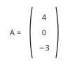
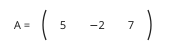
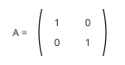

# Maths Form 3, Form Three Maths: authored answers for review

Every answer fixed by a person, not computed. Part 1: the tables, conventions and rules that computed answers come from.
Part 2: every authored question template, with all its data (keys, statements, pairs, choices and feedback) and sources.
Regenerate with `npm run review:f3-maths`. Item IDs (TR-…) match `docs/teacher-review.md`.

## Part 1

Rules the computed answers use are listed in the subject’s library tests; every authored answer is in Part 2.

## Part 2: authored question templates

| # | Template | Lesson | Type, level | Sources |
|---|---|---|---|---|
| 1 | `m3-13-lin` | 13 | multiple choice, 1 | formulae |
| 2 | `m3-13-sq` | 13 | multiple choice, 2 | formulae |
| 3 | `m3-13-twice` | 13 | multiple choice, 3 | formulae |
| 4 | `m3-13-sq-card` (card c3m13-2) | 13 | multiple choice, 1 | formulae |
| 5 | `m3-14-form` | 14 | multiple choice, 1 | variation |
| 6 | `m3-15-form` | 15 | multiple choice, 1 | variation |
| 7 | `m3-15-graph` | 15 | multiple choice, 2 | variation |
| 8 | `m3-15-graph-card` (card c3m15-3) | 15 | multiple choice, 1 | variation |
| 9 | `m3-17-name` | 17 | multiple choice, 1 | trigonometry |
| 10 | `m3-18-exact` | 18 | multiple choice, 1 | trigonometry |
| 11 | `m3-18-value` | 18 | number, 2 | trigonometry |
| 12 | `m3-20-type` | 20 | multiple choice, 1 | matrices |
| 13 | `m3-21-can` | 21 | multiple choice, 2 | matrices |
| 14 | `m3-21-can-card` (card c3m21-3) | 21 | multiple choice, 1 | matrices |
| 15 | `m3-25-def` | 25 | multiple choice, 1 | congruence |
| 16 | `m3-25-move` | 25 | multiple choice, 2 | congruence |
| 17 | `m3-25-match` | 25 | multiple choice, 3 | congruence |
| 18 | `m3-25-move-card` (card c3m25-3) | 25 | multiple choice, 1 | congruence |
| 19 | `m3-26-test` | 26 | multiple choice, 1 | congruence |
| 20 | `m3-26-not` | 26 | multiple choice, 1 | congruence |
| 21 | `m3-26-incl` | 26 | multiple choice, 2 | congruence |
| 22 | `m3-26-which` | 26 | multiple choice, 2 | congruence |
| 23 | `m3-26-proof` | 26 | multiple choice, 3 | congruence |
| 24 | `m3-26-incl-card` (card c3m26-2) | 26 | multiple choice, 1 | congruence |
| 25 | `m3-27-which` | 27 | multiple choice, 2 | similarity |
| 26 | `m3-27-which-card` (card c3m27-3) | 27 | multiple choice, 1 | similarity |
| 27 | `m3-33-ten` | 33 | number, 1 | indices-logs |
| 28 | `m3-33-pow` | 33 | number, 3 | indices-logs |
| 29 | `m3-33-pow-card` (card c3m33-3) | 33 | number, 1 | indices-logs |

### `m3-13-lin` · Lesson 13 · multiple choice, level 1

Prompt: {X.q}

Table `X` (one row is picked each time):

| q | r | w | e | y |
|---|---|---|---|---|
| Make t the subject of v = u + at. | t = (v − u) ÷ a | t = v − u − a · t = (v + u) ÷ a · t = v ÷ a − u | a multiplies t: divide by a, do not subtract it. · u is added on the right: subtract it, do not add. · Subtract u first (it is added last), then divide by a. | Subtract u from both sides, then divide by a. |
| Make w the subject of P = 2l + 2w. | w = (P − 2l) ÷ 2 | w = P − 2l − 2 · w = (P + 2l) ÷ 2 · w = P ÷ 2 − 2l | 2 multiplies w: divide by 2, do not subtract it. · 2l is added: subtract it from both sides. · Divide the whole of P − 2l by 2. | Subtract 2l, then divide by 2. |
| Make x the subject of y = mx + c. | x = (y − c) ÷ m | x = y − c − m · x = (y + c) ÷ m · x = y ÷ m − c | m multiplies x: divide by m. · c is added: subtract it. · Subtract c first, then divide the whole of y − c by m. | Subtract c, then divide by m. |
| Make b the subject of A = ½(a + b)h. | b = 2A ÷ h − a | b = A ÷ 2h − a · b = 2A − h − a · b = 2Ah − a | Multiply by 2 to undo ½: 2A, then divide by h. · h multiplies the bracket: divide by h, do not subtract. · Divide by h, do not multiply. | Multiply by 2, divide by h, then subtract a. |

Right answer: `{X.r}`; wrong choices: `{X.w[0]}`, `{X.w[1]}`, `{X.w[2]}`

- Feedback `w0`: “{X.e[0]}”
- Feedback `w1`: “{X.e[1]}”
- Feedback `w2`: “{X.e[2]}”

Three generated variants:

> Make w the subject of P = 2l + 2w.

- ◻️ w = P − 2l − 2  
  _↳ feedback if chosen: 2 multiplies w: divide by 2, do not subtract it._
- ◻️ w = P ÷ 2 − 2l  
  _↳ feedback if chosen: Divide the whole of P − 2l by 2._
- ◻️ w = (P + 2l) ÷ 2  
  _↳ feedback if chosen: 2l is added: subtract it from both sides._
- ✅ w = (P − 2l) ÷ 2

Full working after a second miss:

> Subtract 2l, then divide by 2.  
> So the answer is w = (P − 2l) ÷ 2.  

> Make t the subject of v = u + at.

- ✅ t = (v − u) ÷ a
- ◻️ t = v ÷ a − u  
  _↳ feedback if chosen: Subtract u first (it is added last), then divide by a._
- ◻️ t = v − u − a  
  _↳ feedback if chosen: a multiplies t: divide by a, do not subtract it._
- ◻️ t = (v + u) ÷ a  
  _↳ feedback if chosen: u is added on the right: subtract it, do not add._

Full working after a second miss:

> Subtract u from both sides, then divide by a.  
> So the answer is t = (v − u) ÷ a.  

> Make b the subject of A = ½(a + b)h.

- ✅ b = 2A ÷ h − a
- ◻️ b = A ÷ 2h − a  
  _↳ feedback if chosen: Multiply by 2 to undo ½: 2A, then divide by h._
- ◻️ b = 2A − h − a  
  _↳ feedback if chosen: h multiplies the bracket: divide by h, do not subtract._
- ◻️ b = 2Ah − a  
  _↳ feedback if chosen: Divide by h, do not multiply._

Full working after a second miss:

> Multiply by 2, divide by h, then subtract a.  
> So the answer is b = 2A ÷ h − a.  

Sources: formulae (Form 3 Mathematics syllabus, Term 1: transposition of formulae (change of subject))

### `m3-13-sq` · Lesson 13 · multiple choice, level 2

Prompt: {X.q}

Table `X` (one row is picked each time):

| q | r | w | e | y |
|---|---|---|---|---|
| Make r the subject of A = πr². | r = √(A ÷ π) | r = A ÷ π² · r = √A ÷ π · r = (A ÷ π)² | Only r is squared: divide by π, then take the square root. · Take the square root of the whole of A ÷ π. · To undo a square, take the square root, do not square. | Divide by π, then take the square root. |
| Make v the subject of E = ½mv². | v = √(2E ÷ m) | v = 2E ÷ m² · v = √(E ÷ 2m) · v = (2E ÷ m)² | Only v is squared: undo it with a square root at the end. · Multiply by 2 to undo ½, do not divide. · To undo a square, take the square root. | Multiply by 2, divide by m, then take the square root. |
| Make x the subject of y = x² − k. | x = √(y + k) | x = √y − k · x = (y + k)² · x = √(y − k) | Add k first, then take the square root of the whole of y + k. · To undo a square, take the square root. · k is subtracted: add it to both sides. | Add k to both sides, then take the square root. |

Right answer: `{X.r}`; wrong choices: `{X.w[0]}`, `{X.w[1]}`, `{X.w[2]}`

- Feedback `w0`: “{X.e[0]}”
- Feedback `w1`: “{X.e[1]}”
- Feedback `w2`: “{X.e[2]}”

Three generated variants:

> Make x the subject of y = x² − k.

- ◻️ x = (y + k)²  
  _↳ feedback if chosen: To undo a square, take the square root._
- ✅ x = √(y + k)
- ◻️ x = √(y − k)  
  _↳ feedback if chosen: k is subtracted: add it to both sides._
- ◻️ x = √y − k  
  _↳ feedback if chosen: Add k first, then take the square root of the whole of y + k._

Full working after a second miss:

> Add k to both sides, then take the square root.  
> So the answer is x = √(y + k).  

> Make v the subject of E = ½mv².

- ✅ v = √(2E ÷ m)
- ◻️ v = (2E ÷ m)²  
  _↳ feedback if chosen: To undo a square, take the square root._
- ◻️ v = 2E ÷ m²  
  _↳ feedback if chosen: Only v is squared: undo it with a square root at the end._
- ◻️ v = √(E ÷ 2m)  
  _↳ feedback if chosen: Multiply by 2 to undo ½, do not divide._

Full working after a second miss:

> Multiply by 2, divide by m, then take the square root.  
> So the answer is v = √(2E ÷ m).  

> Make v the subject of E = ½mv².

- ◻️ v = √(E ÷ 2m)  
  _↳ feedback if chosen: Multiply by 2 to undo ½, do not divide._
- ◻️ v = 2E ÷ m²  
  _↳ feedback if chosen: Only v is squared: undo it with a square root at the end._
- ✅ v = √(2E ÷ m)
- ◻️ v = (2E ÷ m)²  
  _↳ feedback if chosen: To undo a square, take the square root._

Full working after a second miss:

> Multiply by 2, divide by m, then take the square root.  
> So the answer is v = √(2E ÷ m).  

Sources: formulae (Form 3 Mathematics syllabus, Term 1: transposition of formulae (change of subject))

### `m3-13-twice` · Lesson 13 · multiple choice, level 3

Prompt: {X.q}

Table `X` (one row is picked each time):

| q | r | w | e | y |
|---|---|---|---|---|
| Make x the subject of ax + b = cx + d. | x = (d − b) ÷ (a − c) | x = (d + b) ÷ (a + c) · x = (d − b) ÷ a − c · x = d − b − a + c | Move cx by subtracting it and b by subtracting it: signs change. · Factorise x(a − c), then divide by the whole bracket. · x is multiplied by (a − c): divide, do not subtract. | Collect x terms: ax − cx = d − b, factorise x(a − c) = d − b, then divide. |
| Make x the subject of y = (x + 1) ÷ (x − 1). | x = (y + 1) ÷ (y − 1) | x = (y − 1) ÷ (y + 1) · x = y + 1 − y + 1 · x = (1 − y) ÷ (y + 1) | Check with y = 3: x = 2 gives (2 + 1) ÷ (2 − 1) = 3, so x = (y + 1) ÷ (y − 1). · x is a factor: factorise x(y − 1), then divide. · From xy − x = y + 1, x(y − 1) = y + 1: the signs are as in the answer. | Multiply by (x − 1): xy − y = x + 1. Collect: xy − x = y + 1, so x(y − 1) = y + 1. |
| Make a the subject of p = (a + b) ÷ a. | a = b ÷ (p − 1) | a = b ÷ p − 1 · a = (b − 1) ÷ p · a = b ÷ (p + 1) | Divide b by the whole of (p − 1). · From pa = a + b: pa − a = b, so a(p − 1) = b. · Moving a to the left subtracts it: p − 1, not p + 1. | Multiply by a: pa = a + b. Collect: pa − a = b, a(p − 1) = b. |

Right answer: `{X.r}`; wrong choices: `{X.w[0]}`, `{X.w[1]}`, `{X.w[2]}`

- Feedback `w0`: “{X.e[0]}”
- Feedback `w1`: “{X.e[1]}”
- Feedback `w2`: “{X.e[2]}”

Three generated variants:

> Make x the subject of y = (x + 1) ÷ (x − 1).

- ◻️ x = (y − 1) ÷ (y + 1)  
  _↳ feedback if chosen: Check with y = 3: x = 2 gives (2 + 1) ÷ (2 − 1) = 3, so x = (y + 1) ÷ (y − 1)._
- ✅ x = (y + 1) ÷ (y − 1)
- ◻️ x = y + 1 − y + 1  
  _↳ feedback if chosen: x is a factor: factorise x(y − 1), then divide._
- ◻️ x = (1 − y) ÷ (y + 1)  
  _↳ feedback if chosen: From xy − x = y + 1, x(y − 1) = y + 1: the signs are as in the answer._

Full working after a second miss:

> Multiply by (x − 1): xy − y = x + 1. Collect: xy − x = y + 1, so x(y − 1) = y + 1.  
> So the answer is x = (y + 1) ÷ (y − 1).  

> Make a the subject of p = (a + b) ÷ a.

- ◻️ a = (b − 1) ÷ p  
  _↳ feedback if chosen: From pa = a + b: pa − a = b, so a(p − 1) = b._
- ◻️ a = b ÷ (p + 1)  
  _↳ feedback if chosen: Moving a to the left subtracts it: p − 1, not p + 1._
- ◻️ a = b ÷ p − 1  
  _↳ feedback if chosen: Divide b by the whole of (p − 1)._
- ✅ a = b ÷ (p − 1)

Full working after a second miss:

> Multiply by a: pa = a + b. Collect: pa − a = b, a(p − 1) = b.  
> So the answer is a = b ÷ (p − 1).  

> Make x the subject of ax + b = cx + d.

- ◻️ x = (d − b) ÷ a − c  
  _↳ feedback if chosen: Factorise x(a − c), then divide by the whole bracket._
- ✅ x = (d − b) ÷ (a − c)
- ◻️ x = (d + b) ÷ (a + c)  
  _↳ feedback if chosen: Move cx by subtracting it and b by subtracting it: signs change._
- ◻️ x = d − b − a + c  
  _↳ feedback if chosen: x is multiplied by (a − c): divide, do not subtract._

Full working after a second miss:

> Collect x terms: ax − cx = d − b, factorise x(a − c) = d − b, then divide.  
> So the answer is x = (d − b) ÷ (a − c).  

Sources: formulae (Form 3 Mathematics syllabus, Term 1: transposition of formulae (change of subject))

### `m3-13-sq-card` · Lesson 13 · multiple choice, level 1

Prompt: {X.q}

Table `X` (one row is picked each time):

| q | r | w | e | y |
|---|---|---|---|---|
| Make r the subject of A = πr². | r = √(A ÷ π) | r = A ÷ π² · r = √A ÷ π · r = (A ÷ π)² | Only r is squared: divide by π, then take the square root. · Take the square root of the whole of A ÷ π. · To undo a square, take the square root, do not square. | Divide by π, then take the square root. |
| Make v the subject of E = ½mv². | v = √(2E ÷ m) | v = 2E ÷ m² · v = √(E ÷ 2m) · v = (2E ÷ m)² | Only v is squared: undo it with a square root at the end. · Multiply by 2 to undo ½, do not divide. · To undo a square, take the square root. | Multiply by 2, divide by m, then take the square root. |
| Make x the subject of y = x² − k. | x = √(y + k) | x = √y − k · x = (y + k)² · x = √(y − k) | Add k first, then take the square root of the whole of y + k. · To undo a square, take the square root. · k is subtracted: add it to both sides. | Add k to both sides, then take the square root. |

Right answer: `{X.r}`; wrong choices: `{X.w[0]}`, `{X.w[1]}`, `{X.w[2]}`

- Feedback `w0`: “{X.e[0]}”
- Feedback `w1`: “{X.e[1]}”
- Feedback `w2`: “{X.e[2]}”

Three generated variants:

> Make v the subject of E = ½mv².

- ◻️ v = (2E ÷ m)²  
  _↳ feedback if chosen: To undo a square, take the square root._
- ✅ v = √(2E ÷ m)
- ◻️ v = 2E ÷ m²  
  _↳ feedback if chosen: Only v is squared: undo it with a square root at the end._
- ◻️ v = √(E ÷ 2m)  
  _↳ feedback if chosen: Multiply by 2 to undo ½, do not divide._

Full working after a second miss:

> Multiply by 2, divide by m, then take the square root.  
> So the answer is v = √(2E ÷ m).  

> Make v the subject of E = ½mv².

- ✅ v = √(2E ÷ m)
- ◻️ v = (2E ÷ m)²  
  _↳ feedback if chosen: To undo a square, take the square root._
- ◻️ v = 2E ÷ m²  
  _↳ feedback if chosen: Only v is squared: undo it with a square root at the end._
- ◻️ v = √(E ÷ 2m)  
  _↳ feedback if chosen: Multiply by 2 to undo ½, do not divide._

Full working after a second miss:

> Multiply by 2, divide by m, then take the square root.  
> So the answer is v = √(2E ÷ m).  

> Make x the subject of y = x² − k.

- ✅ x = √(y + k)
- ◻️ x = √y − k  
  _↳ feedback if chosen: Add k first, then take the square root of the whole of y + k._
- ◻️ x = √(y − k)  
  _↳ feedback if chosen: k is subtracted: add it to both sides._
- ◻️ x = (y + k)²  
  _↳ feedback if chosen: To undo a square, take the square root._

Full working after a second miss:

> Add k to both sides, then take the square root.  
> So the answer is x = √(y + k).  

Sources: formulae (Form 3 Mathematics syllabus, Term 1: transposition of formulae (change of subject))

### `m3-14-form` · Lesson 14 · multiple choice, level 1

Prompt: {X.q}

Table `X` (one row is picked each time):

| q | r | w | e | y |
|---|---|---|---|---|
| y varies inversely as x. Which formula is right? | y = k ÷ x | y = kx · y = k + x · y = kx² | y = kx is direct variation. · Variation uses multiplying or dividing by k, not adding. · y = kx² is direct variation with the square of x. | Inverse variation: y = k ÷ x. |
| y varies directly as the square of x. Which formula is right? | y = kx² | y = k ÷ x² · y = (kx)² · y = kx | Dividing by x² is inverse variation. · Only x is squared; k is not. · That is direct variation with x, not x². | Directly as the square: y = kx². |
| y varies inversely as the square root of x. Which formula is right? | y = k ÷ √x | y = k√x · y = √(k ÷ x) · y = k ÷ x² | k√x is direct variation with √x. · k is not under the root. · That is the square, not the square root. | Inversely as √x: y = k ÷ √x. |

Right answer: `{X.r}`; wrong choices: `{X.w[0]}`, `{X.w[1]}`, `{X.w[2]}`

- Feedback `w0`: “{X.e[0]}”
- Feedback `w1`: “{X.e[1]}”
- Feedback `w2`: “{X.e[2]}”

Three generated variants:

> y varies directly as the square of x. Which formula is right?

- ◻️ y = kx  
  _↳ feedback if chosen: That is direct variation with x, not x²._
- ◻️ y = k ÷ x²  
  _↳ feedback if chosen: Dividing by x² is inverse variation._
- ◻️ y = (kx)²  
  _↳ feedback if chosen: Only x is squared; k is not._
- ✅ y = kx²

Full working after a second miss:

> Directly as the square: y = kx².  
> So the answer is y = kx².  

> y varies inversely as x. Which formula is right?

- ✅ y = k ÷ x
- ◻️ y = kx  
  _↳ feedback if chosen: y = kx is direct variation._
- ◻️ y = kx²  
  _↳ feedback if chosen: y = kx² is direct variation with the square of x._
- ◻️ y = k + x  
  _↳ feedback if chosen: Variation uses multiplying or dividing by k, not adding._

Full working after a second miss:

> Inverse variation: y = k ÷ x.  
> So the answer is y = k ÷ x.  

> y varies inversely as the square root of x. Which formula is right?

- ◻️ y = k ÷ x²  
  _↳ feedback if chosen: That is the square, not the square root._
- ◻️ y = √(k ÷ x)  
  _↳ feedback if chosen: k is not under the root._
- ◻️ y = k√x  
  _↳ feedback if chosen: k√x is direct variation with √x._
- ✅ y = k ÷ √x

Full working after a second miss:

> Inversely as √x: y = k ÷ √x.  
> So the answer is y = k ÷ √x.  

Sources: variation (Form 3 Mathematics syllabus, Term 1: direct, inverse, joint and partial variation; graphs)

### `m3-15-form` · Lesson 15 · multiple choice, level 1

Prompt: {X.q}

Table `X` (one row is picked each time):

| q | r | w | e | y |
|---|---|---|---|---|
| z varies jointly as x and y. Which formula is right? | z = kxy | z = k(x + y) · z = kx ÷ y · z = xy | Jointly means multiply, not add. · kx ÷ y means inversely as y. · There must be a constant k. | Jointly: z = kxy. |
| z varies directly as x and inversely as y. Which formula is right? | z = kx ÷ y | z = kxy · z = ky ÷ x · z = k(x − y) | That is jointly as x and y. · x and y are the wrong way round. · Variation uses multiplying or dividing. | Directly as x (top), inversely as y (bottom). |
| P varies directly as the square of v and inversely as r. Which formula is right? | P = kv² ÷ r | P = kvr² · P = kr ÷ v² · P = k(v² − r) | r should divide, not multiply. · v² goes on top, r at the bottom. · Variation uses multiplying and dividing. | P = kv² ÷ r. |

Right answer: `{X.r}`; wrong choices: `{X.w[0]}`, `{X.w[1]}`, `{X.w[2]}`

- Feedback `w0`: “{X.e[0]}”
- Feedback `w1`: “{X.e[1]}”
- Feedback `w2`: “{X.e[2]}”

Three generated variants:

> z varies directly as x and inversely as y. Which formula is right?

- ◻️ z = k(x − y)  
  _↳ feedback if chosen: Variation uses multiplying or dividing._
- ◻️ z = kxy  
  _↳ feedback if chosen: That is jointly as x and y._
- ◻️ z = ky ÷ x  
  _↳ feedback if chosen: x and y are the wrong way round._
- ✅ z = kx ÷ y

Full working after a second miss:

> Directly as x (top), inversely as y (bottom).  
> So the answer is z = kx ÷ y.  

> P varies directly as the square of v and inversely as r. Which formula is right?

- ✅ P = kv² ÷ r
- ◻️ P = kvr²  
  _↳ feedback if chosen: r should divide, not multiply._
- ◻️ P = kr ÷ v²  
  _↳ feedback if chosen: v² goes on top, r at the bottom._
- ◻️ P = k(v² − r)  
  _↳ feedback if chosen: Variation uses multiplying and dividing._

Full working after a second miss:

> P = kv² ÷ r.  
> So the answer is P = kv² ÷ r.  

> z varies directly as x and inversely as y. Which formula is right?

- ◻️ z = kxy  
  _↳ feedback if chosen: That is jointly as x and y._
- ✅ z = kx ÷ y
- ◻️ z = ky ÷ x  
  _↳ feedback if chosen: x and y are the wrong way round._
- ◻️ z = k(x − y)  
  _↳ feedback if chosen: Variation uses multiplying or dividing._

Full working after a second miss:

> Directly as x (top), inversely as y (bottom).  
> So the answer is z = kx ÷ y.  

Sources: variation (Form 3 Mathematics syllabus, Term 1: direct, inverse, joint and partial variation; graphs)

### `m3-15-graph` · Lesson 15 · multiple choice, level 2

Prompt: {X.q}

Table `X` (one row is picked each time):

| q | r | w | e | y |
|---|---|---|---|---|
| What does the graph of y = kx (k > 0) look like? | A straight line through the origin | A curve that never meets the axes · A straight line that does not pass through the origin · A U-shaped curve | That is y = k ÷ x. · When x = 0, y = k × 0 = 0: the line passes through the origin. · That is y = kx². | y = kx is a straight line; x = 0 gives y = 0. |
| What does the graph of y = k ÷ x (k > 0, x > 0) look like? | A curve that gets closer to both axes but never meets them | A straight line through the origin · A U-shaped curve through the origin · A straight line sloping down to the x-axis | That is direct variation, y = kx. · That is y = kx². · y = k ÷ x is never zero, so it never reaches the x-axis. | y = k ÷ x: as x grows, y shrinks towards zero but never reaches it. |
| What does the graph of y = kx² (k > 0) look like? | A U-shaped curve (parabola) through the origin | A straight line through the origin · A curve that never meets the axes · A straight line that does not pass through the origin | y doubles when x doubles only for y = kx; here y is four times as big. · That is y = k ÷ x. · x = 0 gives y = 0: it passes through the origin. | y = kx² is a parabola with its lowest point at the origin. |

Right answer: `{X.r}`; wrong choices: `{X.w[0]}`, `{X.w[1]}`, `{X.w[2]}`

- Feedback `w0`: “{X.e[0]}”
- Feedback `w1`: “{X.e[1]}”
- Feedback `w2`: “{X.e[2]}”

Three generated variants:

> What does the graph of y = kx² (k > 0) look like?

- ◻️ A straight line through the origin  
  _↳ feedback if chosen: y doubles when x doubles only for y = kx; here y is four times as big._
- ◻️ A curve that never meets the axes  
  _↳ feedback if chosen: That is y = k ÷ x._
- ◻️ A straight line that does not pass through the origin  
  _↳ feedback if chosen: x = 0 gives y = 0: it passes through the origin._
- ✅ A U-shaped curve (parabola) through the origin

Full working after a second miss:

> y = kx² is a parabola with its lowest point at the origin.  
> So the answer is A U-shaped curve (parabola) through the origin.  

> What does the graph of y = k ÷ x (k > 0, x > 0) look like?

- ◻️ A straight line through the origin  
  _↳ feedback if chosen: That is direct variation, y = kx._
- ◻️ A U-shaped curve through the origin  
  _↳ feedback if chosen: That is y = kx²._
- ◻️ A straight line sloping down to the x-axis  
  _↳ feedback if chosen: y = k ÷ x is never zero, so it never reaches the x-axis._
- ✅ A curve that gets closer to both axes but never meets them

Full working after a second miss:

> y = k ÷ x: as x grows, y shrinks towards zero but never reaches it.  
> So the answer is A curve that gets closer to both axes but never meets them.  

> What does the graph of y = kx² (k > 0) look like?

- ✅ A U-shaped curve (parabola) through the origin
- ◻️ A straight line that does not pass through the origin  
  _↳ feedback if chosen: x = 0 gives y = 0: it passes through the origin._
- ◻️ A straight line through the origin  
  _↳ feedback if chosen: y doubles when x doubles only for y = kx; here y is four times as big._
- ◻️ A curve that never meets the axes  
  _↳ feedback if chosen: That is y = k ÷ x._

Full working after a second miss:

> y = kx² is a parabola with its lowest point at the origin.  
> So the answer is A U-shaped curve (parabola) through the origin.  

Sources: variation (Form 3 Mathematics syllabus, Term 1: direct, inverse, joint and partial variation; graphs)

### `m3-15-graph-card` · Lesson 15 · multiple choice, level 1

Prompt: {X.q}

Table `X` (one row is picked each time):

| q | r | w | e | y |
|---|---|---|---|---|
| What does the graph of y = kx (k > 0) look like? | A straight line through the origin | A curve that never meets the axes · A straight line that does not pass through the origin · A U-shaped curve | That is y = k ÷ x. · When x = 0, y = k × 0 = 0: the line passes through the origin. · That is y = kx². | y = kx is a straight line; x = 0 gives y = 0. |
| What does the graph of y = k ÷ x (k > 0, x > 0) look like? | A curve that gets closer to both axes but never meets them | A straight line through the origin · A U-shaped curve through the origin · A straight line sloping down to the x-axis | That is direct variation, y = kx. · That is y = kx². · y = k ÷ x is never zero, so it never reaches the x-axis. | y = k ÷ x: as x grows, y shrinks towards zero but never reaches it. |
| What does the graph of y = kx² (k > 0) look like? | A U-shaped curve (parabola) through the origin | A straight line through the origin · A curve that never meets the axes · A straight line that does not pass through the origin | y doubles when x doubles only for y = kx; here y is four times as big. · That is y = k ÷ x. · x = 0 gives y = 0: it passes through the origin. | y = kx² is a parabola with its lowest point at the origin. |

Right answer: `{X.r}`; wrong choices: `{X.w[0]}`, `{X.w[1]}`, `{X.w[2]}`

- Feedback `w0`: “{X.e[0]}”
- Feedback `w1`: “{X.e[1]}”
- Feedback `w2`: “{X.e[2]}”

Three generated variants:

> What does the graph of y = k ÷ x (k > 0, x > 0) look like?

- ◻️ A U-shaped curve through the origin  
  _↳ feedback if chosen: That is y = kx²._
- ◻️ A straight line sloping down to the x-axis  
  _↳ feedback if chosen: y = k ÷ x is never zero, so it never reaches the x-axis._
- ✅ A curve that gets closer to both axes but never meets them
- ◻️ A straight line through the origin  
  _↳ feedback if chosen: That is direct variation, y = kx._

Full working after a second miss:

> y = k ÷ x: as x grows, y shrinks towards zero but never reaches it.  
> So the answer is A curve that gets closer to both axes but never meets them.  

> What does the graph of y = k ÷ x (k > 0, x > 0) look like?

- ◻️ A straight line through the origin  
  _↳ feedback if chosen: That is direct variation, y = kx._
- ◻️ A straight line sloping down to the x-axis  
  _↳ feedback if chosen: y = k ÷ x is never zero, so it never reaches the x-axis._
- ◻️ A U-shaped curve through the origin  
  _↳ feedback if chosen: That is y = kx²._
- ✅ A curve that gets closer to both axes but never meets them

Full working after a second miss:

> y = k ÷ x: as x grows, y shrinks towards zero but never reaches it.  
> So the answer is A curve that gets closer to both axes but never meets them.  

> What does the graph of y = kx (k > 0) look like?

- ◻️ A U-shaped curve  
  _↳ feedback if chosen: That is y = kx²._
- ◻️ A curve that never meets the axes  
  _↳ feedback if chosen: That is y = k ÷ x._
- ✅ A straight line through the origin
- ◻️ A straight line that does not pass through the origin  
  _↳ feedback if chosen: When x = 0, y = k × 0 = 0: the line passes through the origin._

Full working after a second miss:

> y = kx is a straight line; x = 0 gives y = 0.  
> So the answer is A straight line through the origin.  

Sources: variation (Form 3 Mathematics syllabus, Term 1: direct, inverse, joint and partial variation; graphs)

### `m3-17-name` · Lesson 17 · multiple choice, level 1

Prompt: {X.q}

Table `X` (one row is picked each time):

| q | r | w | e | y |
|---|---|---|---|---|
| Which ratio is opposite ÷ hypotenuse? | sin θ | cos θ · tan θ · hyp θ | cos θ is adjacent ÷ hypotenuse. · tan θ is opposite ÷ adjacent. · There is no ratio called hyp θ. | SOH: sine is opposite over hypotenuse. |
| Which ratio is opposite ÷ adjacent? | tan θ | sin θ · cos θ · sec θ | sin θ is opposite ÷ hypotenuse. · cos θ is adjacent ÷ hypotenuse. · Not used in Form 3: TOA gives tan. | TOA: tangent is opposite over adjacent. |
| Which side is the adjacent side for the angle θ? | The side next to θ that is not the hypotenuse | The side facing θ · The longest side · Any side touching the right angle | The side facing θ is the opposite side. · The longest side is the hypotenuse. · One of the sides at the right angle is opposite θ. | Adjacent means next to: it touches θ but is not the hypotenuse. |

Right answer: `{X.r}`; wrong choices: `{X.w[0]}`, `{X.w[1]}`, `{X.w[2]}`

- Feedback `w0`: “{X.e[0]}”
- Feedback `w1`: “{X.e[1]}”
- Feedback `w2`: “{X.e[2]}”

Three generated variants:

> Which ratio is opposite ÷ hypotenuse?

- ◻️ tan θ  
  _↳ feedback if chosen: tan θ is opposite ÷ adjacent._
- ✅ sin θ
- ◻️ hyp θ  
  _↳ feedback if chosen: There is no ratio called hyp θ._
- ◻️ cos θ  
  _↳ feedback if chosen: cos θ is adjacent ÷ hypotenuse._

Full working after a second miss:

> SOH: sine is opposite over hypotenuse.  
> So the answer is sin θ.  

> Which ratio is opposite ÷ adjacent?

- ◻️ sec θ  
  _↳ feedback if chosen: Not used in Form 3: TOA gives tan._
- ✅ tan θ
- ◻️ sin θ  
  _↳ feedback if chosen: sin θ is opposite ÷ hypotenuse._
- ◻️ cos θ  
  _↳ feedback if chosen: cos θ is adjacent ÷ hypotenuse._

Full working after a second miss:

> TOA: tangent is opposite over adjacent.  
> So the answer is tan θ.  

> Which ratio is opposite ÷ hypotenuse?

- ◻️ hyp θ  
  _↳ feedback if chosen: There is no ratio called hyp θ._
- ◻️ cos θ  
  _↳ feedback if chosen: cos θ is adjacent ÷ hypotenuse._
- ◻️ tan θ  
  _↳ feedback if chosen: tan θ is opposite ÷ adjacent._
- ✅ sin θ

Full working after a second miss:

> SOH: sine is opposite over hypotenuse.  
> So the answer is sin θ.  

Sources: trigonometry (Form 3 Mathematics syllabus, Term 1: trigonometric ratios of acute angles, complementary angles, special angles (30°, 45°, 60°), calculators, solving right-angled triangles, elevation and depression)

### `m3-18-exact` · Lesson 18 · multiple choice, level 1

Prompt: What is the exact value of {X.q}?

Table `X` (one row is picked each time):

| q | r | w | e | y |
|---|---|---|---|---|
| sin 30° | 1/2 | √3/2 · 1/√2 · √3 | √3/2 is sin 60° (or cos 30°). · 1/√2 is sin 45°. · √3 is tan 60°. | sin 30° = 1/2 (half an equilateral triangle). |
| cos 30° | √3/2 | 1/2 · 1/√3 · 1 | 1/2 is cos 60°. · 1/√3 is tan 30°. · cos 30° is less than 1. | cos 30° = √3/2. |
| tan 45° | 1 | 1/√2 · √3 · 1/2 | 1/√2 is sin 45° and cos 45°. · √3 is tan 60°. · 1/2 is sin 30°. | In half a square, opposite = adjacent, so tan 45° = 1. |
| tan 60° | √3 | 1/√3 · √3/2 · 1 | 1/√3 is tan 30°. · √3/2 is sin 60°. · 1 is tan 45°. | tan 60° = √3. |
| sin 45° | 1/√2 | 1 · 1/2 · √3/2 | 1 is tan 45°. · 1/2 is sin 30°. · √3/2 is sin 60°. | sin 45° = 1/√2 = √2/2. |

Right answer: `{X.r}`; wrong choices: `{X.w[0]}`, `{X.w[1]}`, `{X.w[2]}`

- Feedback `w0`: “{X.e[0]}”
- Feedback `w1`: “{X.e[1]}”
- Feedback `w2`: “{X.e[2]}”

Three generated variants:

> What is the exact value of tan 60°?

- ✅ √3
- ◻️ 1/√3  
  _↳ feedback if chosen: 1/√3 is tan 30°._
- ◻️ √3/2  
  _↳ feedback if chosen: √3/2 is sin 60°._
- ◻️ 1  
  _↳ feedback if chosen: 1 is tan 45°._

Full working after a second miss:

> tan 60° = √3.  
> So the answer is √3.  

> What is the exact value of sin 30°?

- ◻️ 1/√2  
  _↳ feedback if chosen: 1/√2 is sin 45°._
- ◻️ √3/2  
  _↳ feedback if chosen: √3/2 is sin 60° (or cos 30°)._
- ✅ 1/2
- ◻️ √3  
  _↳ feedback if chosen: √3 is tan 60°._

Full working after a second miss:

> sin 30° = 1/2 (half an equilateral triangle).  
> So the answer is 1/2.  

> What is the exact value of sin 30°?

- ◻️ 1/√2  
  _↳ feedback if chosen: 1/√2 is sin 45°._
- ◻️ √3/2  
  _↳ feedback if chosen: √3/2 is sin 60° (or cos 30°)._
- ✅ 1/2
- ◻️ √3  
  _↳ feedback if chosen: √3 is tan 60°._

Full working after a second miss:

> sin 30° = 1/2 (half an equilateral triangle).  
> So the answer is 1/2.  

Sources: trigonometry (Form 3 Mathematics syllabus, Term 1: trigonometric ratios of acute angles, complementary angles, special angles (30°, 45°, 60°), calculators, solving right-angled triangles, elevation and depression)

### `m3-18-value` · Lesson 18 · number, level 2

Prompt: Without a calculator, find the value of {X.e}.
Right answer: `X.v`

Table `X` (one row is picked each time):

| e | s | v |
|---|---|---|
| sin 30° + cos 60° | 1/2 + 1/2 | 1 |
| 4 sin 30° × tan 45° | 4 × 1/2 × 1 | 2 |
| tan 45° − cos 60° | 1 − 1/2 | 0.5 |
| 2 cos 60° + 3 tan 45° | 2 × 1/2 + 3 × 1 | 4 |
| sin² 45° + cos² 45° | (1/√2)² + (1/√2)² = 1/2 + 1/2 | 1 |
| tan 60° × tan 30° | √3 × 1/√3 | 1 |

Three generated variants:

> Without a calculator, find the value of 4 sin 30° × tan 45°.

Answer: **2**

Full working after a second miss:

> 4 × 1/2 × 1  
> = 2.  

> Without a calculator, find the value of sin² 45° + cos² 45°.

Answer: **1**

Full working after a second miss:

> (1/√2)² + (1/√2)² = 1/2 + 1/2  
> = 1.  

> Without a calculator, find the value of sin 30° + cos 60°.

Answer: **1**

Full working after a second miss:

> 1/2 + 1/2  
> = 1.  

Sources: trigonometry (Form 3 Mathematics syllabus, Term 1: trigonometric ratios of acute angles, complementary angles, special angles (30°, 45°, 60°), calculators, solving right-angled triangles, elevation and depression)

### `m3-20-type` · Lesson 20 · multiple choice, level 1

Prompt: What type of matrix is A?

Table `X` (one row is picked each time):

| m | r | w | e | y |
|---|---|---|---|---|
| 1,0 · 0,1 | Identity matrix | Zero matrix · Row matrix · Column matrix | A zero matrix has every element 0. · A row matrix has only one row. · A column matrix has only one column. | Ones on the leading diagonal, zeros elsewhere: the identity matrix I. |
| 0,0 · 0,0 | Zero matrix | Identity matrix · Diagonal matrix with ones · Row matrix | The identity has ones on the leading diagonal. · Every element here is zero. · It has two rows. | Every element is 0: the zero (null) matrix. |
| 5,-2,7 | Row matrix | Column matrix · Square matrix · Identity matrix | A column matrix has one column; this has one row. · A square matrix has as many rows as columns: this is 1 × 3. · The identity is square with ones on the diagonal. | One row: a row matrix (order 1 × 3). |
| 4 · 0 · -3 | Column matrix | Row matrix · Square matrix · Zero matrix | It has one column, not one row. · It is 3 × 1, not square. · Not every element is 0. | One column: a column matrix (order 3 × 1). |
| 3,0 · 0,-2 | Diagonal matrix | Identity matrix · Zero matrix · Row matrix | The identity has ones on the diagonal; here they are 3 and −2. · Not every element is 0. · It has two rows. | Zeros everywhere except the leading diagonal: a diagonal matrix. |

Right answer: `{X.r}`; wrong choices: `{X.w[0]}`, `{X.w[1]}`, `{X.w[2]}`

- Feedback `w0`: “{X.e[0]}”
- Feedback `w1`: “{X.e[1]}”
- Feedback `w2`: “{X.e[2]}”

Three generated variants:

> What type of matrix is A?

- ◻️ Zero matrix  
  _↳ feedback if chosen: Not every element is 0._
- ◻️ Square matrix  
  _↳ feedback if chosen: It is 3 × 1, not square._
- ✅ Column matrix
- ◻️ Row matrix  
  _↳ feedback if chosen: It has one column, not one row._

Full working after a second miss:

> One column: a column matrix (order 3 × 1).  
> So the answer is Column matrix.  

> What type of matrix is A?

- ◻️ Column matrix  
  _↳ feedback if chosen: A column matrix has one column; this has one row._
- ◻️ Identity matrix  
  _↳ feedback if chosen: The identity is square with ones on the diagonal._
- ◻️ Square matrix  
  _↳ feedback if chosen: A square matrix has as many rows as columns: this is 1 × 3._
- ✅ Row matrix

Full working after a second miss:

> One row: a row matrix (order 1 × 3).  
> So the answer is Row matrix.  

> What type of matrix is A?

- ◻️ Row matrix  
  _↳ feedback if chosen: A row matrix has only one row._
- ◻️ Zero matrix  
  _↳ feedback if chosen: A zero matrix has every element 0._
- ◻️ Column matrix  
  _↳ feedback if chosen: A column matrix has only one column._
- ✅ Identity matrix

Full working after a second miss:

> Ones on the leading diagonal, zeros elsewhere: the identity matrix I.  
> So the answer is Identity matrix.  

Sources: matrices (Form 3 Mathematics syllabus, Term 1: matrices (definition, types, addition, subtraction, scalar and matrix multiplication, transpose, determinant, adjoint, inverse of a 2 × 2 matrix))

### `m3-21-can` · Lesson 21 · multiple choice, level 2

Prompt: {X.q}

Table `X` (one row is picked each time):

| q | r | w | e | y |
|---|---|---|---|---|
| A is a 2 × 2 matrix and B is a 2 × 3 matrix. Can you work out A + B? | No: they have different orders | Yes: add the elements that match and leave the rest · Yes: the answer is 2 × 3 · Yes: the answer is 2 × 5 | Every element must have a partner: the orders must be the same. · Addition needs the same order for both matrices. · Orders are not added. | Only matrices of the same order can be added. |
| A and B are both 3 × 2 matrices. What is the order of A − B? | 3 × 2 | 6 × 4 · 2 × 3 · 3 × 4 | Orders are not added: subtracting element by element keeps the order. · Rows stay rows: 3 × 2. · The number of columns does not change. | Adding or subtracting keeps the order: 3 × 2. |
| A is a 2 × 3 matrix. What is the order of 5A? | 2 × 3 | 10 × 15 · 2 × 15 · 10 × 3 | The scalar multiplies the elements, not the order. · The number of columns does not change. · The number of rows does not change. | Scalar multiplication keeps the order. |

Right answer: `{X.r}`; wrong choices: `{X.w[0]}`, `{X.w[1]}`, `{X.w[2]}`

- Feedback `w0`: “{X.e[0]}”
- Feedback `w1`: “{X.e[1]}”
- Feedback `w2`: “{X.e[2]}”

Three generated variants:

> A and B are both 3 × 2 matrices. What is the order of A − B?

- ◻️ 3 × 4  
  _↳ feedback if chosen: The number of columns does not change._
- ◻️ 6 × 4  
  _↳ feedback if chosen: Orders are not added: subtracting element by element keeps the order._
- ◻️ 2 × 3  
  _↳ feedback if chosen: Rows stay rows: 3 × 2._
- ✅ 3 × 2

Full working after a second miss:

> Adding or subtracting keeps the order: 3 × 2.  
> So the answer is 3 × 2.  

> A and B are both 3 × 2 matrices. What is the order of A − B?

- ◻️ 2 × 3  
  _↳ feedback if chosen: Rows stay rows: 3 × 2._
- ✅ 3 × 2
- ◻️ 6 × 4  
  _↳ feedback if chosen: Orders are not added: subtracting element by element keeps the order._
- ◻️ 3 × 4  
  _↳ feedback if chosen: The number of columns does not change._

Full working after a second miss:

> Adding or subtracting keeps the order: 3 × 2.  
> So the answer is 3 × 2.  

> A and B are both 3 × 2 matrices. What is the order of A − B?

- ✅ 3 × 2
- ◻️ 2 × 3  
  _↳ feedback if chosen: Rows stay rows: 3 × 2._
- ◻️ 6 × 4  
  _↳ feedback if chosen: Orders are not added: subtracting element by element keeps the order._
- ◻️ 3 × 4  
  _↳ feedback if chosen: The number of columns does not change._

Full working after a second miss:

> Adding or subtracting keeps the order: 3 × 2.  
> So the answer is 3 × 2.  

Sources: matrices (Form 3 Mathematics syllabus, Term 1: matrices (definition, types, addition, subtraction, scalar and matrix multiplication, transpose, determinant, adjoint, inverse of a 2 × 2 matrix))

### `m3-21-can-card` · Lesson 21 · multiple choice, level 1

Prompt: {X.q}

Table `X` (one row is picked each time):

| q | r | w | e | y |
|---|---|---|---|---|
| A is a 2 × 2 matrix and B is a 2 × 3 matrix. Can you work out A + B? | No: they have different orders | Yes: add the elements that match and leave the rest · Yes: the answer is 2 × 3 · Yes: the answer is 2 × 5 | Every element must have a partner: the orders must be the same. · Addition needs the same order for both matrices. · Orders are not added. | Only matrices of the same order can be added. |
| A and B are both 3 × 2 matrices. What is the order of A − B? | 3 × 2 | 6 × 4 · 2 × 3 · 3 × 4 | Orders are not added: subtracting element by element keeps the order. · Rows stay rows: 3 × 2. · The number of columns does not change. | Adding or subtracting keeps the order: 3 × 2. |
| A is a 2 × 3 matrix. What is the order of 5A? | 2 × 3 | 10 × 15 · 2 × 15 · 10 × 3 | The scalar multiplies the elements, not the order. · The number of columns does not change. · The number of rows does not change. | Scalar multiplication keeps the order. |

Right answer: `{X.r}`; wrong choices: `{X.w[0]}`, `{X.w[1]}`, `{X.w[2]}`

- Feedback `w0`: “{X.e[0]}”
- Feedback `w1`: “{X.e[1]}”
- Feedback `w2`: “{X.e[2]}”

Three generated variants:

> A and B are both 3 × 2 matrices. What is the order of A − B?

- ◻️ 3 × 4  
  _↳ feedback if chosen: The number of columns does not change._
- ◻️ 6 × 4  
  _↳ feedback if chosen: Orders are not added: subtracting element by element keeps the order._
- ◻️ 2 × 3  
  _↳ feedback if chosen: Rows stay rows: 3 × 2._
- ✅ 3 × 2

Full working after a second miss:

> Adding or subtracting keeps the order: 3 × 2.  
> So the answer is 3 × 2.  

> A is a 2 × 3 matrix. What is the order of 5A?

- ◻️ 10 × 3  
  _↳ feedback if chosen: The number of rows does not change._
- ✅ 2 × 3
- ◻️ 10 × 15  
  _↳ feedback if chosen: The scalar multiplies the elements, not the order._
- ◻️ 2 × 15  
  _↳ feedback if chosen: The number of columns does not change._

Full working after a second miss:

> Scalar multiplication keeps the order.  
> So the answer is 2 × 3.  

> A is a 2 × 3 matrix. What is the order of 5A?

- ◻️ 2 × 15  
  _↳ feedback if chosen: The number of columns does not change._
- ◻️ 10 × 3  
  _↳ feedback if chosen: The number of rows does not change._
- ✅ 2 × 3
- ◻️ 10 × 15  
  _↳ feedback if chosen: The scalar multiplies the elements, not the order._

Full working after a second miss:

> Scalar multiplication keeps the order.  
> So the answer is 2 × 3.  

Sources: matrices (Form 3 Mathematics syllabus, Term 1: matrices (definition, types, addition, subtraction, scalar and matrix multiplication, transpose, determinant, adjoint, inverse of a 2 × 2 matrix))

### `m3-25-def` · Lesson 25 · multiple choice, level 1

Prompt: {X.q}

Table `X` (one row is picked each time):

| q | r | w | e | y |
|---|---|---|---|---|
| What does it mean for two figures to be congruent? | Same shape and same size | Same shape, possibly a different size · Same area only · Same perimeter only | That describes similar figures. · Different shapes can have the same area. · Different shapes can have the same perimeter. | Congruent figures fit exactly on top of each other. |
| Two triangles have the same angles but one is twice as big. They are… | similar, not congruent | congruent · neither similar nor congruent · congruent and similar | Congruent figures must also be the same size. · Equal angles make them similar. · Different sizes: not congruent. | Same shape, different size: similar. |
| Which pair is always congruent? | Two squares with sides of 5 cm | Two squares · Two rectangles with the same area · Two triangles with the same angles | Squares of different sizes are only similar. · A 2 × 8 and a 4 × 4 rectangle have the same area but different shapes. · Equal angles give similar triangles; they can differ in size. | Same shape and the same side length: congruent. |

Right answer: `{X.r}`; wrong choices: `{X.w[0]}`, `{X.w[1]}`, `{X.w[2]}`

- Feedback `w0`: “{X.e[0]}”
- Feedback `w1`: “{X.e[1]}”
- Feedback `w2`: “{X.e[2]}”

Three generated variants:

> What does it mean for two figures to be congruent?

- ◻️ Same perimeter only  
  _↳ feedback if chosen: Different shapes can have the same perimeter._
- ◻️ Same area only  
  _↳ feedback if chosen: Different shapes can have the same area._
- ◻️ Same shape, possibly a different size  
  _↳ feedback if chosen: That describes similar figures._
- ✅ Same shape and same size

Full working after a second miss:

> Congruent figures fit exactly on top of each other.  
> So the answer is Same shape and same size.  

> What does it mean for two figures to be congruent?

- ◻️ Same perimeter only  
  _↳ feedback if chosen: Different shapes can have the same perimeter._
- ◻️ Same shape, possibly a different size  
  _↳ feedback if chosen: That describes similar figures._
- ◻️ Same area only  
  _↳ feedback if chosen: Different shapes can have the same area._
- ✅ Same shape and same size

Full working after a second miss:

> Congruent figures fit exactly on top of each other.  
> So the answer is Same shape and same size.  

> What does it mean for two figures to be congruent?

- ◻️ Same perimeter only  
  _↳ feedback if chosen: Different shapes can have the same perimeter._
- ◻️ Same area only  
  _↳ feedback if chosen: Different shapes can have the same area._
- ✅ Same shape and same size
- ◻️ Same shape, possibly a different size  
  _↳ feedback if chosen: That describes similar figures._

Full working after a second miss:

> Congruent figures fit exactly on top of each other.  
> So the answer is Same shape and same size.  

Sources: congruence (Form 3 Mathematics syllabus, Term 1: congruency, congruent plane figures, congruency in triangles (SSS, SAS, ASA, RHS))

### `m3-25-move` · Lesson 25 · multiple choice, level 2

Prompt: {X.q}

Table `X` (one row is picked each time):

| q | r | w | e | y |
|---|---|---|---|---|
| Which transformation always gives an image congruent to the object? | A rotation | An enlargement with scale factor 2 · An enlargement with scale factor ½ · A stretch in one direction | Scale factor 2 doubles the lengths: similar, not congruent. · Scale factor ½ halves the lengths. · A stretch changes the shape. | Rotations keep lengths and angles. |
| A triangle is reflected in a line. The image is… | congruent to the triangle | larger than the triangle · similar but smaller · a different shape | A reflection keeps every length. · A reflection keeps the size. · A reflection keeps the shape. | Reflections keep lengths and angles: the image is congruent. |
| Which of these does NOT give a congruent image? | An enlargement with scale factor 3 | A translation · A rotation of 90° · A reflection | A translation slides the shape without changing it. · A rotation turns the shape without changing it. · A reflection flips the shape without changing its size. | An enlargement changes the size. |

Right answer: `{X.r}`; wrong choices: `{X.w[0]}`, `{X.w[1]}`, `{X.w[2]}`

- Feedback `w0`: “{X.e[0]}”
- Feedback `w1`: “{X.e[1]}”
- Feedback `w2`: “{X.e[2]}”

Three generated variants:

> A triangle is reflected in a line. The image is…

- ◻️ a different shape  
  _↳ feedback if chosen: A reflection keeps the shape._
- ◻️ larger than the triangle  
  _↳ feedback if chosen: A reflection keeps every length._
- ✅ congruent to the triangle
- ◻️ similar but smaller  
  _↳ feedback if chosen: A reflection keeps the size._

Full working after a second miss:

> Reflections keep lengths and angles: the image is congruent.  
> So the answer is congruent to the triangle.  

> A triangle is reflected in a line. The image is…

- ◻️ a different shape  
  _↳ feedback if chosen: A reflection keeps the shape._
- ◻️ similar but smaller  
  _↳ feedback if chosen: A reflection keeps the size._
- ✅ congruent to the triangle
- ◻️ larger than the triangle  
  _↳ feedback if chosen: A reflection keeps every length._

Full working after a second miss:

> Reflections keep lengths and angles: the image is congruent.  
> So the answer is congruent to the triangle.  

> A triangle is reflected in a line. The image is…

- ◻️ a different shape  
  _↳ feedback if chosen: A reflection keeps the shape._
- ◻️ larger than the triangle  
  _↳ feedback if chosen: A reflection keeps every length._
- ✅ congruent to the triangle
- ◻️ similar but smaller  
  _↳ feedback if chosen: A reflection keeps the size._

Full working after a second miss:

> Reflections keep lengths and angles: the image is congruent.  
> So the answer is congruent to the triangle.  

Sources: congruence (Form 3 Mathematics syllabus, Term 1: congruency, congruent plane figures, congruency in triangles (SSS, SAS, ASA, RHS))

### `m3-25-match` · Lesson 25 · multiple choice, level 3

Prompt: {X.q}

Table `X` (one row is picked each time):

| q | r | w | e | y |
|---|---|---|---|---|
| ΔKLM ≅ ΔXYZ. Which side equals LM? | YZ | XY · XZ · LZ | XY matches KL. · XZ matches KM. · Sides are named within one triangle. | L ↔ Y and M ↔ Z, so LM = YZ. |
| ΔABC ≅ ΔRTS. Which angle equals angle C? | Angle S | Angle T · Angle R · Angle C is not matched | T matches B. · R matches A. · Every angle has a partner. | The third letters correspond: C ↔ S. |
| ΔPQR ≅ ΔMNO. Which side equals RP? | OM | MN · NO · PO | MN matches PQ. · NO matches QR. · Sides are named within one triangle. | R ↔ O and P ↔ M, so RP = OM. |

Right answer: `{X.r}`; wrong choices: `{X.w[0]}`, `{X.w[1]}`, `{X.w[2]}`

- Feedback `w0`: “{X.e[0]}”
- Feedback `w1`: “{X.e[1]}”
- Feedback `w2`: “{X.e[2]}”

Three generated variants:

> ΔABC ≅ ΔRTS. Which angle equals angle C?

- ◻️ Angle C is not matched  
  _↳ feedback if chosen: Every angle has a partner._
- ✅ Angle S
- ◻️ Angle R  
  _↳ feedback if chosen: R matches A._
- ◻️ Angle T  
  _↳ feedback if chosen: T matches B._

Full working after a second miss:

> The third letters correspond: C ↔ S.  
> So the answer is Angle S.  

> ΔPQR ≅ ΔMNO. Which side equals RP?

- ◻️ PO  
  _↳ feedback if chosen: Sides are named within one triangle._
- ◻️ NO  
  _↳ feedback if chosen: NO matches QR._
- ✅ OM
- ◻️ MN  
  _↳ feedback if chosen: MN matches PQ._

Full working after a second miss:

> R ↔ O and P ↔ M, so RP = OM.  
> So the answer is OM.  

> ΔKLM ≅ ΔXYZ. Which side equals LM?

- ◻️ XY  
  _↳ feedback if chosen: XY matches KL._
- ✅ YZ
- ◻️ XZ  
  _↳ feedback if chosen: XZ matches KM._
- ◻️ LZ  
  _↳ feedback if chosen: Sides are named within one triangle._

Full working after a second miss:

> L ↔ Y and M ↔ Z, so LM = YZ.  
> So the answer is YZ.  

Sources: congruence (Form 3 Mathematics syllabus, Term 1: congruency, congruent plane figures, congruency in triangles (SSS, SAS, ASA, RHS))

### `m3-25-move-card` · Lesson 25 · multiple choice, level 1

Prompt: {X.q}

Table `X` (one row is picked each time):

| q | r | w | e | y |
|---|---|---|---|---|
| Which transformation always gives an image congruent to the object? | A rotation | An enlargement with scale factor 2 · An enlargement with scale factor ½ · A stretch in one direction | Scale factor 2 doubles the lengths: similar, not congruent. · Scale factor ½ halves the lengths. · A stretch changes the shape. | Rotations keep lengths and angles. |
| A triangle is reflected in a line. The image is… | congruent to the triangle | larger than the triangle · similar but smaller · a different shape | A reflection keeps every length. · A reflection keeps the size. · A reflection keeps the shape. | Reflections keep lengths and angles: the image is congruent. |
| Which of these does NOT give a congruent image? | An enlargement with scale factor 3 | A translation · A rotation of 90° · A reflection | A translation slides the shape without changing it. · A rotation turns the shape without changing it. · A reflection flips the shape without changing its size. | An enlargement changes the size. |

Right answer: `{X.r}`; wrong choices: `{X.w[0]}`, `{X.w[1]}`, `{X.w[2]}`

- Feedback `w0`: “{X.e[0]}”
- Feedback `w1`: “{X.e[1]}”
- Feedback `w2`: “{X.e[2]}”

Three generated variants:

> Which of these does NOT give a congruent image?

- ◻️ A rotation of 90°  
  _↳ feedback if chosen: A rotation turns the shape without changing it._
- ✅ An enlargement with scale factor 3
- ◻️ A translation  
  _↳ feedback if chosen: A translation slides the shape without changing it._
- ◻️ A reflection  
  _↳ feedback if chosen: A reflection flips the shape without changing its size._

Full working after a second miss:

> An enlargement changes the size.  
> So the answer is An enlargement with scale factor 3.  

> Which of these does NOT give a congruent image?

- ◻️ A reflection  
  _↳ feedback if chosen: A reflection flips the shape without changing its size._
- ◻️ A translation  
  _↳ feedback if chosen: A translation slides the shape without changing it._
- ◻️ A rotation of 90°  
  _↳ feedback if chosen: A rotation turns the shape without changing it._
- ✅ An enlargement with scale factor 3

Full working after a second miss:

> An enlargement changes the size.  
> So the answer is An enlargement with scale factor 3.  

> Which of these does NOT give a congruent image?

- ◻️ A rotation of 90°  
  _↳ feedback if chosen: A rotation turns the shape without changing it._
- ✅ An enlargement with scale factor 3
- ◻️ A reflection  
  _↳ feedback if chosen: A reflection flips the shape without changing its size._
- ◻️ A translation  
  _↳ feedback if chosen: A translation slides the shape without changing it._

Full working after a second miss:

> An enlargement changes the size.  
> So the answer is An enlargement with scale factor 3.  

Sources: congruence (Form 3 Mathematics syllabus, Term 1: congruency, congruent plane figures, congruency in triangles (SSS, SAS, ASA, RHS))

### `m3-26-test` · Lesson 26 · multiple choice, level 1

Prompt: {X.q} Which condition proves the triangles congruent?

Table `X` (one row is picked each time):

| q | r | w | e | y |
|---|---|---|---|---|
| All three sides of one triangle equal the three sides of the other. | SSS | SAS · RHS · AAA | SAS needs an angle. · RHS needs a right angle. · AAA is not a congruence test. | Three pairs of sides: SSS. |
| Two sides and the angle between them are equal. | SAS | SSS · ASA · SSA | Only two sides are known. · Only one side is known in ASA. · SSA is not a test; here the angle is between the sides. | Two sides and the included angle: SAS. |
| Two angles and the side between them are equal. | ASA | SAS · SSS · AAA | Only one side is known. · Only one side is known. · A side is known too: that makes it ASA. | Two angles and a side: ASA. |
| Both are right-angled, the hypotenuses are equal and one other pair of sides is equal. | RHS | SAS · SSS · ASA | The right angle is not between the two given sides. · Only two pairs of sides are given. · Only one angle (the right angle) is given. | Right angle, hypotenuse, side: RHS. |

Right answer: `{X.r}`; wrong choices: `{X.w[0]}`, `{X.w[1]}`, `{X.w[2]}`

- Feedback `w0`: “{X.e[0]}”
- Feedback `w1`: “{X.e[1]}”
- Feedback `w2`: “{X.e[2]}”

Three generated variants:

> Two angles and the side between them are equal. Which condition proves the triangles congruent?

- ✅ ASA
- ◻️ SSS  
  _↳ feedback if chosen: Only one side is known._
- ◻️ AAA  
  _↳ feedback if chosen: A side is known too: that makes it ASA._
- ◻️ SAS  
  _↳ feedback if chosen: Only one side is known._

Full working after a second miss:

> Two angles and a side: ASA.  
> So the answer is ASA.  

> Both are right-angled, the hypotenuses are equal and one other pair of sides is equal. Which condition proves the triangles congruent?

- ◻️ SAS  
  _↳ feedback if chosen: The right angle is not between the two given sides._
- ◻️ SSS  
  _↳ feedback if chosen: Only two pairs of sides are given._
- ◻️ ASA  
  _↳ feedback if chosen: Only one angle (the right angle) is given._
- ✅ RHS

Full working after a second miss:

> Right angle, hypotenuse, side: RHS.  
> So the answer is RHS.  

> Two angles and the side between them are equal. Which condition proves the triangles congruent?

- ◻️ SSS  
  _↳ feedback if chosen: Only one side is known._
- ◻️ SAS  
  _↳ feedback if chosen: Only one side is known._
- ◻️ AAA  
  _↳ feedback if chosen: A side is known too: that makes it ASA._
- ✅ ASA

Full working after a second miss:

> Two angles and a side: ASA.  
> So the answer is ASA.  

Sources: congruence (Form 3 Mathematics syllabus, Term 1: congruency, congruent plane figures, congruency in triangles (SSS, SAS, ASA, RHS))

### `m3-26-not` · Lesson 26 · multiple choice, level 1

Prompt: {X.q}

Table `X` (one row is picked each time):

| q | r | w | e | y |
|---|---|---|---|---|
| Which of these is NOT a test for congruent triangles? | AAA | SSS · SAS · RHS | SSS is a test. · SAS is a test. · RHS is a test. | Equal angles only show the triangles are similar; they can be different sizes. |
| Which of these is NOT a test for congruent triangles? | SSA (angle not between the sides) | ASA · SSS · SAS (angle between the sides) | ASA is a test. · SSS is a test. · SAS with the included angle is a test. | With the angle not between the two sides, two different triangles can be drawn. |
| Two triangles have equal angles of 40°, 60° and 80°. Are they congruent? | Not necessarily: they are similar | Yes, by AAA · Yes, by ASA · No, they cannot be similar either | AAA is not a congruence test. · ASA needs a pair of equal sides as well. · Equal angles make them similar. | Equal angles give the same shape, not necessarily the same size. |

Right answer: `{X.r}`; wrong choices: `{X.w[0]}`, `{X.w[1]}`, `{X.w[2]}`

- Feedback `w0`: “{X.e[0]}”
- Feedback `w1`: “{X.e[1]}”
- Feedback `w2`: “{X.e[2]}”

Three generated variants:

> Which of these is NOT a test for congruent triangles?

- ◻️ RHS  
  _↳ feedback if chosen: RHS is a test._
- ✅ AAA
- ◻️ SAS  
  _↳ feedback if chosen: SAS is a test._
- ◻️ SSS  
  _↳ feedback if chosen: SSS is a test._

Full working after a second miss:

> Equal angles only show the triangles are similar; they can be different sizes.  
> So the answer is AAA.  

> Two triangles have equal angles of 40°, 60° and 80°. Are they congruent?

- ✅ Not necessarily: they are similar
- ◻️ No, they cannot be similar either  
  _↳ feedback if chosen: Equal angles make them similar._
- ◻️ Yes, by ASA  
  _↳ feedback if chosen: ASA needs a pair of equal sides as well._
- ◻️ Yes, by AAA  
  _↳ feedback if chosen: AAA is not a congruence test._

Full working after a second miss:

> Equal angles give the same shape, not necessarily the same size.  
> So the answer is Not necessarily: they are similar.  

> Which of these is NOT a test for congruent triangles?

- ◻️ SSS  
  _↳ feedback if chosen: SSS is a test._
- ✅ AAA
- ◻️ RHS  
  _↳ feedback if chosen: RHS is a test._
- ◻️ SAS  
  _↳ feedback if chosen: SAS is a test._

Full working after a second miss:

> Equal angles only show the triangles are similar; they can be different sizes.  
> So the answer is AAA.  

Sources: congruence (Form 3 Mathematics syllabus, Term 1: congruency, congruent plane figures, congruency in triangles (SSS, SAS, ASA, RHS))

### `m3-26-incl` · Lesson 26 · multiple choice, level 2

Prompt: {X.q}

Table `X` (one row is picked each time):

| q | r | w | e | y |
|---|---|---|---|---|
| In ΔPQR, which angle is included between sides PQ and QR? | Angle Q | Angle P · Angle R · No angle is included | Angle P is between PQ and PR. · Angle R is between PR and QR. · Two sides always meet at an angle. | PQ and QR meet at Q. |
| In ΔABC, which angle is included between sides CA and AB? | Angle A | Angle B · Angle C · Angle ABC | Angle B is between AB and BC. · Angle C is between BC and CA. · Angle ABC is angle B. | CA and AB meet at A. |
| In ΔXYZ, which angle is included between sides YZ and ZX? | Angle Z | Angle X · Angle Y · Angle XYZ | Angle X is between XY and XZ. · Angle Y is between XY and YZ. · Angle XYZ is angle Y. | YZ and ZX meet at Z. |

Right answer: `{X.r}`; wrong choices: `{X.w[0]}`, `{X.w[1]}`, `{X.w[2]}`

- Feedback `w0`: “{X.e[0]}”
- Feedback `w1`: “{X.e[1]}”
- Feedback `w2`: “{X.e[2]}”

Three generated variants:

> In ΔPQR, which angle is included between sides PQ and QR?

- ◻️ Angle P  
  _↳ feedback if chosen: Angle P is between PQ and PR._
- ◻️ Angle R  
  _↳ feedback if chosen: Angle R is between PR and QR._
- ✅ Angle Q
- ◻️ No angle is included  
  _↳ feedback if chosen: Two sides always meet at an angle._

Full working after a second miss:

> PQ and QR meet at Q.  
> So the answer is Angle Q.  

> In ΔABC, which angle is included between sides CA and AB?

- ◻️ Angle ABC  
  _↳ feedback if chosen: Angle ABC is angle B._
- ✅ Angle A
- ◻️ Angle C  
  _↳ feedback if chosen: Angle C is between BC and CA._
- ◻️ Angle B  
  _↳ feedback if chosen: Angle B is between AB and BC._

Full working after a second miss:

> CA and AB meet at A.  
> So the answer is Angle A.  

> In ΔPQR, which angle is included between sides PQ and QR?

- ✅ Angle Q
- ◻️ Angle R  
  _↳ feedback if chosen: Angle R is between PR and QR._
- ◻️ Angle P  
  _↳ feedback if chosen: Angle P is between PQ and PR._
- ◻️ No angle is included  
  _↳ feedback if chosen: Two sides always meet at an angle._

Full working after a second miss:

> PQ and QR meet at Q.  
> So the answer is Angle Q.  

Sources: congruence (Form 3 Mathematics syllabus, Term 1: congruency, congruent plane figures, congruency in triangles (SSS, SAS, ASA, RHS))

### `m3-26-which` · Lesson 26 · multiple choice, level 2

Prompt: {X.q}

Table `X` (one row is picked each time):

| q | r | w | e | y |
|---|---|---|---|---|
| In ΔABC and ΔDEF: AB = DE, angle B = angle E and BC = EF. Which test shows they are congruent? | SAS | SSS · ASA · They are not congruent | Only two sides are given. · Only one angle is given. · Angle B is between AB and BC: SAS applies. | Two sides and the included angle. |
| In ΔPQR and ΔXYZ: angle P = angle X, PQ = XY, angle Q = angle Y. Which test applies? | ASA | SAS · AAA · RHS | Two angles and one side are given, not two sides. · A side is also given, so it is ASA. · No right angle is given. | Two angles and the side between them. |
| The diagonal AC of a kite ABCD (AB = AD, CB = CD) splits it into two triangles. Which test shows ΔABC ≅ ΔADC? | SSS | SAS · RHS · ASA | No angle is known to be equal yet. · No right angle is given. · No angles are given. | AB = AD, CB = CD and AC is common: SSS. |

Right answer: `{X.r}`; wrong choices: `{X.w[0]}`, `{X.w[1]}`, `{X.w[2]}`

- Feedback `w0`: “{X.e[0]}”
- Feedback `w1`: “{X.e[1]}”
- Feedback `w2`: “{X.e[2]}”

Three generated variants:

> In ΔABC and ΔDEF: AB = DE, angle B = angle E and BC = EF. Which test shows they are congruent?

- ◻️ ASA  
  _↳ feedback if chosen: Only one angle is given._
- ✅ SAS
- ◻️ SSS  
  _↳ feedback if chosen: Only two sides are given._
- ◻️ They are not congruent  
  _↳ feedback if chosen: Angle B is between AB and BC: SAS applies._

Full working after a second miss:

> Two sides and the included angle.  
> So the answer is SAS.  

> The diagonal AC of a kite ABCD (AB = AD, CB = CD) splits it into two triangles. Which test shows ΔABC ≅ ΔADC?

- ◻️ SAS  
  _↳ feedback if chosen: No angle is known to be equal yet._
- ◻️ ASA  
  _↳ feedback if chosen: No angles are given._
- ✅ SSS
- ◻️ RHS  
  _↳ feedback if chosen: No right angle is given._

Full working after a second miss:

> AB = AD, CB = CD and AC is common: SSS.  
> So the answer is SSS.  

> In ΔABC and ΔDEF: AB = DE, angle B = angle E and BC = EF. Which test shows they are congruent?

- ◻️ ASA  
  _↳ feedback if chosen: Only one angle is given._
- ✅ SAS
- ◻️ SSS  
  _↳ feedback if chosen: Only two sides are given._
- ◻️ They are not congruent  
  _↳ feedback if chosen: Angle B is between AB and BC: SAS applies._

Full working after a second miss:

> Two sides and the included angle.  
> So the answer is SAS.  

Sources: congruence (Form 3 Mathematics syllabus, Term 1: congruency, congruent plane figures, congruency in triangles (SSS, SAS, ASA, RHS))

### `m3-26-proof` · Lesson 26 · multiple choice, level 3

Prompt: {X.q}

Table `X` (one row is picked each time):

| q | r | w | e | y |
|---|---|---|---|---|
| O is the midpoint of AB and of CD. Why are ΔAOC and ΔBOD congruent? | SAS: OA = OB, angle AOC = angle BOD (vertically opposite), OC = OD | SSS: all sides equal · AAA: all angles equal · RHS: both are right-angled | AC = BD is not given. · AAA is not a test. · Nothing says the angles are right angles. | Two sides from the midpoints and the vertically opposite angles between them. |
| In an isosceles triangle ABC (AB = AC), M is the midpoint of BC. Why is ΔABM ≅ ΔACM? | SSS: AB = AC, BM = CM, AM is common | SAS: AB = AC and angle B = angle C · AAA · RHS without a right angle | The angle given is not between the given sides. · AAA is not a test. · RHS needs a right angle that is not given. | Three pairs of equal sides. |
| AD is the perpendicular from A to BC in triangle ABC, and AB = AC. Why is ΔABD ≅ ΔACD? | RHS: right angles at D, AB = AC (hypotenuses), AD common | SAS: AB = AC and AD common · ASA: two right angles · SSA | The right angle is not between AB and AD. · One side and only the right angle are known. · SSA is not a test; RHS is the special case that works. | Right angle, equal hypotenuses, a common side: RHS. |

Right answer: `{X.r}`; wrong choices: `{X.w[0]}`, `{X.w[1]}`, `{X.w[2]}`

- Feedback `w0`: “{X.e[0]}”
- Feedback `w1`: “{X.e[1]}”
- Feedback `w2`: “{X.e[2]}”

Three generated variants:

> O is the midpoint of AB and of CD. Why are ΔAOC and ΔBOD congruent?

- ◻️ AAA: all angles equal  
  _↳ feedback if chosen: AAA is not a test._
- ◻️ RHS: both are right-angled  
  _↳ feedback if chosen: Nothing says the angles are right angles._
- ◻️ SSS: all sides equal  
  _↳ feedback if chosen: AC = BD is not given._
- ✅ SAS: OA = OB, angle AOC = angle BOD (vertically opposite), OC = OD

Full working after a second miss:

> Two sides from the midpoints and the vertically opposite angles between them.  
> So the answer is SAS: OA = OB, angle AOC = angle BOD (vertically opposite), OC = OD.  

> AD is the perpendicular from A to BC in triangle ABC, and AB = AC. Why is ΔABD ≅ ΔACD?

- ◻️ ASA: two right angles  
  _↳ feedback if chosen: One side and only the right angle are known._
- ◻️ SAS: AB = AC and AD common  
  _↳ feedback if chosen: The right angle is not between AB and AD._
- ◻️ SSA  
  _↳ feedback if chosen: SSA is not a test; RHS is the special case that works._
- ✅ RHS: right angles at D, AB = AC (hypotenuses), AD common

Full working after a second miss:

> Right angle, equal hypotenuses, a common side: RHS.  
> So the answer is RHS: right angles at D, AB = AC (hypotenuses), AD common.  

> In an isosceles triangle ABC (AB = AC), M is the midpoint of BC. Why is ΔABM ≅ ΔACM?

- ◻️ SAS: AB = AC and angle B = angle C  
  _↳ feedback if chosen: The angle given is not between the given sides._
- ◻️ RHS without a right angle  
  _↳ feedback if chosen: RHS needs a right angle that is not given._
- ◻️ AAA  
  _↳ feedback if chosen: AAA is not a test._
- ✅ SSS: AB = AC, BM = CM, AM is common

Full working after a second miss:

> Three pairs of equal sides.  
> So the answer is SSS: AB = AC, BM = CM, AM is common.  

Sources: congruence (Form 3 Mathematics syllabus, Term 1: congruency, congruent plane figures, congruency in triangles (SSS, SAS, ASA, RHS))

### `m3-26-incl-card` · Lesson 26 · multiple choice, level 1

Prompt: {X.q}

Table `X` (one row is picked each time):

| q | r | w | e | y |
|---|---|---|---|---|
| In ΔPQR, which angle is included between sides PQ and QR? | Angle Q | Angle P · Angle R · No angle is included | Angle P is between PQ and PR. · Angle R is between PR and QR. · Two sides always meet at an angle. | PQ and QR meet at Q. |
| In ΔABC, which angle is included between sides CA and AB? | Angle A | Angle B · Angle C · Angle ABC | Angle B is between AB and BC. · Angle C is between BC and CA. · Angle ABC is angle B. | CA and AB meet at A. |
| In ΔXYZ, which angle is included between sides YZ and ZX? | Angle Z | Angle X · Angle Y · Angle XYZ | Angle X is between XY and XZ. · Angle Y is between XY and YZ. · Angle XYZ is angle Y. | YZ and ZX meet at Z. |

Right answer: `{X.r}`; wrong choices: `{X.w[0]}`, `{X.w[1]}`, `{X.w[2]}`

- Feedback `w0`: “{X.e[0]}”
- Feedback `w1`: “{X.e[1]}”
- Feedback `w2`: “{X.e[2]}”

Three generated variants:

> In ΔXYZ, which angle is included between sides YZ and ZX?

- ◻️ Angle XYZ  
  _↳ feedback if chosen: Angle XYZ is angle Y._
- ◻️ Angle Y  
  _↳ feedback if chosen: Angle Y is between XY and YZ._
- ✅ Angle Z
- ◻️ Angle X  
  _↳ feedback if chosen: Angle X is between XY and XZ._

Full working after a second miss:

> YZ and ZX meet at Z.  
> So the answer is Angle Z.  

> In ΔABC, which angle is included between sides CA and AB?

- ◻️ Angle ABC  
  _↳ feedback if chosen: Angle ABC is angle B._
- ◻️ Angle B  
  _↳ feedback if chosen: Angle B is between AB and BC._
- ◻️ Angle C  
  _↳ feedback if chosen: Angle C is between BC and CA._
- ✅ Angle A

Full working after a second miss:

> CA and AB meet at A.  
> So the answer is Angle A.  

> In ΔPQR, which angle is included between sides PQ and QR?

- ✅ Angle Q
- ◻️ No angle is included  
  _↳ feedback if chosen: Two sides always meet at an angle._
- ◻️ Angle P  
  _↳ feedback if chosen: Angle P is between PQ and PR._
- ◻️ Angle R  
  _↳ feedback if chosen: Angle R is between PR and QR._

Full working after a second miss:

> PQ and QR meet at Q.  
> So the answer is Angle Q.  

Sources: congruence (Form 3 Mathematics syllabus, Term 1: congruency, congruent plane figures, congruency in triangles (SSS, SAS, ASA, RHS))

### `m3-27-which` · Lesson 27 · multiple choice, level 2

Prompt: {X.q}

Table `X` (one row is picked each time):

| q | r | w | e | y |
|---|---|---|---|---|
| Which pair of figures is always similar? | Any two circles | Any two rectangles · Any two isosceles triangles · Any two right-angled triangles | A long thin rectangle is not the same shape as a square-like one. · Isosceles triangles can have different angles. · Right-angled triangles can have different other angles. | Every circle is an enlargement of every other circle. |
| Which pair of figures is always similar? | Any two squares | Any two rhombuses · Any two parallelograms · Any two trapeziums | Rhombuses can have different angles. · Parallelograms can have different angles and side ratios. · Trapeziums can have many shapes. | All angles are 90° and all sides are equal: squares differ only in size. |
| Two triangles have angles 50°, 60°, 70° and 70°, 50°, 60°. They are… | similar | congruent · neither similar nor congruent · similar only if they are right-angled | Equal angles do not fix the size. · Equal angles always make triangles similar. · Any triangles with equal angles are similar. | Equal corresponding angles: similar triangles. |

Right answer: `{X.r}`; wrong choices: `{X.w[0]}`, `{X.w[1]}`, `{X.w[2]}`

- Feedback `w0`: “{X.e[0]}”
- Feedback `w1`: “{X.e[1]}”
- Feedback `w2`: “{X.e[2]}”

Three generated variants:

> Which pair of figures is always similar?

- ◻️ Any two isosceles triangles  
  _↳ feedback if chosen: Isosceles triangles can have different angles._
- ✅ Any two circles
- ◻️ Any two right-angled triangles  
  _↳ feedback if chosen: Right-angled triangles can have different other angles._
- ◻️ Any two rectangles  
  _↳ feedback if chosen: A long thin rectangle is not the same shape as a square-like one._

Full working after a second miss:

> Every circle is an enlargement of every other circle.  
> So the answer is Any two circles.  

> Which pair of figures is always similar?

- ◻️ Any two parallelograms  
  _↳ feedback if chosen: Parallelograms can have different angles and side ratios._
- ◻️ Any two trapeziums  
  _↳ feedback if chosen: Trapeziums can have many shapes._
- ◻️ Any two rhombuses  
  _↳ feedback if chosen: Rhombuses can have different angles._
- ✅ Any two squares

Full working after a second miss:

> All angles are 90° and all sides are equal: squares differ only in size.  
> So the answer is Any two squares.  

> Which pair of figures is always similar?

- ◻️ Any two isosceles triangles  
  _↳ feedback if chosen: Isosceles triangles can have different angles._
- ◻️ Any two rectangles  
  _↳ feedback if chosen: A long thin rectangle is not the same shape as a square-like one._
- ✅ Any two circles
- ◻️ Any two right-angled triangles  
  _↳ feedback if chosen: Right-angled triangles can have different other angles._

Full working after a second miss:

> Every circle is an enlargement of every other circle.  
> So the answer is Any two circles.  

Sources: similarity (Form 3 Mathematics syllabus, Term 1: similar figures, scale factor, areas and volumes of similar figures, Thales property and its converse, applications (maps, models))

### `m3-27-which-card` · Lesson 27 · multiple choice, level 1

Prompt: {X.q}

Table `X` (one row is picked each time):

| q | r | w | e | y |
|---|---|---|---|---|
| Which pair of figures is always similar? | Any two circles | Any two rectangles · Any two isosceles triangles · Any two right-angled triangles | A long thin rectangle is not the same shape as a square-like one. · Isosceles triangles can have different angles. · Right-angled triangles can have different other angles. | Every circle is an enlargement of every other circle. |
| Which pair of figures is always similar? | Any two squares | Any two rhombuses · Any two parallelograms · Any two trapeziums | Rhombuses can have different angles. · Parallelograms can have different angles and side ratios. · Trapeziums can have many shapes. | All angles are 90° and all sides are equal: squares differ only in size. |
| Two triangles have angles 50°, 60°, 70° and 70°, 50°, 60°. They are… | similar | congruent · neither similar nor congruent · similar only if they are right-angled | Equal angles do not fix the size. · Equal angles always make triangles similar. · Any triangles with equal angles are similar. | Equal corresponding angles: similar triangles. |

Right answer: `{X.r}`; wrong choices: `{X.w[0]}`, `{X.w[1]}`, `{X.w[2]}`

- Feedback `w0`: “{X.e[0]}”
- Feedback `w1`: “{X.e[1]}”
- Feedback `w2`: “{X.e[2]}”

Three generated variants:

> Which pair of figures is always similar?

- ✅ Any two squares
- ◻️ Any two rhombuses  
  _↳ feedback if chosen: Rhombuses can have different angles._
- ◻️ Any two trapeziums  
  _↳ feedback if chosen: Trapeziums can have many shapes._
- ◻️ Any two parallelograms  
  _↳ feedback if chosen: Parallelograms can have different angles and side ratios._

Full working after a second miss:

> All angles are 90° and all sides are equal: squares differ only in size.  
> So the answer is Any two squares.  

> Which pair of figures is always similar?

- ◻️ Any two right-angled triangles  
  _↳ feedback if chosen: Right-angled triangles can have different other angles._
- ✅ Any two circles
- ◻️ Any two isosceles triangles  
  _↳ feedback if chosen: Isosceles triangles can have different angles._
- ◻️ Any two rectangles  
  _↳ feedback if chosen: A long thin rectangle is not the same shape as a square-like one._

Full working after a second miss:

> Every circle is an enlargement of every other circle.  
> So the answer is Any two circles.  

> Which pair of figures is always similar?

- ◻️ Any two rhombuses  
  _↳ feedback if chosen: Rhombuses can have different angles._
- ◻️ Any two trapeziums  
  _↳ feedback if chosen: Trapeziums can have many shapes._
- ✅ Any two squares
- ◻️ Any two parallelograms  
  _↳ feedback if chosen: Parallelograms can have different angles and side ratios._

Full working after a second miss:

> All angles are 90° and all sides are equal: squares differ only in size.  
> So the answer is Any two squares.  

Sources: similarity (Form 3 Mathematics syllabus, Term 1: similar figures, scale factor, areas and volumes of similar figures, Thales property and its converse, applications (maps, models))

### `m3-33-ten` · Lesson 33 · number, level 1

Prompt: Find log {X.s} (base {10}).
Right answer: `X.v`

Table `X` (one row is picked each time):

| s | w | v |
|---|---|---|
| 1000 | 10³ = 1000 | 3 |
| 100 000 | 10⁵ = 100 000 | 5 |
| 0.01 | 10⁻² = 1/100 = 0.01 | -2 |
| 1 | 10⁰ = 1 | 0 |
| 0.001 | 10⁻³ = 0.001 | -3 |
| 10 | 10¹ = 10 | 1 |

Three generated variants:

> Find log 100 000 (base 10).

Answer: **5**

Full working after a second miss:

> 10⁵ = 100 000  
> So log 100 000 = 5.  

> Find log 10 (base 10).

Answer: **1**

Full working after a second miss:

> 10¹ = 10  
> So log 10 = 1.  

> Find log 0.001 (base 10).

Answer: **−3**

Full working after a second miss:

> 10⁻³ = 0.001  
> So log 0.001 = −3.  

Sources: indices-logs (Form 3 Mathematics syllabus, Term 1: laws of indices (zero, negative, fractional), simple exponential equations, laws of logarithms, simple logarithmic equations)

### `m3-33-pow` · Lesson 33 · number, level 3

Prompt: Given that log {2} ≈ {'0.3010'}, find log {X.n} to {4} decimal places without a calculator.
Right answer: `roundTo(X.k * 0.3010 + X.c, 0.0001)`

Table `X` (one row is picked each time):

| n | s | k | c |
|---|---|---|---|
| 8 | log 8 = log 2³ = 3 log 2 = 3 × 0.3010 | 3 | 0 |
| 16 | log 16 = log 2⁴ = 4 log 2 = 4 × 0.3010 | 4 | 0 |
| 20 | log 20 = log 2 + log 10 = 0.3010 + 1 | 1 | 1 |
| 5 | log 5 = log 10 − log 2 = 1 − 0.3010 | -1 | 1 |
| 200 | log 200 = log 2 + log 100 = 0.3010 + 2 | 1 | 2 |
| 32 | log 32 = log 2⁵ = 5 log 2 = 5 × 0.3010 | 5 | 0 |

Three generated variants:

> Given that log 2 ≈ 0.3010, find log 200 to 4 decimal places without a calculator.

Answer: **2.301**

Full working after a second miss:

> log 200 = log 2 + log 100 = 0.3010 + 2  
> ≈ 2.301.  

> Given that log 2 ≈ 0.3010, find log 20 to 4 decimal places without a calculator.

Answer: **1.301**

Full working after a second miss:

> log 20 = log 2 + log 10 = 0.3010 + 1  
> ≈ 1.301.  

> Given that log 2 ≈ 0.3010, find log 32 to 4 decimal places without a calculator.

Answer: **1.505**

Full working after a second miss:

> log 32 = log 2⁵ = 5 log 2 = 5 × 0.3010  
> ≈ 1.505.  

Sources: indices-logs (Form 3 Mathematics syllabus, Term 1: laws of indices (zero, negative, fractional), simple exponential equations, laws of logarithms, simple logarithmic equations)

### `m3-33-pow-card` · Lesson 33 · number, level 1

Prompt: Given that log {2} ≈ {'0.3010'}, find log {X.n} to {4} decimal places without a calculator.
Right answer: `roundTo(X.k * 0.3010 + X.c, 0.0001)`

Table `X` (one row is picked each time):

| n | s | k | c |
|---|---|---|---|
| 8 | log 8 = log 2³ = 3 log 2 = 3 × 0.3010 | 3 | 0 |
| 16 | log 16 = log 2⁴ = 4 log 2 = 4 × 0.3010 | 4 | 0 |
| 20 | log 20 = log 2 + log 10 = 0.3010 + 1 | 1 | 1 |
| 5 | log 5 = log 10 − log 2 = 1 − 0.3010 | -1 | 1 |
| 200 | log 200 = log 2 + log 100 = 0.3010 + 2 | 1 | 2 |
| 32 | log 32 = log 2⁵ = 5 log 2 = 5 × 0.3010 | 5 | 0 |

Three generated variants:

> Given that log 2 ≈ 0.3010, find log 5 to 4 decimal places without a calculator.

Answer: **0.699**

Full working after a second miss:

> log 5 = log 10 − log 2 = 1 − 0.3010  
> ≈ 0.699.  

> Given that log 2 ≈ 0.3010, find log 200 to 4 decimal places without a calculator.

Answer: **2.301**

Full working after a second miss:

> log 200 = log 2 + log 100 = 0.3010 + 2  
> ≈ 2.301.  

> Given that log 2 ≈ 0.3010, find log 8 to 4 decimal places without a calculator.

Answer: **0.903**

Full working after a second miss:

> log 8 = log 2³ = 3 log 2 = 3 × 0.3010  
> ≈ 0.903.  

Sources: indices-logs (Form 3 Mathematics syllabus, Term 1: laws of indices (zero, negative, fractional), simple exponential equations, laws of logarithms, simple logarithmic equations)

