# Maths Form 3, Form Three Maths: drafts for review (Lessons 18 lessons (2–19))

Generated by `npm run review:f3-maths` from `content/form-3/maths/*.json`. Every question and drawing below was built by the engine.
All notes, teach cards, worked examples and paper tasks are **status: draft**. “Authored key” means a person fixed the
right answer (see `AUTHORED.md`); “computed by rule” means code worked it out (a formula, a conversion, a spelling rule).

Teach mode: cards (idea + example + 1 level-1 check) → worked example → practice (levels 1–3) → the note as a summary.

## Sample rendered lesson: Lesson 2 in teach mode

### Lesson 2: Algebraic expressions (Simplification)

**Card c3m2-1** (draft)

> Like terms have the same letters with the same powers. Only like terms can be added.
>
> _4x² + 2x² = 6x², but 4x² + 2x stays as it is._  

Check question: `m3-2-powers` · multiple choice, level 1 · computed by rule, reused from practice

> Simplify 4x² + 4x + 5x² − x.

- ◻️ 9x⁴ + 3x²  
  _↳ feedback if chosen: Adding like terms does not change the power: x² stays x²._
- ◻️ 8x² + 4x  
  _↳ feedback if chosen: Add x² terms to x² terms and x terms to x terms only._
- ✅ 9x² + 3x
- ◻️ 12x³  
  _↳ feedback if chosen: x² and x are unlike terms: they stay separate._

Full working after a second miss:

> x² terms: 4 + 5 = 9.  
> x terms: 4 + (−1) = 3.  
> So the answer is 9x² + 3x.  

**Card c3m2-2** (draft)

> To multiply terms, multiply the numbers, then the letters. The same letter twice gives a square.
>
> _2x × 3x = 6x²_  
> _2x × 5y = 10xy_  

Check question: `m3-2-times` · multiple choice, level 1 · computed by rule, reused from practice

> Simplify 3a × 4b.

- ✅ 12ab
- ◻️ 7ab  
  _↳ feedback if chosen: Multiply the numbers, do not add them: 3 × 4 = 12._
- ◻️ 12a + b  
  _↳ feedback if chosen: The product of two letters is one term, ab, not a sum._
- ◻️ 12a²b  
  _↳ feedback if chosen: Only the same letter twice gives a square; a × b = ab._

Full working after a second miss:

> Multiply the numbers: 3 × 4 = 12.  
> Multiply the letters: a × b = ab.  
> So the answer is 12ab.  

**Card c3m2-3** (draft)

> A number outside a bracket multiplies every term inside, with its sign.
>
> _−2(x − 3) = −2x + 6_  

Check question: `m3-2-minus-card` · multiple choice, level 1 · computed by rule

> Expand and simplify 8(x + 2) − 5(x − 9).

- ◻️ 13x + 61  
  _↳ feedback if chosen: The second bracket is subtracted: −5 × x = −5x._
- ◻️ 3x − 29  
  _↳ feedback if chosen: −5 × −9 = +45: two negatives give a positive._
- ✅ 3x + 61
- ◻️ 3x + 25  
  _↳ feedback if chosen: Multiply every term in the bracket by 5: −5 × (−9) = +45, not +9._

Full working after a second miss:

> Open the brackets: 8x + 16 and −5 × x = −5x, −5 × (−9) = +45.  
> x terms: 8 − 5 = 3; numbers: 16 + 45 = 61.  
> So the answer is 3x + 61.  

**Worked example** (draft)

> Simplify 3(2x − 1) − 2(x − 4).

1. Open the first bracket: 3 × 2x = 6x and 3 × (−1) = −3.
2. Open the second bracket with −2: −2 × x = −2x and −2 × (−4) = +8.
3. Now 6x − 3 − 2x + 8.
4. Collect: x terms 6 − 2 = 4; numbers (−3) + 8 = 5.

**Answer:** 4x + 5

**Practice** (one generated question per template, easiest first)

Practice 1: `m3-2-powers` · multiple choice, level 1 · computed by rule

> Simplify 9x² + 3x − 6x² − 6x.

- ◻️ 0x³  
  _↳ feedback if chosen: x² and x are unlike terms: they stay separate._
- ◻️ 12x² − 12x  
  _↳ feedback if chosen: Add x² terms to x² terms and x terms to x terms only._
- ✅ 3x² − 3x
- ◻️ 3x⁴ − 3x²  
  _↳ feedback if chosen: Adding like terms does not change the power: x² stays x²._

Full working after a second miss:

> x² terms: 9 + (−6) = 3.  
> x terms: 3 + (−6) = −3.  
> So the answer is 3x² − 3x.  

Practice 2: `m3-2-times` · multiple choice, level 1 · computed by rule

> Simplify 9x × 6y.

- ◻️ 15xy  
  _↳ feedback if chosen: Multiply the numbers, do not add them: 9 × 6 = 54._
- ◻️ 54x + y  
  _↳ feedback if chosen: The product of two letters is one term, xy, not a sum._
- ◻️ 54x²y  
  _↳ feedback if chosen: Only the same letter twice gives a square; x × y = xy._
- ✅ 54xy

Full working after a second miss:

> Multiply the numbers: 9 × 6 = 54.  
> Multiply the letters: x × y = xy.  
> So the answer is 54xy.  

Practice 3: `m3-2-minus` · multiple choice, level 2 · computed by rule

> Expand and simplify 3(x + 1) − 8(x − 2).

- ◻️ −5x + 5  
  _↳ feedback if chosen: Multiply every term in the bracket by 8: −8 × (−2) = +16, not +2._
- ◻️ −5x − 13  
  _↳ feedback if chosen: −8 × −2 = +16: two negatives give a positive._
- ◻️ 11x + 19  
  _↳ feedback if chosen: The second bracket is subtracted: −8 × x = −8x._
- ✅ −5x + 19

Full working after a second miss:

> Open the brackets: 3x + 3 and −8 × x = −8x, −8 × (−2) = +16.  
> x terms: 3 − 8 = −5; numbers: 3 + 16 = 19.  
> So the answer is −5x + 19.  

Practice 4: `m3-2-coef` · number, level 2 · computed by rule

> Expand and simplify 6(4x + 2) + 4(4x − 2). What is the coefficient of x?

Answer: **40**
- Typed **8** (nomult) → “Multiply each x term by the number outside its bracket first: 6 × 4 and 4 × 4.”
- Typed **44** (const) → “That adds the numbers too; the coefficient of x counts only the x terms.”

Full working after a second miss:

> 6 × 4x = 24x and 4 × 4x = 16x.  
> Add the x terms: 24 + 16 = 40.  

Practice 5: `m3-2-divide` · multiple choice, level 3 · computed by rule

> Simplify 6x²y ÷ 3x.

- ✅ 2xy
- ◻️ 2x²y  
  _↳ feedback if chosen: Dividing by x removes one x: x² ÷ x = x._
- ◻️ 3xy  
  _↳ feedback if chosen: Divide the numbers, do not subtract them: 6 ÷ 3 = 2._
- ◻️ 2y  
  _↳ feedback if chosen: x² is x × x: dividing by x leaves one x._

Full working after a second miss:

> Divide the numbers: 6 ÷ 3 = 2.  
> x² ÷ x = x; y stays.  
> So the answer is 2xy.  

**Summary (the note)**

> To simplify an expression, write it with as few terms as possible.
> • Like terms have exactly the same letters and powers: 3x² and −5x² are like; 3x² and 3x are not.
> • Add or subtract like terms by their coefficients: 4x² + 2x² = 6x².
> • Multiply terms: multiply the numbers, then the letters; the same letter adds its powers: 2x × 3x = 6x², 2x × 5y = 10xy.
> • Divide terms: divide the numbers, then cancel letters: 12x²y ÷ 4x = 3xy.
> • Brackets: multiply every term inside by the number outside, sign included: −2(x − 3) = −2x + 6. Then collect like terms.

## All drafts

| Lesson | Title (sheet) | Status | Cards | Practice | Paper task |
|---|---|---|---|---|---|
| 2 | Algebraic expressions (Simplification) | draft | 3 | 5 | — |
| 3 | Expansions of algebraic expressions | draft | 3 | 5 | — |
| 4 | Factorisation of algebraic expressions | draft | 3 | 5 | — |
| 5 | Factorising quadratic trinomials | draft | 3 | 5 | — |
| 6 | Factorising difference of two squares | draft | 3 | 5 | — |
| 7 | Solving simple linear equations | draft | 3 | 5 | — |
| 8 | Solving simultaneous linear equations by elimination method | draft | 3 | 5 | — |
| 9 | Solving simultaneous linear equations by substitution method | draft | 3 | 5 | — |
| 10 | Building and solving equations from real life problems | draft | 3 | 5 | — |
| 11 | Solving quadratic equations by factorization | draft | 3 | 5 | — |
| 12 | Solving quadratic equations by of quadratic formula | draft | 3 | 5 | — |
| 13 | Transposition of formulae (Change of subject) | draft | 3 | 5 | — |
| 14 | Direct and inverse variation | draft | 3 | 5 | — |
| 15 | Joint Variation and graphs | draft | 3 | 5 | — |
| 16 | Right angled triangles and Pythagoras’ theorem | draft | 3 | 5 | — |
| 17 | Trigonometric ratios for acute angles, Sine and cosine of complementary angles | draft | 3 | 5 | — |
| 18 | Trigonometric ratio for special angles, use of calculators | draft | 3 | 5 | — |
| 19 | Solving triangles | draft | 3 | 5 | — |

## Lesson 2: Algebraic expressions (Simplification)

Prerequisites: none · Skill: m3-2 (Simplify algebraic expressions: powers, products, quotients and brackets)

**Note** (draft)

> To simplify an expression, write it with as few terms as possible.
> • Like terms have exactly the same letters and powers: 3x² and −5x² are like; 3x² and 3x are not.
> • Add or subtract like terms by their coefficients: 4x² + 2x² = 6x².
> • Multiply terms: multiply the numbers, then the letters; the same letter adds its powers: 2x × 3x = 6x², 2x × 5y = 10xy.
> • Divide terms: divide the numbers, then cancel letters: 12x²y ÷ 4x = 3xy.
> • Brackets: multiply every term inside by the number outside, sign included: −2(x − 3) = −2x + 6. Then collect like terms.

**Learn: Like terms, now with powers** (draft)

> Last year you collected like terms such as 3x + 5x. Now the terms can have powers. Two terms are like terms only if they have exactly the same letters with exactly the same powers.
> • 3x² and −5x² are like terms: 3x² − 5x² = −2x².
> • 3x² and 3x are not like terms: x² means x × x, a different quantity from x.
> • 4xy and 2yx are like terms, because xy = yx.
> Adding like terms changes only the coefficient, never the letters or the power.

**Learn: Multiplying and dividing terms** (draft)

> Multiplying is different from adding: any two terms can be multiplied, like or not.
> Multiply the numbers, then put the letters together. The same letter twice makes a square.
> • 4x × 3y = 12xy
> • 2x × 5x = 10x²
> Dividing works backwards: divide the numbers, then cancel the letters that appear above and below.
> • 12x²y ÷ 4x = 3xy, because x² ÷ x = x.

**Learn: Brackets with a minus sign** (draft)

> The number in front of a bracket multiplies every term inside it, and its sign comes too.
> −3(x − 4) = −3 × x + (−3) × (−4) = −3x + 12.
> Remember: a negative times a negative is positive.
> After opening all brackets, collect the like terms to finish:
> 2(x + 5) − 3(x − 1) = 2x + 10 − 3x + 3 = −x + 13.

**Learn: key words and examples** (draft)

- **like terms**: terms with the same letters and the same powers
- **coefficient**: the number in front of the letters, with its sign
- **expand**: remove the brackets by multiplying every term inside
- **simplify**: write with as few terms as possible

- 7a² − 2a² + 3a = 5a² + 3a
- 6p × 2q = 12pq
- 15m²n ÷ 5m = 3mn

Common mistake: “5x² + 3x = 8x³” → “5x² + 3x cannot be simplified”. x² and x are unlike terms. Only like terms can be added, and adding never changes the power.

**Card c3m2-1** (draft)

> Like terms have the same letters with the same powers. Only like terms can be added.
>
> _4x² + 2x² = 6x², but 4x² + 2x stays as it is._  

Check question: `m3-2-powers` · multiple choice, level 1 · computed by rule, reused from practice

> Simplify 5x² + 3x − 6x² − 6x.

- ◻️ −x⁴ − 3x²  
  _↳ feedback if chosen: Adding like terms does not change the power: x² stays x²._
- ◻️ 8x² − 12x  
  _↳ feedback if chosen: Add x² terms to x² terms and x terms to x terms only._
- ✅ −x² − 3x
- ◻️ −4x³  
  _↳ feedback if chosen: x² and x are unlike terms: they stay separate._

Full working after a second miss:

> x² terms: 5 + (−6) = −1.  
> x terms: 3 + (−6) = −3.  
> So the answer is −x² − 3x.  

**Card c3m2-2** (draft)

> To multiply terms, multiply the numbers, then the letters. The same letter twice gives a square.
>
> _2x × 3x = 6x²_  
> _2x × 5y = 10xy_  

Check question: `m3-2-times` · multiple choice, level 1 · computed by rule, reused from practice

> Simplify 3m × 6n.

- ✅ 18mn
- ◻️ 18m + n  
  _↳ feedback if chosen: The product of two letters is one term, mn, not a sum._
- ◻️ 9mn  
  _↳ feedback if chosen: Multiply the numbers, do not add them: 3 × 6 = 18._
- ◻️ 18m²n  
  _↳ feedback if chosen: Only the same letter twice gives a square; m × n = mn._

Full working after a second miss:

> Multiply the numbers: 3 × 6 = 18.  
> Multiply the letters: m × n = mn.  
> So the answer is 18mn.  

**Card c3m2-3** (draft)

> A number outside a bracket multiplies every term inside, with its sign.
>
> _−2(x − 3) = −2x + 6_  

Check question: `m3-2-minus-card` · multiple choice, level 1 · computed by rule

> Expand and simplify 5(x + 1) − 4(x − 3).

- ✅ x + 17
- ◻️ 9x + 17  
  _↳ feedback if chosen: The second bracket is subtracted: −4 × x = −4x._
- ◻️ x − 7  
  _↳ feedback if chosen: −4 × −3 = +12: two negatives give a positive._
- ◻️ x + 8  
  _↳ feedback if chosen: Multiply every term in the bracket by 4: −4 × (−3) = +12, not +3._

Full working after a second miss:

> Open the brackets: 5x + 5 and −4 × x = −4x, −4 × (−3) = +12.  
> x terms: 5 − 4 = 1; numbers: 5 + 12 = 17.  
> So the answer is x + 17.  

**Worked example** (draft)

> Simplify 3(2x − 1) − 2(x − 4).

1. Open the first bracket: 3 × 2x = 6x and 3 × (−1) = −3.
2. Open the second bracket with −2: −2 × x = −2x and −2 × (−4) = +8.
3. Now 6x − 3 − 2x + 8.
4. Collect: x terms 6 − 2 = 4; numbers (−3) + 8 = 5.

**Answer:** 4x + 5

**Practice** `m3-2-powers` · multiple choice, level 1 · computed by rule

> Simplify 5x² + 9x + 2x² − 3x.

- ◻️ 14x² − x  
  _↳ feedback if chosen: Add x² terms to x² terms and x terms to x terms only._
- ✅ 7x² + 6x
- ◻️ 13x³  
  _↳ feedback if chosen: x² and x are unlike terms: they stay separate._
- ◻️ 7x⁴ + 6x²  
  _↳ feedback if chosen: Adding like terms does not change the power: x² stays x²._

Full working after a second miss:

> x² terms: 5 + 2 = 7.  
> x terms: 9 + (−3) = 6.  
> So the answer is 7x² + 6x.  

> Simplify 8x² + 9x + 5x² − 4x.

- ◻️ 13x⁴ + 5x²  
  _↳ feedback if chosen: Adding like terms does not change the power: x² stays x²._
- ✅ 13x² + 5x
- ◻️ 17x² + x  
  _↳ feedback if chosen: Add x² terms to x² terms and x terms to x terms only._
- ◻️ 18x³  
  _↳ feedback if chosen: x² and x are unlike terms: they stay separate._

Full working after a second miss:

> x² terms: 8 + 5 = 13.  
> x terms: 9 + (−4) = 5.  
> So the answer is 13x² + 5x.  

**Practice** `m3-2-times` · multiple choice, level 1 · computed by rule

> Simplify 7p × 6q.

- ◻️ 42p²q  
  _↳ feedback if chosen: Only the same letter twice gives a square; p × q = pq._
- ◻️ 42p + q  
  _↳ feedback if chosen: The product of two letters is one term, pq, not a sum._
- ◻️ 13pq  
  _↳ feedback if chosen: Multiply the numbers, do not add them: 7 × 6 = 42._
- ✅ 42pq

Full working after a second miss:

> Multiply the numbers: 7 × 6 = 42.  
> Multiply the letters: p × q = pq.  
> So the answer is 42pq.  

> Simplify 2p × 5q.

- ◻️ 7pq  
  _↳ feedback if chosen: Multiply the numbers, do not add them: 2 × 5 = 10._
- ✅ 10pq
- ◻️ 10p + q  
  _↳ feedback if chosen: The product of two letters is one term, pq, not a sum._
- ◻️ 10p²q  
  _↳ feedback if chosen: Only the same letter twice gives a square; p × q = pq._

Full working after a second miss:

> Multiply the numbers: 2 × 5 = 10.  
> Multiply the letters: p × q = pq.  
> So the answer is 10pq.  

**Practice** `m3-2-minus` · multiple choice, level 2 · computed by rule

> Expand and simplify 8(x + 6) − 4(x − 4).

- ✅ 4x + 64
- ◻️ 4x + 52  
  _↳ feedback if chosen: Multiply every term in the bracket by 4: −4 × (−4) = +16, not +4._
- ◻️ 4x + 32  
  _↳ feedback if chosen: −4 × −4 = +16: two negatives give a positive._
- ◻️ 12x + 64  
  _↳ feedback if chosen: The second bracket is subtracted: −4 × x = −4x._

Full working after a second miss:

> Open the brackets: 8x + 48 and −4 × x = −4x, −4 × (−4) = +16.  
> x terms: 8 − 4 = 4; numbers: 48 + 16 = 64.  
> So the answer is 4x + 64.  

> Expand and simplify 3(x + 7) − 9(x − 3).

- ◻️ −6x − 6  
  _↳ feedback if chosen: −9 × −3 = +27: two negatives give a positive._
- ✅ −6x + 48
- ◻️ 12x + 48  
  _↳ feedback if chosen: The second bracket is subtracted: −9 × x = −9x._
- ◻️ −6x + 24  
  _↳ feedback if chosen: Multiply every term in the bracket by 9: −9 × (−3) = +27, not +3._

Full working after a second miss:

> Open the brackets: 3x + 21 and −9 × x = −9x, −9 × (−3) = +27.  
> x terms: 3 − 9 = −6; numbers: 21 + 27 = 48.  
> So the answer is −6x + 48.  

**Practice** `m3-2-coef` · number, level 2 · computed by rule

> Expand and simplify 5(x + 1) + 4(2x − 3). What is the coefficient of x?

Answer: **13**
- Typed **3** (nomult) → “Multiply each x term by the number outside its bracket first: 5 × 1 and 4 × 2.”
- Typed **6** (const) → “That adds the numbers too; the coefficient of x counts only the x terms.”

Full working after a second miss:

> 5 × x = 5x and 4 × 2x = 8x.  
> Add the x terms: 5 + 8 = 13.  

> Expand and simplify 2(2x + 3) + 2(5x − 7). What is the coefficient of x?

Answer: **14**
- Typed **7** (nomult) → “Multiply each x term by the number outside its bracket first: 2 × 2 and 2 × 5.”
- Typed **6** (const) → “That adds the numbers too; the coefficient of x counts only the x terms.”

Full working after a second miss:

> 2 × 2x = 4x and 2 × 5x = 10x.  
> Add the x terms: 4 + 10 = 14.  

**Practice** `m3-2-divide` · multiple choice, level 3 · computed by rule

> Simplify 27m²n ÷ 9m.

- ◻️ 3m²n  
  _↳ feedback if chosen: Dividing by m removes one m: m² ÷ m = m._
- ◻️ 3n  
  _↳ feedback if chosen: m² is m × m: dividing by m leaves one m._
- ◻️ 18mn  
  _↳ feedback if chosen: Divide the numbers, do not subtract them: 27 ÷ 9 = 3._
- ✅ 3mn

Full working after a second miss:

> Divide the numbers: 27 ÷ 9 = 3.  
> m² ÷ m = m; n stays.  
> So the answer is 3mn.  

> Simplify 40x²y ÷ 5x.

- ✅ 8xy
- ◻️ 35xy  
  _↳ feedback if chosen: Divide the numbers, do not subtract them: 40 ÷ 5 = 8._
- ◻️ 8x²y  
  _↳ feedback if chosen: Dividing by x removes one x: x² ÷ x = x._
- ◻️ 8y  
  _↳ feedback if chosen: x² is x × x: dividing by x leaves one x._

Full working after a second miss:

> Divide the numbers: 40 ÷ 5 = 8.  
> x² ÷ x = x; y stays.  
> So the answer is 8xy.  

## Lesson 3: Expansions of algebraic expressions

Prerequisites: 2 · Skill: m3-3 (Expand products of brackets and the special products)

**Note** (draft)

> To expand (x + a)(x + b), multiply each term of the first bracket by each term of the second, then collect like terms:
> (x + a)(x + b) = x² + bx + ax + ab = x² + (a + b)x + ab.
> Special products (learn them):
> • (a + b)² = a² + 2ab + b²
> • (a − b)² = a² − 2ab + b²
> • (a + b)(a − b) = a² − b²
> A square is not the square of each term: (x + 3)² is x² + 6x + 9, not x² + 9.

**Learn: Every term times every term** (draft)

> To expand means to remove the brackets. In (x + 2)(x + 5) each term of the first bracket multiplies each term of the second:
> • x × x = x²
> • x × 5 = 5x
> • 2 × x = 2x
> • 2 × 5 = 10
> Four products. Then collect the like terms: x² + 7x + 10.
> Signs come with their terms: in (x + 3)(x − 4) the products are x², −4x, 3x and −12, giving x² − x − 12.

**Learn: Squares of brackets** (draft)

> (x + 3)² means (x + 3)(x + 3). Expand it like any product: x² + 3x + 3x + 9 = x² + 6x + 9.
> The pattern is always: first squared, twice the product, last squared.
> • (a + b)² = a² + 2ab + b²
> • (a − b)² = a² − 2ab + b²
> A common mistake is to write only x² + 9: the middle term 6x is missing.

**Learn: Sum times difference** (draft)

> When the brackets differ only in the sign, the middle terms cancel:
> (x + 5)(x − 5) = x² − 5x + 5x − 25 = x² − 25.
> So (a + b)(a − b) = a² − b², the difference of two squares. You will use it backwards to factorise.

**Learn: key words and examples** (draft)

- **expand**: remove the brackets by multiplying out
- **product**: the result of a multiplication
- **like terms**: terms with the same letters and powers, which can be added
- **perfect square**: an expression like (a + b)², a bracket multiplied by itself

- (x + 1)(x + 6) = x² + 7x + 6
- (x − 2)² = x² − 4x + 4
- (y + 4)(y − 4) = y² − 16

Common mistake: “(x + 4)² = x² + 16” → “(x + 4)² = x² + 8x + 16”. A square is the bracket times itself. The two middle products x × 4 and 4 × x give 8x.

**Card c3m3-1** (draft)

> Multiply every term of the first bracket by every term of the second: four products, then collect.
>
> _(x + 2)(x + 5) = x² + 5x + 2x + 10 = x² + 7x + 10_  

Check question: `m3-3-pair` · multiple choice, level 1 · computed by rule, reused from practice

> Expand (x + 7)(x − 1).

- ◻️ x² + 6x + 6  
  _↳ feedback if chosen: The last term is a product: 7 × (−1) = −7, not a sum._
- ◻️ x² − 7x − 7  
  _↳ feedback if chosen: The x terms are added: −x + 7x = 6x._
- ✅ x² + 6x − 7
- ◻️ x² − 7  
  _↳ feedback if chosen: There are four products: x × (−1) and 7 × x make the middle term 6x._

Full working after a second miss:

> x × x = x²; x × (−1) + 7 × x gives 6x; 7 × (−1) = −7.  
> So the answer is x² + 6x − 7.  

**Card c3m3-2** (draft)

> The square of a sum has a middle term: (a + b)² = a² + 2ab + b².
>
> _(x + 3)² = x² + 6x + 9, not x² + 9._  

Check question: `m3-3-square-card` · multiple choice, level 1 · computed by rule

> Expand (x − 8)².

- ◻️ x² − 8x + 64  
  _↳ feedback if chosen: The middle term appears twice: −8x + −8x = −16x._
- ◻️ x² + 64  
  _↳ feedback if chosen: Squaring a bracket is not squaring each term: write it twice and expand; there is a middle term −16x._
- ◻️ x² − 16x − 16  
  _↳ feedback if chosen: The last term is (−8) × (−8) = 64, not −16._
- ✅ x² − 16x + 64

Full working after a second miss:

> (x − 8)² = (x − 8)(x − 8).  
> x² + −8x + −8x + 64 = x² − 16x + 64.  

**Card c3m3-3** (draft)

> Sum times difference: (a + b)(a − b) = a² − b². The middle terms cancel.
>
> _(x + 5)(x − 5) = x² − 25_  

Check question: `m3-3-diff-card` · multiple choice, level 1 · computed by rule

> Expand (x + 12)(x − 12).

- ◻️ x² + 144  
  _↳ feedback if chosen: 12 × (−12) is negative: the last term is −144._
- ◻️ x² − 24  
  _↳ feedback if chosen: The last term is 12 × (−12) = −144, a product, not −24._
- ✅ x² − 144
- ◻️ x² − 24x − 144  
  _↳ feedback if chosen: The x terms −12x and 12x cancel: there is no middle term._

Full working after a second miss:

> The middle terms cancel: −12x + 12x = 0.  
> 12 × (−12) = −144, so the answer is x² − 144.  

**Worked example** (draft)

> Expand and simplify (2x + 3)(x − 4).

1. Multiply each term of the first bracket by each term of the second.
2. 2x × x = 2x²;  2x × (−4) = −8x;  3 × x = 3x;  3 × (−4) = −12.
3. Collect the x terms: −8 + 3 = −5.

**Answer:** 2x² − 5x − 12

**Practice** `m3-3-pair` · multiple choice, level 1 · computed by rule

> Expand (x + 9)(x + 1).

- ✅ x² + 10x + 9
- ◻️ x² + 10x + 10  
  _↳ feedback if chosen: The last term is a product: 9 × 1 = 9, not a sum._
- ◻️ x² + 9x + 9  
  _↳ feedback if chosen: The x terms are added: x + 9x = 10x._
- ◻️ x² + 9  
  _↳ feedback if chosen: There are four products: x × 1 and 9 × x make the middle term 10x._

Full working after a second miss:

> x × x = x²; x × 1 + 9 × x gives 10x; 9 × 1 = 9.  
> So the answer is x² + 10x + 9.  

> Expand (x + 7)(x − 2).

- ◻️ x² + 5x + 5  
  _↳ feedback if chosen: The last term is a product: 7 × (−2) = −14, not a sum._
- ◻️ x² − 14x − 14  
  _↳ feedback if chosen: The x terms are added: −2x + 7x = 5x._
- ✅ x² + 5x − 14
- ◻️ x² − 14  
  _↳ feedback if chosen: There are four products: x × (−2) and 7 × x make the middle term 5x._

Full working after a second miss:

> x × x = x²; x × (−2) + 7 × x gives 5x; 7 × (−2) = −14.  
> So the answer is x² + 5x − 14.  

**Practice** `m3-3-coef` · number, level 1 · computed by rule

> Expand (x + 9)(x − 5). What is the coefficient of x?

Answer: **4**
- Typed **−45** (prod) → “−45 is the number term (the product). The x terms come from x × (−5) and 9 × x.”

Full working after a second miss:

> x × (−5) = −5x and 9 × x = 9x.  
> 9 + (−5) = 4.  

> Expand (x + 9)(x − 2). What is the coefficient of x?

Answer: **7**
- Typed **−18** (prod) → “−18 is the number term (the product). The x terms come from x × (−2) and 9 × x.”

Full working after a second miss:

> x × (−2) = −2x and 9 × x = 9x.  
> 9 + (−2) = 7.  

**Practice** `m3-3-square` · multiple choice, level 2 · computed by rule

> Expand (x − 7)².

- ✅ x² − 14x + 49
- ◻️ x² − 14x − 14  
  _↳ feedback if chosen: The last term is (−7) × (−7) = 49, not −14._
- ◻️ x² + 49  
  _↳ feedback if chosen: Squaring a bracket is not squaring each term: write it twice and expand; there is a middle term −14x._
- ◻️ x² − 7x + 49  
  _↳ feedback if chosen: The middle term appears twice: −7x + −7x = −14x._

Full working after a second miss:

> (x − 7)² = (x − 7)(x − 7).  
> x² + −7x + −7x + 49 = x² − 14x + 49.  

> Expand (x + 3)².

- ◻️ x² + 9  
  _↳ feedback if chosen: Squaring a bracket is not squaring each term: write it twice and expand; there is a middle term 6x._
- ✅ x² + 6x + 9
- ◻️ x² + 6x + 6  
  _↳ feedback if chosen: The last term is 3 × 3 = 9, not 6._
- ◻️ x² + 3x + 9  
  _↳ feedback if chosen: The middle term appears twice: 3x + 3x = 6x._

Full working after a second miss:

> (x + 3)² = (x + 3)(x + 3).  
> x² + 3x + 3x + 9 = x² + 6x + 9.  

**Practice** `m3-3-two` · number, level 2 · computed by rule

> Expand (2x − 9)(2x + 6). What is the coefficient of x?

Answer: **−6**
- Typed **4** (pq) → “4 is the coefficient of x² (2x × 2x).”
- Typed **−3** (plain) → “Multiply first: the x terms are 2x × 6 and −9 × 2x.”

Full working after a second miss:

> 2x × 6 = 12x and −9 × 2x = −18x.  
> 12 + (−18) = −6.  

> Expand (5x − 3)(4x + 6). What is the coefficient of x?

Answer: **18**
- Typed **20** (pq) → “20 is the coefficient of x² (5x × 4x).”
- Typed **3** (plain) → “Multiply first: the x terms are 5x × 6 and −3 × 4x.”

Full working after a second miss:

> 5x × 6 = 30x and −3 × 4x = −12x.  
> 30 + (−12) = 18.  

**Practice** `m3-3-diff` · multiple choice, level 3 · computed by rule

> Expand (x + 3)(x − 3).

- ◻️ x² − 6  
  _↳ feedback if chosen: The last term is 3 × (−3) = −9, a product, not −6._
- ◻️ x² + 9  
  _↳ feedback if chosen: 3 × (−3) is negative: the last term is −9._
- ✅ x² − 9
- ◻️ x² − 6x − 9  
  _↳ feedback if chosen: The x terms −3x and 3x cancel: there is no middle term._

Full working after a second miss:

> The middle terms cancel: −3x + 3x = 0.  
> 3 × (−3) = −9, so the answer is x² − 9.  

> Expand (x + 10)(x − 10).

- ◻️ x² + 100  
  _↳ feedback if chosen: 10 × (−10) is negative: the last term is −100._
- ◻️ x² − 20  
  _↳ feedback if chosen: The last term is 10 × (−10) = −100, a product, not −20._
- ◻️ x² − 20x − 100  
  _↳ feedback if chosen: The x terms −10x and 10x cancel: there is no middle term._
- ✅ x² − 100

Full working after a second miss:

> The middle terms cancel: −10x + 10x = 0.  
> 10 × (−10) = −100, so the answer is x² − 100.  

## Lesson 4: Factorisation of algebraic expressions

Prerequisites: 3 · Skill: m3-4 (Factorise by a common factor and by grouping)

**Note** (draft)

> Factorising is the reverse of expanding: write the expression as a product.
> • Common factor: find the highest common factor (HCF) of all the terms, numbers and letters, and take it outside a bracket: 6x + 9 = 3(2x + 3); 4x² − 10x = 2x(2x − 5).
> • Check by expanding: the bracket must give back the original expression.
> • Fully factorised: nothing more can be taken out of the bracket.
> • Grouping (four terms): factorise pairs, then take out the common bracket: ax + ay + bx + by = a(x + y) + b(x + y) = (a + b)(x + y).

**Learn: Factorising undoes expanding** (draft)

> Expanding turns a product into a sum: 3(2x + 5) = 6x + 15.
> Factorising goes back: from 6x + 15 we find 3(2x + 5).
> Step one is the highest common factor (HCF) of all the terms. 3 divides both 6 and 15, and nothing bigger does. Write the HCF outside, and inside the bracket write each term divided by it.
> Always check by expanding your answer: you must get the original expression back.

**Learn: Letters can be common factors** (draft)

> Look at the letters as well as the numbers. In 8x² + 12x:
> • numbers: the HCF of 8 and 12 is 4;
> • letters: x² = x × x, so x is in both terms.
> The HCF is 4x, so 8x² + 12x = 4x(2x + 3).
> If you take out only 4 or only x, the answer is factorised but not fully factorised: something common is still inside.

**Learn: Four terms: grouping** (draft)

> Sometimes no factor is common to all four terms, as in x² + 3x + 2x + 6.
> Group the terms in pairs and factorise each pair: x(x + 3) + 2(x + 3).
> Now the bracket (x + 3) is common, so take it out: (x + 3)(x + 2).

**Learn: key words and examples** (draft)

- **factorise**: write as a product of factors
- **factor**: a number or expression that divides exactly
- **HCF**: highest common factor: the biggest factor shared by all the terms
- **fully factorised**: no common factor is left inside the bracket

- 5a + 20 = 5(a + 4)
- 9y² − 6y = 3y(3y − 2)
- a + b times two: 2a + 2b = 2(a + b)

Common mistake: “6x² + 9x = 3(2x² + 3x)” → “6x² + 9x = 3x(2x + 3)”. The first answer is not fully factorised: x is still common to both terms in the bracket.

**Card c3m4-1** (draft)

> Take the highest common factor outside the bracket and divide each term by it.
>
> _6x + 9 = 3(2x + 3)_  

Check question: `m3-4-hcf` · multiple choice, level 1 · computed by rule, reused from practice

> Factorise 32x + 40.

- ◻️ 8(4x + 40)  
  _↳ feedback if chosen: Divide every term by 8: 40 ÷ 8 = 5._
- ✅ 8(4x + 5)
- ◻️ 8x(4 + 5)  
  _↳ feedback if chosen: x is only in one term, so it cannot be taken out._
- ◻️ 4(8x + 10)  
  _↳ feedback if chosen: Not fully factorised: the bracket still has a common factor. Take out the highest common factor, 8._

Full working after a second miss:

> The HCF of 32 and 40 is 8.  
> 32 ÷ 8 = 4 and 40 ÷ 8 = 5, so the answer is 8(4x + 5).  

**Card c3m4-2** (draft)

> Letters can be common factors too: x is a factor of x² and of x.
>
> _4x² − 10x = 2x(2x − 5)_  

Check question: `m3-4-letter-card` · multiple choice, level 1 · computed by rule

> Factorise fully 49x² + 28x.

- ◻️ x(49x + 28)  
  _↳ feedback if chosen: Not fully factorised: 7 is also common to both terms._
- ◻️ 7(7x² + 4x)  
  _↳ feedback if chosen: Not fully factorised: x is also common to both terms._
- ◻️ 7x(7x² + 4x)  
  _↳ feedback if chosen: Divide each term by 7x: 49x² ÷ 7x = 7x._
- ✅ 7x(7x + 4)

Full working after a second miss:

> The HCF is 7x: 7 divides both numbers and x is in both terms.  
> 49x² ÷ 7x = 7x; 28x ÷ 7x = 4.  
> So the answer is 7x(7x + 4).  

**Card c3m4-3** (draft)

> With four terms, factorise in pairs, then take out the common bracket.
>
> _x² + 3x + 2x + 6 = x(x + 3) + 2(x + 3) = (x + 3)(x + 2)_  

Check question: `m3-4-group-card` · multiple choice, level 1 · computed by rule

> Factorise x² + 9x + 5x + 45 by grouping.

- ◻️ x(x + 9) + 5(x + 9)  
  _↳ feedback if chosen: Not finished: (x + 9) is common to both parts; take it out._
- ✅ (x + 9)(x + 5)
- ◻️ (x − 9)(x − 5)  
  _↳ feedback if chosen: Check by expanding: that gives −14x, but the expression has 14x._
- ◻️ (x + 45)(x + 1)  
  _↳ feedback if chosen: Check by expanding: that gives a middle term 46x, not 14x._

Full working after a second miss:

> Group in pairs: x(x + 9) + 5(x + 9).  
> Take out the common bracket (x + 9): the answer is (x + 9)(x + 5).  

**Worked example** (draft)

> Factorise fully 6x² + 15x.

1. HCF of the numbers 6 and 15 is 3.
2. Both terms contain x, so x is common too: the HCF is 3x.
3. 6x² ÷ 3x = 2x and 15x ÷ 3x = 5.
4. Check: 3x × 2x + 3x × 5 gives back the expression.

**Answer:** 3x(2x + 5)

**Practice** `m3-4-hcf` · multiple choice, level 1 · computed by rule

> Factorise 32x + 56.

- ◻️ 8x(4 + 7)  
  _↳ feedback if chosen: x is only in one term, so it cannot be taken out._
- ◻️ 4(8x + 14)  
  _↳ feedback if chosen: Not fully factorised: the bracket still has a common factor. Take out the highest common factor, 8._
- ✅ 8(4x + 7)
- ◻️ 8(4x + 56)  
  _↳ feedback if chosen: Divide every term by 8: 56 ÷ 8 = 7._

Full working after a second miss:

> The HCF of 32 and 56 is 8.  
> 32 ÷ 8 = 4 and 56 ÷ 8 = 7, so the answer is 8(4x + 7).  

> Factorise 12x + 18.

- ◻️ 6(2x + 18)  
  _↳ feedback if chosen: Divide every term by 6: 18 ÷ 6 = 3._
- ◻️ 6x(2 + 3)  
  _↳ feedback if chosen: x is only in one term, so it cannot be taken out._
- ✅ 6(2x + 3)
- ◻️ 2(6x + 9)  
  _↳ feedback if chosen: Not fully factorised: the bracket still has a common factor. Take out the highest common factor, 6._

Full working after a second miss:

> The HCF of 12 and 18 is 6.  
> 12 ÷ 6 = 2 and 18 ÷ 6 = 3, so the answer is 6(2x + 3).  

**Practice** `m3-4-which` · number, level 1 · computed by rule

> 48x + 60y = k(…). What is the number k taken out (the highest common factor)?

Answer: **12**
- Typed **240** (prod) → “240 is too big: it does not divide 48.”

Full working after a second miss:

> The HCF of 48 and 60 is 12: 48 = 12 × 4 and 60 = 12 × 5.  
> So k = 12.  

> 44x + 55y = k(…). What is the number k taken out (the highest common factor)?

Answer: **11**
- Typed **220** (prod) → “220 is too big: it does not divide 44.”

Full working after a second miss:

> The HCF of 44 and 55 is 11: 44 = 11 × 4 and 55 = 11 × 5.  
> So k = 11.  

**Practice** `m3-4-letter` · multiple choice, level 2 · computed by rule

> Factorise fully 21x² + 9x.

- ✅ 3x(7x + 3)
- ◻️ 3(7x² + 3x)  
  _↳ feedback if chosen: Not fully factorised: x is also common to both terms._
- ◻️ 3x(7x² + 3x)  
  _↳ feedback if chosen: Divide each term by 3x: 21x² ÷ 3x = 7x._
- ◻️ x(21x + 9)  
  _↳ feedback if chosen: Not fully factorised: 3 is also common to both terms._

Full working after a second miss:

> The HCF is 3x: 3 divides both numbers and x is in both terms.  
> 21x² ÷ 3x = 7x; 9x ÷ 3x = 3.  
> So the answer is 3x(7x + 3).  

> Factorise fully 30x² − 5x.

- ◻️ 5x(6x² − x)  
  _↳ feedback if chosen: Divide each term by 5x: 30x² ÷ 5x = 6x._
- ◻️ 5(6x² − x)  
  _↳ feedback if chosen: Not fully factorised: x is also common to both terms._
- ◻️ x(30x − 5)  
  _↳ feedback if chosen: Not fully factorised: 5 is also common to both terms._
- ✅ 5x(6x − 1)

Full working after a second miss:

> The HCF is 5x: 5 divides both numbers and x is in both terms.  
> 30x² ÷ 5x = 6x; −5x ÷ 5x = −1.  
> So the answer is 5x(6x − 1).  

**Practice** `m3-4-group` · multiple choice, level 2 · computed by rule

> Factorise x² + 7x + 5x + 35 by grouping.

- ✅ (x + 7)(x + 5)
- ◻️ (x + 35)(x + 1)  
  _↳ feedback if chosen: Check by expanding: that gives a middle term 36x, not 12x._
- ◻️ (x − 7)(x − 5)  
  _↳ feedback if chosen: Check by expanding: that gives −12x, but the expression has 12x._
- ◻️ x(x + 7) + 5(x + 7)  
  _↳ feedback if chosen: Not finished: (x + 7) is common to both parts; take it out._

Full working after a second miss:

> Group in pairs: x(x + 7) + 5(x + 7).  
> Take out the common bracket (x + 7): the answer is (x + 7)(x + 5).  

> Factorise x² + 9x + 7x + 63 by grouping.

- ◻️ (x + 63)(x + 1)  
  _↳ feedback if chosen: Check by expanding: that gives a middle term 64x, not 16x._
- ◻️ (x − 9)(x − 7)  
  _↳ feedback if chosen: Check by expanding: that gives −16x, but the expression has 16x._
- ✅ (x + 9)(x + 7)
- ◻️ x(x + 9) + 7(x + 9)  
  _↳ feedback if chosen: Not finished: (x + 9) is common to both parts; take it out._

Full working after a second miss:

> Group in pairs: x(x + 9) + 7(x + 9).  
> Take out the common bracket (x + 9): the answer is (x + 9)(x + 7).  

**Practice** `m3-4-full` · multiple choice, level 3 · computed by rule

> Factorise fully 25x²y + 5xy².

- ✅ 5xy(5x + y)
- ◻️ 5x(5xy + y²)  
  _↳ feedback if chosen: Not fully factorised: y is also in both terms._
- ◻️ 5(5x²y + xy²)  
  _↳ feedback if chosen: Not fully factorised: x and y are common to both terms too._
- ◻️ xy(25x + 5y)  
  _↳ feedback if chosen: Not fully factorised: 5 is also a common factor._

Full working after a second miss:

> Numbers: HCF of 25 and 5 is 5. Letters: both terms contain x and y, so xy is common.  
> Divide: 25x²y ÷ 5xy = 5x; 5xy² ÷ 5xy = y.  
> So the answer is 5xy(5x + y).  

> Factorise fully 54x²y + 42xy².

- ◻️ 6(9x²y + 7xy²)  
  _↳ feedback if chosen: Not fully factorised: x and y are common to both terms too._
- ◻️ 6x(9xy + 7y²)  
  _↳ feedback if chosen: Not fully factorised: y is also in both terms._
- ✅ 6xy(9x + 7y)
- ◻️ xy(54x + 42y)  
  _↳ feedback if chosen: Not fully factorised: 6 is also a common factor._

Full working after a second miss:

> Numbers: HCF of 54 and 42 is 6. Letters: both terms contain x and y, so xy is common.  
> Divide: 54x²y ÷ 6xy = 9x; 42xy² ÷ 6xy = 7y.  
> So the answer is 6xy(9x + 7y).  

## Lesson 5: Factorising quadratic trinomials

Prerequisites: 3, 4 · Skill: m3-5 (Factorise quadratic trinomials)

**Note** (draft)

> A quadratic trinomial x² + bx + c factorises as (x + p)(x + q), where p + q = b and p × q = c.
> • List the factor pairs of c and choose the pair that adds to b.
> • Signs: c positive → p and q have the same sign as b; c negative → one is positive and one negative.
> • When the coefficient of x² is not 1 (ax² + bx + c), try factor pairs of a and of c until the middle term is right.
> • Always check by expanding.

**Learn: Reading the pattern** (draft)

> Expand (x + 2)(x + 5): you get x² + 7x + 10. Look where the numbers went:
> • 7 is 2 + 5, the sum;
> • 10 is 2 × 5, the product.
> So to factorise x² + bx + c, look for two numbers that multiply to c and add to b. Then x² + bx + c = (x + first)(x + second).

**Learn: Finding the two numbers** (draft)

> Factorise x² − x − 12. Product −12, sum −1.
> The product is negative, so one number is negative. List the pairs for 12: 1 and 12, 2 and 6, 3 and 4.
> Which pair, with one negative, adds to −1? 3 and −4.
> Answer: (x + 3)(x − 4).
> Sign guide: c positive and b positive → both positive; c positive and b negative → both negative; c negative → different signs.

**Learn: When x² has a coefficient** (draft)

> For 2x² + 7x + 3 the first terms of the brackets must multiply to 2x²: so (2x …)(x …).
> The last terms must multiply to 3: try 1 and 3.
> (2x + 1)(x + 3) gives 6x + x = 7x. ✓
> If the middle term is wrong, swap the numbers and try again. Expanding is the check.

**Learn: key words and examples** (draft)

- **trinomial**: an expression with three terms
- **quadratic**: the highest power of x is x²
- **factor pair**: two numbers that multiply to a given number

- x² + 5x + 6 = (x + 2)(x + 3)
- x² − 6x + 8 = (x − 2)(x − 4)
- x² + 3x − 10 = (x + 5)(x − 2)

Common mistake: “x² + 2x − 8 = (x − 4)(x + 2)” → “x² + 2x − 8 = (x + 4)(x − 2)”. Both pairs multiply to −8, but only 4 and −2 add to 2. Always check the sum.

**Card c3m5-1** (draft)

> x² + bx + c = (x + p)(x + q) when p + q = b and p × q = c.
>
> _x² + 7x + 12: 3 + 4 = 7 and 3 × 4 = 12, so (x + 3)(x + 4)._  

Check question: `m3-5-pos` · multiple choice, level 1 · computed by rule, reused from practice

> Factorise x² + 13x + 40.

- ◻️ (x + 13)(x + 40)  
  _↳ feedback if chosen: Those are the sum and the product themselves; find two numbers that give them._
- ◻️ (x + 40)(x + 1)  
  _↳ feedback if chosen: Expand it: the middle term would be 41x. The numbers must also add to 13._
- ◻️ (x − 5)(x − 8)  
  _↳ feedback if chosen: With these signs the middle term is −13x; we need 13x._
- ✅ (x + 5)(x + 8)

Full working after a second miss:

> Two numbers with sum 13 and product 40: 5 and 8.  
> So the answer is (x + 5)(x + 8).  

**Card c3m5-2** (draft)

> If c is negative, one number is negative and one positive.
>
> _x² + 2x − 15 = (x + 5)(x − 3)_  

Check question: `m3-5-neg-card` · multiple choice, level 1 · computed by rule

> Factorise x² − 4x − 32.

- ◻️ (x + 4)(x + 8)  
  _↳ feedback if chosen: Expand it: the last term would be 32, positive; we need −32._
- ◻️ (x − 4)(x − 8)  
  _↳ feedback if chosen: Expand it: the last term would be 32, positive; we need −32._
- ◻️ (x − 4)(x + 8)  
  _↳ feedback if chosen: Expand it: the middle term would be 4x; the signs are the wrong way round._
- ✅ (x + 4)(x − 8)

Full working after a second miss:

> Product −32 is negative, so one number is negative; their sum is −4.  
> 4 + (−8) = −4 and 4 × (−8) = −32, so the answer is (x + 4)(x − 8).  

**Card c3m5-3** (draft)

> Check a factorisation by expanding it.
>
> _(x + 4)(x − 1) = x² + 3x − 4_  

Check question: `m3-5-pair` · number, level 1 · computed by rule, reused from practice

> Find two numbers whose sum is −8 and whose product is −9. Give the larger one.

Answer: **1**
- Typed **−9** (small) → “That is the smaller of the two numbers: −9 and 1.”

Full working after a second miss:

> Try factor pairs of −9: 1 × −9 = −9 and 1 + (−9) = −8.  
> The larger one is 1.  

**Worked example** (draft)

> Factorise x² + 3x − 10.

1. We need two numbers with product −10 and sum 3.
2. The product is negative, so one number is negative. Pairs for 10: 1 and 10, 2 and 5.
3. 5 + (−2) = 3: the numbers are 5 and −2.
4. Check: (x + 5)(x − 2) = x² + 3x − 10.

**Answer:** (x + 5)(x − 2)

**Practice** `m3-5-pos` · multiple choice, level 1 · computed by rule

> Factorise x² + 6x + 8.

- ✅ (x + 2)(x + 4)
- ◻️ (x + 6)(x + 8)  
  _↳ feedback if chosen: Those are the sum and the product themselves; find two numbers that give them._
- ◻️ (x + 8)(x + 1)  
  _↳ feedback if chosen: Expand it: the middle term would be 9x. The numbers must also add to 6._
- ◻️ (x − 2)(x − 4)  
  _↳ feedback if chosen: With these signs the middle term is −6x; we need 6x._

Full working after a second miss:

> Two numbers with sum 6 and product 8: 2 and 4.  
> So the answer is (x + 2)(x + 4).  

> Factorise x² + 9x + 20.

- ◻️ (x − 4)(x − 5)  
  _↳ feedback if chosen: With these signs the middle term is −9x; we need 9x._
- ✅ (x + 4)(x + 5)
- ◻️ (x + 20)(x + 1)  
  _↳ feedback if chosen: Expand it: the middle term would be 21x. The numbers must also add to 9._
- ◻️ (x + 9)(x + 20)  
  _↳ feedback if chosen: Those are the sum and the product themselves; find two numbers that give them._

Full working after a second miss:

> Two numbers with sum 9 and product 20: 4 and 5.  
> So the answer is (x + 4)(x + 5).  

**Practice** `m3-5-pair` · number, level 1 · computed by rule

> Find two numbers whose sum is −9 and whose product is 14. Give the larger one.

Answer: **−2**
- Typed **−7** (small) → “That is the smaller of the two numbers: −7 and −2.”

Full working after a second miss:

> Try factor pairs of 14: −2 × −7 = 14 and −2 + (−7) = −9.  
> The larger one is −2.  

> Find two numbers whose sum is 9 and whose product is 8. Give the larger one.

Answer: **8**
- Typed **1** (small) → “That is the smaller of the two numbers: 1 and 8.”

Full working after a second miss:

> Try factor pairs of 8: 1 × 8 = 8 and 1 + 8 = 9.  
> The larger one is 8.  

**Practice** `m3-5-neg` · multiple choice, level 2 · computed by rule

> Factorise x² − 3x − 10.

- ◻️ (x + 2)(x + 5)  
  _↳ feedback if chosen: Expand it: the last term would be 10, positive; we need −10._
- ◻️ (x − 2)(x + 5)  
  _↳ feedback if chosen: Expand it: the middle term would be 3x; the signs are the wrong way round._
- ◻️ (x − 2)(x − 5)  
  _↳ feedback if chosen: Expand it: the last term would be 10, positive; we need −10._
- ✅ (x + 2)(x − 5)

Full working after a second miss:

> Product −10 is negative, so one number is negative; their sum is −3.  
> 2 + (−5) = −3 and 2 × (−5) = −10, so the answer is (x + 2)(x − 5).  

> Factorise x² − x − 6.

- ◻️ (x − 2)(x − 3)  
  _↳ feedback if chosen: Expand it: the last term would be 6, positive; we need −6._
- ◻️ (x + 2)(x + 3)  
  _↳ feedback if chosen: Expand it: the last term would be 6, positive; we need −6._
- ◻️ (x − 2)(x + 3)  
  _↳ feedback if chosen: Expand it: the middle term would be x; the signs are the wrong way round._
- ✅ (x + 2)(x − 3)

Full working after a second miss:

> Product −6 is negative, so one number is negative; their sum is −1.  
> 2 + (−3) = −1 and 2 × (−3) = −6, so the answer is (x + 2)(x − 3).  

**Practice** `m3-5-k` · number, level 2 · computed by rule

> x² + 13x + 42 = (x + 6)(x + k). Find k.

Answer: **7**
- Typed **13** (sum) → “13 is the sum; k must multiply with 6 to give 42.”
- Typed **−7** (sgn) → “Check the sign: 6 × (−7) = −42, not 42.”

Full working after a second miss:

> 6 × k = 42, so k = 42 ÷ 6 = 7.  
> Check the sum: 6 + 7 = 13. k = 7.  

> x² + 11x + 30 = (x + 6)(x + k). Find k.

Answer: **5**
- Typed **11** (sum) → “11 is the sum; k must multiply with 6 to give 30.”
- Typed **−5** (sgn) → “Check the sign: 6 × (−5) = −30, not 30.”

Full working after a second miss:

> 6 × k = 30, so k = 30 ÷ 6 = 5.  
> Check the sum: 6 + 5 = 11. k = 5.  

**Practice** `m3-5-a` · multiple choice, level 3 · computed by rule

> Factorise 4x² + 13x + 10.

- ◻️ (4x + 2)(x + 5)  
  _↳ feedback if chosen: Expand it: the middle term would be 22x, not 13x._
- ◻️ (x + 5)(x + 2)  
  _↳ feedback if chosen: Expand it: the x² term would be x², not 4x²._
- ✅ (4x + 5)(x + 2)
- ◻️ (4x + 10)(x + 1)  
  _↳ feedback if chosen: Expand it: the middle term would be 14x, not 13x._

Full working after a second miss:

> Try (4x + 5)(x + 2): 4x × 2 + 5 × x = 13x. ✓  
> So the answer is (4x + 5)(x + 2).  

> Factorise 4x² + 27x + 18.

- ◻️ (4x + 6)(x + 3)  
  _↳ feedback if chosen: Expand it: the middle term would be 18x, not 27x._
- ◻️ (x + 3)(x + 6)  
  _↳ feedback if chosen: Expand it: the x² term would be x², not 4x²._
- ✅ (4x + 3)(x + 6)
- ◻️ (4x + 18)(x + 1)  
  _↳ feedback if chosen: Expand it: the middle term would be 22x, not 27x._

Full working after a second miss:

> Try (4x + 3)(x + 6): 4x × 6 + 3 × x = 27x. ✓  
> So the answer is (4x + 3)(x + 6).  

## Lesson 6: Factorising difference of two squares

Prerequisites: 3, 4 · Skill: m3-6 (Factorise a difference of two squares)

**Note** (draft)

> A difference of two squares factorises as a² − b² = (a + b)(a − b).
> • Recognise it: two terms, both perfect squares, with a minus between them: x² − 25, 9y² − 4.
> • Take the square roots: x² − 25 = (x + 5)(x − 5); 9y² − 4 = (3y + 2)(3y − 2).
> • Take out a common factor first: 2x² − 18 = 2(x² − 9) = 2(x + 3)(x − 3).
> • A sum of two squares, x² + 25, does not factorise this way.
> • It helps in arithmetic: 53² − 47² = (53 + 47)(53 − 47) = 100 × 6 = 600.

**Learn: Spotting a difference of two squares** (draft)

> Last lesson's pattern backwards: (a + b)(a − b) = a² − b². So any expression of the form a² − b² can be factorised at once.
> Check three things:
> • exactly two terms;
> • each term is a perfect square (x², 25, 9y², 4a² …);
> • a minus sign between them.
> Perfect squares to know: 1, 4, 9, 16, 25, 36, 49, 64, 81, 100, 121, 144.

**Learn: Factorising it** (draft)

> Take the square root of each term. One bracket gets plus, the other minus.
> • x² − 36 = (x + 6)(x − 6)
> • 4a² − 25 = (2a + 5)(2a − 5), because 4a² = (2a)².
> Look for a common factor first: 3x² − 12 = 3(x² − 4) = 3(x + 2)(x − 2).
> A sum such as x² + 9 cannot be factorised this way.

**Learn: A shortcut in arithmetic** (draft)

> The same pattern makes some sums easy without a calculator:
> 38² − 32² = (38 + 32)(38 − 32) = 70 × 6 = 420.
> That is much quicker than squaring both numbers. Examiners like this type of question.

**Learn: key words and examples** (draft)

- **perfect square**: a number or term that is something squared, like 49 = 7²
- **difference**: the result of a subtraction
- **square root**: the number that was squared

- y² − 81 = (y + 9)(y − 9)
- 16x² − 1 = (4x + 1)(4x − 1)
- 75² − 25² = 100 × 50 = 5000

Common mistake: “x² − 16 = (x − 4)²” → “x² − 16 = (x + 4)(x − 4)”. (x − 4)² expands to x² − 8x + 16. A difference of squares needs one plus bracket and one minus bracket.

**Card c3m6-1** (draft)

> a² − b² = (a + b)(a − b): one bracket with plus, one with minus.
>
> _x² − 49 = (x + 7)(x − 7)_  

Check question: `m3-6-x` · multiple choice, level 1 · computed by rule, reused from practice

> Factorise x² − 100.

- ◻️ (x − 10)²  
  _↳ feedback if chosen: Expand it: you get a middle term −20x and +100._
- ◻️ (x + 10)²  
  _↳ feedback if chosen: Expand it: you get +100, but we need −100._
- ◻️ (x + 100)(x − 100)  
  _↳ feedback if chosen: Take the square root of 100: it is 10._
- ✅ (x + 10)(x − 10)

Full working after a second miss:

> x² − 100 = x² − 10².  
> a² − b² = (a + b)(a − b), so the answer is (x + 10)(x − 10).  

**Card c3m6-2** (draft)

> Find the square root of each term, including the numbers in front.
>
> _9y² − 4 = (3y + 2)(3y − 2)_  

Check question: `m3-6-coef-card` · multiple choice, level 1 · computed by rule

> Factorise 25x² − 81y².

- ✅ (5x + 9y)(5x − 9y)
- ◻️ (5x + 9y)²  
  _↳ feedback if chosen: Expand it: the last term is +81y², but we need −81y²._
- ◻️ (25x + 81y)(25x − 81y)  
  _↳ feedback if chosen: Take square roots: √25 = 5 and √81 = 9._
- ◻️ (5x − 9y)²  
  _↳ feedback if chosen: Expand it: there is a middle term −90xy._

Full working after a second miss:

> 25x² = (5x)² and 81y² = (9y)².  
> So the answer is (5x + 9y)(5x − 9y).  

**Card c3m6-3** (draft)

> Use the pattern to work out differences of squares quickly.
>
> _53² − 47² = (53 + 47)(53 − 47) = 100 × 6 = 600_  

Check question: `m3-6-calc` · number, level 1 · computed by rule, reused from practice

> Use a² − b² = (a + b)(a − b) to work out 22² − 18².

Answer: **160**
- Typed **16** (sq) → “That is (22 − 18)² only; multiply the sum by the difference.”

Full working after a second miss:

> (22 + 18)(22 − 18) = 40 × 4.  
> = 160.  

**Worked example** (draft)

> Factorise fully 3x² − 48.

1. Common factor first: 3x² − 48 = 3(x² − 16).
2. x² − 16 is a difference of two squares: x² and 4².
3. So x² − 16 = (x + 4)(x − 4).

**Answer:** 3(x + 4)(x − 4)

**Practice** `m3-6-x` · multiple choice, level 1 · computed by rule

> Factorise x² − 121.

- ◻️ (x − 11)²  
  _↳ feedback if chosen: Expand it: you get a middle term −22x and +121._
- ◻️ (x + 121)(x − 121)  
  _↳ feedback if chosen: Take the square root of 121: it is 11._
- ◻️ (x + 11)²  
  _↳ feedback if chosen: Expand it: you get +121, but we need −121._
- ✅ (x + 11)(x − 11)

Full working after a second miss:

> x² − 121 = x² − 11².  
> a² − b² = (a + b)(a − b), so the answer is (x + 11)(x − 11).  

> Factorise x² − 9.

- ◻️ (x + 3)²  
  _↳ feedback if chosen: Expand it: you get +9, but we need −9._
- ✅ (x + 3)(x − 3)
- ◻️ (x − 3)²  
  _↳ feedback if chosen: Expand it: you get a middle term −6x and +9._
- ◻️ (x + 9)(x − 9)  
  _↳ feedback if chosen: Take the square root of 9: it is 3._

Full working after a second miss:

> x² − 9 = x² − 3².  
> a² − b² = (a + b)(a − b), so the answer is (x + 3)(x − 3).  

**Practice** `m3-6-calc` · number, level 1 · computed by rule

> Use a² − b² = (a + b)(a − b) to work out 25² − 15².

Answer: **400**
- Typed **100** (sq) → “That is (25 − 15)² only; multiply the sum by the difference.”

Full working after a second miss:

> (25 + 15)(25 − 15) = 40 × 10.  
> = 400.  

> Use a² − b² = (a + b)(a − b) to work out 94² − 86².

Answer: **1440**
- Typed **64** (sq) → “That is (94 − 86)² only; multiply the sum by the difference.”

Full working after a second miss:

> (94 + 86)(94 − 86) = 180 × 8.  
> = 1440.  

**Practice** `m3-6-coef` · multiple choice, level 2 · computed by rule

> Factorise 64x² − 36y².

- ◻️ (64x + 36y)(64x − 36y)  
  _↳ feedback if chosen: Take square roots: √64 = 8 and √36 = 6._
- ◻️ (8x + 6y)²  
  _↳ feedback if chosen: Expand it: the last term is +36y², but we need −36y²._
- ◻️ (8x − 6y)²  
  _↳ feedback if chosen: Expand it: there is a middle term −96xy._
- ✅ (8x + 6y)(8x − 6y)

Full working after a second miss:

> 64x² = (8x)² and 36y² = (6y)².  
> So the answer is (8x + 6y)(8x − 6y).  

> Factorise 64x² − 36y².

- ✅ (8x + 6y)(8x − 6y)
- ◻️ (8x + 6y)²  
  _↳ feedback if chosen: Expand it: the last term is +36y², but we need −36y²._
- ◻️ (8x − 6y)²  
  _↳ feedback if chosen: Expand it: there is a middle term −96xy._
- ◻️ (64x + 36y)(64x − 36y)  
  _↳ feedback if chosen: Take square roots: √64 = 8 and √36 = 6._

Full working after a second miss:

> 64x² = (8x)² and 36y² = (6y)².  
> So the answer is (8x + 6y)(8x − 6y).  

**Practice** `m3-6-find` · number, level 2 · computed by rule

> x² − 169 = (x + a)(x − a) with a positive. Find a.

Answer: **13**
- Typed **84.5** (half) → “Halving is not the square root: 13 × 13 = 169.”
- Typed **169** (sq) → “a is the square root of 169, not 169 itself.”

Full working after a second miss:

> x² − 169 = x² − 13².  
> So a = 13.  

> x² − 100 = (x + a)(x − a) with a positive. Find a.

Answer: **10**
- Typed **50** (half) → “Halving is not the square root: 10 × 10 = 100.”
- Typed **100** (sq) → “a is the square root of 100, not 100 itself.”

Full working after a second miss:

> x² − 100 = x² − 10².  
> So a = 10.  

**Practice** `m3-6-full` · multiple choice, level 3 · computed by rule

> Factorise fully 5x² − 320.

- ✅ 5(x + 8)(x − 8)
- ◻️ 5(x² − 64)  
  _↳ feedback if chosen: Not fully factorised: x² − 64 is a difference of two squares._
- ◻️ (x + 8)(x − 8)  
  _↳ feedback if chosen: Expand it: you get x² − 64, not 5x² − 320. Keep the 5._
- ◻️ 5(x − 8)²  
  _↳ feedback if chosen: Expand it: a square gives a middle term. The difference of squares needs one + bracket and one − bracket._

Full working after a second miss:

> Common factor first: 5(x² − 64).  
> Then x² − 64 = (x + 8)(x − 8). So the answer is 5(x + 8)(x − 8).  

> Factorise fully 4x² − 144.

- ✅ 4(x + 6)(x − 6)
- ◻️ 4(x − 6)²  
  _↳ feedback if chosen: Expand it: a square gives a middle term. The difference of squares needs one + bracket and one − bracket._
- ◻️ 4(x² − 36)  
  _↳ feedback if chosen: Not fully factorised: x² − 36 is a difference of two squares._
- ◻️ (x + 6)(x − 6)  
  _↳ feedback if chosen: Expand it: you get x² − 36, not 4x² − 144. Keep the 4._

Full working after a second miss:

> Common factor first: 4(x² − 36).  
> Then x² − 36 = (x + 6)(x − 6). So the answer is 4(x + 6)(x − 6).  

## Lesson 7: Solving simple linear equations

Prerequisites: 2 · Skill: m3-7 (Solve linear equations, with brackets, unknowns on both sides and fractions)

**Note** (draft)

> An equation stays true if you do the same thing to both sides.
> • Undo additions and subtractions first, then multiplications and divisions: 3x + 5 = 20 → 3x = 15 → x = 5.
> • Brackets: expand first. 4(x − 2) = 12 → 4x − 8 = 12 → x = 5.
> • Unknown on both sides: collect the x terms on one side and numbers on the other: 5x + 3 = 2x + 15 → 3x = 12 → x = 4.
> • Fractions: multiply both sides by the LCM of the denominators.
> • Check by substituting the answer into the original equation.

**Learn: The balance rule** (draft)

> An equation is like a balance: both sides weigh the same. Whatever you do to one side, do to the other, and it stays balanced.
> To find x, undo what has been done to it, in reverse order. In 3x + 5 = 20, x was multiplied by 3, then 5 was added. So:
> • subtract 5 from both sides: 3x = 15;
> • divide both sides by 3: x = 5.
> Check: 3 × 5 + 5 = 20. ✓

**Learn: Brackets and x on both sides** (draft)

> Expand brackets first: 4(x − 2) = 12 becomes 4x − 8 = 12, so 4x = 20 and x = 5.
> If x is on both sides, gather the x terms on the side with more x:
> 5x + 3 = 2x + 15: subtract 2x from both sides → 3x + 3 = 15 → 3x = 12 → x = 4.

**Learn: Fractions** (draft)

> Clear fractions by multiplying every term by the LCM of the denominators.
> x ÷ 2 + x ÷ 3 = 10: the LCM of 2 and 3 is 6.
> 6 × x ÷ 2 = 3x, 6 × x ÷ 3 = 2x, 6 × 10 = 60.
> So 5x = 60 and x = 12. Multiply every term, including the number on the right.

**Learn: key words and examples** (draft)

- **equation**: a statement that two expressions are equal
- **solve**: find the value of the unknown that makes it true
- **unknown**: the letter whose value we look for
- **LCM**: lowest common multiple of the denominators

- 7x − 4 = 31 → x = 5
- 2(x + 3) = x + 10 → x = 4
- x ÷ 4 = 6 → x = 24

Common mistake: “3x + 4 = 19 → 3x = 23” → “3x + 4 = 19 → 3x = 15 → x = 5”. To remove + 4 you subtract 4 from both sides. Doing the opposite operation is what keeps the balance.

**Card c3m7-1** (draft)

> Do the same to both sides. Undo + and − first, then × and ÷.
>
> _3x + 5 = 20 → 3x = 15 → x = 5_  

Check question: `m3-7-one` · number, level 1 · computed by rule, reused from practice

> Solve 3x − 1 = 14.

Answer: **5**
- Typed **4.333333333** (add) → “Do the opposite on both sides: add 1, not subtract 1.”
- Typed **43** (mul) → “Divide by 3 to undo multiplying by 3.”

Full working after a second miss:

> Add 1 on both sides: 3x = 15.  
> Divide by 3: x = 5.  

**Card c3m7-2** (draft)

> With x on both sides, move the x terms to one side and the numbers to the other.
>
> _5x + 3 = 2x + 15 → 3x = 12 → x = 4_  

Check question: `m3-7-both-card` · number, level 1 · computed by rule

> Solve 6x + 3 = 2x + 39.

Answer: **9**
- Typed **10.5** (addc) → “Subtract 3 on both sides, do not add 3.”
- Typed **4.5** (sumx) → “Moving 2x to the left subtracts it: 6 − 2 = 4.”

Full working after a second miss:

> Subtract 2x from both sides: 4x + 3 = 39.  
> Subtract 3 on both sides: 4x = 36. Divide by 4: x = 9.  

**Card c3m7-3** (draft)

> Fractions: multiply every term by the LCM of the denominators.
>
> _x ÷ 2 + x ÷ 3 = 5 → ×6: 3x + 2x = 30 → x = 6_  

Check question: `m3-7-frac-card` · number, level 1 · computed by rule

> Solve x ÷ 5 + x ÷ 3 = 32.

Answer: **60**
- Typed **96** (one) → “Multiply every term by the LCM 15, not just one term.”

Full working after a second miss:

> Multiply every term by 15: 3x + 5x = 480.  
> 8x = 480, so x = 60.  

**Worked example** (draft)

> Solve 5x + 3 = 2x + 15.

1. Subtract 2x from both sides: 3x + 3 = 15.
2. Subtract 3 from both sides: 3x = 12.
3. Divide both sides by 3: x = 4.
4. Check: 5 × 4 + 3 = 23 and 2 × 4 + 15 = 23. ✓

**Answer:** x = 4

**Practice** `m3-7-one` · number, level 1 · computed by rule

> Solve 9x − 12 = −93.

Answer: **−9**
- Typed **−11.666666667** (add) → “Do the opposite on both sides: add 12, not subtract 12.”
- Typed **−825** (mul) → “Divide by 9 to undo multiplying by 9.”

Full working after a second miss:

> Add 12 on both sides: 9x = −81.  
> Divide by 9: x = −9.  

> Solve 4x − 18 = −54.

Answer: **−9**
- Typed **−18** (add) → “Do the opposite on both sides: add 18, not subtract 18.”
- Typed **−198** (mul) → “Divide by 4 to undo multiplying by 4.”

Full working after a second miss:

> Add 18 on both sides: 4x = −36.  
> Divide by 4: x = −9.  

**Practice** `m3-7-br` · number, level 1 · computed by rule

> Solve 3(x − 1) = −3.

Answer: **0**
- Typed **−0.666666667** (once) → “Expand the bracket fully: 3 × (−1) = −3.”

Full working after a second miss:

> Expand: 3x − 3 = −3.  
> Add 3: 3x = 0. Divide by 3: x = 0.  

> Solve 5(x − 3) = −10.

Answer: **1**
- Typed **−1.4** (once) → “Expand the bracket fully: 5 × (−3) = −15.”

Full working after a second miss:

> Expand: 5x − 15 = −10.  
> Add 15: 5x = 5. Divide by 5: x = 1.  

**Practice** `m3-7-both` · number, level 2 · computed by rule

> Solve 5x + 4 = x + 32.

Answer: **7**
- Typed **9** (addc) → “Subtract 4 on both sides, do not add 4.”
- Typed **4.666666667** (sumx) → “Moving x to the left subtracts it: 5 − 1 = 4.”

Full working after a second miss:

> Subtract x from both sides: 4x + 4 = 32.  
> Subtract 4 on both sides: 4x = 28. Divide by 4: x = 7.  

> Solve 9x + 7 = 5x + 47.

Answer: **10**
- Typed **13.5** (addc) → “Subtract 7 on both sides, do not add 7.”
- Typed **2.857142857** (sumx) → “Moving 5x to the left subtracts it: 9 − 5 = 4.”

Full working after a second miss:

> Subtract 5x from both sides: 4x + 7 = 47.  
> Subtract 7 on both sides: 4x = 40. Divide by 4: x = 10.  

**Practice** `m3-7-frac` · number, level 2 · computed by rule

> Solve x ÷ 2 + x ÷ 7 = 18.

Answer: **28**
- Typed **126** (one) → “Multiply every term by the LCM 14, not just one term.”

Full working after a second miss:

> Multiply every term by 14: 7x + 2x = 252.  
> 9x = 252, so x = 28.  

> Solve x ÷ 4 + x ÷ 7 = 44.

Answer: **112**
- Typed **308** (one) → “Multiply every term by the LCM 28, not just one term.”

Full working after a second miss:

> Multiply every term by 28: 7x + 4x = 1232.  
> 11x = 1232, so x = 112.  

**Practice** `m3-7-fracbr` · number, level 3 · computed by rule

> Solve (x − 5) ÷ 2 = (x − 2) ÷ 5.

Answer: **7**
- Typed **0.333333333** (nocross) → “Multiply the whole bracket by 5, every term inside.”

Full working after a second miss:

> Multiply both sides by 10: 5(x − 5) = 2(x − 2).  
> Expand: 5x − 25 = 2x − 4.  
> Collect: 3x = 21, so x = 7.  

> Solve (x − 7) ÷ 2 = (x − 4) ÷ 5.

Answer: **9**
- Typed **−0.333333333** (nocross) → “Multiply the whole bracket by 5, every term inside.”

Full working after a second miss:

> Multiply both sides by 10: 5(x − 7) = 2(x − 4).  
> Expand: 5x − 35 = 2x − 8.  
> Collect: 3x = 27, so x = 9.  

## Lesson 8: Solving simultaneous linear equations by elimination method

Prerequisites: 7 · Skill: m3-8 (Solve simultaneous linear equations by elimination)

**Note** (draft)

> Two equations with two unknowns, solved together, are simultaneous equations. The solution is a pair (x, y) that makes both true.
> Elimination method:
> • Make the coefficients of one unknown the same size (multiply one or both equations if needed).
> • Same signs → subtract the equations; opposite signs → add them. That unknown disappears.
> • Solve for the other unknown, then substitute back to find the first.
> • Check in both original equations.

**Learn: Two equations, two unknowns** (draft)

> Ayuk buys pens and books. One equation such as x + y = 7 has many solutions (1 and 6, 2 and 5…). A second fact, such as x − y = 1, narrows it down to one pair that makes both true: x = 4, y = 3.
> Equations solved together like this are simultaneous equations. The solution is always a pair of values.

**Learn: Elimination: make one unknown disappear** (draft)

> Look at the coefficients of one unknown.
> • Opposite signs, same size (2y and −2y): add the equations.
> • Same sign, same size (3x and 3x): subtract them.
> That unknown is eliminated, leaving one equation with one unknown. Solve it, then substitute the value into either original equation to find the other unknown.

**Learn: When nothing matches yet** (draft)

> In 2x + 3y = 13 and 5x + y = 13, no coefficients match. Multiply the second equation by 3: 15x + 3y = 39.
> Now both have 3y. Subtract the first: 13x = 26, so x = 2. Then 5 × 2 + y = 13 gives y = 3.
> Remember to multiply every term, including the number on the right.

**Learn: key words and examples** (draft)

- **simultaneous equations**: two equations solved together for the same unknowns
- **eliminate**: remove one unknown by adding or subtracting the equations
- **substitute**: put a known value in place of a letter

- x + y = 10, x − y = 2 → x = 6, y = 4
- 2x + y = 8, x + y = 5 → subtract: x = 3, y = 2

Common mistake: “2x + y = 7 times 3: 6x + 3y = 7” → “6x + 3y = 21”. Multiplying an equation means multiplying every term on both sides, the number on the right too.

**Card c3m8-1** (draft)

> Opposite signs in front of the same unknown: add the equations to eliminate it.
>
> _x + y = 7 and x − y = 1: adding gives 2x = 8, so x = 4, y = 3._  

Check question: `m3-8-which` · multiple choice, level 1 · computed by rule, reused from practice

> To eliminate y from x + 4y = 29 and 3x − 4y = 7, what should you do?

- ✅ Add the two equations
- ◻️ Divide both equations by y  
  _↳ feedback if chosen: You cannot divide by an unknown; eliminate y by adding or subtracting the equations._
- ◻️ Subtract one equation from the other  
  _↳ feedback if chosen: Subtracting gives 8y: y is still there. Opposite signs cancel when you add._
- ◻️ Multiply the first equation by 4  
  _↳ feedback if chosen: The y coefficients already have the same size, 4: no need to multiply._

Full working after a second miss:

> The y terms are 4y and −4y.  
> Opposite signs: adding makes them cancel.  
> So: Add the two equations.  

**Card c3m8-2** (draft)

> Same sign: subtract one equation from the other.
>
> _3x + 2y = 12 and x + 2y = 8: subtracting gives 2x = 4, so x = 2, y = 3._  

Check question: `m3-8-add` · number, level 1 · computed by rule, reused from practice

> Solve 4x + 5y = 30 and 3x − 5y = 5. What is x?

Answer: **5**
- Typed **25** (sub) → “Subtracting keeps the y terms: 5y − (−5y) = 10y. Add instead.”

Full working after a second miss:

> Add the equations: the y terms cancel. 7x = 35.  
> Divide by 7: x = 5.  

**Card c3m8-3** (draft)

> If no coefficients match, multiply an equation first so that they do.
>
> _2x + y = 7 times 3 gives 6x + 3y = 21, which matches 3y in another equation._  

Check question: `m3-8-mult-card` · number, level 1 · computed by rule

> Solve 2x + 4y = 0 and 3x + y = 15. What is y?

Answer: **−3**
- Typed **6** (x) → “That is x. The question asks for y.”
- Typed **−5** (nomult) → “Subtracting without first making the x coefficients equal leaves x in the equation.”

Full working after a second miss:

> Multiply the second equation by 2: 6x + 2y = 30.  
> Multiply the first by 3: 6x + 12y = 0.  
> Subtract: 10y = −30, so y = −3.  

**Worked example** (draft)

> Solve 2x + 3y = 3 and 5x + y = 14.

1. Multiply the second equation by 3 so both have 3y: 15x + 3y = 42.
2. Same sign: subtract the first equation from it: 13x = 39, so x = 3.
3. Substitute x = 3 in the second equation: 15 + y = 14, so y = −1.
4. Check in the first: 2 × 3 + 3 × (−1) = 3. ✓

**Answer:** x = 3, y = −1

**Practice** `m3-8-which` · multiple choice, level 1 · computed by rule

> To eliminate y from 6x + 5y = 8 and 5x + 5y = 5, what should you do?

- ◻️ Multiply the first equation by 5  
  _↳ feedback if chosen: The y coefficients already have the same size, 5: no need to multiply._
- ◻️ Divide both equations by y  
  _↳ feedback if chosen: You cannot divide by an unknown; eliminate y by adding or subtracting the equations._
- ✅ Subtract one equation from the other
- ◻️ Add the two equations  
  _↳ feedback if chosen: Adding gives 10y: y is still there. Equal terms cancel when you subtract._

Full working after a second miss:

> The y terms are 5y and 5y.  
> Same sign: subtracting makes them cancel.  
> So: Subtract one equation from the other.  

> To eliminate y from x + 5y = 40 and 6x + 5y = 15, what should you do?

- ◻️ Multiply the first equation by 5  
  _↳ feedback if chosen: The y coefficients already have the same size, 5: no need to multiply._
- ◻️ Add the two equations  
  _↳ feedback if chosen: Adding gives 10y: y is still there. Equal terms cancel when you subtract._
- ✅ Subtract one equation from the other
- ◻️ Divide both equations by y  
  _↳ feedback if chosen: You cannot divide by an unknown; eliminate y by adding or subtracting the equations._

Full working after a second miss:

> The y terms are 5y and 5y.  
> Same sign: subtracting makes them cancel.  
> So: Subtract one equation from the other.  

**Practice** `m3-8-add` · number, level 1 · computed by rule

> Solve x + 6y = 24 and 3x − 6y = 0. What is x?

Answer: **6**
- Typed **−12** (sub) → “Subtracting keeps the y terms: 6y − (−6y) = 12y. Add instead.”

Full working after a second miss:

> Add the equations: the y terms cancel. 4x = 24.  
> Divide by 4: x = 6.  

> Solve 5x + 4y = 31 and 2x − 4y = −10. What is x?

Answer: **3**
- Typed **13.666666667** (sub) → “Subtracting keeps the y terms: 4y − (−4y) = 8y. Add instead.”

Full working after a second miss:

> Add the equations: the y terms cancel. 7x = 21.  
> Divide by 7: x = 3.  

**Practice** `m3-8-mult` · number, level 2 · computed by rule

> Solve 5x + 5y = −35 and 2x + y = −8. What is y?

Answer: **−6**
- Typed **−1** (x) → “That is x. The question asks for y.”
- Typed **−6.75** (nomult) → “Subtracting without first making the x coefficients equal leaves x in the equation.”

Full working after a second miss:

> Multiply the second equation by 5: 10x + 5y = −40.  
> Multiply the first by 2: 10x + 10y = −70.  
> Subtract: 5y = −30, so y = −6.  

> Solve 6x + 5y = 59 and 3x + y = 19. What is y?

Answer: **7**
- Typed **4** (x) → “That is x. The question asks for y.”
- Typed **10** (nomult) → “Subtracting without first making the x coefficients equal leaves x in the equation.”

Full working after a second miss:

> Multiply the second equation by 6: 18x + 6y = 114.  
> Multiply the first by 3: 18x + 15y = 177.  
> Subtract: 9y = 63, so y = 7.  

**Practice** `m3-8-x` · number, level 2 · computed by rule

> Solve 5x + 4y = 6 and 6x + 5y = 9. What is x?

Answer: **−6**
- Typed **9** (y) → “That is y. The question asks for x.”

Full working after a second miss:

> Make the y coefficients equal: multiply the first equation by 5 and the second by 4.  
> 25x − 24x = 30 − 36, so x = −6.  
> x = −6.  

> Solve 7x + 4y = 13 and 4x + 3y = 6. What is x?

Answer: **3**
- Typed **−2** (y) → “That is y. The question asks for x.”

Full working after a second miss:

> Make the y coefficients equal: multiply the first equation by 3 and the second by 4.  
> 21x − 16x = 39 − 24, so 5x = 15.  
> x = 3.  

**Practice** `m3-8-pair` · multiple choice, level 3 · computed by rule

> Solve 2x + 3y = 13 and 3x − 5y = −47.

- ◻️ x = 7, y = −4  
  _↳ feedback if chosen: Check in the first equation: 2 × 7 + 3 × (−4) = 2, not 13._
- ◻️ x = 4, y = −7  
  _↳ feedback if chosen: Check in the first equation: 2 × 4 + 3 × (−7) = −13, not 13._
- ◻️ x = −4, y = −7  
  _↳ feedback if chosen: Check in the first equation: 2 × (−4) + 3 × (−7) = −29, not 13._
- ✅ x = −4, y = 7

Full working after a second miss:

> Multiply to match the y coefficients, then add (the signs are opposite).  
> x = −4; substitute back: y = 7.  
> Check: 2 × (−4) + 3 × 7 = 13. ✓  
> So x = −4, y = 7.  

> Solve 6x + 4y = 30 and 4x − 5y = −26.

- ◻️ x = 6, y = 1  
  _↳ feedback if chosen: Check in the first equation: 6 × 6 + 4 × 1 = 40, not 30._
- ◻️ x = 1, y = −6  
  _↳ feedback if chosen: Check in the first equation: 6 × 1 + 4 × (−6) = −18, not 30._
- ✅ x = 1, y = 6
- ◻️ x = −1, y = −6  
  _↳ feedback if chosen: Check in the first equation: 6 × (−1) + 4 × (−6) = −30, not 30._

Full working after a second miss:

> Multiply to match the y coefficients, then add (the signs are opposite).  
> x = 1; substitute back: y = 6.  
> Check: 6 × 1 + 4 × 6 = 30. ✓  
> So x = 1, y = 6.  

## Lesson 9: Solving simultaneous linear equations by substitution method

Prerequisites: 8 · Skill: m3-9 (Solve simultaneous linear equations by substitution)

**Note** (draft)

> Substitution method:
> • Make one unknown the subject of one equation (choose one with a coefficient of 1 if you can): y = 2x − 1.
> • Substitute that expression into the other equation, in brackets: 3x + 2(2x − 1) = 12.
> • Solve for the remaining unknown, then substitute back to find the other.
> Substitution is easiest when one equation already gives y = … or x = …. Both methods give the same answer.

**Learn: Using what one equation tells you** (draft)

> If one equation already says what y is, for example y = 2x + 1, you can replace y in the other equation by that expression.
> Take x + y = 7. Replace y: x + (2x + 1) = 7.
> Now there is only one unknown: 3x + 1 = 7, so x = 2. Then y = 2 × 2 + 1 = 5.
> Always put the expression in brackets, so that every term is multiplied correctly.

**Learn: Making a subject first** (draft)

> If neither equation starts with y = or x =, rearrange one. Choose the unknown whose coefficient is 1.
> From x + 3y = 10, subtract 3y from both sides: x = 10 − 3y.
> Then substitute that into the other equation, solve for y, and come back for x.

**Learn: Where two lines meet** (draft)

> Each linear equation is a straight line. The solution of the pair is the point where the lines cross.
> If y = 2x + 1 and y = −x + 7, both y values are equal there: 2x + 1 = −x + 7, so 3x = 6 and x = 2.
> Then y = 5: the lines meet at (2, 5).

**Learn: key words and examples** (draft)

- **substitute**: replace a letter by a value or an expression
- **subject**: the letter on its own on one side, as y in y = …
- **point of intersection**: where two lines cross: the solution of their equations

- y = x + 3 and 2x + y = 12: 2x + x + 3 = 12, x = 3, y = 6
- x = 2y and x + y = 9: 3y = 9, y = 3, x = 6

Common mistake: “y = x − 2 into 3x − y = 10: 3x − x − 2 = 10” → “3x − (x − 2) = 10, so 2x + 2 = 10”. Without brackets the sign of 2 is wrong: subtracting (x − 2) gives − x + 2.

**Card c3m9-1** (draft)

> Substitute the expression for y into the other equation, in brackets.
>
> _y = 2x + 1 into x + y = 7: x + (2x + 1) = 7, so 3x = 6, x = 2._  

Check question: `m3-9-x` · number, level 1 · computed by rule, reused from practice

> Solve y = 4x − 8 and 4x + y = −16. What is x?

Answer: **−1**
- Typed **−12** (y) → “That is y. Find x first: substitute y into the second equation.”

Full working after a second miss:

> Substitute: 4x + (4x − 8) = −16.  
> 8x = −8, so x = −1.  

**Card c3m9-2** (draft)

> Make a letter the subject first if neither equation gives it.
>
> _x + 3y = 10 → x = 10 − 3y_  

Check question: `m3-9-subject` · multiple choice, level 1 · computed by rule, reused from practice

> Make x the subject of x + 4y = 27.

- ◻️ x = 27 − y  
  _↳ feedback if chosen: Subtract the whole term 4y, not just y._
- ◻️ x = 27 + 4y  
  _↳ feedback if chosen: 4y is added on the left, so subtract it from both sides._
- ✅ x = 27 − 4y
- ◻️ x = 4y − 27  
  _↳ feedback if chosen: Check with y = 0: x would be −27, but the equation gives x = 27._

Full working after a second miss:

> Subtract 4y from both sides.  
> So x = 27 − 4y.  

**Card c3m9-3** (draft)

> After finding one unknown, substitute back to find the other.
>
> _x = 2 in y = 3x − 1: y = 6 − 1 = 5._  

Check question: `m3-9-y-card` · number, level 1 · computed by rule

> Solve y = 3x − 7 and 3x + 3y = −21. What is y?

Answer: **−7**
- Typed **0** (x) → “That is x. Substitute it back into y = 3x − 7 to find y.”

Full working after a second miss:

> Substitute: 3x + 3(3x − 7) = −21.  
> 12x − 21 = −21, so x = 0.  
> y = 3 × 0 + (−7) = −7.  

**Worked example** (draft)

> Solve y = 2x − 1 and 3x + 2y = 12.

1. Substitute y = 2x − 1 into the second equation: 3x + 2(2x − 1) = 12.
2. Expand: 7x − 2 = 12, so 7x = 14 and x = 2.
3. Back-substitute: y = 2 × 2 + (−1) = 3.

**Answer:** x = 2, y = 3

**Practice** `m3-9-x` · number, level 1 · computed by rule

> Solve y = x − 3 and 3x + y = −23. What is x?

Answer: **−5**
- Typed **−8** (y) → “That is y. Find x first: substitute y into the second equation.”

Full working after a second miss:

> Substitute: 3x + (x − 3) = −23.  
> 4x = −20, so x = −5.  

> Solve y = 3x + 6 and 4x + y = −1. What is x?

Answer: **−1**
- Typed **3** (y) → “That is y. Find x first: substitute y into the second equation.”

Full working after a second miss:

> Substitute: 4x + (3x + 6) = −1.  
> 7x = −7, so x = −1.  

**Practice** `m3-9-subject` · multiple choice, level 1 · computed by rule

> Make x the subject of x + 6y = 14.

- ◻️ x = 6y − 14  
  _↳ feedback if chosen: Check with y = 0: x would be −14, but the equation gives x = 14._
- ◻️ x = 14 + 6y  
  _↳ feedback if chosen: 6y is added on the left, so subtract it from both sides._
- ◻️ x = 14 − y  
  _↳ feedback if chosen: Subtract the whole term 6y, not just y._
- ✅ x = 14 − 6y

Full working after a second miss:

> Subtract 6y from both sides.  
> So x = 14 − 6y.  

> Make x the subject of x + 7y = 11.

- ◻️ x = 11 − y  
  _↳ feedback if chosen: Subtract the whole term 7y, not just y._
- ◻️ x = 11 + 7y  
  _↳ feedback if chosen: 7y is added on the left, so subtract it from both sides._
- ✅ x = 11 − 7y
- ◻️ x = 7y − 11  
  _↳ feedback if chosen: Check with y = 0: x would be −11, but the equation gives x = 11._

Full working after a second miss:

> Subtract 7y from both sides.  
> So x = 11 − 7y.  

**Practice** `m3-9-y` · number, level 2 · computed by rule

> Solve y = 4x − 2 and 3x + 2y = −48. What is y?

Answer: **−18**
- Typed **−4** (x) → “That is x. Substitute it back into y = 4x − 2 to find y.”

Full working after a second miss:

> Substitute: 3x + 2(4x − 2) = −48.  
> 11x − 4 = −48, so x = −4.  
> y = 4 × (−4) + (−2) = −18.  

> Solve y = 4x − 8 and 4x + 2y = 20. What is y?

Answer: **4**
- Typed **3** (x) → “That is x. Substitute it back into y = 4x − 8 to find y.”

Full working after a second miss:

> Substitute: 4x + 2(4x − 8) = 20.  
> 12x − 16 = 20, so x = 3.  
> y = 4 × 3 + (−8) = 4.  

**Practice** `m3-9-xsub` · number, level 2 · computed by rule

> Solve x = 3y + 7 and 2x + 2y = 54. What is y?

Answer: **5**
- Typed **9.4** (noexp) → “Multiply the whole bracket by 2: 2 × 7 = 14.”

Full working after a second miss:

> Substitute: 2(3y + 7) + 2y = 54.  
> 8y + 14 = 54, so 8y = 40 and y = 5.  

> Solve x = 3y + 1 and 4x + 3y = −11. What is y?

Answer: **−1**
- Typed **−2** (noexp) → “Multiply the whole bracket by 4: 4 × 1 = 4.”

Full working after a second miss:

> Substitute: 4(3y + 1) + 3y = −11.  
> 15y + 4 = −11, so 15y = −15 and y = −1.  

**Practice** `m3-9-meet` · multiple choice, level 3 · computed by rule

> The lines y = −3x − 5 and y = −4x − 4 meet at one point. Find it.

- ◻️ x = −1, y = −8  
  _↳ feedback if chosen: Check the sign: dividing 1 by 1 gives x = 1, not −1._
- ◻️ x = −8, y = 1  
  _↳ feedback if chosen: x comes first in a coordinate pair: the point has x = 1._
- ◻️ x = 1, y = −9  
  _↳ feedback if chosen: Substitute x = 1 into one whole equation: y = −3 × 1 + (−5) = −8._
- ✅ x = 1, y = −8

Full working after a second miss:

> At the meeting point both y values are equal: −3x − 5 = −4x − 4.  
> x = 1, so x = 1; y = −3 × 1 + (−5) = −8.  
> The point is x = 1, y = −8.  

> The lines y = −x − 2 and y = −4x − 8 meet at one point. Find it.

- ◻️ x = 2, y = 0  
  _↳ feedback if chosen: Check the sign: dividing −6 by 3 gives x = −2, not 2._
- ◻️ x = 0, y = −2  
  _↳ feedback if chosen: x comes first in a coordinate pair: the point has x = −2._
- ✅ x = −2, y = 0
- ◻️ x = −2, y = 6  
  _↳ feedback if chosen: Substitute x = −2 into one whole equation: y = −1 × (−2) + (−2) = 0._

Full working after a second miss:

> At the meeting point both y values are equal: −x − 2 = −4x − 8.  
> 3x = −6, so x = −2; y = −1 × (−2) + (−2) = 0.  
> The point is x = −2, y = 0.  

## Lesson 10: Building and solving equations from real life problems

Prerequisites: 7, 8 · Skill: m3-10 (Build and solve equations from real-life problems)

**Note** (draft)

> To solve a word problem with algebra:
> 1. Choose a letter for the unknown and say what it means (let x be Bih's age in years).
> 2. Write every other quantity in terms of it (her brother: x + 3).
> 3. Use the fact in the problem to write an equation (x + x + 3 = 25).
> 4. Solve it, and answer the question in words with units.
> 5. Check the answer makes sense (an age cannot be negative, a price is in FCFA).
> Two unknowns need two facts: write two equations and solve them simultaneously.

**Learn: From words to algebra** (draft)

> Many everyday problems hide an equation. The skill is to translate the words.
> • "3 more than x" is x + 3; "3 less than x" is x − 3.
> • "twice x" is 2x; "half of x" is x ÷ 2.
> • "together" or "in total" means add; "is" or "equals" gives the equals sign.
> Start by writing "Let x be …" with the quantity and its unit. It keeps your work clear and earns marks in exams.

**Learn: A worked story** (draft)

> Ngozi and Tabe share 5000 FCFA. Tabe gets 1000 FCFA more than Ngozi. How much does Ngozi get?
> Let Ngozi's share be x FCFA. Tabe's is x + 1000.
> Together: x + x + 1000 = 5000, so 2x = 4000 and x = 2000.
> Ngozi gets 2000 FCFA and Tabe 3000 FCFA. Check: 2000 + 3000 = 5000. ✓

**Learn: Two unknowns** (draft)

> When two quantities are unknown, such as the price of a pen and of a book, give each a letter and look for two facts.
> 2 pens and 1 book cost 700 FCFA; 1 pen and 1 book cost 500 FCFA.
> 2x + y = 700 and x + y = 500. Subtract: x = 200, so y = 300.
> A pen costs 200 FCFA and a book 300 FCFA.

**Learn: key words and examples** (draft)

- **unknown**: the quantity you are looking for, given a letter
- **consecutive**: following one after another: 5, 6, 7
- **perimeter**: the distance all the way round a shape

- Two consecutive numbers add to 41: x + x + 1 = 41, x = 20
- A number doubled plus 7 is 31: 2x + 7 = 31, x = 12

Common mistake: “"4 less than x" written as 4 − x” → “"4 less than x" is x − 4”. Start from x and take 4 away. 4 − x is a different number (try x = 10: 6 or −6).

**Card c3m10-1** (draft)

> Say what the letter stands for, then write the other quantities with it.
>
> _Let x be Bih's age. Her brother is 3 years older: x + 3._  

Check question: `m3-10-model` · multiple choice, level 1 · computed by rule, reused from practice

> Bih is x years old. Her brother is 8 years older. Together their ages add up to 30. Which equation is right?

- ◻️ x(x + 8) = 30  
  _↳ feedback if chosen: "Together" means add the ages, not multiply them._
- ◻️ x + (x − 8) = 30  
  _↳ feedback if chosen: Older means more years: the brother's age is x + 8._
- ✅ x + (x + 8) = 30
- ◻️ x + 8 = 30  
  _↳ feedback if chosen: x + 8 is only the brother's age. Add Bih's age x too._

Full working after a second miss:

> Bih: x. Her brother is 8 years older: x + 8.  
> Together: x + (x + 8) = 30.  

**Card c3m10-2** (draft)

> The fact in the problem becomes the equation.
>
> _Together they are 25: x + x + 3 = 25, so x = 11._  

Check question: `m3-10-consec` · number, level 1 · computed by rule, reused from practice

> Three consecutive whole numbers add up to 168. What is the smallest?

Answer: **55**
- Typed **56** (mid) → “56 is the middle number. The smallest is 55.”
- Typed **57** (third) → “57 is the largest of the three numbers.”

Full working after a second miss:

> Let the smallest be x. The numbers are x, x + 1, x + 2.  
> 3x + 3 = 168, so x = 55.  

**Card c3m10-3** (draft)

> Answer in words, with units, and check it makes sense.
>
> _Bih is 11 years old and her brother 14: 11 + 14 = 25. ✓_  

Check question: `m3-10-rect-card` · number, level 1 · computed by rule

> A rectangular classroom floor is 9 m longer than it is wide. Its perimeter is 74 m. What is its width in metres?

Answer: **14 m**
- Typed **23** (len) → “23 m is the length. The question asks for the width.”
- Typed **32.5** (half) → “The perimeter goes round all four sides: 2(x + x + 9).”

Full working after a second miss:

> Let the width be x m; the length is (x + 9) m.  
> 2(x + x + 9) = 74 → 4x + 18 = 74 → x = 14.  

**Worked example** (draft)

> A rectangular garden in Buea is 4 m longer than it is wide. Its perimeter is 32 m. Find its width.

1. Let the width be x m. Then the length is (x + 4) m.
2. Perimeter: 2(x + x + 4) = 32, so 4x + 8 = 32.
3. 4x = 24, so x = 6.
4. Check: width 6 m, length 10 m, perimeter 2 × (6 + 10) = 32 m. ✓

**Answer:** The width is 6 m.

**Practice** `m3-10-model` · multiple choice, level 1 · computed by rule

> Bih is x years old. Her brother is 8 years older. Together their ages add up to 30. Which equation is right?

- ◻️ x + 8 = 30  
  _↳ feedback if chosen: x + 8 is only the brother's age. Add Bih's age x too._
- ◻️ x(x + 8) = 30  
  _↳ feedback if chosen: "Together" means add the ages, not multiply them._
- ◻️ x + (x − 8) = 30  
  _↳ feedback if chosen: Older means more years: the brother's age is x + 8._
- ✅ x + (x + 8) = 30

Full working after a second miss:

> Bih: x. Her brother is 8 years older: x + 8.  
> Together: x + (x + 8) = 30.  

> Bih is x years old. Her brother is 6 years older. Together their ages add up to 30. Which equation is right?

- ◻️ x(x + 6) = 30  
  _↳ feedback if chosen: "Together" means add the ages, not multiply them._
- ◻️ x + (x − 6) = 30  
  _↳ feedback if chosen: Older means more years: the brother's age is x + 6._
- ✅ x + (x + 6) = 30
- ◻️ x + 6 = 30  
  _↳ feedback if chosen: x + 6 is only the brother's age. Add Bih's age x too._

Full working after a second miss:

> Bih: x. Her brother is 6 years older: x + 6.  
> Together: x + (x + 6) = 30.  

**Practice** `m3-10-consec` · number, level 1 · computed by rule

> Three consecutive whole numbers add up to 174. What is the smallest?

Answer: **57**
- Typed **58** (mid) → “58 is the middle number. The smallest is 57.”
- Typed **59** (third) → “59 is the largest of the three numbers.”

Full working after a second miss:

> Let the smallest be x. The numbers are x, x + 1, x + 2.  
> 3x + 3 = 174, so x = 57.  

> Three consecutive whole numbers add up to 126. What is the smallest?

Answer: **41**
- Typed **42** (mid) → “42 is the middle number. The smallest is 41.”
- Typed **43** (third) → “43 is the largest of the three numbers.”

Full working after a second miss:

> Let the smallest be x. The numbers are x, x + 1, x + 2.  
> 3x + 3 = 126, so x = 41.  

**Practice** `m3-10-rect` · number, level 2 · computed by rule

> A rectangular classroom floor is 3 m longer than it is wide. Its perimeter is 62 m. What is its width in metres?

Answer: **14 m**
- Typed **17** (len) → “17 m is the length. The question asks for the width.”
- Typed **29.5** (half) → “The perimeter goes round all four sides: 2(x + x + 3).”

Full working after a second miss:

> Let the width be x m; the length is (x + 3) m.  
> 2(x + x + 3) = 62 → 4x + 6 = 62 → x = 14.  

> A rectangular classroom floor is 3 m longer than it is wide. Its perimeter is 50 m. What is its width in metres?

Answer: **11 m**
- Typed **14** (len) → “14 m is the length. The question asks for the width.”
- Typed **23.5** (half) → “The perimeter goes round all four sides: 2(x + x + 3).”

Full working after a second miss:

> Let the width be x m; the length is (x + 3) m.  
> 2(x + x + 3) = 50 → 4x + 6 = 50 → x = 11.  

**Practice** `m3-10-shop` · number, level 2 · computed by rule

> At Mile 17 market, 2 pens and 4 exercise books cost 1100 FCFA. 2 pens and 2 exercise books cost 800 FCFA. What does one exercise book cost (FCFA)?

Answer: **150**
- Typed **250** (pen) → “That is the price of a pen. The question asks for an exercise book.”

Full working after a second miss:

> Let a pen cost x FCFA and a book y FCFA: 2x + 4y = 1100 and 2x + 2y = 800.  
> Eliminate x: multiply the first by 2 and the second by 2, then subtract: 4y = 600.  
> y = 150 FCFA.  

> At Mile 17 market, 2 pens and 5 exercise books cost 2200 FCFA. 2 pens and 1 exercise books cost 600 FCFA. What does one exercise book cost (FCFA)?

Answer: **400**
- Typed **100** (pen) → “That is the price of a pen. The question asks for an exercise book.”

Full working after a second miss:

> Let a pen cost x FCFA and a book y FCFA: 2x + 5y = 2200 and 2x + y = 600.  
> Eliminate x: multiply the first by 2 and the second by 2, then subtract: 8y = 3200.  
> y = 400 FCFA.  

**Practice** `m3-10-age` · number, level 3 · computed by rule

> A father is 6 times as old as his son. In 6 years' time he will be 3 times as old as his son. How old is the son now?

Answer: **4 years**
- Typed **24** (father) → “24 is the father's age. The question asks for the son's.”
- Typed **10** (future) → “That is the son's age in 6 years. The question asks for his age now.”

Full working after a second miss:

> Let the son be x years old; the father is 6x.  
> In 6 years: 6x + 6 = 3(x + 6).  
> 6x + 6 = 3x + 18 → 3x = 12 → x = 4.  

> A father is 7 times as old as his son. In 12 years' time he will be 3 times as old as his son. How old is the son now?

Answer: **6 years**
- Typed **42** (father) → “42 is the father's age. The question asks for the son's.”
- Typed **18** (future) → “That is the son's age in 12 years. The question asks for his age now.”

Full working after a second miss:

> Let the son be x years old; the father is 7x.  
> In 12 years: 7x + 12 = 3(x + 12).  
> 7x + 12 = 3x + 36 → 4x = 24 → x = 6.  

## Lesson 11: Solving quadratic equations by factorization

Prerequisites: 5, 6 · Skill: m3-11 (Solve quadratic equations by factorisation)

**Note** (draft)

> A quadratic equation has x² as its highest power: x² − 5x + 6 = 0.
> • Make one side zero.
> • Factorise the other side: (x − 2)(x − 3) = 0.
> • If a product is zero, one of the factors is zero: x − 2 = 0 or x − 3 = 0.
> • So x = 2 or x = 3. A quadratic usually has two solutions (roots).
> • x² = 5x: do not divide by x (you would lose x = 0). Write x² − 5x = 0, x(x − 5) = 0, so x = 0 or x = 5.
> • Check each root in the original equation.

**Learn: The zero product rule** (draft)

> If two numbers multiply to give zero, at least one of them is zero. (3 × 0 = 0; but 3 × 2 is never 0.)
> So if (x − 2)(x − 3) = 0, either x − 2 = 0 or x − 3 = 0. That gives x = 2 or x = 3.
> This only works with zero. If (x − 2)(x − 3) = 6, you cannot say x − 2 = 6: first expand, make one side zero, and factorise again.

**Learn: The method** (draft)

> Solve x² + 2x = 15.
> • Make one side zero: x² + 2x − 15 = 0.
> • Factorise: (x + 5)(x − 3) = 0.
> • Each factor zero: x = −5 or x = 3.
> • Check: (3)² + 2 × 3 = 15. ✓ and (−5)² + 2 × (−5) = 15. ✓
> Notice the sign change: the bracket (x + 5) gives the root x = −5.

**Learn: Roots that make sense** (draft)

> In real problems, a quadratic may give one root that cannot be right, such as a negative length or a fraction of a person. State both roots, then reject the impossible one with a reason: "x = −8 is rejected because a width cannot be negative."
> And remember: never divide both sides by x. In x² = 6x, factorise x(x − 6) = 0: the roots are 0 and 6.

**Learn: key words and examples** (draft)

- **quadratic equation**: an equation whose highest power of x is x²
- **root**: a value of x that makes the equation true
- **zero product rule**: if A × B = 0 then A = 0 or B = 0

- x² − 7x + 12 = 0 → x = 3 or x = 4
- x² − 25 = 0 → x = 5 or x = −5
- 2x² − 8x = 0 → 2x(x − 4) = 0 → x = 0 or x = 4

Common mistake: “x² = 3x → divide by x → x = 3” → “x² − 3x = 0 → x(x − 3) = 0 → x = 0 or x = 3”. Dividing by x throws away the root x = 0. Make one side zero and factorise instead.

**Card c3m11-1** (draft)

> If a product is zero, one of the factors must be zero.
>
> _(x − 3)(x + 4) = 0 → x = 3 or x = −4_  

Check question: `m3-11-roots` · multiple choice, level 1 · computed by rule, reused from practice

> Solve (x − 7)(x + 4) = 0.

- ◻️ x = −7 or x = 4  
  _↳ feedback if chosen: x − 7 = 0 means x = 7: the root has the opposite sign to the number in the bracket._
- ✅ x = 7 or x = −4
- ◻️ x = −28  
  _↳ feedback if chosen: Set each bracket equal to zero separately: there are two roots._
- ◻️ x = 3  
  _↳ feedback if chosen: Set each bracket equal to zero separately: there are two roots._

Full working after a second miss:

> Either x − 7 = 0 or x − (−4) = 0.  
> So x = 7 or x = −4.  

**Card c3m11-2** (draft)

> Make one side zero and factorise the other.
>
> _x² + 2x = 15 → x² + 2x − 15 = 0 → (x + 5)(x − 3) = 0_  

Check question: `m3-11-solve` · number, level 1 · computed by rule, reused from practice

> Solve x² + 5x − 24 = 0. Give the larger root.

Answer: **3**
- Typed **−8** (small) → “That is the smaller root.”
- Typed **−3** (sign) → “x − 3 = 0 gives x = 3: watch the sign.”

Full working after a second miss:

> Factorise: (x + 8)(x − 3) = 0.  
> x = −8 or x = 3. The larger is 3.  

**Card c3m11-3** (draft)

> Never divide by x: you would lose the root x = 0.
>
> _x² = 4x → x(x − 4) = 0 → x = 0 or x = 4_  

Check question: `m3-11-zero-card` · multiple choice, level 1 · computed by rule

> Solve x² = 16x.

- ◻️ x = 4  
  _↳ feedback if chosen: x² = 16x is not x² = 16: factorise x(x − 16) = 0._
- ◻️ x = 16  
  _↳ feedback if chosen: Dividing by x loses the root x = 0. Factorise x(x − 16) = 0 instead._
- ◻️ x = 0 or x = −16  
  _↳ feedback if chosen: x − 16 = 0 gives x = 16, positive._
- ✅ x = 0 or x = 16

Full working after a second miss:

> Make one side zero: x² − 16x = 0.  
> Factorise: x(x − 16) = 0, so x = 0 or x = 16.  

**Worked example** (draft)

> Solve x² + 3x − 10 = 0.

1. Two numbers with product −10 and sum 3: −2 and 5.
2. So (x − 2)(x + 5) = 0.
3. Either x − 2 = 0, so x = 2; or x + 5 = 0, so x = −5.

**Answer:** x = 2 or x = −5

**Practice** `m3-11-roots` · multiple choice, level 1 · computed by rule

> Solve (x + 7)(x + 8) = 0.

- ◻️ x = 7 or x = 8  
  _↳ feedback if chosen: x − (−7) = 0 means x = −7: the root has the opposite sign to the number in the bracket._
- ◻️ x = 56  
  _↳ feedback if chosen: Set each bracket equal to zero separately: there are two roots._
- ✅ x = −7 or x = −8
- ◻️ x = −15  
  _↳ feedback if chosen: Set each bracket equal to zero separately: there are two roots._

Full working after a second miss:

> Either x − (−7) = 0 or x − (−8) = 0.  
> So x = −7 or x = −8.  

> Solve (x + 2)(x + 8) = 0.

- ✅ x = −2 or x = −8
- ◻️ x = 16  
  _↳ feedback if chosen: Set each bracket equal to zero separately: there are two roots._
- ◻️ x = 2 or x = 8  
  _↳ feedback if chosen: x − (−2) = 0 means x = −2: the root has the opposite sign to the number in the bracket._
- ◻️ x = −10  
  _↳ feedback if chosen: Set each bracket equal to zero separately: there are two roots._

Full working after a second miss:

> Either x − (−2) = 0 or x − (−8) = 0.  
> So x = −2 or x = −8.  

**Practice** `m3-11-solve` · number, level 1 · computed by rule

> Solve x² + 9x + 18 = 0. Give the larger root.

Answer: **−3**
- Typed **−6** (small) → “That is the smaller root.”
- Typed **3** (sign) → “x − (−3) = 0 gives x = −3: watch the sign.”

Full working after a second miss:

> Factorise: (x + 6)(x + 3) = 0.  
> x = −6 or x = −3. The larger is −3.  

> Solve x² + x − 56 = 0. Give the larger root.

Answer: **7**
- Typed **−8** (small) → “That is the smaller root.”
- Typed **−7** (sign) → “x − 7 = 0 gives x = 7: watch the sign.”

Full working after a second miss:

> Factorise: (x − 7)(x + 8) = 0.  
> x = 7 or x = −8. The larger is 7.  

**Practice** `m3-11-zero` · multiple choice, level 2 · computed by rule

> Solve x² = 16x.

- ◻️ x = 16  
  _↳ feedback if chosen: Dividing by x loses the root x = 0. Factorise x(x − 16) = 0 instead._
- ◻️ x = 0 or x = −16  
  _↳ feedback if chosen: x − 16 = 0 gives x = 16, positive._
- ✅ x = 0 or x = 16
- ◻️ x = 4  
  _↳ feedback if chosen: x² = 16x is not x² = 16: factorise x(x − 16) = 0._

Full working after a second miss:

> Make one side zero: x² − 16x = 0.  
> Factorise: x(x − 16) = 0, so x = 0 or x = 16.  

> Solve x² = 4x.

- ◻️ x = 4  
  _↳ feedback if chosen: Dividing by x loses the root x = 0. Factorise x(x − 4) = 0 instead._
- ✅ x = 0 or x = 4
- ◻️ x = 2  
  _↳ feedback if chosen: x² = 4x is not x² = 4: factorise x(x − 4) = 0._
- ◻️ x = 0 or x = −4  
  _↳ feedback if chosen: x − 4 = 0 gives x = 4, positive._

Full working after a second miss:

> Make one side zero: x² − 4x = 0.  
> Factorise: x(x − 4) = 0, so x = 0 or x = 4.  

**Practice** `m3-11-a` · number, level 2 · computed by rule

> Solve 2x² + 5x + 2 = 0. One root is a whole number: give it.

Answer: **−2**
- Typed **2** (sign) → “x + 2 = 0 gives x = −2, negative.”
- Typed **−1** (m) → “2x + 1 = 0 gives x = −1 ÷ 2, not a whole number.”

Full working after a second miss:

> Factorise: (2x + 1)(x + 2) = 0.  
> 2x + 1 = 0 gives x = −1 ÷ 2; x + 2 = 0 gives x = −2.  

> Solve 4x² + 31x + 21 = 0. One root is a whole number: give it.

Answer: **−7**
- Typed **7** (sign) → “x + 7 = 0 gives x = −7, negative.”
- Typed **−3** (m) → “4x + 3 = 0 gives x = −3 ÷ 4, not a whole number.”

Full working after a second miss:

> Factorise: (4x + 3)(x + 7) = 0.  
> 4x + 3 = 0 gives x = −3 ÷ 4; x + 7 = 0 gives x = −7.  

**Practice** `m3-11-area` · number, level 3 · computed by rule

> A rectangular plot in Bamenda is 9 m longer than it is wide. Its area is 286 m². Find its width in metres.

Answer: **13 m**
- Typed **−22** (neg) → “A width cannot be negative: reject x = −22.”
- Typed **22** (len) → “22 m is the length; the question asks for the width.”

Full working after a second miss:

> Let the width be x m: x(x + 9) = 286.  
> x² + 9x − 286 = 0 → (x − 13)(x + 22) = 0.  
> x = 13 or x = −22. A width cannot be negative, so the width is 13 m.  

> A rectangular plot in Bamenda is 7 m longer than it is wide. Its area is 44 m². Find its width in metres.

Answer: **4 m**
- Typed **−11** (neg) → “A width cannot be negative: reject x = −11.”
- Typed **11** (len) → “11 m is the length; the question asks for the width.”

Full working after a second miss:

> Let the width be x m: x(x + 7) = 44.  
> x² + 7x − 44 = 0 → (x − 4)(x + 11) = 0.  
> x = 4 or x = −11. A width cannot be negative, so the width is 4 m.  

## Lesson 12: Solving quadratic equations by of quadratic formula

Prerequisites: 11 · Skill: m3-12 (Solve quadratic equations with the quadratic formula)

**Note** (draft)

> For ax² + bx + c = 0 (a ≠ 0), the solutions are x = (−b ± √(b² − 4ac)) ÷ 2a.
> • Write the equation with zero on one side and read a, b, c with their signs.
> • Work out the discriminant D = b² − 4ac first.
> • D > 0: two different roots; D = 0: one repeated root; D < 0: no real roots.
> • The formula works even when the quadratic does not factorise; give roots to the accuracy asked (often 2 decimal places).

**Learn: When factorising fails** (draft)

> Some quadratics, such as x² + 3x − 1 = 0, have no whole-number factors. The quadratic formula always works:
> x = (−b ± √(b² − 4ac)) ÷ 2a
> Here a is the coefficient of x², b of x, and c is the number term, each read with its sign after making one side zero.
> The ± means: do it once with + and once with −. That gives the two roots.

**Learn: Step by step** (draft)

> Solve 2x² − 3x − 4 = 0. a = 2, b = −3, c = −4.
> • Discriminant: D = (−3)² − 4 × 2 × (−4) = 9 + 32 = 41.
> • x = (3 ± √41) ÷ 4, and √41 ≈ 6.4031.
> • x ≈ (3 + 6.4031) ÷ 4 ≈ 2.35 or x ≈ (3 − 6.4031) ÷ 4 ≈ −0.85.
> Careful with −b: if b is negative, −b is positive.

**Learn: What the discriminant tells you** (draft)

> D = b² − 4ac is under the square root.
> • D positive: two different real roots.
> • D zero: √0 = 0, so both roots are the same (one repeated root).
> • D negative: there is no real square root, so no real roots.
> Check D first: it tells you what to expect before you finish the calculation.

**Learn: key words and examples** (draft)

- **quadratic formula**: x = (−b ± √(b² − 4ac)) ÷ 2a
- **discriminant**: D = b² − 4ac, the part under the square root
- **decimal places**: digits after the decimal point

- x² − 6x + 9 = 0: D = 0, one root x = 3
- x² + x + 1 = 0: D = −3, no real roots

Common mistake: “For x² − 5x + 2 = 0: x = (−5 ± √17) ÷ 2” → “x = (5 ± √17) ÷ 2”. The formula starts with −b. Here b = −5, so −b = 5.

**Card c3m12-1** (draft)

> Read a, b and c with their signs from ax² + bx + c = 0.
>
> _3x² − 5x − 2 = 0: a = 3, b = −5, c = −2_  

Check question: `m3-12-abc` · multiple choice, level 1 · computed by rule, reused from practice

> For 4x² − 8x − 2 = 0, what are a, b and c?

- ◻️ a = 4, b = 8, c = 2  
  _↳ feedback if chosen: Keep the signs: b = −8 and c = −2 are negative._
- ◻️ a = 4, b = −2, c = −8  
  _↳ feedback if chosen: b goes with x and c is the number term._
- ◻️ a = −2, b = −8, c = 4  
  _↳ feedback if chosen: a goes with x², c is the number term._
- ✅ a = 4, b = −8, c = −2

Full working after a second miss:

> a is the coefficient of x², b of x, and c is the number term, each with its sign.  
> So a = 4, b = −8, c = −2.  

**Card c3m12-2** (draft)

> Work out the discriminant D = b² − 4ac first.
>
> _a = 1, b = 5, c = 3: D = 25 − 12 = 13_  

Check question: `m3-12-disc` · number, level 1 · computed by rule, reused from practice

> Work out the discriminant b² − 4ac for 3x² − x − 7 = 0.

Answer: **85**
- Typed **−83** (csign) → “Keep the sign of c: 4 × 3 × (−7) = −84.”
- Typed **83** (bsq) → “b² is never negative: (−1)² = 1.”

Full working after a second miss:

> a = 3, b = −1, c = −7.  
> b² − 4ac = 1 − 4 × 3 × (−7) = 85.  

**Card c3m12-3** (draft)

> The sign of D tells you how many real roots there are.
>
> _D = 13 > 0: two roots.  D = 0: one root.  D = −7: none._  

Check question: `m3-12-count-card` · multiple choice, level 1 · computed by rule

> How many real roots does x² + 4x + 4 = 0 have?

- ◻️ It depends on the value of x  
  _↳ feedback if chosen: The number of roots is fixed by a, b and c through D = b² − 4ac, not by x._
- ◻️ Two different roots  
  _↳ feedback if chosen: Use D = b² − 4ac = 0: positive gives two roots, zero one, negative none._
- ◻️ No real roots  
  _↳ feedback if chosen: Use D = b² − 4ac = 0: positive gives two roots, zero one, negative none._
- ✅ One repeated root

Full working after a second miss:

> D = b² − 4ac = 16 − 16 = 0.  
> D = 0, so: One repeated root.  

**Worked example** (draft)

> Solve 2x² − 3x − 4 = 0, giving the roots to 2 decimal places.

1. a = 2, b = −3, c = −4.
2. D = b² − 4ac = (−3)² − 4 × 2 × (−4) = 41.
3. x = (3 ± √41) ÷ 4, and √41 ≈ 6.4031.
4. x ≈ 2.35 or x ≈ −0.85.

**Answer:** x ≈ 2.35 or x ≈ −0.85

**Practice** `m3-12-abc` · multiple choice, level 1 · computed by rule

> For 6x² − 8x − 9 = 0, what are a, b and c?

- ◻️ a = 6, b = 8, c = 9  
  _↳ feedback if chosen: Keep the signs: b = −8 and c = −9 are negative._
- ◻️ a = 6, b = −9, c = −8  
  _↳ feedback if chosen: b goes with x and c is the number term._
- ✅ a = 6, b = −8, c = −9
- ◻️ a = −9, b = −8, c = 6  
  _↳ feedback if chosen: a goes with x², c is the number term._

Full working after a second miss:

> a is the coefficient of x², b of x, and c is the number term, each with its sign.  
> So a = 6, b = −8, c = −9.  

> For 2x² − 4x − 6 = 0, what are a, b and c?

- ◻️ a = −6, b = −4, c = 2  
  _↳ feedback if chosen: a goes with x², c is the number term._
- ◻️ a = 2, b = 4, c = 6  
  _↳ feedback if chosen: Keep the signs: b = −4 and c = −6 are negative._
- ✅ a = 2, b = −4, c = −6
- ◻️ a = 2, b = −6, c = −4  
  _↳ feedback if chosen: b goes with x and c is the number term._

Full working after a second miss:

> a is the coefficient of x², b of x, and c is the number term, each with its sign.  
> So a = 2, b = −4, c = −6.  

**Practice** `m3-12-disc` · number, level 1 · computed by rule

> Work out the discriminant b² − 4ac for 5x² − 5x − 7 = 0.

Answer: **165**
- Typed **−115** (csign) → “Keep the sign of c: 4 × 5 × (−7) = −140.”
- Typed **115** (bsq) → “b² is never negative: (−5)² = 25.”

Full working after a second miss:

> a = 5, b = −5, c = −7.  
> b² − 4ac = 25 − 4 × 5 × (−7) = 165.  

> Work out the discriminant b² − 4ac for 4x² + 2x + 5 = 0.

Answer: **−76**
- Typed **84** (csign) → “Keep the sign of c: 4 × 4 × 5 = 80.”
- Typed **−84** (bsq) → “b² is never negative: 2² = 4.”

Full working after a second miss:

> a = 4, b = 2, c = 5.  
> b² − 4ac = 4 − 4 × 4 × 5 = −76.  

**Practice** `m3-12-big` · number, level 2 · computed by rule

> Solve 2x² + 4x − 7 = 0 with the formula. Give the larger root to 2 decimal places.

Answer: **1.12**
- Typed **4.49** (half) → “Divide the whole top by 4.”
- Typed **3.12** (bsign) → “The formula starts with −b = −4, not 4.”

Full working after a second miss:

> D = 4² − 4 × 2 × (−7) = 72.  
> x = (−4 + √72) ÷ 4 ≈ (−4 + 8.4853) ÷ 4 ≈ 1.12.  

> Solve x² + 5x − 5 = 0 with the formula. Give the larger root to 2 decimal places.

Answer: **0.85**
- Typed **1.71** (half) → “Divide the whole top by 2.”
- Typed **5.85** (bsign) → “The formula starts with −b = −5, not 5.”

Full working after a second miss:

> D = 5² − 4 × 1 × (−5) = 45.  
> x = (−5 + √45) ÷ 2 ≈ (−5 + 6.7082) ÷ 2 ≈ 0.85.  

**Practice** `m3-12-small` · number, level 2 · computed by rule

> Solve 4x² + 2x − 7 = 0 with the formula. Give the smaller root to 2 decimal places.

Answer: **−1.6**
- Typed **1.1** (plus) → “That is the larger root (with +). The smaller one uses −√D.”

Full working after a second miss:

> D = 116, √D ≈ 10.7703.  
> The smaller root uses minus: x = (−2 − √116) ÷ 8 ≈ −1.6.  

> Solve 3x² − 8x − 9 = 0 with the formula. Give the smaller root to 2 decimal places.

Answer: **−0.85**
- Typed **3.52** (plus) → “That is the larger root (with +). The smaller one uses −√D.”

Full working after a second miss:

> D = 172, √D ≈ 13.1149.  
> The smaller root uses minus: x = (8 − √172) ÷ 6 ≈ −0.85.  

**Practice** `m3-12-count` · multiple choice, level 3 · computed by rule

> How many real roots does 3x² + 3x + 9 = 0 have?

- ◻️ It depends on the value of x  
  _↳ feedback if chosen: The number of roots is fixed by a, b and c through D = b² − 4ac, not by x._
- ◻️ Two different roots  
  _↳ feedback if chosen: Use D = b² − 4ac = −99: positive gives two roots, zero one, negative none._
- ✅ No real roots
- ◻️ One repeated root  
  _↳ feedback if chosen: Use D = b² − 4ac = −99: positive gives two roots, zero one, negative none._

Full working after a second miss:

> D = b² − 4ac = 9 − 108 = −99.  
> D < 0, so: No real roots.  

> How many real roots does x² + 2x + 5 = 0 have?

- ◻️ It depends on the value of x  
  _↳ feedback if chosen: The number of roots is fixed by a, b and c through D = b² − 4ac, not by x._
- ◻️ One repeated root  
  _↳ feedback if chosen: Use D = b² − 4ac = −16: positive gives two roots, zero one, negative none._
- ◻️ Two different roots  
  _↳ feedback if chosen: Use D = b² − 4ac = −16: positive gives two roots, zero one, negative none._
- ✅ No real roots

Full working after a second miss:

> D = b² − 4ac = 4 − 20 = −16.  
> D < 0, so: No real roots.  

## Lesson 13: Transposition of formulae (Change of subject)

Prerequisites: 7 · Skill: m3-13 (Change the subject of a formula)

**Note** (draft)

> The subject of a formula is the letter on its own on one side: in v = u + at, v is the subject.
> To make another letter the subject, treat the formula like an equation: do the same to both sides, undoing operations in reverse order.
> • v = u + at → v − u = at → t = (v − u) ÷ a.
> • A = πr² → r² = A ÷ π → r = √(A ÷ π).
> • If the new subject appears twice, collect those terms on one side and factorise it out.
> After rearranging, you can substitute values to find the new subject.

**Learn: What the subject is** (draft)

> In the formula for the area of a rectangle, A = lw, A is the subject: it is alone on one side, and the formula tells you how to find it.
> Sometimes you know A and w and want l. Then you rearrange the formula so that l is the subject: l = A ÷ w.
> Rearranging is called changing the subject or transposing the formula.

**Learn: Undo in reverse order** (draft)

> Look at how the new subject was built. In v = u + at, start from t: multiply by a, then add u.
> To get t back, undo those steps in reverse order, on both sides:
> • subtract u: v − u = at;
> • divide by a: t = (v − u) ÷ a.
> Keep brackets where you divide a whole expression. Squares are undone with square roots: A = πr² gives r = √(A ÷ π).

**Learn: When the subject appears twice** (draft)

> In ax + b = cx + d, x appears on both sides. Collect the x terms on one side and the rest on the other: ax − cx = d − b.
> Now take x out as a common factor: x(a − c) = d − b.
> Divide by the bracket: x = (d − b) ÷ (a − c). Factorising is the key step.

**Learn: key words and examples** (draft)

- **subject**: the letter on its own on one side of a formula
- **transpose**: rearrange a formula to change its subject
- **inverse operation**: the operation that undoes another: + and −, × and ÷, squaring and square root

- C = πd → d = C ÷ π
- y = 3x − 4 → x = (y + 4) ÷ 3
- V = lwh → h = V ÷ (lw)

Common mistake: “v = u + at → t = v − u − a” → “v = u + at → t = (v − u) ÷ a”. a multiplies t, so undo it by dividing by a. Subtracting a would undo an addition.

**Card c3m13-1** (draft)

> Undo the operations on the new subject in reverse order, doing the same to both sides.
>
> _P = 2(l + w) → P ÷ 2 = l + w → l = P ÷ 2 − w_  

Check question: `m3-13-lin` · multiple choice, level 1 · **authored key**, reused from practice

> Make w the subject of P = 2l + 2w.

- ✅ w = (P − 2l) ÷ 2
- ◻️ w = P − 2l − 2  
  _↳ feedback if chosen: 2 multiplies w: divide by 2, do not subtract it._
- ◻️ w = (P + 2l) ÷ 2  
  _↳ feedback if chosen: 2l is added: subtract it from both sides._
- ◻️ w = P ÷ 2 − 2l  
  _↳ feedback if chosen: Divide the whole of P − 2l by 2._

Full working after a second miss:

> Subtract 2l, then divide by 2.  
> So the answer is w = (P − 2l) ÷ 2.  

**Card c3m13-2** (draft)

> To undo a square, take the square root.
>
> _A = πr² → r = √(A ÷ π)_  

Check question: `m3-13-sq-card` · multiple choice, level 1 · **authored key**

> Make r the subject of A = πr².

- ◻️ r = √A ÷ π  
  _↳ feedback if chosen: Take the square root of the whole of A ÷ π._
- ✅ r = √(A ÷ π)
- ◻️ r = A ÷ π²  
  _↳ feedback if chosen: Only r is squared: divide by π, then take the square root._
- ◻️ r = (A ÷ π)²  
  _↳ feedback if chosen: To undo a square, take the square root, do not square._

Full working after a second miss:

> Divide by π, then take the square root.  
> So the answer is r = √(A ÷ π).  

**Card c3m13-3** (draft)

> After rearranging, substitute the values to find the new subject.
>
> _v = u + at with v = 20, u = 5, a = 3: t = (20 − 5) ÷ 3 = 5_  

Check question: `m3-13-sub` · number, level 1 · computed by rule, reused from practice

> v = u + at. Find t when v = 32, u = 2 and a = 10.

Answer: **3**
- Typed **30** (nodiv) → “That is v − u = at. Divide by a = 10 to find t.”
- Typed **3.4** (add) → “Subtract u, do not add it.”

Full working after a second miss:

> t = (v − u) ÷ a.  
> t = (32 − 2) ÷ 10 = 3.  

**Worked example** (draft)

> Make t the subject of v = u + at, then find t when v = 30, u = 6 and a = 4.

1. Subtract u from both sides: v − u = at.
2. Divide both sides by a: t = (v − u) ÷ a.
3. Substitute: t = (30 − 6) ÷ 4 = 6.

**Answer:** t = (v − u) ÷ a = 6

**Practice** `m3-13-lin` · multiple choice, level 1 · **authored key**

> Make b the subject of A = ½(a + b)h.

- ✅ b = 2A ÷ h − a
- ◻️ b = A ÷ 2h − a  
  _↳ feedback if chosen: Multiply by 2 to undo ½: 2A, then divide by h._
- ◻️ b = 2A − h − a  
  _↳ feedback if chosen: h multiplies the bracket: divide by h, do not subtract._
- ◻️ b = 2Ah − a  
  _↳ feedback if chosen: Divide by h, do not multiply._

Full working after a second miss:

> Multiply by 2, divide by h, then subtract a.  
> So the answer is b = 2A ÷ h − a.  

> Make x the subject of y = mx + c.

- ◻️ x = y − c − m  
  _↳ feedback if chosen: m multiplies x: divide by m._
- ◻️ x = y ÷ m − c  
  _↳ feedback if chosen: Subtract c first, then divide the whole of y − c by m._
- ✅ x = (y − c) ÷ m
- ◻️ x = (y + c) ÷ m  
  _↳ feedback if chosen: c is added: subtract it._

Full working after a second miss:

> Subtract c, then divide by m.  
> So the answer is x = (y − c) ÷ m.  

**Practice** `m3-13-sub` · number, level 1 · computed by rule

> v = u + at. Find t when v = 36, u = 12 and a = 2.

Answer: **12**
- Typed **24** (nodiv) → “That is v − u = at. Divide by a = 2 to find t.”
- Typed **24** (add) → “Subtract u, do not add it.”

Full working after a second miss:

> t = (v − u) ÷ a.  
> t = (36 − 12) ÷ 2 = 12.  

> v = u + at. Find t when v = 21, u = 7 and a = 7.

Answer: **2**
- Typed **14** (nodiv) → “That is v − u = at. Divide by a = 7 to find t.”
- Typed **4** (add) → “Subtract u, do not add it.”

Full working after a second miss:

> t = (v − u) ÷ a.  
> t = (21 − 7) ÷ 7 = 2.  

**Practice** `m3-13-sq` · multiple choice, level 2 · **authored key**

> Make v the subject of E = ½mv².

- ◻️ v = √(E ÷ 2m)  
  _↳ feedback if chosen: Multiply by 2 to undo ½, do not divide._
- ◻️ v = 2E ÷ m²  
  _↳ feedback if chosen: Only v is squared: undo it with a square root at the end._
- ✅ v = √(2E ÷ m)
- ◻️ v = (2E ÷ m)²  
  _↳ feedback if chosen: To undo a square, take the square root._

Full working after a second miss:

> Multiply by 2, divide by m, then take the square root.  
> So the answer is v = √(2E ÷ m).  

> Make r the subject of A = πr².

- ◻️ r = A ÷ π²  
  _↳ feedback if chosen: Only r is squared: divide by π, then take the square root._
- ✅ r = √(A ÷ π)
- ◻️ r = √A ÷ π  
  _↳ feedback if chosen: Take the square root of the whole of A ÷ π._
- ◻️ r = (A ÷ π)²  
  _↳ feedback if chosen: To undo a square, take the square root, do not square._

Full working after a second miss:

> Divide by π, then take the square root.  
> So the answer is r = √(A ÷ π).  

**Practice** `m3-13-temp` · number, level 2 · computed by rule

> F = 9 ÷ 5 × C + 32. Make C the subject and find C when F = 194.

Answer: **90**
- Typed **75.777777778** (order) → “Subtract 32 first, then multiply by 5 ÷ 9: undo in reverse order.”
- Typed **291.6** (frac) → “Undo × 9 ÷ 5 by multiplying by 5 ÷ 9.”

Full working after a second miss:

> C = 5 × (F − 32) ÷ 9.  
> C = 5 × (194 − 32) ÷ 9 = 5 × 162 ÷ 9 = 90.  

> F = 9 ÷ 5 × C + 32. Make C the subject and find C when F = 41.

Answer: **5**
- Typed **−9.222222222** (order) → “Subtract 32 first, then multiply by 5 ÷ 9: undo in reverse order.”
- Typed **16.2** (frac) → “Undo × 9 ÷ 5 by multiplying by 5 ÷ 9.”

Full working after a second miss:

> C = 5 × (F − 32) ÷ 9.  
> C = 5 × (41 − 32) ÷ 9 = 5 × 9 ÷ 9 = 5.  

**Practice** `m3-13-twice` · multiple choice, level 3 · **authored key**

> Make x the subject of ax + b = cx + d.

- ◻️ x = (d − b) ÷ a − c  
  _↳ feedback if chosen: Factorise x(a − c), then divide by the whole bracket._
- ✅ x = (d − b) ÷ (a − c)
- ◻️ x = (d + b) ÷ (a + c)  
  _↳ feedback if chosen: Move cx by subtracting it and b by subtracting it: signs change._
- ◻️ x = d − b − a + c  
  _↳ feedback if chosen: x is multiplied by (a − c): divide, do not subtract._

Full working after a second miss:

> Collect x terms: ax − cx = d − b, factorise x(a − c) = d − b, then divide.  
> So the answer is x = (d − b) ÷ (a − c).  

> Make x the subject of ax + b = cx + d.

- ◻️ x = d − b − a + c  
  _↳ feedback if chosen: x is multiplied by (a − c): divide, do not subtract._
- ✅ x = (d − b) ÷ (a − c)
- ◻️ x = (d − b) ÷ a − c  
  _↳ feedback if chosen: Factorise x(a − c), then divide by the whole bracket._
- ◻️ x = (d + b) ÷ (a + c)  
  _↳ feedback if chosen: Move cx by subtracting it and b by subtracting it: signs change._

Full working after a second miss:

> Collect x terms: ax − cx = d − b, factorise x(a − c) = d − b, then divide.  
> So the answer is x = (d − b) ÷ (a − c).  

## Lesson 14: Direct and inverse variation

Prerequisites: 13 · Skill: m3-14 (Direct and inverse variation)

**Note** (draft)

> y varies directly as x (y ∝ x) means y = kx for a constant k: when x doubles, y doubles.
> y varies inversely as x (y ∝ 1/x) means y = k ÷ x: when x doubles, y halves.
> Variation can be with a power: y ∝ x² means y = kx²; y ∝ √x means y = k√x.
> Method: write the equation with k, use the given pair of values to find k, write the full formula, then use it.
> Example: y ∝ x and y = 12 when x = 4: k = 3, so y = 3x; when x = 10, y = 30.

**Learn: Things that grow together** (draft)

> At a market, Bih buys tomatoes at a fixed price per heap. Twice as many heaps cost twice as much: the cost varies directly as the number of heaps.
> In symbols: cost ∝ heaps, or cost = k × heaps, where k is the price of one heap (the constant of variation).
> Any direct variation y = kx has a straight-line graph through the origin.

**Learn: Things that go opposite ways** (draft)

> A journey of 120 km: at 60 km/h it takes 2 hours, at 40 km/h it takes 3 hours. Faster speed, less time: time varies inversely as speed.
> In symbols: t = k ÷ v, and here k = 120. Multiply the two quantities and you always get k.
> When one doubles, the other halves.

**Learn: The method** (draft)

> • Write the variation with k: y = kx, y = k ÷ x, y = kx², …
> • Put in the pair of values you are given and solve for k.
> • Write the formula with the value of k.
> • Use it to answer the question.
> Example: y ∝ x², and y = 50 when x = 5: 50 = k × 25, so k = 2 and y = 2x². When x = 3, y = 18.

**Learn: key words and examples** (draft)

- **direct variation**: y = kx: both increase in the same ratio
- **inverse variation**: y = k ÷ x: one doubles, the other halves
- **constant of variation**: the fixed number k

- Cost of exercise books ∝ number of books
- Time for a journey ∝ 1 ÷ speed
- Area of a circle ∝ r²

Common mistake: “y ∝ x², y = 12 when x = 2: k = 6” → “12 = k × 2² = 4k, so k = 3”. Put the square into the equation before finding k: y = kx² means k = y ÷ x².

**Card c3m14-1** (draft)

> Direct variation: y = kx. Find k from one pair of values.
>
> _y = 12 when x = 4: k = 3, so y = 3x._  

Check question: `m3-14-direct` · number, level 1 · computed by rule, reused from practice

> y varies directly as x, and y = 32 when x = 4. Find y when x = 12.

Answer: **96**
- Typed **10.666666667** (inv) → “That uses inverse variation. Direct: y = kx, so y grows with x.”
- Typed **8** (k) → “8 is the constant k. Now use y = 8x with x = 12.”

Full working after a second miss:

> y = kx: 32 = k × 4, so k = 8.  
> y = 8 × 12 = 96.  

**Card c3m14-2** (draft)

> Inverse variation: y = k ÷ x. As x increases, y decreases.
>
> _y = 6 when x = 4: k = 24, so y = 24 ÷ x; when x = 8, y = 3._  

Check question: `m3-14-form` · multiple choice, level 1 · **authored key**, reused from practice

> y varies inversely as x. Which formula is right?

- ◻️ y = kx  
  _↳ feedback if chosen: y = kx is direct variation._
- ✅ y = k ÷ x
- ◻️ y = k + x  
  _↳ feedback if chosen: Variation uses multiplying or dividing by k, not adding._
- ◻️ y = kx²  
  _↳ feedback if chosen: y = kx² is direct variation with the square of x._

Full working after a second miss:

> Inverse variation: y = k ÷ x.  
> So the answer is y = k ÷ x.  

**Card c3m14-3** (draft)

> With a square: y = kx². If x doubles, y is multiplied by four.
>
> _y = 2x²: x = 3 gives y = 18; x = 6 gives y = 72._  

Check question: `m3-14-square-card` · number, level 1 · computed by rule

> y varies directly as x², and y = 64 when x = 4. Find y when x = 6.

Answer: **144**
- Typed **96** (lin) → “That treats it as y = kx. Here y = kx²: square x = 6.”
- Typed **24** (nosq) → “Square x first: 6² = 36.”

Full working after a second miss:

> y = kx²: 64 = k × 16, so k = 4.  
> y = 4 × 6² = 4 × 36 = 144.  

**Worked example** (draft)

> y varies directly as x, and y = 12 when x = 4. Find y when x = 10.

1. y = kx.
2. 12 = k × 4, so k = 3.
3. The formula is y = 3x.
4. When x = 10: y = 3 × 10 = 30.

**Answer:** y = 30

**Practice** `m3-14-direct` · number, level 1 · computed by rule

> y varies directly as x, and y = 40 when x = 8. Find y when x = 6.

Answer: **30**
- Typed **53.333333333** (inv) → “That uses inverse variation. Direct: y = kx, so y grows with x.”
- Typed **5** (k) → “5 is the constant k. Now use y = 5x with x = 6.”

Full working after a second miss:

> y = kx: 40 = k × 8, so k = 5.  
> y = 5 × 6 = 30.  

> y varies directly as x, and y = 60 when x = 12. Find y when x = 9.

Answer: **45**
- Typed **80** (inv) → “That uses inverse variation. Direct: y = kx, so y grows with x.”
- Typed **5** (k) → “5 is the constant k. Now use y = 5x with x = 9.”

Full working after a second miss:

> y = kx: 60 = k × 12, so k = 5.  
> y = 5 × 9 = 45.  

**Practice** `m3-14-form` · multiple choice, level 1 · **authored key**

> y varies inversely as the square root of x. Which formula is right?

- ◻️ y = k ÷ x²  
  _↳ feedback if chosen: That is the square, not the square root._
- ◻️ y = √(k ÷ x)  
  _↳ feedback if chosen: k is not under the root._
- ◻️ y = k√x  
  _↳ feedback if chosen: k√x is direct variation with √x._
- ✅ y = k ÷ √x

Full working after a second miss:

> Inversely as √x: y = k ÷ √x.  
> So the answer is y = k ÷ √x.  

> y varies inversely as x. Which formula is right?

- ✅ y = k ÷ x
- ◻️ y = k + x  
  _↳ feedback if chosen: Variation uses multiplying or dividing by k, not adding._
- ◻️ y = kx  
  _↳ feedback if chosen: y = kx is direct variation._
- ◻️ y = kx²  
  _↳ feedback if chosen: y = kx² is direct variation with the square of x._

Full working after a second miss:

> Inverse variation: y = k ÷ x.  
> So the answer is y = k ÷ x.  

**Practice** `m3-14-inv` · number, level 2 · computed by rule

> y varies inversely as x, and y = 40 when x = 3. Find y when x = 4.

Answer: **30**
- Typed **53.333333333** (dir) → “That uses direct variation. Inverse: as x grows, y gets smaller.”
- Typed **120** (k) → “120 is the constant k. Now y = 120 ÷ 4.”

Full working after a second miss:

> y = k ÷ x: 40 = k ÷ 3, so k = 120.  
> y = 120 ÷ 4 = 30.  

> y varies inversely as x, and y = 15 when x = 4. Find y when x = 3.

Answer: **20**
- Typed **11.25** (dir) → “That uses direct variation. Inverse: as x grows, y gets smaller.”
- Typed **60** (k) → “60 is the constant k. Now y = 60 ÷ 3.”

Full working after a second miss:

> y = k ÷ x: 15 = k ÷ 4, so k = 60.  
> y = 60 ÷ 3 = 20.  

**Practice** `m3-14-square` · number, level 2 · computed by rule

> y varies directly as x², and y = 125 when x = 5. Find y when x = 4.

Answer: **80**
- Typed **100** (lin) → “That treats it as y = kx. Here y = kx²: square x = 4.”
- Typed **20** (nosq) → “Square x first: 4² = 16.”

Full working after a second miss:

> y = kx²: 125 = k × 25, so k = 5.  
> y = 5 × 4² = 5 × 16 = 80.  

> y varies directly as x², and y = 80 when x = 4. Find y when x = 9.

Answer: **405**
- Typed **180** (lin) → “That treats it as y = kx. Here y = kx²: square x = 9.”
- Typed **45** (nosq) → “Square x first: 9² = 81.”

Full working after a second miss:

> y = kx²: 80 = k × 16, so k = 5.  
> y = 5 × 9² = 5 × 81 = 405.  

**Practice** `m3-14-work` · number, level 3 · computed by rule

> 6 workers can build a classroom wall in 10 days. Working at the same rate, how many days would 5 workers take?

Answer: **12 days**
- Typed **8.333333333** (dir) → “With more workers the wall takes fewer days: this is inverse variation, not direct.”

Full working after a second miss:

> More workers, fewer days: days vary inversely as workers. days = k ÷ workers.  
> k = 6 × 10 = 60; days = 60 ÷ 5 = 12.  

> 12 workers can build a classroom wall in 16 days. Working at the same rate, how many days would 2 workers take?

Answer: **96 days**
- Typed **2.666666667** (dir) → “With more workers the wall takes fewer days: this is inverse variation, not direct.”

Full working after a second miss:

> More workers, fewer days: days vary inversely as workers. days = k ÷ workers.  
> k = 12 × 16 = 192; days = 192 ÷ 2 = 96.  

## Lesson 15: Joint Variation and graphs

Prerequisites: 14 · Skill: m3-15 (Joint and partial variation, and variation graphs)

**Note** (draft)

> Joint variation: one quantity varies as two or more others together.
> • z varies jointly as x and y: z = kxy.
> • z varies directly as x and inversely as y: z = kx ÷ y.
> Find k from one set of values, then use the formula.
> Graphs: y = kx is a straight line through the origin; y = k ÷ x is a curve (hyperbola) that never meets the axes; y = kx² is a parabola through the origin.
> Effect of changes: if y ∝ x², multiplying x by n multiplies y by n².

**Learn: More than one cause** (draft)

> The cost of fuel for a trip depends on the distance and on the price per litre. Double either one and the cost doubles. We say the cost varies jointly as distance and price: C = kdp.
> Joint variation multiplies the quantities. When one quantity varies inversely, it goes on the bottom: z varies directly as x and inversely as y means z = kx ÷ y.

**Learn: Finding k and using it** (draft)

> z varies jointly as x and y, and z = 24 when x = 2 and y = 4.
> 24 = k × 2 × 4 = 8k, so k = 3 and z = 3xy.
> When x = 5 and y = 2: z = 3 × 5 × 2 = 30.
> The method is always: write the formula with k, find k, then use the formula.

**Learn: Pictures of variation** (draft)

> • y = kx: a straight line through the origin. Equal steps in x give equal steps in y.
> • y = k ÷ x: a curve. As x gets bigger, y gets smaller, but it never reaches zero.
> • y = kx²: a U-shaped curve, the parabola. If x doubles, y becomes four times as big.
> Reading a graph tells you which type of variation the data follow.

**Learn: key words and examples** (draft)

- **joint variation**: one quantity varies as the product of others: z = kxy
- **hyperbola**: the curve of y = k ÷ x
- **parabola**: the U-shaped curve of y = kx²

- Area of a rectangle varies jointly as its length and width (k = 1).
- Pressure ∝ force ÷ area
- y ∝ x²: x × 3 gives y × 9

Common mistake: “z varies jointly as x and y: z = k(x + y)” → “z = kxy”. Jointly means the quantities are multiplied together, not added.

**Card c3m15-1** (draft)

> Jointly as x and y: z = kxy.
>
> _z = 24 when x = 2, y = 4: k = 3, so z = 3xy._  

Check question: `m3-15-form` · multiple choice, level 1 · **authored key**, reused from practice

> z varies jointly as x and y. Which formula is right?

- ✅ z = kxy
- ◻️ z = k(x + y)  
  _↳ feedback if chosen: Jointly means multiply, not add._
- ◻️ z = xy  
  _↳ feedback if chosen: There must be a constant k._
- ◻️ z = kx ÷ y  
  _↳ feedback if chosen: kx ÷ y means inversely as y._

Full working after a second miss:

> Jointly: z = kxy.  
> So the answer is z = kxy.  

**Card c3m15-2** (draft)

> Directly as x and inversely as y: z = kx ÷ y.
>
> _z = 10 when x = 5, y = 2: k = 4._  

Check question: `m3-15-k` · number, level 1 · computed by rule, reused from practice

> z varies jointly as x and y, and z = 54 when x = 3 and y = 2. Find k.

Answer: **9**
- Typed **18** (one) → “Divide by both x and y: 3 × 2 = 6.”

Full working after a second miss:

> z = kxy: 54 = k × 6.  
> k = 54 ÷ 6 = 9.  

**Card c3m15-3** (draft)

> The graph of y = kx is a straight line through the origin; y = k ÷ x is a curve.
>
> _Doubling x doubles y on the line, halves y on the curve._  

Check question: `m3-15-graph-card` · multiple choice, level 1 · **authored key**

> What does the graph of y = k ÷ x (k > 0, x > 0) look like?

- ◻️ A U-shaped curve through the origin  
  _↳ feedback if chosen: That is y = kx²._
- ◻️ A straight line through the origin  
  _↳ feedback if chosen: That is direct variation, y = kx._
- ◻️ A straight line sloping down to the x-axis  
  _↳ feedback if chosen: y = k ÷ x is never zero, so it never reaches the x-axis._
- ✅ A curve that gets closer to both axes but never meets them

Full working after a second miss:

> y = k ÷ x: as x grows, y shrinks towards zero but never reaches it.  
> So the answer is A curve that gets closer to both axes but never meets them.  

**Worked example** (draft)

> z varies jointly as x and y. z = 72 when x = 4 and y = 6. Find z when x = 5 and y = 2.

1. z = kxy.
2. 72 = k × 4 × 6, so k = 3.
3. z = 3 × 5 × 2 = 30.

**Answer:** z = 30

**Practice** `m3-15-form` · multiple choice, level 1 · **authored key**

> z varies directly as x and inversely as y. Which formula is right?

- ◻️ z = kxy  
  _↳ feedback if chosen: That is jointly as x and y._
- ✅ z = kx ÷ y
- ◻️ z = ky ÷ x  
  _↳ feedback if chosen: x and y are the wrong way round._
- ◻️ z = k(x − y)  
  _↳ feedback if chosen: Variation uses multiplying or dividing._

Full working after a second miss:

> Directly as x (top), inversely as y (bottom).  
> So the answer is z = kx ÷ y.  

> z varies jointly as x and y. Which formula is right?

- ◻️ z = k(x + y)  
  _↳ feedback if chosen: Jointly means multiply, not add._
- ◻️ z = kx ÷ y  
  _↳ feedback if chosen: kx ÷ y means inversely as y._
- ✅ z = kxy
- ◻️ z = xy  
  _↳ feedback if chosen: There must be a constant k._

Full working after a second miss:

> Jointly: z = kxy.  
> So the answer is z = kxy.  

**Practice** `m3-15-k` · number, level 1 · computed by rule

> z varies jointly as x and y, and z = 60 when x = 5 and y = 4. Find k.

Answer: **3**
- Typed **12** (one) → “Divide by both x and y: 5 × 4 = 20.”

Full working after a second miss:

> z = kxy: 60 = k × 20.  
> k = 60 ÷ 20 = 3.  

> z varies jointly as x and y, and z = 90 when x = 2 and y = 5. Find k.

Answer: **9**
- Typed **45** (one) → “Divide by both x and y: 2 × 5 = 10.”

Full working after a second miss:

> z = kxy: 90 = k × 10.  
> k = 90 ÷ 10 = 9.  

**Practice** `m3-15-zxy` · number, level 2 · computed by rule

> z varies directly as x and inversely as y. z = 24 when x = 3 and y = 3. Find z when x = 2 and y = 3.

Answer: **16**
- Typed **36** (swap) → “x is on top (direct) and y at the bottom (inverse): z = 24 × 2 ÷ 3.”

Full working after a second miss:

> z = kx ÷ y: 24 = k × 3 ÷ 3, so k = 24.  
> z = 24 × 2 ÷ 3 = 16.  

> z varies directly as x and inversely as y. z = 24 when x = 4 and y = 4. Find z when x = 4 and y = 3.

Answer: **32**
- Typed **18** (swap) → “x is on top (direct) and y at the bottom (inverse): z = 24 × 4 ÷ 3.”

Full working after a second miss:

> z = kx ÷ y: 24 = k × 4 ÷ 4, so k = 24.  
> z = 24 × 4 ÷ 3 = 32.  

**Practice** `m3-15-graph` · multiple choice, level 2 · **authored key**

> What does the graph of y = kx² (k > 0) look like?

- ✅ A U-shaped curve (parabola) through the origin
- ◻️ A straight line that does not pass through the origin  
  _↳ feedback if chosen: x = 0 gives y = 0: it passes through the origin._
- ◻️ A straight line through the origin  
  _↳ feedback if chosen: y doubles when x doubles only for y = kx; here y is four times as big._
- ◻️ A curve that never meets the axes  
  _↳ feedback if chosen: That is y = k ÷ x._

Full working after a second miss:

> y = kx² is a parabola with its lowest point at the origin.  
> So the answer is A U-shaped curve (parabola) through the origin.  

> What does the graph of y = k ÷ x (k > 0, x > 0) look like?

- ◻️ A straight line sloping down to the x-axis  
  _↳ feedback if chosen: y = k ÷ x is never zero, so it never reaches the x-axis._
- ✅ A curve that gets closer to both axes but never meets them
- ◻️ A U-shaped curve through the origin  
  _↳ feedback if chosen: That is y = kx²._
- ◻️ A straight line through the origin  
  _↳ feedback if chosen: That is direct variation, y = kx._

Full working after a second miss:

> y = k ÷ x: as x grows, y shrinks towards zero but never reaches it.  
> So the answer is A curve that gets closer to both axes but never meets them.  

**Practice** `m3-15-scale` · number, level 3 · computed by rule

> y varies directly as x². By what number is y multiplied when x is multiplied by 6?

Answer: **36**
- Typed **6** (lin) → “y varies as the square: (6)² = 36, not 6.”
- Typed **12** (double) → “Square 6: 6 × 6 = 36.”

Full working after a second miss:

> y = kx². Replace x by 6x: y = k(6x)² = 36kx².  
> y is multiplied by 36.  

> y varies directly as x². By what number is y multiplied when x is multiplied by 6?

Answer: **36**
- Typed **6** (lin) → “y varies as the square: (6)² = 36, not 6.”
- Typed **12** (double) → “Square 6: 6 × 6 = 36.”

Full working after a second miss:

> y = kx². Replace x by 6x: y = k(6x)² = 36kx².  
> y is multiplied by 36.  

## Lesson 16: Right angled triangles and Pythagoras’ theorem

Prerequisites: none · Skill: m3-16 (Use Pythagoras' theorem in right-angled triangles)

**Note** (draft)

> In a right-angled triangle the longest side, opposite the right angle, is the hypotenuse.
> Pythagoras' theorem: hypotenuse² = sum of the squares of the other two sides, c² = a² + b².
> • Hypotenuse: c = √(a² + b²).
> • Shorter side: a = √(c² − b²).
> • Converse: if c² = a² + b², the triangle has a right angle; otherwise it does not.
> Pythagorean triples are whole-number sides: 3, 4, 5; 5, 12, 13; 8, 15, 17 (and multiples).

**Learn: The longest side** (draft)

> A right-angled triangle has one angle of 90°. The side opposite it is the longest side, the hypotenuse.
> Pythagoras (a Greek mathematician) found that the square on the hypotenuse equals the sum of the squares on the other two sides:
> c² = a² + b², where c is the hypotenuse.
> With sides 3 cm and 4 cm: c² = 9 + 16 = 25, so c = 5 cm.

**Learn: Finding a shorter side** (draft)

> If you know the hypotenuse and one side, rearrange: a² = c² − b².
> A ladder 10 m long reaches 8 m up a wall. The foot is √(100 − 64) = √36 = 6 m from the wall.
> Always ask first: which side is the hypotenuse? If you are looking for it, add the squares; if you know it, subtract.

**Learn: Is it right-angled?** (draft)

> The theorem also works backwards (its converse). For a triangle with sides 8, 15 and 17: 8² + 15² = 64 + 225 = 289 = 17². So it has a right angle.
> For 6, 8, 11: 36 + 64 = 100, but 11² = 121. Not right-angled.
> Builders in Cameroon use the 3-4-5 rule with a rope to set out a square corner for a house.

**Learn: key words and examples** (draft)

- **hypotenuse**: the longest side, opposite the right angle
- **Pythagorean triple**: three whole numbers that fit c² = a² + b²
- **converse**: the theorem used backwards, to test for a right angle

- 5, 12, 13: 25 + 144 = 169
- Sides 1 and 1: hypotenuse √2 ≈ 1.41
- 9, 12, 15 is 3 × (3, 4, 5)

Common mistake: “Sides 6 and 8: hypotenuse = 6 + 8 = 14” → “c² = 36 + 64 = 100, so c = 10”. Square the sides first, add the squares, then take the square root.

**Card c3m16-1** (draft)

> The hypotenuse is the longest side, opposite the right angle: c² = a² + b².
>
> _Sides 3 cm and 4 cm: c² = 9 + 16 = 25, c = 5 cm._  

Check question: `m3-16-hyp` · number, level 1 · computed by rule, reused from practice

> A right-angled triangle has shorter sides 10 cm and 24 cm. Find the hypotenuse in cm.

Answer: **26 cm**
- Typed **34** (sum) → “Add the squares, not the sides: 100 + 576 = 676, then take the square root.”
- Typed **676** (nosqrt) → “676 is c². Take the square root.”

Full working after a second miss:

> c² = 10² + 24² = 100 + 576 = 676.  
> c = √676 = 26 cm.  

**Card c3m16-2** (draft)

> For a shorter side, subtract: a² = c² − b².
>
> _Hypotenuse 13, side 5: a² = 169 − 25 = 144, a = 12._  

Check question: `m3-16-leg` · number, level 1 · computed by rule, reused from practice

> The hypotenuse of a right-angled triangle is 13 cm and one side is 12 cm. Find the third side in cm.

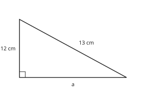

Answer: **5 cm**
- Typed **17.691806013** (add) → “c is the hypotenuse, the longest side: subtract, a² = c² − b².”
- Typed **1** (diff) → “Subtract the squares, not the sides, then take the square root.”

Full working after a second miss:

> a² = c² − b² = 169 − 144 = 25.  
> a = √25 = 5 cm.  

**Card c3m16-3** (draft)

> If c² = a² + b² for the longest side c, the triangle is right-angled.
>
> _8, 15, 17: 64 + 225 = 289 = 17². Right-angled._  

Check question: `m3-16-test-card` · multiple choice, level 1 · computed by rule

> A triangle has sides 6 cm, 8 cm and 10 cm. Is it right-angled?

- ✅ Yes: 36 + 64 = 100
- ◻️ No: 36 + 64 ≠ 100  
  _↳ feedback if chosen: Compare carefully: 36 + 64 = 100 and 10² = 100._
- ◻️ Yes: 6 + 8 > 10  
  _↳ feedback if chosen: Compare the squares of the sides, not the sides themselves._
- ◻️ It cannot be decided without the angles  
  _↳ feedback if chosen: The converse of Pythagoras decides it from the sides alone._

Full working after a second miss:

> Square the two shorter sides and add: 36 + 64 = 100.  
> The longest side squared is 100.  
> So: Yes: 36 + 64 = 100.  

**Worked example** (draft)

> A right-angled triangle has shorter sides 6 cm and 8 cm. Find the hypotenuse.

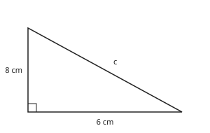

1. c² = a² + b² = 6² + 8² = 36 + 64 = 100.
2. c = √100 = 10 cm.

**Answer:** 10 cm

**Practice** `m3-16-hyp` · number, level 1 · computed by rule

> A right-angled triangle has shorter sides 40 cm and 42 cm. Find the hypotenuse in cm.

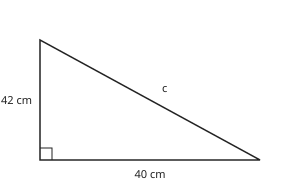

Answer: **58 cm**
- Typed **82** (sum) → “Add the squares, not the sides: 1600 + 1764 = 3364, then take the square root.”
- Typed **3364** (nosqrt) → “3364 is c². Take the square root.”

Full working after a second miss:

> c² = 40² + 42² = 1600 + 1764 = 3364.  
> c = √3364 = 58 cm.  

> A right-angled triangle has shorter sides 40 cm and 42 cm. Find the hypotenuse in cm.

Answer: **58 cm**
- Typed **82** (sum) → “Add the squares, not the sides: 1600 + 1764 = 3364, then take the square root.”
- Typed **3364** (nosqrt) → “3364 is c². Take the square root.”

Full working after a second miss:

> c² = 40² + 42² = 1600 + 1764 = 3364.  
> c = √3364 = 58 cm.  

**Practice** `m3-16-leg` · number, level 1 · computed by rule

> The hypotenuse of a right-angled triangle is 26 cm and one side is 24 cm. Find the third side in cm.

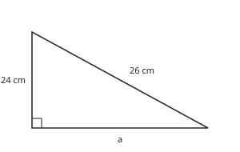

Answer: **10 cm**
- Typed **35.383612026** (add) → “c is the hypotenuse, the longest side: subtract, a² = c² − b².”
- Typed **2** (diff) → “Subtract the squares, not the sides, then take the square root.”

Full working after a second miss:

> a² = c² − b² = 676 − 576 = 100.  
> a = √100 = 10 cm.  

> The hypotenuse of a right-angled triangle is 17 cm and one side is 15 cm. Find the third side in cm.

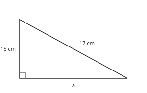

Answer: **8 cm**
- Typed **22.671568098** (add) → “c is the hypotenuse, the longest side: subtract, a² = c² − b².”
- Typed **2** (diff) → “Subtract the squares, not the sides, then take the square root.”

Full working after a second miss:

> a² = c² − b² = 289 − 225 = 64.  
> a = √64 = 8 cm.  

**Practice** `m3-16-dec` · number, level 2 · computed by rule

> A right-angled triangle has shorter sides 4 cm and 2 cm. Find the hypotenuse to 1 decimal place.

Answer: **4.5 cm**
- Typed **6** (sum) → “Add the squares, then take the square root: √(16 + 4).”

Full working after a second miss:

> c² = 16 + 4 = 20.  
> c = √20 ≈ 4.4721 ≈ 4.5 cm.  

> A right-angled triangle has shorter sides 9 cm and 5 cm. Find the hypotenuse to 1 decimal place.

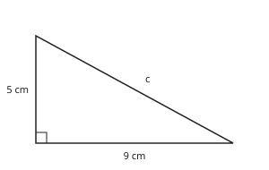

Answer: **10.3 cm**
- Typed **14** (sum) → “Add the squares, then take the square root: √(81 + 25).”

Full working after a second miss:

> c² = 81 + 25 = 106.  
> c = √106 ≈ 10.2956 ≈ 10.3 cm.  

**Practice** `m3-16-test` · multiple choice, level 2 · computed by rule

> A triangle has sides 6 cm, 8 cm and 11 cm. Is it right-angled?

- ◻️ Yes: 6 + 8 > 11  
  _↳ feedback if chosen: Compare the squares of the sides, not the sides themselves._
- ◻️ It cannot be decided without the angles  
  _↳ feedback if chosen: The converse of Pythagoras decides it from the sides alone._
- ◻️ Yes: 36 + 64 = 121  
  _↳ feedback if chosen: Compare carefully: 36 + 64 = 100 and 11² = 121._
- ✅ No: 36 + 64 ≠ 121

Full working after a second miss:

> Square the two shorter sides and add: 36 + 64 = 100.  
> The longest side squared is 121.  
> So: No: 36 + 64 ≠ 121.  

> A triangle has sides 6 cm, 8 cm and 11 cm. Is it right-angled?

- ◻️ Yes: 36 + 64 = 121  
  _↳ feedback if chosen: Compare carefully: 36 + 64 = 100 and 11² = 121._
- ◻️ Yes: 6 + 8 > 11  
  _↳ feedback if chosen: Compare the squares of the sides, not the sides themselves._
- ◻️ It cannot be decided without the angles  
  _↳ feedback if chosen: The converse of Pythagoras decides it from the sides alone._
- ✅ No: 36 + 64 ≠ 121

Full working after a second miss:

> Square the two shorter sides and add: 36 + 64 = 100.  
> The longest side squared is 121.  
> So: No: 36 + 64 ≠ 121.  

**Practice** `m3-16-ladder` · number, level 3 · computed by rule

> A ladder 13 m long leans against a vertical wall. Its foot is 5 m from the wall on level ground. How high up the wall does it reach (m)?

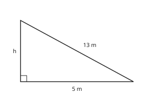

Answer: **12 m**
- Typed **13.928388277** (add) → “The ladder is the longest side: subtract, h² = 13² − 5².”
- Typed **8** (diff) → “Subtract the squares, then take the square root.”

Full working after a second miss:

> The ladder is the hypotenuse: h² = 13² − 5² = 169 − 25 = 144.  
> h = √144 = 12 m.  

> A ladder 5 m long leans against a vertical wall. Its foot is 3 m from the wall on level ground. How high up the wall does it reach (m)?

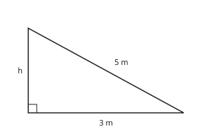

Answer: **4 m**
- Typed **5.830951895** (add) → “The ladder is the longest side: subtract, h² = 5² − 3².”
- Typed **2** (diff) → “Subtract the squares, then take the square root.”

Full working after a second miss:

> The ladder is the hypotenuse: h² = 5² − 3² = 25 − 9 = 16.  
> h = √16 = 4 m.  

## Lesson 17: Trigonometric ratios for acute angles, Sine and cosine of complementary angles

Prerequisites: 16 · Skill: m3-17 (Sine, cosine and tangent of an acute angle; complementary angles)

**Note** (draft)

> In a right-angled triangle, name the sides from the marked angle θ: the hypotenuse (longest), the opposite side (facing θ) and the adjacent side (next to θ, not the hypotenuse).
> • sin θ = opposite ÷ hypotenuse
> • cos θ = adjacent ÷ hypotenuse
> • tan θ = opposite ÷ adjacent
> Memory aid: SOH CAH TOA.
> Complementary angles add to 90°: sin θ = cos(90° − θ) and cos θ = sin(90° − θ). For example sin 40° = cos 50°.

**Learn: Naming the sides from the angle** (draft)

> Mark the angle θ you are interested in. Then name the three sides:
> • the hypotenuse: the longest side, opposite the right angle;
> • the opposite side: the side facing θ;
> • the adjacent side: the side next to θ that is not the hypotenuse.
> If you choose the other acute angle, opposite and adjacent swap over.

**Learn: Three ratios** (draft)

> For a given angle, the ratios of the sides are always the same, however big the triangle:
> • sin θ = opposite ÷ hypotenuse
> • cos θ = adjacent ÷ hypotenuse
> • tan θ = opposite ÷ adjacent
> Remember SOH CAH TOA. In the triangle with sides 3, 4, 5 and θ opposite the side 3: sin θ = 3/5, cos θ = 4/5, tan θ = 3/4.
> sin and cos are always less than 1, because the hypotenuse is the longest side.

**Learn: Complementary angles** (draft)

> The two acute angles of a right-angled triangle add up to 90°: they are complementary.
> The side opposite one is adjacent to the other. So sin θ = cos(90° − θ) and cos θ = sin(90° − θ).
> For example sin 30° = cos 60° = 0.5, and cos 20° = sin 70°.

**Learn: key words and examples** (draft)

- **opposite**: the side facing the angle
- **adjacent**: the side next to the angle, not the hypotenuse
- **SOH CAH TOA**: sin = O ÷ H, cos = A ÷ H, tan = O ÷ A
- **complementary angles**: two angles that add up to 90°

- Sides 5, 12, 13, θ facing 5: sin θ = 5/13
- tan θ = 12/5 for the other angle
- cos 35° = sin 55°

Common mistake: “sin θ = adjacent ÷ hypotenuse” → “sin θ = opposite ÷ hypotenuse (SOH)”. Name the sides from θ first. The opposite side faces θ; the adjacent side touches it.

**Card c3m17-1** (draft)

> SOH: sin θ = opposite ÷ hypotenuse.
>
> _Opposite 3, hypotenuse 5: sin θ = 3/5._  

Check question: `m3-17-ratio` · multiple choice, level 1 · computed by rule, reused from practice

> In the triangle, what is tan θ?

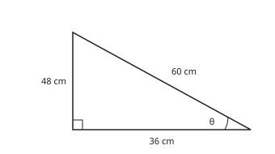

- ◻️ 3/4  
  _↳ feedback if chosen: Name the sides from θ: the opposite side faces θ (48), the adjacent side touches θ (36)._
- ◻️ 3/5  
  _↳ feedback if chosen: Use SOH CAH TOA: T = O ÷ A._
- ✅ 4/3
- ◻️ 4/5  
  _↳ feedback if chosen: tan θ uses opposite and adjacent, not the hypotenuse._

Full working after a second miss:

> Opposite θ: 48; adjacent: 36; hypotenuse: 60.  
> tan θ = opposite ÷ adjacent = 4/3.  

**Card c3m17-2** (draft)

> CAH and TOA: cos θ = adjacent ÷ hypotenuse; tan θ = opposite ÷ adjacent.
>
> _Adjacent 4: cos θ = 4/5, tan θ = 3/4._  

Check question: `m3-17-name` · multiple choice, level 1 · **authored key**, reused from practice

> Which ratio is opposite ÷ hypotenuse?

- ◻️ cos θ  
  _↳ feedback if chosen: cos θ is adjacent ÷ hypotenuse._
- ◻️ hyp θ  
  _↳ feedback if chosen: There is no ratio called hyp θ._
- ✅ sin θ
- ◻️ tan θ  
  _↳ feedback if chosen: tan θ is opposite ÷ adjacent._

Full working after a second miss:

> SOH: sine is opposite over hypotenuse.  
> So the answer is sin θ.  

**Card c3m17-3** (draft)

> Complementary angles: sin θ = cos(90° − θ).
>
> _sin 40° = cos 50°; cos 25° = sin 65°_  

Check question: `m3-17-comp-card` · multiple choice, level 1 · computed by rule

> Which statement is true?

- ◻️ sin 63° = cos 63°  
  _↳ feedback if chosen: sin and cos of the same angle are equal only at 45°._
- ✅ sin 63° = cos 27°
- ◻️ sin 63° = sin 27°  
  _↳ feedback if chosen: The complement turns sine into cosine: sin θ = cos(90° − θ)._
- ◻️ cos 63° = cos 27°  
  _↳ feedback if chosen: The complement turns cosine into sine: cos θ = sin(90° − θ)._

Full working after a second miss:

> 63° + 27° = 90°: complementary angles.  
> The sine of an angle equals the cosine of its complement. So: sin 63° = cos 27°.  

**Worked example** (draft)

> In the triangle, write sin θ, cos θ and tan θ as fractions.

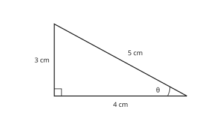

1. Opposite θ: 3 cm. Adjacent to θ: 4 cm. Hypotenuse: 5 cm.
2. sin θ = 3 ÷ 5 = 3/5.
3. cos θ = 4 ÷ 5 = 4/5.
4. tan θ = 3 ÷ 4 = 3/4.

**Answer:** sin θ = 3/5, cos θ = 4/5, tan θ = 3/4

**Practice** `m3-17-ratio` · multiple choice, level 1 · computed by rule

> In the triangle, what is cos θ?

- ◻️ 12/13  
  _↳ feedback if chosen: Name the sides from θ: the opposite side faces θ (24), the adjacent side touches θ (10)._
- ◻️ 12/5  
  _↳ feedback if chosen: Use SOH CAH TOA: C = A ÷ H._
- ✅ 5/13
- ◻️ 13/5  
  _↳ feedback if chosen: The hypotenuse goes at the bottom: the ratio is less than one._

Full working after a second miss:

> Opposite θ: 24; adjacent: 10; hypotenuse: 26.  
> cos θ = adjacent ÷ hypotenuse = 5/13.  

> In the triangle, what is cos θ?

- ◻️ 17/8  
  _↳ feedback if chosen: The hypotenuse goes at the bottom: the ratio is less than one._
- ◻️ 15/8  
  _↳ feedback if chosen: Use SOH CAH TOA: C = A ÷ H._
- ◻️ 15/17  
  _↳ feedback if chosen: Name the sides from θ: the opposite side faces θ (30), the adjacent side touches θ (16)._
- ✅ 8/17

Full working after a second miss:

> Opposite θ: 30; adjacent: 16; hypotenuse: 34.  
> cos θ = adjacent ÷ hypotenuse = 8/17.  

**Practice** `m3-17-name` · multiple choice, level 1 · **authored key**

> Which ratio is opposite ÷ hypotenuse?

- ◻️ hyp θ  
  _↳ feedback if chosen: There is no ratio called hyp θ._
- ◻️ cos θ  
  _↳ feedback if chosen: cos θ is adjacent ÷ hypotenuse._
- ◻️ tan θ  
  _↳ feedback if chosen: tan θ is opposite ÷ adjacent._
- ✅ sin θ

Full working after a second miss:

> SOH: sine is opposite over hypotenuse.  
> So the answer is sin θ.  

> Which side is the adjacent side for the angle θ?

- ✅ The side next to θ that is not the hypotenuse
- ◻️ Any side touching the right angle  
  _↳ feedback if chosen: One of the sides at the right angle is opposite θ._
- ◻️ The side facing θ  
  _↳ feedback if chosen: The side facing θ is the opposite side._
- ◻️ The longest side  
  _↳ feedback if chosen: The longest side is the hypotenuse._

Full working after a second miss:

> Adjacent means next to: it touches θ but is not the hypotenuse.  
> So the answer is The side next to θ that is not the hypotenuse.  

**Practice** `m3-17-compnum` · number, level 2 · computed by rule

> Given that cos 79° ≈ 0.1908, write down the value of sin 11°.

Answer: **0.1908**
- Typed **0.9816** (sinA) → “That is sin 79°. Use sin(90° − θ) = cos θ.”

Full working after a second miss:

> 79° and 11° add to 90°: they are complementary.  
> sin(90 − θ) = cos θ, so sin 11° = cos 79° ≈ 0.1908.  

> Given that cos 13° ≈ 0.9744, write down the value of sin 77°.

Answer: **0.9744**
- Typed **0.225** (sinA) → “That is sin 13°. Use sin(90° − θ) = cos θ.”

Full working after a second miss:

> 13° and 77° add to 90°: they are complementary.  
> sin(90 − θ) = cos θ, so sin 77° = cos 13° ≈ 0.9744.  

**Practice** `m3-17-opp` · number, level 2 · computed by rule

> In a right-angled triangle the hypotenuse is 13 cm and the marked angle is 49°. Find the side opposite the angle, to 1 decimal place.

Answer: **9.8 cm**
- Typed **8.5** (cos) → “That is the adjacent side (cos). The opposite side uses sin.”
- Typed **17.2** (div) → “opposite = hypotenuse × sin θ: multiply, do not divide.”

Full working after a second miss:

> sin 49° = opposite ÷ 13.  
> opposite = 13 × sin 49° ≈ 13 × 0.7547 ≈ 9.8 cm.  

> In a right-angled triangle the hypotenuse is 19 cm and the marked angle is 55°. Find the side opposite the angle, to 1 decimal place.

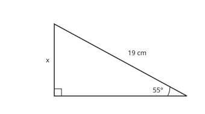

Answer: **15.6 cm**
- Typed **10.9** (cos) → “That is the adjacent side (cos). The opposite side uses sin.”
- Typed **23.2** (div) → “opposite = hypotenuse × sin θ: multiply, do not divide.”

Full working after a second miss:

> sin 55° = opposite ÷ 19.  
> opposite = 19 × sin 55° ≈ 19 × 0.8192 ≈ 15.6 cm.  

**Practice** `m3-17-comp` · multiple choice, level 3 · computed by rule

> Which statement is true?

- ◻️ sin 75° = sin 15°  
  _↳ feedback if chosen: The complement turns sine into cosine: sin θ = cos(90° − θ)._
- ✅ sin 75° = cos 15°
- ◻️ cos 75° = cos 15°  
  _↳ feedback if chosen: The complement turns cosine into sine: cos θ = sin(90° − θ)._
- ◻️ sin 75° = cos 75°  
  _↳ feedback if chosen: sin and cos of the same angle are equal only at 45°._

Full working after a second miss:

> 75° + 15° = 90°: complementary angles.  
> The sine of an angle equals the cosine of its complement. So: sin 75° = cos 15°.  

> Which statement is true?

- ◻️ sin 21° = cos 21°  
  _↳ feedback if chosen: sin and cos of the same angle are equal only at 45°._
- ✅ sin 21° = cos 69°
- ◻️ sin 21° = sin 69°  
  _↳ feedback if chosen: The complement turns sine into cosine: sin θ = cos(90° − θ)._
- ◻️ cos 21° = cos 69°  
  _↳ feedback if chosen: The complement turns cosine into sine: cos θ = sin(90° − θ)._

Full working after a second miss:

> 21° + 69° = 90°: complementary angles.  
> The sine of an angle equals the cosine of its complement. So: sin 21° = cos 69°.  

## Lesson 18: Trigonometric ratio for special angles, use of calculators

Prerequisites: 17 · Skill: m3-18 (Trigonometric ratios of 30°, 45° and 60°; using a calculator)

**Note** (draft)

> Exact values to learn:
> • sin 30° = 1/2, cos 30° = √3/2, tan 30° = 1/√3
> • sin 45° = cos 45° = 1/√2 (= √2/2), tan 45° = 1
> • sin 60° = √3/2, cos 60° = 1/2, tan 60° = √3
> They come from half an equilateral triangle (30°, 60°) and half a square (45°).
> Calculator: check it is in degree mode (D or DEG). sin 37° ≈ 0.6018. To find an angle from a ratio use the inverse key: sin⁻¹(0.5) = 30°.

**Learn: Where the exact values come from** (draft)

> Half of a square with side 1: the angles are 45°, 45° and 90°; the diagonal is √2. So sin 45° = cos 45° = 1 ÷ √2 and tan 45° = 1.
> Half of an equilateral triangle with side 2: the angles are 30°, 60° and 90°; the sides are 1, √3 and 2. So:
> • sin 30° = 1/2, cos 30° = √3 ÷ 2, tan 30° = 1 ÷ √3
> • sin 60° = √3 ÷ 2, cos 60° = 1/2, tan 60° = √3.

**Learn: Using a calculator** (draft)

> First check the calculator shows D or DEG (degree mode). In radian mode every answer is wrong.
> To find sin 37°, press sin 37 = and read about 0.6018.
> To find an angle from a ratio, use the inverse: SHIFT then sin gives sin⁻¹. If sin θ = 0.5, then θ = sin⁻¹(0.5) = 30°.
> Keep four decimal places while working; round only the final answer.

**Learn: Angles of elevation** (draft)

> Look up at the top of a tree: the angle between the level ground and your line of sight is the angle of elevation. Looking down from a cliff gives an angle of depression.
> If you stand 20 m from a tree and the elevation is 35°, the height h satisfies tan 35° = h ÷ 20, so h = 20 × tan 35° ≈ 14 m.

**Learn: key words and examples** (draft)

- **exact value**: a value written with fractions and roots, not rounded
- **degree mode**: the calculator setting for angles in degrees
- **inverse ratio**: sin⁻¹, cos⁻¹, tan⁻¹: from a ratio back to the angle
- **angle of elevation**: the angle looking up from the horizontal

- cos 60° = 1/2
- tan 30° × tan 60° = 1
- cos⁻¹(0.5) = 60°

Common mistake: “sin 30° = −0.988 on the calculator” → “sin 30° = 0.5”. That value comes from radian mode. Set the calculator to degrees (DEG).

**Card c3m18-1** (draft)

> Learn the exact values for 30°, 45° and 60°.
>
> _sin 30° = 1/2, tan 45° = 1, cos 60° = 1/2_  

Check question: `m3-18-exact` · multiple choice, level 1 · **authored key**, reused from practice

> What is the exact value of cos 30°?

- ◻️ 1/2  
  _↳ feedback if chosen: 1/2 is cos 60°._
- ◻️ 1/√3  
  _↳ feedback if chosen: 1/√3 is tan 30°._
- ✅ √3/2
- ◻️ 1  
  _↳ feedback if chosen: cos 30° is less than 1._

Full working after a second miss:

> cos 30° = √3/2.  
> So the answer is √3/2.  

**Card c3m18-2** (draft)

> Use a calculator in degree mode; round as the question asks.
>
> _sin 37° ≈ 0.6018_  

Check question: `m3-18-calc` · number, level 1 · computed by rule, reused from practice

> Use a calculator: find cos 25° to 4 decimal places.

Answer: **0.9063**
- Typed **0.4226** (other) → “Check you pressed the right key: cos, not sin.”

Full working after a second miss:

> Set the calculator to degrees (DEG).  
> cos 25° ≈ 0.9063.  

**Card c3m18-3** (draft)

> The inverse key gives the angle: sin⁻¹, cos⁻¹, tan⁻¹.
>
> _tan θ = 1 → θ = tan⁻¹(1) = 45°_  

Check question: `m3-18-inv-card` · number, level 1 · computed by rule

> cos θ = 0.43. Find the acute angle θ to 1 decimal place.

Answer: **64.5 °**
- Typed **2.3** (recip) → “cos⁻¹ is the inverse function (the angle), not 1 ÷ 0.43.”

Full working after a second miss:

> Use the inverse key: θ = cos⁻¹(0.43).  
> θ ≈ 64.5°.  

**Worked example** (draft)

> From a point 25 m from the foot of a tree, the angle of elevation of the top is 35°. Find the height of the tree to 1 decimal place.

1. tan 35° = height ÷ 25.
2. height = 25 × tan 35° ≈ 25 × 0.7002.
3. height ≈ 17.5 m.

**Answer:** 17.5 m

**Practice** `m3-18-exact` · multiple choice, level 1 · **authored key**

> What is the exact value of sin 30°?

- ◻️ 1/√2  
  _↳ feedback if chosen: 1/√2 is sin 45°._
- ◻️ √3/2  
  _↳ feedback if chosen: √3/2 is sin 60° (or cos 30°)._
- ✅ 1/2
- ◻️ √3  
  _↳ feedback if chosen: √3 is tan 60°._

Full working after a second miss:

> sin 30° = 1/2 (half an equilateral triangle).  
> So the answer is 1/2.  

> What is the exact value of tan 45°?

- ◻️ 1/2  
  _↳ feedback if chosen: 1/2 is sin 30°._
- ◻️ 1/√2  
  _↳ feedback if chosen: 1/√2 is sin 45° and cos 45°._
- ◻️ √3  
  _↳ feedback if chosen: √3 is tan 60°._
- ✅ 1

Full working after a second miss:

> In half a square, opposite = adjacent, so tan 45° = 1.  
> So the answer is 1.  

**Practice** `m3-18-calc` · number, level 1 · computed by rule

> Use a calculator: find tan 8° to 4 decimal places.

Answer: **0.1405**
- Typed **0.1392** (other) → “Check you pressed the right key: tan, not sin.”

Full working after a second miss:

> Set the calculator to degrees (DEG).  
> tan 8° ≈ 0.1405.  

> Use a calculator: find sin 29° to 4 decimal places.

Answer: **0.4848**
- Typed **0.8746** (other) → “Check you pressed the right key: sin, not cos.”

Full working after a second miss:

> Set the calculator to degrees (DEG).  
> sin 29° ≈ 0.4848.  

**Practice** `m3-18-inv` · number, level 2 · computed by rule

> tan θ = 0.63. Find the acute angle θ to 1 decimal place.

Answer: **32.2 °**
- Typed **1.6** (recip) → “tan⁻¹ is the inverse function (the angle), not 1 ÷ 0.63.”

Full working after a second miss:

> Use the inverse key: θ = tan⁻¹(0.63).  
> θ ≈ 32.2°.  

> sin θ = 0.95. Find the acute angle θ to 1 decimal place.

Answer: **71.8 °**
- Typed **1.1** (recip) → “sin⁻¹ is the inverse function (the angle), not 1 ÷ 0.95.”

Full working after a second miss:

> Use the inverse key: θ = sin⁻¹(0.95).  
> θ ≈ 71.8°.  

**Practice** `m3-18-value` · number, level 2 · **authored key**

> Without a calculator, find the value of sin 30° + cos 60°.

Answer: **1**

Full working after a second miss:

> 1/2 + 1/2  
> = 1.  

> Without a calculator, find the value of sin² 45° + cos² 45°.

Answer: **1**

Full working after a second miss:

> (1/√2)² + (1/√2)² = 1/2 + 1/2  
> = 1.  

**Practice** `m3-18-tree` · number, level 3 · computed by rule

> From a point 39 m from the foot of a tree on level ground, the angle of elevation of the top of the tree is 30°. Find the height of the tree to 1 decimal place.

Answer: **22.5 m**
- Typed **19.5** (sin) → “The distance 39 m is adjacent to the angle and the height is opposite: use tan.”
- Typed **67.5** (div) → “height = 39 × tan 30°: multiply.”

Full working after a second miss:

> tan 30° = height ÷ 39.  
> height = 39 × tan 30° ≈ 39 × 0.5774 ≈ 22.5 m.  

> From a point 38 m from the foot of a tree on level ground, the angle of elevation of the top of the tree is 37°. Find the height of the tree to 1 decimal place.

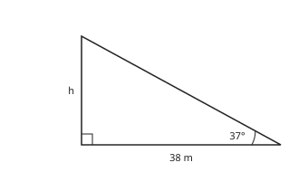

Answer: **28.6 m**
- Typed **22.9** (sin) → “The distance 38 m is adjacent to the angle and the height is opposite: use tan.”
- Typed **50.4** (div) → “height = 38 × tan 37°: multiply.”

Full working after a second miss:

> tan 37° = height ÷ 38.  
> height = 38 × tan 37° ≈ 38 × 0.7536 ≈ 28.6 m.  

## Lesson 19: Solving triangles

Prerequisites: 17, 18 · Skill: m3-19 (Solve right-angled triangles: find missing sides and angles)

**Note** (draft)

> To solve a right-angled triangle is to find all its sides and angles.
> • Label the sides from the known (or wanted) angle: opposite, adjacent, hypotenuse.
> • Choose the ratio that uses the two sides involved (SOH CAH TOA).
> • Unknown side on top: multiply (x = 10 × sin 30°). Unknown side at the bottom: divide (x = 10 ÷ tan 30°).
> • Unknown angle: use the inverse key (θ = tan⁻¹(5/12)).
> • The two acute angles add up to 90°, and Pythagoras gives the third side.

**Learn: Which ratio?** (draft)

> Mark the angle. Label the sides you know and the side you want: opposite, adjacent or hypotenuse. Then pick the ratio that links those two:
> • opposite and hypotenuse → sin;
> • adjacent and hypotenuse → cos;
> • opposite and adjacent → tan.
> Write the ratio as an equation, for example sin 35° = x ÷ 12.

**Learn: Solving the equation** (draft)

> • If x is on top: multiply. sin 35° = x ÷ 12 gives x = 12 × sin 35° ≈ 6.9.
> • If x is at the bottom: divide. tan 35° = 8 ÷ x gives x = 8 ÷ tan 35° ≈ 11.4.
> • For an angle: tan θ = 5 ÷ 12 gives θ = tan⁻¹(5 ÷ 12) ≈ 22.6°.
> A quick check: the hypotenuse must be the longest side.

**Learn: Elevation and depression** (draft)

> From the top of a cliff, you look down at a canoe: the angle between the horizontal and your line of sight is the angle of depression. Because the horizontal at the top is parallel to the sea, it equals the angle of elevation from the canoe up to you.
> So the triangle at the foot of the cliff has that angle, the cliff height opposite it and the distance along the sea adjacent to it: use tan.

**Learn: key words and examples** (draft)

- **solve a triangle**: find all its unknown sides and angles
- **angle of depression**: the angle looking down from the horizontal
- **inverse key**: sin⁻¹, cos⁻¹, tan⁻¹ on a calculator

- Hypotenuse 10, θ = 30°: opposite = 10 × sin 30° = 5
- Opposite 6, adjacent 6: θ = tan⁻¹(1) = 45°

Common mistake: “sin 40° = 6 ÷ x → x = 6 × sin 40°” → “x = 6 ÷ sin 40° ≈ 9.3”. When x is at the bottom of the fraction, divide. The hypotenuse must come out longer than 6.

**Card c3m19-1** (draft)

> Pick the ratio with the two sides you know or want.
>
> _Opposite and hypotenuse → sin; adjacent and hypotenuse → cos; opposite and adjacent → tan._  

Check question: `m3-19-angle` · number, level 1 · computed by rule, reused from practice

> In a right-angled triangle the side opposite θ is 9 cm and the adjacent side is 14 cm. Find θ to 1 decimal place.

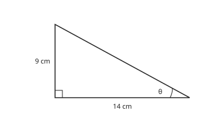

Answer: **32.7 °**
- Typed **57.3** (flip) → “tan θ = opposite ÷ adjacent = 9 ÷ 14, not 14 ÷ 9.”

Full working after a second miss:

> Opposite and adjacent: tan θ = 9 ÷ 14.  
> θ = tan⁻¹(9 ÷ 14) ≈ 32.7°.  

**Card c3m19-2** (draft)

> Unknown side on top of the ratio: multiply. At the bottom: divide.
>
> _sin 30° = x ÷ 10 → x = 10 × sin 30° = 5_  
> _tan 45° = 7 ÷ x → x = 7 ÷ tan 45° = 7_  

Check question: `m3-19-adj` · number, level 1 · computed by rule, reused from practice

> The hypotenuse is 24 cm and θ = 69°. Find the side adjacent to θ, to 1 decimal place.

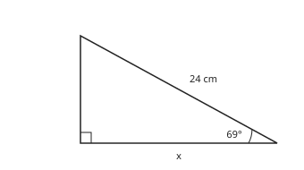

Answer: **8.6 cm**
- Typed **22.4** (sin) → “That is the opposite side. The adjacent side uses cos.”
- Typed **67** (div) → “x is on top of the ratio: multiply, x = 24 × cos 69°.”

Full working after a second miss:

> Adjacent and hypotenuse: cos 69° = x ÷ 24.  
> x = 24 × cos 69° ≈ 8.6 cm.  

**Card c3m19-3** (draft)

> Find an angle with the inverse key.
>
> _cos θ = 1/2 → θ = cos⁻¹(0.5) = 60°_  

Check question: `m3-19-hyp-card` · number, level 1 · computed by rule

> The side opposite θ is 7 cm and θ = 50°. Find the hypotenuse, to 1 decimal place.

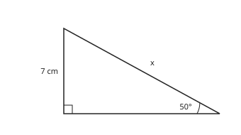

Answer: **9.1 cm**
- Typed **5.4** (mult) → “x is at the bottom of the ratio: divide, x = 7 ÷ sin 50°. The hypotenuse must be the longest side.”
- Typed **10.9** (cos) → “7 cm is opposite θ: use sin.”

Full working after a second miss:

> Opposite and hypotenuse: sin 50° = 7 ÷ x.  
> x is at the bottom: x = 7 ÷ sin 50° ≈ 9.1 cm.  

**Worked example** (draft)

> In a right-angled triangle the side opposite θ is 5 cm and the adjacent side is 12 cm. Find θ to 1 decimal place.

1. Opposite and adjacent: use tan.
2. tan θ = 5 ÷ 12.
3. θ = tan⁻¹(5 ÷ 12) ≈ 22.6°.

**Answer:** θ ≈ 22.6°

**Practice** `m3-19-angle` · number, level 1 · computed by rule

> In a right-angled triangle the side opposite θ is 4 cm and the adjacent side is 2 cm. Find θ to 1 decimal place.

Answer: **63.4 °**
- Typed **26.6** (flip) → “tan θ = opposite ÷ adjacent = 4 ÷ 2, not 2 ÷ 4.”

Full working after a second miss:

> Opposite and adjacent: tan θ = 4 ÷ 2.  
> θ = tan⁻¹(4 ÷ 2) ≈ 63.4°.  

> In a right-angled triangle the side opposite θ is 8 cm and the adjacent side is 13 cm. Find θ to 1 decimal place.

Answer: **31.6 °**
- Typed **58.4** (flip) → “tan θ = opposite ÷ adjacent = 8 ÷ 13, not 13 ÷ 8.”

Full working after a second miss:

> Opposite and adjacent: tan θ = 8 ÷ 13.  
> θ = tan⁻¹(8 ÷ 13) ≈ 31.6°.  

**Practice** `m3-19-adj` · number, level 1 · computed by rule

> The hypotenuse is 19 cm and θ = 25°. Find the side adjacent to θ, to 1 decimal place.

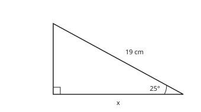

Answer: **17.2 cm**
- Typed **8** (sin) → “That is the opposite side. The adjacent side uses cos.”
- Typed **21** (div) → “x is on top of the ratio: multiply, x = 19 × cos 25°.”

Full working after a second miss:

> Adjacent and hypotenuse: cos 25° = x ÷ 19.  
> x = 19 × cos 25° ≈ 17.2 cm.  

> The hypotenuse is 24 cm and θ = 27°. Find the side adjacent to θ, to 1 decimal place.

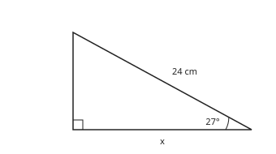

Answer: **21.4 cm**
- Typed **10.9** (sin) → “That is the opposite side. The adjacent side uses cos.”
- Typed **26.9** (div) → “x is on top of the ratio: multiply, x = 24 × cos 27°.”

Full working after a second miss:

> Adjacent and hypotenuse: cos 27° = x ÷ 24.  
> x = 24 × cos 27° ≈ 21.4 cm.  

**Practice** `m3-19-hyp` · number, level 2 · computed by rule

> The side opposite θ is 15 cm and θ = 67°. Find the hypotenuse, to 1 decimal place.

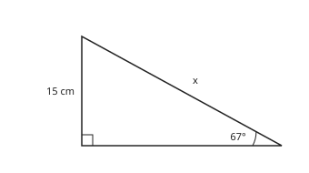

Answer: **16.3 cm**
- Typed **13.8** (mult) → “x is at the bottom of the ratio: divide, x = 15 ÷ sin 67°. The hypotenuse must be the longest side.”
- Typed **38.4** (cos) → “15 cm is opposite θ: use sin.”

Full working after a second miss:

> Opposite and hypotenuse: sin 67° = 15 ÷ x.  
> x is at the bottom: x = 15 ÷ sin 67° ≈ 16.3 cm.  

> The side opposite θ is 14 cm and θ = 57°. Find the hypotenuse, to 1 decimal place.

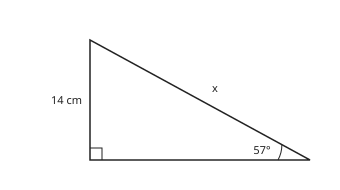

Answer: **16.7 cm**
- Typed **11.7** (mult) → “x is at the bottom of the ratio: divide, x = 14 ÷ sin 57°. The hypotenuse must be the longest side.”
- Typed **25.7** (cos) → “14 cm is opposite θ: use sin.”

Full working after a second miss:

> Opposite and hypotenuse: sin 57° = 14 ÷ x.  
> x is at the bottom: x = 14 ÷ sin 57° ≈ 16.7 cm.  

**Practice** `m3-19-sinangle` · number, level 2 · computed by rule

> The side opposite θ is 13 cm and the hypotenuse is 18 cm. Find θ to 1 decimal place.

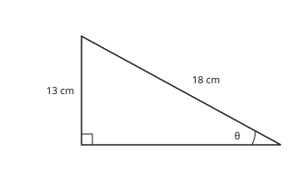

Answer: **46.2 °**
- Typed **43.8** (cos) → “13 cm is opposite θ: use sin⁻¹, not cos⁻¹.”
- Typed **35.8** (tan) → “18 cm is the hypotenuse: use sin, not tan.”

Full working after a second miss:

> Opposite and hypotenuse: sin θ = 13 ÷ 18.  
> θ = sin⁻¹(13 ÷ 18) ≈ 46.2°.  

> The side opposite θ is 15 cm and the hypotenuse is 25 cm. Find θ to 1 decimal place.

Answer: **36.9 °**
- Typed **53.1** (cos) → “15 cm is opposite θ: use sin⁻¹, not cos⁻¹.”
- Typed **31** (tan) → “25 cm is the hypotenuse: use sin, not tan.”

Full working after a second miss:

> Opposite and hypotenuse: sin θ = 15 ÷ 25.  
> θ = sin⁻¹(15 ÷ 25) ≈ 36.9°.  

**Practice** `m3-19-cliff` · number, level 3 · computed by rule

> From the top of a cliff 111 m high, the angle of depression of a canoe on the sea is 21°. How far is the canoe from the foot of the cliff, to the nearest metre?

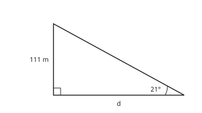

Answer: **289 m**
- Typed **43** (mult) → “d is at the bottom of tan 21° = 111 ÷ d: divide.”
- Typed **310** (sin) → “That is the line of sight (the hypotenuse). The distance along the sea uses tan.”

Full working after a second miss:

> The angle of depression equals the angle of elevation from the canoe to the top: 21°.  
> From the canoe: tan 21° = 111 ÷ d, so d = 111 ÷ tan 21°.  
> d ≈ 111 ÷ 0.3839 ≈ 289 m.  

> From the top of a cliff 72 m high, the angle of depression of a canoe on the sea is 49°. How far is the canoe from the foot of the cliff, to the nearest metre?

Answer: **63 m**
- Typed **83** (mult) → “d is at the bottom of tan 49° = 72 ÷ d: divide.”
- Typed **95** (sin) → “That is the line of sight (the hypotenuse). The distance along the sea uses tan.”

Full working after a second miss:

> The angle of depression equals the angle of elevation from the canoe to the top: 49°.  
> From the canoe: tan 49° = 72 ÷ d, so d = 72 ÷ tan 49°.  
> d ≈ 72 ÷ 1.1504 ≈ 63 m.  

