# Physics Form 3, Form Three Physics: drafts for review (Lessons 17 lessons (1–17))

Generated by `npm run review:f3-physics` from `content/form-3/physics/*.json`. Every question and drawing below was built by the engine.
All notes, teach cards, worked examples and paper tasks are **status: draft**. “Authored key” means a person fixed the
right answer (see `AUTHORED.md`); “computed by rule” means code worked it out (a formula, a conversion, a spelling rule).

Teach mode: cards (idea + example + 1 level-1 check) → worked example → practice (levels 1–3) → the note as a summary.

## Sample rendered lesson: Lesson 1 in teach mode

### Lesson 1: Physical quantities : Definition, Examples, and Units. Prefixes and standard form of writing values

**Card c3p1-1** (draft)

> Every measurement has a number and a unit; the SI unit of mass is the kilogram.
>
> _Length: metre (m). Time: second (s). Temperature: kelvin (K)._  

Check question: `p3-1-si` · multiple choice, level 1 · **authored key**, reused from practice

> Which is a base quantity (not derived)?

- ◻️ density  
  _↳ feedback if chosen: Density = mass ÷ volume: derived._
- ✅ time
- ◻️ speed  
  _↳ feedback if chosen: Speed = distance ÷ time: derived._
- ◻️ area  
  _↳ feedback if chosen: Area = length × length: derived._

Full working after a second miss:

> Time is one of the base quantities; its unit is the second.  
> So the answer is time.  

**Card c3p1-2** (draft)

> Prefixes are multipliers: kilo = 1000, milli = 1 ÷ 1000.
>
> _3.2 km = 3200 m;  450 mm = 0.45 m_  

Check question: `p3-1-prefix` · number, level 1 · computed by rule, reused from practice

> Convert 91 mm to m.

Answer: **0.091**
- Typed **91 000** (flip) → “Check the direction: a mm is smaller than a m, so the number gets smaller.”

Full working after a second miss:

> 1 mm = 0.001 m.  
> 91 × 0.001 = 0.091 m.  

**Card c3p1-3** (draft)

> Standard form: a × 10ⁿ with a between 1 and 10.
>
> _340 000 = 3.4 × 10⁵_  

Check question: `p3-1-std-card` · number, level 1 · computed by rule

> Write 8600 in standard form, a × 10ⁿ. What is n?

Answer: **3**
- Typed **4** (digits) → “Count the places the point moves, not the number of digits: 8600 = 8.6 × 10³.”

Full working after a second miss:

> a must be between 1 and 10: a = 8.6.  
> The decimal point moves 3 places, so n = 3.  

**Worked example** (draft)

> Write 47 000 m in standard form.

1. Move the decimal point to get a number between 1 and 10: 4.7.
2. The point moved 4 places to the left, so the power is 4.
3. 47 000 = 4.7 × 10⁴.

**Answer:** 4.7 × 10⁴ m

**Practice** (one generated question per template, easiest first)

Practice 1: `p3-1-si` · multiple choice, level 1 · **authored key**

> What is the SI unit of temperature?

- ◻️ degree Celsius (°C)  
  _↳ feedback if chosen: °C is used every day, but the SI unit is the kelvin._
- ✅ kelvin (K)
- ◻️ degree Fahrenheit (°F)  
  _↳ feedback if chosen: °F is not an SI unit._
- ◻️ joule (J)  
  _↳ feedback if chosen: The joule is the unit of energy._

Full working after a second miss:

> The SI unit of temperature is the kelvin.  
> So the answer is kelvin (K).  

Practice 2: `p3-1-prefix` · number, level 1 · computed by rule

> Convert 36 m to cm.

Answer: **3600**
- Typed **0.36** (flip) → “Check the direction: a m is bigger than a cm, so the number gets bigger.”

Full working after a second miss:

> 1 m = 100 cm.  
> 36 × 100 = 3600 cm.  

Practice 3: `p3-1-std` · number, level 2 · computed by rule

> Write 530 000 in standard form, a × 10ⁿ. What is n?

Answer: **5**
- Typed **6** (digits) → “Count the places the point moves, not the number of digits: 530 000 = 5.3 × 10⁵.”

Full working after a second miss:

> a must be between 1 and 10: a = 5.3.  
> The decimal point moves 5 places, so n = 5.  

Practice 4: `p3-1-small` · multiple choice, level 2 · computed by rule

> Write 0.0072 in standard form.

- ◻️ 72 × 10⁻⁴  
  _↳ feedback if chosen: 72 is not between 1 and 10._
- ◻️ 0.72 × 10⁻²  
  _↳ feedback if chosen: 0.72 is less than 1: a must be at least 1._
- ✅ 7.2 × 10⁻³
- ◻️ 7.2 × 10³  
  _↳ feedback if chosen: A small number (less than 1) has a negative power of 10._

Full working after a second miss:

> Move the point right until the number is between 1 and 10: 7.2.  
> It moved 3 places to the right, so the power is −3: 7.2 × 10⁻³.  

Practice 5: `p3-1-micro` · number, level 3 · computed by rule

> A hair is 75 µm thick. What is this in millimetres?

Answer: **0.075 mm**
- Typed **0.000075** (m) → “That is in metres. 1 mm = 1000 µm, so divide by 1000.”
- Typed **75 000** (mult) → “Millimetres are bigger than micrometres: the number gets smaller.”

Full working after a second miss:

> 1 µm = 1 ÷ 1 000 000 m and 1 mm = 1 ÷ 1000 m, so 1 µm = 0.001 mm.  
> 75 µm = 75 ÷ 1000 = 0.075 mm.  

**Summary (the note)**

> A physical quantity can be measured and has a number and a unit: 25 kg, 3.5 m.
> Base quantities and SI units: length (metre, m), mass (kilogram, kg), time (second, s), temperature (kelvin, K), electric current (ampere, A).
> Derived quantities come from base ones: area (m²), volume (m³), density (kg/m³), speed (m/s).
> Prefixes: mega M = 1 000 000, kilo k = 1000, centi c = 1/100, milli m = 1/1000, micro µ = 1/1 000 000.
> Standard form: a × 10ⁿ with 1 ≤ a < 10, e.g. 340 000 m = 3.4 × 10⁵ m; 0.0025 s = 2.5 × 10⁻³ s.

## All drafts

| Lesson | Title (sheet) | Status | Cards | Practice | Paper task |
|---|---|---|---|---|---|
| 1 | Physical quantities : Definition, Examples, and Units. Prefixes and standard form of writing values | draft | 3 | 5 | — |
| 2 | Scalar and Vector physical quantities and some basic equipment used in the study of force: newton meter, balance, springs, masses etc | draft | 3 | 5 | — |
| 3 | Comparison between mass and weight. Safety rules for working with different equipment | draft | 3 | 5 | — |
| 4 | Measurement of mass. Conversions between different units of mass | draft | 3 | 5 | — |
| 5 | Measurement of volume | draft | 3 | 5 | — |
| 6 | Measurement of temperature and time | draft | 3 | 5 | — |
| 7 | Density: Definition, Calculation and Units. Measurement of the density of a liquid | draft | 3 | 5 | — |
| 8 | Describe and carry out experiments to measure the density of regular & irregular objects | draft | 3 | 5 | — |
| 9 | Applications of the density of a material in engineering works | draft | 3 | 5 | — |
| 10 | Pressure: Definition, calculation and units. Factors that affect pressure in solids and applications | draft | 3 | 5 | — |
| 11 | Pressure in liquids: Factors affecting pressure in liquids and Calculations. Characteristics of pressure in liquids and applications | draft | 3 | 5 | — |
| 12 | Atmospheric pressure: Definition, demonstration, and measurement using the simple barometer | draft | 3 | 5 | — |
| 13 | Effects of atmospheric pressure on the boiling points of liquids and on health | draft | 3 | 4 | — |
| 14 | Elasticity: Definition. Elastic and non- elastic materials. Hooke’s Law and elastic limit. Experimental verification of Hooke’s law | draft | 3 | 5 | — |
| 15 | Force-extension graph and application of elastic materials | draft | 3 | 5 | — |
| 16 | Energy: Definition, forms, sources – renewable and non-renewable | draft | 3 | 5 | — |
| 17 | The law of conservation of energy, application on transducers, and energy flow diagrams. Simple calculations on energy transformations | draft | 3 | 5 | — |

## Lesson 1: Physical quantities : Definition, Examples, and Units. Prefixes and standard form of writing values

Prerequisites: none · Skill: p3-1 (Physical quantities, SI units, prefixes and standard form)

**Note** (draft)

> A physical quantity can be measured and has a number and a unit: 25 kg, 3.5 m.
> Base quantities and SI units: length (metre, m), mass (kilogram, kg), time (second, s), temperature (kelvin, K), electric current (ampere, A).
> Derived quantities come from base ones: area (m²), volume (m³), density (kg/m³), speed (m/s).
> Prefixes: mega M = 1 000 000, kilo k = 1000, centi c = 1/100, milli m = 1/1000, micro µ = 1/1 000 000.
> Standard form: a × 10ⁿ with 1 ≤ a < 10, e.g. 340 000 m = 3.4 × 10⁵ m; 0.0025 s = 2.5 × 10⁻³ s.

**Learn: What a physical quantity is** (draft)

> Anything we can measure is a physical quantity: the length of a desk, the mass of a bag of rice, the time of a race.
> A measurement always has two parts, a number and a unit: 25 kg. Without the unit, "25" means nothing.
> Scientists everywhere use the SI system so that results can be shared. Its base quantities are length (m), mass (kg), time (s), temperature (K) and electric current (A). All others, such as area, volume, speed and density, are derived from these.

**Learn: Prefixes** (draft)

> Prefixes make big and small numbers easier:
> • mega (M) = 1 000 000
> • kilo (k) = 1000
> • centi (c) = 1 ÷ 100
> • milli (m) = 1 ÷ 1000
> • micro (µ) = 1 ÷ 1 000 000
> So 3.2 km = 3200 m, and 450 mm = 0.45 m. To change to a smaller unit the number gets bigger, and the other way round.

**Learn: Standard form** (draft)

> Very large or very small values are written a × 10ⁿ, with a between 1 and 10.
> • 340 000 m = 3.4 × 10⁵ m (the point moves 5 places left).
> • 0.0025 s = 2.5 × 10⁻³ s (the point moves 3 places right, so the power is negative).
> The distance from the Earth to the Sun is about 1.5 × 10¹¹ m.

**Learn: key words and examples** (draft)

- **physical quantity**: something that can be measured, with a number and a unit
- **SI unit**: the international standard unit
- **prefix**: a word in front of a unit that multiplies it, like kilo
- **standard form**: a × 10ⁿ with 1 ≤ a < 10

- 2.5 kg = 2500 g
- 0.00034 m = 3.4 × 10⁻⁴ m
- 6 MW = 6 000 000 W

Common mistake: “3.4 × 10⁵ written as 34 × 10⁴” → “3.4 × 10⁵”. In standard form the first number must be between 1 and 10.

**Card c3p1-1** (draft)

> Every measurement has a number and a unit; the SI unit of mass is the kilogram.
>
> _Length: metre (m). Time: second (s). Temperature: kelvin (K)._  

Check question: `p3-1-si` · multiple choice, level 1 · **authored key**, reused from practice

> What is the SI unit of electric current?

- ✅ ampere (A)
- ◻️ ohm (Ω)  
  _↳ feedback if chosen: The ohm measures resistance._
- ◻️ volt (V)  
  _↳ feedback if chosen: The volt measures voltage._
- ◻️ watt (W)  
  _↳ feedback if chosen: The watt measures power._

Full working after a second miss:

> Current is a base quantity measured in amperes.  
> So the answer is ampere (A).  

**Card c3p1-2** (draft)

> Prefixes are multipliers: kilo = 1000, milli = 1 ÷ 1000.
>
> _3.2 km = 3200 m;  450 mm = 0.45 m_  

Check question: `p3-1-prefix` · number, level 1 · computed by rule, reused from practice

> Convert 90 g to kg.

Answer: **0.09**
- Typed **90 000** (flip) → “Check the direction: a g is smaller than a kg, so the number gets smaller.”

Full working after a second miss:

> 1 g = 0.001 kg.  
> 90 × 0.001 = 0.09 kg.  

**Card c3p1-3** (draft)

> Standard form: a × 10ⁿ with a between 1 and 10.
>
> _340 000 = 3.4 × 10⁵_  

Check question: `p3-1-std-card` · number, level 1 · computed by rule

> Write 44 000 in standard form, a × 10ⁿ. What is n?

Answer: **4**
- Typed **5** (digits) → “Count the places the point moves, not the number of digits: 44 000 = 4.4 × 10⁴.”

Full working after a second miss:

> a must be between 1 and 10: a = 4.4.  
> The decimal point moves 4 places, so n = 4.  

**Worked example** (draft)

> Write 47 000 m in standard form.

1. Move the decimal point to get a number between 1 and 10: 4.7.
2. The point moved 4 places to the left, so the power is 4.
3. 47 000 = 4.7 × 10⁴.

**Answer:** 4.7 × 10⁴ m

**Practice** `p3-1-si` · multiple choice, level 1 · **authored key**

> Which is a base quantity (not derived)?

- ◻️ area  
  _↳ feedback if chosen: Area = length × length: derived._
- ✅ time
- ◻️ density  
  _↳ feedback if chosen: Density = mass ÷ volume: derived._
- ◻️ speed  
  _↳ feedback if chosen: Speed = distance ÷ time: derived._

Full working after a second miss:

> Time is one of the base quantities; its unit is the second.  
> So the answer is time.  

> What is the SI unit of mass?

- ◻️ litre (L)  
  _↳ feedback if chosen: The litre measures volume._
- ◻️ newton (N)  
  _↳ feedback if chosen: The newton is the unit of force (weight)._
- ◻️ gram (g)  
  _↳ feedback if chosen: The gram is a smaller unit; the SI base unit is the kilogram._
- ✅ kilogram (kg)

Full working after a second miss:

> Mass is measured in kilograms in SI.  
> So the answer is kilogram (kg).  

**Practice** `p3-1-prefix` · number, level 1 · computed by rule

> Convert 41 mg to g.

Answer: **0.041**
- Typed **41 000** (flip) → “Check the direction: a mg is smaller than a g, so the number gets smaller.”

Full working after a second miss:

> 1 mg = 0.001 g.  
> 41 × 0.001 = 0.041 g.  

> Convert 30 mm to m.

Answer: **0.03**
- Typed **30 000** (flip) → “Check the direction: a mm is smaller than a m, so the number gets smaller.”

Full working after a second miss:

> 1 mm = 0.001 m.  
> 30 × 0.001 = 0.03 m.  

**Practice** `p3-1-std` · number, level 2 · computed by rule

> Write 360 000 in standard form, a × 10ⁿ. What is n?

Answer: **5**
- Typed **6** (digits) → “Count the places the point moves, not the number of digits: 360 000 = 3.6 × 10⁵.”

Full working after a second miss:

> a must be between 1 and 10: a = 3.6.  
> The decimal point moves 5 places, so n = 5.  

> Write 850 000 000 in standard form, a × 10ⁿ. What is n?

Answer: **8**
- Typed **9** (digits) → “Count the places the point moves, not the number of digits: 850 000 000 = 8.5 × 10⁸.”

Full working after a second miss:

> a must be between 1 and 10: a = 8.5.  
> The decimal point moves 8 places, so n = 8.  

**Practice** `p3-1-small` · multiple choice, level 2 · computed by rule

> Write 0.000026 in standard form.

- ◻️ 0.26 × 10⁻⁴  
  _↳ feedback if chosen: 0.26 is less than 1: a must be at least 1._
- ◻️ 2.6 × 10⁵  
  _↳ feedback if chosen: A small number (less than 1) has a negative power of 10._
- ◻️ 26 × 10⁻⁶  
  _↳ feedback if chosen: 26 is not between 1 and 10._
- ✅ 2.6 × 10⁻⁵

Full working after a second miss:

> Move the point right until the number is between 1 and 10: 2.6.  
> It moved 5 places to the right, so the power is −5: 2.6 × 10⁻⁵.  

> Write 0.0000084 in standard form.

- ✅ 8.4 × 10⁻⁶
- ◻️ 8.4 × 10⁶  
  _↳ feedback if chosen: A small number (less than 1) has a negative power of 10._
- ◻️ 84 × 10⁻⁷  
  _↳ feedback if chosen: 84 is not between 1 and 10._
- ◻️ 0.8400000000000001 × 10⁻⁵  
  _↳ feedback if chosen: 0.84 is less than 1: a must be at least 1._

Full working after a second miss:

> Move the point right until the number is between 1 and 10: 8.4.  
> It moved 6 places to the right, so the power is −6: 8.4 × 10⁻⁶.  

**Practice** `p3-1-micro` · number, level 3 · computed by rule

> A hair is 107 µm thick. What is this in millimetres?

Answer: **0.107 mm**
- Typed **0.000107** (m) → “That is in metres. 1 mm = 1000 µm, so divide by 1000.”
- Typed **107 000** (mult) → “Millimetres are bigger than micrometres: the number gets smaller.”

Full working after a second miss:

> 1 µm = 1 ÷ 1 000 000 m and 1 mm = 1 ÷ 1000 m, so 1 µm = 0.001 mm.  
> 107 µm = 107 ÷ 1000 = 0.107 mm.  

> A hair is 53 µm thick. What is this in millimetres?

Answer: **0.053 mm**
- Typed **0.000053** (m) → “That is in metres. 1 mm = 1000 µm, so divide by 1000.”
- Typed **53 000** (mult) → “Millimetres are bigger than micrometres: the number gets smaller.”

Full working after a second miss:

> 1 µm = 1 ÷ 1 000 000 m and 1 mm = 1 ÷ 1000 m, so 1 µm = 0.001 mm.  
> 53 µm = 53 ÷ 1000 = 0.053 mm.  

## Lesson 2: Scalar and Vector physical quantities and some basic equipment used in the study of force: newton meter, balance, springs, masses etc

Prerequisites: 1 · Skill: p3-2 (Scalar and vector quantities; measuring force)

**Note** (draft)

> A scalar quantity has size (magnitude) only: mass, time, distance, speed, temperature, energy.
> A vector quantity has size and direction: force, weight, displacement, velocity, acceleration.
> Forces are measured in newtons (N) with a newton meter (spring balance). A beam balance compares masses.
> Combining forces along a line: same direction → add; opposite directions → subtract, and the resultant acts in the direction of the larger force.
> Two forces at right angles: the resultant is found with Pythagoras.

**Learn: Size only, or size and direction?** (draft)

> Some quantities are fully described by a number and a unit: a mass of 50 kg, a time of 12 s, a temperature of 30 °C. These are scalars.
> Others also need a direction: a force of 20 N to the left, a displacement of 3 km north. These are vectors.
> Weight is a vector: it is a force and it always acts downwards, towards the centre of the Earth.

**Learn: Measuring force** (draft)

> A newton meter (spring balance) has a spring that stretches when you pull it; the scale shows the force in newtons (N).
> A beam balance compares an unknown mass with known masses. It gives mass, not force, so it reads the same on the Moon.
> In the laboratory, handle these instruments gently: overloading a spring damages it.

**Learn: Adding forces** (draft)

> Forces on the same line combine simply:
> • same direction: add them (6 N + 4 N = 10 N);
> • opposite directions: subtract, and the resultant acts in the direction of the larger force (6 N east and 4 N west give 2 N east).
> Forces at right angles combine like the sides of a right-angled triangle: 3 N east and 4 N north give a resultant of 5 N.

**Learn: key words and examples** (draft)

- **scalar**: a quantity with size only
- **vector**: a quantity with size and direction
- **resultant**: the single force with the same effect as several forces
- **newton (N)**: the unit of force

- Scalars: mass, time, speed, energy
- Vectors: force, weight, velocity, displacement
- 8 N and 8 N in opposite directions: resultant 0 N

Common mistake: “6 N east and 4 N west give 10 N” → “They give 2 N east”. Forces in opposite directions work against each other: subtract them.

**Card c3p2-1** (draft)

> A vector has a direction; a scalar does not.
>
> _Force 20 N upwards is a vector; a mass of 20 kg is a scalar._  

Check question: `p3-2-type` · multiple choice, level 1 · **authored key**, reused from practice

> Which of these is a scalar quantity?

- ◻️ weight  
  _↳ feedback if chosen: Weight acts downwards: it has a direction._
- ◻️ velocity  
  _↳ feedback if chosen: Velocity is speed in a given direction._
- ✅ speed
- ◻️ displacement  
  _↳ feedback if chosen: Displacement is distance in a given direction._

Full working after a second miss:

> Speed has size only.  
> So the answer is speed.  

**Card c3p2-2** (draft)

> A newton meter measures force in newtons.
>
> _The spring stretches more for a bigger pull._  

Check question: `p3-2-tool` · multiple choice, level 1 · **authored key**, reused from practice

> What does a beam balance measure?

- ◻️ volume  
  _↳ feedback if chosen: Volume needs a measuring cylinder._
- ◻️ weight in newtons  
  _↳ feedback if chosen: It compares masses, so the answer does not change with g._
- ✅ mass
- ◻️ density  
  _↳ feedback if chosen: Density needs mass and volume._

Full working after a second miss:

> A beam balance compares an unknown mass with known masses.  
> So the answer is mass.  

**Card c3p2-3** (draft)

> Forces in the same direction add; in opposite directions they subtract.
>
> _6 N and 4 N east: 10 N east. 6 N east and 4 N west: 2 N east._  

Check question: `p3-2-line-card` · number, level 1 · computed by rule

> Forces of 27 N and 23 N act on a box in opposite directions. Find the size of the resultant force (N).

Answer: **4 N**
- Typed **50** (other) → “In opposite directions one force cancels part of the other: subtract.”

Full working after a second miss:

> Opposite directions: subtract.  
> 27 − 23 = 4 N.  

**Worked example** (draft)

> Two boys pull a cart: one with 12 N to the east, the other with 5 N to the west. Find the resultant force.

1. Opposite directions: subtract.
2. 12 − 5 = 7 N.
3. The larger force is to the east, so the resultant is 7 N to the east.

**Answer:** 7 N to the east

**Practice** `p3-2-type` · multiple choice, level 1 · **authored key**

> Which of these is a vector quantity?

- ◻️ temperature  
  _↳ feedback if chosen: Temperature has size only._
- ◻️ time  
  _↳ feedback if chosen: Time has size only._
- ✅ force
- ◻️ mass  
  _↳ feedback if chosen: Mass has size only._

Full working after a second miss:

> A force always acts in a direction.  
> So the answer is force.  

> Which of these is a vector quantity?

- ◻️ temperature  
  _↳ feedback if chosen: Temperature has size only._
- ✅ force
- ◻️ time  
  _↳ feedback if chosen: Time has size only._
- ◻️ mass  
  _↳ feedback if chosen: Mass has size only._

Full working after a second miss:

> A force always acts in a direction.  
> So the answer is force.  

**Practice** `p3-2-tool` · multiple choice, level 1 · **authored key**

> A spring balance reads 30 N. What does it show?

- ◻️ a mass of 30 kg  
  _↳ feedback if chosen: N is the unit of force, not mass._
- ✅ a force of 30 N
- ◻️ a volume of 30 cm³  
  _↳ feedback if chosen: N is the unit of force._
- ◻️ a mass of 30 g  
  _↳ feedback if chosen: N is the unit of force, not mass._

Full working after a second miss:

> A spring balance shows force in newtons.  
> So the answer is a force of 30 N.  

> A spring balance reads 30 N. What does it show?

- ◻️ a mass of 30 kg  
  _↳ feedback if chosen: N is the unit of force, not mass._
- ◻️ a mass of 30 g  
  _↳ feedback if chosen: N is the unit of force, not mass._
- ◻️ a volume of 30 cm³  
  _↳ feedback if chosen: N is the unit of force._
- ✅ a force of 30 N

Full working after a second miss:

> A spring balance shows force in newtons.  
> So the answer is a force of 30 N.  

**Practice** `p3-2-line` · number, level 2 · computed by rule

> Forces of 6 N and 7 N act on a box in opposite directions. Find the size of the resultant force (N).

Answer: **1 N**
- Typed **13** (other) → “In opposite directions one force cancels part of the other: subtract.”

Full working after a second miss:

> Opposite directions: subtract.  
> 7 − 6 = 1 N.  

> Forces of 26 N and 24 N act on a box in opposite directions. Find the size of the resultant force (N).

Answer: **2 N**
- Typed **50** (other) → “In opposite directions one force cancels part of the other: subtract.”

Full working after a second miss:

> Opposite directions: subtract.  
> 26 − 24 = 2 N.  

**Practice** `p3-2-dir` · multiple choice, level 2 · **authored key**

> A 50 N push forward and 50 N friction act on a cart. The cart…

- ◻️ has a resultant of 50 N forward  
  _↳ feedback if chosen: Friction cancels the push._
- ◻️ has a resultant of 100 N  
  _↳ feedback if chosen: Friction acts in the opposite direction: subtract._
- ✅ has no resultant force
- ◻️ has a resultant of 50 N backward  
  _↳ feedback if chosen: The push and friction are equal._

Full working after a second miss:

> Equal and opposite forces balance.  
> So the answer is has no resultant force.  

> A 20 N force pulls a box east and a 35 N force pulls it west. What is the resultant?

- ✅ 15 N west
- ◻️ 55 N west  
  _↳ feedback if chosen: Opposite directions: subtract._
- ◻️ 15 N east  
  _↳ feedback if chosen: The larger force is to the west, so the resultant points west._
- ◻️ 55 N east  
  _↳ feedback if chosen: Opposite directions: subtract, and the larger force decides the direction._

Full working after a second miss:

> 35 − 20 = 15 N, in the direction of the larger force.  
> So the answer is 15 N west.  

**Practice** `p3-2-right` · number, level 3 · computed by rule

> Forces of 5 N (east) and 12 N (north) act on the same point. Find the size of the resultant force (N).

Answer: **13 N**
- Typed **17** (add) → “At right angles the forces do not simply add: use Pythagoras.”
- Typed **7** (sub) → “At right angles use Pythagoras: R² = a² + b².”

Full working after a second miss:

> The forces are at right angles: use Pythagoras.  
> R² = 5² + 12² = 25 + 144 = 169.  
> R = 13 N.  

> Forces of 5 N (east) and 12 N (north) act on the same point. Find the size of the resultant force (N).

Answer: **13 N**
- Typed **17** (add) → “At right angles the forces do not simply add: use Pythagoras.”
- Typed **7** (sub) → “At right angles use Pythagoras: R² = a² + b².”

Full working after a second miss:

> The forces are at right angles: use Pythagoras.  
> R² = 5² + 12² = 25 + 144 = 169.  
> R = 13 N.  

## Lesson 3: Comparison between mass and weight. Safety rules for working with different equipment

Prerequisites: 2 · Skill: p3-3 (Mass and weight; safety in the laboratory)

**Note** (draft)

> Mass is the amount of matter in a body; it is measured in kg with a balance and does not change from place to place.
> Weight is the force of gravity on the body; it is measured in N with a newton meter and depends on the gravitational field strength g.
> W = m × g. On Earth g ≈ 10 N/kg; on the Moon g ≈ 1.6 N/kg.
> Safety: follow the teacher's instructions, wear goggles when needed, never taste chemicals, report breakages, keep the bench tidy, do not overload springs or balances.

**Learn: Mass: how much matter** (draft)

> Mass measures how much matter is in a body. A 50 kg bag of cement has the same mass in Douala, on Mount Cameroon or on the Moon.
> Its SI unit is the kilogram (kg), and it is measured with a balance (beam balance, electronic balance).

**Learn: Weight: the pull of gravity** (draft)

> Weight is the force with which gravity pulls a body towards the Earth. Being a force, it is measured in newtons (N) with a newton meter.
> Weight = mass × gravitational field strength: W = mg. On Earth g ≈ 10 N/kg, so a 5 kg mass weighs 50 N.
> On the Moon g ≈ 1.6 N/kg, so the same mass weighs only 8 N. That is why astronauts can jump so high there.

**Learn: Working safely** (draft)

> Physics practicals use glassware, heaters, springs and electricity.
> • Follow the teacher's instructions and read the steps first.
> • Wear goggles when heating or when something can splash.
> • Never taste or directly smell chemicals.
> • Report breakages and spills at once (mercury is poisonous).
> • Do not overload springs and balances; keep the bench tidy.

**Learn: key words and examples** (draft)

- **mass**: the amount of matter in a body (kg)
- **weight**: the force of gravity on a body (N)
- **gravitational field strength**: g, the weight of each kilogram (10 N/kg on Earth)

- 2 kg of sugar weighs 20 N on Earth
- 600 g weighs 6 N
- 60 kg on the Moon weighs 96 N

Common mistake: “"My weight is 55 kg"” → “"My mass is 55 kg; my weight is 550 N"”. Kilograms measure mass. Weight is a force, measured in newtons.

**Card c3p3-1** (draft)

> Weight = mass × g; on Earth g = 10 N/kg.
>
> _5 kg weighs 5 × 10 = 50 N._  

Check question: `p3-3-w` · number, level 1 · computed by rule, reused from practice

> Find the weight of a 20 kg bag of rice on Earth (g = 10 N/kg).

Answer: **200 N**
- Typed **20** (same) → “20 kg is the mass. Weight is a force: multiply by g = 10 N/kg.”
- Typed **2** (div) → “Multiply by g, do not divide.”

Full working after a second miss:

> W = m × g = 20 × 10.  
> W = 200 N.  

**Card c3p3-2** (draft)

> Mass stays the same everywhere; weight changes with g.
>
> _On the Moon the same 5 kg weighs only 8 N._  

Check question: `p3-3-diff` · multiple choice, level 1 · **authored key**, reused from practice

> Which statement about mass is true?

- ◻️ It is measured with a newton meter  
  _↳ feedback if chosen: A newton meter measures force (weight)._
- ◻️ It is measured in newtons  
  _↳ feedback if chosen: Mass is measured in kilograms._
- ◻️ It is smaller on the Moon  
  _↳ feedback if chosen: The amount of matter does not change._
- ✅ It is the same on the Earth and on the Moon

Full working after a second miss:

> Mass is the amount of matter: it does not depend on place.  
> So the answer is It is the same on the Earth and on the Moon.  

**Card c3p3-3** (draft)

> Safety first: follow instructions and report accidents at once.
>
> _Never taste or smell chemicals directly._  

Check question: `p3-3-safe-card` · multiple choice, level 1 · **authored key**

> Why must you not overload a spring balance?

- ✅ The spring can be stretched past its limit and be damaged
- ◻️ It changes the value of g  
  _↳ feedback if chosen: g depends on the planet, not on the balance._
- ◻️ It makes the spring lighter  
  _↳ feedback if chosen: Mass of the spring does not change._
- ◻️ It makes the reading in kilograms  
  _↳ feedback if chosen: A spring balance reads newtons._

Full working after a second miss:

> Beyond its elastic limit a spring does not return to its shape.  
> So the answer is The spring can be stretched past its limit and be damaged.  

**Worked example** (draft)

> Ngozi has a mass of 45 kg. Find her weight on Earth (g = 10 N/kg).

1. W = m × g.
2. W = 45 × 10 = 450 N.

**Answer:** 450 N

**Practice** `p3-3-w` · number, level 1 · computed by rule

> Find the weight of a 41 kg bag of rice on Earth (g = 10 N/kg).

Answer: **410 N**
- Typed **41** (same) → “41 kg is the mass. Weight is a force: multiply by g = 10 N/kg.”
- Typed **4.1** (div) → “Multiply by g, do not divide.”

Full working after a second miss:

> W = m × g = 41 × 10.  
> W = 410 N.  

> Find the weight of a 12 kg bag of rice on Earth (g = 10 N/kg).

Answer: **120 N**
- Typed **12** (same) → “12 kg is the mass. Weight is a force: multiply by g = 10 N/kg.”
- Typed **1.2** (div) → “Multiply by g, do not divide.”

Full working after a second miss:

> W = m × g = 12 × 10.  
> W = 120 N.  

**Practice** `p3-3-diff` · multiple choice, level 1 · **authored key**

> Which statement about mass is true?

- ◻️ It is measured in newtons  
  _↳ feedback if chosen: Mass is measured in kilograms._
- ✅ It is the same on the Earth and on the Moon
- ◻️ It is smaller on the Moon  
  _↳ feedback if chosen: The amount of matter does not change._
- ◻️ It is measured with a newton meter  
  _↳ feedback if chosen: A newton meter measures force (weight)._

Full working after a second miss:

> Mass is the amount of matter: it does not depend on place.  
> So the answer is It is the same on the Earth and on the Moon.  

> Which statement about mass is true?

- ◻️ It is measured in newtons  
  _↳ feedback if chosen: Mass is measured in kilograms._
- ◻️ It is smaller on the Moon  
  _↳ feedback if chosen: The amount of matter does not change._
- ◻️ It is measured with a newton meter  
  _↳ feedback if chosen: A newton meter measures force (weight)._
- ✅ It is the same on the Earth and on the Moon

Full working after a second miss:

> Mass is the amount of matter: it does not depend on place.  
> So the answer is It is the same on the Earth and on the Moon.  

**Practice** `p3-3-grams` · number, level 2 · computed by rule

> A tin of tomato paste has a mass of 450 g. Find its weight on Earth (N).

Answer: **4.5 N**
- Typed **4500** (nog) → “Change grams to kilograms first: divide by 1000.”
- Typed **0.45** (mass) → “That is the mass in kg. Multiply by g = 10 N/kg.”

Full working after a second miss:

> Change the mass to kilograms: 450 g = 0.45 kg.  
> W = 0.45 × 10 = 4.5 N.  

> A tin of tomato paste has a mass of 150 g. Find its weight on Earth (N).

Answer: **1.5 N**
- Typed **1500** (nog) → “Change grams to kilograms first: divide by 1000.”
- Typed **0.15** (mass) → “That is the mass in kg. Multiply by g = 10 N/kg.”

Full working after a second miss:

> Change the mass to kilograms: 150 g = 0.15 kg.  
> W = 0.15 × 10 = 1.5 N.  

**Practice** `p3-3-moon` · number, level 2 · computed by rule

> A rock has a mass of 29 kg. What is its weight on the Moon, where g = 1.6 N/kg?

Answer: **46.4 N**
- Typed **290** (earth) → “That is its weight on Earth. On the Moon g = 1.6 N/kg.”
- Typed **18.125** (div) → “Multiply the mass by g, do not divide.”

Full working after a second miss:

> W = m × g = 29 × 1.6.  
> W = 46.4 N.  

> A rock has a mass of 4 kg. What is its weight on the Moon, where g = 1.6 N/kg?

Answer: **6.4 N**
- Typed **40** (earth) → “That is its weight on Earth. On the Moon g = 1.6 N/kg.”
- Typed **2.5** (div) → “Multiply the mass by g, do not divide.”

Full working after a second miss:

> W = m × g = 4 × 1.6.  
> W = 6.4 N.  

**Practice** `p3-3-safe` · multiple choice, level 3 · **authored key**

> Which is a safe practice in the laboratory?

- ◻️ Tasting a solution to identify it  
  _↳ feedback if chosen: Never taste chemicals._
- ✅ Wearing goggles when heating liquids
- ◻️ Running between benches  
  _↳ feedback if chosen: Running causes accidents._
- ◻️ Hanging a heavy load on a small spring balance  
  _↳ feedback if chosen: Overloading damages the spring and the load may fall._

Full working after a second miss:

> Goggles protect your eyes from splashes.  
> So the answer is Wearing goggles when heating liquids.  

> Why must you not overload a spring balance?

- ◻️ It makes the reading in kilograms  
  _↳ feedback if chosen: A spring balance reads newtons._
- ◻️ It changes the value of g  
  _↳ feedback if chosen: g depends on the planet, not on the balance._
- ◻️ It makes the spring lighter  
  _↳ feedback if chosen: Mass of the spring does not change._
- ✅ The spring can be stretched past its limit and be damaged

Full working after a second miss:

> Beyond its elastic limit a spring does not return to its shape.  
> So the answer is The spring can be stretched past its limit and be damaged.  

## Lesson 4: Measurement of mass. Conversions between different units of mass

Prerequisites: 3 · Skill: p3-4 (Measure mass and convert between units of mass)

**Note** (draft)

> Mass is measured with a beam balance, a lever arm balance or an electronic (top-pan) balance.
> Before weighing, check the balance reads zero (adjust or press 'tare').
> Units: 1 t = 1000 kg, 1 kg = 1000 g, 1 g = 1000 mg.
> Mass of a liquid by difference: weigh the empty container, then container + liquid, and subtract.

**Learn: Balances** (draft)

> In the laboratory, mass is measured with a balance. A beam balance compares the object with standard masses; an electronic (top-pan) balance shows the mass directly.
> Always check the reading is 0 before you start. If it shows, say, 3 g with nothing on it, the balance has a zero error: press 'tare' or subtract 3 g from every reading.

**Learn: Units of mass** (draft)

> • 1 tonne (t) = 1000 kg
> • 1 kg = 1000 g
> • 1 g = 1000 mg
> A lorry of cocoa might carry 10 t; a bag of rice 50 kg; a packet of seasoning 10 g.
> To add masses, first change them to the same unit: 2 kg + 500 g = 2.5 kg.

**Learn: Mass by difference** (draft)

> A liquid has to be weighed in a container. Weigh the empty container, then the container with the liquid, and subtract:
> mass of liquid = (container + liquid) − container.
> If an empty beaker is 85 g and with palm oil it is 233 g, the oil has a mass of 148 g.

**Learn: key words and examples** (draft)

- **balance**: an instrument for measuring mass
- **tare**: set the balance to zero
- **zero error**: a reading when nothing is being measured

- 3500 g = 3.5 kg
- 0.25 t = 250 kg
- 750 mg = 0.75 g

Common mistake: “2 kg + 300 g = 302 kg” → “2 kg + 0.3 kg = 2.3 kg”. Change both to the same unit before adding.

**Card c3p4-1** (draft)

> Zero the balance first, then read the mass.
>
> _An electronic balance with a beaker on it: press tare to read 0._  

Check question: `p3-4-tool` · multiple choice, level 1 · **authored key**, reused from practice

> Which instrument is used to measure mass in the laboratory?

- ◻️ a measuring cylinder  
  _↳ feedback if chosen: A measuring cylinder measures volume._
- ✅ a beam balance
- ◻️ a vernier caliper  
  _↳ feedback if chosen: Calipers measure length._
- ◻️ a newton meter  
  _↳ feedback if chosen: A newton meter measures force._

Full working after a second miss:

> Balances measure mass.  
> So the answer is a beam balance.  

**Card c3p4-2** (draft)

> Convert: 1 kg = 1000 g; 1 t = 1000 kg.
>
> _2.5 kg = 2500 g_  

Check question: `p3-4-conv` · number, level 1 · computed by rule, reused from practice

> Convert 35 g to mg.

Answer: **35 000**
- Typed **0.035** (flip) → “Check the direction: 1 g = 1000 mg.”

Full working after a second miss:

> 1 g = 1000 mg.  
> 35 g = 35 000 mg.  

**Card c3p4-3** (draft)

> Mass of a liquid = (container + liquid) − empty container.
>
> _250 g − 90 g = 160 g_  

Check question: `p3-4-diff-card` · number, level 1 · computed by rule

> An empty bottle has a mass of 364 g. Filled with water, its mass is 1114 g. Find the mass of the water (g).

Answer: **750 g**
- Typed **1478** (add) → “Subtract the empty bottle, do not add it.”

Full working after a second miss:

> Mass of water = (bottle + water) − bottle.  
> = 1114 − 364 = 750 g.  

**Worked example** (draft)

> An empty beaker has a mass of 85 g. With some palm oil in it, the mass is 233 g. Find the mass of the oil.

1. Mass of oil = (beaker + oil) − beaker.
2. = 233 − 85 = 148 g.

**Answer:** 148 g

**Practice** `p3-4-tool` · multiple choice, level 1 · **authored key**

> A balance reads 5 g with nothing on it. What is this called?

- ◻️ the mass of the air  
  _↳ feedback if chosen: The balance should read 0 with nothing on it._
- ✅ a zero error
- ◻️ the tare  
  _↳ feedback if chosen: Taring is how you remove the error._
- ◻️ a parallax error  
  _↳ feedback if chosen: Parallax is about reading a scale from the side._

Full working after a second miss:

> Subtract 5 g from every reading, or tare the balance.  
> So the answer is a zero error.  

> A balance reads 5 g with nothing on it. What is this called?

- ✅ a zero error
- ◻️ a parallax error  
  _↳ feedback if chosen: Parallax is about reading a scale from the side._
- ◻️ the tare  
  _↳ feedback if chosen: Taring is how you remove the error._
- ◻️ the mass of the air  
  _↳ feedback if chosen: The balance should read 0 with nothing on it._

Full working after a second miss:

> Subtract 5 g from every reading, or tare the balance.  
> So the answer is a zero error.  

**Practice** `p3-4-conv` · number, level 1 · computed by rule

> Convert 76 g to mg.

Answer: **76 000**
- Typed **0.076** (flip) → “Check the direction: 1 g = 1000 mg.”

Full working after a second miss:

> 1 g = 1000 mg.  
> 76 g = 76 000 mg.  

> Convert 58 mg to g.

Answer: **0.058**
- Typed **58 000** (flip) → “Check the direction: 1 mg = 0.001 g.”

Full working after a second miss:

> 1 mg = 0.001 g.  
> 58 mg = 0.058 g.  

**Practice** `p3-4-sum` · number, level 2 · computed by rule

> A trader at Bonaberi market has a 25 kg bag of beans and a 950 g packet. Find the total mass in kilograms.

Answer: **25.95 kg**
- Typed **975** (nounit) → “Grams and kilograms cannot be added directly: change 950 g to kg first.”

Full working after a second miss:

> Change to the same unit: 950 g = 0.95 kg.  
> Total = 25 + 0.95 = 25.95 kg.  

> A trader at Bonaberi market has a 34 kg bag of beans and a 700 g packet. Find the total mass in kilograms.

Answer: **34.7 kg**
- Typed **734** (nounit) → “Grams and kilograms cannot be added directly: change 700 g to kg first.”

Full working after a second miss:

> Change to the same unit: 700 g = 0.7 kg.  
> Total = 34 + 0.7 = 34.7 kg.  

**Practice** `p3-4-diff` · number, level 2 · computed by rule

> An empty bottle has a mass of 363 g. Filled with water, its mass is 793 g. Find the mass of the water (g).

Answer: **430 g**
- Typed **1156** (add) → “Subtract the empty bottle, do not add it.”

Full working after a second miss:

> Mass of water = (bottle + water) − bottle.  
> = 793 − 363 = 430 g.  

> An empty bottle has a mass of 368 g. Filled with water, its mass is 1168 g. Find the mass of the water (g).

Answer: **800 g**
- Typed **1536** (add) → “Subtract the empty bottle, do not add it.”

Full working after a second miss:

> Mass of water = (bottle + water) − bottle.  
> = 1168 − 368 = 800 g.  

**Practice** `p3-4-zero` · number, level 3 · computed by rule

> A balance has a zero error of +11 g (it reads 11 g with nothing on it). A bag of salt reads 526 g. What is its true mass (g)?

Answer: **515 g**
- Typed **537** (add) → “The balance reads too much: subtract the zero error.”

Full working after a second miss:

> The balance reads 11 g too much.  
> True mass = 526 − 11 = 515 g.  

> A balance has a zero error of +6 g (it reads 6 g with nothing on it). A bag of salt reads 385 g. What is its true mass (g)?

Answer: **379 g**
- Typed **391** (add) → “The balance reads too much: subtract the zero error.”

Full working after a second miss:

> The balance reads 6 g too much.  
> True mass = 385 − 6 = 379 g.  

## Lesson 5: Measurement of volume

Prerequisites: 1 · Skill: p3-5 (Measure the volume of liquids, regular and irregular solids)

**Note** (draft)

> Volume is the space an object occupies. SI unit: m³; also cm³ and litres (1 L = 1000 cm³ = 1 dm³; 1 mL = 1 cm³; 1 m³ = 1000 L).
> • Liquids: measuring cylinder, burette, pipette. Read at the bottom of the meniscus with the eye level with it.
> • Regular solids: calculate (cuboid: l × w × h; cylinder: πr²h).
> • Irregular solids: displacement. Volume = (reading with the object) − (reading without it), or use an overflow (eureka) can.

**Learn: Volume and its units** (draft)

> Volume is the amount of space something takes up. The SI unit is the cubic metre (m³), but for small amounts we use cm³ and litres.
> • 1 L = 1000 cm³ = 1 dm³
> • 1 mL = 1 cm³
> • 1 m³ = 1000 L
> A water tank at home may hold 1000 L, which is 1 m³.

**Learn: Reading a measuring cylinder** (draft)

> Water in a narrow tube curves at the surface: this curve is the meniscus. Read the scale at the bottom of the meniscus, with your eye level with it.
> Looking from above or below gives a wrong reading (parallax error).
> First work out what each small mark is worth: on a 100 mL cylinder with ten small marks between labels, each mark is 1 mL or 2 mL.

**Learn: Regular and irregular solids** (draft)

> For a regular shape, measure and calculate: a cuboid is length × width × height.
> For an irregular shape like a stone, use displacement. Read the water level, lower the stone in gently on a thread, and read again. The rise in level is the volume of the stone.
> For a large stone use an overflow (eureka) can and measure the water that overflows.

**Learn: key words and examples** (draft)

- **volume**: the space an object takes up
- **meniscus**: the curved surface of a liquid in a tube
- **displacement**: the liquid pushed aside by an object put into it
- **parallax error**: a wrong reading from looking at a scale from the side

- 2.5 L = 2500 cm³
- Cuboid 10 cm × 5 cm × 4 cm = 200 cm³
- Water 40 mL → 52 mL: stone 12 cm³

Common mistake: “Stone: water rises from 40 mL to 52 mL, so the stone is 52 cm³” → “The stone is 52 − 40 = 12 cm³”. Only the rise in level is due to the stone.

**Card c3p5-1** (draft)

> Read a measuring cylinder at the bottom of the meniscus, eye level with it.
>
> _Each small mark is 2 mL on a 100 mL cylinder._  

Check question: `p3-5-read` · number, level 1 · computed by rule, reused from practice

> How much water is in the measuring cylinder (mL)?

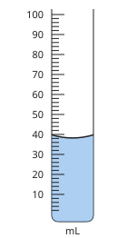

Answer: **38 mL**
- Typed **40** (top) → “Read at the bottom of the curved surface, not at the edges.”

Full working after a second miss:

> Each small mark is 2 mL.  
> The bottom of the meniscus is at 38 mL.  

**Card c3p5-2** (draft)

> Volume of a cuboid = length × width × height.
>
> _5 cm × 4 cm × 2 cm = 40 cm³_  

Check question: `p3-5-box` · number, level 1 · computed by rule, reused from practice

> A wooden block is 13 cm long, 5 cm wide and 6 cm high. Find its volume (cm³).

Answer: **390 cm³**
- Typed **24** (add) → “Volume multiplies the three measurements.”
- Typed **65** (area) → “That is the area of the base. Multiply by the height too.”

Full working after a second miss:

> V = l × w × h.  
> V = 13 × 5 × 6 = 390 cm³.  

**Card c3p5-3** (draft)

> Volume of an irregular solid = rise in the water level.
>
> _50 mL → 65 mL: the stone is 15 cm³._  

Check question: `p3-5-disp-card` · number, level 1 · computed by rule

> What is the volume of the stone (cm³)?

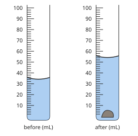

Answer: **20 cm³**
- Typed **54** (after) → “That is the reading with the stone. Subtract the reading before.”

Full working after a second miss:

> Volume of stone = rise in the water level.  
> 54 − 34 = 20 mL = 20 cm³.  

**Worked example** (draft)

> Water in a measuring cylinder reads 42 mL. A stone is lowered in and the level rises to 58 mL. Find the volume of the stone.

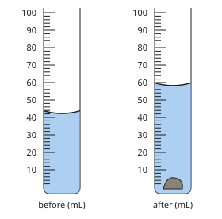

1. The stone pushes aside (displaces) its own volume of water.
2. Volume = 58 − 42 = 16 mL = 16 cm³.

**Answer:** 16 cm³

**Practice** `p3-5-read` · number, level 1 · computed by rule

> How much water is in the measuring cylinder (mL)?

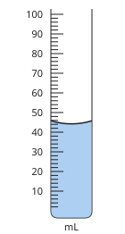

Answer: **44 mL**
- Typed **46** (top) → “Read at the bottom of the curved surface, not at the edges.”

Full working after a second miss:

> Each small mark is 2 mL.  
> The bottom of the meniscus is at 44 mL.  

> How much water is in the measuring cylinder (mL)?

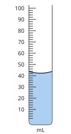

Answer: **42 mL**
- Typed **44** (top) → “Read at the bottom of the curved surface, not at the edges.”

Full working after a second miss:

> Each small mark is 2 mL.  
> The bottom of the meniscus is at 42 mL.  

**Practice** `p3-5-box` · number, level 1 · computed by rule

> A wooden block is 11 cm long, 10 cm wide and 8 cm high. Find its volume (cm³).

Answer: **880 cm³**
- Typed **29** (add) → “Volume multiplies the three measurements.”
- Typed **110** (area) → “That is the area of the base. Multiply by the height too.”

Full working after a second miss:

> V = l × w × h.  
> V = 11 × 10 × 8 = 880 cm³.  

> A wooden block is 6 cm long, 6 cm wide and 3 cm high. Find its volume (cm³).

Answer: **108 cm³**
- Typed **15** (add) → “Volume multiplies the three measurements.”
- Typed **36** (area) → “That is the area of the base. Multiply by the height too.”

Full working after a second miss:

> V = l × w × h.  
> V = 6 × 6 × 3 = 108 cm³.  

**Practice** `p3-5-disp` · number, level 2 · computed by rule

> What is the volume of the stone (cm³)?

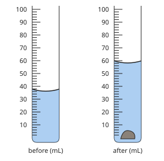

Answer: **22 cm³**
- Typed **58** (after) → “That is the reading with the stone. Subtract the reading before.”

Full working after a second miss:

> Volume of stone = rise in the water level.  
> 58 − 36 = 22 mL = 22 cm³.  

> What is the volume of the stone (cm³)?

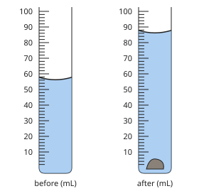

Answer: **30 cm³**
- Typed **86** (after) → “That is the reading with the stone. Subtract the reading before.”

Full working after a second miss:

> Volume of stone = rise in the water level.  
> 86 − 56 = 30 mL = 30 cm³.  

**Practice** `p3-5-conv` · number, level 2 · computed by rule

> Convert 15 L to mL.

Answer: **15 000**
- Typed **0.015** (flip) → “Check the direction: 1 L = 1000 mL.”

Full working after a second miss:

> 1 L = 1000 mL.  
> 15 L = 15 000 mL.  

> Convert 35 cm³ to L.

Answer: **0.035**
- Typed **35 000** (flip) → “Check the direction: 1 cm³ = 0.001 L.”

Full working after a second miss:

> 1 cm³ = 0.001 L.  
> 35 cm³ = 0.035 L.  

**Practice** `p3-5-cyl` · number, level 3 · computed by rule

> A cylindrical water tank has radius 0.5 m and height 2 m. Find its volume in litres (π = 3.14).

Answer: **1570 L**
- Typed **1.57** (m3) → “That is in m³. Multiply by 1000 for litres.”
- Typed **3140** (nosq) → “Square the radius: r² = 0.25.”

Full working after a second miss:

> V = πr²h = 3.14 × 0.5² × 2 = 1.57 m³.  
> 1 m³ = 1000 L, so V = 1570 L.  

> A cylindrical water tank has radius 1 m and height 2 m. Find its volume in litres (π = 3.14).

Answer: **6280 L**
- Typed **6.28** (m3) → “That is in m³. Multiply by 1000 for litres.”

Full working after a second miss:

> V = πr²h = 3.14 × 1² × 2 = 6.28 m³.  
> 1 m³ = 1000 L, so V = 6280 L.  

## Lesson 6: Measurement of temperature and time

Prerequisites: 1 · Skill: p3-6 (Measure temperature and time)

**Note** (draft)

> Temperature tells how hot or cold a body is. It is measured with a thermometer, in degrees Celsius (°C) or in kelvin (K).
> • T(K) = T(°C) + 273. Water freezes at 0 °C (273 K) and boils at 100 °C (373 K) at normal pressure.
> • Laboratory thermometers use mercury or coloured alcohol; a clinical thermometer reads body temperature (about 37 °C).
> Time is measured with clocks and stopwatches. SI unit: the second. 1 min = 60 s, 1 h = 3600 s.
> To time something short (a swing of a pendulum), time many swings and divide: period = total time ÷ number of swings.

**Learn: Thermometers** (draft)

> A liquid-in-glass thermometer has a bulb of mercury or coloured alcohol. When it warms, the liquid expands up the narrow tube; the scale shows the temperature.
> Read it where the liquid ends, with your eye level with that point. Wait until the level stops moving.
> A clinical thermometer has a narrow kink so the reading stays after you take it out of the mouth; it reads about 35 °C to 42 °C.

**Learn: Celsius and kelvin** (draft)

> Two temperature scales are used:
> • Celsius: water freezes at 0 °C and boils at 100 °C.
> • Kelvin (SI): T(K) = T(°C) + 273.
> So 0 °C = 273 K and 100 °C = 373 K. A hot day in Garoua at 40 °C is 313 K. There are no negative temperatures on the kelvin scale.

**Learn: Measuring time** (draft)

> Time is measured with clocks, watches and stopwatches; the SI unit is the second. 1 min = 60 s and 1 h = 3600 s.
> Your reaction time when starting and stopping a stopwatch adds an error. To reduce it, time many events and divide.
> For a pendulum, time 20 swings and divide by 20; repeat three times and take the mean.

**Learn: key words and examples** (draft)

- **temperature**: how hot or cold something is
- **kelvin**: the SI unit of temperature: K = °C + 273
- **period**: the time for one complete swing

- 37 °C = 310 K
- 2 min 15 s = 135 s
- 20 swings in 30 s: period 1.5 s

Common mistake: “300 K = 300 + 273 = 573 °C” → “300 K = 300 − 273 = 27 °C”. To go from kelvin to Celsius, subtract 273.

**Card c3p6-1** (draft)

> Read a thermometer where the liquid ends, eye level with the scale.
>
> _Each small mark on a 0–50 °C scale is 1 °C._  

Check question: `p3-6-read` · number, level 1 · computed by rule, reused from practice

> What temperature does the thermometer show (°C)?

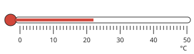

Answer: **22 °C**
- Typed **23** (next) → “Read where the liquid ends, not the next mark.”

Full working after a second miss:

> Each small mark is 1 °C.  
> The liquid ends at 22 °C.  

**Card c3p6-2** (draft)

> Kelvin = degrees Celsius + 273.
>
> _27 °C = 300 K_  

Check question: `p3-6-k` · number, level 1 · computed by rule, reused from practice

> Convert 48 °C to kelvin.

Answer: **321 K**
- Typed **−225** (sub) → “Add 273 to change °C to kelvin.”

Full working after a second miss:

> T(K) = T(°C) + 273.  
> 48 + 273 = 321 K.  

**Card c3p6-3** (draft)

> Time many swings and divide to find one swing.
>
> _10 swings in 15 s: one swing takes 1.5 s._  

Check question: `p3-6-period-card` · number, level 1 · computed by rule

> Bih times 10 swings of a pendulum three times: 14.2 s, 14.4 s and 14 s. Find the period, using the mean time (s).

Answer: **1.42 s**
- Typed **14.2** (mean) → “That is the time for 10 swings. Divide by 10 for one swing.”
- Typed **4.26** (sum) → “Find the mean of the three timings first (divide by 3).”

Full working after a second miss:

> Mean time = (14.2 + 14.4 + 14) ÷ 3 = 14.2 s.  
> Period = mean ÷ 10 = 1.42 s.  

**Worked example** (draft)

> A pendulum makes 20 complete swings in 32 s. Find its period.

1. Period = time for one swing = total time ÷ number of swings.
2. = 32 ÷ 20 = 1.6 s.

**Answer:** 1.6 s

**Practice** `p3-6-read` · number, level 1 · computed by rule

> What temperature does the thermometer show (°C)?

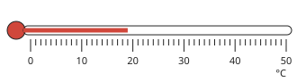

Answer: **19 °C**
- Typed **20** (next) → “Read where the liquid ends, not the next mark.”

Full working after a second miss:

> Each small mark is 1 °C.  
> The liquid ends at 19 °C.  

> What temperature does the thermometer show (°C)?

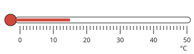

Answer: **15 °C**
- Typed **16** (next) → “Read where the liquid ends, not the next mark.”

Full working after a second miss:

> Each small mark is 1 °C.  
> The liquid ends at 15 °C.  

**Practice** `p3-6-k` · number, level 1 · computed by rule

> Convert −11 °C to kelvin.

Answer: **262 K**
- Typed **−284** (sub) → “Add 273 to change °C to kelvin.”

Full working after a second miss:

> T(K) = T(°C) + 273.  
> −11 + 273 = 262 K.  

> Convert 88 °C to kelvin.

Answer: **361 K**
- Typed **−185** (sub) → “Add 273 to change °C to kelvin.”

Full working after a second miss:

> T(K) = T(°C) + 273.  
> 88 + 273 = 361 K.  

**Practice** `p3-6-c` · number, level 2 · computed by rule

> Convert 380 K to degrees Celsius.

Answer: **107 °C**
- Typed **653** (add) → “Subtract 273 to change kelvin to °C.”

Full working after a second miss:

> T(°C) = T(K) − 273.  
> 380 − 273 = 107 °C.  

> Convert 340 K to degrees Celsius.

Answer: **67 °C**
- Typed **613** (add) → “Subtract 273 to change kelvin to °C.”

Full working after a second miss:

> T(°C) = T(K) − 273.  
> 340 − 273 = 67 °C.  

**Practice** `p3-6-time` · number, level 2 · computed by rule

> A race lasted 9 min 16 s. How many seconds is that?

Answer: **556 s**
- Typed **916** (hundred) → “A minute is 60 s, not 100 s.”

Full working after a second miss:

> 1 min = 60 s, so 9 min = 540 s.  
> 540 + 16 = 556 s.  

> A race lasted 9 min 29 s. How many seconds is that?

Answer: **569 s**
- Typed **929** (hundred) → “A minute is 60 s, not 100 s.”

Full working after a second miss:

> 1 min = 60 s, so 9 min = 540 s.  
> 540 + 29 = 569 s.  

**Practice** `p3-6-period` · number, level 3 · computed by rule

> Bih times 10 swings of a pendulum three times: 23.2 s, 23.4 s and 23 s. Find the period, using the mean time (s).

Answer: **2.32 s**
- Typed **23.2** (mean) → “That is the time for 10 swings. Divide by 10 for one swing.”
- Typed **6.96** (sum) → “Find the mean of the three timings first (divide by 3).”

Full working after a second miss:

> Mean time = (23.2 + 23.4 + 23) ÷ 3 = 23.2 s.  
> Period = mean ÷ 10 = 2.32 s.  

> Bih times 20 swings of a pendulum three times: 24.2 s, 24.4 s and 24 s. Find the period, using the mean time (s).

Answer: **1.21 s**
- Typed **24.2** (mean) → “That is the time for 20 swings. Divide by 20 for one swing.”
- Typed **3.63** (sum) → “Find the mean of the three timings first (divide by 3).”

Full working after a second miss:

> Mean time = (24.2 + 24.4 + 24) ÷ 3 = 24.2 s.  
> Period = mean ÷ 20 = 1.21 s.  

## Lesson 7: Density: Definition, Calculation and Units. Measurement of the density of a liquid

Prerequisites: 4, 5 · Skill: p3-7 (Density: definition, calculation, units; density of a liquid)

**Note** (draft)

> Density is mass per unit volume: ρ = m ÷ V.
> • Units: kg/m³ (SI) or g/cm³. 1 g/cm³ = 1000 kg/m³. Water: 1 g/cm³ = 1000 kg/m³.
> • Rearranged: m = ρV and V = m ÷ ρ.
> • A solid floats in a liquid if its density is less than that of the liquid.
> Density of a liquid: measure a volume in a measuring cylinder, find its mass by difference on a balance, then divide.

**Learn: Heavy for its size** (draft)

> A small iron nail sinks but a large log floats. The log has more mass, but it is less dense: each cubic centimetre of wood has less mass than a cubic centimetre of iron.
> Density is mass per unit volume: ρ = m ÷ V (ρ is the Greek letter rho).

**Learn: Units and rearranging** (draft)

> Units: g/cm³ or, in SI, kg/m³. Since 1 g/cm³ = 1000 kg/m³, water has density 1 g/cm³ = 1000 kg/m³.
> • m = ρV: 200 cm³ of oil of density 0.9 g/cm³ has a mass of 180 g.
> • V = m ÷ ρ.
> Typical densities (g/cm³): cork 0.25, wood 0.6, palm oil 0.9, water 1, aluminium 2.7, iron 7.9, mercury 13.6.

**Learn: Density of a liquid** (draft)

> • Find the mass of an empty measuring cylinder.
> • Pour in some liquid and read its volume.
> • Find the new mass; subtract to get the mass of the liquid.
> • Divide: ρ = m ÷ V.
> Objects float in a liquid if they are less dense than it: that is why oil floats on water.

**Learn: key words and examples** (draft)

- **density**: mass per unit volume, ρ = m ÷ V
- **kg/m³**: the SI unit of density
- **float**: stay on the surface: less dense than the liquid

- 60 g in 20 cm³: 3 g/cm³
- 2.7 g/cm³ = 2700 kg/m³
- Cork (0.25 g/cm³) floats on water

Common mistake: “ρ = V ÷ m” → “ρ = m ÷ V”. Density is mass per unit volume: mass on top, volume underneath.

**Card c3p7-1** (draft)

> Density = mass ÷ volume.
>
> _60 g in 20 cm³: ρ = 3 g/cm³_  

Check question: `p3-7-rho` · number, level 1 · computed by rule, reused from practice

> A stone has mass 114 g and volume 19 cm³. Find its density (g/cm³).

Answer: **6 g/cm³**
- Typed **0.17** (flip) → “Density is mass ÷ volume, not volume ÷ mass.”
- Typed **2166** (times) → “Divide mass by volume.”

Full working after a second miss:

> ρ = m ÷ V = 114 ÷ 19.  
> ρ = 6 g/cm³.  

**Card c3p7-2** (draft)

> Mass = density × volume.
>
> _ρ = 8 g/cm³, V = 10 cm³: m = 80 g_  

Check question: `p3-7-m` · number, level 1 · computed by rule, reused from practice

> Cooking oil has a density of 0.92 g/cm³. Find the mass of 450 cm³ of it (g).

Answer: **414 g**
- Typed **489.13** (div) → “Mass = density × volume: multiply.”

Full working after a second miss:

> m = ρ × V = 0.92 × 450.  
> m = 414 g.  

**Card c3p7-3** (draft)

> 1 g/cm³ = 1000 kg/m³.
>
> _Water: 1 g/cm³ = 1000 kg/m³_  

Check question: `p3-7-conv-card` · number, level 1 · computed by rule

> Convert a density of 11.7 g/cm³ to kg/m³.

Answer: **11 700 kg/m³**
- Typed **0.0117** (div) → “kg/m³ numbers are larger: multiply by 1000.”

Full working after a second miss:

> 1 g/cm³ = 1000 kg/m³.  
> 11.7 × 1000 = 11 700 kg/m³.  

**Worked example** (draft)

> A block of aluminium has a mass of 540 g and a volume of 200 cm³. Find its density in g/cm³ and in kg/m³.

1. ρ = m ÷ V = 540 ÷ 200 = 2.7 g/cm³.
2. 1 g/cm³ = 1000 kg/m³, so ρ = 2700 kg/m³.

**Answer:** 2.7 g/cm³ = 2700 kg/m³

**Practice** `p3-7-rho` · number, level 1 · computed by rule

> A stone has mass 121.8 g and volume 29 cm³. Find its density (g/cm³).

Answer: **4.2 g/cm³**
- Typed **0.24** (flip) → “Density is mass ÷ volume, not volume ÷ mass.”
- Typed **3532.2** (times) → “Divide mass by volume.”

Full working after a second miss:

> ρ = m ÷ V = 121.8 ÷ 29.  
> ρ = 4.2 g/cm³.  

> A stone has mass 88 g and volume 16 cm³. Find its density (g/cm³).

Answer: **5.5 g/cm³**
- Typed **0.18** (flip) → “Density is mass ÷ volume, not volume ÷ mass.”
- Typed **1408** (times) → “Divide mass by volume.”

Full working after a second miss:

> ρ = m ÷ V = 88 ÷ 16.  
> ρ = 5.5 g/cm³.  

**Practice** `p3-7-m` · number, level 1 · computed by rule

> Cooking oil has a density of 0.9 g/cm³. Find the mass of 450 cm³ of it (g).

Answer: **405 g**
- Typed **500** (div) → “Mass = density × volume: multiply.”

Full working after a second miss:

> m = ρ × V = 0.9 × 450.  
> m = 405 g.  

> Cooking oil has a density of 0.9 g/cm³. Find the mass of 450 cm³ of it (g).

Answer: **405 g**
- Typed **500** (div) → “Mass = density × volume: multiply.”

Full working after a second miss:

> m = ρ × V = 0.9 × 450.  
> m = 405 g.  

**Practice** `p3-7-conv` · number, level 2 · computed by rule

> Convert a density of 7.6 g/cm³ to kg/m³.

Answer: **7600 kg/m³**
- Typed **0.0076** (div) → “kg/m³ numbers are larger: multiply by 1000.”

Full working after a second miss:

> 1 g/cm³ = 1000 kg/m³.  
> 7.6 × 1000 = 7600 kg/m³.  

> Convert a density of 17.7 g/cm³ to kg/m³.

Answer: **17 700 kg/m³**
- Typed **0.0177** (div) → “kg/m³ numbers are larger: multiply by 1000.”

Full working after a second miss:

> 1 g/cm³ = 1000 kg/m³.  
> 17.7 × 1000 = 17 700 kg/m³.  

**Practice** `p3-7-liquid` · number, level 2 · computed by rule

> An empty measuring cylinder has mass 144 g. With 200 cm³ of a liquid it has mass 284 g. Find the density of the liquid (g/cm³).

Answer: **0.7 g/cm³**
- Typed **1.42** (total) → “Subtract the empty cylinder first: only the liquid's mass counts.”

Full working after a second miss:

> Mass of liquid = 284 − 144 = 140 g.  
> ρ = 140 ÷ 200 = 0.7 g/cm³.  

> An empty measuring cylinder has mass 121 g. With 200 cm³ of a liquid it has mass 341 g. Find the density of the liquid (g/cm³).

Answer: **1.1 g/cm³**
- Typed **1.71** (total) → “Subtract the empty cylinder first: only the liquid's mass counts.”

Full working after a second miss:

> Mass of liquid = 341 − 121 = 220 g.  
> ρ = 220 ÷ 200 = 1.1 g/cm³.  

**Practice** `p3-7-float` · multiple choice, level 3 · computed by rule

> A solid has mass 57 g and volume 30 cm³. Will it float or sink in water (density 1 g/cm³)?

- ✅ Sink: its density is 1.9 g/cm³, more than water
- ◻️ Float: all solids float in water  
  _↳ feedback if chosen: A solid denser than water (like a stone) sinks._
- ◻️ Float: its density is 1.9 g/cm³, less than water  
  _↳ feedback if chosen: Compare carefully: 1.9 is more than 1._
- ◻️ Float: it is light  
  _↳ feedback if chosen: Floating depends on density, not on mass alone: a heavy log of wood floats._

Full working after a second miss:

> ρ = 57 ÷ 30 = 1.9 g/cm³.  
> Compare with water (1 g/cm³): Sink: its density is 1.9 g/cm³, more than water.  

> A solid has mass 119 g and volume 170 cm³. Will it float or sink in water (density 1 g/cm³)?

- ◻️ Sink: it is heavy  
  _↳ feedback if chosen: Floating depends on density, not on mass alone: a heavy log of wood floats._
- ✅ Float: its density is 0.7 g/cm³, less than water
- ◻️ Sink: its density is 0.7 g/cm³, more than water  
  _↳ feedback if chosen: Compare carefully: 0.7 is less than 1._
- ◻️ Float: all solids float in water  
  _↳ feedback if chosen: A solid denser than water (like a stone) sinks._

Full working after a second miss:

> ρ = 119 ÷ 170 = 0.7 g/cm³.  
> Compare with water (1 g/cm³): Float: its density is 0.7 g/cm³, less than water.  

## Lesson 8: Describe and carry out experiments to measure the density of regular & irregular objects

Prerequisites: 7 · Skill: p3-8 (Measure the density of regular and irregular solids)

**Note** (draft)

> Regular solid: measure its sides with a ruler (or vernier calipers), calculate the volume, find its mass on a balance, then ρ = m ÷ V.
> Irregular solid: find its mass on a balance; find its volume by displacement (measuring cylinder or overflow can); then ρ = m ÷ V.
> Sources of error: air bubbles on the stone, splashing, reading the meniscus from the side, water clinging to the stone if weighed after.
> Weigh the solid before putting it in water.

**Learn: Regular solids** (draft)

> For a block, cube or cylinder, find the volume by measuring and calculating, then weigh it.
> A block 4 cm × 3 cm × 2 cm has V = 24 cm³. If its mass is 48 g, ρ = 48 ÷ 24 = 2 g/cm³.
> Measure each side carefully: a small error in a length makes a bigger error in the volume.

**Learn: Irregular solids** (draft)

> A stone has no simple shape, so find its volume by displacement:
> • weigh the dry stone first;
> • read the water level in a measuring cylinder;
> • lower the stone in on a thread and read the new level;
> • the rise is the stone's volume.
> For a large stone, use an overflow (eureka) can and collect the water that comes out.

**Learn: Good practice** (draft)

> • Weigh before wetting the stone.
> • Lower it gently so water does not splash out.
> • Shake off air bubbles: they add to the volume.
> • Read the meniscus at eye level.
> Repeat and take the mean to reduce errors.

**Learn: key words and examples** (draft)

- **regular solid**: a solid with a simple shape whose volume can be calculated
- **irregular solid**: a solid with no simple shape
- **overflow (eureka) can**: a can with a spout to collect the water an object displaces

- Brass key 85 g, 10 cm³: 8.5 g/cm³
- Stone 78 g raises water 50 → 60 mL: 7.8 g/cm³

Common mistake: “Volume of the stone = final reading 60 mL” → “Volume = 60 − 50 = 10 cm³”. The water was already there; only the rise is due to the stone.

**Card c3p8-1** (draft)

> Regular solid: volume from its measurements, mass from a balance.
>
> _4 cm × 3 cm × 2 cm = 24 cm³; 48 g → 2 g/cm³_  

Check question: `p3-8-reg` · number, level 1 · computed by rule, reused from practice

> A rectangular block is 2 cm × 6 cm × 5 cm and has mass 120 g. Find its density (g/cm³).

Answer: **2 g/cm³**
- Typed **120** (nov) → “That is the mass. Divide it by the volume.”
- Typed **10** (area) → “Use the volume (l × w × h), not the area of one face.”

Full working after a second miss:

> V = 2 × 6 × 5 = 60 cm³.  
> ρ = 120 ÷ 60 = 2 g/cm³.  

**Card c3p8-2** (draft)

> Irregular solid: volume by displacement.
>
> _50 mL → 60 mL: V = 10 cm³_  

Check question: `p3-8-irr-card` · number, level 1 · computed by rule

> A stone of mass 43.2 g is lowered into the cylinder shown. Find its density (g/cm³).

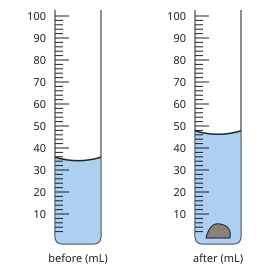

Answer: **3.6 g/cm³**
- Typed **0.94** (level) → “Use the rise in level, not the final reading, as the volume.”

Full working after a second miss:

> Volume = 46 − 34 = 12 cm³.  
> ρ = 43.2 ÷ 12 = 3.6 g/cm³.  

**Card c3p8-3** (draft)

> Do the steps in a sensible order: weigh first, then put it in water.
>
> _A wet stone gives a wrong mass._  

Check question: `p3-8-order` · ordering, level 1 · **authored key**, reused from practice

> Put the steps for finding the density of a stone in order.

Shown as: Lower the stone in gently on a thread and read the new volume. · Subtract the readings to get the volume of the stone. · Find the mass of the dry stone on a balance. · Pour water into a measuring cylinder and read the volume. · Divide the mass by the volume.
Correct order: Find the mass of the dry stone on a balance. → Pour water into a measuring cylinder and read the volume. → Lower the stone in gently on a thread and read the new volume. → Subtract the readings to get the volume of the stone. → Divide the mass by the volume.

Hint (draft): Weigh the stone while it is still dry.

Full working after a second miss:

> The correct order is: Find the mass of the dry stone on a balance. → Pour water into a measuring cylinder and read the volume. → Lower the stone in gently on a thread and read the new volume. → Subtract the readings to get the volume of the stone. → Divide the mass by the volume..  

**Worked example** (draft)

> A stone has mass 78 g. Water in a measuring cylinder rises from 50 mL to 60 mL when the stone is put in. Find the density of the stone.

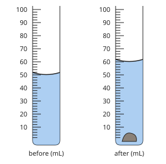

1. Volume = 60 − 50 = 10 cm³.
2. ρ = m ÷ V = 78 ÷ 10 = 7.8 g/cm³.

**Answer:** 7.8 g/cm³

**Practice** `p3-8-reg` · number, level 1 · computed by rule

> A rectangular block is 7 cm × 2 cm × 5 cm and has mass 252 g. Find its density (g/cm³).

Answer: **3.6 g/cm³**
- Typed **252** (nov) → “That is the mass. Divide it by the volume.”
- Typed **18** (area) → “Use the volume (l × w × h), not the area of one face.”

Full working after a second miss:

> V = 7 × 2 × 5 = 70 cm³.  
> ρ = 252 ÷ 70 = 3.6 g/cm³.  

> A rectangular block is 6 cm × 5 cm × 2 cm and has mass 450 g. Find its density (g/cm³).

Answer: **7.5 g/cm³**
- Typed **450** (nov) → “That is the mass. Divide it by the volume.”
- Typed **15** (area) → “Use the volume (l × w × h), not the area of one face.”

Full working after a second miss:

> V = 6 × 5 × 2 = 60 cm³.  
> ρ = 450 ÷ 60 = 7.5 g/cm³.  

**Practice** `p3-8-irr` · number, level 2 · computed by rule

> A stone of mass 27 g is lowered into the cylinder shown. Find its density (g/cm³).

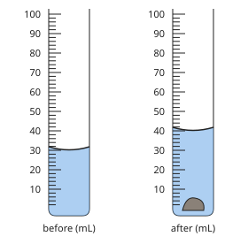

Answer: **2.7 g/cm³**
- Typed **0.68** (level) → “Use the rise in level, not the final reading, as the volume.”

Full working after a second miss:

> Volume = 40 − 30 = 10 cm³.  
> ρ = 27 ÷ 10 = 2.7 g/cm³.  

> A stone of mass 22.4 g is lowered into the cylinder shown. Find its density (g/cm³).

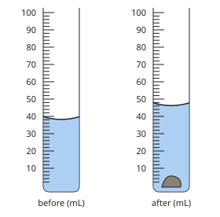

Answer: **2.8 g/cm³**
- Typed **0.49** (level) → “Use the rise in level, not the final reading, as the volume.”

Full working after a second miss:

> Volume = 46 − 38 = 8 cm³.  
> ρ = 22.4 ÷ 8 = 2.8 g/cm³.  

**Practice** `p3-8-vol` · number, level 2 · computed by rule

> A brass key has a density of 8 g/cm³ and a mass of 48 g. What volume of water will it displace (cm³)?

Answer: **6 cm³**
- Typed **384** (times) → “Volume = mass ÷ density: divide.”

Full working after a second miss:

> V = m ÷ ρ.  
> V = 48 ÷ 8 = 6 cm³.  

> A brass key has a density of 8 g/cm³ and a mass of 48 g. What volume of water will it displace (cm³)?

Answer: **6 cm³**
- Typed **384** (times) → “Volume = mass ÷ density: divide.”

Full working after a second miss:

> V = m ÷ ρ.  
> V = 48 ÷ 8 = 6 cm³.  

**Practice** `p3-8-order` · ordering, level 1 · **authored key**

> Put the steps for finding the density of a stone in order.

Shown as: Find the mass of the dry stone on a balance. · Divide the mass by the volume. · Subtract the readings to get the volume of the stone. · Lower the stone in gently on a thread and read the new volume. · Pour water into a measuring cylinder and read the volume.
Correct order: Find the mass of the dry stone on a balance. → Pour water into a measuring cylinder and read the volume. → Lower the stone in gently on a thread and read the new volume. → Subtract the readings to get the volume of the stone. → Divide the mass by the volume.

Hint (draft): Weigh the stone while it is still dry.

Full working after a second miss:

> The correct order is: Find the mass of the dry stone on a balance. → Pour water into a measuring cylinder and read the volume. → Lower the stone in gently on a thread and read the new volume. → Subtract the readings to get the volume of the stone. → Divide the mass by the volume..  

> Put the steps for finding the density of a stone in order.

Shown as: Subtract the readings to get the volume of the stone. · Pour water into a measuring cylinder and read the volume. · Lower the stone in gently on a thread and read the new volume. · Divide the mass by the volume. · Find the mass of the dry stone on a balance.
Correct order: Find the mass of the dry stone on a balance. → Pour water into a measuring cylinder and read the volume. → Lower the stone in gently on a thread and read the new volume. → Subtract the readings to get the volume of the stone. → Divide the mass by the volume.

Hint (draft): Weigh the stone while it is still dry.

Full working after a second miss:

> The correct order is: Find the mass of the dry stone on a balance. → Pour water into a measuring cylinder and read the volume. → Lower the stone in gently on a thread and read the new volume. → Subtract the readings to get the volume of the stone. → Divide the mass by the volume..  

**Practice** `p3-8-eureka` · number, level 3 · computed by rule

> A stone of mass 131 g is lowered into a full overflow can. The water that overflows has mass 45 g. Find the density of the stone (g/cm³).

Answer: **2.91 g/cm³**
- Typed **0.34** (flip) → “Density is the stone's mass divided by its volume.”

Full working after a second miss:

> The overflow water has the same volume as the stone. Water has 1 g in each cm³, so V = 45 cm³.  
> ρ = 131 ÷ 45 = 2.91 g/cm³.  

> A stone of mass 118 g is lowered into a full overflow can. The water that overflows has mass 42 g. Find the density of the stone (g/cm³).

Answer: **2.81 g/cm³**
- Typed **0.36** (flip) → “Density is the stone's mass divided by its volume.”

Full working after a second miss:

> The overflow water has the same volume as the stone. Water has 1 g in each cm³, so V = 42 cm³.  
> ρ = 118 ÷ 42 = 2.81 g/cm³.  

## Lesson 9: Applications of the density of a material in engineering works

Prerequisites: 7, 8 · Skill: p3-9 (Applications of density in engineering and daily life)

**Note** (draft)

> Engineers choose materials partly by density:
> • Aircraft and bicycles: aluminium alloys (low density, strong).
> • Ships: steel hulls are hollow, so the ship's average density is less than water's and it floats.
> • Hot-air balloons rise because hot air is less dense than cold air.
> • Life jackets use low-density foam.
> • Builders estimate loads: mass = density × volume (concrete ≈ 2400 kg/m³).
> • Oil spills float on the sea because oil is less dense than water.

**Learn: Floating and sinking** (draft)

> An object floats if its average density is less than that of the liquid. A solid steel bar sinks, but a steel ship is mostly air inside, so its average density is less than water's.
> Hot air is less dense than cold air, so a hot-air balloon rises. Oil is less dense than water, so an oil spill floats on the sea and can be scooped off.

**Learn: Choosing materials** (draft)

> • Aircraft, bicycles and car parts: aluminium alloys, strong but light (2.7 g/cm³ against 7.9 g/cm³ for steel).
> • Life jackets and floats: foams of very low density.
> • Fishing weights and sinkers: lead, very dense, so a small piece is heavy.
> • Boats are built so that they float even when loaded.

**Learn: Estimating loads** (draft)

> Builders and engineers use m = ρV to know how heavy a structure will be.
> A concrete slab 3 m × 2 m × 0.15 m has V = 0.9 m³; at 2400 kg/m³ its mass is 2160 kg.
> A 1000 L water tank on a roof adds about 1000 kg: the roof must be designed for that load.

**Learn: key words and examples** (draft)

- **average density**: total mass ÷ total volume of an object made of several materials
- **alloy**: a mixture of metals, such as aluminium alloy
- **load**: the weight a structure must support

- Ship: hollow hull floats
- Life jacket: low-density foam
- 2 m³ of concrete ≈ 4800 kg

Common mistake: “A ship floats because steel is light” → “A ship floats because its average density, with the air inside, is less than water's”. Steel is much denser than water. The shape of the hull, full of air, makes the difference.

**Card c3p9-1** (draft)

> A ship floats because its average density (steel + air inside) is less than water's.
>
> _A solid steel bar sinks; a hollow steel hull floats._  

Check question: `p3-9-ship` · multiple choice, level 1 · **authored key**, reused from practice

> After an oil spill, the oil spreads on top of the sea. Why?

- ◻️ Oil is denser than sea water  
  _↳ feedback if chosen: Denser oil would sink._
- ✅ Oil is less dense than sea water
- ◻️ Oil is a gas  
  _↳ feedback if chosen: Oil is a liquid._
- ◻️ The wind pushes it up  
  _↳ feedback if chosen: It floats because of density, even on a calm day._

Full working after a second miss:

> Less dense liquids float on denser ones.  
> So the answer is Oil is less dense than sea water.  

**Card c3p9-2** (draft)

> Low-density materials keep vehicles light: aluminium for aircraft.
>
> _Aluminium 2.7 g/cm³; steel 7.9 g/cm³_  

Check question: `p3-9-choose` · multiple choice, level 1 · **authored key**, reused from practice

> Which material is best for a life jacket?

- ◻️ Iron  
  _↳ feedback if chosen: Iron is very dense: it sinks._
- ◻️ Concrete  
  _↳ feedback if chosen: Concrete sinks._
- ✅ Foam of very low density
- ◻️ Lead  
  _↳ feedback if chosen: Lead is very dense: it sinks._

Full working after a second miss:

> A low-density material floats and helps you float.  
> So the answer is Foam of very low density.  

**Card c3p9-3** (draft)

> Builders use m = ρV to estimate loads.
>
> _1 m³ of concrete ≈ 2400 kg_  

Check question: `p3-9-load-card` · number, level 1 · computed by rule

> A concrete pillar has a volume of 0.7 m³. Concrete has a density of 2400 kg/m³. Find its mass (kg).

Answer: **1680 kg**
- Typed **3428.57** (div) → “Mass = density × volume: multiply.”

Full working after a second miss:

> m = ρV = 2400 × 0.7.  
> m = 1680 kg.  

**Worked example** (draft)

> A concrete slab for a house in Bafoussam is 3 m × 2 m × 0.15 m. Concrete has density 2400 kg/m³. Find its mass.

1. V = 3 × 2 × 0.15 = 0.9 m³.
2. m = ρV = 2400 × 0.9 = 2160 kg.

**Answer:** 2160 kg

**Practice** `p3-9-ship` · multiple choice, level 1 · **authored key**

> After an oil spill, the oil spreads on top of the sea. Why?

- ◻️ Oil is denser than sea water  
  _↳ feedback if chosen: Denser oil would sink._
- ◻️ Oil is a gas  
  _↳ feedback if chosen: Oil is a liquid._
- ◻️ The wind pushes it up  
  _↳ feedback if chosen: It floats because of density, even on a calm day._
- ✅ Oil is less dense than sea water

Full working after a second miss:

> Less dense liquids float on denser ones.  
> So the answer is Oil is less dense than sea water.  

> Why does a large steel ship float when a steel nail sinks?

- ✅ The hollow hull makes the ship's average density less than water's
- ◻️ The ship is lighter than the nail  
  _↳ feedback if chosen: The ship is far heavier than the nail._
- ◻️ Sea water has no density  
  _↳ feedback if chosen: Sea water is slightly denser than fresh water._
- ◻️ Steel is less dense than water  
  _↳ feedback if chosen: Steel (7.9 g/cm³) is much denser than water._

Full working after a second miss:

> The air inside the hull lowers the average density.  
> So the answer is The hollow hull makes the ship's average density less than water's.  

**Practice** `p3-9-choose` · multiple choice, level 1 · **authored key**

> Which material is best for a life jacket?

- ✅ Foam of very low density
- ◻️ Lead  
  _↳ feedback if chosen: Lead is very dense: it sinks._
- ◻️ Iron  
  _↳ feedback if chosen: Iron is very dense: it sinks._
- ◻️ Concrete  
  _↳ feedback if chosen: Concrete sinks._

Full working after a second miss:

> A low-density material floats and helps you float.  
> So the answer is Foam of very low density.  

> Why is aluminium used to make aircraft bodies?

- ✅ It is strong and has a low density
- ◻️ It melts easily  
  _↳ feedback if chosen: A low melting point would be a problem, not an advantage._
- ◻️ It is the densest metal  
  _↳ feedback if chosen: A dense metal would make the aircraft too heavy._
- ◻️ It is magnetic  
  _↳ feedback if chosen: Magnetism is not why it is chosen._

Full working after a second miss:

> Strength with low density keeps the aircraft light.  
> So the answer is It is strong and has a low density.  

**Practice** `p3-9-load` · number, level 2 · computed by rule

> A concrete pillar has a volume of 0.7 m³. Concrete has a density of 2400 kg/m³. Find its mass (kg).

Answer: **1680 kg**
- Typed **3428.57** (div) → “Mass = density × volume: multiply.”

Full working after a second miss:

> m = ρV = 2400 × 0.7.  
> m = 1680 kg.  

> A concrete pillar has a volume of 0.7 m³. Concrete has a density of 2400 kg/m³. Find its mass (kg).

Answer: **1680 kg**
- Typed **3428.57** (div) → “Mass = density × volume: multiply.”

Full working after a second miss:

> m = ρV = 2400 × 0.7.  
> m = 1680 kg.  

**Practice** `p3-9-avg` · number, level 2 · computed by rule

> A closed hollow tin can has mass 140 g and volume 900 cm³. Find its average density (g/cm³).

Answer: **0.16 g/cm³**
- Typed **6.43** (flip) → “Density is mass ÷ volume.”

Full working after a second miss:

> Average density = total mass ÷ total volume.  
> = 140 ÷ 900 = 0.16 g/cm³, less than water, so it floats.  

> A closed hollow tin can has mass 340 g and volume 450 cm³. Find its average density (g/cm³).

Answer: **0.76 g/cm³**
- Typed **1.32** (flip) → “Density is mass ÷ volume.”

Full working after a second miss:

> Average density = total mass ÷ total volume.  
> = 340 ÷ 450 = 0.76 g/cm³, less than water, so it floats.  

**Practice** `p3-9-tank` · number, level 3 · computed by rule

> A water tank on a roof holds 500 litres. Water has density 1000 kg/m³. What extra mass does the full tank put on the roof (kg)?

Answer: **500 kg**
- Typed **0.5** (m3) → “That is the volume in m³. Multiply by the density 1000 kg/m³.”
- Typed **500 000** (big) → “Change litres to m³ first: divide by 1000.”

Full working after a second miss:

> 500 L = 0.5 m³.  
> m = 1000 × 0.5 = 500 kg (each litre of water has a mass of about 1 kg).  

> A water tank on a roof holds 1500 litres. Water has density 1000 kg/m³. What extra mass does the full tank put on the roof (kg)?

Answer: **1500 kg**
- Typed **1.5** (m3) → “That is the volume in m³. Multiply by the density 1000 kg/m³.”
- Typed **1 500 000** (big) → “Change litres to m³ first: divide by 1000.”

Full working after a second miss:

> 1500 L = 1.5 m³.  
> m = 1000 × 1.5 = 1500 kg (each litre of water has a mass of about 1 kg).  

## Lesson 10: Pressure: Definition, calculation and units. Factors that affect pressure in solids and applications

Prerequisites: 3 · Skill: p3-10 (Pressure: definition, calculation and units; pressure in solids)

**Note** (draft)

> Pressure is the force acting normally (at right angles) on unit area: P = F ÷ A.
> • Unit: the pascal, 1 Pa = 1 N/m². Also N/cm² and kPa (1 kPa = 1000 Pa).
> • The same force on a smaller area gives a larger pressure; on a larger area, a smaller pressure.
> • Applications: knives and needles are sharp (small area, high pressure); lorries have many wide tyres, tractors have wide tracks, and building foundations are wide (large area, low pressure).
> • Change cm² to m² by dividing by 10 000.

**Learn: Force and area** (draft)

> Push a drawing pin into a board: the sharp point goes in easily, but the flat head would not. The force is the same; what changes is the area.
> Pressure measures how concentrated a force is: P = F ÷ A, where F is the force acting at right angles to the surface and A is the area.
> The unit is the pascal: 1 Pa = 1 N/m². Pressures are often large, so kPa (1000 Pa) is also used.

**Learn: Small area, large pressure** (draft)

> • Knives, axes, needles and nails have thin edges or points: tiny area, huge pressure, so they cut or pierce easily.
> • Football boots have studs to grip the ground.
> • A woman's narrow heel can damage a soft floor because her weight acts on a tiny area.

**Learn: Large area, small pressure** (draft)

> • Lorries have many wide tyres; tractors and bulldozers have wide tracks, so they do not sink into mud.
> • Buildings stand on wide foundations so the soil is not overloaded.
> • Carrying a load on a flat pad on the head is more comfortable than on a narrow strap.
> Remember to change cm² to m² (divide by 10 000) before working out pascals.

**Learn: key words and examples** (draft)

- **pressure**: force per unit area, P = F ÷ A
- **pascal (Pa)**: 1 newton per square metre
- **normal force**: a force at right angles to a surface

- 600 N on 0.04 m² gives 15 000 Pa
- 50 N on 1 cm² (0.0001 m²) gives 500 000 Pa

Common mistake: “P = 600 N ÷ 200 cm² = 3 Pa” → “200 cm² = 0.02 m², so P = 30 000 Pa”. The pascal is N per square metre: change cm² to m² first.

**Card c3p10-1** (draft)

> Pressure = force ÷ area, in pascals (N/m²).
>
> _100 N on 2 m²: P = 50 Pa_  

Check question: `p3-10-p` · number, level 1 · computed by rule, reused from practice

> A force of 350 N acts on an area of 0.5 m². Find the pressure (Pa).

Answer: **700 Pa**
- Typed **175** (mult) → “Pressure is force divided by area.”
- Typed **0.001429** (flip) → “Force on top, area underneath: P = F ÷ A.”

Full working after a second miss:

> P = F ÷ A = 350 ÷ 0.5.  
> P = 700 Pa.  

**Card c3p10-2** (draft)

> A smaller area gives a bigger pressure for the same force.
>
> _A sharp knife cuts because its edge has a tiny area._  

Check question: `p3-10-app` · multiple choice, level 1 · **authored key**, reused from practice

> Why do heavy lorries have many wide tyres?

- ◻️ To make the lorry go faster  
  _↳ feedback if chosen: Tyre width is about pressure, not speed._
- ◻️ To increase the pressure on the road  
  _↳ feedback if chosen: Large pressure would damage the road and sink into soft ground._
- ✅ To spread the weight over a large area and reduce the pressure on the road
- ◻️ To reduce the weight of the lorry  
  _↳ feedback if chosen: The weight stays the same._

Full working after a second miss:

> A large area reduces the pressure.  
> So the answer is To spread the weight over a large area and reduce the pressure on the road.  

**Card c3p10-3** (draft)

> Change cm² to m²: divide by 10 000.
>
> _200 cm² = 0.02 m²_  

Check question: `p3-10-cm-card` · number, level 1 · computed by rule

> A woman of weight 650 N stands on one heel of area 5 cm². Find the pressure on the floor (Pa).

Answer: **1 300 000 Pa**
- Typed **130** (nocm) → “That is in N/cm². Change cm² to m² first (÷ 10 000).”
- Typed **0.325** (mult) → “Divide the force by the area.”

Full working after a second miss:

> Area = 5 cm² = 0.0005 m².  
> P = 650 ÷ 0.0005 = 1 300 000 Pa.  

**Worked example** (draft)

> A man weighing 600 N stands on both feet. The total area of his soles is 0.04 m². Find the pressure on the floor.

1. P = F ÷ A.
2. P = 600 ÷ 0.04 = 15 000 Pa.

**Answer:** 15 000 Pa

**Practice** `p3-10-p` · number, level 1 · computed by rule

> A force of 2840 N acts on an area of 4 m². Find the pressure (Pa).

Answer: **710 Pa**
- Typed **11 360** (mult) → “Pressure is force divided by area.”
- Typed **0.001408** (flip) → “Force on top, area underneath: P = F ÷ A.”

Full working after a second miss:

> P = F ÷ A = 2840 ÷ 4.  
> P = 710 Pa.  

> A force of 10 600 N acts on an area of 20 m². Find the pressure (Pa).

Answer: **530 Pa**
- Typed **212 000** (mult) → “Pressure is force divided by area.”
- Typed **0.001887** (flip) → “Force on top, area underneath: P = F ÷ A.”

Full working after a second miss:

> P = F ÷ A = 10 600 ÷ 20.  
> P = 530 Pa.  

**Practice** `p3-10-app` · multiple choice, level 1 · **authored key**

> Why are the foundations of a building made wide?

- ✅ To reduce the pressure on the ground so the building does not sink
- ◻️ To increase the pressure on the ground  
  _↳ feedback if chosen: High pressure would make the building sink._
- ◻️ To make the building lighter  
  _↳ feedback if chosen: The weight is not reduced._
- ◻️ To make the walls stronger  
  _↳ feedback if chosen: Width of the foundation is about pressure on the soil._

Full working after a second miss:

> A wide base spreads the weight over a large area.  
> So the answer is To reduce the pressure on the ground so the building does not sink.  

> Why are the foundations of a building made wide?

- ◻️ To increase the pressure on the ground  
  _↳ feedback if chosen: High pressure would make the building sink._
- ◻️ To make the walls stronger  
  _↳ feedback if chosen: Width of the foundation is about pressure on the soil._
- ✅ To reduce the pressure on the ground so the building does not sink
- ◻️ To make the building lighter  
  _↳ feedback if chosen: The weight is not reduced._

Full working after a second miss:

> A wide base spreads the weight over a large area.  
> So the answer is To reduce the pressure on the ground so the building does not sink.  

**Practice** `p3-10-f` · number, level 2 · computed by rule

> A pressure of 1700 Pa acts on an area of 3 m². Find the force (N).

Answer: **5100 N**
- Typed **566.67** (div) → “F = P × A: multiply.”

Full working after a second miss:

> F = P × A.  
> F = 1700 × 3 = 5100 N.  

> A pressure of 3100 Pa acts on an area of 4 m². Find the force (N).

Answer: **12 400 N**
- Typed **775** (div) → “F = P × A: multiply.”

Full working after a second miss:

> F = P × A.  
> F = 3100 × 4 = 12 400 N.  

**Practice** `p3-10-cm` · number, level 2 · computed by rule

> A woman of weight 600 N stands on one heel of area 2 cm². Find the pressure on the floor (Pa).

Answer: **3 000 000 Pa**
- Typed **300** (nocm) → “That is in N/cm². Change cm² to m² first (÷ 10 000).”
- Typed **0.12** (mult) → “Divide the force by the area.”

Full working after a second miss:

> Area = 2 cm² = 0.0002 m².  
> P = 600 ÷ 0.0002 = 3 000 000 Pa.  

> A woman of weight 700 N stands on one heel of area 2 cm². Find the pressure on the floor (Pa).

Answer: **3 500 000 Pa**
- Typed **350** (nocm) → “That is in N/cm². Change cm² to m² first (÷ 10 000).”
- Typed **0.14** (mult) → “Divide the force by the area.”

Full working after a second miss:

> Area = 2 cm² = 0.0002 m².  
> P = 700 ÷ 0.0002 = 3 500 000 Pa.  

**Practice** `p3-10-brick` · number, level 3 · computed by rule

> A brick of weight 24 N measures 0.25 m × 0.1 m × 0.06 m. What is the greatest pressure it can exert when standing on a table (Pa)?

Answer: **4000 Pa**
- Typed **960** (big) → “That is the pressure on the largest face, the smallest pressure. Use the smallest area for the greatest pressure.”

Full working after a second miss:

> The greatest pressure is on the smallest face: 0.1 m × 0.06 m = 0.006 m².  
> P = 24 ÷ 0.006 = 4000 Pa.  

> A brick of weight 28 N measures 0.25 m × 0.12 m × 0.05 m. What is the greatest pressure it can exert when standing on a table (Pa)?

Answer: **4667 Pa**
- Typed **933** (big) → “That is the pressure on the largest face, the smallest pressure. Use the smallest area for the greatest pressure.”

Full working after a second miss:

> The greatest pressure is on the smallest face: 0.12 m × 0.05 m = 0.006 m².  
> P = 28 ÷ 0.006 = 4667 Pa.  

## Lesson 11: Pressure in liquids: Factors affecting pressure in liquids and Calculations. Characteristics of pressure in liquids and applications

Prerequisites: 10 · Skill: p3-11 (Pressure in liquids)

**Note** (draft)

> Pressure in a liquid:
> • increases with depth;
> • increases with the density of the liquid;
> • acts equally in all directions at a given depth;
> • does not depend on the shape or width of the container.
> Formula: p = ρgh (ρ in kg/m³, g = 10 N/kg, h = depth in m, p in Pa).
> Applications: dams are thicker at the bottom; water tanks are placed high so taps have good pressure; divers feel more pressure deeper down.

**Learn: Deeper means more pressure** (draft)

> Water has weight. The deeper you go, the more water there is above you pressing down, so the pressure increases with depth.
> Fill a tin with water and make three holes at different heights: the jet from the lowest hole goes furthest.
> Divers feel the pressure on their ears a few metres down; at the bottom of a deep lake it is very large.

**Learn: Three more facts** (draft)

> • At a given depth the pressure acts equally in all directions: up, down and sideways.
> • A denser liquid gives a larger pressure at the same depth (sea water more than fresh water).
> • The shape of the container does not matter. A narrow pipe and a wide tank filled to the same depth have the same pressure at the bottom.
> That is why dams, like those at Edéa and Song Loulou, are thickest at the bottom.

**Learn: Calculating it** (draft)

> p = ρgh, with ρ the density in kg/m³, g = 10 N/kg and h the depth in metres.
> At 5 m in water: p = 1000 × 10 × 5 = 50 000 Pa.
> This is the pressure due to the liquid. The air also presses on the surface, so the total pressure is atmospheric pressure + ρgh.

**Learn: key words and examples** (draft)

- **depth**: distance below the surface of the liquid
- **ρgh**: pressure due to a liquid column
- **dam**: a wall that holds back water

- 10 m of water: 100 000 Pa
- Mercury (13 600 kg/m³), 0.76 m: about 103 360 Pa

Common mistake: “A wide tank has more pressure at the bottom than a narrow one of the same depth” → “The pressures are equal: only depth (and density) matter”. p = ρgh has no area in it, so the width of the container does not matter.

**Card c3p11-1** (draft)

> Liquid pressure p = ρgh.
>
> _Water 5 m deep: p = 1000 × 10 × 5 = 50 000 Pa_  

Check question: `p3-11-p` · number, level 1 · computed by rule, reused from practice

> Find the pressure due to water at a depth of 19 m (density 1000 kg/m³, g = 10 N/kg).

Answer: **190 000 Pa**
- Typed **19 000** (nog) → “Include g = 10 N/kg: p = ρgh.”
- Typed **10 000** (noh) → “Multiply by the depth h = 19 m too.”

Full working after a second miss:

> p = ρgh = 1000 × 10 × 19.  
> p = 190 000 Pa.  

**Card c3p11-2** (draft)

> Pressure increases with depth and acts in all directions.
>
> _Water squirts furthest from the lowest hole in a can._  

Check question: `p3-11-char` · multiple choice, level 1 · **authored key**, reused from practice

> At the same depth in a liquid, the pressure acts…

- ◻️ only downwards  
  _↳ feedback if chosen: Liquid pressure also pushes sideways and upwards._
- ◻️ only sideways  
  _↳ feedback if chosen: It also pushes down and up._
- ◻️ only upwards  
  _↳ feedback if chosen: It also pushes down and sideways._
- ✅ equally in all directions

Full working after a second miss:

> Liquid pressure at a point is the same in every direction.  
> So the answer is equally in all directions.  

**Card c3p11-3** (draft)

> The shape of the container does not matter, only the depth.
>
> _A wide and a narrow tank of the same depth have the same pressure at the bottom._  

Check question: `p3-11-h-card` · number, level 1 · computed by rule

> The pressure due to sea water (density 1030 kg/m³) on a diver is 103 000 Pa. How deep is the diver (m)?

Answer: **10 m**
- Typed **100** (nog) → “Divide by both ρ and g: ρg = 10 300.”

Full working after a second miss:

> h = p ÷ (ρg) = 103 000 ÷ (1030 × 10).  
> h = 10 m.  

**Worked example** (draft)

> Find the pressure due to the water at the bottom of a well 12 m deep (density of water 1000 kg/m³, g = 10 N/kg).

1. p = ρgh.
2. p = 1000 × 10 × 12 = 120 000 Pa.

**Answer:** 120 000 Pa

**Practice** `p3-11-p` · number, level 1 · computed by rule

> Find the pressure due to water at a depth of 13 m (density 1000 kg/m³, g = 10 N/kg).

Answer: **130 000 Pa**
- Typed **13 000** (nog) → “Include g = 10 N/kg: p = ρgh.”
- Typed **10 000** (noh) → “Multiply by the depth h = 13 m too.”

Full working after a second miss:

> p = ρgh = 1000 × 10 × 13.  
> p = 130 000 Pa.  

> Find the pressure due to water at a depth of 32 m (density 1000 kg/m³, g = 10 N/kg).

Answer: **320 000 Pa**
- Typed **32 000** (nog) → “Include g = 10 N/kg: p = ρgh.”
- Typed **10 000** (noh) → “Multiply by the depth h = 32 m too.”

Full working after a second miss:

> p = ρgh = 1000 × 10 × 32.  
> p = 320 000 Pa.  

**Practice** `p3-11-char` · multiple choice, level 1 · **authored key**

> A tin has three holes at different heights and is filled with water. Water squirts furthest from…

- ✅ the lowest hole
- ◻️ the highest hole  
  _↳ feedback if chosen: Near the top the depth, and so the pressure, is small._
- ◻️ the middle hole  
  _↳ feedback if chosen: The lowest hole is deepest._
- ◻️ all holes equally  
  _↳ feedback if chosen: Pressure increases with depth, so the jets differ._

Full working after a second miss:

> The deepest point has the greatest pressure.  
> So the answer is the lowest hole.  

> A tin has three holes at different heights and is filled with water. Water squirts furthest from…

- ◻️ the middle hole  
  _↳ feedback if chosen: The lowest hole is deepest._
- ◻️ the highest hole  
  _↳ feedback if chosen: Near the top the depth, and so the pressure, is small._
- ✅ the lowest hole
- ◻️ all holes equally  
  _↳ feedback if chosen: Pressure increases with depth, so the jets differ._

Full working after a second miss:

> The deepest point has the greatest pressure.  
> So the answer is the lowest hole.  

**Practice** `p3-11-h` · number, level 2 · computed by rule

> The pressure due to sea water (density 1030 kg/m³) on a diver is 236 900 Pa. How deep is the diver (m)?

Answer: **23 m**
- Typed **230** (nog) → “Divide by both ρ and g: ρg = 10 300.”

Full working after a second miss:

> h = p ÷ (ρg) = 236 900 ÷ (1030 × 10).  
> h = 23 m.  

> The pressure due to sea water (density 1030 kg/m³) on a diver is 123 600 Pa. How deep is the diver (m)?

Answer: **12 m**
- Typed **120** (nog) → “Divide by both ρ and g: ρg = 10 300.”

Full working after a second miss:

> h = p ÷ (ρg) = 123 600 ÷ (1030 × 10).  
> h = 12 m.  

**Practice** `p3-11-diff` · number, level 2 · computed by rule

> A water tank in Bamenda is 21 m above a tap. Find the extra pressure at the tap due to the water (kPa).

Answer: **210 kPa**
- Typed **210 000** (pa) → “That is in Pa. Divide by 1000 for kPa.”

Full working after a second miss:

> p = ρgh = 1000 × 10 × 21 = 210 000 Pa.  
> In kPa: 210 000 ÷ 1000 = 210 kPa.  

> A water tank in Bamenda is 7 m above a tap. Find the extra pressure at the tap due to the water (kPa).

Answer: **70 kPa**
- Typed **70 000** (pa) → “That is in Pa. Divide by 1000 for kPa.”

Full working after a second miss:

> p = ρgh = 1000 × 10 × 7 = 70 000 Pa.  
> In kPa: 70 000 ÷ 1000 = 70 kPa.  

**Practice** `p3-11-total` · number, level 3 · computed by rule

> Atmospheric pressure is 100 000 Pa. Find the total pressure on a fish 8 m below the surface of a lake (Pa).

Answer: **180 000 Pa**
- Typed **80 000** (water) → “Add the atmospheric pressure pressing on the surface too.”
- Typed **100 000** (air) → “The water adds ρgh to the atmospheric pressure.”

Full working after a second miss:

> Water pressure = ρgh = 1000 × 10 × 8 = 80 000 Pa.  
> Total = 100 000 + 80 000 = 180 000 Pa.  

> Atmospheric pressure is 100 000 Pa. Find the total pressure on a fish 28 m below the surface of a lake (Pa).

Answer: **380 000 Pa**
- Typed **280 000** (water) → “Add the atmospheric pressure pressing on the surface too.”
- Typed **100 000** (air) → “The water adds ρgh to the atmospheric pressure.”

Full working after a second miss:

> Water pressure = ρgh = 1000 × 10 × 28 = 280 000 Pa.  
> Total = 100 000 + 280 000 = 380 000 Pa.  

## Lesson 12: Atmospheric pressure: Definition, demonstration, and measurement using the simple barometer

Prerequisites: 11 · Skill: p3-12 (Atmospheric pressure and the simple barometer)

**Note** (draft)

> The atmosphere is a layer of air around the Earth; its weight presses on everything: this is atmospheric pressure, about 100 000 Pa (100 kPa) at sea level.
> Demonstrations: a can crushes when the air inside is removed (by steam then cooling); a card stays on an upturned glass of water; a straw works because the air pushes the drink up.
> The simple mercury barometer: a tube full of mercury is upturned in a dish; the mercury falls until about 760 mm (0.76 m) is left. The air pressure holds up that column: p = ρgh.
> Mercury is used because it is very dense (13 600 kg/m³), so the tube can be short; a water barometer would need about 10 m.

**Learn: An ocean of air** (draft)

> We live at the bottom of an ocean of air many kilometres deep. That air has weight, and it presses on everything: this is atmospheric pressure, about 100 000 Pa at sea level.
> We do not feel it because the fluids in our body push outwards just as hard.

**Learn: Seeing it work** (draft)

> • Boil a little water in a can, close it and cool it: the steam turns back to water, the pressure inside drops, and the outside air crushes the can.
> • A straw: you lower the pressure inside; the air pushes the drink up.
> • A full glass with a card on top can be turned over without spilling: the air holds up the card.

**Learn: The mercury barometer** (draft)

> Fill a long glass tube with mercury, close the end and turn it upside down into a dish of mercury. The mercury falls until the column is about 760 mm high, leaving a vacuum at the top.
> The air pressure on the dish holds up the column, so p = ρgh = 13 600 × 10 × 0.76 ≈ 103 360 Pa.
> Mercury is used because it is so dense; with water the tube would need to be about 10 m tall.

**Learn: key words and examples** (draft)

- **atmospheric pressure**: the pressure caused by the weight of the air
- **barometer**: an instrument that measures atmospheric pressure
- **vacuum**: a space with no air

- 760 mm of mercury ≈ 103 kPa
- A water barometer needs about 10 m of water

Common mistake: “A straw sucks the drink up” → “The air pushes the drink up when the pressure in the straw is lowered”. Suction is not a pulling force: atmospheric pressure does the work.

**Card c3p12-1** (draft)

> The weight of the air above us causes atmospheric pressure, about 100 kPa.
>
> _A can crushes when the air inside is removed._  

Check question: `p3-12-demo` · multiple choice, level 1 · **authored key**, reused from practice

> Steam fills a can, the lid is closed and the can is cooled. It collapses. Why?

- ◻️ The can becomes heavier  
  _↳ feedback if chosen: Its weight barely changes._
- ◻️ The steam pulls the walls in  
  _↳ feedback if chosen: Steam does not pull; the outside air pushes._
- ◻️ Cold water shrinks the metal  
  _↳ feedback if chosen: Cooling the metal this little does not crush it._
- ✅ The steam condenses, the pressure inside falls, and the air outside crushes the can

Full working after a second miss:

> Atmospheric pressure outside is much larger than the pressure left inside.  
> So the answer is The steam condenses, the pressure inside falls, and the air outside crushes the can.  

**Card c3p12-2** (draft)

> A barometer's mercury column is held up by air pressure: p = ρgh.
>
> _760 mm of mercury ≈ 103 360 Pa_  

Check question: `p3-12-hg` · number, level 1 · computed by rule, reused from practice

> A mercury barometer reads 720 mm. Find the atmospheric pressure (Pa). Density of mercury = 13 600 kg/m³, g = 10 N/kg.

Answer: **97 920 Pa**
- Typed **97 920 000** (mm) → “Change mm to metres first (÷ 1000).”
- Typed **9792** (nog) → “Include g = 10 N/kg.”

Full working after a second miss:

> h = 720 mm = 0.72 m.  
> p = 13 600 × 10 × 0.72 = 97 920 Pa.  

**Card c3p12-3** (draft)

> Mercury is used because it is dense: the column is short.
>
> _Water would need a tube about 10 m tall._  

Check question: `p3-12-why-card` · multiple choice, level 1 · **authored key**

> What is in the space above the mercury in a barometer tube?

- ✅ A vacuum (almost nothing)
- ◻️ Mercury gas at high pressure  
  _↳ feedback if chosen: There is only a tiny amount of mercury vapour._
- ◻️ Air  
  _↳ feedback if chosen: Air would push the mercury down and spoil the reading._
- ◻️ Water vapour  
  _↳ feedback if chosen: No water is in the tube._

Full working after a second miss:

> The tube was full of mercury before it was turned over; nothing replaced the mercury that fell.  
> So the answer is A vacuum (almost nothing).  

**Worked example** (draft)

> A mercury barometer reads 760 mm. Find the atmospheric pressure (density of mercury 13 600 kg/m³, g = 10 N/kg).

1. h = 760 mm = 0.76 m.
2. p = ρgh = 13 600 × 10 × 0.76 = 103 360 Pa.

**Answer:** 103 360 Pa

**Practice** `p3-12-demo` · multiple choice, level 1 · **authored key**

> A card covers a full glass of water turned upside down, and the water does not fall. Why?

- ◻️ The glass is magnetic  
  _↳ feedback if chosen: Glass is not magnetic._
- ◻️ The card is glued by the water  
  _↳ feedback if chosen: Water does not glue strongly enough to hold the weight._
- ◻️ Water has no weight  
  _↳ feedback if chosen: Water has weight._
- ✅ Atmospheric pressure on the card is greater than the water pressure on it

Full working after a second miss:

> The air pushes up on the card with about 100 000 Pa.  
> So the answer is Atmospheric pressure on the card is greater than the water pressure on it.  

> How does a drinking straw work?

- ◻️ The drink is lighter than air  
  _↳ feedback if chosen: Drinks are much denser than air._
- ◻️ The straw squeezes the drink  
  _↳ feedback if chosen: The straw does not squeeze anything._
- ✅ You lower the pressure in the straw; atmospheric pressure pushes the drink up
- ◻️ Your mouth pulls the drink up by suction force  
  _↳ feedback if chosen: Suction is not a force: the outside air does the pushing._

Full working after a second miss:

> Air pressure on the surface of the drink pushes it up the straw.  
> So the answer is You lower the pressure in the straw; atmospheric pressure pushes the drink up.  

**Practice** `p3-12-hg` · number, level 1 · computed by rule

> A mercury barometer reads 740 mm. Find the atmospheric pressure (Pa). Density of mercury = 13 600 kg/m³, g = 10 N/kg.

Answer: **100 640 Pa**
- Typed **100 640 000** (mm) → “Change mm to metres first (÷ 1000).”
- Typed **10 064** (nog) → “Include g = 10 N/kg.”

Full working after a second miss:

> h = 740 mm = 0.74 m.  
> p = 13 600 × 10 × 0.74 = 100 640 Pa.  

> A mercury barometer reads 720 mm. Find the atmospheric pressure (Pa). Density of mercury = 13 600 kg/m³, g = 10 N/kg.

Answer: **97 920 Pa**
- Typed **97 920 000** (mm) → “Change mm to metres first (÷ 1000).”
- Typed **9792** (nog) → “Include g = 10 N/kg.”

Full working after a second miss:

> h = 720 mm = 0.72 m.  
> p = 13 600 × 10 × 0.72 = 97 920 Pa.  

**Practice** `p3-12-water` · number, level 2 · computed by rule

> Atmospheric pressure is 98 000 Pa. How tall would the column be in a water barometer (m)? Density of water 1000 kg/m³.

Answer: **9.8 m**
- Typed **98** (nog) → “Divide by ρg = 10 000, not just by ρ.”

Full working after a second miss:

> h = p ÷ (ρg) = 98 000 ÷ (1000 × 10).  
> h = 9.8 m.  

> Atmospheric pressure is 104 000 Pa. How tall would the column be in a water barometer (m)? Density of water 1000 kg/m³.

Answer: **10.4 m**
- Typed **104** (nog) → “Divide by ρg = 10 000, not just by ρ.”

Full working after a second miss:

> h = p ÷ (ρg) = 104 000 ÷ (1000 × 10).  
> h = 10.4 m.  

**Practice** `p3-12-why` · multiple choice, level 2 · **authored key**

> Why is mercury used in a barometer rather than water?

- ◻️ Mercury is cheaper than water  
  _↳ feedback if chosen: Mercury is expensive._
- ◻️ Water evaporates too fast to read  
  _↳ feedback if chosen: The main reason is the height: water would need about 10 m._
- ◻️ Mercury is lighter than water  
  _↳ feedback if chosen: Mercury is about 13.6 times denser than water._
- ✅ Mercury is very dense, so the column is short (about 76 cm)

Full working after a second miss:

> p = ρgh: a large ρ gives a small h.  
> So the answer is Mercury is very dense, so the column is short (about 76 cm).  

> Why is mercury used in a barometer rather than water?

- ◻️ Water evaporates too fast to read  
  _↳ feedback if chosen: The main reason is the height: water would need about 10 m._
- ✅ Mercury is very dense, so the column is short (about 76 cm)
- ◻️ Mercury is cheaper than water  
  _↳ feedback if chosen: Mercury is expensive._
- ◻️ Mercury is lighter than water  
  _↳ feedback if chosen: Mercury is about 13.6 times denser than water._

Full working after a second miss:

> p = ρgh: a large ρ gives a small h.  
> So the answer is Mercury is very dense, so the column is short (about 76 cm).  

**Practice** `p3-12-alt` · number, level 3 · computed by rule

> At sea level in Limbe a barometer reads 760 mm of mercury; at the top of a hill it reads 740 mm. Find the difference in atmospheric pressure (Pa).

Answer: **2720 Pa**
- Typed **100 640** (top) → “That is the pressure at the top. The question asks for the difference.”
- Typed **2 720 000** (mm) → “Change mm to metres.”

Full working after a second miss:

> Difference in height = 760 − 740 = 20 mm = 0.02 m.  
> Δp = 13 600 × 10 × 0.02 = 2720 Pa.  

> At sea level in Limbe a barometer reads 760 mm of mercury; at the top of a hill it reads 710 mm. Find the difference in atmospheric pressure (Pa).

Answer: **6800 Pa**
- Typed **96 560** (top) → “That is the pressure at the top. The question asks for the difference.”
- Typed **6 800 000** (mm) → “Change mm to metres.”

Full working after a second miss:

> Difference in height = 760 − 710 = 50 mm = 0.05 m.  
> Δp = 13 600 × 10 × 0.05 = 6800 Pa.  

## Lesson 13: Effects of atmospheric pressure on the boiling points of liquids and on health

Prerequisites: 12 · Skill: p3-13 (Effects of atmospheric pressure on boiling points and on health)

**Note** (draft)

> Atmospheric pressure decreases with altitude: there is less air above you.
> Boiling point depends on pressure: a liquid boils when its vapour pressure equals the pressure above it.
> • Lower pressure (high places such as Mount Cameroon) → water boils below 100 °C, so food takes longer to cook.
> • Higher pressure (pressure cooker) → water boils above 100 °C, so food cooks faster.
> Health: at high altitude there is less oxygen per breath (altitude sickness, headaches, breathlessness); ears 'pop' when pressure changes quickly; divers who rise too fast suffer the bends. Aircraft cabins are pressurised.

**Learn: Less air higher up** (draft)

> The higher you go, the less air there is above you, so the atmospheric pressure is lower. At the top of Mount Cameroon (about 4000 m) it is roughly two-thirds of the pressure in Douala.
> Pressure changes affect boiling, breathing and our ears.

**Learn: Boiling and pressure** (draft)

> Water boils when its vapour can push back against the pressure of the air above it. With less air pressure, this happens at a lower temperature.
> So on a high mountain water may boil at about 90 °C, and food takes longer to cook.
> A pressure cooker does the opposite: it traps steam, raises the pressure and makes water boil at about 120 °C, so beans and meat cook much faster. Its safety valve releases steam if the pressure gets too high.

**Learn: Pressure and health** (draft)

> • At high altitude each breath holds less oxygen: climbers can get headaches, dizziness and breathlessness (altitude sickness).
> • Quick changes of pressure, in a plane or a car going down a hill, make your ears 'pop'; swallowing helps.
> • Divers who come up too fast can get the bends. Aircraft cabins are pressurised so passengers breathe comfortably.

**Learn: key words and examples** (draft)

- **altitude**: height above sea level
- **boiling point**: the temperature at which a liquid boils; it depends on pressure
- **pressure cooker**: a sealed pan that raises the pressure and the boiling point

- Mountain top: water boils below 100 °C
- Pressure cooker: water boils at about 120 °C

Common mistake: “Water always boils at 100 °C” → “100 °C is the boiling point only at normal sea-level pressure”. Lower pressure lowers the boiling point; higher pressure raises it.

**Card c3p13-1** (draft)

> Higher altitude → lower air pressure → lower boiling point.
>
> _High on a mountain, water may boil at about 90 °C._  

Check question: `p3-13-boil` · multiple choice, level 1 · **authored key**, reused from practice

> What happens to atmospheric pressure as altitude increases?

- ◻️ It becomes zero at once  
  _↳ feedback if chosen: It falls gradually._
- ✅ It decreases
- ◻️ It increases  
  _↳ feedback if chosen: There is less air above you higher up._
- ◻️ It stays the same  
  _↳ feedback if chosen: There is less air above you higher up._

Full working after a second miss:

> Less air above, less weight, lower pressure.  
> So the answer is It decreases.  

**Card c3p13-2** (draft)

> A pressure cooker raises the pressure, so water boils above 100 °C.
>
> _Beans cook faster in a pressure cooker._  

Check question: `p3-13-cooker` · multiple choice, level 1 · **authored key**, reused from practice

> Water in a sealed pressure cooker boils at about…

- ✅ 120 °C
- ◻️ 100 °C exactly  
  _↳ feedback if chosen: 100 °C is the boiling point at normal pressure._
- ◻️ 80 °C  
  _↳ feedback if chosen: Higher pressure raises the boiling point above 100 °C._
- ◻️ 0 °C  
  _↳ feedback if chosen: 0 °C is the freezing point._

Full working after a second miss:

> The higher pressure raises the boiling point to about 120 °C.  
> So the answer is 120 °C.  

**Card c3p13-3** (draft)

> Low pressure at altitude means less oxygen per breath.
>
> _Climbers may feel dizzy and breathless._  

Check question: `p3-13-health-card` · multiple choice, level 1 · **authored key**

> Why are aircraft cabins pressurised?

- ◻️ To make the engines work  
  _↳ feedback if chosen: Engines take in outside air._
- ✅ At cruising height the air pressure is too low for people to breathe comfortably
- ◻️ To make the plane heavier  
  _↳ feedback if chosen: Pressurising does not add useful weight._
- ◻️ To keep the plane warm  
  _↳ feedback if chosen: Heating is a separate system._

Full working after a second miss:

> High up, the outside pressure is too low for healthy breathing.  
> So the answer is At cruising height the air pressure is too low for people to breathe comfortably.  

**Worked example** (draft)

> Why do climbers on Mount Cameroon find that rice cooks slowly near the summit?

1. The air pressure is lower high up.
2. Lower pressure lowers the boiling point of water below 100 °C.
3. The water boils at a lower temperature, so the rice cooks more slowly.

**Answer:** Lower pressure, lower boiling point, slower cooking

**Practice** `p3-13-boil` · multiple choice, level 1 · **authored key**

> Why does food take longer to cook at high altitude?

- ◻️ Food is heavier there  
  _↳ feedback if chosen: The weight of food has nothing to do with cooking time._
- ◻️ Water boils at a higher temperature there  
  _↳ feedback if chosen: Lower pressure means a lower boiling point._
- ✅ Water boils at a lower temperature there
- ◻️ Fire burns hotter there  
  _↳ feedback if chosen: Less oxygen makes fires burn less well, not hotter._

Full working after a second miss:

> Boiling water is cooler, so cooking is slower.  
> So the answer is Water boils at a lower temperature there.  

> Why does food take longer to cook at high altitude?

- ◻️ Food is heavier there  
  _↳ feedback if chosen: The weight of food has nothing to do with cooking time._
- ◻️ Fire burns hotter there  
  _↳ feedback if chosen: Less oxygen makes fires burn less well, not hotter._
- ✅ Water boils at a lower temperature there
- ◻️ Water boils at a higher temperature there  
  _↳ feedback if chosen: Lower pressure means a lower boiling point._

Full working after a second miss:

> Boiling water is cooler, so cooking is slower.  
> So the answer is Water boils at a lower temperature there.  

**Practice** `p3-13-cooker` · multiple choice, level 1 · **authored key**

> Water in a sealed pressure cooker boils at about…

- ◻️ 100 °C exactly  
  _↳ feedback if chosen: 100 °C is the boiling point at normal pressure._
- ◻️ 0 °C  
  _↳ feedback if chosen: 0 °C is the freezing point._
- ◻️ 80 °C  
  _↳ feedback if chosen: Higher pressure raises the boiling point above 100 °C._
- ✅ 120 °C

Full working after a second miss:

> The higher pressure raises the boiling point to about 120 °C.  
> So the answer is 120 °C.  

> How does a pressure cooker cook food faster?

- ✅ It raises the pressure, so water boils above 100 °C
- ◻️ It removes the air so food cooks in a vacuum  
  _↳ feedback if chosen: It traps steam, raising the pressure._
- ◻️ It makes the flame hotter  
  _↳ feedback if chosen: The flame is the same._
- ◻️ It lowers the boiling point  
  _↳ feedback if chosen: It raises the boiling point._

Full working after a second miss:

> Hotter boiling water cooks food faster.  
> So the answer is It raises the pressure, so water boils above 100 °C.  

**Practice** `p3-13-health` · multiple choice, level 2 · **authored key**

> Why do some climbers feel dizzy near the summit of a high mountain?

- ✅ The low air pressure means less oxygen in each breath
- ◻️ The air contains more oxygen  
  _↳ feedback if chosen: There is less oxygen per breath._
- ◻️ The sun is closer  
  _↳ feedback if chosen: Distance to the sun is not the cause._
- ◻️ Their blood becomes heavier  
  _↳ feedback if chosen: Blood density does not change._

Full working after a second miss:

> Altitude sickness comes from low pressure and less oxygen.  
> So the answer is The low air pressure means less oxygen in each breath.  

> Why do your ears 'pop' when a plane takes off?

- ◻️ The engine noise is too loud  
  _↳ feedback if chosen: Noise does not cause popping._
- ◻️ Oxygen fills the ears  
  _↳ feedback if chosen: It is about pressure, not oxygen._
- ✅ The outside pressure changes quickly and the pressure in the middle ear adjusts
- ◻️ The ears freeze  
  _↳ feedback if chosen: Cabins are warm._

Full working after a second miss:

> Swallowing lets air in or out to balance the pressure on the eardrum.  
> So the answer is The outside pressure changes quickly and the pressure in the middle ear adjusts.  

**Practice** `p3-13-chain` · ordering, level 3 · **authored key**

> Put the explanation in order: why does rice cook slowly near the top of Mount Cameroon?

Shown as: The boiling water is not as hot, so the rice cooks more slowly. · The climber is very high up. · There is less air above, so the air pressure is lower. · Water boils at a temperature below 100 °C.
Correct order: The climber is very high up. → There is less air above, so the air pressure is lower. → Water boils at a temperature below 100 °C. → The boiling water is not as hot, so the rice cooks more slowly.

Hint (draft): Start from the height and end with the cooking.

Full working after a second miss:

> The correct order is: The climber is very high up. → There is less air above, so the air pressure is lower. → Water boils at a temperature below 100 °C. → The boiling water is not as hot, so the rice cooks more slowly..  

> Put the explanation in order: why does rice cook slowly near the top of Mount Cameroon?

Shown as: There is less air above, so the air pressure is lower. · The boiling water is not as hot, so the rice cooks more slowly. · The climber is very high up. · Water boils at a temperature below 100 °C.
Correct order: The climber is very high up. → There is less air above, so the air pressure is lower. → Water boils at a temperature below 100 °C. → The boiling water is not as hot, so the rice cooks more slowly.

Hint (draft): Start from the height and end with the cooking.

Full working after a second miss:

> The correct order is: The climber is very high up. → There is less air above, so the air pressure is lower. → Water boils at a temperature below 100 °C. → The boiling water is not as hot, so the rice cooks more slowly..  

## Lesson 14: Elasticity: Definition. Elastic and non- elastic materials. Hooke’s Law and elastic limit. Experimental verification of Hooke’s law

Prerequisites: 2 · Skill: p3-14 (Elasticity and Hooke's law)

**Note** (draft)

> A material is elastic if it returns to its original shape when the force is removed (rubber, a steel spring). Plastic materials keep the new shape (clay, plasticine).
> Extension = stretched length − original length.
> Hooke's law: the extension of a spring is directly proportional to the load (force), provided the elastic limit is not exceeded: F = ke, where k is the spring constant (N/m or N/cm).
> Beyond the elastic limit, the spring is permanently stretched and the law no longer holds.
> To verify: hang loads on a spring, measure the extension for each, and plot force against extension: a straight line through the origin.

**Learn: Elastic and plastic** (draft)

> Stretch a rubber band and let go: it returns to its original shape. Materials that do this are elastic: rubber, steel springs, the strings of a guitar.
> Squeeze modelling clay: it keeps its new shape. Such materials are plastic.
> Even an elastic material has a limit. Pull a spring too hard and it stays longer: you have passed its elastic limit.

**Learn: Hooke's law** (draft)

> Robert Hooke found that, for a spring, the extension e is directly proportional to the stretching force F: double the load, double the extension.
> F = ke, where k is the spring constant (stiffness), in N/m or N/cm.
> Extension means the increase in length: stretched length − original length. A spring 10 cm long that stretches to 15 cm has an extension of 5 cm.

**Learn: Checking it in the laboratory** (draft)

> • Hang the spring from a clamp next to a metre rule and read its length.
> • Add loads one at a time and read the length each time.
> • Work out each extension and plot load (N) against extension (cm).
> Up to the limit the points lie on a straight line through the origin; after it, the line curves.

**Learn: key words and examples** (draft)

- **elastic**: returns to its original shape when the force is removed
- **extension**: the increase in length
- **spring constant k**: force per unit extension
- **elastic limit**: the largest load after which the spring still returns to its length

- 4 N stretches a spring 2 cm: k = 2 N/cm
- 6 N then stretches it 3 cm

Common mistake: “Extension = the stretched length, 15 cm” → “Extension = 15 − 10 = 5 cm”. Hooke's law is about the increase in length, not the total length.

**Card c3p14-1** (draft)

> Extension = stretched length − original length.
>
> _15 cm − 10 cm = 5 cm_  

Check question: `p3-14-ext` · number, level 1 · computed by rule, reused from practice

> A spring is 22 cm long. With a load it is 23 cm long. Find the extension (cm).

Answer: **1 cm**
- Typed **23** (new) → “That is the new length. Extension is the increase.”
- Typed **45** (add) → “Subtract the original length.”

Full working after a second miss:

> Extension = stretched length − original length.  
> = 23 − 22 = 1 cm.  

**Card c3p14-2** (draft)

> Hooke's law: F = ke, as long as the elastic limit is not passed.
>
> _k = 2 N/cm, e = 3 cm: F = 6 N_  

Check question: `p3-14-f` · number, level 1 · computed by rule, reused from practice

> A spring has spring constant 6 N/cm. What load gives an extension of 2 cm (N)?

Answer: **12 N**
- Typed **0.33** (div) → “F = k × e: multiply.”

Full working after a second miss:

> F = ke.  
> F = 6 × 2 = 12 N.  

**Card c3p14-3** (draft)

> Beyond the elastic limit the spring does not go back to its length.
>
> _A spring overloaded in a game stays longer._  

Check question: `p3-14-limit-card` · multiple choice, level 1 · **authored key**

> Which material is plastic rather than elastic?

- ◻️ a steel spring  
  _↳ feedback if chosen: A steel spring springs back within its limit._
- ◻️ a rubber band  
  _↳ feedback if chosen: A rubber band springs back._
- ◻️ a tennis ball  
  _↳ feedback if chosen: A tennis ball regains its shape._
- ✅ modelling clay

Full working after a second miss:

> Clay keeps the new shape.  
> So the answer is modelling clay.  

**Worked example** (draft)

> A spring is 12 cm long. With a load of 3 N it is 18 cm long. Find the extension and the spring constant (N/cm).

1. Extension e = 18 − 12 = 6 cm.
2. k = F ÷ e = 3 ÷ 6 = 0.5 N/cm.

**Answer:** e = 6 cm, k = 0.5 N/cm

**Practice** `p3-14-ext` · number, level 1 · computed by rule

> A spring is 16 cm long. With a load it is 28 cm long. Find the extension (cm).

Answer: **12 cm**
- Typed **28** (new) → “That is the new length. Extension is the increase.”
- Typed **44** (add) → “Subtract the original length.”

Full working after a second miss:

> Extension = stretched length − original length.  
> = 28 − 16 = 12 cm.  

> A spring is 25 cm long. With a load it is 31 cm long. Find the extension (cm).

Answer: **6 cm**
- Typed **31** (new) → “That is the new length. Extension is the increase.”
- Typed **56** (add) → “Subtract the original length.”

Full working after a second miss:

> Extension = stretched length − original length.  
> = 31 − 25 = 6 cm.  

**Practice** `p3-14-f` · number, level 1 · computed by rule

> A spring has spring constant 5 N/cm. What load gives an extension of 8 cm (N)?

Answer: **40 N**
- Typed **1.6** (div) → “F = k × e: multiply.”

Full working after a second miss:

> F = ke.  
> F = 5 × 8 = 40 N.  

> A spring has spring constant 6 N/cm. What load gives an extension of 7 cm (N)?

Answer: **42 N**
- Typed **1.17** (div) → “F = k × e: multiply.”

Full working after a second miss:

> F = ke.  
> F = 6 × 7 = 42 N.  

**Practice** `p3-14-prop` · number, level 2 · computed by rule

> A load of 6 N stretches a spring by 3 cm. What extension will a load of 8 N give (cm), within the elastic limit?

Answer: **4 cm**
- Typed **5** (add) → “Hooke's law is about proportion: multiply by 8 ÷ 6.”

Full working after a second miss:

> Extension is proportional to load.  
> e = 3 × 8 ÷ 6 = 4 cm.  

> A load of 4 N stretches a spring by 2 cm. What extension will a load of 6 N give (cm), within the elastic limit?

Answer: **3 cm**
- Typed **4** (add) → “Hooke's law is about proportion: multiply by 6 ÷ 4.”

Full working after a second miss:

> Extension is proportional to load.  
> e = 2 × 6 ÷ 4 = 3 cm.  

**Practice** `p3-14-k` · number, level 2 · computed by rule

> A load of 16 N stretches a spring by 20 cm. Find the spring constant in N/m.

Answer: **80 N/m**
- Typed **0.8** (cm) → “That is in N/cm. Change cm to m first.”
- Typed **3.2** (mult) → “k = F ÷ e: divide.”

Full working after a second miss:

> e = 20 cm = 0.2 m.  
> k = F ÷ e = 16 ÷ 0.2 = 80 N/m.  

> A load of 17 N stretches a spring by 4 cm. Find the spring constant in N/m.

Answer: **425 N/m**
- Typed **4.25** (cm) → “That is in N/cm. Change cm to m first.”
- Typed **0.68** (mult) → “k = F ÷ e: divide.”

Full working after a second miss:

> e = 4 cm = 0.04 m.  
> k = F ÷ e = 17 ÷ 0.04 = 425 N/m.  

**Practice** `p3-14-limit` · multiple choice, level 3 · **authored key**

> Hooke's law says the extension is proportional to the load…

- ◻️ only when the spring is horizontal  
  _↳ feedback if chosen: Direction does not matter._
- ✅ provided the elastic limit is not exceeded
- ◻️ only for rubber  
  _↳ feedback if chosen: It applies to springs and wires too._
- ◻️ for any load  
  _↳ feedback if chosen: Beyond the limit the graph curves._

Full working after a second miss:

> The law holds only up to the limit of proportionality.  
> So the answer is provided the elastic limit is not exceeded.  

> Which material is plastic rather than elastic?

- ◻️ a steel spring  
  _↳ feedback if chosen: A steel spring springs back within its limit._
- ✅ modelling clay
- ◻️ a rubber band  
  _↳ feedback if chosen: A rubber band springs back._
- ◻️ a tennis ball  
  _↳ feedback if chosen: A tennis ball regains its shape._

Full working after a second miss:

> Clay keeps the new shape.  
> So the answer is modelling clay.  

## Lesson 15: Force-extension graph and application of elastic materials

Prerequisites: 14 · Skill: p3-15 (Force-extension graphs and uses of elastic materials)

**Note** (draft)

> A force-extension graph for a spring is a straight line through the origin up to the limit of proportionality; then it curves.
> • The gradient (force ÷ extension) is the spring constant k.
> • From the graph you can read the extension for any load, or the load for any extension.
> Uses of elastic materials: spring balances, car and motorbike suspension, mattresses and chairs, catapults, bows, rubber bands, trampolines, shock absorbers.

**Learn: Reading the graph** (draft)

> Plot load (N) up the side and extension (cm) along the bottom. For a spring obeying Hooke's law you get a straight line through the origin.
> The gradient (rise ÷ run) is the spring constant: if 8 N gives 4 cm, k = 2 N/cm.
> To find the extension for a load, go across from the load to the line, then down.

**Learn: Beyond the limit** (draft)

> If you keep adding loads, the line eventually bends: this is the limit of proportionality. Soon after comes the elastic limit; beyond it the spring stays stretched.
> A steeper line means a stiffer spring (bigger k): it needs more force to stretch the same amount.

**Learn: Elastic materials at work** (draft)

> • Spring balances measure force by extension.
> • Suspension springs and shock absorbers in cars, motorbikes and bicycles smooth out bumps.
> • Mattresses and chairs use springs or foam for comfort.
> • Catapults, bows and trampolines store energy when stretched and release it.
> • Rubber bands hold things together because they pull back.

**Learn: key words and examples** (draft)

- **gradient**: rise ÷ run of a line; here load ÷ extension = k
- **limit of proportionality**: where the graph stops being straight
- **stiff**: hard to stretch: large spring constant

- Line through (4 cm, 12 N): k = 3 N/cm
- k = 5 N/cm, e = 4 cm: weight 20 N, mass 2 kg

Common mistake: “k = extension ÷ load” → “k = load ÷ extension”. The spring constant is the force needed for each unit of extension.

**Card c3p15-1** (draft)

> The gradient of the load-extension line is the spring constant.
>
> _8 N for 4 cm: k = 2 N/cm_  

Check question: `p3-15-k` · number, level 1 · computed by rule, reused from practice

> Use the graph to find the spring constant (N/cm).

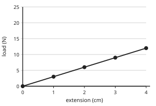

Answer: **3 N/cm**
- Typed **0.333333333** (flip) → “k = load ÷ extension, not extension ÷ load.”

Full working after a second miss:

> Take a point on the line: 12 N at 4 cm.  
> k = 12 ÷ 4 = 3 N/cm.  

**Card c3p15-2** (draft)

> Read values straight from the line.
>
> _Go across from the load, then down to the extension._  

Check question: `p3-15-read-card` · number, level 1 · computed by rule

> Use the graph: what extension does a load of 16 N give (cm)?

Answer: **4 cm**
- Typed **16** (load) → “16 is the load; read across to the extension.”

Full working after a second miss:

> The line rises 4 N for every 1 cm.  
> 16 N ÷ 4 N/cm = 4 cm.  

**Card c3p15-3** (draft)

> Springs are used where a force must be measured or a shock absorbed.
>
> _Spring balance, car suspension, mattress_  

Check question: `p3-15-use` · multiple choice, level 1 · **authored key**, reused from practice

> Why do cars and motorbikes have springs in their suspension?

- ◻️ To make the vehicle heavier  
  _↳ feedback if chosen: That is not their purpose._
- ◻️ To measure the speed  
  _↳ feedback if chosen: A speedometer measures speed._
- ✅ To absorb shocks from bumps in the road
- ◻️ To make the vehicle faster  
  _↳ feedback if chosen: Springs do not increase speed._

Full working after a second miss:

> The springs stretch and compress, giving a smoother ride.  
> So the answer is To absorb shocks from bumps in the road.  

**Worked example** (draft)

> The graph shows load against extension for a spring. Use it to find the spring constant.

1. Pick a point on the line: 6 N gives 3 cm.
2. k = gradient = 6 ÷ 3 = 2 N/cm.

**Answer:** 2 N/cm

**Practice** `p3-15-k` · number, level 1 · computed by rule

> Use the graph to find the spring constant (N/cm).

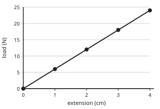

Answer: **6 N/cm**
- Typed **0.166666667** (flip) → “k = load ÷ extension, not extension ÷ load.”

Full working after a second miss:

> Take a point on the line: 24 N at 4 cm.  
> k = 24 ÷ 4 = 6 N/cm.  

> Use the graph to find the spring constant (N/cm).

Answer: **6 N/cm**
- Typed **0.166666667** (flip) → “k = load ÷ extension, not extension ÷ load.”

Full working after a second miss:

> Take a point on the line: 24 N at 4 cm.  
> k = 24 ÷ 4 = 6 N/cm.  

**Practice** `p3-15-read` · number, level 2 · computed by rule

> Use the graph: what extension does a load of 8 N give (cm)?

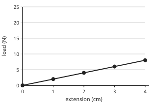

Answer: **4 cm**
- Typed **8** (load) → “8 is the load; read across to the extension.”

Full working after a second miss:

> The line rises 2 N for every 1 cm.  
> 8 N ÷ 2 N/cm = 4 cm.  

> Use the graph: what extension does a load of 4 N give (cm)?

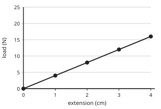

Answer: **1 cm**
- Typed **4** (load) → “4 is the load; read across to the extension.”

Full working after a second miss:

> The line rises 4 N for every 1 cm.  
> 4 N ÷ 4 N/cm = 1 cm.  

**Practice** `p3-15-use` · multiple choice, level 1 · **authored key**

> Which device uses a spring to measure force?

- ◻️ a beam balance  
  _↳ feedback if chosen: A beam balance compares masses without a spring._
- ✅ a spring balance (newton meter)
- ◻️ a thermometer  
  _↳ feedback if chosen: A thermometer measures temperature._
- ◻️ a measuring cylinder  
  _↳ feedback if chosen: A measuring cylinder measures volume._

Full working after a second miss:

> The extension of the spring shows the force.  
> So the answer is a spring balance (newton meter).  

> Which device uses a spring to measure force?

- ✅ a spring balance (newton meter)
- ◻️ a thermometer  
  _↳ feedback if chosen: A thermometer measures temperature._
- ◻️ a beam balance  
  _↳ feedback if chosen: A beam balance compares masses without a spring._
- ◻️ a measuring cylinder  
  _↳ feedback if chosen: A measuring cylinder measures volume._

Full working after a second miss:

> The extension of the spring shows the force.  
> So the answer is a spring balance (newton meter).  

**Practice** `p3-15-shape` · multiple choice, level 2 · **authored key**

> On a load-extension graph for a spring, what does a straight line through the origin show?

- ◻️ The spring is plastic  
  _↳ feedback if chosen: A plastic material does not give a straight line through the origin._
- ✅ Extension is proportional to load (Hooke's law)
- ◻️ The spring has broken  
  _↳ feedback if chosen: A broken spring gives no line._
- ◻️ The load is constant  
  _↳ feedback if chosen: The load changes along the axis._

Full working after a second miss:

> Straight line through the origin: direct proportion.  
> So the answer is Extension is proportional to load (Hooke's law).  

> After a certain load the graph starts to curve. This point is…

- ◻️ the origin  
  _↳ feedback if chosen: The origin is where the line starts._
- ◻️ the spring constant  
  _↳ feedback if chosen: The spring constant is the gradient._
- ✅ the limit of proportionality
- ◻️ the zero error  
  _↳ feedback if chosen: A zero error is a wrong starting reading._

Full working after a second miss:

> Beyond it, extension is no longer proportional to load.  
> So the answer is the limit of proportionality.  

**Practice** `p3-15-weigh` · number, level 3 · computed by rule

> A spring has constant 10 N/cm. An unknown bunch of plantains stretches it by 6 cm. Find the weight (N) and the mass (kg) of the plantains. Give the mass.

Answer: **6 kg**
- Typed **60** (weight) → “That is the weight in newtons. Divide by g = 10 N/kg for the mass.”

Full working after a second miss:

> Weight F = ke = 10 × 6 = 60 N.  
> Mass = W ÷ g = 60 ÷ 10 = 6 kg.  

> A spring has constant 10 N/cm. An unknown bunch of plantains stretches it by 2 cm. Find the weight (N) and the mass (kg) of the plantains. Give the mass.

Answer: **2 kg**
- Typed **20** (weight) → “That is the weight in newtons. Divide by g = 10 N/kg for the mass.”

Full working after a second miss:

> Weight F = ke = 10 × 2 = 20 N.  
> Mass = W ÷ g = 20 ÷ 10 = 2 kg.  

## Lesson 16: Energy: Definition, forms, sources – renewable and non-renewable

Prerequisites: none · Skill: p3-16 (Energy: forms and sources, renewable and non-renewable)

**Note** (draft)

> Energy is the ability to do work. Unit: the joule (J); 1 kJ = 1000 J.
> Forms: kinetic (movement), potential (gravitational: height; elastic: stretched spring), chemical (food, fuel, batteries), thermal (heat), electrical, light, sound, nuclear.
> Sources:
> • Renewable (will not run out): solar, wind, hydroelectric (Edéa, Song Loulou, Lagdo dams), biomass (wood, crop waste), geothermal, tides.
> • Non-renewable (will run out): petroleum, natural gas, coal, nuclear fuel (uranium).
> Fossil fuels release carbon dioxide and pollute; renewables are cleaner but some depend on weather.

**Learn: What energy is** (draft)

> Energy is what makes things happen: it lets us move, heat, light and make sounds. We measure it in joules (J); a kilojoule (kJ) is 1000 J.
> Forms of energy:
> • kinetic (anything moving);
> • potential: gravitational (high up) and elastic (stretched or squeezed);
> • chemical (food, fuels, batteries);
> • thermal (heat), electrical, light, sound and nuclear.

**Learn: Renewable sources** (draft)

> Renewable sources are replaced naturally and will not run out:
> • solar (sunshine, strong in the North);
> • wind;
> • hydroelectric: Cameroon gets much of its electricity from dams such as Edéa, Song Loulou, Lagdo and Lom Pangar;
> • biomass: firewood, charcoal and crop waste, renewable only if trees and crops are replanted;
> • geothermal and tidal energy.

**Learn: Non-renewable sources** (draft)

> Non-renewable sources took millions of years to form and will run out: petroleum (petrol, diesel, kerosene), natural gas, coal and nuclear fuel.
> Burning fossil fuels gives carbon dioxide and other pollutants, which harm health and change the climate.
> Renewables are cleaner, though some depend on the weather (no solar power at night).

**Learn: key words and examples** (draft)

- **energy**: the ability to do work, measured in joules
- **renewable**: replaced naturally; will not run out
- **non-renewable**: will run out; cannot be replaced in a human lifetime
- **fossil fuel**: fuel formed from ancient living things: oil, gas, coal

- Kinetic: a moving okada
- Chemical: a bag of groundnuts
- Renewable: Song Loulou dam
- Non-renewable: diesel

Common mistake: “Firewood is always renewable” → “Firewood is renewable only if trees are replanted as fast as they are cut”. Cutting forests faster than they grow uses them up.

**Card c3p16-1** (draft)

> Energy has many forms; the unit is the joule.
>
> _A moving bus has kinetic energy; a battery stores chemical energy._  

Check question: `p3-16-form` · multiple choice, level 1 · **authored key**, reused from practice

> What form of energy does a stretched catapult rubber store?

- ◻️ chemical energy  
  _↳ feedback if chosen: Chemical energy is stored in food and fuels._
- ✅ elastic potential energy
- ◻️ sound energy  
  _↳ feedback if chosen: It makes little sound._
- ◻️ kinetic energy  
  _↳ feedback if chosen: It is not moving yet._

Full working after a second miss:

> Stretched or squeezed objects store elastic potential energy.  
> So the answer is elastic potential energy.  

**Card c3p16-2** (draft)

> Renewable sources do not run out: sun, wind, flowing water.
>
> _Edéa and Song Loulou dams make hydroelectricity._  

Check question: `p3-16-src` · multiple choice, level 1 · **authored key**, reused from practice

> Why is wood called renewable only if trees are replanted?

- ◻️ Wood is a fossil fuel  
  _↳ feedback if chosen: Wood is biomass, not a fossil fuel._
- ✅ Cutting trees faster than they grow uses up the forest
- ◻️ Trees grow back in one day  
  _↳ feedback if chosen: Trees take years to grow._
- ◻️ Wood never burns completely  
  _↳ feedback if chosen: Burning has nothing to do with it._

Full working after a second miss:

> Biomass is renewable only when it is replaced.  
> So the answer is Cutting trees faster than they grow uses up the forest.  

**Card c3p16-3** (draft)

> Fossil fuels are non-renewable and release carbon dioxide.
>
> _Petrol, diesel, kerosene, natural gas, coal_  

Check question: `p3-16-adv-card` · multiple choice, level 1 · **authored key**

> What is one disadvantage of burning fossil fuels?

- ◻️ They give no heat  
  _↳ feedback if chosen: They give a lot of heat._
- ◻️ They are renewable  
  _↳ feedback if chosen: Fossil fuels are non-renewable._
- ✅ They release carbon dioxide and pollute the air
- ◻️ They cannot be burned  
  _↳ feedback if chosen: They burn easily._

Full working after a second miss:

> Carbon dioxide contributes to climate change.  
> So the answer is They release carbon dioxide and pollute the air.  

**Worked example** (draft)

> Classify these sources of energy used in Cameroon: firewood, the Lagdo dam, kerosene, solar panels in Maroua.

1. Firewood: biomass, renewable if trees are replanted.
2. Lagdo dam: hydroelectricity, renewable.
3. Kerosene: from petroleum, non-renewable.
4. Solar panels: solar energy, renewable.

**Answer:** Renewable: firewood (if replanted), Lagdo dam, solar; non-renewable: kerosene

**Practice** `p3-16-form` · multiple choice, level 1 · **authored key**

> A mango hanging high on a tree has…

- ◻️ kinetic energy  
  _↳ feedback if chosen: It is not moving._
- ◻️ electrical energy  
  _↳ feedback if chosen: It carries no current._
- ◻️ sound energy  
  _↳ feedback if chosen: It makes no sound._
- ✅ gravitational potential energy

Full working after a second miss:

> Its height gives it gravitational potential energy.  
> So the answer is gravitational potential energy.  

> What is the SI unit of energy?

- ◻️ newton (N)  
  _↳ feedback if chosen: The newton is the unit of force._
- ✅ joule (J)
- ◻️ pascal (Pa)  
  _↳ feedback if chosen: The pascal is the unit of pressure._
- ◻️ watt (W)  
  _↳ feedback if chosen: The watt is the unit of power._

Full working after a second miss:

> Energy is measured in joules.  
> So the answer is joule (J).  

**Practice** `p3-16-src` · multiple choice, level 1 · **authored key**

> Why is wood called renewable only if trees are replanted?

- ◻️ Wood never burns completely  
  _↳ feedback if chosen: Burning has nothing to do with it._
- ◻️ Wood is a fossil fuel  
  _↳ feedback if chosen: Wood is biomass, not a fossil fuel._
- ✅ Cutting trees faster than they grow uses up the forest
- ◻️ Trees grow back in one day  
  _↳ feedback if chosen: Trees take years to grow._

Full working after a second miss:

> Biomass is renewable only when it is replaced.  
> So the answer is Cutting trees faster than they grow uses up the forest.  

> Why is wood called renewable only if trees are replanted?

- ◻️ Wood is a fossil fuel  
  _↳ feedback if chosen: Wood is biomass, not a fossil fuel._
- ◻️ Wood never burns completely  
  _↳ feedback if chosen: Burning has nothing to do with it._
- ◻️ Trees grow back in one day  
  _↳ feedback if chosen: Trees take years to grow._
- ✅ Cutting trees faster than they grow uses up the forest

Full working after a second miss:

> Biomass is renewable only when it is replaced.  
> So the answer is Cutting trees faster than they grow uses up the forest.  

**Practice** `p3-16-kj` · number, level 2 · computed by rule

> A battery stores 44 kJ of energy. How many joules is that?

Answer: **44 000 J**
- Typed **0.044** (div) → “Joules are smaller units: the number gets bigger.”

Full working after a second miss:

> 1 kJ = 1000 J.  
> 44 × 1000 = 44 000 J.  

> A battery stores 62 kJ of energy. How many joules is that?

Answer: **62 000 J**
- Typed **0.062** (div) → “Joules are smaller units: the number gets bigger.”

Full working after a second miss:

> 1 kJ = 1000 J.  
> 62 × 1000 = 62 000 J.  

**Practice** `p3-16-adv` · multiple choice, level 2 · **authored key**

> What is one disadvantage of burning fossil fuels?

- ◻️ They are renewable  
  _↳ feedback if chosen: Fossil fuels are non-renewable._
- ◻️ They cannot be burned  
  _↳ feedback if chosen: They burn easily._
- ◻️ They give no heat  
  _↳ feedback if chosen: They give a lot of heat._
- ✅ They release carbon dioxide and pollute the air

Full working after a second miss:

> Carbon dioxide contributes to climate change.  
> So the answer is They release carbon dioxide and pollute the air.  

> What is one disadvantage of solar panels?

- ◻️ They release a lot of carbon dioxide  
  _↳ feedback if chosen: They release no carbon dioxide when working._
- ✅ They produce little at night or on cloudy days
- ◻️ Sunlight will soon run out  
  _↳ feedback if chosen: The sun will shine for billions of years._
- ◻️ They need petrol to work  
  _↳ feedback if chosen: They need only sunlight._

Full working after a second miss:

> Solar power depends on the weather and time of day.  
> So the answer is They produce little at night or on cloudy days.  

**Practice** `p3-16-change` · multiple choice, level 3 · **authored key**

> A girl climbs to the top of a slide, then slides down. Which energy change happens as she slides?

- ◻️ kinetic energy → chemical energy  
  _↳ feedback if chosen: She is not storing energy chemically as she slides._
- ✅ gravitational potential energy → kinetic energy (and some heat)
- ◻️ chemical energy → nuclear energy  
  _↳ feedback if chosen: No nuclear change happens._
- ◻️ electrical energy → sound energy  
  _↳ feedback if chosen: No electricity is involved._

Full working after a second miss:

> She loses height and gains speed; friction makes some heat.  
> So the answer is gravitational potential energy → kinetic energy (and some heat).  

> A battery-powered torch is switched on. What is the main energy change in the battery?

- ◻️ kinetic → chemical  
  _↳ feedback if chosen: The battery is not moving._
- ✅ chemical → electrical
- ◻️ light → electrical  
  _↳ feedback if chosen: That happens in a solar cell._
- ◻️ electrical → chemical  
  _↳ feedback if chosen: That happens when charging._

Full working after a second miss:

> Chemicals in the battery react to give electrical energy.  
> So the answer is chemical → electrical.  

## Lesson 17: The law of conservation of energy, application on transducers, and energy flow diagrams. Simple calculations on energy transformations

Prerequisites: 16 · Skill: p3-17 (Conservation of energy, transducers, energy flow and simple calculations)

**Note** (draft)

> Law of conservation of energy: energy cannot be created or destroyed; it only changes from one form to another. The total stays the same.
> A transducer changes one form of energy into another: microphone (sound → electrical), loudspeaker (electrical → sound), solar cell (light → electrical), dynamo (kinetic → electrical), electric motor (electrical → kinetic), bulb (electrical → light + heat).
> Energy flow (Sankey) diagrams show input = useful output + wasted output.
> Calculations: gravitational potential energy PE = mgh; kinetic energy KE = ½mv²; efficiency = useful output ÷ total input × 100%.

**Learn: Energy is conserved** (draft)

> The law of conservation of energy: energy cannot be created or destroyed, only changed from one form to another.
> When a coconut falls, its gravitational potential energy changes into kinetic energy; when it hits the ground, into sound and heat. The total amount of energy stays the same.
> When we say energy is 'wasted', we mean it has gone into a form we did not want, usually heat.

**Learn: Transducers and energy flow** (draft)

> Devices that change energy from one form to another are transducers:
> • microphone: sound → electrical; loudspeaker: electrical → sound;
> • solar cell: light → electrical; bulb: electrical → light and heat;
> • dynamo: kinetic → electrical; motor: electrical → kinetic; battery: chemical → electrical.
> An energy flow (Sankey) diagram shows the input split into useful and wasted outputs; the arrows add up to the input.

**Learn: Working it out** (draft)

> • Gravitational potential energy: PE = mgh. A 50 kg bag lifted 2 m gains 50 × 10 × 2 = 1000 J.
> • Kinetic energy: KE = ½mv². A 100 kg motorbike at 10 m/s has 5000 J.
> • Efficiency = useful output ÷ total input × 100%. A bulb giving 20 J of light from 100 J is 20% efficient; the other 80 J become heat.

**Learn: key words and examples** (draft)

- **conservation of energy**: energy is not created or destroyed, only changed
- **transducer**: a device that changes energy from one form to another
- **efficiency**: useful output ÷ total input × 100%
- **Sankey diagram**: a diagram showing how energy input divides into outputs

- Loudspeaker: electrical → sound
- PE of 3 kg at 4 m: 120 J
- KE of 2 kg at 3 m/s: 9 J

Common mistake: “Energy is used up when a bulb is switched on” → “Electrical energy is changed into light and heat; the total is the same”. Energy is never destroyed; it only changes form.

**Card c3p17-1** (draft)

> Energy is never lost: it changes form, and the total stays the same.
>
> _A bulb: electrical in = light out + heat out_  

Check question: `p3-17-trans` · multiple choice, level 1 · **authored key**, reused from practice

> What energy change happens in a microphone?

- ◻️ light → electrical  
  _↳ feedback if chosen: That is a solar cell._
- ✅ sound → electrical
- ◻️ kinetic → light  
  _↳ feedback if chosen: No light is produced._
- ◻️ electrical → sound  
  _↳ feedback if chosen: That is a loudspeaker._

Full working after a second miss:

> A microphone turns sound waves into electrical signals.  
> So the answer is sound → electrical.  

**Card c3p17-2** (draft)

> Potential energy PE = mgh; kinetic energy KE = ½mv².
>
> _2 kg at 5 m: PE = 100 J_  

Check question: `p3-17-pe` · number, level 1 · computed by rule, reused from practice

> A 35 kg bag of cement is lifted 1 m onto a lorry. Find the gain in potential energy (J). (g = 10 N/kg)

Answer: **350 J**
- Typed **35** (nog) → “Include g = 10 N/kg: PE = mgh.”

Full working after a second miss:

> PE = mgh = 35 × 10 × 1.  
> PE = 350 J.  

**Card c3p17-3** (draft)

> Efficiency = useful output ÷ total input × 100%.
>
> _100 J in, 20 J of light out: 20%_  

Check question: `p3-17-eff-card` · number, level 1 · computed by rule

> A bulb uses 500 J of electrical energy and gives out 80 J of light. Find its efficiency (%).

Answer: **16 %**
- Typed **84** (waste) → “That is the percentage wasted as heat. Efficiency uses the useful output.”
- Typed **0.16** (noper) → “Multiply by 100 to get a percentage.”

Full working after a second miss:

> Efficiency = useful ÷ total × 100%.  
> = 80 ÷ 500 × 100 = 16%.  

**Worked example** (draft)

> A 2 kg coconut falls from a height of 5 m. Find its potential energy at the top and its speed just before it hits the ground (ignore air resistance).

1. PE = mgh = 2 × 10 × 5 = 100 J.
2. All of it becomes kinetic energy: ½mv² = 100, so v² = 100.
3. v = √100 = 10 m/s.

**Answer:** PE = 100 J, v = 10 m/s

**Practice** `p3-17-trans` · multiple choice, level 1 · **authored key**

> What energy change happens in a solar cell?

- ◻️ chemical → electrical  
  _↳ feedback if chosen: That is a battery._
- ◻️ electrical → light  
  _↳ feedback if chosen: That is a lamp._
- ◻️ heat → sound  
  _↳ feedback if chosen: That is not what a solar cell does._
- ✅ light → electrical

Full working after a second miss:

> Sunlight falling on the cell produces electricity.  
> So the answer is light → electrical.  

> Which device changes electrical energy into kinetic energy?

- ✅ an electric motor
- ◻️ a solar cell  
  _↳ feedback if chosen: A solar cell gives electrical energy from light._
- ◻️ a microphone  
  _↳ feedback if chosen: A microphone gives electrical energy from sound._
- ◻️ a dynamo  
  _↳ feedback if chosen: A dynamo does the opposite (kinetic → electrical)._

Full working after a second miss:

> A motor turns electricity into motion, as in a fan.  
> So the answer is an electric motor.  

**Practice** `p3-17-pe` · number, level 1 · computed by rule

> A 35 kg bag of cement is lifted 1 m onto a lorry. Find the gain in potential energy (J). (g = 10 N/kg)

Answer: **350 J**
- Typed **35** (nog) → “Include g = 10 N/kg: PE = mgh.”

Full working after a second miss:

> PE = mgh = 35 × 10 × 1.  
> PE = 350 J.  

> A 35 kg bag of cement is lifted 3 m onto a lorry. Find the gain in potential energy (J). (g = 10 N/kg)

Answer: **1050 J**
- Typed **105** (nog) → “Include g = 10 N/kg: PE = mgh.”

Full working after a second miss:

> PE = mgh = 35 × 10 × 3.  
> PE = 1050 J.  

**Practice** `p3-17-ke` · number, level 2 · computed by rule

> A motorbike of mass 200 kg moves at 15 m/s. Find its kinetic energy (J).

Answer: **22 500 J**
- Typed **1500** (nosq) → “Square the speed: v² = 225.”
- Typed **45 000** (nohalf) → “KE has a half: ½mv².”

Full working after a second miss:

> KE = ½mv² = ½ × 200 × 15².  
> = ½ × 200 × 225 = 22 500 J.  

> A motorbike of mass 140 kg moves at 8 m/s. Find its kinetic energy (J).

Answer: **4480 J**
- Typed **560** (nosq) → “Square the speed: v² = 64.”
- Typed **8960** (nohalf) → “KE has a half: ½mv².”

Full working after a second miss:

> KE = ½mv² = ½ × 140 × 8².  
> = ½ × 140 × 64 = 4480 J.  

**Practice** `p3-17-eff` · number, level 2 · computed by rule

> A bulb uses 100 J of electrical energy and gives out 35 J of light. Find its efficiency (%).

Answer: **35 %**
- Typed **65** (waste) → “That is the percentage wasted as heat. Efficiency uses the useful output.”
- Typed **0.35** (noper) → “Multiply by 100 to get a percentage.”

Full working after a second miss:

> Efficiency = useful ÷ total × 100%.  
> = 35 ÷ 100 × 100 = 35%.  

> A bulb uses 500 J of electrical energy and gives out 90 J of light. Find its efficiency (%).

Answer: **18 %**
- Typed **82** (waste) → “That is the percentage wasted as heat. Efficiency uses the useful output.”
- Typed **0.18** (noper) → “Multiply by 100 to get a percentage.”

Full working after a second miss:

> Efficiency = useful ÷ total × 100%.  
> = 90 ÷ 500 × 100 = 18%.  

**Practice** `p3-17-fall` · number, level 3 · computed by rule

> A stone falls from a height of 80 m. Ignoring air resistance, find its speed just before it reaches the ground (m/s). (g = 10 N/kg)

Answer: **40 m/s**
- Typed **1600** (nosqrt) → “That is v². Take the square root.”
- Typed **800** (noh2) → “v² = 2gh: remember the 2.”

Full working after a second miss:

> PE at the top = KE at the bottom: mgh = ½mv², so v² = 2gh.  
> v² = 2 × 10 × 80 = 1600, so v = 40 m/s.  

> A stone falls from a height of 20 m. Ignoring air resistance, find its speed just before it reaches the ground (m/s). (g = 10 N/kg)

Answer: **20 m/s**
- Typed **400** (nosqrt) → “That is v². Take the square root.”
- Typed **200** (noh2) → “v² = 2gh: remember the 2.”

Full working after a second miss:

> PE at the top = KE at the bottom: mgh = ½mv², so v² = 2gh.  
> v² = 2 × 10 × 20 = 400, so v = 20 m/s.  

