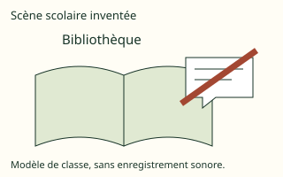

# French Form 4, Form Four French: authored answers for review

Every answer fixed by a person, not computed. Part 1: the tables, conventions and rules that computed answers come from.
Part 2: every authored question template, with all its data (keys, statements, pairs, choices and feedback) and sources.
Regenerate with `npm run review:f4-french`. Item IDs (TR-…) match `docs/teacher-review.md`.

## Part 1

Rules the computed answers use are listed in the subject’s library tests; every authored answer is in Part 2.

## Part 2: authored question templates

| # | Template | Lesson | Type, level | Sources |
|---|---|---|---|---|
| 1 | `fr4-1-notions` | 1 | multiple choice, 1 | francais |
| 2 | `fr4-1-cas` | 1 | multiple choice, 1 | francais |
| 3 | `fr4-1-contexte` | 1 | multiple choice, 2 | francais |
| 4 | `fr4-1-relier` | 1 | matching, 2 | francais |
| 5 | `fr4-1-corriger` | 1 | spot the error, 3 | francais |
| 6 | `fr4-1-corriger-card` (card fr4-1-c3) | 1 | spot the error, 1 | francais |
| 7 | `fr4-2-notions` | 2 | multiple choice, 1 | francais |
| 8 | `fr4-2-cas` | 2 | multiple choice, 1 | francais |
| 9 | `fr4-2-comprendre` | 2 | multiple choice, 2 | francais |
| 10 | `fr4-2-relier` | 2 | matching, 2 | francais |
| 11 | `fr4-2-corriger` | 2 | spot the error, 3 | francais |
| 12 | `fr4-2-corriger-card` (card fr4-2-c3) | 2 | spot the error, 1 | francais |
| 13 | `fr4-3-notions` | 3 | multiple choice, 1 | francais |
| 14 | `fr4-3-cas` | 3 | multiple choice, 1 | francais |
| 15 | `fr4-3-appliquer` | 3 | multiple choice, 2 | francais |
| 16 | `fr4-3-relier` | 3 | matching, 2 | francais |
| 17 | `fr4-3-corriger` | 3 | spot the error, 3 | francais |
| 18 | `fr4-3-corriger-card` (card fr4-3-c3) | 3 | spot the error, 1 | francais |
| 19 | `fr4-4-notions` | 4 | multiple choice, 1 | francais |
| 20 | `fr4-4-cas` | 4 | multiple choice, 1 | francais |
| 21 | `fr4-4-image` | 4 | multiple choice, 2 | francais |
| 22 | `fr4-4-relier` | 4 | matching, 2 | francais |
| 23 | `fr4-4-corriger` | 4 | spot the error, 3 | francais |
| 24 | `fr4-4-corriger-card` (card fr4-4-c3) | 4 | spot the error, 1 | francais |
| 25 | `fr4-5-notions` | 5 | multiple choice, 1 | francais |
| 26 | `fr4-5-cas` | 5 | multiple choice, 1 | francais |
| 27 | `fr4-5-appliquer` | 5 | multiple choice, 2 | francais |
| 28 | `fr4-5-relier` | 5 | matching, 2 | francais |
| 29 | `fr4-5-corriger` | 5 | spot the error, 3 | francais |
| 30 | `fr4-5-corriger-card` (card fr4-5-c3) | 5 | spot the error, 1 | francais |
| 31 | `fr4-6-notions` | 6 | multiple choice, 1 | francais |
| 32 | `fr4-6-cas` | 6 | multiple choice, 1 | francais |
| 33 | `fr4-6-relier` | 6 | matching, 2 | francais |
| 34 | `fr4-6-corriger` | 6 | spot the error, 3 | francais |
| 35 | `fr4-6-corriger-card` (card fr4-6-c3) | 6 | spot the error, 1 | francais |
| 36 | `fr4-7-notions` | 7 | multiple choice, 1 | francais |
| 37 | `fr4-7-cas` | 7 | multiple choice, 1 | francais |
| 38 | `fr4-7-graphie` | 7 | multiple choice, 2 | francais |
| 39 | `fr4-7-relier` | 7 | matching, 2 | francais |
| 40 | `fr4-7-corriger` | 7 | spot the error, 3 | francais |
| 41 | `fr4-7-corriger-card` (card fr4-7-c3) | 7 | spot the error, 1 | francais |
| 42 | `fr4-8-notions` | 8 | multiple choice, 1 | francais |
| 43 | `fr4-8-cas` | 8 | multiple choice, 1 | francais |
| 44 | `fr4-8-appliquer` | 8 | multiple choice, 2 | francais |
| 45 | `fr4-8-relier` | 8 | matching, 2 | francais |
| 46 | `fr4-8-corriger` | 8 | spot the error, 3 | francais |
| 47 | `fr4-8-corriger-card` (card fr4-8-c3) | 8 | spot the error, 1 | francais |
| 48 | `fr4-9-notions` | 9 | multiple choice, 1 | francais |
| 49 | `fr4-9-cas` | 9 | multiple choice, 1 | francais |
| 50 | `fr4-9-construire` | 9 | word order, 2 | francais |
| 51 | `fr4-9-relier` | 9 | matching, 2 | francais |
| 52 | `fr4-9-corriger` | 9 | spot the error, 3 | francais |
| 53 | `fr4-9-corriger-card` (card fr4-9-c3) | 9 | spot the error, 1 | francais |
| 54 | `fr4-10-notions` | 10 | multiple choice, 1 | francais |
| 55 | `fr4-10-cas` | 10 | multiple choice, 1 | francais |
| 56 | `fr4-10-relier` | 10 | matching, 2 | francais |
| 57 | `fr4-10-corriger` | 10 | spot the error, 3 | francais |
| 58 | `fr4-10-corriger-card` (card fr4-10-c3) | 10 | spot the error, 1 | francais |
| 59 | `fr4-11-notions` | 11 | multiple choice, 1 | francais |
| 60 | `fr4-11-cas` | 11 | multiple choice, 1 | francais |
| 61 | `fr4-11-traduire` | 11 | multiple choice, 2 | francais |
| 62 | `fr4-11-relier` | 11 | matching, 2 | francais |
| 63 | `fr4-11-corriger` | 11 | spot the error, 3 | francais |
| 64 | `fr4-11-corriger-card` (card fr4-11-c3) | 11 | spot the error, 1 | francais |
| 65 | `fr4-12-notions` | 12 | multiple choice, 1 | francais |
| 66 | `fr4-12-cas` | 12 | multiple choice, 1 | francais |
| 67 | `fr4-12-liaison` | 12 | multiple choice, 2 | francais |
| 68 | `fr4-12-relier` | 12 | matching, 2 | francais |
| 69 | `fr4-12-corriger` | 12 | spot the error, 3 | francais |
| 70 | `fr4-12-corriger-card` (card fr4-12-c3) | 12 | spot the error, 1 | francais |
| 71 | `fr4-13-notions` | 13 | multiple choice, 1 | francais |
| 72 | `fr4-13-cas` | 13 | multiple choice, 1 | francais |
| 73 | `fr4-13-appliquer` | 13 | multiple choice, 2 | francais |
| 74 | `fr4-13-relier` | 13 | matching, 2 | francais |
| 75 | `fr4-13-corriger` | 13 | spot the error, 3 | francais |
| 76 | `fr4-13-corriger-card` (card fr4-13-c3) | 13 | spot the error, 1 | francais |
| 77 | `fr4-14-notions` | 14 | multiple choice, 1 | francais |
| 78 | `fr4-14-cas` | 14 | multiple choice, 1 | francais |
| 79 | `fr4-14-appliquer` | 14 | multiple choice, 2 | francais |
| 80 | `fr4-14-relier` | 14 | matching, 2 | francais |
| 81 | `fr4-14-corriger` | 14 | spot the error, 3 | francais |
| 82 | `fr4-14-corriger-card` (card fr4-14-c3) | 14 | spot the error, 1 | francais |
| 83 | `fr4-15-notions` | 15 | multiple choice, 1 | francais |
| 84 | `fr4-15-cas` | 15 | multiple choice, 1 | francais |
| 85 | `fr4-15-relier` | 15 | matching, 2 | francais |
| 86 | `fr4-15-corriger` | 15 | spot the error, 3 | francais |
| 87 | `fr4-15-corriger-card` (card fr4-15-c3) | 15 | spot the error, 1 | francais |
| 88 | `fr4-17-notions` | 17 | multiple choice, 1 | francais |
| 89 | `fr4-17-cas` | 17 | multiple choice, 1 | francais |
| 90 | `fr4-17-contexte` | 17 | multiple choice, 2 | francais |
| 91 | `fr4-17-relier` | 17 | matching, 2 | francais |
| 92 | `fr4-17-corriger` | 17 | spot the error, 3 | francais |
| 93 | `fr4-17-corriger-card` (card fr4-17-c3) | 17 | spot the error, 1 | francais |
| 94 | `fr4-18-notions` | 18 | multiple choice, 1 | francais |
| 95 | `fr4-18-cas` | 18 | multiple choice, 1 | francais |
| 96 | `fr4-18-relier` | 18 | matching, 2 | francais |
| 97 | `fr4-18-corriger` | 18 | spot the error, 3 | francais |
| 98 | `fr4-18-corriger-card` (card fr4-18-c3) | 18 | spot the error, 1 | francais |
| 99 | `fr4-19-notions` | 19 | multiple choice, 1 | francais |
| 100 | `fr4-19-cas` | 19 | multiple choice, 1 | francais |
| 101 | `fr4-19-appliquer` | 19 | multiple choice, 2 | francais |
| 102 | `fr4-19-relier` | 19 | matching, 2 | francais |
| 103 | `fr4-19-corriger` | 19 | spot the error, 3 | francais |
| 104 | `fr4-19-corriger-card` (card fr4-19-c3) | 19 | spot the error, 1 | francais |
| 105 | `fr4-20-notions` | 20 | multiple choice, 1 | francais |
| 106 | `fr4-20-cas` | 20 | multiple choice, 1 | francais |
| 107 | `fr4-20-appliquer` | 20 | multiple choice, 2 | francais |
| 108 | `fr4-20-relier` | 20 | matching, 2 | francais |
| 109 | `fr4-20-corriger` | 20 | spot the error, 3 | francais |
| 110 | `fr4-20-corriger-card` (card fr4-20-c3) | 20 | spot the error, 1 | francais |
| 111 | `fr4-21-notions` | 21 | multiple choice, 1 | francais |
| 112 | `fr4-21-cas` | 21 | multiple choice, 1 | francais |
| 113 | `fr4-21-contexte` | 21 | multiple choice, 2 | francais |
| 114 | `fr4-21-relier` | 21 | matching, 2 | francais |
| 115 | `fr4-21-corriger` | 21 | spot the error, 3 | francais |
| 116 | `fr4-21-corriger-card` (card fr4-21-c3) | 21 | spot the error, 1 | francais |
| 117 | `fr4-22-notions` | 22 | multiple choice, 1 | francais |
| 118 | `fr4-22-cas` | 22 | multiple choice, 1 | francais |
| 119 | `fr4-22-relier` | 22 | matching, 2 | francais |
| 120 | `fr4-22-corriger` | 22 | spot the error, 3 | francais |
| 121 | `fr4-22-corriger-card` (card fr4-22-c3) | 22 | spot the error, 1 | francais |
| 122 | `fr4-23-notions` | 23 | multiple choice, 1 | francais |
| 123 | `fr4-23-cas` | 23 | multiple choice, 1 | francais |
| 124 | `fr4-23-relier` | 23 | matching, 2 | francais |
| 125 | `fr4-23-corriger` | 23 | spot the error, 3 | francais |
| 126 | `fr4-23-corriger-card` (card fr4-23-c3) | 23 | spot the error, 1 | francais |
| 127 | `fr4-24-notions` | 24 | multiple choice, 1 | francais |
| 128 | `fr4-24-cas` | 24 | multiple choice, 1 | francais |
| 129 | `fr4-24-contexte` | 24 | multiple choice, 2 | francais |
| 130 | `fr4-24-relier` | 24 | matching, 2 | francais |
| 131 | `fr4-24-corriger` | 24 | spot the error, 3 | francais |
| 132 | `fr4-24-corriger-card` (card fr4-24-c3) | 24 | spot the error, 1 | francais |
| 133 | `fr4-25-notions` | 25 | multiple choice, 1 | francais |
| 134 | `fr4-25-cas` | 25 | multiple choice, 1 | francais |
| 135 | `fr4-25-comprendre` | 25 | multiple choice, 2 | francais |
| 136 | `fr4-25-relier` | 25 | matching, 2 | francais |
| 137 | `fr4-25-corriger` | 25 | spot the error, 3 | francais |
| 138 | `fr4-25-corriger-card` (card fr4-25-c3) | 25 | spot the error, 1 | francais |
| 139 | `fr4-26-notions` | 26 | multiple choice, 1 | francais |
| 140 | `fr4-26-cas` | 26 | multiple choice, 1 | francais |
| 141 | `fr4-26-graphie` | 26 | multiple choice, 2 | francais |
| 142 | `fr4-26-relier` | 26 | matching, 2 | francais |
| 143 | `fr4-26-corriger` | 26 | spot the error, 3 | francais |
| 144 | `fr4-26-corriger-card` (card fr4-26-c3) | 26 | spot the error, 1 | francais |
| 145 | `fr4-27-notions` | 27 | multiple choice, 1 | francais |
| 146 | `fr4-27-cas` | 27 | multiple choice, 1 | francais |
| 147 | `fr4-27-traduire` | 27 | multiple choice, 2 | francais |
| 148 | `fr4-27-relier` | 27 | matching, 2 | francais |
| 149 | `fr4-27-corriger` | 27 | spot the error, 3 | francais |
| 150 | `fr4-27-corriger-card` (card fr4-27-c3) | 27 | spot the error, 1 | francais |
| 151 | `fr4-28-notions` | 28 | multiple choice, 1 | francais |
| 152 | `fr4-28-cas` | 28 | multiple choice, 1 | francais |
| 153 | `fr4-28-appliquer` | 28 | multiple choice, 2 | francais |
| 154 | `fr4-28-relier` | 28 | matching, 2 | francais |
| 155 | `fr4-28-corriger` | 28 | spot the error, 3 | francais |
| 156 | `fr4-28-corriger-card` (card fr4-28-c3) | 28 | spot the error, 1 | francais |
| 157 | `fr4-29-notions` | 29 | multiple choice, 1 | francais |
| 158 | `fr4-29-cas` | 29 | multiple choice, 1 | francais |
| 159 | `fr4-29-relier` | 29 | matching, 2 | francais |
| 160 | `fr4-29-corriger` | 29 | spot the error, 3 | francais |
| 161 | `fr4-29-corriger-card` (card fr4-29-c3) | 29 | spot the error, 1 | francais |
| 162 | `fr4-30-notions` | 30 | multiple choice, 1 | francais |
| 163 | `fr4-30-cas` | 30 | multiple choice, 1 | francais |
| 164 | `fr4-30-relier` | 30 | matching, 2 | francais |
| 165 | `fr4-30-corriger` | 30 | spot the error, 3 | francais |
| 166 | `fr4-30-corriger-card` (card fr4-30-c3) | 30 | spot the error, 1 | francais |
| 167 | `fr4-31-notions` | 31 | multiple choice, 1 | francais |
| 168 | `fr4-31-cas` | 31 | multiple choice, 1 | francais |
| 169 | `fr4-31-construire` | 31 | word order, 2 | francais |
| 170 | `fr4-31-relier` | 31 | matching, 2 | francais |
| 171 | `fr4-31-corriger` | 31 | spot the error, 3 | francais |
| 172 | `fr4-31-corriger-card` (card fr4-31-c3) | 31 | spot the error, 1 | francais |

### `fr4-1-notions` · Lesson 1 · multiple choice, level 1

Prompt: {X.q}

Table `X` (one row is picked each time):

| q | r | w | e | y |
|---|---|---|---|---|
| Quel terme désigne une union reconnue dans le cadre évoqué ? | mariage | divorce · litige · violence | Cela désigne la dissolution légale d’un mariage, plutôt que la notion demandée. · Cela désigne un désaccord nécessitant une résolution entre parties, plutôt que la notion demandée. · Cela désigne une atteinte ou une contrainte qui ne se confond pas avec tout désaccord calme, plutôt que la notion demandée. | Le vocabulaire ne remplace pas l’étude des règles locales. |
| Quel terme désigne la dissolution légale d’un mariage ? | divorce | mariage · litige · violence | Cela désigne une union reconnue dans le cadre évoqué, plutôt que la notion demandée. · Cela désigne un désaccord nécessitant une résolution entre parties, plutôt que la notion demandée. · Cela désigne une atteinte ou une contrainte qui ne se confond pas avec tout désaccord calme, plutôt que la notion demandée. | Le sens renvoie à la dissolution du mariage, pas à tout désaccord. |
| Quel terme désigne un désaccord nécessitant une résolution entre parties ? | litige | mariage · divorce · violence | Cela désigne une union reconnue dans le cadre évoqué, plutôt que la notion demandée. · Cela désigne la dissolution légale d’un mariage, plutôt que la notion demandée. · Cela désigne une atteinte ou une contrainte qui ne se confond pas avec tout désaccord calme, plutôt que la notion demandée. | Nommer un désaccord ne permet pas d’attribuer une responsabilité sans faits. |
| Quel terme désigne une atteinte ou une contrainte qui ne se confond pas avec tout désaccord calme ? | violence | mariage · divorce · litige | Cela désigne une union reconnue dans le cadre évoqué, plutôt que la notion demandée. · Cela désigne la dissolution légale d’un mariage, plutôt que la notion demandée. · Cela désigne un désaccord nécessitant une résolution entre parties, plutôt que la notion demandée. | La précision évite de banaliser une atteinte ou de confondre des situations. |
| Quel terme désigne une rupture ou un éloignement du parcours scolaire ? | décrochage scolaire | mariage · divorce · litige | Cela désigne une union reconnue dans le cadre évoqué, plutôt que la notion demandée. · Cela désigne la dissolution légale d’un mariage, plutôt que la notion demandée. · Cela désigne un désaccord nécessitant une résolution entre parties, plutôt que la notion demandée. | Les causes sont multiples et n’autorisent pas un jugement sur la personne. |
| Quel terme désigne une institution accueillant des enfants orphelins ? | orphelinat | mariage · divorce · litige | Cela désigne une union reconnue dans le cadre évoqué, plutôt que la notion demandée. · Cela désigne la dissolution légale d’un mariage, plutôt que la notion demandée. · Cela désigne un désaccord nécessitant une résolution entre parties, plutôt que la notion demandée. | Une catégorie générale ne décrit pas chaque parcours individuel. |

Right answer: `{X.r}`; wrong choices: `{X.w[0]}`, `{X.w[1]}`, `{X.w[2]}`

- Feedback `w0`: “{X.e[0]}”
- Feedback `w1`: “{X.e[1]}”
- Feedback `w2`: “{X.e[2]}”

Three generated variants:

> Quel terme désigne une rupture ou un éloignement du parcours scolaire ?

- ◻️ litige  
  _↳ feedback if chosen: Cela désigne un désaccord nécessitant une résolution entre parties, plutôt que la notion demandée._
- ◻️ divorce  
  _↳ feedback if chosen: Cela désigne la dissolution légale d’un mariage, plutôt que la notion demandée._
- ✅ décrochage scolaire
- ◻️ mariage  
  _↳ feedback if chosen: Cela désigne une union reconnue dans le cadre évoqué, plutôt que la notion demandée._

Full working after a second miss:

> Les causes sont multiples et n’autorisent pas un jugement sur la personne.  
> Donc la réponse est « décrochage scolaire ».  

> Quel terme désigne une institution accueillant des enfants orphelins ?

- ✅ orphelinat
- ◻️ divorce  
  _↳ feedback if chosen: Cela désigne la dissolution légale d’un mariage, plutôt que la notion demandée._
- ◻️ litige  
  _↳ feedback if chosen: Cela désigne un désaccord nécessitant une résolution entre parties, plutôt que la notion demandée._
- ◻️ mariage  
  _↳ feedback if chosen: Cela désigne une union reconnue dans le cadre évoqué, plutôt que la notion demandée._

Full working after a second miss:

> Une catégorie générale ne décrit pas chaque parcours individuel.  
> Donc la réponse est « orphelinat ».  

> Quel terme désigne une institution accueillant des enfants orphelins ?

- ◻️ litige  
  _↳ feedback if chosen: Cela désigne un désaccord nécessitant une résolution entre parties, plutôt que la notion demandée._
- ◻️ mariage  
  _↳ feedback if chosen: Cela désigne une union reconnue dans le cadre évoqué, plutôt que la notion demandée._
- ◻️ divorce  
  _↳ feedback if chosen: Cela désigne la dissolution légale d’un mariage, plutôt que la notion demandée._
- ✅ orphelinat

Full working after a second miss:

> Une catégorie générale ne décrit pas chaque parcours individuel.  
> Donc la réponse est « orphelinat ».  

Sources: francais (Modèles, dialogues, traductions et scènes scolaires originaux ; OQLF et Dictionnaire de l’Académie pour la langue ; OMS pour le sens général de malnutrition)

### `fr4-1-cas` · Lesson 1 · multiple choice, level 1

Prompt: {X.q}

Table `X` (one row is picked each time):

| q | r | w | e | y |
|---|---|---|---|---|
| Le récit mentionne une union sans expliquer une procédure juridique.
Quelle notion convient ? | mariage | divorce · litige · violence | Cela concerne la dissolution légale d’un mariage. Compare cette définition avec le cas présenté. · Cela concerne un désaccord nécessitant une résolution entre parties. Compare cette définition avec le cas présenté. · Cela concerne une atteinte ou une contrainte qui ne se confond pas avec tout désaccord calme. Compare cette définition avec le cas présenté. | Le vocabulaire ne remplace pas l’étude des règles locales. |
| Un personnage fictif évoque la fin légale de son mariage.
Quelle notion convient ? | divorce | mariage · litige · violence | Cela concerne une union reconnue dans le cadre évoqué. Compare cette définition avec le cas présenté. · Cela concerne un désaccord nécessitant une résolution entre parties. Compare cette définition avec le cas présenté. · Cela concerne une atteinte ou une contrainte qui ne se confond pas avec tout désaccord calme. Compare cette définition avec le cas présenté. | Le sens renvoie à la dissolution du mariage, pas à tout désaccord. |
| Des personnages ne s’accordent pas sur l’usage d’un bien.
Quelle notion convient ? | litige | mariage · divorce · violence | Cela concerne une union reconnue dans le cadre évoqué. Compare cette définition avec le cas présenté. · Cela concerne la dissolution légale d’un mariage. Compare cette définition avec le cas présenté. · Cela concerne une atteinte ou une contrainte qui ne se confond pas avec tout désaccord calme. Compare cette définition avec le cas présenté. | Nommer un désaccord ne permet pas d’attribuer une responsabilité sans faits. |
| Le récit distingue une menace d’une discussion respectueuse.
Quelle notion convient ? | violence | mariage · divorce · litige | Cela concerne une union reconnue dans le cadre évoqué. Compare cette définition avec le cas présenté. · Cela concerne la dissolution légale d’un mariage. Compare cette définition avec le cas présenté. · Cela concerne un désaccord nécessitant une résolution entre parties. Compare cette définition avec le cas présenté. | La précision évite de banaliser une atteinte ou de confondre des situations. |
| Le récit s’interroge sur une interruption de scolarité.
Quelle notion convient ? | décrochage scolaire | mariage · divorce · litige | Cela concerne une union reconnue dans le cadre évoqué. Compare cette définition avec le cas présenté. · Cela concerne la dissolution légale d’un mariage. Compare cette définition avec le cas présenté. · Cela concerne un désaccord nécessitant une résolution entre parties. Compare cette définition avec le cas présenté. | Les causes sont multiples et n’autorisent pas un jugement sur la personne. |
| Le club écrit une annonce destinée à une institution d’accueil.
Quelle notion convient ? | orphelinat | mariage · divorce · litige | Cela concerne une union reconnue dans le cadre évoqué. Compare cette définition avec le cas présenté. · Cela concerne la dissolution légale d’un mariage. Compare cette définition avec le cas présenté. · Cela concerne un désaccord nécessitant une résolution entre parties. Compare cette définition avec le cas présenté. | Une catégorie générale ne décrit pas chaque parcours individuel. |

Right answer: `{X.r}`; wrong choices: `{X.w[0]}`, `{X.w[1]}`, `{X.w[2]}`

- Feedback `w0`: “{X.e[0]}”
- Feedback `w1`: “{X.e[1]}”
- Feedback `w2`: “{X.e[2]}”

Three generated variants:

> Le récit distingue une menace d’une discussion respectueuse.
> Quelle notion convient ?

- ◻️ divorce  
  _↳ feedback if chosen: Cela concerne la dissolution légale d’un mariage. Compare cette définition avec le cas présenté._
- ◻️ litige  
  _↳ feedback if chosen: Cela concerne un désaccord nécessitant une résolution entre parties. Compare cette définition avec le cas présenté._
- ◻️ mariage  
  _↳ feedback if chosen: Cela concerne une union reconnue dans le cadre évoqué. Compare cette définition avec le cas présenté._
- ✅ violence

Full working after a second miss:

> La précision évite de banaliser une atteinte ou de confondre des situations.  
> Donc la réponse est « violence ».  

> Le club écrit une annonce destinée à une institution d’accueil.
> Quelle notion convient ?

- ◻️ divorce  
  _↳ feedback if chosen: Cela concerne la dissolution légale d’un mariage. Compare cette définition avec le cas présenté._
- ✅ orphelinat
- ◻️ litige  
  _↳ feedback if chosen: Cela concerne un désaccord nécessitant une résolution entre parties. Compare cette définition avec le cas présenté._
- ◻️ mariage  
  _↳ feedback if chosen: Cela concerne une union reconnue dans le cadre évoqué. Compare cette définition avec le cas présenté._

Full working after a second miss:

> Une catégorie générale ne décrit pas chaque parcours individuel.  
> Donc la réponse est « orphelinat ».  

> Le récit s’interroge sur une interruption de scolarité.
> Quelle notion convient ?

- ✅ décrochage scolaire
- ◻️ mariage  
  _↳ feedback if chosen: Cela concerne une union reconnue dans le cadre évoqué. Compare cette définition avec le cas présenté._
- ◻️ divorce  
  _↳ feedback if chosen: Cela concerne la dissolution légale d’un mariage. Compare cette définition avec le cas présenté._
- ◻️ litige  
  _↳ feedback if chosen: Cela concerne un désaccord nécessitant une résolution entre parties. Compare cette définition avec le cas présenté._

Full working after a second miss:

> Les causes sont multiples et n’autorisent pas un jugement sur la personne.  
> Donc la réponse est « décrochage scolaire ».  

Sources: francais (Modèles, dialogues, traductions et scènes scolaires originaux ; OQLF et Dictionnaire de l’Académie pour la langue ; OMS pour le sens général de malnutrition)

### `fr4-1-contexte` · Lesson 1 · multiple choice, level 2

Prompt: {X.q}

Table `X` (one row is picked each time):

| q | r | w | e | y |
|---|---|---|---|---|
| Le récit désigne la dissolution légale d’une union : le ___.
Quel mot ou groupe de la leçon convient ? | divorce | mariage · litige · violence | Ce mot désigne une union reconnue dans le cadre évoqué. La phrase demande plutôt la dissolution légale d’un mariage. · Ce mot désigne un désaccord nécessitant une résolution entre parties. La phrase demande plutôt la dissolution légale d’un mariage. · Ce mot désigne une atteinte ou une contrainte qui ne se confond pas avec tout désaccord calme. La phrase demande plutôt la dissolution légale d’un mariage. | Le sens renvoie à la dissolution du mariage, pas à tout désaccord. |
| Des parties cherchent une solution à leur désaccord : un ___.
Quel mot ou groupe de la leçon convient ? | litige | mariage · divorce · violence | Ce mot désigne une union reconnue dans le cadre évoqué. La phrase demande plutôt un désaccord nécessitant une résolution entre parties. · Ce mot désigne la dissolution légale d’un mariage. La phrase demande plutôt un désaccord nécessitant une résolution entre parties. · Ce mot désigne une atteinte ou une contrainte qui ne se confond pas avec tout désaccord calme. La phrase demande plutôt un désaccord nécessitant une résolution entre parties. | Nommer un désaccord ne permet pas d’attribuer une responsabilité sans faits. |
| L’annonce concerne une institution d’accueil pour enfants orphelins : un ___.
Quel mot ou groupe de la leçon convient ? | orphelinat | mariage · divorce · litige | Ce mot désigne une union reconnue dans le cadre évoqué. La phrase demande plutôt une institution accueillant des enfants orphelins. · Ce mot désigne la dissolution légale d’un mariage. La phrase demande plutôt une institution accueillant des enfants orphelins. · Ce mot désigne un désaccord nécessitant une résolution entre parties. La phrase demande plutôt une institution accueillant des enfants orphelins. | Une catégorie générale ne décrit pas chaque parcours individuel. |
| Le texte examine une rupture du parcours scolaire : le ___.
Quel mot ou groupe de la leçon convient ? | décrochage scolaire | mariage · divorce · litige | Ce mot désigne une union reconnue dans le cadre évoqué. La phrase demande plutôt une rupture ou un éloignement du parcours scolaire. · Ce mot désigne la dissolution légale d’un mariage. La phrase demande plutôt une rupture ou un éloignement du parcours scolaire. · Ce mot désigne un désaccord nécessitant une résolution entre parties. La phrase demande plutôt une rupture ou un éloignement du parcours scolaire. | Les causes sont multiples et n’autorisent pas un jugement sur la personne. |

Right answer: `{X.r}`; wrong choices: `{X.w[0]}`, `{X.w[1]}`, `{X.w[2]}`

- Feedback `w0`: “{X.e[0]}”
- Feedback `w1`: “{X.e[1]}”
- Feedback `w2`: “{X.e[2]}”

Three generated variants:

> Le texte examine une rupture du parcours scolaire : le ___.
> Quel mot ou groupe de la leçon convient ?

- ✅ décrochage scolaire
- ◻️ litige  
  _↳ feedback if chosen: Ce mot désigne un désaccord nécessitant une résolution entre parties. La phrase demande plutôt une rupture ou un éloignement du parcours scolaire._
- ◻️ divorce  
  _↳ feedback if chosen: Ce mot désigne la dissolution légale d’un mariage. La phrase demande plutôt une rupture ou un éloignement du parcours scolaire._
- ◻️ mariage  
  _↳ feedback if chosen: Ce mot désigne une union reconnue dans le cadre évoqué. La phrase demande plutôt une rupture ou un éloignement du parcours scolaire._

Full working after a second miss:

> Les causes sont multiples et n’autorisent pas un jugement sur la personne.  
> Donc la réponse est « décrochage scolaire ».  

> Des parties cherchent une solution à leur désaccord : un ___.
> Quel mot ou groupe de la leçon convient ?

- ◻️ mariage  
  _↳ feedback if chosen: Ce mot désigne une union reconnue dans le cadre évoqué. La phrase demande plutôt un désaccord nécessitant une résolution entre parties._
- ◻️ violence  
  _↳ feedback if chosen: Ce mot désigne une atteinte ou une contrainte qui ne se confond pas avec tout désaccord calme. La phrase demande plutôt un désaccord nécessitant une résolution entre parties._
- ✅ litige
- ◻️ divorce  
  _↳ feedback if chosen: Ce mot désigne la dissolution légale d’un mariage. La phrase demande plutôt un désaccord nécessitant une résolution entre parties._

Full working after a second miss:

> Nommer un désaccord ne permet pas d’attribuer une responsabilité sans faits.  
> Donc la réponse est « litige ».  

> L’annonce concerne une institution d’accueil pour enfants orphelins : un ___.
> Quel mot ou groupe de la leçon convient ?

- ◻️ litige  
  _↳ feedback if chosen: Ce mot désigne un désaccord nécessitant une résolution entre parties. La phrase demande plutôt une institution accueillant des enfants orphelins._
- ✅ orphelinat
- ◻️ mariage  
  _↳ feedback if chosen: Ce mot désigne une union reconnue dans le cadre évoqué. La phrase demande plutôt une institution accueillant des enfants orphelins._
- ◻️ divorce  
  _↳ feedback if chosen: Ce mot désigne la dissolution légale d’un mariage. La phrase demande plutôt une institution accueillant des enfants orphelins._

Full working after a second miss:

> Une catégorie générale ne décrit pas chaque parcours individuel.  
> Donc la réponse est « orphelinat ».  

Sources: francais (Modèles, dialogues, traductions et scènes scolaires originaux ; OQLF et Dictionnaire de l’Académie pour la langue ; OMS pour le sens général de malnutrition)

### `fr4-1-relier` · Lesson 1 · matching, level 2

Prompt: Relie chaque notion à son exemple.

Pairs (3 shown each time):

- mariage → **Le récit mentionne une union sans expliquer une procédure juridique.**
- divorce → **Un personnage fictif évoque la fin légale de son mariage.**
- litige → **Des personnages ne s’accordent pas sur l’usage d’un bien.**
- violence → **Le récit distingue une menace d’une discussion respectueuse.**
- décrochage scolaire → **Le récit s’interroge sur une interruption de scolarité.**
- orphelinat → **Le club écrit une annonce destinée à une institution d’accueil.**

Three generated variants:

> Relie chaque notion à son exemple.

Right-hand side (shuffled): Le récit s’interroge sur une interruption de scolarité. · Le club écrit une annonce destinée à une institution d’accueil. · Un personnage fictif évoque la fin légale de son mariage.
- orphelinat → **Le club écrit une annonce destinée à une institution d’accueil.**
- décrochage scolaire → **Le récit s’interroge sur une interruption de scolarité.**
- divorce → **Un personnage fictif évoque la fin légale de son mariage.**

Full working after a second miss:

> Les bonnes paires sont :  
> orphelinat → Le club écrit une annonce destinée à une institution d’accueil.  
> décrochage scolaire → Le récit s’interroge sur une interruption de scolarité.  
> divorce → Un personnage fictif évoque la fin légale de son mariage.  

> Relie chaque notion à son exemple.

Right-hand side (shuffled): Le récit mentionne une union sans expliquer une procédure juridique. · Un personnage fictif évoque la fin légale de son mariage. · Des personnages ne s’accordent pas sur l’usage d’un bien.
- mariage → **Le récit mentionne une union sans expliquer une procédure juridique.**
- litige → **Des personnages ne s’accordent pas sur l’usage d’un bien.**
- divorce → **Un personnage fictif évoque la fin légale de son mariage.**

Full working after a second miss:

> Les bonnes paires sont :  
> mariage → Le récit mentionne une union sans expliquer une procédure juridique.  
> litige → Des personnages ne s’accordent pas sur l’usage d’un bien.  
> divorce → Un personnage fictif évoque la fin légale de son mariage.  

> Relie chaque notion à son exemple.

Right-hand side (shuffled): Le récit mentionne une union sans expliquer une procédure juridique. · Des personnages ne s’accordent pas sur l’usage d’un bien. · Le club écrit une annonce destinée à une institution d’accueil.
- orphelinat → **Le club écrit une annonce destinée à une institution d’accueil.**
- mariage → **Le récit mentionne une union sans expliquer une procédure juridique.**
- litige → **Des personnages ne s’accordent pas sur l’usage d’un bien.**

Full working after a second miss:

> Les bonnes paires sont :  
> orphelinat → Le club écrit une annonce destinée à une institution d’accueil.  
> mariage → Le récit mentionne une union sans expliquer une procédure juridique.  
> litige → Des personnages ne s’accordent pas sur l’usage d’un bien.  

Sources: francais (Modèles, dialogues, traductions et scènes scolaires originaux ; OQLF et Dictionnaire de l’Académie pour la langue ; OMS pour le sens général de malnutrition)

### `fr4-1-corriger` · Lesson 1 · spot the error, level 3

Prompt: Repère la formulation ou l’affirmation incorrecte.

Shows 3 correct and 1 wrong statement(s), drawn from:

- ✅ mariage : une union reconnue dans le cadre évoqué.
- ✅ divorce : la dissolution légale d’un mariage.
- ✅ litige : un désaccord nécessitant une résolution entre parties.
- ✅ violence : une atteinte ou une contrainte qui ne se confond pas avec tout désaccord calme.
- ✅ décrochage scolaire : une rupture ou un éloignement du parcours scolaire.
- ✅ orphelinat : une institution accueillant des enfants orphelins.
- ❌ Le mot mariage fournit à lui seul toutes les règles applicables dans chaque pays.  
  _↳ Le vocabulaire ne remplace pas l’étude des règles locales._
- ❌ Divorce signifie seulement une discussion sans rapport avec une union.  
  _↳ Le sens renvoie à la dissolution du mariage, pas à tout désaccord._
- ❌ Tout litige signifie que toutes les personnes sont identiques et coupables.  
  _↳ Nommer un désaccord ne permet pas d’attribuer une responsabilité sans faits._
- ❌ Une menace est simplement un synonyme de discussion calme.  
  _↳ La précision évite de banaliser une atteinte ou de confondre des situations._
- ❌ Une interruption de scolarité prouve que la personne n’a aucune valeur.  
  _↳ Les causes sont multiples et n’autorisent pas un jugement sur la personne._
- ❌ Le nom d’une institution raconte toute l’histoire de chaque enfant.  
  _↳ Une catégorie générale ne décrit pas chaque parcours individuel._

Three generated variants:

> Repère la formulation ou l’affirmation incorrecte.

- ◻️ décrochage scolaire : une rupture ou un éloignement du parcours scolaire.  
  _↳ explanation: Cette distinction est correcte : Les causes sont multiples et n’autorisent pas un jugement sur la personne. Cherche plutôt une phrase qui contredit le sens ou la règle._
- ◻️ mariage : une union reconnue dans le cadre évoqué.  
  _↳ explanation: Cette distinction est correcte : Le vocabulaire ne remplace pas l’étude des règles locales. Cherche plutôt une phrase qui contredit le sens ou la règle._
- ◻️ divorce : la dissolution légale d’un mariage.  
  _↳ explanation: Cette distinction est correcte : Le sens renvoie à la dissolution du mariage, pas à tout désaccord. Cherche plutôt une phrase qui contredit le sens ou la règle._
- ✅ Le mot mariage fournit à lui seul toutes les règles applicables dans chaque pays.  
  _↳ explanation: Le vocabulaire ne remplace pas l’étude des règles locales._

Full working after a second miss:

> La phrase fausse est « Le mot mariage fournit à lui seul toutes les règles applicables dans chaque pays. ».  
> Le vocabulaire ne remplace pas l’étude des règles locales.  

> Repère la formulation ou l’affirmation incorrecte.

- ◻️ orphelinat : une institution accueillant des enfants orphelins.  
  _↳ explanation: Cette distinction est correcte : Une catégorie générale ne décrit pas chaque parcours individuel. Cherche plutôt une phrase qui contredit le sens ou la règle._
- ✅ Le nom d’une institution raconte toute l’histoire de chaque enfant.  
  _↳ explanation: Une catégorie générale ne décrit pas chaque parcours individuel._
- ◻️ décrochage scolaire : une rupture ou un éloignement du parcours scolaire.  
  _↳ explanation: Cette distinction est correcte : Les causes sont multiples et n’autorisent pas un jugement sur la personne. Cherche plutôt une phrase qui contredit le sens ou la règle._
- ◻️ violence : une atteinte ou une contrainte qui ne se confond pas avec tout désaccord calme.  
  _↳ explanation: Cette distinction est correcte : La précision évite de banaliser une atteinte ou de confondre des situations. Cherche plutôt une phrase qui contredit le sens ou la règle._

Full working after a second miss:

> La phrase fausse est « Le nom d’une institution raconte toute l’histoire de chaque enfant. ».  
> Une catégorie générale ne décrit pas chaque parcours individuel.  

> Repère la formulation ou l’affirmation incorrecte.

- ◻️ mariage : une union reconnue dans le cadre évoqué.  
  _↳ explanation: Cette distinction est correcte : Le vocabulaire ne remplace pas l’étude des règles locales. Cherche plutôt une phrase qui contredit le sens ou la règle._
- ◻️ divorce : la dissolution légale d’un mariage.  
  _↳ explanation: Cette distinction est correcte : Le sens renvoie à la dissolution du mariage, pas à tout désaccord. Cherche plutôt une phrase qui contredit le sens ou la règle._
- ✅ Tout litige signifie que toutes les personnes sont identiques et coupables.  
  _↳ explanation: Nommer un désaccord ne permet pas d’attribuer une responsabilité sans faits._
- ◻️ litige : un désaccord nécessitant une résolution entre parties.  
  _↳ explanation: Cette distinction est correcte : Nommer un désaccord ne permet pas d’attribuer une responsabilité sans faits. Cherche plutôt une phrase qui contredit le sens ou la règle._

Full working after a second miss:

> La phrase fausse est « Tout litige signifie que toutes les personnes sont identiques et coupables. ».  
> Nommer un désaccord ne permet pas d’attribuer une responsabilité sans faits.  

Sources: francais (Modèles, dialogues, traductions et scènes scolaires originaux ; OQLF et Dictionnaire de l’Académie pour la langue ; OMS pour le sens général de malnutrition)

### `fr4-1-corriger-card` · Lesson 1 · spot the error, level 1

Prompt: Repère la formulation ou l’affirmation incorrecte.

Shows 3 correct and 1 wrong statement(s), drawn from:

- ✅ mariage : une union reconnue dans le cadre évoqué.
- ✅ divorce : la dissolution légale d’un mariage.
- ✅ litige : un désaccord nécessitant une résolution entre parties.
- ✅ violence : une atteinte ou une contrainte qui ne se confond pas avec tout désaccord calme.
- ✅ décrochage scolaire : une rupture ou un éloignement du parcours scolaire.
- ✅ orphelinat : une institution accueillant des enfants orphelins.
- ❌ Le mot mariage fournit à lui seul toutes les règles applicables dans chaque pays.  
  _↳ Le vocabulaire ne remplace pas l’étude des règles locales._
- ❌ Divorce signifie seulement une discussion sans rapport avec une union.  
  _↳ Le sens renvoie à la dissolution du mariage, pas à tout désaccord._
- ❌ Tout litige signifie que toutes les personnes sont identiques et coupables.  
  _↳ Nommer un désaccord ne permet pas d’attribuer une responsabilité sans faits._
- ❌ Une menace est simplement un synonyme de discussion calme.  
  _↳ La précision évite de banaliser une atteinte ou de confondre des situations._
- ❌ Une interruption de scolarité prouve que la personne n’a aucune valeur.  
  _↳ Les causes sont multiples et n’autorisent pas un jugement sur la personne._
- ❌ Le nom d’une institution raconte toute l’histoire de chaque enfant.  
  _↳ Une catégorie générale ne décrit pas chaque parcours individuel._

Three generated variants:

> Repère la formulation ou l’affirmation incorrecte.

- ◻️ mariage : une union reconnue dans le cadre évoqué.  
  _↳ explanation: Cette distinction est correcte : Le vocabulaire ne remplace pas l’étude des règles locales. Cherche plutôt une phrase qui contredit le sens ou la règle._
- ✅ Une interruption de scolarité prouve que la personne n’a aucune valeur.  
  _↳ explanation: Les causes sont multiples et n’autorisent pas un jugement sur la personne._
- ◻️ orphelinat : une institution accueillant des enfants orphelins.  
  _↳ explanation: Cette distinction est correcte : Une catégorie générale ne décrit pas chaque parcours individuel. Cherche plutôt une phrase qui contredit le sens ou la règle._
- ◻️ violence : une atteinte ou une contrainte qui ne se confond pas avec tout désaccord calme.  
  _↳ explanation: Cette distinction est correcte : La précision évite de banaliser une atteinte ou de confondre des situations. Cherche plutôt une phrase qui contredit le sens ou la règle._

Full working after a second miss:

> La phrase fausse est « Une interruption de scolarité prouve que la personne n’a aucune valeur. ».  
> Les causes sont multiples et n’autorisent pas un jugement sur la personne.  

> Repère la formulation ou l’affirmation incorrecte.

- ◻️ orphelinat : une institution accueillant des enfants orphelins.  
  _↳ explanation: Cette distinction est correcte : Une catégorie générale ne décrit pas chaque parcours individuel. Cherche plutôt une phrase qui contredit le sens ou la règle._
- ◻️ litige : un désaccord nécessitant une résolution entre parties.  
  _↳ explanation: Cette distinction est correcte : Nommer un désaccord ne permet pas d’attribuer une responsabilité sans faits. Cherche plutôt une phrase qui contredit le sens ou la règle._
- ◻️ mariage : une union reconnue dans le cadre évoqué.  
  _↳ explanation: Cette distinction est correcte : Le vocabulaire ne remplace pas l’étude des règles locales. Cherche plutôt une phrase qui contredit le sens ou la règle._
- ✅ Une interruption de scolarité prouve que la personne n’a aucune valeur.  
  _↳ explanation: Les causes sont multiples et n’autorisent pas un jugement sur la personne._

Full working after a second miss:

> La phrase fausse est « Une interruption de scolarité prouve que la personne n’a aucune valeur. ».  
> Les causes sont multiples et n’autorisent pas un jugement sur la personne.  

> Repère la formulation ou l’affirmation incorrecte.

- ◻️ mariage : une union reconnue dans le cadre évoqué.  
  _↳ explanation: Cette distinction est correcte : Le vocabulaire ne remplace pas l’étude des règles locales. Cherche plutôt une phrase qui contredit le sens ou la règle._
- ◻️ litige : un désaccord nécessitant une résolution entre parties.  
  _↳ explanation: Cette distinction est correcte : Nommer un désaccord ne permet pas d’attribuer une responsabilité sans faits. Cherche plutôt une phrase qui contredit le sens ou la règle._
- ◻️ décrochage scolaire : une rupture ou un éloignement du parcours scolaire.  
  _↳ explanation: Cette distinction est correcte : Les causes sont multiples et n’autorisent pas un jugement sur la personne. Cherche plutôt une phrase qui contredit le sens ou la règle._
- ✅ Le mot mariage fournit à lui seul toutes les règles applicables dans chaque pays.  
  _↳ explanation: Le vocabulaire ne remplace pas l’étude des règles locales._

Full working after a second miss:

> La phrase fausse est « Le mot mariage fournit à lui seul toutes les règles applicables dans chaque pays. ».  
> Le vocabulaire ne remplace pas l’étude des règles locales.  

Sources: francais (Modèles, dialogues, traductions et scènes scolaires originaux ; OQLF et Dictionnaire de l’Académie pour la langue ; OMS pour le sens général de malnutrition)

### `fr4-2-notions` · Lesson 2 · multiple choice, level 1

Prompt: {X.q}

Table `X` (one row is picked each time):

| q | r | w | e | y |
|---|---|---|---|---|
| Quel terme désigne un renseignement directement indiqué dans le passage ? | information explicite | inférence justifiée · idée principale · information absente | Cela désigne une conclusion appuyée sur des indices du passage, plutôt que la notion demandée. · Cela désigne le sens général rassemblant les actions importantes, plutôt que la notion demandée. · Cela désigne un renseignement que le passage ne permet pas d’établir, plutôt que la notion demandée. | Le texte lui-même fournit l’information. |
| Quel terme désigne une conclusion appuyée sur des indices du passage ? | inférence justifiée | information explicite · idée principale · information absente | Cela désigne un renseignement directement indiqué dans le passage, plutôt que la notion demandée. · Cela désigne le sens général rassemblant les actions importantes, plutôt que la notion demandée. · Cela désigne un renseignement que le passage ne permet pas d’établir, plutôt que la notion demandée. | Une conclusion doit rester liée à des indices. |
| Quel terme désigne le sens général rassemblant les actions importantes ? | idée principale | information explicite · inférence justifiée · information absente | Cela désigne un renseignement directement indiqué dans le passage, plutôt que la notion demandée. · Cela désigne une conclusion appuyée sur des indices du passage, plutôt que la notion demandée. · Cela désigne un renseignement que le passage ne permet pas d’établir, plutôt que la notion demandée. | Le résumé doit représenter l’ensemble pertinent. |
| Quel terme désigne un renseignement que le passage ne permet pas d’établir ? | information absente | information explicite · inférence justifiée · idée principale | Cela désigne un renseignement directement indiqué dans le passage, plutôt que la notion demandée. · Cela désigne une conclusion appuyée sur des indices du passage, plutôt que la notion demandée. · Cela désigne le sens général rassemblant les actions importantes, plutôt que la notion demandée. | Il faut reconnaître les limites du passage. |

Right answer: `{X.r}`; wrong choices: `{X.w[0]}`, `{X.w[1]}`, `{X.w[2]}`

- Feedback `w0`: “{X.e[0]}”
- Feedback `w1`: “{X.e[1]}”
- Feedback `w2`: “{X.e[2]}”

Three generated variants:

> Quel terme désigne une conclusion appuyée sur des indices du passage ?

- ◻️ information absente  
  _↳ feedback if chosen: Cela désigne un renseignement que le passage ne permet pas d’établir, plutôt que la notion demandée._
- ◻️ information explicite  
  _↳ feedback if chosen: Cela désigne un renseignement directement indiqué dans le passage, plutôt que la notion demandée._
- ✅ inférence justifiée
- ◻️ idée principale  
  _↳ feedback if chosen: Cela désigne le sens général rassemblant les actions importantes, plutôt que la notion demandée._

Full working after a second miss:

> Une conclusion doit rester liée à des indices.  
> Donc la réponse est « inférence justifiée ».  

> Quel terme désigne un renseignement que le passage ne permet pas d’établir ?

- ◻️ idée principale  
  _↳ feedback if chosen: Cela désigne le sens général rassemblant les actions importantes, plutôt que la notion demandée._
- ✅ information absente
- ◻️ information explicite  
  _↳ feedback if chosen: Cela désigne un renseignement directement indiqué dans le passage, plutôt que la notion demandée._
- ◻️ inférence justifiée  
  _↳ feedback if chosen: Cela désigne une conclusion appuyée sur des indices du passage, plutôt que la notion demandée._

Full working after a second miss:

> Il faut reconnaître les limites du passage.  
> Donc la réponse est « information absente ».  

> Quel terme désigne le sens général rassemblant les actions importantes ?

- ◻️ information explicite  
  _↳ feedback if chosen: Cela désigne un renseignement directement indiqué dans le passage, plutôt que la notion demandée._
- ✅ idée principale
- ◻️ inférence justifiée  
  _↳ feedback if chosen: Cela désigne une conclusion appuyée sur des indices du passage, plutôt que la notion demandée._
- ◻️ information absente  
  _↳ feedback if chosen: Cela désigne un renseignement que le passage ne permet pas d’établir, plutôt que la notion demandée._

Full working after a second miss:

> Le résumé doit représenter l’ensemble pertinent.  
> Donc la réponse est « idée principale ».  

Sources: francais (Modèles, dialogues, traductions et scènes scolaires originaux ; OQLF et Dictionnaire de l’Académie pour la langue ; OMS pour le sens général de malnutrition)

### `fr4-2-cas` · Lesson 2 · multiple choice, level 1

Prompt: {X.q}

Table `X` (one row is picked each time):

| q | r | w | e | y |
|---|---|---|---|---|
| Le lecteur reprend un lieu ou une action effectivement écrit.
Quelle notion convient ? | information explicite | inférence justifiée · idée principale · information absente | Cela concerne une conclusion appuyée sur des indices du passage. Compare cette définition avec le cas présenté. · Cela concerne le sens général rassemblant les actions importantes. Compare cette définition avec le cas présenté. · Cela concerne un renseignement que le passage ne permet pas d’établir. Compare cette définition avec le cas présenté. | Le texte lui-même fournit l’information. |
| Le lecteur explique une intention à partir des actions décrites.
Quelle notion convient ? | inférence justifiée | information explicite · idée principale · information absente | Cela concerne un renseignement directement indiqué dans le passage. Compare cette définition avec le cas présenté. · Cela concerne le sens général rassemblant les actions importantes. Compare cette définition avec le cas présenté. · Cela concerne un renseignement que le passage ne permet pas d’établir. Compare cette définition avec le cas présenté. | Une conclusion doit rester liée à des indices. |
| Le lecteur résume le problème et la réponse décrite.
Quelle notion convient ? | idée principale | information explicite · inférence justifiée · information absente | Cela concerne un renseignement directement indiqué dans le passage. Compare cette définition avec le cas présenté. · Cela concerne une conclusion appuyée sur des indices du passage. Compare cette définition avec le cas présenté. · Cela concerne un renseignement que le passage ne permet pas d’établir. Compare cette définition avec le cas présenté. | Le résumé doit représenter l’ensemble pertinent. |
| Le lecteur refuse de donner un prix non mentionné.
Quelle notion convient ? | information absente | information explicite · inférence justifiée · idée principale | Cela concerne un renseignement directement indiqué dans le passage. Compare cette définition avec le cas présenté. · Cela concerne une conclusion appuyée sur des indices du passage. Compare cette définition avec le cas présenté. · Cela concerne le sens général rassemblant les actions importantes. Compare cette définition avec le cas présenté. | Il faut reconnaître les limites du passage. |

Right answer: `{X.r}`; wrong choices: `{X.w[0]}`, `{X.w[1]}`, `{X.w[2]}`

- Feedback `w0`: “{X.e[0]}”
- Feedback `w1`: “{X.e[1]}”
- Feedback `w2`: “{X.e[2]}”

Three generated variants:

> Le lecteur explique une intention à partir des actions décrites.
> Quelle notion convient ?

- ✅ inférence justifiée
- ◻️ information explicite  
  _↳ feedback if chosen: Cela concerne un renseignement directement indiqué dans le passage. Compare cette définition avec le cas présenté._
- ◻️ idée principale  
  _↳ feedback if chosen: Cela concerne le sens général rassemblant les actions importantes. Compare cette définition avec le cas présenté._
- ◻️ information absente  
  _↳ feedback if chosen: Cela concerne un renseignement que le passage ne permet pas d’établir. Compare cette définition avec le cas présenté._

Full working after a second miss:

> Une conclusion doit rester liée à des indices.  
> Donc la réponse est « inférence justifiée ».  

> Le lecteur reprend un lieu ou une action effectivement écrit.
> Quelle notion convient ?

- ◻️ idée principale  
  _↳ feedback if chosen: Cela concerne le sens général rassemblant les actions importantes. Compare cette définition avec le cas présenté._
- ◻️ inférence justifiée  
  _↳ feedback if chosen: Cela concerne une conclusion appuyée sur des indices du passage. Compare cette définition avec le cas présenté._
- ✅ information explicite
- ◻️ information absente  
  _↳ feedback if chosen: Cela concerne un renseignement que le passage ne permet pas d’établir. Compare cette définition avec le cas présenté._

Full working after a second miss:

> Le texte lui-même fournit l’information.  
> Donc la réponse est « information explicite ».  

> Le lecteur résume le problème et la réponse décrite.
> Quelle notion convient ?

- ◻️ inférence justifiée  
  _↳ feedback if chosen: Cela concerne une conclusion appuyée sur des indices du passage. Compare cette définition avec le cas présenté._
- ◻️ information explicite  
  _↳ feedback if chosen: Cela concerne un renseignement directement indiqué dans le passage. Compare cette définition avec le cas présenté._
- ✅ idée principale
- ◻️ information absente  
  _↳ feedback if chosen: Cela concerne un renseignement que le passage ne permet pas d’établir. Compare cette définition avec le cas présenté._

Full working after a second miss:

> Le résumé doit représenter l’ensemble pertinent.  
> Donc la réponse est « idée principale ».  

Sources: francais (Modèles, dialogues, traductions et scènes scolaires originaux ; OQLF et Dictionnaire de l’Académie pour la langue ; OMS pour le sens général de malnutrition)

### `fr4-2-comprendre` · Lesson 2 · multiple choice, level 2

Prompt: {X.q}

Table `X` (one row is picked each time):

| q | r | w | e | y |
|---|---|---|---|---|
| Texte original : À Bamenda, une famille fictive prépare une visite à la bibliothèque. La tâche de rangement de Bih coïncide avec l’heure du départ. Elle propose de répartir le travail avant de partir. Ayuk demande quelles tâches restent à faire. Un adulte aide le groupe à choisir une organisation. Le texte ne précise ni le nombre de livres empruntés ni le prix d’un transport.
Quelle difficulté rencontre Bih ? | Le rangement coïncide avec le départ. | Tous les livres ont disparu. · La bibliothèque a définitivement fermé. · Le texte affirme que personne ne sait lire. | Aucune disparition n’est annoncée. · Aucune fermeture définitive n’est indiquée. · Le texte ne formule pas ce jugement. | Le conflit d’horaire est explicitement indiqué. |
| Texte original : À Bamenda, une famille fictive prépare une visite à la bibliothèque. La tâche de rangement de Bih coïncide avec l’heure du départ. Elle propose de répartir le travail avant de partir. Ayuk demande quelles tâches restent à faire. Un adulte aide le groupe à choisir une organisation. Le texte ne précise ni le nombre de livres empruntés ni le prix d’un transport.
Que propose Bih ? | Répartir le travail avant de partir. | Abandonner tous les livres. · Inventer le prix d’un trajet. · Accuser une personne sans faits. | Elle propose une organisation, pas cet abandon. · Le prix n’est pas donné et n’est pas sa proposition. · Aucune accusation de ce type n’est décrite. | La proposition répond à la difficulté. |
| Texte original : À Bamenda, une famille fictive prépare une visite à la bibliothèque. La tâche de rangement de Bih coïncide avec l’heure du départ. Elle propose de répartir le travail avant de partir. Ayuk demande quelles tâches restent à faire. Un adulte aide le groupe à choisir une organisation. Le texte ne précise ni le nombre de livres empruntés ni le prix d’un transport.
Quel rôle l’adulte joue-t-il dans le passage ? | Il aide à choisir une organisation. | Il annonce le prix du transport. · Il impose un nombre de livres empruntés. · Il détruit la bibliothèque. | Le prix reste absent. · Le nombre n’est pas précisé. · Cette action n’apparaît pas. | Le texte mentionne une aide à l’organisation. |
| Texte original : À Bamenda, une famille fictive prépare une visite à la bibliothèque. La tâche de rangement de Bih coïncide avec l’heure du départ. Elle propose de répartir le travail avant de partir. Ayuk demande quelles tâches restent à faire. Un adulte aide le groupe à choisir une organisation. Le texte ne précise ni le nombre de livres empruntés ni le prix d’un transport.
Quelle donnée n’est pas précisée ? | Le prix d’un transport. | La ville de l’histoire. · La proposition de Bih. · L’aide d’un adulte. | Bamenda est nommée. · La répartition du travail est indiquée. · L’aide est explicitement mentionnée. | Reconnaître une absence évite l’invention. |

Right answer: `{X.r}`; wrong choices: `{X.w[0]}`, `{X.w[1]}`, `{X.w[2]}`

- Feedback `w0`: “{X.e[0]}”
- Feedback `w1`: “{X.e[1]}”
- Feedback `w2`: “{X.e[2]}”

Three generated variants:

> Texte original : À Bamenda, une famille fictive prépare une visite à la bibliothèque. La tâche de rangement de Bih coïncide avec l’heure du départ. Elle propose de répartir le travail avant de partir. Ayuk demande quelles tâches restent à faire. Un adulte aide le groupe à choisir une organisation. Le texte ne précise ni le nombre de livres empruntés ni le prix d’un transport.
> Quel rôle l’adulte joue-t-il dans le passage ?

- ◻️ Il impose un nombre de livres empruntés.  
  _↳ feedback if chosen: Le nombre n’est pas précisé._
- ◻️ Il annonce le prix du transport.  
  _↳ feedback if chosen: Le prix reste absent._
- ◻️ Il détruit la bibliothèque.  
  _↳ feedback if chosen: Cette action n’apparaît pas._
- ✅ Il aide à choisir une organisation.

Full working after a second miss:

> Le texte mentionne une aide à l’organisation.  
> Donc la réponse est « Il aide à choisir une organisation. ».  

> Texte original : À Bamenda, une famille fictive prépare une visite à la bibliothèque. La tâche de rangement de Bih coïncide avec l’heure du départ. Elle propose de répartir le travail avant de partir. Ayuk demande quelles tâches restent à faire. Un adulte aide le groupe à choisir une organisation. Le texte ne précise ni le nombre de livres empruntés ni le prix d’un transport.
> Que propose Bih ?

- ◻️ Inventer le prix d’un trajet.  
  _↳ feedback if chosen: Le prix n’est pas donné et n’est pas sa proposition._
- ◻️ Abandonner tous les livres.  
  _↳ feedback if chosen: Elle propose une organisation, pas cet abandon._
- ◻️ Accuser une personne sans faits.  
  _↳ feedback if chosen: Aucune accusation de ce type n’est décrite._
- ✅ Répartir le travail avant de partir.

Full working after a second miss:

> La proposition répond à la difficulté.  
> Donc la réponse est « Répartir le travail avant de partir. ».  

> Texte original : À Bamenda, une famille fictive prépare une visite à la bibliothèque. La tâche de rangement de Bih coïncide avec l’heure du départ. Elle propose de répartir le travail avant de partir. Ayuk demande quelles tâches restent à faire. Un adulte aide le groupe à choisir une organisation. Le texte ne précise ni le nombre de livres empruntés ni le prix d’un transport.
> Quelle donnée n’est pas précisée ?

- ✅ Le prix d’un transport.
- ◻️ La proposition de Bih.  
  _↳ feedback if chosen: La répartition du travail est indiquée._
- ◻️ La ville de l’histoire.  
  _↳ feedback if chosen: Bamenda est nommée._
- ◻️ L’aide d’un adulte.  
  _↳ feedback if chosen: L’aide est explicitement mentionnée._

Full working after a second miss:

> Reconnaître une absence évite l’invention.  
> Donc la réponse est « Le prix d’un transport. ».  

Sources: francais (Modèles, dialogues, traductions et scènes scolaires originaux ; OQLF et Dictionnaire de l’Académie pour la langue ; OMS pour le sens général de malnutrition)

### `fr4-2-relier` · Lesson 2 · matching, level 2

Prompt: Relie chaque notion à son exemple.

Pairs (3 shown each time):

- information explicite → **Le lecteur reprend un lieu ou une action effectivement écrit.**
- inférence justifiée → **Le lecteur explique une intention à partir des actions décrites.**
- idée principale → **Le lecteur résume le problème et la réponse décrite.**
- information absente → **Le lecteur refuse de donner un prix non mentionné.**

Three generated variants:

> Relie chaque notion à son exemple.

Right-hand side (shuffled): Le lecteur explique une intention à partir des actions décrites. · Le lecteur refuse de donner un prix non mentionné. · Le lecteur résume le problème et la réponse décrite.
- idée principale → **Le lecteur résume le problème et la réponse décrite.**
- inférence justifiée → **Le lecteur explique une intention à partir des actions décrites.**
- information absente → **Le lecteur refuse de donner un prix non mentionné.**

Full working after a second miss:

> Les bonnes paires sont :  
> idée principale → Le lecteur résume le problème et la réponse décrite.  
> inférence justifiée → Le lecteur explique une intention à partir des actions décrites.  
> information absente → Le lecteur refuse de donner un prix non mentionné.  

> Relie chaque notion à son exemple.

Right-hand side (shuffled): Le lecteur refuse de donner un prix non mentionné. · Le lecteur reprend un lieu ou une action effectivement écrit. · Le lecteur résume le problème et la réponse décrite.
- idée principale → **Le lecteur résume le problème et la réponse décrite.**
- information absente → **Le lecteur refuse de donner un prix non mentionné.**
- information explicite → **Le lecteur reprend un lieu ou une action effectivement écrit.**

Full working after a second miss:

> Les bonnes paires sont :  
> idée principale → Le lecteur résume le problème et la réponse décrite.  
> information absente → Le lecteur refuse de donner un prix non mentionné.  
> information explicite → Le lecteur reprend un lieu ou une action effectivement écrit.  

> Relie chaque notion à son exemple.

Right-hand side (shuffled): Le lecteur explique une intention à partir des actions décrites. · Le lecteur refuse de donner un prix non mentionné. · Le lecteur reprend un lieu ou une action effectivement écrit.
- information explicite → **Le lecteur reprend un lieu ou une action effectivement écrit.**
- inférence justifiée → **Le lecteur explique une intention à partir des actions décrites.**
- information absente → **Le lecteur refuse de donner un prix non mentionné.**

Full working after a second miss:

> Les bonnes paires sont :  
> information explicite → Le lecteur reprend un lieu ou une action effectivement écrit.  
> inférence justifiée → Le lecteur explique une intention à partir des actions décrites.  
> information absente → Le lecteur refuse de donner un prix non mentionné.  

Sources: francais (Modèles, dialogues, traductions et scènes scolaires originaux ; OQLF et Dictionnaire de l’Académie pour la langue ; OMS pour le sens général de malnutrition)

### `fr4-2-corriger` · Lesson 2 · spot the error, level 3

Prompt: Repère la formulation ou l’affirmation incorrecte.

Shows 3 correct and 1 wrong statement(s), drawn from:

- ✅ information explicite : un renseignement directement indiqué dans le passage.
- ✅ inférence justifiée : une conclusion appuyée sur des indices du passage.
- ✅ idée principale : le sens général rassemblant les actions importantes.
- ✅ information absente : un renseignement que le passage ne permet pas d’établir.
- ❌ Une information explicite est obligatoirement un détail inventé.  
  _↳ Le texte lui-même fournit l’information._
- ❌ Toute supposition est une preuve tirée du texte.  
  _↳ Une conclusion doit rester liée à des indices._
- ❌ Un mot secondaire suffit toujours à résumer tout le passage.  
  _↳ Le résumé doit représenter l’ensemble pertinent._
- ❌ Une donnée absente devient un fait dès qu’on la devine.  
  _↳ Il faut reconnaître les limites du passage._

Three generated variants:

> Repère la formulation ou l’affirmation incorrecte.

- ◻️ information explicite : un renseignement directement indiqué dans le passage.  
  _↳ explanation: Cette distinction est correcte : Le texte lui-même fournit l’information. Cherche plutôt une phrase qui contredit le sens ou la règle._
- ◻️ idée principale : le sens général rassemblant les actions importantes.  
  _↳ explanation: Cette distinction est correcte : Le résumé doit représenter l’ensemble pertinent. Cherche plutôt une phrase qui contredit le sens ou la règle._
- ✅ Une information explicite est obligatoirement un détail inventé.  
  _↳ explanation: Le texte lui-même fournit l’information._
- ◻️ inférence justifiée : une conclusion appuyée sur des indices du passage.  
  _↳ explanation: Cette distinction est correcte : Une conclusion doit rester liée à des indices. Cherche plutôt une phrase qui contredit le sens ou la règle._

Full working after a second miss:

> La phrase fausse est « Une information explicite est obligatoirement un détail inventé. ».  
> Le texte lui-même fournit l’information.  

> Repère la formulation ou l’affirmation incorrecte.

- ◻️ information explicite : un renseignement directement indiqué dans le passage.  
  _↳ explanation: Cette distinction est correcte : Le texte lui-même fournit l’information. Cherche plutôt une phrase qui contredit le sens ou la règle._
- ◻️ idée principale : le sens général rassemblant les actions importantes.  
  _↳ explanation: Cette distinction est correcte : Le résumé doit représenter l’ensemble pertinent. Cherche plutôt une phrase qui contredit le sens ou la règle._
- ◻️ information absente : un renseignement que le passage ne permet pas d’établir.  
  _↳ explanation: Cette distinction est correcte : Il faut reconnaître les limites du passage. Cherche plutôt une phrase qui contredit le sens ou la règle._
- ✅ Toute supposition est une preuve tirée du texte.  
  _↳ explanation: Une conclusion doit rester liée à des indices._

Full working after a second miss:

> La phrase fausse est « Toute supposition est une preuve tirée du texte. ».  
> Une conclusion doit rester liée à des indices.  

> Repère la formulation ou l’affirmation incorrecte.

- ◻️ inférence justifiée : une conclusion appuyée sur des indices du passage.  
  _↳ explanation: Cette distinction est correcte : Une conclusion doit rester liée à des indices. Cherche plutôt une phrase qui contredit le sens ou la règle._
- ◻️ information absente : un renseignement que le passage ne permet pas d’établir.  
  _↳ explanation: Cette distinction est correcte : Il faut reconnaître les limites du passage. Cherche plutôt une phrase qui contredit le sens ou la règle._
- ◻️ information explicite : un renseignement directement indiqué dans le passage.  
  _↳ explanation: Cette distinction est correcte : Le texte lui-même fournit l’information. Cherche plutôt une phrase qui contredit le sens ou la règle._
- ✅ Toute supposition est une preuve tirée du texte.  
  _↳ explanation: Une conclusion doit rester liée à des indices._

Full working after a second miss:

> La phrase fausse est « Toute supposition est une preuve tirée du texte. ».  
> Une conclusion doit rester liée à des indices.  

Sources: francais (Modèles, dialogues, traductions et scènes scolaires originaux ; OQLF et Dictionnaire de l’Académie pour la langue ; OMS pour le sens général de malnutrition)

### `fr4-2-corriger-card` · Lesson 2 · spot the error, level 1

Prompt: Repère la formulation ou l’affirmation incorrecte.

Shows 3 correct and 1 wrong statement(s), drawn from:

- ✅ information explicite : un renseignement directement indiqué dans le passage.
- ✅ inférence justifiée : une conclusion appuyée sur des indices du passage.
- ✅ idée principale : le sens général rassemblant les actions importantes.
- ✅ information absente : un renseignement que le passage ne permet pas d’établir.
- ❌ Une information explicite est obligatoirement un détail inventé.  
  _↳ Le texte lui-même fournit l’information._
- ❌ Toute supposition est une preuve tirée du texte.  
  _↳ Une conclusion doit rester liée à des indices._
- ❌ Un mot secondaire suffit toujours à résumer tout le passage.  
  _↳ Le résumé doit représenter l’ensemble pertinent._
- ❌ Une donnée absente devient un fait dès qu’on la devine.  
  _↳ Il faut reconnaître les limites du passage._

Three generated variants:

> Repère la formulation ou l’affirmation incorrecte.

- ◻️ information absente : un renseignement que le passage ne permet pas d’établir.  
  _↳ explanation: Cette distinction est correcte : Il faut reconnaître les limites du passage. Cherche plutôt une phrase qui contredit le sens ou la règle._
- ◻️ inférence justifiée : une conclusion appuyée sur des indices du passage.  
  _↳ explanation: Cette distinction est correcte : Une conclusion doit rester liée à des indices. Cherche plutôt une phrase qui contredit le sens ou la règle._
- ✅ Une donnée absente devient un fait dès qu’on la devine.  
  _↳ explanation: Il faut reconnaître les limites du passage._
- ◻️ idée principale : le sens général rassemblant les actions importantes.  
  _↳ explanation: Cette distinction est correcte : Le résumé doit représenter l’ensemble pertinent. Cherche plutôt une phrase qui contredit le sens ou la règle._

Full working after a second miss:

> La phrase fausse est « Une donnée absente devient un fait dès qu’on la devine. ».  
> Il faut reconnaître les limites du passage.  

> Repère la formulation ou l’affirmation incorrecte.

- ◻️ information explicite : un renseignement directement indiqué dans le passage.  
  _↳ explanation: Cette distinction est correcte : Le texte lui-même fournit l’information. Cherche plutôt une phrase qui contredit le sens ou la règle._
- ◻️ inférence justifiée : une conclusion appuyée sur des indices du passage.  
  _↳ explanation: Cette distinction est correcte : Une conclusion doit rester liée à des indices. Cherche plutôt une phrase qui contredit le sens ou la règle._
- ✅ Toute supposition est une preuve tirée du texte.  
  _↳ explanation: Une conclusion doit rester liée à des indices._
- ◻️ information absente : un renseignement que le passage ne permet pas d’établir.  
  _↳ explanation: Cette distinction est correcte : Il faut reconnaître les limites du passage. Cherche plutôt une phrase qui contredit le sens ou la règle._

Full working after a second miss:

> La phrase fausse est « Toute supposition est une preuve tirée du texte. ».  
> Une conclusion doit rester liée à des indices.  

> Repère la formulation ou l’affirmation incorrecte.

- ◻️ information absente : un renseignement que le passage ne permet pas d’établir.  
  _↳ explanation: Cette distinction est correcte : Il faut reconnaître les limites du passage. Cherche plutôt une phrase qui contredit le sens ou la règle._
- ◻️ information explicite : un renseignement directement indiqué dans le passage.  
  _↳ explanation: Cette distinction est correcte : Le texte lui-même fournit l’information. Cherche plutôt une phrase qui contredit le sens ou la règle._
- ◻️ inférence justifiée : une conclusion appuyée sur des indices du passage.  
  _↳ explanation: Cette distinction est correcte : Une conclusion doit rester liée à des indices. Cherche plutôt une phrase qui contredit le sens ou la règle._
- ✅ Toute supposition est une preuve tirée du texte.  
  _↳ explanation: Une conclusion doit rester liée à des indices._

Full working after a second miss:

> La phrase fausse est « Toute supposition est une preuve tirée du texte. ».  
> Une conclusion doit rester liée à des indices.  

Sources: francais (Modèles, dialogues, traductions et scènes scolaires originaux ; OQLF et Dictionnaire de l’Académie pour la langue ; OMS pour le sens général de malnutrition)

### `fr4-3-notions` · Lesson 3 · multiple choice, level 1

Prompt: {X.q}

Table `X` (one row is picked each time):

| q | r | w | e | y |
|---|---|---|---|---|
| Quel terme désigne le pronom reprenant un destinataire singulier dans le modèle de parler à ? | lui | leur · y · en | Cela désigne le pronom reprenant plusieurs destinataires dans ce modèle, plutôt que la notion demandée. · Cela désigne un pronom reprenant notamment un lieu dans le modèle étudié, plutôt que la notion demandée. · Cela désigne un pronom reprenant notamment un complément en de ou une quantité, plutôt que la notion demandée. | Le pronom complément lui peut reprendre une personne de genre féminin ou masculin. |
| Quel terme désigne le pronom reprenant plusieurs destinataires dans ce modèle ? | leur | lui · y · en | Cela désigne le pronom reprenant un destinataire singulier dans le modèle de parler à, plutôt que la notion demandée. · Cela désigne un pronom reprenant notamment un lieu dans le modèle étudié, plutôt que la notion demandée. · Cela désigne un pronom reprenant notamment un complément en de ou une quantité, plutôt que la notion demandée. | Leur pronom complément est invariable, contrairement à certains déterminants possessifs. |
| Quel terme désigne un pronom reprenant notamment un lieu dans le modèle étudié ? | y | lui · leur · en | Cela désigne le pronom reprenant un destinataire singulier dans le modèle de parler à, plutôt que la notion demandée. · Cela désigne le pronom reprenant plusieurs destinataires dans ce modèle, plutôt que la notion demandée. · Cela désigne un pronom reprenant notamment un complément en de ou une quantité, plutôt que la notion demandée. | Il reprend le lieu, sans changer le sujet. |
| Quel terme désigne un pronom reprenant notamment un complément en de ou une quantité ? | en | lui · leur · y | Cela désigne le pronom reprenant un destinataire singulier dans le modèle de parler à, plutôt que la notion demandée. · Cela désigne le pronom reprenant plusieurs destinataires dans ce modèle, plutôt que la notion demandée. · Cela désigne un pronom reprenant notamment un lieu dans le modèle étudié, plutôt que la notion demandée. | La reprise doit garder les précisions nécessaires à l’énoncé. |

Right answer: `{X.r}`; wrong choices: `{X.w[0]}`, `{X.w[1]}`, `{X.w[2]}`

- Feedback `w0`: “{X.e[0]}”
- Feedback `w1`: “{X.e[1]}”
- Feedback `w2`: “{X.e[2]}”

Three generated variants:

> Quel terme désigne un pronom reprenant notamment un complément en de ou une quantité ?

- ✅ en
- ◻️ leur  
  _↳ feedback if chosen: Cela désigne le pronom reprenant plusieurs destinataires dans ce modèle, plutôt que la notion demandée._
- ◻️ lui  
  _↳ feedback if chosen: Cela désigne le pronom reprenant un destinataire singulier dans le modèle de parler à, plutôt que la notion demandée._
- ◻️ y  
  _↳ feedback if chosen: Cela désigne un pronom reprenant notamment un lieu dans le modèle étudié, plutôt que la notion demandée._

Full working after a second miss:

> La reprise doit garder les précisions nécessaires à l’énoncé.  
> Donc la réponse est « en ».  

> Quel terme désigne un pronom reprenant notamment un lieu dans le modèle étudié ?

- ✅ y
- ◻️ leur  
  _↳ feedback if chosen: Cela désigne le pronom reprenant plusieurs destinataires dans ce modèle, plutôt que la notion demandée._
- ◻️ en  
  _↳ feedback if chosen: Cela désigne un pronom reprenant notamment un complément en de ou une quantité, plutôt que la notion demandée._
- ◻️ lui  
  _↳ feedback if chosen: Cela désigne le pronom reprenant un destinataire singulier dans le modèle de parler à, plutôt que la notion demandée._

Full working after a second miss:

> Il reprend le lieu, sans changer le sujet.  
> Donc la réponse est « y ».  

> Quel terme désigne le pronom reprenant un destinataire singulier dans le modèle de parler à ?

- ◻️ y  
  _↳ feedback if chosen: Cela désigne un pronom reprenant notamment un lieu dans le modèle étudié, plutôt que la notion demandée._
- ◻️ en  
  _↳ feedback if chosen: Cela désigne un pronom reprenant notamment un complément en de ou une quantité, plutôt que la notion demandée._
- ◻️ leur  
  _↳ feedback if chosen: Cela désigne le pronom reprenant plusieurs destinataires dans ce modèle, plutôt que la notion demandée._
- ✅ lui

Full working after a second miss:

> Le pronom complément lui peut reprendre une personne de genre féminin ou masculin.  
> Donc la réponse est « lui ».  

Sources: francais (Modèles, dialogues, traductions et scènes scolaires originaux ; OQLF et Dictionnaire de l’Académie pour la langue ; OMS pour le sens général de malnutrition)

### `fr4-3-cas` · Lesson 3 · multiple choice, level 1

Prompt: {X.q}

Table `X` (one row is picked each time):

| q | r | w | e | y |
|---|---|---|---|---|
| Elle lui {fr2Present("parler",3)} reprend à sa tante.
Quelle notion convient ? | lui | leur · y · en | Cela concerne le pronom reprenant plusieurs destinataires dans ce modèle. Compare cette définition avec le cas présenté. · Cela concerne un pronom reprenant notamment un lieu dans le modèle étudié. Compare cette définition avec le cas présenté. · Cela concerne un pronom reprenant notamment un complément en de ou une quantité. Compare cette définition avec le cas présenté. | Le pronom complément lui peut reprendre une personne de genre féminin ou masculin. |
| Elle leur {fr2Present("parler",3)} reprend aux voisins.
Quelle notion convient ? | leur | lui · y · en | Cela concerne le pronom reprenant un destinataire singulier dans le modèle de parler à. Compare cette définition avec le cas présenté. · Cela concerne un pronom reprenant notamment un lieu dans le modèle étudié. Compare cette définition avec le cas présenté. · Cela concerne un pronom reprenant notamment un complément en de ou une quantité. Compare cette définition avec le cas présenté. | Leur pronom complément est invariable, contrairement à certains déterminants possessifs. |
| Elle y {fr2Present("aller",3)} reprend à Buea.
Quelle notion convient ? | y | lui · leur · en | Cela concerne le pronom reprenant un destinataire singulier dans le modèle de parler à. Compare cette définition avec le cas présenté. · Cela concerne le pronom reprenant plusieurs destinataires dans ce modèle. Compare cette définition avec le cas présenté. · Cela concerne un pronom reprenant notamment un complément en de ou une quantité. Compare cette définition avec le cas présenté. | Il reprend le lieu, sans changer le sujet. |
| Elle en {fr2Present("parler",3)} reprend du projet.
Quelle notion convient ? | en | lui · leur · y | Cela concerne le pronom reprenant un destinataire singulier dans le modèle de parler à. Compare cette définition avec le cas présenté. · Cela concerne le pronom reprenant plusieurs destinataires dans ce modèle. Compare cette définition avec le cas présenté. · Cela concerne un pronom reprenant notamment un lieu dans le modèle étudié. Compare cette définition avec le cas présenté. | La reprise doit garder les précisions nécessaires à l’énoncé. |

Right answer: `{X.r}`; wrong choices: `{X.w[0]}`, `{X.w[1]}`, `{X.w[2]}`

- Feedback `w0`: “{X.e[0]}”
- Feedback `w1`: “{X.e[1]}”
- Feedback `w2`: “{X.e[2]}”

Three generated variants:

> Elle y va reprend à Buea.
> Quelle notion convient ?

- ✅ y
- ◻️ en  
  _↳ feedback if chosen: Cela concerne un pronom reprenant notamment un complément en de ou une quantité. Compare cette définition avec le cas présenté._
- ◻️ leur  
  _↳ feedback if chosen: Cela concerne le pronom reprenant plusieurs destinataires dans ce modèle. Compare cette définition avec le cas présenté._
- ◻️ lui  
  _↳ feedback if chosen: Cela concerne le pronom reprenant un destinataire singulier dans le modèle de parler à. Compare cette définition avec le cas présenté._

Full working after a second miss:

> Il reprend le lieu, sans changer le sujet.  
> Donc la réponse est « y ».  

> Elle leur parle reprend aux voisins.
> Quelle notion convient ?

- ✅ leur
- ◻️ lui  
  _↳ feedback if chosen: Cela concerne le pronom reprenant un destinataire singulier dans le modèle de parler à. Compare cette définition avec le cas présenté._
- ◻️ y  
  _↳ feedback if chosen: Cela concerne un pronom reprenant notamment un lieu dans le modèle étudié. Compare cette définition avec le cas présenté._
- ◻️ en  
  _↳ feedback if chosen: Cela concerne un pronom reprenant notamment un complément en de ou une quantité. Compare cette définition avec le cas présenté._

Full working after a second miss:

> Leur pronom complément est invariable, contrairement à certains déterminants possessifs.  
> Donc la réponse est « leur ».  

> Elle lui parle reprend à sa tante.
> Quelle notion convient ?

- ◻️ y  
  _↳ feedback if chosen: Cela concerne un pronom reprenant notamment un lieu dans le modèle étudié. Compare cette définition avec le cas présenté._
- ◻️ en  
  _↳ feedback if chosen: Cela concerne un pronom reprenant notamment un complément en de ou une quantité. Compare cette définition avec le cas présenté._
- ◻️ leur  
  _↳ feedback if chosen: Cela concerne le pronom reprenant plusieurs destinataires dans ce modèle. Compare cette définition avec le cas présenté._
- ✅ lui

Full working after a second miss:

> Le pronom complément lui peut reprendre une personne de genre féminin ou masculin.  
> Donc la réponse est « lui ».  

Sources: francais (Modèles, dialogues, traductions et scènes scolaires originaux ; OQLF et Dictionnaire de l’Académie pour la langue ; OMS pour le sens général de malnutrition)

### `fr4-3-appliquer` · Lesson 3 · multiple choice, level 2

Prompt: {X.q}

Table `X` (one row is picked each time):

| q | r | w | e | y |
|---|---|---|---|---|
| Elle parle à sa tante. Remplace seulement à sa tante. | lui | leur · y · en | Le destinataire est singulier. · Le modèle vise une personne à qui elle parle, non un lieu. · Le complément est en à, non en de. | Lui convient à parler à cette personne. |
| Elle parle aux voisins. Remplace seulement aux voisins. | leur | lui · y · en | Les destinataires sont pluriels. · Le groupe désigne les personnes à qui elle parle. · Le complément n’est pas introduit par de. | Leur reprend les destinataires pluriels. |
| Elle va à Buea. Remplace le lieu. | y | lui · leur · en | On reprend le lieu, non un destinataire singulier. · Le lieu n’est pas un groupe de destinataires. · En ne reprend pas ici la destination en à. | Y reprend le complément de lieu. |
| Elle parle du projet. Remplace du projet. | en | lui · leur · y | Le projet n’est pas la personne à qui elle parle. · Il ne s’agit pas de plusieurs destinataires. · Le complément du verbe est ici en de. | En reprend de ce projet. |

Right answer: `{X.r}`; wrong choices: `{X.w[0]}`, `{X.w[1]}`, `{X.w[2]}`

- Feedback `w0`: “{X.e[0]}”
- Feedback `w1`: “{X.e[1]}”
- Feedback `w2`: “{X.e[2]}”

Three generated variants:

> Elle va à Buea. Remplace le lieu.

- ◻️ leur  
  _↳ feedback if chosen: Le lieu n’est pas un groupe de destinataires._
- ◻️ en  
  _↳ feedback if chosen: En ne reprend pas ici la destination en à._
- ◻️ lui  
  _↳ feedback if chosen: On reprend le lieu, non un destinataire singulier._
- ✅ y

Full working after a second miss:

> Y reprend le complément de lieu.  
> Donc la réponse est « y ».  

> Elle va à Buea. Remplace le lieu.

- ◻️ lui  
  _↳ feedback if chosen: On reprend le lieu, non un destinataire singulier._
- ✅ y
- ◻️ leur  
  _↳ feedback if chosen: Le lieu n’est pas un groupe de destinataires._
- ◻️ en  
  _↳ feedback if chosen: En ne reprend pas ici la destination en à._

Full working after a second miss:

> Y reprend le complément de lieu.  
> Donc la réponse est « y ».  

> Elle parle à sa tante. Remplace seulement à sa tante.

- ✅ lui
- ◻️ en  
  _↳ feedback if chosen: Le complément est en à, non en de._
- ◻️ leur  
  _↳ feedback if chosen: Le destinataire est singulier._
- ◻️ y  
  _↳ feedback if chosen: Le modèle vise une personne à qui elle parle, non un lieu._

Full working after a second miss:

> Lui convient à parler à cette personne.  
> Donc la réponse est « lui ».  

Sources: francais (Modèles, dialogues, traductions et scènes scolaires originaux ; OQLF et Dictionnaire de l’Académie pour la langue ; OMS pour le sens général de malnutrition)

### `fr4-3-relier` · Lesson 3 · matching, level 2

Prompt: Relie chaque notion à son exemple.

Pairs (3 shown each time):

- lui → **Elle lui parle reprend à sa tante.**
- leur → **Elle leur parle reprend aux voisins.**
- y → **Elle y va reprend à Buea.**
- en → **Elle en parle reprend du projet.**

Three generated variants:

> Relie chaque notion à son exemple.

Right-hand side (shuffled): Elle lui parle reprend à sa tante. · Elle y va reprend à Buea. · Elle leur parle reprend aux voisins.
- lui → **Elle lui parle reprend à sa tante.**
- leur → **Elle leur parle reprend aux voisins.**
- y → **Elle y va reprend à Buea.**

Full working after a second miss:

> Les bonnes paires sont :  
> lui → Elle lui parle reprend à sa tante.  
> leur → Elle leur parle reprend aux voisins.  
> y → Elle y va reprend à Buea.  

> Relie chaque notion à son exemple.

Right-hand side (shuffled): Elle leur parle reprend aux voisins. · Elle lui parle reprend à sa tante. · Elle en parle reprend du projet.
- en → **Elle en parle reprend du projet.**
- lui → **Elle lui parle reprend à sa tante.**
- leur → **Elle leur parle reprend aux voisins.**

Full working after a second miss:

> Les bonnes paires sont :  
> en → Elle en parle reprend du projet.  
> lui → Elle lui parle reprend à sa tante.  
> leur → Elle leur parle reprend aux voisins.  

> Relie chaque notion à son exemple.

Right-hand side (shuffled): Elle lui parle reprend à sa tante. · Elle y va reprend à Buea. · Elle en parle reprend du projet.
- en → **Elle en parle reprend du projet.**
- lui → **Elle lui parle reprend à sa tante.**
- y → **Elle y va reprend à Buea.**

Full working after a second miss:

> Les bonnes paires sont :  
> en → Elle en parle reprend du projet.  
> lui → Elle lui parle reprend à sa tante.  
> y → Elle y va reprend à Buea.  

Sources: francais (Modèles, dialogues, traductions et scènes scolaires originaux ; OQLF et Dictionnaire de l’Académie pour la langue ; OMS pour le sens général de malnutrition)

### `fr4-3-corriger` · Lesson 3 · spot the error, level 3

Prompt: Repère la formulation ou l’affirmation incorrecte.

Shows 3 correct and 1 wrong statement(s), drawn from:

- ✅ lui : le pronom reprenant un destinataire singulier dans le modèle de parler à.
- ✅ leur : le pronom reprenant plusieurs destinataires dans ce modèle.
- ✅ y : un pronom reprenant notamment un lieu dans le modèle étudié.
- ✅ en : un pronom reprenant notamment un complément en de ou une quantité.
- ❌ Lui désigne obligatoirement un homme.  
  _↳ Le pronom complément lui peut reprendre une personne de genre féminin ou masculin._
- ❌ Le pronom complément leur prend toujours un s.  
  _↳ Leur pronom complément est invariable, contrairement à certains déterminants possessifs._
- ❌ Y remplace ici le sujet elle.  
  _↳ Il reprend le lieu, sans changer le sujet._
- ❌ En impose de supprimer toute quantité utile au sens.  
  _↳ La reprise doit garder les précisions nécessaires à l’énoncé._

Three generated variants:

> Repère la formulation ou l’affirmation incorrecte.

- ◻️ leur : le pronom reprenant plusieurs destinataires dans ce modèle.  
  _↳ explanation: Cette distinction est correcte : Leur pronom complément est invariable, contrairement à certains déterminants possessifs. Cherche plutôt une phrase qui contredit le sens ou la règle._
- ◻️ y : un pronom reprenant notamment un lieu dans le modèle étudié.  
  _↳ explanation: Cette distinction est correcte : Il reprend le lieu, sans changer le sujet. Cherche plutôt une phrase qui contredit le sens ou la règle._
- ◻️ lui : le pronom reprenant un destinataire singulier dans le modèle de parler à.  
  _↳ explanation: Cette distinction est correcte : Le pronom complément lui peut reprendre une personne de genre féminin ou masculin. Cherche plutôt une phrase qui contredit le sens ou la règle._
- ✅ Y remplace ici le sujet elle.  
  _↳ explanation: Il reprend le lieu, sans changer le sujet._

Full working after a second miss:

> La phrase fausse est « Y remplace ici le sujet elle. ».  
> Il reprend le lieu, sans changer le sujet.  

> Repère la formulation ou l’affirmation incorrecte.

- ◻️ leur : le pronom reprenant plusieurs destinataires dans ce modèle.  
  _↳ explanation: Cette distinction est correcte : Leur pronom complément est invariable, contrairement à certains déterminants possessifs. Cherche plutôt une phrase qui contredit le sens ou la règle._
- ◻️ y : un pronom reprenant notamment un lieu dans le modèle étudié.  
  _↳ explanation: Cette distinction est correcte : Il reprend le lieu, sans changer le sujet. Cherche plutôt une phrase qui contredit le sens ou la règle._
- ◻️ lui : le pronom reprenant un destinataire singulier dans le modèle de parler à.  
  _↳ explanation: Cette distinction est correcte : Le pronom complément lui peut reprendre une personne de genre féminin ou masculin. Cherche plutôt une phrase qui contredit le sens ou la règle._
- ✅ Le pronom complément leur prend toujours un s.  
  _↳ explanation: Leur pronom complément est invariable, contrairement à certains déterminants possessifs._

Full working after a second miss:

> La phrase fausse est « Le pronom complément leur prend toujours un s. ».  
> Leur pronom complément est invariable, contrairement à certains déterminants possessifs.  

> Repère la formulation ou l’affirmation incorrecte.

- ✅ En impose de supprimer toute quantité utile au sens.  
  _↳ explanation: La reprise doit garder les précisions nécessaires à l’énoncé._
- ◻️ lui : le pronom reprenant un destinataire singulier dans le modèle de parler à.  
  _↳ explanation: Cette distinction est correcte : Le pronom complément lui peut reprendre une personne de genre féminin ou masculin. Cherche plutôt une phrase qui contredit le sens ou la règle._
- ◻️ en : un pronom reprenant notamment un complément en de ou une quantité.  
  _↳ explanation: Cette distinction est correcte : La reprise doit garder les précisions nécessaires à l’énoncé. Cherche plutôt une phrase qui contredit le sens ou la règle._
- ◻️ y : un pronom reprenant notamment un lieu dans le modèle étudié.  
  _↳ explanation: Cette distinction est correcte : Il reprend le lieu, sans changer le sujet. Cherche plutôt une phrase qui contredit le sens ou la règle._

Full working after a second miss:

> La phrase fausse est « En impose de supprimer toute quantité utile au sens. ».  
> La reprise doit garder les précisions nécessaires à l’énoncé.  

Sources: francais (Modèles, dialogues, traductions et scènes scolaires originaux ; OQLF et Dictionnaire de l’Académie pour la langue ; OMS pour le sens général de malnutrition)

### `fr4-3-corriger-card` · Lesson 3 · spot the error, level 1

Prompt: Repère la formulation ou l’affirmation incorrecte.

Shows 3 correct and 1 wrong statement(s), drawn from:

- ✅ lui : le pronom reprenant un destinataire singulier dans le modèle de parler à.
- ✅ leur : le pronom reprenant plusieurs destinataires dans ce modèle.
- ✅ y : un pronom reprenant notamment un lieu dans le modèle étudié.
- ✅ en : un pronom reprenant notamment un complément en de ou une quantité.
- ❌ Lui désigne obligatoirement un homme.  
  _↳ Le pronom complément lui peut reprendre une personne de genre féminin ou masculin._
- ❌ Le pronom complément leur prend toujours un s.  
  _↳ Leur pronom complément est invariable, contrairement à certains déterminants possessifs._
- ❌ Y remplace ici le sujet elle.  
  _↳ Il reprend le lieu, sans changer le sujet._
- ❌ En impose de supprimer toute quantité utile au sens.  
  _↳ La reprise doit garder les précisions nécessaires à l’énoncé._

Three generated variants:

> Repère la formulation ou l’affirmation incorrecte.

- ◻️ leur : le pronom reprenant plusieurs destinataires dans ce modèle.  
  _↳ explanation: Cette distinction est correcte : Leur pronom complément est invariable, contrairement à certains déterminants possessifs. Cherche plutôt une phrase qui contredit le sens ou la règle._
- ◻️ lui : le pronom reprenant un destinataire singulier dans le modèle de parler à.  
  _↳ explanation: Cette distinction est correcte : Le pronom complément lui peut reprendre une personne de genre féminin ou masculin. Cherche plutôt une phrase qui contredit le sens ou la règle._
- ◻️ y : un pronom reprenant notamment un lieu dans le modèle étudié.  
  _↳ explanation: Cette distinction est correcte : Il reprend le lieu, sans changer le sujet. Cherche plutôt une phrase qui contredit le sens ou la règle._
- ✅ Le pronom complément leur prend toujours un s.  
  _↳ explanation: Leur pronom complément est invariable, contrairement à certains déterminants possessifs._

Full working after a second miss:

> La phrase fausse est « Le pronom complément leur prend toujours un s. ».  
> Leur pronom complément est invariable, contrairement à certains déterminants possessifs.  

> Repère la formulation ou l’affirmation incorrecte.

- ◻️ leur : le pronom reprenant plusieurs destinataires dans ce modèle.  
  _↳ explanation: Cette distinction est correcte : Leur pronom complément est invariable, contrairement à certains déterminants possessifs. Cherche plutôt une phrase qui contredit le sens ou la règle._
- ✅ Le pronom complément leur prend toujours un s.  
  _↳ explanation: Leur pronom complément est invariable, contrairement à certains déterminants possessifs._
- ◻️ lui : le pronom reprenant un destinataire singulier dans le modèle de parler à.  
  _↳ explanation: Cette distinction est correcte : Le pronom complément lui peut reprendre une personne de genre féminin ou masculin. Cherche plutôt une phrase qui contredit le sens ou la règle._
- ◻️ y : un pronom reprenant notamment un lieu dans le modèle étudié.  
  _↳ explanation: Cette distinction est correcte : Il reprend le lieu, sans changer le sujet. Cherche plutôt une phrase qui contredit le sens ou la règle._

Full working after a second miss:

> La phrase fausse est « Le pronom complément leur prend toujours un s. ».  
> Leur pronom complément est invariable, contrairement à certains déterminants possessifs.  

> Repère la formulation ou l’affirmation incorrecte.

- ◻️ y : un pronom reprenant notamment un lieu dans le modèle étudié.  
  _↳ explanation: Cette distinction est correcte : Il reprend le lieu, sans changer le sujet. Cherche plutôt une phrase qui contredit le sens ou la règle._
- ◻️ en : un pronom reprenant notamment un complément en de ou une quantité.  
  _↳ explanation: Cette distinction est correcte : La reprise doit garder les précisions nécessaires à l’énoncé. Cherche plutôt une phrase qui contredit le sens ou la règle._
- ◻️ lui : le pronom reprenant un destinataire singulier dans le modèle de parler à.  
  _↳ explanation: Cette distinction est correcte : Le pronom complément lui peut reprendre une personne de genre féminin ou masculin. Cherche plutôt une phrase qui contredit le sens ou la règle._
- ✅ Le pronom complément leur prend toujours un s.  
  _↳ explanation: Leur pronom complément est invariable, contrairement à certains déterminants possessifs._

Full working after a second miss:

> La phrase fausse est « Le pronom complément leur prend toujours un s. ».  
> Leur pronom complément est invariable, contrairement à certains déterminants possessifs.  

Sources: francais (Modèles, dialogues, traductions et scènes scolaires originaux ; OQLF et Dictionnaire de l’Académie pour la langue ; OMS pour le sens général de malnutrition)

### `fr4-4-notions` · Lesson 4 · multiple choice, level 1

Prompt: {X.q}

Table `X` (one row is picked each time):

| q | r | w | e | y |
|---|---|---|---|---|
| Quel terme désigne un élément effectivement visible dans le dessin ? | observation | interprétation · consigne · limite du support | Cela désigne un sens proposé à partir des indices, plutôt que la notion demandée. · Cela désigne une formulation orientant une action, plutôt que la notion demandée. · Cela désigne ce qu’une image écrite ne permet pas d’établir, plutôt que la notion demandée. | Le visible ne fournit pas automatiquement leur identité. |
| Quel terme désigne un sens proposé à partir des indices ? | interprétation | observation · consigne · limite du support | Cela désigne un élément effectivement visible dans le dessin, plutôt que la notion demandée. · Cela désigne une formulation orientant une action, plutôt que la notion demandée. · Cela désigne ce qu’une image écrite ne permet pas d’établir, plutôt que la notion demandée. | Il faut relier l’interprétation aux éléments visibles. |
| Quel terme désigne une formulation orientant une action ? | consigne | observation · interprétation · limite du support | Cela désigne un élément effectivement visible dans le dessin, plutôt que la notion demandée. · Cela désigne un sens proposé à partir des indices, plutôt que la notion demandée. · Cela désigne ce qu’une image écrite ne permet pas d’établir, plutôt que la notion demandée. | Elle doit répondre à la situation et rester compréhensible. |
| Quel terme désigne ce qu’une image écrite ne permet pas d’établir ? | limite du support | observation · interprétation · consigne | Cela désigne un élément effectivement visible dans le dessin, plutôt que la notion demandée. · Cela désigne un sens proposé à partir des indices, plutôt que la notion demandée. · Cela désigne une formulation orientant une action, plutôt que la notion demandée. | Description écrite et performance orale ne sont pas la même évaluation. |

Right answer: `{X.r}`; wrong choices: `{X.w[0]}`, `{X.w[1]}`, `{X.w[2]}`

- Feedback `w0`: “{X.e[0]}”
- Feedback `w1`: “{X.e[1]}”
- Feedback `w2`: “{X.e[2]}”

Three generated variants:

> Quel terme désigne un sens proposé à partir des indices ?

- ◻️ observation  
  _↳ feedback if chosen: Cela désigne un élément effectivement visible dans le dessin, plutôt que la notion demandée._
- ◻️ limite du support  
  _↳ feedback if chosen: Cela désigne ce qu’une image écrite ne permet pas d’établir, plutôt que la notion demandée._
- ◻️ consigne  
  _↳ feedback if chosen: Cela désigne une formulation orientant une action, plutôt que la notion demandée._
- ✅ interprétation

Full working after a second miss:

> Il faut relier l’interprétation aux éléments visibles.  
> Donc la réponse est « interprétation ».  

> Quel terme désigne un sens proposé à partir des indices ?

- ◻️ limite du support  
  _↳ feedback if chosen: Cela désigne ce qu’une image écrite ne permet pas d’établir, plutôt que la notion demandée._
- ◻️ consigne  
  _↳ feedback if chosen: Cela désigne une formulation orientant une action, plutôt que la notion demandée._
- ◻️ observation  
  _↳ feedback if chosen: Cela désigne un élément effectivement visible dans le dessin, plutôt que la notion demandée._
- ✅ interprétation

Full working after a second miss:

> Il faut relier l’interprétation aux éléments visibles.  
> Donc la réponse est « interprétation ».  

> Quel terme désigne ce qu’une image écrite ne permet pas d’établir ?

- ◻️ interprétation  
  _↳ feedback if chosen: Cela désigne un sens proposé à partir des indices, plutôt que la notion demandée._
- ✅ limite du support
- ◻️ observation  
  _↳ feedback if chosen: Cela désigne un élément effectivement visible dans le dessin, plutôt que la notion demandée._
- ◻️ consigne  
  _↳ feedback if chosen: Cela désigne une formulation orientant une action, plutôt que la notion demandée._

Full working after a second miss:

> Description écrite et performance orale ne sont pas la même évaluation.  
> Donc la réponse est « limite du support ».  

Sources: francais (Modèles, dialogues, traductions et scènes scolaires originaux ; OQLF et Dictionnaire de l’Académie pour la langue ; OMS pour le sens général de malnutrition)

### `fr4-4-cas` · Lesson 4 · multiple choice, level 1

Prompt: {X.q}

Table `X` (one row is picked each time):

| q | r | w | e | y |
|---|---|---|---|---|
| Des personnes alignées près d’une porte sont décrites.
Quelle notion convient ? | observation | interprétation · consigne · limite du support | Cela concerne un sens proposé à partir des indices. Compare cette définition avec le cas présenté. · Cela concerne une formulation orientant une action. Compare cette définition avec le cas présenté. · Cela concerne ce qu’une image écrite ne permet pas d’établir. Compare cette définition avec le cas présenté. | Le visible ne fournit pas automatiquement leur identité. |
| Un symbole barré près d’un livre suggère une consigne de bibliothèque.
Quelle notion convient ? | interprétation | observation · consigne · limite du support | Cela concerne un élément effectivement visible dans le dessin. Compare cette définition avec le cas présenté. · Cela concerne une formulation orientant une action. Compare cette définition avec le cas présenté. · Cela concerne ce qu’une image écrite ne permet pas d’établir. Compare cette définition avec le cas présenté. | Il faut relier l’interprétation aux éléments visibles. |
| Attendons notre tour propose un comportement adapté à la file.
Quelle notion convient ? | consigne | observation · interprétation · limite du support | Cela concerne un élément effectivement visible dans le dessin. Compare cette définition avec le cas présenté. · Cela concerne un sens proposé à partir des indices. Compare cette définition avec le cas présenté. · Cela concerne ce qu’une image écrite ne permet pas d’établir. Compare cette définition avec le cas présenté. | Elle doit répondre à la situation et rester compréhensible. |
| Le dessin ne fait pas entendre une conversation.
Quelle notion convient ? | limite du support | observation · interprétation · consigne | Cela concerne un élément effectivement visible dans le dessin. Compare cette définition avec le cas présenté. · Cela concerne un sens proposé à partir des indices. Compare cette définition avec le cas présenté. · Cela concerne une formulation orientant une action. Compare cette définition avec le cas présenté. | Description écrite et performance orale ne sont pas la même évaluation. |

Right answer: `{X.r}`; wrong choices: `{X.w[0]}`, `{X.w[1]}`, `{X.w[2]}`

- Feedback `w0`: “{X.e[0]}”
- Feedback `w1`: “{X.e[1]}”
- Feedback `w2`: “{X.e[2]}”

Three generated variants:

> Le dessin ne fait pas entendre une conversation.
> Quelle notion convient ?

- ◻️ interprétation  
  _↳ feedback if chosen: Cela concerne un sens proposé à partir des indices. Compare cette définition avec le cas présenté._
- ✅ limite du support
- ◻️ observation  
  _↳ feedback if chosen: Cela concerne un élément effectivement visible dans le dessin. Compare cette définition avec le cas présenté._
- ◻️ consigne  
  _↳ feedback if chosen: Cela concerne une formulation orientant une action. Compare cette définition avec le cas présenté._

Full working after a second miss:

> Description écrite et performance orale ne sont pas la même évaluation.  
> Donc la réponse est « limite du support ».  

> Un symbole barré près d’un livre suggère une consigne de bibliothèque.
> Quelle notion convient ?

- ◻️ consigne  
  _↳ feedback if chosen: Cela concerne une formulation orientant une action. Compare cette définition avec le cas présenté._
- ◻️ observation  
  _↳ feedback if chosen: Cela concerne un élément effectivement visible dans le dessin. Compare cette définition avec le cas présenté._
- ✅ interprétation
- ◻️ limite du support  
  _↳ feedback if chosen: Cela concerne ce qu’une image écrite ne permet pas d’établir. Compare cette définition avec le cas présenté._

Full working after a second miss:

> Il faut relier l’interprétation aux éléments visibles.  
> Donc la réponse est « interprétation ».  

> Attendons notre tour propose un comportement adapté à la file.
> Quelle notion convient ?

- ◻️ observation  
  _↳ feedback if chosen: Cela concerne un élément effectivement visible dans le dessin. Compare cette définition avec le cas présenté._
- ◻️ limite du support  
  _↳ feedback if chosen: Cela concerne ce qu’une image écrite ne permet pas d’établir. Compare cette définition avec le cas présenté._
- ◻️ interprétation  
  _↳ feedback if chosen: Cela concerne un sens proposé à partir des indices. Compare cette définition avec le cas présenté._
- ✅ consigne

Full working after a second miss:

> Elle doit répondre à la situation et rester compréhensible.  
> Donc la réponse est « consigne ».  

Sources: francais (Modèles, dialogues, traductions et scènes scolaires originaux ; OQLF et Dictionnaire de l’Académie pour la langue ; OMS pour le sens général de malnutrition)

### `fr4-4-image` · Lesson 4 · multiple choice, level 2

Prompt: {X.q}

Table `X` (one row is picked each time):

| q | r | w | e | y | svg |
|---|---|---|---|---|---|
| Quelle description et consigne sont compatibles avec la scène ? | On voit des personnes alignées près d’une entrée ; on peut proposer d’attendre son tour. | On connaît déjà leurs noms et leurs dossiers. · On voit une course et il faut doubler tout le monde. · Le dessin permet d’entendre exactement une conversation. | Aucun dossier ni nom n’est fourni. · La file ne justifie pas ce dépassement. · Une image ne fournit pas cet enregistrement. | Distingue ce qui est visible de la consigne proposée. | <svg xmlns="http://www.w3.org/2000/svg" viewBox="0 0 320 200" role="img" aria-label="Scène scolaire inventée pour préparer une description orale" font-family="sans-serif" fill="#183428"><rect width="320" height="200" fill="#fffdf5"/><text x="12" y="22" font-size="13">Scène scolaire inventée</text><rect x="245" y="50" width="55" height="120" fill="#dbc8a3" stroke="#183428"/><text x="250" y="42" font-size="12">Entrée</text><circle cx="50" cy="90" r="13" fill="#447d68"/><path d="M50 104v34m0-20-16 13m16-13 16 13m-16 7-12 28m12-28 12 28" fill="none" stroke="#183428" stroke-width="4"/><circle cx="115" cy="90" r="13" fill="#447d68"/><path d="M115 104v34m0-20-16 13m16-13 16 13m-16 7-12 28m12-28 12 28" fill="none" stroke="#183428" stroke-width="4"/><circle cx="180" cy="90" r="13" fill="#447d68"/><path d="M180 104v34m0-20-16 13m16-13 16 13m-16 7-12 28m12-28 12 28" fill="none" stroke="#183428" stroke-width="4"/><text x="12" y="190" font-size="11">Modèle de classe, sans enregistrement sonore.</text></svg> |
| Quelle lecture de l’image est justifiée ? | Le livre et le symbole barré près de la bibliothèque suggèrent de parler discrètement. | L’image prouve que tous les élèves ont échoué. · Le livre signifie qu’il faut jeter les cahiers. · Le symbole prouve le nom de chaque lecteur. | Aucun résultat scolaire n’est montré. · Le dessin ne montre pas cette consigne. · Les identités ne sont pas données. | Les indices orientent une consigne sans inventer une histoire. | <svg xmlns="http://www.w3.org/2000/svg" viewBox="0 0 320 200" role="img" aria-label="Scène scolaire inventée pour préparer une description orale" font-family="sans-serif" fill="#183428"><rect width="320" height="200" fill="#fffdf5"/><text x="12" y="22" font-size="13">Scène scolaire inventée</text><text x="70" y="50" font-size="15">Bibliothèque</text><path d="M40 85q50-20 100 0v80q-50-20-100 0zm100 0q50-20 100 0v80q-50-20-100 0z" fill="#e0e9d2" stroke="#183428"/><path d="M210 65h76v45h-42l-15 12v-12h-19z" fill="white" stroke="#183428"/><path d="M220 78h55m-55 12h42" stroke="#183428"/><path d="M205 117l85-60" stroke="#a34732" stroke-width="7"/><text x="12" y="190" font-size="11">Modèle de classe, sans enregistrement sonore.</text></svg> |
| Quelle proposition suit les indices visibles ? | Des boîtes portent des catégories ; on peut demander de suivre le tri prévu. | Les boîtes prouvent que toute matière est déjà recyclée. · Les étiquettes ordonnent de mélanger les catégories. · Le dessin impose de manipuler tout déchet inconnu. | Le tri n’est pas la preuve d’une transformation déjà faite. · Les catégories indiquent une séparation. · Une image de classe ne donne pas cette permission. | Décris les catégories puis formule une consigne limitée. | <svg xmlns="http://www.w3.org/2000/svg" viewBox="0 0 320 200" role="img" aria-label="Scène scolaire inventée pour préparer une description orale" font-family="sans-serif" fill="#183428"><rect width="320" height="200" fill="#fffdf5"/><text x="12" y="22" font-size="13">Scène scolaire inventée</text><rect x="38" y="77" width="104" height="95" fill="#e0e9d2" stroke="#183428"/><rect x="178" y="77" width="104" height="95" fill="#e0e9d2" stroke="#183428"/><text x="62" y="108" font-size="14">Papier</text><text x="195" y="108" font-size="14">Autres</text><path d="M51 60h75v10H51zm140 0h75v10h-75z" fill="#447d68"/><path d="M90 35v16m-5-5 5 5 5-5" stroke="#183428" fill="none"/><text x="12" y="190" font-size="11">Modèle de classe, sans enregistrement sonore.</text></svg> |
| Quelle interprétation respecte la scène ? | Le robinet et l’indication après lavage suggèrent de le fermer après usage. | Le dessin donne le diagnostic médical d’un élève. · Le robinet prouve que chaque goutte est potable. · L’image permet de connaître toute la consommation annuelle. | Aucun diagnostic n’apparaît. · La potabilité demande d’autres informations. · Aucun relevé annuel n’est donné. | La consigne concerne l’usage montré, pas des données absentes. | <svg xmlns="http://www.w3.org/2000/svg" viewBox="0 0 320 200" role="img" aria-label="Scène scolaire inventée pour préparer une description orale" font-family="sans-serif" fill="#183428"><rect width="320" height="200" fill="#fffdf5"/><text x="12" y="22" font-size="13">Scène scolaire inventée</text><text x="30" y="48" font-size="15">Après le lavage des mains</text><path d="M80 90h75v25h45v25h-65v-25H80z" fill="#b4c8cc" stroke="#183428"/><path d="M145 90V70m-20 0h40" stroke="#183428" stroke-width="5"/><path d="M188 148q-14 19 0 23q14-4 0-23z" fill="#4c8eac"/><path d="M225 72l-29-12 7 9-7 6z" fill="#a34732"/><text x="230" y="98" font-size="12">Fermer</text><text x="12" y="190" font-size="11">Modèle de classe, sans enregistrement sonore.</text></svg> |

Right answer: `{X.r}`; wrong choices: `{X.w[0]}`, `{X.w[1]}`, `{X.w[2]}`

- Feedback `w0`: “{X.e[0]}”
- Feedback `w1`: “{X.e[1]}”
- Feedback `w2`: “{X.e[2]}”

Three generated variants:

> Quelle description et consigne sont compatibles avec la scène ?

- ◻️ On voit une course et il faut doubler tout le monde.  
  _↳ feedback if chosen: La file ne justifie pas ce dépassement._
- ✅ On voit des personnes alignées près d’une entrée ; on peut proposer d’attendre son tour.
- ◻️ Le dessin permet d’entendre exactement une conversation.  
  _↳ feedback if chosen: Une image ne fournit pas cet enregistrement._
- ◻️ On connaît déjà leurs noms et leurs dossiers.  
  _↳ feedback if chosen: Aucun dossier ni nom n’est fourni._

Full working after a second miss:

> Distingue ce qui est visible de la consigne proposée.  
> Donc la réponse est « On voit des personnes alignées près d’une entrée ; on peut proposer d’attendre son tour. ».  

> Quelle lecture de l’image est justifiée ?

- ◻️ Le symbole prouve le nom de chaque lecteur.  
  _↳ feedback if chosen: Les identités ne sont pas données._
- ◻️ Le livre signifie qu’il faut jeter les cahiers.  
  _↳ feedback if chosen: Le dessin ne montre pas cette consigne._
- ✅ Le livre et le symbole barré près de la bibliothèque suggèrent de parler discrètement.
- ◻️ L’image prouve que tous les élèves ont échoué.  
  _↳ feedback if chosen: Aucun résultat scolaire n’est montré._

Full working after a second miss:

> Les indices orientent une consigne sans inventer une histoire.  
> Donc la réponse est « Le livre et le symbole barré près de la bibliothèque suggèrent de parler discrètement. ».  

> Quelle interprétation respecte la scène ?

- ◻️ Le robinet prouve que chaque goutte est potable.  
  _↳ feedback if chosen: La potabilité demande d’autres informations._
- ◻️ Le dessin donne le diagnostic médical d’un élève.  
  _↳ feedback if chosen: Aucun diagnostic n’apparaît._
- ◻️ L’image permet de connaître toute la consommation annuelle.  
  _↳ feedback if chosen: Aucun relevé annuel n’est donné._
- ✅ Le robinet et l’indication après lavage suggèrent de le fermer après usage.

Full working after a second miss:

> La consigne concerne l’usage montré, pas des données absentes.  
> Donc la réponse est « Le robinet et l’indication après lavage suggèrent de le fermer après usage. ».  

Sources: francais (Modèles, dialogues, traductions et scènes scolaires originaux ; OQLF et Dictionnaire de l’Académie pour la langue ; OMS pour le sens général de malnutrition)

### `fr4-4-relier` · Lesson 4 · matching, level 2

Prompt: Relie chaque notion à son exemple.

Pairs (3 shown each time):

- observation → **Des personnes alignées près d’une porte sont décrites.**
- interprétation → **Un symbole barré près d’un livre suggère une consigne de bibliothèque.**
- consigne → **Attendons notre tour propose un comportement adapté à la file.**
- limite du support → **Le dessin ne fait pas entendre une conversation.**

Three generated variants:

> Relie chaque notion à son exemple.

Right-hand side (shuffled): Des personnes alignées près d’une porte sont décrites. · Le dessin ne fait pas entendre une conversation. · Attendons notre tour propose un comportement adapté à la file.
- observation → **Des personnes alignées près d’une porte sont décrites.**
- consigne → **Attendons notre tour propose un comportement adapté à la file.**
- limite du support → **Le dessin ne fait pas entendre une conversation.**

Full working after a second miss:

> Les bonnes paires sont :  
> observation → Des personnes alignées près d’une porte sont décrites.  
> consigne → Attendons notre tour propose un comportement adapté à la file.  
> limite du support → Le dessin ne fait pas entendre une conversation.  

> Relie chaque notion à son exemple.

Right-hand side (shuffled): Un symbole barré près d’un livre suggère une consigne de bibliothèque. · Le dessin ne fait pas entendre une conversation. · Des personnes alignées près d’une porte sont décrites.
- observation → **Des personnes alignées près d’une porte sont décrites.**
- interprétation → **Un symbole barré près d’un livre suggère une consigne de bibliothèque.**
- limite du support → **Le dessin ne fait pas entendre une conversation.**

Full working after a second miss:

> Les bonnes paires sont :  
> observation → Des personnes alignées près d’une porte sont décrites.  
> interprétation → Un symbole barré près d’un livre suggère une consigne de bibliothèque.  
> limite du support → Le dessin ne fait pas entendre une conversation.  

> Relie chaque notion à son exemple.

Right-hand side (shuffled): Un symbole barré près d’un livre suggère une consigne de bibliothèque. · Le dessin ne fait pas entendre une conversation. · Attendons notre tour propose un comportement adapté à la file.
- consigne → **Attendons notre tour propose un comportement adapté à la file.**
- interprétation → **Un symbole barré près d’un livre suggère une consigne de bibliothèque.**
- limite du support → **Le dessin ne fait pas entendre une conversation.**

Full working after a second miss:

> Les bonnes paires sont :  
> consigne → Attendons notre tour propose un comportement adapté à la file.  
> interprétation → Un symbole barré près d’un livre suggère une consigne de bibliothèque.  
> limite du support → Le dessin ne fait pas entendre une conversation.  

Sources: francais (Modèles, dialogues, traductions et scènes scolaires originaux ; OQLF et Dictionnaire de l’Académie pour la langue ; OMS pour le sens général de malnutrition)

### `fr4-4-corriger` · Lesson 4 · spot the error, level 3

Prompt: Repère la formulation ou l’affirmation incorrecte.

Shows 3 correct and 1 wrong statement(s), drawn from:

- ✅ observation : un élément effectivement visible dans le dessin.
- ✅ interprétation : un sens proposé à partir des indices.
- ✅ consigne : une formulation orientant une action.
- ✅ limite du support : ce qu’une image écrite ne permet pas d’établir.
- ❌ Une image donne forcément les noms complets de tous les personnages.  
  _↳ Le visible ne fournit pas automatiquement leur identité._
- ❌ Toute interprétation est une certitude sans besoin d’indice.  
  _↳ Il faut relier l’interprétation aux éléments visibles._
- ❌ Une consigne doit toujours porter sur une donnée absente du dessin.  
  _↳ Elle doit répondre à la situation et rester compréhensible._
- ❌ Répondre à l’écrit prouve une maîtrise orale complète.  
  _↳ Description écrite et performance orale ne sont pas la même évaluation._

Three generated variants:

> Repère la formulation ou l’affirmation incorrecte.

- ◻️ consigne : une formulation orientant une action.  
  _↳ explanation: Cette distinction est correcte : Elle doit répondre à la situation et rester compréhensible. Cherche plutôt une phrase qui contredit le sens ou la règle._
- ◻️ observation : un élément effectivement visible dans le dessin.  
  _↳ explanation: Cette distinction est correcte : Le visible ne fournit pas automatiquement leur identité. Cherche plutôt une phrase qui contredit le sens ou la règle._
- ✅ Une image donne forcément les noms complets de tous les personnages.  
  _↳ explanation: Le visible ne fournit pas automatiquement leur identité._
- ◻️ interprétation : un sens proposé à partir des indices.  
  _↳ explanation: Cette distinction est correcte : Il faut relier l’interprétation aux éléments visibles. Cherche plutôt une phrase qui contredit le sens ou la règle._

Full working after a second miss:

> La phrase fausse est « Une image donne forcément les noms complets de tous les personnages. ».  
> Le visible ne fournit pas automatiquement leur identité.  

> Repère la formulation ou l’affirmation incorrecte.

- ◻️ interprétation : un sens proposé à partir des indices.  
  _↳ explanation: Cette distinction est correcte : Il faut relier l’interprétation aux éléments visibles. Cherche plutôt une phrase qui contredit le sens ou la règle._
- ✅ Une image donne forcément les noms complets de tous les personnages.  
  _↳ explanation: Le visible ne fournit pas automatiquement leur identité._
- ◻️ limite du support : ce qu’une image écrite ne permet pas d’établir.  
  _↳ explanation: Cette distinction est correcte : Description écrite et performance orale ne sont pas la même évaluation. Cherche plutôt une phrase qui contredit le sens ou la règle._
- ◻️ consigne : une formulation orientant une action.  
  _↳ explanation: Cette distinction est correcte : Elle doit répondre à la situation et rester compréhensible. Cherche plutôt une phrase qui contredit le sens ou la règle._

Full working after a second miss:

> La phrase fausse est « Une image donne forcément les noms complets de tous les personnages. ».  
> Le visible ne fournit pas automatiquement leur identité.  

> Repère la formulation ou l’affirmation incorrecte.

- ◻️ observation : un élément effectivement visible dans le dessin.  
  _↳ explanation: Cette distinction est correcte : Le visible ne fournit pas automatiquement leur identité. Cherche plutôt une phrase qui contredit le sens ou la règle._
- ✅ Répondre à l’écrit prouve une maîtrise orale complète.  
  _↳ explanation: Description écrite et performance orale ne sont pas la même évaluation._
- ◻️ consigne : une formulation orientant une action.  
  _↳ explanation: Cette distinction est correcte : Elle doit répondre à la situation et rester compréhensible. Cherche plutôt une phrase qui contredit le sens ou la règle._
- ◻️ limite du support : ce qu’une image écrite ne permet pas d’établir.  
  _↳ explanation: Cette distinction est correcte : Description écrite et performance orale ne sont pas la même évaluation. Cherche plutôt une phrase qui contredit le sens ou la règle._

Full working after a second miss:

> La phrase fausse est « Répondre à l’écrit prouve une maîtrise orale complète. ».  
> Description écrite et performance orale ne sont pas la même évaluation.  

Sources: francais (Modèles, dialogues, traductions et scènes scolaires originaux ; OQLF et Dictionnaire de l’Académie pour la langue ; OMS pour le sens général de malnutrition)

### `fr4-4-corriger-card` · Lesson 4 · spot the error, level 1

Prompt: Repère la formulation ou l’affirmation incorrecte.

Shows 3 correct and 1 wrong statement(s), drawn from:

- ✅ observation : un élément effectivement visible dans le dessin.
- ✅ interprétation : un sens proposé à partir des indices.
- ✅ consigne : une formulation orientant une action.
- ✅ limite du support : ce qu’une image écrite ne permet pas d’établir.
- ❌ Une image donne forcément les noms complets de tous les personnages.  
  _↳ Le visible ne fournit pas automatiquement leur identité._
- ❌ Toute interprétation est une certitude sans besoin d’indice.  
  _↳ Il faut relier l’interprétation aux éléments visibles._
- ❌ Une consigne doit toujours porter sur une donnée absente du dessin.  
  _↳ Elle doit répondre à la situation et rester compréhensible._
- ❌ Répondre à l’écrit prouve une maîtrise orale complète.  
  _↳ Description écrite et performance orale ne sont pas la même évaluation._

Three generated variants:

> Repère la formulation ou l’affirmation incorrecte.

- ◻️ consigne : une formulation orientant une action.  
  _↳ explanation: Cette distinction est correcte : Elle doit répondre à la situation et rester compréhensible. Cherche plutôt une phrase qui contredit le sens ou la règle._
- ◻️ observation : un élément effectivement visible dans le dessin.  
  _↳ explanation: Cette distinction est correcte : Le visible ne fournit pas automatiquement leur identité. Cherche plutôt une phrase qui contredit le sens ou la règle._
- ◻️ limite du support : ce qu’une image écrite ne permet pas d’établir.  
  _↳ explanation: Cette distinction est correcte : Description écrite et performance orale ne sont pas la même évaluation. Cherche plutôt une phrase qui contredit le sens ou la règle._
- ✅ Une image donne forcément les noms complets de tous les personnages.  
  _↳ explanation: Le visible ne fournit pas automatiquement leur identité._

Full working after a second miss:

> La phrase fausse est « Une image donne forcément les noms complets de tous les personnages. ».  
> Le visible ne fournit pas automatiquement leur identité.  

> Repère la formulation ou l’affirmation incorrecte.

- ◻️ limite du support : ce qu’une image écrite ne permet pas d’établir.  
  _↳ explanation: Cette distinction est correcte : Description écrite et performance orale ne sont pas la même évaluation. Cherche plutôt une phrase qui contredit le sens ou la règle._
- ◻️ interprétation : un sens proposé à partir des indices.  
  _↳ explanation: Cette distinction est correcte : Il faut relier l’interprétation aux éléments visibles. Cherche plutôt une phrase qui contredit le sens ou la règle._
- ✅ Une consigne doit toujours porter sur une donnée absente du dessin.  
  _↳ explanation: Elle doit répondre à la situation et rester compréhensible._
- ◻️ observation : un élément effectivement visible dans le dessin.  
  _↳ explanation: Cette distinction est correcte : Le visible ne fournit pas automatiquement leur identité. Cherche plutôt une phrase qui contredit le sens ou la règle._

Full working after a second miss:

> La phrase fausse est « Une consigne doit toujours porter sur une donnée absente du dessin. ».  
> Elle doit répondre à la situation et rester compréhensible.  

> Repère la formulation ou l’affirmation incorrecte.

- ◻️ interprétation : un sens proposé à partir des indices.  
  _↳ explanation: Cette distinction est correcte : Il faut relier l’interprétation aux éléments visibles. Cherche plutôt une phrase qui contredit le sens ou la règle._
- ◻️ observation : un élément effectivement visible dans le dessin.  
  _↳ explanation: Cette distinction est correcte : Le visible ne fournit pas automatiquement leur identité. Cherche plutôt une phrase qui contredit le sens ou la règle._
- ◻️ consigne : une formulation orientant une action.  
  _↳ explanation: Cette distinction est correcte : Elle doit répondre à la situation et rester compréhensible. Cherche plutôt une phrase qui contredit le sens ou la règle._
- ✅ Une image donne forcément les noms complets de tous les personnages.  
  _↳ explanation: Le visible ne fournit pas automatiquement leur identité._

Full working after a second miss:

> La phrase fausse est « Une image donne forcément les noms complets de tous les personnages. ».  
> Le visible ne fournit pas automatiquement leur identité.  

Sources: francais (Modèles, dialogues, traductions et scènes scolaires originaux ; OQLF et Dictionnaire de l’Académie pour la langue ; OMS pour le sens général de malnutrition)

### `fr4-5-notions` · Lesson 5 · multiple choice, level 1

Prompt: {X.q}

Table `X` (one row is picked each time):

| q | r | w | e | y |
|---|---|---|---|---|
| Quel terme désigne l’objet directement rattaché au verbe dans les modèles ? | COD repris | COI repris · ordre avant le verbe · impératif affirmatif | Cela désigne le destinataire introduit par à dans les modèles, plutôt que la notion demandée. · Cela désigne la succession des pronoms dans une construction déclarative étudiée, plutôt que la notion demandée. · Cela désigne la construction plaçant les pronoms après le verbe avec des traits d’union, plutôt que la notion demandée. | Le reprend ici l’objet ; lui reprend le destinataire. |
| Quel terme désigne le destinataire introduit par à dans les modèles ? | COI repris | COD repris · ordre avant le verbe · impératif affirmatif | Cela désigne l’objet directement rattaché au verbe dans les modèles, plutôt que la notion demandée. · Cela désigne la succession des pronoms dans une construction déclarative étudiée, plutôt que la notion demandée. · Cela désigne la construction plaçant les pronoms après le verbe avec des traits d’union, plutôt que la notion demandée. | Ils remplissent des rôles distincts dans le modèle. |
| Quel terme désigne la succession des pronoms dans une construction déclarative étudiée ? | ordre avant le verbe | COD repris · COI repris · impératif affirmatif | Cela désigne l’objet directement rattaché au verbe dans les modèles, plutôt que la notion demandée. · Cela désigne le destinataire introduit par à dans les modèles, plutôt que la notion demandée. · Cela désigne la construction plaçant les pronoms après le verbe avec des traits d’union, plutôt que la notion demandée. | Me précède le pronom COD dans cette combinaison. |
| Quel terme désigne la construction plaçant les pronoms après le verbe avec des traits d’union ? | impératif affirmatif | COD repris · COI repris · ordre avant le verbe | Cela désigne l’objet directement rattaché au verbe dans les modèles, plutôt que la notion demandée. · Cela désigne le destinataire introduit par à dans les modèles, plutôt que la notion demandée. · Cela désigne la succession des pronoms dans une construction déclarative étudiée, plutôt que la notion demandée. | La négation change la position et certaines formes des pronoms. |

Right answer: `{X.r}`; wrong choices: `{X.w[0]}`, `{X.w[1]}`, `{X.w[2]}`

- Feedback `w0`: “{X.e[0]}”
- Feedback `w1`: “{X.e[1]}”
- Feedback `w2`: “{X.e[2]}”

Three generated variants:

> Quel terme désigne la construction plaçant les pronoms après le verbe avec des traits d’union ?

- ◻️ COD repris  
  _↳ feedback if chosen: Cela désigne l’objet directement rattaché au verbe dans les modèles, plutôt que la notion demandée._
- ◻️ ordre avant le verbe  
  _↳ feedback if chosen: Cela désigne la succession des pronoms dans une construction déclarative étudiée, plutôt que la notion demandée._
- ◻️ COI repris  
  _↳ feedback if chosen: Cela désigne le destinataire introduit par à dans les modèles, plutôt que la notion demandée._
- ✅ impératif affirmatif

Full working after a second miss:

> La négation change la position et certaines formes des pronoms.  
> Donc la réponse est « impératif affirmatif ».  

> Quel terme désigne le destinataire introduit par à dans les modèles ?

- ◻️ COD repris  
  _↳ feedback if chosen: Cela désigne l’objet directement rattaché au verbe dans les modèles, plutôt que la notion demandée._
- ◻️ impératif affirmatif  
  _↳ feedback if chosen: Cela désigne la construction plaçant les pronoms après le verbe avec des traits d’union, plutôt que la notion demandée._
- ✅ COI repris
- ◻️ ordre avant le verbe  
  _↳ feedback if chosen: Cela désigne la succession des pronoms dans une construction déclarative étudiée, plutôt que la notion demandée._

Full working after a second miss:

> Ils remplissent des rôles distincts dans le modèle.  
> Donc la réponse est « COI repris ».  

> Quel terme désigne le destinataire introduit par à dans les modèles ?

- ◻️ ordre avant le verbe  
  _↳ feedback if chosen: Cela désigne la succession des pronoms dans une construction déclarative étudiée, plutôt que la notion demandée._
- ◻️ COD repris  
  _↳ feedback if chosen: Cela désigne l’objet directement rattaché au verbe dans les modèles, plutôt que la notion demandée._
- ✅ COI repris
- ◻️ impératif affirmatif  
  _↳ feedback if chosen: Cela désigne la construction plaçant les pronoms après le verbe avec des traits d’union, plutôt que la notion demandée._

Full working after a second miss:

> Ils remplissent des rôles distincts dans le modèle.  
> Donc la réponse est « COI repris ».  

Sources: francais (Modèles, dialogues, traductions et scènes scolaires originaux ; OQLF et Dictionnaire de l’Académie pour la langue ; OMS pour le sens général de malnutrition)

### `fr4-5-cas` · Lesson 5 · multiple choice, level 1

Prompt: {X.q}

Table `X` (one row is picked each time):

| q | r | w | e | y |
|---|---|---|---|---|
| Le message devient le dans je le lui envoie.
Quelle notion convient ? | COD repris | COI repris · ordre avant le verbe · impératif affirmatif | Cela concerne le destinataire introduit par à dans les modèles. Compare cette définition avec le cas présenté. · Cela concerne la succession des pronoms dans une construction déclarative étudiée. Compare cette définition avec le cas présenté. · Cela concerne la construction plaçant les pronoms après le verbe avec des traits d’union. Compare cette définition avec le cas présenté. | Le reprend ici l’objet ; lui reprend le destinataire. |
| À Bih devient lui dans je le lui envoie.
Quelle notion convient ? | COI repris | COD repris · ordre avant le verbe · impératif affirmatif | Cela concerne l’objet directement rattaché au verbe dans les modèles. Compare cette définition avec le cas présenté. · Cela concerne la succession des pronoms dans une construction déclarative étudiée. Compare cette définition avec le cas présenté. · Cela concerne la construction plaçant les pronoms après le verbe avec des traits d’union. Compare cette définition avec le cas présenté. | Ils remplissent des rôles distincts dans le modèle. |
| Elle me l’envoie place me avant le pronom objet élidé.
Quelle notion convient ? | ordre avant le verbe | COD repris · COI repris · impératif affirmatif | Cela concerne l’objet directement rattaché au verbe dans les modèles. Compare cette définition avec le cas présenté. · Cela concerne le destinataire introduit par à dans les modèles. Compare cette définition avec le cas présenté. · Cela concerne la construction plaçant les pronoms après le verbe avec des traits d’union. Compare cette définition avec le cas présenté. | Me précède le pronom COD dans cette combinaison. |
| Envoie-le-moi se distingue de ne me l’envoie pas.
Quelle notion convient ? | impératif affirmatif | COD repris · COI repris · ordre avant le verbe | Cela concerne l’objet directement rattaché au verbe dans les modèles. Compare cette définition avec le cas présenté. · Cela concerne le destinataire introduit par à dans les modèles. Compare cette définition avec le cas présenté. · Cela concerne la succession des pronoms dans une construction déclarative étudiée. Compare cette définition avec le cas présenté. | La négation change la position et certaines formes des pronoms. |

Right answer: `{X.r}`; wrong choices: `{X.w[0]}`, `{X.w[1]}`, `{X.w[2]}`

- Feedback `w0`: “{X.e[0]}”
- Feedback `w1`: “{X.e[1]}”
- Feedback `w2`: “{X.e[2]}”

Three generated variants:

> Elle me l’envoie place me avant le pronom objet élidé.
> Quelle notion convient ?

- ◻️ COI repris  
  _↳ feedback if chosen: Cela concerne le destinataire introduit par à dans les modèles. Compare cette définition avec le cas présenté._
- ◻️ impératif affirmatif  
  _↳ feedback if chosen: Cela concerne la construction plaçant les pronoms après le verbe avec des traits d’union. Compare cette définition avec le cas présenté._
- ✅ ordre avant le verbe
- ◻️ COD repris  
  _↳ feedback if chosen: Cela concerne l’objet directement rattaché au verbe dans les modèles. Compare cette définition avec le cas présenté._

Full working after a second miss:

> Me précède le pronom COD dans cette combinaison.  
> Donc la réponse est « ordre avant le verbe ».  

> À Bih devient lui dans je le lui envoie.
> Quelle notion convient ?

- ◻️ COD repris  
  _↳ feedback if chosen: Cela concerne l’objet directement rattaché au verbe dans les modèles. Compare cette définition avec le cas présenté._
- ✅ COI repris
- ◻️ ordre avant le verbe  
  _↳ feedback if chosen: Cela concerne la succession des pronoms dans une construction déclarative étudiée. Compare cette définition avec le cas présenté._
- ◻️ impératif affirmatif  
  _↳ feedback if chosen: Cela concerne la construction plaçant les pronoms après le verbe avec des traits d’union. Compare cette définition avec le cas présenté._

Full working after a second miss:

> Ils remplissent des rôles distincts dans le modèle.  
> Donc la réponse est « COI repris ».  

> Envoie-le-moi se distingue de ne me l’envoie pas.
> Quelle notion convient ?

- ◻️ COD repris  
  _↳ feedback if chosen: Cela concerne l’objet directement rattaché au verbe dans les modèles. Compare cette définition avec le cas présenté._
- ◻️ COI repris  
  _↳ feedback if chosen: Cela concerne le destinataire introduit par à dans les modèles. Compare cette définition avec le cas présenté._
- ◻️ ordre avant le verbe  
  _↳ feedback if chosen: Cela concerne la succession des pronoms dans une construction déclarative étudiée. Compare cette définition avec le cas présenté._
- ✅ impératif affirmatif

Full working after a second miss:

> La négation change la position et certaines formes des pronoms.  
> Donc la réponse est « impératif affirmatif ».  

Sources: francais (Modèles, dialogues, traductions et scènes scolaires originaux ; OQLF et Dictionnaire de l’Académie pour la langue ; OMS pour le sens général de malnutrition)

### `fr4-5-appliquer` · Lesson 5 · multiple choice, level 2

Prompt: {X.q}

Table `X` (one row is picked each time):

| q | r | w | e | y |
|---|---|---|---|---|
| Remplace le message et à Bih dans Je transmets le message à Bih, avec envoyer au présent. | Je le lui {fr2Present("envoyer",0)}. | Je lui le {fr2Present("envoyer",0)}. · Je le leur {fr2Present("envoyer",0)}. · Je lui {fr2Present("envoyer",0)}. | Le pronom COD précède lui dans ce modèle. · Le destinataire annoncé est singulier. · Le message demandé n’est pas repris. | Les deux reprises restent explicites. |
| Remplace la lettre et aux voisines dans Elle envoie la lettre aux voisines. | Elle la leur {fr2Present("envoyer",3)}. | Elle leur la {fr2Present("envoyer",3)}. · Elle le leur {fr2Present("envoyer",3)}. · Elle la lui {fr2Present("envoyer",3)}. | La précède leur. · Lettre exige la dans cette reprise. · Les destinataires sont pluriels. | Conserve genre de l’objet et nombre des destinataires. |
| Donne un ordre affirmatif à tu : envoyer le message à moi. | {fr2Imperatif("envoyer",0)}-le-moi. | {fr2Imperatif("envoyer",0)}-moi-le. · Me le {fr2Imperatif("envoyer",0)}. · {fr2Imperatif("envoyer",0)} le moi. | Le COD précède moi dans ce modèle. · À l’affirmatif les compléments suivent le verbe. · Les traits d’union sont nécessaires. | Le modèle écrit est verbe-COD-moi. |
| Donne l’ordre négatif correspondant à envoie-le-moi. | Ne me l’{fr2Imperatif("envoyer",0)} pas. | Ne {fr2Imperatif("envoyer",0)}-le-moi pas. · Ne moi le {fr2Imperatif("envoyer",0)} pas. · Ne le me {fr2Imperatif("envoyer",0)} pas. | Au négatif les pronoms précèdent le verbe. · On emploie me avant le verbe. · Me précède le COD, qui s’élide devant envoie. | La négation exige ici ne me l’envoie pas. |

Right answer: `{X.r}`; wrong choices: `{X.w[0]}`, `{X.w[1]}`, `{X.w[2]}`

- Feedback `w0`: “{X.e[0]}”
- Feedback `w1`: “{X.e[1]}”
- Feedback `w2`: “{X.e[2]}”

Three generated variants:

> Remplace le message et à Bih dans Je transmets le message à Bih, avec envoyer au présent.

- ✅ Je le lui envoie.
- ◻️ Je lui le envoie.  
  _↳ feedback if chosen: Le pronom COD précède lui dans ce modèle._
- ◻️ Je lui envoie.  
  _↳ feedback if chosen: Le message demandé n’est pas repris._
- ◻️ Je le leur envoie.  
  _↳ feedback if chosen: Le destinataire annoncé est singulier._

Full working after a second miss:

> Les deux reprises restent explicites.  
> Donc la réponse est « Je le lui envoie. ».  

> Donne un ordre affirmatif à tu : envoyer le message à moi.

- ◻️ Me le envoie.  
  _↳ feedback if chosen: À l’affirmatif les compléments suivent le verbe._
- ◻️ envoie-moi-le.  
  _↳ feedback if chosen: Le COD précède moi dans ce modèle._
- ◻️ envoie le moi.  
  _↳ feedback if chosen: Les traits d’union sont nécessaires._
- ✅ envoie-le-moi.

Full working after a second miss:

> Le modèle écrit est verbe-COD-moi.  
> Donc la réponse est « envoie-le-moi. ».  

> Donne un ordre affirmatif à tu : envoyer le message à moi.

- ◻️ envoie le moi.  
  _↳ feedback if chosen: Les traits d’union sont nécessaires._
- ◻️ envoie-moi-le.  
  _↳ feedback if chosen: Le COD précède moi dans ce modèle._
- ✅ envoie-le-moi.
- ◻️ Me le envoie.  
  _↳ feedback if chosen: À l’affirmatif les compléments suivent le verbe._

Full working after a second miss:

> Le modèle écrit est verbe-COD-moi.  
> Donc la réponse est « envoie-le-moi. ».  

Sources: francais (Modèles, dialogues, traductions et scènes scolaires originaux ; OQLF et Dictionnaire de l’Académie pour la langue ; OMS pour le sens général de malnutrition)

### `fr4-5-relier` · Lesson 5 · matching, level 2

Prompt: Relie chaque notion à son exemple.

Pairs (3 shown each time):

- COD repris → **Le message devient le dans je le lui envoie.**
- COI repris → **À Bih devient lui dans je le lui envoie.**
- ordre avant le verbe → **Elle me l’envoie place me avant le pronom objet élidé.**
- impératif affirmatif → **Envoie-le-moi se distingue de ne me l’envoie pas.**

Three generated variants:

> Relie chaque notion à son exemple.

Right-hand side (shuffled): Envoie-le-moi se distingue de ne me l’envoie pas. · À Bih devient lui dans je le lui envoie. · Elle me l’envoie place me avant le pronom objet élidé.
- impératif affirmatif → **Envoie-le-moi se distingue de ne me l’envoie pas.**
- ordre avant le verbe → **Elle me l’envoie place me avant le pronom objet élidé.**
- COI repris → **À Bih devient lui dans je le lui envoie.**

Full working after a second miss:

> Les bonnes paires sont :  
> impératif affirmatif → Envoie-le-moi se distingue de ne me l’envoie pas.  
> ordre avant le verbe → Elle me l’envoie place me avant le pronom objet élidé.  
> COI repris → À Bih devient lui dans je le lui envoie.  

> Relie chaque notion à son exemple.

Right-hand side (shuffled): Envoie-le-moi se distingue de ne me l’envoie pas. · À Bih devient lui dans je le lui envoie. · Elle me l’envoie place me avant le pronom objet élidé.
- COI repris → **À Bih devient lui dans je le lui envoie.**
- ordre avant le verbe → **Elle me l’envoie place me avant le pronom objet élidé.**
- impératif affirmatif → **Envoie-le-moi se distingue de ne me l’envoie pas.**

Full working after a second miss:

> Les bonnes paires sont :  
> COI repris → À Bih devient lui dans je le lui envoie.  
> ordre avant le verbe → Elle me l’envoie place me avant le pronom objet élidé.  
> impératif affirmatif → Envoie-le-moi se distingue de ne me l’envoie pas.  

> Relie chaque notion à son exemple.

Right-hand side (shuffled): À Bih devient lui dans je le lui envoie. · Envoie-le-moi se distingue de ne me l’envoie pas. · Elle me l’envoie place me avant le pronom objet élidé.
- ordre avant le verbe → **Elle me l’envoie place me avant le pronom objet élidé.**
- COI repris → **À Bih devient lui dans je le lui envoie.**
- impératif affirmatif → **Envoie-le-moi se distingue de ne me l’envoie pas.**

Full working after a second miss:

> Les bonnes paires sont :  
> ordre avant le verbe → Elle me l’envoie place me avant le pronom objet élidé.  
> COI repris → À Bih devient lui dans je le lui envoie.  
> impératif affirmatif → Envoie-le-moi se distingue de ne me l’envoie pas.  

Sources: francais (Modèles, dialogues, traductions et scènes scolaires originaux ; OQLF et Dictionnaire de l’Académie pour la langue ; OMS pour le sens général de malnutrition)

### `fr4-5-corriger` · Lesson 5 · spot the error, level 3

Prompt: Repère la formulation ou l’affirmation incorrecte.

Shows 3 correct and 1 wrong statement(s), drawn from:

- ✅ COD repris : l’objet directement rattaché au verbe dans les modèles.
- ✅ COI repris : le destinataire introduit par à dans les modèles.
- ✅ ordre avant le verbe : la succession des pronoms dans une construction déclarative étudiée.
- ✅ impératif affirmatif : la construction plaçant les pronoms après le verbe avec des traits d’union.
- ❌ Lui remplace nécessairement le message envoyé.  
  _↳ Le reprend ici l’objet ; lui reprend le destinataire._
- ❌ Le COD et le destinataire sont toujours la même information.  
  _↳ Ils remplissent des rôles distincts dans le modèle._
- ❌ Elle le me envoie est le modèle écrit attendu.  
  _↳ Me précède le pronom COD dans cette combinaison._
- ❌ Une phrase négative conserve forcément envoie-le-moi pas.  
  _↳ La négation change la position et certaines formes des pronoms._

Three generated variants:

> Repère la formulation ou l’affirmation incorrecte.

- ◻️ COI repris : le destinataire introduit par à dans les modèles.  
  _↳ explanation: Cette distinction est correcte : Ils remplissent des rôles distincts dans le modèle. Cherche plutôt une phrase qui contredit le sens ou la règle._
- ✅ Une phrase négative conserve forcément envoie-le-moi pas.  
  _↳ explanation: La négation change la position et certaines formes des pronoms._
- ◻️ ordre avant le verbe : la succession des pronoms dans une construction déclarative étudiée.  
  _↳ explanation: Cette distinction est correcte : Me précède le pronom COD dans cette combinaison. Cherche plutôt une phrase qui contredit le sens ou la règle._
- ◻️ COD repris : l’objet directement rattaché au verbe dans les modèles.  
  _↳ explanation: Cette distinction est correcte : Le reprend ici l’objet ; lui reprend le destinataire. Cherche plutôt une phrase qui contredit le sens ou la règle._

Full working after a second miss:

> La phrase fausse est « Une phrase négative conserve forcément envoie-le-moi pas. ».  
> La négation change la position et certaines formes des pronoms.  

> Repère la formulation ou l’affirmation incorrecte.

- ✅ Le COD et le destinataire sont toujours la même information.  
  _↳ explanation: Ils remplissent des rôles distincts dans le modèle._
- ◻️ ordre avant le verbe : la succession des pronoms dans une construction déclarative étudiée.  
  _↳ explanation: Cette distinction est correcte : Me précède le pronom COD dans cette combinaison. Cherche plutôt une phrase qui contredit le sens ou la règle._
- ◻️ COI repris : le destinataire introduit par à dans les modèles.  
  _↳ explanation: Cette distinction est correcte : Ils remplissent des rôles distincts dans le modèle. Cherche plutôt une phrase qui contredit le sens ou la règle._
- ◻️ impératif affirmatif : la construction plaçant les pronoms après le verbe avec des traits d’union.  
  _↳ explanation: Cette distinction est correcte : La négation change la position et certaines formes des pronoms. Cherche plutôt une phrase qui contredit le sens ou la règle._

Full working after a second miss:

> La phrase fausse est « Le COD et le destinataire sont toujours la même information. ».  
> Ils remplissent des rôles distincts dans le modèle.  

> Repère la formulation ou l’affirmation incorrecte.

- ◻️ COD repris : l’objet directement rattaché au verbe dans les modèles.  
  _↳ explanation: Cette distinction est correcte : Le reprend ici l’objet ; lui reprend le destinataire. Cherche plutôt une phrase qui contredit le sens ou la règle._
- ◻️ COI repris : le destinataire introduit par à dans les modèles.  
  _↳ explanation: Cette distinction est correcte : Ils remplissent des rôles distincts dans le modèle. Cherche plutôt une phrase qui contredit le sens ou la règle._
- ◻️ ordre avant le verbe : la succession des pronoms dans une construction déclarative étudiée.  
  _↳ explanation: Cette distinction est correcte : Me précède le pronom COD dans cette combinaison. Cherche plutôt une phrase qui contredit le sens ou la règle._
- ✅ Une phrase négative conserve forcément envoie-le-moi pas.  
  _↳ explanation: La négation change la position et certaines formes des pronoms._

Full working after a second miss:

> La phrase fausse est « Une phrase négative conserve forcément envoie-le-moi pas. ».  
> La négation change la position et certaines formes des pronoms.  

Sources: francais (Modèles, dialogues, traductions et scènes scolaires originaux ; OQLF et Dictionnaire de l’Académie pour la langue ; OMS pour le sens général de malnutrition)

### `fr4-5-corriger-card` · Lesson 5 · spot the error, level 1

Prompt: Repère la formulation ou l’affirmation incorrecte.

Shows 3 correct and 1 wrong statement(s), drawn from:

- ✅ COD repris : l’objet directement rattaché au verbe dans les modèles.
- ✅ COI repris : le destinataire introduit par à dans les modèles.
- ✅ ordre avant le verbe : la succession des pronoms dans une construction déclarative étudiée.
- ✅ impératif affirmatif : la construction plaçant les pronoms après le verbe avec des traits d’union.
- ❌ Lui remplace nécessairement le message envoyé.  
  _↳ Le reprend ici l’objet ; lui reprend le destinataire._
- ❌ Le COD et le destinataire sont toujours la même information.  
  _↳ Ils remplissent des rôles distincts dans le modèle._
- ❌ Elle le me envoie est le modèle écrit attendu.  
  _↳ Me précède le pronom COD dans cette combinaison._
- ❌ Une phrase négative conserve forcément envoie-le-moi pas.  
  _↳ La négation change la position et certaines formes des pronoms._

Three generated variants:

> Repère la formulation ou l’affirmation incorrecte.

- ◻️ COD repris : l’objet directement rattaché au verbe dans les modèles.  
  _↳ explanation: Cette distinction est correcte : Le reprend ici l’objet ; lui reprend le destinataire. Cherche plutôt une phrase qui contredit le sens ou la règle._
- ◻️ COI repris : le destinataire introduit par à dans les modèles.  
  _↳ explanation: Cette distinction est correcte : Ils remplissent des rôles distincts dans le modèle. Cherche plutôt une phrase qui contredit le sens ou la règle._
- ◻️ ordre avant le verbe : la succession des pronoms dans une construction déclarative étudiée.  
  _↳ explanation: Cette distinction est correcte : Me précède le pronom COD dans cette combinaison. Cherche plutôt une phrase qui contredit le sens ou la règle._
- ✅ Le COD et le destinataire sont toujours la même information.  
  _↳ explanation: Ils remplissent des rôles distincts dans le modèle._

Full working after a second miss:

> La phrase fausse est « Le COD et le destinataire sont toujours la même information. ».  
> Ils remplissent des rôles distincts dans le modèle.  

> Repère la formulation ou l’affirmation incorrecte.

- ◻️ impératif affirmatif : la construction plaçant les pronoms après le verbe avec des traits d’union.  
  _↳ explanation: Cette distinction est correcte : La négation change la position et certaines formes des pronoms. Cherche plutôt une phrase qui contredit le sens ou la règle._
- ◻️ ordre avant le verbe : la succession des pronoms dans une construction déclarative étudiée.  
  _↳ explanation: Cette distinction est correcte : Me précède le pronom COD dans cette combinaison. Cherche plutôt une phrase qui contredit le sens ou la règle._
- ✅ Une phrase négative conserve forcément envoie-le-moi pas.  
  _↳ explanation: La négation change la position et certaines formes des pronoms._
- ◻️ COD repris : l’objet directement rattaché au verbe dans les modèles.  
  _↳ explanation: Cette distinction est correcte : Le reprend ici l’objet ; lui reprend le destinataire. Cherche plutôt une phrase qui contredit le sens ou la règle._

Full working after a second miss:

> La phrase fausse est « Une phrase négative conserve forcément envoie-le-moi pas. ».  
> La négation change la position et certaines formes des pronoms.  

> Repère la formulation ou l’affirmation incorrecte.

- ◻️ COI repris : le destinataire introduit par à dans les modèles.  
  _↳ explanation: Cette distinction est correcte : Ils remplissent des rôles distincts dans le modèle. Cherche plutôt une phrase qui contredit le sens ou la règle._
- ◻️ ordre avant le verbe : la succession des pronoms dans une construction déclarative étudiée.  
  _↳ explanation: Cette distinction est correcte : Me précède le pronom COD dans cette combinaison. Cherche plutôt une phrase qui contredit le sens ou la règle._
- ✅ Le COD et le destinataire sont toujours la même information.  
  _↳ explanation: Ils remplissent des rôles distincts dans le modèle._
- ◻️ COD repris : l’objet directement rattaché au verbe dans les modèles.  
  _↳ explanation: Cette distinction est correcte : Le reprend ici l’objet ; lui reprend le destinataire. Cherche plutôt une phrase qui contredit le sens ou la règle._

Full working after a second miss:

> La phrase fausse est « Le COD et le destinataire sont toujours la même information. ».  
> Ils remplissent des rôles distincts dans le modèle.  

Sources: francais (Modèles, dialogues, traductions et scènes scolaires originaux ; OQLF et Dictionnaire de l’Académie pour la langue ; OMS pour le sens général de malnutrition)

### `fr4-6-notions` · Lesson 6 · multiple choice, level 1

Prompt: {X.q}

Table `X` (one row is picked each time):

| q | r | w | e | y |
|---|---|---|---|---|
| Quel terme désigne un fait présenté comme achevé et faisant avancer le récit ? | événement narratif | modèle en -er · deuxième groupe · arrière-plan | Cela désigne les terminaisons régulières étudiées avec parler ou aider, plutôt que la notion demandée. · Cela désigne les verbes réguliers du type finir au modèle en -is, plutôt que la notion demandée. · Cela désigne les circonstances ou habitudes qui entourent les événements, plutôt que la notion demandée. | Il présente ici les événements accomplis de la narration. |
| Quel terme désigne les terminaisons régulières étudiées avec parler ou aider ? | modèle en -er | événement narratif · deuxième groupe · arrière-plan | Cela désigne un fait présenté comme achevé et faisant avancer le récit, plutôt que la notion demandée. · Cela désigne les verbes réguliers du type finir au modèle en -is, plutôt que la notion demandée. · Cela désigne les circonstances ou habitudes qui entourent les événements, plutôt que la notion demandée. | Le modèle dépend du groupe et du verbe. |
| Quel terme désigne les verbes réguliers du type finir au modèle en -is ? | deuxième groupe | événement narratif · modèle en -er · arrière-plan | Cela désigne un fait présenté comme achevé et faisant avancer le récit, plutôt que la notion demandée. · Cela désigne les terminaisons régulières étudiées avec parler ou aider, plutôt que la notion demandée. · Cela désigne les circonstances ou habitudes qui entourent les événements, plutôt que la notion demandée. | Des verbes comme partir ne suivent pas toute la conjugaison de finir. |
| Quel terme désigne les circonstances ou habitudes qui entourent les événements ? | arrière-plan | événement narratif · modèle en -er · deuxième groupe | Cela désigne un fait présenté comme achevé et faisant avancer le récit, plutôt que la notion demandée. · Cela désigne les terminaisons régulières étudiées avec parler ou aider, plutôt que la notion demandée. · Cela désigne les verbes réguliers du type finir au modèle en -is, plutôt que la notion demandée. | L’imparfait et le passé simple peuvent avoir des rôles complémentaires. |

Right answer: `{X.r}`; wrong choices: `{X.w[0]}`, `{X.w[1]}`, `{X.w[2]}`

- Feedback `w0`: “{X.e[0]}”
- Feedback `w1`: “{X.e[1]}”
- Feedback `w2`: “{X.e[2]}”

Three generated variants:

> Quel terme désigne les terminaisons régulières étudiées avec parler ou aider ?

- ◻️ arrière-plan  
  _↳ feedback if chosen: Cela désigne les circonstances ou habitudes qui entourent les événements, plutôt que la notion demandée._
- ◻️ deuxième groupe  
  _↳ feedback if chosen: Cela désigne les verbes réguliers du type finir au modèle en -is, plutôt que la notion demandée._
- ✅ modèle en -er
- ◻️ événement narratif  
  _↳ feedback if chosen: Cela désigne un fait présenté comme achevé et faisant avancer le récit, plutôt que la notion demandée._

Full working after a second miss:

> Le modèle dépend du groupe et du verbe.  
> Donc la réponse est « modèle en -er ».  

> Quel terme désigne un fait présenté comme achevé et faisant avancer le récit ?

- ✅ événement narratif
- ◻️ arrière-plan  
  _↳ feedback if chosen: Cela désigne les circonstances ou habitudes qui entourent les événements, plutôt que la notion demandée._
- ◻️ deuxième groupe  
  _↳ feedback if chosen: Cela désigne les verbes réguliers du type finir au modèle en -is, plutôt que la notion demandée._
- ◻️ modèle en -er  
  _↳ feedback if chosen: Cela désigne les terminaisons régulières étudiées avec parler ou aider, plutôt que la notion demandée._

Full working after a second miss:

> Il présente ici les événements accomplis de la narration.  
> Donc la réponse est « événement narratif ».  

> Quel terme désigne les circonstances ou habitudes qui entourent les événements ?

- ◻️ événement narratif  
  _↳ feedback if chosen: Cela désigne un fait présenté comme achevé et faisant avancer le récit, plutôt que la notion demandée._
- ✅ arrière-plan
- ◻️ modèle en -er  
  _↳ feedback if chosen: Cela désigne les terminaisons régulières étudiées avec parler ou aider, plutôt que la notion demandée._
- ◻️ deuxième groupe  
  _↳ feedback if chosen: Cela désigne les verbes réguliers du type finir au modèle en -is, plutôt que la notion demandée._

Full working after a second miss:

> L’imparfait et le passé simple peuvent avoir des rôles complémentaires.  
> Donc la réponse est « arrière-plan ».  

Sources: francais (Modèles, dialogues, traductions et scènes scolaires originaux ; OQLF et Dictionnaire de l’Académie pour la langue ; OMS pour le sens général de malnutrition)

### `fr4-6-cas` · Lesson 6 · multiple choice, level 1

Prompt: {X.q}

Table `X` (one row is picked each time):

| q | r | w | e | y |
|---|---|---|---|---|
| Bih {fr2PasseSimple("parler",3)}, puis le groupe {fr2PasseSimple("finir",2)} son affiche.
Quelle notion convient ? | événement narratif | modèle en -er · deuxième groupe · arrière-plan | Cela concerne les terminaisons régulières étudiées avec parler ou aider. Compare cette définition avec le cas présenté. · Cela concerne les verbes réguliers du type finir au modèle en -is. Compare cette définition avec le cas présenté. · Cela concerne les circonstances ou habitudes qui entourent les événements. Compare cette définition avec le cas présenté. | Il présente ici les événements accomplis de la narration. |
| {fr2With(4,fr2PasseSimple("aider",4))} porte une terminaison du modèle en -er.
Quelle notion convient ? | modèle en -er | événement narratif · deuxième groupe · arrière-plan | Cela concerne un fait présenté comme achevé et faisant avancer le récit. Compare cette définition avec le cas présenté. · Cela concerne les verbes réguliers du type finir au modèle en -is. Compare cette définition avec le cas présenté. · Cela concerne les circonstances ou habitudes qui entourent les événements. Compare cette définition avec le cas présenté. | Le modèle dépend du groupe et du verbe. |
| {fr2With(5,fr2PasseSimple("finir",5))} suit le modèle de finir.
Quelle notion convient ? | deuxième groupe | événement narratif · modèle en -er · arrière-plan | Cela concerne un fait présenté comme achevé et faisant avancer le récit. Compare cette définition avec le cas présenté. · Cela concerne les terminaisons régulières étudiées avec parler ou aider. Compare cette définition avec le cas présenté. · Cela concerne les circonstances ou habitudes qui entourent les événements. Compare cette définition avec le cas présenté. | Des verbes comme partir ne suivent pas toute la conjugaison de finir. |
| Le soir était calme installe le cadre.
Quelle notion convient ? | arrière-plan | événement narratif · modèle en -er · deuxième groupe | Cela concerne un fait présenté comme achevé et faisant avancer le récit. Compare cette définition avec le cas présenté. · Cela concerne les terminaisons régulières étudiées avec parler ou aider. Compare cette définition avec le cas présenté. · Cela concerne les verbes réguliers du type finir au modèle en -is. Compare cette définition avec le cas présenté. | L’imparfait et le passé simple peuvent avoir des rôles complémentaires. |

Right answer: `{X.r}`; wrong choices: `{X.w[0]}`, `{X.w[1]}`, `{X.w[2]}`

- Feedback `w0`: “{X.e[0]}”
- Feedback `w1`: “{X.e[1]}”
- Feedback `w2`: “{X.e[2]}”

Three generated variants:

> vous finîtes suit le modèle de finir.
> Quelle notion convient ?

- ◻️ événement narratif  
  _↳ feedback if chosen: Cela concerne un fait présenté comme achevé et faisant avancer le récit. Compare cette définition avec le cas présenté._
- ◻️ arrière-plan  
  _↳ feedback if chosen: Cela concerne les circonstances ou habitudes qui entourent les événements. Compare cette définition avec le cas présenté._
- ◻️ modèle en -er  
  _↳ feedback if chosen: Cela concerne les terminaisons régulières étudiées avec parler ou aider. Compare cette définition avec le cas présenté._
- ✅ deuxième groupe

Full working after a second miss:

> Des verbes comme partir ne suivent pas toute la conjugaison de finir.  
> Donc la réponse est « deuxième groupe ».  

> nous aidâmes porte une terminaison du modèle en -er.
> Quelle notion convient ?

- ◻️ arrière-plan  
  _↳ feedback if chosen: Cela concerne les circonstances ou habitudes qui entourent les événements. Compare cette définition avec le cas présenté._
- ◻️ deuxième groupe  
  _↳ feedback if chosen: Cela concerne les verbes réguliers du type finir au modèle en -is. Compare cette définition avec le cas présenté._
- ✅ modèle en -er
- ◻️ événement narratif  
  _↳ feedback if chosen: Cela concerne un fait présenté comme achevé et faisant avancer le récit. Compare cette définition avec le cas présenté._

Full working after a second miss:

> Le modèle dépend du groupe et du verbe.  
> Donc la réponse est « modèle en -er ».  

> vous finîtes suit le modèle de finir.
> Quelle notion convient ?

- ◻️ arrière-plan  
  _↳ feedback if chosen: Cela concerne les circonstances ou habitudes qui entourent les événements. Compare cette définition avec le cas présenté._
- ✅ deuxième groupe
- ◻️ événement narratif  
  _↳ feedback if chosen: Cela concerne un fait présenté comme achevé et faisant avancer le récit. Compare cette définition avec le cas présenté._
- ◻️ modèle en -er  
  _↳ feedback if chosen: Cela concerne les terminaisons régulières étudiées avec parler ou aider. Compare cette définition avec le cas présenté._

Full working after a second miss:

> Des verbes comme partir ne suivent pas toute la conjugaison de finir.  
> Donc la réponse est « deuxième groupe ».  

Sources: francais (Modèles, dialogues, traductions et scènes scolaires originaux ; OQLF et Dictionnaire de l’Académie pour la langue ; OMS pour le sens général de malnutrition)

### `fr4-6-relier` · Lesson 6 · matching, level 2

Prompt: Relie chaque notion à son exemple.

Pairs (3 shown each time):

- événement narratif → **Bih parla, puis le groupe finit son affiche.**
- modèle en -er → **nous aidâmes porte une terminaison du modèle en -er.**
- deuxième groupe → **vous finîtes suit le modèle de finir.**
- arrière-plan → **Le soir était calme installe le cadre.**

Three generated variants:

> Relie chaque notion à son exemple.

Right-hand side (shuffled): Le soir était calme installe le cadre. · vous finîtes suit le modèle de finir. · nous aidâmes porte une terminaison du modèle en -er.
- deuxième groupe → **vous finîtes suit le modèle de finir.**
- modèle en -er → **nous aidâmes porte une terminaison du modèle en -er.**
- arrière-plan → **Le soir était calme installe le cadre.**

Full working after a second miss:

> Les bonnes paires sont :  
> deuxième groupe → vous finîtes suit le modèle de finir.  
> modèle en -er → nous aidâmes porte une terminaison du modèle en -er.  
> arrière-plan → Le soir était calme installe le cadre.  

> Relie chaque notion à son exemple.

Right-hand side (shuffled): Bih parla, puis le groupe finit son affiche. · nous aidâmes porte une terminaison du modèle en -er. · Le soir était calme installe le cadre.
- arrière-plan → **Le soir était calme installe le cadre.**
- modèle en -er → **nous aidâmes porte une terminaison du modèle en -er.**
- événement narratif → **Bih parla, puis le groupe finit son affiche.**

Full working after a second miss:

> Les bonnes paires sont :  
> arrière-plan → Le soir était calme installe le cadre.  
> modèle en -er → nous aidâmes porte une terminaison du modèle en -er.  
> événement narratif → Bih parla, puis le groupe finit son affiche.  

> Relie chaque notion à son exemple.

Right-hand side (shuffled): Bih parla, puis le groupe finit son affiche. · nous aidâmes porte une terminaison du modèle en -er. · Le soir était calme installe le cadre.
- événement narratif → **Bih parla, puis le groupe finit son affiche.**
- arrière-plan → **Le soir était calme installe le cadre.**
- modèle en -er → **nous aidâmes porte une terminaison du modèle en -er.**

Full working after a second miss:

> Les bonnes paires sont :  
> événement narratif → Bih parla, puis le groupe finit son affiche.  
> arrière-plan → Le soir était calme installe le cadre.  
> modèle en -er → nous aidâmes porte une terminaison du modèle en -er.  

Sources: francais (Modèles, dialogues, traductions et scènes scolaires originaux ; OQLF et Dictionnaire de l’Académie pour la langue ; OMS pour le sens général de malnutrition)

### `fr4-6-corriger` · Lesson 6 · spot the error, level 3

Prompt: Repère la formulation ou l’affirmation incorrecte.

Shows 3 correct and 1 wrong statement(s), drawn from:

- ✅ événement narratif : un fait présenté comme achevé et faisant avancer le récit.
- ✅ modèle en -er : les terminaisons régulières étudiées avec parler ou aider.
- ✅ deuxième groupe : les verbes réguliers du type finir au modèle en -is.
- ✅ arrière-plan : les circonstances ou habitudes qui entourent les événements.
- ❌ Le passé simple décrit obligatoirement une habitude encore actuelle.  
  _↳ Il présente ici les événements accomplis de la narration._
- ❌ Tous les groupes ont exactement les terminaisons de finir.  
  _↳ Le modèle dépend du groupe et du verbe._
- ❌ Tout infinitif en -ir appartient automatiquement au deuxième groupe.  
  _↳ Des verbes comme partir ne suivent pas toute la conjugaison de finir._
- ❌ Tous les verbes d’un récit doivent être au même temps.  
  _↳ L’imparfait et le passé simple peuvent avoir des rôles complémentaires._

Three generated variants:

> Repère la formulation ou l’affirmation incorrecte.

- ◻️ arrière-plan : les circonstances ou habitudes qui entourent les événements.  
  _↳ explanation: Cette distinction est correcte : L’imparfait et le passé simple peuvent avoir des rôles complémentaires. Cherche plutôt une phrase qui contredit le sens ou la règle._
- ✅ Tous les verbes d’un récit doivent être au même temps.  
  _↳ explanation: L’imparfait et le passé simple peuvent avoir des rôles complémentaires._
- ◻️ deuxième groupe : les verbes réguliers du type finir au modèle en -is.  
  _↳ explanation: Cette distinction est correcte : Des verbes comme partir ne suivent pas toute la conjugaison de finir. Cherche plutôt une phrase qui contredit le sens ou la règle._
- ◻️ événement narratif : un fait présenté comme achevé et faisant avancer le récit.  
  _↳ explanation: Cette distinction est correcte : Il présente ici les événements accomplis de la narration. Cherche plutôt une phrase qui contredit le sens ou la règle._

Full working after a second miss:

> La phrase fausse est « Tous les verbes d’un récit doivent être au même temps. ».  
> L’imparfait et le passé simple peuvent avoir des rôles complémentaires.  

> Repère la formulation ou l’affirmation incorrecte.

- ◻️ événement narratif : un fait présenté comme achevé et faisant avancer le récit.  
  _↳ explanation: Cette distinction est correcte : Il présente ici les événements accomplis de la narration. Cherche plutôt une phrase qui contredit le sens ou la règle._
- ◻️ modèle en -er : les terminaisons régulières étudiées avec parler ou aider.  
  _↳ explanation: Cette distinction est correcte : Le modèle dépend du groupe et du verbe. Cherche plutôt une phrase qui contredit le sens ou la règle._
- ◻️ arrière-plan : les circonstances ou habitudes qui entourent les événements.  
  _↳ explanation: Cette distinction est correcte : L’imparfait et le passé simple peuvent avoir des rôles complémentaires. Cherche plutôt une phrase qui contredit le sens ou la règle._
- ✅ Le passé simple décrit obligatoirement une habitude encore actuelle.  
  _↳ explanation: Il présente ici les événements accomplis de la narration._

Full working after a second miss:

> La phrase fausse est « Le passé simple décrit obligatoirement une habitude encore actuelle. ».  
> Il présente ici les événements accomplis de la narration.  

> Repère la formulation ou l’affirmation incorrecte.

- ◻️ modèle en -er : les terminaisons régulières étudiées avec parler ou aider.  
  _↳ explanation: Cette distinction est correcte : Le modèle dépend du groupe et du verbe. Cherche plutôt une phrase qui contredit le sens ou la règle._
- ✅ Tous les verbes d’un récit doivent être au même temps.  
  _↳ explanation: L’imparfait et le passé simple peuvent avoir des rôles complémentaires._
- ◻️ événement narratif : un fait présenté comme achevé et faisant avancer le récit.  
  _↳ explanation: Cette distinction est correcte : Il présente ici les événements accomplis de la narration. Cherche plutôt une phrase qui contredit le sens ou la règle._
- ◻️ arrière-plan : les circonstances ou habitudes qui entourent les événements.  
  _↳ explanation: Cette distinction est correcte : L’imparfait et le passé simple peuvent avoir des rôles complémentaires. Cherche plutôt une phrase qui contredit le sens ou la règle._

Full working after a second miss:

> La phrase fausse est « Tous les verbes d’un récit doivent être au même temps. ».  
> L’imparfait et le passé simple peuvent avoir des rôles complémentaires.  

Sources: francais (Modèles, dialogues, traductions et scènes scolaires originaux ; OQLF et Dictionnaire de l’Académie pour la langue ; OMS pour le sens général de malnutrition)

### `fr4-6-corriger-card` · Lesson 6 · spot the error, level 1

Prompt: Repère la formulation ou l’affirmation incorrecte.

Shows 3 correct and 1 wrong statement(s), drawn from:

- ✅ événement narratif : un fait présenté comme achevé et faisant avancer le récit.
- ✅ modèle en -er : les terminaisons régulières étudiées avec parler ou aider.
- ✅ deuxième groupe : les verbes réguliers du type finir au modèle en -is.
- ✅ arrière-plan : les circonstances ou habitudes qui entourent les événements.
- ❌ Le passé simple décrit obligatoirement une habitude encore actuelle.  
  _↳ Il présente ici les événements accomplis de la narration._
- ❌ Tous les groupes ont exactement les terminaisons de finir.  
  _↳ Le modèle dépend du groupe et du verbe._
- ❌ Tout infinitif en -ir appartient automatiquement au deuxième groupe.  
  _↳ Des verbes comme partir ne suivent pas toute la conjugaison de finir._
- ❌ Tous les verbes d’un récit doivent être au même temps.  
  _↳ L’imparfait et le passé simple peuvent avoir des rôles complémentaires._

Three generated variants:

> Repère la formulation ou l’affirmation incorrecte.

- ✅ Tous les verbes d’un récit doivent être au même temps.  
  _↳ explanation: L’imparfait et le passé simple peuvent avoir des rôles complémentaires._
- ◻️ deuxième groupe : les verbes réguliers du type finir au modèle en -is.  
  _↳ explanation: Cette distinction est correcte : Des verbes comme partir ne suivent pas toute la conjugaison de finir. Cherche plutôt une phrase qui contredit le sens ou la règle._
- ◻️ modèle en -er : les terminaisons régulières étudiées avec parler ou aider.  
  _↳ explanation: Cette distinction est correcte : Le modèle dépend du groupe et du verbe. Cherche plutôt une phrase qui contredit le sens ou la règle._
- ◻️ arrière-plan : les circonstances ou habitudes qui entourent les événements.  
  _↳ explanation: Cette distinction est correcte : L’imparfait et le passé simple peuvent avoir des rôles complémentaires. Cherche plutôt une phrase qui contredit le sens ou la règle._

Full working after a second miss:

> La phrase fausse est « Tous les verbes d’un récit doivent être au même temps. ».  
> L’imparfait et le passé simple peuvent avoir des rôles complémentaires.  

> Repère la formulation ou l’affirmation incorrecte.

- ◻️ deuxième groupe : les verbes réguliers du type finir au modèle en -is.  
  _↳ explanation: Cette distinction est correcte : Des verbes comme partir ne suivent pas toute la conjugaison de finir. Cherche plutôt une phrase qui contredit le sens ou la règle._
- ✅ Le passé simple décrit obligatoirement une habitude encore actuelle.  
  _↳ explanation: Il présente ici les événements accomplis de la narration._
- ◻️ événement narratif : un fait présenté comme achevé et faisant avancer le récit.  
  _↳ explanation: Cette distinction est correcte : Il présente ici les événements accomplis de la narration. Cherche plutôt une phrase qui contredit le sens ou la règle._
- ◻️ arrière-plan : les circonstances ou habitudes qui entourent les événements.  
  _↳ explanation: Cette distinction est correcte : L’imparfait et le passé simple peuvent avoir des rôles complémentaires. Cherche plutôt une phrase qui contredit le sens ou la règle._

Full working after a second miss:

> La phrase fausse est « Le passé simple décrit obligatoirement une habitude encore actuelle. ».  
> Il présente ici les événements accomplis de la narration.  

> Repère la formulation ou l’affirmation incorrecte.

- ◻️ modèle en -er : les terminaisons régulières étudiées avec parler ou aider.  
  _↳ explanation: Cette distinction est correcte : Le modèle dépend du groupe et du verbe. Cherche plutôt une phrase qui contredit le sens ou la règle._
- ◻️ deuxième groupe : les verbes réguliers du type finir au modèle en -is.  
  _↳ explanation: Cette distinction est correcte : Des verbes comme partir ne suivent pas toute la conjugaison de finir. Cherche plutôt une phrase qui contredit le sens ou la règle._
- ✅ Tous les groupes ont exactement les terminaisons de finir.  
  _↳ explanation: Le modèle dépend du groupe et du verbe._
- ◻️ arrière-plan : les circonstances ou habitudes qui entourent les événements.  
  _↳ explanation: Cette distinction est correcte : L’imparfait et le passé simple peuvent avoir des rôles complémentaires. Cherche plutôt une phrase qui contredit le sens ou la règle._

Full working after a second miss:

> La phrase fausse est « Tous les groupes ont exactement les terminaisons de finir. ».  
> Le modèle dépend du groupe et du verbe.  

Sources: francais (Modèles, dialogues, traductions et scènes scolaires originaux ; OQLF et Dictionnaire de l’Académie pour la langue ; OMS pour le sens général de malnutrition)

### `fr4-7-notions` · Lesson 7 · multiple choice, level 1

Prompt: {X.q}

Table `X` (one row is picked each time):

| q | r | w | e | y |
|---|---|---|---|---|
| Quel terme désigne une graphie introduisant notamment une condition ? | si | ci · scie · s’y | Cela désigne une particule présente dans certains démonstratifs, plutôt que la notion demandée. · Cela désigne le nom d’un outil dans l’emploi étudié, plutôt que la notion demandée. · Cela désigne la suite de se élidé et du pronom y, plutôt que la notion demandée. | Le contexte conditionnel distingue cette graphie. |
| Quel terme désigne une particule présente dans certains démonstratifs ? | ci | si · scie · s’y | Cela désigne une graphie introduisant notamment une condition, plutôt que la notion demandée. · Cela désigne le nom d’un outil dans l’emploi étudié, plutôt que la notion demandée. · Cela désigne la suite de se élidé et du pronom y, plutôt que la notion demandée. | La construction démonstrative demande -ci. |
| Quel terme désigne le nom d’un outil dans l’emploi étudié ? | scie | si · ci · s’y | Cela désigne une graphie introduisant notamment une condition, plutôt que la notion demandée. · Cela désigne une particule présente dans certains démonstratifs, plutôt que la notion demandée. · Cela désigne la suite de se élidé et du pronom y, plutôt que la notion demandée. | L’article et le sens du nom orientent la graphie. |
| Quel terme désigne la suite de se élidé et du pronom y ? | s’y | si · ci · scie | Cela désigne une graphie introduisant notamment une condition, plutôt que la notion demandée. · Cela désigne une particule présente dans certains démonstratifs, plutôt que la notion demandée. · Cela désigne le nom d’un outil dans l’emploi étudié, plutôt que la notion demandée. | Il faut reconnaître les pronoms et leur reprise. |

Right answer: `{X.r}`; wrong choices: `{X.w[0]}`, `{X.w[1]}`, `{X.w[2]}`

- Feedback `w0`: “{X.e[0]}”
- Feedback `w1`: “{X.e[1]}”
- Feedback `w2`: “{X.e[2]}”

Three generated variants:

> Quel terme désigne le nom d’un outil dans l’emploi étudié ?

- ◻️ s’y  
  _↳ feedback if chosen: Cela désigne la suite de se élidé et du pronom y, plutôt que la notion demandée._
- ◻️ si  
  _↳ feedback if chosen: Cela désigne une graphie introduisant notamment une condition, plutôt que la notion demandée._
- ✅ scie
- ◻️ ci  
  _↳ feedback if chosen: Cela désigne une particule présente dans certains démonstratifs, plutôt que la notion demandée._

Full working after a second miss:

> L’article et le sens du nom orientent la graphie.  
> Donc la réponse est « scie ».  

> Quel terme désigne le nom d’un outil dans l’emploi étudié ?

- ◻️ ci  
  _↳ feedback if chosen: Cela désigne une particule présente dans certains démonstratifs, plutôt que la notion demandée._
- ✅ scie
- ◻️ s’y  
  _↳ feedback if chosen: Cela désigne la suite de se élidé et du pronom y, plutôt que la notion demandée._
- ◻️ si  
  _↳ feedback if chosen: Cela désigne une graphie introduisant notamment une condition, plutôt que la notion demandée._

Full working after a second miss:

> L’article et le sens du nom orientent la graphie.  
> Donc la réponse est « scie ».  

> Quel terme désigne une particule présente dans certains démonstratifs ?

- ✅ ci
- ◻️ scie  
  _↳ feedback if chosen: Cela désigne le nom d’un outil dans l’emploi étudié, plutôt que la notion demandée._
- ◻️ si  
  _↳ feedback if chosen: Cela désigne une graphie introduisant notamment une condition, plutôt que la notion demandée._
- ◻️ s’y  
  _↳ feedback if chosen: Cela désigne la suite de se élidé et du pronom y, plutôt que la notion demandée._

Full working after a second miss:

> La construction démonstrative demande -ci.  
> Donc la réponse est « ci ».  

Sources: francais (Modèles, dialogues, traductions et scènes scolaires originaux ; OQLF et Dictionnaire de l’Académie pour la langue ; OMS pour le sens général de malnutrition)

### `fr4-7-cas` · Lesson 7 · multiple choice, level 1

Prompt: {X.q}

Table `X` (one row is picked each time):

| q | r | w | e | y |
|---|---|---|---|---|
| Si le groupe est prêt introduit ici une condition.
Quelle notion convient ? | si | ci · scie · s’y | Cela concerne une particule présente dans certains démonstratifs. Compare cette définition avec le cas présenté. · Cela concerne le nom d’un outil dans l’emploi étudié. Compare cette définition avec le cas présenté. · Cela concerne la suite de se élidé et du pronom y. Compare cette définition avec le cas présenté. | Le contexte conditionnel distingue cette graphie. |
| Ces livres-ci comporte un trait d’union avant ci.
Quelle notion convient ? | ci | si · scie · s’y | Cela concerne une graphie introduisant notamment une condition. Compare cette définition avec le cas présenté. · Cela concerne le nom d’un outil dans l’emploi étudié. Compare cette définition avec le cas présenté. · Cela concerne la suite de se élidé et du pronom y. Compare cette définition avec le cas présenté. | La construction démonstrative demande -ci. |
| Une scie est un groupe nominal.
Quelle notion convient ? | scie | si · ci · s’y | Cela concerne une graphie introduisant notamment une condition. Compare cette définition avec le cas présenté. · Cela concerne une particule présente dans certains démonstratifs. Compare cette définition avec le cas présenté. · Cela concerne la suite de se élidé et du pronom y. Compare cette définition avec le cas présenté. | L’article et le sens du nom orientent la graphie. |
| Bih s’y prépare reprend une construction pronominale.
Quelle notion convient ? | s’y | si · ci · scie | Cela concerne une graphie introduisant notamment une condition. Compare cette définition avec le cas présenté. · Cela concerne une particule présente dans certains démonstratifs. Compare cette définition avec le cas présenté. · Cela concerne le nom d’un outil dans l’emploi étudié. Compare cette définition avec le cas présenté. | Il faut reconnaître les pronoms et leur reprise. |

Right answer: `{X.r}`; wrong choices: `{X.w[0]}`, `{X.w[1]}`, `{X.w[2]}`

- Feedback `w0`: “{X.e[0]}”
- Feedback `w1`: “{X.e[1]}”
- Feedback `w2`: “{X.e[2]}”

Three generated variants:

> Si le groupe est prêt introduit ici une condition.
> Quelle notion convient ?

- ✅ si
- ◻️ scie  
  _↳ feedback if chosen: Cela concerne le nom d’un outil dans l’emploi étudié. Compare cette définition avec le cas présenté._
- ◻️ ci  
  _↳ feedback if chosen: Cela concerne une particule présente dans certains démonstratifs. Compare cette définition avec le cas présenté._
- ◻️ s’y  
  _↳ feedback if chosen: Cela concerne la suite de se élidé et du pronom y. Compare cette définition avec le cas présenté._

Full working after a second miss:

> Le contexte conditionnel distingue cette graphie.  
> Donc la réponse est « si ».  

> Ces livres-ci comporte un trait d’union avant ci.
> Quelle notion convient ?

- ◻️ si  
  _↳ feedback if chosen: Cela concerne une graphie introduisant notamment une condition. Compare cette définition avec le cas présenté._
- ◻️ scie  
  _↳ feedback if chosen: Cela concerne le nom d’un outil dans l’emploi étudié. Compare cette définition avec le cas présenté._
- ◻️ s’y  
  _↳ feedback if chosen: Cela concerne la suite de se élidé et du pronom y. Compare cette définition avec le cas présenté._
- ✅ ci

Full working after a second miss:

> La construction démonstrative demande -ci.  
> Donc la réponse est « ci ».  

> Bih s’y prépare reprend une construction pronominale.
> Quelle notion convient ?

- ◻️ si  
  _↳ feedback if chosen: Cela concerne une graphie introduisant notamment une condition. Compare cette définition avec le cas présenté._
- ◻️ scie  
  _↳ feedback if chosen: Cela concerne le nom d’un outil dans l’emploi étudié. Compare cette définition avec le cas présenté._
- ✅ s’y
- ◻️ ci  
  _↳ feedback if chosen: Cela concerne une particule présente dans certains démonstratifs. Compare cette définition avec le cas présenté._

Full working after a second miss:

> Il faut reconnaître les pronoms et leur reprise.  
> Donc la réponse est « s’y ».  

Sources: francais (Modèles, dialogues, traductions et scènes scolaires originaux ; OQLF et Dictionnaire de l’Académie pour la langue ; OMS pour le sens général de malnutrition)

### `fr4-7-graphie` · Lesson 7 · multiple choice, level 2

Prompt: {X.q}

Table `X` (one row is picked each time):

| q | r | w | e | y |
|---|---|---|---|---|
| Une condition est introduite dans « ___ le groupe est prêt, nous partirons ». | si | ci · scie · s’y | Cette graphie correspond ici à une particule liée au démonstratif, pas à la construction demandée. · Cette graphie correspond ici à un nom d’outil, pas à la construction demandée. · Cette graphie correspond ici à la suite se plus y, pas à la construction demandée. | Le contexte demande une condition. |
| Dans « ces livres-___ », on ajoute une particule démonstrative. | ci | si · scie · s’y | Cette graphie correspond ici à une condition, pas à la construction demandée. · Cette graphie correspond ici à un nom d’outil, pas à la construction demandée. · Cette graphie correspond ici à la suite se plus y, pas à la construction demandée. | Le contexte demande une particule liée au démonstratif. |
| Le nom de l’outil dans « une ___ » doit être choisi. | scie | si · ci · s’y | Cette graphie correspond ici à une condition, pas à la construction demandée. · Cette graphie correspond ici à une particule liée au démonstratif, pas à la construction demandée. · Cette graphie correspond ici à la suite se plus y, pas à la construction demandée. | Le contexte demande un nom d’outil. |
| Dans « Bih ___ prépare », on reprend se et le lieu déjà annoncé. | s’y | si · ci · scie | Cette graphie correspond ici à une condition, pas à la construction demandée. · Cette graphie correspond ici à une particule liée au démonstratif, pas à la construction demandée. · Cette graphie correspond ici à un nom d’outil, pas à la construction demandée. | Le contexte demande la suite se plus y. |

Right answer: `{X.r}`; wrong choices: `{X.w[0]}`, `{X.w[1]}`, `{X.w[2]}`

- Feedback `w0`: “{X.e[0]}”
- Feedback `w1`: “{X.e[1]}”
- Feedback `w2`: “{X.e[2]}”

Three generated variants:

> Le nom de l’outil dans « une ___ » doit être choisi.

- ◻️ ci  
  _↳ feedback if chosen: Cette graphie correspond ici à une particule liée au démonstratif, pas à la construction demandée._
- ✅ scie
- ◻️ s’y  
  _↳ feedback if chosen: Cette graphie correspond ici à la suite se plus y, pas à la construction demandée._
- ◻️ si  
  _↳ feedback if chosen: Cette graphie correspond ici à une condition, pas à la construction demandée._

Full working after a second miss:

> Le contexte demande un nom d’outil.  
> Donc la réponse est « scie ».  

> Une condition est introduite dans « ___ le groupe est prêt, nous partirons ».

- ◻️ ci  
  _↳ feedback if chosen: Cette graphie correspond ici à une particule liée au démonstratif, pas à la construction demandée._
- ✅ si
- ◻️ scie  
  _↳ feedback if chosen: Cette graphie correspond ici à un nom d’outil, pas à la construction demandée._
- ◻️ s’y  
  _↳ feedback if chosen: Cette graphie correspond ici à la suite se plus y, pas à la construction demandée._

Full working after a second miss:

> Le contexte demande une condition.  
> Donc la réponse est « si ».  

> Dans « Bih ___ prépare », on reprend se et le lieu déjà annoncé.

- ◻️ si  
  _↳ feedback if chosen: Cette graphie correspond ici à une condition, pas à la construction demandée._
- ◻️ ci  
  _↳ feedback if chosen: Cette graphie correspond ici à une particule liée au démonstratif, pas à la construction demandée._
- ◻️ scie  
  _↳ feedback if chosen: Cette graphie correspond ici à un nom d’outil, pas à la construction demandée._
- ✅ s’y

Full working after a second miss:

> Le contexte demande la suite se plus y.  
> Donc la réponse est « s’y ».  

Sources: francais (Modèles, dialogues, traductions et scènes scolaires originaux ; OQLF et Dictionnaire de l’Académie pour la langue ; OMS pour le sens général de malnutrition)

### `fr4-7-relier` · Lesson 7 · matching, level 2

Prompt: Relie chaque notion à son exemple.

Pairs (3 shown each time):

- si → **Si le groupe est prêt introduit ici une condition.**
- ci → **Ces livres-ci comporte un trait d’union avant ci.**
- scie → **Une scie est un groupe nominal.**
- s’y → **Bih s’y prépare reprend une construction pronominale.**

Three generated variants:

> Relie chaque notion à son exemple.

Right-hand side (shuffled): Ces livres-ci comporte un trait d’union avant ci. · Si le groupe est prêt introduit ici une condition. · Une scie est un groupe nominal.
- scie → **Une scie est un groupe nominal.**
- ci → **Ces livres-ci comporte un trait d’union avant ci.**
- si → **Si le groupe est prêt introduit ici une condition.**

Full working after a second miss:

> Les bonnes paires sont :  
> scie → Une scie est un groupe nominal.  
> ci → Ces livres-ci comporte un trait d’union avant ci.  
> si → Si le groupe est prêt introduit ici une condition.  

> Relie chaque notion à son exemple.

Right-hand side (shuffled): Ces livres-ci comporte un trait d’union avant ci. · Bih s’y prépare reprend une construction pronominale. · Si le groupe est prêt introduit ici une condition.
- ci → **Ces livres-ci comporte un trait d’union avant ci.**
- si → **Si le groupe est prêt introduit ici une condition.**
- s’y → **Bih s’y prépare reprend une construction pronominale.**

Full working after a second miss:

> Les bonnes paires sont :  
> ci → Ces livres-ci comporte un trait d’union avant ci.  
> si → Si le groupe est prêt introduit ici une condition.  
> s’y → Bih s’y prépare reprend une construction pronominale.  

> Relie chaque notion à son exemple.

Right-hand side (shuffled): Ces livres-ci comporte un trait d’union avant ci. · Si le groupe est prêt introduit ici une condition. · Bih s’y prépare reprend une construction pronominale.
- si → **Si le groupe est prêt introduit ici une condition.**
- ci → **Ces livres-ci comporte un trait d’union avant ci.**
- s’y → **Bih s’y prépare reprend une construction pronominale.**

Full working after a second miss:

> Les bonnes paires sont :  
> si → Si le groupe est prêt introduit ici une condition.  
> ci → Ces livres-ci comporte un trait d’union avant ci.  
> s’y → Bih s’y prépare reprend une construction pronominale.  

Sources: francais (Modèles, dialogues, traductions et scènes scolaires originaux ; OQLF et Dictionnaire de l’Académie pour la langue ; OMS pour le sens général de malnutrition)

### `fr4-7-corriger` · Lesson 7 · spot the error, level 3

Prompt: Repère la formulation ou l’affirmation incorrecte.

Shows 3 correct and 1 wrong statement(s), drawn from:

- ✅ si : une graphie introduisant notamment une condition.
- ✅ ci : une particule présente dans certains démonstratifs.
- ✅ scie : le nom d’un outil dans l’emploi étudié.
- ✅ s’y : la suite de se élidé et du pronom y.
- ❌ Si est toujours le nom d’un outil.  
  _↳ Le contexte conditionnel distingue cette graphie._
- ❌ Dans ces livres-ci, ci doit s’écrire s’y.  
  _↳ La construction démonstrative demande -ci._
- ❌ Le nom de l’outil s’écrit obligatoirement si.  
  _↳ L’article et le sens du nom orientent la graphie._
- ❌ S’y est toujours une particule démonstrative après livres.  
  _↳ Il faut reconnaître les pronoms et leur reprise._

Three generated variants:

> Repère la formulation ou l’affirmation incorrecte.

- ✅ Si est toujours le nom d’un outil.  
  _↳ explanation: Le contexte conditionnel distingue cette graphie._
- ◻️ ci : une particule présente dans certains démonstratifs.  
  _↳ explanation: Cette distinction est correcte : La construction démonstrative demande -ci. Cherche plutôt une phrase qui contredit le sens ou la règle._
- ◻️ s’y : la suite de se élidé et du pronom y.  
  _↳ explanation: Cette distinction est correcte : Il faut reconnaître les pronoms et leur reprise. Cherche plutôt une phrase qui contredit le sens ou la règle._
- ◻️ scie : le nom d’un outil dans l’emploi étudié.  
  _↳ explanation: Cette distinction est correcte : L’article et le sens du nom orientent la graphie. Cherche plutôt une phrase qui contredit le sens ou la règle._

Full working after a second miss:

> La phrase fausse est « Si est toujours le nom d’un outil. ».  
> Le contexte conditionnel distingue cette graphie.  

> Repère la formulation ou l’affirmation incorrecte.

- ◻️ s’y : la suite de se élidé et du pronom y.  
  _↳ explanation: Cette distinction est correcte : Il faut reconnaître les pronoms et leur reprise. Cherche plutôt une phrase qui contredit le sens ou la règle._
- ◻️ si : une graphie introduisant notamment une condition.  
  _↳ explanation: Cette distinction est correcte : Le contexte conditionnel distingue cette graphie. Cherche plutôt une phrase qui contredit le sens ou la règle._
- ✅ Le nom de l’outil s’écrit obligatoirement si.  
  _↳ explanation: L’article et le sens du nom orientent la graphie._
- ◻️ scie : le nom d’un outil dans l’emploi étudié.  
  _↳ explanation: Cette distinction est correcte : L’article et le sens du nom orientent la graphie. Cherche plutôt une phrase qui contredit le sens ou la règle._

Full working after a second miss:

> La phrase fausse est « Le nom de l’outil s’écrit obligatoirement si. ».  
> L’article et le sens du nom orientent la graphie.  

> Repère la formulation ou l’affirmation incorrecte.

- ✅ Si est toujours le nom d’un outil.  
  _↳ explanation: Le contexte conditionnel distingue cette graphie._
- ◻️ scie : le nom d’un outil dans l’emploi étudié.  
  _↳ explanation: Cette distinction est correcte : L’article et le sens du nom orientent la graphie. Cherche plutôt une phrase qui contredit le sens ou la règle._
- ◻️ ci : une particule présente dans certains démonstratifs.  
  _↳ explanation: Cette distinction est correcte : La construction démonstrative demande -ci. Cherche plutôt une phrase qui contredit le sens ou la règle._
- ◻️ s’y : la suite de se élidé et du pronom y.  
  _↳ explanation: Cette distinction est correcte : Il faut reconnaître les pronoms et leur reprise. Cherche plutôt une phrase qui contredit le sens ou la règle._

Full working after a second miss:

> La phrase fausse est « Si est toujours le nom d’un outil. ».  
> Le contexte conditionnel distingue cette graphie.  

Sources: francais (Modèles, dialogues, traductions et scènes scolaires originaux ; OQLF et Dictionnaire de l’Académie pour la langue ; OMS pour le sens général de malnutrition)

### `fr4-7-corriger-card` · Lesson 7 · spot the error, level 1

Prompt: Repère la formulation ou l’affirmation incorrecte.

Shows 3 correct and 1 wrong statement(s), drawn from:

- ✅ si : une graphie introduisant notamment une condition.
- ✅ ci : une particule présente dans certains démonstratifs.
- ✅ scie : le nom d’un outil dans l’emploi étudié.
- ✅ s’y : la suite de se élidé et du pronom y.
- ❌ Si est toujours le nom d’un outil.  
  _↳ Le contexte conditionnel distingue cette graphie._
- ❌ Dans ces livres-ci, ci doit s’écrire s’y.  
  _↳ La construction démonstrative demande -ci._
- ❌ Le nom de l’outil s’écrit obligatoirement si.  
  _↳ L’article et le sens du nom orientent la graphie._
- ❌ S’y est toujours une particule démonstrative après livres.  
  _↳ Il faut reconnaître les pronoms et leur reprise._

Three generated variants:

> Repère la formulation ou l’affirmation incorrecte.

- ◻️ ci : une particule présente dans certains démonstratifs.  
  _↳ explanation: Cette distinction est correcte : La construction démonstrative demande -ci. Cherche plutôt une phrase qui contredit le sens ou la règle._
- ✅ S’y est toujours une particule démonstrative après livres.  
  _↳ explanation: Il faut reconnaître les pronoms et leur reprise._
- ◻️ s’y : la suite de se élidé et du pronom y.  
  _↳ explanation: Cette distinction est correcte : Il faut reconnaître les pronoms et leur reprise. Cherche plutôt une phrase qui contredit le sens ou la règle._
- ◻️ si : une graphie introduisant notamment une condition.  
  _↳ explanation: Cette distinction est correcte : Le contexte conditionnel distingue cette graphie. Cherche plutôt une phrase qui contredit le sens ou la règle._

Full working after a second miss:

> La phrase fausse est « S’y est toujours une particule démonstrative après livres. ».  
> Il faut reconnaître les pronoms et leur reprise.  

> Repère la formulation ou l’affirmation incorrecte.

- ✅ S’y est toujours une particule démonstrative après livres.  
  _↳ explanation: Il faut reconnaître les pronoms et leur reprise._
- ◻️ si : une graphie introduisant notamment une condition.  
  _↳ explanation: Cette distinction est correcte : Le contexte conditionnel distingue cette graphie. Cherche plutôt une phrase qui contredit le sens ou la règle._
- ◻️ s’y : la suite de se élidé et du pronom y.  
  _↳ explanation: Cette distinction est correcte : Il faut reconnaître les pronoms et leur reprise. Cherche plutôt une phrase qui contredit le sens ou la règle._
- ◻️ scie : le nom d’un outil dans l’emploi étudié.  
  _↳ explanation: Cette distinction est correcte : L’article et le sens du nom orientent la graphie. Cherche plutôt une phrase qui contredit le sens ou la règle._

Full working after a second miss:

> La phrase fausse est « S’y est toujours une particule démonstrative après livres. ».  
> Il faut reconnaître les pronoms et leur reprise.  

> Repère la formulation ou l’affirmation incorrecte.

- ✅ Dans ces livres-ci, ci doit s’écrire s’y.  
  _↳ explanation: La construction démonstrative demande -ci._
- ◻️ si : une graphie introduisant notamment une condition.  
  _↳ explanation: Cette distinction est correcte : Le contexte conditionnel distingue cette graphie. Cherche plutôt une phrase qui contredit le sens ou la règle._
- ◻️ scie : le nom d’un outil dans l’emploi étudié.  
  _↳ explanation: Cette distinction est correcte : L’article et le sens du nom orientent la graphie. Cherche plutôt une phrase qui contredit le sens ou la règle._
- ◻️ ci : une particule présente dans certains démonstratifs.  
  _↳ explanation: Cette distinction est correcte : La construction démonstrative demande -ci. Cherche plutôt une phrase qui contredit le sens ou la règle._

Full working after a second miss:

> La phrase fausse est « Dans ces livres-ci, ci doit s’écrire s’y. ».  
> La construction démonstrative demande -ci.  

Sources: francais (Modèles, dialogues, traductions et scènes scolaires originaux ; OQLF et Dictionnaire de l’Académie pour la langue ; OMS pour le sens général de malnutrition)

### `fr4-8-notions` · Lesson 8 · multiple choice, level 1

Prompt: {X.q}

Table `X` (one row is picked each time):

| q | r | w | e | y |
|---|---|---|---|---|
| Quel terme désigne un élément ajouté avant une base ? | préfixe | suffixe · base · dérivation | Cela désigne un élément ajouté après une base, plutôt que la notion demandée. · Cela désigne l’élément sur lequel s’effectue l’ajout étudié, plutôt que la notion demandée. · Cela désigne la formation d’un mot à partir d’une base avec un lien de sens, plutôt que la notion demandée. | Sa position se situe avant la base. |
| Quel terme désigne un élément ajouté après une base ? | suffixe | préfixe · base · dérivation | Cela désigne un élément ajouté avant une base, plutôt que la notion demandée. · Cela désigne l’élément sur lequel s’effectue l’ajout étudié, plutôt que la notion demandée. · Cela désigne la formation d’un mot à partir d’une base avec un lien de sens, plutôt que la notion demandée. | Il s’ajoute après la base dans le modèle. |
| Quel terme désigne l’élément sur lequel s’effectue l’ajout étudié ? | base | préfixe · suffixe · dérivation | Cela désigne un élément ajouté avant une base, plutôt que la notion demandée. · Cela désigne un élément ajouté après une base, plutôt que la notion demandée. · Cela désigne la formation d’un mot à partir d’une base avec un lien de sens, plutôt que la notion demandée. | La base appartient à la formation du mot, non à la ponctuation. |
| Quel terme désigne la formation d’un mot à partir d’une base avec un lien de sens ? | dérivation | préfixe · suffixe · base | Cela désigne un élément ajouté avant une base, plutôt que la notion demandée. · Cela désigne un élément ajouté après une base, plutôt que la notion demandée. · Cela désigne l’élément sur lequel s’effectue l’ajout étudié, plutôt que la notion demandée. | L’existence et le sens du mot doivent être vérifiés. |

Right answer: `{X.r}`; wrong choices: `{X.w[0]}`, `{X.w[1]}`, `{X.w[2]}`

- Feedback `w0`: “{X.e[0]}”
- Feedback `w1`: “{X.e[1]}”
- Feedback `w2`: “{X.e[2]}”

Three generated variants:

> Quel terme désigne la formation d’un mot à partir d’une base avec un lien de sens ?

- ✅ dérivation
- ◻️ base  
  _↳ feedback if chosen: Cela désigne l’élément sur lequel s’effectue l’ajout étudié, plutôt que la notion demandée._
- ◻️ suffixe  
  _↳ feedback if chosen: Cela désigne un élément ajouté après une base, plutôt que la notion demandée._
- ◻️ préfixe  
  _↳ feedback if chosen: Cela désigne un élément ajouté avant une base, plutôt que la notion demandée._

Full working after a second miss:

> L’existence et le sens du mot doivent être vérifiés.  
> Donc la réponse est « dérivation ».  

> Quel terme désigne un élément ajouté avant une base ?

- ◻️ suffixe  
  _↳ feedback if chosen: Cela désigne un élément ajouté après une base, plutôt que la notion demandée._
- ✅ préfixe
- ◻️ dérivation  
  _↳ feedback if chosen: Cela désigne la formation d’un mot à partir d’une base avec un lien de sens, plutôt que la notion demandée._
- ◻️ base  
  _↳ feedback if chosen: Cela désigne l’élément sur lequel s’effectue l’ajout étudié, plutôt que la notion demandée._

Full working after a second miss:

> Sa position se situe avant la base.  
> Donc la réponse est « préfixe ».  

> Quel terme désigne la formation d’un mot à partir d’une base avec un lien de sens ?

- ◻️ préfixe  
  _↳ feedback if chosen: Cela désigne un élément ajouté avant une base, plutôt que la notion demandée._
- ✅ dérivation
- ◻️ base  
  _↳ feedback if chosen: Cela désigne l’élément sur lequel s’effectue l’ajout étudié, plutôt que la notion demandée._
- ◻️ suffixe  
  _↳ feedback if chosen: Cela désigne un élément ajouté après une base, plutôt que la notion demandée._

Full working after a second miss:

> L’existence et le sens du mot doivent être vérifiés.  
> Donc la réponse est « dérivation ».  

Sources: francais (Modèles, dialogues, traductions et scènes scolaires originaux ; OQLF et Dictionnaire de l’Académie pour la langue ; OMS pour le sens général de malnutrition)

### `fr4-8-cas` · Lesson 8 · multiple choice, level 1

Prompt: {X.q}

Table `X` (one row is picked each time):

| q | r | w | e | y |
|---|---|---|---|---|
| Re- précède voir dans le modèle revoir.
Quelle notion convient ? | préfixe | suffixe · base · dérivation | Cela concerne un élément ajouté après une base. Compare cette définition avec le cas présenté. · Cela concerne l’élément sur lequel s’effectue l’ajout étudié. Compare cette définition avec le cas présenté. · Cela concerne la formation d’un mot à partir d’une base avec un lien de sens. Compare cette définition avec le cas présenté. | Sa position se situe avant la base. |
| Le suffixe -eur contribue à former chanteur.
Quelle notion convient ? | suffixe | préfixe · base · dérivation | Cela concerne un élément ajouté avant une base. Compare cette définition avec le cas présenté. · Cela concerne l’élément sur lequel s’effectue l’ajout étudié. Compare cette définition avec le cas présenté. · Cela concerne la formation d’un mot à partir d’une base avec un lien de sens. Compare cette définition avec le cas présenté. | Il s’ajoute après la base dans le modèle. |
| Voir sert de base au modèle revoir.
Quelle notion convient ? | base | préfixe · suffixe · dérivation | Cela concerne un élément ajouté avant une base. Compare cette définition avec le cas présenté. · Cela concerne un élément ajouté après une base. Compare cette définition avec le cas présenté. · Cela concerne la formation d’un mot à partir d’une base avec un lien de sens. Compare cette définition avec le cas présenté. | La base appartient à la formation du mot, non à la ponctuation. |
| Rapide et rapidement sont liés par une formation dérivée.
Quelle notion convient ? | dérivation | préfixe · suffixe · base | Cela concerne un élément ajouté avant une base. Compare cette définition avec le cas présenté. · Cela concerne un élément ajouté après une base. Compare cette définition avec le cas présenté. · Cela concerne l’élément sur lequel s’effectue l’ajout étudié. Compare cette définition avec le cas présenté. | L’existence et le sens du mot doivent être vérifiés. |

Right answer: `{X.r}`; wrong choices: `{X.w[0]}`, `{X.w[1]}`, `{X.w[2]}`

- Feedback `w0`: “{X.e[0]}”
- Feedback `w1`: “{X.e[1]}”
- Feedback `w2`: “{X.e[2]}”

Three generated variants:

> Voir sert de base au modèle revoir.
> Quelle notion convient ?

- ◻️ suffixe  
  _↳ feedback if chosen: Cela concerne un élément ajouté après une base. Compare cette définition avec le cas présenté._
- ◻️ préfixe  
  _↳ feedback if chosen: Cela concerne un élément ajouté avant une base. Compare cette définition avec le cas présenté._
- ✅ base
- ◻️ dérivation  
  _↳ feedback if chosen: Cela concerne la formation d’un mot à partir d’une base avec un lien de sens. Compare cette définition avec le cas présenté._

Full working after a second miss:

> La base appartient à la formation du mot, non à la ponctuation.  
> Donc la réponse est « base ».  

> Re- précède voir dans le modèle revoir.
> Quelle notion convient ?

- ◻️ dérivation  
  _↳ feedback if chosen: Cela concerne la formation d’un mot à partir d’une base avec un lien de sens. Compare cette définition avec le cas présenté._
- ◻️ base  
  _↳ feedback if chosen: Cela concerne l’élément sur lequel s’effectue l’ajout étudié. Compare cette définition avec le cas présenté._
- ✅ préfixe
- ◻️ suffixe  
  _↳ feedback if chosen: Cela concerne un élément ajouté après une base. Compare cette définition avec le cas présenté._

Full working after a second miss:

> Sa position se situe avant la base.  
> Donc la réponse est « préfixe ».  

> Rapide et rapidement sont liés par une formation dérivée.
> Quelle notion convient ?

- ◻️ base  
  _↳ feedback if chosen: Cela concerne l’élément sur lequel s’effectue l’ajout étudié. Compare cette définition avec le cas présenté._
- ✅ dérivation
- ◻️ suffixe  
  _↳ feedback if chosen: Cela concerne un élément ajouté après une base. Compare cette définition avec le cas présenté._
- ◻️ préfixe  
  _↳ feedback if chosen: Cela concerne un élément ajouté avant une base. Compare cette définition avec le cas présenté._

Full working after a second miss:

> L’existence et le sens du mot doivent être vérifiés.  
> Donc la réponse est « dérivation ».  

Sources: francais (Modèles, dialogues, traductions et scènes scolaires originaux ; OQLF et Dictionnaire de l’Académie pour la langue ; OMS pour le sens général de malnutrition)

### `fr4-8-appliquer` · Lesson 8 · multiple choice, level 2

Prompt: {X.q}

Table `X` (one row is picked each time):

| q | r | w | e | y |
|---|---|---|---|---|
| Quel élément est préfixé dans revoir ? | re- | -eur · voir · -ment | -eur est un suffixe comme dans chanteur ; il ne figure pas dans revoir. · Voir est la base, pas l’élément ajouté avant elle. · -ment est un suffixe comme dans rapidement ; il ne figure pas dans revoir. | Re- précède voir. |
| Quel mot est lié à chanter par suffixation ? | chanteur | revoir · table · demain | Ce mot relève d’une autre formation. · Le sens et la base ne correspondent pas. · Le mot ne se forme pas sur chanter. | Le lien de forme et de sens est conservé. |
| Quelle catégorie convient à rapidement dans elle avance rapidement ? | adverbe | nom de personne · pronom sujet · préposition de lieu | Il ne nomme pas une personne. · Elle est le sujet, non rapidement. · Il exprime la manière, pas cette relation de lieu. | Le suffixe contribue ici à une forme adverbiale. |
| Pourquoi ne suffit-il pas de découper des lettres identiques ? | Il faut un lien de formation et de sens. | Tous les mots ont le même préfixe. · Chaque lettre est un suffixe. · Le sens n’intervient jamais. | Les formations varient. · Un suffixe n’est pas n’importe quelle lettre. · Le sens fait partie de l’analyse. | La ressemblance visuelle seule peut tromper. |

Right answer: `{X.r}`; wrong choices: `{X.w[0]}`, `{X.w[1]}`, `{X.w[2]}`

- Feedback `w0`: “{X.e[0]}”
- Feedback `w1`: “{X.e[1]}”
- Feedback `w2`: “{X.e[2]}”

Three generated variants:

> Quel mot est lié à chanter par suffixation ?

- ✅ chanteur
- ◻️ revoir  
  _↳ feedback if chosen: Ce mot relève d’une autre formation._
- ◻️ demain  
  _↳ feedback if chosen: Le mot ne se forme pas sur chanter._
- ◻️ table  
  _↳ feedback if chosen: Le sens et la base ne correspondent pas._

Full working after a second miss:

> Le lien de forme et de sens est conservé.  
> Donc la réponse est « chanteur ».  

> Quel élément est préfixé dans revoir ?

- ◻️ -eur  
  _↳ feedback if chosen: -eur est un suffixe comme dans chanteur ; il ne figure pas dans revoir._
- ✅ re-
- ◻️ -ment  
  _↳ feedback if chosen: -ment est un suffixe comme dans rapidement ; il ne figure pas dans revoir._
- ◻️ voir  
  _↳ feedback if chosen: Voir est la base, pas l’élément ajouté avant elle._

Full working after a second miss:

> Re- précède voir.  
> Donc la réponse est « re- ».  

> Quel mot est lié à chanter par suffixation ?

- ◻️ table  
  _↳ feedback if chosen: Le sens et la base ne correspondent pas._
- ◻️ revoir  
  _↳ feedback if chosen: Ce mot relève d’une autre formation._
- ✅ chanteur
- ◻️ demain  
  _↳ feedback if chosen: Le mot ne se forme pas sur chanter._

Full working after a second miss:

> Le lien de forme et de sens est conservé.  
> Donc la réponse est « chanteur ».  

Sources: francais (Modèles, dialogues, traductions et scènes scolaires originaux ; OQLF et Dictionnaire de l’Académie pour la langue ; OMS pour le sens général de malnutrition)

### `fr4-8-relier` · Lesson 8 · matching, level 2

Prompt: Relie chaque notion à son exemple.

Pairs (3 shown each time):

- préfixe → **Re- précède voir dans le modèle revoir.**
- suffixe → **Le suffixe -eur contribue à former chanteur.**
- base → **Voir sert de base au modèle revoir.**
- dérivation → **Rapide et rapidement sont liés par une formation dérivée.**

Three generated variants:

> Relie chaque notion à son exemple.

Right-hand side (shuffled): Re- précède voir dans le modèle revoir. · Rapide et rapidement sont liés par une formation dérivée. · Le suffixe -eur contribue à former chanteur.
- suffixe → **Le suffixe -eur contribue à former chanteur.**
- dérivation → **Rapide et rapidement sont liés par une formation dérivée.**
- préfixe → **Re- précède voir dans le modèle revoir.**

Full working after a second miss:

> Les bonnes paires sont :  
> suffixe → Le suffixe -eur contribue à former chanteur.  
> dérivation → Rapide et rapidement sont liés par une formation dérivée.  
> préfixe → Re- précède voir dans le modèle revoir.  

> Relie chaque notion à son exemple.

Right-hand side (shuffled): Re- précède voir dans le modèle revoir. · Le suffixe -eur contribue à former chanteur. · Voir sert de base au modèle revoir.
- suffixe → **Le suffixe -eur contribue à former chanteur.**
- base → **Voir sert de base au modèle revoir.**
- préfixe → **Re- précède voir dans le modèle revoir.**

Full working after a second miss:

> Les bonnes paires sont :  
> suffixe → Le suffixe -eur contribue à former chanteur.  
> base → Voir sert de base au modèle revoir.  
> préfixe → Re- précède voir dans le modèle revoir.  

> Relie chaque notion à son exemple.

Right-hand side (shuffled): Voir sert de base au modèle revoir. · Le suffixe -eur contribue à former chanteur. · Rapide et rapidement sont liés par une formation dérivée.
- suffixe → **Le suffixe -eur contribue à former chanteur.**
- dérivation → **Rapide et rapidement sont liés par une formation dérivée.**
- base → **Voir sert de base au modèle revoir.**

Full working after a second miss:

> Les bonnes paires sont :  
> suffixe → Le suffixe -eur contribue à former chanteur.  
> dérivation → Rapide et rapidement sont liés par une formation dérivée.  
> base → Voir sert de base au modèle revoir.  

Sources: francais (Modèles, dialogues, traductions et scènes scolaires originaux ; OQLF et Dictionnaire de l’Académie pour la langue ; OMS pour le sens général de malnutrition)

### `fr4-8-corriger` · Lesson 8 · spot the error, level 3

Prompt: Repère la formulation ou l’affirmation incorrecte.

Shows 3 correct and 1 wrong statement(s), drawn from:

- ✅ préfixe : un élément ajouté avant une base.
- ✅ suffixe : un élément ajouté après une base.
- ✅ base : l’élément sur lequel s’effectue l’ajout étudié.
- ✅ dérivation : la formation d’un mot à partir d’une base avec un lien de sens.
- ❌ Un préfixe se place obligatoirement après la base.  
  _↳ Sa position se situe avant la base._
- ❌ Un suffixe est toujours un mot entièrement indépendant placé avant.  
  _↳ Il s’ajoute après la base dans le modèle._
- ❌ La base est forcément le dernier signe de ponctuation.  
  _↳ La base appartient à la formation du mot, non à la ponctuation._
- ❌ Toute suite de lettres ajoutée crée nécessairement un mot correct.  
  _↳ L’existence et le sens du mot doivent être vérifiés._

Three generated variants:

> Repère la formulation ou l’affirmation incorrecte.

- ◻️ suffixe : un élément ajouté après une base.  
  _↳ explanation: Cette distinction est correcte : Il s’ajoute après la base dans le modèle. Cherche plutôt une phrase qui contredit le sens ou la règle._
- ◻️ préfixe : un élément ajouté avant une base.  
  _↳ explanation: Cette distinction est correcte : Sa position se situe avant la base. Cherche plutôt une phrase qui contredit le sens ou la règle._
- ✅ Un suffixe est toujours un mot entièrement indépendant placé avant.  
  _↳ explanation: Il s’ajoute après la base dans le modèle._
- ◻️ base : l’élément sur lequel s’effectue l’ajout étudié.  
  _↳ explanation: Cette distinction est correcte : La base appartient à la formation du mot, non à la ponctuation. Cherche plutôt une phrase qui contredit le sens ou la règle._

Full working after a second miss:

> La phrase fausse est « Un suffixe est toujours un mot entièrement indépendant placé avant. ».  
> Il s’ajoute après la base dans le modèle.  

> Repère la formulation ou l’affirmation incorrecte.

- ◻️ base : l’élément sur lequel s’effectue l’ajout étudié.  
  _↳ explanation: Cette distinction est correcte : La base appartient à la formation du mot, non à la ponctuation. Cherche plutôt une phrase qui contredit le sens ou la règle._
- ◻️ préfixe : un élément ajouté avant une base.  
  _↳ explanation: Cette distinction est correcte : Sa position se situe avant la base. Cherche plutôt une phrase qui contredit le sens ou la règle._
- ✅ Un préfixe se place obligatoirement après la base.  
  _↳ explanation: Sa position se situe avant la base._
- ◻️ dérivation : la formation d’un mot à partir d’une base avec un lien de sens.  
  _↳ explanation: Cette distinction est correcte : L’existence et le sens du mot doivent être vérifiés. Cherche plutôt une phrase qui contredit le sens ou la règle._

Full working after a second miss:

> La phrase fausse est « Un préfixe se place obligatoirement après la base. ».  
> Sa position se situe avant la base.  

> Repère la formulation ou l’affirmation incorrecte.

- ✅ La base est forcément le dernier signe de ponctuation.  
  _↳ explanation: La base appartient à la formation du mot, non à la ponctuation._
- ◻️ préfixe : un élément ajouté avant une base.  
  _↳ explanation: Cette distinction est correcte : Sa position se situe avant la base. Cherche plutôt une phrase qui contredit le sens ou la règle._
- ◻️ suffixe : un élément ajouté après une base.  
  _↳ explanation: Cette distinction est correcte : Il s’ajoute après la base dans le modèle. Cherche plutôt une phrase qui contredit le sens ou la règle._
- ◻️ base : l’élément sur lequel s’effectue l’ajout étudié.  
  _↳ explanation: Cette distinction est correcte : La base appartient à la formation du mot, non à la ponctuation. Cherche plutôt une phrase qui contredit le sens ou la règle._

Full working after a second miss:

> La phrase fausse est « La base est forcément le dernier signe de ponctuation. ».  
> La base appartient à la formation du mot, non à la ponctuation.  

Sources: francais (Modèles, dialogues, traductions et scènes scolaires originaux ; OQLF et Dictionnaire de l’Académie pour la langue ; OMS pour le sens général de malnutrition)

### `fr4-8-corriger-card` · Lesson 8 · spot the error, level 1

Prompt: Repère la formulation ou l’affirmation incorrecte.

Shows 3 correct and 1 wrong statement(s), drawn from:

- ✅ préfixe : un élément ajouté avant une base.
- ✅ suffixe : un élément ajouté après une base.
- ✅ base : l’élément sur lequel s’effectue l’ajout étudié.
- ✅ dérivation : la formation d’un mot à partir d’une base avec un lien de sens.
- ❌ Un préfixe se place obligatoirement après la base.  
  _↳ Sa position se situe avant la base._
- ❌ Un suffixe est toujours un mot entièrement indépendant placé avant.  
  _↳ Il s’ajoute après la base dans le modèle._
- ❌ La base est forcément le dernier signe de ponctuation.  
  _↳ La base appartient à la formation du mot, non à la ponctuation._
- ❌ Toute suite de lettres ajoutée crée nécessairement un mot correct.  
  _↳ L’existence et le sens du mot doivent être vérifiés._

Three generated variants:

> Repère la formulation ou l’affirmation incorrecte.

- ◻️ suffixe : un élément ajouté après une base.  
  _↳ explanation: Cette distinction est correcte : Il s’ajoute après la base dans le modèle. Cherche plutôt une phrase qui contredit le sens ou la règle._
- ✅ Un suffixe est toujours un mot entièrement indépendant placé avant.  
  _↳ explanation: Il s’ajoute après la base dans le modèle._
- ◻️ préfixe : un élément ajouté avant une base.  
  _↳ explanation: Cette distinction est correcte : Sa position se situe avant la base. Cherche plutôt une phrase qui contredit le sens ou la règle._
- ◻️ dérivation : la formation d’un mot à partir d’une base avec un lien de sens.  
  _↳ explanation: Cette distinction est correcte : L’existence et le sens du mot doivent être vérifiés. Cherche plutôt une phrase qui contredit le sens ou la règle._

Full working after a second miss:

> La phrase fausse est « Un suffixe est toujours un mot entièrement indépendant placé avant. ».  
> Il s’ajoute après la base dans le modèle.  

> Repère la formulation ou l’affirmation incorrecte.

- ◻️ suffixe : un élément ajouté après une base.  
  _↳ explanation: Cette distinction est correcte : Il s’ajoute après la base dans le modèle. Cherche plutôt une phrase qui contredit le sens ou la règle._
- ✅ Toute suite de lettres ajoutée crée nécessairement un mot correct.  
  _↳ explanation: L’existence et le sens du mot doivent être vérifiés._
- ◻️ base : l’élément sur lequel s’effectue l’ajout étudié.  
  _↳ explanation: Cette distinction est correcte : La base appartient à la formation du mot, non à la ponctuation. Cherche plutôt une phrase qui contredit le sens ou la règle._
- ◻️ préfixe : un élément ajouté avant une base.  
  _↳ explanation: Cette distinction est correcte : Sa position se situe avant la base. Cherche plutôt une phrase qui contredit le sens ou la règle._

Full working after a second miss:

> La phrase fausse est « Toute suite de lettres ajoutée crée nécessairement un mot correct. ».  
> L’existence et le sens du mot doivent être vérifiés.  

> Repère la formulation ou l’affirmation incorrecte.

- ◻️ dérivation : la formation d’un mot à partir d’une base avec un lien de sens.  
  _↳ explanation: Cette distinction est correcte : L’existence et le sens du mot doivent être vérifiés. Cherche plutôt une phrase qui contredit le sens ou la règle._
- ◻️ base : l’élément sur lequel s’effectue l’ajout étudié.  
  _↳ explanation: Cette distinction est correcte : La base appartient à la formation du mot, non à la ponctuation. Cherche plutôt une phrase qui contredit le sens ou la règle._
- ◻️ préfixe : un élément ajouté avant une base.  
  _↳ explanation: Cette distinction est correcte : Sa position se situe avant la base. Cherche plutôt une phrase qui contredit le sens ou la règle._
- ✅ Un préfixe se place obligatoirement après la base.  
  _↳ explanation: Sa position se situe avant la base._

Full working after a second miss:

> La phrase fausse est « Un préfixe se place obligatoirement après la base. ».  
> Sa position se situe avant la base.  

Sources: francais (Modèles, dialogues, traductions et scènes scolaires originaux ; OQLF et Dictionnaire de l’Académie pour la langue ; OMS pour le sens général de malnutrition)

### `fr4-9-notions` · Lesson 9 · multiple choice, level 1

Prompt: {X.q}

Table `X` (one row is picked each time):

| q | r | w | e | y |
|---|---|---|---|---|
| Quel terme désigne le lieu le moment et les circonstances de l’histoire ? | cadre | succession · cause · cohérence | Cela désigne l’ordre des événements dans la narration, plutôt que la notion demandée. · Cela désigne une relation expliquant pourquoi un fait se produit, plutôt que la notion demandée. · Cela désigne la continuité des temps référents et actions, plutôt que la notion demandée. | Le cadre aide à comprendre le déroulement. |
| Quel terme désigne l’ordre des événements dans la narration ? | succession | cadre · cause · cohérence | Cela désigne le lieu le moment et les circonstances de l’histoire, plutôt que la notion demandée. · Cela désigne une relation expliquant pourquoi un fait se produit, plutôt que la notion demandée. · Cela désigne la continuité des temps référents et actions, plutôt que la notion demandée. | Cause et succession sont des relations différentes. |
| Quel terme désigne une relation expliquant pourquoi un fait se produit ? | cause | cadre · succession · cohérence | Cela désigne le lieu le moment et les circonstances de l’histoire, plutôt que la notion demandée. · Cela désigne l’ordre des événements dans la narration, plutôt que la notion demandée. · Cela désigne la continuité des temps référents et actions, plutôt que la notion demandée. | Le mot de liaison doit correspondre au lien voulu. |
| Quel terme désigne la continuité des temps référents et actions ? | cohérence | cadre · succession · cause | Cela désigne le lieu le moment et les circonstances de l’histoire, plutôt que la notion demandée. · Cela désigne l’ordre des événements dans la narration, plutôt que la notion demandée. · Cela désigne une relation expliquant pourquoi un fait se produit, plutôt que la notion demandée. | Les reprises doivent permettre de suivre la même situation. |

Right answer: `{X.r}`; wrong choices: `{X.w[0]}`, `{X.w[1]}`, `{X.w[2]}`

- Feedback `w0`: “{X.e[0]}”
- Feedback `w1`: “{X.e[1]}”
- Feedback `w2`: “{X.e[2]}”

Three generated variants:

> Quel terme désigne le lieu le moment et les circonstances de l’histoire ?

- ✅ cadre
- ◻️ succession  
  _↳ feedback if chosen: Cela désigne l’ordre des événements dans la narration, plutôt que la notion demandée._
- ◻️ cohérence  
  _↳ feedback if chosen: Cela désigne la continuité des temps référents et actions, plutôt que la notion demandée._
- ◻️ cause  
  _↳ feedback if chosen: Cela désigne une relation expliquant pourquoi un fait se produit, plutôt que la notion demandée._

Full working after a second miss:

> Le cadre aide à comprendre le déroulement.  
> Donc la réponse est « cadre ».  

> Quel terme désigne la continuité des temps référents et actions ?

- ◻️ cause  
  _↳ feedback if chosen: Cela désigne une relation expliquant pourquoi un fait se produit, plutôt que la notion demandée._
- ◻️ succession  
  _↳ feedback if chosen: Cela désigne l’ordre des événements dans la narration, plutôt que la notion demandée._
- ◻️ cadre  
  _↳ feedback if chosen: Cela désigne le lieu le moment et les circonstances de l’histoire, plutôt que la notion demandée._
- ✅ cohérence

Full working after a second miss:

> Les reprises doivent permettre de suivre la même situation.  
> Donc la réponse est « cohérence ».  

> Quel terme désigne la continuité des temps référents et actions ?

- ◻️ cadre  
  _↳ feedback if chosen: Cela désigne le lieu le moment et les circonstances de l’histoire, plutôt que la notion demandée._
- ◻️ succession  
  _↳ feedback if chosen: Cela désigne l’ordre des événements dans la narration, plutôt que la notion demandée._
- ◻️ cause  
  _↳ feedback if chosen: Cela désigne une relation expliquant pourquoi un fait se produit, plutôt que la notion demandée._
- ✅ cohérence

Full working after a second miss:

> Les reprises doivent permettre de suivre la même situation.  
> Donc la réponse est « cohérence ».  

Sources: francais (Modèles, dialogues, traductions et scènes scolaires originaux ; OQLF et Dictionnaire de l’Académie pour la langue ; OMS pour le sens général de malnutrition)

### `fr4-9-cas` · Lesson 9 · multiple choice, level 1

Prompt: {X.q}

Table `X` (one row is picked each time):

| q | r | w | e | y |
|---|---|---|---|---|
| Un soir situe l’activité du club.
Quelle notion convient ? | cadre | succession · cause · cohérence | Cela concerne l’ordre des événements dans la narration. Compare cette définition avec le cas présenté. · Cela concerne une relation expliquant pourquoi un fait se produit. Compare cette définition avec le cas présenté. · Cela concerne la continuité des temps référents et actions. Compare cette définition avec le cas présenté. | Le cadre aide à comprendre le déroulement. |
| D’abord, puis et enfin peuvent organiser la suite.
Quelle notion convient ? | succession | cadre · cause · cohérence | Cela concerne le lieu le moment et les circonstances de l’histoire. Compare cette définition avec le cas présenté. · Cela concerne une relation expliquant pourquoi un fait se produit. Compare cette définition avec le cas présenté. · Cela concerne la continuité des temps référents et actions. Compare cette définition avec le cas présenté. | Cause et succession sont des relations différentes. |
| Parce que introduit une explication dans une phrase adaptée.
Quelle notion convient ? | cause | cadre · succession · cohérence | Cela concerne le lieu le moment et les circonstances de l’histoire. Compare cette définition avec le cas présenté. · Cela concerne l’ordre des événements dans la narration. Compare cette définition avec le cas présenté. · Cela concerne la continuité des temps référents et actions. Compare cette définition avec le cas présenté. | Le mot de liaison doit correspondre au lien voulu. |
| Le lecteur peut suivre qui cherche puis retrouve le cahier.
Quelle notion convient ? | cohérence | cadre · succession · cause | Cela concerne le lieu le moment et les circonstances de l’histoire. Compare cette définition avec le cas présenté. · Cela concerne l’ordre des événements dans la narration. Compare cette définition avec le cas présenté. · Cela concerne une relation expliquant pourquoi un fait se produit. Compare cette définition avec le cas présenté. | Les reprises doivent permettre de suivre la même situation. |

Right answer: `{X.r}`; wrong choices: `{X.w[0]}`, `{X.w[1]}`, `{X.w[2]}`

- Feedback `w0`: “{X.e[0]}”
- Feedback `w1`: “{X.e[1]}”
- Feedback `w2`: “{X.e[2]}”

Three generated variants:

> Parce que introduit une explication dans une phrase adaptée.
> Quelle notion convient ?

- ◻️ succession  
  _↳ feedback if chosen: Cela concerne l’ordre des événements dans la narration. Compare cette définition avec le cas présenté._
- ✅ cause
- ◻️ cadre  
  _↳ feedback if chosen: Cela concerne le lieu le moment et les circonstances de l’histoire. Compare cette définition avec le cas présenté._
- ◻️ cohérence  
  _↳ feedback if chosen: Cela concerne la continuité des temps référents et actions. Compare cette définition avec le cas présenté._

Full working after a second miss:

> Le mot de liaison doit correspondre au lien voulu.  
> Donc la réponse est « cause ».  

> Un soir situe l’activité du club.
> Quelle notion convient ?

- ◻️ cohérence  
  _↳ feedback if chosen: Cela concerne la continuité des temps référents et actions. Compare cette définition avec le cas présenté._
- ◻️ succession  
  _↳ feedback if chosen: Cela concerne l’ordre des événements dans la narration. Compare cette définition avec le cas présenté._
- ✅ cadre
- ◻️ cause  
  _↳ feedback if chosen: Cela concerne une relation expliquant pourquoi un fait se produit. Compare cette définition avec le cas présenté._

Full working after a second miss:

> Le cadre aide à comprendre le déroulement.  
> Donc la réponse est « cadre ».  

> Le lecteur peut suivre qui cherche puis retrouve le cahier.
> Quelle notion convient ?

- ✅ cohérence
- ◻️ cause  
  _↳ feedback if chosen: Cela concerne une relation expliquant pourquoi un fait se produit. Compare cette définition avec le cas présenté._
- ◻️ cadre  
  _↳ feedback if chosen: Cela concerne le lieu le moment et les circonstances de l’histoire. Compare cette définition avec le cas présenté._
- ◻️ succession  
  _↳ feedback if chosen: Cela concerne l’ordre des événements dans la narration. Compare cette définition avec le cas présenté._

Full working after a second miss:

> Les reprises doivent permettre de suivre la même situation.  
> Donc la réponse est « cohérence ».  

Sources: francais (Modèles, dialogues, traductions et scènes scolaires originaux ; OQLF et Dictionnaire de l’Académie pour la langue ; OMS pour le sens général de malnutrition)

### `fr4-9-construire` · Lesson 9 · word order, level 2

Prompt: Touche les mots dans le bon ordre.

Table `X` (one row is picked each time):

| a | b |
|---|---|
| Je prépare un texte adapté au destinataire. | Je prépare un texte adapté au destinataire. |
| Un paragraphe développe une idée claire. | Un paragraphe développe une idée claire. |
| Les liens rendent le texte compréhensible. | Les liens rendent le texte compréhensible. |
| Je relis les accords avant de terminer. | Je relis les accords avant de terminer. |

Sentence(s): {X.a} (also accepted: {X.b})

Three generated variants:

> Touche les mots dans le bon ordre.

Tiles: développe · idée · claire · une · Un · paragraphe (then “.”)
Answer: **Un paragraphe développe une idée claire.**

Full working after a second miss:

> La phrase est : Un paragraphe développe une idée claire.  

> Touche les mots dans le bon ordre.

Tiles: idée · paragraphe · une · Un · claire · développe (then “.”)
Answer: **Un paragraphe développe une idée claire.**

Full working after a second miss:

> La phrase est : Un paragraphe développe une idée claire.  

> Touche les mots dans le bon ordre.

Tiles: le · compréhensible · rendent · texte · liens · Les (then “.”)
Answer: **Les liens rendent le texte compréhensible.**

Full working after a second miss:

> La phrase est : Les liens rendent le texte compréhensible.  

Sources: francais (Modèles, dialogues, traductions et scènes scolaires originaux ; OQLF et Dictionnaire de l’Académie pour la langue ; OMS pour le sens général de malnutrition)

### `fr4-9-relier` · Lesson 9 · matching, level 2

Prompt: Relie chaque notion à son exemple.

Pairs (3 shown each time):

- cadre → **Un soir situe l’activité du club.**
- succession → **D’abord, puis et enfin peuvent organiser la suite.**
- cause → **Parce que introduit une explication dans une phrase adaptée.**
- cohérence → **Le lecteur peut suivre qui cherche puis retrouve le cahier.**

Three generated variants:

> Relie chaque notion à son exemple.

Right-hand side (shuffled): D’abord, puis et enfin peuvent organiser la suite. · Le lecteur peut suivre qui cherche puis retrouve le cahier. · Un soir situe l’activité du club.
- cohérence → **Le lecteur peut suivre qui cherche puis retrouve le cahier.**
- succession → **D’abord, puis et enfin peuvent organiser la suite.**
- cadre → **Un soir situe l’activité du club.**

Full working after a second miss:

> Les bonnes paires sont :  
> cohérence → Le lecteur peut suivre qui cherche puis retrouve le cahier.  
> succession → D’abord, puis et enfin peuvent organiser la suite.  
> cadre → Un soir situe l’activité du club.  

> Relie chaque notion à son exemple.

Right-hand side (shuffled): D’abord, puis et enfin peuvent organiser la suite. · Un soir situe l’activité du club. · Parce que introduit une explication dans une phrase adaptée.
- cause → **Parce que introduit une explication dans une phrase adaptée.**
- succession → **D’abord, puis et enfin peuvent organiser la suite.**
- cadre → **Un soir situe l’activité du club.**

Full working after a second miss:

> Les bonnes paires sont :  
> cause → Parce que introduit une explication dans une phrase adaptée.  
> succession → D’abord, puis et enfin peuvent organiser la suite.  
> cadre → Un soir situe l’activité du club.  

> Relie chaque notion à son exemple.

Right-hand side (shuffled): Le lecteur peut suivre qui cherche puis retrouve le cahier. · Un soir situe l’activité du club. · D’abord, puis et enfin peuvent organiser la suite.
- cadre → **Un soir situe l’activité du club.**
- succession → **D’abord, puis et enfin peuvent organiser la suite.**
- cohérence → **Le lecteur peut suivre qui cherche puis retrouve le cahier.**

Full working after a second miss:

> Les bonnes paires sont :  
> cadre → Un soir situe l’activité du club.  
> succession → D’abord, puis et enfin peuvent organiser la suite.  
> cohérence → Le lecteur peut suivre qui cherche puis retrouve le cahier.  

Sources: francais (Modèles, dialogues, traductions et scènes scolaires originaux ; OQLF et Dictionnaire de l’Académie pour la langue ; OMS pour le sens général de malnutrition)

### `fr4-9-corriger` · Lesson 9 · spot the error, level 3

Prompt: Repère la formulation ou l’affirmation incorrecte.

Shows 3 correct and 1 wrong statement(s), drawn from:

- ✅ cadre : le lieu le moment et les circonstances de l’histoire.
- ✅ succession : l’ordre des événements dans la narration.
- ✅ cause : une relation expliquant pourquoi un fait se produit.
- ✅ cohérence : la continuité des temps référents et actions.
- ❌ Un récit doit empêcher le lecteur de situer toute action.  
  _↳ Le cadre aide à comprendre le déroulement._
- ❌ Parce que signifie toujours exactement ensuite.  
  _↳ Cause et succession sont des relations différentes._
- ❌ Tout connecteur peut exprimer n’importe quelle relation sans changer le sens.  
  _↳ Le mot de liaison doit correspondre au lien voulu._
- ❌ Un personnage peut changer d’identité sans explication à chaque phrase.  
  _↳ Les reprises doivent permettre de suivre la même situation._

Three generated variants:

> Repère la formulation ou l’affirmation incorrecte.

- ✅ Tout connecteur peut exprimer n’importe quelle relation sans changer le sens.  
  _↳ explanation: Le mot de liaison doit correspondre au lien voulu._
- ◻️ cause : une relation expliquant pourquoi un fait se produit.  
  _↳ explanation: Cette distinction est correcte : Le mot de liaison doit correspondre au lien voulu. Cherche plutôt une phrase qui contredit le sens ou la règle._
- ◻️ cadre : le lieu le moment et les circonstances de l’histoire.  
  _↳ explanation: Cette distinction est correcte : Le cadre aide à comprendre le déroulement. Cherche plutôt une phrase qui contredit le sens ou la règle._
- ◻️ cohérence : la continuité des temps référents et actions.  
  _↳ explanation: Cette distinction est correcte : Les reprises doivent permettre de suivre la même situation. Cherche plutôt une phrase qui contredit le sens ou la règle._

Full working after a second miss:

> La phrase fausse est « Tout connecteur peut exprimer n’importe quelle relation sans changer le sens. ».  
> Le mot de liaison doit correspondre au lien voulu.  

> Repère la formulation ou l’affirmation incorrecte.

- ◻️ cause : une relation expliquant pourquoi un fait se produit.  
  _↳ explanation: Cette distinction est correcte : Le mot de liaison doit correspondre au lien voulu. Cherche plutôt une phrase qui contredit le sens ou la règle._
- ✅ Un récit doit empêcher le lecteur de situer toute action.  
  _↳ explanation: Le cadre aide à comprendre le déroulement._
- ◻️ succession : l’ordre des événements dans la narration.  
  _↳ explanation: Cette distinction est correcte : Cause et succession sont des relations différentes. Cherche plutôt une phrase qui contredit le sens ou la règle._
- ◻️ cadre : le lieu le moment et les circonstances de l’histoire.  
  _↳ explanation: Cette distinction est correcte : Le cadre aide à comprendre le déroulement. Cherche plutôt une phrase qui contredit le sens ou la règle._

Full working after a second miss:

> La phrase fausse est « Un récit doit empêcher le lecteur de situer toute action. ».  
> Le cadre aide à comprendre le déroulement.  

> Repère la formulation ou l’affirmation incorrecte.

- ◻️ cause : une relation expliquant pourquoi un fait se produit.  
  _↳ explanation: Cette distinction est correcte : Le mot de liaison doit correspondre au lien voulu. Cherche plutôt une phrase qui contredit le sens ou la règle._
- ✅ Tout connecteur peut exprimer n’importe quelle relation sans changer le sens.  
  _↳ explanation: Le mot de liaison doit correspondre au lien voulu._
- ◻️ succession : l’ordre des événements dans la narration.  
  _↳ explanation: Cette distinction est correcte : Cause et succession sont des relations différentes. Cherche plutôt une phrase qui contredit le sens ou la règle._
- ◻️ cohérence : la continuité des temps référents et actions.  
  _↳ explanation: Cette distinction est correcte : Les reprises doivent permettre de suivre la même situation. Cherche plutôt une phrase qui contredit le sens ou la règle._

Full working after a second miss:

> La phrase fausse est « Tout connecteur peut exprimer n’importe quelle relation sans changer le sens. ».  
> Le mot de liaison doit correspondre au lien voulu.  

Sources: francais (Modèles, dialogues, traductions et scènes scolaires originaux ; OQLF et Dictionnaire de l’Académie pour la langue ; OMS pour le sens général de malnutrition)

### `fr4-9-corriger-card` · Lesson 9 · spot the error, level 1

Prompt: Repère la formulation ou l’affirmation incorrecte.

Shows 3 correct and 1 wrong statement(s), drawn from:

- ✅ cadre : le lieu le moment et les circonstances de l’histoire.
- ✅ succession : l’ordre des événements dans la narration.
- ✅ cause : une relation expliquant pourquoi un fait se produit.
- ✅ cohérence : la continuité des temps référents et actions.
- ❌ Un récit doit empêcher le lecteur de situer toute action.  
  _↳ Le cadre aide à comprendre le déroulement._
- ❌ Parce que signifie toujours exactement ensuite.  
  _↳ Cause et succession sont des relations différentes._
- ❌ Tout connecteur peut exprimer n’importe quelle relation sans changer le sens.  
  _↳ Le mot de liaison doit correspondre au lien voulu._
- ❌ Un personnage peut changer d’identité sans explication à chaque phrase.  
  _↳ Les reprises doivent permettre de suivre la même situation._

Three generated variants:

> Repère la formulation ou l’affirmation incorrecte.

- ◻️ cadre : le lieu le moment et les circonstances de l’histoire.  
  _↳ explanation: Cette distinction est correcte : Le cadre aide à comprendre le déroulement. Cherche plutôt une phrase qui contredit le sens ou la règle._
- ◻️ succession : l’ordre des événements dans la narration.  
  _↳ explanation: Cette distinction est correcte : Cause et succession sont des relations différentes. Cherche plutôt une phrase qui contredit le sens ou la règle._
- ✅ Tout connecteur peut exprimer n’importe quelle relation sans changer le sens.  
  _↳ explanation: Le mot de liaison doit correspondre au lien voulu._
- ◻️ cause : une relation expliquant pourquoi un fait se produit.  
  _↳ explanation: Cette distinction est correcte : Le mot de liaison doit correspondre au lien voulu. Cherche plutôt une phrase qui contredit le sens ou la règle._

Full working after a second miss:

> La phrase fausse est « Tout connecteur peut exprimer n’importe quelle relation sans changer le sens. ».  
> Le mot de liaison doit correspondre au lien voulu.  

> Repère la formulation ou l’affirmation incorrecte.

- ✅ Un récit doit empêcher le lecteur de situer toute action.  
  _↳ explanation: Le cadre aide à comprendre le déroulement._
- ◻️ succession : l’ordre des événements dans la narration.  
  _↳ explanation: Cette distinction est correcte : Cause et succession sont des relations différentes. Cherche plutôt une phrase qui contredit le sens ou la règle._
- ◻️ cause : une relation expliquant pourquoi un fait se produit.  
  _↳ explanation: Cette distinction est correcte : Le mot de liaison doit correspondre au lien voulu. Cherche plutôt une phrase qui contredit le sens ou la règle._
- ◻️ cohérence : la continuité des temps référents et actions.  
  _↳ explanation: Cette distinction est correcte : Les reprises doivent permettre de suivre la même situation. Cherche plutôt une phrase qui contredit le sens ou la règle._

Full working after a second miss:

> La phrase fausse est « Un récit doit empêcher le lecteur de situer toute action. ».  
> Le cadre aide à comprendre le déroulement.  

> Repère la formulation ou l’affirmation incorrecte.

- ✅ Tout connecteur peut exprimer n’importe quelle relation sans changer le sens.  
  _↳ explanation: Le mot de liaison doit correspondre au lien voulu._
- ◻️ cohérence : la continuité des temps référents et actions.  
  _↳ explanation: Cette distinction est correcte : Les reprises doivent permettre de suivre la même situation. Cherche plutôt une phrase qui contredit le sens ou la règle._
- ◻️ cadre : le lieu le moment et les circonstances de l’histoire.  
  _↳ explanation: Cette distinction est correcte : Le cadre aide à comprendre le déroulement. Cherche plutôt une phrase qui contredit le sens ou la règle._
- ◻️ cause : une relation expliquant pourquoi un fait se produit.  
  _↳ explanation: Cette distinction est correcte : Le mot de liaison doit correspondre au lien voulu. Cherche plutôt une phrase qui contredit le sens ou la règle._

Full working after a second miss:

> La phrase fausse est « Tout connecteur peut exprimer n’importe quelle relation sans changer le sens. ».  
> Le mot de liaison doit correspondre au lien voulu.  

Sources: francais (Modèles, dialogues, traductions et scènes scolaires originaux ; OQLF et Dictionnaire de l’Académie pour la langue ; OMS pour le sens général de malnutrition)

### `fr4-10-notions` · Lesson 10 · multiple choice, level 1

Prompt: {X.q}

Table `X` (one row is picked each time):

| q | r | w | e | y |
|---|---|---|---|---|
| Quel terme désigne avoir ou être portant la conjugaison du temps composé ? | auxiliaire | participe passé · accord avec être · voix active demandée | Cela désigne la forme verbale associée à l’auxiliaire, plutôt que la notion demandée. · Cela désigne l’accord avec le sujet pour les verbes non pronominaux étudiés, plutôt que la notion demandée. · Cela désigne une construction où le sujet est présenté comme agent dans le modèle, plutôt que la notion demandée. | La personne et le temps sont portés par l’auxiliaire conjugué. |
| Quel terme désigne la forme verbale associée à l’auxiliaire ? | participe passé | auxiliaire · accord avec être · voix active demandée | Cela désigne avoir ou être portant la conjugaison du temps composé, plutôt que la notion demandée. · Cela désigne l’accord avec le sujet pour les verbes non pronominaux étudiés, plutôt que la notion demandée. · Cela désigne une construction où le sujet est présenté comme agent dans le modèle, plutôt que la notion demandée. | Le participe diffère de l’infinitif dans ce modèle. |
| Quel terme désigne l’accord avec le sujet pour les verbes non pronominaux étudiés ? | accord avec être | auxiliaire · participe passé · voix active demandée | Cela désigne avoir ou être portant la conjugaison du temps composé, plutôt que la notion demandée. · Cela désigne la forme verbale associée à l’auxiliaire, plutôt que la notion demandée. · Cela désigne une construction où le sujet est présenté comme agent dans le modèle, plutôt que la notion demandée. | Le sujet commande ici le genre et le nombre du participe. |
| Quel terme désigne une construction où le sujet est présenté comme agent dans le modèle ? | voix active demandée | auxiliaire · participe passé · accord avec être | Cela désigne avoir ou être portant la conjugaison du temps composé, plutôt que la notion demandée. · Cela désigne la forme verbale associée à l’auxiliaire, plutôt que la notion demandée. · Cela désigne l’accord avec le sujet pour les verbes non pronominaux étudiés, plutôt que la notion demandée. | Le rôle du sujet et la construction doivent rester conformes à la demande. |

Right answer: `{X.r}`; wrong choices: `{X.w[0]}`, `{X.w[1]}`, `{X.w[2]}`

- Feedback `w0`: “{X.e[0]}”
- Feedback `w1`: “{X.e[1]}”
- Feedback `w2`: “{X.e[2]}”

Three generated variants:

> Quel terme désigne l’accord avec le sujet pour les verbes non pronominaux étudiés ?

- ◻️ auxiliaire  
  _↳ feedback if chosen: Cela désigne avoir ou être portant la conjugaison du temps composé, plutôt que la notion demandée._
- ✅ accord avec être
- ◻️ participe passé  
  _↳ feedback if chosen: Cela désigne la forme verbale associée à l’auxiliaire, plutôt que la notion demandée._
- ◻️ voix active demandée  
  _↳ feedback if chosen: Cela désigne une construction où le sujet est présenté comme agent dans le modèle, plutôt que la notion demandée._

Full working after a second miss:

> Le sujet commande ici le genre et le nombre du participe.  
> Donc la réponse est « accord avec être ».  

> Quel terme désigne avoir ou être portant la conjugaison du temps composé ?

- ✅ auxiliaire
- ◻️ voix active demandée  
  _↳ feedback if chosen: Cela désigne une construction où le sujet est présenté comme agent dans le modèle, plutôt que la notion demandée._
- ◻️ participe passé  
  _↳ feedback if chosen: Cela désigne la forme verbale associée à l’auxiliaire, plutôt que la notion demandée._
- ◻️ accord avec être  
  _↳ feedback if chosen: Cela désigne l’accord avec le sujet pour les verbes non pronominaux étudiés, plutôt que la notion demandée._

Full working after a second miss:

> La personne et le temps sont portés par l’auxiliaire conjugué.  
> Donc la réponse est « auxiliaire ».  

> Quel terme désigne une construction où le sujet est présenté comme agent dans le modèle ?

- ◻️ participe passé  
  _↳ feedback if chosen: Cela désigne la forme verbale associée à l’auxiliaire, plutôt que la notion demandée._
- ◻️ auxiliaire  
  _↳ feedback if chosen: Cela désigne avoir ou être portant la conjugaison du temps composé, plutôt que la notion demandée._
- ◻️ accord avec être  
  _↳ feedback if chosen: Cela désigne l’accord avec le sujet pour les verbes non pronominaux étudiés, plutôt que la notion demandée._
- ✅ voix active demandée

Full working after a second miss:

> Le rôle du sujet et la construction doivent rester conformes à la demande.  
> Donc la réponse est « voix active demandée ».  

Sources: francais (Modèles, dialogues, traductions et scènes scolaires originaux ; OQLF et Dictionnaire de l’Académie pour la langue ; OMS pour le sens général de malnutrition)

### `fr4-10-cas` · Lesson 10 · multiple choice, level 1

Prompt: {X.q}

Table `X` (one row is picked each time):

| q | r | w | e | y |
|---|---|---|---|---|
| Dans {fr2PasseCompose("aider",3)}, l’auxiliaire est conjugué au présent.
Quelle notion convient ? | auxiliaire | participe passé · accord avec être · voix active demandée | Cela concerne la forme verbale associée à l’auxiliaire. Compare cette définition avec le cas présenté. · Cela concerne l’accord avec le sujet pour les verbes non pronominaux étudiés. Compare cette définition avec le cas présenté. · Cela concerne une construction où le sujet est présenté comme agent dans le modèle. Compare cette définition avec le cas présenté. | La personne et le temps sont portés par l’auxiliaire conjugué. |
| Le participe de finir est {fr2Participle("finir")}.
Quelle notion convient ? | participe passé | auxiliaire · accord avec être · voix active demandée | Cela concerne avoir ou être portant la conjugaison du temps composé. Compare cette définition avec le cas présenté. · Cela concerne l’accord avec le sujet pour les verbes non pronominaux étudiés. Compare cette définition avec le cas présenté. · Cela concerne une construction où le sujet est présenté comme agent dans le modèle. Compare cette définition avec le cas présenté. | Le participe diffère de l’infinitif dans ce modèle. |
| {fr2PasseCompose("arriver",7)} comporte les marques du féminin pluriel.
Quelle notion convient ? | accord avec être | auxiliaire · participe passé · voix active demandée | Cela concerne avoir ou être portant la conjugaison du temps composé. Compare cette définition avec le cas présenté. · Cela concerne la forme verbale associée à l’auxiliaire. Compare cette définition avec le cas présenté. · Cela concerne une construction où le sujet est présenté comme agent dans le modèle. Compare cette définition avec le cas présenté. | Le sujet commande ici le genre et le nombre du participe. |
| {fr2PasseCompose("aider",0)} une amie ne se confond pas avec une construction passive.
Quelle notion convient ? | voix active demandée | auxiliaire · participe passé · accord avec être | Cela concerne avoir ou être portant la conjugaison du temps composé. Compare cette définition avec le cas présenté. · Cela concerne la forme verbale associée à l’auxiliaire. Compare cette définition avec le cas présenté. · Cela concerne l’accord avec le sujet pour les verbes non pronominaux étudiés. Compare cette définition avec le cas présenté. | Le rôle du sujet et la construction doivent rester conformes à la demande. |

Right answer: `{X.r}`; wrong choices: `{X.w[0]}`, `{X.w[1]}`, `{X.w[2]}`

- Feedback `w0`: “{X.e[0]}”
- Feedback `w1`: “{X.e[1]}”
- Feedback `w2`: “{X.e[2]}”

Three generated variants:

> elles sont arrivées comporte les marques du féminin pluriel.
> Quelle notion convient ?

- ◻️ auxiliaire  
  _↳ feedback if chosen: Cela concerne avoir ou être portant la conjugaison du temps composé. Compare cette définition avec le cas présenté._
- ✅ accord avec être
- ◻️ voix active demandée  
  _↳ feedback if chosen: Cela concerne une construction où le sujet est présenté comme agent dans le modèle. Compare cette définition avec le cas présenté._
- ◻️ participe passé  
  _↳ feedback if chosen: Cela concerne la forme verbale associée à l’auxiliaire. Compare cette définition avec le cas présenté._

Full working after a second miss:

> Le sujet commande ici le genre et le nombre du participe.  
> Donc la réponse est « accord avec être ».  

> Dans elle a aidé, l’auxiliaire est conjugué au présent.
> Quelle notion convient ?

- ◻️ voix active demandée  
  _↳ feedback if chosen: Cela concerne une construction où le sujet est présenté comme agent dans le modèle. Compare cette définition avec le cas présenté._
- ✅ auxiliaire
- ◻️ accord avec être  
  _↳ feedback if chosen: Cela concerne l’accord avec le sujet pour les verbes non pronominaux étudiés. Compare cette définition avec le cas présenté._
- ◻️ participe passé  
  _↳ feedback if chosen: Cela concerne la forme verbale associée à l’auxiliaire. Compare cette définition avec le cas présenté._

Full working after a second miss:

> La personne et le temps sont portés par l’auxiliaire conjugué.  
> Donc la réponse est « auxiliaire ».  

> Le participe de finir est fini.
> Quelle notion convient ?

- ✅ participe passé
- ◻️ auxiliaire  
  _↳ feedback if chosen: Cela concerne avoir ou être portant la conjugaison du temps composé. Compare cette définition avec le cas présenté._
- ◻️ voix active demandée  
  _↳ feedback if chosen: Cela concerne une construction où le sujet est présenté comme agent dans le modèle. Compare cette définition avec le cas présenté._
- ◻️ accord avec être  
  _↳ feedback if chosen: Cela concerne l’accord avec le sujet pour les verbes non pronominaux étudiés. Compare cette définition avec le cas présenté._

Full working after a second miss:

> Le participe diffère de l’infinitif dans ce modèle.  
> Donc la réponse est « participe passé ».  

Sources: francais (Modèles, dialogues, traductions et scènes scolaires originaux ; OQLF et Dictionnaire de l’Académie pour la langue ; OMS pour le sens général de malnutrition)

### `fr4-10-relier` · Lesson 10 · matching, level 2

Prompt: Relie chaque notion à son exemple.

Pairs (3 shown each time):

- auxiliaire → **Dans elle a aidé, l’auxiliaire est conjugué au présent.**
- participe passé → **Le participe de finir est fini.**
- accord avec être → **elles sont arrivées comporte les marques du féminin pluriel.**
- voix active demandée → **j’ai aidé une amie ne se confond pas avec une construction passive.**

Three generated variants:

> Relie chaque notion à son exemple.

Right-hand side (shuffled): elles sont arrivées comporte les marques du féminin pluriel. · j’ai aidé une amie ne se confond pas avec une construction passive. · Le participe de finir est fini.
- participe passé → **Le participe de finir est fini.**
- accord avec être → **elles sont arrivées comporte les marques du féminin pluriel.**
- voix active demandée → **j’ai aidé une amie ne se confond pas avec une construction passive.**

Full working after a second miss:

> Les bonnes paires sont :  
> participe passé → Le participe de finir est fini.  
> accord avec être → elles sont arrivées comporte les marques du féminin pluriel.  
> voix active demandée → j’ai aidé une amie ne se confond pas avec une construction passive.  

> Relie chaque notion à son exemple.

Right-hand side (shuffled): elles sont arrivées comporte les marques du féminin pluriel. · Le participe de finir est fini. · j’ai aidé une amie ne se confond pas avec une construction passive.
- participe passé → **Le participe de finir est fini.**
- voix active demandée → **j’ai aidé une amie ne se confond pas avec une construction passive.**
- accord avec être → **elles sont arrivées comporte les marques du féminin pluriel.**

Full working after a second miss:

> Les bonnes paires sont :  
> participe passé → Le participe de finir est fini.  
> voix active demandée → j’ai aidé une amie ne se confond pas avec une construction passive.  
> accord avec être → elles sont arrivées comporte les marques du féminin pluriel.  

> Relie chaque notion à son exemple.

Right-hand side (shuffled): Le participe de finir est fini. · elles sont arrivées comporte les marques du féminin pluriel. · Dans elle a aidé, l’auxiliaire est conjugué au présent.
- auxiliaire → **Dans elle a aidé, l’auxiliaire est conjugué au présent.**
- participe passé → **Le participe de finir est fini.**
- accord avec être → **elles sont arrivées comporte les marques du féminin pluriel.**

Full working after a second miss:

> Les bonnes paires sont :  
> auxiliaire → Dans elle a aidé, l’auxiliaire est conjugué au présent.  
> participe passé → Le participe de finir est fini.  
> accord avec être → elles sont arrivées comporte les marques du féminin pluriel.  

Sources: francais (Modèles, dialogues, traductions et scènes scolaires originaux ; OQLF et Dictionnaire de l’Académie pour la langue ; OMS pour le sens général de malnutrition)

### `fr4-10-corriger` · Lesson 10 · spot the error, level 3

Prompt: Repère la formulation ou l’affirmation incorrecte.

Shows 3 correct and 1 wrong statement(s), drawn from:

- ✅ auxiliaire : avoir ou être portant la conjugaison du temps composé.
- ✅ participe passé : la forme verbale associée à l’auxiliaire.
- ✅ accord avec être : l’accord avec le sujet pour les verbes non pronominaux étudiés.
- ✅ voix active demandée : une construction où le sujet est présenté comme agent dans le modèle.
- ❌ L’auxiliaire doit toujours rester à l’infinitif.  
  _↳ La personne et le temps sont portés par l’auxiliaire conjugué._
- ❌ Après a, le verbe doit toujours rester finir.  
  _↳ Le participe diffère de l’infinitif dans ce modèle._
- ❌ Avec être, les participes étudiés restent toujours masculins singuliers.  
  _↳ Le sujet commande ici le genre et le nombre du participe._
- ❌ Changer de voix ne peut jamais changer le sens.  
  _↳ Le rôle du sujet et la construction doivent rester conformes à la demande._

Three generated variants:

> Repère la formulation ou l’affirmation incorrecte.

- ◻️ auxiliaire : avoir ou être portant la conjugaison du temps composé.  
  _↳ explanation: Cette distinction est correcte : La personne et le temps sont portés par l’auxiliaire conjugué. Cherche plutôt une phrase qui contredit le sens ou la règle._
- ◻️ participe passé : la forme verbale associée à l’auxiliaire.  
  _↳ explanation: Cette distinction est correcte : Le participe diffère de l’infinitif dans ce modèle. Cherche plutôt une phrase qui contredit le sens ou la règle._
- ✅ L’auxiliaire doit toujours rester à l’infinitif.  
  _↳ explanation: La personne et le temps sont portés par l’auxiliaire conjugué._
- ◻️ accord avec être : l’accord avec le sujet pour les verbes non pronominaux étudiés.  
  _↳ explanation: Cette distinction est correcte : Le sujet commande ici le genre et le nombre du participe. Cherche plutôt une phrase qui contredit le sens ou la règle._

Full working after a second miss:

> La phrase fausse est « L’auxiliaire doit toujours rester à l’infinitif. ».  
> La personne et le temps sont portés par l’auxiliaire conjugué.  

> Repère la formulation ou l’affirmation incorrecte.

- ✅ L’auxiliaire doit toujours rester à l’infinitif.  
  _↳ explanation: La personne et le temps sont portés par l’auxiliaire conjugué._
- ◻️ participe passé : la forme verbale associée à l’auxiliaire.  
  _↳ explanation: Cette distinction est correcte : Le participe diffère de l’infinitif dans ce modèle. Cherche plutôt une phrase qui contredit le sens ou la règle._
- ◻️ auxiliaire : avoir ou être portant la conjugaison du temps composé.  
  _↳ explanation: Cette distinction est correcte : La personne et le temps sont portés par l’auxiliaire conjugué. Cherche plutôt une phrase qui contredit le sens ou la règle._
- ◻️ voix active demandée : une construction où le sujet est présenté comme agent dans le modèle.  
  _↳ explanation: Cette distinction est correcte : Le rôle du sujet et la construction doivent rester conformes à la demande. Cherche plutôt une phrase qui contredit le sens ou la règle._

Full working after a second miss:

> La phrase fausse est « L’auxiliaire doit toujours rester à l’infinitif. ».  
> La personne et le temps sont portés par l’auxiliaire conjugué.  

> Repère la formulation ou l’affirmation incorrecte.

- ◻️ auxiliaire : avoir ou être portant la conjugaison du temps composé.  
  _↳ explanation: Cette distinction est correcte : La personne et le temps sont portés par l’auxiliaire conjugué. Cherche plutôt une phrase qui contredit le sens ou la règle._
- ✅ Après a, le verbe doit toujours rester finir.  
  _↳ explanation: Le participe diffère de l’infinitif dans ce modèle._
- ◻️ voix active demandée : une construction où le sujet est présenté comme agent dans le modèle.  
  _↳ explanation: Cette distinction est correcte : Le rôle du sujet et la construction doivent rester conformes à la demande. Cherche plutôt une phrase qui contredit le sens ou la règle._
- ◻️ participe passé : la forme verbale associée à l’auxiliaire.  
  _↳ explanation: Cette distinction est correcte : Le participe diffère de l’infinitif dans ce modèle. Cherche plutôt une phrase qui contredit le sens ou la règle._

Full working after a second miss:

> La phrase fausse est « Après a, le verbe doit toujours rester finir. ».  
> Le participe diffère de l’infinitif dans ce modèle.  

Sources: francais (Modèles, dialogues, traductions et scènes scolaires originaux ; OQLF et Dictionnaire de l’Académie pour la langue ; OMS pour le sens général de malnutrition)

### `fr4-10-corriger-card` · Lesson 10 · spot the error, level 1

Prompt: Repère la formulation ou l’affirmation incorrecte.

Shows 3 correct and 1 wrong statement(s), drawn from:

- ✅ auxiliaire : avoir ou être portant la conjugaison du temps composé.
- ✅ participe passé : la forme verbale associée à l’auxiliaire.
- ✅ accord avec être : l’accord avec le sujet pour les verbes non pronominaux étudiés.
- ✅ voix active demandée : une construction où le sujet est présenté comme agent dans le modèle.
- ❌ L’auxiliaire doit toujours rester à l’infinitif.  
  _↳ La personne et le temps sont portés par l’auxiliaire conjugué._
- ❌ Après a, le verbe doit toujours rester finir.  
  _↳ Le participe diffère de l’infinitif dans ce modèle._
- ❌ Avec être, les participes étudiés restent toujours masculins singuliers.  
  _↳ Le sujet commande ici le genre et le nombre du participe._
- ❌ Changer de voix ne peut jamais changer le sens.  
  _↳ Le rôle du sujet et la construction doivent rester conformes à la demande._

Three generated variants:

> Repère la formulation ou l’affirmation incorrecte.

- ✅ L’auxiliaire doit toujours rester à l’infinitif.  
  _↳ explanation: La personne et le temps sont portés par l’auxiliaire conjugué._
- ◻️ voix active demandée : une construction où le sujet est présenté comme agent dans le modèle.  
  _↳ explanation: Cette distinction est correcte : Le rôle du sujet et la construction doivent rester conformes à la demande. Cherche plutôt une phrase qui contredit le sens ou la règle._
- ◻️ participe passé : la forme verbale associée à l’auxiliaire.  
  _↳ explanation: Cette distinction est correcte : Le participe diffère de l’infinitif dans ce modèle. Cherche plutôt une phrase qui contredit le sens ou la règle._
- ◻️ auxiliaire : avoir ou être portant la conjugaison du temps composé.  
  _↳ explanation: Cette distinction est correcte : La personne et le temps sont portés par l’auxiliaire conjugué. Cherche plutôt une phrase qui contredit le sens ou la règle._

Full working after a second miss:

> La phrase fausse est « L’auxiliaire doit toujours rester à l’infinitif. ».  
> La personne et le temps sont portés par l’auxiliaire conjugué.  

> Repère la formulation ou l’affirmation incorrecte.

- ◻️ accord avec être : l’accord avec le sujet pour les verbes non pronominaux étudiés.  
  _↳ explanation: Cette distinction est correcte : Le sujet commande ici le genre et le nombre du participe. Cherche plutôt une phrase qui contredit le sens ou la règle._
- ✅ Après a, le verbe doit toujours rester finir.  
  _↳ explanation: Le participe diffère de l’infinitif dans ce modèle._
- ◻️ voix active demandée : une construction où le sujet est présenté comme agent dans le modèle.  
  _↳ explanation: Cette distinction est correcte : Le rôle du sujet et la construction doivent rester conformes à la demande. Cherche plutôt une phrase qui contredit le sens ou la règle._
- ◻️ participe passé : la forme verbale associée à l’auxiliaire.  
  _↳ explanation: Cette distinction est correcte : Le participe diffère de l’infinitif dans ce modèle. Cherche plutôt une phrase qui contredit le sens ou la règle._

Full working after a second miss:

> La phrase fausse est « Après a, le verbe doit toujours rester finir. ».  
> Le participe diffère de l’infinitif dans ce modèle.  

> Repère la formulation ou l’affirmation incorrecte.

- ◻️ voix active demandée : une construction où le sujet est présenté comme agent dans le modèle.  
  _↳ explanation: Cette distinction est correcte : Le rôle du sujet et la construction doivent rester conformes à la demande. Cherche plutôt une phrase qui contredit le sens ou la règle._
- ◻️ participe passé : la forme verbale associée à l’auxiliaire.  
  _↳ explanation: Cette distinction est correcte : Le participe diffère de l’infinitif dans ce modèle. Cherche plutôt une phrase qui contredit le sens ou la règle._
- ✅ L’auxiliaire doit toujours rester à l’infinitif.  
  _↳ explanation: La personne et le temps sont portés par l’auxiliaire conjugué._
- ◻️ auxiliaire : avoir ou être portant la conjugaison du temps composé.  
  _↳ explanation: Cette distinction est correcte : La personne et le temps sont portés par l’auxiliaire conjugué. Cherche plutôt une phrase qui contredit le sens ou la règle._

Full working after a second miss:

> La phrase fausse est « L’auxiliaire doit toujours rester à l’infinitif. ».  
> La personne et le temps sont portés par l’auxiliaire conjugué.  

Sources: francais (Modèles, dialogues, traductions et scènes scolaires originaux ; OQLF et Dictionnaire de l’Académie pour la langue ; OMS pour le sens général de malnutrition)

### `fr4-11-notions` · Lesson 11 · multiple choice, level 1

Prompt: {X.q}

Table `X` (one row is picked each time):

| q | r | w | e | y |
|---|---|---|---|---|
| Quel terme désigne la conservation des informations et relations du texte source ? | fidélité | personne grammaticale · temps et aspect · formulation naturelle | Cela désigne le sujet ou destinataire à conserver dans la traduction, plutôt que la notion demandée. · Cela désigne la manière de situer et présenter l’action à conserver selon le contexte, plutôt que la notion demandée. · Cela désigne une construction française correcte plutôt qu’un calque mécanique, plutôt que la notion demandée. | Les informations ajoutées sans source changent le message. |
| Quel terme désigne le sujet ou destinataire à conserver dans la traduction ? | personne grammaticale | fidélité · temps et aspect · formulation naturelle | Cela désigne la conservation des informations et relations du texte source, plutôt que la notion demandée. · Cela désigne la manière de situer et présenter l’action à conserver selon le contexte, plutôt que la notion demandée. · Cela désigne une construction française correcte plutôt qu’un calque mécanique, plutôt que la notion demandée. | Les référents font partie du sens à préserver. |
| Quel terme désigne la manière de situer et présenter l’action à conserver selon le contexte ? | temps et aspect | fidélité · personne grammaticale · formulation naturelle | Cela désigne la conservation des informations et relations du texte source, plutôt que la notion demandée. · Cela désigne le sujet ou destinataire à conserver dans la traduction, plutôt que la notion demandée. · Cela désigne une construction française correcte plutôt qu’un calque mécanique, plutôt que la notion demandée. | La situation temporelle contribue à l’information. |
| Quel terme désigne une construction française correcte plutôt qu’un calque mécanique ? | formulation naturelle | fidélité · personne grammaticale · temps et aspect | Cela désigne la conservation des informations et relations du texte source, plutôt que la notion demandée. · Cela désigne le sujet ou destinataire à conserver dans la traduction, plutôt que la notion demandée. · Cela désigne la manière de situer et présenter l’action à conserver selon le contexte, plutôt que la notion demandée. | Les langues peuvent organiser différemment un même sens. |

Right answer: `{X.r}`; wrong choices: `{X.w[0]}`, `{X.w[1]}`, `{X.w[2]}`

- Feedback `w0`: “{X.e[0]}”
- Feedback `w1`: “{X.e[1]}”
- Feedback `w2`: “{X.e[2]}”

Three generated variants:

> Quel terme désigne une construction française correcte plutôt qu’un calque mécanique ?

- ◻️ personne grammaticale  
  _↳ feedback if chosen: Cela désigne le sujet ou destinataire à conserver dans la traduction, plutôt que la notion demandée._
- ✅ formulation naturelle
- ◻️ temps et aspect  
  _↳ feedback if chosen: Cela désigne la manière de situer et présenter l’action à conserver selon le contexte, plutôt que la notion demandée._
- ◻️ fidélité  
  _↳ feedback if chosen: Cela désigne la conservation des informations et relations du texte source, plutôt que la notion demandée._

Full working after a second miss:

> Les langues peuvent organiser différemment un même sens.  
> Donc la réponse est « formulation naturelle ».  

> Quel terme désigne le sujet ou destinataire à conserver dans la traduction ?

- ◻️ temps et aspect  
  _↳ feedback if chosen: Cela désigne la manière de situer et présenter l’action à conserver selon le contexte, plutôt que la notion demandée._
- ◻️ formulation naturelle  
  _↳ feedback if chosen: Cela désigne une construction française correcte plutôt qu’un calque mécanique, plutôt que la notion demandée._
- ✅ personne grammaticale
- ◻️ fidélité  
  _↳ feedback if chosen: Cela désigne la conservation des informations et relations du texte source, plutôt que la notion demandée._

Full working after a second miss:

> Les référents font partie du sens à préserver.  
> Donc la réponse est « personne grammaticale ».  

> Quel terme désigne la manière de situer et présenter l’action à conserver selon le contexte ?

- ◻️ formulation naturelle  
  _↳ feedback if chosen: Cela désigne une construction française correcte plutôt qu’un calque mécanique, plutôt que la notion demandée._
- ✅ temps et aspect
- ◻️ fidélité  
  _↳ feedback if chosen: Cela désigne la conservation des informations et relations du texte source, plutôt que la notion demandée._
- ◻️ personne grammaticale  
  _↳ feedback if chosen: Cela désigne le sujet ou destinataire à conserver dans la traduction, plutôt que la notion demandée._

Full working after a second miss:

> La situation temporelle contribue à l’information.  
> Donc la réponse est « temps et aspect ».  

Sources: francais (Modèles, dialogues, traductions et scènes scolaires originaux ; OQLF et Dictionnaire de l’Académie pour la langue ; OMS pour le sens général de malnutrition)

### `fr4-11-cas` · Lesson 11 · multiple choice, level 1

Prompt: {X.q}

Table `X` (one row is picked each time):

| q | r | w | e | y |
|---|---|---|---|---|
| Une traduction garde qui aide qui dans le modèle.
Quelle notion convient ? | fidélité | personne grammaticale · temps et aspect · formulation naturelle | Cela concerne le sujet ou destinataire à conserver dans la traduction. Compare cette définition avec le cas présenté. · Cela concerne la manière de situer et présenter l’action à conserver selon le contexte. Compare cette définition avec le cas présenté. · Cela concerne une construction française correcte plutôt qu’un calque mécanique. Compare cette définition avec le cas présenté. | Les informations ajoutées sans source changent le message. |
| We ne devient pas automatiquement elle.
Quelle notion convient ? | personne grammaticale | fidélité · temps et aspect · formulation naturelle | Cela concerne la conservation des informations et relations du texte source. Compare cette définition avec le cas présenté. · Cela concerne la manière de situer et présenter l’action à conserver selon le contexte. Compare cette définition avec le cas présenté. · Cela concerne une construction française correcte plutôt qu’un calque mécanique. Compare cette définition avec le cas présenté. | Les référents font partie du sens à préserver. |
| Un événement accompli n’est pas remplacé sans raison par une habitude actuelle.
Quelle notion convient ? | temps et aspect | fidélité · personne grammaticale · formulation naturelle | Cela concerne la conservation des informations et relations du texte source. Compare cette définition avec le cas présenté. · Cela concerne le sujet ou destinataire à conserver dans la traduction. Compare cette définition avec le cas présenté. · Cela concerne une construction française correcte plutôt qu’un calque mécanique. Compare cette définition avec le cas présenté. | La situation temporelle contribue à l’information. |
| Une phrase est reformulée avec l’ordre attendu en français.
Quelle notion convient ? | formulation naturelle | fidélité · personne grammaticale · temps et aspect | Cela concerne la conservation des informations et relations du texte source. Compare cette définition avec le cas présenté. · Cela concerne le sujet ou destinataire à conserver dans la traduction. Compare cette définition avec le cas présenté. · Cela concerne la manière de situer et présenter l’action à conserver selon le contexte. Compare cette définition avec le cas présenté. | Les langues peuvent organiser différemment un même sens. |

Right answer: `{X.r}`; wrong choices: `{X.w[0]}`, `{X.w[1]}`, `{X.w[2]}`

- Feedback `w0`: “{X.e[0]}”
- Feedback `w1`: “{X.e[1]}”
- Feedback `w2`: “{X.e[2]}”

Three generated variants:

> We ne devient pas automatiquement elle.
> Quelle notion convient ?

- ◻️ temps et aspect  
  _↳ feedback if chosen: Cela concerne la manière de situer et présenter l’action à conserver selon le contexte. Compare cette définition avec le cas présenté._
- ✅ personne grammaticale
- ◻️ formulation naturelle  
  _↳ feedback if chosen: Cela concerne une construction française correcte plutôt qu’un calque mécanique. Compare cette définition avec le cas présenté._
- ◻️ fidélité  
  _↳ feedback if chosen: Cela concerne la conservation des informations et relations du texte source. Compare cette définition avec le cas présenté._

Full working after a second miss:

> Les référents font partie du sens à préserver.  
> Donc la réponse est « personne grammaticale ».  

> We ne devient pas automatiquement elle.
> Quelle notion convient ?

- ✅ personne grammaticale
- ◻️ fidélité  
  _↳ feedback if chosen: Cela concerne la conservation des informations et relations du texte source. Compare cette définition avec le cas présenté._
- ◻️ formulation naturelle  
  _↳ feedback if chosen: Cela concerne une construction française correcte plutôt qu’un calque mécanique. Compare cette définition avec le cas présenté._
- ◻️ temps et aspect  
  _↳ feedback if chosen: Cela concerne la manière de situer et présenter l’action à conserver selon le contexte. Compare cette définition avec le cas présenté._

Full working after a second miss:

> Les référents font partie du sens à préserver.  
> Donc la réponse est « personne grammaticale ».  

> We ne devient pas automatiquement elle.
> Quelle notion convient ?

- ◻️ temps et aspect  
  _↳ feedback if chosen: Cela concerne la manière de situer et présenter l’action à conserver selon le contexte. Compare cette définition avec le cas présenté._
- ◻️ fidélité  
  _↳ feedback if chosen: Cela concerne la conservation des informations et relations du texte source. Compare cette définition avec le cas présenté._
- ✅ personne grammaticale
- ◻️ formulation naturelle  
  _↳ feedback if chosen: Cela concerne une construction française correcte plutôt qu’un calque mécanique. Compare cette définition avec le cas présenté._

Full working after a second miss:

> Les référents font partie du sens à préserver.  
> Donc la réponse est « personne grammaticale ».  

Sources: francais (Modèles, dialogues, traductions et scènes scolaires originaux ; OQLF et Dictionnaire de l’Académie pour la langue ; OMS pour le sens général de malnutrition)

### `fr4-11-traduire` · Lesson 11 · multiple choice, level 2

Prompt: {X.q}

Table `X` (one row is picked each time):

| q | r | w | e | y |
|---|---|---|---|---|
| Traduis : “We help our neighbour.” | {cap(fr2With(4,fr2Present("aider",4)))} notre voisin. | {cap(fr2With(3,fr2Present("aider",3)))} notre voisin. · {cap(fr2With(4,fr2Present("aider",4)))} notre école. · {cap(fr2PasseCompose("aider",4))} notre voisin. | We correspond à nous. · La source nomme un voisin, non une école. · La source donne ici un présent, non cet accompli. | Conserve le sujet, l’action et le complément. |
| Traduis : “She has finished her letter.” | {cap(fr2PasseCompose("finir",3))} sa lettre. | {cap(fr2PasseCompose("finir",6))} sa lettre. · {cap(fr2With(3,fr2Present("finir",3)))} sa lettre. · {cap(fr2PasseCompose("finir",3))} sa maison. | She désigne ici elle. · La forme proposée perd le fait accompli du modèle. · Letter signifie ici lettre. | Le passé composé convient au modèle accompli. |
| Traduis : “They have arrived.” Le contexte précise un groupe féminin. | {cap(fr2PasseCompose("arriver",7))}. | {cap(fr2PcNoAgree("arriver",7))}. · {cap(fr2PasseCompose("partir",7))}. · {cap(fr2PasseCompose("arriver",3))}. | Avec être, le modèle féminin pluriel exige l’accord. · Arrive n’est pas partir. · Le sujet source est pluriel. | Conserve le sujet et l’accord demandé. |
| Traduis : “He speaks to the neighbours.” | Il {fr2Present("parler",2)} aux voisins. | Il {fr2Present("parler",2)} des voisins. · Nous {fr2Present("parler",4)} aux voisins. · Il {fr2Present("parler",2)} aux livres. | To nomme ici les destinataires, non le sujet de la conversation. · He n’est pas nous. · La source nomme des personnes voisines. | La préposition conserve la relation de destinataire. |

Right answer: `{X.r}`; wrong choices: `{X.w[0]}`, `{X.w[1]}`, `{X.w[2]}`

- Feedback `w0`: “{X.e[0]}”
- Feedback `w1`: “{X.e[1]}”
- Feedback `w2`: “{X.e[2]}”

Three generated variants:

> Traduis : “We help our neighbour.”

- ◻️ Nous avons aidé notre voisin.  
  _↳ feedback if chosen: La source donne ici un présent, non cet accompli._
- ◻️ Nous aidons notre école.  
  _↳ feedback if chosen: La source nomme un voisin, non une école._
- ◻️ Elle aide notre voisin.  
  _↳ feedback if chosen: We correspond à nous._
- ✅ Nous aidons notre voisin.

Full working after a second miss:

> Conserve le sujet, l’action et le complément.  
> Donc la réponse est « Nous aidons notre voisin. ».  

> Traduis : “He speaks to the neighbours.”

- ◻️ Il parle aux livres.  
  _↳ feedback if chosen: La source nomme des personnes voisines._
- ✅ Il parle aux voisins.
- ◻️ Nous parlons aux voisins.  
  _↳ feedback if chosen: He n’est pas nous._
- ◻️ Il parle des voisins.  
  _↳ feedback if chosen: To nomme ici les destinataires, non le sujet de la conversation._

Full working after a second miss:

> La préposition conserve la relation de destinataire.  
> Donc la réponse est « Il parle aux voisins. ».  

> Traduis : “They have arrived.” Le contexte précise un groupe féminin.

- ◻️ Elles sont parties.  
  _↳ feedback if chosen: Arrive n’est pas partir._
- ✅ Elles sont arrivées.
- ◻️ Elle est arrivée.  
  _↳ feedback if chosen: Le sujet source est pluriel._
- ◻️ Elles sont arrivé.  
  _↳ feedback if chosen: Avec être, le modèle féminin pluriel exige l’accord._

Full working after a second miss:

> Conserve le sujet et l’accord demandé.  
> Donc la réponse est « Elles sont arrivées. ».  

Sources: francais (Modèles, dialogues, traductions et scènes scolaires originaux ; OQLF et Dictionnaire de l’Académie pour la langue ; OMS pour le sens général de malnutrition)

### `fr4-11-relier` · Lesson 11 · matching, level 2

Prompt: Relie chaque notion à son exemple.

Pairs (3 shown each time):

- fidélité → **Une traduction garde qui aide qui dans le modèle.**
- personne grammaticale → **We ne devient pas automatiquement elle.**
- temps et aspect → **Un événement accompli n’est pas remplacé sans raison par une habitude actuelle.**
- formulation naturelle → **Une phrase est reformulée avec l’ordre attendu en français.**

Three generated variants:

> Relie chaque notion à son exemple.

Right-hand side (shuffled): Une traduction garde qui aide qui dans le modèle. · We ne devient pas automatiquement elle. · Un événement accompli n’est pas remplacé sans raison par une habitude actuelle.
- fidélité → **Une traduction garde qui aide qui dans le modèle.**
- temps et aspect → **Un événement accompli n’est pas remplacé sans raison par une habitude actuelle.**
- personne grammaticale → **We ne devient pas automatiquement elle.**

Full working after a second miss:

> Les bonnes paires sont :  
> fidélité → Une traduction garde qui aide qui dans le modèle.  
> temps et aspect → Un événement accompli n’est pas remplacé sans raison par une habitude actuelle.  
> personne grammaticale → We ne devient pas automatiquement elle.  

> Relie chaque notion à son exemple.

Right-hand side (shuffled): Une traduction garde qui aide qui dans le modèle. · We ne devient pas automatiquement elle. · Une phrase est reformulée avec l’ordre attendu en français.
- fidélité → **Une traduction garde qui aide qui dans le modèle.**
- formulation naturelle → **Une phrase est reformulée avec l’ordre attendu en français.**
- personne grammaticale → **We ne devient pas automatiquement elle.**

Full working after a second miss:

> Les bonnes paires sont :  
> fidélité → Une traduction garde qui aide qui dans le modèle.  
> formulation naturelle → Une phrase est reformulée avec l’ordre attendu en français.  
> personne grammaticale → We ne devient pas automatiquement elle.  

> Relie chaque notion à son exemple.

Right-hand side (shuffled): Une phrase est reformulée avec l’ordre attendu en français. · Une traduction garde qui aide qui dans le modèle. · We ne devient pas automatiquement elle.
- formulation naturelle → **Une phrase est reformulée avec l’ordre attendu en français.**
- personne grammaticale → **We ne devient pas automatiquement elle.**
- fidélité → **Une traduction garde qui aide qui dans le modèle.**

Full working after a second miss:

> Les bonnes paires sont :  
> formulation naturelle → Une phrase est reformulée avec l’ordre attendu en français.  
> personne grammaticale → We ne devient pas automatiquement elle.  
> fidélité → Une traduction garde qui aide qui dans le modèle.  

Sources: francais (Modèles, dialogues, traductions et scènes scolaires originaux ; OQLF et Dictionnaire de l’Académie pour la langue ; OMS pour le sens général de malnutrition)

### `fr4-11-corriger` · Lesson 11 · spot the error, level 3

Prompt: Repère la formulation ou l’affirmation incorrecte.

Shows 3 correct and 1 wrong statement(s), drawn from:

- ✅ fidélité : la conservation des informations et relations du texte source.
- ✅ personne grammaticale : le sujet ou destinataire à conserver dans la traduction.
- ✅ temps et aspect : la manière de situer et présenter l’action à conserver selon le contexte.
- ✅ formulation naturelle : une construction française correcte plutôt qu’un calque mécanique.
- ❌ Traduire autorise à inventer les faits qui plaisent.  
  _↳ Les informations ajoutées sans source changent le message._
- ❌ Chaque pronom anglais peut être remplacé par un sujet français au hasard.  
  _↳ Les référents font partie du sens à préserver._
- ❌ Le temps du verbe n’a aucune incidence sur le message.  
  _↳ La situation temporelle contribue à l’information._
- ❌ Une traduction fidèle doit toujours copier chaque ordre de mots anglais.  
  _↳ Les langues peuvent organiser différemment un même sens._

Three generated variants:

> Repère la formulation ou l’affirmation incorrecte.

- ◻️ temps et aspect : la manière de situer et présenter l’action à conserver selon le contexte.  
  _↳ explanation: Cette distinction est correcte : La situation temporelle contribue à l’information. Cherche plutôt une phrase qui contredit le sens ou la règle._
- ◻️ personne grammaticale : le sujet ou destinataire à conserver dans la traduction.  
  _↳ explanation: Cette distinction est correcte : Les référents font partie du sens à préserver. Cherche plutôt une phrase qui contredit le sens ou la règle._
- ◻️ formulation naturelle : une construction française correcte plutôt qu’un calque mécanique.  
  _↳ explanation: Cette distinction est correcte : Les langues peuvent organiser différemment un même sens. Cherche plutôt une phrase qui contredit le sens ou la règle._
- ✅ Le temps du verbe n’a aucune incidence sur le message.  
  _↳ explanation: La situation temporelle contribue à l’information._

Full working after a second miss:

> La phrase fausse est « Le temps du verbe n’a aucune incidence sur le message. ».  
> La situation temporelle contribue à l’information.  

> Repère la formulation ou l’affirmation incorrecte.

- ◻️ personne grammaticale : le sujet ou destinataire à conserver dans la traduction.  
  _↳ explanation: Cette distinction est correcte : Les référents font partie du sens à préserver. Cherche plutôt une phrase qui contredit le sens ou la règle._
- ◻️ temps et aspect : la manière de situer et présenter l’action à conserver selon le contexte.  
  _↳ explanation: Cette distinction est correcte : La situation temporelle contribue à l’information. Cherche plutôt une phrase qui contredit le sens ou la règle._
- ✅ Chaque pronom anglais peut être remplacé par un sujet français au hasard.  
  _↳ explanation: Les référents font partie du sens à préserver._
- ◻️ formulation naturelle : une construction française correcte plutôt qu’un calque mécanique.  
  _↳ explanation: Cette distinction est correcte : Les langues peuvent organiser différemment un même sens. Cherche plutôt une phrase qui contredit le sens ou la règle._

Full working after a second miss:

> La phrase fausse est « Chaque pronom anglais peut être remplacé par un sujet français au hasard. ».  
> Les référents font partie du sens à préserver.  

> Repère la formulation ou l’affirmation incorrecte.

- ◻️ personne grammaticale : le sujet ou destinataire à conserver dans la traduction.  
  _↳ explanation: Cette distinction est correcte : Les référents font partie du sens à préserver. Cherche plutôt une phrase qui contredit le sens ou la règle._
- ✅ Une traduction fidèle doit toujours copier chaque ordre de mots anglais.  
  _↳ explanation: Les langues peuvent organiser différemment un même sens._
- ◻️ fidélité : la conservation des informations et relations du texte source.  
  _↳ explanation: Cette distinction est correcte : Les informations ajoutées sans source changent le message. Cherche plutôt une phrase qui contredit le sens ou la règle._
- ◻️ formulation naturelle : une construction française correcte plutôt qu’un calque mécanique.  
  _↳ explanation: Cette distinction est correcte : Les langues peuvent organiser différemment un même sens. Cherche plutôt une phrase qui contredit le sens ou la règle._

Full working after a second miss:

> La phrase fausse est « Une traduction fidèle doit toujours copier chaque ordre de mots anglais. ».  
> Les langues peuvent organiser différemment un même sens.  

Sources: francais (Modèles, dialogues, traductions et scènes scolaires originaux ; OQLF et Dictionnaire de l’Académie pour la langue ; OMS pour le sens général de malnutrition)

### `fr4-11-corriger-card` · Lesson 11 · spot the error, level 1

Prompt: Repère la formulation ou l’affirmation incorrecte.

Shows 3 correct and 1 wrong statement(s), drawn from:

- ✅ fidélité : la conservation des informations et relations du texte source.
- ✅ personne grammaticale : le sujet ou destinataire à conserver dans la traduction.
- ✅ temps et aspect : la manière de situer et présenter l’action à conserver selon le contexte.
- ✅ formulation naturelle : une construction française correcte plutôt qu’un calque mécanique.
- ❌ Traduire autorise à inventer les faits qui plaisent.  
  _↳ Les informations ajoutées sans source changent le message._
- ❌ Chaque pronom anglais peut être remplacé par un sujet français au hasard.  
  _↳ Les référents font partie du sens à préserver._
- ❌ Le temps du verbe n’a aucune incidence sur le message.  
  _↳ La situation temporelle contribue à l’information._
- ❌ Une traduction fidèle doit toujours copier chaque ordre de mots anglais.  
  _↳ Les langues peuvent organiser différemment un même sens._

Three generated variants:

> Repère la formulation ou l’affirmation incorrecte.

- ◻️ personne grammaticale : le sujet ou destinataire à conserver dans la traduction.  
  _↳ explanation: Cette distinction est correcte : Les référents font partie du sens à préserver. Cherche plutôt une phrase qui contredit le sens ou la règle._
- ◻️ fidélité : la conservation des informations et relations du texte source.  
  _↳ explanation: Cette distinction est correcte : Les informations ajoutées sans source changent le message. Cherche plutôt une phrase qui contredit le sens ou la règle._
- ✅ Traduire autorise à inventer les faits qui plaisent.  
  _↳ explanation: Les informations ajoutées sans source changent le message._
- ◻️ formulation naturelle : une construction française correcte plutôt qu’un calque mécanique.  
  _↳ explanation: Cette distinction est correcte : Les langues peuvent organiser différemment un même sens. Cherche plutôt une phrase qui contredit le sens ou la règle._

Full working after a second miss:

> La phrase fausse est « Traduire autorise à inventer les faits qui plaisent. ».  
> Les informations ajoutées sans source changent le message.  

> Repère la formulation ou l’affirmation incorrecte.

- ◻️ formulation naturelle : une construction française correcte plutôt qu’un calque mécanique.  
  _↳ explanation: Cette distinction est correcte : Les langues peuvent organiser différemment un même sens. Cherche plutôt une phrase qui contredit le sens ou la règle._
- ◻️ temps et aspect : la manière de situer et présenter l’action à conserver selon le contexte.  
  _↳ explanation: Cette distinction est correcte : La situation temporelle contribue à l’information. Cherche plutôt une phrase qui contredit le sens ou la règle._
- ◻️ personne grammaticale : le sujet ou destinataire à conserver dans la traduction.  
  _↳ explanation: Cette distinction est correcte : Les référents font partie du sens à préserver. Cherche plutôt une phrase qui contredit le sens ou la règle._
- ✅ Le temps du verbe n’a aucune incidence sur le message.  
  _↳ explanation: La situation temporelle contribue à l’information._

Full working after a second miss:

> La phrase fausse est « Le temps du verbe n’a aucune incidence sur le message. ».  
> La situation temporelle contribue à l’information.  

> Repère la formulation ou l’affirmation incorrecte.

- ✅ Chaque pronom anglais peut être remplacé par un sujet français au hasard.  
  _↳ explanation: Les référents font partie du sens à préserver._
- ◻️ formulation naturelle : une construction française correcte plutôt qu’un calque mécanique.  
  _↳ explanation: Cette distinction est correcte : Les langues peuvent organiser différemment un même sens. Cherche plutôt une phrase qui contredit le sens ou la règle._
- ◻️ fidélité : la conservation des informations et relations du texte source.  
  _↳ explanation: Cette distinction est correcte : Les informations ajoutées sans source changent le message. Cherche plutôt une phrase qui contredit le sens ou la règle._
- ◻️ temps et aspect : la manière de situer et présenter l’action à conserver selon le contexte.  
  _↳ explanation: Cette distinction est correcte : La situation temporelle contribue à l’information. Cherche plutôt une phrase qui contredit le sens ou la règle._

Full working after a second miss:

> La phrase fausse est « Chaque pronom anglais peut être remplacé par un sujet français au hasard. ».  
> Les référents font partie du sens à préserver.  

Sources: francais (Modèles, dialogues, traductions et scènes scolaires originaux ; OQLF et Dictionnaire de l’Académie pour la langue ; OMS pour le sens général de malnutrition)

### `fr4-12-notions` · Lesson 12 · multiple choice, level 1

Prompt: {X.q}

Table `X` (one row is picked each time):

| q | r | w | e | y |
|---|---|---|---|---|
| Quel terme désigne une liaison attendue dans les contextes de référence étudiés ? | liaison obligatoire | liaison interdite · h aspiré · enchaînement | Cela désigne une liaison non réalisée dans les modèles comme et elle, plutôt que la notion demandée. · Cela désigne un début de mot bloquant notamment la liaison dans les modèles étudiés, plutôt que la notion demandée. · Cela désigne la jonction orale impliquant une consonne déjà prononcée, plutôt que la notion demandée. | La consonne de liaison dépend de la forme et du contexte. |
| Quel terme désigne une liaison non réalisée dans les modèles comme et elle ? | liaison interdite | liaison obligatoire · h aspiré · enchaînement | Cela désigne une liaison attendue dans les contextes de référence étudiés, plutôt que la notion demandée. · Cela désigne un début de mot bloquant notamment la liaison dans les modèles étudiés, plutôt que la notion demandée. · Cela désigne la jonction orale impliquant une consonne déjà prononcée, plutôt que la notion demandée. | La conjonction et ne donne pas cette liaison. |
| Quel terme désigne un début de mot bloquant notamment la liaison dans les modèles étudiés ? | h aspiré | liaison obligatoire · liaison interdite · enchaînement | Cela désigne une liaison attendue dans les contextes de référence étudiés, plutôt que la notion demandée. · Cela désigne une liaison non réalisée dans les modèles comme et elle, plutôt que la notion demandée. · Cela désigne la jonction orale impliquant une consonne déjà prononcée, plutôt que la notion demandée. | Il faut distinguer h aspiré et h muet. |
| Quel terme désigne la jonction orale impliquant une consonne déjà prononcée ? | enchaînement | liaison obligatoire · liaison interdite · h aspiré | Cela désigne une liaison attendue dans les contextes de référence étudiés, plutôt que la notion demandée. · Cela désigne une liaison non réalisée dans les modèles comme et elle, plutôt que la notion demandée. · Cela désigne un début de mot bloquant notamment la liaison dans les modèles étudiés, plutôt que la notion demandée. | Une consonne déjà prononcée relève d’un autre mécanisme. |

Right answer: `{X.r}`; wrong choices: `{X.w[0]}`, `{X.w[1]}`, `{X.w[2]}`

- Feedback `w0`: “{X.e[0]}”
- Feedback `w1`: “{X.e[1]}”
- Feedback `w2`: “{X.e[2]}”

Three generated variants:

> Quel terme désigne une liaison non réalisée dans les modèles comme et elle ?

- ◻️ enchaînement  
  _↳ feedback if chosen: Cela désigne la jonction orale impliquant une consonne déjà prononcée, plutôt que la notion demandée._
- ✅ liaison interdite
- ◻️ liaison obligatoire  
  _↳ feedback if chosen: Cela désigne une liaison attendue dans les contextes de référence étudiés, plutôt que la notion demandée._
- ◻️ h aspiré  
  _↳ feedback if chosen: Cela désigne un début de mot bloquant notamment la liaison dans les modèles étudiés, plutôt que la notion demandée._

Full working after a second miss:

> La conjonction et ne donne pas cette liaison.  
> Donc la réponse est « liaison interdite ».  

> Quel terme désigne la jonction orale impliquant une consonne déjà prononcée ?

- ✅ enchaînement
- ◻️ h aspiré  
  _↳ feedback if chosen: Cela désigne un début de mot bloquant notamment la liaison dans les modèles étudiés, plutôt que la notion demandée._
- ◻️ liaison interdite  
  _↳ feedback if chosen: Cela désigne une liaison non réalisée dans les modèles comme et elle, plutôt que la notion demandée._
- ◻️ liaison obligatoire  
  _↳ feedback if chosen: Cela désigne une liaison attendue dans les contextes de référence étudiés, plutôt que la notion demandée._

Full working after a second miss:

> Une consonne déjà prononcée relève d’un autre mécanisme.  
> Donc la réponse est « enchaînement ».  

> Quel terme désigne une liaison non réalisée dans les modèles comme et elle ?

- ◻️ h aspiré  
  _↳ feedback if chosen: Cela désigne un début de mot bloquant notamment la liaison dans les modèles étudiés, plutôt que la notion demandée._
- ◻️ enchaînement  
  _↳ feedback if chosen: Cela désigne la jonction orale impliquant une consonne déjà prononcée, plutôt que la notion demandée._
- ✅ liaison interdite
- ◻️ liaison obligatoire  
  _↳ feedback if chosen: Cela désigne une liaison attendue dans les contextes de référence étudiés, plutôt que la notion demandée._

Full working after a second miss:

> La conjonction et ne donne pas cette liaison.  
> Donc la réponse est « liaison interdite ».  

Sources: francais (Modèles, dialogues, traductions et scènes scolaires originaux ; OQLF et Dictionnaire de l’Académie pour la langue ; OMS pour le sens général de malnutrition)

### `fr4-12-cas` · Lesson 12 · multiple choice, level 1

Prompt: {X.q}

Table `X` (one row is picked each time):

| q | r | w | e | y |
|---|---|---|---|---|
| Les amis comporte une liaison [z] entre déterminant et nom.
Quelle notion convient ? | liaison obligatoire | liaison interdite · h aspiré · enchaînement | Cela concerne une liaison non réalisée dans les modèles comme et elle. Compare cette définition avec le cas présenté. · Cela concerne un début de mot bloquant notamment la liaison dans les modèles étudiés. Compare cette définition avec le cas présenté. · Cela concerne la jonction orale impliquant une consonne déjà prononcée. Compare cette définition avec le cas présenté. | La consonne de liaison dépend de la forme et du contexte. |
| On n’ajoute pas de liaison après et dans et elle.
Quelle notion convient ? | liaison interdite | liaison obligatoire · h aspiré · enchaînement | Cela concerne une liaison attendue dans les contextes de référence étudiés. Compare cette définition avec le cas présenté. · Cela concerne un début de mot bloquant notamment la liaison dans les modèles étudiés. Compare cette définition avec le cas présenté. · Cela concerne la jonction orale impliquant une consonne déjà prononcée. Compare cette définition avec le cas présenté. | La conjonction et ne donne pas cette liaison. |
| Les héros ne comporte pas de liaison [z] avant héros.
Quelle notion convient ? | h aspiré | liaison obligatoire · liaison interdite · enchaînement | Cela concerne une liaison attendue dans les contextes de référence étudiés. Compare cette définition avec le cas présenté. · Cela concerne une liaison non réalisée dans les modèles comme et elle. Compare cette définition avec le cas présenté. · Cela concerne la jonction orale impliquant une consonne déjà prononcée. Compare cette définition avec le cas présenté. | Il faut distinguer h aspiré et h muet. |
| Le son final de avec reste prononcé dans avec elle.
Quelle notion convient ? | enchaînement | liaison obligatoire · liaison interdite · h aspiré | Cela concerne une liaison attendue dans les contextes de référence étudiés. Compare cette définition avec le cas présenté. · Cela concerne une liaison non réalisée dans les modèles comme et elle. Compare cette définition avec le cas présenté. · Cela concerne un début de mot bloquant notamment la liaison dans les modèles étudiés. Compare cette définition avec le cas présenté. | Une consonne déjà prononcée relève d’un autre mécanisme. |

Right answer: `{X.r}`; wrong choices: `{X.w[0]}`, `{X.w[1]}`, `{X.w[2]}`

- Feedback `w0`: “{X.e[0]}”
- Feedback `w1`: “{X.e[1]}”
- Feedback `w2`: “{X.e[2]}”

Three generated variants:

> Les héros ne comporte pas de liaison [z] avant héros.
> Quelle notion convient ?

- ◻️ liaison obligatoire  
  _↳ feedback if chosen: Cela concerne une liaison attendue dans les contextes de référence étudiés. Compare cette définition avec le cas présenté._
- ◻️ liaison interdite  
  _↳ feedback if chosen: Cela concerne une liaison non réalisée dans les modèles comme et elle. Compare cette définition avec le cas présenté._
- ◻️ enchaînement  
  _↳ feedback if chosen: Cela concerne la jonction orale impliquant une consonne déjà prononcée. Compare cette définition avec le cas présenté._
- ✅ h aspiré

Full working after a second miss:

> Il faut distinguer h aspiré et h muet.  
> Donc la réponse est « h aspiré ».  

> Le son final de avec reste prononcé dans avec elle.
> Quelle notion convient ?

- ✅ enchaînement
- ◻️ liaison obligatoire  
  _↳ feedback if chosen: Cela concerne une liaison attendue dans les contextes de référence étudiés. Compare cette définition avec le cas présenté._
- ◻️ h aspiré  
  _↳ feedback if chosen: Cela concerne un début de mot bloquant notamment la liaison dans les modèles étudiés. Compare cette définition avec le cas présenté._
- ◻️ liaison interdite  
  _↳ feedback if chosen: Cela concerne une liaison non réalisée dans les modèles comme et elle. Compare cette définition avec le cas présenté._

Full working after a second miss:

> Une consonne déjà prononcée relève d’un autre mécanisme.  
> Donc la réponse est « enchaînement ».  

> Le son final de avec reste prononcé dans avec elle.
> Quelle notion convient ?

- ◻️ liaison interdite  
  _↳ feedback if chosen: Cela concerne une liaison non réalisée dans les modèles comme et elle. Compare cette définition avec le cas présenté._
- ◻️ h aspiré  
  _↳ feedback if chosen: Cela concerne un début de mot bloquant notamment la liaison dans les modèles étudiés. Compare cette définition avec le cas présenté._
- ✅ enchaînement
- ◻️ liaison obligatoire  
  _↳ feedback if chosen: Cela concerne une liaison attendue dans les contextes de référence étudiés. Compare cette définition avec le cas présenté._

Full working after a second miss:

> Une consonne déjà prononcée relève d’un autre mécanisme.  
> Donc la réponse est « enchaînement ».  

Sources: francais (Modèles, dialogues, traductions et scènes scolaires originaux ; OQLF et Dictionnaire de l’Académie pour la langue ; OMS pour le sens général de malnutrition)

### `fr4-12-liaison` · Lesson 12 · multiple choice, level 2

Prompt: {X.q}

Table `X` (one row is picked each time):

| q | r | w | e | y |
|---|---|---|---|---|
| Modèle écrit à préparer avec un professeur : « les amis ». Choisis l’indication à l’endroit étudié. | liaison [z] | liaison [n] · liaison [t] · aucune liaison à cet endroit | Le son [n] ne correspond pas à la consonne de liaison de les amis ; ce modèle demande [z]. · Le son [t] ne correspond pas à la consonne de liaison de les amis ; ce modèle demande [z]. · Ce choix supprime une liaison attendue dans ce groupe nominal ; la consonne de liaison est [z]. | la liaison entre les et amis dans ce groupe nominal. |
| Modèle écrit à préparer avec un professeur : « un ami ». Choisis l’indication à l’endroit étudié. | liaison [n] | liaison [z] · liaison [t] · aucune liaison à cet endroit | Le son [z] ne correspond pas à la consonne de liaison de un ami ; ce modèle demande [n]. · Le son [t] ne correspond pas à la consonne de liaison de un ami ; ce modèle demande [n]. · Ce choix supprime une liaison attendue dans ce groupe nominal ; la consonne de liaison est [n]. | la liaison entre un et ami dans ce groupe nominal. |
| Modèle écrit à préparer avec un professeur : « un petit ami ». Choisis l’indication à l’endroit étudié. | liaison [t] | liaison [z] · liaison [n] · aucune liaison à cet endroit | Le son [z] ne correspond pas à la consonne de liaison de un petit ami ; ce modèle demande [t]. · Le son [n] ne correspond pas à la consonne de liaison de un petit ami ; ce modèle demande [t]. · Ce choix supprime une liaison attendue dans ce groupe nominal ; la consonne de liaison est [t]. | la liaison de petit avec ami dans ce groupe nominal. |
| Modèle écrit à préparer avec un professeur : « et elle ». Choisis l’indication à l’endroit étudié. | aucune liaison à cet endroit | liaison [z] · liaison [n] · liaison [t] | Le son [z] ajouterait une liaison interdite après la conjonction et. · Le son [n] ajouterait une liaison interdite après la conjonction et. · Le son [t] ajouterait une liaison interdite après la conjonction et. | l’absence de liaison après et. |
| Modèle écrit à préparer avec un professeur : « les héros ». Choisis l’indication à l’endroit étudié. | aucune liaison à cet endroit | liaison [z] · liaison [n] · liaison [t] | Le son [z] ajouterait une liaison interdite devant le h aspiré de héros. · Le son [n] ajouterait une liaison interdite devant le h aspiré de héros. · Le son [t] ajouterait une liaison interdite devant le h aspiré de héros. | l’absence de liaison devant le h aspiré de héros. |

Right answer: `{X.r}`; wrong choices: `{X.w[0]}`, `{X.w[1]}`, `{X.w[2]}`

- Feedback `w0`: “{X.e[0]}”
- Feedback `w1`: “{X.e[1]}”
- Feedback `w2`: “{X.e[2]}”

Three generated variants:

> Modèle écrit à préparer avec un professeur : « et elle ». Choisis l’indication à l’endroit étudié.

- ◻️ liaison [n]  
  _↳ feedback if chosen: Le son [n] ajouterait une liaison interdite après la conjonction et._
- ✅ aucune liaison à cet endroit
- ◻️ liaison [t]  
  _↳ feedback if chosen: Le son [t] ajouterait une liaison interdite après la conjonction et._
- ◻️ liaison [z]  
  _↳ feedback if chosen: Le son [z] ajouterait une liaison interdite après la conjonction et._

Full working after a second miss:

> l’absence de liaison après et.  
> Donc la réponse est « aucune liaison à cet endroit ».  

> Modèle écrit à préparer avec un professeur : « un ami ». Choisis l’indication à l’endroit étudié.

- ◻️ liaison [t]  
  _↳ feedback if chosen: Le son [t] ne correspond pas à la consonne de liaison de un ami ; ce modèle demande [n]._
- ✅ liaison [n]
- ◻️ liaison [z]  
  _↳ feedback if chosen: Le son [z] ne correspond pas à la consonne de liaison de un ami ; ce modèle demande [n]._
- ◻️ aucune liaison à cet endroit  
  _↳ feedback if chosen: Ce choix supprime une liaison attendue dans ce groupe nominal ; la consonne de liaison est [n]._

Full working after a second miss:

> la liaison entre un et ami dans ce groupe nominal.  
> Donc la réponse est « liaison [n] ».  

> Modèle écrit à préparer avec un professeur : « un ami ». Choisis l’indication à l’endroit étudié.

- ✅ liaison [n]
- ◻️ liaison [t]  
  _↳ feedback if chosen: Le son [t] ne correspond pas à la consonne de liaison de un ami ; ce modèle demande [n]._
- ◻️ aucune liaison à cet endroit  
  _↳ feedback if chosen: Ce choix supprime une liaison attendue dans ce groupe nominal ; la consonne de liaison est [n]._
- ◻️ liaison [z]  
  _↳ feedback if chosen: Le son [z] ne correspond pas à la consonne de liaison de un ami ; ce modèle demande [n]._

Full working after a second miss:

> la liaison entre un et ami dans ce groupe nominal.  
> Donc la réponse est « liaison [n] ».  

Sources: francais (Modèles, dialogues, traductions et scènes scolaires originaux ; OQLF et Dictionnaire de l’Académie pour la langue ; OMS pour le sens général de malnutrition)

### `fr4-12-relier` · Lesson 12 · matching, level 2

Prompt: Relie chaque notion à son exemple.

Pairs (3 shown each time):

- liaison obligatoire → **Les amis comporte une liaison [z] entre déterminant et nom.**
- liaison interdite → **On n’ajoute pas de liaison après et dans et elle.**
- h aspiré → **Les héros ne comporte pas de liaison [z] avant héros.**
- enchaînement → **Le son final de avec reste prononcé dans avec elle.**

Three generated variants:

> Relie chaque notion à son exemple.

Right-hand side (shuffled): Les amis comporte une liaison [z] entre déterminant et nom. · On n’ajoute pas de liaison après et dans et elle. · Les héros ne comporte pas de liaison [z] avant héros.
- liaison obligatoire → **Les amis comporte une liaison [z] entre déterminant et nom.**
- h aspiré → **Les héros ne comporte pas de liaison [z] avant héros.**
- liaison interdite → **On n’ajoute pas de liaison après et dans et elle.**

Full working after a second miss:

> Les bonnes paires sont :  
> liaison obligatoire → Les amis comporte une liaison [z] entre déterminant et nom.  
> h aspiré → Les héros ne comporte pas de liaison [z] avant héros.  
> liaison interdite → On n’ajoute pas de liaison après et dans et elle.  

> Relie chaque notion à son exemple.

Right-hand side (shuffled): Les héros ne comporte pas de liaison [z] avant héros. · On n’ajoute pas de liaison après et dans et elle. · Le son final de avec reste prononcé dans avec elle.
- enchaînement → **Le son final de avec reste prononcé dans avec elle.**
- liaison interdite → **On n’ajoute pas de liaison après et dans et elle.**
- h aspiré → **Les héros ne comporte pas de liaison [z] avant héros.**

Full working after a second miss:

> Les bonnes paires sont :  
> enchaînement → Le son final de avec reste prononcé dans avec elle.  
> liaison interdite → On n’ajoute pas de liaison après et dans et elle.  
> h aspiré → Les héros ne comporte pas de liaison [z] avant héros.  

> Relie chaque notion à son exemple.

Right-hand side (shuffled): On n’ajoute pas de liaison après et dans et elle. · Les héros ne comporte pas de liaison [z] avant héros. · Le son final de avec reste prononcé dans avec elle.
- liaison interdite → **On n’ajoute pas de liaison après et dans et elle.**
- enchaînement → **Le son final de avec reste prononcé dans avec elle.**
- h aspiré → **Les héros ne comporte pas de liaison [z] avant héros.**

Full working after a second miss:

> Les bonnes paires sont :  
> liaison interdite → On n’ajoute pas de liaison après et dans et elle.  
> enchaînement → Le son final de avec reste prononcé dans avec elle.  
> h aspiré → Les héros ne comporte pas de liaison [z] avant héros.  

Sources: francais (Modèles, dialogues, traductions et scènes scolaires originaux ; OQLF et Dictionnaire de l’Académie pour la langue ; OMS pour le sens général de malnutrition)

### `fr4-12-corriger` · Lesson 12 · spot the error, level 3

Prompt: Repère la formulation ou l’affirmation incorrecte.

Shows 3 correct and 1 wrong statement(s), drawn from:

- ✅ liaison obligatoire : une liaison attendue dans les contextes de référence étudiés.
- ✅ liaison interdite : une liaison non réalisée dans les modèles comme et elle.
- ✅ h aspiré : un début de mot bloquant notamment la liaison dans les modèles étudiés.
- ✅ enchaînement : la jonction orale impliquant une consonne déjà prononcée.
- ❌ Les amis demande ici une liaison [t].  
  _↳ La consonne de liaison dépend de la forme et du contexte._
- ❌ Et impose toujours une liaison [t] avec le mot suivant.  
  _↳ La conjonction et ne donne pas cette liaison._
- ❌ Tous les mots écrits avec h permettent exactement les mêmes liaisons.  
  _↳ Il faut distinguer h aspiré et h muet._
- ❌ Toute consonne entendue entre deux mots est forcément ajoutée par liaison.  
  _↳ Une consonne déjà prononcée relève d’un autre mécanisme._

Three generated variants:

> Repère la formulation ou l’affirmation incorrecte.

- ◻️ enchaînement : la jonction orale impliquant une consonne déjà prononcée.  
  _↳ explanation: Cette distinction est correcte : Une consonne déjà prononcée relève d’un autre mécanisme. Cherche plutôt une phrase qui contredit le sens ou la règle._
- ✅ Tous les mots écrits avec h permettent exactement les mêmes liaisons.  
  _↳ explanation: Il faut distinguer h aspiré et h muet._
- ◻️ liaison interdite : une liaison non réalisée dans les modèles comme et elle.  
  _↳ explanation: Cette distinction est correcte : La conjonction et ne donne pas cette liaison. Cherche plutôt une phrase qui contredit le sens ou la règle._
- ◻️ liaison obligatoire : une liaison attendue dans les contextes de référence étudiés.  
  _↳ explanation: Cette distinction est correcte : La consonne de liaison dépend de la forme et du contexte. Cherche plutôt une phrase qui contredit le sens ou la règle._

Full working after a second miss:

> La phrase fausse est « Tous les mots écrits avec h permettent exactement les mêmes liaisons. ».  
> Il faut distinguer h aspiré et h muet.  

> Repère la formulation ou l’affirmation incorrecte.

- ◻️ enchaînement : la jonction orale impliquant une consonne déjà prononcée.  
  _↳ explanation: Cette distinction est correcte : Une consonne déjà prononcée relève d’un autre mécanisme. Cherche plutôt une phrase qui contredit le sens ou la règle._
- ◻️ h aspiré : un début de mot bloquant notamment la liaison dans les modèles étudiés.  
  _↳ explanation: Cette distinction est correcte : Il faut distinguer h aspiré et h muet. Cherche plutôt une phrase qui contredit le sens ou la règle._
- ◻️ liaison interdite : une liaison non réalisée dans les modèles comme et elle.  
  _↳ explanation: Cette distinction est correcte : La conjonction et ne donne pas cette liaison. Cherche plutôt une phrase qui contredit le sens ou la règle._
- ✅ Tous les mots écrits avec h permettent exactement les mêmes liaisons.  
  _↳ explanation: Il faut distinguer h aspiré et h muet._

Full working after a second miss:

> La phrase fausse est « Tous les mots écrits avec h permettent exactement les mêmes liaisons. ».  
> Il faut distinguer h aspiré et h muet.  

> Repère la formulation ou l’affirmation incorrecte.

- ✅ Et impose toujours une liaison [t] avec le mot suivant.  
  _↳ explanation: La conjonction et ne donne pas cette liaison._
- ◻️ liaison obligatoire : une liaison attendue dans les contextes de référence étudiés.  
  _↳ explanation: Cette distinction est correcte : La consonne de liaison dépend de la forme et du contexte. Cherche plutôt une phrase qui contredit le sens ou la règle._
- ◻️ h aspiré : un début de mot bloquant notamment la liaison dans les modèles étudiés.  
  _↳ explanation: Cette distinction est correcte : Il faut distinguer h aspiré et h muet. Cherche plutôt une phrase qui contredit le sens ou la règle._
- ◻️ liaison interdite : une liaison non réalisée dans les modèles comme et elle.  
  _↳ explanation: Cette distinction est correcte : La conjonction et ne donne pas cette liaison. Cherche plutôt une phrase qui contredit le sens ou la règle._

Full working after a second miss:

> La phrase fausse est « Et impose toujours une liaison [t] avec le mot suivant. ».  
> La conjonction et ne donne pas cette liaison.  

Sources: francais (Modèles, dialogues, traductions et scènes scolaires originaux ; OQLF et Dictionnaire de l’Académie pour la langue ; OMS pour le sens général de malnutrition)

### `fr4-12-corriger-card` · Lesson 12 · spot the error, level 1

Prompt: Repère la formulation ou l’affirmation incorrecte.

Shows 3 correct and 1 wrong statement(s), drawn from:

- ✅ liaison obligatoire : une liaison attendue dans les contextes de référence étudiés.
- ✅ liaison interdite : une liaison non réalisée dans les modèles comme et elle.
- ✅ h aspiré : un début de mot bloquant notamment la liaison dans les modèles étudiés.
- ✅ enchaînement : la jonction orale impliquant une consonne déjà prononcée.
- ❌ Les amis demande ici une liaison [t].  
  _↳ La consonne de liaison dépend de la forme et du contexte._
- ❌ Et impose toujours une liaison [t] avec le mot suivant.  
  _↳ La conjonction et ne donne pas cette liaison._
- ❌ Tous les mots écrits avec h permettent exactement les mêmes liaisons.  
  _↳ Il faut distinguer h aspiré et h muet._
- ❌ Toute consonne entendue entre deux mots est forcément ajoutée par liaison.  
  _↳ Une consonne déjà prononcée relève d’un autre mécanisme._

Three generated variants:

> Repère la formulation ou l’affirmation incorrecte.

- ◻️ enchaînement : la jonction orale impliquant une consonne déjà prononcée.  
  _↳ explanation: Cette distinction est correcte : Une consonne déjà prononcée relève d’un autre mécanisme. Cherche plutôt une phrase qui contredit le sens ou la règle._
- ◻️ h aspiré : un début de mot bloquant notamment la liaison dans les modèles étudiés.  
  _↳ explanation: Cette distinction est correcte : Il faut distinguer h aspiré et h muet. Cherche plutôt une phrase qui contredit le sens ou la règle._
- ◻️ liaison interdite : une liaison non réalisée dans les modèles comme et elle.  
  _↳ explanation: Cette distinction est correcte : La conjonction et ne donne pas cette liaison. Cherche plutôt une phrase qui contredit le sens ou la règle._
- ✅ Tous les mots écrits avec h permettent exactement les mêmes liaisons.  
  _↳ explanation: Il faut distinguer h aspiré et h muet._

Full working after a second miss:

> La phrase fausse est « Tous les mots écrits avec h permettent exactement les mêmes liaisons. ».  
> Il faut distinguer h aspiré et h muet.  

> Repère la formulation ou l’affirmation incorrecte.

- ◻️ liaison obligatoire : une liaison attendue dans les contextes de référence étudiés.  
  _↳ explanation: Cette distinction est correcte : La consonne de liaison dépend de la forme et du contexte. Cherche plutôt une phrase qui contredit le sens ou la règle._
- ◻️ liaison interdite : une liaison non réalisée dans les modèles comme et elle.  
  _↳ explanation: Cette distinction est correcte : La conjonction et ne donne pas cette liaison. Cherche plutôt une phrase qui contredit le sens ou la règle._
- ◻️ h aspiré : un début de mot bloquant notamment la liaison dans les modèles étudiés.  
  _↳ explanation: Cette distinction est correcte : Il faut distinguer h aspiré et h muet. Cherche plutôt une phrase qui contredit le sens ou la règle._
- ✅ Les amis demande ici une liaison [t].  
  _↳ explanation: La consonne de liaison dépend de la forme et du contexte._

Full working after a second miss:

> La phrase fausse est « Les amis demande ici une liaison [t]. ».  
> La consonne de liaison dépend de la forme et du contexte.  

> Repère la formulation ou l’affirmation incorrecte.

- ◻️ liaison interdite : une liaison non réalisée dans les modèles comme et elle.  
  _↳ explanation: Cette distinction est correcte : La conjonction et ne donne pas cette liaison. Cherche plutôt une phrase qui contredit le sens ou la règle._
- ◻️ enchaînement : la jonction orale impliquant une consonne déjà prononcée.  
  _↳ explanation: Cette distinction est correcte : Une consonne déjà prononcée relève d’un autre mécanisme. Cherche plutôt une phrase qui contredit le sens ou la règle._
- ✅ Toute consonne entendue entre deux mots est forcément ajoutée par liaison.  
  _↳ explanation: Une consonne déjà prononcée relève d’un autre mécanisme._
- ◻️ h aspiré : un début de mot bloquant notamment la liaison dans les modèles étudiés.  
  _↳ explanation: Cette distinction est correcte : Il faut distinguer h aspiré et h muet. Cherche plutôt une phrase qui contredit le sens ou la règle._

Full working after a second miss:

> La phrase fausse est « Toute consonne entendue entre deux mots est forcément ajoutée par liaison. ».  
> Une consonne déjà prononcée relève d’un autre mécanisme.  

Sources: francais (Modèles, dialogues, traductions et scènes scolaires originaux ; OQLF et Dictionnaire de l’Académie pour la langue ; OMS pour le sens général de malnutrition)

### `fr4-13-notions` · Lesson 13 · multiple choice, level 1

Prompt: {X.q}

Table `X` (one row is picked each time):

| q | r | w | e | y |
|---|---|---|---|---|
| Quel terme désigne la proposition dont dépend la subordonnée dans le modèle ? | principale | complétive · que conjonction · que relatif | Cela désigne une proposition complétant notamment un verbe dans le modèle étudié, plutôt que la notion demandée. · Cela désigne un mot de subordination ne reprenant pas un nom dans le modèle, plutôt que la notion demandée. · Cela désigne un pronom reprenant un antécédent et jouant un rôle dans sa proposition, plutôt que la notion demandée. | La dépendance grammaticale, non la seule position, décide. |
| Quel terme désigne une proposition complétant notamment un verbe dans le modèle étudié ? | complétive | principale · que conjonction · que relatif | Cela désigne la proposition dont dépend la subordonnée dans le modèle, plutôt que la notion demandée. · Cela désigne un mot de subordination ne reprenant pas un nom dans le modèle, plutôt que la notion demandée. · Cela désigne un pronom reprenant un antécédent et jouant un rôle dans sa proposition, plutôt que la notion demandée. | Elle dépend ici du verbe qu’elle complète. |
| Quel terme désigne un mot de subordination ne reprenant pas un nom dans le modèle ? | que conjonction | principale · complétive · que relatif | Cela désigne la proposition dont dépend la subordonnée dans le modèle, plutôt que la notion demandée. · Cela désigne une proposition complétant notamment un verbe dans le modèle étudié, plutôt que la notion demandée. · Cela désigne un pronom reprenant un antécédent et jouant un rôle dans sa proposition, plutôt que la notion demandée. | Il introduit ici une proposition, sans antécédent nominal repris. |
| Quel terme désigne un pronom reprenant un antécédent et jouant un rôle dans sa proposition ? | que relatif | principale · complétive · que conjonction | Cela désigne la proposition dont dépend la subordonnée dans le modèle, plutôt que la notion demandée. · Cela désigne une proposition complétant notamment un verbe dans le modèle étudié, plutôt que la notion demandée. · Cela désigne un mot de subordination ne reprenant pas un nom dans le modèle, plutôt que la notion demandée. | Compare reprise d’un antécédent et simple subordination. |

Right answer: `{X.r}`; wrong choices: `{X.w[0]}`, `{X.w[1]}`, `{X.w[2]}`

- Feedback `w0`: “{X.e[0]}”
- Feedback `w1`: “{X.e[1]}”
- Feedback `w2`: “{X.e[2]}”

Three generated variants:

> Quel terme désigne un mot de subordination ne reprenant pas un nom dans le modèle ?

- ✅ que conjonction
- ◻️ principale  
  _↳ feedback if chosen: Cela désigne la proposition dont dépend la subordonnée dans le modèle, plutôt que la notion demandée._
- ◻️ que relatif  
  _↳ feedback if chosen: Cela désigne un pronom reprenant un antécédent et jouant un rôle dans sa proposition, plutôt que la notion demandée._
- ◻️ complétive  
  _↳ feedback if chosen: Cela désigne une proposition complétant notamment un verbe dans le modèle étudié, plutôt que la notion demandée._

Full working after a second miss:

> Il introduit ici une proposition, sans antécédent nominal repris.  
> Donc la réponse est « que conjonction ».  

> Quel terme désigne la proposition dont dépend la subordonnée dans le modèle ?

- ◻️ que relatif  
  _↳ feedback if chosen: Cela désigne un pronom reprenant un antécédent et jouant un rôle dans sa proposition, plutôt que la notion demandée._
- ◻️ que conjonction  
  _↳ feedback if chosen: Cela désigne un mot de subordination ne reprenant pas un nom dans le modèle, plutôt que la notion demandée._
- ✅ principale
- ◻️ complétive  
  _↳ feedback if chosen: Cela désigne une proposition complétant notamment un verbe dans le modèle étudié, plutôt que la notion demandée._

Full working after a second miss:

> La dépendance grammaticale, non la seule position, décide.  
> Donc la réponse est « principale ».  

> Quel terme désigne un pronom reprenant un antécédent et jouant un rôle dans sa proposition ?

- ◻️ principale  
  _↳ feedback if chosen: Cela désigne la proposition dont dépend la subordonnée dans le modèle, plutôt que la notion demandée._
- ◻️ complétive  
  _↳ feedback if chosen: Cela désigne une proposition complétant notamment un verbe dans le modèle étudié, plutôt que la notion demandée._
- ✅ que relatif
- ◻️ que conjonction  
  _↳ feedback if chosen: Cela désigne un mot de subordination ne reprenant pas un nom dans le modèle, plutôt que la notion demandée._

Full working after a second miss:

> Compare reprise d’un antécédent et simple subordination.  
> Donc la réponse est « que relatif ».  

Sources: francais (Modèles, dialogues, traductions et scènes scolaires originaux ; OQLF et Dictionnaire de l’Académie pour la langue ; OMS pour le sens général de malnutrition)

### `fr4-13-cas` · Lesson 13 · multiple choice, level 1

Prompt: {X.q}

Table `X` (one row is picked each time):

| q | r | w | e | y |
|---|---|---|---|---|
| Dans Bih dit que le club ouvre, Bih dit porte le verbe principal.
Quelle notion convient ? | principale | complétive · que conjonction · que relatif | Cela concerne une proposition complétant notamment un verbe dans le modèle étudié. Compare cette définition avec le cas présenté. · Cela concerne un mot de subordination ne reprenant pas un nom dans le modèle. Compare cette définition avec le cas présenté. · Cela concerne un pronom reprenant un antécédent et jouant un rôle dans sa proposition. Compare cette définition avec le cas présenté. | La dépendance grammaticale, non la seule position, décide. |
| Que la salle est prête complète elle affirme.
Quelle notion convient ? | complétive | principale · que conjonction · que relatif | Cela concerne la proposition dont dépend la subordonnée dans le modèle. Compare cette définition avec le cas présenté. · Cela concerne un mot de subordination ne reprenant pas un nom dans le modèle. Compare cette définition avec le cas présenté. · Cela concerne un pronom reprenant un antécédent et jouant un rôle dans sa proposition. Compare cette définition avec le cas présenté. | Elle dépend ici du verbe qu’elle complète. |
| Je pense que la salle est ouverte introduit le contenu pensé.
Quelle notion convient ? | que conjonction | principale · complétive · que relatif | Cela concerne la proposition dont dépend la subordonnée dans le modèle. Compare cette définition avec le cas présenté. · Cela concerne une proposition complétant notamment un verbe dans le modèle étudié. Compare cette définition avec le cas présenté. · Cela concerne un pronom reprenant un antécédent et jouant un rôle dans sa proposition. Compare cette définition avec le cas présenté. | Il introduit ici une proposition, sans antécédent nominal repris. |
| Le livre que Bih lit contient que reprenant livre.
Quelle notion convient ? | que relatif | principale · complétive · que conjonction | Cela concerne la proposition dont dépend la subordonnée dans le modèle. Compare cette définition avec le cas présenté. · Cela concerne une proposition complétant notamment un verbe dans le modèle étudié. Compare cette définition avec le cas présenté. · Cela concerne un mot de subordination ne reprenant pas un nom dans le modèle. Compare cette définition avec le cas présenté. | Compare reprise d’un antécédent et simple subordination. |

Right answer: `{X.r}`; wrong choices: `{X.w[0]}`, `{X.w[1]}`, `{X.w[2]}`

- Feedback `w0`: “{X.e[0]}”
- Feedback `w1`: “{X.e[1]}”
- Feedback `w2`: “{X.e[2]}”

Three generated variants:

> Je pense que la salle est ouverte introduit le contenu pensé.
> Quelle notion convient ?

- ✅ que conjonction
- ◻️ complétive  
  _↳ feedback if chosen: Cela concerne une proposition complétant notamment un verbe dans le modèle étudié. Compare cette définition avec le cas présenté._
- ◻️ principale  
  _↳ feedback if chosen: Cela concerne la proposition dont dépend la subordonnée dans le modèle. Compare cette définition avec le cas présenté._
- ◻️ que relatif  
  _↳ feedback if chosen: Cela concerne un pronom reprenant un antécédent et jouant un rôle dans sa proposition. Compare cette définition avec le cas présenté._

Full working after a second miss:

> Il introduit ici une proposition, sans antécédent nominal repris.  
> Donc la réponse est « que conjonction ».  

> Je pense que la salle est ouverte introduit le contenu pensé.
> Quelle notion convient ?

- ◻️ que relatif  
  _↳ feedback if chosen: Cela concerne un pronom reprenant un antécédent et jouant un rôle dans sa proposition. Compare cette définition avec le cas présenté._
- ◻️ principale  
  _↳ feedback if chosen: Cela concerne la proposition dont dépend la subordonnée dans le modèle. Compare cette définition avec le cas présenté._
- ✅ que conjonction
- ◻️ complétive  
  _↳ feedback if chosen: Cela concerne une proposition complétant notamment un verbe dans le modèle étudié. Compare cette définition avec le cas présenté._

Full working after a second miss:

> Il introduit ici une proposition, sans antécédent nominal repris.  
> Donc la réponse est « que conjonction ».  

> Dans Bih dit que le club ouvre, Bih dit porte le verbe principal.
> Quelle notion convient ?

- ✅ principale
- ◻️ complétive  
  _↳ feedback if chosen: Cela concerne une proposition complétant notamment un verbe dans le modèle étudié. Compare cette définition avec le cas présenté._
- ◻️ que relatif  
  _↳ feedback if chosen: Cela concerne un pronom reprenant un antécédent et jouant un rôle dans sa proposition. Compare cette définition avec le cas présenté._
- ◻️ que conjonction  
  _↳ feedback if chosen: Cela concerne un mot de subordination ne reprenant pas un nom dans le modèle. Compare cette définition avec le cas présenté._

Full working after a second miss:

> La dépendance grammaticale, non la seule position, décide.  
> Donc la réponse est « principale ».  

Sources: francais (Modèles, dialogues, traductions et scènes scolaires originaux ; OQLF et Dictionnaire de l’Académie pour la langue ; OMS pour le sens général de malnutrition)

### `fr4-13-appliquer` · Lesson 13 · multiple choice, level 2

Prompt: {X.q}

Table `X` (one row is picked each time):

| q | r | w | e | y |
|---|---|---|---|---|
| Quelle suite complète le contenu de Bih affirme dans Bih affirme que la salle est prête ? | que la salle est prête | Bih seule · la seule salle · affirme sans aucun complément | Le sujet seul ne fournit pas le contenu affirmé. · Cela ne reprend pas la proposition complète. · Le verbe isolé omet le contenu demandé. | La proposition introduite par que exprime ce qui est affirmé. |
| Dans le livre que Bih lit, que reprend quel antécédent ? | le livre | Bih · aucun nom : c’est nécessairement une conjonction · la phrase entière sans distinction | Bih est le sujet de lit. · Ici que reprend bien un groupe nominal. · Le référent demandé est le nom repris. | Que est ici relatif. |
| Quel énoncé garde une complétive après un verbe de pensée ? | Je pense que le groupe est prêt. | Le groupe, dont je parle. · Le livre que Bih lit. · Le groupe et la salle. | Ce fragment ne fournit pas le modèle demandé. · Il s’agit d’une relative rattachée au livre. · Une coordination de noms ne constitue pas cette complétive. | Le contenu pensé est une proposition dépendante. |
| Pourquoi le mode ne dépend-il pas seulement de que ? | La construction et le sens, par exemple constat ou nécessité, comptent. | Tous les que sont des verbes. · Toute phrase avec que est sans verbe. · Chaque que oblige à mettre le même temps. | Que n’est pas le verbe de la proposition. · Les propositions contiennent des verbes conjugués. · Les constructions n’imposent pas toutes le même mode ou temps. | Il faut analyser l’expression qui commande la subordonnée. |

Right answer: `{X.r}`; wrong choices: `{X.w[0]}`, `{X.w[1]}`, `{X.w[2]}`

- Feedback `w0`: “{X.e[0]}”
- Feedback `w1`: “{X.e[1]}”
- Feedback `w2`: “{X.e[2]}”

Three generated variants:

> Pourquoi le mode ne dépend-il pas seulement de que ?

- ◻️ Tous les que sont des verbes.  
  _↳ feedback if chosen: Que n’est pas le verbe de la proposition._
- ◻️ Chaque que oblige à mettre le même temps.  
  _↳ feedback if chosen: Les constructions n’imposent pas toutes le même mode ou temps._
- ✅ La construction et le sens, par exemple constat ou nécessité, comptent.
- ◻️ Toute phrase avec que est sans verbe.  
  _↳ feedback if chosen: Les propositions contiennent des verbes conjugués._

Full working after a second miss:

> Il faut analyser l’expression qui commande la subordonnée.  
> Donc la réponse est « La construction et le sens, par exemple constat ou nécessité, comptent. ».  

> Quelle suite complète le contenu de Bih affirme dans Bih affirme que la salle est prête ?

- ◻️ affirme sans aucun complément  
  _↳ feedback if chosen: Le verbe isolé omet le contenu demandé._
- ◻️ Bih seule  
  _↳ feedback if chosen: Le sujet seul ne fournit pas le contenu affirmé._
- ✅ que la salle est prête
- ◻️ la seule salle  
  _↳ feedback if chosen: Cela ne reprend pas la proposition complète._

Full working after a second miss:

> La proposition introduite par que exprime ce qui est affirmé.  
> Donc la réponse est « que la salle est prête ».  

> Quelle suite complète le contenu de Bih affirme dans Bih affirme que la salle est prête ?

- ◻️ affirme sans aucun complément  
  _↳ feedback if chosen: Le verbe isolé omet le contenu demandé._
- ◻️ la seule salle  
  _↳ feedback if chosen: Cela ne reprend pas la proposition complète._
- ◻️ Bih seule  
  _↳ feedback if chosen: Le sujet seul ne fournit pas le contenu affirmé._
- ✅ que la salle est prête

Full working after a second miss:

> La proposition introduite par que exprime ce qui est affirmé.  
> Donc la réponse est « que la salle est prête ».  

Sources: francais (Modèles, dialogues, traductions et scènes scolaires originaux ; OQLF et Dictionnaire de l’Académie pour la langue ; OMS pour le sens général de malnutrition)

### `fr4-13-relier` · Lesson 13 · matching, level 2

Prompt: Relie chaque notion à son exemple.

Pairs (3 shown each time):

- principale → **Dans Bih dit que le club ouvre, Bih dit porte le verbe principal.**
- complétive → **Que la salle est prête complète elle affirme.**
- que conjonction → **Je pense que la salle est ouverte introduit le contenu pensé.**
- que relatif → **Le livre que Bih lit contient que reprenant livre.**

Three generated variants:

> Relie chaque notion à son exemple.

Right-hand side (shuffled): Je pense que la salle est ouverte introduit le contenu pensé. · Le livre que Bih lit contient que reprenant livre. · Dans Bih dit que le club ouvre, Bih dit porte le verbe principal.
- que relatif → **Le livre que Bih lit contient que reprenant livre.**
- principale → **Dans Bih dit que le club ouvre, Bih dit porte le verbe principal.**
- que conjonction → **Je pense que la salle est ouverte introduit le contenu pensé.**

Full working after a second miss:

> Les bonnes paires sont :  
> que relatif → Le livre que Bih lit contient que reprenant livre.  
> principale → Dans Bih dit que le club ouvre, Bih dit porte le verbe principal.  
> que conjonction → Je pense que la salle est ouverte introduit le contenu pensé.  

> Relie chaque notion à son exemple.

Right-hand side (shuffled): Le livre que Bih lit contient que reprenant livre. · Dans Bih dit que le club ouvre, Bih dit porte le verbe principal. · Que la salle est prête complète elle affirme.
- principale → **Dans Bih dit que le club ouvre, Bih dit porte le verbe principal.**
- complétive → **Que la salle est prête complète elle affirme.**
- que relatif → **Le livre que Bih lit contient que reprenant livre.**

Full working after a second miss:

> Les bonnes paires sont :  
> principale → Dans Bih dit que le club ouvre, Bih dit porte le verbe principal.  
> complétive → Que la salle est prête complète elle affirme.  
> que relatif → Le livre que Bih lit contient que reprenant livre.  

> Relie chaque notion à son exemple.

Right-hand side (shuffled): Que la salle est prête complète elle affirme. · Je pense que la salle est ouverte introduit le contenu pensé. · Dans Bih dit que le club ouvre, Bih dit porte le verbe principal.
- principale → **Dans Bih dit que le club ouvre, Bih dit porte le verbe principal.**
- complétive → **Que la salle est prête complète elle affirme.**
- que conjonction → **Je pense que la salle est ouverte introduit le contenu pensé.**

Full working after a second miss:

> Les bonnes paires sont :  
> principale → Dans Bih dit que le club ouvre, Bih dit porte le verbe principal.  
> complétive → Que la salle est prête complète elle affirme.  
> que conjonction → Je pense que la salle est ouverte introduit le contenu pensé.  

Sources: francais (Modèles, dialogues, traductions et scènes scolaires originaux ; OQLF et Dictionnaire de l’Académie pour la langue ; OMS pour le sens général de malnutrition)

### `fr4-13-corriger` · Lesson 13 · spot the error, level 3

Prompt: Repère la formulation ou l’affirmation incorrecte.

Shows 3 correct and 1 wrong statement(s), drawn from:

- ✅ principale : la proposition dont dépend la subordonnée dans le modèle.
- ✅ complétive : une proposition complétant notamment un verbe dans le modèle étudié.
- ✅ que conjonction : un mot de subordination ne reprenant pas un nom dans le modèle.
- ✅ que relatif : un pronom reprenant un antécédent et jouant un rôle dans sa proposition.
- ❌ Le dernier groupe de mots est toujours la principale.  
  _↳ La dépendance grammaticale, non la seule position, décide._
- ❌ Une complétive doit toujours être une proposition indépendante sans lien.  
  _↳ Elle dépend ici du verbe qu’elle complète._
- ❌ Que conjonction reprend toujours le nom salle placé avant lui.  
  _↳ Il introduit ici une proposition, sans antécédent nominal repris._
- ❌ Que a forcément la même nature dans toutes les phrases.  
  _↳ Compare reprise d’un antécédent et simple subordination._

Three generated variants:

> Repère la formulation ou l’affirmation incorrecte.

- ◻️ complétive : une proposition complétant notamment un verbe dans le modèle étudié.  
  _↳ explanation: Cette distinction est correcte : Elle dépend ici du verbe qu’elle complète. Cherche plutôt une phrase qui contredit le sens ou la règle._
- ✅ Le dernier groupe de mots est toujours la principale.  
  _↳ explanation: La dépendance grammaticale, non la seule position, décide._
- ◻️ que conjonction : un mot de subordination ne reprenant pas un nom dans le modèle.  
  _↳ explanation: Cette distinction est correcte : Il introduit ici une proposition, sans antécédent nominal repris. Cherche plutôt une phrase qui contredit le sens ou la règle._
- ◻️ que relatif : un pronom reprenant un antécédent et jouant un rôle dans sa proposition.  
  _↳ explanation: Cette distinction est correcte : Compare reprise d’un antécédent et simple subordination. Cherche plutôt une phrase qui contredit le sens ou la règle._

Full working after a second miss:

> La phrase fausse est « Le dernier groupe de mots est toujours la principale. ».  
> La dépendance grammaticale, non la seule position, décide.  

> Repère la formulation ou l’affirmation incorrecte.

- ◻️ que relatif : un pronom reprenant un antécédent et jouant un rôle dans sa proposition.  
  _↳ explanation: Cette distinction est correcte : Compare reprise d’un antécédent et simple subordination. Cherche plutôt une phrase qui contredit le sens ou la règle._
- ◻️ complétive : une proposition complétant notamment un verbe dans le modèle étudié.  
  _↳ explanation: Cette distinction est correcte : Elle dépend ici du verbe qu’elle complète. Cherche plutôt une phrase qui contredit le sens ou la règle._
- ◻️ que conjonction : un mot de subordination ne reprenant pas un nom dans le modèle.  
  _↳ explanation: Cette distinction est correcte : Il introduit ici une proposition, sans antécédent nominal repris. Cherche plutôt une phrase qui contredit le sens ou la règle._
- ✅ Le dernier groupe de mots est toujours la principale.  
  _↳ explanation: La dépendance grammaticale, non la seule position, décide._

Full working after a second miss:

> La phrase fausse est « Le dernier groupe de mots est toujours la principale. ».  
> La dépendance grammaticale, non la seule position, décide.  

> Repère la formulation ou l’affirmation incorrecte.

- ◻️ principale : la proposition dont dépend la subordonnée dans le modèle.  
  _↳ explanation: Cette distinction est correcte : La dépendance grammaticale, non la seule position, décide. Cherche plutôt une phrase qui contredit le sens ou la règle._
- ◻️ que conjonction : un mot de subordination ne reprenant pas un nom dans le modèle.  
  _↳ explanation: Cette distinction est correcte : Il introduit ici une proposition, sans antécédent nominal repris. Cherche plutôt une phrase qui contredit le sens ou la règle._
- ✅ Que a forcément la même nature dans toutes les phrases.  
  _↳ explanation: Compare reprise d’un antécédent et simple subordination._
- ◻️ complétive : une proposition complétant notamment un verbe dans le modèle étudié.  
  _↳ explanation: Cette distinction est correcte : Elle dépend ici du verbe qu’elle complète. Cherche plutôt une phrase qui contredit le sens ou la règle._

Full working after a second miss:

> La phrase fausse est « Que a forcément la même nature dans toutes les phrases. ».  
> Compare reprise d’un antécédent et simple subordination.  

Sources: francais (Modèles, dialogues, traductions et scènes scolaires originaux ; OQLF et Dictionnaire de l’Académie pour la langue ; OMS pour le sens général de malnutrition)

### `fr4-13-corriger-card` · Lesson 13 · spot the error, level 1

Prompt: Repère la formulation ou l’affirmation incorrecte.

Shows 3 correct and 1 wrong statement(s), drawn from:

- ✅ principale : la proposition dont dépend la subordonnée dans le modèle.
- ✅ complétive : une proposition complétant notamment un verbe dans le modèle étudié.
- ✅ que conjonction : un mot de subordination ne reprenant pas un nom dans le modèle.
- ✅ que relatif : un pronom reprenant un antécédent et jouant un rôle dans sa proposition.
- ❌ Le dernier groupe de mots est toujours la principale.  
  _↳ La dépendance grammaticale, non la seule position, décide._
- ❌ Une complétive doit toujours être une proposition indépendante sans lien.  
  _↳ Elle dépend ici du verbe qu’elle complète._
- ❌ Que conjonction reprend toujours le nom salle placé avant lui.  
  _↳ Il introduit ici une proposition, sans antécédent nominal repris._
- ❌ Que a forcément la même nature dans toutes les phrases.  
  _↳ Compare reprise d’un antécédent et simple subordination._

Three generated variants:

> Repère la formulation ou l’affirmation incorrecte.

- ◻️ que conjonction : un mot de subordination ne reprenant pas un nom dans le modèle.  
  _↳ explanation: Cette distinction est correcte : Il introduit ici une proposition, sans antécédent nominal repris. Cherche plutôt une phrase qui contredit le sens ou la règle._
- ◻️ que relatif : un pronom reprenant un antécédent et jouant un rôle dans sa proposition.  
  _↳ explanation: Cette distinction est correcte : Compare reprise d’un antécédent et simple subordination. Cherche plutôt une phrase qui contredit le sens ou la règle._
- ✅ Une complétive doit toujours être une proposition indépendante sans lien.  
  _↳ explanation: Elle dépend ici du verbe qu’elle complète._
- ◻️ principale : la proposition dont dépend la subordonnée dans le modèle.  
  _↳ explanation: Cette distinction est correcte : La dépendance grammaticale, non la seule position, décide. Cherche plutôt une phrase qui contredit le sens ou la règle._

Full working after a second miss:

> La phrase fausse est « Une complétive doit toujours être une proposition indépendante sans lien. ».  
> Elle dépend ici du verbe qu’elle complète.  

> Repère la formulation ou l’affirmation incorrecte.

- ◻️ que conjonction : un mot de subordination ne reprenant pas un nom dans le modèle.  
  _↳ explanation: Cette distinction est correcte : Il introduit ici une proposition, sans antécédent nominal repris. Cherche plutôt une phrase qui contredit le sens ou la règle._
- ✅ Le dernier groupe de mots est toujours la principale.  
  _↳ explanation: La dépendance grammaticale, non la seule position, décide._
- ◻️ principale : la proposition dont dépend la subordonnée dans le modèle.  
  _↳ explanation: Cette distinction est correcte : La dépendance grammaticale, non la seule position, décide. Cherche plutôt une phrase qui contredit le sens ou la règle._
- ◻️ complétive : une proposition complétant notamment un verbe dans le modèle étudié.  
  _↳ explanation: Cette distinction est correcte : Elle dépend ici du verbe qu’elle complète. Cherche plutôt une phrase qui contredit le sens ou la règle._

Full working after a second miss:

> La phrase fausse est « Le dernier groupe de mots est toujours la principale. ».  
> La dépendance grammaticale, non la seule position, décide.  

> Repère la formulation ou l’affirmation incorrecte.

- ✅ Que conjonction reprend toujours le nom salle placé avant lui.  
  _↳ explanation: Il introduit ici une proposition, sans antécédent nominal repris._
- ◻️ principale : la proposition dont dépend la subordonnée dans le modèle.  
  _↳ explanation: Cette distinction est correcte : La dépendance grammaticale, non la seule position, décide. Cherche plutôt une phrase qui contredit le sens ou la règle._
- ◻️ que conjonction : un mot de subordination ne reprenant pas un nom dans le modèle.  
  _↳ explanation: Cette distinction est correcte : Il introduit ici une proposition, sans antécédent nominal repris. Cherche plutôt une phrase qui contredit le sens ou la règle._
- ◻️ complétive : une proposition complétant notamment un verbe dans le modèle étudié.  
  _↳ explanation: Cette distinction est correcte : Elle dépend ici du verbe qu’elle complète. Cherche plutôt une phrase qui contredit le sens ou la règle._

Full working after a second miss:

> La phrase fausse est « Que conjonction reprend toujours le nom salle placé avant lui. ».  
> Il introduit ici une proposition, sans antécédent nominal repris.  

Sources: francais (Modèles, dialogues, traductions et scènes scolaires originaux ; OQLF et Dictionnaire de l’Académie pour la langue ; OMS pour le sens général de malnutrition)

### `fr4-14-notions` · Lesson 14 · multiple choice, level 1

Prompt: {X.q}

Table `X` (one row is picked each time):

| q | r | w | e | y |
|---|---|---|---|---|
| Quel terme désigne des mots liés par leur formation et leur sens ? | famille morphologique | radical · champ lexical · homophonie | Cela désigne un élément commun ou apparenté dans les formations étudiées, plutôt que la notion demandée. · Cela désigne un ensemble de mots associés à un même domaine, plutôt que la notion demandée. · Cela désigne une ressemblance de prononciation sans parenté morphologique automatique, plutôt que la notion demandée. | Le lien de formation distingue famille et simple thème. |
| Quel terme désigne un élément commun ou apparenté dans les formations étudiées ? | radical | famille morphologique · champ lexical · homophonie | Cela désigne des mots liés par leur formation et leur sens, plutôt que la notion demandée. · Cela désigne un ensemble de mots associés à un même domaine, plutôt que la notion demandée. · Cela désigne une ressemblance de prononciation sans parenté morphologique automatique, plutôt que la notion demandée. | Il concerne la base lexicale de la formation. |
| Quel terme désigne un ensemble de mots associés à un même domaine ? | champ lexical | famille morphologique · radical · homophonie | Cela désigne des mots liés par leur formation et leur sens, plutôt que la notion demandée. · Cela désigne un élément commun ou apparenté dans les formations étudiées, plutôt que la notion demandée. · Cela désigne une ressemblance de prononciation sans parenté morphologique automatique, plutôt que la notion demandée. | Un thème commun n’impose pas une même formation. |
| Quel terme désigne une ressemblance de prononciation sans parenté morphologique automatique ? | homophonie | famille morphologique · radical · champ lexical | Cela désigne des mots liés par leur formation et leur sens, plutôt que la notion demandée. · Cela désigne un élément commun ou apparenté dans les formations étudiées, plutôt que la notion demandée. · Cela désigne un ensemble de mots associés à un même domaine, plutôt que la notion demandée. | Le son seul ne prouve pas une parenté de mots. |

Right answer: `{X.r}`; wrong choices: `{X.w[0]}`, `{X.w[1]}`, `{X.w[2]}`

- Feedback `w0`: “{X.e[0]}”
- Feedback `w1`: “{X.e[1]}”
- Feedback `w2`: “{X.e[2]}”

Three generated variants:

> Quel terme désigne un élément commun ou apparenté dans les formations étudiées ?

- ◻️ famille morphologique  
  _↳ feedback if chosen: Cela désigne des mots liés par leur formation et leur sens, plutôt que la notion demandée._
- ✅ radical
- ◻️ champ lexical  
  _↳ feedback if chosen: Cela désigne un ensemble de mots associés à un même domaine, plutôt que la notion demandée._
- ◻️ homophonie  
  _↳ feedback if chosen: Cela désigne une ressemblance de prononciation sans parenté morphologique automatique, plutôt que la notion demandée._

Full working after a second miss:

> Il concerne la base lexicale de la formation.  
> Donc la réponse est « radical ».  

> Quel terme désigne un ensemble de mots associés à un même domaine ?

- ◻️ radical  
  _↳ feedback if chosen: Cela désigne un élément commun ou apparenté dans les formations étudiées, plutôt que la notion demandée._
- ✅ champ lexical
- ◻️ famille morphologique  
  _↳ feedback if chosen: Cela désigne des mots liés par leur formation et leur sens, plutôt que la notion demandée._
- ◻️ homophonie  
  _↳ feedback if chosen: Cela désigne une ressemblance de prononciation sans parenté morphologique automatique, plutôt que la notion demandée._

Full working after a second miss:

> Un thème commun n’impose pas une même formation.  
> Donc la réponse est « champ lexical ».  

> Quel terme désigne un ensemble de mots associés à un même domaine ?

- ✅ champ lexical
- ◻️ famille morphologique  
  _↳ feedback if chosen: Cela désigne des mots liés par leur formation et leur sens, plutôt que la notion demandée._
- ◻️ homophonie  
  _↳ feedback if chosen: Cela désigne une ressemblance de prononciation sans parenté morphologique automatique, plutôt que la notion demandée._
- ◻️ radical  
  _↳ feedback if chosen: Cela désigne un élément commun ou apparenté dans les formations étudiées, plutôt que la notion demandée._

Full working after a second miss:

> Un thème commun n’impose pas une même formation.  
> Donc la réponse est « champ lexical ».  

Sources: francais (Modèles, dialogues, traductions et scènes scolaires originaux ; OQLF et Dictionnaire de l’Académie pour la langue ; OMS pour le sens général de malnutrition)

### `fr4-14-cas` · Lesson 14 · multiple choice, level 1

Prompt: {X.q}

Table `X` (one row is picked each time):

| q | r | w | e | y |
|---|---|---|---|---|
| Dent, dentiste et dentaire sont rapprochés.
Quelle notion convient ? | famille morphologique | radical · champ lexical · homophonie | Cela concerne un élément commun ou apparenté dans les formations étudiées. Compare cette définition avec le cas présenté. · Cela concerne un ensemble de mots associés à un même domaine. Compare cette définition avec le cas présenté. · Cela concerne une ressemblance de prononciation sans parenté morphologique automatique. Compare cette définition avec le cas présenté. | Le lien de formation distingue famille et simple thème. |
| Chant se retrouve dans chanter et chanteur.
Quelle notion convient ? | radical | famille morphologique · champ lexical · homophonie | Cela concerne des mots liés par leur formation et leur sens. Compare cette définition avec le cas présenté. · Cela concerne un ensemble de mots associés à un même domaine. Compare cette définition avec le cas présenté. · Cela concerne une ressemblance de prononciation sans parenté morphologique automatique. Compare cette définition avec le cas présenté. | Il concerne la base lexicale de la formation. |
| Médecin, hôpital et consultation renvoient à la santé.
Quelle notion convient ? | champ lexical | famille morphologique · radical · homophonie | Cela concerne des mots liés par leur formation et leur sens. Compare cette définition avec le cas présenté. · Cela concerne un élément commun ou apparenté dans les formations étudiées. Compare cette définition avec le cas présenté. · Cela concerne une ressemblance de prononciation sans parenté morphologique automatique. Compare cette définition avec le cas présenté. | Un thème commun n’impose pas une même formation. |
| Mer et mère ne deviennent pas une famille par le seul son.
Quelle notion convient ? | homophonie | famille morphologique · radical · champ lexical | Cela concerne des mots liés par leur formation et leur sens. Compare cette définition avec le cas présenté. · Cela concerne un élément commun ou apparenté dans les formations étudiées. Compare cette définition avec le cas présenté. · Cela concerne un ensemble de mots associés à un même domaine. Compare cette définition avec le cas présenté. | Le son seul ne prouve pas une parenté de mots. |

Right answer: `{X.r}`; wrong choices: `{X.w[0]}`, `{X.w[1]}`, `{X.w[2]}`

- Feedback `w0`: “{X.e[0]}”
- Feedback `w1`: “{X.e[1]}”
- Feedback `w2`: “{X.e[2]}”

Three generated variants:

> Chant se retrouve dans chanter et chanteur.
> Quelle notion convient ?

- ◻️ champ lexical  
  _↳ feedback if chosen: Cela concerne un ensemble de mots associés à un même domaine. Compare cette définition avec le cas présenté._
- ◻️ homophonie  
  _↳ feedback if chosen: Cela concerne une ressemblance de prononciation sans parenté morphologique automatique. Compare cette définition avec le cas présenté._
- ◻️ famille morphologique  
  _↳ feedback if chosen: Cela concerne des mots liés par leur formation et leur sens. Compare cette définition avec le cas présenté._
- ✅ radical

Full working after a second miss:

> Il concerne la base lexicale de la formation.  
> Donc la réponse est « radical ».  

> Mer et mère ne deviennent pas une famille par le seul son.
> Quelle notion convient ?

- ◻️ radical  
  _↳ feedback if chosen: Cela concerne un élément commun ou apparenté dans les formations étudiées. Compare cette définition avec le cas présenté._
- ◻️ champ lexical  
  _↳ feedback if chosen: Cela concerne un ensemble de mots associés à un même domaine. Compare cette définition avec le cas présenté._
- ◻️ famille morphologique  
  _↳ feedback if chosen: Cela concerne des mots liés par leur formation et leur sens. Compare cette définition avec le cas présenté._
- ✅ homophonie

Full working after a second miss:

> Le son seul ne prouve pas une parenté de mots.  
> Donc la réponse est « homophonie ».  

> Chant se retrouve dans chanter et chanteur.
> Quelle notion convient ?

- ✅ radical
- ◻️ famille morphologique  
  _↳ feedback if chosen: Cela concerne des mots liés par leur formation et leur sens. Compare cette définition avec le cas présenté._
- ◻️ champ lexical  
  _↳ feedback if chosen: Cela concerne un ensemble de mots associés à un même domaine. Compare cette définition avec le cas présenté._
- ◻️ homophonie  
  _↳ feedback if chosen: Cela concerne une ressemblance de prononciation sans parenté morphologique automatique. Compare cette définition avec le cas présenté._

Full working after a second miss:

> Il concerne la base lexicale de la formation.  
> Donc la réponse est « radical ».  

Sources: francais (Modèles, dialogues, traductions et scènes scolaires originaux ; OQLF et Dictionnaire de l’Académie pour la langue ; OMS pour le sens général de malnutrition)

### `fr4-14-appliquer` · Lesson 14 · multiple choice, level 2

Prompt: {X.q}

Table `X` (one row is picked each time):

| q | r | w | e | y |
|---|---|---|---|---|
| Choisis la famille cohérente autour de dent. | dent, dentiste, dentaire | dent, hôpital, ordonnance · dent, demain, dehors · dent, lait, table | C’est un voisinage thématique, pas une seule base. · La formation et le sens ne sont pas communs. · Le regroupement mélange des bases différentes. | La parenté dépasse le simple thème. |
| Choisis la famille cohérente autour de lait. | lait, laitier, laiterie | lait, marché, vendeur · lait, lit, lui · lait, pluie, cour | Le contexte commercial ne crée pas une famille morphologique. · La ressemblance graphique ne suffit pas. · Ces mots n’ont pas la base demandée. | Les trois mots sont liés par forme et sens. |
| Choisis la famille cohérente autour de chant. | chant, chanter, chanteur | chant, danse, spectacle · chant, champ, chambre · chant, livre, pluie | Ces mots peuvent partager un thème artistique sans la même base. · La proximité visuelle ou sonore ne suffit pas. · Les bases ne correspondent pas. | La formation relie ces mots. |
| Médecin, hôpital et consultation forment surtout ici quoi ? | un champ lexical de la santé | une seule conjugaison · trois formes d’un seul pronom · une famille fondée sur un radical unique | Ce sont des mots lexicaux, non une série de formes verbales. · Ce ne sont pas trois formes pronominales. · Le thème commun ne fournit pas un radical unique. | Le critère est ici le domaine de sens. |

Right answer: `{X.r}`; wrong choices: `{X.w[0]}`, `{X.w[1]}`, `{X.w[2]}`

- Feedback `w0`: “{X.e[0]}”
- Feedback `w1`: “{X.e[1]}”
- Feedback `w2`: “{X.e[2]}”

Three generated variants:

> Choisis la famille cohérente autour de lait.

- ◻️ lait, lit, lui  
  _↳ feedback if chosen: La ressemblance graphique ne suffit pas._
- ◻️ lait, pluie, cour  
  _↳ feedback if chosen: Ces mots n’ont pas la base demandée._
- ◻️ lait, marché, vendeur  
  _↳ feedback if chosen: Le contexte commercial ne crée pas une famille morphologique._
- ✅ lait, laitier, laiterie

Full working after a second miss:

> Les trois mots sont liés par forme et sens.  
> Donc la réponse est « lait, laitier, laiterie ».  

> Choisis la famille cohérente autour de lait.

- ◻️ lait, lit, lui  
  _↳ feedback if chosen: La ressemblance graphique ne suffit pas._
- ◻️ lait, marché, vendeur  
  _↳ feedback if chosen: Le contexte commercial ne crée pas une famille morphologique._
- ◻️ lait, pluie, cour  
  _↳ feedback if chosen: Ces mots n’ont pas la base demandée._
- ✅ lait, laitier, laiterie

Full working after a second miss:

> Les trois mots sont liés par forme et sens.  
> Donc la réponse est « lait, laitier, laiterie ».  

> Choisis la famille cohérente autour de dent.

- ◻️ dent, hôpital, ordonnance  
  _↳ feedback if chosen: C’est un voisinage thématique, pas une seule base._
- ✅ dent, dentiste, dentaire
- ◻️ dent, demain, dehors  
  _↳ feedback if chosen: La formation et le sens ne sont pas communs._
- ◻️ dent, lait, table  
  _↳ feedback if chosen: Le regroupement mélange des bases différentes._

Full working after a second miss:

> La parenté dépasse le simple thème.  
> Donc la réponse est « dent, dentiste, dentaire ».  

Sources: francais (Modèles, dialogues, traductions et scènes scolaires originaux ; OQLF et Dictionnaire de l’Académie pour la langue ; OMS pour le sens général de malnutrition)

### `fr4-14-relier` · Lesson 14 · matching, level 2

Prompt: Relie chaque notion à son exemple.

Pairs (3 shown each time):

- famille morphologique → **Dent, dentiste et dentaire sont rapprochés.**
- radical → **Chant se retrouve dans chanter et chanteur.**
- champ lexical → **Médecin, hôpital et consultation renvoient à la santé.**
- homophonie → **Mer et mère ne deviennent pas une famille par le seul son.**

Three generated variants:

> Relie chaque notion à son exemple.

Right-hand side (shuffled): Chant se retrouve dans chanter et chanteur. · Dent, dentiste et dentaire sont rapprochés. · Mer et mère ne deviennent pas une famille par le seul son.
- radical → **Chant se retrouve dans chanter et chanteur.**
- homophonie → **Mer et mère ne deviennent pas une famille par le seul son.**
- famille morphologique → **Dent, dentiste et dentaire sont rapprochés.**

Full working after a second miss:

> Les bonnes paires sont :  
> radical → Chant se retrouve dans chanter et chanteur.  
> homophonie → Mer et mère ne deviennent pas une famille par le seul son.  
> famille morphologique → Dent, dentiste et dentaire sont rapprochés.  

> Relie chaque notion à son exemple.

Right-hand side (shuffled): Chant se retrouve dans chanter et chanteur. · Mer et mère ne deviennent pas une famille par le seul son. · Médecin, hôpital et consultation renvoient à la santé.
- radical → **Chant se retrouve dans chanter et chanteur.**
- champ lexical → **Médecin, hôpital et consultation renvoient à la santé.**
- homophonie → **Mer et mère ne deviennent pas une famille par le seul son.**

Full working after a second miss:

> Les bonnes paires sont :  
> radical → Chant se retrouve dans chanter et chanteur.  
> champ lexical → Médecin, hôpital et consultation renvoient à la santé.  
> homophonie → Mer et mère ne deviennent pas une famille par le seul son.  

> Relie chaque notion à son exemple.

Right-hand side (shuffled): Chant se retrouve dans chanter et chanteur. · Dent, dentiste et dentaire sont rapprochés. · Médecin, hôpital et consultation renvoient à la santé.
- famille morphologique → **Dent, dentiste et dentaire sont rapprochés.**
- radical → **Chant se retrouve dans chanter et chanteur.**
- champ lexical → **Médecin, hôpital et consultation renvoient à la santé.**

Full working after a second miss:

> Les bonnes paires sont :  
> famille morphologique → Dent, dentiste et dentaire sont rapprochés.  
> radical → Chant se retrouve dans chanter et chanteur.  
> champ lexical → Médecin, hôpital et consultation renvoient à la santé.  

Sources: francais (Modèles, dialogues, traductions et scènes scolaires originaux ; OQLF et Dictionnaire de l’Académie pour la langue ; OMS pour le sens général de malnutrition)

### `fr4-14-corriger` · Lesson 14 · spot the error, level 3

Prompt: Repère la formulation ou l’affirmation incorrecte.

Shows 3 correct and 1 wrong statement(s), drawn from:

- ✅ famille morphologique : des mots liés par leur formation et leur sens.
- ✅ radical : un élément commun ou apparenté dans les formations étudiées.
- ✅ champ lexical : un ensemble de mots associés à un même domaine.
- ✅ homophonie : une ressemblance de prononciation sans parenté morphologique automatique.
- ❌ Une famille réunit obligatoirement tous les mots d’un même thème.  
  _↳ Le lien de formation distingue famille et simple thème._
- ❌ Un radical est le seul accent visible d’un mot.  
  _↳ Il concerne la base lexicale de la formation._
- ❌ Tous les mots du champ de la santé ont forcément la même base.  
  _↳ Un thème commun n’impose pas une même formation._
- ❌ Deux mots de même prononciation ont toujours la même formation.  
  _↳ Le son seul ne prouve pas une parenté de mots._

Three generated variants:

> Repère la formulation ou l’affirmation incorrecte.

- ◻️ famille morphologique : des mots liés par leur formation et leur sens.  
  _↳ explanation: Cette distinction est correcte : Le lien de formation distingue famille et simple thème. Cherche plutôt une phrase qui contredit le sens ou la règle._
- ✅ Deux mots de même prononciation ont toujours la même formation.  
  _↳ explanation: Le son seul ne prouve pas une parenté de mots._
- ◻️ champ lexical : un ensemble de mots associés à un même domaine.  
  _↳ explanation: Cette distinction est correcte : Un thème commun n’impose pas une même formation. Cherche plutôt une phrase qui contredit le sens ou la règle._
- ◻️ homophonie : une ressemblance de prononciation sans parenté morphologique automatique.  
  _↳ explanation: Cette distinction est correcte : Le son seul ne prouve pas une parenté de mots. Cherche plutôt une phrase qui contredit le sens ou la règle._

Full working after a second miss:

> La phrase fausse est « Deux mots de même prononciation ont toujours la même formation. ».  
> Le son seul ne prouve pas une parenté de mots.  

> Repère la formulation ou l’affirmation incorrecte.

- ◻️ homophonie : une ressemblance de prononciation sans parenté morphologique automatique.  
  _↳ explanation: Cette distinction est correcte : Le son seul ne prouve pas une parenté de mots. Cherche plutôt une phrase qui contredit le sens ou la règle._
- ◻️ famille morphologique : des mots liés par leur formation et leur sens.  
  _↳ explanation: Cette distinction est correcte : Le lien de formation distingue famille et simple thème. Cherche plutôt une phrase qui contredit le sens ou la règle._
- ✅ Une famille réunit obligatoirement tous les mots d’un même thème.  
  _↳ explanation: Le lien de formation distingue famille et simple thème._
- ◻️ champ lexical : un ensemble de mots associés à un même domaine.  
  _↳ explanation: Cette distinction est correcte : Un thème commun n’impose pas une même formation. Cherche plutôt une phrase qui contredit le sens ou la règle._

Full working after a second miss:

> La phrase fausse est « Une famille réunit obligatoirement tous les mots d’un même thème. ».  
> Le lien de formation distingue famille et simple thème.  

> Repère la formulation ou l’affirmation incorrecte.

- ◻️ famille morphologique : des mots liés par leur formation et leur sens.  
  _↳ explanation: Cette distinction est correcte : Le lien de formation distingue famille et simple thème. Cherche plutôt une phrase qui contredit le sens ou la règle._
- ◻️ radical : un élément commun ou apparenté dans les formations étudiées.  
  _↳ explanation: Cette distinction est correcte : Il concerne la base lexicale de la formation. Cherche plutôt une phrase qui contredit le sens ou la règle._
- ✅ Un radical est le seul accent visible d’un mot.  
  _↳ explanation: Il concerne la base lexicale de la formation._
- ◻️ homophonie : une ressemblance de prononciation sans parenté morphologique automatique.  
  _↳ explanation: Cette distinction est correcte : Le son seul ne prouve pas une parenté de mots. Cherche plutôt une phrase qui contredit le sens ou la règle._

Full working after a second miss:

> La phrase fausse est « Un radical est le seul accent visible d’un mot. ».  
> Il concerne la base lexicale de la formation.  

Sources: francais (Modèles, dialogues, traductions et scènes scolaires originaux ; OQLF et Dictionnaire de l’Académie pour la langue ; OMS pour le sens général de malnutrition)

### `fr4-14-corriger-card` · Lesson 14 · spot the error, level 1

Prompt: Repère la formulation ou l’affirmation incorrecte.

Shows 3 correct and 1 wrong statement(s), drawn from:

- ✅ famille morphologique : des mots liés par leur formation et leur sens.
- ✅ radical : un élément commun ou apparenté dans les formations étudiées.
- ✅ champ lexical : un ensemble de mots associés à un même domaine.
- ✅ homophonie : une ressemblance de prononciation sans parenté morphologique automatique.
- ❌ Une famille réunit obligatoirement tous les mots d’un même thème.  
  _↳ Le lien de formation distingue famille et simple thème._
- ❌ Un radical est le seul accent visible d’un mot.  
  _↳ Il concerne la base lexicale de la formation._
- ❌ Tous les mots du champ de la santé ont forcément la même base.  
  _↳ Un thème commun n’impose pas une même formation._
- ❌ Deux mots de même prononciation ont toujours la même formation.  
  _↳ Le son seul ne prouve pas une parenté de mots._

Three generated variants:

> Repère la formulation ou l’affirmation incorrecte.

- ◻️ champ lexical : un ensemble de mots associés à un même domaine.  
  _↳ explanation: Cette distinction est correcte : Un thème commun n’impose pas une même formation. Cherche plutôt une phrase qui contredit le sens ou la règle._
- ◻️ homophonie : une ressemblance de prononciation sans parenté morphologique automatique.  
  _↳ explanation: Cette distinction est correcte : Le son seul ne prouve pas une parenté de mots. Cherche plutôt une phrase qui contredit le sens ou la règle._
- ◻️ radical : un élément commun ou apparenté dans les formations étudiées.  
  _↳ explanation: Cette distinction est correcte : Il concerne la base lexicale de la formation. Cherche plutôt une phrase qui contredit le sens ou la règle._
- ✅ Deux mots de même prononciation ont toujours la même formation.  
  _↳ explanation: Le son seul ne prouve pas une parenté de mots._

Full working after a second miss:

> La phrase fausse est « Deux mots de même prononciation ont toujours la même formation. ».  
> Le son seul ne prouve pas une parenté de mots.  

> Repère la formulation ou l’affirmation incorrecte.

- ◻️ famille morphologique : des mots liés par leur formation et leur sens.  
  _↳ explanation: Cette distinction est correcte : Le lien de formation distingue famille et simple thème. Cherche plutôt une phrase qui contredit le sens ou la règle._
- ◻️ homophonie : une ressemblance de prononciation sans parenté morphologique automatique.  
  _↳ explanation: Cette distinction est correcte : Le son seul ne prouve pas une parenté de mots. Cherche plutôt une phrase qui contredit le sens ou la règle._
- ✅ Un radical est le seul accent visible d’un mot.  
  _↳ explanation: Il concerne la base lexicale de la formation._
- ◻️ champ lexical : un ensemble de mots associés à un même domaine.  
  _↳ explanation: Cette distinction est correcte : Un thème commun n’impose pas une même formation. Cherche plutôt une phrase qui contredit le sens ou la règle._

Full working after a second miss:

> La phrase fausse est « Un radical est le seul accent visible d’un mot. ».  
> Il concerne la base lexicale de la formation.  

> Repère la formulation ou l’affirmation incorrecte.

- ◻️ homophonie : une ressemblance de prononciation sans parenté morphologique automatique.  
  _↳ explanation: Cette distinction est correcte : Le son seul ne prouve pas une parenté de mots. Cherche plutôt une phrase qui contredit le sens ou la règle._
- ◻️ radical : un élément commun ou apparenté dans les formations étudiées.  
  _↳ explanation: Cette distinction est correcte : Il concerne la base lexicale de la formation. Cherche plutôt une phrase qui contredit le sens ou la règle._
- ✅ Un radical est le seul accent visible d’un mot.  
  _↳ explanation: Il concerne la base lexicale de la formation._
- ◻️ famille morphologique : des mots liés par leur formation et leur sens.  
  _↳ explanation: Cette distinction est correcte : Le lien de formation distingue famille et simple thème. Cherche plutôt une phrase qui contredit le sens ou la règle._

Full working after a second miss:

> La phrase fausse est « Un radical est le seul accent visible d’un mot. ».  
> Il concerne la base lexicale de la formation.  

Sources: francais (Modèles, dialogues, traductions et scènes scolaires originaux ; OQLF et Dictionnaire de l’Académie pour la langue ; OMS pour le sens général de malnutrition)

### `fr4-15-notions` · Lesson 15 · multiple choice, level 1

Prompt: {X.q}

Table `X` (one row is picked each time):

| q | r | w | e | y |
|---|---|---|---|---|
| Quel terme désigne une action répétée dans un cadre passé ? | habitude passée | état descriptif · formation personnelle · point de vue narratif | Cela désigne une situation servant de cadre au récit, plutôt que la notion demandée. · Cela désigne l’association d’un radical et de la terminaison exigée par le sujet, plutôt que la notion demandée. · Cela désigne la manière de présenter un procès comme déroulement ou événement achevé, plutôt que la notion demandée. | Le contexte chaque soir présente ici une habitude. |
| Quel terme désigne une situation servant de cadre au récit ? | état descriptif | habitude passée · formation personnelle · point de vue narratif | Cela désigne une action répétée dans un cadre passé, plutôt que la notion demandée. · Cela désigne l’association d’un radical et de la terminaison exigée par le sujet, plutôt que la notion demandée. · Cela désigne la manière de présenter un procès comme déroulement ou événement achevé, plutôt que la notion demandée. | Un état peut fournir l’arrière-plan de la narration. |
| Quel terme désigne l’association d’un radical et de la terminaison exigée par le sujet ? | formation personnelle | habitude passée · état descriptif · point de vue narratif | Cela désigne une action répétée dans un cadre passé, plutôt que la notion demandée. · Cela désigne une situation servant de cadre au récit, plutôt que la notion demandée. · Cela désigne la manière de présenter un procès comme déroulement ou événement achevé, plutôt que la notion demandée. | Le sujet commande la marque personnelle. |
| Quel terme désigne la manière de présenter un procès comme déroulement ou événement achevé ? | point de vue narratif | habitude passée · état descriptif · formation personnelle | Cela désigne une action répétée dans un cadre passé, plutôt que la notion demandée. · Cela désigne une situation servant de cadre au récit, plutôt que la notion demandée. · Cela désigne l’association d’un radical et de la terminaison exigée par le sujet, plutôt que la notion demandée. | Le contexte et la manière de présenter le fait comptent aussi. |

Right answer: `{X.r}`; wrong choices: `{X.w[0]}`, `{X.w[1]}`, `{X.w[2]}`

- Feedback `w0`: “{X.e[0]}”
- Feedback `w1`: “{X.e[1]}”
- Feedback `w2`: “{X.e[2]}”

Three generated variants:

> Quel terme désigne une situation servant de cadre au récit ?

- ◻️ habitude passée  
  _↳ feedback if chosen: Cela désigne une action répétée dans un cadre passé, plutôt que la notion demandée._
- ◻️ point de vue narratif  
  _↳ feedback if chosen: Cela désigne la manière de présenter un procès comme déroulement ou événement achevé, plutôt que la notion demandée._
- ✅ état descriptif
- ◻️ formation personnelle  
  _↳ feedback if chosen: Cela désigne l’association d’un radical et de la terminaison exigée par le sujet, plutôt que la notion demandée._

Full working after a second miss:

> Un état peut fournir l’arrière-plan de la narration.  
> Donc la réponse est « état descriptif ».  

> Quel terme désigne l’association d’un radical et de la terminaison exigée par le sujet ?

- ◻️ état descriptif  
  _↳ feedback if chosen: Cela désigne une situation servant de cadre au récit, plutôt que la notion demandée._
- ◻️ point de vue narratif  
  _↳ feedback if chosen: Cela désigne la manière de présenter un procès comme déroulement ou événement achevé, plutôt que la notion demandée._
- ◻️ habitude passée  
  _↳ feedback if chosen: Cela désigne une action répétée dans un cadre passé, plutôt que la notion demandée._
- ✅ formation personnelle

Full working after a second miss:

> Le sujet commande la marque personnelle.  
> Donc la réponse est « formation personnelle ».  

> Quel terme désigne la manière de présenter un procès comme déroulement ou événement achevé ?

- ◻️ habitude passée  
  _↳ feedback if chosen: Cela désigne une action répétée dans un cadre passé, plutôt que la notion demandée._
- ✅ point de vue narratif
- ◻️ état descriptif  
  _↳ feedback if chosen: Cela désigne une situation servant de cadre au récit, plutôt que la notion demandée._
- ◻️ formation personnelle  
  _↳ feedback if chosen: Cela désigne l’association d’un radical et de la terminaison exigée par le sujet, plutôt que la notion demandée._

Full working after a second miss:

> Le contexte et la manière de présenter le fait comptent aussi.  
> Donc la réponse est « point de vue narratif ».  

Sources: francais (Modèles, dialogues, traductions et scènes scolaires originaux ; OQLF et Dictionnaire de l’Académie pour la langue ; OMS pour le sens général de malnutrition)

### `fr4-15-cas` · Lesson 15 · multiple choice, level 1

Prompt: {X.q}

Table `X` (one row is picked each time):

| q | r | w | e | y |
|---|---|---|---|---|
| Chaque soir, elle {fr2Imparfait("aider",3)} son frère.
Quelle notion convient ? | habitude passée | état descriptif · formation personnelle · point de vue narratif | Cela concerne une situation servant de cadre au récit. Compare cette définition avec le cas présenté. · Cela concerne l’association d’un radical et de la terminaison exigée par le sujet. Compare cette définition avec le cas présenté. · Cela concerne la manière de présenter un procès comme déroulement ou événement achevé. Compare cette définition avec le cas présenté. | Le contexte chaque soir présente ici une habitude. |
| La cour était calme installe la scène.
Quelle notion convient ? | état descriptif | habitude passée · formation personnelle · point de vue narratif | Cela concerne une action répétée dans un cadre passé. Compare cette définition avec le cas présenté. · Cela concerne l’association d’un radical et de la terminaison exigée par le sujet. Compare cette définition avec le cas présenté. · Cela concerne la manière de présenter un procès comme déroulement ou événement achevé. Compare cette définition avec le cas présenté. | Un état peut fournir l’arrière-plan de la narration. |
| {fr2With(5,fr2Imparfait("finir",5))} porte la terminaison de vous.
Quelle notion convient ? | formation personnelle | habitude passée · état descriptif · point de vue narratif | Cela concerne une action répétée dans un cadre passé. Compare cette définition avec le cas présenté. · Cela concerne une situation servant de cadre au récit. Compare cette définition avec le cas présenté. · Cela concerne la manière de présenter un procès comme déroulement ou événement achevé. Compare cette définition avec le cas présenté. | Le sujet commande la marque personnelle. |
| Le même récit combine décor à l’imparfait et événement au passé simple.
Quelle notion convient ? | point de vue narratif | habitude passée · état descriptif · formation personnelle | Cela concerne une action répétée dans un cadre passé. Compare cette définition avec le cas présenté. · Cela concerne une situation servant de cadre au récit. Compare cette définition avec le cas présenté. · Cela concerne l’association d’un radical et de la terminaison exigée par le sujet. Compare cette définition avec le cas présenté. | Le contexte et la manière de présenter le fait comptent aussi. |

Right answer: `{X.r}`; wrong choices: `{X.w[0]}`, `{X.w[1]}`, `{X.w[2]}`

- Feedback `w0`: “{X.e[0]}”
- Feedback `w1`: “{X.e[1]}”
- Feedback `w2`: “{X.e[2]}”

Three generated variants:

> Le même récit combine décor à l’imparfait et événement au passé simple.
> Quelle notion convient ?

- ◻️ habitude passée  
  _↳ feedback if chosen: Cela concerne une action répétée dans un cadre passé. Compare cette définition avec le cas présenté._
- ◻️ état descriptif  
  _↳ feedback if chosen: Cela concerne une situation servant de cadre au récit. Compare cette définition avec le cas présenté._
- ◻️ formation personnelle  
  _↳ feedback if chosen: Cela concerne l’association d’un radical et de la terminaison exigée par le sujet. Compare cette définition avec le cas présenté._
- ✅ point de vue narratif

Full working after a second miss:

> Le contexte et la manière de présenter le fait comptent aussi.  
> Donc la réponse est « point de vue narratif ».  

> Chaque soir, elle aidait son frère.
> Quelle notion convient ?

- ◻️ point de vue narratif  
  _↳ feedback if chosen: Cela concerne la manière de présenter un procès comme déroulement ou événement achevé. Compare cette définition avec le cas présenté._
- ◻️ état descriptif  
  _↳ feedback if chosen: Cela concerne une situation servant de cadre au récit. Compare cette définition avec le cas présenté._
- ◻️ formation personnelle  
  _↳ feedback if chosen: Cela concerne l’association d’un radical et de la terminaison exigée par le sujet. Compare cette définition avec le cas présenté._
- ✅ habitude passée

Full working after a second miss:

> Le contexte chaque soir présente ici une habitude.  
> Donc la réponse est « habitude passée ».  

> Chaque soir, elle aidait son frère.
> Quelle notion convient ?

- ✅ habitude passée
- ◻️ formation personnelle  
  _↳ feedback if chosen: Cela concerne l’association d’un radical et de la terminaison exigée par le sujet. Compare cette définition avec le cas présenté._
- ◻️ point de vue narratif  
  _↳ feedback if chosen: Cela concerne la manière de présenter un procès comme déroulement ou événement achevé. Compare cette définition avec le cas présenté._
- ◻️ état descriptif  
  _↳ feedback if chosen: Cela concerne une situation servant de cadre au récit. Compare cette définition avec le cas présenté._

Full working after a second miss:

> Le contexte chaque soir présente ici une habitude.  
> Donc la réponse est « habitude passée ».  

Sources: francais (Modèles, dialogues, traductions et scènes scolaires originaux ; OQLF et Dictionnaire de l’Académie pour la langue ; OMS pour le sens général de malnutrition)

### `fr4-15-relier` · Lesson 15 · matching, level 2

Prompt: Relie chaque notion à son exemple.

Pairs (3 shown each time):

- habitude passée → **Chaque soir, elle aidait son frère.**
- état descriptif → **La cour était calme installe la scène.**
- formation personnelle → **vous finissiez porte la terminaison de vous.**
- point de vue narratif → **Le même récit combine décor à l’imparfait et événement au passé simple.**

Three generated variants:

> Relie chaque notion à son exemple.

Right-hand side (shuffled): vous finissiez porte la terminaison de vous. · Le même récit combine décor à l’imparfait et événement au passé simple. · La cour était calme installe la scène.
- formation personnelle → **vous finissiez porte la terminaison de vous.**
- état descriptif → **La cour était calme installe la scène.**
- point de vue narratif → **Le même récit combine décor à l’imparfait et événement au passé simple.**

Full working after a second miss:

> Les bonnes paires sont :  
> formation personnelle → vous finissiez porte la terminaison de vous.  
> état descriptif → La cour était calme installe la scène.  
> point de vue narratif → Le même récit combine décor à l’imparfait et événement au passé simple.  

> Relie chaque notion à son exemple.

Right-hand side (shuffled): Le même récit combine décor à l’imparfait et événement au passé simple. · Chaque soir, elle aidait son frère. · La cour était calme installe la scène.
- point de vue narratif → **Le même récit combine décor à l’imparfait et événement au passé simple.**
- état descriptif → **La cour était calme installe la scène.**
- habitude passée → **Chaque soir, elle aidait son frère.**

Full working after a second miss:

> Les bonnes paires sont :  
> point de vue narratif → Le même récit combine décor à l’imparfait et événement au passé simple.  
> état descriptif → La cour était calme installe la scène.  
> habitude passée → Chaque soir, elle aidait son frère.  

> Relie chaque notion à son exemple.

Right-hand side (shuffled): vous finissiez porte la terminaison de vous. · Le même récit combine décor à l’imparfait et événement au passé simple. · Chaque soir, elle aidait son frère.
- point de vue narratif → **Le même récit combine décor à l’imparfait et événement au passé simple.**
- habitude passée → **Chaque soir, elle aidait son frère.**
- formation personnelle → **vous finissiez porte la terminaison de vous.**

Full working after a second miss:

> Les bonnes paires sont :  
> point de vue narratif → Le même récit combine décor à l’imparfait et événement au passé simple.  
> habitude passée → Chaque soir, elle aidait son frère.  
> formation personnelle → vous finissiez porte la terminaison de vous.  

Sources: francais (Modèles, dialogues, traductions et scènes scolaires originaux ; OQLF et Dictionnaire de l’Académie pour la langue ; OMS pour le sens général de malnutrition)

### `fr4-15-corriger` · Lesson 15 · spot the error, level 3

Prompt: Repère la formulation ou l’affirmation incorrecte.

Shows 3 correct and 1 wrong statement(s), drawn from:

- ✅ habitude passée : une action répétée dans un cadre passé.
- ✅ état descriptif : une situation servant de cadre au récit.
- ✅ formation personnelle : l’association d’un radical et de la terminaison exigée par le sujet.
- ✅ point de vue narratif : la manière de présenter un procès comme déroulement ou événement achevé.
- ❌ L’imparfait ne peut jamais exprimer une répétition passée.  
  _↳ Le contexte chaque soir présente ici une habitude._
- ❌ Toute description est forcément un événement soudain au passé simple.  
  _↳ Un état peut fournir l’arrière-plan de la narration._
- ❌ La terminaison reste toujours celle de je.  
  _↳ Le sujet commande la marque personnelle._
- ❌ La durée réelle suffit toujours à choisir mécaniquement un temps.  
  _↳ Le contexte et la manière de présenter le fait comptent aussi._

Three generated variants:

> Repère la formulation ou l’affirmation incorrecte.

- ◻️ formation personnelle : l’association d’un radical et de la terminaison exigée par le sujet.  
  _↳ explanation: Cette distinction est correcte : Le sujet commande la marque personnelle. Cherche plutôt une phrase qui contredit le sens ou la règle._
- ◻️ point de vue narratif : la manière de présenter un procès comme déroulement ou événement achevé.  
  _↳ explanation: Cette distinction est correcte : Le contexte et la manière de présenter le fait comptent aussi. Cherche plutôt une phrase qui contredit le sens ou la règle._
- ◻️ état descriptif : une situation servant de cadre au récit.  
  _↳ explanation: Cette distinction est correcte : Un état peut fournir l’arrière-plan de la narration. Cherche plutôt une phrase qui contredit le sens ou la règle._
- ✅ Toute description est forcément un événement soudain au passé simple.  
  _↳ explanation: Un état peut fournir l’arrière-plan de la narration._

Full working after a second miss:

> La phrase fausse est « Toute description est forcément un événement soudain au passé simple. ».  
> Un état peut fournir l’arrière-plan de la narration.  

> Repère la formulation ou l’affirmation incorrecte.

- ◻️ point de vue narratif : la manière de présenter un procès comme déroulement ou événement achevé.  
  _↳ explanation: Cette distinction est correcte : Le contexte et la manière de présenter le fait comptent aussi. Cherche plutôt une phrase qui contredit le sens ou la règle._
- ✅ La durée réelle suffit toujours à choisir mécaniquement un temps.  
  _↳ explanation: Le contexte et la manière de présenter le fait comptent aussi._
- ◻️ formation personnelle : l’association d’un radical et de la terminaison exigée par le sujet.  
  _↳ explanation: Cette distinction est correcte : Le sujet commande la marque personnelle. Cherche plutôt une phrase qui contredit le sens ou la règle._
- ◻️ état descriptif : une situation servant de cadre au récit.  
  _↳ explanation: Cette distinction est correcte : Un état peut fournir l’arrière-plan de la narration. Cherche plutôt une phrase qui contredit le sens ou la règle._

Full working after a second miss:

> La phrase fausse est « La durée réelle suffit toujours à choisir mécaniquement un temps. ».  
> Le contexte et la manière de présenter le fait comptent aussi.  

> Repère la formulation ou l’affirmation incorrecte.

- ◻️ état descriptif : une situation servant de cadre au récit.  
  _↳ explanation: Cette distinction est correcte : Un état peut fournir l’arrière-plan de la narration. Cherche plutôt une phrase qui contredit le sens ou la règle._
- ◻️ habitude passée : une action répétée dans un cadre passé.  
  _↳ explanation: Cette distinction est correcte : Le contexte chaque soir présente ici une habitude. Cherche plutôt une phrase qui contredit le sens ou la règle._
- ◻️ formation personnelle : l’association d’un radical et de la terminaison exigée par le sujet.  
  _↳ explanation: Cette distinction est correcte : Le sujet commande la marque personnelle. Cherche plutôt une phrase qui contredit le sens ou la règle._
- ✅ L’imparfait ne peut jamais exprimer une répétition passée.  
  _↳ explanation: Le contexte chaque soir présente ici une habitude._

Full working after a second miss:

> La phrase fausse est « L’imparfait ne peut jamais exprimer une répétition passée. ».  
> Le contexte chaque soir présente ici une habitude.  

Sources: francais (Modèles, dialogues, traductions et scènes scolaires originaux ; OQLF et Dictionnaire de l’Académie pour la langue ; OMS pour le sens général de malnutrition)

### `fr4-15-corriger-card` · Lesson 15 · spot the error, level 1

Prompt: Repère la formulation ou l’affirmation incorrecte.

Shows 3 correct and 1 wrong statement(s), drawn from:

- ✅ habitude passée : une action répétée dans un cadre passé.
- ✅ état descriptif : une situation servant de cadre au récit.
- ✅ formation personnelle : l’association d’un radical et de la terminaison exigée par le sujet.
- ✅ point de vue narratif : la manière de présenter un procès comme déroulement ou événement achevé.
- ❌ L’imparfait ne peut jamais exprimer une répétition passée.  
  _↳ Le contexte chaque soir présente ici une habitude._
- ❌ Toute description est forcément un événement soudain au passé simple.  
  _↳ Un état peut fournir l’arrière-plan de la narration._
- ❌ La terminaison reste toujours celle de je.  
  _↳ Le sujet commande la marque personnelle._
- ❌ La durée réelle suffit toujours à choisir mécaniquement un temps.  
  _↳ Le contexte et la manière de présenter le fait comptent aussi._

Three generated variants:

> Repère la formulation ou l’affirmation incorrecte.

- ◻️ état descriptif : une situation servant de cadre au récit.  
  _↳ explanation: Cette distinction est correcte : Un état peut fournir l’arrière-plan de la narration. Cherche plutôt une phrase qui contredit le sens ou la règle._
- ✅ La durée réelle suffit toujours à choisir mécaniquement un temps.  
  _↳ explanation: Le contexte et la manière de présenter le fait comptent aussi._
- ◻️ habitude passée : une action répétée dans un cadre passé.  
  _↳ explanation: Cette distinction est correcte : Le contexte chaque soir présente ici une habitude. Cherche plutôt une phrase qui contredit le sens ou la règle._
- ◻️ formation personnelle : l’association d’un radical et de la terminaison exigée par le sujet.  
  _↳ explanation: Cette distinction est correcte : Le sujet commande la marque personnelle. Cherche plutôt une phrase qui contredit le sens ou la règle._

Full working after a second miss:

> La phrase fausse est « La durée réelle suffit toujours à choisir mécaniquement un temps. ».  
> Le contexte et la manière de présenter le fait comptent aussi.  

> Repère la formulation ou l’affirmation incorrecte.

- ✅ La durée réelle suffit toujours à choisir mécaniquement un temps.  
  _↳ explanation: Le contexte et la manière de présenter le fait comptent aussi._
- ◻️ état descriptif : une situation servant de cadre au récit.  
  _↳ explanation: Cette distinction est correcte : Un état peut fournir l’arrière-plan de la narration. Cherche plutôt une phrase qui contredit le sens ou la règle._
- ◻️ formation personnelle : l’association d’un radical et de la terminaison exigée par le sujet.  
  _↳ explanation: Cette distinction est correcte : Le sujet commande la marque personnelle. Cherche plutôt une phrase qui contredit le sens ou la règle._
- ◻️ point de vue narratif : la manière de présenter un procès comme déroulement ou événement achevé.  
  _↳ explanation: Cette distinction est correcte : Le contexte et la manière de présenter le fait comptent aussi. Cherche plutôt une phrase qui contredit le sens ou la règle._

Full working after a second miss:

> La phrase fausse est « La durée réelle suffit toujours à choisir mécaniquement un temps. ».  
> Le contexte et la manière de présenter le fait comptent aussi.  

> Repère la formulation ou l’affirmation incorrecte.

- ◻️ point de vue narratif : la manière de présenter un procès comme déroulement ou événement achevé.  
  _↳ explanation: Cette distinction est correcte : Le contexte et la manière de présenter le fait comptent aussi. Cherche plutôt une phrase qui contredit le sens ou la règle._
- ✅ La durée réelle suffit toujours à choisir mécaniquement un temps.  
  _↳ explanation: Le contexte et la manière de présenter le fait comptent aussi._
- ◻️ formation personnelle : l’association d’un radical et de la terminaison exigée par le sujet.  
  _↳ explanation: Cette distinction est correcte : Le sujet commande la marque personnelle. Cherche plutôt une phrase qui contredit le sens ou la règle._
- ◻️ habitude passée : une action répétée dans un cadre passé.  
  _↳ explanation: Cette distinction est correcte : Le contexte chaque soir présente ici une habitude. Cherche plutôt une phrase qui contredit le sens ou la règle._

Full working after a second miss:

> La phrase fausse est « La durée réelle suffit toujours à choisir mécaniquement un temps. ».  
> Le contexte et la manière de présenter le fait comptent aussi.  

Sources: francais (Modèles, dialogues, traductions et scènes scolaires originaux ; OQLF et Dictionnaire de l’Académie pour la langue ; OMS pour le sens général de malnutrition)

### `fr4-17-notions` · Lesson 17 · multiple choice, level 1

Prompt: {X.q}

Table `X` (one row is picked each time):

| q | r | w | e | y |
|---|---|---|---|---|
| Quel terme désigne la prévention d’une partie de la consommation ou des déchets ? | réduction | réemploi · tri · recyclage | Cela désigne une nouvelle utilisation appropriée d’un objet, plutôt que la notion demandée. · Cela désigne la séparation selon des catégories prévues, plutôt que la notion demandée. · Cela désigne la transformation d’une matière par une filière adaptée, plutôt que la notion demandée. | La réduction agit en amont d’une partie des déchets. |
| Quel terme désigne une nouvelle utilisation appropriée d’un objet ? | réemploi | réduction · tri · recyclage | Cela désigne la prévention d’une partie de la consommation ou des déchets, plutôt que la notion demandée. · Cela désigne la séparation selon des catégories prévues, plutôt que la notion demandée. · Cela désigne la transformation d’une matière par une filière adaptée, plutôt que la notion demandée. | L’objet peut rester intact en étant utilisé de nouveau. |
| Quel terme désigne la séparation selon des catégories prévues ? | tri | réduction · réemploi · recyclage | Cela désigne la prévention d’une partie de la consommation ou des déchets, plutôt que la notion demandée. · Cela désigne une nouvelle utilisation appropriée d’un objet, plutôt que la notion demandée. · Cela désigne la transformation d’une matière par une filière adaptée, plutôt que la notion demandée. | Séparation, collecte et transformation sont des étapes différentes. |
| Quel terme désigne la transformation d’une matière par une filière adaptée ? | recyclage | réduction · réemploi · tri | Cela désigne la prévention d’une partie de la consommation ou des déchets, plutôt que la notion demandée. · Cela désigne une nouvelle utilisation appropriée d’un objet, plutôt que la notion demandée. · Cela désigne la séparation selon des catégories prévues, plutôt que la notion demandée. | Le recyclage dépend du matériau, de sa qualité et de la filière. |
| Quel terme désigne une dégradation du milieu par des substances ou nuisances ? | pollution | réduction · réemploi · tri | Cela désigne la prévention d’une partie de la consommation ou des déchets, plutôt que la notion demandée. · Cela désigne une nouvelle utilisation appropriée d’un objet, plutôt que la notion demandée. · Cela désigne la séparation selon des catégories prévues, plutôt que la notion demandée. | Une explication précise doit identifier ce qui dégrade le milieu. |

Right answer: `{X.r}`; wrong choices: `{X.w[0]}`, `{X.w[1]}`, `{X.w[2]}`

- Feedback `w0`: “{X.e[0]}”
- Feedback `w1`: “{X.e[1]}”
- Feedback `w2`: “{X.e[2]}”

Three generated variants:

> Quel terme désigne une nouvelle utilisation appropriée d’un objet ?

- ◻️ recyclage  
  _↳ feedback if chosen: Cela désigne la transformation d’une matière par une filière adaptée, plutôt que la notion demandée._
- ◻️ tri  
  _↳ feedback if chosen: Cela désigne la séparation selon des catégories prévues, plutôt que la notion demandée._
- ✅ réemploi
- ◻️ réduction  
  _↳ feedback if chosen: Cela désigne la prévention d’une partie de la consommation ou des déchets, plutôt que la notion demandée._

Full working after a second miss:

> L’objet peut rester intact en étant utilisé de nouveau.  
> Donc la réponse est « réemploi ».  

> Quel terme désigne la transformation d’une matière par une filière adaptée ?

- ◻️ réemploi  
  _↳ feedback if chosen: Cela désigne une nouvelle utilisation appropriée d’un objet, plutôt que la notion demandée._
- ◻️ tri  
  _↳ feedback if chosen: Cela désigne la séparation selon des catégories prévues, plutôt que la notion demandée._
- ✅ recyclage
- ◻️ réduction  
  _↳ feedback if chosen: Cela désigne la prévention d’une partie de la consommation ou des déchets, plutôt que la notion demandée._

Full working after a second miss:

> Le recyclage dépend du matériau, de sa qualité et de la filière.  
> Donc la réponse est « recyclage ».  

> Quel terme désigne une dégradation du milieu par des substances ou nuisances ?

- ◻️ réduction  
  _↳ feedback if chosen: Cela désigne la prévention d’une partie de la consommation ou des déchets, plutôt que la notion demandée._
- ◻️ tri  
  _↳ feedback if chosen: Cela désigne la séparation selon des catégories prévues, plutôt que la notion demandée._
- ✅ pollution
- ◻️ réemploi  
  _↳ feedback if chosen: Cela désigne une nouvelle utilisation appropriée d’un objet, plutôt que la notion demandée._

Full working after a second miss:

> Une explication précise doit identifier ce qui dégrade le milieu.  
> Donc la réponse est « pollution ».  

Sources: francais (Modèles, dialogues, traductions et scènes scolaires originaux ; OQLF et Dictionnaire de l’Académie pour la langue ; OMS pour le sens général de malnutrition)

### `fr4-17-cas` · Lesson 17 · multiple choice, level 1

Prompt: {X.q}

Table `X` (one row is picked each time):

| q | r | w | e | y |
|---|---|---|---|---|
| Le club évite des impressions inutiles.
Quelle notion convient ? | réduction | réemploi · tri · recyclage | Cela concerne une nouvelle utilisation appropriée d’un objet. Compare cette définition avec le cas présenté. · Cela concerne la séparation selon des catégories prévues. Compare cette définition avec le cas présenté. · Cela concerne la transformation d’une matière par une filière adaptée. Compare cette définition avec le cas présenté. | La réduction agit en amont d’une partie des déchets. |
| Une boîte propre sert de nouveau au rangement.
Quelle notion convient ? | réemploi | réduction · tri · recyclage | Cela concerne la prévention d’une partie de la consommation ou des déchets. Compare cette définition avec le cas présenté. · Cela concerne la séparation selon des catégories prévues. Compare cette définition avec le cas présenté. · Cela concerne la transformation d’une matière par une filière adaptée. Compare cette définition avec le cas présenté. | L’objet peut rester intact en étant utilisé de nouveau. |
| Les matières sont séparées selon les consignes de la collecte.
Quelle notion convient ? | tri | réduction · réemploi · recyclage | Cela concerne la prévention d’une partie de la consommation ou des déchets. Compare cette définition avec le cas présenté. · Cela concerne une nouvelle utilisation appropriée d’un objet. Compare cette définition avec le cas présenté. · Cela concerne la transformation d’une matière par une filière adaptée. Compare cette définition avec le cas présenté. | Séparation, collecte et transformation sont des étapes différentes. |
| La matière collectée entre dans un procédé permettant une nouvelle utilisation.
Quelle notion convient ? | recyclage | réduction · réemploi · tri | Cela concerne la prévention d’une partie de la consommation ou des déchets. Compare cette définition avec le cas présenté. · Cela concerne une nouvelle utilisation appropriée d’un objet. Compare cette définition avec le cas présenté. · Cela concerne la séparation selon des catégories prévues. Compare cette définition avec le cas présenté. | Le recyclage dépend du matériau, de sa qualité et de la filière. |
| Un rejet dégrade la qualité d’un milieu dans le récit.
Quelle notion convient ? | pollution | réduction · réemploi · tri | Cela concerne la prévention d’une partie de la consommation ou des déchets. Compare cette définition avec le cas présenté. · Cela concerne une nouvelle utilisation appropriée d’un objet. Compare cette définition avec le cas présenté. · Cela concerne la séparation selon des catégories prévues. Compare cette définition avec le cas présenté. | Une explication précise doit identifier ce qui dégrade le milieu. |

Right answer: `{X.r}`; wrong choices: `{X.w[0]}`, `{X.w[1]}`, `{X.w[2]}`

- Feedback `w0`: “{X.e[0]}”
- Feedback `w1`: “{X.e[1]}”
- Feedback `w2`: “{X.e[2]}”

Three generated variants:

> Un rejet dégrade la qualité d’un milieu dans le récit.
> Quelle notion convient ?

- ◻️ réemploi  
  _↳ feedback if chosen: Cela concerne une nouvelle utilisation appropriée d’un objet. Compare cette définition avec le cas présenté._
- ✅ pollution
- ◻️ tri  
  _↳ feedback if chosen: Cela concerne la séparation selon des catégories prévues. Compare cette définition avec le cas présenté._
- ◻️ réduction  
  _↳ feedback if chosen: Cela concerne la prévention d’une partie de la consommation ou des déchets. Compare cette définition avec le cas présenté._

Full working after a second miss:

> Une explication précise doit identifier ce qui dégrade le milieu.  
> Donc la réponse est « pollution ».  

> Le club évite des impressions inutiles.
> Quelle notion convient ?

- ✅ réduction
- ◻️ recyclage  
  _↳ feedback if chosen: Cela concerne la transformation d’une matière par une filière adaptée. Compare cette définition avec le cas présenté._
- ◻️ tri  
  _↳ feedback if chosen: Cela concerne la séparation selon des catégories prévues. Compare cette définition avec le cas présenté._
- ◻️ réemploi  
  _↳ feedback if chosen: Cela concerne une nouvelle utilisation appropriée d’un objet. Compare cette définition avec le cas présenté._

Full working after a second miss:

> La réduction agit en amont d’une partie des déchets.  
> Donc la réponse est « réduction ».  

> La matière collectée entre dans un procédé permettant une nouvelle utilisation.
> Quelle notion convient ?

- ◻️ réemploi  
  _↳ feedback if chosen: Cela concerne une nouvelle utilisation appropriée d’un objet. Compare cette définition avec le cas présenté._
- ◻️ réduction  
  _↳ feedback if chosen: Cela concerne la prévention d’une partie de la consommation ou des déchets. Compare cette définition avec le cas présenté._
- ✅ recyclage
- ◻️ tri  
  _↳ feedback if chosen: Cela concerne la séparation selon des catégories prévues. Compare cette définition avec le cas présenté._

Full working after a second miss:

> Le recyclage dépend du matériau, de sa qualité et de la filière.  
> Donc la réponse est « recyclage ».  

Sources: francais (Modèles, dialogues, traductions et scènes scolaires originaux ; OQLF et Dictionnaire de l’Académie pour la langue ; OMS pour le sens général de malnutrition)

### `fr4-17-contexte` · Lesson 17 · multiple choice, level 2

Prompt: {X.q}

Table `X` (one row is picked each time):

| q | r | w | e | y |
|---|---|---|---|---|
| Éviter une impression inutile illustre la ___.
Quel mot ou groupe de la leçon convient ? | réduction | réemploi · tri · recyclage | Ce mot désigne une nouvelle utilisation appropriée d’un objet. La phrase demande plutôt la prévention d’une partie de la consommation ou des déchets. · Ce mot désigne la séparation selon des catégories prévues. La phrase demande plutôt la prévention d’une partie de la consommation ou des déchets. · Ce mot désigne la transformation d’une matière par une filière adaptée. La phrase demande plutôt la prévention d’une partie de la consommation ou des déchets. | La réduction agit en amont d’une partie des déchets. |
| Utiliser de nouveau une boîte propre illustre le ___.
Quel mot ou groupe de la leçon convient ? | réemploi | réduction · tri · recyclage | Ce mot désigne la prévention d’une partie de la consommation ou des déchets. La phrase demande plutôt une nouvelle utilisation appropriée d’un objet. · Ce mot désigne la séparation selon des catégories prévues. La phrase demande plutôt une nouvelle utilisation appropriée d’un objet. · Ce mot désigne la transformation d’une matière par une filière adaptée. La phrase demande plutôt une nouvelle utilisation appropriée d’un objet. | L’objet peut rester intact en étant utilisé de nouveau. |
| Séparer selon les catégories de collecte correspond au ___.
Quel mot ou groupe de la leçon convient ? | tri | réduction · réemploi · recyclage | Ce mot désigne la prévention d’une partie de la consommation ou des déchets. La phrase demande plutôt la séparation selon des catégories prévues. · Ce mot désigne une nouvelle utilisation appropriée d’un objet. La phrase demande plutôt la séparation selon des catégories prévues. · Ce mot désigne la transformation d’une matière par une filière adaptée. La phrase demande plutôt la séparation selon des catégories prévues. | Séparation, collecte et transformation sont des étapes différentes. |
| Transformer une matière dans une filière adaptée correspond au ___.
Quel mot ou groupe de la leçon convient ? | recyclage | réduction · réemploi · tri | Ce mot désigne la prévention d’une partie de la consommation ou des déchets. La phrase demande plutôt la transformation d’une matière par une filière adaptée. · Ce mot désigne une nouvelle utilisation appropriée d’un objet. La phrase demande plutôt la transformation d’une matière par une filière adaptée. · Ce mot désigne la séparation selon des catégories prévues. La phrase demande plutôt la transformation d’une matière par une filière adaptée. | Le recyclage dépend du matériau, de sa qualité et de la filière. |

Right answer: `{X.r}`; wrong choices: `{X.w[0]}`, `{X.w[1]}`, `{X.w[2]}`

- Feedback `w0`: “{X.e[0]}”
- Feedback `w1`: “{X.e[1]}”
- Feedback `w2`: “{X.e[2]}”

Three generated variants:

> Transformer une matière dans une filière adaptée correspond au ___.
> Quel mot ou groupe de la leçon convient ?

- ✅ recyclage
- ◻️ réduction  
  _↳ feedback if chosen: Ce mot désigne la prévention d’une partie de la consommation ou des déchets. La phrase demande plutôt la transformation d’une matière par une filière adaptée._
- ◻️ tri  
  _↳ feedback if chosen: Ce mot désigne la séparation selon des catégories prévues. La phrase demande plutôt la transformation d’une matière par une filière adaptée._
- ◻️ réemploi  
  _↳ feedback if chosen: Ce mot désigne une nouvelle utilisation appropriée d’un objet. La phrase demande plutôt la transformation d’une matière par une filière adaptée._

Full working after a second miss:

> Le recyclage dépend du matériau, de sa qualité et de la filière.  
> Donc la réponse est « recyclage ».  

> Éviter une impression inutile illustre la ___.
> Quel mot ou groupe de la leçon convient ?

- ◻️ tri  
  _↳ feedback if chosen: Ce mot désigne la séparation selon des catégories prévues. La phrase demande plutôt la prévention d’une partie de la consommation ou des déchets._
- ◻️ recyclage  
  _↳ feedback if chosen: Ce mot désigne la transformation d’une matière par une filière adaptée. La phrase demande plutôt la prévention d’une partie de la consommation ou des déchets._
- ✅ réduction
- ◻️ réemploi  
  _↳ feedback if chosen: Ce mot désigne une nouvelle utilisation appropriée d’un objet. La phrase demande plutôt la prévention d’une partie de la consommation ou des déchets._

Full working after a second miss:

> La réduction agit en amont d’une partie des déchets.  
> Donc la réponse est « réduction ».  

> Utiliser de nouveau une boîte propre illustre le ___.
> Quel mot ou groupe de la leçon convient ?

- ✅ réemploi
- ◻️ recyclage  
  _↳ feedback if chosen: Ce mot désigne la transformation d’une matière par une filière adaptée. La phrase demande plutôt une nouvelle utilisation appropriée d’un objet._
- ◻️ tri  
  _↳ feedback if chosen: Ce mot désigne la séparation selon des catégories prévues. La phrase demande plutôt une nouvelle utilisation appropriée d’un objet._
- ◻️ réduction  
  _↳ feedback if chosen: Ce mot désigne la prévention d’une partie de la consommation ou des déchets. La phrase demande plutôt une nouvelle utilisation appropriée d’un objet._

Full working after a second miss:

> L’objet peut rester intact en étant utilisé de nouveau.  
> Donc la réponse est « réemploi ».  

Sources: francais (Modèles, dialogues, traductions et scènes scolaires originaux ; OQLF et Dictionnaire de l’Académie pour la langue ; OMS pour le sens général de malnutrition)

### `fr4-17-relier` · Lesson 17 · matching, level 2

Prompt: Relie chaque notion à son exemple.

Pairs (3 shown each time):

- réduction → **Le club évite des impressions inutiles.**
- réemploi → **Une boîte propre sert de nouveau au rangement.**
- tri → **Les matières sont séparées selon les consignes de la collecte.**
- recyclage → **La matière collectée entre dans un procédé permettant une nouvelle utilisation.**
- pollution → **Un rejet dégrade la qualité d’un milieu dans le récit.**

Three generated variants:

> Relie chaque notion à son exemple.

Right-hand side (shuffled): Les matières sont séparées selon les consignes de la collecte. · Une boîte propre sert de nouveau au rangement. · Le club évite des impressions inutiles.
- réduction → **Le club évite des impressions inutiles.**
- tri → **Les matières sont séparées selon les consignes de la collecte.**
- réemploi → **Une boîte propre sert de nouveau au rangement.**

Full working after a second miss:

> Les bonnes paires sont :  
> réduction → Le club évite des impressions inutiles.  
> tri → Les matières sont séparées selon les consignes de la collecte.  
> réemploi → Une boîte propre sert de nouveau au rangement.  

> Relie chaque notion à son exemple.

Right-hand side (shuffled): Les matières sont séparées selon les consignes de la collecte. · Le club évite des impressions inutiles. · Une boîte propre sert de nouveau au rangement.
- réduction → **Le club évite des impressions inutiles.**
- réemploi → **Une boîte propre sert de nouveau au rangement.**
- tri → **Les matières sont séparées selon les consignes de la collecte.**

Full working after a second miss:

> Les bonnes paires sont :  
> réduction → Le club évite des impressions inutiles.  
> réemploi → Une boîte propre sert de nouveau au rangement.  
> tri → Les matières sont séparées selon les consignes de la collecte.  

> Relie chaque notion à son exemple.

Right-hand side (shuffled): La matière collectée entre dans un procédé permettant une nouvelle utilisation. · Les matières sont séparées selon les consignes de la collecte. · Un rejet dégrade la qualité d’un milieu dans le récit.
- tri → **Les matières sont séparées selon les consignes de la collecte.**
- pollution → **Un rejet dégrade la qualité d’un milieu dans le récit.**
- recyclage → **La matière collectée entre dans un procédé permettant une nouvelle utilisation.**

Full working after a second miss:

> Les bonnes paires sont :  
> tri → Les matières sont séparées selon les consignes de la collecte.  
> pollution → Un rejet dégrade la qualité d’un milieu dans le récit.  
> recyclage → La matière collectée entre dans un procédé permettant une nouvelle utilisation.  

Sources: francais (Modèles, dialogues, traductions et scènes scolaires originaux ; OQLF et Dictionnaire de l’Académie pour la langue ; OMS pour le sens général de malnutrition)

### `fr4-17-corriger` · Lesson 17 · spot the error, level 3

Prompt: Repère la formulation ou l’affirmation incorrecte.

Shows 3 correct and 1 wrong statement(s), drawn from:

- ✅ réduction : la prévention d’une partie de la consommation ou des déchets.
- ✅ réemploi : une nouvelle utilisation appropriée d’un objet.
- ✅ tri : la séparation selon des catégories prévues.
- ✅ recyclage : la transformation d’une matière par une filière adaptée.
- ✅ pollution : une dégradation du milieu par des substances ou nuisances.
- ❌ Réduire signifie toujours produire davantage de déchets.  
  _↳ La réduction agit en amont d’une partie des déchets._
- ❌ Tout réemploi exige de transformer industriellement la matière.  
  _↳ L’objet peut rester intact en étant utilisé de nouveau._
- ❌ Trier prouve que toute la matière est déjà recyclée.  
  _↳ Séparation, collecte et transformation sont des étapes différentes._
- ❌ Chaque déchet a automatiquement une filière accessible.  
  _↳ Le recyclage dépend du matériau, de sa qualité et de la filière._
- ❌ Nommer pollution dispense d’examiner sa source et ses effets.  
  _↳ Une explication précise doit identifier ce qui dégrade le milieu._

Three generated variants:

> Repère la formulation ou l’affirmation incorrecte.

- ✅ Chaque déchet a automatiquement une filière accessible.  
  _↳ explanation: Le recyclage dépend du matériau, de sa qualité et de la filière._
- ◻️ pollution : une dégradation du milieu par des substances ou nuisances.  
  _↳ explanation: Cette distinction est correcte : Une explication précise doit identifier ce qui dégrade le milieu. Cherche plutôt une phrase qui contredit le sens ou la règle._
- ◻️ recyclage : la transformation d’une matière par une filière adaptée.  
  _↳ explanation: Cette distinction est correcte : Le recyclage dépend du matériau, de sa qualité et de la filière. Cherche plutôt une phrase qui contredit le sens ou la règle._
- ◻️ réduction : la prévention d’une partie de la consommation ou des déchets.  
  _↳ explanation: Cette distinction est correcte : La réduction agit en amont d’une partie des déchets. Cherche plutôt une phrase qui contredit le sens ou la règle._

Full working after a second miss:

> La phrase fausse est « Chaque déchet a automatiquement une filière accessible. ».  
> Le recyclage dépend du matériau, de sa qualité et de la filière.  

> Repère la formulation ou l’affirmation incorrecte.

- ✅ Nommer pollution dispense d’examiner sa source et ses effets.  
  _↳ explanation: Une explication précise doit identifier ce qui dégrade le milieu._
- ◻️ recyclage : la transformation d’une matière par une filière adaptée.  
  _↳ explanation: Cette distinction est correcte : Le recyclage dépend du matériau, de sa qualité et de la filière. Cherche plutôt une phrase qui contredit le sens ou la règle._
- ◻️ réemploi : une nouvelle utilisation appropriée d’un objet.  
  _↳ explanation: Cette distinction est correcte : L’objet peut rester intact en étant utilisé de nouveau. Cherche plutôt une phrase qui contredit le sens ou la règle._
- ◻️ tri : la séparation selon des catégories prévues.  
  _↳ explanation: Cette distinction est correcte : Séparation, collecte et transformation sont des étapes différentes. Cherche plutôt une phrase qui contredit le sens ou la règle._

Full working after a second miss:

> La phrase fausse est « Nommer pollution dispense d’examiner sa source et ses effets. ».  
> Une explication précise doit identifier ce qui dégrade le milieu.  

> Repère la formulation ou l’affirmation incorrecte.

- ✅ Trier prouve que toute la matière est déjà recyclée.  
  _↳ explanation: Séparation, collecte et transformation sont des étapes différentes._
- ◻️ tri : la séparation selon des catégories prévues.  
  _↳ explanation: Cette distinction est correcte : Séparation, collecte et transformation sont des étapes différentes. Cherche plutôt une phrase qui contredit le sens ou la règle._
- ◻️ réemploi : une nouvelle utilisation appropriée d’un objet.  
  _↳ explanation: Cette distinction est correcte : L’objet peut rester intact en étant utilisé de nouveau. Cherche plutôt une phrase qui contredit le sens ou la règle._
- ◻️ réduction : la prévention d’une partie de la consommation ou des déchets.  
  _↳ explanation: Cette distinction est correcte : La réduction agit en amont d’une partie des déchets. Cherche plutôt une phrase qui contredit le sens ou la règle._

Full working after a second miss:

> La phrase fausse est « Trier prouve que toute la matière est déjà recyclée. ».  
> Séparation, collecte et transformation sont des étapes différentes.  

Sources: francais (Modèles, dialogues, traductions et scènes scolaires originaux ; OQLF et Dictionnaire de l’Académie pour la langue ; OMS pour le sens général de malnutrition)

### `fr4-17-corriger-card` · Lesson 17 · spot the error, level 1

Prompt: Repère la formulation ou l’affirmation incorrecte.

Shows 3 correct and 1 wrong statement(s), drawn from:

- ✅ réduction : la prévention d’une partie de la consommation ou des déchets.
- ✅ réemploi : une nouvelle utilisation appropriée d’un objet.
- ✅ tri : la séparation selon des catégories prévues.
- ✅ recyclage : la transformation d’une matière par une filière adaptée.
- ✅ pollution : une dégradation du milieu par des substances ou nuisances.
- ❌ Réduire signifie toujours produire davantage de déchets.  
  _↳ La réduction agit en amont d’une partie des déchets._
- ❌ Tout réemploi exige de transformer industriellement la matière.  
  _↳ L’objet peut rester intact en étant utilisé de nouveau._
- ❌ Trier prouve que toute la matière est déjà recyclée.  
  _↳ Séparation, collecte et transformation sont des étapes différentes._
- ❌ Chaque déchet a automatiquement une filière accessible.  
  _↳ Le recyclage dépend du matériau, de sa qualité et de la filière._
- ❌ Nommer pollution dispense d’examiner sa source et ses effets.  
  _↳ Une explication précise doit identifier ce qui dégrade le milieu._

Three generated variants:

> Repère la formulation ou l’affirmation incorrecte.

- ◻️ réemploi : une nouvelle utilisation appropriée d’un objet.  
  _↳ explanation: Cette distinction est correcte : L’objet peut rester intact en étant utilisé de nouveau. Cherche plutôt une phrase qui contredit le sens ou la règle._
- ◻️ réduction : la prévention d’une partie de la consommation ou des déchets.  
  _↳ explanation: Cette distinction est correcte : La réduction agit en amont d’une partie des déchets. Cherche plutôt une phrase qui contredit le sens ou la règle._
- ◻️ recyclage : la transformation d’une matière par une filière adaptée.  
  _↳ explanation: Cette distinction est correcte : Le recyclage dépend du matériau, de sa qualité et de la filière. Cherche plutôt une phrase qui contredit le sens ou la règle._
- ✅ Nommer pollution dispense d’examiner sa source et ses effets.  
  _↳ explanation: Une explication précise doit identifier ce qui dégrade le milieu._

Full working after a second miss:

> La phrase fausse est « Nommer pollution dispense d’examiner sa source et ses effets. ».  
> Une explication précise doit identifier ce qui dégrade le milieu.  

> Repère la formulation ou l’affirmation incorrecte.

- ◻️ réemploi : une nouvelle utilisation appropriée d’un objet.  
  _↳ explanation: Cette distinction est correcte : L’objet peut rester intact en étant utilisé de nouveau. Cherche plutôt une phrase qui contredit le sens ou la règle._
- ◻️ réduction : la prévention d’une partie de la consommation ou des déchets.  
  _↳ explanation: Cette distinction est correcte : La réduction agit en amont d’une partie des déchets. Cherche plutôt une phrase qui contredit le sens ou la règle._
- ✅ Nommer pollution dispense d’examiner sa source et ses effets.  
  _↳ explanation: Une explication précise doit identifier ce qui dégrade le milieu._
- ◻️ recyclage : la transformation d’une matière par une filière adaptée.  
  _↳ explanation: Cette distinction est correcte : Le recyclage dépend du matériau, de sa qualité et de la filière. Cherche plutôt une phrase qui contredit le sens ou la règle._

Full working after a second miss:

> La phrase fausse est « Nommer pollution dispense d’examiner sa source et ses effets. ».  
> Une explication précise doit identifier ce qui dégrade le milieu.  

> Repère la formulation ou l’affirmation incorrecte.

- ◻️ recyclage : la transformation d’une matière par une filière adaptée.  
  _↳ explanation: Cette distinction est correcte : Le recyclage dépend du matériau, de sa qualité et de la filière. Cherche plutôt une phrase qui contredit le sens ou la règle._
- ◻️ réduction : la prévention d’une partie de la consommation ou des déchets.  
  _↳ explanation: Cette distinction est correcte : La réduction agit en amont d’une partie des déchets. Cherche plutôt une phrase qui contredit le sens ou la règle._
- ✅ Nommer pollution dispense d’examiner sa source et ses effets.  
  _↳ explanation: Une explication précise doit identifier ce qui dégrade le milieu._
- ◻️ réemploi : une nouvelle utilisation appropriée d’un objet.  
  _↳ explanation: Cette distinction est correcte : L’objet peut rester intact en étant utilisé de nouveau. Cherche plutôt une phrase qui contredit le sens ou la règle._

Full working after a second miss:

> La phrase fausse est « Nommer pollution dispense d’examiner sa source et ses effets. ».  
> Une explication précise doit identifier ce qui dégrade le milieu.  

Sources: francais (Modèles, dialogues, traductions et scènes scolaires originaux ; OQLF et Dictionnaire de l’Académie pour la langue ; OMS pour le sens général de malnutrition)

### `fr4-18-notions` · Lesson 18 · multiple choice, level 1

Prompt: {X.q}

Table `X` (one row is picked each time):

| q | r | w | e | y |
|---|---|---|---|---|
| Quel terme désigne un sujet grammatical ne renvoyant pas ici à une personne ou un objet précis ? | il impersonnel | phénomène météorologique · nécessité · il personnel | Cela désigne un événement de temps exprimé par le modèle impersonnel, plutôt que la notion demandée. · Cela désigne ce que falloir peut présenter comme requis, plutôt que la notion demandée. · Cela désigne un pronom renvoyant à un référent identifiable, plutôt que la notion demandée. | Certains emplois de il n’ont pas ce référent personnel. |
| Quel terme désigne un événement de temps exprimé par le modèle impersonnel ? | phénomène météorologique | il impersonnel · nécessité · il personnel | Cela désigne un sujet grammatical ne renvoyant pas ici à une personne ou un objet précis, plutôt que la notion demandée. · Cela désigne ce que falloir peut présenter comme requis, plutôt que la notion demandée. · Cela désigne un pronom renvoyant à un référent identifiable, plutôt que la notion demandée. | Le modèle de conjugaison ne constitue pas une observation météorologique. |
| Quel terme désigne ce que falloir peut présenter comme requis ? | nécessité | il impersonnel · phénomène météorologique · il personnel | Cela désigne un sujet grammatical ne renvoyant pas ici à une personne ou un objet précis, plutôt que la notion demandée. · Cela désigne un événement de temps exprimé par le modèle impersonnel, plutôt que la notion demandée. · Cela désigne un pronom renvoyant à un référent identifiable, plutôt que la notion demandée. | Le sens de nécessité diffère de l’exemple météorologique. |
| Quel terme désigne un pronom renvoyant à un référent identifiable ? | il personnel | il impersonnel · phénomène météorologique · nécessité | Cela désigne un sujet grammatical ne renvoyant pas ici à une personne ou un objet précis, plutôt que la notion demandée. · Cela désigne un événement de temps exprimé par le modèle impersonnel, plutôt que la notion demandée. · Cela désigne ce que falloir peut présenter comme requis, plutôt que la notion demandée. | Le référent identifiable distingue ici les emplois. |

Right answer: `{X.r}`; wrong choices: `{X.w[0]}`, `{X.w[1]}`, `{X.w[2]}`

- Feedback `w0`: “{X.e[0]}”
- Feedback `w1`: “{X.e[1]}”
- Feedback `w2`: “{X.e[2]}”

Three generated variants:

> Quel terme désigne ce que falloir peut présenter comme requis ?

- ◻️ il impersonnel  
  _↳ feedback if chosen: Cela désigne un sujet grammatical ne renvoyant pas ici à une personne ou un objet précis, plutôt que la notion demandée._
- ◻️ il personnel  
  _↳ feedback if chosen: Cela désigne un pronom renvoyant à un référent identifiable, plutôt que la notion demandée._
- ◻️ phénomène météorologique  
  _↳ feedback if chosen: Cela désigne un événement de temps exprimé par le modèle impersonnel, plutôt que la notion demandée._
- ✅ nécessité

Full working after a second miss:

> Le sens de nécessité diffère de l’exemple météorologique.  
> Donc la réponse est « nécessité ».  

> Quel terme désigne un pronom renvoyant à un référent identifiable ?

- ◻️ nécessité  
  _↳ feedback if chosen: Cela désigne ce que falloir peut présenter comme requis, plutôt que la notion demandée._
- ◻️ phénomène météorologique  
  _↳ feedback if chosen: Cela désigne un événement de temps exprimé par le modèle impersonnel, plutôt que la notion demandée._
- ✅ il personnel
- ◻️ il impersonnel  
  _↳ feedback if chosen: Cela désigne un sujet grammatical ne renvoyant pas ici à une personne ou un objet précis, plutôt que la notion demandée._

Full working after a second miss:

> Le référent identifiable distingue ici les emplois.  
> Donc la réponse est « il personnel ».  

> Quel terme désigne un sujet grammatical ne renvoyant pas ici à une personne ou un objet précis ?

- ◻️ il personnel  
  _↳ feedback if chosen: Cela désigne un pronom renvoyant à un référent identifiable, plutôt que la notion demandée._
- ◻️ nécessité  
  _↳ feedback if chosen: Cela désigne ce que falloir peut présenter comme requis, plutôt que la notion demandée._
- ◻️ phénomène météorologique  
  _↳ feedback if chosen: Cela désigne un événement de temps exprimé par le modèle impersonnel, plutôt que la notion demandée._
- ✅ il impersonnel

Full working after a second miss:

> Certains emplois de il n’ont pas ce référent personnel.  
> Donc la réponse est « il impersonnel ».  

Sources: francais (Modèles, dialogues, traductions et scènes scolaires originaux ; OQLF et Dictionnaire de l’Académie pour la langue ; OMS pour le sens général de malnutrition)

### `fr4-18-cas` · Lesson 18 · multiple choice, level 1

Prompt: {X.q}

Table `X` (one row is picked each time):

| q | r | w | e | y |
|---|---|---|---|---|
| Dans il pleut, il ne nomme pas une personne qui ferait la pluie.
Quelle notion convient ? | il impersonnel | phénomène météorologique · nécessité · il personnel | Cela concerne un événement de temps exprimé par le modèle impersonnel. Compare cette définition avec le cas présenté. · Cela concerne ce que falloir peut présenter comme requis. Compare cette définition avec le cas présenté. · Cela concerne un pronom renvoyant à un référent identifiable. Compare cette définition avec le cas présenté. | Certains emplois de il n’ont pas ce référent personnel. |
| Il {fr2Present("neiger",2)} est un exemple de langue.
Quelle notion convient ? | phénomène météorologique | il impersonnel · nécessité · il personnel | Cela concerne un sujet grammatical ne renvoyant pas ici à une personne ou un objet précis. Compare cette définition avec le cas présenté. · Cela concerne ce que falloir peut présenter comme requis. Compare cette définition avec le cas présenté. · Cela concerne un pronom renvoyant à un référent identifiable. Compare cette définition avec le cas présenté. | Le modèle de conjugaison ne constitue pas une observation météorologique. |
| Il faut attendre présente une nécessité dans la situation.
Quelle notion convient ? | nécessité | il impersonnel · phénomène météorologique · il personnel | Cela concerne un sujet grammatical ne renvoyant pas ici à une personne ou un objet précis. Compare cette définition avec le cas présenté. · Cela concerne un événement de temps exprimé par le modèle impersonnel. Compare cette définition avec le cas présenté. · Cela concerne un pronom renvoyant à un référent identifiable. Compare cette définition avec le cas présenté. | Le sens de nécessité diffère de l’exemple météorologique. |
| Ayuk arrive ; il sourit reprend Ayuk.
Quelle notion convient ? | il personnel | il impersonnel · phénomène météorologique · nécessité | Cela concerne un sujet grammatical ne renvoyant pas ici à une personne ou un objet précis. Compare cette définition avec le cas présenté. · Cela concerne un événement de temps exprimé par le modèle impersonnel. Compare cette définition avec le cas présenté. · Cela concerne ce que falloir peut présenter comme requis. Compare cette définition avec le cas présenté. | Le référent identifiable distingue ici les emplois. |

Right answer: `{X.r}`; wrong choices: `{X.w[0]}`, `{X.w[1]}`, `{X.w[2]}`

- Feedback `w0`: “{X.e[0]}”
- Feedback `w1`: “{X.e[1]}”
- Feedback `w2`: “{X.e[2]}”

Three generated variants:

> Il faut attendre présente une nécessité dans la situation.
> Quelle notion convient ?

- ✅ nécessité
- ◻️ il impersonnel  
  _↳ feedback if chosen: Cela concerne un sujet grammatical ne renvoyant pas ici à une personne ou un objet précis. Compare cette définition avec le cas présenté._
- ◻️ il personnel  
  _↳ feedback if chosen: Cela concerne un pronom renvoyant à un référent identifiable. Compare cette définition avec le cas présenté._
- ◻️ phénomène météorologique  
  _↳ feedback if chosen: Cela concerne un événement de temps exprimé par le modèle impersonnel. Compare cette définition avec le cas présenté._

Full working after a second miss:

> Le sens de nécessité diffère de l’exemple météorologique.  
> Donc la réponse est « nécessité ».  

> Il faut attendre présente une nécessité dans la situation.
> Quelle notion convient ?

- ◻️ il impersonnel  
  _↳ feedback if chosen: Cela concerne un sujet grammatical ne renvoyant pas ici à une personne ou un objet précis. Compare cette définition avec le cas présenté._
- ◻️ phénomène météorologique  
  _↳ feedback if chosen: Cela concerne un événement de temps exprimé par le modèle impersonnel. Compare cette définition avec le cas présenté._
- ✅ nécessité
- ◻️ il personnel  
  _↳ feedback if chosen: Cela concerne un pronom renvoyant à un référent identifiable. Compare cette définition avec le cas présenté._

Full working after a second miss:

> Le sens de nécessité diffère de l’exemple météorologique.  
> Donc la réponse est « nécessité ».  

> Il neige est un exemple de langue.
> Quelle notion convient ?

- ◻️ il personnel  
  _↳ feedback if chosen: Cela concerne un pronom renvoyant à un référent identifiable. Compare cette définition avec le cas présenté._
- ◻️ il impersonnel  
  _↳ feedback if chosen: Cela concerne un sujet grammatical ne renvoyant pas ici à une personne ou un objet précis. Compare cette définition avec le cas présenté._
- ◻️ nécessité  
  _↳ feedback if chosen: Cela concerne ce que falloir peut présenter comme requis. Compare cette définition avec le cas présenté._
- ✅ phénomène météorologique

Full working after a second miss:

> Le modèle de conjugaison ne constitue pas une observation météorologique.  
> Donc la réponse est « phénomène météorologique ».  

Sources: francais (Modèles, dialogues, traductions et scènes scolaires originaux ; OQLF et Dictionnaire de l’Académie pour la langue ; OMS pour le sens général de malnutrition)

### `fr4-18-relier` · Lesson 18 · matching, level 2

Prompt: Relie chaque notion à son exemple.

Pairs (3 shown each time):

- il impersonnel → **Dans il pleut, il ne nomme pas une personne qui ferait la pluie.**
- phénomène météorologique → **Il neige est un exemple de langue.**
- nécessité → **Il faut attendre présente une nécessité dans la situation.**
- il personnel → **Ayuk arrive ; il sourit reprend Ayuk.**

Three generated variants:

> Relie chaque notion à son exemple.

Right-hand side (shuffled): Il neige est un exemple de langue. · Ayuk arrive ; il sourit reprend Ayuk. · Dans il pleut, il ne nomme pas une personne qui ferait la pluie.
- il impersonnel → **Dans il pleut, il ne nomme pas une personne qui ferait la pluie.**
- il personnel → **Ayuk arrive ; il sourit reprend Ayuk.**
- phénomène météorologique → **Il neige est un exemple de langue.**

Full working after a second miss:

> Les bonnes paires sont :  
> il impersonnel → Dans il pleut, il ne nomme pas une personne qui ferait la pluie.  
> il personnel → Ayuk arrive ; il sourit reprend Ayuk.  
> phénomène météorologique → Il neige est un exemple de langue.  

> Relie chaque notion à son exemple.

Right-hand side (shuffled): Il faut attendre présente une nécessité dans la situation. · Il neige est un exemple de langue. · Ayuk arrive ; il sourit reprend Ayuk.
- il personnel → **Ayuk arrive ; il sourit reprend Ayuk.**
- phénomène météorologique → **Il neige est un exemple de langue.**
- nécessité → **Il faut attendre présente une nécessité dans la situation.**

Full working after a second miss:

> Les bonnes paires sont :  
> il personnel → Ayuk arrive ; il sourit reprend Ayuk.  
> phénomène météorologique → Il neige est un exemple de langue.  
> nécessité → Il faut attendre présente une nécessité dans la situation.  

> Relie chaque notion à son exemple.

Right-hand side (shuffled): Dans il pleut, il ne nomme pas une personne qui ferait la pluie. · Ayuk arrive ; il sourit reprend Ayuk. · Il neige est un exemple de langue.
- il personnel → **Ayuk arrive ; il sourit reprend Ayuk.**
- phénomène météorologique → **Il neige est un exemple de langue.**
- il impersonnel → **Dans il pleut, il ne nomme pas une personne qui ferait la pluie.**

Full working after a second miss:

> Les bonnes paires sont :  
> il personnel → Ayuk arrive ; il sourit reprend Ayuk.  
> phénomène météorologique → Il neige est un exemple de langue.  
> il impersonnel → Dans il pleut, il ne nomme pas une personne qui ferait la pluie.  

Sources: francais (Modèles, dialogues, traductions et scènes scolaires originaux ; OQLF et Dictionnaire de l’Académie pour la langue ; OMS pour le sens général de malnutrition)

### `fr4-18-corriger` · Lesson 18 · spot the error, level 3

Prompt: Repère la formulation ou l’affirmation incorrecte.

Shows 3 correct and 1 wrong statement(s), drawn from:

- ✅ il impersonnel : un sujet grammatical ne renvoyant pas ici à une personne ou un objet précis.
- ✅ phénomène météorologique : un événement de temps exprimé par le modèle impersonnel.
- ✅ nécessité : ce que falloir peut présenter comme requis.
- ✅ il personnel : un pronom renvoyant à un référent identifiable.
- ❌ Chaque il doit reprendre un homme mentionné auparavant.  
  _↳ Certains emplois de il n’ont pas ce référent personnel._
- ❌ Un exemple grammatical prouve qu’il neige actuellement à Buea.  
  _↳ Le modèle de conjugaison ne constitue pas une observation météorologique._
- ❌ Il faut décrit toujours uniquement de la pluie.  
  _↳ Le sens de nécessité diffère de l’exemple météorologique._
- ❌ Le il de il sourit est toujours le même emploi que dans il pleut.  
  _↳ Le référent identifiable distingue ici les emplois._

Three generated variants:

> Repère la formulation ou l’affirmation incorrecte.

- ◻️ il impersonnel : un sujet grammatical ne renvoyant pas ici à une personne ou un objet précis.  
  _↳ explanation: Cette distinction est correcte : Certains emplois de il n’ont pas ce référent personnel. Cherche plutôt une phrase qui contredit le sens ou la règle._
- ◻️ nécessité : ce que falloir peut présenter comme requis.  
  _↳ explanation: Cette distinction est correcte : Le sens de nécessité diffère de l’exemple météorologique. Cherche plutôt une phrase qui contredit le sens ou la règle._
- ◻️ il personnel : un pronom renvoyant à un référent identifiable.  
  _↳ explanation: Cette distinction est correcte : Le référent identifiable distingue ici les emplois. Cherche plutôt une phrase qui contredit le sens ou la règle._
- ✅ Un exemple grammatical prouve qu’il neige actuellement à Buea.  
  _↳ explanation: Le modèle de conjugaison ne constitue pas une observation météorologique._

Full working after a second miss:

> La phrase fausse est « Un exemple grammatical prouve qu’il neige actuellement à Buea. ».  
> Le modèle de conjugaison ne constitue pas une observation météorologique.  

> Repère la formulation ou l’affirmation incorrecte.

- ✅ Chaque il doit reprendre un homme mentionné auparavant.  
  _↳ explanation: Certains emplois de il n’ont pas ce référent personnel._
- ◻️ phénomène météorologique : un événement de temps exprimé par le modèle impersonnel.  
  _↳ explanation: Cette distinction est correcte : Le modèle de conjugaison ne constitue pas une observation météorologique. Cherche plutôt une phrase qui contredit le sens ou la règle._
- ◻️ nécessité : ce que falloir peut présenter comme requis.  
  _↳ explanation: Cette distinction est correcte : Le sens de nécessité diffère de l’exemple météorologique. Cherche plutôt une phrase qui contredit le sens ou la règle._
- ◻️ il personnel : un pronom renvoyant à un référent identifiable.  
  _↳ explanation: Cette distinction est correcte : Le référent identifiable distingue ici les emplois. Cherche plutôt une phrase qui contredit le sens ou la règle._

Full working after a second miss:

> La phrase fausse est « Chaque il doit reprendre un homme mentionné auparavant. ».  
> Certains emplois de il n’ont pas ce référent personnel.  

> Repère la formulation ou l’affirmation incorrecte.

- ◻️ il impersonnel : un sujet grammatical ne renvoyant pas ici à une personne ou un objet précis.  
  _↳ explanation: Cette distinction est correcte : Certains emplois de il n’ont pas ce référent personnel. Cherche plutôt une phrase qui contredit le sens ou la règle._
- ◻️ nécessité : ce que falloir peut présenter comme requis.  
  _↳ explanation: Cette distinction est correcte : Le sens de nécessité diffère de l’exemple météorologique. Cherche plutôt une phrase qui contredit le sens ou la règle._
- ✅ Un exemple grammatical prouve qu’il neige actuellement à Buea.  
  _↳ explanation: Le modèle de conjugaison ne constitue pas une observation météorologique._
- ◻️ il personnel : un pronom renvoyant à un référent identifiable.  
  _↳ explanation: Cette distinction est correcte : Le référent identifiable distingue ici les emplois. Cherche plutôt une phrase qui contredit le sens ou la règle._

Full working after a second miss:

> La phrase fausse est « Un exemple grammatical prouve qu’il neige actuellement à Buea. ».  
> Le modèle de conjugaison ne constitue pas une observation météorologique.  

Sources: francais (Modèles, dialogues, traductions et scènes scolaires originaux ; OQLF et Dictionnaire de l’Académie pour la langue ; OMS pour le sens général de malnutrition)

### `fr4-18-corriger-card` · Lesson 18 · spot the error, level 1

Prompt: Repère la formulation ou l’affirmation incorrecte.

Shows 3 correct and 1 wrong statement(s), drawn from:

- ✅ il impersonnel : un sujet grammatical ne renvoyant pas ici à une personne ou un objet précis.
- ✅ phénomène météorologique : un événement de temps exprimé par le modèle impersonnel.
- ✅ nécessité : ce que falloir peut présenter comme requis.
- ✅ il personnel : un pronom renvoyant à un référent identifiable.
- ❌ Chaque il doit reprendre un homme mentionné auparavant.  
  _↳ Certains emplois de il n’ont pas ce référent personnel._
- ❌ Un exemple grammatical prouve qu’il neige actuellement à Buea.  
  _↳ Le modèle de conjugaison ne constitue pas une observation météorologique._
- ❌ Il faut décrit toujours uniquement de la pluie.  
  _↳ Le sens de nécessité diffère de l’exemple météorologique._
- ❌ Le il de il sourit est toujours le même emploi que dans il pleut.  
  _↳ Le référent identifiable distingue ici les emplois._

Three generated variants:

> Repère la formulation ou l’affirmation incorrecte.

- ◻️ nécessité : ce que falloir peut présenter comme requis.  
  _↳ explanation: Cette distinction est correcte : Le sens de nécessité diffère de l’exemple météorologique. Cherche plutôt une phrase qui contredit le sens ou la règle._
- ◻️ il personnel : un pronom renvoyant à un référent identifiable.  
  _↳ explanation: Cette distinction est correcte : Le référent identifiable distingue ici les emplois. Cherche plutôt une phrase qui contredit le sens ou la règle._
- ◻️ il impersonnel : un sujet grammatical ne renvoyant pas ici à une personne ou un objet précis.  
  _↳ explanation: Cette distinction est correcte : Certains emplois de il n’ont pas ce référent personnel. Cherche plutôt une phrase qui contredit le sens ou la règle._
- ✅ Le il de il sourit est toujours le même emploi que dans il pleut.  
  _↳ explanation: Le référent identifiable distingue ici les emplois._

Full working after a second miss:

> La phrase fausse est « Le il de il sourit est toujours le même emploi que dans il pleut. ».  
> Le référent identifiable distingue ici les emplois.  

> Repère la formulation ou l’affirmation incorrecte.

- ◻️ il personnel : un pronom renvoyant à un référent identifiable.  
  _↳ explanation: Cette distinction est correcte : Le référent identifiable distingue ici les emplois. Cherche plutôt une phrase qui contredit le sens ou la règle._
- ◻️ phénomène météorologique : un événement de temps exprimé par le modèle impersonnel.  
  _↳ explanation: Cette distinction est correcte : Le modèle de conjugaison ne constitue pas une observation météorologique. Cherche plutôt une phrase qui contredit le sens ou la règle._
- ◻️ il impersonnel : un sujet grammatical ne renvoyant pas ici à une personne ou un objet précis.  
  _↳ explanation: Cette distinction est correcte : Certains emplois de il n’ont pas ce référent personnel. Cherche plutôt une phrase qui contredit le sens ou la règle._
- ✅ Chaque il doit reprendre un homme mentionné auparavant.  
  _↳ explanation: Certains emplois de il n’ont pas ce référent personnel._

Full working after a second miss:

> La phrase fausse est « Chaque il doit reprendre un homme mentionné auparavant. ».  
> Certains emplois de il n’ont pas ce référent personnel.  

> Repère la formulation ou l’affirmation incorrecte.

- ◻️ phénomène météorologique : un événement de temps exprimé par le modèle impersonnel.  
  _↳ explanation: Cette distinction est correcte : Le modèle de conjugaison ne constitue pas une observation météorologique. Cherche plutôt une phrase qui contredit le sens ou la règle._
- ◻️ il impersonnel : un sujet grammatical ne renvoyant pas ici à une personne ou un objet précis.  
  _↳ explanation: Cette distinction est correcte : Certains emplois de il n’ont pas ce référent personnel. Cherche plutôt une phrase qui contredit le sens ou la règle._
- ◻️ nécessité : ce que falloir peut présenter comme requis.  
  _↳ explanation: Cette distinction est correcte : Le sens de nécessité diffère de l’exemple météorologique. Cherche plutôt une phrase qui contredit le sens ou la règle._
- ✅ Le il de il sourit est toujours le même emploi que dans il pleut.  
  _↳ explanation: Le référent identifiable distingue ici les emplois._

Full working after a second miss:

> La phrase fausse est « Le il de il sourit est toujours le même emploi que dans il pleut. ».  
> Le référent identifiable distingue ici les emplois.  

Sources: francais (Modèles, dialogues, traductions et scènes scolaires originaux ; OQLF et Dictionnaire de l’Académie pour la langue ; OMS pour le sens général de malnutrition)

### `fr4-19-notions` · Lesson 19 · multiple choice, level 1

Prompt: {X.q}

Table `X` (one row is picked each time):

| q | r | w | e | y |
|---|---|---|---|---|
| Quel terme désigne une position proposée sur le sujet ? | avis | argument · objection · concession | Cela désigne une raison soutenant la proposition, plutôt que la notion demandée. · Cela désigne une difficulté ou limite opposée à une proposition, plutôt que la notion demandée. · Cela désigne la reconnaissance d’un point pertinent avant de préciser sa position, plutôt que la notion demandée. | Une position demande un appui pertinent. |
| Quel terme désigne une raison soutenant la proposition ? | argument | avis · objection · concession | Cela désigne une position proposée sur le sujet, plutôt que la notion demandée. · Cela désigne une difficulté ou limite opposée à une proposition, plutôt que la notion demandée. · Cela désigne la reconnaissance d’un point pertinent avant de préciser sa position, plutôt que la notion demandée. | La raison doit porter sur la proposition discutée. |
| Quel terme désigne une difficulté ou limite opposée à une proposition ? | objection | avis · argument · concession | Cela désigne une position proposée sur le sujet, plutôt que la notion demandée. · Cela désigne une raison soutenant la proposition, plutôt que la notion demandée. · Cela désigne la reconnaissance d’un point pertinent avant de préciser sa position, plutôt que la notion demandée. | Une difficulté peut être discutée sans dégrader la personne. |
| Quel terme désigne la reconnaissance d’un point pertinent avant de préciser sa position ? | concession | avis · argument · objection | Cela désigne une position proposée sur le sujet, plutôt que la notion demandée. · Cela désigne une raison soutenant la proposition, plutôt que la notion demandée. · Cela désigne une difficulté ou limite opposée à une proposition, plutôt que la notion demandée. | Une position peut être précisée sans abandonner tout son fondement. |

Right answer: `{X.r}`; wrong choices: `{X.w[0]}`, `{X.w[1]}`, `{X.w[2]}`

- Feedback `w0`: “{X.e[0]}”
- Feedback `w1`: “{X.e[1]}”
- Feedback `w2`: “{X.e[2]}”

Three generated variants:

> Quel terme désigne une position proposée sur le sujet ?

- ✅ avis
- ◻️ objection  
  _↳ feedback if chosen: Cela désigne une difficulté ou limite opposée à une proposition, plutôt que la notion demandée._
- ◻️ concession  
  _↳ feedback if chosen: Cela désigne la reconnaissance d’un point pertinent avant de préciser sa position, plutôt que la notion demandée._
- ◻️ argument  
  _↳ feedback if chosen: Cela désigne une raison soutenant la proposition, plutôt que la notion demandée._

Full working after a second miss:

> Une position demande un appui pertinent.  
> Donc la réponse est « avis ».  

> Quel terme désigne une raison soutenant la proposition ?

- ◻️ avis  
  _↳ feedback if chosen: Cela désigne une position proposée sur le sujet, plutôt que la notion demandée._
- ◻️ objection  
  _↳ feedback if chosen: Cela désigne une difficulté ou limite opposée à une proposition, plutôt que la notion demandée._
- ✅ argument
- ◻️ concession  
  _↳ feedback if chosen: Cela désigne la reconnaissance d’un point pertinent avant de préciser sa position, plutôt que la notion demandée._

Full working after a second miss:

> La raison doit porter sur la proposition discutée.  
> Donc la réponse est « argument ».  

> Quel terme désigne une difficulté ou limite opposée à une proposition ?

- ✅ objection
- ◻️ concession  
  _↳ feedback if chosen: Cela désigne la reconnaissance d’un point pertinent avant de préciser sa position, plutôt que la notion demandée._
- ◻️ avis  
  _↳ feedback if chosen: Cela désigne une position proposée sur le sujet, plutôt que la notion demandée._
- ◻️ argument  
  _↳ feedback if chosen: Cela désigne une raison soutenant la proposition, plutôt que la notion demandée._

Full working after a second miss:

> Une difficulté peut être discutée sans dégrader la personne.  
> Donc la réponse est « objection ».  

Sources: francais (Modèles, dialogues, traductions et scènes scolaires originaux ; OQLF et Dictionnaire de l’Académie pour la langue ; OMS pour le sens général de malnutrition)

### `fr4-19-cas` · Lesson 19 · multiple choice, level 1

Prompt: {X.q}

Table `X` (one row is picked each time):

| q | r | w | e | y |
|---|---|---|---|---|
| Bih préfère examiner le réemploi de boîtes.
Quelle notion convient ? | avis | argument · objection · concession | Cela concerne une raison soutenant la proposition. Compare cette définition avec le cas présenté. · Cela concerne une difficulté ou limite opposée à une proposition. Compare cette définition avec le cas présenté. · Cela concerne la reconnaissance d’un point pertinent avant de préciser sa position. Compare cette définition avec le cas présenté. | Une position demande un appui pertinent. |
| Limiter certains achats explique l’intérêt proposé.
Quelle notion convient ? | argument | avis · objection · concession | Cela concerne une position proposée sur le sujet. Compare cette définition avec le cas présenté. · Cela concerne une difficulté ou limite opposée à une proposition. Compare cette définition avec le cas présenté. · Cela concerne la reconnaissance d’un point pertinent avant de préciser sa position. Compare cette définition avec le cas présenté. | La raison doit porter sur la proposition discutée. |
| Ayuk demande si les boîtes conviennent réellement.
Quelle notion convient ? | objection | avis · argument · concession | Cela concerne une position proposée sur le sujet. Compare cette définition avec le cas présenté. · Cela concerne une raison soutenant la proposition. Compare cette définition avec le cas présenté. · Cela concerne la reconnaissance d’un point pertinent avant de préciser sa position. Compare cette définition avec le cas présenté. | Une difficulté peut être discutée sans dégrader la personne. |
| Bih admet la nécessité d’une vérification.
Quelle notion convient ? | concession | avis · argument · objection | Cela concerne une position proposée sur le sujet. Compare cette définition avec le cas présenté. · Cela concerne une raison soutenant la proposition. Compare cette définition avec le cas présenté. · Cela concerne une difficulté ou limite opposée à une proposition. Compare cette définition avec le cas présenté. | Une position peut être précisée sans abandonner tout son fondement. |

Right answer: `{X.r}`; wrong choices: `{X.w[0]}`, `{X.w[1]}`, `{X.w[2]}`

- Feedback `w0`: “{X.e[0]}”
- Feedback `w1`: “{X.e[1]}”
- Feedback `w2`: “{X.e[2]}”

Three generated variants:

> Limiter certains achats explique l’intérêt proposé.
> Quelle notion convient ?

- ✅ argument
- ◻️ objection  
  _↳ feedback if chosen: Cela concerne une difficulté ou limite opposée à une proposition. Compare cette définition avec le cas présenté._
- ◻️ concession  
  _↳ feedback if chosen: Cela concerne la reconnaissance d’un point pertinent avant de préciser sa position. Compare cette définition avec le cas présenté._
- ◻️ avis  
  _↳ feedback if chosen: Cela concerne une position proposée sur le sujet. Compare cette définition avec le cas présenté._

Full working after a second miss:

> La raison doit porter sur la proposition discutée.  
> Donc la réponse est « argument ».  

> Ayuk demande si les boîtes conviennent réellement.
> Quelle notion convient ?

- ◻️ avis  
  _↳ feedback if chosen: Cela concerne une position proposée sur le sujet. Compare cette définition avec le cas présenté._
- ◻️ concession  
  _↳ feedback if chosen: Cela concerne la reconnaissance d’un point pertinent avant de préciser sa position. Compare cette définition avec le cas présenté._
- ◻️ argument  
  _↳ feedback if chosen: Cela concerne une raison soutenant la proposition. Compare cette définition avec le cas présenté._
- ✅ objection

Full working after a second miss:

> Une difficulté peut être discutée sans dégrader la personne.  
> Donc la réponse est « objection ».  

> Bih admet la nécessité d’une vérification.
> Quelle notion convient ?

- ◻️ argument  
  _↳ feedback if chosen: Cela concerne une raison soutenant la proposition. Compare cette définition avec le cas présenté._
- ✅ concession
- ◻️ avis  
  _↳ feedback if chosen: Cela concerne une position proposée sur le sujet. Compare cette définition avec le cas présenté._
- ◻️ objection  
  _↳ feedback if chosen: Cela concerne une difficulté ou limite opposée à une proposition. Compare cette définition avec le cas présenté._

Full working after a second miss:

> Une position peut être précisée sans abandonner tout son fondement.  
> Donc la réponse est « concession ».  

Sources: francais (Modèles, dialogues, traductions et scènes scolaires originaux ; OQLF et Dictionnaire de l’Académie pour la langue ; OMS pour le sens général de malnutrition)

### `fr4-19-appliquer` · Lesson 19 · multiple choice, level 2

Prompt: {X.q}

Table `X` (one row is picked each time):

| q | r | w | e | y |
|---|---|---|---|---|
| On te demande pourquoi réemployer une boîte adaptée. Choisis une raison liée à la proposition. | Cela peut éviter un nouvel achat dans ce cas. | Parce que tous ceux qui hésitent sont idiots. · Parce que demain est un nom de personne. · Parce que toute boîte règle instantanément tous les problèmes. | L’insulte ne justifie pas la proposition. · La phrase n’apporte pas de raison liée. · La généralisation dépasse le cas. | Relie bénéfice et situation. |
| On objecte que certaines boîtes sont inadaptées. Choisis une réponse. | Vérifions celles qui conviennent avant de les utiliser. | Ignorons toute propriété de l’objet. · Toute objection est interdite. · L’insulte prouve que la boîte convient. | L’adaptation est précisément la question. · Débattre permet d’examiner les objections. · Une attaque personnelle n’établit pas la propriété. | Réponds à la limite soulevée. |
| Choisis une concession suivie d’une précision. | La vérification est nécessaire ; mon idée concerne les boîtes adaptées. | La vérification est inutile puisque je parle fort. · Tout objet convient parce que je le veux. · Celui qui pose une question ne vaut rien. | Le volume ne remplace pas l’examen. · La volonté n’établit pas l’adaptation. · C’est une attaque contre la personne. | Reconnais le point pertinent sans élargir ta proposition. |
| Un seul exemple de réemploi réussi permet de conclure quoi ? | Le cas décrit peut fonctionner, sans prouver que tous les objets conviennent. | Tous les déchets sont désormais recyclés. · Aucune limite ne pourra jamais apparaître. · Tous les matériaux ont la même composition. | Le cas ne porte pas sur tout le recyclage. · Un exemple ne supprime pas toutes les limites. · La composition n’est pas établie. | Garde une conclusion proportionnée à l’exemple. |

Right answer: `{X.r}`; wrong choices: `{X.w[0]}`, `{X.w[1]}`, `{X.w[2]}`

- Feedback `w0`: “{X.e[0]}”
- Feedback `w1`: “{X.e[1]}”
- Feedback `w2`: “{X.e[2]}”

Three generated variants:

> Choisis une concession suivie d’une précision.

- ◻️ Celui qui pose une question ne vaut rien.  
  _↳ feedback if chosen: C’est une attaque contre la personne._
- ◻️ La vérification est inutile puisque je parle fort.  
  _↳ feedback if chosen: Le volume ne remplace pas l’examen._
- ✅ La vérification est nécessaire ; mon idée concerne les boîtes adaptées.
- ◻️ Tout objet convient parce que je le veux.  
  _↳ feedback if chosen: La volonté n’établit pas l’adaptation._

Full working after a second miss:

> Reconnais le point pertinent sans élargir ta proposition.  
> Donc la réponse est « La vérification est nécessaire ; mon idée concerne les boîtes adaptées. ».  

> On te demande pourquoi réemployer une boîte adaptée. Choisis une raison liée à la proposition.

- ◻️ Parce que tous ceux qui hésitent sont idiots.  
  _↳ feedback if chosen: L’insulte ne justifie pas la proposition._
- ◻️ Parce que toute boîte règle instantanément tous les problèmes.  
  _↳ feedback if chosen: La généralisation dépasse le cas._
- ✅ Cela peut éviter un nouvel achat dans ce cas.
- ◻️ Parce que demain est un nom de personne.  
  _↳ feedback if chosen: La phrase n’apporte pas de raison liée._

Full working after a second miss:

> Relie bénéfice et situation.  
> Donc la réponse est « Cela peut éviter un nouvel achat dans ce cas. ».  

> On te demande pourquoi réemployer une boîte adaptée. Choisis une raison liée à la proposition.

- ◻️ Parce que demain est un nom de personne.  
  _↳ feedback if chosen: La phrase n’apporte pas de raison liée._
- ◻️ Parce que tous ceux qui hésitent sont idiots.  
  _↳ feedback if chosen: L’insulte ne justifie pas la proposition._
- ◻️ Parce que toute boîte règle instantanément tous les problèmes.  
  _↳ feedback if chosen: La généralisation dépasse le cas._
- ✅ Cela peut éviter un nouvel achat dans ce cas.

Full working after a second miss:

> Relie bénéfice et situation.  
> Donc la réponse est « Cela peut éviter un nouvel achat dans ce cas. ».  

Sources: francais (Modèles, dialogues, traductions et scènes scolaires originaux ; OQLF et Dictionnaire de l’Académie pour la langue ; OMS pour le sens général de malnutrition)

### `fr4-19-relier` · Lesson 19 · matching, level 2

Prompt: Relie chaque notion à son exemple.

Pairs (3 shown each time):

- avis → **Bih préfère examiner le réemploi de boîtes.**
- argument → **Limiter certains achats explique l’intérêt proposé.**
- objection → **Ayuk demande si les boîtes conviennent réellement.**
- concession → **Bih admet la nécessité d’une vérification.**

Three generated variants:

> Relie chaque notion à son exemple.

Right-hand side (shuffled): Limiter certains achats explique l’intérêt proposé. · Bih admet la nécessité d’une vérification. · Ayuk demande si les boîtes conviennent réellement.
- objection → **Ayuk demande si les boîtes conviennent réellement.**
- concession → **Bih admet la nécessité d’une vérification.**
- argument → **Limiter certains achats explique l’intérêt proposé.**

Full working after a second miss:

> Les bonnes paires sont :  
> objection → Ayuk demande si les boîtes conviennent réellement.  
> concession → Bih admet la nécessité d’une vérification.  
> argument → Limiter certains achats explique l’intérêt proposé.  

> Relie chaque notion à son exemple.

Right-hand side (shuffled): Bih préfère examiner le réemploi de boîtes. · Ayuk demande si les boîtes conviennent réellement. · Limiter certains achats explique l’intérêt proposé.
- avis → **Bih préfère examiner le réemploi de boîtes.**
- argument → **Limiter certains achats explique l’intérêt proposé.**
- objection → **Ayuk demande si les boîtes conviennent réellement.**

Full working after a second miss:

> Les bonnes paires sont :  
> avis → Bih préfère examiner le réemploi de boîtes.  
> argument → Limiter certains achats explique l’intérêt proposé.  
> objection → Ayuk demande si les boîtes conviennent réellement.  

> Relie chaque notion à son exemple.

Right-hand side (shuffled): Limiter certains achats explique l’intérêt proposé. · Bih admet la nécessité d’une vérification. · Ayuk demande si les boîtes conviennent réellement.
- concession → **Bih admet la nécessité d’une vérification.**
- argument → **Limiter certains achats explique l’intérêt proposé.**
- objection → **Ayuk demande si les boîtes conviennent réellement.**

Full working after a second miss:

> Les bonnes paires sont :  
> concession → Bih admet la nécessité d’une vérification.  
> argument → Limiter certains achats explique l’intérêt proposé.  
> objection → Ayuk demande si les boîtes conviennent réellement.  

Sources: francais (Modèles, dialogues, traductions et scènes scolaires originaux ; OQLF et Dictionnaire de l’Académie pour la langue ; OMS pour le sens général de malnutrition)

### `fr4-19-corriger` · Lesson 19 · spot the error, level 3

Prompt: Repère la formulation ou l’affirmation incorrecte.

Shows 3 correct and 1 wrong statement(s), drawn from:

- ✅ avis : une position proposée sur le sujet.
- ✅ argument : une raison soutenant la proposition.
- ✅ objection : une difficulté ou limite opposée à une proposition.
- ✅ concession : la reconnaissance d’un point pertinent avant de préciser sa position.
- ❌ Un avis personnel constitue toujours une preuve générale.  
  _↳ Une position demande un appui pertinent._
- ❌ Une phrase sans rapport suffit à défendre n’importe quelle position.  
  _↳ La raison doit porter sur la proposition discutée._
- ❌ Une objection doit obligatoirement être une insulte.  
  _↳ Une difficulté peut être discutée sans dégrader la personne._
- ❌ Reconnaître une limite signifie toujours que tout argument précédent est faux.  
  _↳ Une position peut être précisée sans abandonner tout son fondement._

Three generated variants:

> Repère la formulation ou l’affirmation incorrecte.

- ◻️ avis : une position proposée sur le sujet.  
  _↳ explanation: Cette distinction est correcte : Une position demande un appui pertinent. Cherche plutôt une phrase qui contredit le sens ou la règle._
- ◻️ argument : une raison soutenant la proposition.  
  _↳ explanation: Cette distinction est correcte : La raison doit porter sur la proposition discutée. Cherche plutôt une phrase qui contredit le sens ou la règle._
- ◻️ concession : la reconnaissance d’un point pertinent avant de préciser sa position.  
  _↳ explanation: Cette distinction est correcte : Une position peut être précisée sans abandonner tout son fondement. Cherche plutôt une phrase qui contredit le sens ou la règle._
- ✅ Un avis personnel constitue toujours une preuve générale.  
  _↳ explanation: Une position demande un appui pertinent._

Full working after a second miss:

> La phrase fausse est « Un avis personnel constitue toujours une preuve générale. ».  
> Une position demande un appui pertinent.  

> Repère la formulation ou l’affirmation incorrecte.

- ◻️ argument : une raison soutenant la proposition.  
  _↳ explanation: Cette distinction est correcte : La raison doit porter sur la proposition discutée. Cherche plutôt une phrase qui contredit le sens ou la règle._
- ◻️ objection : une difficulté ou limite opposée à une proposition.  
  _↳ explanation: Cette distinction est correcte : Une difficulté peut être discutée sans dégrader la personne. Cherche plutôt une phrase qui contredit le sens ou la règle._
- ◻️ concession : la reconnaissance d’un point pertinent avant de préciser sa position.  
  _↳ explanation: Cette distinction est correcte : Une position peut être précisée sans abandonner tout son fondement. Cherche plutôt une phrase qui contredit le sens ou la règle._
- ✅ Un avis personnel constitue toujours une preuve générale.  
  _↳ explanation: Une position demande un appui pertinent._

Full working after a second miss:

> La phrase fausse est « Un avis personnel constitue toujours une preuve générale. ».  
> Une position demande un appui pertinent.  

> Repère la formulation ou l’affirmation incorrecte.

- ◻️ avis : une position proposée sur le sujet.  
  _↳ explanation: Cette distinction est correcte : Une position demande un appui pertinent. Cherche plutôt une phrase qui contredit le sens ou la règle._
- ◻️ concession : la reconnaissance d’un point pertinent avant de préciser sa position.  
  _↳ explanation: Cette distinction est correcte : Une position peut être précisée sans abandonner tout son fondement. Cherche plutôt une phrase qui contredit le sens ou la règle._
- ✅ Une objection doit obligatoirement être une insulte.  
  _↳ explanation: Une difficulté peut être discutée sans dégrader la personne._
- ◻️ objection : une difficulté ou limite opposée à une proposition.  
  _↳ explanation: Cette distinction est correcte : Une difficulté peut être discutée sans dégrader la personne. Cherche plutôt une phrase qui contredit le sens ou la règle._

Full working after a second miss:

> La phrase fausse est « Une objection doit obligatoirement être une insulte. ».  
> Une difficulté peut être discutée sans dégrader la personne.  

Sources: francais (Modèles, dialogues, traductions et scènes scolaires originaux ; OQLF et Dictionnaire de l’Académie pour la langue ; OMS pour le sens général de malnutrition)

### `fr4-19-corriger-card` · Lesson 19 · spot the error, level 1

Prompt: Repère la formulation ou l’affirmation incorrecte.

Shows 3 correct and 1 wrong statement(s), drawn from:

- ✅ avis : une position proposée sur le sujet.
- ✅ argument : une raison soutenant la proposition.
- ✅ objection : une difficulté ou limite opposée à une proposition.
- ✅ concession : la reconnaissance d’un point pertinent avant de préciser sa position.
- ❌ Un avis personnel constitue toujours une preuve générale.  
  _↳ Une position demande un appui pertinent._
- ❌ Une phrase sans rapport suffit à défendre n’importe quelle position.  
  _↳ La raison doit porter sur la proposition discutée._
- ❌ Une objection doit obligatoirement être une insulte.  
  _↳ Une difficulté peut être discutée sans dégrader la personne._
- ❌ Reconnaître une limite signifie toujours que tout argument précédent est faux.  
  _↳ Une position peut être précisée sans abandonner tout son fondement._

Three generated variants:

> Repère la formulation ou l’affirmation incorrecte.

- ✅ Reconnaître une limite signifie toujours que tout argument précédent est faux.  
  _↳ explanation: Une position peut être précisée sans abandonner tout son fondement._
- ◻️ concession : la reconnaissance d’un point pertinent avant de préciser sa position.  
  _↳ explanation: Cette distinction est correcte : Une position peut être précisée sans abandonner tout son fondement. Cherche plutôt une phrase qui contredit le sens ou la règle._
- ◻️ objection : une difficulté ou limite opposée à une proposition.  
  _↳ explanation: Cette distinction est correcte : Une difficulté peut être discutée sans dégrader la personne. Cherche plutôt une phrase qui contredit le sens ou la règle._
- ◻️ argument : une raison soutenant la proposition.  
  _↳ explanation: Cette distinction est correcte : La raison doit porter sur la proposition discutée. Cherche plutôt une phrase qui contredit le sens ou la règle._

Full working after a second miss:

> La phrase fausse est « Reconnaître une limite signifie toujours que tout argument précédent est faux. ».  
> Une position peut être précisée sans abandonner tout son fondement.  

> Repère la formulation ou l’affirmation incorrecte.

- ◻️ objection : une difficulté ou limite opposée à une proposition.  
  _↳ explanation: Cette distinction est correcte : Une difficulté peut être discutée sans dégrader la personne. Cherche plutôt une phrase qui contredit le sens ou la règle._
- ✅ Un avis personnel constitue toujours une preuve générale.  
  _↳ explanation: Une position demande un appui pertinent._
- ◻️ concession : la reconnaissance d’un point pertinent avant de préciser sa position.  
  _↳ explanation: Cette distinction est correcte : Une position peut être précisée sans abandonner tout son fondement. Cherche plutôt une phrase qui contredit le sens ou la règle._
- ◻️ avis : une position proposée sur le sujet.  
  _↳ explanation: Cette distinction est correcte : Une position demande un appui pertinent. Cherche plutôt une phrase qui contredit le sens ou la règle._

Full working after a second miss:

> La phrase fausse est « Un avis personnel constitue toujours une preuve générale. ».  
> Une position demande un appui pertinent.  

> Repère la formulation ou l’affirmation incorrecte.

- ◻️ avis : une position proposée sur le sujet.  
  _↳ explanation: Cette distinction est correcte : Une position demande un appui pertinent. Cherche plutôt une phrase qui contredit le sens ou la règle._
- ◻️ objection : une difficulté ou limite opposée à une proposition.  
  _↳ explanation: Cette distinction est correcte : Une difficulté peut être discutée sans dégrader la personne. Cherche plutôt une phrase qui contredit le sens ou la règle._
- ◻️ concession : la reconnaissance d’un point pertinent avant de préciser sa position.  
  _↳ explanation: Cette distinction est correcte : Une position peut être précisée sans abandonner tout son fondement. Cherche plutôt une phrase qui contredit le sens ou la règle._
- ✅ Un avis personnel constitue toujours une preuve générale.  
  _↳ explanation: Une position demande un appui pertinent._

Full working after a second miss:

> La phrase fausse est « Un avis personnel constitue toujours une preuve générale. ».  
> Une position demande un appui pertinent.  

Sources: francais (Modèles, dialogues, traductions et scènes scolaires originaux ; OQLF et Dictionnaire de l’Académie pour la langue ; OMS pour le sens général de malnutrition)

### `fr4-20-notions` · Lesson 20 · multiple choice, level 1

Prompt: {X.q}

Table `X` (one row is picked each time):

| q | r | w | e | y |
|---|---|---|---|---|
| Quel terme désigne le nom ou groupe repris par le relatif ? | antécédent | accord du relatif · contraction en à · contraction en de | Cela désigne la variation en genre et nombre de lequel, plutôt que la notion demandée. · Cela désigne la combinaison de à avec certaines formes de lequel, plutôt que la notion demandée. · Cela désigne la combinaison de de avec certaines formes de lequel, plutôt que la notion demandée. | L’accord se fait avec l’antécédent repris. |
| Quel terme désigne la variation en genre et nombre de lequel ? | accord du relatif | antécédent · contraction en à · contraction en de | Cela désigne le nom ou groupe repris par le relatif, plutôt que la notion demandée. · Cela désigne la combinaison de à avec certaines formes de lequel, plutôt que la notion demandée. · Cela désigne la combinaison de de avec certaines formes de lequel, plutôt que la notion demandée. | Lequel appartient à une série variable. |
| Quel terme désigne la combinaison de à avec certaines formes de lequel ? | contraction en à | antécédent · accord du relatif · contraction en de | Cela désigne le nom ou groupe repris par le relatif, plutôt que la notion demandée. · Cela désigne la variation en genre et nombre de lequel, plutôt que la notion demandée. · Cela désigne la combinaison de de avec certaines formes de lequel, plutôt que la notion demandée. | Les formes auxquelles la contraction s’applique s’écrivent en un mot. |
| Quel terme désigne la combinaison de de avec certaines formes de lequel ? | contraction en de | antécédent · accord du relatif · contraction en à | Cela désigne le nom ou groupe repris par le relatif, plutôt que la notion demandée. · Cela désigne la variation en genre et nombre de lequel, plutôt que la notion demandée. · Cela désigne la combinaison de à avec certaines formes de lequel, plutôt que la notion demandée. | La préposition et l’accord ne doivent pas être confondus. |

Right answer: `{X.r}`; wrong choices: `{X.w[0]}`, `{X.w[1]}`, `{X.w[2]}`

- Feedback `w0`: “{X.e[0]}”
- Feedback `w1`: “{X.e[1]}”
- Feedback `w2`: “{X.e[2]}”

Three generated variants:

> Quel terme désigne la combinaison de à avec certaines formes de lequel ?

- ✅ contraction en à
- ◻️ accord du relatif  
  _↳ feedback if chosen: Cela désigne la variation en genre et nombre de lequel, plutôt que la notion demandée._
- ◻️ antécédent  
  _↳ feedback if chosen: Cela désigne le nom ou groupe repris par le relatif, plutôt que la notion demandée._
- ◻️ contraction en de  
  _↳ feedback if chosen: Cela désigne la combinaison de de avec certaines formes de lequel, plutôt que la notion demandée._

Full working after a second miss:

> Les formes auxquelles la contraction s’applique s’écrivent en un mot.  
> Donc la réponse est « contraction en à ».  

> Quel terme désigne le nom ou groupe repris par le relatif ?

- ✅ antécédent
- ◻️ accord du relatif  
  _↳ feedback if chosen: Cela désigne la variation en genre et nombre de lequel, plutôt que la notion demandée._
- ◻️ contraction en à  
  _↳ feedback if chosen: Cela désigne la combinaison de à avec certaines formes de lequel, plutôt que la notion demandée._
- ◻️ contraction en de  
  _↳ feedback if chosen: Cela désigne la combinaison de de avec certaines formes de lequel, plutôt que la notion demandée._

Full working after a second miss:

> L’accord se fait avec l’antécédent repris.  
> Donc la réponse est « antécédent ».  

> Quel terme désigne la combinaison de à avec certaines formes de lequel ?

- ◻️ contraction en de  
  _↳ feedback if chosen: Cela désigne la combinaison de de avec certaines formes de lequel, plutôt que la notion demandée._
- ◻️ accord du relatif  
  _↳ feedback if chosen: Cela désigne la variation en genre et nombre de lequel, plutôt que la notion demandée._
- ✅ contraction en à
- ◻️ antécédent  
  _↳ feedback if chosen: Cela désigne le nom ou groupe repris par le relatif, plutôt que la notion demandée._

Full working after a second miss:

> Les formes auxquelles la contraction s’applique s’écrivent en un mot.  
> Donc la réponse est « contraction en à ».  

Sources: francais (Modèles, dialogues, traductions et scènes scolaires originaux ; OQLF et Dictionnaire de l’Académie pour la langue ; OMS pour le sens général de malnutrition)

### `fr4-20-cas` · Lesson 20 · multiple choice, level 1

Prompt: {X.q}

Table `X` (one row is picked each time):

| q | r | w | e | y |
|---|---|---|---|---|
| Dans le livre avec lequel, livre commande le masculin singulier.
Quelle notion convient ? | antécédent | accord du relatif · contraction en à · contraction en de | Cela concerne la variation en genre et nombre de lequel. Compare cette définition avec le cas présenté. · Cela concerne la combinaison de à avec certaines formes de lequel. Compare cette définition avec le cas présenté. · Cela concerne la combinaison de de avec certaines formes de lequel. Compare cette définition avec le cas présenté. | L’accord se fait avec l’antécédent repris. |
| La table sur laquelle emploie le féminin singulier.
Quelle notion convient ? | accord du relatif | antécédent · contraction en à · contraction en de | Cela concerne le nom ou groupe repris par le relatif. Compare cette définition avec le cas présenté. · Cela concerne la combinaison de à avec certaines formes de lequel. Compare cette définition avec le cas présenté. · Cela concerne la combinaison de de avec certaines formes de lequel. Compare cette définition avec le cas présenté. | Lequel appartient à une série variable. |
| Les projets auxquels elle réfléchit conserve la préposition à.
Quelle notion convient ? | contraction en à | antécédent · accord du relatif · contraction en de | Cela concerne le nom ou groupe repris par le relatif. Compare cette définition avec le cas présenté. · Cela concerne la variation en genre et nombre de lequel. Compare cette définition avec le cas présenté. · Cela concerne la combinaison de de avec certaines formes de lequel. Compare cette définition avec le cas présenté. | Les formes auxquelles la contraction s’applique s’écrivent en un mot. |
| Les salles près desquelles reprend de et le féminin pluriel.
Quelle notion convient ? | contraction en de | antécédent · accord du relatif · contraction en à | Cela concerne le nom ou groupe repris par le relatif. Compare cette définition avec le cas présenté. · Cela concerne la variation en genre et nombre de lequel. Compare cette définition avec le cas présenté. · Cela concerne la combinaison de à avec certaines formes de lequel. Compare cette définition avec le cas présenté. | La préposition et l’accord ne doivent pas être confondus. |

Right answer: `{X.r}`; wrong choices: `{X.w[0]}`, `{X.w[1]}`, `{X.w[2]}`

- Feedback `w0`: “{X.e[0]}”
- Feedback `w1`: “{X.e[1]}”
- Feedback `w2`: “{X.e[2]}”

Three generated variants:

> La table sur laquelle emploie le féminin singulier.
> Quelle notion convient ?

- ✅ accord du relatif
- ◻️ antécédent  
  _↳ feedback if chosen: Cela concerne le nom ou groupe repris par le relatif. Compare cette définition avec le cas présenté._
- ◻️ contraction en à  
  _↳ feedback if chosen: Cela concerne la combinaison de à avec certaines formes de lequel. Compare cette définition avec le cas présenté._
- ◻️ contraction en de  
  _↳ feedback if chosen: Cela concerne la combinaison de de avec certaines formes de lequel. Compare cette définition avec le cas présenté._

Full working after a second miss:

> Lequel appartient à une série variable.  
> Donc la réponse est « accord du relatif ».  

> La table sur laquelle emploie le féminin singulier.
> Quelle notion convient ?

- ◻️ contraction en de  
  _↳ feedback if chosen: Cela concerne la combinaison de de avec certaines formes de lequel. Compare cette définition avec le cas présenté._
- ◻️ antécédent  
  _↳ feedback if chosen: Cela concerne le nom ou groupe repris par le relatif. Compare cette définition avec le cas présenté._
- ✅ accord du relatif
- ◻️ contraction en à  
  _↳ feedback if chosen: Cela concerne la combinaison de à avec certaines formes de lequel. Compare cette définition avec le cas présenté._

Full working after a second miss:

> Lequel appartient à une série variable.  
> Donc la réponse est « accord du relatif ».  

> Les projets auxquels elle réfléchit conserve la préposition à.
> Quelle notion convient ?

- ◻️ antécédent  
  _↳ feedback if chosen: Cela concerne le nom ou groupe repris par le relatif. Compare cette définition avec le cas présenté._
- ✅ contraction en à
- ◻️ contraction en de  
  _↳ feedback if chosen: Cela concerne la combinaison de de avec certaines formes de lequel. Compare cette définition avec le cas présenté._
- ◻️ accord du relatif  
  _↳ feedback if chosen: Cela concerne la variation en genre et nombre de lequel. Compare cette définition avec le cas présenté._

Full working after a second miss:

> Les formes auxquelles la contraction s’applique s’écrivent en un mot.  
> Donc la réponse est « contraction en à ».  

Sources: francais (Modèles, dialogues, traductions et scènes scolaires originaux ; OQLF et Dictionnaire de l’Académie pour la langue ; OMS pour le sens général de malnutrition)

### `fr4-20-appliquer` · Lesson 20 · multiple choice, level 2

Prompt: {X.q}

Table `X` (one row is picked each time):

| q | r | w | e | y |
|---|---|---|---|---|
| Le livre avec ___ je travaille. | lequel | laquelle · lesquels · duquel | Livre est masculin. · Livre est singulier. · Avec n’impose pas une forme contractée en de. | Accorde avec livre après avec. |
| La table sur ___ repose le cahier. | laquelle | lequel · lesquelles · auquel | Table est féminin. · Table est singulier. · Sur ne se remplace pas par à. | Accorde avec table après sur. |
| Les projets ___ elle réfléchit. | auxquels | lesquels · auquel · auxquelles | Réfléchir demande ici à. · Projets est pluriel. · Projets est masculin. | À plus lesquels donne auxquels. |
| Les salles près ___ le groupe attend. | desquelles | duquel · auxquelles · lesquelles | Salles est féminin pluriel. · Près demande ici de, non à. · Il manque la relation en de. | Près de plus lesquelles donne près desquelles. |

Right answer: `{X.r}`; wrong choices: `{X.w[0]}`, `{X.w[1]}`, `{X.w[2]}`

- Feedback `w0`: “{X.e[0]}”
- Feedback `w1`: “{X.e[1]}”
- Feedback `w2`: “{X.e[2]}”

Three generated variants:

> La table sur ___ repose le cahier.

- ◻️ lesquelles  
  _↳ feedback if chosen: Table est singulier._
- ◻️ auquel  
  _↳ feedback if chosen: Sur ne se remplace pas par à._
- ◻️ lequel  
  _↳ feedback if chosen: Table est féminin._
- ✅ laquelle

Full working after a second miss:

> Accorde avec table après sur.  
> Donc la réponse est « laquelle ».  

> Les salles près ___ le groupe attend.

- ✅ desquelles
- ◻️ duquel  
  _↳ feedback if chosen: Salles est féminin pluriel._
- ◻️ auxquelles  
  _↳ feedback if chosen: Près demande ici de, non à._
- ◻️ lesquelles  
  _↳ feedback if chosen: Il manque la relation en de._

Full working after a second miss:

> Près de plus lesquelles donne près desquelles.  
> Donc la réponse est « desquelles ».  

> Les salles près ___ le groupe attend.

- ◻️ duquel  
  _↳ feedback if chosen: Salles est féminin pluriel._
- ◻️ lesquelles  
  _↳ feedback if chosen: Il manque la relation en de._
- ✅ desquelles
- ◻️ auxquelles  
  _↳ feedback if chosen: Près demande ici de, non à._

Full working after a second miss:

> Près de plus lesquelles donne près desquelles.  
> Donc la réponse est « desquelles ».  

Sources: francais (Modèles, dialogues, traductions et scènes scolaires originaux ; OQLF et Dictionnaire de l’Académie pour la langue ; OMS pour le sens général de malnutrition)

### `fr4-20-relier` · Lesson 20 · matching, level 2

Prompt: Relie chaque notion à son exemple.

Pairs (3 shown each time):

- antécédent → **Dans le livre avec lequel, livre commande le masculin singulier.**
- accord du relatif → **La table sur laquelle emploie le féminin singulier.**
- contraction en à → **Les projets auxquels elle réfléchit conserve la préposition à.**
- contraction en de → **Les salles près desquelles reprend de et le féminin pluriel.**

Three generated variants:

> Relie chaque notion à son exemple.

Right-hand side (shuffled): Les projets auxquels elle réfléchit conserve la préposition à. · Dans le livre avec lequel, livre commande le masculin singulier. · La table sur laquelle emploie le féminin singulier.
- accord du relatif → **La table sur laquelle emploie le féminin singulier.**
- contraction en à → **Les projets auxquels elle réfléchit conserve la préposition à.**
- antécédent → **Dans le livre avec lequel, livre commande le masculin singulier.**

Full working after a second miss:

> Les bonnes paires sont :  
> accord du relatif → La table sur laquelle emploie le féminin singulier.  
> contraction en à → Les projets auxquels elle réfléchit conserve la préposition à.  
> antécédent → Dans le livre avec lequel, livre commande le masculin singulier.  

> Relie chaque notion à son exemple.

Right-hand side (shuffled): La table sur laquelle emploie le féminin singulier. · Les salles près desquelles reprend de et le féminin pluriel. · Les projets auxquels elle réfléchit conserve la préposition à.
- contraction en à → **Les projets auxquels elle réfléchit conserve la préposition à.**
- contraction en de → **Les salles près desquelles reprend de et le féminin pluriel.**
- accord du relatif → **La table sur laquelle emploie le féminin singulier.**

Full working after a second miss:

> Les bonnes paires sont :  
> contraction en à → Les projets auxquels elle réfléchit conserve la préposition à.  
> contraction en de → Les salles près desquelles reprend de et le féminin pluriel.  
> accord du relatif → La table sur laquelle emploie le féminin singulier.  

> Relie chaque notion à son exemple.

Right-hand side (shuffled): La table sur laquelle emploie le féminin singulier. · Dans le livre avec lequel, livre commande le masculin singulier. · Les projets auxquels elle réfléchit conserve la préposition à.
- contraction en à → **Les projets auxquels elle réfléchit conserve la préposition à.**
- accord du relatif → **La table sur laquelle emploie le féminin singulier.**
- antécédent → **Dans le livre avec lequel, livre commande le masculin singulier.**

Full working after a second miss:

> Les bonnes paires sont :  
> contraction en à → Les projets auxquels elle réfléchit conserve la préposition à.  
> accord du relatif → La table sur laquelle emploie le féminin singulier.  
> antécédent → Dans le livre avec lequel, livre commande le masculin singulier.  

Sources: francais (Modèles, dialogues, traductions et scènes scolaires originaux ; OQLF et Dictionnaire de l’Académie pour la langue ; OMS pour le sens général de malnutrition)

### `fr4-20-corriger` · Lesson 20 · spot the error, level 3

Prompt: Repère la formulation ou l’affirmation incorrecte.

Shows 3 correct and 1 wrong statement(s), drawn from:

- ✅ antécédent : le nom ou groupe repris par le relatif.
- ✅ accord du relatif : la variation en genre et nombre de lequel.
- ✅ contraction en à : la combinaison de à avec certaines formes de lequel.
- ✅ contraction en de : la combinaison de de avec certaines formes de lequel.
- ❌ Le relatif choisit son genre d’après un nom au hasard.  
  _↳ L’accord se fait avec l’antécédent repris._
- ❌ Lequel reste toujours masculin singulier.  
  _↳ Lequel appartient à une série variable._
- ❌ À lequel reste toujours écrit en deux mots.  
  _↳ Les formes auxquelles la contraction s’applique s’écrivent en un mot._
- ❌ Duquel signifie automatiquement à laquelle.  
  _↳ La préposition et l’accord ne doivent pas être confondus._

Three generated variants:

> Repère la formulation ou l’affirmation incorrecte.

- ◻️ accord du relatif : la variation en genre et nombre de lequel.  
  _↳ explanation: Cette distinction est correcte : Lequel appartient à une série variable. Cherche plutôt une phrase qui contredit le sens ou la règle._
- ✅ Lequel reste toujours masculin singulier.  
  _↳ explanation: Lequel appartient à une série variable._
- ◻️ contraction en de : la combinaison de de avec certaines formes de lequel.  
  _↳ explanation: Cette distinction est correcte : La préposition et l’accord ne doivent pas être confondus. Cherche plutôt une phrase qui contredit le sens ou la règle._
- ◻️ contraction en à : la combinaison de à avec certaines formes de lequel.  
  _↳ explanation: Cette distinction est correcte : Les formes auxquelles la contraction s’applique s’écrivent en un mot. Cherche plutôt une phrase qui contredit le sens ou la règle._

Full working after a second miss:

> La phrase fausse est « Lequel reste toujours masculin singulier. ».  
> Lequel appartient à une série variable.  

> Repère la formulation ou l’affirmation incorrecte.

- ◻️ accord du relatif : la variation en genre et nombre de lequel.  
  _↳ explanation: Cette distinction est correcte : Lequel appartient à une série variable. Cherche plutôt une phrase qui contredit le sens ou la règle._
- ✅ Le relatif choisit son genre d’après un nom au hasard.  
  _↳ explanation: L’accord se fait avec l’antécédent repris._
- ◻️ contraction en à : la combinaison de à avec certaines formes de lequel.  
  _↳ explanation: Cette distinction est correcte : Les formes auxquelles la contraction s’applique s’écrivent en un mot. Cherche plutôt une phrase qui contredit le sens ou la règle._
- ◻️ antécédent : le nom ou groupe repris par le relatif.  
  _↳ explanation: Cette distinction est correcte : L’accord se fait avec l’antécédent repris. Cherche plutôt une phrase qui contredit le sens ou la règle._

Full working after a second miss:

> La phrase fausse est « Le relatif choisit son genre d’après un nom au hasard. ».  
> L’accord se fait avec l’antécédent repris.  

> Repère la formulation ou l’affirmation incorrecte.

- ◻️ antécédent : le nom ou groupe repris par le relatif.  
  _↳ explanation: Cette distinction est correcte : L’accord se fait avec l’antécédent repris. Cherche plutôt une phrase qui contredit le sens ou la règle._
- ✅ Le relatif choisit son genre d’après un nom au hasard.  
  _↳ explanation: L’accord se fait avec l’antécédent repris._
- ◻️ contraction en de : la combinaison de de avec certaines formes de lequel.  
  _↳ explanation: Cette distinction est correcte : La préposition et l’accord ne doivent pas être confondus. Cherche plutôt une phrase qui contredit le sens ou la règle._
- ◻️ accord du relatif : la variation en genre et nombre de lequel.  
  _↳ explanation: Cette distinction est correcte : Lequel appartient à une série variable. Cherche plutôt une phrase qui contredit le sens ou la règle._

Full working after a second miss:

> La phrase fausse est « Le relatif choisit son genre d’après un nom au hasard. ».  
> L’accord se fait avec l’antécédent repris.  

Sources: francais (Modèles, dialogues, traductions et scènes scolaires originaux ; OQLF et Dictionnaire de l’Académie pour la langue ; OMS pour le sens général de malnutrition)

### `fr4-20-corriger-card` · Lesson 20 · spot the error, level 1

Prompt: Repère la formulation ou l’affirmation incorrecte.

Shows 3 correct and 1 wrong statement(s), drawn from:

- ✅ antécédent : le nom ou groupe repris par le relatif.
- ✅ accord du relatif : la variation en genre et nombre de lequel.
- ✅ contraction en à : la combinaison de à avec certaines formes de lequel.
- ✅ contraction en de : la combinaison de de avec certaines formes de lequel.
- ❌ Le relatif choisit son genre d’après un nom au hasard.  
  _↳ L’accord se fait avec l’antécédent repris._
- ❌ Lequel reste toujours masculin singulier.  
  _↳ Lequel appartient à une série variable._
- ❌ À lequel reste toujours écrit en deux mots.  
  _↳ Les formes auxquelles la contraction s’applique s’écrivent en un mot._
- ❌ Duquel signifie automatiquement à laquelle.  
  _↳ La préposition et l’accord ne doivent pas être confondus._

Three generated variants:

> Repère la formulation ou l’affirmation incorrecte.

- ✅ Lequel reste toujours masculin singulier.  
  _↳ explanation: Lequel appartient à une série variable._
- ◻️ contraction en à : la combinaison de à avec certaines formes de lequel.  
  _↳ explanation: Cette distinction est correcte : Les formes auxquelles la contraction s’applique s’écrivent en un mot. Cherche plutôt une phrase qui contredit le sens ou la règle._
- ◻️ contraction en de : la combinaison de de avec certaines formes de lequel.  
  _↳ explanation: Cette distinction est correcte : La préposition et l’accord ne doivent pas être confondus. Cherche plutôt une phrase qui contredit le sens ou la règle._
- ◻️ antécédent : le nom ou groupe repris par le relatif.  
  _↳ explanation: Cette distinction est correcte : L’accord se fait avec l’antécédent repris. Cherche plutôt une phrase qui contredit le sens ou la règle._

Full working after a second miss:

> La phrase fausse est « Lequel reste toujours masculin singulier. ».  
> Lequel appartient à une série variable.  

> Repère la formulation ou l’affirmation incorrecte.

- ◻️ contraction en de : la combinaison de de avec certaines formes de lequel.  
  _↳ explanation: Cette distinction est correcte : La préposition et l’accord ne doivent pas être confondus. Cherche plutôt une phrase qui contredit le sens ou la règle._
- ◻️ contraction en à : la combinaison de à avec certaines formes de lequel.  
  _↳ explanation: Cette distinction est correcte : Les formes auxquelles la contraction s’applique s’écrivent en un mot. Cherche plutôt une phrase qui contredit le sens ou la règle._
- ◻️ antécédent : le nom ou groupe repris par le relatif.  
  _↳ explanation: Cette distinction est correcte : L’accord se fait avec l’antécédent repris. Cherche plutôt une phrase qui contredit le sens ou la règle._
- ✅ Duquel signifie automatiquement à laquelle.  
  _↳ explanation: La préposition et l’accord ne doivent pas être confondus._

Full working after a second miss:

> La phrase fausse est « Duquel signifie automatiquement à laquelle. ».  
> La préposition et l’accord ne doivent pas être confondus.  

> Repère la formulation ou l’affirmation incorrecte.

- ◻️ contraction en à : la combinaison de à avec certaines formes de lequel.  
  _↳ explanation: Cette distinction est correcte : Les formes auxquelles la contraction s’applique s’écrivent en un mot. Cherche plutôt une phrase qui contredit le sens ou la règle._
- ✅ Lequel reste toujours masculin singulier.  
  _↳ explanation: Lequel appartient à une série variable._
- ◻️ antécédent : le nom ou groupe repris par le relatif.  
  _↳ explanation: Cette distinction est correcte : L’accord se fait avec l’antécédent repris. Cherche plutôt une phrase qui contredit le sens ou la règle._
- ◻️ accord du relatif : la variation en genre et nombre de lequel.  
  _↳ explanation: Cette distinction est correcte : Lequel appartient à une série variable. Cherche plutôt une phrase qui contredit le sens ou la règle._

Full working after a second miss:

> La phrase fausse est « Lequel reste toujours masculin singulier. ».  
> Lequel appartient à une série variable.  

Sources: francais (Modèles, dialogues, traductions et scènes scolaires originaux ; OQLF et Dictionnaire de l’Académie pour la langue ; OMS pour le sens général de malnutrition)

### `fr4-21-notions` · Lesson 21 · multiple choice, level 1

Prompt: {X.q}

Table `X` (one row is picked each time):

| q | r | w | e | y |
|---|---|---|---|---|
| Quel terme désigne un professionnel évaluant et prenant en charge des problèmes de santé dans son champ ? | médecin | infirmier ou infirmière · pharmacien ou pharmacienne · sage-femme | Cela désigne un professionnel assurant des soins selon ses compétences, plutôt que la notion demandée. · Cela désigne un professionnel spécialiste du médicament, plutôt que la notion demandée. · Cela désigne un professionnel intervenant notamment en santé reproductive grossesse et naissance, plutôt que la notion demandée. | Un mot de vocabulaire n’est ni une formation clinique ni une autorisation. |
| Quel terme désigne un professionnel assurant des soins selon ses compétences ? | infirmier ou infirmière | médecin · pharmacien ou pharmacienne · sage-femme | Cela désigne un professionnel évaluant et prenant en charge des problèmes de santé dans son champ, plutôt que la notion demandée. · Cela désigne un professionnel spécialiste du médicament, plutôt que la notion demandée. · Cela désigne un professionnel intervenant notamment en santé reproductive grossesse et naissance, plutôt que la notion demandée. | Les métiers ont des compétences distinctes et des collaborations. |
| Quel terme désigne un professionnel spécialiste du médicament ? | pharmacien ou pharmacienne | médecin · infirmier ou infirmière · sage-femme | Cela désigne un professionnel évaluant et prenant en charge des problèmes de santé dans son champ, plutôt que la notion demandée. · Cela désigne un professionnel assurant des soins selon ses compétences, plutôt que la notion demandée. · Cela désigne un professionnel intervenant notamment en santé reproductive grossesse et naissance, plutôt que la notion demandée. | Le terme désigne une profession de santé liée au médicament. |
| Quel terme désigne un professionnel intervenant notamment en santé reproductive grossesse et naissance ? | sage-femme | médecin · infirmier ou infirmière · pharmacien ou pharmacienne | Cela désigne un professionnel évaluant et prenant en charge des problèmes de santé dans son champ, plutôt que la notion demandée. · Cela désigne un professionnel assurant des soins selon ses compétences, plutôt que la notion demandée. · Cela désigne un professionnel spécialiste du médicament, plutôt que la notion demandée. | Il désigne un métier et ses compétences, non un simple trait personnel. |
| Quel terme désigne une rencontre professionnelle destinée à examiner une situation de santé ? | consultation | médecin · infirmier ou infirmière · pharmacien ou pharmacienne | Cela désigne un professionnel évaluant et prenant en charge des problèmes de santé dans son champ, plutôt que la notion demandée. · Cela désigne un professionnel assurant des soins selon ses compétences, plutôt que la notion demandée. · Cela désigne un professionnel spécialiste du médicament, plutôt que la notion demandée. | Elle ne se confond pas avec une décision clinique prise par un élève. |

Right answer: `{X.r}`; wrong choices: `{X.w[0]}`, `{X.w[1]}`, `{X.w[2]}`

- Feedback `w0`: “{X.e[0]}”
- Feedback `w1`: “{X.e[1]}”
- Feedback `w2`: “{X.e[2]}”

Three generated variants:

> Quel terme désigne une rencontre professionnelle destinée à examiner une situation de santé ?

- ✅ consultation
- ◻️ pharmacien ou pharmacienne  
  _↳ feedback if chosen: Cela désigne un professionnel spécialiste du médicament, plutôt que la notion demandée._
- ◻️ infirmier ou infirmière  
  _↳ feedback if chosen: Cela désigne un professionnel assurant des soins selon ses compétences, plutôt que la notion demandée._
- ◻️ médecin  
  _↳ feedback if chosen: Cela désigne un professionnel évaluant et prenant en charge des problèmes de santé dans son champ, plutôt que la notion demandée._

Full working after a second miss:

> Elle ne se confond pas avec une décision clinique prise par un élève.  
> Donc la réponse est « consultation ».  

> Quel terme désigne une rencontre professionnelle destinée à examiner une situation de santé ?

- ◻️ infirmier ou infirmière  
  _↳ feedback if chosen: Cela désigne un professionnel assurant des soins selon ses compétences, plutôt que la notion demandée._
- ◻️ pharmacien ou pharmacienne  
  _↳ feedback if chosen: Cela désigne un professionnel spécialiste du médicament, plutôt que la notion demandée._
- ◻️ médecin  
  _↳ feedback if chosen: Cela désigne un professionnel évaluant et prenant en charge des problèmes de santé dans son champ, plutôt que la notion demandée._
- ✅ consultation

Full working after a second miss:

> Elle ne se confond pas avec une décision clinique prise par un élève.  
> Donc la réponse est « consultation ».  

> Quel terme désigne un professionnel assurant des soins selon ses compétences ?

- ✅ infirmier ou infirmière
- ◻️ médecin  
  _↳ feedback if chosen: Cela désigne un professionnel évaluant et prenant en charge des problèmes de santé dans son champ, plutôt que la notion demandée._
- ◻️ pharmacien ou pharmacienne  
  _↳ feedback if chosen: Cela désigne un professionnel spécialiste du médicament, plutôt que la notion demandée._
- ◻️ sage-femme  
  _↳ feedback if chosen: Cela désigne un professionnel intervenant notamment en santé reproductive grossesse et naissance, plutôt que la notion demandée._

Full working after a second miss:

> Les métiers ont des compétences distinctes et des collaborations.  
> Donc la réponse est « infirmier ou infirmière ».  

Sources: francais (Modèles, dialogues, traductions et scènes scolaires originaux ; OQLF et Dictionnaire de l’Académie pour la langue ; OMS pour le sens général de malnutrition)

### `fr4-21-cas` · Lesson 21 · multiple choice, level 1

Prompt: {X.q}

Table `X` (one row is picked each time):

| q | r | w | e | y |
|---|---|---|---|---|
| Le récit présente un médecin lors d’une consultation.
Quelle notion convient ? | médecin | infirmier ou infirmière · pharmacien ou pharmacienne · sage-femme | Cela concerne un professionnel assurant des soins selon ses compétences. Compare cette définition avec le cas présenté. · Cela concerne un professionnel spécialiste du médicament. Compare cette définition avec le cas présenté. · Cela concerne un professionnel intervenant notamment en santé reproductive grossesse et naissance. Compare cette définition avec le cas présenté. | Un mot de vocabulaire n’est ni une formation clinique ni une autorisation. |
| Une infirmière intervient dans la situation fictive.
Quelle notion convient ? | infirmier ou infirmière | médecin · pharmacien ou pharmacienne · sage-femme | Cela concerne un professionnel évaluant et prenant en charge des problèmes de santé dans son champ. Compare cette définition avec le cas présenté. · Cela concerne un professionnel spécialiste du médicament. Compare cette définition avec le cas présenté. · Cela concerne un professionnel intervenant notamment en santé reproductive grossesse et naissance. Compare cette définition avec le cas présenté. | Les métiers ont des compétences distinctes et des collaborations. |
| Le texte distingue la pharmacie d’un rôle de classe.
Quelle notion convient ? | pharmacien ou pharmacienne | médecin · infirmier ou infirmière · sage-femme | Cela concerne un professionnel évaluant et prenant en charge des problèmes de santé dans son champ. Compare cette définition avec le cas présenté. · Cela concerne un professionnel assurant des soins selon ses compétences. Compare cette définition avec le cas présenté. · Cela concerne un professionnel intervenant notamment en santé reproductive grossesse et naissance. Compare cette définition avec le cas présenté. | Le terme désigne une profession de santé liée au médicament. |
| Le récit mentionne le suivi de la grossesse par une sage-femme.
Quelle notion convient ? | sage-femme | médecin · infirmier ou infirmière · pharmacien ou pharmacienne | Cela concerne un professionnel évaluant et prenant en charge des problèmes de santé dans son champ. Compare cette définition avec le cas présenté. · Cela concerne un professionnel assurant des soins selon ses compétences. Compare cette définition avec le cas présenté. · Cela concerne un professionnel spécialiste du médicament. Compare cette définition avec le cas présenté. | Il désigne un métier et ses compétences, non un simple trait personnel. |
| Un personnage prend rendez-vous pour une consultation fictive.
Quelle notion convient ? | consultation | médecin · infirmier ou infirmière · pharmacien ou pharmacienne | Cela concerne un professionnel évaluant et prenant en charge des problèmes de santé dans son champ. Compare cette définition avec le cas présenté. · Cela concerne un professionnel assurant des soins selon ses compétences. Compare cette définition avec le cas présenté. · Cela concerne un professionnel spécialiste du médicament. Compare cette définition avec le cas présenté. | Elle ne se confond pas avec une décision clinique prise par un élève. |

Right answer: `{X.r}`; wrong choices: `{X.w[0]}`, `{X.w[1]}`, `{X.w[2]}`

- Feedback `w0`: “{X.e[0]}”
- Feedback `w1`: “{X.e[1]}”
- Feedback `w2`: “{X.e[2]}”

Three generated variants:

> Le texte distingue la pharmacie d’un rôle de classe.
> Quelle notion convient ?

- ◻️ infirmier ou infirmière  
  _↳ feedback if chosen: Cela concerne un professionnel assurant des soins selon ses compétences. Compare cette définition avec le cas présenté._
- ◻️ médecin  
  _↳ feedback if chosen: Cela concerne un professionnel évaluant et prenant en charge des problèmes de santé dans son champ. Compare cette définition avec le cas présenté._
- ◻️ sage-femme  
  _↳ feedback if chosen: Cela concerne un professionnel intervenant notamment en santé reproductive grossesse et naissance. Compare cette définition avec le cas présenté._
- ✅ pharmacien ou pharmacienne

Full working after a second miss:

> Le terme désigne une profession de santé liée au médicament.  
> Donc la réponse est « pharmacien ou pharmacienne ».  

> Le récit présente un médecin lors d’une consultation.
> Quelle notion convient ?

- ◻️ infirmier ou infirmière  
  _↳ feedback if chosen: Cela concerne un professionnel assurant des soins selon ses compétences. Compare cette définition avec le cas présenté._
- ◻️ pharmacien ou pharmacienne  
  _↳ feedback if chosen: Cela concerne un professionnel spécialiste du médicament. Compare cette définition avec le cas présenté._
- ◻️ sage-femme  
  _↳ feedback if chosen: Cela concerne un professionnel intervenant notamment en santé reproductive grossesse et naissance. Compare cette définition avec le cas présenté._
- ✅ médecin

Full working after a second miss:

> Un mot de vocabulaire n’est ni une formation clinique ni une autorisation.  
> Donc la réponse est « médecin ».  

> Le récit mentionne le suivi de la grossesse par une sage-femme.
> Quelle notion convient ?

- ◻️ infirmier ou infirmière  
  _↳ feedback if chosen: Cela concerne un professionnel assurant des soins selon ses compétences. Compare cette définition avec le cas présenté._
- ✅ sage-femme
- ◻️ médecin  
  _↳ feedback if chosen: Cela concerne un professionnel évaluant et prenant en charge des problèmes de santé dans son champ. Compare cette définition avec le cas présenté._
- ◻️ pharmacien ou pharmacienne  
  _↳ feedback if chosen: Cela concerne un professionnel spécialiste du médicament. Compare cette définition avec le cas présenté._

Full working after a second miss:

> Il désigne un métier et ses compétences, non un simple trait personnel.  
> Donc la réponse est « sage-femme ».  

Sources: francais (Modèles, dialogues, traductions et scènes scolaires originaux ; OQLF et Dictionnaire de l’Académie pour la langue ; OMS pour le sens général de malnutrition)

### `fr4-21-contexte` · Lesson 21 · multiple choice, level 2

Prompt: {X.q}

Table `X` (one row is picked each time):

| q | r | w | e | y |
|---|---|---|---|---|
| La rencontre professionnelle décrite s’appelle une ___.
Quel mot ou groupe de la leçon convient ? | consultation | médecin · infirmier ou infirmière · pharmacien ou pharmacienne | Ce mot désigne un professionnel évaluant et prenant en charge des problèmes de santé dans son champ. La phrase demande plutôt une rencontre professionnelle destinée à examiner une situation de santé. · Ce mot désigne un professionnel assurant des soins selon ses compétences. La phrase demande plutôt une rencontre professionnelle destinée à examiner une situation de santé. · Ce mot désigne un professionnel spécialiste du médicament. La phrase demande plutôt une rencontre professionnelle destinée à examiner une situation de santé. | Elle ne se confond pas avec une décision clinique prise par un élève. |
| Le texte nomme le spécialiste du médicament : le ou la ___.
Quel mot ou groupe de la leçon convient ? | pharmacien ou pharmacienne | médecin · infirmier ou infirmière · sage-femme | Ce mot désigne un professionnel évaluant et prenant en charge des problèmes de santé dans son champ. La phrase demande plutôt un professionnel spécialiste du médicament. · Ce mot désigne un professionnel assurant des soins selon ses compétences. La phrase demande plutôt un professionnel spécialiste du médicament. · Ce mot désigne un professionnel intervenant notamment en santé reproductive grossesse et naissance. La phrase demande plutôt un professionnel spécialiste du médicament. | Le terme désigne une profession de santé liée au médicament. |
| Le récit présente le professionnel de soins infirmiers : ___.
Quel mot ou groupe de la leçon convient ? | infirmier ou infirmière | médecin · pharmacien ou pharmacienne · sage-femme | Ce mot désigne un professionnel évaluant et prenant en charge des problèmes de santé dans son champ. La phrase demande plutôt un professionnel assurant des soins selon ses compétences. · Ce mot désigne un professionnel spécialiste du médicament. La phrase demande plutôt un professionnel assurant des soins selon ses compétences. · Ce mot désigne un professionnel intervenant notamment en santé reproductive grossesse et naissance. La phrase demande plutôt un professionnel assurant des soins selon ses compétences. | Les métiers ont des compétences distinctes et des collaborations. |
| Le texte nomme la profession liée notamment à la grossesse et à la naissance : ___.
Quel mot ou groupe de la leçon convient ? | sage-femme | médecin · infirmier ou infirmière · pharmacien ou pharmacienne | Ce mot désigne un professionnel évaluant et prenant en charge des problèmes de santé dans son champ. La phrase demande plutôt un professionnel intervenant notamment en santé reproductive grossesse et naissance. · Ce mot désigne un professionnel assurant des soins selon ses compétences. La phrase demande plutôt un professionnel intervenant notamment en santé reproductive grossesse et naissance. · Ce mot désigne un professionnel spécialiste du médicament. La phrase demande plutôt un professionnel intervenant notamment en santé reproductive grossesse et naissance. | Il désigne un métier et ses compétences, non un simple trait personnel. |

Right answer: `{X.r}`; wrong choices: `{X.w[0]}`, `{X.w[1]}`, `{X.w[2]}`

- Feedback `w0`: “{X.e[0]}”
- Feedback `w1`: “{X.e[1]}”
- Feedback `w2`: “{X.e[2]}”

Three generated variants:

> Le texte nomme la profession liée notamment à la grossesse et à la naissance : ___.
> Quel mot ou groupe de la leçon convient ?

- ◻️ médecin  
  _↳ feedback if chosen: Ce mot désigne un professionnel évaluant et prenant en charge des problèmes de santé dans son champ. La phrase demande plutôt un professionnel intervenant notamment en santé reproductive grossesse et naissance._
- ◻️ pharmacien ou pharmacienne  
  _↳ feedback if chosen: Ce mot désigne un professionnel spécialiste du médicament. La phrase demande plutôt un professionnel intervenant notamment en santé reproductive grossesse et naissance._
- ◻️ infirmier ou infirmière  
  _↳ feedback if chosen: Ce mot désigne un professionnel assurant des soins selon ses compétences. La phrase demande plutôt un professionnel intervenant notamment en santé reproductive grossesse et naissance._
- ✅ sage-femme

Full working after a second miss:

> Il désigne un métier et ses compétences, non un simple trait personnel.  
> Donc la réponse est « sage-femme ».  

> Le texte nomme la profession liée notamment à la grossesse et à la naissance : ___.
> Quel mot ou groupe de la leçon convient ?

- ✅ sage-femme
- ◻️ infirmier ou infirmière  
  _↳ feedback if chosen: Ce mot désigne un professionnel assurant des soins selon ses compétences. La phrase demande plutôt un professionnel intervenant notamment en santé reproductive grossesse et naissance._
- ◻️ médecin  
  _↳ feedback if chosen: Ce mot désigne un professionnel évaluant et prenant en charge des problèmes de santé dans son champ. La phrase demande plutôt un professionnel intervenant notamment en santé reproductive grossesse et naissance._
- ◻️ pharmacien ou pharmacienne  
  _↳ feedback if chosen: Ce mot désigne un professionnel spécialiste du médicament. La phrase demande plutôt un professionnel intervenant notamment en santé reproductive grossesse et naissance._

Full working after a second miss:

> Il désigne un métier et ses compétences, non un simple trait personnel.  
> Donc la réponse est « sage-femme ».  

> Le texte nomme la profession liée notamment à la grossesse et à la naissance : ___.
> Quel mot ou groupe de la leçon convient ?

- ✅ sage-femme
- ◻️ infirmier ou infirmière  
  _↳ feedback if chosen: Ce mot désigne un professionnel assurant des soins selon ses compétences. La phrase demande plutôt un professionnel intervenant notamment en santé reproductive grossesse et naissance._
- ◻️ médecin  
  _↳ feedback if chosen: Ce mot désigne un professionnel évaluant et prenant en charge des problèmes de santé dans son champ. La phrase demande plutôt un professionnel intervenant notamment en santé reproductive grossesse et naissance._
- ◻️ pharmacien ou pharmacienne  
  _↳ feedback if chosen: Ce mot désigne un professionnel spécialiste du médicament. La phrase demande plutôt un professionnel intervenant notamment en santé reproductive grossesse et naissance._

Full working after a second miss:

> Il désigne un métier et ses compétences, non un simple trait personnel.  
> Donc la réponse est « sage-femme ».  

Sources: francais (Modèles, dialogues, traductions et scènes scolaires originaux ; OQLF et Dictionnaire de l’Académie pour la langue ; OMS pour le sens général de malnutrition)

### `fr4-21-relier` · Lesson 21 · matching, level 2

Prompt: Relie chaque notion à son exemple.

Pairs (3 shown each time):

- médecin → **Le récit présente un médecin lors d’une consultation.**
- infirmier ou infirmière → **Une infirmière intervient dans la situation fictive.**
- pharmacien ou pharmacienne → **Le texte distingue la pharmacie d’un rôle de classe.**
- sage-femme → **Le récit mentionne le suivi de la grossesse par une sage-femme.**
- consultation → **Un personnage prend rendez-vous pour une consultation fictive.**

Three generated variants:

> Relie chaque notion à son exemple.

Right-hand side (shuffled): Le récit présente un médecin lors d’une consultation. · Une infirmière intervient dans la situation fictive. · Un personnage prend rendez-vous pour une consultation fictive.
- infirmier ou infirmière → **Une infirmière intervient dans la situation fictive.**
- médecin → **Le récit présente un médecin lors d’une consultation.**
- consultation → **Un personnage prend rendez-vous pour une consultation fictive.**

Full working after a second miss:

> Les bonnes paires sont :  
> infirmier ou infirmière → Une infirmière intervient dans la situation fictive.  
> médecin → Le récit présente un médecin lors d’une consultation.  
> consultation → Un personnage prend rendez-vous pour une consultation fictive.  

> Relie chaque notion à son exemple.

Right-hand side (shuffled): Une infirmière intervient dans la situation fictive. · Le récit présente un médecin lors d’une consultation. · Un personnage prend rendez-vous pour une consultation fictive.
- consultation → **Un personnage prend rendez-vous pour une consultation fictive.**
- infirmier ou infirmière → **Une infirmière intervient dans la situation fictive.**
- médecin → **Le récit présente un médecin lors d’une consultation.**

Full working after a second miss:

> Les bonnes paires sont :  
> consultation → Un personnage prend rendez-vous pour une consultation fictive.  
> infirmier ou infirmière → Une infirmière intervient dans la situation fictive.  
> médecin → Le récit présente un médecin lors d’une consultation.  

> Relie chaque notion à son exemple.

Right-hand side (shuffled): Le récit présente un médecin lors d’une consultation. · Un personnage prend rendez-vous pour une consultation fictive. · Le texte distingue la pharmacie d’un rôle de classe.
- pharmacien ou pharmacienne → **Le texte distingue la pharmacie d’un rôle de classe.**
- médecin → **Le récit présente un médecin lors d’une consultation.**
- consultation → **Un personnage prend rendez-vous pour une consultation fictive.**

Full working after a second miss:

> Les bonnes paires sont :  
> pharmacien ou pharmacienne → Le texte distingue la pharmacie d’un rôle de classe.  
> médecin → Le récit présente un médecin lors d’une consultation.  
> consultation → Un personnage prend rendez-vous pour une consultation fictive.  

Sources: francais (Modèles, dialogues, traductions et scènes scolaires originaux ; OQLF et Dictionnaire de l’Académie pour la langue ; OMS pour le sens général de malnutrition)

### `fr4-21-corriger` · Lesson 21 · spot the error, level 3

Prompt: Repère la formulation ou l’affirmation incorrecte.

Shows 3 correct and 1 wrong statement(s), drawn from:

- ✅ médecin : un professionnel évaluant et prenant en charge des problèmes de santé dans son champ.
- ✅ infirmier ou infirmière : un professionnel assurant des soins selon ses compétences.
- ✅ pharmacien ou pharmacienne : un professionnel spécialiste du médicament.
- ✅ sage-femme : un professionnel intervenant notamment en santé reproductive grossesse et naissance.
- ✅ consultation : une rencontre professionnelle destinée à examiner une situation de santé.
- ❌ Connaître le mot médecin donne une qualification médicale.  
  _↳ Un mot de vocabulaire n’est ni une formation clinique ni une autorisation._
- ❌ Toutes les professions de santé ont exactement les mêmes responsabilités.  
  _↳ Les métiers ont des compétences distinctes et des collaborations._
- ❌ Pharmacien signifie vendeur de n’importe quel produit sans compétence spécifique.  
  _↳ Le terme désigne une profession de santé liée au médicament._
- ❌ Le nom de cette profession décrit uniquement l’âge ou la personnalité.  
  _↳ Il désigne un métier et ses compétences, non un simple trait personnel._
- ❌ Une consultation est toujours un traitement choisi par un camarade.  
  _↳ Elle ne se confond pas avec une décision clinique prise par un élève._

Three generated variants:

> Repère la formulation ou l’affirmation incorrecte.

- ◻️ consultation : une rencontre professionnelle destinée à examiner une situation de santé.  
  _↳ explanation: Cette distinction est correcte : Elle ne se confond pas avec une décision clinique prise par un élève. Cherche plutôt une phrase qui contredit le sens ou la règle._
- ✅ Connaître le mot médecin donne une qualification médicale.  
  _↳ explanation: Un mot de vocabulaire n’est ni une formation clinique ni une autorisation._
- ◻️ sage-femme : un professionnel intervenant notamment en santé reproductive grossesse et naissance.  
  _↳ explanation: Cette distinction est correcte : Il désigne un métier et ses compétences, non un simple trait personnel. Cherche plutôt une phrase qui contredit le sens ou la règle._
- ◻️ médecin : un professionnel évaluant et prenant en charge des problèmes de santé dans son champ.  
  _↳ explanation: Cette distinction est correcte : Un mot de vocabulaire n’est ni une formation clinique ni une autorisation. Cherche plutôt une phrase qui contredit le sens ou la règle._

Full working after a second miss:

> La phrase fausse est « Connaître le mot médecin donne une qualification médicale. ».  
> Un mot de vocabulaire n’est ni une formation clinique ni une autorisation.  

> Repère la formulation ou l’affirmation incorrecte.

- ◻️ infirmier ou infirmière : un professionnel assurant des soins selon ses compétences.  
  _↳ explanation: Cette distinction est correcte : Les métiers ont des compétences distinctes et des collaborations. Cherche plutôt une phrase qui contredit le sens ou la règle._
- ◻️ pharmacien ou pharmacienne : un professionnel spécialiste du médicament.  
  _↳ explanation: Cette distinction est correcte : Le terme désigne une profession de santé liée au médicament. Cherche plutôt une phrase qui contredit le sens ou la règle._
- ◻️ sage-femme : un professionnel intervenant notamment en santé reproductive grossesse et naissance.  
  _↳ explanation: Cette distinction est correcte : Il désigne un métier et ses compétences, non un simple trait personnel. Cherche plutôt une phrase qui contredit le sens ou la règle._
- ✅ Toutes les professions de santé ont exactement les mêmes responsabilités.  
  _↳ explanation: Les métiers ont des compétences distinctes et des collaborations._

Full working after a second miss:

> La phrase fausse est « Toutes les professions de santé ont exactement les mêmes responsabilités. ».  
> Les métiers ont des compétences distinctes et des collaborations.  

> Repère la formulation ou l’affirmation incorrecte.

- ✅ Connaître le mot médecin donne une qualification médicale.  
  _↳ explanation: Un mot de vocabulaire n’est ni une formation clinique ni une autorisation._
- ◻️ pharmacien ou pharmacienne : un professionnel spécialiste du médicament.  
  _↳ explanation: Cette distinction est correcte : Le terme désigne une profession de santé liée au médicament. Cherche plutôt une phrase qui contredit le sens ou la règle._
- ◻️ consultation : une rencontre professionnelle destinée à examiner une situation de santé.  
  _↳ explanation: Cette distinction est correcte : Elle ne se confond pas avec une décision clinique prise par un élève. Cherche plutôt une phrase qui contredit le sens ou la règle._
- ◻️ médecin : un professionnel évaluant et prenant en charge des problèmes de santé dans son champ.  
  _↳ explanation: Cette distinction est correcte : Un mot de vocabulaire n’est ni une formation clinique ni une autorisation. Cherche plutôt une phrase qui contredit le sens ou la règle._

Full working after a second miss:

> La phrase fausse est « Connaître le mot médecin donne une qualification médicale. ».  
> Un mot de vocabulaire n’est ni une formation clinique ni une autorisation.  

Sources: francais (Modèles, dialogues, traductions et scènes scolaires originaux ; OQLF et Dictionnaire de l’Académie pour la langue ; OMS pour le sens général de malnutrition)

### `fr4-21-corriger-card` · Lesson 21 · spot the error, level 1

Prompt: Repère la formulation ou l’affirmation incorrecte.

Shows 3 correct and 1 wrong statement(s), drawn from:

- ✅ médecin : un professionnel évaluant et prenant en charge des problèmes de santé dans son champ.
- ✅ infirmier ou infirmière : un professionnel assurant des soins selon ses compétences.
- ✅ pharmacien ou pharmacienne : un professionnel spécialiste du médicament.
- ✅ sage-femme : un professionnel intervenant notamment en santé reproductive grossesse et naissance.
- ✅ consultation : une rencontre professionnelle destinée à examiner une situation de santé.
- ❌ Connaître le mot médecin donne une qualification médicale.  
  _↳ Un mot de vocabulaire n’est ni une formation clinique ni une autorisation._
- ❌ Toutes les professions de santé ont exactement les mêmes responsabilités.  
  _↳ Les métiers ont des compétences distinctes et des collaborations._
- ❌ Pharmacien signifie vendeur de n’importe quel produit sans compétence spécifique.  
  _↳ Le terme désigne une profession de santé liée au médicament._
- ❌ Le nom de cette profession décrit uniquement l’âge ou la personnalité.  
  _↳ Il désigne un métier et ses compétences, non un simple trait personnel._
- ❌ Une consultation est toujours un traitement choisi par un camarade.  
  _↳ Elle ne se confond pas avec une décision clinique prise par un élève._

Three generated variants:

> Repère la formulation ou l’affirmation incorrecte.

- ◻️ infirmier ou infirmière : un professionnel assurant des soins selon ses compétences.  
  _↳ explanation: Cette distinction est correcte : Les métiers ont des compétences distinctes et des collaborations. Cherche plutôt une phrase qui contredit le sens ou la règle._
- ◻️ pharmacien ou pharmacienne : un professionnel spécialiste du médicament.  
  _↳ explanation: Cette distinction est correcte : Le terme désigne une profession de santé liée au médicament. Cherche plutôt une phrase qui contredit le sens ou la règle._
- ◻️ consultation : une rencontre professionnelle destinée à examiner une situation de santé.  
  _↳ explanation: Cette distinction est correcte : Elle ne se confond pas avec une décision clinique prise par un élève. Cherche plutôt une phrase qui contredit le sens ou la règle._
- ✅ Une consultation est toujours un traitement choisi par un camarade.  
  _↳ explanation: Elle ne se confond pas avec une décision clinique prise par un élève._

Full working after a second miss:

> La phrase fausse est « Une consultation est toujours un traitement choisi par un camarade. ».  
> Elle ne se confond pas avec une décision clinique prise par un élève.  

> Repère la formulation ou l’affirmation incorrecte.

- ◻️ consultation : une rencontre professionnelle destinée à examiner une situation de santé.  
  _↳ explanation: Cette distinction est correcte : Elle ne se confond pas avec une décision clinique prise par un élève. Cherche plutôt une phrase qui contredit le sens ou la règle._
- ✅ Pharmacien signifie vendeur de n’importe quel produit sans compétence spécifique.  
  _↳ explanation: Le terme désigne une profession de santé liée au médicament._
- ◻️ sage-femme : un professionnel intervenant notamment en santé reproductive grossesse et naissance.  
  _↳ explanation: Cette distinction est correcte : Il désigne un métier et ses compétences, non un simple trait personnel. Cherche plutôt une phrase qui contredit le sens ou la règle._
- ◻️ médecin : un professionnel évaluant et prenant en charge des problèmes de santé dans son champ.  
  _↳ explanation: Cette distinction est correcte : Un mot de vocabulaire n’est ni une formation clinique ni une autorisation. Cherche plutôt une phrase qui contredit le sens ou la règle._

Full working after a second miss:

> La phrase fausse est « Pharmacien signifie vendeur de n’importe quel produit sans compétence spécifique. ».  
> Le terme désigne une profession de santé liée au médicament.  

> Repère la formulation ou l’affirmation incorrecte.

- ◻️ sage-femme : un professionnel intervenant notamment en santé reproductive grossesse et naissance.  
  _↳ explanation: Cette distinction est correcte : Il désigne un métier et ses compétences, non un simple trait personnel. Cherche plutôt une phrase qui contredit le sens ou la règle._
- ◻️ médecin : un professionnel évaluant et prenant en charge des problèmes de santé dans son champ.  
  _↳ explanation: Cette distinction est correcte : Un mot de vocabulaire n’est ni une formation clinique ni une autorisation. Cherche plutôt une phrase qui contredit le sens ou la règle._
- ◻️ infirmier ou infirmière : un professionnel assurant des soins selon ses compétences.  
  _↳ explanation: Cette distinction est correcte : Les métiers ont des compétences distinctes et des collaborations. Cherche plutôt une phrase qui contredit le sens ou la règle._
- ✅ Connaître le mot médecin donne une qualification médicale.  
  _↳ explanation: Un mot de vocabulaire n’est ni une formation clinique ni une autorisation._

Full working after a second miss:

> La phrase fausse est « Connaître le mot médecin donne une qualification médicale. ».  
> Un mot de vocabulaire n’est ni une formation clinique ni une autorisation.  

Sources: francais (Modèles, dialogues, traductions et scènes scolaires originaux ; OQLF et Dictionnaire de l’Académie pour la langue ; OMS pour le sens général de malnutrition)

### `fr4-22-notions` · Lesson 22 · multiple choice, level 1

Prompt: {X.q}

Table `X` (one row is picked each time):

| q | r | w | e | y |
|---|---|---|---|---|
| Quel terme désigne ce que la construction il faut que présente comme nécessaire ? | nécessité | volonté ou souhait · forme irrégulière · choix du mode | Cela désigne une attitude pouvant commander une subordonnée au subjonctif, plutôt que la notion demandée. · Cela désigne une forme ne suivant pas simplement le radical régulier attendu, plutôt que la notion demandée. · Cela désigne la sélection dépendant de la construction et du sens, plutôt que la notion demandée. | Dans le modèle étudié, cette construction commande le subjonctif. |
| Quel terme désigne une attitude pouvant commander une subordonnée au subjonctif ? | volonté ou souhait | nécessité · forme irrégulière · choix du mode | Cela désigne ce que la construction il faut que présente comme nécessaire, plutôt que la notion demandée. · Cela désigne une forme ne suivant pas simplement le radical régulier attendu, plutôt que la notion demandée. · Cela désigne la sélection dépendant de la construction et du sens, plutôt que la notion demandée. | Un sujet propre dans la subordonnée demande la construction adaptée. |
| Quel terme désigne une forme ne suivant pas simplement le radical régulier attendu ? | forme irrégulière | nécessité · volonté ou souhait · choix du mode | Cela désigne ce que la construction il faut que présente comme nécessaire, plutôt que la notion demandée. · Cela désigne une attitude pouvant commander une subordonnée au subjonctif, plutôt que la notion demandée. · Cela désigne la sélection dépendant de la construction et du sens, plutôt que la notion demandée. | Certains verbes exigent un apprentissage spécifique. |
| Quel terme désigne la sélection dépendant de la construction et du sens ? | choix du mode | nécessité · volonté ou souhait · forme irrégulière | Cela désigne ce que la construction il faut que présente comme nécessaire, plutôt que la notion demandée. · Cela désigne une attitude pouvant commander une subordonnée au subjonctif, plutôt que la notion demandée. · Cela désigne une forme ne suivant pas simplement le radical régulier attendu, plutôt que la notion demandée. | Le mot introducteur seul ne décide pas de tous les emplois. |

Right answer: `{X.r}`; wrong choices: `{X.w[0]}`, `{X.w[1]}`, `{X.w[2]}`

- Feedback `w0`: “{X.e[0]}”
- Feedback `w1`: “{X.e[1]}”
- Feedback `w2`: “{X.e[2]}”

Three generated variants:

> Quel terme désigne ce que la construction il faut que présente comme nécessaire ?

- ✅ nécessité
- ◻️ forme irrégulière  
  _↳ feedback if chosen: Cela désigne une forme ne suivant pas simplement le radical régulier attendu, plutôt que la notion demandée._
- ◻️ volonté ou souhait  
  _↳ feedback if chosen: Cela désigne une attitude pouvant commander une subordonnée au subjonctif, plutôt que la notion demandée._
- ◻️ choix du mode  
  _↳ feedback if chosen: Cela désigne la sélection dépendant de la construction et du sens, plutôt que la notion demandée._

Full working after a second miss:

> Dans le modèle étudié, cette construction commande le subjonctif.  
> Donc la réponse est « nécessité ».  

> Quel terme désigne une forme ne suivant pas simplement le radical régulier attendu ?

- ◻️ choix du mode  
  _↳ feedback if chosen: Cela désigne la sélection dépendant de la construction et du sens, plutôt que la notion demandée._
- ◻️ nécessité  
  _↳ feedback if chosen: Cela désigne ce que la construction il faut que présente comme nécessaire, plutôt que la notion demandée._
- ◻️ volonté ou souhait  
  _↳ feedback if chosen: Cela désigne une attitude pouvant commander une subordonnée au subjonctif, plutôt que la notion demandée._
- ✅ forme irrégulière

Full working after a second miss:

> Certains verbes exigent un apprentissage spécifique.  
> Donc la réponse est « forme irrégulière ».  

> Quel terme désigne ce que la construction il faut que présente comme nécessaire ?

- ◻️ volonté ou souhait  
  _↳ feedback if chosen: Cela désigne une attitude pouvant commander une subordonnée au subjonctif, plutôt que la notion demandée._
- ◻️ choix du mode  
  _↳ feedback if chosen: Cela désigne la sélection dépendant de la construction et du sens, plutôt que la notion demandée._
- ✅ nécessité
- ◻️ forme irrégulière  
  _↳ feedback if chosen: Cela désigne une forme ne suivant pas simplement le radical régulier attendu, plutôt que la notion demandée._

Full working after a second miss:

> Dans le modèle étudié, cette construction commande le subjonctif.  
> Donc la réponse est « nécessité ».  

Sources: francais (Modèles, dialogues, traductions et scènes scolaires originaux ; OQLF et Dictionnaire de l’Académie pour la langue ; OMS pour le sens général de malnutrition)

### `fr4-22-cas` · Lesson 22 · multiple choice, level 1

Prompt: {X.q}

Table `X` (one row is picked each time):

| q | r | w | e | y |
|---|---|---|---|---|
| Il faut {fr2Que(4,fr2Subjonctif("faire",4))} attention.
Quelle notion convient ? | nécessité | volonté ou souhait · forme irrégulière · choix du mode | Cela concerne une attitude pouvant commander une subordonnée au subjonctif. Compare cette définition avec le cas présenté. · Cela concerne une forme ne suivant pas simplement le radical régulier attendu. Compare cette définition avec le cas présenté. · Cela concerne la sélection dépendant de la construction et du sens. Compare cette définition avec le cas présenté. | Dans le modèle étudié, cette construction commande le subjonctif. |
| Je souhaite {fr2Que(3,fr2Subjonctif("aller",3))} au club.
Quelle notion convient ? | volonté ou souhait | nécessité · forme irrégulière · choix du mode | Cela concerne ce que la construction il faut que présente comme nécessaire. Compare cette définition avec le cas présenté. · Cela concerne une forme ne suivant pas simplement le radical régulier attendu. Compare cette définition avec le cas présenté. · Cela concerne la sélection dépendant de la construction et du sens. Compare cette définition avec le cas présenté. | Un sujet propre dans la subordonnée demande la construction adaptée. |
| {fr2Que(6,fr2Subjonctif("être",6))} comporte une forme particulière de être.
Quelle notion convient ? | forme irrégulière | nécessité · volonté ou souhait · choix du mode | Cela concerne ce que la construction il faut que présente comme nécessaire. Compare cette définition avec le cas présenté. · Cela concerne une attitude pouvant commander une subordonnée au subjonctif. Compare cette définition avec le cas présenté. · Cela concerne la sélection dépendant de la construction et du sens. Compare cette définition avec le cas présenté. | Certains verbes exigent un apprentissage spécifique. |
| Je constate qu’elle est prête présente un constat.
Quelle notion convient ? | choix du mode | nécessité · volonté ou souhait · forme irrégulière | Cela concerne ce que la construction il faut que présente comme nécessaire. Compare cette définition avec le cas présenté. · Cela concerne une attitude pouvant commander une subordonnée au subjonctif. Compare cette définition avec le cas présenté. · Cela concerne une forme ne suivant pas simplement le radical régulier attendu. Compare cette définition avec le cas présenté. | Le mot introducteur seul ne décide pas de tous les emplois. |

Right answer: `{X.r}`; wrong choices: `{X.w[0]}`, `{X.w[1]}`, `{X.w[2]}`

- Feedback `w0`: “{X.e[0]}”
- Feedback `w1`: “{X.e[1]}”
- Feedback `w2`: “{X.e[2]}”

Three generated variants:

> qu’ils soient comporte une forme particulière de être.
> Quelle notion convient ?

- ✅ forme irrégulière
- ◻️ nécessité  
  _↳ feedback if chosen: Cela concerne ce que la construction il faut que présente comme nécessaire. Compare cette définition avec le cas présenté._
- ◻️ volonté ou souhait  
  _↳ feedback if chosen: Cela concerne une attitude pouvant commander une subordonnée au subjonctif. Compare cette définition avec le cas présenté._
- ◻️ choix du mode  
  _↳ feedback if chosen: Cela concerne la sélection dépendant de la construction et du sens. Compare cette définition avec le cas présenté._

Full working after a second miss:

> Certains verbes exigent un apprentissage spécifique.  
> Donc la réponse est « forme irrégulière ».  

> Je constate qu’elle est prête présente un constat.
> Quelle notion convient ?

- ◻️ nécessité  
  _↳ feedback if chosen: Cela concerne ce que la construction il faut que présente comme nécessaire. Compare cette définition avec le cas présenté._
- ◻️ volonté ou souhait  
  _↳ feedback if chosen: Cela concerne une attitude pouvant commander une subordonnée au subjonctif. Compare cette définition avec le cas présenté._
- ◻️ forme irrégulière  
  _↳ feedback if chosen: Cela concerne une forme ne suivant pas simplement le radical régulier attendu. Compare cette définition avec le cas présenté._
- ✅ choix du mode

Full working after a second miss:

> Le mot introducteur seul ne décide pas de tous les emplois.  
> Donc la réponse est « choix du mode ».  

> qu’ils soient comporte une forme particulière de être.
> Quelle notion convient ?

- ◻️ nécessité  
  _↳ feedback if chosen: Cela concerne ce que la construction il faut que présente comme nécessaire. Compare cette définition avec le cas présenté._
- ◻️ choix du mode  
  _↳ feedback if chosen: Cela concerne la sélection dépendant de la construction et du sens. Compare cette définition avec le cas présenté._
- ◻️ volonté ou souhait  
  _↳ feedback if chosen: Cela concerne une attitude pouvant commander une subordonnée au subjonctif. Compare cette définition avec le cas présenté._
- ✅ forme irrégulière

Full working after a second miss:

> Certains verbes exigent un apprentissage spécifique.  
> Donc la réponse est « forme irrégulière ».  

Sources: francais (Modèles, dialogues, traductions et scènes scolaires originaux ; OQLF et Dictionnaire de l’Académie pour la langue ; OMS pour le sens général de malnutrition)

### `fr4-22-relier` · Lesson 22 · matching, level 2

Prompt: Relie chaque notion à son exemple.

Pairs (3 shown each time):

- nécessité → **Il faut que nous fassions attention.**
- volonté ou souhait → **Je souhaite qu’elle aille au club.**
- forme irrégulière → **qu’ils soient comporte une forme particulière de être.**
- choix du mode → **Je constate qu’elle est prête présente un constat.**

Three generated variants:

> Relie chaque notion à son exemple.

Right-hand side (shuffled): Je souhaite qu’elle aille au club. · Il faut que nous fassions attention. · qu’ils soient comporte une forme particulière de être.
- forme irrégulière → **qu’ils soient comporte une forme particulière de être.**
- nécessité → **Il faut que nous fassions attention.**
- volonté ou souhait → **Je souhaite qu’elle aille au club.**

Full working after a second miss:

> Les bonnes paires sont :  
> forme irrégulière → qu’ils soient comporte une forme particulière de être.  
> nécessité → Il faut que nous fassions attention.  
> volonté ou souhait → Je souhaite qu’elle aille au club.  

> Relie chaque notion à son exemple.

Right-hand side (shuffled): qu’ils soient comporte une forme particulière de être. · Il faut que nous fassions attention. · Je constate qu’elle est prête présente un constat.
- nécessité → **Il faut que nous fassions attention.**
- forme irrégulière → **qu’ils soient comporte une forme particulière de être.**
- choix du mode → **Je constate qu’elle est prête présente un constat.**

Full working after a second miss:

> Les bonnes paires sont :  
> nécessité → Il faut que nous fassions attention.  
> forme irrégulière → qu’ils soient comporte une forme particulière de être.  
> choix du mode → Je constate qu’elle est prête présente un constat.  

> Relie chaque notion à son exemple.

Right-hand side (shuffled): Il faut que nous fassions attention. · qu’ils soient comporte une forme particulière de être. · Je souhaite qu’elle aille au club.
- volonté ou souhait → **Je souhaite qu’elle aille au club.**
- forme irrégulière → **qu’ils soient comporte une forme particulière de être.**
- nécessité → **Il faut que nous fassions attention.**

Full working after a second miss:

> Les bonnes paires sont :  
> volonté ou souhait → Je souhaite qu’elle aille au club.  
> forme irrégulière → qu’ils soient comporte une forme particulière de être.  
> nécessité → Il faut que nous fassions attention.  

Sources: francais (Modèles, dialogues, traductions et scènes scolaires originaux ; OQLF et Dictionnaire de l’Académie pour la langue ; OMS pour le sens général de malnutrition)

### `fr4-22-corriger` · Lesson 22 · spot the error, level 3

Prompt: Repère la formulation ou l’affirmation incorrecte.

Shows 3 correct and 1 wrong statement(s), drawn from:

- ✅ nécessité : ce que la construction il faut que présente comme nécessaire.
- ✅ volonté ou souhait : une attitude pouvant commander une subordonnée au subjonctif.
- ✅ forme irrégulière : une forme ne suivant pas simplement le radical régulier attendu.
- ✅ choix du mode : la sélection dépendant de la construction et du sens.
- ❌ Il faut que est toujours suivi d’un futur simple.  
  _↳ Dans le modèle étudié, cette construction commande le subjonctif._
- ❌ Tout souhait après que se forme seulement avec un infinitif non conjugué.  
  _↳ Un sujet propre dans la subordonnée demande la construction adaptée._
- ❌ Tous les verbes gardent exactement le radical de parler.  
  _↳ Certains verbes exigent un apprentissage spécifique._
- ❌ Chaque que impose automatiquement le subjonctif.  
  _↳ Le mot introducteur seul ne décide pas de tous les emplois._

Three generated variants:

> Repère la formulation ou l’affirmation incorrecte.

- ◻️ nécessité : ce que la construction il faut que présente comme nécessaire.  
  _↳ explanation: Cette distinction est correcte : Dans le modèle étudié, cette construction commande le subjonctif. Cherche plutôt une phrase qui contredit le sens ou la règle._
- ◻️ forme irrégulière : une forme ne suivant pas simplement le radical régulier attendu.  
  _↳ explanation: Cette distinction est correcte : Certains verbes exigent un apprentissage spécifique. Cherche plutôt une phrase qui contredit le sens ou la règle._
- ✅ Chaque que impose automatiquement le subjonctif.  
  _↳ explanation: Le mot introducteur seul ne décide pas de tous les emplois._
- ◻️ volonté ou souhait : une attitude pouvant commander une subordonnée au subjonctif.  
  _↳ explanation: Cette distinction est correcte : Un sujet propre dans la subordonnée demande la construction adaptée. Cherche plutôt une phrase qui contredit le sens ou la règle._

Full working after a second miss:

> La phrase fausse est « Chaque que impose automatiquement le subjonctif. ».  
> Le mot introducteur seul ne décide pas de tous les emplois.  

> Repère la formulation ou l’affirmation incorrecte.

- ◻️ nécessité : ce que la construction il faut que présente comme nécessaire.  
  _↳ explanation: Cette distinction est correcte : Dans le modèle étudié, cette construction commande le subjonctif. Cherche plutôt une phrase qui contredit le sens ou la règle._
- ✅ Tous les verbes gardent exactement le radical de parler.  
  _↳ explanation: Certains verbes exigent un apprentissage spécifique._
- ◻️ choix du mode : la sélection dépendant de la construction et du sens.  
  _↳ explanation: Cette distinction est correcte : Le mot introducteur seul ne décide pas de tous les emplois. Cherche plutôt une phrase qui contredit le sens ou la règle._
- ◻️ forme irrégulière : une forme ne suivant pas simplement le radical régulier attendu.  
  _↳ explanation: Cette distinction est correcte : Certains verbes exigent un apprentissage spécifique. Cherche plutôt une phrase qui contredit le sens ou la règle._

Full working after a second miss:

> La phrase fausse est « Tous les verbes gardent exactement le radical de parler. ».  
> Certains verbes exigent un apprentissage spécifique.  

> Repère la formulation ou l’affirmation incorrecte.

- ✅ Tout souhait après que se forme seulement avec un infinitif non conjugué.  
  _↳ explanation: Un sujet propre dans la subordonnée demande la construction adaptée._
- ◻️ choix du mode : la sélection dépendant de la construction et du sens.  
  _↳ explanation: Cette distinction est correcte : Le mot introducteur seul ne décide pas de tous les emplois. Cherche plutôt une phrase qui contredit le sens ou la règle._
- ◻️ forme irrégulière : une forme ne suivant pas simplement le radical régulier attendu.  
  _↳ explanation: Cette distinction est correcte : Certains verbes exigent un apprentissage spécifique. Cherche plutôt une phrase qui contredit le sens ou la règle._
- ◻️ volonté ou souhait : une attitude pouvant commander une subordonnée au subjonctif.  
  _↳ explanation: Cette distinction est correcte : Un sujet propre dans la subordonnée demande la construction adaptée. Cherche plutôt une phrase qui contredit le sens ou la règle._

Full working after a second miss:

> La phrase fausse est « Tout souhait après que se forme seulement avec un infinitif non conjugué. ».  
> Un sujet propre dans la subordonnée demande la construction adaptée.  

Sources: francais (Modèles, dialogues, traductions et scènes scolaires originaux ; OQLF et Dictionnaire de l’Académie pour la langue ; OMS pour le sens général de malnutrition)

### `fr4-22-corriger-card` · Lesson 22 · spot the error, level 1

Prompt: Repère la formulation ou l’affirmation incorrecte.

Shows 3 correct and 1 wrong statement(s), drawn from:

- ✅ nécessité : ce que la construction il faut que présente comme nécessaire.
- ✅ volonté ou souhait : une attitude pouvant commander une subordonnée au subjonctif.
- ✅ forme irrégulière : une forme ne suivant pas simplement le radical régulier attendu.
- ✅ choix du mode : la sélection dépendant de la construction et du sens.
- ❌ Il faut que est toujours suivi d’un futur simple.  
  _↳ Dans le modèle étudié, cette construction commande le subjonctif._
- ❌ Tout souhait après que se forme seulement avec un infinitif non conjugué.  
  _↳ Un sujet propre dans la subordonnée demande la construction adaptée._
- ❌ Tous les verbes gardent exactement le radical de parler.  
  _↳ Certains verbes exigent un apprentissage spécifique._
- ❌ Chaque que impose automatiquement le subjonctif.  
  _↳ Le mot introducteur seul ne décide pas de tous les emplois._

Three generated variants:

> Repère la formulation ou l’affirmation incorrecte.

- ◻️ choix du mode : la sélection dépendant de la construction et du sens.  
  _↳ explanation: Cette distinction est correcte : Le mot introducteur seul ne décide pas de tous les emplois. Cherche plutôt une phrase qui contredit le sens ou la règle._
- ◻️ nécessité : ce que la construction il faut que présente comme nécessaire.  
  _↳ explanation: Cette distinction est correcte : Dans le modèle étudié, cette construction commande le subjonctif. Cherche plutôt une phrase qui contredit le sens ou la règle._
- ◻️ volonté ou souhait : une attitude pouvant commander une subordonnée au subjonctif.  
  _↳ explanation: Cette distinction est correcte : Un sujet propre dans la subordonnée demande la construction adaptée. Cherche plutôt une phrase qui contredit le sens ou la règle._
- ✅ Tout souhait après que se forme seulement avec un infinitif non conjugué.  
  _↳ explanation: Un sujet propre dans la subordonnée demande la construction adaptée._

Full working after a second miss:

> La phrase fausse est « Tout souhait après que se forme seulement avec un infinitif non conjugué. ».  
> Un sujet propre dans la subordonnée demande la construction adaptée.  

> Repère la formulation ou l’affirmation incorrecte.

- ◻️ choix du mode : la sélection dépendant de la construction et du sens.  
  _↳ explanation: Cette distinction est correcte : Le mot introducteur seul ne décide pas de tous les emplois. Cherche plutôt une phrase qui contredit le sens ou la règle._
- ✅ Tout souhait après que se forme seulement avec un infinitif non conjugué.  
  _↳ explanation: Un sujet propre dans la subordonnée demande la construction adaptée._
- ◻️ nécessité : ce que la construction il faut que présente comme nécessaire.  
  _↳ explanation: Cette distinction est correcte : Dans le modèle étudié, cette construction commande le subjonctif. Cherche plutôt une phrase qui contredit le sens ou la règle._
- ◻️ forme irrégulière : une forme ne suivant pas simplement le radical régulier attendu.  
  _↳ explanation: Cette distinction est correcte : Certains verbes exigent un apprentissage spécifique. Cherche plutôt une phrase qui contredit le sens ou la règle._

Full working after a second miss:

> La phrase fausse est « Tout souhait après que se forme seulement avec un infinitif non conjugué. ».  
> Un sujet propre dans la subordonnée demande la construction adaptée.  

> Repère la formulation ou l’affirmation incorrecte.

- ✅ Chaque que impose automatiquement le subjonctif.  
  _↳ explanation: Le mot introducteur seul ne décide pas de tous les emplois._
- ◻️ volonté ou souhait : une attitude pouvant commander une subordonnée au subjonctif.  
  _↳ explanation: Cette distinction est correcte : Un sujet propre dans la subordonnée demande la construction adaptée. Cherche plutôt une phrase qui contredit le sens ou la règle._
- ◻️ forme irrégulière : une forme ne suivant pas simplement le radical régulier attendu.  
  _↳ explanation: Cette distinction est correcte : Certains verbes exigent un apprentissage spécifique. Cherche plutôt une phrase qui contredit le sens ou la règle._
- ◻️ choix du mode : la sélection dépendant de la construction et du sens.  
  _↳ explanation: Cette distinction est correcte : Le mot introducteur seul ne décide pas de tous les emplois. Cherche plutôt une phrase qui contredit le sens ou la règle._

Full working after a second miss:

> La phrase fausse est « Chaque que impose automatiquement le subjonctif. ».  
> Le mot introducteur seul ne décide pas de tous les emplois.  

Sources: francais (Modèles, dialogues, traductions et scènes scolaires originaux ; OQLF et Dictionnaire de l’Académie pour la langue ; OMS pour le sens général de malnutrition)

### `fr4-23-notions` · Lesson 23 · multiple choice, level 1

Prompt: {X.q}

Table `X` (one row is picked each time):

| q | r | w | e | y |
|---|---|---|---|---|
| Quel terme désigne une comparaison exprimée notamment par plus et que ? | supériorité | égalité · infériorité · superlatif relatif | Cela désigne une comparaison exprimée notamment par aussi et que, plutôt que la notion demandée. · Cela désigne une comparaison exprimée notamment par moins et que, plutôt que la notion demandée. · Cela désigne un degré maximal ou minimal rapporté à un ensemble, plutôt que la notion demandée. | Le degré et l’accord remplissent des fonctions différentes. |
| Quel terme désigne une comparaison exprimée notamment par aussi et que ? | égalité | supériorité · infériorité · superlatif relatif | Cela désigne une comparaison exprimée notamment par plus et que, plutôt que la notion demandée. · Cela désigne une comparaison exprimée notamment par moins et que, plutôt que la notion demandée. · Cela désigne un degré maximal ou minimal rapporté à un ensemble, plutôt que la notion demandée. | Aussi marque ici une égalité de la qualité comparée. |
| Quel terme désigne une comparaison exprimée notamment par moins et que ? | infériorité | supériorité · égalité · superlatif relatif | Cela désigne une comparaison exprimée notamment par plus et que, plutôt que la notion demandée. · Cela désigne une comparaison exprimée notamment par aussi et que, plutôt que la notion demandée. · Cela désigne un degré maximal ou minimal rapporté à un ensemble, plutôt que la notion demandée. | La relation de comparaison doit être conservée. |
| Quel terme désigne un degré maximal ou minimal rapporté à un ensemble ? | superlatif relatif | supériorité · égalité · infériorité | Cela désigne une comparaison exprimée notamment par plus et que, plutôt que la notion demandée. · Cela désigne une comparaison exprimée notamment par aussi et que, plutôt que la notion demandée. · Cela désigne une comparaison exprimée notamment par moins et que, plutôt que la notion demandée. | Le classement dépend de l’ensemble comparé. |

Right answer: `{X.r}`; wrong choices: `{X.w[0]}`, `{X.w[1]}`, `{X.w[2]}`

- Feedback `w0`: “{X.e[0]}”
- Feedback `w1`: “{X.e[1]}”
- Feedback `w2`: “{X.e[2]}”

Three generated variants:

> Quel terme désigne une comparaison exprimée notamment par plus et que ?

- ◻️ égalité  
  _↳ feedback if chosen: Cela désigne une comparaison exprimée notamment par aussi et que, plutôt que la notion demandée._
- ◻️ superlatif relatif  
  _↳ feedback if chosen: Cela désigne un degré maximal ou minimal rapporté à un ensemble, plutôt que la notion demandée._
- ✅ supériorité
- ◻️ infériorité  
  _↳ feedback if chosen: Cela désigne une comparaison exprimée notamment par moins et que, plutôt que la notion demandée._

Full working after a second miss:

> Le degré et l’accord remplissent des fonctions différentes.  
> Donc la réponse est « supériorité ».  

> Quel terme désigne une comparaison exprimée notamment par plus et que ?

- ✅ supériorité
- ◻️ superlatif relatif  
  _↳ feedback if chosen: Cela désigne un degré maximal ou minimal rapporté à un ensemble, plutôt que la notion demandée._
- ◻️ infériorité  
  _↳ feedback if chosen: Cela désigne une comparaison exprimée notamment par moins et que, plutôt que la notion demandée._
- ◻️ égalité  
  _↳ feedback if chosen: Cela désigne une comparaison exprimée notamment par aussi et que, plutôt que la notion demandée._

Full working after a second miss:

> Le degré et l’accord remplissent des fonctions différentes.  
> Donc la réponse est « supériorité ».  

> Quel terme désigne un degré maximal ou minimal rapporté à un ensemble ?

- ✅ superlatif relatif
- ◻️ supériorité  
  _↳ feedback if chosen: Cela désigne une comparaison exprimée notamment par plus et que, plutôt que la notion demandée._
- ◻️ infériorité  
  _↳ feedback if chosen: Cela désigne une comparaison exprimée notamment par moins et que, plutôt que la notion demandée._
- ◻️ égalité  
  _↳ feedback if chosen: Cela désigne une comparaison exprimée notamment par aussi et que, plutôt que la notion demandée._

Full working after a second miss:

> Le classement dépend de l’ensemble comparé.  
> Donc la réponse est « superlatif relatif ».  

Sources: francais (Modèles, dialogues, traductions et scènes scolaires originaux ; OQLF et Dictionnaire de l’Académie pour la langue ; OMS pour le sens général de malnutrition)

### `fr4-23-cas` · Lesson 23 · multiple choice, level 1

Prompt: {X.q}

Table `X` (one row is picked each time):

| q | r | w | e | y |
|---|---|---|---|---|
| Une cour est plus grande qu’une autre dans le modèle.
Quelle notion convient ? | supériorité | égalité · infériorité · superlatif relatif | Cela concerne une comparaison exprimée notamment par aussi et que. Compare cette définition avec le cas présenté. · Cela concerne une comparaison exprimée notamment par moins et que. Compare cette définition avec le cas présenté. · Cela concerne un degré maximal ou minimal rapporté à un ensemble. Compare cette définition avec le cas présenté. | Le degré et l’accord remplissent des fonctions différentes. |
| Les salles sont aussi propres que le modèle.
Quelle notion convient ? | égalité | supériorité · infériorité · superlatif relatif | Cela concerne une comparaison exprimée notamment par plus et que. Compare cette définition avec le cas présenté. · Cela concerne une comparaison exprimée notamment par moins et que. Compare cette définition avec le cas présenté. · Cela concerne un degré maximal ou minimal rapporté à un ensemble. Compare cette définition avec le cas présenté. | Aussi marque ici une égalité de la qualité comparée. |
| Un chemin est moins large que l’autre.
Quelle notion convient ? | infériorité | supériorité · égalité · superlatif relatif | Cela concerne une comparaison exprimée notamment par plus et que. Compare cette définition avec le cas présenté. · Cela concerne une comparaison exprimée notamment par aussi et que. Compare cette définition avec le cas présenté. · Cela concerne un degré maximal ou minimal rapporté à un ensemble. Compare cette définition avec le cas présenté. | La relation de comparaison doit être conservée. |
| La plus grande salle du groupe est distinguée.
Quelle notion convient ? | superlatif relatif | supériorité · égalité · infériorité | Cela concerne une comparaison exprimée notamment par plus et que. Compare cette définition avec le cas présenté. · Cela concerne une comparaison exprimée notamment par aussi et que. Compare cette définition avec le cas présenté. · Cela concerne une comparaison exprimée notamment par moins et que. Compare cette définition avec le cas présenté. | Le classement dépend de l’ensemble comparé. |

Right answer: `{X.r}`; wrong choices: `{X.w[0]}`, `{X.w[1]}`, `{X.w[2]}`

- Feedback `w0`: “{X.e[0]}”
- Feedback `w1`: “{X.e[1]}”
- Feedback `w2`: “{X.e[2]}”

Three generated variants:

> Les salles sont aussi propres que le modèle.
> Quelle notion convient ?

- ◻️ infériorité  
  _↳ feedback if chosen: Cela concerne une comparaison exprimée notamment par moins et que. Compare cette définition avec le cas présenté._
- ◻️ superlatif relatif  
  _↳ feedback if chosen: Cela concerne un degré maximal ou minimal rapporté à un ensemble. Compare cette définition avec le cas présenté._
- ✅ égalité
- ◻️ supériorité  
  _↳ feedback if chosen: Cela concerne une comparaison exprimée notamment par plus et que. Compare cette définition avec le cas présenté._

Full working after a second miss:

> Aussi marque ici une égalité de la qualité comparée.  
> Donc la réponse est « égalité ».  

> Les salles sont aussi propres que le modèle.
> Quelle notion convient ?

- ◻️ superlatif relatif  
  _↳ feedback if chosen: Cela concerne un degré maximal ou minimal rapporté à un ensemble. Compare cette définition avec le cas présenté._
- ✅ égalité
- ◻️ supériorité  
  _↳ feedback if chosen: Cela concerne une comparaison exprimée notamment par plus et que. Compare cette définition avec le cas présenté._
- ◻️ infériorité  
  _↳ feedback if chosen: Cela concerne une comparaison exprimée notamment par moins et que. Compare cette définition avec le cas présenté._

Full working after a second miss:

> Aussi marque ici une égalité de la qualité comparée.  
> Donc la réponse est « égalité ».  

> La plus grande salle du groupe est distinguée.
> Quelle notion convient ?

- ✅ superlatif relatif
- ◻️ égalité  
  _↳ feedback if chosen: Cela concerne une comparaison exprimée notamment par aussi et que. Compare cette définition avec le cas présenté._
- ◻️ supériorité  
  _↳ feedback if chosen: Cela concerne une comparaison exprimée notamment par plus et que. Compare cette définition avec le cas présenté._
- ◻️ infériorité  
  _↳ feedback if chosen: Cela concerne une comparaison exprimée notamment par moins et que. Compare cette définition avec le cas présenté._

Full working after a second miss:

> Le classement dépend de l’ensemble comparé.  
> Donc la réponse est « superlatif relatif ».  

Sources: francais (Modèles, dialogues, traductions et scènes scolaires originaux ; OQLF et Dictionnaire de l’Académie pour la langue ; OMS pour le sens général de malnutrition)

### `fr4-23-relier` · Lesson 23 · matching, level 2

Prompt: Relie chaque notion à son exemple.

Pairs (3 shown each time):

- supériorité → **Une cour est plus grande qu’une autre dans le modèle.**
- égalité → **Les salles sont aussi propres que le modèle.**
- infériorité → **Un chemin est moins large que l’autre.**
- superlatif relatif → **La plus grande salle du groupe est distinguée.**

Three generated variants:

> Relie chaque notion à son exemple.

Right-hand side (shuffled): Une cour est plus grande qu’une autre dans le modèle. · Les salles sont aussi propres que le modèle. · Un chemin est moins large que l’autre.
- égalité → **Les salles sont aussi propres que le modèle.**
- infériorité → **Un chemin est moins large que l’autre.**
- supériorité → **Une cour est plus grande qu’une autre dans le modèle.**

Full working after a second miss:

> Les bonnes paires sont :  
> égalité → Les salles sont aussi propres que le modèle.  
> infériorité → Un chemin est moins large que l’autre.  
> supériorité → Une cour est plus grande qu’une autre dans le modèle.  

> Relie chaque notion à son exemple.

Right-hand side (shuffled): Une cour est plus grande qu’une autre dans le modèle. · Les salles sont aussi propres que le modèle. · La plus grande salle du groupe est distinguée.
- superlatif relatif → **La plus grande salle du groupe est distinguée.**
- supériorité → **Une cour est plus grande qu’une autre dans le modèle.**
- égalité → **Les salles sont aussi propres que le modèle.**

Full working after a second miss:

> Les bonnes paires sont :  
> superlatif relatif → La plus grande salle du groupe est distinguée.  
> supériorité → Une cour est plus grande qu’une autre dans le modèle.  
> égalité → Les salles sont aussi propres que le modèle.  

> Relie chaque notion à son exemple.

Right-hand side (shuffled): Un chemin est moins large que l’autre. · Une cour est plus grande qu’une autre dans le modèle. · La plus grande salle du groupe est distinguée.
- supériorité → **Une cour est plus grande qu’une autre dans le modèle.**
- superlatif relatif → **La plus grande salle du groupe est distinguée.**
- infériorité → **Un chemin est moins large que l’autre.**

Full working after a second miss:

> Les bonnes paires sont :  
> supériorité → Une cour est plus grande qu’une autre dans le modèle.  
> superlatif relatif → La plus grande salle du groupe est distinguée.  
> infériorité → Un chemin est moins large que l’autre.  

Sources: francais (Modèles, dialogues, traductions et scènes scolaires originaux ; OQLF et Dictionnaire de l’Académie pour la langue ; OMS pour le sens général de malnutrition)

### `fr4-23-corriger` · Lesson 23 · spot the error, level 3

Prompt: Repère la formulation ou l’affirmation incorrecte.

Shows 3 correct and 1 wrong statement(s), drawn from:

- ✅ supériorité : une comparaison exprimée notamment par plus et que.
- ✅ égalité : une comparaison exprimée notamment par aussi et que.
- ✅ infériorité : une comparaison exprimée notamment par moins et que.
- ✅ superlatif relatif : un degré maximal ou minimal rapporté à un ensemble.
- ❌ Plus supprime toujours l’accord de l’adjectif.  
  _↳ Le degré et l’accord remplissent des fonctions différentes._
- ❌ Aussi signifie nécessairement moins.  
  _↳ Aussi marque ici une égalité de la qualité comparée._
- ❌ Moins large signifie toujours plus large.  
  _↳ La relation de comparaison doit être conservée._
- ❌ Tout superlatif relatif se comprend sans aucun ensemble de référence.  
  _↳ Le classement dépend de l’ensemble comparé._

Three generated variants:

> Repère la formulation ou l’affirmation incorrecte.

- ◻️ superlatif relatif : un degré maximal ou minimal rapporté à un ensemble.  
  _↳ explanation: Cette distinction est correcte : Le classement dépend de l’ensemble comparé. Cherche plutôt une phrase qui contredit le sens ou la règle._
- ◻️ égalité : une comparaison exprimée notamment par aussi et que.  
  _↳ explanation: Cette distinction est correcte : Aussi marque ici une égalité de la qualité comparée. Cherche plutôt une phrase qui contredit le sens ou la règle._
- ◻️ infériorité : une comparaison exprimée notamment par moins et que.  
  _↳ explanation: Cette distinction est correcte : La relation de comparaison doit être conservée. Cherche plutôt une phrase qui contredit le sens ou la règle._
- ✅ Aussi signifie nécessairement moins.  
  _↳ explanation: Aussi marque ici une égalité de la qualité comparée._

Full working after a second miss:

> La phrase fausse est « Aussi signifie nécessairement moins. ».  
> Aussi marque ici une égalité de la qualité comparée.  

> Repère la formulation ou l’affirmation incorrecte.

- ◻️ supériorité : une comparaison exprimée notamment par plus et que.  
  _↳ explanation: Cette distinction est correcte : Le degré et l’accord remplissent des fonctions différentes. Cherche plutôt une phrase qui contredit le sens ou la règle._
- ◻️ égalité : une comparaison exprimée notamment par aussi et que.  
  _↳ explanation: Cette distinction est correcte : Aussi marque ici une égalité de la qualité comparée. Cherche plutôt une phrase qui contredit le sens ou la règle._
- ✅ Tout superlatif relatif se comprend sans aucun ensemble de référence.  
  _↳ explanation: Le classement dépend de l’ensemble comparé._
- ◻️ superlatif relatif : un degré maximal ou minimal rapporté à un ensemble.  
  _↳ explanation: Cette distinction est correcte : Le classement dépend de l’ensemble comparé. Cherche plutôt une phrase qui contredit le sens ou la règle._

Full working after a second miss:

> La phrase fausse est « Tout superlatif relatif se comprend sans aucun ensemble de référence. ».  
> Le classement dépend de l’ensemble comparé.  

> Repère la formulation ou l’affirmation incorrecte.

- ◻️ infériorité : une comparaison exprimée notamment par moins et que.  
  _↳ explanation: Cette distinction est correcte : La relation de comparaison doit être conservée. Cherche plutôt une phrase qui contredit le sens ou la règle._
- ◻️ superlatif relatif : un degré maximal ou minimal rapporté à un ensemble.  
  _↳ explanation: Cette distinction est correcte : Le classement dépend de l’ensemble comparé. Cherche plutôt une phrase qui contredit le sens ou la règle._
- ◻️ égalité : une comparaison exprimée notamment par aussi et que.  
  _↳ explanation: Cette distinction est correcte : Aussi marque ici une égalité de la qualité comparée. Cherche plutôt une phrase qui contredit le sens ou la règle._
- ✅ Tout superlatif relatif se comprend sans aucun ensemble de référence.  
  _↳ explanation: Le classement dépend de l’ensemble comparé._

Full working after a second miss:

> La phrase fausse est « Tout superlatif relatif se comprend sans aucun ensemble de référence. ».  
> Le classement dépend de l’ensemble comparé.  

Sources: francais (Modèles, dialogues, traductions et scènes scolaires originaux ; OQLF et Dictionnaire de l’Académie pour la langue ; OMS pour le sens général de malnutrition)

### `fr4-23-corriger-card` · Lesson 23 · spot the error, level 1

Prompt: Repère la formulation ou l’affirmation incorrecte.

Shows 3 correct and 1 wrong statement(s), drawn from:

- ✅ supériorité : une comparaison exprimée notamment par plus et que.
- ✅ égalité : une comparaison exprimée notamment par aussi et que.
- ✅ infériorité : une comparaison exprimée notamment par moins et que.
- ✅ superlatif relatif : un degré maximal ou minimal rapporté à un ensemble.
- ❌ Plus supprime toujours l’accord de l’adjectif.  
  _↳ Le degré et l’accord remplissent des fonctions différentes._
- ❌ Aussi signifie nécessairement moins.  
  _↳ Aussi marque ici une égalité de la qualité comparée._
- ❌ Moins large signifie toujours plus large.  
  _↳ La relation de comparaison doit être conservée._
- ❌ Tout superlatif relatif se comprend sans aucun ensemble de référence.  
  _↳ Le classement dépend de l’ensemble comparé._

Three generated variants:

> Repère la formulation ou l’affirmation incorrecte.

- ◻️ supériorité : une comparaison exprimée notamment par plus et que.  
  _↳ explanation: Cette distinction est correcte : Le degré et l’accord remplissent des fonctions différentes. Cherche plutôt une phrase qui contredit le sens ou la règle._
- ◻️ infériorité : une comparaison exprimée notamment par moins et que.  
  _↳ explanation: Cette distinction est correcte : La relation de comparaison doit être conservée. Cherche plutôt une phrase qui contredit le sens ou la règle._
- ✅ Plus supprime toujours l’accord de l’adjectif.  
  _↳ explanation: Le degré et l’accord remplissent des fonctions différentes._
- ◻️ égalité : une comparaison exprimée notamment par aussi et que.  
  _↳ explanation: Cette distinction est correcte : Aussi marque ici une égalité de la qualité comparée. Cherche plutôt une phrase qui contredit le sens ou la règle._

Full working after a second miss:

> La phrase fausse est « Plus supprime toujours l’accord de l’adjectif. ».  
> Le degré et l’accord remplissent des fonctions différentes.  

> Repère la formulation ou l’affirmation incorrecte.

- ◻️ supériorité : une comparaison exprimée notamment par plus et que.  
  _↳ explanation: Cette distinction est correcte : Le degré et l’accord remplissent des fonctions différentes. Cherche plutôt une phrase qui contredit le sens ou la règle._
- ◻️ superlatif relatif : un degré maximal ou minimal rapporté à un ensemble.  
  _↳ explanation: Cette distinction est correcte : Le classement dépend de l’ensemble comparé. Cherche plutôt une phrase qui contredit le sens ou la règle._
- ✅ Aussi signifie nécessairement moins.  
  _↳ explanation: Aussi marque ici une égalité de la qualité comparée._
- ◻️ infériorité : une comparaison exprimée notamment par moins et que.  
  _↳ explanation: Cette distinction est correcte : La relation de comparaison doit être conservée. Cherche plutôt une phrase qui contredit le sens ou la règle._

Full working after a second miss:

> La phrase fausse est « Aussi signifie nécessairement moins. ».  
> Aussi marque ici une égalité de la qualité comparée.  

> Repère la formulation ou l’affirmation incorrecte.

- ◻️ égalité : une comparaison exprimée notamment par aussi et que.  
  _↳ explanation: Cette distinction est correcte : Aussi marque ici une égalité de la qualité comparée. Cherche plutôt une phrase qui contredit le sens ou la règle._
- ◻️ infériorité : une comparaison exprimée notamment par moins et que.  
  _↳ explanation: Cette distinction est correcte : La relation de comparaison doit être conservée. Cherche plutôt une phrase qui contredit le sens ou la règle._
- ◻️ superlatif relatif : un degré maximal ou minimal rapporté à un ensemble.  
  _↳ explanation: Cette distinction est correcte : Le classement dépend de l’ensemble comparé. Cherche plutôt une phrase qui contredit le sens ou la règle._
- ✅ Plus supprime toujours l’accord de l’adjectif.  
  _↳ explanation: Le degré et l’accord remplissent des fonctions différentes._

Full working after a second miss:

> La phrase fausse est « Plus supprime toujours l’accord de l’adjectif. ».  
> Le degré et l’accord remplissent des fonctions différentes.  

Sources: francais (Modèles, dialogues, traductions et scènes scolaires originaux ; OQLF et Dictionnaire de l’Académie pour la langue ; OMS pour le sens général de malnutrition)

### `fr4-24-notions` · Lesson 24 · multiple choice, level 1

Prompt: {X.q}

Table `X` (one row is picked each time):

| q | r | w | e | y |
|---|---|---|---|---|
| Quel terme désigne les apports et pratiques liés à ce que l’on mange et boit ? | alimentation | nutriment · carence · malnutrition | Cela désigne une substance utilisée par l’organisme, plutôt que la notion demandée. · Cela désigne un manque d’un élément nécessaire, plutôt que la notion demandée. · Cela désigne des insuffisances excès ou déséquilibres nutritionnels, plutôt que la notion demandée. | Un domaine de vocabulaire ne fournit pas un plan individuel. |
| Quel terme désigne une substance utilisée par l’organisme ? | nutriment | alimentation · carence · malnutrition | Cela désigne les apports et pratiques liés à ce que l’on mange et boit, plutôt que la notion demandée. · Cela désigne un manque d’un élément nécessaire, plutôt que la notion demandée. · Cela désigne des insuffisances excès ou déséquilibres nutritionnels, plutôt que la notion demandée. | Un aliment peut apporter plusieurs nutriments. |
| Quel terme désigne un manque d’un élément nécessaire ? | carence | alimentation · nutriment · malnutrition | Cela désigne les apports et pratiques liés à ce que l’on mange et boit, plutôt que la notion demandée. · Cela désigne une substance utilisée par l’organisme, plutôt que la notion demandée. · Cela désigne des insuffisances excès ou déséquilibres nutritionnels, plutôt que la notion demandée. | Le sens renvoie à un manque, non à un excès. |
| Quel terme désigne des insuffisances excès ou déséquilibres nutritionnels ? | malnutrition | alimentation · nutriment · carence | Cela désigne les apports et pratiques liés à ce que l’on mange et boit, plutôt que la notion demandée. · Cela désigne une substance utilisée par l’organisme, plutôt que la notion demandée. · Cela désigne un manque d’un élément nécessaire, plutôt que la notion demandée. | Le terme couvre aussi des excès et des déséquilibres. |
| Quel terme désigne l’apport et l’équilibre en eau ? | hydratation | alimentation · nutriment · carence | Cela désigne les apports et pratiques liés à ce que l’on mange et boit, plutôt que la notion demandée. · Cela désigne une substance utilisée par l’organisme, plutôt que la notion demandée. · Cela désigne un manque d’un élément nécessaire, plutôt que la notion demandée. | La définition ne fixe pas un besoin individuel identique pour chacun. |

Right answer: `{X.r}`; wrong choices: `{X.w[0]}`, `{X.w[1]}`, `{X.w[2]}`

- Feedback `w0`: “{X.e[0]}”
- Feedback `w1`: “{X.e[1]}”
- Feedback `w2`: “{X.e[2]}”

Three generated variants:

> Quel terme désigne un manque d’un élément nécessaire ?

- ✅ carence
- ◻️ malnutrition  
  _↳ feedback if chosen: Cela désigne des insuffisances excès ou déséquilibres nutritionnels, plutôt que la notion demandée._
- ◻️ nutriment  
  _↳ feedback if chosen: Cela désigne une substance utilisée par l’organisme, plutôt que la notion demandée._
- ◻️ alimentation  
  _↳ feedback if chosen: Cela désigne les apports et pratiques liés à ce que l’on mange et boit, plutôt que la notion demandée._

Full working after a second miss:

> Le sens renvoie à un manque, non à un excès.  
> Donc la réponse est « carence ».  

> Quel terme désigne l’apport et l’équilibre en eau ?

- ◻️ nutriment  
  _↳ feedback if chosen: Cela désigne une substance utilisée par l’organisme, plutôt que la notion demandée._
- ◻️ alimentation  
  _↳ feedback if chosen: Cela désigne les apports et pratiques liés à ce que l’on mange et boit, plutôt que la notion demandée._
- ✅ hydratation
- ◻️ carence  
  _↳ feedback if chosen: Cela désigne un manque d’un élément nécessaire, plutôt que la notion demandée._

Full working after a second miss:

> La définition ne fixe pas un besoin individuel identique pour chacun.  
> Donc la réponse est « hydratation ».  

> Quel terme désigne une substance utilisée par l’organisme ?

- ✅ nutriment
- ◻️ carence  
  _↳ feedback if chosen: Cela désigne un manque d’un élément nécessaire, plutôt que la notion demandée._
- ◻️ malnutrition  
  _↳ feedback if chosen: Cela désigne des insuffisances excès ou déséquilibres nutritionnels, plutôt que la notion demandée._
- ◻️ alimentation  
  _↳ feedback if chosen: Cela désigne les apports et pratiques liés à ce que l’on mange et boit, plutôt que la notion demandée._

Full working after a second miss:

> Un aliment peut apporter plusieurs nutriments.  
> Donc la réponse est « nutriment ».  

Sources: francais (Modèles, dialogues, traductions et scènes scolaires originaux ; OQLF et Dictionnaire de l’Académie pour la langue ; OMS pour le sens général de malnutrition)

### `fr4-24-cas` · Lesson 24 · multiple choice, level 1

Prompt: {X.q}

Table `X` (one row is picked each time):

| q | r | w | e | y |
|---|---|---|---|---|
| Le texte décrit de façon générale la diversité des aliments.
Quelle notion convient ? | alimentation | nutriment · carence · malnutrition | Cela concerne une substance utilisée par l’organisme. Compare cette définition avec le cas présenté. · Cela concerne un manque d’un élément nécessaire. Compare cette définition avec le cas présenté. · Cela concerne des insuffisances excès ou déséquilibres nutritionnels. Compare cette définition avec le cas présenté. | Un domaine de vocabulaire ne fournit pas un plan individuel. |
| Le texte distingue un aliment de certaines substances qu’il apporte.
Quelle notion convient ? | nutriment | alimentation · carence · malnutrition | Cela concerne les apports et pratiques liés à ce que l’on mange et boit. Compare cette définition avec le cas présenté. · Cela concerne un manque d’un élément nécessaire. Compare cette définition avec le cas présenté. · Cela concerne des insuffisances excès ou déséquilibres nutritionnels. Compare cette définition avec le cas présenté. | Un aliment peut apporter plusieurs nutriments. |
| Le texte emploie carence pour parler d’une insuffisance.
Quelle notion convient ? | carence | alimentation · nutriment · malnutrition | Cela concerne les apports et pratiques liés à ce que l’on mange et boit. Compare cette définition avec le cas présenté. · Cela concerne une substance utilisée par l’organisme. Compare cette définition avec le cas présenté. · Cela concerne des insuffisances excès ou déséquilibres nutritionnels. Compare cette définition avec le cas présenté. | Le sens renvoie à un manque, non à un excès. |
| Le résumé distingue plusieurs formes de malnutrition.
Quelle notion convient ? | malnutrition | alimentation · nutriment · carence | Cela concerne les apports et pratiques liés à ce que l’on mange et boit. Compare cette définition avec le cas présenté. · Cela concerne une substance utilisée par l’organisme. Compare cette définition avec le cas présenté. · Cela concerne un manque d’un élément nécessaire. Compare cette définition avec le cas présenté. | Le terme couvre aussi des excès et des déséquilibres. |
| L’affiche distingue l’eau des autres thèmes de l’alimentation.
Quelle notion convient ? | hydratation | alimentation · nutriment · carence | Cela concerne les apports et pratiques liés à ce que l’on mange et boit. Compare cette définition avec le cas présenté. · Cela concerne une substance utilisée par l’organisme. Compare cette définition avec le cas présenté. · Cela concerne un manque d’un élément nécessaire. Compare cette définition avec le cas présenté. | La définition ne fixe pas un besoin individuel identique pour chacun. |

Right answer: `{X.r}`; wrong choices: `{X.w[0]}`, `{X.w[1]}`, `{X.w[2]}`

- Feedback `w0`: “{X.e[0]}”
- Feedback `w1`: “{X.e[1]}”
- Feedback `w2`: “{X.e[2]}”

Three generated variants:

> Le texte distingue un aliment de certaines substances qu’il apporte.
> Quelle notion convient ?

- ✅ nutriment
- ◻️ malnutrition  
  _↳ feedback if chosen: Cela concerne des insuffisances excès ou déséquilibres nutritionnels. Compare cette définition avec le cas présenté._
- ◻️ alimentation  
  _↳ feedback if chosen: Cela concerne les apports et pratiques liés à ce que l’on mange et boit. Compare cette définition avec le cas présenté._
- ◻️ carence  
  _↳ feedback if chosen: Cela concerne un manque d’un élément nécessaire. Compare cette définition avec le cas présenté._

Full working after a second miss:

> Un aliment peut apporter plusieurs nutriments.  
> Donc la réponse est « nutriment ».  

> Le résumé distingue plusieurs formes de malnutrition.
> Quelle notion convient ?

- ✅ malnutrition
- ◻️ nutriment  
  _↳ feedback if chosen: Cela concerne une substance utilisée par l’organisme. Compare cette définition avec le cas présenté._
- ◻️ carence  
  _↳ feedback if chosen: Cela concerne un manque d’un élément nécessaire. Compare cette définition avec le cas présenté._
- ◻️ alimentation  
  _↳ feedback if chosen: Cela concerne les apports et pratiques liés à ce que l’on mange et boit. Compare cette définition avec le cas présenté._

Full working after a second miss:

> Le terme couvre aussi des excès et des déséquilibres.  
> Donc la réponse est « malnutrition ».  

> Le texte décrit de façon générale la diversité des aliments.
> Quelle notion convient ?

- ✅ alimentation
- ◻️ malnutrition  
  _↳ feedback if chosen: Cela concerne des insuffisances excès ou déséquilibres nutritionnels. Compare cette définition avec le cas présenté._
- ◻️ nutriment  
  _↳ feedback if chosen: Cela concerne une substance utilisée par l’organisme. Compare cette définition avec le cas présenté._
- ◻️ carence  
  _↳ feedback if chosen: Cela concerne un manque d’un élément nécessaire. Compare cette définition avec le cas présenté._

Full working after a second miss:

> Un domaine de vocabulaire ne fournit pas un plan individuel.  
> Donc la réponse est « alimentation ».  

Sources: francais (Modèles, dialogues, traductions et scènes scolaires originaux ; OQLF et Dictionnaire de l’Académie pour la langue ; OMS pour le sens général de malnutrition)

### `fr4-24-contexte` · Lesson 24 · multiple choice, level 2

Prompt: {X.q}

Table `X` (one row is picked each time):

| q | r | w | e | y |
|---|---|---|---|---|
| Un manque d’un élément nécessaire est une ___.
Quel mot ou groupe de la leçon convient ? | carence | alimentation · nutriment · malnutrition | Ce mot désigne les apports et pratiques liés à ce que l’on mange et boit. La phrase demande plutôt un manque d’un élément nécessaire. · Ce mot désigne une substance utilisée par l’organisme. La phrase demande plutôt un manque d’un élément nécessaire. · Ce mot désigne des insuffisances excès ou déséquilibres nutritionnels. La phrase demande plutôt un manque d’un élément nécessaire. | Le sens renvoie à un manque, non à un excès. |
| Une substance utilisée par l’organisme est un ___.
Quel mot ou groupe de la leçon convient ? | nutriment | alimentation · carence · malnutrition | Ce mot désigne les apports et pratiques liés à ce que l’on mange et boit. La phrase demande plutôt une substance utilisée par l’organisme. · Ce mot désigne un manque d’un élément nécessaire. La phrase demande plutôt une substance utilisée par l’organisme. · Ce mot désigne des insuffisances excès ou déséquilibres nutritionnels. La phrase demande plutôt une substance utilisée par l’organisme. | Un aliment peut apporter plusieurs nutriments. |
| Les insuffisances, excès ou déséquilibres relèvent du terme ___.
Quel mot ou groupe de la leçon convient ? | malnutrition | alimentation · nutriment · carence | Ce mot désigne les apports et pratiques liés à ce que l’on mange et boit. La phrase demande plutôt des insuffisances excès ou déséquilibres nutritionnels. · Ce mot désigne une substance utilisée par l’organisme. La phrase demande plutôt des insuffisances excès ou déséquilibres nutritionnels. · Ce mot désigne un manque d’un élément nécessaire. La phrase demande plutôt des insuffisances excès ou déséquilibres nutritionnels. | Le terme couvre aussi des excès et des déséquilibres. |
| L’apport et l’équilibre en eau concernent l’___.
Quel mot ou groupe de la leçon convient ? | hydratation | alimentation · nutriment · carence | Ce mot désigne les apports et pratiques liés à ce que l’on mange et boit. La phrase demande plutôt l’apport et l’équilibre en eau. · Ce mot désigne une substance utilisée par l’organisme. La phrase demande plutôt l’apport et l’équilibre en eau. · Ce mot désigne un manque d’un élément nécessaire. La phrase demande plutôt l’apport et l’équilibre en eau. | La définition ne fixe pas un besoin individuel identique pour chacun. |

Right answer: `{X.r}`; wrong choices: `{X.w[0]}`, `{X.w[1]}`, `{X.w[2]}`

- Feedback `w0`: “{X.e[0]}”
- Feedback `w1`: “{X.e[1]}”
- Feedback `w2`: “{X.e[2]}”

Three generated variants:

> Un manque d’un élément nécessaire est une ___.
> Quel mot ou groupe de la leçon convient ?

- ◻️ malnutrition  
  _↳ feedback if chosen: Ce mot désigne des insuffisances excès ou déséquilibres nutritionnels. La phrase demande plutôt un manque d’un élément nécessaire._
- ◻️ alimentation  
  _↳ feedback if chosen: Ce mot désigne les apports et pratiques liés à ce que l’on mange et boit. La phrase demande plutôt un manque d’un élément nécessaire._
- ◻️ nutriment  
  _↳ feedback if chosen: Ce mot désigne une substance utilisée par l’organisme. La phrase demande plutôt un manque d’un élément nécessaire._
- ✅ carence

Full working after a second miss:

> Le sens renvoie à un manque, non à un excès.  
> Donc la réponse est « carence ».  

> Un manque d’un élément nécessaire est une ___.
> Quel mot ou groupe de la leçon convient ?

- ✅ carence
- ◻️ nutriment  
  _↳ feedback if chosen: Ce mot désigne une substance utilisée par l’organisme. La phrase demande plutôt un manque d’un élément nécessaire._
- ◻️ alimentation  
  _↳ feedback if chosen: Ce mot désigne les apports et pratiques liés à ce que l’on mange et boit. La phrase demande plutôt un manque d’un élément nécessaire._
- ◻️ malnutrition  
  _↳ feedback if chosen: Ce mot désigne des insuffisances excès ou déséquilibres nutritionnels. La phrase demande plutôt un manque d’un élément nécessaire._

Full working after a second miss:

> Le sens renvoie à un manque, non à un excès.  
> Donc la réponse est « carence ».  

> Un manque d’un élément nécessaire est une ___.
> Quel mot ou groupe de la leçon convient ?

- ◻️ alimentation  
  _↳ feedback if chosen: Ce mot désigne les apports et pratiques liés à ce que l’on mange et boit. La phrase demande plutôt un manque d’un élément nécessaire._
- ◻️ malnutrition  
  _↳ feedback if chosen: Ce mot désigne des insuffisances excès ou déséquilibres nutritionnels. La phrase demande plutôt un manque d’un élément nécessaire._
- ◻️ nutriment  
  _↳ feedback if chosen: Ce mot désigne une substance utilisée par l’organisme. La phrase demande plutôt un manque d’un élément nécessaire._
- ✅ carence

Full working after a second miss:

> Le sens renvoie à un manque, non à un excès.  
> Donc la réponse est « carence ».  

Sources: francais (Modèles, dialogues, traductions et scènes scolaires originaux ; OQLF et Dictionnaire de l’Académie pour la langue ; OMS pour le sens général de malnutrition)

### `fr4-24-relier` · Lesson 24 · matching, level 2

Prompt: Relie chaque notion à son exemple.

Pairs (3 shown each time):

- alimentation → **Le texte décrit de façon générale la diversité des aliments.**
- nutriment → **Le texte distingue un aliment de certaines substances qu’il apporte.**
- carence → **Le texte emploie carence pour parler d’une insuffisance.**
- malnutrition → **Le résumé distingue plusieurs formes de malnutrition.**
- hydratation → **L’affiche distingue l’eau des autres thèmes de l’alimentation.**

Three generated variants:

> Relie chaque notion à son exemple.

Right-hand side (shuffled): Le résumé distingue plusieurs formes de malnutrition. · L’affiche distingue l’eau des autres thèmes de l’alimentation. · Le texte décrit de façon générale la diversité des aliments.
- alimentation → **Le texte décrit de façon générale la diversité des aliments.**
- hydratation → **L’affiche distingue l’eau des autres thèmes de l’alimentation.**
- malnutrition → **Le résumé distingue plusieurs formes de malnutrition.**

Full working after a second miss:

> Les bonnes paires sont :  
> alimentation → Le texte décrit de façon générale la diversité des aliments.  
> hydratation → L’affiche distingue l’eau des autres thèmes de l’alimentation.  
> malnutrition → Le résumé distingue plusieurs formes de malnutrition.  

> Relie chaque notion à son exemple.

Right-hand side (shuffled): L’affiche distingue l’eau des autres thèmes de l’alimentation. · Le texte décrit de façon générale la diversité des aliments. · Le texte distingue un aliment de certaines substances qu’il apporte.
- hydratation → **L’affiche distingue l’eau des autres thèmes de l’alimentation.**
- nutriment → **Le texte distingue un aliment de certaines substances qu’il apporte.**
- alimentation → **Le texte décrit de façon générale la diversité des aliments.**

Full working after a second miss:

> Les bonnes paires sont :  
> hydratation → L’affiche distingue l’eau des autres thèmes de l’alimentation.  
> nutriment → Le texte distingue un aliment de certaines substances qu’il apporte.  
> alimentation → Le texte décrit de façon générale la diversité des aliments.  

> Relie chaque notion à son exemple.

Right-hand side (shuffled): Le texte distingue un aliment de certaines substances qu’il apporte. · Le texte emploie carence pour parler d’une insuffisance. · L’affiche distingue l’eau des autres thèmes de l’alimentation.
- carence → **Le texte emploie carence pour parler d’une insuffisance.**
- hydratation → **L’affiche distingue l’eau des autres thèmes de l’alimentation.**
- nutriment → **Le texte distingue un aliment de certaines substances qu’il apporte.**

Full working after a second miss:

> Les bonnes paires sont :  
> carence → Le texte emploie carence pour parler d’une insuffisance.  
> hydratation → L’affiche distingue l’eau des autres thèmes de l’alimentation.  
> nutriment → Le texte distingue un aliment de certaines substances qu’il apporte.  

Sources: francais (Modèles, dialogues, traductions et scènes scolaires originaux ; OQLF et Dictionnaire de l’Académie pour la langue ; OMS pour le sens général de malnutrition)

### `fr4-24-corriger` · Lesson 24 · spot the error, level 3

Prompt: Repère la formulation ou l’affirmation incorrecte.

Shows 3 correct and 1 wrong statement(s), drawn from:

- ✅ alimentation : les apports et pratiques liés à ce que l’on mange et boit.
- ✅ nutriment : une substance utilisée par l’organisme.
- ✅ carence : un manque d’un élément nécessaire.
- ✅ malnutrition : des insuffisances excès ou déséquilibres nutritionnels.
- ✅ hydratation : l’apport et l’équilibre en eau.
- ❌ Le mot alimentation signifie nécessairement une prescription médicale personnelle.  
  _↳ Un domaine de vocabulaire ne fournit pas un plan individuel._
- ❌ Aliment et nutriment sont toujours strictement le même objet lexical.  
  _↳ Un aliment peut apporter plusieurs nutriments._
- ❌ Carence signifie toujours un excès de tout nutriment.  
  _↳ Le sens renvoie à un manque, non à un excès._
- ❌ Malnutrition signifie uniquement absence totale de nourriture.  
  _↳ Le terme couvre aussi des excès et des déséquilibres._
- ❌ Le mot hydratation établit une quantité universelle pour tous.  
  _↳ La définition ne fixe pas un besoin individuel identique pour chacun._

Three generated variants:

> Repère la formulation ou l’affirmation incorrecte.

- ◻️ carence : un manque d’un élément nécessaire.  
  _↳ explanation: Cette distinction est correcte : Le sens renvoie à un manque, non à un excès. Cherche plutôt une phrase qui contredit le sens ou la règle._
- ◻️ hydratation : l’apport et l’équilibre en eau.  
  _↳ explanation: Cette distinction est correcte : La définition ne fixe pas un besoin individuel identique pour chacun. Cherche plutôt une phrase qui contredit le sens ou la règle._
- ◻️ malnutrition : des insuffisances excès ou déséquilibres nutritionnels.  
  _↳ explanation: Cette distinction est correcte : Le terme couvre aussi des excès et des déséquilibres. Cherche plutôt une phrase qui contredit le sens ou la règle._
- ✅ Malnutrition signifie uniquement absence totale de nourriture.  
  _↳ explanation: Le terme couvre aussi des excès et des déséquilibres._

Full working after a second miss:

> La phrase fausse est « Malnutrition signifie uniquement absence totale de nourriture. ».  
> Le terme couvre aussi des excès et des déséquilibres.  

> Repère la formulation ou l’affirmation incorrecte.

- ◻️ malnutrition : des insuffisances excès ou déséquilibres nutritionnels.  
  _↳ explanation: Cette distinction est correcte : Le terme couvre aussi des excès et des déséquilibres. Cherche plutôt une phrase qui contredit le sens ou la règle._
- ◻️ alimentation : les apports et pratiques liés à ce que l’on mange et boit.  
  _↳ explanation: Cette distinction est correcte : Un domaine de vocabulaire ne fournit pas un plan individuel. Cherche plutôt une phrase qui contredit le sens ou la règle._
- ◻️ hydratation : l’apport et l’équilibre en eau.  
  _↳ explanation: Cette distinction est correcte : La définition ne fixe pas un besoin individuel identique pour chacun. Cherche plutôt une phrase qui contredit le sens ou la règle._
- ✅ Le mot alimentation signifie nécessairement une prescription médicale personnelle.  
  _↳ explanation: Un domaine de vocabulaire ne fournit pas un plan individuel._

Full working after a second miss:

> La phrase fausse est « Le mot alimentation signifie nécessairement une prescription médicale personnelle. ».  
> Un domaine de vocabulaire ne fournit pas un plan individuel.  

> Repère la formulation ou l’affirmation incorrecte.

- ✅ Malnutrition signifie uniquement absence totale de nourriture.  
  _↳ explanation: Le terme couvre aussi des excès et des déséquilibres._
- ◻️ hydratation : l’apport et l’équilibre en eau.  
  _↳ explanation: Cette distinction est correcte : La définition ne fixe pas un besoin individuel identique pour chacun. Cherche plutôt une phrase qui contredit le sens ou la règle._
- ◻️ alimentation : les apports et pratiques liés à ce que l’on mange et boit.  
  _↳ explanation: Cette distinction est correcte : Un domaine de vocabulaire ne fournit pas un plan individuel. Cherche plutôt une phrase qui contredit le sens ou la règle._
- ◻️ malnutrition : des insuffisances excès ou déséquilibres nutritionnels.  
  _↳ explanation: Cette distinction est correcte : Le terme couvre aussi des excès et des déséquilibres. Cherche plutôt une phrase qui contredit le sens ou la règle._

Full working after a second miss:

> La phrase fausse est « Malnutrition signifie uniquement absence totale de nourriture. ».  
> Le terme couvre aussi des excès et des déséquilibres.  

Sources: francais (Modèles, dialogues, traductions et scènes scolaires originaux ; OQLF et Dictionnaire de l’Académie pour la langue ; OMS pour le sens général de malnutrition)

### `fr4-24-corriger-card` · Lesson 24 · spot the error, level 1

Prompt: Repère la formulation ou l’affirmation incorrecte.

Shows 3 correct and 1 wrong statement(s), drawn from:

- ✅ alimentation : les apports et pratiques liés à ce que l’on mange et boit.
- ✅ nutriment : une substance utilisée par l’organisme.
- ✅ carence : un manque d’un élément nécessaire.
- ✅ malnutrition : des insuffisances excès ou déséquilibres nutritionnels.
- ✅ hydratation : l’apport et l’équilibre en eau.
- ❌ Le mot alimentation signifie nécessairement une prescription médicale personnelle.  
  _↳ Un domaine de vocabulaire ne fournit pas un plan individuel._
- ❌ Aliment et nutriment sont toujours strictement le même objet lexical.  
  _↳ Un aliment peut apporter plusieurs nutriments._
- ❌ Carence signifie toujours un excès de tout nutriment.  
  _↳ Le sens renvoie à un manque, non à un excès._
- ❌ Malnutrition signifie uniquement absence totale de nourriture.  
  _↳ Le terme couvre aussi des excès et des déséquilibres._
- ❌ Le mot hydratation établit une quantité universelle pour tous.  
  _↳ La définition ne fixe pas un besoin individuel identique pour chacun._

Three generated variants:

> Repère la formulation ou l’affirmation incorrecte.

- ◻️ carence : un manque d’un élément nécessaire.  
  _↳ explanation: Cette distinction est correcte : Le sens renvoie à un manque, non à un excès. Cherche plutôt une phrase qui contredit le sens ou la règle._
- ✅ Le mot hydratation établit une quantité universelle pour tous.  
  _↳ explanation: La définition ne fixe pas un besoin individuel identique pour chacun._
- ◻️ alimentation : les apports et pratiques liés à ce que l’on mange et boit.  
  _↳ explanation: Cette distinction est correcte : Un domaine de vocabulaire ne fournit pas un plan individuel. Cherche plutôt une phrase qui contredit le sens ou la règle._
- ◻️ nutriment : une substance utilisée par l’organisme.  
  _↳ explanation: Cette distinction est correcte : Un aliment peut apporter plusieurs nutriments. Cherche plutôt une phrase qui contredit le sens ou la règle._

Full working after a second miss:

> La phrase fausse est « Le mot hydratation établit une quantité universelle pour tous. ».  
> La définition ne fixe pas un besoin individuel identique pour chacun.  

> Repère la formulation ou l’affirmation incorrecte.

- ✅ Le mot alimentation signifie nécessairement une prescription médicale personnelle.  
  _↳ explanation: Un domaine de vocabulaire ne fournit pas un plan individuel._
- ◻️ hydratation : l’apport et l’équilibre en eau.  
  _↳ explanation: Cette distinction est correcte : La définition ne fixe pas un besoin individuel identique pour chacun. Cherche plutôt une phrase qui contredit le sens ou la règle._
- ◻️ nutriment : une substance utilisée par l’organisme.  
  _↳ explanation: Cette distinction est correcte : Un aliment peut apporter plusieurs nutriments. Cherche plutôt une phrase qui contredit le sens ou la règle._
- ◻️ carence : un manque d’un élément nécessaire.  
  _↳ explanation: Cette distinction est correcte : Le sens renvoie à un manque, non à un excès. Cherche plutôt une phrase qui contredit le sens ou la règle._

Full working after a second miss:

> La phrase fausse est « Le mot alimentation signifie nécessairement une prescription médicale personnelle. ».  
> Un domaine de vocabulaire ne fournit pas un plan individuel.  

> Repère la formulation ou l’affirmation incorrecte.

- ◻️ alimentation : les apports et pratiques liés à ce que l’on mange et boit.  
  _↳ explanation: Cette distinction est correcte : Un domaine de vocabulaire ne fournit pas un plan individuel. Cherche plutôt une phrase qui contredit le sens ou la règle._
- ✅ Le mot hydratation établit une quantité universelle pour tous.  
  _↳ explanation: La définition ne fixe pas un besoin individuel identique pour chacun._
- ◻️ malnutrition : des insuffisances excès ou déséquilibres nutritionnels.  
  _↳ explanation: Cette distinction est correcte : Le terme couvre aussi des excès et des déséquilibres. Cherche plutôt une phrase qui contredit le sens ou la règle._
- ◻️ hydratation : l’apport et l’équilibre en eau.  
  _↳ explanation: Cette distinction est correcte : La définition ne fixe pas un besoin individuel identique pour chacun. Cherche plutôt une phrase qui contredit le sens ou la règle._

Full working after a second miss:

> La phrase fausse est « Le mot hydratation établit une quantité universelle pour tous. ».  
> La définition ne fixe pas un besoin individuel identique pour chacun.  

Sources: francais (Modèles, dialogues, traductions et scènes scolaires originaux ; OQLF et Dictionnaire de l’Académie pour la langue ; OMS pour le sens général de malnutrition)

### `fr4-25-notions` · Lesson 25 · multiple choice, level 1

Prompt: {X.q}

Table `X` (one row is picked each time):

| q | r | w | e | y |
|---|---|---|---|---|
| Quel terme désigne un renseignement directement indiqué dans le passage ? | information explicite | inférence justifiée · idée principale · information absente | Cela désigne une conclusion appuyée sur des indices du passage, plutôt que la notion demandée. · Cela désigne le sens général rassemblant les actions importantes, plutôt que la notion demandée. · Cela désigne un renseignement que le passage ne permet pas d’établir, plutôt que la notion demandée. | Le texte lui-même fournit l’information. |
| Quel terme désigne une conclusion appuyée sur des indices du passage ? | inférence justifiée | information explicite · idée principale · information absente | Cela désigne un renseignement directement indiqué dans le passage, plutôt que la notion demandée. · Cela désigne le sens général rassemblant les actions importantes, plutôt que la notion demandée. · Cela désigne un renseignement que le passage ne permet pas d’établir, plutôt que la notion demandée. | Une conclusion doit rester liée à des indices. |
| Quel terme désigne le sens général rassemblant les actions importantes ? | idée principale | information explicite · inférence justifiée · information absente | Cela désigne un renseignement directement indiqué dans le passage, plutôt que la notion demandée. · Cela désigne une conclusion appuyée sur des indices du passage, plutôt que la notion demandée. · Cela désigne un renseignement que le passage ne permet pas d’établir, plutôt que la notion demandée. | Le résumé doit représenter l’ensemble pertinent. |
| Quel terme désigne un renseignement que le passage ne permet pas d’établir ? | information absente | information explicite · inférence justifiée · idée principale | Cela désigne un renseignement directement indiqué dans le passage, plutôt que la notion demandée. · Cela désigne une conclusion appuyée sur des indices du passage, plutôt que la notion demandée. · Cela désigne le sens général rassemblant les actions importantes, plutôt que la notion demandée. | Il faut reconnaître les limites du passage. |

Right answer: `{X.r}`; wrong choices: `{X.w[0]}`, `{X.w[1]}`, `{X.w[2]}`

- Feedback `w0`: “{X.e[0]}”
- Feedback `w1`: “{X.e[1]}”
- Feedback `w2`: “{X.e[2]}”

Three generated variants:

> Quel terme désigne un renseignement que le passage ne permet pas d’établir ?

- ✅ information absente
- ◻️ idée principale  
  _↳ feedback if chosen: Cela désigne le sens général rassemblant les actions importantes, plutôt que la notion demandée._
- ◻️ information explicite  
  _↳ feedback if chosen: Cela désigne un renseignement directement indiqué dans le passage, plutôt que la notion demandée._
- ◻️ inférence justifiée  
  _↳ feedback if chosen: Cela désigne une conclusion appuyée sur des indices du passage, plutôt que la notion demandée._

Full working after a second miss:

> Il faut reconnaître les limites du passage.  
> Donc la réponse est « information absente ».  

> Quel terme désigne une conclusion appuyée sur des indices du passage ?

- ✅ inférence justifiée
- ◻️ information absente  
  _↳ feedback if chosen: Cela désigne un renseignement que le passage ne permet pas d’établir, plutôt que la notion demandée._
- ◻️ idée principale  
  _↳ feedback if chosen: Cela désigne le sens général rassemblant les actions importantes, plutôt que la notion demandée._
- ◻️ information explicite  
  _↳ feedback if chosen: Cela désigne un renseignement directement indiqué dans le passage, plutôt que la notion demandée._

Full working after a second miss:

> Une conclusion doit rester liée à des indices.  
> Donc la réponse est « inférence justifiée ».  

> Quel terme désigne un renseignement directement indiqué dans le passage ?

- ◻️ information absente  
  _↳ feedback if chosen: Cela désigne un renseignement que le passage ne permet pas d’établir, plutôt que la notion demandée._
- ◻️ inférence justifiée  
  _↳ feedback if chosen: Cela désigne une conclusion appuyée sur des indices du passage, plutôt que la notion demandée._
- ◻️ idée principale  
  _↳ feedback if chosen: Cela désigne le sens général rassemblant les actions importantes, plutôt que la notion demandée._
- ✅ information explicite

Full working after a second miss:

> Le texte lui-même fournit l’information.  
> Donc la réponse est « information explicite ».  

Sources: francais (Modèles, dialogues, traductions et scènes scolaires originaux ; OQLF et Dictionnaire de l’Académie pour la langue ; OMS pour le sens général de malnutrition)

### `fr4-25-cas` · Lesson 25 · multiple choice, level 1

Prompt: {X.q}

Table `X` (one row is picked each time):

| q | r | w | e | y |
|---|---|---|---|---|
| Le lecteur reprend un lieu ou une action effectivement écrit.
Quelle notion convient ? | information explicite | inférence justifiée · idée principale · information absente | Cela concerne une conclusion appuyée sur des indices du passage. Compare cette définition avec le cas présenté. · Cela concerne le sens général rassemblant les actions importantes. Compare cette définition avec le cas présenté. · Cela concerne un renseignement que le passage ne permet pas d’établir. Compare cette définition avec le cas présenté. | Le texte lui-même fournit l’information. |
| Le lecteur explique une intention à partir des actions décrites.
Quelle notion convient ? | inférence justifiée | information explicite · idée principale · information absente | Cela concerne un renseignement directement indiqué dans le passage. Compare cette définition avec le cas présenté. · Cela concerne le sens général rassemblant les actions importantes. Compare cette définition avec le cas présenté. · Cela concerne un renseignement que le passage ne permet pas d’établir. Compare cette définition avec le cas présenté. | Une conclusion doit rester liée à des indices. |
| Le lecteur résume le problème et la réponse décrite.
Quelle notion convient ? | idée principale | information explicite · inférence justifiée · information absente | Cela concerne un renseignement directement indiqué dans le passage. Compare cette définition avec le cas présenté. · Cela concerne une conclusion appuyée sur des indices du passage. Compare cette définition avec le cas présenté. · Cela concerne un renseignement que le passage ne permet pas d’établir. Compare cette définition avec le cas présenté. | Le résumé doit représenter l’ensemble pertinent. |
| Le lecteur refuse de donner un prix non mentionné.
Quelle notion convient ? | information absente | information explicite · inférence justifiée · idée principale | Cela concerne un renseignement directement indiqué dans le passage. Compare cette définition avec le cas présenté. · Cela concerne une conclusion appuyée sur des indices du passage. Compare cette définition avec le cas présenté. · Cela concerne le sens général rassemblant les actions importantes. Compare cette définition avec le cas présenté. | Il faut reconnaître les limites du passage. |

Right answer: `{X.r}`; wrong choices: `{X.w[0]}`, `{X.w[1]}`, `{X.w[2]}`

- Feedback `w0`: “{X.e[0]}”
- Feedback `w1`: “{X.e[1]}”
- Feedback `w2`: “{X.e[2]}”

Three generated variants:

> Le lecteur reprend un lieu ou une action effectivement écrit.
> Quelle notion convient ?

- ✅ information explicite
- ◻️ information absente  
  _↳ feedback if chosen: Cela concerne un renseignement que le passage ne permet pas d’établir. Compare cette définition avec le cas présenté._
- ◻️ inférence justifiée  
  _↳ feedback if chosen: Cela concerne une conclusion appuyée sur des indices du passage. Compare cette définition avec le cas présenté._
- ◻️ idée principale  
  _↳ feedback if chosen: Cela concerne le sens général rassemblant les actions importantes. Compare cette définition avec le cas présenté._

Full working after a second miss:

> Le texte lui-même fournit l’information.  
> Donc la réponse est « information explicite ».  

> Le lecteur refuse de donner un prix non mentionné.
> Quelle notion convient ?

- ◻️ idée principale  
  _↳ feedback if chosen: Cela concerne le sens général rassemblant les actions importantes. Compare cette définition avec le cas présenté._
- ◻️ inférence justifiée  
  _↳ feedback if chosen: Cela concerne une conclusion appuyée sur des indices du passage. Compare cette définition avec le cas présenté._
- ◻️ information explicite  
  _↳ feedback if chosen: Cela concerne un renseignement directement indiqué dans le passage. Compare cette définition avec le cas présenté._
- ✅ information absente

Full working after a second miss:

> Il faut reconnaître les limites du passage.  
> Donc la réponse est « information absente ».  

> Le lecteur explique une intention à partir des actions décrites.
> Quelle notion convient ?

- ◻️ idée principale  
  _↳ feedback if chosen: Cela concerne le sens général rassemblant les actions importantes. Compare cette définition avec le cas présenté._
- ✅ inférence justifiée
- ◻️ information absente  
  _↳ feedback if chosen: Cela concerne un renseignement que le passage ne permet pas d’établir. Compare cette définition avec le cas présenté._
- ◻️ information explicite  
  _↳ feedback if chosen: Cela concerne un renseignement directement indiqué dans le passage. Compare cette définition avec le cas présenté._

Full working after a second miss:

> Une conclusion doit rester liée à des indices.  
> Donc la réponse est « inférence justifiée ».  

Sources: francais (Modèles, dialogues, traductions et scènes scolaires originaux ; OQLF et Dictionnaire de l’Académie pour la langue ; OMS pour le sens général de malnutrition)

### `fr4-25-comprendre` · Lesson 25 · multiple choice, level 2

Prompt: {X.q}

Table `X` (one row is picked each time):

| q | r | w | e | y |
|---|---|---|---|---|
| Texte original : Dans une école imaginaire de Douala, le club constate que des papiers restent près des salles. Bih propose une affiche expliquant les catégories de la collecte. Ayuk demande de vérifier les consignes avec l’enseignante avant d’installer les boîtes. Le groupe prépare le texte mais n’a pas encore réalisé l’installation. Aucun élève ne doit toucher aux déchets coupants ou inconnus. Le passage ne donne pas le résultat d’une collecte.
Quelle observation motive le projet ? | Des papiers restent près des salles. | L’installation est déjà terminée. · Tous les matériaux sont déjà recyclés. · Aucun papier n’existe dans l’école. | L’installation reste à réaliser. · Le recyclage achevé n’est pas affirmé. · Cela contredit l’observation. | Le texte part d’un constat précis. |
| Texte original : Dans une école imaginaire de Douala, le club constate que des papiers restent près des salles. Bih propose une affiche expliquant les catégories de la collecte. Ayuk demande de vérifier les consignes avec l’enseignante avant d’installer les boîtes. Le groupe prépare le texte mais n’a pas encore réalisé l’installation. Aucun élève ne doit toucher aux déchets coupants ou inconnus. Le passage ne donne pas le résultat d’une collecte.
Que demande Ayuk avant l’installation ? | Vérifier les consignes avec l’enseignante. | Toucher aux déchets inconnus. · Annoncer un résultat déjà mesuré. · Ignorer toutes les catégories. | La consigne exclut cette manipulation. · Aucun résultat n’est fourni. · Les catégories doivent être expliquées. | La vérification précède l’action. |
| Texte original : Dans une école imaginaire de Douala, le club constate que des papiers restent près des salles. Bih propose une affiche expliquant les catégories de la collecte. Ayuk demande de vérifier les consignes avec l’enseignante avant d’installer les boîtes. Le groupe prépare le texte mais n’a pas encore réalisé l’installation. Aucun élève ne doit toucher aux déchets coupants ou inconnus. Le passage ne donne pas le résultat d’une collecte.
Quel état d’avancement est indiqué ? | Le texte est préparé, mais l’installation n’est pas encore réalisée. | Tout le recyclage est définitivement accompli. · Une collecte mesurée prouve déjà le succès. · Le passage raconte un résultat chiffré. | Le projet n’équivaut pas à un recyclage achevé. · Aucune mesure de collecte n’est donnée. · Il ne contient pas ce résultat. | Préparation et résultat doivent être distingués. |
| Texte original : Dans une école imaginaire de Douala, le club constate que des papiers restent près des salles. Bih propose une affiche expliquant les catégories de la collecte. Ayuk demande de vérifier les consignes avec l’enseignante avant d’installer les boîtes. Le groupe prépare le texte mais n’a pas encore réalisé l’installation. Aucun élève ne doit toucher aux déchets coupants ou inconnus. Le passage ne donne pas le résultat d’une collecte.
Quelle affirmation dépasse le passage ? | La collecte a déjà prouvé son efficacité. | Bih propose une affiche. · Ayuk demande une vérification. · Le groupe prépare le texte. | La proposition est écrite. · La demande est explicite. · La préparation est indiquée. | Un résultat non fourni ne doit pas être ajouté. |

Right answer: `{X.r}`; wrong choices: `{X.w[0]}`, `{X.w[1]}`, `{X.w[2]}`

- Feedback `w0`: “{X.e[0]}”
- Feedback `w1`: “{X.e[1]}”
- Feedback `w2`: “{X.e[2]}”

Three generated variants:

> Texte original : Dans une école imaginaire de Douala, le club constate que des papiers restent près des salles. Bih propose une affiche expliquant les catégories de la collecte. Ayuk demande de vérifier les consignes avec l’enseignante avant d’installer les boîtes. Le groupe prépare le texte mais n’a pas encore réalisé l’installation. Aucun élève ne doit toucher aux déchets coupants ou inconnus. Le passage ne donne pas le résultat d’une collecte.
> Que demande Ayuk avant l’installation ?

- ✅ Vérifier les consignes avec l’enseignante.
- ◻️ Ignorer toutes les catégories.  
  _↳ feedback if chosen: Les catégories doivent être expliquées._
- ◻️ Annoncer un résultat déjà mesuré.  
  _↳ feedback if chosen: Aucun résultat n’est fourni._
- ◻️ Toucher aux déchets inconnus.  
  _↳ feedback if chosen: La consigne exclut cette manipulation._

Full working after a second miss:

> La vérification précède l’action.  
> Donc la réponse est « Vérifier les consignes avec l’enseignante. ».  

> Texte original : Dans une école imaginaire de Douala, le club constate que des papiers restent près des salles. Bih propose une affiche expliquant les catégories de la collecte. Ayuk demande de vérifier les consignes avec l’enseignante avant d’installer les boîtes. Le groupe prépare le texte mais n’a pas encore réalisé l’installation. Aucun élève ne doit toucher aux déchets coupants ou inconnus. Le passage ne donne pas le résultat d’une collecte.
> Quelle affirmation dépasse le passage ?

- ✅ La collecte a déjà prouvé son efficacité.
- ◻️ Ayuk demande une vérification.  
  _↳ feedback if chosen: La demande est explicite._
- ◻️ Le groupe prépare le texte.  
  _↳ feedback if chosen: La préparation est indiquée._
- ◻️ Bih propose une affiche.  
  _↳ feedback if chosen: La proposition est écrite._

Full working after a second miss:

> Un résultat non fourni ne doit pas être ajouté.  
> Donc la réponse est « La collecte a déjà prouvé son efficacité. ».  

> Texte original : Dans une école imaginaire de Douala, le club constate que des papiers restent près des salles. Bih propose une affiche expliquant les catégories de la collecte. Ayuk demande de vérifier les consignes avec l’enseignante avant d’installer les boîtes. Le groupe prépare le texte mais n’a pas encore réalisé l’installation. Aucun élève ne doit toucher aux déchets coupants ou inconnus. Le passage ne donne pas le résultat d’une collecte.
> Quel état d’avancement est indiqué ?

- ◻️ Le passage raconte un résultat chiffré.  
  _↳ feedback if chosen: Il ne contient pas ce résultat._
- ◻️ Une collecte mesurée prouve déjà le succès.  
  _↳ feedback if chosen: Aucune mesure de collecte n’est donnée._
- ◻️ Tout le recyclage est définitivement accompli.  
  _↳ feedback if chosen: Le projet n’équivaut pas à un recyclage achevé._
- ✅ Le texte est préparé, mais l’installation n’est pas encore réalisée.

Full working after a second miss:

> Préparation et résultat doivent être distingués.  
> Donc la réponse est « Le texte est préparé, mais l’installation n’est pas encore réalisée. ».  

Sources: francais (Modèles, dialogues, traductions et scènes scolaires originaux ; OQLF et Dictionnaire de l’Académie pour la langue ; OMS pour le sens général de malnutrition)

### `fr4-25-relier` · Lesson 25 · matching, level 2

Prompt: Relie chaque notion à son exemple.

Pairs (3 shown each time):

- information explicite → **Le lecteur reprend un lieu ou une action effectivement écrit.**
- inférence justifiée → **Le lecteur explique une intention à partir des actions décrites.**
- idée principale → **Le lecteur résume le problème et la réponse décrite.**
- information absente → **Le lecteur refuse de donner un prix non mentionné.**

Three generated variants:

> Relie chaque notion à son exemple.

Right-hand side (shuffled): Le lecteur explique une intention à partir des actions décrites. · Le lecteur reprend un lieu ou une action effectivement écrit. · Le lecteur refuse de donner un prix non mentionné.
- inférence justifiée → **Le lecteur explique une intention à partir des actions décrites.**
- information absente → **Le lecteur refuse de donner un prix non mentionné.**
- information explicite → **Le lecteur reprend un lieu ou une action effectivement écrit.**

Full working after a second miss:

> Les bonnes paires sont :  
> inférence justifiée → Le lecteur explique une intention à partir des actions décrites.  
> information absente → Le lecteur refuse de donner un prix non mentionné.  
> information explicite → Le lecteur reprend un lieu ou une action effectivement écrit.  

> Relie chaque notion à son exemple.

Right-hand side (shuffled): Le lecteur résume le problème et la réponse décrite. · Le lecteur reprend un lieu ou une action effectivement écrit. · Le lecteur refuse de donner un prix non mentionné.
- idée principale → **Le lecteur résume le problème et la réponse décrite.**
- information absente → **Le lecteur refuse de donner un prix non mentionné.**
- information explicite → **Le lecteur reprend un lieu ou une action effectivement écrit.**

Full working after a second miss:

> Les bonnes paires sont :  
> idée principale → Le lecteur résume le problème et la réponse décrite.  
> information absente → Le lecteur refuse de donner un prix non mentionné.  
> information explicite → Le lecteur reprend un lieu ou une action effectivement écrit.  

> Relie chaque notion à son exemple.

Right-hand side (shuffled): Le lecteur reprend un lieu ou une action effectivement écrit. · Le lecteur explique une intention à partir des actions décrites. · Le lecteur refuse de donner un prix non mentionné.
- inférence justifiée → **Le lecteur explique une intention à partir des actions décrites.**
- information absente → **Le lecteur refuse de donner un prix non mentionné.**
- information explicite → **Le lecteur reprend un lieu ou une action effectivement écrit.**

Full working after a second miss:

> Les bonnes paires sont :  
> inférence justifiée → Le lecteur explique une intention à partir des actions décrites.  
> information absente → Le lecteur refuse de donner un prix non mentionné.  
> information explicite → Le lecteur reprend un lieu ou une action effectivement écrit.  

Sources: francais (Modèles, dialogues, traductions et scènes scolaires originaux ; OQLF et Dictionnaire de l’Académie pour la langue ; OMS pour le sens général de malnutrition)

### `fr4-25-corriger` · Lesson 25 · spot the error, level 3

Prompt: Repère la formulation ou l’affirmation incorrecte.

Shows 3 correct and 1 wrong statement(s), drawn from:

- ✅ information explicite : un renseignement directement indiqué dans le passage.
- ✅ inférence justifiée : une conclusion appuyée sur des indices du passage.
- ✅ idée principale : le sens général rassemblant les actions importantes.
- ✅ information absente : un renseignement que le passage ne permet pas d’établir.
- ❌ Une information explicite est obligatoirement un détail inventé.  
  _↳ Le texte lui-même fournit l’information._
- ❌ Toute supposition est une preuve tirée du texte.  
  _↳ Une conclusion doit rester liée à des indices._
- ❌ Un mot secondaire suffit toujours à résumer tout le passage.  
  _↳ Le résumé doit représenter l’ensemble pertinent._
- ❌ Une donnée absente devient un fait dès qu’on la devine.  
  _↳ Il faut reconnaître les limites du passage._

Three generated variants:

> Repère la formulation ou l’affirmation incorrecte.

- ◻️ information explicite : un renseignement directement indiqué dans le passage.  
  _↳ explanation: Cette distinction est correcte : Le texte lui-même fournit l’information. Cherche plutôt une phrase qui contredit le sens ou la règle._
- ◻️ information absente : un renseignement que le passage ne permet pas d’établir.  
  _↳ explanation: Cette distinction est correcte : Il faut reconnaître les limites du passage. Cherche plutôt une phrase qui contredit le sens ou la règle._
- ✅ Une information explicite est obligatoirement un détail inventé.  
  _↳ explanation: Le texte lui-même fournit l’information._
- ◻️ idée principale : le sens général rassemblant les actions importantes.  
  _↳ explanation: Cette distinction est correcte : Le résumé doit représenter l’ensemble pertinent. Cherche plutôt une phrase qui contredit le sens ou la règle._

Full working after a second miss:

> La phrase fausse est « Une information explicite est obligatoirement un détail inventé. ».  
> Le texte lui-même fournit l’information.  

> Repère la formulation ou l’affirmation incorrecte.

- ◻️ information explicite : un renseignement directement indiqué dans le passage.  
  _↳ explanation: Cette distinction est correcte : Le texte lui-même fournit l’information. Cherche plutôt une phrase qui contredit le sens ou la règle._
- ◻️ information absente : un renseignement que le passage ne permet pas d’établir.  
  _↳ explanation: Cette distinction est correcte : Il faut reconnaître les limites du passage. Cherche plutôt une phrase qui contredit le sens ou la règle._
- ✅ Une donnée absente devient un fait dès qu’on la devine.  
  _↳ explanation: Il faut reconnaître les limites du passage._
- ◻️ inférence justifiée : une conclusion appuyée sur des indices du passage.  
  _↳ explanation: Cette distinction est correcte : Une conclusion doit rester liée à des indices. Cherche plutôt une phrase qui contredit le sens ou la règle._

Full working after a second miss:

> La phrase fausse est « Une donnée absente devient un fait dès qu’on la devine. ».  
> Il faut reconnaître les limites du passage.  

> Repère la formulation ou l’affirmation incorrecte.

- ◻️ idée principale : le sens général rassemblant les actions importantes.  
  _↳ explanation: Cette distinction est correcte : Le résumé doit représenter l’ensemble pertinent. Cherche plutôt une phrase qui contredit le sens ou la règle._
- ◻️ information absente : un renseignement que le passage ne permet pas d’établir.  
  _↳ explanation: Cette distinction est correcte : Il faut reconnaître les limites du passage. Cherche plutôt une phrase qui contredit le sens ou la règle._
- ◻️ information explicite : un renseignement directement indiqué dans le passage.  
  _↳ explanation: Cette distinction est correcte : Le texte lui-même fournit l’information. Cherche plutôt une phrase qui contredit le sens ou la règle._
- ✅ Une information explicite est obligatoirement un détail inventé.  
  _↳ explanation: Le texte lui-même fournit l’information._

Full working after a second miss:

> La phrase fausse est « Une information explicite est obligatoirement un détail inventé. ».  
> Le texte lui-même fournit l’information.  

Sources: francais (Modèles, dialogues, traductions et scènes scolaires originaux ; OQLF et Dictionnaire de l’Académie pour la langue ; OMS pour le sens général de malnutrition)

### `fr4-25-corriger-card` · Lesson 25 · spot the error, level 1

Prompt: Repère la formulation ou l’affirmation incorrecte.

Shows 3 correct and 1 wrong statement(s), drawn from:

- ✅ information explicite : un renseignement directement indiqué dans le passage.
- ✅ inférence justifiée : une conclusion appuyée sur des indices du passage.
- ✅ idée principale : le sens général rassemblant les actions importantes.
- ✅ information absente : un renseignement que le passage ne permet pas d’établir.
- ❌ Une information explicite est obligatoirement un détail inventé.  
  _↳ Le texte lui-même fournit l’information._
- ❌ Toute supposition est une preuve tirée du texte.  
  _↳ Une conclusion doit rester liée à des indices._
- ❌ Un mot secondaire suffit toujours à résumer tout le passage.  
  _↳ Le résumé doit représenter l’ensemble pertinent._
- ❌ Une donnée absente devient un fait dès qu’on la devine.  
  _↳ Il faut reconnaître les limites du passage._

Three generated variants:

> Repère la formulation ou l’affirmation incorrecte.

- ✅ Une information explicite est obligatoirement un détail inventé.  
  _↳ explanation: Le texte lui-même fournit l’information._
- ◻️ inférence justifiée : une conclusion appuyée sur des indices du passage.  
  _↳ explanation: Cette distinction est correcte : Une conclusion doit rester liée à des indices. Cherche plutôt une phrase qui contredit le sens ou la règle._
- ◻️ idée principale : le sens général rassemblant les actions importantes.  
  _↳ explanation: Cette distinction est correcte : Le résumé doit représenter l’ensemble pertinent. Cherche plutôt une phrase qui contredit le sens ou la règle._
- ◻️ information absente : un renseignement que le passage ne permet pas d’établir.  
  _↳ explanation: Cette distinction est correcte : Il faut reconnaître les limites du passage. Cherche plutôt une phrase qui contredit le sens ou la règle._

Full working after a second miss:

> La phrase fausse est « Une information explicite est obligatoirement un détail inventé. ».  
> Le texte lui-même fournit l’information.  

> Repère la formulation ou l’affirmation incorrecte.

- ◻️ idée principale : le sens général rassemblant les actions importantes.  
  _↳ explanation: Cette distinction est correcte : Le résumé doit représenter l’ensemble pertinent. Cherche plutôt une phrase qui contredit le sens ou la règle._
- ◻️ information absente : un renseignement que le passage ne permet pas d’établir.  
  _↳ explanation: Cette distinction est correcte : Il faut reconnaître les limites du passage. Cherche plutôt une phrase qui contredit le sens ou la règle._
- ✅ Un mot secondaire suffit toujours à résumer tout le passage.  
  _↳ explanation: Le résumé doit représenter l’ensemble pertinent._
- ◻️ inférence justifiée : une conclusion appuyée sur des indices du passage.  
  _↳ explanation: Cette distinction est correcte : Une conclusion doit rester liée à des indices. Cherche plutôt une phrase qui contredit le sens ou la règle._

Full working after a second miss:

> La phrase fausse est « Un mot secondaire suffit toujours à résumer tout le passage. ».  
> Le résumé doit représenter l’ensemble pertinent.  

> Repère la formulation ou l’affirmation incorrecte.

- ◻️ inférence justifiée : une conclusion appuyée sur des indices du passage.  
  _↳ explanation: Cette distinction est correcte : Une conclusion doit rester liée à des indices. Cherche plutôt une phrase qui contredit le sens ou la règle._
- ✅ Toute supposition est une preuve tirée du texte.  
  _↳ explanation: Une conclusion doit rester liée à des indices._
- ◻️ information explicite : un renseignement directement indiqué dans le passage.  
  _↳ explanation: Cette distinction est correcte : Le texte lui-même fournit l’information. Cherche plutôt une phrase qui contredit le sens ou la règle._
- ◻️ idée principale : le sens général rassemblant les actions importantes.  
  _↳ explanation: Cette distinction est correcte : Le résumé doit représenter l’ensemble pertinent. Cherche plutôt une phrase qui contredit le sens ou la règle._

Full working after a second miss:

> La phrase fausse est « Toute supposition est une preuve tirée du texte. ».  
> Une conclusion doit rester liée à des indices.  

Sources: francais (Modèles, dialogues, traductions et scènes scolaires originaux ; OQLF et Dictionnaire de l’Académie pour la langue ; OMS pour le sens général de malnutrition)

### `fr4-26-notions` · Lesson 26 · multiple choice, level 1

Prompt: {X.q}

Table `X` (one row is picked each time):

| q | r | w | e | y |
|---|---|---|---|---|
| Quel terme désigne une forme de être correspondant au sujet singulier et à la construction ? | forme verbale singulière | forme verbale plurielle · nom de matière · pronom tonique | Cela désigne la forme soient dans le modèle avec ils, plutôt que la notion demandée. · Cela désigne la catégorie de soie dans le groupe en soie, plutôt que la notion demandée. · Cela désigne la catégorie de soi dans un emploi général comme confiance en soi, plutôt que la notion demandée. | Au subjonctif présent, il et ils n’ont pas la même graphie. |
| Quel terme désigne la forme soient dans le modèle avec ils ? | forme verbale plurielle | forme verbale singulière · nom de matière · pronom tonique | Cela désigne une forme de être correspondant au sujet singulier et à la construction, plutôt que la notion demandée. · Cela désigne la catégorie de soie dans le groupe en soie, plutôt que la notion demandée. · Cela désigne la catégorie de soi dans un emploi général comme confiance en soi, plutôt que la notion demandée. | Soie est un nom de matière, pas la forme verbale demandée. |
| Quel terme désigne la catégorie de soie dans le groupe en soie ? | nom de matière | forme verbale singulière · forme verbale plurielle · pronom tonique | Cela désigne une forme de être correspondant au sujet singulier et à la construction, plutôt que la notion demandée. · Cela désigne la forme soient dans le modèle avec ils, plutôt que la notion demandée. · Cela désigne la catégorie de soi dans un emploi général comme confiance en soi, plutôt que la notion demandée. | Le contexte du tissu demande la matière. |
| Quel terme désigne la catégorie de soi dans un emploi général comme confiance en soi ? | pronom tonique | forme verbale singulière · forme verbale plurielle · nom de matière | Cela désigne une forme de être correspondant au sujet singulier et à la construction, plutôt que la notion demandée. · Cela désigne la forme soient dans le modèle avec ils, plutôt que la notion demandée. · Cela désigne la catégorie de soie dans le groupe en soie, plutôt que la notion demandée. | Le pronom renvoie au sujet dans cette construction générale. |

Right answer: `{X.r}`; wrong choices: `{X.w[0]}`, `{X.w[1]}`, `{X.w[2]}`

- Feedback `w0`: “{X.e[0]}”
- Feedback `w1`: “{X.e[1]}”
- Feedback `w2`: “{X.e[2]}”

Three generated variants:

> Quel terme désigne la forme soient dans le modèle avec ils ?

- ✅ forme verbale plurielle
- ◻️ forme verbale singulière  
  _↳ feedback if chosen: Cela désigne une forme de être correspondant au sujet singulier et à la construction, plutôt que la notion demandée._
- ◻️ nom de matière  
  _↳ feedback if chosen: Cela désigne la catégorie de soie dans le groupe en soie, plutôt que la notion demandée._
- ◻️ pronom tonique  
  _↳ feedback if chosen: Cela désigne la catégorie de soi dans un emploi général comme confiance en soi, plutôt que la notion demandée._

Full working after a second miss:

> Soie est un nom de matière, pas la forme verbale demandée.  
> Donc la réponse est « forme verbale plurielle ».  

> Quel terme désigne la catégorie de soi dans un emploi général comme confiance en soi ?

- ◻️ forme verbale singulière  
  _↳ feedback if chosen: Cela désigne une forme de être correspondant au sujet singulier et à la construction, plutôt que la notion demandée._
- ◻️ forme verbale plurielle  
  _↳ feedback if chosen: Cela désigne la forme soient dans le modèle avec ils, plutôt que la notion demandée._
- ✅ pronom tonique
- ◻️ nom de matière  
  _↳ feedback if chosen: Cela désigne la catégorie de soie dans le groupe en soie, plutôt que la notion demandée._

Full working after a second miss:

> Le pronom renvoie au sujet dans cette construction générale.  
> Donc la réponse est « pronom tonique ».  

> Quel terme désigne la forme soient dans le modèle avec ils ?

- ✅ forme verbale plurielle
- ◻️ nom de matière  
  _↳ feedback if chosen: Cela désigne la catégorie de soie dans le groupe en soie, plutôt que la notion demandée._
- ◻️ forme verbale singulière  
  _↳ feedback if chosen: Cela désigne une forme de être correspondant au sujet singulier et à la construction, plutôt que la notion demandée._
- ◻️ pronom tonique  
  _↳ feedback if chosen: Cela désigne la catégorie de soi dans un emploi général comme confiance en soi, plutôt que la notion demandée._

Full working after a second miss:

> Soie est un nom de matière, pas la forme verbale demandée.  
> Donc la réponse est « forme verbale plurielle ».  

Sources: francais (Modèles, dialogues, traductions et scènes scolaires originaux ; OQLF et Dictionnaire de l’Académie pour la langue ; OMS pour le sens général de malnutrition)

### `fr4-26-cas` · Lesson 26 · multiple choice, level 1

Prompt: {X.q}

Table `X` (one row is picked each time):

| q | r | w | e | y |
|---|---|---|---|---|
| Il faut {fr2Que(2,fr2Subjonctif("être",2))} prêt.
Quelle notion convient ? | forme verbale singulière | forme verbale plurielle · nom de matière · pronom tonique | Cela concerne la forme soient dans le modèle avec ils. Compare cette définition avec le cas présenté. · Cela concerne la catégorie de soie dans le groupe en soie. Compare cette définition avec le cas présenté. · Cela concerne la catégorie de soi dans un emploi général comme confiance en soi. Compare cette définition avec le cas présenté. | Au subjonctif présent, il et ils n’ont pas la même graphie. |
| Il faut {fr2Que(6,fr2Subjonctif("être",6))} prêts.
Quelle notion convient ? | forme verbale plurielle | forme verbale singulière · nom de matière · pronom tonique | Cela concerne une forme de être correspondant au sujet singulier et à la construction. Compare cette définition avec le cas présenté. · Cela concerne la catégorie de soie dans le groupe en soie. Compare cette définition avec le cas présenté. · Cela concerne la catégorie de soi dans un emploi général comme confiance en soi. Compare cette définition avec le cas présenté. | Soie est un nom de matière, pas la forme verbale demandée. |
| Un tissu en soie contient un nom.
Quelle notion convient ? | nom de matière | forme verbale singulière · forme verbale plurielle · pronom tonique | Cela concerne une forme de être correspondant au sujet singulier et à la construction. Compare cette définition avec le cas présenté. · Cela concerne la forme soient dans le modèle avec ils. Compare cette définition avec le cas présenté. · Cela concerne la catégorie de soi dans un emploi général comme confiance en soi. Compare cette définition avec le cas présenté. | Le contexte du tissu demande la matière. |
| On garde confiance en soi.
Quelle notion convient ? | pronom tonique | forme verbale singulière · forme verbale plurielle · nom de matière | Cela concerne une forme de être correspondant au sujet singulier et à la construction. Compare cette définition avec le cas présenté. · Cela concerne la forme soient dans le modèle avec ils. Compare cette définition avec le cas présenté. · Cela concerne la catégorie de soie dans le groupe en soie. Compare cette définition avec le cas présenté. | Le pronom renvoie au sujet dans cette construction générale. |

Right answer: `{X.r}`; wrong choices: `{X.w[0]}`, `{X.w[1]}`, `{X.w[2]}`

- Feedback `w0`: “{X.e[0]}”
- Feedback `w1`: “{X.e[1]}”
- Feedback `w2`: “{X.e[2]}”

Three generated variants:

> On garde confiance en soi.
> Quelle notion convient ?

- ◻️ forme verbale plurielle  
  _↳ feedback if chosen: Cela concerne la forme soient dans le modèle avec ils. Compare cette définition avec le cas présenté._
- ◻️ forme verbale singulière  
  _↳ feedback if chosen: Cela concerne une forme de être correspondant au sujet singulier et à la construction. Compare cette définition avec le cas présenté._
- ✅ pronom tonique
- ◻️ nom de matière  
  _↳ feedback if chosen: Cela concerne la catégorie de soie dans le groupe en soie. Compare cette définition avec le cas présenté._

Full working after a second miss:

> Le pronom renvoie au sujet dans cette construction générale.  
> Donc la réponse est « pronom tonique ».  

> Il faut qu’il soit prêt.
> Quelle notion convient ?

- ◻️ forme verbale plurielle  
  _↳ feedback if chosen: Cela concerne la forme soient dans le modèle avec ils. Compare cette définition avec le cas présenté._
- ◻️ pronom tonique  
  _↳ feedback if chosen: Cela concerne la catégorie de soi dans un emploi général comme confiance en soi. Compare cette définition avec le cas présenté._
- ✅ forme verbale singulière
- ◻️ nom de matière  
  _↳ feedback if chosen: Cela concerne la catégorie de soie dans le groupe en soie. Compare cette définition avec le cas présenté._

Full working after a second miss:

> Au subjonctif présent, il et ils n’ont pas la même graphie.  
> Donc la réponse est « forme verbale singulière ».  

> Un tissu en soie contient un nom.
> Quelle notion convient ?

- ◻️ pronom tonique  
  _↳ feedback if chosen: Cela concerne la catégorie de soi dans un emploi général comme confiance en soi. Compare cette définition avec le cas présenté._
- ◻️ forme verbale plurielle  
  _↳ feedback if chosen: Cela concerne la forme soient dans le modèle avec ils. Compare cette définition avec le cas présenté._
- ✅ nom de matière
- ◻️ forme verbale singulière  
  _↳ feedback if chosen: Cela concerne une forme de être correspondant au sujet singulier et à la construction. Compare cette définition avec le cas présenté._

Full working after a second miss:

> Le contexte du tissu demande la matière.  
> Donc la réponse est « nom de matière ».  

Sources: francais (Modèles, dialogues, traductions et scènes scolaires originaux ; OQLF et Dictionnaire de l’Académie pour la langue ; OMS pour le sens général de malnutrition)

### `fr4-26-graphie` · Lesson 26 · multiple choice, level 2

Prompt: {X.q}

Table `X` (one row is picked each time):

| q | r | w | e | y |
|---|---|---|---|---|
| Il faut qu’il ___ prêt. | {fr2Subjonctif("être",2)} | {fr2Subjonctif("être",6)} · soie · soi | Cette graphie correspond ici à la forme de être au subjonctif avec ils, pas à la construction demandée. · Cette graphie correspond ici à un nom de matière, pas à la construction demandée. · Cette graphie correspond ici à un pronom tonique, pas à la construction demandée. | Le contexte demande la forme de être au subjonctif avec il. |
| Il faut qu’ils ___ prêts. | {fr2Subjonctif("être",6)} | {fr2Subjonctif("être",2)} · soie · soi | Cette graphie correspond ici à la forme de être au subjonctif avec il, pas à la construction demandée. · Cette graphie correspond ici à un nom de matière, pas à la construction demandée. · Cette graphie correspond ici à un pronom tonique, pas à la construction demandée. | Le contexte demande la forme de être au subjonctif avec ils. |
| Ce tissu est en ___. | soie | {fr2Subjonctif("être",2)} · {fr2Subjonctif("être",6)} · soi | Cette graphie correspond ici à la forme de être au subjonctif avec il, pas à la construction demandée. · Cette graphie correspond ici à la forme de être au subjonctif avec ils, pas à la construction demandée. · Cette graphie correspond ici à un pronom tonique, pas à la construction demandée. | Le contexte demande un nom de matière. |
| On garde confiance en ___. | soi | {fr2Subjonctif("être",2)} · {fr2Subjonctif("être",6)} · soie | Cette graphie correspond ici à la forme de être au subjonctif avec il, pas à la construction demandée. · Cette graphie correspond ici à la forme de être au subjonctif avec ils, pas à la construction demandée. · Cette graphie correspond ici à un nom de matière, pas à la construction demandée. | Le contexte demande un pronom tonique. |
| ___ prudent ! On donne un conseil à tu. | {fr2Imperatif("être",0)} | {fr2Subjonctif("être",2)} · {fr2Subjonctif("être",6)} · soie | Cette graphie correspond ici à la forme de être au subjonctif avec il, pas à la construction demandée. · Cette graphie correspond ici à la forme de être au subjonctif avec ils, pas à la construction demandée. · Cette graphie correspond ici à un nom de matière, pas à la construction demandée. | Le contexte demande l’impératif de être à la personne de tu. |

Right answer: `{X.r}`; wrong choices: `{X.w[0]}`, `{X.w[1]}`, `{X.w[2]}`

- Feedback `w0`: “{X.e[0]}”
- Feedback `w1`: “{X.e[1]}”
- Feedback `w2`: “{X.e[2]}”

Three generated variants:

> Il faut qu’il ___ prêt.

- ◻️ soi  
  _↳ feedback if chosen: Cette graphie correspond ici à un pronom tonique, pas à la construction demandée._
- ◻️ soient  
  _↳ feedback if chosen: Cette graphie correspond ici à la forme de être au subjonctif avec ils, pas à la construction demandée._
- ✅ soit
- ◻️ soie  
  _↳ feedback if chosen: Cette graphie correspond ici à un nom de matière, pas à la construction demandée._

Full working after a second miss:

> Le contexte demande la forme de être au subjonctif avec il.  
> Donc la réponse est « soit ».  

> On garde confiance en ___.

- ◻️ soie  
  _↳ feedback if chosen: Cette graphie correspond ici à un nom de matière, pas à la construction demandée._
- ✅ soi
- ◻️ soit  
  _↳ feedback if chosen: Cette graphie correspond ici à la forme de être au subjonctif avec il, pas à la construction demandée._
- ◻️ soient  
  _↳ feedback if chosen: Cette graphie correspond ici à la forme de être au subjonctif avec ils, pas à la construction demandée._

Full working after a second miss:

> Le contexte demande un pronom tonique.  
> Donc la réponse est « soi ».  

> ___ prudent ! On donne un conseil à tu.

- ◻️ soit  
  _↳ feedback if chosen: Cette graphie correspond ici à la forme de être au subjonctif avec il, pas à la construction demandée._
- ✅ sois
- ◻️ soient  
  _↳ feedback if chosen: Cette graphie correspond ici à la forme de être au subjonctif avec ils, pas à la construction demandée._
- ◻️ soie  
  _↳ feedback if chosen: Cette graphie correspond ici à un nom de matière, pas à la construction demandée._

Full working after a second miss:

> Le contexte demande l’impératif de être à la personne de tu.  
> Donc la réponse est « sois ».  

Sources: francais (Modèles, dialogues, traductions et scènes scolaires originaux ; OQLF et Dictionnaire de l’Académie pour la langue ; OMS pour le sens général de malnutrition)

### `fr4-26-relier` · Lesson 26 · matching, level 2

Prompt: Relie chaque notion à son exemple.

Pairs (3 shown each time):

- forme verbale singulière → **Il faut qu’il soit prêt.**
- forme verbale plurielle → **Il faut qu’ils soient prêts.**
- nom de matière → **Un tissu en soie contient un nom.**
- pronom tonique → **On garde confiance en soi.**

Three generated variants:

> Relie chaque notion à son exemple.

Right-hand side (shuffled): Un tissu en soie contient un nom. · Il faut qu’il soit prêt. · Il faut qu’ils soient prêts.
- nom de matière → **Un tissu en soie contient un nom.**
- forme verbale plurielle → **Il faut qu’ils soient prêts.**
- forme verbale singulière → **Il faut qu’il soit prêt.**

Full working after a second miss:

> Les bonnes paires sont :  
> nom de matière → Un tissu en soie contient un nom.  
> forme verbale plurielle → Il faut qu’ils soient prêts.  
> forme verbale singulière → Il faut qu’il soit prêt.  

> Relie chaque notion à son exemple.

Right-hand side (shuffled): Il faut qu’il soit prêt. · Un tissu en soie contient un nom. · Il faut qu’ils soient prêts.
- forme verbale plurielle → **Il faut qu’ils soient prêts.**
- forme verbale singulière → **Il faut qu’il soit prêt.**
- nom de matière → **Un tissu en soie contient un nom.**

Full working after a second miss:

> Les bonnes paires sont :  
> forme verbale plurielle → Il faut qu’ils soient prêts.  
> forme verbale singulière → Il faut qu’il soit prêt.  
> nom de matière → Un tissu en soie contient un nom.  

> Relie chaque notion à son exemple.

Right-hand side (shuffled): Un tissu en soie contient un nom. · Il faut qu’il soit prêt. · Il faut qu’ils soient prêts.
- forme verbale plurielle → **Il faut qu’ils soient prêts.**
- forme verbale singulière → **Il faut qu’il soit prêt.**
- nom de matière → **Un tissu en soie contient un nom.**

Full working after a second miss:

> Les bonnes paires sont :  
> forme verbale plurielle → Il faut qu’ils soient prêts.  
> forme verbale singulière → Il faut qu’il soit prêt.  
> nom de matière → Un tissu en soie contient un nom.  

Sources: francais (Modèles, dialogues, traductions et scènes scolaires originaux ; OQLF et Dictionnaire de l’Académie pour la langue ; OMS pour le sens général de malnutrition)

### `fr4-26-corriger` · Lesson 26 · spot the error, level 3

Prompt: Repère la formulation ou l’affirmation incorrecte.

Shows 3 correct and 1 wrong statement(s), drawn from:

- ✅ forme verbale singulière : une forme de être correspondant au sujet singulier et à la construction.
- ✅ forme verbale plurielle : la forme soient dans le modèle avec ils.
- ✅ nom de matière : la catégorie de soie dans le groupe en soie.
- ✅ pronom tonique : la catégorie de soi dans un emploi général comme confiance en soi.
- ❌ Le sujet il impose ici soient.  
  _↳ Au subjonctif présent, il et ils n’ont pas la même graphie._
- ❌ Le sujet ils impose ici la graphie soie.  
  _↳ Soie est un nom de matière, pas la forme verbale demandée._
- ❌ Soie est toujours un pronom reprenant on.  
  _↳ Le contexte du tissu demande la matière._
- ❌ Soi est le nom d’un tissu dans cette phrase.  
  _↳ Le pronom renvoie au sujet dans cette construction générale._

Three generated variants:

> Repère la formulation ou l’affirmation incorrecte.

- ◻️ nom de matière : la catégorie de soie dans le groupe en soie.  
  _↳ explanation: Cette distinction est correcte : Le contexte du tissu demande la matière. Cherche plutôt une phrase qui contredit le sens ou la règle._
- ◻️ forme verbale plurielle : la forme soient dans le modèle avec ils.  
  _↳ explanation: Cette distinction est correcte : Soie est un nom de matière, pas la forme verbale demandée. Cherche plutôt une phrase qui contredit le sens ou la règle._
- ◻️ forme verbale singulière : une forme de être correspondant au sujet singulier et à la construction.  
  _↳ explanation: Cette distinction est correcte : Au subjonctif présent, il et ils n’ont pas la même graphie. Cherche plutôt une phrase qui contredit le sens ou la règle._
- ✅ Le sujet ils impose ici la graphie soie.  
  _↳ explanation: Soie est un nom de matière, pas la forme verbale demandée._

Full working after a second miss:

> La phrase fausse est « Le sujet ils impose ici la graphie soie. ».  
> Soie est un nom de matière, pas la forme verbale demandée.  

> Repère la formulation ou l’affirmation incorrecte.

- ✅ Soie est toujours un pronom reprenant on.  
  _↳ explanation: Le contexte du tissu demande la matière._
- ◻️ forme verbale plurielle : la forme soient dans le modèle avec ils.  
  _↳ explanation: Cette distinction est correcte : Soie est un nom de matière, pas la forme verbale demandée. Cherche plutôt une phrase qui contredit le sens ou la règle._
- ◻️ pronom tonique : la catégorie de soi dans un emploi général comme confiance en soi.  
  _↳ explanation: Cette distinction est correcte : Le pronom renvoie au sujet dans cette construction générale. Cherche plutôt une phrase qui contredit le sens ou la règle._
- ◻️ nom de matière : la catégorie de soie dans le groupe en soie.  
  _↳ explanation: Cette distinction est correcte : Le contexte du tissu demande la matière. Cherche plutôt une phrase qui contredit le sens ou la règle._

Full working after a second miss:

> La phrase fausse est « Soie est toujours un pronom reprenant on. ».  
> Le contexte du tissu demande la matière.  

> Repère la formulation ou l’affirmation incorrecte.

- ◻️ forme verbale singulière : une forme de être correspondant au sujet singulier et à la construction.  
  _↳ explanation: Cette distinction est correcte : Au subjonctif présent, il et ils n’ont pas la même graphie. Cherche plutôt une phrase qui contredit le sens ou la règle._
- ✅ Le sujet ils impose ici la graphie soie.  
  _↳ explanation: Soie est un nom de matière, pas la forme verbale demandée._
- ◻️ pronom tonique : la catégorie de soi dans un emploi général comme confiance en soi.  
  _↳ explanation: Cette distinction est correcte : Le pronom renvoie au sujet dans cette construction générale. Cherche plutôt une phrase qui contredit le sens ou la règle._
- ◻️ forme verbale plurielle : la forme soient dans le modèle avec ils.  
  _↳ explanation: Cette distinction est correcte : Soie est un nom de matière, pas la forme verbale demandée. Cherche plutôt une phrase qui contredit le sens ou la règle._

Full working after a second miss:

> La phrase fausse est « Le sujet ils impose ici la graphie soie. ».  
> Soie est un nom de matière, pas la forme verbale demandée.  

Sources: francais (Modèles, dialogues, traductions et scènes scolaires originaux ; OQLF et Dictionnaire de l’Académie pour la langue ; OMS pour le sens général de malnutrition)

### `fr4-26-corriger-card` · Lesson 26 · spot the error, level 1

Prompt: Repère la formulation ou l’affirmation incorrecte.

Shows 3 correct and 1 wrong statement(s), drawn from:

- ✅ forme verbale singulière : une forme de être correspondant au sujet singulier et à la construction.
- ✅ forme verbale plurielle : la forme soient dans le modèle avec ils.
- ✅ nom de matière : la catégorie de soie dans le groupe en soie.
- ✅ pronom tonique : la catégorie de soi dans un emploi général comme confiance en soi.
- ❌ Le sujet il impose ici soient.  
  _↳ Au subjonctif présent, il et ils n’ont pas la même graphie._
- ❌ Le sujet ils impose ici la graphie soie.  
  _↳ Soie est un nom de matière, pas la forme verbale demandée._
- ❌ Soie est toujours un pronom reprenant on.  
  _↳ Le contexte du tissu demande la matière._
- ❌ Soi est le nom d’un tissu dans cette phrase.  
  _↳ Le pronom renvoie au sujet dans cette construction générale._

Three generated variants:

> Repère la formulation ou l’affirmation incorrecte.

- ✅ Le sujet il impose ici soient.  
  _↳ explanation: Au subjonctif présent, il et ils n’ont pas la même graphie._
- ◻️ forme verbale plurielle : la forme soient dans le modèle avec ils.  
  _↳ explanation: Cette distinction est correcte : Soie est un nom de matière, pas la forme verbale demandée. Cherche plutôt une phrase qui contredit le sens ou la règle._
- ◻️ nom de matière : la catégorie de soie dans le groupe en soie.  
  _↳ explanation: Cette distinction est correcte : Le contexte du tissu demande la matière. Cherche plutôt une phrase qui contredit le sens ou la règle._
- ◻️ pronom tonique : la catégorie de soi dans un emploi général comme confiance en soi.  
  _↳ explanation: Cette distinction est correcte : Le pronom renvoie au sujet dans cette construction générale. Cherche plutôt une phrase qui contredit le sens ou la règle._

Full working after a second miss:

> La phrase fausse est « Le sujet il impose ici soient. ».  
> Au subjonctif présent, il et ils n’ont pas la même graphie.  

> Repère la formulation ou l’affirmation incorrecte.

- ◻️ pronom tonique : la catégorie de soi dans un emploi général comme confiance en soi.  
  _↳ explanation: Cette distinction est correcte : Le pronom renvoie au sujet dans cette construction générale. Cherche plutôt une phrase qui contredit le sens ou la règle._
- ◻️ nom de matière : la catégorie de soie dans le groupe en soie.  
  _↳ explanation: Cette distinction est correcte : Le contexte du tissu demande la matière. Cherche plutôt une phrase qui contredit le sens ou la règle._
- ✅ Le sujet ils impose ici la graphie soie.  
  _↳ explanation: Soie est un nom de matière, pas la forme verbale demandée._
- ◻️ forme verbale singulière : une forme de être correspondant au sujet singulier et à la construction.  
  _↳ explanation: Cette distinction est correcte : Au subjonctif présent, il et ils n’ont pas la même graphie. Cherche plutôt une phrase qui contredit le sens ou la règle._

Full working after a second miss:

> La phrase fausse est « Le sujet ils impose ici la graphie soie. ».  
> Soie est un nom de matière, pas la forme verbale demandée.  

> Repère la formulation ou l’affirmation incorrecte.

- ◻️ nom de matière : la catégorie de soie dans le groupe en soie.  
  _↳ explanation: Cette distinction est correcte : Le contexte du tissu demande la matière. Cherche plutôt une phrase qui contredit le sens ou la règle._
- ◻️ forme verbale singulière : une forme de être correspondant au sujet singulier et à la construction.  
  _↳ explanation: Cette distinction est correcte : Au subjonctif présent, il et ils n’ont pas la même graphie. Cherche plutôt une phrase qui contredit le sens ou la règle._
- ◻️ pronom tonique : la catégorie de soi dans un emploi général comme confiance en soi.  
  _↳ explanation: Cette distinction est correcte : Le pronom renvoie au sujet dans cette construction générale. Cherche plutôt une phrase qui contredit le sens ou la règle._
- ✅ Le sujet ils impose ici la graphie soie.  
  _↳ explanation: Soie est un nom de matière, pas la forme verbale demandée._

Full working after a second miss:

> La phrase fausse est « Le sujet ils impose ici la graphie soie. ».  
> Soie est un nom de matière, pas la forme verbale demandée.  

Sources: francais (Modèles, dialogues, traductions et scènes scolaires originaux ; OQLF et Dictionnaire de l’Académie pour la langue ; OMS pour le sens général de malnutrition)

### `fr4-27-notions` · Lesson 27 · multiple choice, level 1

Prompt: {X.q}

Table `X` (one row is picked each time):

| q | r | w | e | y |
|---|---|---|---|---|
| Quel terme désigne la conservation des informations et relations du texte source ? | fidélité | personne grammaticale · temps et aspect · formulation naturelle | Cela désigne le sujet ou destinataire à conserver dans la traduction, plutôt que la notion demandée. · Cela désigne la manière de situer et présenter l’action à conserver selon le contexte, plutôt que la notion demandée. · Cela désigne une construction française correcte plutôt qu’un calque mécanique, plutôt que la notion demandée. | Les informations ajoutées sans source changent le message. |
| Quel terme désigne le sujet ou destinataire à conserver dans la traduction ? | personne grammaticale | fidélité · temps et aspect · formulation naturelle | Cela désigne la conservation des informations et relations du texte source, plutôt que la notion demandée. · Cela désigne la manière de situer et présenter l’action à conserver selon le contexte, plutôt que la notion demandée. · Cela désigne une construction française correcte plutôt qu’un calque mécanique, plutôt que la notion demandée. | Les référents font partie du sens à préserver. |
| Quel terme désigne la manière de situer et présenter l’action à conserver selon le contexte ? | temps et aspect | fidélité · personne grammaticale · formulation naturelle | Cela désigne la conservation des informations et relations du texte source, plutôt que la notion demandée. · Cela désigne le sujet ou destinataire à conserver dans la traduction, plutôt que la notion demandée. · Cela désigne une construction française correcte plutôt qu’un calque mécanique, plutôt que la notion demandée. | La situation temporelle contribue à l’information. |
| Quel terme désigne une construction française correcte plutôt qu’un calque mécanique ? | formulation naturelle | fidélité · personne grammaticale · temps et aspect | Cela désigne la conservation des informations et relations du texte source, plutôt que la notion demandée. · Cela désigne le sujet ou destinataire à conserver dans la traduction, plutôt que la notion demandée. · Cela désigne la manière de situer et présenter l’action à conserver selon le contexte, plutôt que la notion demandée. | Les langues peuvent organiser différemment un même sens. |

Right answer: `{X.r}`; wrong choices: `{X.w[0]}`, `{X.w[1]}`, `{X.w[2]}`

- Feedback `w0`: “{X.e[0]}”
- Feedback `w1`: “{X.e[1]}”
- Feedback `w2`: “{X.e[2]}”

Three generated variants:

> Quel terme désigne la manière de situer et présenter l’action à conserver selon le contexte ?

- ✅ temps et aspect
- ◻️ fidélité  
  _↳ feedback if chosen: Cela désigne la conservation des informations et relations du texte source, plutôt que la notion demandée._
- ◻️ formulation naturelle  
  _↳ feedback if chosen: Cela désigne une construction française correcte plutôt qu’un calque mécanique, plutôt que la notion demandée._
- ◻️ personne grammaticale  
  _↳ feedback if chosen: Cela désigne le sujet ou destinataire à conserver dans la traduction, plutôt que la notion demandée._

Full working after a second miss:

> La situation temporelle contribue à l’information.  
> Donc la réponse est « temps et aspect ».  

> Quel terme désigne une construction française correcte plutôt qu’un calque mécanique ?

- ◻️ personne grammaticale  
  _↳ feedback if chosen: Cela désigne le sujet ou destinataire à conserver dans la traduction, plutôt que la notion demandée._
- ◻️ temps et aspect  
  _↳ feedback if chosen: Cela désigne la manière de situer et présenter l’action à conserver selon le contexte, plutôt que la notion demandée._
- ✅ formulation naturelle
- ◻️ fidélité  
  _↳ feedback if chosen: Cela désigne la conservation des informations et relations du texte source, plutôt que la notion demandée._

Full working after a second miss:

> Les langues peuvent organiser différemment un même sens.  
> Donc la réponse est « formulation naturelle ».  

> Quel terme désigne une construction française correcte plutôt qu’un calque mécanique ?

- ◻️ fidélité  
  _↳ feedback if chosen: Cela désigne la conservation des informations et relations du texte source, plutôt que la notion demandée._
- ◻️ temps et aspect  
  _↳ feedback if chosen: Cela désigne la manière de situer et présenter l’action à conserver selon le contexte, plutôt que la notion demandée._
- ◻️ personne grammaticale  
  _↳ feedback if chosen: Cela désigne le sujet ou destinataire à conserver dans la traduction, plutôt que la notion demandée._
- ✅ formulation naturelle

Full working after a second miss:

> Les langues peuvent organiser différemment un même sens.  
> Donc la réponse est « formulation naturelle ».  

Sources: francais (Modèles, dialogues, traductions et scènes scolaires originaux ; OQLF et Dictionnaire de l’Académie pour la langue ; OMS pour le sens général de malnutrition)

### `fr4-27-cas` · Lesson 27 · multiple choice, level 1

Prompt: {X.q}

Table `X` (one row is picked each time):

| q | r | w | e | y |
|---|---|---|---|---|
| Une traduction garde qui aide qui dans le modèle.
Quelle notion convient ? | fidélité | personne grammaticale · temps et aspect · formulation naturelle | Cela concerne le sujet ou destinataire à conserver dans la traduction. Compare cette définition avec le cas présenté. · Cela concerne la manière de situer et présenter l’action à conserver selon le contexte. Compare cette définition avec le cas présenté. · Cela concerne une construction française correcte plutôt qu’un calque mécanique. Compare cette définition avec le cas présenté. | Les informations ajoutées sans source changent le message. |
| We ne devient pas automatiquement elle.
Quelle notion convient ? | personne grammaticale | fidélité · temps et aspect · formulation naturelle | Cela concerne la conservation des informations et relations du texte source. Compare cette définition avec le cas présenté. · Cela concerne la manière de situer et présenter l’action à conserver selon le contexte. Compare cette définition avec le cas présenté. · Cela concerne une construction française correcte plutôt qu’un calque mécanique. Compare cette définition avec le cas présenté. | Les référents font partie du sens à préserver. |
| Un événement accompli n’est pas remplacé sans raison par une habitude actuelle.
Quelle notion convient ? | temps et aspect | fidélité · personne grammaticale · formulation naturelle | Cela concerne la conservation des informations et relations du texte source. Compare cette définition avec le cas présenté. · Cela concerne le sujet ou destinataire à conserver dans la traduction. Compare cette définition avec le cas présenté. · Cela concerne une construction française correcte plutôt qu’un calque mécanique. Compare cette définition avec le cas présenté. | La situation temporelle contribue à l’information. |
| Une phrase est reformulée avec l’ordre attendu en français.
Quelle notion convient ? | formulation naturelle | fidélité · personne grammaticale · temps et aspect | Cela concerne la conservation des informations et relations du texte source. Compare cette définition avec le cas présenté. · Cela concerne le sujet ou destinataire à conserver dans la traduction. Compare cette définition avec le cas présenté. · Cela concerne la manière de situer et présenter l’action à conserver selon le contexte. Compare cette définition avec le cas présenté. | Les langues peuvent organiser différemment un même sens. |

Right answer: `{X.r}`; wrong choices: `{X.w[0]}`, `{X.w[1]}`, `{X.w[2]}`

- Feedback `w0`: “{X.e[0]}”
- Feedback `w1`: “{X.e[1]}”
- Feedback `w2`: “{X.e[2]}”

Three generated variants:

> Une phrase est reformulée avec l’ordre attendu en français.
> Quelle notion convient ?

- ◻️ personne grammaticale  
  _↳ feedback if chosen: Cela concerne le sujet ou destinataire à conserver dans la traduction. Compare cette définition avec le cas présenté._
- ◻️ temps et aspect  
  _↳ feedback if chosen: Cela concerne la manière de situer et présenter l’action à conserver selon le contexte. Compare cette définition avec le cas présenté._
- ✅ formulation naturelle
- ◻️ fidélité  
  _↳ feedback if chosen: Cela concerne la conservation des informations et relations du texte source. Compare cette définition avec le cas présenté._

Full working after a second miss:

> Les langues peuvent organiser différemment un même sens.  
> Donc la réponse est « formulation naturelle ».  

> Une traduction garde qui aide qui dans le modèle.
> Quelle notion convient ?

- ◻️ temps et aspect  
  _↳ feedback if chosen: Cela concerne la manière de situer et présenter l’action à conserver selon le contexte. Compare cette définition avec le cas présenté._
- ◻️ formulation naturelle  
  _↳ feedback if chosen: Cela concerne une construction française correcte plutôt qu’un calque mécanique. Compare cette définition avec le cas présenté._
- ◻️ personne grammaticale  
  _↳ feedback if chosen: Cela concerne le sujet ou destinataire à conserver dans la traduction. Compare cette définition avec le cas présenté._
- ✅ fidélité

Full working after a second miss:

> Les informations ajoutées sans source changent le message.  
> Donc la réponse est « fidélité ».  

> We ne devient pas automatiquement elle.
> Quelle notion convient ?

- ◻️ fidélité  
  _↳ feedback if chosen: Cela concerne la conservation des informations et relations du texte source. Compare cette définition avec le cas présenté._
- ◻️ formulation naturelle  
  _↳ feedback if chosen: Cela concerne une construction française correcte plutôt qu’un calque mécanique. Compare cette définition avec le cas présenté._
- ✅ personne grammaticale
- ◻️ temps et aspect  
  _↳ feedback if chosen: Cela concerne la manière de situer et présenter l’action à conserver selon le contexte. Compare cette définition avec le cas présenté._

Full working after a second miss:

> Les référents font partie du sens à préserver.  
> Donc la réponse est « personne grammaticale ».  

Sources: francais (Modèles, dialogues, traductions et scènes scolaires originaux ; OQLF et Dictionnaire de l’Académie pour la langue ; OMS pour le sens général de malnutrition)

### `fr4-27-traduire` · Lesson 27 · multiple choice, level 2

Prompt: {X.q}

Table `X` (one row is picked each time):

| q | r | w | e | y |
|---|---|---|---|---|
| Traduis : “The nurse is here.” Le contexte précise une infirmière. | L’infirmière {fr2Present("être",3)} ici. | L’infirmière {fr2Present("être",3)} ailleurs. · Les infirmières {fr2Present("être",7)} ici. · L’enseignante {fr2Present("être",3)} ici. | Here signifie ici. · La source est singulière dans ce contexte. · Le métier a changé. | Préserve profession, nombre et lieu. |
| Traduis : “We have a question.” | Nous {fr2Present("avoir",4)} une question. | Elle {fr2Present("avoir",3)} une question. · Nous {fr2Present("avoir",4)} une ordonnance. · Nous {fr2Imparfait("avoir",4)} une question. | We renvoie à nous. · Question ne signifie pas ordonnance. · Le modèle est au présent. | Ne transforme pas une demande d’information en autre chose. |
| Traduis : “She has arrived at the clinic.” | {cap(fr2PasseCompose("arriver",3))} à la clinique. | {cap(fr2PcNoAgree("arriver",3))} à la clinique. · {cap(fr2PasseCompose("partir",3))} de la clinique. · {cap(fr2PasseCompose("arriver",6))} à la clinique. | Le modèle avec être s’accorde ici au féminin. · Arriver n’est pas partir et la relation de lieu change. · She est singulier et féminin dans ce contexte. | Conserve l’événement et son sujet. |
| Traduis : “This text explains a word.” | Ce texte explique un mot. | Ce texte établit ton diagnostic. · Ce texte prescrit un traitement. · Ce texte décrit obligatoirement ton dossier réel. | Un mot expliqué ne donne pas ce diagnostic. · La source ne prescrit rien. · Aucun dossier n’est annoncé. | Ne donne pas au texte une portée médicale absente de la source. |

Right answer: `{X.r}`; wrong choices: `{X.w[0]}`, `{X.w[1]}`, `{X.w[2]}`

- Feedback `w0`: “{X.e[0]}”
- Feedback `w1`: “{X.e[1]}”
- Feedback `w2`: “{X.e[2]}”

Three generated variants:

> Traduis : “She has arrived at the clinic.”

- ◻️ Ils sont arrivés à la clinique.  
  _↳ feedback if chosen: She est singulier et féminin dans ce contexte._
- ◻️ Elle est partie de la clinique.  
  _↳ feedback if chosen: Arriver n’est pas partir et la relation de lieu change._
- ◻️ Elle est arrivé à la clinique.  
  _↳ feedback if chosen: Le modèle avec être s’accorde ici au féminin._
- ✅ Elle est arrivée à la clinique.

Full working after a second miss:

> Conserve l’événement et son sujet.  
> Donc la réponse est « Elle est arrivée à la clinique. ».  

> Traduis : “She has arrived at the clinic.”

- ✅ Elle est arrivée à la clinique.
- ◻️ Ils sont arrivés à la clinique.  
  _↳ feedback if chosen: She est singulier et féminin dans ce contexte._
- ◻️ Elle est arrivé à la clinique.  
  _↳ feedback if chosen: Le modèle avec être s’accorde ici au féminin._
- ◻️ Elle est partie de la clinique.  
  _↳ feedback if chosen: Arriver n’est pas partir et la relation de lieu change._

Full working after a second miss:

> Conserve l’événement et son sujet.  
> Donc la réponse est « Elle est arrivée à la clinique. ».  

> Traduis : “She has arrived at the clinic.”

- ✅ Elle est arrivée à la clinique.
- ◻️ Elle est arrivé à la clinique.  
  _↳ feedback if chosen: Le modèle avec être s’accorde ici au féminin._
- ◻️ Ils sont arrivés à la clinique.  
  _↳ feedback if chosen: She est singulier et féminin dans ce contexte._
- ◻️ Elle est partie de la clinique.  
  _↳ feedback if chosen: Arriver n’est pas partir et la relation de lieu change._

Full working after a second miss:

> Conserve l’événement et son sujet.  
> Donc la réponse est « Elle est arrivée à la clinique. ».  

Sources: francais (Modèles, dialogues, traductions et scènes scolaires originaux ; OQLF et Dictionnaire de l’Académie pour la langue ; OMS pour le sens général de malnutrition)

### `fr4-27-relier` · Lesson 27 · matching, level 2

Prompt: Relie chaque notion à son exemple.

Pairs (3 shown each time):

- fidélité → **Une traduction garde qui aide qui dans le modèle.**
- personne grammaticale → **We ne devient pas automatiquement elle.**
- temps et aspect → **Un événement accompli n’est pas remplacé sans raison par une habitude actuelle.**
- formulation naturelle → **Une phrase est reformulée avec l’ordre attendu en français.**

Three generated variants:

> Relie chaque notion à son exemple.

Right-hand side (shuffled): Une phrase est reformulée avec l’ordre attendu en français. · We ne devient pas automatiquement elle. · Un événement accompli n’est pas remplacé sans raison par une habitude actuelle.
- formulation naturelle → **Une phrase est reformulée avec l’ordre attendu en français.**
- temps et aspect → **Un événement accompli n’est pas remplacé sans raison par une habitude actuelle.**
- personne grammaticale → **We ne devient pas automatiquement elle.**

Full working after a second miss:

> Les bonnes paires sont :  
> formulation naturelle → Une phrase est reformulée avec l’ordre attendu en français.  
> temps et aspect → Un événement accompli n’est pas remplacé sans raison par une habitude actuelle.  
> personne grammaticale → We ne devient pas automatiquement elle.  

> Relie chaque notion à son exemple.

Right-hand side (shuffled): We ne devient pas automatiquement elle. · Une traduction garde qui aide qui dans le modèle. · Un événement accompli n’est pas remplacé sans raison par une habitude actuelle.
- fidélité → **Une traduction garde qui aide qui dans le modèle.**
- personne grammaticale → **We ne devient pas automatiquement elle.**
- temps et aspect → **Un événement accompli n’est pas remplacé sans raison par une habitude actuelle.**

Full working after a second miss:

> Les bonnes paires sont :  
> fidélité → Une traduction garde qui aide qui dans le modèle.  
> personne grammaticale → We ne devient pas automatiquement elle.  
> temps et aspect → Un événement accompli n’est pas remplacé sans raison par une habitude actuelle.  

> Relie chaque notion à son exemple.

Right-hand side (shuffled): Une traduction garde qui aide qui dans le modèle. · Un événement accompli n’est pas remplacé sans raison par une habitude actuelle. · We ne devient pas automatiquement elle.
- temps et aspect → **Un événement accompli n’est pas remplacé sans raison par une habitude actuelle.**
- fidélité → **Une traduction garde qui aide qui dans le modèle.**
- personne grammaticale → **We ne devient pas automatiquement elle.**

Full working after a second miss:

> Les bonnes paires sont :  
> temps et aspect → Un événement accompli n’est pas remplacé sans raison par une habitude actuelle.  
> fidélité → Une traduction garde qui aide qui dans le modèle.  
> personne grammaticale → We ne devient pas automatiquement elle.  

Sources: francais (Modèles, dialogues, traductions et scènes scolaires originaux ; OQLF et Dictionnaire de l’Académie pour la langue ; OMS pour le sens général de malnutrition)

### `fr4-27-corriger` · Lesson 27 · spot the error, level 3

Prompt: Repère la formulation ou l’affirmation incorrecte.

Shows 3 correct and 1 wrong statement(s), drawn from:

- ✅ fidélité : la conservation des informations et relations du texte source.
- ✅ personne grammaticale : le sujet ou destinataire à conserver dans la traduction.
- ✅ temps et aspect : la manière de situer et présenter l’action à conserver selon le contexte.
- ✅ formulation naturelle : une construction française correcte plutôt qu’un calque mécanique.
- ❌ Traduire autorise à inventer les faits qui plaisent.  
  _↳ Les informations ajoutées sans source changent le message._
- ❌ Chaque pronom anglais peut être remplacé par un sujet français au hasard.  
  _↳ Les référents font partie du sens à préserver._
- ❌ Le temps du verbe n’a aucune incidence sur le message.  
  _↳ La situation temporelle contribue à l’information._
- ❌ Une traduction fidèle doit toujours copier chaque ordre de mots anglais.  
  _↳ Les langues peuvent organiser différemment un même sens._

Three generated variants:

> Repère la formulation ou l’affirmation incorrecte.

- ◻️ fidélité : la conservation des informations et relations du texte source.  
  _↳ explanation: Cette distinction est correcte : Les informations ajoutées sans source changent le message. Cherche plutôt une phrase qui contredit le sens ou la règle._
- ◻️ formulation naturelle : une construction française correcte plutôt qu’un calque mécanique.  
  _↳ explanation: Cette distinction est correcte : Les langues peuvent organiser différemment un même sens. Cherche plutôt une phrase qui contredit le sens ou la règle._
- ✅ Chaque pronom anglais peut être remplacé par un sujet français au hasard.  
  _↳ explanation: Les référents font partie du sens à préserver._
- ◻️ temps et aspect : la manière de situer et présenter l’action à conserver selon le contexte.  
  _↳ explanation: Cette distinction est correcte : La situation temporelle contribue à l’information. Cherche plutôt une phrase qui contredit le sens ou la règle._

Full working after a second miss:

> La phrase fausse est « Chaque pronom anglais peut être remplacé par un sujet français au hasard. ».  
> Les référents font partie du sens à préserver.  

> Repère la formulation ou l’affirmation incorrecte.

- ✅ Le temps du verbe n’a aucune incidence sur le message.  
  _↳ explanation: La situation temporelle contribue à l’information._
- ◻️ temps et aspect : la manière de situer et présenter l’action à conserver selon le contexte.  
  _↳ explanation: Cette distinction est correcte : La situation temporelle contribue à l’information. Cherche plutôt une phrase qui contredit le sens ou la règle._
- ◻️ formulation naturelle : une construction française correcte plutôt qu’un calque mécanique.  
  _↳ explanation: Cette distinction est correcte : Les langues peuvent organiser différemment un même sens. Cherche plutôt une phrase qui contredit le sens ou la règle._
- ◻️ personne grammaticale : le sujet ou destinataire à conserver dans la traduction.  
  _↳ explanation: Cette distinction est correcte : Les référents font partie du sens à préserver. Cherche plutôt une phrase qui contredit le sens ou la règle._

Full working after a second miss:

> La phrase fausse est « Le temps du verbe n’a aucune incidence sur le message. ».  
> La situation temporelle contribue à l’information.  

> Repère la formulation ou l’affirmation incorrecte.

- ◻️ fidélité : la conservation des informations et relations du texte source.  
  _↳ explanation: Cette distinction est correcte : Les informations ajoutées sans source changent le message. Cherche plutôt une phrase qui contredit le sens ou la règle._
- ◻️ personne grammaticale : le sujet ou destinataire à conserver dans la traduction.  
  _↳ explanation: Cette distinction est correcte : Les référents font partie du sens à préserver. Cherche plutôt une phrase qui contredit le sens ou la règle._
- ◻️ temps et aspect : la manière de situer et présenter l’action à conserver selon le contexte.  
  _↳ explanation: Cette distinction est correcte : La situation temporelle contribue à l’information. Cherche plutôt une phrase qui contredit le sens ou la règle._
- ✅ Une traduction fidèle doit toujours copier chaque ordre de mots anglais.  
  _↳ explanation: Les langues peuvent organiser différemment un même sens._

Full working after a second miss:

> La phrase fausse est « Une traduction fidèle doit toujours copier chaque ordre de mots anglais. ».  
> Les langues peuvent organiser différemment un même sens.  

Sources: francais (Modèles, dialogues, traductions et scènes scolaires originaux ; OQLF et Dictionnaire de l’Académie pour la langue ; OMS pour le sens général de malnutrition)

### `fr4-27-corriger-card` · Lesson 27 · spot the error, level 1

Prompt: Repère la formulation ou l’affirmation incorrecte.

Shows 3 correct and 1 wrong statement(s), drawn from:

- ✅ fidélité : la conservation des informations et relations du texte source.
- ✅ personne grammaticale : le sujet ou destinataire à conserver dans la traduction.
- ✅ temps et aspect : la manière de situer et présenter l’action à conserver selon le contexte.
- ✅ formulation naturelle : une construction française correcte plutôt qu’un calque mécanique.
- ❌ Traduire autorise à inventer les faits qui plaisent.  
  _↳ Les informations ajoutées sans source changent le message._
- ❌ Chaque pronom anglais peut être remplacé par un sujet français au hasard.  
  _↳ Les référents font partie du sens à préserver._
- ❌ Le temps du verbe n’a aucune incidence sur le message.  
  _↳ La situation temporelle contribue à l’information._
- ❌ Une traduction fidèle doit toujours copier chaque ordre de mots anglais.  
  _↳ Les langues peuvent organiser différemment un même sens._

Three generated variants:

> Repère la formulation ou l’affirmation incorrecte.

- ◻️ fidélité : la conservation des informations et relations du texte source.  
  _↳ explanation: Cette distinction est correcte : Les informations ajoutées sans source changent le message. Cherche plutôt une phrase qui contredit le sens ou la règle._
- ◻️ formulation naturelle : une construction française correcte plutôt qu’un calque mécanique.  
  _↳ explanation: Cette distinction est correcte : Les langues peuvent organiser différemment un même sens. Cherche plutôt une phrase qui contredit le sens ou la règle._
- ◻️ temps et aspect : la manière de situer et présenter l’action à conserver selon le contexte.  
  _↳ explanation: Cette distinction est correcte : La situation temporelle contribue à l’information. Cherche plutôt une phrase qui contredit le sens ou la règle._
- ✅ Chaque pronom anglais peut être remplacé par un sujet français au hasard.  
  _↳ explanation: Les référents font partie du sens à préserver._

Full working after a second miss:

> La phrase fausse est « Chaque pronom anglais peut être remplacé par un sujet français au hasard. ».  
> Les référents font partie du sens à préserver.  

> Repère la formulation ou l’affirmation incorrecte.

- ◻️ fidélité : la conservation des informations et relations du texte source.  
  _↳ explanation: Cette distinction est correcte : Les informations ajoutées sans source changent le message. Cherche plutôt une phrase qui contredit le sens ou la règle._
- ◻️ temps et aspect : la manière de situer et présenter l’action à conserver selon le contexte.  
  _↳ explanation: Cette distinction est correcte : La situation temporelle contribue à l’information. Cherche plutôt une phrase qui contredit le sens ou la règle._
- ✅ Une traduction fidèle doit toujours copier chaque ordre de mots anglais.  
  _↳ explanation: Les langues peuvent organiser différemment un même sens._
- ◻️ personne grammaticale : le sujet ou destinataire à conserver dans la traduction.  
  _↳ explanation: Cette distinction est correcte : Les référents font partie du sens à préserver. Cherche plutôt une phrase qui contredit le sens ou la règle._

Full working after a second miss:

> La phrase fausse est « Une traduction fidèle doit toujours copier chaque ordre de mots anglais. ».  
> Les langues peuvent organiser différemment un même sens.  

> Repère la formulation ou l’affirmation incorrecte.

- ◻️ temps et aspect : la manière de situer et présenter l’action à conserver selon le contexte.  
  _↳ explanation: Cette distinction est correcte : La situation temporelle contribue à l’information. Cherche plutôt une phrase qui contredit le sens ou la règle._
- ✅ Chaque pronom anglais peut être remplacé par un sujet français au hasard.  
  _↳ explanation: Les référents font partie du sens à préserver._
- ◻️ formulation naturelle : une construction française correcte plutôt qu’un calque mécanique.  
  _↳ explanation: Cette distinction est correcte : Les langues peuvent organiser différemment un même sens. Cherche plutôt une phrase qui contredit le sens ou la règle._
- ◻️ personne grammaticale : le sujet ou destinataire à conserver dans la traduction.  
  _↳ explanation: Cette distinction est correcte : Les référents font partie du sens à préserver. Cherche plutôt une phrase qui contredit le sens ou la règle._

Full working after a second miss:

> La phrase fausse est « Chaque pronom anglais peut être remplacé par un sujet français au hasard. ».  
> Les référents font partie du sens à préserver.  

Sources: francais (Modèles, dialogues, traductions et scènes scolaires originaux ; OQLF et Dictionnaire de l’Académie pour la langue ; OMS pour le sens général de malnutrition)

### `fr4-28-notions` · Lesson 28 · multiple choice, level 1

Prompt: {X.q}

Table `X` (one row is picked each time):

| q | r | w | e | y |
|---|---|---|---|---|
| Quel terme désigne un adjectif directement intégré au groupe nominal ? | épithète liée | attribut du sujet · adjectif détaché · adverbe | Cela désigne un adjectif relié au sujet par un verbe attributif, plutôt que la notion demandée. · Cela désigne un adjectif qualifiant un nom ou pronom tout en étant séparé par la ponctuation, plutôt que la notion demandée. · Cela désigne un mot modifiant notamment la manière de l’action dans le modèle, plutôt que la notion demandée. | Elle appartient directement au groupe nominal. |
| Quel terme désigne un adjectif relié au sujet par un verbe attributif ? | attribut du sujet | épithète liée · adjectif détaché · adverbe | Cela désigne un adjectif directement intégré au groupe nominal, plutôt que la notion demandée. · Cela désigne un adjectif qualifiant un nom ou pronom tout en étant séparé par la ponctuation, plutôt que la notion demandée. · Cela désigne un mot modifiant notamment la manière de l’action dans le modèle, plutôt que la notion demandée. | Dans ce modèle, le verbe relie une propriété au sujet. |
| Quel terme désigne un adjectif qualifiant un nom ou pronom tout en étant séparé par la ponctuation ? | adjectif détaché | épithète liée · attribut du sujet · adverbe | Cela désigne un adjectif directement intégré au groupe nominal, plutôt que la notion demandée. · Cela désigne un adjectif relié au sujet par un verbe attributif, plutôt que la notion demandée. · Cela désigne un mot modifiant notamment la manière de l’action dans le modèle, plutôt que la notion demandée. | Le détachement ne supprime pas le nom ou pronom qualifié. |
| Quel terme désigne un mot modifiant notamment la manière de l’action dans le modèle ? | adverbe | épithète liée · attribut du sujet · adjectif détaché | Cela désigne un adjectif directement intégré au groupe nominal, plutôt que la notion demandée. · Cela désigne un adjectif relié au sujet par un verbe attributif, plutôt que la notion demandée. · Cela désigne un adjectif qualifiant un nom ou pronom tout en étant séparé par la ponctuation, plutôt que la notion demandée. | Cet adverbe n’est pas l’adjectif qualifiant cour. |

Right answer: `{X.r}`; wrong choices: `{X.w[0]}`, `{X.w[1]}`, `{X.w[2]}`

- Feedback `w0`: “{X.e[0]}”
- Feedback `w1`: “{X.e[1]}”
- Feedback `w2`: “{X.e[2]}”

Three generated variants:

> Quel terme désigne un adjectif directement intégré au groupe nominal ?

- ◻️ attribut du sujet  
  _↳ feedback if chosen: Cela désigne un adjectif relié au sujet par un verbe attributif, plutôt que la notion demandée._
- ◻️ adjectif détaché  
  _↳ feedback if chosen: Cela désigne un adjectif qualifiant un nom ou pronom tout en étant séparé par la ponctuation, plutôt que la notion demandée._
- ✅ épithète liée
- ◻️ adverbe  
  _↳ feedback if chosen: Cela désigne un mot modifiant notamment la manière de l’action dans le modèle, plutôt que la notion demandée._

Full working after a second miss:

> Elle appartient directement au groupe nominal.  
> Donc la réponse est « épithète liée ».  

> Quel terme désigne un adjectif directement intégré au groupe nominal ?

- ✅ épithète liée
- ◻️ adverbe  
  _↳ feedback if chosen: Cela désigne un mot modifiant notamment la manière de l’action dans le modèle, plutôt que la notion demandée._
- ◻️ attribut du sujet  
  _↳ feedback if chosen: Cela désigne un adjectif relié au sujet par un verbe attributif, plutôt que la notion demandée._
- ◻️ adjectif détaché  
  _↳ feedback if chosen: Cela désigne un adjectif qualifiant un nom ou pronom tout en étant séparé par la ponctuation, plutôt que la notion demandée._

Full working after a second miss:

> Elle appartient directement au groupe nominal.  
> Donc la réponse est « épithète liée ».  

> Quel terme désigne un adjectif directement intégré au groupe nominal ?

- ◻️ adjectif détaché  
  _↳ feedback if chosen: Cela désigne un adjectif qualifiant un nom ou pronom tout en étant séparé par la ponctuation, plutôt que la notion demandée._
- ◻️ adverbe  
  _↳ feedback if chosen: Cela désigne un mot modifiant notamment la manière de l’action dans le modèle, plutôt que la notion demandée._
- ✅ épithète liée
- ◻️ attribut du sujet  
  _↳ feedback if chosen: Cela désigne un adjectif relié au sujet par un verbe attributif, plutôt que la notion demandée._

Full working after a second miss:

> Elle appartient directement au groupe nominal.  
> Donc la réponse est « épithète liée ».  

Sources: francais (Modèles, dialogues, traductions et scènes scolaires originaux ; OQLF et Dictionnaire de l’Académie pour la langue ; OMS pour le sens général de malnutrition)

### `fr4-28-cas` · Lesson 28 · multiple choice, level 1

Prompt: {X.q}

Table `X` (one row is picked each time):

| q | r | w | e | y |
|---|---|---|---|---|
| Dans une cour calme, calme accompagne cour.
Quelle notion convient ? | épithète liée | attribut du sujet · adjectif détaché · adverbe | Cela concerne un adjectif relié au sujet par un verbe attributif. Compare cette définition avec le cas présenté. · Cela concerne un adjectif qualifiant un nom ou pronom tout en étant séparé par la ponctuation. Compare cette définition avec le cas présenté. · Cela concerne un mot modifiant notamment la manière de l’action dans le modèle. Compare cette définition avec le cas présenté. | Elle appartient directement au groupe nominal. |
| Dans la cour est calme, calme qualifie le sujet.
Quelle notion convient ? | attribut du sujet | épithète liée · adjectif détaché · adverbe | Cela concerne un adjectif directement intégré au groupe nominal. Compare cette définition avec le cas présenté. · Cela concerne un adjectif qualifiant un nom ou pronom tout en étant séparé par la ponctuation. Compare cette définition avec le cas présenté. · Cela concerne un mot modifiant notamment la manière de l’action dans le modèle. Compare cette définition avec le cas présenté. | Dans ce modèle, le verbe relie une propriété au sujet. |
| Fatiguée, Bih s’assoit contient un adjectif détaché rapporté à Bih.
Quelle notion convient ? | adjectif détaché | épithète liée · attribut du sujet · adverbe | Cela concerne un adjectif directement intégré au groupe nominal. Compare cette définition avec le cas présenté. · Cela concerne un adjectif relié au sujet par un verbe attributif. Compare cette définition avec le cas présenté. · Cela concerne un mot modifiant notamment la manière de l’action dans le modèle. Compare cette définition avec le cas présenté. | Le détachement ne supprime pas le nom ou pronom qualifié. |
| Dans elle parle calmement, calmement porte sur parle.
Quelle notion convient ? | adverbe | épithète liée · attribut du sujet · adjectif détaché | Cela concerne un adjectif directement intégré au groupe nominal. Compare cette définition avec le cas présenté. · Cela concerne un adjectif relié au sujet par un verbe attributif. Compare cette définition avec le cas présenté. · Cela concerne un adjectif qualifiant un nom ou pronom tout en étant séparé par la ponctuation. Compare cette définition avec le cas présenté. | Cet adverbe n’est pas l’adjectif qualifiant cour. |

Right answer: `{X.r}`; wrong choices: `{X.w[0]}`, `{X.w[1]}`, `{X.w[2]}`

- Feedback `w0`: “{X.e[0]}”
- Feedback `w1`: “{X.e[1]}”
- Feedback `w2`: “{X.e[2]}”

Three generated variants:

> Dans une cour calme, calme accompagne cour.
> Quelle notion convient ?

- ◻️ adverbe  
  _↳ feedback if chosen: Cela concerne un mot modifiant notamment la manière de l’action dans le modèle. Compare cette définition avec le cas présenté._
- ◻️ adjectif détaché  
  _↳ feedback if chosen: Cela concerne un adjectif qualifiant un nom ou pronom tout en étant séparé par la ponctuation. Compare cette définition avec le cas présenté._
- ◻️ attribut du sujet  
  _↳ feedback if chosen: Cela concerne un adjectif relié au sujet par un verbe attributif. Compare cette définition avec le cas présenté._
- ✅ épithète liée

Full working after a second miss:

> Elle appartient directement au groupe nominal.  
> Donc la réponse est « épithète liée ».  

> Fatiguée, Bih s’assoit contient un adjectif détaché rapporté à Bih.
> Quelle notion convient ?

- ◻️ attribut du sujet  
  _↳ feedback if chosen: Cela concerne un adjectif relié au sujet par un verbe attributif. Compare cette définition avec le cas présenté._
- ✅ adjectif détaché
- ◻️ épithète liée  
  _↳ feedback if chosen: Cela concerne un adjectif directement intégré au groupe nominal. Compare cette définition avec le cas présenté._
- ◻️ adverbe  
  _↳ feedback if chosen: Cela concerne un mot modifiant notamment la manière de l’action dans le modèle. Compare cette définition avec le cas présenté._

Full working after a second miss:

> Le détachement ne supprime pas le nom ou pronom qualifié.  
> Donc la réponse est « adjectif détaché ».  

> Dans elle parle calmement, calmement porte sur parle.
> Quelle notion convient ?

- ✅ adverbe
- ◻️ attribut du sujet  
  _↳ feedback if chosen: Cela concerne un adjectif relié au sujet par un verbe attributif. Compare cette définition avec le cas présenté._
- ◻️ adjectif détaché  
  _↳ feedback if chosen: Cela concerne un adjectif qualifiant un nom ou pronom tout en étant séparé par la ponctuation. Compare cette définition avec le cas présenté._
- ◻️ épithète liée  
  _↳ feedback if chosen: Cela concerne un adjectif directement intégré au groupe nominal. Compare cette définition avec le cas présenté._

Full working after a second miss:

> Cet adverbe n’est pas l’adjectif qualifiant cour.  
> Donc la réponse est « adverbe ».  

Sources: francais (Modèles, dialogues, traductions et scènes scolaires originaux ; OQLF et Dictionnaire de l’Académie pour la langue ; OMS pour le sens général de malnutrition)

### `fr4-28-appliquer` · Lesson 28 · multiple choice, level 2

Prompt: {X.q}

Table `X` (one row is picked each time):

| q | r | w | e | y |
|---|---|---|---|---|
| Analyse calme dans une cour calme. | épithète liée | attribut du sujet · adjectif détaché · adverbe | Aucun verbe attributif ne relie ici l’adjectif. · L’adjectif est intégré au groupe sans détachement. · Calme qualifie le nom. | Il accompagne directement cour. |
| Analyse calme dans la cour est calme. | attribut du sujet | épithète liée · adjectif détaché · adverbe | L’adjectif passe ici par est. · Il n’est pas détaché par une virgule. · Il qualifie le sujet, non la manière d’une action. | Est relie la qualité au sujet. |
| Analyse fatiguée dans Fatiguée, Bih s’assoit. | adjectif détaché | épithète liée · attribut du sujet · adverbe | La virgule marque le détachement. · Aucun verbe attributif ne porte la relation. · Fatiguée qualifie Bih et s’accorde. | La relation adjectivale demeure malgré la séparation. |
| Analyse calmement dans Elle parle calmement. | adverbe | épithète liée · attribut du sujet · adjectif détaché | Le mot ne qualifie pas un nom dans un groupe. · Il n’est pas lié au sujet par un verbe attributif. · Ce n’est pas un adjectif séparé qualifiant elle. | Il exprime ici la manière de parler. |

Right answer: `{X.r}`; wrong choices: `{X.w[0]}`, `{X.w[1]}`, `{X.w[2]}`

- Feedback `w0`: “{X.e[0]}”
- Feedback `w1`: “{X.e[1]}”
- Feedback `w2`: “{X.e[2]}”

Three generated variants:

> Analyse calme dans une cour calme.

- ◻️ adverbe  
  _↳ feedback if chosen: Calme qualifie le nom._
- ◻️ attribut du sujet  
  _↳ feedback if chosen: Aucun verbe attributif ne relie ici l’adjectif._
- ✅ épithète liée
- ◻️ adjectif détaché  
  _↳ feedback if chosen: L’adjectif est intégré au groupe sans détachement._

Full working after a second miss:

> Il accompagne directement cour.  
> Donc la réponse est « épithète liée ».  

> Analyse calme dans une cour calme.

- ◻️ adverbe  
  _↳ feedback if chosen: Calme qualifie le nom._
- ✅ épithète liée
- ◻️ attribut du sujet  
  _↳ feedback if chosen: Aucun verbe attributif ne relie ici l’adjectif._
- ◻️ adjectif détaché  
  _↳ feedback if chosen: L’adjectif est intégré au groupe sans détachement._

Full working after a second miss:

> Il accompagne directement cour.  
> Donc la réponse est « épithète liée ».  

> Analyse fatiguée dans Fatiguée, Bih s’assoit.

- ◻️ épithète liée  
  _↳ feedback if chosen: La virgule marque le détachement._
- ◻️ adverbe  
  _↳ feedback if chosen: Fatiguée qualifie Bih et s’accorde._
- ◻️ attribut du sujet  
  _↳ feedback if chosen: Aucun verbe attributif ne porte la relation._
- ✅ adjectif détaché

Full working after a second miss:

> La relation adjectivale demeure malgré la séparation.  
> Donc la réponse est « adjectif détaché ».  

Sources: francais (Modèles, dialogues, traductions et scènes scolaires originaux ; OQLF et Dictionnaire de l’Académie pour la langue ; OMS pour le sens général de malnutrition)

### `fr4-28-relier` · Lesson 28 · matching, level 2

Prompt: Relie chaque notion à son exemple.

Pairs (3 shown each time):

- épithète liée → **Dans une cour calme, calme accompagne cour.**
- attribut du sujet → **Dans la cour est calme, calme qualifie le sujet.**
- adjectif détaché → **Fatiguée, Bih s’assoit contient un adjectif détaché rapporté à Bih.**
- adverbe → **Dans elle parle calmement, calmement porte sur parle.**

Three generated variants:

> Relie chaque notion à son exemple.

Right-hand side (shuffled): Fatiguée, Bih s’assoit contient un adjectif détaché rapporté à Bih. · Dans elle parle calmement, calmement porte sur parle. · Dans la cour est calme, calme qualifie le sujet.
- attribut du sujet → **Dans la cour est calme, calme qualifie le sujet.**
- adjectif détaché → **Fatiguée, Bih s’assoit contient un adjectif détaché rapporté à Bih.**
- adverbe → **Dans elle parle calmement, calmement porte sur parle.**

Full working after a second miss:

> Les bonnes paires sont :  
> attribut du sujet → Dans la cour est calme, calme qualifie le sujet.  
> adjectif détaché → Fatiguée, Bih s’assoit contient un adjectif détaché rapporté à Bih.  
> adverbe → Dans elle parle calmement, calmement porte sur parle.  

> Relie chaque notion à son exemple.

Right-hand side (shuffled): Dans une cour calme, calme accompagne cour. · Dans elle parle calmement, calmement porte sur parle. · Dans la cour est calme, calme qualifie le sujet.
- adverbe → **Dans elle parle calmement, calmement porte sur parle.**
- attribut du sujet → **Dans la cour est calme, calme qualifie le sujet.**
- épithète liée → **Dans une cour calme, calme accompagne cour.**

Full working after a second miss:

> Les bonnes paires sont :  
> adverbe → Dans elle parle calmement, calmement porte sur parle.  
> attribut du sujet → Dans la cour est calme, calme qualifie le sujet.  
> épithète liée → Dans une cour calme, calme accompagne cour.  

> Relie chaque notion à son exemple.

Right-hand side (shuffled): Dans la cour est calme, calme qualifie le sujet. · Dans elle parle calmement, calmement porte sur parle. · Dans une cour calme, calme accompagne cour.
- épithète liée → **Dans une cour calme, calme accompagne cour.**
- adverbe → **Dans elle parle calmement, calmement porte sur parle.**
- attribut du sujet → **Dans la cour est calme, calme qualifie le sujet.**

Full working after a second miss:

> Les bonnes paires sont :  
> épithète liée → Dans une cour calme, calme accompagne cour.  
> adverbe → Dans elle parle calmement, calmement porte sur parle.  
> attribut du sujet → Dans la cour est calme, calme qualifie le sujet.  

Sources: francais (Modèles, dialogues, traductions et scènes scolaires originaux ; OQLF et Dictionnaire de l’Académie pour la langue ; OMS pour le sens général de malnutrition)

### `fr4-28-corriger` · Lesson 28 · spot the error, level 3

Prompt: Repère la formulation ou l’affirmation incorrecte.

Shows 3 correct and 1 wrong statement(s), drawn from:

- ✅ épithète liée : un adjectif directement intégré au groupe nominal.
- ✅ attribut du sujet : un adjectif relié au sujet par un verbe attributif.
- ✅ adjectif détaché : un adjectif qualifiant un nom ou pronom tout en étant séparé par la ponctuation.
- ✅ adverbe : un mot modifiant notamment la manière de l’action dans le modèle.
- ❌ Une épithète liée exige toujours un verbe être entre le nom et l’adjectif.  
  _↳ Elle appartient directement au groupe nominal._
- ❌ Tout mot après être est nécessairement un COD.  
  _↳ Dans ce modèle, le verbe relie une propriété au sujet._
- ❌ Un adjectif détaché ne peut jamais avoir de lien d’accord.  
  _↳ Le détachement ne supprime pas le nom ou pronom qualifié._
- ❌ Calmement doit prendre le féminin pluriel du nom cour.  
  _↳ Cet adverbe n’est pas l’adjectif qualifiant cour._

Three generated variants:

> Repère la formulation ou l’affirmation incorrecte.

- ◻️ attribut du sujet : un adjectif relié au sujet par un verbe attributif.  
  _↳ explanation: Cette distinction est correcte : Dans ce modèle, le verbe relie une propriété au sujet. Cherche plutôt une phrase qui contredit le sens ou la règle._
- ◻️ épithète liée : un adjectif directement intégré au groupe nominal.  
  _↳ explanation: Cette distinction est correcte : Elle appartient directement au groupe nominal. Cherche plutôt une phrase qui contredit le sens ou la règle._
- ✅ Un adjectif détaché ne peut jamais avoir de lien d’accord.  
  _↳ explanation: Le détachement ne supprime pas le nom ou pronom qualifié._
- ◻️ adverbe : un mot modifiant notamment la manière de l’action dans le modèle.  
  _↳ explanation: Cette distinction est correcte : Cet adverbe n’est pas l’adjectif qualifiant cour. Cherche plutôt une phrase qui contredit le sens ou la règle._

Full working after a second miss:

> La phrase fausse est « Un adjectif détaché ne peut jamais avoir de lien d’accord. ».  
> Le détachement ne supprime pas le nom ou pronom qualifié.  

> Repère la formulation ou l’affirmation incorrecte.

- ◻️ adjectif détaché : un adjectif qualifiant un nom ou pronom tout en étant séparé par la ponctuation.  
  _↳ explanation: Cette distinction est correcte : Le détachement ne supprime pas le nom ou pronom qualifié. Cherche plutôt une phrase qui contredit le sens ou la règle._
- ✅ Un adjectif détaché ne peut jamais avoir de lien d’accord.  
  _↳ explanation: Le détachement ne supprime pas le nom ou pronom qualifié._
- ◻️ adverbe : un mot modifiant notamment la manière de l’action dans le modèle.  
  _↳ explanation: Cette distinction est correcte : Cet adverbe n’est pas l’adjectif qualifiant cour. Cherche plutôt une phrase qui contredit le sens ou la règle._
- ◻️ épithète liée : un adjectif directement intégré au groupe nominal.  
  _↳ explanation: Cette distinction est correcte : Elle appartient directement au groupe nominal. Cherche plutôt une phrase qui contredit le sens ou la règle._

Full working after a second miss:

> La phrase fausse est « Un adjectif détaché ne peut jamais avoir de lien d’accord. ».  
> Le détachement ne supprime pas le nom ou pronom qualifié.  

> Repère la formulation ou l’affirmation incorrecte.

- ✅ Tout mot après être est nécessairement un COD.  
  _↳ explanation: Dans ce modèle, le verbe relie une propriété au sujet._
- ◻️ adverbe : un mot modifiant notamment la manière de l’action dans le modèle.  
  _↳ explanation: Cette distinction est correcte : Cet adverbe n’est pas l’adjectif qualifiant cour. Cherche plutôt une phrase qui contredit le sens ou la règle._
- ◻️ épithète liée : un adjectif directement intégré au groupe nominal.  
  _↳ explanation: Cette distinction est correcte : Elle appartient directement au groupe nominal. Cherche plutôt une phrase qui contredit le sens ou la règle._
- ◻️ adjectif détaché : un adjectif qualifiant un nom ou pronom tout en étant séparé par la ponctuation.  
  _↳ explanation: Cette distinction est correcte : Le détachement ne supprime pas le nom ou pronom qualifié. Cherche plutôt une phrase qui contredit le sens ou la règle._

Full working after a second miss:

> La phrase fausse est « Tout mot après être est nécessairement un COD. ».  
> Dans ce modèle, le verbe relie une propriété au sujet.  

Sources: francais (Modèles, dialogues, traductions et scènes scolaires originaux ; OQLF et Dictionnaire de l’Académie pour la langue ; OMS pour le sens général de malnutrition)

### `fr4-28-corriger-card` · Lesson 28 · spot the error, level 1

Prompt: Repère la formulation ou l’affirmation incorrecte.

Shows 3 correct and 1 wrong statement(s), drawn from:

- ✅ épithète liée : un adjectif directement intégré au groupe nominal.
- ✅ attribut du sujet : un adjectif relié au sujet par un verbe attributif.
- ✅ adjectif détaché : un adjectif qualifiant un nom ou pronom tout en étant séparé par la ponctuation.
- ✅ adverbe : un mot modifiant notamment la manière de l’action dans le modèle.
- ❌ Une épithète liée exige toujours un verbe être entre le nom et l’adjectif.  
  _↳ Elle appartient directement au groupe nominal._
- ❌ Tout mot après être est nécessairement un COD.  
  _↳ Dans ce modèle, le verbe relie une propriété au sujet._
- ❌ Un adjectif détaché ne peut jamais avoir de lien d’accord.  
  _↳ Le détachement ne supprime pas le nom ou pronom qualifié._
- ❌ Calmement doit prendre le féminin pluriel du nom cour.  
  _↳ Cet adverbe n’est pas l’adjectif qualifiant cour._

Three generated variants:

> Repère la formulation ou l’affirmation incorrecte.

- ◻️ attribut du sujet : un adjectif relié au sujet par un verbe attributif.  
  _↳ explanation: Cette distinction est correcte : Dans ce modèle, le verbe relie une propriété au sujet. Cherche plutôt une phrase qui contredit le sens ou la règle._
- ✅ Calmement doit prendre le féminin pluriel du nom cour.  
  _↳ explanation: Cet adverbe n’est pas l’adjectif qualifiant cour._
- ◻️ adjectif détaché : un adjectif qualifiant un nom ou pronom tout en étant séparé par la ponctuation.  
  _↳ explanation: Cette distinction est correcte : Le détachement ne supprime pas le nom ou pronom qualifié. Cherche plutôt une phrase qui contredit le sens ou la règle._
- ◻️ épithète liée : un adjectif directement intégré au groupe nominal.  
  _↳ explanation: Cette distinction est correcte : Elle appartient directement au groupe nominal. Cherche plutôt une phrase qui contredit le sens ou la règle._

Full working after a second miss:

> La phrase fausse est « Calmement doit prendre le féminin pluriel du nom cour. ».  
> Cet adverbe n’est pas l’adjectif qualifiant cour.  

> Repère la formulation ou l’affirmation incorrecte.

- ✅ Tout mot après être est nécessairement un COD.  
  _↳ explanation: Dans ce modèle, le verbe relie une propriété au sujet._
- ◻️ adjectif détaché : un adjectif qualifiant un nom ou pronom tout en étant séparé par la ponctuation.  
  _↳ explanation: Cette distinction est correcte : Le détachement ne supprime pas le nom ou pronom qualifié. Cherche plutôt une phrase qui contredit le sens ou la règle._
- ◻️ attribut du sujet : un adjectif relié au sujet par un verbe attributif.  
  _↳ explanation: Cette distinction est correcte : Dans ce modèle, le verbe relie une propriété au sujet. Cherche plutôt une phrase qui contredit le sens ou la règle._
- ◻️ épithète liée : un adjectif directement intégré au groupe nominal.  
  _↳ explanation: Cette distinction est correcte : Elle appartient directement au groupe nominal. Cherche plutôt une phrase qui contredit le sens ou la règle._

Full working after a second miss:

> La phrase fausse est « Tout mot après être est nécessairement un COD. ».  
> Dans ce modèle, le verbe relie une propriété au sujet.  

> Repère la formulation ou l’affirmation incorrecte.

- ◻️ attribut du sujet : un adjectif relié au sujet par un verbe attributif.  
  _↳ explanation: Cette distinction est correcte : Dans ce modèle, le verbe relie une propriété au sujet. Cherche plutôt une phrase qui contredit le sens ou la règle._
- ◻️ adverbe : un mot modifiant notamment la manière de l’action dans le modèle.  
  _↳ explanation: Cette distinction est correcte : Cet adverbe n’est pas l’adjectif qualifiant cour. Cherche plutôt une phrase qui contredit le sens ou la règle._
- ◻️ adjectif détaché : un adjectif qualifiant un nom ou pronom tout en étant séparé par la ponctuation.  
  _↳ explanation: Cette distinction est correcte : Le détachement ne supprime pas le nom ou pronom qualifié. Cherche plutôt une phrase qui contredit le sens ou la règle._
- ✅ Un adjectif détaché ne peut jamais avoir de lien d’accord.  
  _↳ explanation: Le détachement ne supprime pas le nom ou pronom qualifié._

Full working after a second miss:

> La phrase fausse est « Un adjectif détaché ne peut jamais avoir de lien d’accord. ».  
> Le détachement ne supprime pas le nom ou pronom qualifié.  

Sources: francais (Modèles, dialogues, traductions et scènes scolaires originaux ; OQLF et Dictionnaire de l’Académie pour la langue ; OMS pour le sens général de malnutrition)

### `fr4-29-notions` · Lesson 29 · multiple choice, level 1

Prompt: {X.q}

Table `X` (one row is picked each time):

| q | r | w | e | y |
|---|---|---|---|---|
| Quel terme désigne la personne ou le groupe auquel s’adresse la consigne ? | destinataire | sujet non exprimé · forme particulière · place des compléments | Cela désigne l’absence de pronom sujet devant l’impératif, plutôt que la notion demandée. · Cela désigne un impératif à apprendre pour certains verbes, plutôt que la notion demandée. · Cela désigne un ordre dépendant notamment de l’affirmation ou de la négation, plutôt que la notion demandée. | La personne dépend du destinataire visé. |
| Quel terme désigne l’absence de pronom sujet devant l’impératif ? | sujet non exprimé | destinataire · forme particulière · place des compléments | Cela désigne la personne ou le groupe auquel s’adresse la consigne, plutôt que la notion demandée. · Cela désigne un impératif à apprendre pour certains verbes, plutôt que la notion demandée. · Cela désigne un ordre dépendant notamment de l’affirmation ou de la négation, plutôt que la notion demandée. | Le sujet n’est pas exprimé dans le modèle impératif. |
| Quel terme désigne un impératif à apprendre pour certains verbes ? | forme particulière | destinataire · sujet non exprimé · place des compléments | Cela désigne la personne ou le groupe auquel s’adresse la consigne, plutôt que la notion demandée. · Cela désigne l’absence de pronom sujet devant l’impératif, plutôt que la notion demandée. · Cela désigne un ordre dépendant notamment de l’affirmation ou de la négation, plutôt que la notion demandée. | Certaines formes sont irrégulières. |
| Quel terme désigne un ordre dépendant notamment de l’affirmation ou de la négation ? | place des compléments | destinataire · sujet non exprimé · forme particulière | Cela désigne la personne ou le groupe auquel s’adresse la consigne, plutôt que la notion demandée. · Cela désigne l’absence de pronom sujet devant l’impératif, plutôt que la notion demandée. · Cela désigne un impératif à apprendre pour certains verbes, plutôt que la notion demandée. | Il faut examiner la forme affirmative ou négative et les pronoms employés. |

Right answer: `{X.r}`; wrong choices: `{X.w[0]}`, `{X.w[1]}`, `{X.w[2]}`

- Feedback `w0`: “{X.e[0]}”
- Feedback `w1`: “{X.e[1]}”
- Feedback `w2`: “{X.e[2]}”

Three generated variants:

> Quel terme désigne un ordre dépendant notamment de l’affirmation ou de la négation ?

- ✅ place des compléments
- ◻️ forme particulière  
  _↳ feedback if chosen: Cela désigne un impératif à apprendre pour certains verbes, plutôt que la notion demandée._
- ◻️ destinataire  
  _↳ feedback if chosen: Cela désigne la personne ou le groupe auquel s’adresse la consigne, plutôt que la notion demandée._
- ◻️ sujet non exprimé  
  _↳ feedback if chosen: Cela désigne l’absence de pronom sujet devant l’impératif, plutôt que la notion demandée._

Full working after a second miss:

> Il faut examiner la forme affirmative ou négative et les pronoms employés.  
> Donc la réponse est « place des compléments ».  

> Quel terme désigne un impératif à apprendre pour certains verbes ?

- ◻️ destinataire  
  _↳ feedback if chosen: Cela désigne la personne ou le groupe auquel s’adresse la consigne, plutôt que la notion demandée._
- ◻️ place des compléments  
  _↳ feedback if chosen: Cela désigne un ordre dépendant notamment de l’affirmation ou de la négation, plutôt que la notion demandée._
- ◻️ sujet non exprimé  
  _↳ feedback if chosen: Cela désigne l’absence de pronom sujet devant l’impératif, plutôt que la notion demandée._
- ✅ forme particulière

Full working after a second miss:

> Certaines formes sont irrégulières.  
> Donc la réponse est « forme particulière ».  

> Quel terme désigne un impératif à apprendre pour certains verbes ?

- ✅ forme particulière
- ◻️ place des compléments  
  _↳ feedback if chosen: Cela désigne un ordre dépendant notamment de l’affirmation ou de la négation, plutôt que la notion demandée._
- ◻️ destinataire  
  _↳ feedback if chosen: Cela désigne la personne ou le groupe auquel s’adresse la consigne, plutôt que la notion demandée._
- ◻️ sujet non exprimé  
  _↳ feedback if chosen: Cela désigne l’absence de pronom sujet devant l’impératif, plutôt que la notion demandée._

Full working after a second miss:

> Certaines formes sont irrégulières.  
> Donc la réponse est « forme particulière ».  

Sources: francais (Modèles, dialogues, traductions et scènes scolaires originaux ; OQLF et Dictionnaire de l’Académie pour la langue ; OMS pour le sens général de malnutrition)

### `fr4-29-cas` · Lesson 29 · multiple choice, level 1

Prompt: {X.q}

Table `X` (one row is picked each time):

| q | r | w | e | y |
|---|---|---|---|---|
| {fr2Imperatif("finir",2)} convient à la personne de vous.
Quelle notion convient ? | destinataire | sujet non exprimé · forme particulière · place des compléments | Cela concerne l’absence de pronom sujet devant l’impératif. Compare cette définition avec le cas présenté. · Cela concerne un impératif à apprendre pour certains verbes. Compare cette définition avec le cas présenté. · Cela concerne un ordre dépendant notamment de l’affirmation ou de la négation. Compare cette définition avec le cas présenté. | La personne dépend du destinataire visé. |
| {fr2Imperatif("parler",0)} calmement forme une consigne sans tu.
Quelle notion convient ? | sujet non exprimé | destinataire · forme particulière · place des compléments | Cela concerne la personne ou le groupe auquel s’adresse la consigne. Compare cette définition avec le cas présenté. · Cela concerne un impératif à apprendre pour certains verbes. Compare cette définition avec le cas présenté. · Cela concerne un ordre dépendant notamment de l’affirmation ou de la négation. Compare cette définition avec le cas présenté. | Le sujet n’est pas exprimé dans le modèle impératif. |
| {fr2Imperatif("être",0)} est l’impératif de être à la personne visée.
Quelle notion convient ? | forme particulière | destinataire · sujet non exprimé · place des compléments | Cela concerne la personne ou le groupe auquel s’adresse la consigne. Compare cette définition avec le cas présenté. · Cela concerne l’absence de pronom sujet devant l’impératif. Compare cette définition avec le cas présenté. · Cela concerne un ordre dépendant notamment de l’affirmation ou de la négation. Compare cette définition avec le cas présenté. | Certaines formes sont irrégulières. |
| Dis-le-moi se compare à ne me le dis pas.
Quelle notion convient ? | place des compléments | destinataire · sujet non exprimé · forme particulière | Cela concerne la personne ou le groupe auquel s’adresse la consigne. Compare cette définition avec le cas présenté. · Cela concerne l’absence de pronom sujet devant l’impératif. Compare cette définition avec le cas présenté. · Cela concerne un impératif à apprendre pour certains verbes. Compare cette définition avec le cas présenté. | Il faut examiner la forme affirmative ou négative et les pronoms employés. |

Right answer: `{X.r}`; wrong choices: `{X.w[0]}`, `{X.w[1]}`, `{X.w[2]}`

- Feedback `w0`: “{X.e[0]}”
- Feedback `w1`: “{X.e[1]}”
- Feedback `w2`: “{X.e[2]}”

Three generated variants:

> sois est l’impératif de être à la personne visée.
> Quelle notion convient ?

- ◻️ sujet non exprimé  
  _↳ feedback if chosen: Cela concerne l’absence de pronom sujet devant l’impératif. Compare cette définition avec le cas présenté._
- ✅ forme particulière
- ◻️ place des compléments  
  _↳ feedback if chosen: Cela concerne un ordre dépendant notamment de l’affirmation ou de la négation. Compare cette définition avec le cas présenté._
- ◻️ destinataire  
  _↳ feedback if chosen: Cela concerne la personne ou le groupe auquel s’adresse la consigne. Compare cette définition avec le cas présenté._

Full working after a second miss:

> Certaines formes sont irrégulières.  
> Donc la réponse est « forme particulière ».  

> parle calmement forme une consigne sans tu.
> Quelle notion convient ?

- ✅ sujet non exprimé
- ◻️ place des compléments  
  _↳ feedback if chosen: Cela concerne un ordre dépendant notamment de l’affirmation ou de la négation. Compare cette définition avec le cas présenté._
- ◻️ forme particulière  
  _↳ feedback if chosen: Cela concerne un impératif à apprendre pour certains verbes. Compare cette définition avec le cas présenté._
- ◻️ destinataire  
  _↳ feedback if chosen: Cela concerne la personne ou le groupe auquel s’adresse la consigne. Compare cette définition avec le cas présenté._

Full working after a second miss:

> Le sujet n’est pas exprimé dans le modèle impératif.  
> Donc la réponse est « sujet non exprimé ».  

> finissez convient à la personne de vous.
> Quelle notion convient ?

- ◻️ forme particulière  
  _↳ feedback if chosen: Cela concerne un impératif à apprendre pour certains verbes. Compare cette définition avec le cas présenté._
- ✅ destinataire
- ◻️ sujet non exprimé  
  _↳ feedback if chosen: Cela concerne l’absence de pronom sujet devant l’impératif. Compare cette définition avec le cas présenté._
- ◻️ place des compléments  
  _↳ feedback if chosen: Cela concerne un ordre dépendant notamment de l’affirmation ou de la négation. Compare cette définition avec le cas présenté._

Full working after a second miss:

> La personne dépend du destinataire visé.  
> Donc la réponse est « destinataire ».  

Sources: francais (Modèles, dialogues, traductions et scènes scolaires originaux ; OQLF et Dictionnaire de l’Académie pour la langue ; OMS pour le sens général de malnutrition)

### `fr4-29-relier` · Lesson 29 · matching, level 2

Prompt: Relie chaque notion à son exemple.

Pairs (3 shown each time):

- destinataire → **finissez convient à la personne de vous.**
- sujet non exprimé → **parle calmement forme une consigne sans tu.**
- forme particulière → **sois est l’impératif de être à la personne visée.**
- place des compléments → **Dis-le-moi se compare à ne me le dis pas.**

Three generated variants:

> Relie chaque notion à son exemple.

Right-hand side (shuffled): sois est l’impératif de être à la personne visée. · parle calmement forme une consigne sans tu. · finissez convient à la personne de vous.
- forme particulière → **sois est l’impératif de être à la personne visée.**
- destinataire → **finissez convient à la personne de vous.**
- sujet non exprimé → **parle calmement forme une consigne sans tu.**

Full working after a second miss:

> Les bonnes paires sont :  
> forme particulière → sois est l’impératif de être à la personne visée.  
> destinataire → finissez convient à la personne de vous.  
> sujet non exprimé → parle calmement forme une consigne sans tu.  

> Relie chaque notion à son exemple.

Right-hand side (shuffled): Dis-le-moi se compare à ne me le dis pas. · sois est l’impératif de être à la personne visée. · parle calmement forme une consigne sans tu.
- sujet non exprimé → **parle calmement forme une consigne sans tu.**
- forme particulière → **sois est l’impératif de être à la personne visée.**
- place des compléments → **Dis-le-moi se compare à ne me le dis pas.**

Full working after a second miss:

> Les bonnes paires sont :  
> sujet non exprimé → parle calmement forme une consigne sans tu.  
> forme particulière → sois est l’impératif de être à la personne visée.  
> place des compléments → Dis-le-moi se compare à ne me le dis pas.  

> Relie chaque notion à son exemple.

Right-hand side (shuffled): parle calmement forme une consigne sans tu. · sois est l’impératif de être à la personne visée. · finissez convient à la personne de vous.
- forme particulière → **sois est l’impératif de être à la personne visée.**
- sujet non exprimé → **parle calmement forme une consigne sans tu.**
- destinataire → **finissez convient à la personne de vous.**

Full working after a second miss:

> Les bonnes paires sont :  
> forme particulière → sois est l’impératif de être à la personne visée.  
> sujet non exprimé → parle calmement forme une consigne sans tu.  
> destinataire → finissez convient à la personne de vous.  

Sources: francais (Modèles, dialogues, traductions et scènes scolaires originaux ; OQLF et Dictionnaire de l’Académie pour la langue ; OMS pour le sens général de malnutrition)

### `fr4-29-corriger` · Lesson 29 · spot the error, level 3

Prompt: Repère la formulation ou l’affirmation incorrecte.

Shows 3 correct and 1 wrong statement(s), drawn from:

- ✅ destinataire : la personne ou le groupe auquel s’adresse la consigne.
- ✅ sujet non exprimé : l’absence de pronom sujet devant l’impératif.
- ✅ forme particulière : un impératif à apprendre pour certains verbes.
- ✅ place des compléments : un ordre dépendant notamment de l’affirmation ou de la négation.
- ❌ Toutes les consignes s’adressent grammaticalement à tu.  
  _↳ La personne dépend du destinataire visé._
- ❌ Toute forme impérative doit commencer par un pronom sujet.  
  _↳ Le sujet n’est pas exprimé dans le modèle impératif._
- ❌ Être suit toujours exactement le modèle de parler.  
  _↳ Certaines formes sont irrégulières._
- ❌ L’ordre des pronoms ne change jamais selon la construction.  
  _↳ Il faut examiner la forme affirmative ou négative et les pronoms employés._

Three generated variants:

> Repère la formulation ou l’affirmation incorrecte.

- ◻️ sujet non exprimé : l’absence de pronom sujet devant l’impératif.  
  _↳ explanation: Cette distinction est correcte : Le sujet n’est pas exprimé dans le modèle impératif. Cherche plutôt une phrase qui contredit le sens ou la règle._
- ◻️ destinataire : la personne ou le groupe auquel s’adresse la consigne.  
  _↳ explanation: Cette distinction est correcte : La personne dépend du destinataire visé. Cherche plutôt une phrase qui contredit le sens ou la règle._
- ◻️ forme particulière : un impératif à apprendre pour certains verbes.  
  _↳ explanation: Cette distinction est correcte : Certaines formes sont irrégulières. Cherche plutôt une phrase qui contredit le sens ou la règle._
- ✅ Toute forme impérative doit commencer par un pronom sujet.  
  _↳ explanation: Le sujet n’est pas exprimé dans le modèle impératif._

Full working after a second miss:

> La phrase fausse est « Toute forme impérative doit commencer par un pronom sujet. ».  
> Le sujet n’est pas exprimé dans le modèle impératif.  

> Repère la formulation ou l’affirmation incorrecte.

- ◻️ destinataire : la personne ou le groupe auquel s’adresse la consigne.  
  _↳ explanation: Cette distinction est correcte : La personne dépend du destinataire visé. Cherche plutôt une phrase qui contredit le sens ou la règle._
- ◻️ place des compléments : un ordre dépendant notamment de l’affirmation ou de la négation.  
  _↳ explanation: Cette distinction est correcte : Il faut examiner la forme affirmative ou négative et les pronoms employés. Cherche plutôt une phrase qui contredit le sens ou la règle._
- ✅ Toutes les consignes s’adressent grammaticalement à tu.  
  _↳ explanation: La personne dépend du destinataire visé._
- ◻️ forme particulière : un impératif à apprendre pour certains verbes.  
  _↳ explanation: Cette distinction est correcte : Certaines formes sont irrégulières. Cherche plutôt une phrase qui contredit le sens ou la règle._

Full working after a second miss:

> La phrase fausse est « Toutes les consignes s’adressent grammaticalement à tu. ».  
> La personne dépend du destinataire visé.  

> Repère la formulation ou l’affirmation incorrecte.

- ✅ L’ordre des pronoms ne change jamais selon la construction.  
  _↳ explanation: Il faut examiner la forme affirmative ou négative et les pronoms employés._
- ◻️ forme particulière : un impératif à apprendre pour certains verbes.  
  _↳ explanation: Cette distinction est correcte : Certaines formes sont irrégulières. Cherche plutôt une phrase qui contredit le sens ou la règle._
- ◻️ destinataire : la personne ou le groupe auquel s’adresse la consigne.  
  _↳ explanation: Cette distinction est correcte : La personne dépend du destinataire visé. Cherche plutôt une phrase qui contredit le sens ou la règle._
- ◻️ place des compléments : un ordre dépendant notamment de l’affirmation ou de la négation.  
  _↳ explanation: Cette distinction est correcte : Il faut examiner la forme affirmative ou négative et les pronoms employés. Cherche plutôt une phrase qui contredit le sens ou la règle._

Full working after a second miss:

> La phrase fausse est « L’ordre des pronoms ne change jamais selon la construction. ».  
> Il faut examiner la forme affirmative ou négative et les pronoms employés.  

Sources: francais (Modèles, dialogues, traductions et scènes scolaires originaux ; OQLF et Dictionnaire de l’Académie pour la langue ; OMS pour le sens général de malnutrition)

### `fr4-29-corriger-card` · Lesson 29 · spot the error, level 1

Prompt: Repère la formulation ou l’affirmation incorrecte.

Shows 3 correct and 1 wrong statement(s), drawn from:

- ✅ destinataire : la personne ou le groupe auquel s’adresse la consigne.
- ✅ sujet non exprimé : l’absence de pronom sujet devant l’impératif.
- ✅ forme particulière : un impératif à apprendre pour certains verbes.
- ✅ place des compléments : un ordre dépendant notamment de l’affirmation ou de la négation.
- ❌ Toutes les consignes s’adressent grammaticalement à tu.  
  _↳ La personne dépend du destinataire visé._
- ❌ Toute forme impérative doit commencer par un pronom sujet.  
  _↳ Le sujet n’est pas exprimé dans le modèle impératif._
- ❌ Être suit toujours exactement le modèle de parler.  
  _↳ Certaines formes sont irrégulières._
- ❌ L’ordre des pronoms ne change jamais selon la construction.  
  _↳ Il faut examiner la forme affirmative ou négative et les pronoms employés._

Three generated variants:

> Repère la formulation ou l’affirmation incorrecte.

- ◻️ forme particulière : un impératif à apprendre pour certains verbes.  
  _↳ explanation: Cette distinction est correcte : Certaines formes sont irrégulières. Cherche plutôt une phrase qui contredit le sens ou la règle._
- ◻️ place des compléments : un ordre dépendant notamment de l’affirmation ou de la négation.  
  _↳ explanation: Cette distinction est correcte : Il faut examiner la forme affirmative ou négative et les pronoms employés. Cherche plutôt une phrase qui contredit le sens ou la règle._
- ✅ Toute forme impérative doit commencer par un pronom sujet.  
  _↳ explanation: Le sujet n’est pas exprimé dans le modèle impératif._
- ◻️ sujet non exprimé : l’absence de pronom sujet devant l’impératif.  
  _↳ explanation: Cette distinction est correcte : Le sujet n’est pas exprimé dans le modèle impératif. Cherche plutôt une phrase qui contredit le sens ou la règle._

Full working after a second miss:

> La phrase fausse est « Toute forme impérative doit commencer par un pronom sujet. ».  
> Le sujet n’est pas exprimé dans le modèle impératif.  

> Repère la formulation ou l’affirmation incorrecte.

- ✅ L’ordre des pronoms ne change jamais selon la construction.  
  _↳ explanation: Il faut examiner la forme affirmative ou négative et les pronoms employés._
- ◻️ forme particulière : un impératif à apprendre pour certains verbes.  
  _↳ explanation: Cette distinction est correcte : Certaines formes sont irrégulières. Cherche plutôt une phrase qui contredit le sens ou la règle._
- ◻️ place des compléments : un ordre dépendant notamment de l’affirmation ou de la négation.  
  _↳ explanation: Cette distinction est correcte : Il faut examiner la forme affirmative ou négative et les pronoms employés. Cherche plutôt une phrase qui contredit le sens ou la règle._
- ◻️ sujet non exprimé : l’absence de pronom sujet devant l’impératif.  
  _↳ explanation: Cette distinction est correcte : Le sujet n’est pas exprimé dans le modèle impératif. Cherche plutôt une phrase qui contredit le sens ou la règle._

Full working after a second miss:

> La phrase fausse est « L’ordre des pronoms ne change jamais selon la construction. ».  
> Il faut examiner la forme affirmative ou négative et les pronoms employés.  

> Repère la formulation ou l’affirmation incorrecte.

- ✅ Toute forme impérative doit commencer par un pronom sujet.  
  _↳ explanation: Le sujet n’est pas exprimé dans le modèle impératif._
- ◻️ forme particulière : un impératif à apprendre pour certains verbes.  
  _↳ explanation: Cette distinction est correcte : Certaines formes sont irrégulières. Cherche plutôt une phrase qui contredit le sens ou la règle._
- ◻️ destinataire : la personne ou le groupe auquel s’adresse la consigne.  
  _↳ explanation: Cette distinction est correcte : La personne dépend du destinataire visé. Cherche plutôt une phrase qui contredit le sens ou la règle._
- ◻️ place des compléments : un ordre dépendant notamment de l’affirmation ou de la négation.  
  _↳ explanation: Cette distinction est correcte : Il faut examiner la forme affirmative ou négative et les pronoms employés. Cherche plutôt une phrase qui contredit le sens ou la règle._

Full working after a second miss:

> La phrase fausse est « Toute forme impérative doit commencer par un pronom sujet. ».  
> Le sujet n’est pas exprimé dans le modèle impératif.  

Sources: francais (Modèles, dialogues, traductions et scènes scolaires originaux ; OQLF et Dictionnaire de l’Académie pour la langue ; OMS pour le sens général de malnutrition)

### `fr4-30-notions` · Lesson 30 · multiple choice, level 1

Prompt: {X.q}

Table `X` (one row is picked each time):

| q | r | w | e | y |
|---|---|---|---|---|
| Quel terme désigne le groupe commandant l’accord du verbe ? | sujet grammatical | noyau du groupe · coordination · complément du nom | Cela désigne le mot central déterminant ici le nombre du groupe sujet, plutôt que la notion demandée. · Cela désigne l’association de sujets appelant ici un accord pluriel, plutôt que la notion demandée. · Cela désigne un groupe précisant le nom sans être à lui seul le sujet, plutôt que la notion demandée. | Il faut identifier la fonction, pas seulement la proximité. |
| Quel terme désigne le mot central déterminant ici le nombre du groupe sujet ? | noyau du groupe | sujet grammatical · coordination · complément du nom | Cela désigne le groupe commandant l’accord du verbe, plutôt que la notion demandée. · Cela désigne l’association de sujets appelant ici un accord pluriel, plutôt que la notion demandée. · Cela désigne un groupe précisant le nom sans être à lui seul le sujet, plutôt que la notion demandée. | Dans ce modèle, le noyau singulier commande l’accord. |
| Quel terme désigne l’association de sujets appelant ici un accord pluriel ? | coordination | sujet grammatical · noyau du groupe · complément du nom | Cela désigne le groupe commandant l’accord du verbe, plutôt que la notion demandée. · Cela désigne le mot central déterminant ici le nombre du groupe sujet, plutôt que la notion demandée. · Cela désigne un groupe précisant le nom sans être à lui seul le sujet, plutôt que la notion demandée. | Le modèle coordonne les personnes et appelle le pluriel. |
| Quel terme désigne un groupe précisant le nom sans être à lui seul le sujet ? | complément du nom | sujet grammatical · noyau du groupe · coordination | Cela désigne le groupe commandant l’accord du verbe, plutôt que la notion demandée. · Cela désigne le mot central déterminant ici le nombre du groupe sujet, plutôt que la notion demandée. · Cela désigne l’association de sujets appelant ici un accord pluriel, plutôt que la notion demandée. | Sa fonction de précision ne lui donne pas automatiquement le rôle de sujet. |

Right answer: `{X.r}`; wrong choices: `{X.w[0]}`, `{X.w[1]}`, `{X.w[2]}`

- Feedback `w0`: “{X.e[0]}”
- Feedback `w1`: “{X.e[1]}”
- Feedback `w2`: “{X.e[2]}”

Three generated variants:

> Quel terme désigne le groupe commandant l’accord du verbe ?

- ✅ sujet grammatical
- ◻️ coordination  
  _↳ feedback if chosen: Cela désigne l’association de sujets appelant ici un accord pluriel, plutôt que la notion demandée._
- ◻️ complément du nom  
  _↳ feedback if chosen: Cela désigne un groupe précisant le nom sans être à lui seul le sujet, plutôt que la notion demandée._
- ◻️ noyau du groupe  
  _↳ feedback if chosen: Cela désigne le mot central déterminant ici le nombre du groupe sujet, plutôt que la notion demandée._

Full working after a second miss:

> Il faut identifier la fonction, pas seulement la proximité.  
> Donc la réponse est « sujet grammatical ».  

> Quel terme désigne le mot central déterminant ici le nombre du groupe sujet ?

- ✅ noyau du groupe
- ◻️ coordination  
  _↳ feedback if chosen: Cela désigne l’association de sujets appelant ici un accord pluriel, plutôt que la notion demandée._
- ◻️ sujet grammatical  
  _↳ feedback if chosen: Cela désigne le groupe commandant l’accord du verbe, plutôt que la notion demandée._
- ◻️ complément du nom  
  _↳ feedback if chosen: Cela désigne un groupe précisant le nom sans être à lui seul le sujet, plutôt que la notion demandée._

Full working after a second miss:

> Dans ce modèle, le noyau singulier commande l’accord.  
> Donc la réponse est « noyau du groupe ».  

> Quel terme désigne un groupe précisant le nom sans être à lui seul le sujet ?

- ◻️ sujet grammatical  
  _↳ feedback if chosen: Cela désigne le groupe commandant l’accord du verbe, plutôt que la notion demandée._
- ✅ complément du nom
- ◻️ noyau du groupe  
  _↳ feedback if chosen: Cela désigne le mot central déterminant ici le nombre du groupe sujet, plutôt que la notion demandée._
- ◻️ coordination  
  _↳ feedback if chosen: Cela désigne l’association de sujets appelant ici un accord pluriel, plutôt que la notion demandée._

Full working after a second miss:

> Sa fonction de précision ne lui donne pas automatiquement le rôle de sujet.  
> Donc la réponse est « complément du nom ».  

Sources: francais (Modèles, dialogues, traductions et scènes scolaires originaux ; OQLF et Dictionnaire de l’Académie pour la langue ; OMS pour le sens général de malnutrition)

### `fr4-30-cas` · Lesson 30 · multiple choice, level 1

Prompt: {X.q}

Table `X` (one row is picked each time):

| q | r | w | e | y |
|---|---|---|---|---|
| Le groupe d’élèves est le sujet complet du premier modèle.
Quelle notion convient ? | sujet grammatical | noyau du groupe · coordination · complément du nom | Cela concerne le mot central déterminant ici le nombre du groupe sujet. Compare cette définition avec le cas présenté. · Cela concerne l’association de sujets appelant ici un accord pluriel. Compare cette définition avec le cas présenté. · Cela concerne un groupe précisant le nom sans être à lui seul le sujet. Compare cette définition avec le cas présenté. | Il faut identifier la fonction, pas seulement la proximité. |
| Groupe est le noyau de le groupe d’élèves.
Quelle notion convient ? | noyau du groupe | sujet grammatical · coordination · complément du nom | Cela concerne le groupe commandant l’accord du verbe. Compare cette définition avec le cas présenté. · Cela concerne l’association de sujets appelant ici un accord pluriel. Compare cette définition avec le cas présenté. · Cela concerne un groupe précisant le nom sans être à lui seul le sujet. Compare cette définition avec le cas présenté. | Dans ce modèle, le noyau singulier commande l’accord. |
| Bih et Ayuk {fr2Present("travailler",6)}.
Quelle notion convient ? | coordination | sujet grammatical · noyau du groupe · complément du nom | Cela concerne le groupe commandant l’accord du verbe. Compare cette définition avec le cas présenté. · Cela concerne le mot central déterminant ici le nombre du groupe sujet. Compare cette définition avec le cas présenté. · Cela concerne un groupe précisant le nom sans être à lui seul le sujet. Compare cette définition avec le cas présenté. | Le modèle coordonne les personnes et appelle le pluriel. |
| Des voisines complète frère dans le frère des voisines.
Quelle notion convient ? | complément du nom | sujet grammatical · noyau du groupe · coordination | Cela concerne le groupe commandant l’accord du verbe. Compare cette définition avec le cas présenté. · Cela concerne le mot central déterminant ici le nombre du groupe sujet. Compare cette définition avec le cas présenté. · Cela concerne l’association de sujets appelant ici un accord pluriel. Compare cette définition avec le cas présenté. | Sa fonction de précision ne lui donne pas automatiquement le rôle de sujet. |

Right answer: `{X.r}`; wrong choices: `{X.w[0]}`, `{X.w[1]}`, `{X.w[2]}`

- Feedback `w0`: “{X.e[0]}”
- Feedback `w1`: “{X.e[1]}”
- Feedback `w2`: “{X.e[2]}”

Three generated variants:

> Des voisines complète frère dans le frère des voisines.
> Quelle notion convient ?

- ◻️ noyau du groupe  
  _↳ feedback if chosen: Cela concerne le mot central déterminant ici le nombre du groupe sujet. Compare cette définition avec le cas présenté._
- ✅ complément du nom
- ◻️ coordination  
  _↳ feedback if chosen: Cela concerne l’association de sujets appelant ici un accord pluriel. Compare cette définition avec le cas présenté._
- ◻️ sujet grammatical  
  _↳ feedback if chosen: Cela concerne le groupe commandant l’accord du verbe. Compare cette définition avec le cas présenté._

Full working after a second miss:

> Sa fonction de précision ne lui donne pas automatiquement le rôle de sujet.  
> Donc la réponse est « complément du nom ».  

> Groupe est le noyau de le groupe d’élèves.
> Quelle notion convient ?

- ◻️ sujet grammatical  
  _↳ feedback if chosen: Cela concerne le groupe commandant l’accord du verbe. Compare cette définition avec le cas présenté._
- ✅ noyau du groupe
- ◻️ coordination  
  _↳ feedback if chosen: Cela concerne l’association de sujets appelant ici un accord pluriel. Compare cette définition avec le cas présenté._
- ◻️ complément du nom  
  _↳ feedback if chosen: Cela concerne un groupe précisant le nom sans être à lui seul le sujet. Compare cette définition avec le cas présenté._

Full working after a second miss:

> Dans ce modèle, le noyau singulier commande l’accord.  
> Donc la réponse est « noyau du groupe ».  

> Groupe est le noyau de le groupe d’élèves.
> Quelle notion convient ?

- ◻️ coordination  
  _↳ feedback if chosen: Cela concerne l’association de sujets appelant ici un accord pluriel. Compare cette définition avec le cas présenté._
- ✅ noyau du groupe
- ◻️ sujet grammatical  
  _↳ feedback if chosen: Cela concerne le groupe commandant l’accord du verbe. Compare cette définition avec le cas présenté._
- ◻️ complément du nom  
  _↳ feedback if chosen: Cela concerne un groupe précisant le nom sans être à lui seul le sujet. Compare cette définition avec le cas présenté._

Full working after a second miss:

> Dans ce modèle, le noyau singulier commande l’accord.  
> Donc la réponse est « noyau du groupe ».  

Sources: francais (Modèles, dialogues, traductions et scènes scolaires originaux ; OQLF et Dictionnaire de l’Académie pour la langue ; OMS pour le sens général de malnutrition)

### `fr4-30-relier` · Lesson 30 · matching, level 2

Prompt: Relie chaque notion à son exemple.

Pairs (3 shown each time):

- sujet grammatical → **Le groupe d’élèves est le sujet complet du premier modèle.**
- noyau du groupe → **Groupe est le noyau de le groupe d’élèves.**
- coordination → **Bih et Ayuk travaillent.**
- complément du nom → **Des voisines complète frère dans le frère des voisines.**

Three generated variants:

> Relie chaque notion à son exemple.

Right-hand side (shuffled): Bih et Ayuk travaillent. · Le groupe d’élèves est le sujet complet du premier modèle. · Groupe est le noyau de le groupe d’élèves.
- noyau du groupe → **Groupe est le noyau de le groupe d’élèves.**
- sujet grammatical → **Le groupe d’élèves est le sujet complet du premier modèle.**
- coordination → **Bih et Ayuk travaillent.**

Full working after a second miss:

> Les bonnes paires sont :  
> noyau du groupe → Groupe est le noyau de le groupe d’élèves.  
> sujet grammatical → Le groupe d’élèves est le sujet complet du premier modèle.  
> coordination → Bih et Ayuk travaillent.  

> Relie chaque notion à son exemple.

Right-hand side (shuffled): Le groupe d’élèves est le sujet complet du premier modèle. · Des voisines complète frère dans le frère des voisines. · Bih et Ayuk travaillent.
- complément du nom → **Des voisines complète frère dans le frère des voisines.**
- sujet grammatical → **Le groupe d’élèves est le sujet complet du premier modèle.**
- coordination → **Bih et Ayuk travaillent.**

Full working after a second miss:

> Les bonnes paires sont :  
> complément du nom → Des voisines complète frère dans le frère des voisines.  
> sujet grammatical → Le groupe d’élèves est le sujet complet du premier modèle.  
> coordination → Bih et Ayuk travaillent.  

> Relie chaque notion à son exemple.

Right-hand side (shuffled): Le groupe d’élèves est le sujet complet du premier modèle. · Des voisines complète frère dans le frère des voisines. · Groupe est le noyau de le groupe d’élèves.
- noyau du groupe → **Groupe est le noyau de le groupe d’élèves.**
- complément du nom → **Des voisines complète frère dans le frère des voisines.**
- sujet grammatical → **Le groupe d’élèves est le sujet complet du premier modèle.**

Full working after a second miss:

> Les bonnes paires sont :  
> noyau du groupe → Groupe est le noyau de le groupe d’élèves.  
> complément du nom → Des voisines complète frère dans le frère des voisines.  
> sujet grammatical → Le groupe d’élèves est le sujet complet du premier modèle.  

Sources: francais (Modèles, dialogues, traductions et scènes scolaires originaux ; OQLF et Dictionnaire de l’Académie pour la langue ; OMS pour le sens général de malnutrition)

### `fr4-30-corriger` · Lesson 30 · spot the error, level 3

Prompt: Repère la formulation ou l’affirmation incorrecte.

Shows 3 correct and 1 wrong statement(s), drawn from:

- ✅ sujet grammatical : le groupe commandant l’accord du verbe.
- ✅ noyau du groupe : le mot central déterminant ici le nombre du groupe sujet.
- ✅ coordination : l’association de sujets appelant ici un accord pluriel.
- ✅ complément du nom : un groupe précisant le nom sans être à lui seul le sujet.
- ❌ Le sujet est toujours le dernier nom rencontré.  
  _↳ Il faut identifier la fonction, pas seulement la proximité._
- ❌ Le complément d’élèves transforme automatiquement groupe en pluriel.  
  _↳ Dans ce modèle, le noyau singulier commande l’accord._
- ❌ Deux sujets distincts liés par et imposent ici le singulier.  
  _↳ Le modèle coordonne les personnes et appelle le pluriel._
- ❌ Un complément nominal remplace toujours le sujet de la phrase.  
  _↳ Sa fonction de précision ne lui donne pas automatiquement le rôle de sujet._

Three generated variants:

> Repère la formulation ou l’affirmation incorrecte.

- ◻️ noyau du groupe : le mot central déterminant ici le nombre du groupe sujet.  
  _↳ explanation: Cette distinction est correcte : Dans ce modèle, le noyau singulier commande l’accord. Cherche plutôt une phrase qui contredit le sens ou la règle._
- ◻️ sujet grammatical : le groupe commandant l’accord du verbe.  
  _↳ explanation: Cette distinction est correcte : Il faut identifier la fonction, pas seulement la proximité. Cherche plutôt une phrase qui contredit le sens ou la règle._
- ◻️ complément du nom : un groupe précisant le nom sans être à lui seul le sujet.  
  _↳ explanation: Cette distinction est correcte : Sa fonction de précision ne lui donne pas automatiquement le rôle de sujet. Cherche plutôt une phrase qui contredit le sens ou la règle._
- ✅ Le complément d’élèves transforme automatiquement groupe en pluriel.  
  _↳ explanation: Dans ce modèle, le noyau singulier commande l’accord._

Full working after a second miss:

> La phrase fausse est « Le complément d’élèves transforme automatiquement groupe en pluriel. ».  
> Dans ce modèle, le noyau singulier commande l’accord.  

> Repère la formulation ou l’affirmation incorrecte.

- ◻️ coordination : l’association de sujets appelant ici un accord pluriel.  
  _↳ explanation: Cette distinction est correcte : Le modèle coordonne les personnes et appelle le pluriel. Cherche plutôt une phrase qui contredit le sens ou la règle._
- ◻️ complément du nom : un groupe précisant le nom sans être à lui seul le sujet.  
  _↳ explanation: Cette distinction est correcte : Sa fonction de précision ne lui donne pas automatiquement le rôle de sujet. Cherche plutôt une phrase qui contredit le sens ou la règle._
- ✅ Un complément nominal remplace toujours le sujet de la phrase.  
  _↳ explanation: Sa fonction de précision ne lui donne pas automatiquement le rôle de sujet._
- ◻️ sujet grammatical : le groupe commandant l’accord du verbe.  
  _↳ explanation: Cette distinction est correcte : Il faut identifier la fonction, pas seulement la proximité. Cherche plutôt une phrase qui contredit le sens ou la règle._

Full working after a second miss:

> La phrase fausse est « Un complément nominal remplace toujours le sujet de la phrase. ».  
> Sa fonction de précision ne lui donne pas automatiquement le rôle de sujet.  

> Repère la formulation ou l’affirmation incorrecte.

- ◻️ complément du nom : un groupe précisant le nom sans être à lui seul le sujet.  
  _↳ explanation: Cette distinction est correcte : Sa fonction de précision ne lui donne pas automatiquement le rôle de sujet. Cherche plutôt une phrase qui contredit le sens ou la règle._
- ◻️ sujet grammatical : le groupe commandant l’accord du verbe.  
  _↳ explanation: Cette distinction est correcte : Il faut identifier la fonction, pas seulement la proximité. Cherche plutôt une phrase qui contredit le sens ou la règle._
- ◻️ noyau du groupe : le mot central déterminant ici le nombre du groupe sujet.  
  _↳ explanation: Cette distinction est correcte : Dans ce modèle, le noyau singulier commande l’accord. Cherche plutôt une phrase qui contredit le sens ou la règle._
- ✅ Deux sujets distincts liés par et imposent ici le singulier.  
  _↳ explanation: Le modèle coordonne les personnes et appelle le pluriel._

Full working after a second miss:

> La phrase fausse est « Deux sujets distincts liés par et imposent ici le singulier. ».  
> Le modèle coordonne les personnes et appelle le pluriel.  

Sources: francais (Modèles, dialogues, traductions et scènes scolaires originaux ; OQLF et Dictionnaire de l’Académie pour la langue ; OMS pour le sens général de malnutrition)

### `fr4-30-corriger-card` · Lesson 30 · spot the error, level 1

Prompt: Repère la formulation ou l’affirmation incorrecte.

Shows 3 correct and 1 wrong statement(s), drawn from:

- ✅ sujet grammatical : le groupe commandant l’accord du verbe.
- ✅ noyau du groupe : le mot central déterminant ici le nombre du groupe sujet.
- ✅ coordination : l’association de sujets appelant ici un accord pluriel.
- ✅ complément du nom : un groupe précisant le nom sans être à lui seul le sujet.
- ❌ Le sujet est toujours le dernier nom rencontré.  
  _↳ Il faut identifier la fonction, pas seulement la proximité._
- ❌ Le complément d’élèves transforme automatiquement groupe en pluriel.  
  _↳ Dans ce modèle, le noyau singulier commande l’accord._
- ❌ Deux sujets distincts liés par et imposent ici le singulier.  
  _↳ Le modèle coordonne les personnes et appelle le pluriel._
- ❌ Un complément nominal remplace toujours le sujet de la phrase.  
  _↳ Sa fonction de précision ne lui donne pas automatiquement le rôle de sujet._

Three generated variants:

> Repère la formulation ou l’affirmation incorrecte.

- ◻️ sujet grammatical : le groupe commandant l’accord du verbe.  
  _↳ explanation: Cette distinction est correcte : Il faut identifier la fonction, pas seulement la proximité. Cherche plutôt une phrase qui contredit le sens ou la règle._
- ◻️ coordination : l’association de sujets appelant ici un accord pluriel.  
  _↳ explanation: Cette distinction est correcte : Le modèle coordonne les personnes et appelle le pluriel. Cherche plutôt une phrase qui contredit le sens ou la règle._
- ✅ Deux sujets distincts liés par et imposent ici le singulier.  
  _↳ explanation: Le modèle coordonne les personnes et appelle le pluriel._
- ◻️ complément du nom : un groupe précisant le nom sans être à lui seul le sujet.  
  _↳ explanation: Cette distinction est correcte : Sa fonction de précision ne lui donne pas automatiquement le rôle de sujet. Cherche plutôt une phrase qui contredit le sens ou la règle._

Full working after a second miss:

> La phrase fausse est « Deux sujets distincts liés par et imposent ici le singulier. ».  
> Le modèle coordonne les personnes et appelle le pluriel.  

> Repère la formulation ou l’affirmation incorrecte.

- ◻️ noyau du groupe : le mot central déterminant ici le nombre du groupe sujet.  
  _↳ explanation: Cette distinction est correcte : Dans ce modèle, le noyau singulier commande l’accord. Cherche plutôt une phrase qui contredit le sens ou la règle._
- ◻️ complément du nom : un groupe précisant le nom sans être à lui seul le sujet.  
  _↳ explanation: Cette distinction est correcte : Sa fonction de précision ne lui donne pas automatiquement le rôle de sujet. Cherche plutôt une phrase qui contredit le sens ou la règle._
- ✅ Un complément nominal remplace toujours le sujet de la phrase.  
  _↳ explanation: Sa fonction de précision ne lui donne pas automatiquement le rôle de sujet._
- ◻️ coordination : l’association de sujets appelant ici un accord pluriel.  
  _↳ explanation: Cette distinction est correcte : Le modèle coordonne les personnes et appelle le pluriel. Cherche plutôt une phrase qui contredit le sens ou la règle._

Full working after a second miss:

> La phrase fausse est « Un complément nominal remplace toujours le sujet de la phrase. ».  
> Sa fonction de précision ne lui donne pas automatiquement le rôle de sujet.  

> Repère la formulation ou l’affirmation incorrecte.

- ◻️ sujet grammatical : le groupe commandant l’accord du verbe.  
  _↳ explanation: Cette distinction est correcte : Il faut identifier la fonction, pas seulement la proximité. Cherche plutôt une phrase qui contredit le sens ou la règle._
- ◻️ complément du nom : un groupe précisant le nom sans être à lui seul le sujet.  
  _↳ explanation: Cette distinction est correcte : Sa fonction de précision ne lui donne pas automatiquement le rôle de sujet. Cherche plutôt une phrase qui contredit le sens ou la règle._
- ◻️ coordination : l’association de sujets appelant ici un accord pluriel.  
  _↳ explanation: Cette distinction est correcte : Le modèle coordonne les personnes et appelle le pluriel. Cherche plutôt une phrase qui contredit le sens ou la règle._
- ✅ Deux sujets distincts liés par et imposent ici le singulier.  
  _↳ explanation: Le modèle coordonne les personnes et appelle le pluriel._

Full working after a second miss:

> La phrase fausse est « Deux sujets distincts liés par et imposent ici le singulier. ».  
> Le modèle coordonne les personnes et appelle le pluriel.  

Sources: francais (Modèles, dialogues, traductions et scènes scolaires originaux ; OQLF et Dictionnaire de l’Académie pour la langue ; OMS pour le sens général de malnutrition)

### `fr4-31-notions` · Lesson 31 · multiple choice, level 1

Prompt: {X.q}

Table `X` (one row is picked each time):

| q | r | w | e | y |
|---|---|---|---|---|
| Quel terme désigne une ouverture adaptée au destinataire ? | formule d’appel | paragraphes · réponse souhaitée · signature | Cela désigne des unités organisant les nouvelles et la demande, plutôt que la notion demandée. · Cela désigne ce que la lettre demande au destinataire, plutôt que la notion demandée. · Cela désigne l’identification choisie pour la personne qui écrit, plutôt que la notion demandée. | L’appel établit la relation avec le lecteur. |
| Quel terme désigne des unités organisant les nouvelles et la demande ? | paragraphes | formule d’appel · réponse souhaitée · signature | Cela désigne une ouverture adaptée au destinataire, plutôt que la notion demandée. · Cela désigne ce que la lettre demande au destinataire, plutôt que la notion demandée. · Cela désigne l’identification choisie pour la personne qui écrit, plutôt que la notion demandée. | L’organisation aide le lecteur à suivre les intentions. |
| Quel terme désigne ce que la lettre demande au destinataire ? | réponse souhaitée | formule d’appel · paragraphes · signature | Cela désigne une ouverture adaptée au destinataire, plutôt que la notion demandée. · Cela désigne des unités organisant les nouvelles et la demande, plutôt que la notion demandée. · Cela désigne l’identification choisie pour la personne qui écrit, plutôt que la notion demandée. | La demande guide ce que le lecteur peut répondre. |
| Quel terme désigne l’identification choisie pour la personne qui écrit ? | signature | formule d’appel · paragraphes · réponse souhaitée | Cela désigne une ouverture adaptée au destinataire, plutôt que la notion demandée. · Cela désigne des unités organisant les nouvelles et la demande, plutôt que la notion demandée. · Cela désigne ce que la lettre demande au destinataire, plutôt que la notion demandée. | Une production de classe peut utiliser une identité fictive. |

Right answer: `{X.r}`; wrong choices: `{X.w[0]}`, `{X.w[1]}`, `{X.w[2]}`

- Feedback `w0`: “{X.e[0]}”
- Feedback `w1`: “{X.e[1]}”
- Feedback `w2`: “{X.e[2]}”

Three generated variants:

> Quel terme désigne ce que la lettre demande au destinataire ?

- ◻️ signature  
  _↳ feedback if chosen: Cela désigne l’identification choisie pour la personne qui écrit, plutôt que la notion demandée._
- ◻️ formule d’appel  
  _↳ feedback if chosen: Cela désigne une ouverture adaptée au destinataire, plutôt que la notion demandée._
- ✅ réponse souhaitée
- ◻️ paragraphes  
  _↳ feedback if chosen: Cela désigne des unités organisant les nouvelles et la demande, plutôt que la notion demandée._

Full working after a second miss:

> La demande guide ce que le lecteur peut répondre.  
> Donc la réponse est « réponse souhaitée ».  

> Quel terme désigne ce que la lettre demande au destinataire ?

- ✅ réponse souhaitée
- ◻️ paragraphes  
  _↳ feedback if chosen: Cela désigne des unités organisant les nouvelles et la demande, plutôt que la notion demandée._
- ◻️ formule d’appel  
  _↳ feedback if chosen: Cela désigne une ouverture adaptée au destinataire, plutôt que la notion demandée._
- ◻️ signature  
  _↳ feedback if chosen: Cela désigne l’identification choisie pour la personne qui écrit, plutôt que la notion demandée._

Full working after a second miss:

> La demande guide ce que le lecteur peut répondre.  
> Donc la réponse est « réponse souhaitée ».  

> Quel terme désigne l’identification choisie pour la personne qui écrit ?

- ◻️ paragraphes  
  _↳ feedback if chosen: Cela désigne des unités organisant les nouvelles et la demande, plutôt que la notion demandée._
- ◻️ formule d’appel  
  _↳ feedback if chosen: Cela désigne une ouverture adaptée au destinataire, plutôt que la notion demandée._
- ✅ signature
- ◻️ réponse souhaitée  
  _↳ feedback if chosen: Cela désigne ce que la lettre demande au destinataire, plutôt que la notion demandée._

Full working after a second miss:

> Une production de classe peut utiliser une identité fictive.  
> Donc la réponse est « signature ».  

Sources: francais (Modèles, dialogues, traductions et scènes scolaires originaux ; OQLF et Dictionnaire de l’Académie pour la langue ; OMS pour le sens général de malnutrition)

### `fr4-31-cas` · Lesson 31 · multiple choice, level 1

Prompt: {X.q}

Table `X` (one row is picked each time):

| q | r | w | e | y |
|---|---|---|---|---|
| Chère Amina ouvre une lettre personnelle fictive.
Quelle notion convient ? | formule d’appel | paragraphes · réponse souhaitée · signature | Cela concerne des unités organisant les nouvelles et la demande. Compare cette définition avec le cas présenté. · Cela concerne ce que la lettre demande au destinataire. Compare cette définition avec le cas présenté. · Cela concerne l’identification choisie pour la personne qui écrit. Compare cette définition avec le cas présenté. | L’appel établit la relation avec le lecteur. |
| La lettre distingue récit de l’activité et question à l’amie.
Quelle notion convient ? | paragraphes | formule d’appel · réponse souhaitée · signature | Cela concerne une ouverture adaptée au destinataire. Compare cette définition avec le cas présenté. · Cela concerne ce que la lettre demande au destinataire. Compare cette définition avec le cas présenté. · Cela concerne l’identification choisie pour la personne qui écrit. Compare cette définition avec le cas présenté. | L’organisation aide le lecteur à suivre les intentions. |
| Bih demande une idée de récit pour une activité.
Quelle notion convient ? | réponse souhaitée | formule d’appel · paragraphes · signature | Cela concerne une ouverture adaptée au destinataire. Compare cette définition avec le cas présenté. · Cela concerne des unités organisant les nouvelles et la demande. Compare cette définition avec le cas présenté. · Cela concerne l’identification choisie pour la personne qui écrit. Compare cette définition avec le cas présenté. | La demande guide ce que le lecteur peut répondre. |
| Ton amie Bih ferme le modèle fictif.
Quelle notion convient ? | signature | formule d’appel · paragraphes · réponse souhaitée | Cela concerne une ouverture adaptée au destinataire. Compare cette définition avec le cas présenté. · Cela concerne des unités organisant les nouvelles et la demande. Compare cette définition avec le cas présenté. · Cela concerne ce que la lettre demande au destinataire. Compare cette définition avec le cas présenté. | Une production de classe peut utiliser une identité fictive. |

Right answer: `{X.r}`; wrong choices: `{X.w[0]}`, `{X.w[1]}`, `{X.w[2]}`

- Feedback `w0`: “{X.e[0]}”
- Feedback `w1`: “{X.e[1]}”
- Feedback `w2`: “{X.e[2]}”

Three generated variants:

> Bih demande une idée de récit pour une activité.
> Quelle notion convient ?

- ◻️ signature  
  _↳ feedback if chosen: Cela concerne l’identification choisie pour la personne qui écrit. Compare cette définition avec le cas présenté._
- ◻️ paragraphes  
  _↳ feedback if chosen: Cela concerne des unités organisant les nouvelles et la demande. Compare cette définition avec le cas présenté._
- ✅ réponse souhaitée
- ◻️ formule d’appel  
  _↳ feedback if chosen: Cela concerne une ouverture adaptée au destinataire. Compare cette définition avec le cas présenté._

Full working after a second miss:

> La demande guide ce que le lecteur peut répondre.  
> Donc la réponse est « réponse souhaitée ».  

> Ton amie Bih ferme le modèle fictif.
> Quelle notion convient ?

- ◻️ paragraphes  
  _↳ feedback if chosen: Cela concerne des unités organisant les nouvelles et la demande. Compare cette définition avec le cas présenté._
- ◻️ réponse souhaitée  
  _↳ feedback if chosen: Cela concerne ce que la lettre demande au destinataire. Compare cette définition avec le cas présenté._
- ◻️ formule d’appel  
  _↳ feedback if chosen: Cela concerne une ouverture adaptée au destinataire. Compare cette définition avec le cas présenté._
- ✅ signature

Full working after a second miss:

> Une production de classe peut utiliser une identité fictive.  
> Donc la réponse est « signature ».  

> Bih demande une idée de récit pour une activité.
> Quelle notion convient ?

- ◻️ paragraphes  
  _↳ feedback if chosen: Cela concerne des unités organisant les nouvelles et la demande. Compare cette définition avec le cas présenté._
- ◻️ formule d’appel  
  _↳ feedback if chosen: Cela concerne une ouverture adaptée au destinataire. Compare cette définition avec le cas présenté._
- ✅ réponse souhaitée
- ◻️ signature  
  _↳ feedback if chosen: Cela concerne l’identification choisie pour la personne qui écrit. Compare cette définition avec le cas présenté._

Full working after a second miss:

> La demande guide ce que le lecteur peut répondre.  
> Donc la réponse est « réponse souhaitée ».  

Sources: francais (Modèles, dialogues, traductions et scènes scolaires originaux ; OQLF et Dictionnaire de l’Académie pour la langue ; OMS pour le sens général de malnutrition)

### `fr4-31-construire` · Lesson 31 · word order, level 2

Prompt: Touche les mots dans le bon ordre.

Table `X` (one row is picked each time):

| a | b |
|---|---|
| Je prépare un texte adapté au destinataire. | Je prépare un texte adapté au destinataire. |
| Un paragraphe développe une idée claire. | Un paragraphe développe une idée claire. |
| Les liens rendent le texte compréhensible. | Les liens rendent le texte compréhensible. |
| Je relis les accords avant de terminer. | Je relis les accords avant de terminer. |

Sentence(s): {X.a} (also accepted: {X.b})

Three generated variants:

> Touche les mots dans le bon ordre.

Tiles: au · adapté · un · texte · Je · prépare · destinataire (then “.”)
Answer: **Je prépare un texte adapté au destinataire.**

Full working after a second miss:

> La phrase est : Je prépare un texte adapté au destinataire.  

> Touche les mots dans le bon ordre.

Tiles: terminer · de · avant · relis · les · Je · accords (then “.”)
Answer: **Je relis les accords avant de terminer.**

Full working after a second miss:

> La phrase est : Je relis les accords avant de terminer.  

> Touche les mots dans le bon ordre.

Tiles: terminer · avant · de · Je · accords · les · relis (then “.”)
Answer: **Je relis les accords avant de terminer.**

Full working after a second miss:

> La phrase est : Je relis les accords avant de terminer.  

Sources: francais (Modèles, dialogues, traductions et scènes scolaires originaux ; OQLF et Dictionnaire de l’Académie pour la langue ; OMS pour le sens général de malnutrition)

### `fr4-31-relier` · Lesson 31 · matching, level 2

Prompt: Relie chaque notion à son exemple.

Pairs (3 shown each time):

- formule d’appel → **Chère Amina ouvre une lettre personnelle fictive.**
- paragraphes → **La lettre distingue récit de l’activité et question à l’amie.**
- réponse souhaitée → **Bih demande une idée de récit pour une activité.**
- signature → **Ton amie Bih ferme le modèle fictif.**

Three generated variants:

> Relie chaque notion à son exemple.

Right-hand side (shuffled): Ton amie Bih ferme le modèle fictif. · Bih demande une idée de récit pour une activité. · Chère Amina ouvre une lettre personnelle fictive.
- réponse souhaitée → **Bih demande une idée de récit pour une activité.**
- formule d’appel → **Chère Amina ouvre une lettre personnelle fictive.**
- signature → **Ton amie Bih ferme le modèle fictif.**

Full working after a second miss:

> Les bonnes paires sont :  
> réponse souhaitée → Bih demande une idée de récit pour une activité.  
> formule d’appel → Chère Amina ouvre une lettre personnelle fictive.  
> signature → Ton amie Bih ferme le modèle fictif.  

> Relie chaque notion à son exemple.

Right-hand side (shuffled): Ton amie Bih ferme le modèle fictif. · La lettre distingue récit de l’activité et question à l’amie. · Bih demande une idée de récit pour une activité.
- réponse souhaitée → **Bih demande une idée de récit pour une activité.**
- paragraphes → **La lettre distingue récit de l’activité et question à l’amie.**
- signature → **Ton amie Bih ferme le modèle fictif.**

Full working after a second miss:

> Les bonnes paires sont :  
> réponse souhaitée → Bih demande une idée de récit pour une activité.  
> paragraphes → La lettre distingue récit de l’activité et question à l’amie.  
> signature → Ton amie Bih ferme le modèle fictif.  

> Relie chaque notion à son exemple.

Right-hand side (shuffled): La lettre distingue récit de l’activité et question à l’amie. · Bih demande une idée de récit pour une activité. · Ton amie Bih ferme le modèle fictif.
- signature → **Ton amie Bih ferme le modèle fictif.**
- réponse souhaitée → **Bih demande une idée de récit pour une activité.**
- paragraphes → **La lettre distingue récit de l’activité et question à l’amie.**

Full working after a second miss:

> Les bonnes paires sont :  
> signature → Ton amie Bih ferme le modèle fictif.  
> réponse souhaitée → Bih demande une idée de récit pour une activité.  
> paragraphes → La lettre distingue récit de l’activité et question à l’amie.  

Sources: francais (Modèles, dialogues, traductions et scènes scolaires originaux ; OQLF et Dictionnaire de l’Académie pour la langue ; OMS pour le sens général de malnutrition)

### `fr4-31-corriger` · Lesson 31 · spot the error, level 3

Prompt: Repère la formulation ou l’affirmation incorrecte.

Shows 3 correct and 1 wrong statement(s), drawn from:

- ✅ formule d’appel : une ouverture adaptée au destinataire.
- ✅ paragraphes : des unités organisant les nouvelles et la demande.
- ✅ réponse souhaitée : ce que la lettre demande au destinataire.
- ✅ signature : l’identification choisie pour la personne qui écrit.
- ❌ Une lettre amicale commence obligatoirement par une accusation.  
  _↳ L’appel établit la relation avec le lecteur._
- ❌ Tout mélanger sans limites rend toujours le texte plus clair.  
  _↳ L’organisation aide le lecteur à suivre les intentions._
- ❌ Une lettre qui pose une question interdit toute réponse.  
  _↳ La demande guide ce que le lecteur peut répondre._
- ❌ La signature doit toujours être une donnée privée réelle.  
  _↳ Une production de classe peut utiliser une identité fictive._

Three generated variants:

> Repère la formulation ou l’affirmation incorrecte.

- ✅ Une lettre qui pose une question interdit toute réponse.  
  _↳ explanation: La demande guide ce que le lecteur peut répondre._
- ◻️ formule d’appel : une ouverture adaptée au destinataire.  
  _↳ explanation: Cette distinction est correcte : L’appel établit la relation avec le lecteur. Cherche plutôt une phrase qui contredit le sens ou la règle._
- ◻️ signature : l’identification choisie pour la personne qui écrit.  
  _↳ explanation: Cette distinction est correcte : Une production de classe peut utiliser une identité fictive. Cherche plutôt une phrase qui contredit le sens ou la règle._
- ◻️ réponse souhaitée : ce que la lettre demande au destinataire.  
  _↳ explanation: Cette distinction est correcte : La demande guide ce que le lecteur peut répondre. Cherche plutôt une phrase qui contredit le sens ou la règle._

Full working after a second miss:

> La phrase fausse est « Une lettre qui pose une question interdit toute réponse. ».  
> La demande guide ce que le lecteur peut répondre.  

> Repère la formulation ou l’affirmation incorrecte.

- ✅ Tout mélanger sans limites rend toujours le texte plus clair.  
  _↳ explanation: L’organisation aide le lecteur à suivre les intentions._
- ◻️ signature : l’identification choisie pour la personne qui écrit.  
  _↳ explanation: Cette distinction est correcte : Une production de classe peut utiliser une identité fictive. Cherche plutôt une phrase qui contredit le sens ou la règle._
- ◻️ paragraphes : des unités organisant les nouvelles et la demande.  
  _↳ explanation: Cette distinction est correcte : L’organisation aide le lecteur à suivre les intentions. Cherche plutôt une phrase qui contredit le sens ou la règle._
- ◻️ formule d’appel : une ouverture adaptée au destinataire.  
  _↳ explanation: Cette distinction est correcte : L’appel établit la relation avec le lecteur. Cherche plutôt une phrase qui contredit le sens ou la règle._

Full working after a second miss:

> La phrase fausse est « Tout mélanger sans limites rend toujours le texte plus clair. ».  
> L’organisation aide le lecteur à suivre les intentions.  

> Repère la formulation ou l’affirmation incorrecte.

- ◻️ formule d’appel : une ouverture adaptée au destinataire.  
  _↳ explanation: Cette distinction est correcte : L’appel établit la relation avec le lecteur. Cherche plutôt une phrase qui contredit le sens ou la règle._
- ◻️ paragraphes : des unités organisant les nouvelles et la demande.  
  _↳ explanation: Cette distinction est correcte : L’organisation aide le lecteur à suivre les intentions. Cherche plutôt une phrase qui contredit le sens ou la règle._
- ◻️ réponse souhaitée : ce que la lettre demande au destinataire.  
  _↳ explanation: Cette distinction est correcte : La demande guide ce que le lecteur peut répondre. Cherche plutôt une phrase qui contredit le sens ou la règle._
- ✅ Une lettre qui pose une question interdit toute réponse.  
  _↳ explanation: La demande guide ce que le lecteur peut répondre._

Full working after a second miss:

> La phrase fausse est « Une lettre qui pose une question interdit toute réponse. ».  
> La demande guide ce que le lecteur peut répondre.  

Sources: francais (Modèles, dialogues, traductions et scènes scolaires originaux ; OQLF et Dictionnaire de l’Académie pour la langue ; OMS pour le sens général de malnutrition)

### `fr4-31-corriger-card` · Lesson 31 · spot the error, level 1

Prompt: Repère la formulation ou l’affirmation incorrecte.

Shows 3 correct and 1 wrong statement(s), drawn from:

- ✅ formule d’appel : une ouverture adaptée au destinataire.
- ✅ paragraphes : des unités organisant les nouvelles et la demande.
- ✅ réponse souhaitée : ce que la lettre demande au destinataire.
- ✅ signature : l’identification choisie pour la personne qui écrit.
- ❌ Une lettre amicale commence obligatoirement par une accusation.  
  _↳ L’appel établit la relation avec le lecteur._
- ❌ Tout mélanger sans limites rend toujours le texte plus clair.  
  _↳ L’organisation aide le lecteur à suivre les intentions._
- ❌ Une lettre qui pose une question interdit toute réponse.  
  _↳ La demande guide ce que le lecteur peut répondre._
- ❌ La signature doit toujours être une donnée privée réelle.  
  _↳ Une production de classe peut utiliser une identité fictive._

Three generated variants:

> Repère la formulation ou l’affirmation incorrecte.

- ◻️ réponse souhaitée : ce que la lettre demande au destinataire.  
  _↳ explanation: Cette distinction est correcte : La demande guide ce que le lecteur peut répondre. Cherche plutôt une phrase qui contredit le sens ou la règle._
- ◻️ paragraphes : des unités organisant les nouvelles et la demande.  
  _↳ explanation: Cette distinction est correcte : L’organisation aide le lecteur à suivre les intentions. Cherche plutôt une phrase qui contredit le sens ou la règle._
- ✅ La signature doit toujours être une donnée privée réelle.  
  _↳ explanation: Une production de classe peut utiliser une identité fictive._
- ◻️ formule d’appel : une ouverture adaptée au destinataire.  
  _↳ explanation: Cette distinction est correcte : L’appel établit la relation avec le lecteur. Cherche plutôt une phrase qui contredit le sens ou la règle._

Full working after a second miss:

> La phrase fausse est « La signature doit toujours être une donnée privée réelle. ».  
> Une production de classe peut utiliser une identité fictive.  

> Repère la formulation ou l’affirmation incorrecte.

- ◻️ signature : l’identification choisie pour la personne qui écrit.  
  _↳ explanation: Cette distinction est correcte : Une production de classe peut utiliser une identité fictive. Cherche plutôt une phrase qui contredit le sens ou la règle._
- ◻️ paragraphes : des unités organisant les nouvelles et la demande.  
  _↳ explanation: Cette distinction est correcte : L’organisation aide le lecteur à suivre les intentions. Cherche plutôt une phrase qui contredit le sens ou la règle._
- ◻️ réponse souhaitée : ce que la lettre demande au destinataire.  
  _↳ explanation: Cette distinction est correcte : La demande guide ce que le lecteur peut répondre. Cherche plutôt une phrase qui contredit le sens ou la règle._
- ✅ Tout mélanger sans limites rend toujours le texte plus clair.  
  _↳ explanation: L’organisation aide le lecteur à suivre les intentions._

Full working after a second miss:

> La phrase fausse est « Tout mélanger sans limites rend toujours le texte plus clair. ».  
> L’organisation aide le lecteur à suivre les intentions.  

> Repère la formulation ou l’affirmation incorrecte.

- ◻️ réponse souhaitée : ce que la lettre demande au destinataire.  
  _↳ explanation: Cette distinction est correcte : La demande guide ce que le lecteur peut répondre. Cherche plutôt une phrase qui contredit le sens ou la règle._
- ✅ Tout mélanger sans limites rend toujours le texte plus clair.  
  _↳ explanation: L’organisation aide le lecteur à suivre les intentions._
- ◻️ formule d’appel : une ouverture adaptée au destinataire.  
  _↳ explanation: Cette distinction est correcte : L’appel établit la relation avec le lecteur. Cherche plutôt une phrase qui contredit le sens ou la règle._
- ◻️ paragraphes : des unités organisant les nouvelles et la demande.  
  _↳ explanation: Cette distinction est correcte : L’organisation aide le lecteur à suivre les intentions. Cherche plutôt une phrase qui contredit le sens ou la règle._

Full working after a second miss:

> La phrase fausse est « Tout mélanger sans limites rend toujours le texte plus clair. ».  
> L’organisation aide le lecteur à suivre les intentions.  

Sources: francais (Modèles, dialogues, traductions et scènes scolaires originaux ; OQLF et Dictionnaire de l’Académie pour la langue ; OMS pour le sens général de malnutrition)

