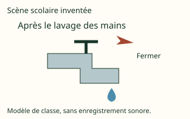

# French Form 4, Form Four French: drafts for review (Lessons 30 lessons (1–31))

Generated by `npm run review:f4-french` from `content/form-4/french/*.json`. Every question and drawing below was built by the engine.
All notes, teach cards, worked examples and paper tasks are **status: draft**. “Authored key” means a person fixed the
right answer (see `AUTHORED.md`); “computed by rule” means code worked it out (a formula, a conversion, a spelling rule).

Teach mode: cards (idea + example + 1 level-1 check) → worked example → practice (levels 1–3) → the note as a summary.

## Sample rendered lesson: Lesson 1 in teach mode

### Lesson 1: Vocabulaire : Vocabulaire relatif à la vie familiale et sociale (mariage, divorce, litige, orphelinat, violence, déperditions scolaires …)

**Card fr4-1-c1** (draft)

> Distingue les notions avant de choisir.
>
> _mariage : une union reconnue dans le cadre évoqué._  
> _divorce : la dissolution légale d’un mariage._  
> _litige : un désaccord nécessitant une résolution entre parties._  
> _violence : une atteinte ou une contrainte qui ne se confond pas avec tout désaccord calme._  
> _décrochage scolaire : une rupture ou un éloignement du parcours scolaire._  
> _orphelinat : une institution accueillant des enfants orphelins._  

Check question: `fr4-1-notions` · multiple choice, level 1 · **authored key**, reused from practice

> Quel terme désigne un désaccord nécessitant une résolution entre parties ?

- ◻️ mariage  
  _↳ feedback if chosen: Cela désigne une union reconnue dans le cadre évoqué, plutôt que la notion demandée._
- ◻️ divorce  
  _↳ feedback if chosen: Cela désigne la dissolution légale d’un mariage, plutôt que la notion demandée._
- ◻️ violence  
  _↳ feedback if chosen: Cela désigne une atteinte ou une contrainte qui ne se confond pas avec tout désaccord calme, plutôt que la notion demandée._
- ✅ litige

Full working after a second miss:

> Nommer un désaccord ne permet pas d’attribuer une responsabilité sans faits.  
> Donc la réponse est « litige ».  

**Card fr4-1-c2** (draft)

> Lis le contexte avant de nommer la notion.
>
> _Le récit mentionne une union sans expliquer une procédure juridique._  
> _Un personnage fictif évoque la fin légale de son mariage._  
> _Des personnages ne s’accordent pas sur l’usage d’un bien._  
> _Le récit distingue une menace d’une discussion respectueuse._  
> _Le récit s’interroge sur une interruption de scolarité._  
> _Le club écrit une annonce destinée à une institution d’accueil._  

Check question: `fr4-1-cas` · multiple choice, level 1 · **authored key**, reused from practice

> Le club écrit une annonce destinée à une institution d’accueil.
> Quelle notion convient ?

- ◻️ divorce  
  _↳ feedback if chosen: Cela concerne la dissolution légale d’un mariage. Compare cette définition avec le cas présenté._
- ◻️ litige  
  _↳ feedback if chosen: Cela concerne un désaccord nécessitant une résolution entre parties. Compare cette définition avec le cas présenté._
- ◻️ mariage  
  _↳ feedback if chosen: Cela concerne une union reconnue dans le cadre évoqué. Compare cette définition avec le cas présenté._
- ✅ orphelinat

Full working after a second miss:

> Une catégorie générale ne décrit pas chaque parcours individuel.  
> Donc la réponse est « orphelinat ».  

**Card fr4-1-c3** (draft)

> Corrige sans changer le sens voulu.
>
> _Le mot mariage fournit à lui seul toutes les règles applicables dans chaque pays. Correction : Le vocabulaire ne remplace pas l’étude des règles locales._  
> _Divorce signifie seulement une discussion sans rapport avec une union. Correction : Le sens renvoie à la dissolution du mariage, pas à tout désaccord._  
> _Tout litige signifie que toutes les personnes sont identiques et coupables. Correction : Nommer un désaccord ne permet pas d’attribuer une responsabilité sans faits._  
> _Une menace est simplement un synonyme de discussion calme. Correction : La précision évite de banaliser une atteinte ou de confondre des situations._  
> _Une interruption de scolarité prouve que la personne n’a aucune valeur. Correction : Les causes sont multiples et n’autorisent pas un jugement sur la personne._  
> _Le nom d’une institution raconte toute l’histoire de chaque enfant. Correction : Une catégorie générale ne décrit pas chaque parcours individuel._  

Check question: `fr4-1-corriger-card` · spot the error, level 1 · **authored key**

> Repère la formulation ou l’affirmation incorrecte.

- ◻️ mariage : une union reconnue dans le cadre évoqué.  
  _↳ explanation: Cette distinction est correcte : Le vocabulaire ne remplace pas l’étude des règles locales. Cherche plutôt une phrase qui contredit le sens ou la règle._
- ✅ Une interruption de scolarité prouve que la personne n’a aucune valeur.  
  _↳ explanation: Les causes sont multiples et n’autorisent pas un jugement sur la personne._
- ◻️ litige : un désaccord nécessitant une résolution entre parties.  
  _↳ explanation: Cette distinction est correcte : Nommer un désaccord ne permet pas d’attribuer une responsabilité sans faits. Cherche plutôt une phrase qui contredit le sens ou la règle._
- ◻️ décrochage scolaire : une rupture ou un éloignement du parcours scolaire.  
  _↳ explanation: Cette distinction est correcte : Les causes sont multiples et n’autorisent pas un jugement sur la personne. Cherche plutôt une phrase qui contredit le sens ou la règle._

Full working after a second miss:

> La phrase fausse est « Une interruption de scolarité prouve que la personne n’a aucune valeur. ».  
> Les causes sont multiples et n’autorisent pas un jugement sur la personne.  

**Worked example** (draft)

> Le récit mentionne une union sans expliquer une procédure juridique. Explique le choix.

1. une union reconnue dans le cadre évoqué.
2. Le vocabulaire ne remplace pas l’étude des règles locales.

**Answer:** mariage

**Practice** (one generated question per template, easiest first)

Practice 1: `fr4-1-notions` · multiple choice, level 1 · **authored key**

> Quel terme désigne une institution accueillant des enfants orphelins ?

- ◻️ mariage  
  _↳ feedback if chosen: Cela désigne une union reconnue dans le cadre évoqué, plutôt que la notion demandée._
- ✅ orphelinat
- ◻️ divorce  
  _↳ feedback if chosen: Cela désigne la dissolution légale d’un mariage, plutôt que la notion demandée._
- ◻️ litige  
  _↳ feedback if chosen: Cela désigne un désaccord nécessitant une résolution entre parties, plutôt que la notion demandée._

Full working after a second miss:

> Une catégorie générale ne décrit pas chaque parcours individuel.  
> Donc la réponse est « orphelinat ».  

Practice 2: `fr4-1-cas` · multiple choice, level 1 · **authored key**

> Un personnage fictif évoque la fin légale de son mariage.
> Quelle notion convient ?

- ✅ divorce
- ◻️ litige  
  _↳ feedback if chosen: Cela concerne un désaccord nécessitant une résolution entre parties. Compare cette définition avec le cas présenté._
- ◻️ mariage  
  _↳ feedback if chosen: Cela concerne une union reconnue dans le cadre évoqué. Compare cette définition avec le cas présenté._
- ◻️ violence  
  _↳ feedback if chosen: Cela concerne une atteinte ou une contrainte qui ne se confond pas avec tout désaccord calme. Compare cette définition avec le cas présenté._

Full working after a second miss:

> Le sens renvoie à la dissolution du mariage, pas à tout désaccord.  
> Donc la réponse est « divorce ».  

Practice 3: `fr4-1-contexte` · multiple choice, level 2 · **authored key**

> L’annonce concerne une institution d’accueil pour enfants orphelins : un ___.
> Quel mot ou groupe de la leçon convient ?

- ✅ orphelinat
- ◻️ litige  
  _↳ feedback if chosen: Ce mot désigne un désaccord nécessitant une résolution entre parties. La phrase demande plutôt une institution accueillant des enfants orphelins._
- ◻️ mariage  
  _↳ feedback if chosen: Ce mot désigne une union reconnue dans le cadre évoqué. La phrase demande plutôt une institution accueillant des enfants orphelins._
- ◻️ divorce  
  _↳ feedback if chosen: Ce mot désigne la dissolution légale d’un mariage. La phrase demande plutôt une institution accueillant des enfants orphelins._

Full working after a second miss:

> Une catégorie générale ne décrit pas chaque parcours individuel.  
> Donc la réponse est « orphelinat ».  

Practice 4: `fr4-1-relier` · matching, level 2 · **authored key**

> Relie chaque notion à son exemple.

Right-hand side (shuffled): Des personnages ne s’accordent pas sur l’usage d’un bien. · Le récit s’interroge sur une interruption de scolarité. · Le récit mentionne une union sans expliquer une procédure juridique.
- décrochage scolaire → **Le récit s’interroge sur une interruption de scolarité.**
- litige → **Des personnages ne s’accordent pas sur l’usage d’un bien.**
- mariage → **Le récit mentionne une union sans expliquer une procédure juridique.**

Full working after a second miss:

> Les bonnes paires sont :  
> décrochage scolaire → Le récit s’interroge sur une interruption de scolarité.  
> litige → Des personnages ne s’accordent pas sur l’usage d’un bien.  
> mariage → Le récit mentionne une union sans expliquer une procédure juridique.  

Practice 5: `fr4-1-corriger` · spot the error, level 3 · **authored key**

> Repère la formulation ou l’affirmation incorrecte.

- ◻️ violence : une atteinte ou une contrainte qui ne se confond pas avec tout désaccord calme.  
  _↳ explanation: Cette distinction est correcte : La précision évite de banaliser une atteinte ou de confondre des situations. Cherche plutôt une phrase qui contredit le sens ou la règle._
- ◻️ mariage : une union reconnue dans le cadre évoqué.  
  _↳ explanation: Cette distinction est correcte : Le vocabulaire ne remplace pas l’étude des règles locales. Cherche plutôt une phrase qui contredit le sens ou la règle._
- ◻️ divorce : la dissolution légale d’un mariage.  
  _↳ explanation: Cette distinction est correcte : Le sens renvoie à la dissolution du mariage, pas à tout désaccord. Cherche plutôt une phrase qui contredit le sens ou la règle._
- ✅ Une interruption de scolarité prouve que la personne n’a aucune valeur.  
  _↳ explanation: Les causes sont multiples et n’autorisent pas un jugement sur la personne._

Full working after a second miss:

> La phrase fausse est « Une interruption de scolarité prouve que la personne n’a aucune valeur. ».  
> Les causes sont multiples et n’autorisent pas un jugement sur la personne.  

**Summary (the note)**

> Un vocabulaire précis distingue des réalités différentes. Le mariage désigne une union reconnue dans le cadre évoqué ; le divorce en désigne la dissolution légale, sans que ces mots expliquent les procédures locales. Un litige est un désaccord pouvant demander une résolution. La violence ne se limite pas à un désaccord exprimé calmement. Le décrochage scolaire concerne l’interruption ou l’éloignement du parcours scolaire. Un orphelinat est une institution d’accueil pour enfants orphelins. Les situations réelles et leurs causes sont variées : on ne déduit ni la valeur d’une personne ni toute son histoire d’une étiquette.

## All drafts

| Lesson | Title (sheet) | Status | Cards | Practice | Paper task |
|---|---|---|---|---|---|
| 1 | Vocabulaire : Vocabulaire relatif à la vie familiale et sociale (mariage, divorce, litige, orphelinat, violence, déperditions scolaires …) | draft | 3 | 5 | — |
| 2 | Lecture : Lecture des textes simples relatifs à une situation de vie familiale ou sociale | draft | 3 | 5 | — |
| 3 | Grammaire : Les pronoms personnels compléments : « lui » - « leur » - « y » - « en » | draft | 3 | 5 | — |
| 4 | Expression orale : interpréter des images liées au respect des consignes en milieu scolaire | draft | 3 | 5 | — |
| 5 | Grammaire : l’emploi conjoint des pronoms COD et COI : l’, les, le, me/moi/m’, te/toi/t’… | draft | 3 | 5 | — |
| 6 | Conjugaison : les passé simple (1er et 2e groupe) | draft | 3 | 5 | — |
| 7 | Orthographe : Les homophones : si, ci, scie, s’y | draft | 3 | 5 | — |
| 8 | Vocabulaire : l’affixation | draft | 3 | 5 | — |
| 9 | Expression écrite : Techniques de narration : les évènements et leur enchaînement (connecteurs logiques) | draft | 3 | 5 | yes |
| 10 | Conjugaison : les passé composer | draft | 3 | 5 | — |
| 11 | Traduction : traduction de courts textes liés à la vie familiale ou communautaire | draft | 3 | 5 | — |
| 12 | Orthographe : Les liaisons | draft | 3 | 5 | — |
| 13 | Grammaire : la phrase complexe reliée par la conjonction de subordination « que » | draft | 3 | 5 | — |
| 14 | Vocabulaire : les familles de mots | draft | 3 | 5 | — |
| 15 | Conjugaison : Révision des temps de narration : l’imparfait de l’indicatif | draft | 3 | 5 | — |
| 17 | Vocabulaire : Mots et expressions liés à la protection de l’environnement | draft | 3 | 5 | — |
| 18 | Conjugaison : Les verbes impersonnels (pleuvoir, neiger, venter, falloir …) | draft | 3 | 5 | — |
| 19 | Expression orale : débattre sur un thème lié à la protection de l’environnement | draft | 3 | 5 | — |
| 20 | Grammaire : les pronoms relatifs composés (lequel, auquel, duquel, laquelle …) | draft | 3 | 5 | — |
| 21 | Vocabulaire : Mots et expressions liés à la santé et au métier de la santé | draft | 3 | 5 | — |
| 22 | 21. Conjugaison : le subjonctif présent : formation et emploi | draft | 3 | 5 | — |
| 23 | 22. Grammaire : Les degrés de signification de l’adjectif qualificatif (comparatif et superlatif) | draft | 3 | 5 | — |
| 24 | Vocabulaire : Mots et expressions liés à la nutrition et à la mal nutrition | draft | 3 | 5 | — |
| 25 | Lecture : lecture d’un texte lié à la nature ou à la gestion des déchets | draft | 3 | 5 | — |
| 26 | Orthographe : Les homophones (soit- soient-soie-soi-sois | draft | 3 | 5 | — |
| 27 | Traduction : Traduire des phrases simples liées à la santé | draft | 3 | 5 | — |
| 28 | Grammaire : Fonction de l’adjectif qualificatif (épithète – attribut – apposition) | draft | 3 | 5 | — |
| 29 | Conjugaison : l’impératif présent : formation et emploi | draft | 3 | 5 | — |
| 30 | Grammaire : Accord sujet - verbe | draft | 3 | 5 | — |
| 31 | Expression écrite : Rédaction d’une lettre informelle | draft | 3 | 5 | yes |

## Lesson 1: Vocabulaire : Vocabulaire relatif à la vie familiale et sociale (mariage, divorce, litige, orphelinat, violence, déperditions scolaires …)

Prerequisites: none · Skill: fr4-1 (La vie familiale et sociale : vocabulaire)

**Note** (draft)

> Un vocabulaire précis distingue des réalités différentes. Le mariage désigne une union reconnue dans le cadre évoqué ; le divorce en désigne la dissolution légale, sans que ces mots expliquent les procédures locales. Un litige est un désaccord pouvant demander une résolution. La violence ne se limite pas à un désaccord exprimé calmement. Le décrochage scolaire concerne l’interruption ou l’éloignement du parcours scolaire. Un orphelinat est une institution d’accueil pour enfants orphelins. Les situations réelles et leurs causes sont variées : on ne déduit ni la valeur d’une personne ni toute son histoire d’une étiquette.

**Learn: Ton objectif et les liens** (draft)

> À la fin, tu pourras choisir un vocabulaire précis pour décrire une situation familiale ou sociale fictive sans jugement sur les personnes. Acquis mobilisés : les descriptions et les relations sociales de la classe précédente. Pour la suite : la lecture d’un récit et les reprises pronominales.

**Learn: Comprendre la règle ou le sens** (draft)

> Un vocabulaire précis distingue des réalités différentes. Le mariage désigne une union reconnue dans le cadre évoqué ; le divorce en désigne la dissolution légale, sans que ces mots expliquent les procédures locales. Un litige est un désaccord pouvant demander une résolution. La violence ne se limite pas à un désaccord exprimé calmement. Le décrochage scolaire concerne l’interruption ou l’éloignement du parcours scolaire. Un orphelinat est une institution d’accueil pour enfants orphelins. Les situations réelles et leurs causes sont variées : on ne déduit ni la valeur d’une personne ni toute son histoire d’une étiquette.

**Learn: Lire le modèle original** (draft)

> Dialogue original : Dans une histoire inventée à Bamenda, un club prépare une collecte de livres pour une institution d’accueil. Bih demande quel public est concerné avant de rédiger l’annonce. Ayuk refuse d’attribuer la même histoire à tous les enfants. Le vocabulaire sert à décrire avec précision, pas à demander aux élèves de révéler leur propre vie familiale.

**Learn: Appliquer et vérifier** (draft)

> Lis la phrase entière, repère la relation de sens et choisis un mot adapté au contexte. Une proximité de thème ne rend pas tous les mots interchangeables. Réemploie ensuite un mot dans une phrase originale et vérifie ce que tu veux dire.

**Learn: key words and examples** (draft)

- **mariage**: une union reconnue dans le cadre évoqué
- **divorce**: la dissolution légale d’un mariage
- **litige**: un désaccord nécessitant une résolution entre parties
- **violence**: une atteinte ou une contrainte qui ne se confond pas avec tout désaccord calme
- **décrochage scolaire**: une rupture ou un éloignement du parcours scolaire
- **orphelinat**: une institution accueillant des enfants orphelins

Common mistake: “Le mot mariage fournit à lui seul toutes les règles applicables dans chaque pays.” → “une union reconnue dans le cadre évoqué.”. Le vocabulaire ne remplace pas l’étude des règles locales.

**Card fr4-1-c1** (draft)

> Distingue les notions avant de choisir.
>
> _mariage : une union reconnue dans le cadre évoqué._  
> _divorce : la dissolution légale d’un mariage._  
> _litige : un désaccord nécessitant une résolution entre parties._  
> _violence : une atteinte ou une contrainte qui ne se confond pas avec tout désaccord calme._  
> _décrochage scolaire : une rupture ou un éloignement du parcours scolaire._  
> _orphelinat : une institution accueillant des enfants orphelins._  

Check question: `fr4-1-notions` · multiple choice, level 1 · **authored key**, reused from practice

> Quel terme désigne la dissolution légale d’un mariage ?

- ◻️ mariage  
  _↳ feedback if chosen: Cela désigne une union reconnue dans le cadre évoqué, plutôt que la notion demandée._
- ✅ divorce
- ◻️ litige  
  _↳ feedback if chosen: Cela désigne un désaccord nécessitant une résolution entre parties, plutôt que la notion demandée._
- ◻️ violence  
  _↳ feedback if chosen: Cela désigne une atteinte ou une contrainte qui ne se confond pas avec tout désaccord calme, plutôt que la notion demandée._

Full working after a second miss:

> Le sens renvoie à la dissolution du mariage, pas à tout désaccord.  
> Donc la réponse est « divorce ».  

**Card fr4-1-c2** (draft)

> Lis le contexte avant de nommer la notion.
>
> _Le récit mentionne une union sans expliquer une procédure juridique._  
> _Un personnage fictif évoque la fin légale de son mariage._  
> _Des personnages ne s’accordent pas sur l’usage d’un bien._  
> _Le récit distingue une menace d’une discussion respectueuse._  
> _Le récit s’interroge sur une interruption de scolarité._  
> _Le club écrit une annonce destinée à une institution d’accueil._  

Check question: `fr4-1-cas` · multiple choice, level 1 · **authored key**, reused from practice

> Des personnages ne s’accordent pas sur l’usage d’un bien.
> Quelle notion convient ?

- ◻️ divorce  
  _↳ feedback if chosen: Cela concerne la dissolution légale d’un mariage. Compare cette définition avec le cas présenté._
- ✅ litige
- ◻️ mariage  
  _↳ feedback if chosen: Cela concerne une union reconnue dans le cadre évoqué. Compare cette définition avec le cas présenté._
- ◻️ violence  
  _↳ feedback if chosen: Cela concerne une atteinte ou une contrainte qui ne se confond pas avec tout désaccord calme. Compare cette définition avec le cas présenté._

Full working after a second miss:

> Nommer un désaccord ne permet pas d’attribuer une responsabilité sans faits.  
> Donc la réponse est « litige ».  

**Card fr4-1-c3** (draft)

> Corrige sans changer le sens voulu.
>
> _Le mot mariage fournit à lui seul toutes les règles applicables dans chaque pays. Correction : Le vocabulaire ne remplace pas l’étude des règles locales._  
> _Divorce signifie seulement une discussion sans rapport avec une union. Correction : Le sens renvoie à la dissolution du mariage, pas à tout désaccord._  
> _Tout litige signifie que toutes les personnes sont identiques et coupables. Correction : Nommer un désaccord ne permet pas d’attribuer une responsabilité sans faits._  
> _Une menace est simplement un synonyme de discussion calme. Correction : La précision évite de banaliser une atteinte ou de confondre des situations._  
> _Une interruption de scolarité prouve que la personne n’a aucune valeur. Correction : Les causes sont multiples et n’autorisent pas un jugement sur la personne._  
> _Le nom d’une institution raconte toute l’histoire de chaque enfant. Correction : Une catégorie générale ne décrit pas chaque parcours individuel._  

Check question: `fr4-1-corriger-card` · spot the error, level 1 · **authored key**

> Repère la formulation ou l’affirmation incorrecte.

- ◻️ litige : un désaccord nécessitant une résolution entre parties.  
  _↳ explanation: Cette distinction est correcte : Nommer un désaccord ne permet pas d’attribuer une responsabilité sans faits. Cherche plutôt une phrase qui contredit le sens ou la règle._
- ◻️ orphelinat : une institution accueillant des enfants orphelins.  
  _↳ explanation: Cette distinction est correcte : Une catégorie générale ne décrit pas chaque parcours individuel. Cherche plutôt une phrase qui contredit le sens ou la règle._
- ◻️ mariage : une union reconnue dans le cadre évoqué.  
  _↳ explanation: Cette distinction est correcte : Le vocabulaire ne remplace pas l’étude des règles locales. Cherche plutôt une phrase qui contredit le sens ou la règle._
- ✅ Le mot mariage fournit à lui seul toutes les règles applicables dans chaque pays.  
  _↳ explanation: Le vocabulaire ne remplace pas l’étude des règles locales._

Full working after a second miss:

> La phrase fausse est « Le mot mariage fournit à lui seul toutes les règles applicables dans chaque pays. ».  
> Le vocabulaire ne remplace pas l’étude des règles locales.  

**Worked example** (draft)

> Le récit mentionne une union sans expliquer une procédure juridique. Explique le choix.

1. une union reconnue dans le cadre évoqué.
2. Le vocabulaire ne remplace pas l’étude des règles locales.

**Answer:** mariage

**Practice** `fr4-1-notions` · multiple choice, level 1 · **authored key**

> Quel terme désigne une institution accueillant des enfants orphelins ?

- ◻️ litige  
  _↳ feedback if chosen: Cela désigne un désaccord nécessitant une résolution entre parties, plutôt que la notion demandée._
- ◻️ mariage  
  _↳ feedback if chosen: Cela désigne une union reconnue dans le cadre évoqué, plutôt que la notion demandée._
- ◻️ divorce  
  _↳ feedback if chosen: Cela désigne la dissolution légale d’un mariage, plutôt que la notion demandée._
- ✅ orphelinat

Full working after a second miss:

> Une catégorie générale ne décrit pas chaque parcours individuel.  
> Donc la réponse est « orphelinat ».  

> Quel terme désigne une institution accueillant des enfants orphelins ?

- ◻️ mariage  
  _↳ feedback if chosen: Cela désigne une union reconnue dans le cadre évoqué, plutôt que la notion demandée._
- ◻️ litige  
  _↳ feedback if chosen: Cela désigne un désaccord nécessitant une résolution entre parties, plutôt que la notion demandée._
- ✅ orphelinat
- ◻️ divorce  
  _↳ feedback if chosen: Cela désigne la dissolution légale d’un mariage, plutôt que la notion demandée._

Full working after a second miss:

> Une catégorie générale ne décrit pas chaque parcours individuel.  
> Donc la réponse est « orphelinat ».  

**Practice** `fr4-1-cas` · multiple choice, level 1 · **authored key**

> Le récit s’interroge sur une interruption de scolarité.
> Quelle notion convient ?

- ✅ décrochage scolaire
- ◻️ mariage  
  _↳ feedback if chosen: Cela concerne une union reconnue dans le cadre évoqué. Compare cette définition avec le cas présenté._
- ◻️ divorce  
  _↳ feedback if chosen: Cela concerne la dissolution légale d’un mariage. Compare cette définition avec le cas présenté._
- ◻️ litige  
  _↳ feedback if chosen: Cela concerne un désaccord nécessitant une résolution entre parties. Compare cette définition avec le cas présenté._

Full working after a second miss:

> Les causes sont multiples et n’autorisent pas un jugement sur la personne.  
> Donc la réponse est « décrochage scolaire ».  

> Un personnage fictif évoque la fin légale de son mariage.
> Quelle notion convient ?

- ◻️ violence  
  _↳ feedback if chosen: Cela concerne une atteinte ou une contrainte qui ne se confond pas avec tout désaccord calme. Compare cette définition avec le cas présenté._
- ◻️ mariage  
  _↳ feedback if chosen: Cela concerne une union reconnue dans le cadre évoqué. Compare cette définition avec le cas présenté._
- ✅ divorce
- ◻️ litige  
  _↳ feedback if chosen: Cela concerne un désaccord nécessitant une résolution entre parties. Compare cette définition avec le cas présenté._

Full working after a second miss:

> Le sens renvoie à la dissolution du mariage, pas à tout désaccord.  
> Donc la réponse est « divorce ».  

**Practice** `fr4-1-contexte` · multiple choice, level 2 · **authored key**

> L’annonce concerne une institution d’accueil pour enfants orphelins : un ___.
> Quel mot ou groupe de la leçon convient ?

- ◻️ litige  
  _↳ feedback if chosen: Ce mot désigne un désaccord nécessitant une résolution entre parties. La phrase demande plutôt une institution accueillant des enfants orphelins._
- ✅ orphelinat
- ◻️ mariage  
  _↳ feedback if chosen: Ce mot désigne une union reconnue dans le cadre évoqué. La phrase demande plutôt une institution accueillant des enfants orphelins._
- ◻️ divorce  
  _↳ feedback if chosen: Ce mot désigne la dissolution légale d’un mariage. La phrase demande plutôt une institution accueillant des enfants orphelins._

Full working after a second miss:

> Une catégorie générale ne décrit pas chaque parcours individuel.  
> Donc la réponse est « orphelinat ».  

> L’annonce concerne une institution d’accueil pour enfants orphelins : un ___.
> Quel mot ou groupe de la leçon convient ?

- ✅ orphelinat
- ◻️ litige  
  _↳ feedback if chosen: Ce mot désigne un désaccord nécessitant une résolution entre parties. La phrase demande plutôt une institution accueillant des enfants orphelins._
- ◻️ divorce  
  _↳ feedback if chosen: Ce mot désigne la dissolution légale d’un mariage. La phrase demande plutôt une institution accueillant des enfants orphelins._
- ◻️ mariage  
  _↳ feedback if chosen: Ce mot désigne une union reconnue dans le cadre évoqué. La phrase demande plutôt une institution accueillant des enfants orphelins._

Full working after a second miss:

> Une catégorie générale ne décrit pas chaque parcours individuel.  
> Donc la réponse est « orphelinat ».  

**Practice** `fr4-1-relier` · matching, level 2 · **authored key**

> Relie chaque notion à son exemple.

Right-hand side (shuffled): Le récit mentionne une union sans expliquer une procédure juridique. · Des personnages ne s’accordent pas sur l’usage d’un bien. · Le club écrit une annonce destinée à une institution d’accueil.
- orphelinat → **Le club écrit une annonce destinée à une institution d’accueil.**
- mariage → **Le récit mentionne une union sans expliquer une procédure juridique.**
- litige → **Des personnages ne s’accordent pas sur l’usage d’un bien.**

Full working after a second miss:

> Les bonnes paires sont :  
> orphelinat → Le club écrit une annonce destinée à une institution d’accueil.  
> mariage → Le récit mentionne une union sans expliquer une procédure juridique.  
> litige → Des personnages ne s’accordent pas sur l’usage d’un bien.  

> Relie chaque notion à son exemple.

Right-hand side (shuffled): Le récit mentionne une union sans expliquer une procédure juridique. · Le club écrit une annonce destinée à une institution d’accueil. · Le récit distingue une menace d’une discussion respectueuse.
- violence → **Le récit distingue une menace d’une discussion respectueuse.**
- orphelinat → **Le club écrit une annonce destinée à une institution d’accueil.**
- mariage → **Le récit mentionne une union sans expliquer une procédure juridique.**

Full working after a second miss:

> Les bonnes paires sont :  
> violence → Le récit distingue une menace d’une discussion respectueuse.  
> orphelinat → Le club écrit une annonce destinée à une institution d’accueil.  
> mariage → Le récit mentionne une union sans expliquer une procédure juridique.  

**Practice** `fr4-1-corriger` · spot the error, level 3 · **authored key**

> Repère la formulation ou l’affirmation incorrecte.

- ◻️ mariage : une union reconnue dans le cadre évoqué.  
  _↳ explanation: Cette distinction est correcte : Le vocabulaire ne remplace pas l’étude des règles locales. Cherche plutôt une phrase qui contredit le sens ou la règle._
- ◻️ divorce : la dissolution légale d’un mariage.  
  _↳ explanation: Cette distinction est correcte : Le sens renvoie à la dissolution du mariage, pas à tout désaccord. Cherche plutôt une phrase qui contredit le sens ou la règle._
- ✅ Tout litige signifie que toutes les personnes sont identiques et coupables.  
  _↳ explanation: Nommer un désaccord ne permet pas d’attribuer une responsabilité sans faits._
- ◻️ litige : un désaccord nécessitant une résolution entre parties.  
  _↳ explanation: Cette distinction est correcte : Nommer un désaccord ne permet pas d’attribuer une responsabilité sans faits. Cherche plutôt une phrase qui contredit le sens ou la règle._

Full working after a second miss:

> La phrase fausse est « Tout litige signifie que toutes les personnes sont identiques et coupables. ».  
> Nommer un désaccord ne permet pas d’attribuer une responsabilité sans faits.  

> Repère la formulation ou l’affirmation incorrecte.

- ✅ Le nom d’une institution raconte toute l’histoire de chaque enfant.  
  _↳ explanation: Une catégorie générale ne décrit pas chaque parcours individuel._
- ◻️ orphelinat : une institution accueillant des enfants orphelins.  
  _↳ explanation: Cette distinction est correcte : Une catégorie générale ne décrit pas chaque parcours individuel. Cherche plutôt une phrase qui contredit le sens ou la règle._
- ◻️ litige : un désaccord nécessitant une résolution entre parties.  
  _↳ explanation: Cette distinction est correcte : Nommer un désaccord ne permet pas d’attribuer une responsabilité sans faits. Cherche plutôt une phrase qui contredit le sens ou la règle._
- ◻️ mariage : une union reconnue dans le cadre évoqué.  
  _↳ explanation: Cette distinction est correcte : Le vocabulaire ne remplace pas l’étude des règles locales. Cherche plutôt une phrase qui contredit le sens ou la règle._

Full working after a second miss:

> La phrase fausse est « Le nom d’une institution raconte toute l’histoire de chaque enfant. ».  
> Une catégorie générale ne décrit pas chaque parcours individuel.  

## Lesson 2: Lecture : Lecture des textes simples relatifs à une situation de vie familiale ou sociale

Prerequisites: 1 · Skill: fr4-2 (Lire un récit de vie familiale et sociale)

**Note** (draft)

> Comprendre un texte demande de relever les faits, de relier les indices et de distinguer une inférence d’une invention. Une information explicite est écrite ; une inférence s’appuie sur le passage sans prétendre être une citation. L’idée principale rassemble les éléments importants. Si un nom, un prix ou un résultat manque, on le dit au lieu de le deviner. Lis aussi le temps des verbes : une préparation n’est pas le compte rendu d’une action achevée.

**Learn: Ton objectif et les liens** (draft)

> À la fin, tu pourras repérer une difficulté, une proposition et une information absente dans un récit original. Acquis mobilisés : le vocabulaire de la vie familiale et sociale. Pour la suite : les reprises pronominales et la construction d’un récit.

**Learn: Comprendre la règle ou le sens** (draft)

> Comprendre un texte demande de relever les faits, de relier les indices et de distinguer une inférence d’une invention. Une information explicite est écrite ; une inférence s’appuie sur le passage sans prétendre être une citation. L’idée principale rassemble les éléments importants. Si un nom, un prix ou un résultat manque, on le dit au lieu de le deviner. Lis aussi le temps des verbes : une préparation n’est pas le compte rendu d’une action achevée.

**Learn: Lire le modèle original** (draft)

> Texte original : À Bamenda, une famille fictive prépare une visite à la bibliothèque. La tâche de rangement de Bih coïncide avec l’heure du départ. Elle propose de répartir le travail avant de partir. Ayuk demande quelles tâches restent à faire. Un adulte aide le groupe à choisir une organisation. Le texte ne précise ni le nombre de livres empruntés ni le prix d’un transport.

**Learn: Appliquer et vérifier** (draft)

> Lis l’ensemble, puis retrouve un indice pour chaque réponse. Justifie ce que le passage permet de conclure et nomme ce qu’il ne précise pas. Rédige ensuite une courte phrase originale résumant l’action centrale sans inventer de donnée.

**Learn: key words and examples** (draft)

- **information explicite**: un renseignement directement indiqué dans le passage
- **inférence justifiée**: une conclusion appuyée sur des indices du passage
- **idée principale**: le sens général rassemblant les actions importantes
- **information absente**: un renseignement que le passage ne permet pas d’établir

Common mistake: “Une information explicite est obligatoirement un détail inventé.” → “un renseignement directement indiqué dans le passage.”. Le texte lui-même fournit l’information.

**Card fr4-2-c1** (draft)

> Distingue les notions avant de choisir.
>
> _information explicite : un renseignement directement indiqué dans le passage._  
> _inférence justifiée : une conclusion appuyée sur des indices du passage._  
> _idée principale : le sens général rassemblant les actions importantes._  
> _information absente : un renseignement que le passage ne permet pas d’établir._  

Check question: `fr4-2-notions` · multiple choice, level 1 · **authored key**, reused from practice

> Quel terme désigne un renseignement directement indiqué dans le passage ?

- ◻️ idée principale  
  _↳ feedback if chosen: Cela désigne le sens général rassemblant les actions importantes, plutôt que la notion demandée._
- ✅ information explicite
- ◻️ inférence justifiée  
  _↳ feedback if chosen: Cela désigne une conclusion appuyée sur des indices du passage, plutôt que la notion demandée._
- ◻️ information absente  
  _↳ feedback if chosen: Cela désigne un renseignement que le passage ne permet pas d’établir, plutôt que la notion demandée._

Full working after a second miss:

> Le texte lui-même fournit l’information.  
> Donc la réponse est « information explicite ».  

**Card fr4-2-c2** (draft)

> Lis le contexte avant de nommer la notion.
>
> _Le lecteur reprend un lieu ou une action effectivement écrit._  
> _Le lecteur explique une intention à partir des actions décrites._  
> _Le lecteur résume le problème et la réponse décrite._  
> _Le lecteur refuse de donner un prix non mentionné._  

Check question: `fr4-2-cas` · multiple choice, level 1 · **authored key**, reused from practice

> Le lecteur résume le problème et la réponse décrite.
> Quelle notion convient ?

- ◻️ information absente  
  _↳ feedback if chosen: Cela concerne un renseignement que le passage ne permet pas d’établir. Compare cette définition avec le cas présenté._
- ◻️ information explicite  
  _↳ feedback if chosen: Cela concerne un renseignement directement indiqué dans le passage. Compare cette définition avec le cas présenté._
- ✅ idée principale
- ◻️ inférence justifiée  
  _↳ feedback if chosen: Cela concerne une conclusion appuyée sur des indices du passage. Compare cette définition avec le cas présenté._

Full working after a second miss:

> Le résumé doit représenter l’ensemble pertinent.  
> Donc la réponse est « idée principale ».  

**Card fr4-2-c3** (draft)

> Corrige sans changer le sens voulu.
>
> _Une information explicite est obligatoirement un détail inventé. Correction : Le texte lui-même fournit l’information._  
> _Toute supposition est une preuve tirée du texte. Correction : Une conclusion doit rester liée à des indices._  
> _Un mot secondaire suffit toujours à résumer tout le passage. Correction : Le résumé doit représenter l’ensemble pertinent._  
> _Une donnée absente devient un fait dès qu’on la devine. Correction : Il faut reconnaître les limites du passage._  

Check question: `fr4-2-corriger-card` · spot the error, level 1 · **authored key**

> Repère la formulation ou l’affirmation incorrecte.

- ◻️ information absente : un renseignement que le passage ne permet pas d’établir.  
  _↳ explanation: Cette distinction est correcte : Il faut reconnaître les limites du passage. Cherche plutôt une phrase qui contredit le sens ou la règle._
- ◻️ information explicite : un renseignement directement indiqué dans le passage.  
  _↳ explanation: Cette distinction est correcte : Le texte lui-même fournit l’information. Cherche plutôt une phrase qui contredit le sens ou la règle._
- ✅ Un mot secondaire suffit toujours à résumer tout le passage.  
  _↳ explanation: Le résumé doit représenter l’ensemble pertinent._
- ◻️ idée principale : le sens général rassemblant les actions importantes.  
  _↳ explanation: Cette distinction est correcte : Le résumé doit représenter l’ensemble pertinent. Cherche plutôt une phrase qui contredit le sens ou la règle._

Full working after a second miss:

> La phrase fausse est « Un mot secondaire suffit toujours à résumer tout le passage. ».  
> Le résumé doit représenter l’ensemble pertinent.  

**Worked example** (draft)

> Le lecteur reprend un lieu ou une action effectivement écrit. Explique le choix.

1. un renseignement directement indiqué dans le passage.
2. Le texte lui-même fournit l’information.

**Answer:** information explicite

**Practice** `fr4-2-notions` · multiple choice, level 1 · **authored key**

> Quel terme désigne le sens général rassemblant les actions importantes ?

- ◻️ information explicite  
  _↳ feedback if chosen: Cela désigne un renseignement directement indiqué dans le passage, plutôt que la notion demandée._
- ✅ idée principale
- ◻️ inférence justifiée  
  _↳ feedback if chosen: Cela désigne une conclusion appuyée sur des indices du passage, plutôt que la notion demandée._
- ◻️ information absente  
  _↳ feedback if chosen: Cela désigne un renseignement que le passage ne permet pas d’établir, plutôt que la notion demandée._

Full working after a second miss:

> Le résumé doit représenter l’ensemble pertinent.  
> Donc la réponse est « idée principale ».  

> Quel terme désigne le sens général rassemblant les actions importantes ?

- ◻️ inférence justifiée  
  _↳ feedback if chosen: Cela désigne une conclusion appuyée sur des indices du passage, plutôt que la notion demandée._
- ✅ idée principale
- ◻️ information absente  
  _↳ feedback if chosen: Cela désigne un renseignement que le passage ne permet pas d’établir, plutôt que la notion demandée._
- ◻️ information explicite  
  _↳ feedback if chosen: Cela désigne un renseignement directement indiqué dans le passage, plutôt que la notion demandée._

Full working after a second miss:

> Le résumé doit représenter l’ensemble pertinent.  
> Donc la réponse est « idée principale ».  

**Practice** `fr4-2-cas` · multiple choice, level 1 · **authored key**

> Le lecteur résume le problème et la réponse décrite.
> Quelle notion convient ?

- ◻️ inférence justifiée  
  _↳ feedback if chosen: Cela concerne une conclusion appuyée sur des indices du passage. Compare cette définition avec le cas présenté._
- ◻️ information explicite  
  _↳ feedback if chosen: Cela concerne un renseignement directement indiqué dans le passage. Compare cette définition avec le cas présenté._
- ✅ idée principale
- ◻️ information absente  
  _↳ feedback if chosen: Cela concerne un renseignement que le passage ne permet pas d’établir. Compare cette définition avec le cas présenté._

Full working after a second miss:

> Le résumé doit représenter l’ensemble pertinent.  
> Donc la réponse est « idée principale ».  

> Le lecteur résume le problème et la réponse décrite.
> Quelle notion convient ?

- ◻️ inférence justifiée  
  _↳ feedback if chosen: Cela concerne une conclusion appuyée sur des indices du passage. Compare cette définition avec le cas présenté._
- ✅ idée principale
- ◻️ information explicite  
  _↳ feedback if chosen: Cela concerne un renseignement directement indiqué dans le passage. Compare cette définition avec le cas présenté._
- ◻️ information absente  
  _↳ feedback if chosen: Cela concerne un renseignement que le passage ne permet pas d’établir. Compare cette définition avec le cas présenté._

Full working after a second miss:

> Le résumé doit représenter l’ensemble pertinent.  
> Donc la réponse est « idée principale ».  

**Practice** `fr4-2-comprendre` · multiple choice, level 2 · **authored key**

> Texte original : À Bamenda, une famille fictive prépare une visite à la bibliothèque. La tâche de rangement de Bih coïncide avec l’heure du départ. Elle propose de répartir le travail avant de partir. Ayuk demande quelles tâches restent à faire. Un adulte aide le groupe à choisir une organisation. Le texte ne précise ni le nombre de livres empruntés ni le prix d’un transport.
> Quelle donnée n’est pas précisée ?

- ✅ Le prix d’un transport.
- ◻️ La proposition de Bih.  
  _↳ feedback if chosen: La répartition du travail est indiquée._
- ◻️ La ville de l’histoire.  
  _↳ feedback if chosen: Bamenda est nommée._
- ◻️ L’aide d’un adulte.  
  _↳ feedback if chosen: L’aide est explicitement mentionnée._

Full working after a second miss:

> Reconnaître une absence évite l’invention.  
> Donc la réponse est « Le prix d’un transport. ».  

> Texte original : À Bamenda, une famille fictive prépare une visite à la bibliothèque. La tâche de rangement de Bih coïncide avec l’heure du départ. Elle propose de répartir le travail avant de partir. Ayuk demande quelles tâches restent à faire. Un adulte aide le groupe à choisir une organisation. Le texte ne précise ni le nombre de livres empruntés ni le prix d’un transport.
> Quelle donnée n’est pas précisée ?

- ◻️ La ville de l’histoire.  
  _↳ feedback if chosen: Bamenda est nommée._
- ◻️ La proposition de Bih.  
  _↳ feedback if chosen: La répartition du travail est indiquée._
- ◻️ L’aide d’un adulte.  
  _↳ feedback if chosen: L’aide est explicitement mentionnée._
- ✅ Le prix d’un transport.

Full working after a second miss:

> Reconnaître une absence évite l’invention.  
> Donc la réponse est « Le prix d’un transport. ».  

**Practice** `fr4-2-relier` · matching, level 2 · **authored key**

> Relie chaque notion à son exemple.

Right-hand side (shuffled): Le lecteur explique une intention à partir des actions décrites. · Le lecteur refuse de donner un prix non mentionné. · Le lecteur reprend un lieu ou une action effectivement écrit.
- information explicite → **Le lecteur reprend un lieu ou une action effectivement écrit.**
- inférence justifiée → **Le lecteur explique une intention à partir des actions décrites.**
- information absente → **Le lecteur refuse de donner un prix non mentionné.**

Full working after a second miss:

> Les bonnes paires sont :  
> information explicite → Le lecteur reprend un lieu ou une action effectivement écrit.  
> inférence justifiée → Le lecteur explique une intention à partir des actions décrites.  
> information absente → Le lecteur refuse de donner un prix non mentionné.  

> Relie chaque notion à son exemple.

Right-hand side (shuffled): Le lecteur résume le problème et la réponse décrite. · Le lecteur explique une intention à partir des actions décrites. · Le lecteur reprend un lieu ou une action effectivement écrit.
- information explicite → **Le lecteur reprend un lieu ou une action effectivement écrit.**
- inférence justifiée → **Le lecteur explique une intention à partir des actions décrites.**
- idée principale → **Le lecteur résume le problème et la réponse décrite.**

Full working after a second miss:

> Les bonnes paires sont :  
> information explicite → Le lecteur reprend un lieu ou une action effectivement écrit.  
> inférence justifiée → Le lecteur explique une intention à partir des actions décrites.  
> idée principale → Le lecteur résume le problème et la réponse décrite.  

**Practice** `fr4-2-corriger` · spot the error, level 3 · **authored key**

> Repère la formulation ou l’affirmation incorrecte.

- ◻️ inférence justifiée : une conclusion appuyée sur des indices du passage.  
  _↳ explanation: Cette distinction est correcte : Une conclusion doit rester liée à des indices. Cherche plutôt une phrase qui contredit le sens ou la règle._
- ◻️ information absente : un renseignement que le passage ne permet pas d’établir.  
  _↳ explanation: Cette distinction est correcte : Il faut reconnaître les limites du passage. Cherche plutôt une phrase qui contredit le sens ou la règle._
- ◻️ information explicite : un renseignement directement indiqué dans le passage.  
  _↳ explanation: Cette distinction est correcte : Le texte lui-même fournit l’information. Cherche plutôt une phrase qui contredit le sens ou la règle._
- ✅ Toute supposition est une preuve tirée du texte.  
  _↳ explanation: Une conclusion doit rester liée à des indices._

Full working after a second miss:

> La phrase fausse est « Toute supposition est une preuve tirée du texte. ».  
> Une conclusion doit rester liée à des indices.  

> Repère la formulation ou l’affirmation incorrecte.

- ✅ Un mot secondaire suffit toujours à résumer tout le passage.  
  _↳ explanation: Le résumé doit représenter l’ensemble pertinent._
- ◻️ information explicite : un renseignement directement indiqué dans le passage.  
  _↳ explanation: Cette distinction est correcte : Le texte lui-même fournit l’information. Cherche plutôt une phrase qui contredit le sens ou la règle._
- ◻️ information absente : un renseignement que le passage ne permet pas d’établir.  
  _↳ explanation: Cette distinction est correcte : Il faut reconnaître les limites du passage. Cherche plutôt une phrase qui contredit le sens ou la règle._
- ◻️ inférence justifiée : une conclusion appuyée sur des indices du passage.  
  _↳ explanation: Cette distinction est correcte : Une conclusion doit rester liée à des indices. Cherche plutôt une phrase qui contredit le sens ou la règle._

Full working after a second miss:

> La phrase fausse est « Un mot secondaire suffit toujours à résumer tout le passage. ».  
> Le résumé doit représenter l’ensemble pertinent.  

## Lesson 3: Grammaire : Les pronoms personnels compléments : « lui » - « leur » - « y » - « en »

Prerequisites: none · Skill: fr4-3 (Les pronoms compléments : lui, leur, y, en)

**Note** (draft)

> Un pronom complément reprend une information identifiable. Dans les modèles de parler à une personne, lui reprend un destinataire singulier et leur un destinataire pluriel, sans marque de genre. Y peut reprendre un lieu ou certains compléments en à ; en peut reprendre un complément en de ou une quantité. Le choix dépend du verbe : on ne transforme pas mécaniquement tout à en lui. Avec penser à une personne, on garde par exemple une forme tonique comme à elle. Leur pronom reste invariable.

**Learn: Ton objectif et les liens** (draft)

> À la fin, tu pourras remplacer un complément par le pronom adapté à la construction et au sens. Acquis mobilisés : les sujets, les compléments et les groupes nominaux de la classe précédente. Pour la suite : l’emploi conjoint des pronoms COD et COI.

**Learn: Comprendre la règle ou le sens** (draft)

> Un pronom complément reprend une information identifiable. Dans les modèles de parler à une personne, lui reprend un destinataire singulier et leur un destinataire pluriel, sans marque de genre. Y peut reprendre un lieu ou certains compléments en à ; en peut reprendre un complément en de ou une quantité. Le choix dépend du verbe : on ne transforme pas mécaniquement tout à en lui. Avec penser à une personne, on garde par exemple une forme tonique comme à elle. Leur pronom reste invariable.

**Learn: Lire le modèle original** (draft)

> Modèles originaux : Bih parle à sa tante → Bih lui parle. Elle parle aux voisins → elle leur parle. Elle va à Buea → elle y va. Elle parle du projet → elle en parle. La reprise conserve le référent et le sens de la construction.

**Learn: Appliquer et vérifier** (draft)

> Souligne le groupe remplacé, repère la préposition et vérifie ce qu’il désigne. Ne remplace pas le sujet à la place du complément. Pour une quantité, conserve l’indication nécessaire : elle en prend une. Écris ensuite un échange original avec un référent clairement annoncé.

**Learn: key words and examples** (draft)

- **lui**: le pronom reprenant un destinataire singulier dans le modèle de parler à
- **leur**: le pronom reprenant plusieurs destinataires dans ce modèle
- **y**: un pronom reprenant notamment un lieu dans le modèle étudié
- **en**: un pronom reprenant notamment un complément en de ou une quantité

Common mistake: “Lui désigne obligatoirement un homme.” → “le pronom reprenant un destinataire singulier dans le modèle de parler à.”. Le pronom complément lui peut reprendre une personne de genre féminin ou masculin.

**Card fr4-3-c1** (draft)

> Distingue les notions avant de choisir.
>
> _lui : le pronom reprenant un destinataire singulier dans le modèle de parler à._  
> _leur : le pronom reprenant plusieurs destinataires dans ce modèle._  
> _y : un pronom reprenant notamment un lieu dans le modèle étudié._  
> _en : un pronom reprenant notamment un complément en de ou une quantité._  

Check question: `fr4-3-notions` · multiple choice, level 1 · **authored key**, reused from practice

> Quel terme désigne le pronom reprenant plusieurs destinataires dans ce modèle ?

- ◻️ y  
  _↳ feedback if chosen: Cela désigne un pronom reprenant notamment un lieu dans le modèle étudié, plutôt que la notion demandée._
- ◻️ en  
  _↳ feedback if chosen: Cela désigne un pronom reprenant notamment un complément en de ou une quantité, plutôt que la notion demandée._
- ◻️ lui  
  _↳ feedback if chosen: Cela désigne le pronom reprenant un destinataire singulier dans le modèle de parler à, plutôt que la notion demandée._
- ✅ leur

Full working after a second miss:

> Leur pronom complément est invariable, contrairement à certains déterminants possessifs.  
> Donc la réponse est « leur ».  

**Card fr4-3-c2** (draft)

> Lis le contexte avant de nommer la notion.
>
> _Elle lui parle reprend à sa tante._  
> _Elle leur parle reprend aux voisins._  
> _Elle y va reprend à Buea._  
> _Elle en parle reprend du projet._  

Check question: `fr4-3-cas` · multiple choice, level 1 · **authored key**, reused from practice

> Elle y va reprend à Buea.
> Quelle notion convient ?

- ◻️ lui  
  _↳ feedback if chosen: Cela concerne le pronom reprenant un destinataire singulier dans le modèle de parler à. Compare cette définition avec le cas présenté._
- ✅ y
- ◻️ en  
  _↳ feedback if chosen: Cela concerne un pronom reprenant notamment un complément en de ou une quantité. Compare cette définition avec le cas présenté._
- ◻️ leur  
  _↳ feedback if chosen: Cela concerne le pronom reprenant plusieurs destinataires dans ce modèle. Compare cette définition avec le cas présenté._

Full working after a second miss:

> Il reprend le lieu, sans changer le sujet.  
> Donc la réponse est « y ».  

**Card fr4-3-c3** (draft)

> Corrige sans changer le sens voulu.
>
> _Lui désigne obligatoirement un homme. Correction : Le pronom complément lui peut reprendre une personne de genre féminin ou masculin._  
> _Le pronom complément leur prend toujours un s. Correction : Leur pronom complément est invariable, contrairement à certains déterminants possessifs._  
> _Y remplace ici le sujet elle. Correction : Il reprend le lieu, sans changer le sujet._  
> _En impose de supprimer toute quantité utile au sens. Correction : La reprise doit garder les précisions nécessaires à l’énoncé._  

Check question: `fr4-3-corriger-card` · spot the error, level 1 · **authored key**

> Repère la formulation ou l’affirmation incorrecte.

- ◻️ en : un pronom reprenant notamment un complément en de ou une quantité.  
  _↳ explanation: Cette distinction est correcte : La reprise doit garder les précisions nécessaires à l’énoncé. Cherche plutôt une phrase qui contredit le sens ou la règle._
- ◻️ leur : le pronom reprenant plusieurs destinataires dans ce modèle.  
  _↳ explanation: Cette distinction est correcte : Leur pronom complément est invariable, contrairement à certains déterminants possessifs. Cherche plutôt une phrase qui contredit le sens ou la règle._
- ◻️ y : un pronom reprenant notamment un lieu dans le modèle étudié.  
  _↳ explanation: Cette distinction est correcte : Il reprend le lieu, sans changer le sujet. Cherche plutôt une phrase qui contredit le sens ou la règle._
- ✅ En impose de supprimer toute quantité utile au sens.  
  _↳ explanation: La reprise doit garder les précisions nécessaires à l’énoncé._

Full working after a second miss:

> La phrase fausse est « En impose de supprimer toute quantité utile au sens. ».  
> La reprise doit garder les précisions nécessaires à l’énoncé.  

**Worked example** (draft)

> Elle lui parle reprend à sa tante. Explique le choix.

1. le pronom reprenant un destinataire singulier dans le modèle de parler à.
2. Le pronom complément lui peut reprendre une personne de genre féminin ou masculin.

**Answer:** lui

**Practice** `fr4-3-notions` · multiple choice, level 1 · **authored key**

> Quel terme désigne le pronom reprenant un destinataire singulier dans le modèle de parler à ?

- ◻️ y  
  _↳ feedback if chosen: Cela désigne un pronom reprenant notamment un lieu dans le modèle étudié, plutôt que la notion demandée._
- ◻️ en  
  _↳ feedback if chosen: Cela désigne un pronom reprenant notamment un complément en de ou une quantité, plutôt que la notion demandée._
- ◻️ leur  
  _↳ feedback if chosen: Cela désigne le pronom reprenant plusieurs destinataires dans ce modèle, plutôt que la notion demandée._
- ✅ lui

Full working after a second miss:

> Le pronom complément lui peut reprendre une personne de genre féminin ou masculin.  
> Donc la réponse est « lui ».  

> Quel terme désigne le pronom reprenant un destinataire singulier dans le modèle de parler à ?

- ✅ lui
- ◻️ y  
  _↳ feedback if chosen: Cela désigne un pronom reprenant notamment un lieu dans le modèle étudié, plutôt que la notion demandée._
- ◻️ en  
  _↳ feedback if chosen: Cela désigne un pronom reprenant notamment un complément en de ou une quantité, plutôt que la notion demandée._
- ◻️ leur  
  _↳ feedback if chosen: Cela désigne le pronom reprenant plusieurs destinataires dans ce modèle, plutôt que la notion demandée._

Full working after a second miss:

> Le pronom complément lui peut reprendre une personne de genre féminin ou masculin.  
> Donc la réponse est « lui ».  

**Practice** `fr4-3-cas` · multiple choice, level 1 · **authored key**

> Elle lui parle reprend à sa tante.
> Quelle notion convient ?

- ◻️ y  
  _↳ feedback if chosen: Cela concerne un pronom reprenant notamment un lieu dans le modèle étudié. Compare cette définition avec le cas présenté._
- ◻️ en  
  _↳ feedback if chosen: Cela concerne un pronom reprenant notamment un complément en de ou une quantité. Compare cette définition avec le cas présenté._
- ◻️ leur  
  _↳ feedback if chosen: Cela concerne le pronom reprenant plusieurs destinataires dans ce modèle. Compare cette définition avec le cas présenté._
- ✅ lui

Full working after a second miss:

> Le pronom complément lui peut reprendre une personne de genre féminin ou masculin.  
> Donc la réponse est « lui ».  

> Elle y va reprend à Buea.
> Quelle notion convient ?

- ✅ y
- ◻️ en  
  _↳ feedback if chosen: Cela concerne un pronom reprenant notamment un complément en de ou une quantité. Compare cette définition avec le cas présenté._
- ◻️ lui  
  _↳ feedback if chosen: Cela concerne le pronom reprenant un destinataire singulier dans le modèle de parler à. Compare cette définition avec le cas présenté._
- ◻️ leur  
  _↳ feedback if chosen: Cela concerne le pronom reprenant plusieurs destinataires dans ce modèle. Compare cette définition avec le cas présenté._

Full working after a second miss:

> Il reprend le lieu, sans changer le sujet.  
> Donc la réponse est « y ».  

**Practice** `fr4-3-appliquer` · multiple choice, level 2 · **authored key**

> Elle parle à sa tante. Remplace seulement à sa tante.

- ✅ lui
- ◻️ en  
  _↳ feedback if chosen: Le complément est en à, non en de._
- ◻️ leur  
  _↳ feedback if chosen: Le destinataire est singulier._
- ◻️ y  
  _↳ feedback if chosen: Le modèle vise une personne à qui elle parle, non un lieu._

Full working after a second miss:

> Lui convient à parler à cette personne.  
> Donc la réponse est « lui ».  

> Elle va à Buea. Remplace le lieu.

- ✅ y
- ◻️ lui  
  _↳ feedback if chosen: On reprend le lieu, non un destinataire singulier._
- ◻️ en  
  _↳ feedback if chosen: En ne reprend pas ici la destination en à._
- ◻️ leur  
  _↳ feedback if chosen: Le lieu n’est pas un groupe de destinataires._

Full working after a second miss:

> Y reprend le complément de lieu.  
> Donc la réponse est « y ».  

**Practice** `fr4-3-relier` · matching, level 2 · **authored key**

> Relie chaque notion à son exemple.

Right-hand side (shuffled): Elle lui parle reprend à sa tante. · Elle y va reprend à Buea. · Elle en parle reprend du projet.
- en → **Elle en parle reprend du projet.**
- lui → **Elle lui parle reprend à sa tante.**
- y → **Elle y va reprend à Buea.**

Full working after a second miss:

> Les bonnes paires sont :  
> en → Elle en parle reprend du projet.  
> lui → Elle lui parle reprend à sa tante.  
> y → Elle y va reprend à Buea.  

> Relie chaque notion à son exemple.

Right-hand side (shuffled): Elle en parle reprend du projet. · Elle lui parle reprend à sa tante. · Elle leur parle reprend aux voisins.
- leur → **Elle leur parle reprend aux voisins.**
- en → **Elle en parle reprend du projet.**
- lui → **Elle lui parle reprend à sa tante.**

Full working after a second miss:

> Les bonnes paires sont :  
> leur → Elle leur parle reprend aux voisins.  
> en → Elle en parle reprend du projet.  
> lui → Elle lui parle reprend à sa tante.  

**Practice** `fr4-3-corriger` · spot the error, level 3 · **authored key**

> Repère la formulation ou l’affirmation incorrecte.

- ✅ En impose de supprimer toute quantité utile au sens.  
  _↳ explanation: La reprise doit garder les précisions nécessaires à l’énoncé._
- ◻️ lui : le pronom reprenant un destinataire singulier dans le modèle de parler à.  
  _↳ explanation: Cette distinction est correcte : Le pronom complément lui peut reprendre une personne de genre féminin ou masculin. Cherche plutôt une phrase qui contredit le sens ou la règle._
- ◻️ en : un pronom reprenant notamment un complément en de ou une quantité.  
  _↳ explanation: Cette distinction est correcte : La reprise doit garder les précisions nécessaires à l’énoncé. Cherche plutôt une phrase qui contredit le sens ou la règle._
- ◻️ y : un pronom reprenant notamment un lieu dans le modèle étudié.  
  _↳ explanation: Cette distinction est correcte : Il reprend le lieu, sans changer le sujet. Cherche plutôt une phrase qui contredit le sens ou la règle._

Full working after a second miss:

> La phrase fausse est « En impose de supprimer toute quantité utile au sens. ».  
> La reprise doit garder les précisions nécessaires à l’énoncé.  

> Repère la formulation ou l’affirmation incorrecte.

- ◻️ en : un pronom reprenant notamment un complément en de ou une quantité.  
  _↳ explanation: Cette distinction est correcte : La reprise doit garder les précisions nécessaires à l’énoncé. Cherche plutôt une phrase qui contredit le sens ou la règle._
- ◻️ lui : le pronom reprenant un destinataire singulier dans le modèle de parler à.  
  _↳ explanation: Cette distinction est correcte : Le pronom complément lui peut reprendre une personne de genre féminin ou masculin. Cherche plutôt une phrase qui contredit le sens ou la règle._
- ◻️ y : un pronom reprenant notamment un lieu dans le modèle étudié.  
  _↳ explanation: Cette distinction est correcte : Il reprend le lieu, sans changer le sujet. Cherche plutôt une phrase qui contredit le sens ou la règle._
- ✅ Lui désigne obligatoirement un homme.  
  _↳ explanation: Le pronom complément lui peut reprendre une personne de genre féminin ou masculin._

Full working after a second miss:

> La phrase fausse est « Lui désigne obligatoirement un homme. ».  
> Le pronom complément lui peut reprendre une personne de genre féminin ou masculin.  

## Lesson 4: Expression orale : interpréter des images liées au respect des consignes en milieu scolaire

Prerequisites: 2, 3 · Skill: fr4-4 (Préparer une description orale d’images scolaires)

**Note** (draft)

> Décrire une image demande de nommer ce qui est visible : personnages, objets, disposition et symboles. Une interprétation propose un sens à partir d’indices ; elle ne permet pas de connaître une identité, une intention ou une conversation absente. Pour formuler une consigne, choisis un verbe précis et un destinataire adapté. Les scènes sont des dessins originaux de classe. Cette préparation écrite ne mesure ni ta voix ni ton aisance réelle ; une pratique avec un partenaire ou un professeur reste nécessaire.

**Learn: Ton objectif et les liens** (draft)

> À la fin, tu pourras décrire les indices d’une scène et proposer une consigne plausible sans inventer de faits. Acquis mobilisés : la lecture d’un texte et l’identification d’informations explicites. Pour la suite : les consignes, le débat et l’impératif.

**Learn: Comprendre la règle ou le sens** (draft)

> Décrire une image demande de nommer ce qui est visible : personnages, objets, disposition et symboles. Une interprétation propose un sens à partir d’indices ; elle ne permet pas de connaître une identité, une intention ou une conversation absente. Pour formuler une consigne, choisis un verbe précis et un destinataire adapté. Les scènes sont des dessins originaux de classe. Cette préparation écrite ne mesure ni ta voix ni ton aisance réelle ; une pratique avec un partenaire ou un professeur reste nécessaire.

**Learn: Lire le modèle original** (draft)

> Modèle original : Des personnes sont alignées près d’une entrée. Je peux décrire leur position, puis proposer : attendons notre tour. Je ne connais pas leurs noms et je n’entends pas leurs paroles. Le passage de l’observation à la consigne doit être expliqué, plutôt que présenté comme une information certaine cachée dans le dessin.

**Learn: Appliquer et vérifier** (draft)

> Commence par je vois, puis justifie une interprétation avec un indice. Formule une courte consigne en distinguant proposition et fait observé. Fais ensuite une description orale réelle si un partenaire est disponible ; l’écran ne l’enregistre pas.

**Learn: key words and examples** (draft)

- **observation**: un élément effectivement visible dans le dessin
- **interprétation**: un sens proposé à partir des indices
- **consigne**: une formulation orientant une action
- **limite du support**: ce qu’une image écrite ne permet pas d’établir

Common mistake: “Une image donne forcément les noms complets de tous les personnages.” → “un élément effectivement visible dans le dessin.”. Le visible ne fournit pas automatiquement leur identité.

**Card fr4-4-c1** (draft)

> Distingue les notions avant de choisir.
>
> _observation : un élément effectivement visible dans le dessin._  
> _interprétation : un sens proposé à partir des indices._  
> _consigne : une formulation orientant une action._  
> _limite du support : ce qu’une image écrite ne permet pas d’établir._  

Check question: `fr4-4-notions` · multiple choice, level 1 · **authored key**, reused from practice

> Quel terme désigne un élément effectivement visible dans le dessin ?

- ✅ observation
- ◻️ limite du support  
  _↳ feedback if chosen: Cela désigne ce qu’une image écrite ne permet pas d’établir, plutôt que la notion demandée._
- ◻️ interprétation  
  _↳ feedback if chosen: Cela désigne un sens proposé à partir des indices, plutôt que la notion demandée._
- ◻️ consigne  
  _↳ feedback if chosen: Cela désigne une formulation orientant une action, plutôt que la notion demandée._

Full working after a second miss:

> Le visible ne fournit pas automatiquement leur identité.  
> Donc la réponse est « observation ».  

**Card fr4-4-c2** (draft)

> Lis le contexte avant de nommer la notion.
>
> _Des personnes alignées près d’une porte sont décrites._  
> _Un symbole barré près d’un livre suggère une consigne de bibliothèque._  
> _Attendons notre tour propose un comportement adapté à la file._  
> _Le dessin ne fait pas entendre une conversation._  

Check question: `fr4-4-cas` · multiple choice, level 1 · **authored key**, reused from practice

> Un symbole barré près d’un livre suggère une consigne de bibliothèque.
> Quelle notion convient ?

- ◻️ consigne  
  _↳ feedback if chosen: Cela concerne une formulation orientant une action. Compare cette définition avec le cas présenté._
- ◻️ observation  
  _↳ feedback if chosen: Cela concerne un élément effectivement visible dans le dessin. Compare cette définition avec le cas présenté._
- ✅ interprétation
- ◻️ limite du support  
  _↳ feedback if chosen: Cela concerne ce qu’une image écrite ne permet pas d’établir. Compare cette définition avec le cas présenté._

Full working after a second miss:

> Il faut relier l’interprétation aux éléments visibles.  
> Donc la réponse est « interprétation ».  

**Card fr4-4-c3** (draft)

> Corrige sans changer le sens voulu.
>
> _Une image donne forcément les noms complets de tous les personnages. Correction : Le visible ne fournit pas automatiquement leur identité._  
> _Toute interprétation est une certitude sans besoin d’indice. Correction : Il faut relier l’interprétation aux éléments visibles._  
> _Une consigne doit toujours porter sur une donnée absente du dessin. Correction : Elle doit répondre à la situation et rester compréhensible._  
> _Répondre à l’écrit prouve une maîtrise orale complète. Correction : Description écrite et performance orale ne sont pas la même évaluation._  

Check question: `fr4-4-corriger-card` · spot the error, level 1 · **authored key**

> Repère la formulation ou l’affirmation incorrecte.

- ✅ Une image donne forcément les noms complets de tous les personnages.  
  _↳ explanation: Le visible ne fournit pas automatiquement leur identité._
- ◻️ limite du support : ce qu’une image écrite ne permet pas d’établir.  
  _↳ explanation: Cette distinction est correcte : Description écrite et performance orale ne sont pas la même évaluation. Cherche plutôt une phrase qui contredit le sens ou la règle._
- ◻️ consigne : une formulation orientant une action.  
  _↳ explanation: Cette distinction est correcte : Elle doit répondre à la situation et rester compréhensible. Cherche plutôt une phrase qui contredit le sens ou la règle._
- ◻️ interprétation : un sens proposé à partir des indices.  
  _↳ explanation: Cette distinction est correcte : Il faut relier l’interprétation aux éléments visibles. Cherche plutôt une phrase qui contredit le sens ou la règle._

Full working after a second miss:

> La phrase fausse est « Une image donne forcément les noms complets de tous les personnages. ».  
> Le visible ne fournit pas automatiquement leur identité.  

**Worked example** (draft)

> Des personnes alignées près d’une porte sont décrites. Explique le choix.

1. un élément effectivement visible dans le dessin.
2. Le visible ne fournit pas automatiquement leur identité.

**Answer:** observation

**Practice** `fr4-4-notions` · multiple choice, level 1 · **authored key**

> Quel terme désigne ce qu’une image écrite ne permet pas d’établir ?

- ◻️ interprétation  
  _↳ feedback if chosen: Cela désigne un sens proposé à partir des indices, plutôt que la notion demandée._
- ✅ limite du support
- ◻️ observation  
  _↳ feedback if chosen: Cela désigne un élément effectivement visible dans le dessin, plutôt que la notion demandée._
- ◻️ consigne  
  _↳ feedback if chosen: Cela désigne une formulation orientant une action, plutôt que la notion demandée._

Full working after a second miss:

> Description écrite et performance orale ne sont pas la même évaluation.  
> Donc la réponse est « limite du support ».  

> Quel terme désigne ce qu’une image écrite ne permet pas d’établir ?

- ✅ limite du support
- ◻️ interprétation  
  _↳ feedback if chosen: Cela désigne un sens proposé à partir des indices, plutôt que la notion demandée._
- ◻️ consigne  
  _↳ feedback if chosen: Cela désigne une formulation orientant une action, plutôt que la notion demandée._
- ◻️ observation  
  _↳ feedback if chosen: Cela désigne un élément effectivement visible dans le dessin, plutôt que la notion demandée._

Full working after a second miss:

> Description écrite et performance orale ne sont pas la même évaluation.  
> Donc la réponse est « limite du support ».  

**Practice** `fr4-4-cas` · multiple choice, level 1 · **authored key**

> Attendons notre tour propose un comportement adapté à la file.
> Quelle notion convient ?

- ◻️ observation  
  _↳ feedback if chosen: Cela concerne un élément effectivement visible dans le dessin. Compare cette définition avec le cas présenté._
- ◻️ limite du support  
  _↳ feedback if chosen: Cela concerne ce qu’une image écrite ne permet pas d’établir. Compare cette définition avec le cas présenté._
- ◻️ interprétation  
  _↳ feedback if chosen: Cela concerne un sens proposé à partir des indices. Compare cette définition avec le cas présenté._
- ✅ consigne

Full working after a second miss:

> Elle doit répondre à la situation et rester compréhensible.  
> Donc la réponse est « consigne ».  

> Des personnes alignées près d’une porte sont décrites.
> Quelle notion convient ?

- ◻️ interprétation  
  _↳ feedback if chosen: Cela concerne un sens proposé à partir des indices. Compare cette définition avec le cas présenté._
- ◻️ consigne  
  _↳ feedback if chosen: Cela concerne une formulation orientant une action. Compare cette définition avec le cas présenté._
- ✅ observation
- ◻️ limite du support  
  _↳ feedback if chosen: Cela concerne ce qu’une image écrite ne permet pas d’établir. Compare cette définition avec le cas présenté._

Full working after a second miss:

> Le visible ne fournit pas automatiquement leur identité.  
> Donc la réponse est « observation ».  

**Practice** `fr4-4-image` · multiple choice, level 2 · **authored key**

> Quelle interprétation respecte la scène ?

- ◻️ Le robinet prouve que chaque goutte est potable.  
  _↳ feedback if chosen: La potabilité demande d’autres informations._
- ◻️ Le dessin donne le diagnostic médical d’un élève.  
  _↳ feedback if chosen: Aucun diagnostic n’apparaît._
- ◻️ L’image permet de connaître toute la consommation annuelle.  
  _↳ feedback if chosen: Aucun relevé annuel n’est donné._
- ✅ Le robinet et l’indication après lavage suggèrent de le fermer après usage.

Full working after a second miss:

> La consigne concerne l’usage montré, pas des données absentes.  
> Donc la réponse est « Le robinet et l’indication après lavage suggèrent de le fermer après usage. ».  

> Quelle description et consigne sont compatibles avec la scène ?

- ◻️ On voit une course et il faut doubler tout le monde.  
  _↳ feedback if chosen: La file ne justifie pas ce dépassement._
- ◻️ Le dessin permet d’entendre exactement une conversation.  
  _↳ feedback if chosen: Une image ne fournit pas cet enregistrement._
- ✅ On voit des personnes alignées près d’une entrée ; on peut proposer d’attendre son tour.
- ◻️ On connaît déjà leurs noms et leurs dossiers.  
  _↳ feedback if chosen: Aucun dossier ni nom n’est fourni._

Full working after a second miss:

> Distingue ce qui est visible de la consigne proposée.  
> Donc la réponse est « On voit des personnes alignées près d’une entrée ; on peut proposer d’attendre son tour. ».  

**Practice** `fr4-4-relier` · matching, level 2 · **authored key**

> Relie chaque notion à son exemple.

Right-hand side (shuffled): Un symbole barré près d’un livre suggère une consigne de bibliothèque. · Le dessin ne fait pas entendre une conversation. · Attendons notre tour propose un comportement adapté à la file.
- consigne → **Attendons notre tour propose un comportement adapté à la file.**
- interprétation → **Un symbole barré près d’un livre suggère une consigne de bibliothèque.**
- limite du support → **Le dessin ne fait pas entendre une conversation.**

Full working after a second miss:

> Les bonnes paires sont :  
> consigne → Attendons notre tour propose un comportement adapté à la file.  
> interprétation → Un symbole barré près d’un livre suggère une consigne de bibliothèque.  
> limite du support → Le dessin ne fait pas entendre une conversation.  

> Relie chaque notion à son exemple.

Right-hand side (shuffled): Un symbole barré près d’un livre suggère une consigne de bibliothèque. · Le dessin ne fait pas entendre une conversation. · Attendons notre tour propose un comportement adapté à la file.
- consigne → **Attendons notre tour propose un comportement adapté à la file.**
- interprétation → **Un symbole barré près d’un livre suggère une consigne de bibliothèque.**
- limite du support → **Le dessin ne fait pas entendre une conversation.**

Full working after a second miss:

> Les bonnes paires sont :  
> consigne → Attendons notre tour propose un comportement adapté à la file.  
> interprétation → Un symbole barré près d’un livre suggère une consigne de bibliothèque.  
> limite du support → Le dessin ne fait pas entendre une conversation.  

**Practice** `fr4-4-corriger` · spot the error, level 3 · **authored key**

> Repère la formulation ou l’affirmation incorrecte.

- ◻️ observation : un élément effectivement visible dans le dessin.  
  _↳ explanation: Cette distinction est correcte : Le visible ne fournit pas automatiquement leur identité. Cherche plutôt une phrase qui contredit le sens ou la règle._
- ✅ Répondre à l’écrit prouve une maîtrise orale complète.  
  _↳ explanation: Description écrite et performance orale ne sont pas la même évaluation._
- ◻️ consigne : une formulation orientant une action.  
  _↳ explanation: Cette distinction est correcte : Elle doit répondre à la situation et rester compréhensible. Cherche plutôt une phrase qui contredit le sens ou la règle._
- ◻️ limite du support : ce qu’une image écrite ne permet pas d’établir.  
  _↳ explanation: Cette distinction est correcte : Description écrite et performance orale ne sont pas la même évaluation. Cherche plutôt une phrase qui contredit le sens ou la règle._

Full working after a second miss:

> La phrase fausse est « Répondre à l’écrit prouve une maîtrise orale complète. ».  
> Description écrite et performance orale ne sont pas la même évaluation.  

> Repère la formulation ou l’affirmation incorrecte.

- ◻️ consigne : une formulation orientant une action.  
  _↳ explanation: Cette distinction est correcte : Elle doit répondre à la situation et rester compréhensible. Cherche plutôt une phrase qui contredit le sens ou la règle._
- ✅ Toute interprétation est une certitude sans besoin d’indice.  
  _↳ explanation: Il faut relier l’interprétation aux éléments visibles._
- ◻️ limite du support : ce qu’une image écrite ne permet pas d’établir.  
  _↳ explanation: Cette distinction est correcte : Description écrite et performance orale ne sont pas la même évaluation. Cherche plutôt une phrase qui contredit le sens ou la règle._
- ◻️ interprétation : un sens proposé à partir des indices.  
  _↳ explanation: Cette distinction est correcte : Il faut relier l’interprétation aux éléments visibles. Cherche plutôt une phrase qui contredit le sens ou la règle._

Full working after a second miss:

> La phrase fausse est « Toute interprétation est une certitude sans besoin d’indice. ».  
> Il faut relier l’interprétation aux éléments visibles.  

## Lesson 5: Grammaire : l’emploi conjoint des pronoms COD et COI : l’, les, le, me/moi/m’, te/toi/t’…

Prerequisites: 3 · Skill: fr4-5 (L’emploi conjoint des pronoms COD et COI)

**Note** (draft)

> Avant un verbe conjugué, me, te, se, nous et vous précèdent généralement le, la, les ; le, la, les précèdent lui et leur dans les combinaisons étudiées. Y et en occupent des places particulières. Toutes les combinaisons ne sont pas possibles. À l’impératif affirmatif, le verbe précède les pronoms avec des traits d’union : envoie-le-moi. Au négatif, les pronoms reviennent avant le verbe : ne me l’envoie pas. Me et te peuvent devenir moi et toi ou s’élider selon leur place et le contexte.

**Learn: Ton objectif et les liens** (draft)

> À la fin, tu pourras ordonner les pronoms dans les modèles déclaratifs et impératifs sans modifier leurs référents. Acquis mobilisés : lui, leur, y et en et l’identification des compléments. Pour la suite : l’impératif et la précision des reprises dans un récit.

**Learn: Comprendre la règle ou le sens** (draft)

> Avant un verbe conjugué, me, te, se, nous et vous précèdent généralement le, la, les ; le, la, les précèdent lui et leur dans les combinaisons étudiées. Y et en occupent des places particulières. Toutes les combinaisons ne sont pas possibles. À l’impératif affirmatif, le verbe précède les pronoms avec des traits d’union : envoie-le-moi. Au négatif, les pronoms reviennent avant le verbe : ne me l’envoie pas. Me et te peuvent devenir moi et toi ou s’élider selon leur place et le contexte.

**Learn: Lire le modèle original** (draft)

> Modèles originaux : Je le lui envoie reprend le message et à Bih. Elle me l’envoie reprend un objet déjà identifié. À l’affirmatif : envoie-le-moi. Au négatif : ne me l’envoie pas. Il faut analyser les deux compléments avant de déplacer les mots.

**Learn: Appliquer et vérifier** (draft)

> Identifie ce qui est envoyé et à qui. Choisis les pronoms, vérifie la construction affirmative ou négative, puis l’ordre, l’élision et les traits d’union. Une suite mémorisée ne remplace pas l’analyse du sens. Réemploie le modèle dans un court dialogue original.

**Learn: key words and examples** (draft)

- **COD repris**: l’objet directement rattaché au verbe dans les modèles
- **COI repris**: le destinataire introduit par à dans les modèles
- **ordre avant le verbe**: la succession des pronoms dans une construction déclarative étudiée
- **impératif affirmatif**: la construction plaçant les pronoms après le verbe avec des traits d’union

Common mistake: “Lui remplace nécessairement le message envoyé.” → “l’objet directement rattaché au verbe dans les modèles.”. Le reprend ici l’objet ; lui reprend le destinataire.

**Card fr4-5-c1** (draft)

> Distingue les notions avant de choisir.
>
> _COD repris : l’objet directement rattaché au verbe dans les modèles._  
> _COI repris : le destinataire introduit par à dans les modèles._  
> _ordre avant le verbe : la succession des pronoms dans une construction déclarative étudiée._  
> _impératif affirmatif : la construction plaçant les pronoms après le verbe avec des traits d’union._  

Check question: `fr4-5-notions` · multiple choice, level 1 · **authored key**, reused from practice

> Quel terme désigne le destinataire introduit par à dans les modèles ?

- ◻️ impératif affirmatif  
  _↳ feedback if chosen: Cela désigne la construction plaçant les pronoms après le verbe avec des traits d’union, plutôt que la notion demandée._
- ✅ COI repris
- ◻️ COD repris  
  _↳ feedback if chosen: Cela désigne l’objet directement rattaché au verbe dans les modèles, plutôt que la notion demandée._
- ◻️ ordre avant le verbe  
  _↳ feedback if chosen: Cela désigne la succession des pronoms dans une construction déclarative étudiée, plutôt que la notion demandée._

Full working after a second miss:

> Ils remplissent des rôles distincts dans le modèle.  
> Donc la réponse est « COI repris ».  

**Card fr4-5-c2** (draft)

> Lis le contexte avant de nommer la notion.
>
> _Le message devient le dans je le lui envoie._  
> _À Bih devient lui dans je le lui envoie._  
> _Elle me l’envoie place me avant le pronom objet élidé._  
> _Envoie-le-moi se distingue de ne me l’envoie pas._  

Check question: `fr4-5-cas` · multiple choice, level 1 · **authored key**, reused from practice

> Le message devient le dans je le lui envoie.
> Quelle notion convient ?

- ✅ COD repris
- ◻️ COI repris  
  _↳ feedback if chosen: Cela concerne le destinataire introduit par à dans les modèles. Compare cette définition avec le cas présenté._
- ◻️ ordre avant le verbe  
  _↳ feedback if chosen: Cela concerne la succession des pronoms dans une construction déclarative étudiée. Compare cette définition avec le cas présenté._
- ◻️ impératif affirmatif  
  _↳ feedback if chosen: Cela concerne la construction plaçant les pronoms après le verbe avec des traits d’union. Compare cette définition avec le cas présenté._

Full working after a second miss:

> Le reprend ici l’objet ; lui reprend le destinataire.  
> Donc la réponse est « COD repris ».  

**Card fr4-5-c3** (draft)

> Corrige sans changer le sens voulu.
>
> _Lui remplace nécessairement le message envoyé. Correction : Le reprend ici l’objet ; lui reprend le destinataire._  
> _Le COD et le destinataire sont toujours la même information. Correction : Ils remplissent des rôles distincts dans le modèle._  
> _Elle le me envoie est le modèle écrit attendu. Correction : Me précède le pronom COD dans cette combinaison._  
> _Une phrase négative conserve forcément envoie-le-moi pas. Correction : La négation change la position et certaines formes des pronoms._  

Check question: `fr4-5-corriger-card` · spot the error, level 1 · **authored key**

> Repère la formulation ou l’affirmation incorrecte.

- ✅ Le COD et le destinataire sont toujours la même information.  
  _↳ explanation: Ils remplissent des rôles distincts dans le modèle._
- ◻️ ordre avant le verbe : la succession des pronoms dans une construction déclarative étudiée.  
  _↳ explanation: Cette distinction est correcte : Me précède le pronom COD dans cette combinaison. Cherche plutôt une phrase qui contredit le sens ou la règle._
- ◻️ COD repris : l’objet directement rattaché au verbe dans les modèles.  
  _↳ explanation: Cette distinction est correcte : Le reprend ici l’objet ; lui reprend le destinataire. Cherche plutôt une phrase qui contredit le sens ou la règle._
- ◻️ impératif affirmatif : la construction plaçant les pronoms après le verbe avec des traits d’union.  
  _↳ explanation: Cette distinction est correcte : La négation change la position et certaines formes des pronoms. Cherche plutôt une phrase qui contredit le sens ou la règle._

Full working after a second miss:

> La phrase fausse est « Le COD et le destinataire sont toujours la même information. ».  
> Ils remplissent des rôles distincts dans le modèle.  

**Worked example** (draft)

> Le message devient le dans je le lui envoie. Explique le choix.

1. l’objet directement rattaché au verbe dans les modèles.
2. Le reprend ici l’objet ; lui reprend le destinataire.

**Answer:** COD repris

**Practice** `fr4-5-notions` · multiple choice, level 1 · **authored key**

> Quel terme désigne le destinataire introduit par à dans les modèles ?

- ◻️ ordre avant le verbe  
  _↳ feedback if chosen: Cela désigne la succession des pronoms dans une construction déclarative étudiée, plutôt que la notion demandée._
- ◻️ COD repris  
  _↳ feedback if chosen: Cela désigne l’objet directement rattaché au verbe dans les modèles, plutôt que la notion demandée._
- ✅ COI repris
- ◻️ impératif affirmatif  
  _↳ feedback if chosen: Cela désigne la construction plaçant les pronoms après le verbe avec des traits d’union, plutôt que la notion demandée._

Full working after a second miss:

> Ils remplissent des rôles distincts dans le modèle.  
> Donc la réponse est « COI repris ».  

> Quel terme désigne le destinataire introduit par à dans les modèles ?

- ◻️ impératif affirmatif  
  _↳ feedback if chosen: Cela désigne la construction plaçant les pronoms après le verbe avec des traits d’union, plutôt que la notion demandée._
- ✅ COI repris
- ◻️ ordre avant le verbe  
  _↳ feedback if chosen: Cela désigne la succession des pronoms dans une construction déclarative étudiée, plutôt que la notion demandée._
- ◻️ COD repris  
  _↳ feedback if chosen: Cela désigne l’objet directement rattaché au verbe dans les modèles, plutôt que la notion demandée._

Full working after a second miss:

> Ils remplissent des rôles distincts dans le modèle.  
> Donc la réponse est « COI repris ».  

**Practice** `fr4-5-cas` · multiple choice, level 1 · **authored key**

> Envoie-le-moi se distingue de ne me l’envoie pas.
> Quelle notion convient ?

- ◻️ COD repris  
  _↳ feedback if chosen: Cela concerne l’objet directement rattaché au verbe dans les modèles. Compare cette définition avec le cas présenté._
- ◻️ COI repris  
  _↳ feedback if chosen: Cela concerne le destinataire introduit par à dans les modèles. Compare cette définition avec le cas présenté._
- ◻️ ordre avant le verbe  
  _↳ feedback if chosen: Cela concerne la succession des pronoms dans une construction déclarative étudiée. Compare cette définition avec le cas présenté._
- ✅ impératif affirmatif

Full working after a second miss:

> La négation change la position et certaines formes des pronoms.  
> Donc la réponse est « impératif affirmatif ».  

> Elle me l’envoie place me avant le pronom objet élidé.
> Quelle notion convient ?

- ◻️ COI repris  
  _↳ feedback if chosen: Cela concerne le destinataire introduit par à dans les modèles. Compare cette définition avec le cas présenté._
- ◻️ impératif affirmatif  
  _↳ feedback if chosen: Cela concerne la construction plaçant les pronoms après le verbe avec des traits d’union. Compare cette définition avec le cas présenté._
- ◻️ COD repris  
  _↳ feedback if chosen: Cela concerne l’objet directement rattaché au verbe dans les modèles. Compare cette définition avec le cas présenté._
- ✅ ordre avant le verbe

Full working after a second miss:

> Me précède le pronom COD dans cette combinaison.  
> Donc la réponse est « ordre avant le verbe ».  

**Practice** `fr4-5-appliquer` · multiple choice, level 2 · **authored key**

> Donne un ordre affirmatif à tu : envoyer le message à moi.

- ◻️ envoie le moi.  
  _↳ feedback if chosen: Les traits d’union sont nécessaires._
- ◻️ envoie-moi-le.  
  _↳ feedback if chosen: Le COD précède moi dans ce modèle._
- ✅ envoie-le-moi.
- ◻️ Me le envoie.  
  _↳ feedback if chosen: À l’affirmatif les compléments suivent le verbe._

Full working after a second miss:

> Le modèle écrit est verbe-COD-moi.  
> Donc la réponse est « envoie-le-moi. ».  

> Donne l’ordre négatif correspondant à envoie-le-moi.

- ◻️ Ne le me envoie pas.  
  _↳ feedback if chosen: Me précède le COD, qui s’élide devant envoie._
- ◻️ Ne envoie-le-moi pas.  
  _↳ feedback if chosen: Au négatif les pronoms précèdent le verbe._
- ✅ Ne me l’envoie pas.
- ◻️ Ne moi le envoie pas.  
  _↳ feedback if chosen: On emploie me avant le verbe._

Full working after a second miss:

> La négation exige ici ne me l’envoie pas.  
> Donc la réponse est « Ne me l’envoie pas. ».  

**Practice** `fr4-5-relier` · matching, level 2 · **authored key**

> Relie chaque notion à son exemple.

Right-hand side (shuffled): À Bih devient lui dans je le lui envoie. · Envoie-le-moi se distingue de ne me l’envoie pas. · Elle me l’envoie place me avant le pronom objet élidé.
- ordre avant le verbe → **Elle me l’envoie place me avant le pronom objet élidé.**
- COI repris → **À Bih devient lui dans je le lui envoie.**
- impératif affirmatif → **Envoie-le-moi se distingue de ne me l’envoie pas.**

Full working after a second miss:

> Les bonnes paires sont :  
> ordre avant le verbe → Elle me l’envoie place me avant le pronom objet élidé.  
> COI repris → À Bih devient lui dans je le lui envoie.  
> impératif affirmatif → Envoie-le-moi se distingue de ne me l’envoie pas.  

> Relie chaque notion à son exemple.

Right-hand side (shuffled): Le message devient le dans je le lui envoie. · Envoie-le-moi se distingue de ne me l’envoie pas. · Elle me l’envoie place me avant le pronom objet élidé.
- COD repris → **Le message devient le dans je le lui envoie.**
- ordre avant le verbe → **Elle me l’envoie place me avant le pronom objet élidé.**
- impératif affirmatif → **Envoie-le-moi se distingue de ne me l’envoie pas.**

Full working after a second miss:

> Les bonnes paires sont :  
> COD repris → Le message devient le dans je le lui envoie.  
> ordre avant le verbe → Elle me l’envoie place me avant le pronom objet élidé.  
> impératif affirmatif → Envoie-le-moi se distingue de ne me l’envoie pas.  

**Practice** `fr4-5-corriger` · spot the error, level 3 · **authored key**

> Repère la formulation ou l’affirmation incorrecte.

- ◻️ COD repris : l’objet directement rattaché au verbe dans les modèles.  
  _↳ explanation: Cette distinction est correcte : Le reprend ici l’objet ; lui reprend le destinataire. Cherche plutôt une phrase qui contredit le sens ou la règle._
- ◻️ COI repris : le destinataire introduit par à dans les modèles.  
  _↳ explanation: Cette distinction est correcte : Ils remplissent des rôles distincts dans le modèle. Cherche plutôt une phrase qui contredit le sens ou la règle._
- ◻️ ordre avant le verbe : la succession des pronoms dans une construction déclarative étudiée.  
  _↳ explanation: Cette distinction est correcte : Me précède le pronom COD dans cette combinaison. Cherche plutôt une phrase qui contredit le sens ou la règle._
- ✅ Une phrase négative conserve forcément envoie-le-moi pas.  
  _↳ explanation: La négation change la position et certaines formes des pronoms._

Full working after a second miss:

> La phrase fausse est « Une phrase négative conserve forcément envoie-le-moi pas. ».  
> La négation change la position et certaines formes des pronoms.  

> Repère la formulation ou l’affirmation incorrecte.

- ◻️ COD repris : l’objet directement rattaché au verbe dans les modèles.  
  _↳ explanation: Cette distinction est correcte : Le reprend ici l’objet ; lui reprend le destinataire. Cherche plutôt une phrase qui contredit le sens ou la règle._
- ◻️ ordre avant le verbe : la succession des pronoms dans une construction déclarative étudiée.  
  _↳ explanation: Cette distinction est correcte : Me précède le pronom COD dans cette combinaison. Cherche plutôt une phrase qui contredit le sens ou la règle._
- ◻️ impératif affirmatif : la construction plaçant les pronoms après le verbe avec des traits d’union.  
  _↳ explanation: Cette distinction est correcte : La négation change la position et certaines formes des pronoms. Cherche plutôt une phrase qui contredit le sens ou la règle._
- ✅ Une phrase négative conserve forcément envoie-le-moi pas.  
  _↳ explanation: La négation change la position et certaines formes des pronoms._

Full working after a second miss:

> La phrase fausse est « Une phrase négative conserve forcément envoie-le-moi pas. ».  
> La négation change la position et certaines formes des pronoms.  

## Lesson 6: Conjugaison : les passé simple (1er et 2e groupe)

Prerequisites: none · Skill: fr4-6 (Le passé simple : verbes des premier et deuxième groupes)

**Note** (draft)

> Le passé simple est surtout employé dans le récit écrit. Il présente notamment des événements achevés faisant avancer l’histoire, tandis que l’imparfait peut installer le décor ou une habitude. Les verbes réguliers en -er suivent un modèle en -ai, -as, -a, -âmes, -âtes, -èrent. Les verbes du deuxième groupe suivent -is, -is, -it, -îmes, -îtes, -irent. Certains changements orthographiques conservent le son du radical. Une forme doit toujours être lue avec son sujet et son contexte.

**Learn: Ton objectif et les liens** (draft)

> À la fin, tu pourras former le passé simple étudié et distinguer un événement achevé d’un arrière-plan. Acquis mobilisés : les sujets, les groupes verbaux et les récits de la classe précédente. Pour la suite : l’enchaînement narratif et la comparaison avec le passé composé.

**Learn: Comprendre la règle ou le sens** (draft)

> Le passé simple est surtout employé dans le récit écrit. Il présente notamment des événements achevés faisant avancer l’histoire, tandis que l’imparfait peut installer le décor ou une habitude. Les verbes réguliers en -er suivent un modèle en -ai, -as, -a, -âmes, -âtes, -èrent. Les verbes du deuxième groupe suivent -is, -is, -it, -îmes, -îtes, -irent. Certains changements orthographiques conservent le son du radical. Une forme doit toujours être lue avec son sujet et son contexte.

**Learn: Lire le modèle original** (draft)

> Modèle original : Le soir était calme. Bih parla au groupe, puis les élèves finirent leur affiche. Était calme fournit l’arrière-plan ; les événements suivants font progresser le récit. Compare nous aidâmes et vous choisîtes : les marques personnelles et les accents ne sont pas interchangeables.

**Learn: Appliquer et vérifier** (draft)

> Repère l’infinitif et le groupe, choisis la personne, puis vérifie la terminaison. Ne généralise pas le modèle de finir à tous les verbes en -ir. Écris ensuite une courte suite d’actions originale en conservant le même cadre narratif.

**Learn: key words and examples** (draft)

- **événement narratif**: un fait présenté comme achevé et faisant avancer le récit
- **modèle en -er**: les terminaisons régulières étudiées avec parler ou aider
- **deuxième groupe**: les verbes réguliers du type finir au modèle en -is
- **arrière-plan**: les circonstances ou habitudes qui entourent les événements

Common mistake: “Le passé simple décrit obligatoirement une habitude encore actuelle.” → “un fait présenté comme achevé et faisant avancer le récit.”. Il présente ici les événements accomplis de la narration.

**Card fr4-6-c1** (draft)

> Distingue les notions avant de choisir.
>
> _événement narratif : un fait présenté comme achevé et faisant avancer le récit._  
> _modèle en -er : les terminaisons régulières étudiées avec parler ou aider._  
> _deuxième groupe : les verbes réguliers du type finir au modèle en -is._  
> _arrière-plan : les circonstances ou habitudes qui entourent les événements._  

Check question: `fr4-6-notions` · multiple choice, level 1 · **authored key**, reused from practice

> Quel terme désigne les terminaisons régulières étudiées avec parler ou aider ?

- ◻️ événement narratif  
  _↳ feedback if chosen: Cela désigne un fait présenté comme achevé et faisant avancer le récit, plutôt que la notion demandée._
- ✅ modèle en -er
- ◻️ arrière-plan  
  _↳ feedback if chosen: Cela désigne les circonstances ou habitudes qui entourent les événements, plutôt que la notion demandée._
- ◻️ deuxième groupe  
  _↳ feedback if chosen: Cela désigne les verbes réguliers du type finir au modèle en -is, plutôt que la notion demandée._

Full working after a second miss:

> Le modèle dépend du groupe et du verbe.  
> Donc la réponse est « modèle en -er ».  

**Card fr4-6-c2** (draft)

> Lis le contexte avant de nommer la notion.
>
> _Bih parla, puis le groupe finit son affiche._  
> _nous aidâmes porte une terminaison du modèle en -er._  
> _vous finîtes suit le modèle de finir._  
> _Le soir était calme installe le cadre._  

Check question: `fr4-6-cas` · multiple choice, level 1 · **authored key**, reused from practice

> Bih parla, puis le groupe finit son affiche.
> Quelle notion convient ?

- ◻️ modèle en -er  
  _↳ feedback if chosen: Cela concerne les terminaisons régulières étudiées avec parler ou aider. Compare cette définition avec le cas présenté._
- ✅ événement narratif
- ◻️ deuxième groupe  
  _↳ feedback if chosen: Cela concerne les verbes réguliers du type finir au modèle en -is. Compare cette définition avec le cas présenté._
- ◻️ arrière-plan  
  _↳ feedback if chosen: Cela concerne les circonstances ou habitudes qui entourent les événements. Compare cette définition avec le cas présenté._

Full working after a second miss:

> Il présente ici les événements accomplis de la narration.  
> Donc la réponse est « événement narratif ».  

**Card fr4-6-c3** (draft)

> Corrige sans changer le sens voulu.
>
> _Le passé simple décrit obligatoirement une habitude encore actuelle. Correction : Il présente ici les événements accomplis de la narration._  
> _Tous les groupes ont exactement les terminaisons de finir. Correction : Le modèle dépend du groupe et du verbe._  
> _Tout infinitif en -ir appartient automatiquement au deuxième groupe. Correction : Des verbes comme partir ne suivent pas toute la conjugaison de finir._  
> _Tous les verbes d’un récit doivent être au même temps. Correction : L’imparfait et le passé simple peuvent avoir des rôles complémentaires._  

Check question: `fr4-6-corriger-card` · spot the error, level 1 · **authored key**

> Repère la formulation ou l’affirmation incorrecte.

- ✅ Le passé simple décrit obligatoirement une habitude encore actuelle.  
  _↳ explanation: Il présente ici les événements accomplis de la narration._
- ◻️ événement narratif : un fait présenté comme achevé et faisant avancer le récit.  
  _↳ explanation: Cette distinction est correcte : Il présente ici les événements accomplis de la narration. Cherche plutôt une phrase qui contredit le sens ou la règle._
- ◻️ modèle en -er : les terminaisons régulières étudiées avec parler ou aider.  
  _↳ explanation: Cette distinction est correcte : Le modèle dépend du groupe et du verbe. Cherche plutôt une phrase qui contredit le sens ou la règle._
- ◻️ arrière-plan : les circonstances ou habitudes qui entourent les événements.  
  _↳ explanation: Cette distinction est correcte : L’imparfait et le passé simple peuvent avoir des rôles complémentaires. Cherche plutôt une phrase qui contredit le sens ou la règle._

Full working after a second miss:

> La phrase fausse est « Le passé simple décrit obligatoirement une habitude encore actuelle. ».  
> Il présente ici les événements accomplis de la narration.  

**Worked example** (draft)

> Bih parla, puis le groupe finit son affiche. Explique le choix.

1. un fait présenté comme achevé et faisant avancer le récit.
2. Il présente ici les événements accomplis de la narration.

**Answer:** événement narratif

**Practice** `fr4-6-notions` · multiple choice, level 1 · **authored key**

> Quel terme désigne les circonstances ou habitudes qui entourent les événements ?

- ◻️ événement narratif  
  _↳ feedback if chosen: Cela désigne un fait présenté comme achevé et faisant avancer le récit, plutôt que la notion demandée._
- ✅ arrière-plan
- ◻️ modèle en -er  
  _↳ feedback if chosen: Cela désigne les terminaisons régulières étudiées avec parler ou aider, plutôt que la notion demandée._
- ◻️ deuxième groupe  
  _↳ feedback if chosen: Cela désigne les verbes réguliers du type finir au modèle en -is, plutôt que la notion demandée._

Full working after a second miss:

> L’imparfait et le passé simple peuvent avoir des rôles complémentaires.  
> Donc la réponse est « arrière-plan ».  

> Quel terme désigne les terminaisons régulières étudiées avec parler ou aider ?

- ✅ modèle en -er
- ◻️ deuxième groupe  
  _↳ feedback if chosen: Cela désigne les verbes réguliers du type finir au modèle en -is, plutôt que la notion demandée._
- ◻️ événement narratif  
  _↳ feedback if chosen: Cela désigne un fait présenté comme achevé et faisant avancer le récit, plutôt que la notion demandée._
- ◻️ arrière-plan  
  _↳ feedback if chosen: Cela désigne les circonstances ou habitudes qui entourent les événements, plutôt que la notion demandée._

Full working after a second miss:

> Le modèle dépend du groupe et du verbe.  
> Donc la réponse est « modèle en -er ».  

**Practice** `fr4-6-cas` · multiple choice, level 1 · **authored key**

> vous finîtes suit le modèle de finir.
> Quelle notion convient ?

- ◻️ arrière-plan  
  _↳ feedback if chosen: Cela concerne les circonstances ou habitudes qui entourent les événements. Compare cette définition avec le cas présenté._
- ✅ deuxième groupe
- ◻️ événement narratif  
  _↳ feedback if chosen: Cela concerne un fait présenté comme achevé et faisant avancer le récit. Compare cette définition avec le cas présenté._
- ◻️ modèle en -er  
  _↳ feedback if chosen: Cela concerne les terminaisons régulières étudiées avec parler ou aider. Compare cette définition avec le cas présenté._

Full working after a second miss:

> Des verbes comme partir ne suivent pas toute la conjugaison de finir.  
> Donc la réponse est « deuxième groupe ».  

> Le soir était calme installe le cadre.
> Quelle notion convient ?

- ✅ arrière-plan
- ◻️ deuxième groupe  
  _↳ feedback if chosen: Cela concerne les verbes réguliers du type finir au modèle en -is. Compare cette définition avec le cas présenté._
- ◻️ événement narratif  
  _↳ feedback if chosen: Cela concerne un fait présenté comme achevé et faisant avancer le récit. Compare cette définition avec le cas présenté._
- ◻️ modèle en -er  
  _↳ feedback if chosen: Cela concerne les terminaisons régulières étudiées avec parler ou aider. Compare cette définition avec le cas présenté._

Full working after a second miss:

> L’imparfait et le passé simple peuvent avoir des rôles complémentaires.  
> Donc la réponse est « arrière-plan ».  

**Practice** `fr4-6-conjuguer` · multiple choice, level 2 · computed by rule

> Conjugue « finir » à l’indicatif passé simple, à la voix active, avec « ils ».

- ◻️ ils finissaient  
  _↳ feedback if chosen: Cette terminaison appartient à un autre temps ; conserve le temps demandé._
- ◻️ ils ont fini  
  _↳ feedback if chosen: Tu as choisi un temps composé au lieu de la forme simple demandée._
- ◻️ ils finir  
  _↳ feedback if chosen: L’infinitif ne porte pas l’accord personnel nécessaire ici._
- ✅ ils finirent

Full working after a second miss:

> Repère le sujet et le temps demandé.  
> La forme complète est ils finirent.  

> Conjugue « aider » à l’indicatif passé simple, à la voix active, avec « je ».

- ◻️ j’ai aidé  
  _↳ feedback if chosen: Tu as choisi un temps composé au lieu de la forme simple demandée._
- ◻️ j’aider  
  _↳ feedback if chosen: L’infinitif ne porte pas l’accord personnel nécessaire ici._
- ◻️ j’aidais  
  _↳ feedback if chosen: Cette terminaison appartient à un autre temps ; conserve le temps demandé._
- ✅ j’aidai

Full working after a second miss:

> Repère le sujet et le temps demandé.  
> La forme complète est j’aidai.  

**Practice** `fr4-6-relier` · matching, level 2 · **authored key**

> Relie chaque notion à son exemple.

Right-hand side (shuffled): Bih parla, puis le groupe finit son affiche. · nous aidâmes porte une terminaison du modèle en -er. · Le soir était calme installe le cadre.
- événement narratif → **Bih parla, puis le groupe finit son affiche.**
- arrière-plan → **Le soir était calme installe le cadre.**
- modèle en -er → **nous aidâmes porte une terminaison du modèle en -er.**

Full working after a second miss:

> Les bonnes paires sont :  
> événement narratif → Bih parla, puis le groupe finit son affiche.  
> arrière-plan → Le soir était calme installe le cadre.  
> modèle en -er → nous aidâmes porte une terminaison du modèle en -er.  

> Relie chaque notion à son exemple.

Right-hand side (shuffled): Le soir était calme installe le cadre. · Bih parla, puis le groupe finit son affiche. · nous aidâmes porte une terminaison du modèle en -er.
- modèle en -er → **nous aidâmes porte une terminaison du modèle en -er.**
- événement narratif → **Bih parla, puis le groupe finit son affiche.**
- arrière-plan → **Le soir était calme installe le cadre.**

Full working after a second miss:

> Les bonnes paires sont :  
> modèle en -er → nous aidâmes porte une terminaison du modèle en -er.  
> événement narratif → Bih parla, puis le groupe finit son affiche.  
> arrière-plan → Le soir était calme installe le cadre.  

**Practice** `fr4-6-corriger` · spot the error, level 3 · **authored key**

> Repère la formulation ou l’affirmation incorrecte.

- ◻️ modèle en -er : les terminaisons régulières étudiées avec parler ou aider.  
  _↳ explanation: Cette distinction est correcte : Le modèle dépend du groupe et du verbe. Cherche plutôt une phrase qui contredit le sens ou la règle._
- ✅ Tous les verbes d’un récit doivent être au même temps.  
  _↳ explanation: L’imparfait et le passé simple peuvent avoir des rôles complémentaires._
- ◻️ événement narratif : un fait présenté comme achevé et faisant avancer le récit.  
  _↳ explanation: Cette distinction est correcte : Il présente ici les événements accomplis de la narration. Cherche plutôt une phrase qui contredit le sens ou la règle._
- ◻️ arrière-plan : les circonstances ou habitudes qui entourent les événements.  
  _↳ explanation: Cette distinction est correcte : L’imparfait et le passé simple peuvent avoir des rôles complémentaires. Cherche plutôt une phrase qui contredit le sens ou la règle._

Full working after a second miss:

> La phrase fausse est « Tous les verbes d’un récit doivent être au même temps. ».  
> L’imparfait et le passé simple peuvent avoir des rôles complémentaires.  

> Repère la formulation ou l’affirmation incorrecte.

- ◻️ arrière-plan : les circonstances ou habitudes qui entourent les événements.  
  _↳ explanation: Cette distinction est correcte : L’imparfait et le passé simple peuvent avoir des rôles complémentaires. Cherche plutôt une phrase qui contredit le sens ou la règle._
- ✅ Tous les verbes d’un récit doivent être au même temps.  
  _↳ explanation: L’imparfait et le passé simple peuvent avoir des rôles complémentaires._
- ◻️ deuxième groupe : les verbes réguliers du type finir au modèle en -is.  
  _↳ explanation: Cette distinction est correcte : Des verbes comme partir ne suivent pas toute la conjugaison de finir. Cherche plutôt une phrase qui contredit le sens ou la règle._
- ◻️ modèle en -er : les terminaisons régulières étudiées avec parler ou aider.  
  _↳ explanation: Cette distinction est correcte : Le modèle dépend du groupe et du verbe. Cherche plutôt une phrase qui contredit le sens ou la règle._

Full working after a second miss:

> La phrase fausse est « Tous les verbes d’un récit doivent être au même temps. ».  
> L’imparfait et le passé simple peuvent avoir des rôles complémentaires.  

## Lesson 7: Orthographe : Les homophones : si, ci, scie, s’y

Prerequisites: 3, 5, 6 · Skill: fr4-7 (Les homophones : si, ci, scie, s’y)

**Note** (draft)

> Des homophones se ressemblent à l’oral mais s’écrivent différemment selon leur sens et leur fonction. Si peut introduire une condition ; -ci apparaît notamment avec un démonstratif comme ce livre-ci ; scie est ici un nom d’outil ; s’y associe le pronom se élidé et y. Chaque forme a d’autres contextes possibles : la leçon ne réduit pas si à une seule valeur. Pour écrire, analyse la phrase plutôt que de recopier une sonorité imaginée. Cette activité écrite ne vérifie pas une écoute réelle.

**Learn: Ton objectif et les liens** (draft)

> À la fin, tu pourras choisir une graphie selon sa fonction et le sens de la phrase. Acquis mobilisés : les pronoms compléments et les phrases de récit. Pour la suite : l’affixation et la relecture d’une narration.

**Learn: Comprendre la règle ou le sens** (draft)

> Des homophones se ressemblent à l’oral mais s’écrivent différemment selon leur sens et leur fonction. Si peut introduire une condition ; -ci apparaît notamment avec un démonstratif comme ce livre-ci ; scie est ici un nom d’outil ; s’y associe le pronom se élidé et y. Chaque forme a d’autres contextes possibles : la leçon ne réduit pas si à une seule valeur. Pour écrire, analyse la phrase plutôt que de recopier une sonorité imaginée. Cette activité écrite ne vérifie pas une écoute réelle.

**Learn: Lire le modèle original** (draft)

> Modèles originaux : Si le groupe est prêt, nous partirons. Ces livres-ci sont disponibles. Le mot scie nomme ici un outil, sans consigne de manipulation. Bih connaît le lieu et s’y prépare. Dans le dernier modèle, y reprend un complément annoncé ; l’apostrophe marque l’élision de se.

**Learn: Appliquer et vérifier** (draft)

> Cherche une condition, un démonstratif, un nom ou une construction pronominale. Vérifie l’apostrophe et le trait d’union. Réemploie une graphie dans une phrase nouvelle qui rende son sens identifiable. Une bonne réponse à l’écrit ne prouve pas une prononciation ou une audition correcte.

**Learn: key words and examples** (draft)

- **si**: une graphie introduisant notamment une condition
- **ci**: une particule présente dans certains démonstratifs
- **scie**: le nom d’un outil dans l’emploi étudié
- **s’y**: la suite de se élidé et du pronom y

Common mistake: “Si est toujours le nom d’un outil.” → “une graphie introduisant notamment une condition.”. Le contexte conditionnel distingue cette graphie.

**Card fr4-7-c1** (draft)

> Distingue les notions avant de choisir.
>
> _si : une graphie introduisant notamment une condition._  
> _ci : une particule présente dans certains démonstratifs._  
> _scie : le nom d’un outil dans l’emploi étudié._  
> _s’y : la suite de se élidé et du pronom y._  

Check question: `fr4-7-notions` · multiple choice, level 1 · **authored key**, reused from practice

> Quel terme désigne une graphie introduisant notamment une condition ?

- ◻️ s’y  
  _↳ feedback if chosen: Cela désigne la suite de se élidé et du pronom y, plutôt que la notion demandée._
- ✅ si
- ◻️ scie  
  _↳ feedback if chosen: Cela désigne le nom d’un outil dans l’emploi étudié, plutôt que la notion demandée._
- ◻️ ci  
  _↳ feedback if chosen: Cela désigne une particule présente dans certains démonstratifs, plutôt que la notion demandée._

Full working after a second miss:

> Le contexte conditionnel distingue cette graphie.  
> Donc la réponse est « si ».  

**Card fr4-7-c2** (draft)

> Lis le contexte avant de nommer la notion.
>
> _Si le groupe est prêt introduit ici une condition._  
> _Ces livres-ci comporte un trait d’union avant ci._  
> _Une scie est un groupe nominal._  
> _Bih s’y prépare reprend une construction pronominale._  

Check question: `fr4-7-cas` · multiple choice, level 1 · **authored key**, reused from practice

> Ces livres-ci comporte un trait d’union avant ci.
> Quelle notion convient ?

- ◻️ si  
  _↳ feedback if chosen: Cela concerne une graphie introduisant notamment une condition. Compare cette définition avec le cas présenté._
- ✅ ci
- ◻️ s’y  
  _↳ feedback if chosen: Cela concerne la suite de se élidé et du pronom y. Compare cette définition avec le cas présenté._
- ◻️ scie  
  _↳ feedback if chosen: Cela concerne le nom d’un outil dans l’emploi étudié. Compare cette définition avec le cas présenté._

Full working after a second miss:

> La construction démonstrative demande -ci.  
> Donc la réponse est « ci ».  

**Card fr4-7-c3** (draft)

> Corrige sans changer le sens voulu.
>
> _Si est toujours le nom d’un outil. Correction : Le contexte conditionnel distingue cette graphie._  
> _Dans ces livres-ci, ci doit s’écrire s’y. Correction : La construction démonstrative demande -ci._  
> _Le nom de l’outil s’écrit obligatoirement si. Correction : L’article et le sens du nom orientent la graphie._  
> _S’y est toujours une particule démonstrative après livres. Correction : Il faut reconnaître les pronoms et leur reprise._  

Check question: `fr4-7-corriger-card` · spot the error, level 1 · **authored key**

> Repère la formulation ou l’affirmation incorrecte.

- ◻️ s’y : la suite de se élidé et du pronom y.  
  _↳ explanation: Cette distinction est correcte : Il faut reconnaître les pronoms et leur reprise. Cherche plutôt une phrase qui contredit le sens ou la règle._
- ✅ Le nom de l’outil s’écrit obligatoirement si.  
  _↳ explanation: L’article et le sens du nom orientent la graphie._
- ◻️ si : une graphie introduisant notamment une condition.  
  _↳ explanation: Cette distinction est correcte : Le contexte conditionnel distingue cette graphie. Cherche plutôt une phrase qui contredit le sens ou la règle._
- ◻️ ci : une particule présente dans certains démonstratifs.  
  _↳ explanation: Cette distinction est correcte : La construction démonstrative demande -ci. Cherche plutôt une phrase qui contredit le sens ou la règle._

Full working after a second miss:

> La phrase fausse est « Le nom de l’outil s’écrit obligatoirement si. ».  
> L’article et le sens du nom orientent la graphie.  

**Worked example** (draft)

> Si le groupe est prêt introduit ici une condition. Explique le choix.

1. une graphie introduisant notamment une condition.
2. Le contexte conditionnel distingue cette graphie.

**Answer:** si

**Practice** `fr4-7-notions` · multiple choice, level 1 · **authored key**

> Quel terme désigne une particule présente dans certains démonstratifs ?

- ✅ ci
- ◻️ scie  
  _↳ feedback if chosen: Cela désigne le nom d’un outil dans l’emploi étudié, plutôt que la notion demandée._
- ◻️ si  
  _↳ feedback if chosen: Cela désigne une graphie introduisant notamment une condition, plutôt que la notion demandée._
- ◻️ s’y  
  _↳ feedback if chosen: Cela désigne la suite de se élidé et du pronom y, plutôt que la notion demandée._

Full working after a second miss:

> La construction démonstrative demande -ci.  
> Donc la réponse est « ci ».  

> Quel terme désigne le nom d’un outil dans l’emploi étudié ?

- ◻️ ci  
  _↳ feedback if chosen: Cela désigne une particule présente dans certains démonstratifs, plutôt que la notion demandée._
- ◻️ si  
  _↳ feedback if chosen: Cela désigne une graphie introduisant notamment une condition, plutôt que la notion demandée._
- ◻️ s’y  
  _↳ feedback if chosen: Cela désigne la suite de se élidé et du pronom y, plutôt que la notion demandée._
- ✅ scie

Full working after a second miss:

> L’article et le sens du nom orientent la graphie.  
> Donc la réponse est « scie ».  

**Practice** `fr4-7-cas` · multiple choice, level 1 · **authored key**

> Bih s’y prépare reprend une construction pronominale.
> Quelle notion convient ?

- ◻️ si  
  _↳ feedback if chosen: Cela concerne une graphie introduisant notamment une condition. Compare cette définition avec le cas présenté._
- ◻️ scie  
  _↳ feedback if chosen: Cela concerne le nom d’un outil dans l’emploi étudié. Compare cette définition avec le cas présenté._
- ✅ s’y
- ◻️ ci  
  _↳ feedback if chosen: Cela concerne une particule présente dans certains démonstratifs. Compare cette définition avec le cas présenté._

Full working after a second miss:

> Il faut reconnaître les pronoms et leur reprise.  
> Donc la réponse est « s’y ».  

> Si le groupe est prêt introduit ici une condition.
> Quelle notion convient ?

- ◻️ scie  
  _↳ feedback if chosen: Cela concerne le nom d’un outil dans l’emploi étudié. Compare cette définition avec le cas présenté._
- ◻️ ci  
  _↳ feedback if chosen: Cela concerne une particule présente dans certains démonstratifs. Compare cette définition avec le cas présenté._
- ✅ si
- ◻️ s’y  
  _↳ feedback if chosen: Cela concerne la suite de se élidé et du pronom y. Compare cette définition avec le cas présenté._

Full working after a second miss:

> Le contexte conditionnel distingue cette graphie.  
> Donc la réponse est « si ».  

**Practice** `fr4-7-graphie` · multiple choice, level 2 · **authored key**

> Dans « Bih ___ prépare », on reprend se et le lieu déjà annoncé.

- ◻️ si  
  _↳ feedback if chosen: Cette graphie correspond ici à une condition, pas à la construction demandée._
- ◻️ ci  
  _↳ feedback if chosen: Cette graphie correspond ici à une particule liée au démonstratif, pas à la construction demandée._
- ◻️ scie  
  _↳ feedback if chosen: Cette graphie correspond ici à un nom d’outil, pas à la construction demandée._
- ✅ s’y

Full working after a second miss:

> Le contexte demande la suite se plus y.  
> Donc la réponse est « s’y ».  

> Dans « ces livres-___ », on ajoute une particule démonstrative.

- ◻️ scie  
  _↳ feedback if chosen: Cette graphie correspond ici à un nom d’outil, pas à la construction demandée._
- ✅ ci
- ◻️ si  
  _↳ feedback if chosen: Cette graphie correspond ici à une condition, pas à la construction demandée._
- ◻️ s’y  
  _↳ feedback if chosen: Cette graphie correspond ici à la suite se plus y, pas à la construction demandée._

Full working after a second miss:

> Le contexte demande une particule liée au démonstratif.  
> Donc la réponse est « ci ».  

**Practice** `fr4-7-relier` · matching, level 2 · **authored key**

> Relie chaque notion à son exemple.

Right-hand side (shuffled): Ces livres-ci comporte un trait d’union avant ci. · Si le groupe est prêt introduit ici une condition. · Bih s’y prépare reprend une construction pronominale.
- si → **Si le groupe est prêt introduit ici une condition.**
- ci → **Ces livres-ci comporte un trait d’union avant ci.**
- s’y → **Bih s’y prépare reprend une construction pronominale.**

Full working after a second miss:

> Les bonnes paires sont :  
> si → Si le groupe est prêt introduit ici une condition.  
> ci → Ces livres-ci comporte un trait d’union avant ci.  
> s’y → Bih s’y prépare reprend une construction pronominale.  

> Relie chaque notion à son exemple.

Right-hand side (shuffled): Ces livres-ci comporte un trait d’union avant ci. · Si le groupe est prêt introduit ici une condition. · Bih s’y prépare reprend une construction pronominale.
- si → **Si le groupe est prêt introduit ici une condition.**
- s’y → **Bih s’y prépare reprend une construction pronominale.**
- ci → **Ces livres-ci comporte un trait d’union avant ci.**

Full working after a second miss:

> Les bonnes paires sont :  
> si → Si le groupe est prêt introduit ici une condition.  
> s’y → Bih s’y prépare reprend une construction pronominale.  
> ci → Ces livres-ci comporte un trait d’union avant ci.  

**Practice** `fr4-7-corriger` · spot the error, level 3 · **authored key**

> Repère la formulation ou l’affirmation incorrecte.

- ✅ Si est toujours le nom d’un outil.  
  _↳ explanation: Le contexte conditionnel distingue cette graphie._
- ◻️ scie : le nom d’un outil dans l’emploi étudié.  
  _↳ explanation: Cette distinction est correcte : L’article et le sens du nom orientent la graphie. Cherche plutôt une phrase qui contredit le sens ou la règle._
- ◻️ ci : une particule présente dans certains démonstratifs.  
  _↳ explanation: Cette distinction est correcte : La construction démonstrative demande -ci. Cherche plutôt une phrase qui contredit le sens ou la règle._
- ◻️ s’y : la suite de se élidé et du pronom y.  
  _↳ explanation: Cette distinction est correcte : Il faut reconnaître les pronoms et leur reprise. Cherche plutôt une phrase qui contredit le sens ou la règle._

Full working after a second miss:

> La phrase fausse est « Si est toujours le nom d’un outil. ».  
> Le contexte conditionnel distingue cette graphie.  

> Repère la formulation ou l’affirmation incorrecte.

- ◻️ s’y : la suite de se élidé et du pronom y.  
  _↳ explanation: Cette distinction est correcte : Il faut reconnaître les pronoms et leur reprise. Cherche plutôt une phrase qui contredit le sens ou la règle._
- ◻️ ci : une particule présente dans certains démonstratifs.  
  _↳ explanation: Cette distinction est correcte : La construction démonstrative demande -ci. Cherche plutôt une phrase qui contredit le sens ou la règle._
- ◻️ scie : le nom d’un outil dans l’emploi étudié.  
  _↳ explanation: Cette distinction est correcte : L’article et le sens du nom orientent la graphie. Cherche plutôt une phrase qui contredit le sens ou la règle._
- ✅ S’y est toujours une particule démonstrative après livres.  
  _↳ explanation: Il faut reconnaître les pronoms et leur reprise._

Full working after a second miss:

> La phrase fausse est « S’y est toujours une particule démonstrative après livres. ».  
> Il faut reconnaître les pronoms et leur reprise.  

## Lesson 8: Vocabulaire : l’affixation

Prerequisites: 1, 7 · Skill: fr4-8 (L’affixation)

**Note** (draft)

> L’affixation forme des mots en ajoutant un préfixe ou un suffixe à une base. Un préfixe se place avant la base ; un suffixe après. Re- peut exprimer une répétition dans revoir ; -eur peut désigner une personne dans chanteur. Le sens dépend du mot complet : une suite de lettres ressemblante n’est pas automatiquement un affixe. Un suffixe peut changer la catégorie grammaticale, mais toutes les combinaisons imaginables ne produisent pas un mot employé. Vérifie le sens et l’existence du mot.

**Learn: Ton objectif et les liens** (draft)

> À la fin, tu pourras repérer un préfixe ou un suffixe et expliquer le changement de sens ou de catégorie dans les modèles. Acquis mobilisés : le vocabulaire en contexte et l’orthographe des mots. Pour la suite : les familles de mots et l’enrichissement du récit.

**Learn: Comprendre la règle ou le sens** (draft)

> L’affixation forme des mots en ajoutant un préfixe ou un suffixe à une base. Un préfixe se place avant la base ; un suffixe après. Re- peut exprimer une répétition dans revoir ; -eur peut désigner une personne dans chanteur. Le sens dépend du mot complet : une suite de lettres ressemblante n’est pas automatiquement un affixe. Un suffixe peut changer la catégorie grammaticale, mais toutes les combinaisons imaginables ne produisent pas un mot employé. Vérifie le sens et l’existence du mot.

**Learn: Lire le modèle original** (draft)

> Modèles originaux : revoir associe re- et voir ; chanteur est lié à chanter ; rapidement est un adverbe construit sur rapide. La famille conserve un lien de sens, parfois avec un ajustement de la base. À Buea, Bih relit une annonce : relire signifie ici lire de nouveau, sans changer le contenu du message par hasard.

**Learn: Appliquer et vérifier** (draft)

> Sépare les éléments seulement si le sens et la formation le permettent. Explique ce que l’ajout apporte, puis vérifie la catégorie obtenue. Réemploie un mot dérivé dans une phrase originale sans fabriquer une forme non attestée.

**Learn: key words and examples** (draft)

- **préfixe**: un élément ajouté avant une base
- **suffixe**: un élément ajouté après une base
- **base**: l’élément sur lequel s’effectue l’ajout étudié
- **dérivation**: la formation d’un mot à partir d’une base avec un lien de sens

Common mistake: “Un préfixe se place obligatoirement après la base.” → “un élément ajouté avant une base.”. Sa position se situe avant la base.

**Card fr4-8-c1** (draft)

> Distingue les notions avant de choisir.
>
> _préfixe : un élément ajouté avant une base._  
> _suffixe : un élément ajouté après une base._  
> _base : l’élément sur lequel s’effectue l’ajout étudié._  
> _dérivation : la formation d’un mot à partir d’une base avec un lien de sens._  

Check question: `fr4-8-notions` · multiple choice, level 1 · **authored key**, reused from practice

> Quel terme désigne un élément ajouté avant une base ?

- ◻️ dérivation  
  _↳ feedback if chosen: Cela désigne la formation d’un mot à partir d’une base avec un lien de sens, plutôt que la notion demandée._
- ◻️ suffixe  
  _↳ feedback if chosen: Cela désigne un élément ajouté après une base, plutôt que la notion demandée._
- ✅ préfixe
- ◻️ base  
  _↳ feedback if chosen: Cela désigne l’élément sur lequel s’effectue l’ajout étudié, plutôt que la notion demandée._

Full working after a second miss:

> Sa position se situe avant la base.  
> Donc la réponse est « préfixe ».  

**Card fr4-8-c2** (draft)

> Lis le contexte avant de nommer la notion.
>
> _Re- précède voir dans le modèle revoir._  
> _Le suffixe -eur contribue à former chanteur._  
> _Voir sert de base au modèle revoir._  
> _Rapide et rapidement sont liés par une formation dérivée._  

Check question: `fr4-8-cas` · multiple choice, level 1 · **authored key**, reused from practice

> Voir sert de base au modèle revoir.
> Quelle notion convient ?

- ◻️ dérivation  
  _↳ feedback if chosen: Cela concerne la formation d’un mot à partir d’une base avec un lien de sens. Compare cette définition avec le cas présenté._
- ◻️ suffixe  
  _↳ feedback if chosen: Cela concerne un élément ajouté après une base. Compare cette définition avec le cas présenté._
- ✅ base
- ◻️ préfixe  
  _↳ feedback if chosen: Cela concerne un élément ajouté avant une base. Compare cette définition avec le cas présenté._

Full working after a second miss:

> La base appartient à la formation du mot, non à la ponctuation.  
> Donc la réponse est « base ».  

**Card fr4-8-c3** (draft)

> Corrige sans changer le sens voulu.
>
> _Un préfixe se place obligatoirement après la base. Correction : Sa position se situe avant la base._  
> _Un suffixe est toujours un mot entièrement indépendant placé avant. Correction : Il s’ajoute après la base dans le modèle._  
> _La base est forcément le dernier signe de ponctuation. Correction : La base appartient à la formation du mot, non à la ponctuation._  
> _Toute suite de lettres ajoutée crée nécessairement un mot correct. Correction : L’existence et le sens du mot doivent être vérifiés._  

Check question: `fr4-8-corriger-card` · spot the error, level 1 · **authored key**

> Repère la formulation ou l’affirmation incorrecte.

- ◻️ suffixe : un élément ajouté après une base.  
  _↳ explanation: Cette distinction est correcte : Il s’ajoute après la base dans le modèle. Cherche plutôt une phrase qui contredit le sens ou la règle._
- ✅ Un suffixe est toujours un mot entièrement indépendant placé avant.  
  _↳ explanation: Il s’ajoute après la base dans le modèle._
- ◻️ préfixe : un élément ajouté avant une base.  
  _↳ explanation: Cette distinction est correcte : Sa position se situe avant la base. Cherche plutôt une phrase qui contredit le sens ou la règle._
- ◻️ dérivation : la formation d’un mot à partir d’une base avec un lien de sens.  
  _↳ explanation: Cette distinction est correcte : L’existence et le sens du mot doivent être vérifiés. Cherche plutôt une phrase qui contredit le sens ou la règle._

Full working after a second miss:

> La phrase fausse est « Un suffixe est toujours un mot entièrement indépendant placé avant. ».  
> Il s’ajoute après la base dans le modèle.  

**Worked example** (draft)

> Re- précède voir dans le modèle revoir. Explique le choix.

1. un élément ajouté avant une base.
2. Sa position se situe avant la base.

**Answer:** préfixe

**Practice** `fr4-8-notions` · multiple choice, level 1 · **authored key**

> Quel terme désigne la formation d’un mot à partir d’une base avec un lien de sens ?

- ◻️ préfixe  
  _↳ feedback if chosen: Cela désigne un élément ajouté avant une base, plutôt que la notion demandée._
- ✅ dérivation
- ◻️ base  
  _↳ feedback if chosen: Cela désigne l’élément sur lequel s’effectue l’ajout étudié, plutôt que la notion demandée._
- ◻️ suffixe  
  _↳ feedback if chosen: Cela désigne un élément ajouté après une base, plutôt que la notion demandée._

Full working after a second miss:

> L’existence et le sens du mot doivent être vérifiés.  
> Donc la réponse est « dérivation ».  

> Quel terme désigne un élément ajouté après une base ?

- ◻️ dérivation  
  _↳ feedback if chosen: Cela désigne la formation d’un mot à partir d’une base avec un lien de sens, plutôt que la notion demandée._
- ◻️ base  
  _↳ feedback if chosen: Cela désigne l’élément sur lequel s’effectue l’ajout étudié, plutôt que la notion demandée._
- ◻️ préfixe  
  _↳ feedback if chosen: Cela désigne un élément ajouté avant une base, plutôt que la notion demandée._
- ✅ suffixe

Full working after a second miss:

> Il s’ajoute après la base dans le modèle.  
> Donc la réponse est « suffixe ».  

**Practice** `fr4-8-cas` · multiple choice, level 1 · **authored key**

> Rapide et rapidement sont liés par une formation dérivée.
> Quelle notion convient ?

- ◻️ base  
  _↳ feedback if chosen: Cela concerne l’élément sur lequel s’effectue l’ajout étudié. Compare cette définition avec le cas présenté._
- ✅ dérivation
- ◻️ suffixe  
  _↳ feedback if chosen: Cela concerne un élément ajouté après une base. Compare cette définition avec le cas présenté._
- ◻️ préfixe  
  _↳ feedback if chosen: Cela concerne un élément ajouté avant une base. Compare cette définition avec le cas présenté._

Full working after a second miss:

> L’existence et le sens du mot doivent être vérifiés.  
> Donc la réponse est « dérivation ».  

> Rapide et rapidement sont liés par une formation dérivée.
> Quelle notion convient ?

- ◻️ base  
  _↳ feedback if chosen: Cela concerne l’élément sur lequel s’effectue l’ajout étudié. Compare cette définition avec le cas présenté._
- ✅ dérivation
- ◻️ suffixe  
  _↳ feedback if chosen: Cela concerne un élément ajouté après une base. Compare cette définition avec le cas présenté._
- ◻️ préfixe  
  _↳ feedback if chosen: Cela concerne un élément ajouté avant une base. Compare cette définition avec le cas présenté._

Full working after a second miss:

> L’existence et le sens du mot doivent être vérifiés.  
> Donc la réponse est « dérivation ».  

**Practice** `fr4-8-appliquer` · multiple choice, level 2 · **authored key**

> Quel mot est lié à chanter par suffixation ?

- ◻️ table  
  _↳ feedback if chosen: Le sens et la base ne correspondent pas._
- ◻️ revoir  
  _↳ feedback if chosen: Ce mot relève d’une autre formation._
- ✅ chanteur
- ◻️ demain  
  _↳ feedback if chosen: Le mot ne se forme pas sur chanter._

Full working after a second miss:

> Le lien de forme et de sens est conservé.  
> Donc la réponse est « chanteur ».  

> Quel mot est lié à chanter par suffixation ?

- ◻️ table  
  _↳ feedback if chosen: Le sens et la base ne correspondent pas._
- ◻️ demain  
  _↳ feedback if chosen: Le mot ne se forme pas sur chanter._
- ✅ chanteur
- ◻️ revoir  
  _↳ feedback if chosen: Ce mot relève d’une autre formation._

Full working after a second miss:

> Le lien de forme et de sens est conservé.  
> Donc la réponse est « chanteur ».  

**Practice** `fr4-8-relier` · matching, level 2 · **authored key**

> Relie chaque notion à son exemple.

Right-hand side (shuffled): Voir sert de base au modèle revoir. · Le suffixe -eur contribue à former chanteur. · Rapide et rapidement sont liés par une formation dérivée.
- suffixe → **Le suffixe -eur contribue à former chanteur.**
- dérivation → **Rapide et rapidement sont liés par une formation dérivée.**
- base → **Voir sert de base au modèle revoir.**

Full working after a second miss:

> Les bonnes paires sont :  
> suffixe → Le suffixe -eur contribue à former chanteur.  
> dérivation → Rapide et rapidement sont liés par une formation dérivée.  
> base → Voir sert de base au modèle revoir.  

> Relie chaque notion à son exemple.

Right-hand side (shuffled): Re- précède voir dans le modèle revoir. · Voir sert de base au modèle revoir. · Le suffixe -eur contribue à former chanteur.
- base → **Voir sert de base au modèle revoir.**
- suffixe → **Le suffixe -eur contribue à former chanteur.**
- préfixe → **Re- précède voir dans le modèle revoir.**

Full working after a second miss:

> Les bonnes paires sont :  
> base → Voir sert de base au modèle revoir.  
> suffixe → Le suffixe -eur contribue à former chanteur.  
> préfixe → Re- précède voir dans le modèle revoir.  

**Practice** `fr4-8-corriger` · spot the error, level 3 · **authored key**

> Repère la formulation ou l’affirmation incorrecte.

- ✅ La base est forcément le dernier signe de ponctuation.  
  _↳ explanation: La base appartient à la formation du mot, non à la ponctuation._
- ◻️ préfixe : un élément ajouté avant une base.  
  _↳ explanation: Cette distinction est correcte : Sa position se situe avant la base. Cherche plutôt une phrase qui contredit le sens ou la règle._
- ◻️ suffixe : un élément ajouté après une base.  
  _↳ explanation: Cette distinction est correcte : Il s’ajoute après la base dans le modèle. Cherche plutôt une phrase qui contredit le sens ou la règle._
- ◻️ base : l’élément sur lequel s’effectue l’ajout étudié.  
  _↳ explanation: Cette distinction est correcte : La base appartient à la formation du mot, non à la ponctuation. Cherche plutôt une phrase qui contredit le sens ou la règle._

Full working after a second miss:

> La phrase fausse est « La base est forcément le dernier signe de ponctuation. ».  
> La base appartient à la formation du mot, non à la ponctuation.  

> Repère la formulation ou l’affirmation incorrecte.

- ◻️ base : l’élément sur lequel s’effectue l’ajout étudié.  
  _↳ explanation: Cette distinction est correcte : La base appartient à la formation du mot, non à la ponctuation. Cherche plutôt une phrase qui contredit le sens ou la règle._
- ◻️ préfixe : un élément ajouté avant une base.  
  _↳ explanation: Cette distinction est correcte : Sa position se situe avant la base. Cherche plutôt une phrase qui contredit le sens ou la règle._
- ✅ Un préfixe se place obligatoirement après la base.  
  _↳ explanation: Sa position se situe avant la base._
- ◻️ dérivation : la formation d’un mot à partir d’une base avec un lien de sens.  
  _↳ explanation: Cette distinction est correcte : L’existence et le sens du mot doivent être vérifiés. Cherche plutôt une phrase qui contredit le sens ou la règle._

Full working after a second miss:

> La phrase fausse est « Un préfixe se place obligatoirement après la base. ».  
> Sa position se situe avant la base.  

## Lesson 9: Expression écrite : Techniques de narration : les évènements et leur enchaînement (connecteurs logiques)

Prerequisites: 6, 7, 8 · Skill: fr4-9 (Raconter et enchaîner les événements)

**Note** (draft)

> Un récit situe des personnages, un cadre et des événements. Les connecteurs aident le lecteur à suivre l’ordre et les relations : d’abord, puis et enfin organisent la succession ; parce que explique une cause ; pourtant marque un contraste. Ils ne sont pas interchangeables. Une liste de connecteurs ne remplace pas des actions liées. Choisis un point de vue et conserve les référents des pronoms. Le décor et l’événement peuvent employer des temps différents de façon cohérente.

**Learn: Ton objectif et les liens** (draft)

> À la fin, tu pourras rédiger un court récit original dont les événements et les liens restent cohérents. Acquis mobilisés : les temps narratifs et les mots formés par affixation. Pour la suite : le passé composé, l’imparfait et la lettre racontant une activité.

**Learn: Comprendre la règle ou le sens** (draft)

> Un récit situe des personnages, un cadre et des événements. Les connecteurs aident le lecteur à suivre l’ordre et les relations : d’abord, puis et enfin organisent la succession ; parce que explique une cause ; pourtant marque un contraste. Ils ne sont pas interchangeables. Une liste de connecteurs ne remplace pas des actions liées. Choisis un point de vue et conserve les référents des pronoms. Le décor et l’événement peuvent employer des temps différents de façon cohérente.

**Learn: Lire le modèle original** (draft)

> Modèle original : Un soir, Bih rangeait les livres du club. D’abord, elle chercha le cahier de prêt, mais il manquait. Elle demanda alors à Ayuk où il l’avait posé. Il montra une étagère voisine. Bih y retrouva le cahier et vérifia les retours. Enfin, le groupe put préparer la séance. La recherche prit du temps ; pourtant, personne n’accusa un camarade sans vérifier.

**Learn: Appliquer et vérifier** (draft)

> Prépare cadre, difficulté, actions et issue. Choisis un connecteur selon la relation voulue, puis relis le temps et les reprises. N’ajoute pas parce que pour une simple succession. Le récit peut être entièrement inventé ; aucun événement privé n’est exigé.

**Learn: key words and examples** (draft)

- **cadre**: le lieu le moment et les circonstances de l’histoire
- **succession**: l’ordre des événements dans la narration
- **cause**: une relation expliquant pourquoi un fait se produit
- **cohérence**: la continuité des temps référents et actions

Common mistake: “Un récit doit empêcher le lecteur de situer toute action.” → “le lieu le moment et les circonstances de l’histoire.”. Le cadre aide à comprendre le déroulement.

**Card fr4-9-c1** (draft)

> Distingue les notions avant de choisir.
>
> _cadre : le lieu le moment et les circonstances de l’histoire._  
> _succession : l’ordre des événements dans la narration._  
> _cause : une relation expliquant pourquoi un fait se produit._  
> _cohérence : la continuité des temps référents et actions._  

Check question: `fr4-9-notions` · multiple choice, level 1 · **authored key**, reused from practice

> Quel terme désigne le lieu le moment et les circonstances de l’histoire ?

- ◻️ cohérence  
  _↳ feedback if chosen: Cela désigne la continuité des temps référents et actions, plutôt que la notion demandée._
- ◻️ succession  
  _↳ feedback if chosen: Cela désigne l’ordre des événements dans la narration, plutôt que la notion demandée._
- ✅ cadre
- ◻️ cause  
  _↳ feedback if chosen: Cela désigne une relation expliquant pourquoi un fait se produit, plutôt que la notion demandée._

Full working after a second miss:

> Le cadre aide à comprendre le déroulement.  
> Donc la réponse est « cadre ».  

**Card fr4-9-c2** (draft)

> Lis le contexte avant de nommer la notion.
>
> _Un soir situe l’activité du club._  
> _D’abord, puis et enfin peuvent organiser la suite._  
> _Parce que introduit une explication dans une phrase adaptée._  
> _Le lecteur peut suivre qui cherche puis retrouve le cahier._  

Check question: `fr4-9-cas` · multiple choice, level 1 · **authored key**, reused from practice

> Parce que introduit une explication dans une phrase adaptée.
> Quelle notion convient ?

- ✅ cause
- ◻️ succession  
  _↳ feedback if chosen: Cela concerne l’ordre des événements dans la narration. Compare cette définition avec le cas présenté._
- ◻️ cadre  
  _↳ feedback if chosen: Cela concerne le lieu le moment et les circonstances de l’histoire. Compare cette définition avec le cas présenté._
- ◻️ cohérence  
  _↳ feedback if chosen: Cela concerne la continuité des temps référents et actions. Compare cette définition avec le cas présenté._

Full working after a second miss:

> Le mot de liaison doit correspondre au lien voulu.  
> Donc la réponse est « cause ».  

**Card fr4-9-c3** (draft)

> Corrige sans changer le sens voulu.
>
> _Un récit doit empêcher le lecteur de situer toute action. Correction : Le cadre aide à comprendre le déroulement._  
> _Parce que signifie toujours exactement ensuite. Correction : Cause et succession sont des relations différentes._  
> _Tout connecteur peut exprimer n’importe quelle relation sans changer le sens. Correction : Le mot de liaison doit correspondre au lien voulu._  
> _Un personnage peut changer d’identité sans explication à chaque phrase. Correction : Les reprises doivent permettre de suivre la même situation._  

Check question: `fr4-9-corriger-card` · spot the error, level 1 · **authored key**

> Repère la formulation ou l’affirmation incorrecte.

- ◻️ cadre : le lieu le moment et les circonstances de l’histoire.  
  _↳ explanation: Cette distinction est correcte : Le cadre aide à comprendre le déroulement. Cherche plutôt une phrase qui contredit le sens ou la règle._
- ◻️ succession : l’ordre des événements dans la narration.  
  _↳ explanation: Cette distinction est correcte : Cause et succession sont des relations différentes. Cherche plutôt une phrase qui contredit le sens ou la règle._
- ◻️ cohérence : la continuité des temps référents et actions.  
  _↳ explanation: Cette distinction est correcte : Les reprises doivent permettre de suivre la même situation. Cherche plutôt une phrase qui contredit le sens ou la règle._
- ✅ Tout connecteur peut exprimer n’importe quelle relation sans changer le sens.  
  _↳ explanation: Le mot de liaison doit correspondre au lien voulu._

Full working after a second miss:

> La phrase fausse est « Tout connecteur peut exprimer n’importe quelle relation sans changer le sens. ».  
> Le mot de liaison doit correspondre au lien voulu.  

**Worked example** (draft)

> Un soir situe l’activité du club. Explique le choix.

1. le lieu le moment et les circonstances de l’histoire.
2. Le cadre aide à comprendre le déroulement.

**Answer:** cadre

**Paper task** (draft; not marked by the app, mastery stays unknown)

> Raconte une difficulté résolue dans un club ou une situation communautaire fictive. Situe le cadre, lie les actions et donne une issue. Emploie des connecteurs adaptés, sans imposer le même temps à tous les verbes.

Model answer, shown after the pupil has written:

> Un soir, Bih rangeait les livres du club. D’abord, elle chercha le cahier de prêt, mais il manquait. Elle demanda alors à Ayuk où il l’avait posé. Il montra une étagère voisine. Bih y retrouva le cahier et vérifia les retours. Enfin, le groupe put préparer la séance. La recherche prit du temps ; pourtant, personne n’accusa un camarade sans vérifier.  

Self-check list:

- [ ] Le lecteur suit les personnages et l’ordre des actions.
- [ ] Chaque connecteur exprime la relation voulue.
- [ ] Les pronoms, temps, accords et détails restent cohérents.

**Practice** `fr4-9-notions` · multiple choice, level 1 · **authored key**

> Quel terme désigne la continuité des temps référents et actions ?

- ◻️ cadre  
  _↳ feedback if chosen: Cela désigne le lieu le moment et les circonstances de l’histoire, plutôt que la notion demandée._
- ◻️ succession  
  _↳ feedback if chosen: Cela désigne l’ordre des événements dans la narration, plutôt que la notion demandée._
- ◻️ cause  
  _↳ feedback if chosen: Cela désigne une relation expliquant pourquoi un fait se produit, plutôt que la notion demandée._
- ✅ cohérence

Full working after a second miss:

> Les reprises doivent permettre de suivre la même situation.  
> Donc la réponse est « cohérence ».  

> Quel terme désigne la continuité des temps référents et actions ?

- ◻️ cadre  
  _↳ feedback if chosen: Cela désigne le lieu le moment et les circonstances de l’histoire, plutôt que la notion demandée._
- ✅ cohérence
- ◻️ succession  
  _↳ feedback if chosen: Cela désigne l’ordre des événements dans la narration, plutôt que la notion demandée._
- ◻️ cause  
  _↳ feedback if chosen: Cela désigne une relation expliquant pourquoi un fait se produit, plutôt que la notion demandée._

Full working after a second miss:

> Les reprises doivent permettre de suivre la même situation.  
> Donc la réponse est « cohérence ».  

**Practice** `fr4-9-cas` · multiple choice, level 1 · **authored key**

> Le lecteur peut suivre qui cherche puis retrouve le cahier.
> Quelle notion convient ?

- ✅ cohérence
- ◻️ cause  
  _↳ feedback if chosen: Cela concerne une relation expliquant pourquoi un fait se produit. Compare cette définition avec le cas présenté._
- ◻️ cadre  
  _↳ feedback if chosen: Cela concerne le lieu le moment et les circonstances de l’histoire. Compare cette définition avec le cas présenté._
- ◻️ succession  
  _↳ feedback if chosen: Cela concerne l’ordre des événements dans la narration. Compare cette définition avec le cas présenté._

Full working after a second miss:

> Les reprises doivent permettre de suivre la même situation.  
> Donc la réponse est « cohérence ».  

> D’abord, puis et enfin peuvent organiser la suite.
> Quelle notion convient ?

- ◻️ cause  
  _↳ feedback if chosen: Cela concerne une relation expliquant pourquoi un fait se produit. Compare cette définition avec le cas présenté._
- ✅ succession
- ◻️ cadre  
  _↳ feedback if chosen: Cela concerne le lieu le moment et les circonstances de l’histoire. Compare cette définition avec le cas présenté._
- ◻️ cohérence  
  _↳ feedback if chosen: Cela concerne la continuité des temps référents et actions. Compare cette définition avec le cas présenté._

Full working after a second miss:

> Cause et succession sont des relations différentes.  
> Donc la réponse est « succession ».  

**Practice** `fr4-9-construire` · word order, level 2 · **authored key**

> Touche les mots dans le bon ordre.

Tiles: le · compréhensible · rendent · texte · liens · Les (then “.”)
Answer: **Les liens rendent le texte compréhensible.**

Full working after a second miss:

> La phrase est : Les liens rendent le texte compréhensible.  

> Touche les mots dans le bon ordre.

Tiles: adapté · un · Je · prépare · au · destinataire · texte (then “.”)
Answer: **Je prépare un texte adapté au destinataire.**

Full working after a second miss:

> La phrase est : Je prépare un texte adapté au destinataire.  

**Practice** `fr4-9-relier` · matching, level 2 · **authored key**

> Relie chaque notion à son exemple.

Right-hand side (shuffled): Le lecteur peut suivre qui cherche puis retrouve le cahier. · Un soir situe l’activité du club. · D’abord, puis et enfin peuvent organiser la suite.
- cadre → **Un soir situe l’activité du club.**
- succession → **D’abord, puis et enfin peuvent organiser la suite.**
- cohérence → **Le lecteur peut suivre qui cherche puis retrouve le cahier.**

Full working after a second miss:

> Les bonnes paires sont :  
> cadre → Un soir situe l’activité du club.  
> succession → D’abord, puis et enfin peuvent organiser la suite.  
> cohérence → Le lecteur peut suivre qui cherche puis retrouve le cahier.  

> Relie chaque notion à son exemple.

Right-hand side (shuffled): Le lecteur peut suivre qui cherche puis retrouve le cahier. · D’abord, puis et enfin peuvent organiser la suite. · Parce que introduit une explication dans une phrase adaptée.
- cohérence → **Le lecteur peut suivre qui cherche puis retrouve le cahier.**
- cause → **Parce que introduit une explication dans une phrase adaptée.**
- succession → **D’abord, puis et enfin peuvent organiser la suite.**

Full working after a second miss:

> Les bonnes paires sont :  
> cohérence → Le lecteur peut suivre qui cherche puis retrouve le cahier.  
> cause → Parce que introduit une explication dans une phrase adaptée.  
> succession → D’abord, puis et enfin peuvent organiser la suite.  

**Practice** `fr4-9-corriger` · spot the error, level 3 · **authored key**

> Repère la formulation ou l’affirmation incorrecte.

- ◻️ cause : une relation expliquant pourquoi un fait se produit.  
  _↳ explanation: Cette distinction est correcte : Le mot de liaison doit correspondre au lien voulu. Cherche plutôt une phrase qui contredit le sens ou la règle._
- ✅ Tout connecteur peut exprimer n’importe quelle relation sans changer le sens.  
  _↳ explanation: Le mot de liaison doit correspondre au lien voulu._
- ◻️ succession : l’ordre des événements dans la narration.  
  _↳ explanation: Cette distinction est correcte : Cause et succession sont des relations différentes. Cherche plutôt une phrase qui contredit le sens ou la règle._
- ◻️ cohérence : la continuité des temps référents et actions.  
  _↳ explanation: Cette distinction est correcte : Les reprises doivent permettre de suivre la même situation. Cherche plutôt une phrase qui contredit le sens ou la règle._

Full working after a second miss:

> La phrase fausse est « Tout connecteur peut exprimer n’importe quelle relation sans changer le sens. ».  
> Le mot de liaison doit correspondre au lien voulu.  

> Repère la formulation ou l’affirmation incorrecte.

- ✅ Un récit doit empêcher le lecteur de situer toute action.  
  _↳ explanation: Le cadre aide à comprendre le déroulement._
- ◻️ cause : une relation expliquant pourquoi un fait se produit.  
  _↳ explanation: Cette distinction est correcte : Le mot de liaison doit correspondre au lien voulu. Cherche plutôt une phrase qui contredit le sens ou la règle._
- ◻️ cadre : le lieu le moment et les circonstances de l’histoire.  
  _↳ explanation: Cette distinction est correcte : Le cadre aide à comprendre le déroulement. Cherche plutôt une phrase qui contredit le sens ou la règle._
- ◻️ succession : l’ordre des événements dans la narration.  
  _↳ explanation: Cette distinction est correcte : Cause et succession sont des relations différentes. Cherche plutôt une phrase qui contredit le sens ou la règle._

Full working after a second miss:

> La phrase fausse est « Un récit doit empêcher le lecteur de situer toute action. ».  
> Le cadre aide à comprendre le déroulement.  

## Lesson 10: Conjugaison : les passé composer

Prerequisites: 6 · Skill: fr4-10 (Le passé composé)

**Note** (draft)

> Le passé composé associe avoir ou être au présent à un participe passé. Il présente notamment un événement accompli dans un récit ou un échange. Le choix de l’auxiliaire dépend du verbe et parfois de son emploi. Avec être, les participes non pronominaux étudiés s’accordent avec le sujet. Avec avoir, ils ne s’accordent pas simplement avec le sujet ; les cas du complément direct placé avant demandent une analyse supplémentaire. Ne remplace pas le participe par l’infinitif.

**Learn: Ton objectif et les liens** (draft)

> À la fin, tu pourras former une forme active au passé composé et choisir l’auxiliaire et l’accord du modèle. Acquis mobilisés : les événements narratifs et les participes déjà rencontrés. Pour la suite : la traduction et la comparaison des temps du récit.

**Learn: Comprendre la règle ou le sens** (draft)

> Le passé composé associe avoir ou être au présent à un participe passé. Il présente notamment un événement accompli dans un récit ou un échange. Le choix de l’auxiliaire dépend du verbe et parfois de son emploi. Avec être, les participes non pronominaux étudiés s’accordent avec le sujet. Avec avoir, ils ne s’accordent pas simplement avec le sujet ; les cas du complément direct placé avant demandent une analyse supplémentaire. Ne remplace pas le participe par l’infinitif.

**Learn: Lire le modèle original** (draft)

> Modèle original : elle a aidé une voisine. Puis elle est arrivée au club. Dans la première forme, avoir porte la personne et le participe ne reçoit pas l’accord du sujet. Dans la seconde, être accompagne arriver et le féminin apparaît. Compare aussi elles sont parties : le sujet féminin pluriel commande ici l’accord.

**Learn: Appliquer et vérifier** (draft)

> Retrouve le sujet, le verbe et son emploi. Conjugue l’auxiliaire au présent, ajoute le participe, puis examine l’accord nécessaire. Garde la voix active demandée : une autre construction grammaticale ne répond pas forcément à cette consigne.

**Learn: key words and examples** (draft)

- **auxiliaire**: avoir ou être portant la conjugaison du temps composé
- **participe passé**: la forme verbale associée à l’auxiliaire
- **accord avec être**: l’accord avec le sujet pour les verbes non pronominaux étudiés
- **voix active demandée**: une construction où le sujet est présenté comme agent dans le modèle

Common mistake: “L’auxiliaire doit toujours rester à l’infinitif.” → “avoir ou être portant la conjugaison du temps composé.”. La personne et le temps sont portés par l’auxiliaire conjugué.

**Card fr4-10-c1** (draft)

> Distingue les notions avant de choisir.
>
> _auxiliaire : avoir ou être portant la conjugaison du temps composé._  
> _participe passé : la forme verbale associée à l’auxiliaire._  
> _accord avec être : l’accord avec le sujet pour les verbes non pronominaux étudiés._  
> _voix active demandée : une construction où le sujet est présenté comme agent dans le modèle._  

Check question: `fr4-10-notions` · multiple choice, level 1 · **authored key**, reused from practice

> Quel terme désigne l’accord avec le sujet pour les verbes non pronominaux étudiés ?

- ◻️ participe passé  
  _↳ feedback if chosen: Cela désigne la forme verbale associée à l’auxiliaire, plutôt que la notion demandée._
- ◻️ voix active demandée  
  _↳ feedback if chosen: Cela désigne une construction où le sujet est présenté comme agent dans le modèle, plutôt que la notion demandée._
- ✅ accord avec être
- ◻️ auxiliaire  
  _↳ feedback if chosen: Cela désigne avoir ou être portant la conjugaison du temps composé, plutôt que la notion demandée._

Full working after a second miss:

> Le sujet commande ici le genre et le nombre du participe.  
> Donc la réponse est « accord avec être ».  

**Card fr4-10-c2** (draft)

> Lis le contexte avant de nommer la notion.
>
> _Dans elle a aidé, l’auxiliaire est conjugué au présent._  
> _Le participe de finir est fini._  
> _elles sont arrivées comporte les marques du féminin pluriel._  
> _j’ai aidé une amie ne se confond pas avec une construction passive._  

Check question: `fr4-10-cas` · multiple choice, level 1 · **authored key**, reused from practice

> elles sont arrivées comporte les marques du féminin pluriel.
> Quelle notion convient ?

- ◻️ voix active demandée  
  _↳ feedback if chosen: Cela concerne une construction où le sujet est présenté comme agent dans le modèle. Compare cette définition avec le cas présenté._
- ◻️ auxiliaire  
  _↳ feedback if chosen: Cela concerne avoir ou être portant la conjugaison du temps composé. Compare cette définition avec le cas présenté._
- ◻️ participe passé  
  _↳ feedback if chosen: Cela concerne la forme verbale associée à l’auxiliaire. Compare cette définition avec le cas présenté._
- ✅ accord avec être

Full working after a second miss:

> Le sujet commande ici le genre et le nombre du participe.  
> Donc la réponse est « accord avec être ».  

**Card fr4-10-c3** (draft)

> Corrige sans changer le sens voulu.
>
> _L’auxiliaire doit toujours rester à l’infinitif. Correction : La personne et le temps sont portés par l’auxiliaire conjugué._  
> _Après a, le verbe doit toujours rester finir. Correction : Le participe diffère de l’infinitif dans ce modèle._  
> _Avec être, les participes étudiés restent toujours masculins singuliers. Correction : Le sujet commande ici le genre et le nombre du participe._  
> _Changer de voix ne peut jamais changer le sens. Correction : Le rôle du sujet et la construction doivent rester conformes à la demande._  

Check question: `fr4-10-corriger-card` · spot the error, level 1 · **authored key**

> Repère la formulation ou l’affirmation incorrecte.

- ◻️ participe passé : la forme verbale associée à l’auxiliaire.  
  _↳ explanation: Cette distinction est correcte : Le participe diffère de l’infinitif dans ce modèle. Cherche plutôt une phrase qui contredit le sens ou la règle._
- ◻️ auxiliaire : avoir ou être portant la conjugaison du temps composé.  
  _↳ explanation: Cette distinction est correcte : La personne et le temps sont portés par l’auxiliaire conjugué. Cherche plutôt une phrase qui contredit le sens ou la règle._
- ◻️ accord avec être : l’accord avec le sujet pour les verbes non pronominaux étudiés.  
  _↳ explanation: Cette distinction est correcte : Le sujet commande ici le genre et le nombre du participe. Cherche plutôt une phrase qui contredit le sens ou la règle._
- ✅ Changer de voix ne peut jamais changer le sens.  
  _↳ explanation: Le rôle du sujet et la construction doivent rester conformes à la demande._

Full working after a second miss:

> La phrase fausse est « Changer de voix ne peut jamais changer le sens. ».  
> Le rôle du sujet et la construction doivent rester conformes à la demande.  

**Worked example** (draft)

> Dans elle a aidé, l’auxiliaire est conjugué au présent. Explique le choix.

1. avoir ou être portant la conjugaison du temps composé.
2. La personne et le temps sont portés par l’auxiliaire conjugué.

**Answer:** auxiliaire

**Practice** `fr4-10-notions` · multiple choice, level 1 · **authored key**

> Quel terme désigne une construction où le sujet est présenté comme agent dans le modèle ?

- ◻️ participe passé  
  _↳ feedback if chosen: Cela désigne la forme verbale associée à l’auxiliaire, plutôt que la notion demandée._
- ◻️ auxiliaire  
  _↳ feedback if chosen: Cela désigne avoir ou être portant la conjugaison du temps composé, plutôt que la notion demandée._
- ◻️ accord avec être  
  _↳ feedback if chosen: Cela désigne l’accord avec le sujet pour les verbes non pronominaux étudiés, plutôt que la notion demandée._
- ✅ voix active demandée

Full working after a second miss:

> Le rôle du sujet et la construction doivent rester conformes à la demande.  
> Donc la réponse est « voix active demandée ».  

> Quel terme désigne une construction où le sujet est présenté comme agent dans le modèle ?

- ✅ voix active demandée
- ◻️ auxiliaire  
  _↳ feedback if chosen: Cela désigne avoir ou être portant la conjugaison du temps composé, plutôt que la notion demandée._
- ◻️ accord avec être  
  _↳ feedback if chosen: Cela désigne l’accord avec le sujet pour les verbes non pronominaux étudiés, plutôt que la notion demandée._
- ◻️ participe passé  
  _↳ feedback if chosen: Cela désigne la forme verbale associée à l’auxiliaire, plutôt que la notion demandée._

Full working after a second miss:

> Le rôle du sujet et la construction doivent rester conformes à la demande.  
> Donc la réponse est « voix active demandée ».  

**Practice** `fr4-10-cas` · multiple choice, level 1 · **authored key**

> Le participe de finir est fini.
> Quelle notion convient ?

- ✅ participe passé
- ◻️ auxiliaire  
  _↳ feedback if chosen: Cela concerne avoir ou être portant la conjugaison du temps composé. Compare cette définition avec le cas présenté._
- ◻️ voix active demandée  
  _↳ feedback if chosen: Cela concerne une construction où le sujet est présenté comme agent dans le modèle. Compare cette définition avec le cas présenté._
- ◻️ accord avec être  
  _↳ feedback if chosen: Cela concerne l’accord avec le sujet pour les verbes non pronominaux étudiés. Compare cette définition avec le cas présenté._

Full working after a second miss:

> Le participe diffère de l’infinitif dans ce modèle.  
> Donc la réponse est « participe passé ».  

> Le participe de finir est fini.
> Quelle notion convient ?

- ◻️ auxiliaire  
  _↳ feedback if chosen: Cela concerne avoir ou être portant la conjugaison du temps composé. Compare cette définition avec le cas présenté._
- ✅ participe passé
- ◻️ accord avec être  
  _↳ feedback if chosen: Cela concerne l’accord avec le sujet pour les verbes non pronominaux étudiés. Compare cette définition avec le cas présenté._
- ◻️ voix active demandée  
  _↳ feedback if chosen: Cela concerne une construction où le sujet est présenté comme agent dans le modèle. Compare cette définition avec le cas présenté._

Full working after a second miss:

> Le participe diffère de l’infinitif dans ce modèle.  
> Donc la réponse est « participe passé ».  

**Practice** `fr4-10-conjuguer` · multiple choice, level 2 · computed by rule

> Conjugue « aider » à l’indicatif passé composé, à la voix active, avec « je ».

- ◻️ j’ai aider  
  _↳ feedback if chosen: Après l’auxiliaire, emploie le participe passé, non l’infinitif._
- ◻️ j’aide  
  _↳ feedback if chosen: Cette forme est au présent simple, non au temps composé demandé._
- ✅ j’ai aidé
- ◻️ je suis aidé  
  _↳ feedback if chosen: Ce choix remplace l’auxiliaire de la forme active demandée._

Full working after a second miss:

> Repère le sujet et le temps demandé.  
> La forme complète est j’ai aidé.  

> Conjugue « partir » à l’indicatif passé composé, à la voix active, avec « il ».

- ◻️ il part  
  _↳ feedback if chosen: Cette forme est au présent simple, non au temps composé demandé._
- ◻️ il a parti  
  _↳ feedback if chosen: Ce choix remplace l’auxiliaire de la forme active demandée._
- ◻️ il est partir  
  _↳ feedback if chosen: Après l’auxiliaire, emploie le participe passé, non l’infinitif._
- ✅ il est parti

Full working after a second miss:

> Repère le sujet et le temps demandé.  
> La forme complète est il est parti.  

**Practice** `fr4-10-relier` · matching, level 2 · **authored key**

> Relie chaque notion à son exemple.

Right-hand side (shuffled): Le participe de finir est fini. · elles sont arrivées comporte les marques du féminin pluriel. · Dans elle a aidé, l’auxiliaire est conjugué au présent.
- auxiliaire → **Dans elle a aidé, l’auxiliaire est conjugué au présent.**
- participe passé → **Le participe de finir est fini.**
- accord avec être → **elles sont arrivées comporte les marques du féminin pluriel.**

Full working after a second miss:

> Les bonnes paires sont :  
> auxiliaire → Dans elle a aidé, l’auxiliaire est conjugué au présent.  
> participe passé → Le participe de finir est fini.  
> accord avec être → elles sont arrivées comporte les marques du féminin pluriel.  

> Relie chaque notion à son exemple.

Right-hand side (shuffled): elles sont arrivées comporte les marques du féminin pluriel. · j’ai aidé une amie ne se confond pas avec une construction passive. · Le participe de finir est fini.
- accord avec être → **elles sont arrivées comporte les marques du féminin pluriel.**
- participe passé → **Le participe de finir est fini.**
- voix active demandée → **j’ai aidé une amie ne se confond pas avec une construction passive.**

Full working after a second miss:

> Les bonnes paires sont :  
> accord avec être → elles sont arrivées comporte les marques du féminin pluriel.  
> participe passé → Le participe de finir est fini.  
> voix active demandée → j’ai aidé une amie ne se confond pas avec une construction passive.  

**Practice** `fr4-10-corriger` · spot the error, level 3 · **authored key**

> Repère la formulation ou l’affirmation incorrecte.

- ◻️ auxiliaire : avoir ou être portant la conjugaison du temps composé.  
  _↳ explanation: Cette distinction est correcte : La personne et le temps sont portés par l’auxiliaire conjugué. Cherche plutôt une phrase qui contredit le sens ou la règle._
- ✅ Après a, le verbe doit toujours rester finir.  
  _↳ explanation: Le participe diffère de l’infinitif dans ce modèle._
- ◻️ voix active demandée : une construction où le sujet est présenté comme agent dans le modèle.  
  _↳ explanation: Cette distinction est correcte : Le rôle du sujet et la construction doivent rester conformes à la demande. Cherche plutôt une phrase qui contredit le sens ou la règle._
- ◻️ participe passé : la forme verbale associée à l’auxiliaire.  
  _↳ explanation: Cette distinction est correcte : Le participe diffère de l’infinitif dans ce modèle. Cherche plutôt une phrase qui contredit le sens ou la règle._

Full working after a second miss:

> La phrase fausse est « Après a, le verbe doit toujours rester finir. ».  
> Le participe diffère de l’infinitif dans ce modèle.  

> Repère la formulation ou l’affirmation incorrecte.

- ✅ L’auxiliaire doit toujours rester à l’infinitif.  
  _↳ explanation: La personne et le temps sont portés par l’auxiliaire conjugué._
- ◻️ participe passé : la forme verbale associée à l’auxiliaire.  
  _↳ explanation: Cette distinction est correcte : Le participe diffère de l’infinitif dans ce modèle. Cherche plutôt une phrase qui contredit le sens ou la règle._
- ◻️ auxiliaire : avoir ou être portant la conjugaison du temps composé.  
  _↳ explanation: Cette distinction est correcte : La personne et le temps sont portés par l’auxiliaire conjugué. Cherche plutôt une phrase qui contredit le sens ou la règle._
- ◻️ accord avec être : l’accord avec le sujet pour les verbes non pronominaux étudiés.  
  _↳ explanation: Cette distinction est correcte : Le sujet commande ici le genre et le nombre du participe. Cherche plutôt une phrase qui contredit le sens ou la règle._

Full working after a second miss:

> La phrase fausse est « L’auxiliaire doit toujours rester à l’infinitif. ».  
> La personne et le temps sont portés par l’auxiliaire conjugué.  

## Lesson 11: Traduction : traduction de courts textes liés à la vie familiale ou communautaire

Prerequisites: 1, 3, 9, 10 · Skill: fr4-11 (Traduire de courts textes familiaux ou communautaires)

**Note** (draft)

> Traduire demande de conserver le sens, les personnes, les relations et le temps dans une construction naturelle. On ne remplace pas simplement chaque mot anglais par le premier mot français rencontré. Repère qui fait quoi, à qui et quand. Une traduction peut avoir plusieurs formulations justes ; les choix proposés testent ici des contrastes explicitement définis. Les courts textes sources anglais sont nécessaires à l’exercice, tandis que les consignes et les explications restent en français.

**Learn: Ton objectif et les liens** (draft)

> À la fin, tu pourras conserver personnes actions et repères temporels dans une traduction simple vers le français. Acquis mobilisés : le vocabulaire familial et le passé composé. Pour la suite : les liaisons et la précision syntaxique.

**Learn: Comprendre la règle ou le sens** (draft)

> Traduire demande de conserver le sens, les personnes, les relations et le temps dans une construction naturelle. On ne remplace pas simplement chaque mot anglais par le premier mot français rencontré. Repère qui fait quoi, à qui et quand. Une traduction peut avoir plusieurs formulations justes ; les choix proposés testent ici des contrastes explicitement définis. Les courts textes sources anglais sont nécessaires à l’exercice, tandis que les consignes et les explications restent en français.

**Learn: Lire le modèle original** (draft)

> Sources originales et modèles : “We help our neighbour.” → Nous aidons notre voisin. “She has finished her letter.” → Elle a fini sa lettre. Le modèle garde le sujet et l’action sans inventer un autre destinataire.

**Learn: Appliquer et vérifier** (draft)

> Lis la source, repère les informations essentielles et rédige une proposition en français. Vérifie ensuite personne, temps et sens. N’ajoute pas un traitement, une identité ou un événement absent. Compare la fidélité du message plutôt que l’identité absolue des mots.

**Learn: key words and examples** (draft)

- **fidélité**: la conservation des informations et relations du texte source
- **personne grammaticale**: le sujet ou destinataire à conserver dans la traduction
- **temps et aspect**: la manière de situer et présenter l’action à conserver selon le contexte
- **formulation naturelle**: une construction française correcte plutôt qu’un calque mécanique

Common mistake: “Traduire autorise à inventer les faits qui plaisent.” → “la conservation des informations et relations du texte source.”. Les informations ajoutées sans source changent le message.

**Card fr4-11-c1** (draft)

> Distingue les notions avant de choisir.
>
> _fidélité : la conservation des informations et relations du texte source._  
> _personne grammaticale : le sujet ou destinataire à conserver dans la traduction._  
> _temps et aspect : la manière de situer et présenter l’action à conserver selon le contexte._  
> _formulation naturelle : une construction française correcte plutôt qu’un calque mécanique._  

Check question: `fr4-11-notions` · multiple choice, level 1 · **authored key**, reused from practice

> Quel terme désigne le sujet ou destinataire à conserver dans la traduction ?

- ◻️ temps et aspect  
  _↳ feedback if chosen: Cela désigne la manière de situer et présenter l’action à conserver selon le contexte, plutôt que la notion demandée._
- ◻️ fidélité  
  _↳ feedback if chosen: Cela désigne la conservation des informations et relations du texte source, plutôt que la notion demandée._
- ◻️ formulation naturelle  
  _↳ feedback if chosen: Cela désigne une construction française correcte plutôt qu’un calque mécanique, plutôt que la notion demandée._
- ✅ personne grammaticale

Full working after a second miss:

> Les référents font partie du sens à préserver.  
> Donc la réponse est « personne grammaticale ».  

**Card fr4-11-c2** (draft)

> Lis le contexte avant de nommer la notion.
>
> _Une traduction garde qui aide qui dans le modèle._  
> _We ne devient pas automatiquement elle._  
> _Un événement accompli n’est pas remplacé sans raison par une habitude actuelle._  
> _Une phrase est reformulée avec l’ordre attendu en français._  

Check question: `fr4-11-cas` · multiple choice, level 1 · **authored key**, reused from practice

> Un événement accompli n’est pas remplacé sans raison par une habitude actuelle.
> Quelle notion convient ?

- ◻️ fidélité  
  _↳ feedback if chosen: Cela concerne la conservation des informations et relations du texte source. Compare cette définition avec le cas présenté._
- ✅ temps et aspect
- ◻️ formulation naturelle  
  _↳ feedback if chosen: Cela concerne une construction française correcte plutôt qu’un calque mécanique. Compare cette définition avec le cas présenté._
- ◻️ personne grammaticale  
  _↳ feedback if chosen: Cela concerne le sujet ou destinataire à conserver dans la traduction. Compare cette définition avec le cas présenté._

Full working after a second miss:

> La situation temporelle contribue à l’information.  
> Donc la réponse est « temps et aspect ».  

**Card fr4-11-c3** (draft)

> Corrige sans changer le sens voulu.
>
> _Traduire autorise à inventer les faits qui plaisent. Correction : Les informations ajoutées sans source changent le message._  
> _Chaque pronom anglais peut être remplacé par un sujet français au hasard. Correction : Les référents font partie du sens à préserver._  
> _Le temps du verbe n’a aucune incidence sur le message. Correction : La situation temporelle contribue à l’information._  
> _Une traduction fidèle doit toujours copier chaque ordre de mots anglais. Correction : Les langues peuvent organiser différemment un même sens._  

Check question: `fr4-11-corriger-card` · spot the error, level 1 · **authored key**

> Repère la formulation ou l’affirmation incorrecte.

- ✅ Une traduction fidèle doit toujours copier chaque ordre de mots anglais.  
  _↳ explanation: Les langues peuvent organiser différemment un même sens._
- ◻️ fidélité : la conservation des informations et relations du texte source.  
  _↳ explanation: Cette distinction est correcte : Les informations ajoutées sans source changent le message. Cherche plutôt une phrase qui contredit le sens ou la règle._
- ◻️ personne grammaticale : le sujet ou destinataire à conserver dans la traduction.  
  _↳ explanation: Cette distinction est correcte : Les référents font partie du sens à préserver. Cherche plutôt une phrase qui contredit le sens ou la règle._
- ◻️ temps et aspect : la manière de situer et présenter l’action à conserver selon le contexte.  
  _↳ explanation: Cette distinction est correcte : La situation temporelle contribue à l’information. Cherche plutôt une phrase qui contredit le sens ou la règle._

Full working after a second miss:

> La phrase fausse est « Une traduction fidèle doit toujours copier chaque ordre de mots anglais. ».  
> Les langues peuvent organiser différemment un même sens.  

**Worked example** (draft)

> Une traduction garde qui aide qui dans le modèle. Explique le choix.

1. la conservation des informations et relations du texte source.
2. Les informations ajoutées sans source changent le message.

**Answer:** fidélité

**Practice** `fr4-11-notions` · multiple choice, level 1 · **authored key**

> Quel terme désigne la manière de situer et présenter l’action à conserver selon le contexte ?

- ◻️ formulation naturelle  
  _↳ feedback if chosen: Cela désigne une construction française correcte plutôt qu’un calque mécanique, plutôt que la notion demandée._
- ✅ temps et aspect
- ◻️ fidélité  
  _↳ feedback if chosen: Cela désigne la conservation des informations et relations du texte source, plutôt que la notion demandée._
- ◻️ personne grammaticale  
  _↳ feedback if chosen: Cela désigne le sujet ou destinataire à conserver dans la traduction, plutôt que la notion demandée._

Full working after a second miss:

> La situation temporelle contribue à l’information.  
> Donc la réponse est « temps et aspect ».  

> Quel terme désigne la conservation des informations et relations du texte source ?

- ✅ fidélité
- ◻️ personne grammaticale  
  _↳ feedback if chosen: Cela désigne le sujet ou destinataire à conserver dans la traduction, plutôt que la notion demandée._
- ◻️ formulation naturelle  
  _↳ feedback if chosen: Cela désigne une construction française correcte plutôt qu’un calque mécanique, plutôt que la notion demandée._
- ◻️ temps et aspect  
  _↳ feedback if chosen: Cela désigne la manière de situer et présenter l’action à conserver selon le contexte, plutôt que la notion demandée._

Full working after a second miss:

> Les informations ajoutées sans source changent le message.  
> Donc la réponse est « fidélité ».  

**Practice** `fr4-11-cas` · multiple choice, level 1 · **authored key**

> We ne devient pas automatiquement elle.
> Quelle notion convient ?

- ◻️ temps et aspect  
  _↳ feedback if chosen: Cela concerne la manière de situer et présenter l’action à conserver selon le contexte. Compare cette définition avec le cas présenté._
- ◻️ fidélité  
  _↳ feedback if chosen: Cela concerne la conservation des informations et relations du texte source. Compare cette définition avec le cas présenté._
- ✅ personne grammaticale
- ◻️ formulation naturelle  
  _↳ feedback if chosen: Cela concerne une construction française correcte plutôt qu’un calque mécanique. Compare cette définition avec le cas présenté._

Full working after a second miss:

> Les référents font partie du sens à préserver.  
> Donc la réponse est « personne grammaticale ».  

> Une phrase est reformulée avec l’ordre attendu en français.
> Quelle notion convient ?

- ◻️ temps et aspect  
  _↳ feedback if chosen: Cela concerne la manière de situer et présenter l’action à conserver selon le contexte. Compare cette définition avec le cas présenté._
- ◻️ fidélité  
  _↳ feedback if chosen: Cela concerne la conservation des informations et relations du texte source. Compare cette définition avec le cas présenté._
- ✅ formulation naturelle
- ◻️ personne grammaticale  
  _↳ feedback if chosen: Cela concerne le sujet ou destinataire à conserver dans la traduction. Compare cette définition avec le cas présenté._

Full working after a second miss:

> Les langues peuvent organiser différemment un même sens.  
> Donc la réponse est « formulation naturelle ».  

**Practice** `fr4-11-traduire` · multiple choice, level 2 · **authored key**

> Traduis : “They have arrived.” Le contexte précise un groupe féminin.

- ◻️ Elles sont parties.  
  _↳ feedback if chosen: Arrive n’est pas partir._
- ✅ Elles sont arrivées.
- ◻️ Elle est arrivée.  
  _↳ feedback if chosen: Le sujet source est pluriel._
- ◻️ Elles sont arrivé.  
  _↳ feedback if chosen: Avec être, le modèle féminin pluriel exige l’accord._

Full working after a second miss:

> Conserve le sujet et l’accord demandé.  
> Donc la réponse est « Elles sont arrivées. ».  

> Traduis : “She has finished her letter.”

- ◻️ Ils ont fini sa lettre.  
  _↳ feedback if chosen: She désigne ici elle._
- ✅ Elle a fini sa lettre.
- ◻️ Elle finit sa lettre.  
  _↳ feedback if chosen: La forme proposée perd le fait accompli du modèle._
- ◻️ Elle a fini sa maison.  
  _↳ feedback if chosen: Letter signifie ici lettre._

Full working after a second miss:

> Le passé composé convient au modèle accompli.  
> Donc la réponse est « Elle a fini sa lettre. ».  

**Practice** `fr4-11-relier` · matching, level 2 · **authored key**

> Relie chaque notion à son exemple.

Right-hand side (shuffled): Une phrase est reformulée avec l’ordre attendu en français. · Une traduction garde qui aide qui dans le modèle. · We ne devient pas automatiquement elle.
- formulation naturelle → **Une phrase est reformulée avec l’ordre attendu en français.**
- personne grammaticale → **We ne devient pas automatiquement elle.**
- fidélité → **Une traduction garde qui aide qui dans le modèle.**

Full working after a second miss:

> Les bonnes paires sont :  
> formulation naturelle → Une phrase est reformulée avec l’ordre attendu en français.  
> personne grammaticale → We ne devient pas automatiquement elle.  
> fidélité → Une traduction garde qui aide qui dans le modèle.  

> Relie chaque notion à son exemple.

Right-hand side (shuffled): We ne devient pas automatiquement elle. · Une phrase est reformulée avec l’ordre attendu en français. · Un événement accompli n’est pas remplacé sans raison par une habitude actuelle.
- formulation naturelle → **Une phrase est reformulée avec l’ordre attendu en français.**
- temps et aspect → **Un événement accompli n’est pas remplacé sans raison par une habitude actuelle.**
- personne grammaticale → **We ne devient pas automatiquement elle.**

Full working after a second miss:

> Les bonnes paires sont :  
> formulation naturelle → Une phrase est reformulée avec l’ordre attendu en français.  
> temps et aspect → Un événement accompli n’est pas remplacé sans raison par une habitude actuelle.  
> personne grammaticale → We ne devient pas automatiquement elle.  

**Practice** `fr4-11-corriger` · spot the error, level 3 · **authored key**

> Repère la formulation ou l’affirmation incorrecte.

- ◻️ personne grammaticale : le sujet ou destinataire à conserver dans la traduction.  
  _↳ explanation: Cette distinction est correcte : Les référents font partie du sens à préserver. Cherche plutôt une phrase qui contredit le sens ou la règle._
- ✅ Une traduction fidèle doit toujours copier chaque ordre de mots anglais.  
  _↳ explanation: Les langues peuvent organiser différemment un même sens._
- ◻️ fidélité : la conservation des informations et relations du texte source.  
  _↳ explanation: Cette distinction est correcte : Les informations ajoutées sans source changent le message. Cherche plutôt une phrase qui contredit le sens ou la règle._
- ◻️ formulation naturelle : une construction française correcte plutôt qu’un calque mécanique.  
  _↳ explanation: Cette distinction est correcte : Les langues peuvent organiser différemment un même sens. Cherche plutôt une phrase qui contredit le sens ou la règle._

Full working after a second miss:

> La phrase fausse est « Une traduction fidèle doit toujours copier chaque ordre de mots anglais. ».  
> Les langues peuvent organiser différemment un même sens.  

> Repère la formulation ou l’affirmation incorrecte.

- ◻️ personne grammaticale : le sujet ou destinataire à conserver dans la traduction.  
  _↳ explanation: Cette distinction est correcte : Les référents font partie du sens à préserver. Cherche plutôt une phrase qui contredit le sens ou la règle._
- ◻️ formulation naturelle : une construction française correcte plutôt qu’un calque mécanique.  
  _↳ explanation: Cette distinction est correcte : Les langues peuvent organiser différemment un même sens. Cherche plutôt une phrase qui contredit le sens ou la règle._
- ✅ Le temps du verbe n’a aucune incidence sur le message.  
  _↳ explanation: La situation temporelle contribue à l’information._
- ◻️ fidélité : la conservation des informations et relations du texte source.  
  _↳ explanation: Cette distinction est correcte : Les informations ajoutées sans source changent le message. Cherche plutôt une phrase qui contredit le sens ou la règle._

Full working after a second miss:

> La phrase fausse est « Le temps du verbe n’a aucune incidence sur le message. ».  
> La situation temporelle contribue à l’information.  

## Lesson 12: Orthographe : Les liaisons

Prerequisites: 7, 10, 11 · Skill: fr4-12 (Les liaisons : préparation écrite)

**Note** (draft)

> Une liaison fait entendre, dans certains contextes, une consonne finale habituellement muette devant une voyelle initiale ou un h muet. Les modèles les amis, un ami et un petit ami illustrent des sons de liaison différents. On ne fait pas la liaison après et ni devant un h aspiré comme dans héros. D’autres liaisons sont facultatives selon le contexte et le registre. L’enchaînement d’une consonne déjà prononcée, comme dans avec elle, n’est pas le même mécanisme. La graphie seule ne règle pas tous les cas.

**Learn: Ton objectif et les liens** (draft)

> À la fin, tu pourras repérer des liaisons obligatoires et interdites dans des groupes écrits et les distinguer de l’enchaînement. Acquis mobilisés : les sons, les mots et la lecture en groupes. Pour la suite : les constructions complexes et une pratique orale guidée.

**Learn: Comprendre la règle ou le sens** (draft)

> Une liaison fait entendre, dans certains contextes, une consonne finale habituellement muette devant une voyelle initiale ou un h muet. Les modèles les amis, un ami et un petit ami illustrent des sons de liaison différents. On ne fait pas la liaison après et ni devant un h aspiré comme dans héros. D’autres liaisons sont facultatives selon le contexte et le registre. L’enchaînement d’une consonne déjà prononcée, comme dans avec elle, n’est pas le même mécanisme. La graphie seule ne règle pas tous les cas.

**Learn: Lire le modèle original** (draft)

> Modèles écrits : les amis → [z] entre les mots ; un ami → [n] ; un petit ami → [t]. Et elle et les héros n’ajoutent pas de consonne de liaison aux endroits étudiés. Ce sont des indications à vérifier avec un professeur ou un enregistrement fiable. L’écran ne fournit pas de son et ne peut pas évaluer ta propre réalisation.

**Learn: Appliquer et vérifier** (draft)

> Repère la limite des mots et le contexte grammatical. Consulte la prononciation des mots à h aspiré au lieu de deviner. Ne lis pas chaque consonne finale comme si toute frontière imposait une liaison. Prépare un groupe écrit, puis pratique réellement avec un modèle oral.

**Learn: key words and examples** (draft)

- **liaison obligatoire**: une liaison attendue dans les contextes de référence étudiés
- **liaison interdite**: une liaison non réalisée dans les modèles comme et elle
- **h aspiré**: un début de mot bloquant notamment la liaison dans les modèles étudiés
- **enchaînement**: la jonction orale impliquant une consonne déjà prononcée

Common mistake: “Les amis demande ici une liaison [t].” → “une liaison attendue dans les contextes de référence étudiés.”. La consonne de liaison dépend de la forme et du contexte.

**Card fr4-12-c1** (draft)

> Distingue les notions avant de choisir.
>
> _liaison obligatoire : une liaison attendue dans les contextes de référence étudiés._  
> _liaison interdite : une liaison non réalisée dans les modèles comme et elle._  
> _h aspiré : un début de mot bloquant notamment la liaison dans les modèles étudiés._  
> _enchaînement : la jonction orale impliquant une consonne déjà prononcée._  

Check question: `fr4-12-notions` · multiple choice, level 1 · **authored key**, reused from practice

> Quel terme désigne un début de mot bloquant notamment la liaison dans les modèles étudiés ?

- ◻️ liaison obligatoire  
  _↳ feedback if chosen: Cela désigne une liaison attendue dans les contextes de référence étudiés, plutôt que la notion demandée._
- ◻️ enchaînement  
  _↳ feedback if chosen: Cela désigne la jonction orale impliquant une consonne déjà prononcée, plutôt que la notion demandée._
- ◻️ liaison interdite  
  _↳ feedback if chosen: Cela désigne une liaison non réalisée dans les modèles comme et elle, plutôt que la notion demandée._
- ✅ h aspiré

Full working after a second miss:

> Il faut distinguer h aspiré et h muet.  
> Donc la réponse est « h aspiré ».  

**Card fr4-12-c2** (draft)

> Lis le contexte avant de nommer la notion.
>
> _Les amis comporte une liaison [z] entre déterminant et nom._  
> _On n’ajoute pas de liaison après et dans et elle._  
> _Les héros ne comporte pas de liaison [z] avant héros._  
> _Le son final de avec reste prononcé dans avec elle._  

Check question: `fr4-12-cas` · multiple choice, level 1 · **authored key**, reused from practice

> Le son final de avec reste prononcé dans avec elle.
> Quelle notion convient ?

- ◻️ h aspiré  
  _↳ feedback if chosen: Cela concerne un début de mot bloquant notamment la liaison dans les modèles étudiés. Compare cette définition avec le cas présenté._
- ◻️ liaison obligatoire  
  _↳ feedback if chosen: Cela concerne une liaison attendue dans les contextes de référence étudiés. Compare cette définition avec le cas présenté._
- ◻️ liaison interdite  
  _↳ feedback if chosen: Cela concerne une liaison non réalisée dans les modèles comme et elle. Compare cette définition avec le cas présenté._
- ✅ enchaînement

Full working after a second miss:

> Une consonne déjà prononcée relève d’un autre mécanisme.  
> Donc la réponse est « enchaînement ».  

**Card fr4-12-c3** (draft)

> Corrige sans changer le sens voulu.
>
> _Les amis demande ici une liaison [t]. Correction : La consonne de liaison dépend de la forme et du contexte._  
> _Et impose toujours une liaison [t] avec le mot suivant. Correction : La conjonction et ne donne pas cette liaison._  
> _Tous les mots écrits avec h permettent exactement les mêmes liaisons. Correction : Il faut distinguer h aspiré et h muet._  
> _Toute consonne entendue entre deux mots est forcément ajoutée par liaison. Correction : Une consonne déjà prononcée relève d’un autre mécanisme._  

Check question: `fr4-12-corriger-card` · spot the error, level 1 · **authored key**

> Repère la formulation ou l’affirmation incorrecte.

- ◻️ liaison interdite : une liaison non réalisée dans les modèles comme et elle.  
  _↳ explanation: Cette distinction est correcte : La conjonction et ne donne pas cette liaison. Cherche plutôt une phrase qui contredit le sens ou la règle._
- ✅ Tous les mots écrits avec h permettent exactement les mêmes liaisons.  
  _↳ explanation: Il faut distinguer h aspiré et h muet._
- ◻️ enchaînement : la jonction orale impliquant une consonne déjà prononcée.  
  _↳ explanation: Cette distinction est correcte : Une consonne déjà prononcée relève d’un autre mécanisme. Cherche plutôt une phrase qui contredit le sens ou la règle._
- ◻️ h aspiré : un début de mot bloquant notamment la liaison dans les modèles étudiés.  
  _↳ explanation: Cette distinction est correcte : Il faut distinguer h aspiré et h muet. Cherche plutôt une phrase qui contredit le sens ou la règle._

Full working after a second miss:

> La phrase fausse est « Tous les mots écrits avec h permettent exactement les mêmes liaisons. ».  
> Il faut distinguer h aspiré et h muet.  

**Worked example** (draft)

> Les amis comporte une liaison [z] entre déterminant et nom. Explique le choix.

1. une liaison attendue dans les contextes de référence étudiés.
2. La consonne de liaison dépend de la forme et du contexte.

**Answer:** liaison obligatoire

**Practice** `fr4-12-notions` · multiple choice, level 1 · **authored key**

> Quel terme désigne une liaison non réalisée dans les modèles comme et elle ?

- ◻️ h aspiré  
  _↳ feedback if chosen: Cela désigne un début de mot bloquant notamment la liaison dans les modèles étudiés, plutôt que la notion demandée._
- ◻️ enchaînement  
  _↳ feedback if chosen: Cela désigne la jonction orale impliquant une consonne déjà prononcée, plutôt que la notion demandée._
- ✅ liaison interdite
- ◻️ liaison obligatoire  
  _↳ feedback if chosen: Cela désigne une liaison attendue dans les contextes de référence étudiés, plutôt que la notion demandée._

Full working after a second miss:

> La conjonction et ne donne pas cette liaison.  
> Donc la réponse est « liaison interdite ».  

> Quel terme désigne la jonction orale impliquant une consonne déjà prononcée ?

- ◻️ liaison obligatoire  
  _↳ feedback if chosen: Cela désigne une liaison attendue dans les contextes de référence étudiés, plutôt que la notion demandée._
- ◻️ h aspiré  
  _↳ feedback if chosen: Cela désigne un début de mot bloquant notamment la liaison dans les modèles étudiés, plutôt que la notion demandée._
- ◻️ liaison interdite  
  _↳ feedback if chosen: Cela désigne une liaison non réalisée dans les modèles comme et elle, plutôt que la notion demandée._
- ✅ enchaînement

Full working after a second miss:

> Une consonne déjà prononcée relève d’un autre mécanisme.  
> Donc la réponse est « enchaînement ».  

**Practice** `fr4-12-cas` · multiple choice, level 1 · **authored key**

> Le son final de avec reste prononcé dans avec elle.
> Quelle notion convient ?

- ◻️ liaison interdite  
  _↳ feedback if chosen: Cela concerne une liaison non réalisée dans les modèles comme et elle. Compare cette définition avec le cas présenté._
- ◻️ h aspiré  
  _↳ feedback if chosen: Cela concerne un début de mot bloquant notamment la liaison dans les modèles étudiés. Compare cette définition avec le cas présenté._
- ✅ enchaînement
- ◻️ liaison obligatoire  
  _↳ feedback if chosen: Cela concerne une liaison attendue dans les contextes de référence étudiés. Compare cette définition avec le cas présenté._

Full working after a second miss:

> Une consonne déjà prononcée relève d’un autre mécanisme.  
> Donc la réponse est « enchaînement ».  

> On n’ajoute pas de liaison après et dans et elle.
> Quelle notion convient ?

- ◻️ h aspiré  
  _↳ feedback if chosen: Cela concerne un début de mot bloquant notamment la liaison dans les modèles étudiés. Compare cette définition avec le cas présenté._
- ◻️ enchaînement  
  _↳ feedback if chosen: Cela concerne la jonction orale impliquant une consonne déjà prononcée. Compare cette définition avec le cas présenté._
- ◻️ liaison obligatoire  
  _↳ feedback if chosen: Cela concerne une liaison attendue dans les contextes de référence étudiés. Compare cette définition avec le cas présenté._
- ✅ liaison interdite

Full working after a second miss:

> La conjonction et ne donne pas cette liaison.  
> Donc la réponse est « liaison interdite ».  

**Practice** `fr4-12-liaison` · multiple choice, level 2 · **authored key**

> Modèle écrit à préparer avec un professeur : « un ami ». Choisis l’indication à l’endroit étudié.

- ✅ liaison [n]
- ◻️ liaison [t]  
  _↳ feedback if chosen: Le son [t] ne correspond pas à la consonne de liaison de un ami ; ce modèle demande [n]._
- ◻️ aucune liaison à cet endroit  
  _↳ feedback if chosen: Ce choix supprime une liaison attendue dans ce groupe nominal ; la consonne de liaison est [n]._
- ◻️ liaison [z]  
  _↳ feedback if chosen: Le son [z] ne correspond pas à la consonne de liaison de un ami ; ce modèle demande [n]._

Full working after a second miss:

> la liaison entre un et ami dans ce groupe nominal.  
> Donc la réponse est « liaison [n] ».  

> Modèle écrit à préparer avec un professeur : « les amis ». Choisis l’indication à l’endroit étudié.

- ◻️ aucune liaison à cet endroit  
  _↳ feedback if chosen: Ce choix supprime une liaison attendue dans ce groupe nominal ; la consonne de liaison est [z]._
- ◻️ liaison [n]  
  _↳ feedback if chosen: Le son [n] ne correspond pas à la consonne de liaison de les amis ; ce modèle demande [z]._
- ◻️ liaison [t]  
  _↳ feedback if chosen: Le son [t] ne correspond pas à la consonne de liaison de les amis ; ce modèle demande [z]._
- ✅ liaison [z]

Full working after a second miss:

> la liaison entre les et amis dans ce groupe nominal.  
> Donc la réponse est « liaison [z] ».  

**Practice** `fr4-12-relier` · matching, level 2 · **authored key**

> Relie chaque notion à son exemple.

Right-hand side (shuffled): On n’ajoute pas de liaison après et dans et elle. · Les héros ne comporte pas de liaison [z] avant héros. · Le son final de avec reste prononcé dans avec elle.
- liaison interdite → **On n’ajoute pas de liaison après et dans et elle.**
- enchaînement → **Le son final de avec reste prononcé dans avec elle.**
- h aspiré → **Les héros ne comporte pas de liaison [z] avant héros.**

Full working after a second miss:

> Les bonnes paires sont :  
> liaison interdite → On n’ajoute pas de liaison après et dans et elle.  
> enchaînement → Le son final de avec reste prononcé dans avec elle.  
> h aspiré → Les héros ne comporte pas de liaison [z] avant héros.  

> Relie chaque notion à son exemple.

Right-hand side (shuffled): Les héros ne comporte pas de liaison [z] avant héros. · Le son final de avec reste prononcé dans avec elle. · On n’ajoute pas de liaison après et dans et elle.
- enchaînement → **Le son final de avec reste prononcé dans avec elle.**
- h aspiré → **Les héros ne comporte pas de liaison [z] avant héros.**
- liaison interdite → **On n’ajoute pas de liaison après et dans et elle.**

Full working after a second miss:

> Les bonnes paires sont :  
> enchaînement → Le son final de avec reste prononcé dans avec elle.  
> h aspiré → Les héros ne comporte pas de liaison [z] avant héros.  
> liaison interdite → On n’ajoute pas de liaison après et dans et elle.  

**Practice** `fr4-12-corriger` · spot the error, level 3 · **authored key**

> Repère la formulation ou l’affirmation incorrecte.

- ✅ Et impose toujours une liaison [t] avec le mot suivant.  
  _↳ explanation: La conjonction et ne donne pas cette liaison._
- ◻️ liaison obligatoire : une liaison attendue dans les contextes de référence étudiés.  
  _↳ explanation: Cette distinction est correcte : La consonne de liaison dépend de la forme et du contexte. Cherche plutôt une phrase qui contredit le sens ou la règle._
- ◻️ h aspiré : un début de mot bloquant notamment la liaison dans les modèles étudiés.  
  _↳ explanation: Cette distinction est correcte : Il faut distinguer h aspiré et h muet. Cherche plutôt une phrase qui contredit le sens ou la règle._
- ◻️ liaison interdite : une liaison non réalisée dans les modèles comme et elle.  
  _↳ explanation: Cette distinction est correcte : La conjonction et ne donne pas cette liaison. Cherche plutôt une phrase qui contredit le sens ou la règle._

Full working after a second miss:

> La phrase fausse est « Et impose toujours une liaison [t] avec le mot suivant. ».  
> La conjonction et ne donne pas cette liaison.  

> Repère la formulation ou l’affirmation incorrecte.

- ◻️ liaison interdite : une liaison non réalisée dans les modèles comme et elle.  
  _↳ explanation: Cette distinction est correcte : La conjonction et ne donne pas cette liaison. Cherche plutôt une phrase qui contredit le sens ou la règle._
- ◻️ h aspiré : un début de mot bloquant notamment la liaison dans les modèles étudiés.  
  _↳ explanation: Cette distinction est correcte : Il faut distinguer h aspiré et h muet. Cherche plutôt une phrase qui contredit le sens ou la règle._
- ✅ Tous les mots écrits avec h permettent exactement les mêmes liaisons.  
  _↳ explanation: Il faut distinguer h aspiré et h muet._
- ◻️ enchaînement : la jonction orale impliquant une consonne déjà prononcée.  
  _↳ explanation: Cette distinction est correcte : Une consonne déjà prononcée relève d’un autre mécanisme. Cherche plutôt une phrase qui contredit le sens ou la règle._

Full working after a second miss:

> La phrase fausse est « Tous les mots écrits avec h permettent exactement les mêmes liaisons. ».  
> Il faut distinguer h aspiré et h muet.  

## Lesson 13: Grammaire : la phrase complexe reliée par la conjonction de subordination « que »

Prerequisites: 3, 10 · Skill: fr4-13 (La phrase complexe introduite par que)

**Note** (draft)

> Une phrase complexe comporte plusieurs propositions. La conjonction de subordination que peut introduire une proposition complétant un verbe : Bih dit que la réunion commence. La proposition introduite dépend de la principale. Dans cette construction, que n’occupe pas lui-même la fonction de COD à l’intérieur de la subordonnée. Compare le livre que Bih lit : ici que est un pronom relatif reprenant livre et jouant un rôle dans sa proposition. La présence du même mot ne suffit donc pas à décider de l’analyse ou du mode.

**Learn: Ton objectif et les liens** (draft)

> À la fin, tu pourras repérer une subordonnée complétive et distinguer que conjonction de que pronom relatif. Acquis mobilisés : les phrases simples et les verbes de parole ou de pensée. Pour la suite : le subjonctif et les pronoms relatifs composés.

**Learn: Comprendre la règle ou le sens** (draft)

> Une phrase complexe comporte plusieurs propositions. La conjonction de subordination que peut introduire une proposition complétant un verbe : Bih dit que la réunion commence. La proposition introduite dépend de la principale. Dans cette construction, que n’occupe pas lui-même la fonction de COD à l’intérieur de la subordonnée. Compare le livre que Bih lit : ici que est un pronom relatif reprenant livre et jouant un rôle dans sa proposition. La présence du même mot ne suffit donc pas à décider de l’analyse ou du mode.

**Learn: Lire le modèle original** (draft)

> Modèle original : Ayuk affirme que le groupe est prêt. Ayuk affirme constitue la principale ; que le groupe est prêt complète le verbe. Dans le livre que Bih lit, que reprend un nom antécédent. Enfin, il faut que le groupe soit prêt n’emploie pas le même mode que un constat : c’est la construction complète qui guide le choix.

**Learn: Appliquer et vérifier** (draft)

> Repère les verbes conjugués, les limites des propositions et ce que la subordonnée complète. Cherche si que reprend un antécédent et occupe une fonction interne. Garde le sens lorsque tu réunis des phrases ; ne suppose pas que chaque que exige le subjonctif.

**Learn: key words and examples** (draft)

- **principale**: la proposition dont dépend la subordonnée dans le modèle
- **complétive**: une proposition complétant notamment un verbe dans le modèle étudié
- **que conjonction**: un mot de subordination ne reprenant pas un nom dans le modèle
- **que relatif**: un pronom reprenant un antécédent et jouant un rôle dans sa proposition

Common mistake: “Le dernier groupe de mots est toujours la principale.” → “la proposition dont dépend la subordonnée dans le modèle.”. La dépendance grammaticale, non la seule position, décide.

**Card fr4-13-c1** (draft)

> Distingue les notions avant de choisir.
>
> _principale : la proposition dont dépend la subordonnée dans le modèle._  
> _complétive : une proposition complétant notamment un verbe dans le modèle étudié._  
> _que conjonction : un mot de subordination ne reprenant pas un nom dans le modèle._  
> _que relatif : un pronom reprenant un antécédent et jouant un rôle dans sa proposition._  

Check question: `fr4-13-notions` · multiple choice, level 1 · **authored key**, reused from practice

> Quel terme désigne un pronom reprenant un antécédent et jouant un rôle dans sa proposition ?

- ◻️ principale  
  _↳ feedback if chosen: Cela désigne la proposition dont dépend la subordonnée dans le modèle, plutôt que la notion demandée._
- ◻️ que conjonction  
  _↳ feedback if chosen: Cela désigne un mot de subordination ne reprenant pas un nom dans le modèle, plutôt que la notion demandée._
- ✅ que relatif
- ◻️ complétive  
  _↳ feedback if chosen: Cela désigne une proposition complétant notamment un verbe dans le modèle étudié, plutôt que la notion demandée._

Full working after a second miss:

> Compare reprise d’un antécédent et simple subordination.  
> Donc la réponse est « que relatif ».  

**Card fr4-13-c2** (draft)

> Lis le contexte avant de nommer la notion.
>
> _Dans Bih dit que le club ouvre, Bih dit porte le verbe principal._  
> _Que la salle est prête complète elle affirme._  
> _Je pense que la salle est ouverte introduit le contenu pensé._  
> _Le livre que Bih lit contient que reprenant livre._  

Check question: `fr4-13-cas` · multiple choice, level 1 · **authored key**, reused from practice

> Je pense que la salle est ouverte introduit le contenu pensé.
> Quelle notion convient ?

- ◻️ complétive  
  _↳ feedback if chosen: Cela concerne une proposition complétant notamment un verbe dans le modèle étudié. Compare cette définition avec le cas présenté._
- ✅ que conjonction
- ◻️ que relatif  
  _↳ feedback if chosen: Cela concerne un pronom reprenant un antécédent et jouant un rôle dans sa proposition. Compare cette définition avec le cas présenté._
- ◻️ principale  
  _↳ feedback if chosen: Cela concerne la proposition dont dépend la subordonnée dans le modèle. Compare cette définition avec le cas présenté._

Full working after a second miss:

> Il introduit ici une proposition, sans antécédent nominal repris.  
> Donc la réponse est « que conjonction ».  

**Card fr4-13-c3** (draft)

> Corrige sans changer le sens voulu.
>
> _Le dernier groupe de mots est toujours la principale. Correction : La dépendance grammaticale, non la seule position, décide._  
> _Une complétive doit toujours être une proposition indépendante sans lien. Correction : Elle dépend ici du verbe qu’elle complète._  
> _Que conjonction reprend toujours le nom salle placé avant lui. Correction : Il introduit ici une proposition, sans antécédent nominal repris._  
> _Que a forcément la même nature dans toutes les phrases. Correction : Compare reprise d’un antécédent et simple subordination._  

Check question: `fr4-13-corriger-card` · spot the error, level 1 · **authored key**

> Repère la formulation ou l’affirmation incorrecte.

- ◻️ complétive : une proposition complétant notamment un verbe dans le modèle étudié.  
  _↳ explanation: Cette distinction est correcte : Elle dépend ici du verbe qu’elle complète. Cherche plutôt une phrase qui contredit le sens ou la règle._
- ◻️ que relatif : un pronom reprenant un antécédent et jouant un rôle dans sa proposition.  
  _↳ explanation: Cette distinction est correcte : Compare reprise d’un antécédent et simple subordination. Cherche plutôt une phrase qui contredit le sens ou la règle._
- ◻️ que conjonction : un mot de subordination ne reprenant pas un nom dans le modèle.  
  _↳ explanation: Cette distinction est correcte : Il introduit ici une proposition, sans antécédent nominal repris. Cherche plutôt une phrase qui contredit le sens ou la règle._
- ✅ Une complétive doit toujours être une proposition indépendante sans lien.  
  _↳ explanation: Elle dépend ici du verbe qu’elle complète._

Full working after a second miss:

> La phrase fausse est « Une complétive doit toujours être une proposition indépendante sans lien. ».  
> Elle dépend ici du verbe qu’elle complète.  

**Worked example** (draft)

> Dans Bih dit que le club ouvre, Bih dit porte le verbe principal. Explique le choix.

1. la proposition dont dépend la subordonnée dans le modèle.
2. La dépendance grammaticale, non la seule position, décide.

**Answer:** principale

**Practice** `fr4-13-notions` · multiple choice, level 1 · **authored key**

> Quel terme désigne un pronom reprenant un antécédent et jouant un rôle dans sa proposition ?

- ◻️ principale  
  _↳ feedback if chosen: Cela désigne la proposition dont dépend la subordonnée dans le modèle, plutôt que la notion demandée._
- ◻️ complétive  
  _↳ feedback if chosen: Cela désigne une proposition complétant notamment un verbe dans le modèle étudié, plutôt que la notion demandée._
- ✅ que relatif
- ◻️ que conjonction  
  _↳ feedback if chosen: Cela désigne un mot de subordination ne reprenant pas un nom dans le modèle, plutôt que la notion demandée._

Full working after a second miss:

> Compare reprise d’un antécédent et simple subordination.  
> Donc la réponse est « que relatif ».  

> Quel terme désigne un mot de subordination ne reprenant pas un nom dans le modèle ?

- ◻️ que relatif  
  _↳ feedback if chosen: Cela désigne un pronom reprenant un antécédent et jouant un rôle dans sa proposition, plutôt que la notion demandée._
- ✅ que conjonction
- ◻️ principale  
  _↳ feedback if chosen: Cela désigne la proposition dont dépend la subordonnée dans le modèle, plutôt que la notion demandée._
- ◻️ complétive  
  _↳ feedback if chosen: Cela désigne une proposition complétant notamment un verbe dans le modèle étudié, plutôt que la notion demandée._

Full working after a second miss:

> Il introduit ici une proposition, sans antécédent nominal repris.  
> Donc la réponse est « que conjonction ».  

**Practice** `fr4-13-cas` · multiple choice, level 1 · **authored key**

> Dans Bih dit que le club ouvre, Bih dit porte le verbe principal.
> Quelle notion convient ?

- ✅ principale
- ◻️ complétive  
  _↳ feedback if chosen: Cela concerne une proposition complétant notamment un verbe dans le modèle étudié. Compare cette définition avec le cas présenté._
- ◻️ que relatif  
  _↳ feedback if chosen: Cela concerne un pronom reprenant un antécédent et jouant un rôle dans sa proposition. Compare cette définition avec le cas présenté._
- ◻️ que conjonction  
  _↳ feedback if chosen: Cela concerne un mot de subordination ne reprenant pas un nom dans le modèle. Compare cette définition avec le cas présenté._

Full working after a second miss:

> La dépendance grammaticale, non la seule position, décide.  
> Donc la réponse est « principale ».  

> Que la salle est prête complète elle affirme.
> Quelle notion convient ?

- ◻️ que conjonction  
  _↳ feedback if chosen: Cela concerne un mot de subordination ne reprenant pas un nom dans le modèle. Compare cette définition avec le cas présenté._
- ✅ complétive
- ◻️ principale  
  _↳ feedback if chosen: Cela concerne la proposition dont dépend la subordonnée dans le modèle. Compare cette définition avec le cas présenté._
- ◻️ que relatif  
  _↳ feedback if chosen: Cela concerne un pronom reprenant un antécédent et jouant un rôle dans sa proposition. Compare cette définition avec le cas présenté._

Full working after a second miss:

> Elle dépend ici du verbe qu’elle complète.  
> Donc la réponse est « complétive ».  

**Practice** `fr4-13-appliquer` · multiple choice, level 2 · **authored key**

> Quelle suite complète le contenu de Bih affirme dans Bih affirme que la salle est prête ?

- ◻️ affirme sans aucun complément  
  _↳ feedback if chosen: Le verbe isolé omet le contenu demandé._
- ◻️ la seule salle  
  _↳ feedback if chosen: Cela ne reprend pas la proposition complète._
- ◻️ Bih seule  
  _↳ feedback if chosen: Le sujet seul ne fournit pas le contenu affirmé._
- ✅ que la salle est prête

Full working after a second miss:

> La proposition introduite par que exprime ce qui est affirmé.  
> Donc la réponse est « que la salle est prête ».  

> Pourquoi le mode ne dépend-il pas seulement de que ?

- ◻️ Chaque que oblige à mettre le même temps.  
  _↳ feedback if chosen: Les constructions n’imposent pas toutes le même mode ou temps._
- ◻️ Toute phrase avec que est sans verbe.  
  _↳ feedback if chosen: Les propositions contiennent des verbes conjugués._
- ◻️ Tous les que sont des verbes.  
  _↳ feedback if chosen: Que n’est pas le verbe de la proposition._
- ✅ La construction et le sens, par exemple constat ou nécessité, comptent.

Full working after a second miss:

> Il faut analyser l’expression qui commande la subordonnée.  
> Donc la réponse est « La construction et le sens, par exemple constat ou nécessité, comptent. ».  

**Practice** `fr4-13-relier` · matching, level 2 · **authored key**

> Relie chaque notion à son exemple.

Right-hand side (shuffled): Que la salle est prête complète elle affirme. · Je pense que la salle est ouverte introduit le contenu pensé. · Dans Bih dit que le club ouvre, Bih dit porte le verbe principal.
- principale → **Dans Bih dit que le club ouvre, Bih dit porte le verbe principal.**
- complétive → **Que la salle est prête complète elle affirme.**
- que conjonction → **Je pense que la salle est ouverte introduit le contenu pensé.**

Full working after a second miss:

> Les bonnes paires sont :  
> principale → Dans Bih dit que le club ouvre, Bih dit porte le verbe principal.  
> complétive → Que la salle est prête complète elle affirme.  
> que conjonction → Je pense que la salle est ouverte introduit le contenu pensé.  

> Relie chaque notion à son exemple.

Right-hand side (shuffled): Dans Bih dit que le club ouvre, Bih dit porte le verbe principal. · Le livre que Bih lit contient que reprenant livre. · Que la salle est prête complète elle affirme.
- que relatif → **Le livre que Bih lit contient que reprenant livre.**
- complétive → **Que la salle est prête complète elle affirme.**
- principale → **Dans Bih dit que le club ouvre, Bih dit porte le verbe principal.**

Full working after a second miss:

> Les bonnes paires sont :  
> que relatif → Le livre que Bih lit contient que reprenant livre.  
> complétive → Que la salle est prête complète elle affirme.  
> principale → Dans Bih dit que le club ouvre, Bih dit porte le verbe principal.  

**Practice** `fr4-13-corriger` · spot the error, level 3 · **authored key**

> Repère la formulation ou l’affirmation incorrecte.

- ◻️ principale : la proposition dont dépend la subordonnée dans le modèle.  
  _↳ explanation: Cette distinction est correcte : La dépendance grammaticale, non la seule position, décide. Cherche plutôt une phrase qui contredit le sens ou la règle._
- ◻️ que conjonction : un mot de subordination ne reprenant pas un nom dans le modèle.  
  _↳ explanation: Cette distinction est correcte : Il introduit ici une proposition, sans antécédent nominal repris. Cherche plutôt une phrase qui contredit le sens ou la règle._
- ✅ Que a forcément la même nature dans toutes les phrases.  
  _↳ explanation: Compare reprise d’un antécédent et simple subordination._
- ◻️ complétive : une proposition complétant notamment un verbe dans le modèle étudié.  
  _↳ explanation: Cette distinction est correcte : Elle dépend ici du verbe qu’elle complète. Cherche plutôt une phrase qui contredit le sens ou la règle._

Full working after a second miss:

> La phrase fausse est « Que a forcément la même nature dans toutes les phrases. ».  
> Compare reprise d’un antécédent et simple subordination.  

> Repère la formulation ou l’affirmation incorrecte.

- ✅ Que a forcément la même nature dans toutes les phrases.  
  _↳ explanation: Compare reprise d’un antécédent et simple subordination._
- ◻️ principale : la proposition dont dépend la subordonnée dans le modèle.  
  _↳ explanation: Cette distinction est correcte : La dépendance grammaticale, non la seule position, décide. Cherche plutôt une phrase qui contredit le sens ou la règle._
- ◻️ que relatif : un pronom reprenant un antécédent et jouant un rôle dans sa proposition.  
  _↳ explanation: Cette distinction est correcte : Compare reprise d’un antécédent et simple subordination. Cherche plutôt une phrase qui contredit le sens ou la règle._
- ◻️ complétive : une proposition complétant notamment un verbe dans le modèle étudié.  
  _↳ explanation: Cette distinction est correcte : Elle dépend ici du verbe qu’elle complète. Cherche plutôt une phrase qui contredit le sens ou la règle._

Full working after a second miss:

> La phrase fausse est « Que a forcément la même nature dans toutes les phrases. ».  
> Compare reprise d’un antécédent et simple subordination.  

## Lesson 14: Vocabulaire : les familles de mots

Prerequisites: 8, 13 · Skill: fr4-14 (Les familles de mots)

**Note** (draft)

> Une famille de mots réunit des mots liés par leur formation et leur sens, souvent autour d’un radical commun. Chanter, chant et chanteur appartiennent à une même famille. Un champ lexical rassemble des mots d’un même domaine sans exiger une base commune : médecin, hôpital et consultation peuvent relever de la santé sans former une seule famille morphologique. Une ressemblance sonore n’établit pas davantage une parenté. Certains radicaux changent de forme ; le dictionnaire aide à vérifier les cas moins transparents.

**Learn: Ton objectif et les liens** (draft)

> À la fin, tu pourras regrouper des mots selon un lien de formation et de sens et distinguer une famille d’un simple thème. Acquis mobilisés : l’affixation et le vocabulaire en contexte. Pour la suite : l’enrichissement de la narration et des thèmes environnementaux.

**Learn: Comprendre la règle ou le sens** (draft)

> Une famille de mots réunit des mots liés par leur formation et leur sens, souvent autour d’un radical commun. Chanter, chant et chanteur appartiennent à une même famille. Un champ lexical rassemble des mots d’un même domaine sans exiger une base commune : médecin, hôpital et consultation peuvent relever de la santé sans former une seule famille morphologique. Une ressemblance sonore n’établit pas davantage une parenté. Certains radicaux changent de forme ; le dictionnaire aide à vérifier les cas moins transparents.

**Learn: Lire le modèle original** (draft)

> Modèles originaux : dent, dentiste, dentaire ; lait, laitier, laiterie ; terre, terrain, terrestre. Dans une description de marché, lait et vendeur partagent un contexte possible mais pas nécessairement la même famille. Il faut conserver la distinction entre un thème de récit et une relation de formation des mots.

**Learn: Appliquer et vérifier** (draft)

> Cherche une base et un lien de sens, puis teste le mot complet dans le contexte. N’exclus pas automatiquement une variation du radical, mais ne rapproche pas des homophones sans preuve. Écris une phrase originale avec des mots d’une famille en évitant les répétitions inutiles.

**Learn: key words and examples** (draft)

- **famille morphologique**: des mots liés par leur formation et leur sens
- **radical**: un élément commun ou apparenté dans les formations étudiées
- **champ lexical**: un ensemble de mots associés à un même domaine
- **homophonie**: une ressemblance de prononciation sans parenté morphologique automatique

Common mistake: “Une famille réunit obligatoirement tous les mots d’un même thème.” → “des mots liés par leur formation et leur sens.”. Le lien de formation distingue famille et simple thème.

**Card fr4-14-c1** (draft)

> Distingue les notions avant de choisir.
>
> _famille morphologique : des mots liés par leur formation et leur sens._  
> _radical : un élément commun ou apparenté dans les formations étudiées._  
> _champ lexical : un ensemble de mots associés à un même domaine._  
> _homophonie : une ressemblance de prononciation sans parenté morphologique automatique._  

Check question: `fr4-14-notions` · multiple choice, level 1 · **authored key**, reused from practice

> Quel terme désigne un ensemble de mots associés à un même domaine ?

- ◻️ famille morphologique  
  _↳ feedback if chosen: Cela désigne des mots liés par leur formation et leur sens, plutôt que la notion demandée._
- ◻️ homophonie  
  _↳ feedback if chosen: Cela désigne une ressemblance de prononciation sans parenté morphologique automatique, plutôt que la notion demandée._
- ◻️ radical  
  _↳ feedback if chosen: Cela désigne un élément commun ou apparenté dans les formations étudiées, plutôt que la notion demandée._
- ✅ champ lexical

Full working after a second miss:

> Un thème commun n’impose pas une même formation.  
> Donc la réponse est « champ lexical ».  

**Card fr4-14-c2** (draft)

> Lis le contexte avant de nommer la notion.
>
> _Dent, dentiste et dentaire sont rapprochés._  
> _Chant se retrouve dans chanter et chanteur._  
> _Médecin, hôpital et consultation renvoient à la santé._  
> _Mer et mère ne deviennent pas une famille par le seul son._  

Check question: `fr4-14-cas` · multiple choice, level 1 · **authored key**, reused from practice

> Médecin, hôpital et consultation renvoient à la santé.
> Quelle notion convient ?

- ✅ champ lexical
- ◻️ radical  
  _↳ feedback if chosen: Cela concerne un élément commun ou apparenté dans les formations étudiées. Compare cette définition avec le cas présenté._
- ◻️ famille morphologique  
  _↳ feedback if chosen: Cela concerne des mots liés par leur formation et leur sens. Compare cette définition avec le cas présenté._
- ◻️ homophonie  
  _↳ feedback if chosen: Cela concerne une ressemblance de prononciation sans parenté morphologique automatique. Compare cette définition avec le cas présenté._

Full working after a second miss:

> Un thème commun n’impose pas une même formation.  
> Donc la réponse est « champ lexical ».  

**Card fr4-14-c3** (draft)

> Corrige sans changer le sens voulu.
>
> _Une famille réunit obligatoirement tous les mots d’un même thème. Correction : Le lien de formation distingue famille et simple thème._  
> _Un radical est le seul accent visible d’un mot. Correction : Il concerne la base lexicale de la formation._  
> _Tous les mots du champ de la santé ont forcément la même base. Correction : Un thème commun n’impose pas une même formation._  
> _Deux mots de même prononciation ont toujours la même formation. Correction : Le son seul ne prouve pas une parenté de mots._  

Check question: `fr4-14-corriger-card` · spot the error, level 1 · **authored key**

> Repère la formulation ou l’affirmation incorrecte.

- ◻️ champ lexical : un ensemble de mots associés à un même domaine.  
  _↳ explanation: Cette distinction est correcte : Un thème commun n’impose pas une même formation. Cherche plutôt une phrase qui contredit le sens ou la règle._
- ✅ Une famille réunit obligatoirement tous les mots d’un même thème.  
  _↳ explanation: Le lien de formation distingue famille et simple thème._
- ◻️ homophonie : une ressemblance de prononciation sans parenté morphologique automatique.  
  _↳ explanation: Cette distinction est correcte : Le son seul ne prouve pas une parenté de mots. Cherche plutôt une phrase qui contredit le sens ou la règle._
- ◻️ radical : un élément commun ou apparenté dans les formations étudiées.  
  _↳ explanation: Cette distinction est correcte : Il concerne la base lexicale de la formation. Cherche plutôt une phrase qui contredit le sens ou la règle._

Full working after a second miss:

> La phrase fausse est « Une famille réunit obligatoirement tous les mots d’un même thème. ».  
> Le lien de formation distingue famille et simple thème.  

**Worked example** (draft)

> Dent, dentiste et dentaire sont rapprochés. Explique le choix.

1. des mots liés par leur formation et leur sens.
2. Le lien de formation distingue famille et simple thème.

**Answer:** famille morphologique

**Practice** `fr4-14-notions` · multiple choice, level 1 · **authored key**

> Quel terme désigne un ensemble de mots associés à un même domaine ?

- ✅ champ lexical
- ◻️ famille morphologique  
  _↳ feedback if chosen: Cela désigne des mots liés par leur formation et leur sens, plutôt que la notion demandée._
- ◻️ homophonie  
  _↳ feedback if chosen: Cela désigne une ressemblance de prononciation sans parenté morphologique automatique, plutôt que la notion demandée._
- ◻️ radical  
  _↳ feedback if chosen: Cela désigne un élément commun ou apparenté dans les formations étudiées, plutôt que la notion demandée._

Full working after a second miss:

> Un thème commun n’impose pas une même formation.  
> Donc la réponse est « champ lexical ».  

> Quel terme désigne des mots liés par leur formation et leur sens ?

- ◻️ homophonie  
  _↳ feedback if chosen: Cela désigne une ressemblance de prononciation sans parenté morphologique automatique, plutôt que la notion demandée._
- ◻️ radical  
  _↳ feedback if chosen: Cela désigne un élément commun ou apparenté dans les formations étudiées, plutôt que la notion demandée._
- ◻️ champ lexical  
  _↳ feedback if chosen: Cela désigne un ensemble de mots associés à un même domaine, plutôt que la notion demandée._
- ✅ famille morphologique

Full working after a second miss:

> Le lien de formation distingue famille et simple thème.  
> Donc la réponse est « famille morphologique ».  

**Practice** `fr4-14-cas` · multiple choice, level 1 · **authored key**

> Chant se retrouve dans chanter et chanteur.
> Quelle notion convient ?

- ✅ radical
- ◻️ famille morphologique  
  _↳ feedback if chosen: Cela concerne des mots liés par leur formation et leur sens. Compare cette définition avec le cas présenté._
- ◻️ champ lexical  
  _↳ feedback if chosen: Cela concerne un ensemble de mots associés à un même domaine. Compare cette définition avec le cas présenté._
- ◻️ homophonie  
  _↳ feedback if chosen: Cela concerne une ressemblance de prononciation sans parenté morphologique automatique. Compare cette définition avec le cas présenté._

Full working after a second miss:

> Il concerne la base lexicale de la formation.  
> Donc la réponse est « radical ».  

> Médecin, hôpital et consultation renvoient à la santé.
> Quelle notion convient ?

- ◻️ homophonie  
  _↳ feedback if chosen: Cela concerne une ressemblance de prononciation sans parenté morphologique automatique. Compare cette définition avec le cas présenté._
- ◻️ famille morphologique  
  _↳ feedback if chosen: Cela concerne des mots liés par leur formation et leur sens. Compare cette définition avec le cas présenté._
- ✅ champ lexical
- ◻️ radical  
  _↳ feedback if chosen: Cela concerne un élément commun ou apparenté dans les formations étudiées. Compare cette définition avec le cas présenté._

Full working after a second miss:

> Un thème commun n’impose pas une même formation.  
> Donc la réponse est « champ lexical ».  

**Practice** `fr4-14-appliquer` · multiple choice, level 2 · **authored key**

> Choisis la famille cohérente autour de dent.

- ◻️ dent, hôpital, ordonnance  
  _↳ feedback if chosen: C’est un voisinage thématique, pas une seule base._
- ✅ dent, dentiste, dentaire
- ◻️ dent, demain, dehors  
  _↳ feedback if chosen: La formation et le sens ne sont pas communs._
- ◻️ dent, lait, table  
  _↳ feedback if chosen: Le regroupement mélange des bases différentes._

Full working after a second miss:

> La parenté dépasse le simple thème.  
> Donc la réponse est « dent, dentiste, dentaire ».  

> Choisis la famille cohérente autour de chant.

- ◻️ chant, danse, spectacle  
  _↳ feedback if chosen: Ces mots peuvent partager un thème artistique sans la même base._
- ✅ chant, chanter, chanteur
- ◻️ chant, livre, pluie  
  _↳ feedback if chosen: Les bases ne correspondent pas._
- ◻️ chant, champ, chambre  
  _↳ feedback if chosen: La proximité visuelle ou sonore ne suffit pas._

Full working after a second miss:

> La formation relie ces mots.  
> Donc la réponse est « chant, chanter, chanteur ».  

**Practice** `fr4-14-relier` · matching, level 2 · **authored key**

> Relie chaque notion à son exemple.

Right-hand side (shuffled): Chant se retrouve dans chanter et chanteur. · Dent, dentiste et dentaire sont rapprochés. · Médecin, hôpital et consultation renvoient à la santé.
- famille morphologique → **Dent, dentiste et dentaire sont rapprochés.**
- radical → **Chant se retrouve dans chanter et chanteur.**
- champ lexical → **Médecin, hôpital et consultation renvoient à la santé.**

Full working after a second miss:

> Les bonnes paires sont :  
> famille morphologique → Dent, dentiste et dentaire sont rapprochés.  
> radical → Chant se retrouve dans chanter et chanteur.  
> champ lexical → Médecin, hôpital et consultation renvoient à la santé.  

> Relie chaque notion à son exemple.

Right-hand side (shuffled): Dent, dentiste et dentaire sont rapprochés. · Médecin, hôpital et consultation renvoient à la santé. · Chant se retrouve dans chanter et chanteur.
- famille morphologique → **Dent, dentiste et dentaire sont rapprochés.**
- radical → **Chant se retrouve dans chanter et chanteur.**
- champ lexical → **Médecin, hôpital et consultation renvoient à la santé.**

Full working after a second miss:

> Les bonnes paires sont :  
> famille morphologique → Dent, dentiste et dentaire sont rapprochés.  
> radical → Chant se retrouve dans chanter et chanteur.  
> champ lexical → Médecin, hôpital et consultation renvoient à la santé.  

**Practice** `fr4-14-corriger` · spot the error, level 3 · **authored key**

> Repère la formulation ou l’affirmation incorrecte.

- ◻️ famille morphologique : des mots liés par leur formation et leur sens.  
  _↳ explanation: Cette distinction est correcte : Le lien de formation distingue famille et simple thème. Cherche plutôt une phrase qui contredit le sens ou la règle._
- ◻️ radical : un élément commun ou apparenté dans les formations étudiées.  
  _↳ explanation: Cette distinction est correcte : Il concerne la base lexicale de la formation. Cherche plutôt une phrase qui contredit le sens ou la règle._
- ✅ Un radical est le seul accent visible d’un mot.  
  _↳ explanation: Il concerne la base lexicale de la formation._
- ◻️ homophonie : une ressemblance de prononciation sans parenté morphologique automatique.  
  _↳ explanation: Cette distinction est correcte : Le son seul ne prouve pas une parenté de mots. Cherche plutôt une phrase qui contredit le sens ou la règle._

Full working after a second miss:

> La phrase fausse est « Un radical est le seul accent visible d’un mot. ».  
> Il concerne la base lexicale de la formation.  

> Repère la formulation ou l’affirmation incorrecte.

- ✅ Une famille réunit obligatoirement tous les mots d’un même thème.  
  _↳ explanation: Le lien de formation distingue famille et simple thème._
- ◻️ homophonie : une ressemblance de prononciation sans parenté morphologique automatique.  
  _↳ explanation: Cette distinction est correcte : Le son seul ne prouve pas une parenté de mots. Cherche plutôt une phrase qui contredit le sens ou la règle._
- ◻️ famille morphologique : des mots liés par leur formation et leur sens.  
  _↳ explanation: Cette distinction est correcte : Le lien de formation distingue famille et simple thème. Cherche plutôt une phrase qui contredit le sens ou la règle._
- ◻️ radical : un élément commun ou apparenté dans les formations étudiées.  
  _↳ explanation: Cette distinction est correcte : Il concerne la base lexicale de la formation. Cherche plutôt une phrase qui contredit le sens ou la règle._

Full working after a second miss:

> La phrase fausse est « Une famille réunit obligatoirement tous les mots d’un même thème. ».  
> Le lien de formation distingue famille et simple thème.  

## Lesson 15: Conjugaison : Révision des temps de narration : l’imparfait de l’indicatif

Prerequisites: 6, 9, 10 · Skill: fr4-15 (L’imparfait dans la narration)

**Note** (draft)

> L’imparfait de l’indicatif présente notamment un état, une habitude ou une action envisagée dans son déroulement passé. Il ne signifie pas automatiquement qu’une action a réellement duré longtemps. Sa formation part généralement de la forme de nous au présent, sans -ons, puis ajoute -ais, -ais, -ait, -ions, -iez, -aient. Être a le radical ét-. Des ajustements orthographiques préservent certains sons. Le choix entre temps dépend du point de vue narratif et du contexte, pas seulement d’un mot isolé.

**Learn: Ton objectif et les liens** (draft)

> À la fin, tu pourras former l’imparfait et justifier son emploi dans un décor ou une habitude passée. Acquis mobilisés : passé simple, passé composé et identification du sujet. Pour la suite : la narration cohérente et les constructions de la suite du programme.

**Learn: Comprendre la règle ou le sens** (draft)

> L’imparfait de l’indicatif présente notamment un état, une habitude ou une action envisagée dans son déroulement passé. Il ne signifie pas automatiquement qu’une action a réellement duré longtemps. Sa formation part généralement de la forme de nous au présent, sans -ons, puis ajoute -ais, -ais, -ait, -ions, -iez, -aient. Être a le radical ét-. Des ajustements orthographiques préservent certains sons. Le choix entre temps dépend du point de vue narratif et du contexte, pas seulement d’un mot isolé.

**Learn: Lire le modèle original** (draft)

> Modèle original : Chaque soir, Bih aidait son frère. La cour était calme. Un jour, elle finit plus tôt. Le premier verbe présente une habitude ; le dernier présente l’événement achevé choisi par le récit. Compare nous mangions et je mangeais pour observer l’orthographe.

**Learn: Appliquer et vérifier** (draft)

> Identifie la personne et le rôle du passage. Forme le radical puis la terminaison, sans oublier les changements nécessaires. Réemploie une forme dans une phrase originale et explique ce qu’elle présente comme arrière-plan ou habitude.

**Learn: key words and examples** (draft)

- **habitude passée**: une action répétée dans un cadre passé
- **état descriptif**: une situation servant de cadre au récit
- **formation personnelle**: l’association d’un radical et de la terminaison exigée par le sujet
- **point de vue narratif**: la manière de présenter un procès comme déroulement ou événement achevé

Common mistake: “L’imparfait ne peut jamais exprimer une répétition passée.” → “une action répétée dans un cadre passé.”. Le contexte chaque soir présente ici une habitude.

**Card fr4-15-c1** (draft)

> Distingue les notions avant de choisir.
>
> _habitude passée : une action répétée dans un cadre passé._  
> _état descriptif : une situation servant de cadre au récit._  
> _formation personnelle : l’association d’un radical et de la terminaison exigée par le sujet._  
> _point de vue narratif : la manière de présenter un procès comme déroulement ou événement achevé._  

Check question: `fr4-15-notions` · multiple choice, level 1 · **authored key**, reused from practice

> Quel terme désigne une action répétée dans un cadre passé ?

- ✅ habitude passée
- ◻️ formation personnelle  
  _↳ feedback if chosen: Cela désigne l’association d’un radical et de la terminaison exigée par le sujet, plutôt que la notion demandée._
- ◻️ état descriptif  
  _↳ feedback if chosen: Cela désigne une situation servant de cadre au récit, plutôt que la notion demandée._
- ◻️ point de vue narratif  
  _↳ feedback if chosen: Cela désigne la manière de présenter un procès comme déroulement ou événement achevé, plutôt que la notion demandée._

Full working after a second miss:

> Le contexte chaque soir présente ici une habitude.  
> Donc la réponse est « habitude passée ».  

**Card fr4-15-c2** (draft)

> Lis le contexte avant de nommer la notion.
>
> _Chaque soir, elle aidait son frère._  
> _La cour était calme installe la scène._  
> _vous finissiez porte la terminaison de vous._  
> _Le même récit combine décor à l’imparfait et événement au passé simple._  

Check question: `fr4-15-cas` · multiple choice, level 1 · **authored key**, reused from practice

> vous finissiez porte la terminaison de vous.
> Quelle notion convient ?

- ✅ formation personnelle
- ◻️ état descriptif  
  _↳ feedback if chosen: Cela concerne une situation servant de cadre au récit. Compare cette définition avec le cas présenté._
- ◻️ point de vue narratif  
  _↳ feedback if chosen: Cela concerne la manière de présenter un procès comme déroulement ou événement achevé. Compare cette définition avec le cas présenté._
- ◻️ habitude passée  
  _↳ feedback if chosen: Cela concerne une action répétée dans un cadre passé. Compare cette définition avec le cas présenté._

Full working after a second miss:

> Le sujet commande la marque personnelle.  
> Donc la réponse est « formation personnelle ».  

**Card fr4-15-c3** (draft)

> Corrige sans changer le sens voulu.
>
> _L’imparfait ne peut jamais exprimer une répétition passée. Correction : Le contexte chaque soir présente ici une habitude._  
> _Toute description est forcément un événement soudain au passé simple. Correction : Un état peut fournir l’arrière-plan de la narration._  
> _La terminaison reste toujours celle de je. Correction : Le sujet commande la marque personnelle._  
> _La durée réelle suffit toujours à choisir mécaniquement un temps. Correction : Le contexte et la manière de présenter le fait comptent aussi._  

Check question: `fr4-15-corriger-card` · spot the error, level 1 · **authored key**

> Repère la formulation ou l’affirmation incorrecte.

- ◻️ formation personnelle : l’association d’un radical et de la terminaison exigée par le sujet.  
  _↳ explanation: Cette distinction est correcte : Le sujet commande la marque personnelle. Cherche plutôt une phrase qui contredit le sens ou la règle._
- ◻️ état descriptif : une situation servant de cadre au récit.  
  _↳ explanation: Cette distinction est correcte : Un état peut fournir l’arrière-plan de la narration. Cherche plutôt une phrase qui contredit le sens ou la règle._
- ✅ L’imparfait ne peut jamais exprimer une répétition passée.  
  _↳ explanation: Le contexte chaque soir présente ici une habitude._
- ◻️ point de vue narratif : la manière de présenter un procès comme déroulement ou événement achevé.  
  _↳ explanation: Cette distinction est correcte : Le contexte et la manière de présenter le fait comptent aussi. Cherche plutôt une phrase qui contredit le sens ou la règle._

Full working after a second miss:

> La phrase fausse est « L’imparfait ne peut jamais exprimer une répétition passée. ».  
> Le contexte chaque soir présente ici une habitude.  

**Worked example** (draft)

> Chaque soir, elle aidait son frère. Explique le choix.

1. une action répétée dans un cadre passé.
2. Le contexte chaque soir présente ici une habitude.

**Answer:** habitude passée

**Practice** `fr4-15-notions` · multiple choice, level 1 · **authored key**

> Quel terme désigne la manière de présenter un procès comme déroulement ou événement achevé ?

- ◻️ habitude passée  
  _↳ feedback if chosen: Cela désigne une action répétée dans un cadre passé, plutôt que la notion demandée._
- ✅ point de vue narratif
- ◻️ état descriptif  
  _↳ feedback if chosen: Cela désigne une situation servant de cadre au récit, plutôt que la notion demandée._
- ◻️ formation personnelle  
  _↳ feedback if chosen: Cela désigne l’association d’un radical et de la terminaison exigée par le sujet, plutôt que la notion demandée._

Full working after a second miss:

> Le contexte et la manière de présenter le fait comptent aussi.  
> Donc la réponse est « point de vue narratif ».  

> Quel terme désigne une action répétée dans un cadre passé ?

- ✅ habitude passée
- ◻️ état descriptif  
  _↳ feedback if chosen: Cela désigne une situation servant de cadre au récit, plutôt que la notion demandée._
- ◻️ formation personnelle  
  _↳ feedback if chosen: Cela désigne l’association d’un radical et de la terminaison exigée par le sujet, plutôt que la notion demandée._
- ◻️ point de vue narratif  
  _↳ feedback if chosen: Cela désigne la manière de présenter un procès comme déroulement ou événement achevé, plutôt que la notion demandée._

Full working after a second miss:

> Le contexte chaque soir présente ici une habitude.  
> Donc la réponse est « habitude passée ».  

**Practice** `fr4-15-cas` · multiple choice, level 1 · **authored key**

> Chaque soir, elle aidait son frère.
> Quelle notion convient ?

- ✅ habitude passée
- ◻️ formation personnelle  
  _↳ feedback if chosen: Cela concerne l’association d’un radical et de la terminaison exigée par le sujet. Compare cette définition avec le cas présenté._
- ◻️ point de vue narratif  
  _↳ feedback if chosen: Cela concerne la manière de présenter un procès comme déroulement ou événement achevé. Compare cette définition avec le cas présenté._
- ◻️ état descriptif  
  _↳ feedback if chosen: Cela concerne une situation servant de cadre au récit. Compare cette définition avec le cas présenté._

Full working after a second miss:

> Le contexte chaque soir présente ici une habitude.  
> Donc la réponse est « habitude passée ».  

> vous finissiez porte la terminaison de vous.
> Quelle notion convient ?

- ◻️ point de vue narratif  
  _↳ feedback if chosen: Cela concerne la manière de présenter un procès comme déroulement ou événement achevé. Compare cette définition avec le cas présenté._
- ✅ formation personnelle
- ◻️ état descriptif  
  _↳ feedback if chosen: Cela concerne une situation servant de cadre au récit. Compare cette définition avec le cas présenté._
- ◻️ habitude passée  
  _↳ feedback if chosen: Cela concerne une action répétée dans un cadre passé. Compare cette définition avec le cas présenté._

Full working after a second miss:

> Le sujet commande la marque personnelle.  
> Donc la réponse est « formation personnelle ».  

**Practice** `fr4-15-conjuguer` · multiple choice, level 2 · computed by rule

> Conjugue « être » à l’indicatif imparfait, à la voix active, avec « il ».

- ◻️ il fut  
  _↳ feedback if chosen: Cette terminaison appartient à un autre temps ; conserve le temps demandé._
- ✅ il était
- ◻️ il a été  
  _↳ feedback if chosen: Tu as choisi un temps composé au lieu de la forme simple demandée._
- ◻️ il être  
  _↳ feedback if chosen: L’infinitif ne porte pas l’accord personnel nécessaire ici._

Full working after a second miss:

> Repère le sujet et le temps demandé.  
> La forme complète est il était.  

> Conjugue « manger » à l’indicatif imparfait, à la voix active, avec « nous ».

- ◻️ nous manger  
  _↳ feedback if chosen: L’infinitif ne porte pas l’accord personnel nécessaire ici._
- ◻️ nous avons mangé  
  _↳ feedback if chosen: Tu as choisi un temps composé au lieu de la forme simple demandée._
- ✅ nous mangions
- ◻️ nous mangeâmes  
  _↳ feedback if chosen: Cette terminaison appartient à un autre temps ; conserve le temps demandé._

Full working after a second miss:

> Repère le sujet et le temps demandé.  
> La forme complète est nous mangions.  

**Practice** `fr4-15-relier` · matching, level 2 · **authored key**

> Relie chaque notion à son exemple.

Right-hand side (shuffled): vous finissiez porte la terminaison de vous. · Le même récit combine décor à l’imparfait et événement au passé simple. · Chaque soir, elle aidait son frère.
- point de vue narratif → **Le même récit combine décor à l’imparfait et événement au passé simple.**
- habitude passée → **Chaque soir, elle aidait son frère.**
- formation personnelle → **vous finissiez porte la terminaison de vous.**

Full working after a second miss:

> Les bonnes paires sont :  
> point de vue narratif → Le même récit combine décor à l’imparfait et événement au passé simple.  
> habitude passée → Chaque soir, elle aidait son frère.  
> formation personnelle → vous finissiez porte la terminaison de vous.  

> Relie chaque notion à son exemple.

Right-hand side (shuffled): Le même récit combine décor à l’imparfait et événement au passé simple. · La cour était calme installe la scène. · vous finissiez porte la terminaison de vous.
- état descriptif → **La cour était calme installe la scène.**
- formation personnelle → **vous finissiez porte la terminaison de vous.**
- point de vue narratif → **Le même récit combine décor à l’imparfait et événement au passé simple.**

Full working after a second miss:

> Les bonnes paires sont :  
> état descriptif → La cour était calme installe la scène.  
> formation personnelle → vous finissiez porte la terminaison de vous.  
> point de vue narratif → Le même récit combine décor à l’imparfait et événement au passé simple.  

**Practice** `fr4-15-corriger` · spot the error, level 3 · **authored key**

> Repère la formulation ou l’affirmation incorrecte.

- ◻️ état descriptif : une situation servant de cadre au récit.  
  _↳ explanation: Cette distinction est correcte : Un état peut fournir l’arrière-plan de la narration. Cherche plutôt une phrase qui contredit le sens ou la règle._
- ◻️ habitude passée : une action répétée dans un cadre passé.  
  _↳ explanation: Cette distinction est correcte : Le contexte chaque soir présente ici une habitude. Cherche plutôt une phrase qui contredit le sens ou la règle._
- ◻️ formation personnelle : l’association d’un radical et de la terminaison exigée par le sujet.  
  _↳ explanation: Cette distinction est correcte : Le sujet commande la marque personnelle. Cherche plutôt une phrase qui contredit le sens ou la règle._
- ✅ L’imparfait ne peut jamais exprimer une répétition passée.  
  _↳ explanation: Le contexte chaque soir présente ici une habitude._

Full working after a second miss:

> La phrase fausse est « L’imparfait ne peut jamais exprimer une répétition passée. ».  
> Le contexte chaque soir présente ici une habitude.  

> Repère la formulation ou l’affirmation incorrecte.

- ◻️ habitude passée : une action répétée dans un cadre passé.  
  _↳ explanation: Cette distinction est correcte : Le contexte chaque soir présente ici une habitude. Cherche plutôt une phrase qui contredit le sens ou la règle._
- ✅ L’imparfait ne peut jamais exprimer une répétition passée.  
  _↳ explanation: Le contexte chaque soir présente ici une habitude._
- ◻️ point de vue narratif : la manière de présenter un procès comme déroulement ou événement achevé.  
  _↳ explanation: Cette distinction est correcte : Le contexte et la manière de présenter le fait comptent aussi. Cherche plutôt une phrase qui contredit le sens ou la règle._
- ◻️ état descriptif : une situation servant de cadre au récit.  
  _↳ explanation: Cette distinction est correcte : Un état peut fournir l’arrière-plan de la narration. Cherche plutôt une phrase qui contredit le sens ou la règle._

Full working after a second miss:

> La phrase fausse est « L’imparfait ne peut jamais exprimer une répétition passée. ».  
> Le contexte chaque soir présente ici une habitude.  

## Lesson 17: Vocabulaire : Mots et expressions liés à la protection de l’environnement

Prerequisites: 8, 14, 15 · Skill: fr4-17 (La protection de l’environnement : vocabulaire)

**Note** (draft)

> Protéger l’environnement demande de nommer précisément les actions. Réduire signifie éviter une part de consommation ou de déchets ; réemployer consiste à utiliser de nouveau un objet approprié ; trier sépare selon des catégories ; recycler transforme une matière par une filière adaptée. Le tri seul ne prouve pas que le recyclage a eu lieu. La pollution concerne une dégradation du milieu par des substances ou d’autres nuisances. Le vocabulaire aide à expliquer une action et ses limites sans prétendre que tout objet a la même filière.

**Learn: Ton objectif et les liens** (draft)

> À la fin, tu pourras distinguer réduction, réemploi, tri, recyclage et pollution dans des exemples fictifs. Acquis mobilisés : les familles de mots et la précision lexicale. Pour la suite : les échanges argumentés et la lecture sur les déchets.

**Learn: Comprendre la règle ou le sens** (draft)

> Protéger l’environnement demande de nommer précisément les actions. Réduire signifie éviter une part de consommation ou de déchets ; réemployer consiste à utiliser de nouveau un objet approprié ; trier sépare selon des catégories ; recycler transforme une matière par une filière adaptée. Le tri seul ne prouve pas que le recyclage a eu lieu. La pollution concerne une dégradation du milieu par des substances ou d’autres nuisances. Le vocabulaire aide à expliquer une action et ses limites sans prétendre que tout objet a la même filière.

**Learn: Lire le modèle original** (draft)

> Dialogue original : À Douala, un club propose de limiter les impressions inutiles. Bih suggère de réemployer une boîte propre. Ayuk demande quelles matières la collecte accepte. L’enseignante vérifie les consignes ; les élèves ne manipulent pas de déchets coupants ou inconnus. Le texte prépare un projet sans affirmer qu’il a déjà réussi.

**Learn: Appliquer et vérifier** (draft)

> Lis la phrase entière, repère la relation de sens et choisis un mot adapté au contexte. Une proximité de thème ne rend pas tous les mots interchangeables. Réemploie ensuite un mot dans une phrase originale et vérifie ce que tu veux dire.

**Learn: key words and examples** (draft)

- **réduction**: la prévention d’une partie de la consommation ou des déchets
- **réemploi**: une nouvelle utilisation appropriée d’un objet
- **tri**: la séparation selon des catégories prévues
- **recyclage**: la transformation d’une matière par une filière adaptée
- **pollution**: une dégradation du milieu par des substances ou nuisances

Common mistake: “Réduire signifie toujours produire davantage de déchets.” → “la prévention d’une partie de la consommation ou des déchets.”. La réduction agit en amont d’une partie des déchets.

**Card fr4-17-c1** (draft)

> Distingue les notions avant de choisir.
>
> _réduction : la prévention d’une partie de la consommation ou des déchets._  
> _réemploi : une nouvelle utilisation appropriée d’un objet._  
> _tri : la séparation selon des catégories prévues._  
> _recyclage : la transformation d’une matière par une filière adaptée._  
> _pollution : une dégradation du milieu par des substances ou nuisances._  

Check question: `fr4-17-notions` · multiple choice, level 1 · **authored key**, reused from practice

> Quel terme désigne la prévention d’une partie de la consommation ou des déchets ?

- ◻️ tri  
  _↳ feedback if chosen: Cela désigne la séparation selon des catégories prévues, plutôt que la notion demandée._
- ◻️ recyclage  
  _↳ feedback if chosen: Cela désigne la transformation d’une matière par une filière adaptée, plutôt que la notion demandée._
- ◻️ réemploi  
  _↳ feedback if chosen: Cela désigne une nouvelle utilisation appropriée d’un objet, plutôt que la notion demandée._
- ✅ réduction

Full working after a second miss:

> La réduction agit en amont d’une partie des déchets.  
> Donc la réponse est « réduction ».  

**Card fr4-17-c2** (draft)

> Lis le contexte avant de nommer la notion.
>
> _Le club évite des impressions inutiles._  
> _Une boîte propre sert de nouveau au rangement._  
> _Les matières sont séparées selon les consignes de la collecte._  
> _La matière collectée entre dans un procédé permettant une nouvelle utilisation._  
> _Un rejet dégrade la qualité d’un milieu dans le récit._  

Check question: `fr4-17-cas` · multiple choice, level 1 · **authored key**, reused from practice

> Un rejet dégrade la qualité d’un milieu dans le récit.
> Quelle notion convient ?

- ✅ pollution
- ◻️ réemploi  
  _↳ feedback if chosen: Cela concerne une nouvelle utilisation appropriée d’un objet. Compare cette définition avec le cas présenté._
- ◻️ réduction  
  _↳ feedback if chosen: Cela concerne la prévention d’une partie de la consommation ou des déchets. Compare cette définition avec le cas présenté._
- ◻️ tri  
  _↳ feedback if chosen: Cela concerne la séparation selon des catégories prévues. Compare cette définition avec le cas présenté._

Full working after a second miss:

> Une explication précise doit identifier ce qui dégrade le milieu.  
> Donc la réponse est « pollution ».  

**Card fr4-17-c3** (draft)

> Corrige sans changer le sens voulu.
>
> _Réduire signifie toujours produire davantage de déchets. Correction : La réduction agit en amont d’une partie des déchets._  
> _Tout réemploi exige de transformer industriellement la matière. Correction : L’objet peut rester intact en étant utilisé de nouveau._  
> _Trier prouve que toute la matière est déjà recyclée. Correction : Séparation, collecte et transformation sont des étapes différentes._  
> _Chaque déchet a automatiquement une filière accessible. Correction : Le recyclage dépend du matériau, de sa qualité et de la filière._  
> _Nommer pollution dispense d’examiner sa source et ses effets. Correction : Une explication précise doit identifier ce qui dégrade le milieu._  

Check question: `fr4-17-corriger-card` · spot the error, level 1 · **authored key**

> Repère la formulation ou l’affirmation incorrecte.

- ◻️ recyclage : la transformation d’une matière par une filière adaptée.  
  _↳ explanation: Cette distinction est correcte : Le recyclage dépend du matériau, de sa qualité et de la filière. Cherche plutôt une phrase qui contredit le sens ou la règle._
- ◻️ pollution : une dégradation du milieu par des substances ou nuisances.  
  _↳ explanation: Cette distinction est correcte : Une explication précise doit identifier ce qui dégrade le milieu. Cherche plutôt une phrase qui contredit le sens ou la règle._
- ✅ Trier prouve que toute la matière est déjà recyclée.  
  _↳ explanation: Séparation, collecte et transformation sont des étapes différentes._
- ◻️ réemploi : une nouvelle utilisation appropriée d’un objet.  
  _↳ explanation: Cette distinction est correcte : L’objet peut rester intact en étant utilisé de nouveau. Cherche plutôt une phrase qui contredit le sens ou la règle._

Full working after a second miss:

> La phrase fausse est « Trier prouve que toute la matière est déjà recyclée. ».  
> Séparation, collecte et transformation sont des étapes différentes.  

**Worked example** (draft)

> Le club évite des impressions inutiles. Explique le choix.

1. la prévention d’une partie de la consommation ou des déchets.
2. La réduction agit en amont d’une partie des déchets.

**Answer:** réduction

**Practice** `fr4-17-notions` · multiple choice, level 1 · **authored key**

> Quel terme désigne une dégradation du milieu par des substances ou nuisances ?

- ◻️ réduction  
  _↳ feedback if chosen: Cela désigne la prévention d’une partie de la consommation ou des déchets, plutôt que la notion demandée._
- ◻️ tri  
  _↳ feedback if chosen: Cela désigne la séparation selon des catégories prévues, plutôt que la notion demandée._
- ✅ pollution
- ◻️ réemploi  
  _↳ feedback if chosen: Cela désigne une nouvelle utilisation appropriée d’un objet, plutôt que la notion demandée._

Full working after a second miss:

> Une explication précise doit identifier ce qui dégrade le milieu.  
> Donc la réponse est « pollution ».  

> Quel terme désigne une nouvelle utilisation appropriée d’un objet ?

- ◻️ réduction  
  _↳ feedback if chosen: Cela désigne la prévention d’une partie de la consommation ou des déchets, plutôt que la notion demandée._
- ✅ réemploi
- ◻️ recyclage  
  _↳ feedback if chosen: Cela désigne la transformation d’une matière par une filière adaptée, plutôt que la notion demandée._
- ◻️ tri  
  _↳ feedback if chosen: Cela désigne la séparation selon des catégories prévues, plutôt que la notion demandée._

Full working after a second miss:

> L’objet peut rester intact en étant utilisé de nouveau.  
> Donc la réponse est « réemploi ».  

**Practice** `fr4-17-cas` · multiple choice, level 1 · **authored key**

> La matière collectée entre dans un procédé permettant une nouvelle utilisation.
> Quelle notion convient ?

- ◻️ réemploi  
  _↳ feedback if chosen: Cela concerne une nouvelle utilisation appropriée d’un objet. Compare cette définition avec le cas présenté._
- ◻️ réduction  
  _↳ feedback if chosen: Cela concerne la prévention d’une partie de la consommation ou des déchets. Compare cette définition avec le cas présenté._
- ✅ recyclage
- ◻️ tri  
  _↳ feedback if chosen: Cela concerne la séparation selon des catégories prévues. Compare cette définition avec le cas présenté._

Full working after a second miss:

> Le recyclage dépend du matériau, de sa qualité et de la filière.  
> Donc la réponse est « recyclage ».  

> Les matières sont séparées selon les consignes de la collecte.
> Quelle notion convient ?

- ✅ tri
- ◻️ réemploi  
  _↳ feedback if chosen: Cela concerne une nouvelle utilisation appropriée d’un objet. Compare cette définition avec le cas présenté._
- ◻️ recyclage  
  _↳ feedback if chosen: Cela concerne la transformation d’une matière par une filière adaptée. Compare cette définition avec le cas présenté._
- ◻️ réduction  
  _↳ feedback if chosen: Cela concerne la prévention d’une partie de la consommation ou des déchets. Compare cette définition avec le cas présenté._

Full working after a second miss:

> Séparation, collecte et transformation sont des étapes différentes.  
> Donc la réponse est « tri ».  

**Practice** `fr4-17-contexte` · multiple choice, level 2 · **authored key**

> Utiliser de nouveau une boîte propre illustre le ___.
> Quel mot ou groupe de la leçon convient ?

- ✅ réemploi
- ◻️ recyclage  
  _↳ feedback if chosen: Ce mot désigne la transformation d’une matière par une filière adaptée. La phrase demande plutôt une nouvelle utilisation appropriée d’un objet._
- ◻️ tri  
  _↳ feedback if chosen: Ce mot désigne la séparation selon des catégories prévues. La phrase demande plutôt une nouvelle utilisation appropriée d’un objet._
- ◻️ réduction  
  _↳ feedback if chosen: Ce mot désigne la prévention d’une partie de la consommation ou des déchets. La phrase demande plutôt une nouvelle utilisation appropriée d’un objet._

Full working after a second miss:

> L’objet peut rester intact en étant utilisé de nouveau.  
> Donc la réponse est « réemploi ».  

> Séparer selon les catégories de collecte correspond au ___.
> Quel mot ou groupe de la leçon convient ?

- ✅ tri
- ◻️ recyclage  
  _↳ feedback if chosen: Ce mot désigne la transformation d’une matière par une filière adaptée. La phrase demande plutôt la séparation selon des catégories prévues._
- ◻️ réduction  
  _↳ feedback if chosen: Ce mot désigne la prévention d’une partie de la consommation ou des déchets. La phrase demande plutôt la séparation selon des catégories prévues._
- ◻️ réemploi  
  _↳ feedback if chosen: Ce mot désigne une nouvelle utilisation appropriée d’un objet. La phrase demande plutôt la séparation selon des catégories prévues._

Full working after a second miss:

> Séparation, collecte et transformation sont des étapes différentes.  
> Donc la réponse est « tri ».  

**Practice** `fr4-17-relier` · matching, level 2 · **authored key**

> Relie chaque notion à son exemple.

Right-hand side (shuffled): La matière collectée entre dans un procédé permettant une nouvelle utilisation. · Les matières sont séparées selon les consignes de la collecte. · Un rejet dégrade la qualité d’un milieu dans le récit.
- tri → **Les matières sont séparées selon les consignes de la collecte.**
- pollution → **Un rejet dégrade la qualité d’un milieu dans le récit.**
- recyclage → **La matière collectée entre dans un procédé permettant une nouvelle utilisation.**

Full working after a second miss:

> Les bonnes paires sont :  
> tri → Les matières sont séparées selon les consignes de la collecte.  
> pollution → Un rejet dégrade la qualité d’un milieu dans le récit.  
> recyclage → La matière collectée entre dans un procédé permettant une nouvelle utilisation.  

> Relie chaque notion à son exemple.

Right-hand side (shuffled): Le club évite des impressions inutiles. · Une boîte propre sert de nouveau au rangement. · Un rejet dégrade la qualité d’un milieu dans le récit.
- pollution → **Un rejet dégrade la qualité d’un milieu dans le récit.**
- réduction → **Le club évite des impressions inutiles.**
- réemploi → **Une boîte propre sert de nouveau au rangement.**

Full working after a second miss:

> Les bonnes paires sont :  
> pollution → Un rejet dégrade la qualité d’un milieu dans le récit.  
> réduction → Le club évite des impressions inutiles.  
> réemploi → Une boîte propre sert de nouveau au rangement.  

**Practice** `fr4-17-corriger` · spot the error, level 3 · **authored key**

> Repère la formulation ou l’affirmation incorrecte.

- ✅ Trier prouve que toute la matière est déjà recyclée.  
  _↳ explanation: Séparation, collecte et transformation sont des étapes différentes._
- ◻️ tri : la séparation selon des catégories prévues.  
  _↳ explanation: Cette distinction est correcte : Séparation, collecte et transformation sont des étapes différentes. Cherche plutôt une phrase qui contredit le sens ou la règle._
- ◻️ réemploi : une nouvelle utilisation appropriée d’un objet.  
  _↳ explanation: Cette distinction est correcte : L’objet peut rester intact en étant utilisé de nouveau. Cherche plutôt une phrase qui contredit le sens ou la règle._
- ◻️ réduction : la prévention d’une partie de la consommation ou des déchets.  
  _↳ explanation: Cette distinction est correcte : La réduction agit en amont d’une partie des déchets. Cherche plutôt une phrase qui contredit le sens ou la règle._

Full working after a second miss:

> La phrase fausse est « Trier prouve que toute la matière est déjà recyclée. ».  
> Séparation, collecte et transformation sont des étapes différentes.  

> Repère la formulation ou l’affirmation incorrecte.

- ◻️ pollution : une dégradation du milieu par des substances ou nuisances.  
  _↳ explanation: Cette distinction est correcte : Une explication précise doit identifier ce qui dégrade le milieu. Cherche plutôt une phrase qui contredit le sens ou la règle._
- ◻️ tri : la séparation selon des catégories prévues.  
  _↳ explanation: Cette distinction est correcte : Séparation, collecte et transformation sont des étapes différentes. Cherche plutôt une phrase qui contredit le sens ou la règle._
- ◻️ réduction : la prévention d’une partie de la consommation ou des déchets.  
  _↳ explanation: Cette distinction est correcte : La réduction agit en amont d’une partie des déchets. Cherche plutôt une phrase qui contredit le sens ou la règle._
- ✅ Tout réemploi exige de transformer industriellement la matière.  
  _↳ explanation: L’objet peut rester intact en étant utilisé de nouveau._

Full working after a second miss:

> La phrase fausse est « Tout réemploi exige de transformer industriellement la matière. ».  
> L’objet peut rester intact en étant utilisé de nouveau.  

## Lesson 18: Conjugaison : Les verbes impersonnels (pleuvoir, neiger, venter, falloir …)

Prerequisites: 15 · Skill: fr4-18 (Les verbes impersonnels)

**Note** (draft)

> Dans un emploi impersonnel, il ne renvoie pas à un être ou à un objet identifiable. Les expressions météorologiques telles que il pleut ou il neige fournissent des modèles courants. Falloir exprime notamment une nécessité : il faut attendre ou il faut que le groupe soit prêt. Il faut distinguer ces emplois d’un il personnel reprenant un garçon ou un objet masculin. Certains verbes peuvent aussi avoir des emplois figurés ou personnels ; on ne généralise pas le modèle à tous les contextes.

**Learn: Ton objectif et les liens** (draft)

> À la fin, tu pourras reconnaître un il impersonnel et former les modèles météorologiques réguliers étudiés. Acquis mobilisés : les sujets et les formes personnelles de l’indicatif. Pour la suite : il faut que et les constructions de nécessité.

**Learn: Comprendre la règle ou le sens** (draft)

> Dans un emploi impersonnel, il ne renvoie pas à un être ou à un objet identifiable. Les expressions météorologiques telles que il pleut ou il neige fournissent des modèles courants. Falloir exprime notamment une nécessité : il faut attendre ou il faut que le groupe soit prêt. Il faut distinguer ces emplois d’un il personnel reprenant un garçon ou un objet masculin. Certains verbes peuvent aussi avoir des emplois figurés ou personnels ; on ne généralise pas le modèle à tous les contextes.

**Learn: Lire le modèle original** (draft)

> Modèles de reconnaissance : il pleut décrit un phénomène ; il faut indique une nécessité. Pour les verbes réguliers étudiés : il neige, il vente, il tonne et il gèle. Ce sont des exemples de langue, pas une prévision pour Buea. Dans Ayuk arrive ; il sourit, le second il reprend une personne et n’a pas le même fonctionnement.

**Learn: Appliquer et vérifier** (draft)

> Demande si il a un référent identifiable. Examine ensuite la construction, plutôt que d’inventer un nom caché pour chaque sujet. Après il faut, distingue l’infinitif sans sujet propre de la proposition en que. Réemploie une expression dans un exemple fictif, sans prétendre décrire la météo actuelle.

**Learn: key words and examples** (draft)

- **il impersonnel**: un sujet grammatical ne renvoyant pas ici à une personne ou un objet précis
- **phénomène météorologique**: un événement de temps exprimé par le modèle impersonnel
- **nécessité**: ce que falloir peut présenter comme requis
- **il personnel**: un pronom renvoyant à un référent identifiable

Common mistake: “Chaque il doit reprendre un homme mentionné auparavant.” → “un sujet grammatical ne renvoyant pas ici à une personne ou un objet précis.”. Certains emplois de il n’ont pas ce référent personnel.

**Card fr4-18-c1** (draft)

> Distingue les notions avant de choisir.
>
> _il impersonnel : un sujet grammatical ne renvoyant pas ici à une personne ou un objet précis._  
> _phénomène météorologique : un événement de temps exprimé par le modèle impersonnel._  
> _nécessité : ce que falloir peut présenter comme requis._  
> _il personnel : un pronom renvoyant à un référent identifiable._  

Check question: `fr4-18-notions` · multiple choice, level 1 · **authored key**, reused from practice

> Quel terme désigne ce que falloir peut présenter comme requis ?

- ◻️ phénomène météorologique  
  _↳ feedback if chosen: Cela désigne un événement de temps exprimé par le modèle impersonnel, plutôt que la notion demandée._
- ✅ nécessité
- ◻️ il personnel  
  _↳ feedback if chosen: Cela désigne un pronom renvoyant à un référent identifiable, plutôt que la notion demandée._
- ◻️ il impersonnel  
  _↳ feedback if chosen: Cela désigne un sujet grammatical ne renvoyant pas ici à une personne ou un objet précis, plutôt que la notion demandée._

Full working after a second miss:

> Le sens de nécessité diffère de l’exemple météorologique.  
> Donc la réponse est « nécessité ».  

**Card fr4-18-c2** (draft)

> Lis le contexte avant de nommer la notion.
>
> _Dans il pleut, il ne nomme pas une personne qui ferait la pluie._  
> _Il neige est un exemple de langue._  
> _Il faut attendre présente une nécessité dans la situation._  
> _Ayuk arrive ; il sourit reprend Ayuk._  

Check question: `fr4-18-cas` · multiple choice, level 1 · **authored key**, reused from practice

> Ayuk arrive ; il sourit reprend Ayuk.
> Quelle notion convient ?

- ◻️ nécessité  
  _↳ feedback if chosen: Cela concerne ce que falloir peut présenter comme requis. Compare cette définition avec le cas présenté._
- ◻️ phénomène météorologique  
  _↳ feedback if chosen: Cela concerne un événement de temps exprimé par le modèle impersonnel. Compare cette définition avec le cas présenté._
- ◻️ il impersonnel  
  _↳ feedback if chosen: Cela concerne un sujet grammatical ne renvoyant pas ici à une personne ou un objet précis. Compare cette définition avec le cas présenté._
- ✅ il personnel

Full working after a second miss:

> Le référent identifiable distingue ici les emplois.  
> Donc la réponse est « il personnel ».  

**Card fr4-18-c3** (draft)

> Corrige sans changer le sens voulu.
>
> _Chaque il doit reprendre un homme mentionné auparavant. Correction : Certains emplois de il n’ont pas ce référent personnel._  
> _Un exemple grammatical prouve qu’il neige actuellement à Buea. Correction : Le modèle de conjugaison ne constitue pas une observation météorologique._  
> _Il faut décrit toujours uniquement de la pluie. Correction : Le sens de nécessité diffère de l’exemple météorologique._  
> _Le il de il sourit est toujours le même emploi que dans il pleut. Correction : Le référent identifiable distingue ici les emplois._  

Check question: `fr4-18-corriger-card` · spot the error, level 1 · **authored key**

> Repère la formulation ou l’affirmation incorrecte.

- ◻️ il personnel : un pronom renvoyant à un référent identifiable.  
  _↳ explanation: Cette distinction est correcte : Le référent identifiable distingue ici les emplois. Cherche plutôt une phrase qui contredit le sens ou la règle._
- ✅ Chaque il doit reprendre un homme mentionné auparavant.  
  _↳ explanation: Certains emplois de il n’ont pas ce référent personnel._
- ◻️ nécessité : ce que falloir peut présenter comme requis.  
  _↳ explanation: Cette distinction est correcte : Le sens de nécessité diffère de l’exemple météorologique. Cherche plutôt une phrase qui contredit le sens ou la règle._
- ◻️ phénomène météorologique : un événement de temps exprimé par le modèle impersonnel.  
  _↳ explanation: Cette distinction est correcte : Le modèle de conjugaison ne constitue pas une observation météorologique. Cherche plutôt une phrase qui contredit le sens ou la règle._

Full working after a second miss:

> La phrase fausse est « Chaque il doit reprendre un homme mentionné auparavant. ».  
> Certains emplois de il n’ont pas ce référent personnel.  

**Worked example** (draft)

> Dans il pleut, il ne nomme pas une personne qui ferait la pluie. Explique le choix.

1. un sujet grammatical ne renvoyant pas ici à une personne ou un objet précis.
2. Certains emplois de il n’ont pas ce référent personnel.

**Answer:** il impersonnel

**Practice** `fr4-18-notions` · multiple choice, level 1 · **authored key**

> Quel terme désigne un sujet grammatical ne renvoyant pas ici à une personne ou un objet précis ?

- ◻️ il personnel  
  _↳ feedback if chosen: Cela désigne un pronom renvoyant à un référent identifiable, plutôt que la notion demandée._
- ◻️ nécessité  
  _↳ feedback if chosen: Cela désigne ce que falloir peut présenter comme requis, plutôt que la notion demandée._
- ◻️ phénomène météorologique  
  _↳ feedback if chosen: Cela désigne un événement de temps exprimé par le modèle impersonnel, plutôt que la notion demandée._
- ✅ il impersonnel

Full working after a second miss:

> Certains emplois de il n’ont pas ce référent personnel.  
> Donc la réponse est « il impersonnel ».  

> Quel terme désigne ce que falloir peut présenter comme requis ?

- ◻️ phénomène météorologique  
  _↳ feedback if chosen: Cela désigne un événement de temps exprimé par le modèle impersonnel, plutôt que la notion demandée._
- ◻️ il personnel  
  _↳ feedback if chosen: Cela désigne un pronom renvoyant à un référent identifiable, plutôt que la notion demandée._
- ✅ nécessité
- ◻️ il impersonnel  
  _↳ feedback if chosen: Cela désigne un sujet grammatical ne renvoyant pas ici à une personne ou un objet précis, plutôt que la notion demandée._

Full working after a second miss:

> Le sens de nécessité diffère de l’exemple météorologique.  
> Donc la réponse est « nécessité ».  

**Practice** `fr4-18-cas` · multiple choice, level 1 · **authored key**

> Il neige est un exemple de langue.
> Quelle notion convient ?

- ◻️ il personnel  
  _↳ feedback if chosen: Cela concerne un pronom renvoyant à un référent identifiable. Compare cette définition avec le cas présenté._
- ◻️ il impersonnel  
  _↳ feedback if chosen: Cela concerne un sujet grammatical ne renvoyant pas ici à une personne ou un objet précis. Compare cette définition avec le cas présenté._
- ◻️ nécessité  
  _↳ feedback if chosen: Cela concerne ce que falloir peut présenter comme requis. Compare cette définition avec le cas présenté._
- ✅ phénomène météorologique

Full working after a second miss:

> Le modèle de conjugaison ne constitue pas une observation météorologique.  
> Donc la réponse est « phénomène météorologique ».  

> Ayuk arrive ; il sourit reprend Ayuk.
> Quelle notion convient ?

- ◻️ il impersonnel  
  _↳ feedback if chosen: Cela concerne un sujet grammatical ne renvoyant pas ici à une personne ou un objet précis. Compare cette définition avec le cas présenté._
- ◻️ nécessité  
  _↳ feedback if chosen: Cela concerne ce que falloir peut présenter comme requis. Compare cette définition avec le cas présenté._
- ◻️ phénomène météorologique  
  _↳ feedback if chosen: Cela concerne un événement de temps exprimé par le modèle impersonnel. Compare cette définition avec le cas présenté._
- ✅ il personnel

Full working after a second miss:

> Le référent identifiable distingue ici les emplois.  
> Donc la réponse est « il personnel ».  

**Practice** `fr4-18-forme` · multiple choice, level 2 · computed by rule

> Complète l’emploi météorologique impersonnel au présent : « tonner ». Choisis le groupe complet.

- ✅ il tonne
- ◻️ nous tonnons  
  _↳ feedback if chosen: Le modèle météorologique impersonnel demandé ne prend pas nous comme sujet._
- ◻️ je tonne  
  _↳ feedback if chosen: Je ne correspond pas au sujet impersonnel demandé._
- ◻️ il tonner  
  _↳ feedback if chosen: Le verbe doit être conjugué au présent après il._

Full working after a second miss:

> Dans l’emploi météorologique demandé, il ne renvoie pas à une personne.  
> Le groupe est il tonne.  

> Complète l’emploi météorologique impersonnel au présent : « geler ». Choisis le groupe complet.

- ◻️ nous gelons  
  _↳ feedback if chosen: Le modèle météorologique impersonnel demandé ne prend pas nous comme sujet._
- ◻️ je gèle  
  _↳ feedback if chosen: Je ne correspond pas au sujet impersonnel demandé._
- ✅ il gèle
- ◻️ il geler  
  _↳ feedback if chosen: Le verbe doit être conjugué au présent après il._

Full working after a second miss:

> Dans l’emploi météorologique demandé, il ne renvoie pas à une personne.  
> Le groupe est il gèle.  

**Practice** `fr4-18-relier` · matching, level 2 · **authored key**

> Relie chaque notion à son exemple.

Right-hand side (shuffled): Dans il pleut, il ne nomme pas une personne qui ferait la pluie. · Ayuk arrive ; il sourit reprend Ayuk. · Il neige est un exemple de langue.
- il personnel → **Ayuk arrive ; il sourit reprend Ayuk.**
- phénomène météorologique → **Il neige est un exemple de langue.**
- il impersonnel → **Dans il pleut, il ne nomme pas une personne qui ferait la pluie.**

Full working after a second miss:

> Les bonnes paires sont :  
> il personnel → Ayuk arrive ; il sourit reprend Ayuk.  
> phénomène météorologique → Il neige est un exemple de langue.  
> il impersonnel → Dans il pleut, il ne nomme pas une personne qui ferait la pluie.  

> Relie chaque notion à son exemple.

Right-hand side (shuffled): Ayuk arrive ; il sourit reprend Ayuk. · Il neige est un exemple de langue. · Dans il pleut, il ne nomme pas une personne qui ferait la pluie.
- phénomène météorologique → **Il neige est un exemple de langue.**
- il personnel → **Ayuk arrive ; il sourit reprend Ayuk.**
- il impersonnel → **Dans il pleut, il ne nomme pas une personne qui ferait la pluie.**

Full working after a second miss:

> Les bonnes paires sont :  
> phénomène météorologique → Il neige est un exemple de langue.  
> il personnel → Ayuk arrive ; il sourit reprend Ayuk.  
> il impersonnel → Dans il pleut, il ne nomme pas une personne qui ferait la pluie.  

**Practice** `fr4-18-corriger` · spot the error, level 3 · **authored key**

> Repère la formulation ou l’affirmation incorrecte.

- ◻️ il impersonnel : un sujet grammatical ne renvoyant pas ici à une personne ou un objet précis.  
  _↳ explanation: Cette distinction est correcte : Certains emplois de il n’ont pas ce référent personnel. Cherche plutôt une phrase qui contredit le sens ou la règle._
- ◻️ nécessité : ce que falloir peut présenter comme requis.  
  _↳ explanation: Cette distinction est correcte : Le sens de nécessité diffère de l’exemple météorologique. Cherche plutôt une phrase qui contredit le sens ou la règle._
- ✅ Un exemple grammatical prouve qu’il neige actuellement à Buea.  
  _↳ explanation: Le modèle de conjugaison ne constitue pas une observation météorologique._
- ◻️ il personnel : un pronom renvoyant à un référent identifiable.  
  _↳ explanation: Cette distinction est correcte : Le référent identifiable distingue ici les emplois. Cherche plutôt une phrase qui contredit le sens ou la règle._

Full working after a second miss:

> La phrase fausse est « Un exemple grammatical prouve qu’il neige actuellement à Buea. ».  
> Le modèle de conjugaison ne constitue pas une observation météorologique.  

> Repère la formulation ou l’affirmation incorrecte.

- ◻️ il personnel : un pronom renvoyant à un référent identifiable.  
  _↳ explanation: Cette distinction est correcte : Le référent identifiable distingue ici les emplois. Cherche plutôt une phrase qui contredit le sens ou la règle._
- ◻️ nécessité : ce que falloir peut présenter comme requis.  
  _↳ explanation: Cette distinction est correcte : Le sens de nécessité diffère de l’exemple météorologique. Cherche plutôt une phrase qui contredit le sens ou la règle._
- ◻️ il impersonnel : un sujet grammatical ne renvoyant pas ici à une personne ou un objet précis.  
  _↳ explanation: Cette distinction est correcte : Certains emplois de il n’ont pas ce référent personnel. Cherche plutôt une phrase qui contredit le sens ou la règle._
- ✅ Chaque il doit reprendre un homme mentionné auparavant.  
  _↳ explanation: Certains emplois de il n’ont pas ce référent personnel._

Full working after a second miss:

> La phrase fausse est « Chaque il doit reprendre un homme mentionné auparavant. ».  
> Certains emplois de il n’ont pas ce référent personnel.  

## Lesson 19: Expression orale : débattre sur un thème lié à la protection de l’environnement

Prerequisites: 4, 17, 18 · Skill: fr4-19 (Préparer un débat sur l’environnement)

**Note** (draft)

> Un débat met en relation des positions et leurs raisons. Un argument doit soutenir la proposition ; un exemple l’illustre sans prouver à lui seul une règle universelle. Écouter une objection permet de préciser une condition ou une limite. Une concession reconnaît un point pertinent sans renoncer forcément à toute sa position. Attaquer une personne ne répond pas à son raisonnement. Les échanges ci-dessous préparent le langage du débat, sans évaluer une écoute ou une prise de parole réellement enregistrée.

**Learn: Ton objectif et les liens** (draft)

> À la fin, tu pourras formuler un avis soutenu par une raison et répondre respectueusement à une objection. Acquis mobilisés : le vocabulaire de l’environnement et les expressions de nécessité. Pour la suite : la lecture critique et les productions argumentées.

**Learn: Comprendre la règle ou le sens** (draft)

> Un débat met en relation des positions et leurs raisons. Un argument doit soutenir la proposition ; un exemple l’illustre sans prouver à lui seul une règle universelle. Écouter une objection permet de préciser une condition ou une limite. Une concession reconnaît un point pertinent sans renoncer forcément à toute sa position. Attaquer une personne ne répond pas à son raisonnement. Les échanges ci-dessous préparent le langage du débat, sans évaluer une écoute ou une prise de parole réellement enregistrée.

**Learn: Lire le modèle original** (draft)

> Dialogue original : Bih propose de réemployer des boîtes propres pour limiter certains achats. Ayuk accepte l’idée mais demande si les boîtes conviennent au rangement prévu. Bih reconnaît cette condition et suggère de vérifier avec l’enseignante. Ils distinguent une préférence, un argument et une condition pratique. Le dialogue ne prouve pas que tout objet peut être réemployé sans examen.

**Learn: Appliquer et vérifier** (draft)

> Annonce ton avis, donne une raison liée au sujet et réponds à l’objection précise. Emploie je comprends ce point, cependant pour nuancer si nécessaire. Prépare des tours courts, puis pratique un échange réel avec un partenaire en respectant les règles de la classe.

**Learn: key words and examples** (draft)

- **avis**: une position proposée sur le sujet
- **argument**: une raison soutenant la proposition
- **objection**: une difficulté ou limite opposée à une proposition
- **concession**: la reconnaissance d’un point pertinent avant de préciser sa position

Common mistake: “Un avis personnel constitue toujours une preuve générale.” → “une position proposée sur le sujet.”. Une position demande un appui pertinent.

**Card fr4-19-c1** (draft)

> Distingue les notions avant de choisir.
>
> _avis : une position proposée sur le sujet._  
> _argument : une raison soutenant la proposition._  
> _objection : une difficulté ou limite opposée à une proposition._  
> _concession : la reconnaissance d’un point pertinent avant de préciser sa position._  

Check question: `fr4-19-notions` · multiple choice, level 1 · **authored key**, reused from practice

> Quel terme désigne une raison soutenant la proposition ?

- ✅ argument
- ◻️ concession  
  _↳ feedback if chosen: Cela désigne la reconnaissance d’un point pertinent avant de préciser sa position, plutôt que la notion demandée._
- ◻️ objection  
  _↳ feedback if chosen: Cela désigne une difficulté ou limite opposée à une proposition, plutôt que la notion demandée._
- ◻️ avis  
  _↳ feedback if chosen: Cela désigne une position proposée sur le sujet, plutôt que la notion demandée._

Full working after a second miss:

> La raison doit porter sur la proposition discutée.  
> Donc la réponse est « argument ».  

**Card fr4-19-c2** (draft)

> Lis le contexte avant de nommer la notion.
>
> _Bih préfère examiner le réemploi de boîtes._  
> _Limiter certains achats explique l’intérêt proposé._  
> _Ayuk demande si les boîtes conviennent réellement._  
> _Bih admet la nécessité d’une vérification._  

Check question: `fr4-19-cas` · multiple choice, level 1 · **authored key**, reused from practice

> Limiter certains achats explique l’intérêt proposé.
> Quelle notion convient ?

- ◻️ concession  
  _↳ feedback if chosen: Cela concerne la reconnaissance d’un point pertinent avant de préciser sa position. Compare cette définition avec le cas présenté._
- ◻️ objection  
  _↳ feedback if chosen: Cela concerne une difficulté ou limite opposée à une proposition. Compare cette définition avec le cas présenté._
- ✅ argument
- ◻️ avis  
  _↳ feedback if chosen: Cela concerne une position proposée sur le sujet. Compare cette définition avec le cas présenté._

Full working after a second miss:

> La raison doit porter sur la proposition discutée.  
> Donc la réponse est « argument ».  

**Card fr4-19-c3** (draft)

> Corrige sans changer le sens voulu.
>
> _Un avis personnel constitue toujours une preuve générale. Correction : Une position demande un appui pertinent._  
> _Une phrase sans rapport suffit à défendre n’importe quelle position. Correction : La raison doit porter sur la proposition discutée._  
> _Une objection doit obligatoirement être une insulte. Correction : Une difficulté peut être discutée sans dégrader la personne._  
> _Reconnaître une limite signifie toujours que tout argument précédent est faux. Correction : Une position peut être précisée sans abandonner tout son fondement._  

Check question: `fr4-19-corriger-card` · spot the error, level 1 · **authored key**

> Repère la formulation ou l’affirmation incorrecte.

- ◻️ concession : la reconnaissance d’un point pertinent avant de préciser sa position.  
  _↳ explanation: Cette distinction est correcte : Une position peut être précisée sans abandonner tout son fondement. Cherche plutôt une phrase qui contredit le sens ou la règle._
- ✅ Une objection doit obligatoirement être une insulte.  
  _↳ explanation: Une difficulté peut être discutée sans dégrader la personne._
- ◻️ objection : une difficulté ou limite opposée à une proposition.  
  _↳ explanation: Cette distinction est correcte : Une difficulté peut être discutée sans dégrader la personne. Cherche plutôt une phrase qui contredit le sens ou la règle._
- ◻️ argument : une raison soutenant la proposition.  
  _↳ explanation: Cette distinction est correcte : La raison doit porter sur la proposition discutée. Cherche plutôt une phrase qui contredit le sens ou la règle._

Full working after a second miss:

> La phrase fausse est « Une objection doit obligatoirement être une insulte. ».  
> Une difficulté peut être discutée sans dégrader la personne.  

**Worked example** (draft)

> Bih préfère examiner le réemploi de boîtes. Explique le choix.

1. une position proposée sur le sujet.
2. Une position demande un appui pertinent.

**Answer:** avis

**Practice** `fr4-19-notions` · multiple choice, level 1 · **authored key**

> Quel terme désigne une difficulté ou limite opposée à une proposition ?

- ✅ objection
- ◻️ concession  
  _↳ feedback if chosen: Cela désigne la reconnaissance d’un point pertinent avant de préciser sa position, plutôt que la notion demandée._
- ◻️ avis  
  _↳ feedback if chosen: Cela désigne une position proposée sur le sujet, plutôt que la notion demandée._
- ◻️ argument  
  _↳ feedback if chosen: Cela désigne une raison soutenant la proposition, plutôt que la notion demandée._

Full working after a second miss:

> Une difficulté peut être discutée sans dégrader la personne.  
> Donc la réponse est « objection ».  

> Quel terme désigne une difficulté ou limite opposée à une proposition ?

- ◻️ concession  
  _↳ feedback if chosen: Cela désigne la reconnaissance d’un point pertinent avant de préciser sa position, plutôt que la notion demandée._
- ◻️ avis  
  _↳ feedback if chosen: Cela désigne une position proposée sur le sujet, plutôt que la notion demandée._
- ◻️ argument  
  _↳ feedback if chosen: Cela désigne une raison soutenant la proposition, plutôt que la notion demandée._
- ✅ objection

Full working after a second miss:

> Une difficulté peut être discutée sans dégrader la personne.  
> Donc la réponse est « objection ».  

**Practice** `fr4-19-cas` · multiple choice, level 1 · **authored key**

> Bih admet la nécessité d’une vérification.
> Quelle notion convient ?

- ◻️ argument  
  _↳ feedback if chosen: Cela concerne une raison soutenant la proposition. Compare cette définition avec le cas présenté._
- ✅ concession
- ◻️ avis  
  _↳ feedback if chosen: Cela concerne une position proposée sur le sujet. Compare cette définition avec le cas présenté._
- ◻️ objection  
  _↳ feedback if chosen: Cela concerne une difficulté ou limite opposée à une proposition. Compare cette définition avec le cas présenté._

Full working after a second miss:

> Une position peut être précisée sans abandonner tout son fondement.  
> Donc la réponse est « concession ».  

> Bih admet la nécessité d’une vérification.
> Quelle notion convient ?

- ✅ concession
- ◻️ objection  
  _↳ feedback if chosen: Cela concerne une difficulté ou limite opposée à une proposition. Compare cette définition avec le cas présenté._
- ◻️ argument  
  _↳ feedback if chosen: Cela concerne une raison soutenant la proposition. Compare cette définition avec le cas présenté._
- ◻️ avis  
  _↳ feedback if chosen: Cela concerne une position proposée sur le sujet. Compare cette définition avec le cas présenté._

Full working after a second miss:

> Une position peut être précisée sans abandonner tout son fondement.  
> Donc la réponse est « concession ».  

**Practice** `fr4-19-appliquer` · multiple choice, level 2 · **authored key**

> On te demande pourquoi réemployer une boîte adaptée. Choisis une raison liée à la proposition.

- ◻️ Parce que demain est un nom de personne.  
  _↳ feedback if chosen: La phrase n’apporte pas de raison liée._
- ◻️ Parce que tous ceux qui hésitent sont idiots.  
  _↳ feedback if chosen: L’insulte ne justifie pas la proposition._
- ◻️ Parce que toute boîte règle instantanément tous les problèmes.  
  _↳ feedback if chosen: La généralisation dépasse le cas._
- ✅ Cela peut éviter un nouvel achat dans ce cas.

Full working after a second miss:

> Relie bénéfice et situation.  
> Donc la réponse est « Cela peut éviter un nouvel achat dans ce cas. ».  

> On objecte que certaines boîtes sont inadaptées. Choisis une réponse.

- ◻️ L’insulte prouve que la boîte convient.  
  _↳ feedback if chosen: Une attaque personnelle n’établit pas la propriété._
- ◻️ Toute objection est interdite.  
  _↳ feedback if chosen: Débattre permet d’examiner les objections._
- ◻️ Ignorons toute propriété de l’objet.  
  _↳ feedback if chosen: L’adaptation est précisément la question._
- ✅ Vérifions celles qui conviennent avant de les utiliser.

Full working after a second miss:

> Réponds à la limite soulevée.  
> Donc la réponse est « Vérifions celles qui conviennent avant de les utiliser. ».  

**Practice** `fr4-19-relier` · matching, level 2 · **authored key**

> Relie chaque notion à son exemple.

Right-hand side (shuffled): Limiter certains achats explique l’intérêt proposé. · Bih admet la nécessité d’une vérification. · Ayuk demande si les boîtes conviennent réellement.
- concession → **Bih admet la nécessité d’une vérification.**
- argument → **Limiter certains achats explique l’intérêt proposé.**
- objection → **Ayuk demande si les boîtes conviennent réellement.**

Full working after a second miss:

> Les bonnes paires sont :  
> concession → Bih admet la nécessité d’une vérification.  
> argument → Limiter certains achats explique l’intérêt proposé.  
> objection → Ayuk demande si les boîtes conviennent réellement.  

> Relie chaque notion à son exemple.

Right-hand side (shuffled): Limiter certains achats explique l’intérêt proposé. · Bih admet la nécessité d’une vérification. · Bih préfère examiner le réemploi de boîtes.
- concession → **Bih admet la nécessité d’une vérification.**
- argument → **Limiter certains achats explique l’intérêt proposé.**
- avis → **Bih préfère examiner le réemploi de boîtes.**

Full working after a second miss:

> Les bonnes paires sont :  
> concession → Bih admet la nécessité d’une vérification.  
> argument → Limiter certains achats explique l’intérêt proposé.  
> avis → Bih préfère examiner le réemploi de boîtes.  

**Practice** `fr4-19-corriger` · spot the error, level 3 · **authored key**

> Repère la formulation ou l’affirmation incorrecte.

- ◻️ avis : une position proposée sur le sujet.  
  _↳ explanation: Cette distinction est correcte : Une position demande un appui pertinent. Cherche plutôt une phrase qui contredit le sens ou la règle._
- ◻️ concession : la reconnaissance d’un point pertinent avant de préciser sa position.  
  _↳ explanation: Cette distinction est correcte : Une position peut être précisée sans abandonner tout son fondement. Cherche plutôt une phrase qui contredit le sens ou la règle._
- ✅ Une objection doit obligatoirement être une insulte.  
  _↳ explanation: Une difficulté peut être discutée sans dégrader la personne._
- ◻️ objection : une difficulté ou limite opposée à une proposition.  
  _↳ explanation: Cette distinction est correcte : Une difficulté peut être discutée sans dégrader la personne. Cherche plutôt une phrase qui contredit le sens ou la règle._

Full working after a second miss:

> La phrase fausse est « Une objection doit obligatoirement être une insulte. ».  
> Une difficulté peut être discutée sans dégrader la personne.  

> Repère la formulation ou l’affirmation incorrecte.

- ◻️ avis : une position proposée sur le sujet.  
  _↳ explanation: Cette distinction est correcte : Une position demande un appui pertinent. Cherche plutôt une phrase qui contredit le sens ou la règle._
- ✅ Un avis personnel constitue toujours une preuve générale.  
  _↳ explanation: Une position demande un appui pertinent._
- ◻️ objection : une difficulté ou limite opposée à une proposition.  
  _↳ explanation: Cette distinction est correcte : Une difficulté peut être discutée sans dégrader la personne. Cherche plutôt une phrase qui contredit le sens ou la règle._
- ◻️ argument : une raison soutenant la proposition.  
  _↳ explanation: Cette distinction est correcte : La raison doit porter sur la proposition discutée. Cherche plutôt une phrase qui contredit le sens ou la règle._

Full working after a second miss:

> La phrase fausse est « Un avis personnel constitue toujours une preuve générale. ».  
> Une position demande un appui pertinent.  

## Lesson 20: Grammaire : les pronoms relatifs composés (lequel, auquel, duquel, laquelle …)

Prerequisites: 13, 18 · Skill: fr4-20 (Les pronoms relatifs composés)

**Note** (draft)

> Lequel varie selon le genre et le nombre de son antécédent : lequel, laquelle, lesquels, lesquelles. Après à et de, des formes se contractent : auquel, auxquels, auxquelles ; duquel, desquels, desquelles. Au féminin singulier, on garde à laquelle et de laquelle. D’autres prépositions peuvent précéder la forme simple : avec lequel, sur laquelle. Le choix exige de retrouver le nom repris et la préposition commandée par la relation. Pour une personne, qui après préposition peut aussi convenir selon le contexte.

**Learn: Ton objectif et les liens** (draft)

> À la fin, tu pourras choisir lequel et ses formes contractées selon l’antécédent et la préposition. Acquis mobilisés : les compléments et la distinction entre conjonction et pronom relatif. Pour la suite : la précision des liens dans les descriptions et les lettres.

**Learn: Comprendre la règle ou le sens** (draft)

> Lequel varie selon le genre et le nombre de son antécédent : lequel, laquelle, lesquels, lesquelles. Après à et de, des formes se contractent : auquel, auxquels, auxquelles ; duquel, desquels, desquelles. Au féminin singulier, on garde à laquelle et de laquelle. D’autres prépositions peuvent précéder la forme simple : avec lequel, sur laquelle. Le choix exige de retrouver le nom repris et la préposition commandée par la relation. Pour une personne, qui après préposition peut aussi convenir selon le contexte.

**Learn: Lire le modèle original** (draft)

> Modèles originaux : le livre avec lequel je travaille ; la table sur laquelle le cahier repose ; les projets auxquels elle réfléchit ; les salles près desquelles le groupe attend. Le livre et la table imposent des genres différents. Réfléchir à conserve la relation en à ; près de garde de dans sa construction.

**Learn: Appliquer et vérifier** (draft)

> Repère l’antécédent complet, son genre et son nombre, puis la préposition. Ne choisis pas une forme seulement parce qu’elle est proche du verbe. Écris une description originale avec une forme composée et vérifie que le lien obtenu garde le sens.

**Learn: key words and examples** (draft)

- **antécédent**: le nom ou groupe repris par le relatif
- **accord du relatif**: la variation en genre et nombre de lequel
- **contraction en à**: la combinaison de à avec certaines formes de lequel
- **contraction en de**: la combinaison de de avec certaines formes de lequel

Common mistake: “Le relatif choisit son genre d’après un nom au hasard.” → “le nom ou groupe repris par le relatif.”. L’accord se fait avec l’antécédent repris.

**Card fr4-20-c1** (draft)

> Distingue les notions avant de choisir.
>
> _antécédent : le nom ou groupe repris par le relatif._  
> _accord du relatif : la variation en genre et nombre de lequel._  
> _contraction en à : la combinaison de à avec certaines formes de lequel._  
> _contraction en de : la combinaison de de avec certaines formes de lequel._  

Check question: `fr4-20-notions` · multiple choice, level 1 · **authored key**, reused from practice

> Quel terme désigne la combinaison de de avec certaines formes de lequel ?

- ✅ contraction en de
- ◻️ accord du relatif  
  _↳ feedback if chosen: Cela désigne la variation en genre et nombre de lequel, plutôt que la notion demandée._
- ◻️ antécédent  
  _↳ feedback if chosen: Cela désigne le nom ou groupe repris par le relatif, plutôt que la notion demandée._
- ◻️ contraction en à  
  _↳ feedback if chosen: Cela désigne la combinaison de à avec certaines formes de lequel, plutôt que la notion demandée._

Full working after a second miss:

> La préposition et l’accord ne doivent pas être confondus.  
> Donc la réponse est « contraction en de ».  

**Card fr4-20-c2** (draft)

> Lis le contexte avant de nommer la notion.
>
> _Dans le livre avec lequel, livre commande le masculin singulier._  
> _La table sur laquelle emploie le féminin singulier._  
> _Les projets auxquels elle réfléchit conserve la préposition à._  
> _Les salles près desquelles reprend de et le féminin pluriel._  

Check question: `fr4-20-cas` · multiple choice, level 1 · **authored key**, reused from practice

> Les salles près desquelles reprend de et le féminin pluriel.
> Quelle notion convient ?

- ◻️ antécédent  
  _↳ feedback if chosen: Cela concerne le nom ou groupe repris par le relatif. Compare cette définition avec le cas présenté._
- ◻️ accord du relatif  
  _↳ feedback if chosen: Cela concerne la variation en genre et nombre de lequel. Compare cette définition avec le cas présenté._
- ✅ contraction en de
- ◻️ contraction en à  
  _↳ feedback if chosen: Cela concerne la combinaison de à avec certaines formes de lequel. Compare cette définition avec le cas présenté._

Full working after a second miss:

> La préposition et l’accord ne doivent pas être confondus.  
> Donc la réponse est « contraction en de ».  

**Card fr4-20-c3** (draft)

> Corrige sans changer le sens voulu.
>
> _Le relatif choisit son genre d’après un nom au hasard. Correction : L’accord se fait avec l’antécédent repris._  
> _Lequel reste toujours masculin singulier. Correction : Lequel appartient à une série variable._  
> _À lequel reste toujours écrit en deux mots. Correction : Les formes auxquelles la contraction s’applique s’écrivent en un mot._  
> _Duquel signifie automatiquement à laquelle. Correction : La préposition et l’accord ne doivent pas être confondus._  

Check question: `fr4-20-corriger-card` · spot the error, level 1 · **authored key**

> Repère la formulation ou l’affirmation incorrecte.

- ✅ À lequel reste toujours écrit en deux mots.  
  _↳ explanation: Les formes auxquelles la contraction s’applique s’écrivent en un mot._
- ◻️ contraction en de : la combinaison de de avec certaines formes de lequel.  
  _↳ explanation: Cette distinction est correcte : La préposition et l’accord ne doivent pas être confondus. Cherche plutôt une phrase qui contredit le sens ou la règle._
- ◻️ antécédent : le nom ou groupe repris par le relatif.  
  _↳ explanation: Cette distinction est correcte : L’accord se fait avec l’antécédent repris. Cherche plutôt une phrase qui contredit le sens ou la règle._
- ◻️ accord du relatif : la variation en genre et nombre de lequel.  
  _↳ explanation: Cette distinction est correcte : Lequel appartient à une série variable. Cherche plutôt une phrase qui contredit le sens ou la règle._

Full working after a second miss:

> La phrase fausse est « À lequel reste toujours écrit en deux mots. ».  
> Les formes auxquelles la contraction s’applique s’écrivent en un mot.  

**Worked example** (draft)

> Dans le livre avec lequel, livre commande le masculin singulier. Explique le choix.

1. le nom ou groupe repris par le relatif.
2. L’accord se fait avec l’antécédent repris.

**Answer:** antécédent

**Practice** `fr4-20-notions` · multiple choice, level 1 · **authored key**

> Quel terme désigne la combinaison de à avec certaines formes de lequel ?

- ◻️ contraction en de  
  _↳ feedback if chosen: Cela désigne la combinaison de de avec certaines formes de lequel, plutôt que la notion demandée._
- ◻️ accord du relatif  
  _↳ feedback if chosen: Cela désigne la variation en genre et nombre de lequel, plutôt que la notion demandée._
- ✅ contraction en à
- ◻️ antécédent  
  _↳ feedback if chosen: Cela désigne le nom ou groupe repris par le relatif, plutôt que la notion demandée._

Full working after a second miss:

> Les formes auxquelles la contraction s’applique s’écrivent en un mot.  
> Donc la réponse est « contraction en à ».  

> Quel terme désigne la combinaison de de avec certaines formes de lequel ?

- ◻️ contraction en à  
  _↳ feedback if chosen: Cela désigne la combinaison de à avec certaines formes de lequel, plutôt que la notion demandée._
- ◻️ accord du relatif  
  _↳ feedback if chosen: Cela désigne la variation en genre et nombre de lequel, plutôt que la notion demandée._
- ✅ contraction en de
- ◻️ antécédent  
  _↳ feedback if chosen: Cela désigne le nom ou groupe repris par le relatif, plutôt que la notion demandée._

Full working after a second miss:

> La préposition et l’accord ne doivent pas être confondus.  
> Donc la réponse est « contraction en de ».  

**Practice** `fr4-20-cas` · multiple choice, level 1 · **authored key**

> Les projets auxquels elle réfléchit conserve la préposition à.
> Quelle notion convient ?

- ◻️ antécédent  
  _↳ feedback if chosen: Cela concerne le nom ou groupe repris par le relatif. Compare cette définition avec le cas présenté._
- ✅ contraction en à
- ◻️ contraction en de  
  _↳ feedback if chosen: Cela concerne la combinaison de de avec certaines formes de lequel. Compare cette définition avec le cas présenté._
- ◻️ accord du relatif  
  _↳ feedback if chosen: Cela concerne la variation en genre et nombre de lequel. Compare cette définition avec le cas présenté._

Full working after a second miss:

> Les formes auxquelles la contraction s’applique s’écrivent en un mot.  
> Donc la réponse est « contraction en à ».  

> Dans le livre avec lequel, livre commande le masculin singulier.
> Quelle notion convient ?

- ◻️ contraction en de  
  _↳ feedback if chosen: Cela concerne la combinaison de de avec certaines formes de lequel. Compare cette définition avec le cas présenté._
- ◻️ accord du relatif  
  _↳ feedback if chosen: Cela concerne la variation en genre et nombre de lequel. Compare cette définition avec le cas présenté._
- ✅ antécédent
- ◻️ contraction en à  
  _↳ feedback if chosen: Cela concerne la combinaison de à avec certaines formes de lequel. Compare cette définition avec le cas présenté._

Full working after a second miss:

> L’accord se fait avec l’antécédent repris.  
> Donc la réponse est « antécédent ».  

**Practice** `fr4-20-appliquer` · multiple choice, level 2 · **authored key**

> Les salles près ___ le groupe attend.

- ◻️ duquel  
  _↳ feedback if chosen: Salles est féminin pluriel._
- ◻️ lesquelles  
  _↳ feedback if chosen: Il manque la relation en de._
- ✅ desquelles
- ◻️ auxquelles  
  _↳ feedback if chosen: Près demande ici de, non à._

Full working after a second miss:

> Près de plus lesquelles donne près desquelles.  
> Donc la réponse est « desquelles ».  

> La table sur ___ repose le cahier.

- ✅ laquelle
- ◻️ auquel  
  _↳ feedback if chosen: Sur ne se remplace pas par à._
- ◻️ lesquelles  
  _↳ feedback if chosen: Table est singulier._
- ◻️ lequel  
  _↳ feedback if chosen: Table est féminin._

Full working after a second miss:

> Accorde avec table après sur.  
> Donc la réponse est « laquelle ».  

**Practice** `fr4-20-relier` · matching, level 2 · **authored key**

> Relie chaque notion à son exemple.

Right-hand side (shuffled): La table sur laquelle emploie le féminin singulier. · Dans le livre avec lequel, livre commande le masculin singulier. · Les projets auxquels elle réfléchit conserve la préposition à.
- contraction en à → **Les projets auxquels elle réfléchit conserve la préposition à.**
- accord du relatif → **La table sur laquelle emploie le féminin singulier.**
- antécédent → **Dans le livre avec lequel, livre commande le masculin singulier.**

Full working after a second miss:

> Les bonnes paires sont :  
> contraction en à → Les projets auxquels elle réfléchit conserve la préposition à.  
> accord du relatif → La table sur laquelle emploie le féminin singulier.  
> antécédent → Dans le livre avec lequel, livre commande le masculin singulier.  

> Relie chaque notion à son exemple.

Right-hand side (shuffled): La table sur laquelle emploie le féminin singulier. · Dans le livre avec lequel, livre commande le masculin singulier. · Les salles près desquelles reprend de et le féminin pluriel.
- antécédent → **Dans le livre avec lequel, livre commande le masculin singulier.**
- accord du relatif → **La table sur laquelle emploie le féminin singulier.**
- contraction en de → **Les salles près desquelles reprend de et le féminin pluriel.**

Full working after a second miss:

> Les bonnes paires sont :  
> antécédent → Dans le livre avec lequel, livre commande le masculin singulier.  
> accord du relatif → La table sur laquelle emploie le féminin singulier.  
> contraction en de → Les salles près desquelles reprend de et le féminin pluriel.  

**Practice** `fr4-20-corriger` · spot the error, level 3 · **authored key**

> Repère la formulation ou l’affirmation incorrecte.

- ◻️ antécédent : le nom ou groupe repris par le relatif.  
  _↳ explanation: Cette distinction est correcte : L’accord se fait avec l’antécédent repris. Cherche plutôt une phrase qui contredit le sens ou la règle._
- ✅ Le relatif choisit son genre d’après un nom au hasard.  
  _↳ explanation: L’accord se fait avec l’antécédent repris._
- ◻️ contraction en de : la combinaison de de avec certaines formes de lequel.  
  _↳ explanation: Cette distinction est correcte : La préposition et l’accord ne doivent pas être confondus. Cherche plutôt une phrase qui contredit le sens ou la règle._
- ◻️ accord du relatif : la variation en genre et nombre de lequel.  
  _↳ explanation: Cette distinction est correcte : Lequel appartient à une série variable. Cherche plutôt une phrase qui contredit le sens ou la règle._

Full working after a second miss:

> La phrase fausse est « Le relatif choisit son genre d’après un nom au hasard. ».  
> L’accord se fait avec l’antécédent repris.  

> Repère la formulation ou l’affirmation incorrecte.

- ◻️ contraction en de : la combinaison de de avec certaines formes de lequel.  
  _↳ explanation: Cette distinction est correcte : La préposition et l’accord ne doivent pas être confondus. Cherche plutôt une phrase qui contredit le sens ou la règle._
- ✅ À lequel reste toujours écrit en deux mots.  
  _↳ explanation: Les formes auxquelles la contraction s’applique s’écrivent en un mot._
- ◻️ accord du relatif : la variation en genre et nombre de lequel.  
  _↳ explanation: Cette distinction est correcte : Lequel appartient à une série variable. Cherche plutôt une phrase qui contredit le sens ou la règle._
- ◻️ antécédent : le nom ou groupe repris par le relatif.  
  _↳ explanation: Cette distinction est correcte : L’accord se fait avec l’antécédent repris. Cherche plutôt une phrase qui contredit le sens ou la règle._

Full working after a second miss:

> La phrase fausse est « À lequel reste toujours écrit en deux mots. ».  
> Les formes auxquelles la contraction s’applique s’écrivent en un mot.  

## Lesson 21: Vocabulaire : Mots et expressions liés à la santé et au métier de la santé

Prerequisites: 1, 17, 20 · Skill: fr4-21 (La santé et les métiers de la santé)

**Note** (draft)

> Le vocabulaire de la santé distingue des professions et des activités. Le médecin évalue et prend en charge des problèmes de santé dans son champ ; l’infirmier ou l’infirmière assure des soins selon ses compétences ; le pharmacien ou la pharmacienne est spécialiste du médicament ; la sage-femme accompagne notamment la santé reproductive, la grossesse et la naissance. Une consultation est une rencontre professionnelle pour évaluer une situation. Les rôles précis dépendent de l’organisation locale ; apprendre ces mots ne permet pas de diagnostiquer ni de prescrire.

**Learn: Ton objectif et les liens** (draft)

> À la fin, tu pourras employer des noms de professions et d’activités sans confondre vocabulaire et diagnostic. Acquis mobilisés : le lexique thématique et les échanges respectueux. Pour la suite : le subjonctif, la nutrition et la traduction sur la santé.

**Learn: Comprendre la règle ou le sens** (draft)

> Le vocabulaire de la santé distingue des professions et des activités. Le médecin évalue et prend en charge des problèmes de santé dans son champ ; l’infirmier ou l’infirmière assure des soins selon ses compétences ; le pharmacien ou la pharmacienne est spécialiste du médicament ; la sage-femme accompagne notamment la santé reproductive, la grossesse et la naissance. Une consultation est une rencontre professionnelle pour évaluer une situation. Les rôles précis dépendent de l’organisation locale ; apprendre ces mots ne permet pas de diagnostiquer ni de prescrire.

**Learn: Lire le modèle original** (draft)

> Dialogue original : Dans une clinique imaginaire, Bih demande où se trouve l’accueil. Un personnage annonce une consultation, sans donner de dossier médical réel. Le récit nomme plusieurs métiers sans affirmer qu’une profession remplace toutes les autres. Les élèves peuvent employer une situation entièrement fictive et ne doivent pas communiquer leurs données de santé.

**Learn: Appliquer et vérifier** (draft)

> Lis la phrase entière, repère la relation de sens et choisis un mot adapté au contexte. Une proximité de thème ne rend pas tous les mots interchangeables. Réemploie ensuite un mot dans une phrase originale et vérifie ce que tu veux dire.

**Learn: key words and examples** (draft)

- **médecin**: un professionnel évaluant et prenant en charge des problèmes de santé dans son champ
- **infirmier ou infirmière**: un professionnel assurant des soins selon ses compétences
- **pharmacien ou pharmacienne**: un professionnel spécialiste du médicament
- **sage-femme**: un professionnel intervenant notamment en santé reproductive grossesse et naissance
- **consultation**: une rencontre professionnelle destinée à examiner une situation de santé

Common mistake: “Connaître le mot médecin donne une qualification médicale.” → “un professionnel évaluant et prenant en charge des problèmes de santé dans son champ.”. Un mot de vocabulaire n’est ni une formation clinique ni une autorisation.

**Card fr4-21-c1** (draft)

> Distingue les notions avant de choisir.
>
> _médecin : un professionnel évaluant et prenant en charge des problèmes de santé dans son champ._  
> _infirmier ou infirmière : un professionnel assurant des soins selon ses compétences._  
> _pharmacien ou pharmacienne : un professionnel spécialiste du médicament._  
> _sage-femme : un professionnel intervenant notamment en santé reproductive grossesse et naissance._  
> _consultation : une rencontre professionnelle destinée à examiner une situation de santé._  

Check question: `fr4-21-notions` · multiple choice, level 1 · **authored key**, reused from practice

> Quel terme désigne un professionnel spécialiste du médicament ?

- ✅ pharmacien ou pharmacienne
- ◻️ médecin  
  _↳ feedback if chosen: Cela désigne un professionnel évaluant et prenant en charge des problèmes de santé dans son champ, plutôt que la notion demandée._
- ◻️ sage-femme  
  _↳ feedback if chosen: Cela désigne un professionnel intervenant notamment en santé reproductive grossesse et naissance, plutôt que la notion demandée._
- ◻️ infirmier ou infirmière  
  _↳ feedback if chosen: Cela désigne un professionnel assurant des soins selon ses compétences, plutôt que la notion demandée._

Full working after a second miss:

> Le terme désigne une profession de santé liée au médicament.  
> Donc la réponse est « pharmacien ou pharmacienne ».  

**Card fr4-21-c2** (draft)

> Lis le contexte avant de nommer la notion.
>
> _Le récit présente un médecin lors d’une consultation._  
> _Une infirmière intervient dans la situation fictive._  
> _Le texte distingue la pharmacie d’un rôle de classe._  
> _Le récit mentionne le suivi de la grossesse par une sage-femme._  
> _Un personnage prend rendez-vous pour une consultation fictive._  

Check question: `fr4-21-cas` · multiple choice, level 1 · **authored key**, reused from practice

> Le récit mentionne le suivi de la grossesse par une sage-femme.
> Quelle notion convient ?

- ◻️ infirmier ou infirmière  
  _↳ feedback if chosen: Cela concerne un professionnel assurant des soins selon ses compétences. Compare cette définition avec le cas présenté._
- ✅ sage-femme
- ◻️ médecin  
  _↳ feedback if chosen: Cela concerne un professionnel évaluant et prenant en charge des problèmes de santé dans son champ. Compare cette définition avec le cas présenté._
- ◻️ pharmacien ou pharmacienne  
  _↳ feedback if chosen: Cela concerne un professionnel spécialiste du médicament. Compare cette définition avec le cas présenté._

Full working after a second miss:

> Il désigne un métier et ses compétences, non un simple trait personnel.  
> Donc la réponse est « sage-femme ».  

**Card fr4-21-c3** (draft)

> Corrige sans changer le sens voulu.
>
> _Connaître le mot médecin donne une qualification médicale. Correction : Un mot de vocabulaire n’est ni une formation clinique ni une autorisation._  
> _Toutes les professions de santé ont exactement les mêmes responsabilités. Correction : Les métiers ont des compétences distinctes et des collaborations._  
> _Pharmacien signifie vendeur de n’importe quel produit sans compétence spécifique. Correction : Le terme désigne une profession de santé liée au médicament._  
> _Le nom de cette profession décrit uniquement l’âge ou la personnalité. Correction : Il désigne un métier et ses compétences, non un simple trait personnel._  
> _Une consultation est toujours un traitement choisi par un camarade. Correction : Elle ne se confond pas avec une décision clinique prise par un élève._  

Check question: `fr4-21-corriger-card` · spot the error, level 1 · **authored key**

> Repère la formulation ou l’affirmation incorrecte.

- ✅ Une consultation est toujours un traitement choisi par un camarade.  
  _↳ explanation: Elle ne se confond pas avec une décision clinique prise par un élève._
- ◻️ consultation : une rencontre professionnelle destinée à examiner une situation de santé.  
  _↳ explanation: Cette distinction est correcte : Elle ne se confond pas avec une décision clinique prise par un élève. Cherche plutôt une phrase qui contredit le sens ou la règle._
- ◻️ médecin : un professionnel évaluant et prenant en charge des problèmes de santé dans son champ.  
  _↳ explanation: Cette distinction est correcte : Un mot de vocabulaire n’est ni une formation clinique ni une autorisation. Cherche plutôt une phrase qui contredit le sens ou la règle._
- ◻️ sage-femme : un professionnel intervenant notamment en santé reproductive grossesse et naissance.  
  _↳ explanation: Cette distinction est correcte : Il désigne un métier et ses compétences, non un simple trait personnel. Cherche plutôt une phrase qui contredit le sens ou la règle._

Full working after a second miss:

> La phrase fausse est « Une consultation est toujours un traitement choisi par un camarade. ».  
> Elle ne se confond pas avec une décision clinique prise par un élève.  

**Worked example** (draft)

> Le récit présente un médecin lors d’une consultation. Explique le choix.

1. un professionnel évaluant et prenant en charge des problèmes de santé dans son champ.
2. Un mot de vocabulaire n’est ni une formation clinique ni une autorisation.

**Answer:** médecin

**Practice** `fr4-21-notions` · multiple choice, level 1 · **authored key**

> Quel terme désigne un professionnel assurant des soins selon ses compétences ?

- ✅ infirmier ou infirmière
- ◻️ médecin  
  _↳ feedback if chosen: Cela désigne un professionnel évaluant et prenant en charge des problèmes de santé dans son champ, plutôt que la notion demandée._
- ◻️ pharmacien ou pharmacienne  
  _↳ feedback if chosen: Cela désigne un professionnel spécialiste du médicament, plutôt que la notion demandée._
- ◻️ sage-femme  
  _↳ feedback if chosen: Cela désigne un professionnel intervenant notamment en santé reproductive grossesse et naissance, plutôt que la notion demandée._

Full working after a second miss:

> Les métiers ont des compétences distinctes et des collaborations.  
> Donc la réponse est « infirmier ou infirmière ».  

> Quel terme désigne un professionnel assurant des soins selon ses compétences ?

- ◻️ médecin  
  _↳ feedback if chosen: Cela désigne un professionnel évaluant et prenant en charge des problèmes de santé dans son champ, plutôt que la notion demandée._
- ◻️ sage-femme  
  _↳ feedback if chosen: Cela désigne un professionnel intervenant notamment en santé reproductive grossesse et naissance, plutôt que la notion demandée._
- ◻️ pharmacien ou pharmacienne  
  _↳ feedback if chosen: Cela désigne un professionnel spécialiste du médicament, plutôt que la notion demandée._
- ✅ infirmier ou infirmière

Full working after a second miss:

> Les métiers ont des compétences distinctes et des collaborations.  
> Donc la réponse est « infirmier ou infirmière ».  

**Practice** `fr4-21-cas` · multiple choice, level 1 · **authored key**

> Le récit mentionne le suivi de la grossesse par une sage-femme.
> Quelle notion convient ?

- ◻️ infirmier ou infirmière  
  _↳ feedback if chosen: Cela concerne un professionnel assurant des soins selon ses compétences. Compare cette définition avec le cas présenté._
- ✅ sage-femme
- ◻️ médecin  
  _↳ feedback if chosen: Cela concerne un professionnel évaluant et prenant en charge des problèmes de santé dans son champ. Compare cette définition avec le cas présenté._
- ◻️ pharmacien ou pharmacienne  
  _↳ feedback if chosen: Cela concerne un professionnel spécialiste du médicament. Compare cette définition avec le cas présenté._

Full working after a second miss:

> Il désigne un métier et ses compétences, non un simple trait personnel.  
> Donc la réponse est « sage-femme ».  

> Le récit mentionne le suivi de la grossesse par une sage-femme.
> Quelle notion convient ?

- ◻️ infirmier ou infirmière  
  _↳ feedback if chosen: Cela concerne un professionnel assurant des soins selon ses compétences. Compare cette définition avec le cas présenté._
- ◻️ pharmacien ou pharmacienne  
  _↳ feedback if chosen: Cela concerne un professionnel spécialiste du médicament. Compare cette définition avec le cas présenté._
- ✅ sage-femme
- ◻️ médecin  
  _↳ feedback if chosen: Cela concerne un professionnel évaluant et prenant en charge des problèmes de santé dans son champ. Compare cette définition avec le cas présenté._

Full working after a second miss:

> Il désigne un métier et ses compétences, non un simple trait personnel.  
> Donc la réponse est « sage-femme ».  

**Practice** `fr4-21-contexte` · multiple choice, level 2 · **authored key**

> Le texte nomme la profession liée notamment à la grossesse et à la naissance : ___.
> Quel mot ou groupe de la leçon convient ?

- ✅ sage-femme
- ◻️ infirmier ou infirmière  
  _↳ feedback if chosen: Ce mot désigne un professionnel assurant des soins selon ses compétences. La phrase demande plutôt un professionnel intervenant notamment en santé reproductive grossesse et naissance._
- ◻️ médecin  
  _↳ feedback if chosen: Ce mot désigne un professionnel évaluant et prenant en charge des problèmes de santé dans son champ. La phrase demande plutôt un professionnel intervenant notamment en santé reproductive grossesse et naissance._
- ◻️ pharmacien ou pharmacienne  
  _↳ feedback if chosen: Ce mot désigne un professionnel spécialiste du médicament. La phrase demande plutôt un professionnel intervenant notamment en santé reproductive grossesse et naissance._

Full working after a second miss:

> Il désigne un métier et ses compétences, non un simple trait personnel.  
> Donc la réponse est « sage-femme ».  

> Le texte nomme la profession liée notamment à la grossesse et à la naissance : ___.
> Quel mot ou groupe de la leçon convient ?

- ◻️ infirmier ou infirmière  
  _↳ feedback if chosen: Ce mot désigne un professionnel assurant des soins selon ses compétences. La phrase demande plutôt un professionnel intervenant notamment en santé reproductive grossesse et naissance._
- ◻️ médecin  
  _↳ feedback if chosen: Ce mot désigne un professionnel évaluant et prenant en charge des problèmes de santé dans son champ. La phrase demande plutôt un professionnel intervenant notamment en santé reproductive grossesse et naissance._
- ✅ sage-femme
- ◻️ pharmacien ou pharmacienne  
  _↳ feedback if chosen: Ce mot désigne un professionnel spécialiste du médicament. La phrase demande plutôt un professionnel intervenant notamment en santé reproductive grossesse et naissance._

Full working after a second miss:

> Il désigne un métier et ses compétences, non un simple trait personnel.  
> Donc la réponse est « sage-femme ».  

**Practice** `fr4-21-relier` · matching, level 2 · **authored key**

> Relie chaque notion à son exemple.

Right-hand side (shuffled): Le récit présente un médecin lors d’une consultation. · Un personnage prend rendez-vous pour une consultation fictive. · Le texte distingue la pharmacie d’un rôle de classe.
- pharmacien ou pharmacienne → **Le texte distingue la pharmacie d’un rôle de classe.**
- médecin → **Le récit présente un médecin lors d’une consultation.**
- consultation → **Un personnage prend rendez-vous pour une consultation fictive.**

Full working after a second miss:

> Les bonnes paires sont :  
> pharmacien ou pharmacienne → Le texte distingue la pharmacie d’un rôle de classe.  
> médecin → Le récit présente un médecin lors d’une consultation.  
> consultation → Un personnage prend rendez-vous pour une consultation fictive.  

> Relie chaque notion à son exemple.

Right-hand side (shuffled): Le récit présente un médecin lors d’une consultation. · Un personnage prend rendez-vous pour une consultation fictive. · Une infirmière intervient dans la situation fictive.
- infirmier ou infirmière → **Une infirmière intervient dans la situation fictive.**
- médecin → **Le récit présente un médecin lors d’une consultation.**
- consultation → **Un personnage prend rendez-vous pour une consultation fictive.**

Full working after a second miss:

> Les bonnes paires sont :  
> infirmier ou infirmière → Une infirmière intervient dans la situation fictive.  
> médecin → Le récit présente un médecin lors d’une consultation.  
> consultation → Un personnage prend rendez-vous pour une consultation fictive.  

**Practice** `fr4-21-corriger` · spot the error, level 3 · **authored key**

> Repère la formulation ou l’affirmation incorrecte.

- ✅ Connaître le mot médecin donne une qualification médicale.  
  _↳ explanation: Un mot de vocabulaire n’est ni une formation clinique ni une autorisation._
- ◻️ pharmacien ou pharmacienne : un professionnel spécialiste du médicament.  
  _↳ explanation: Cette distinction est correcte : Le terme désigne une profession de santé liée au médicament. Cherche plutôt une phrase qui contredit le sens ou la règle._
- ◻️ consultation : une rencontre professionnelle destinée à examiner une situation de santé.  
  _↳ explanation: Cette distinction est correcte : Elle ne se confond pas avec une décision clinique prise par un élève. Cherche plutôt une phrase qui contredit le sens ou la règle._
- ◻️ médecin : un professionnel évaluant et prenant en charge des problèmes de santé dans son champ.  
  _↳ explanation: Cette distinction est correcte : Un mot de vocabulaire n’est ni une formation clinique ni une autorisation. Cherche plutôt une phrase qui contredit le sens ou la règle._

Full working after a second miss:

> La phrase fausse est « Connaître le mot médecin donne une qualification médicale. ».  
> Un mot de vocabulaire n’est ni une formation clinique ni une autorisation.  

> Repère la formulation ou l’affirmation incorrecte.

- ◻️ pharmacien ou pharmacienne : un professionnel spécialiste du médicament.  
  _↳ explanation: Cette distinction est correcte : Le terme désigne une profession de santé liée au médicament. Cherche plutôt une phrase qui contredit le sens ou la règle._
- ✅ Connaître le mot médecin donne une qualification médicale.  
  _↳ explanation: Un mot de vocabulaire n’est ni une formation clinique ni une autorisation._
- ◻️ consultation : une rencontre professionnelle destinée à examiner une situation de santé.  
  _↳ explanation: Cette distinction est correcte : Elle ne se confond pas avec une décision clinique prise par un élève. Cherche plutôt une phrase qui contredit le sens ou la règle._
- ◻️ médecin : un professionnel évaluant et prenant en charge des problèmes de santé dans son champ.  
  _↳ explanation: Cette distinction est correcte : Un mot de vocabulaire n’est ni une formation clinique ni une autorisation. Cherche plutôt une phrase qui contredit le sens ou la règle._

Full working after a second miss:

> La phrase fausse est « Connaître le mot médecin donne une qualification médicale. ».  
> Un mot de vocabulaire n’est ni une formation clinique ni une autorisation.  

## Lesson 22: 21. Conjugaison : le subjonctif présent : formation et emploi

Prerequisites: 13, 15, 18 · Skill: fr4-22 (Le subjonctif présent : formation et emploi)

**Note** (draft)

> Le subjonctif est un mode employé dans certaines constructions, notamment après il faut que ou un verbe de volonté comme vouloir que. Le présent du subjonctif a souvent les terminaisons -e, -es, -e, -ions, -iez, -ent, mais plusieurs radicaux et verbes sont irréguliers. Être et avoir ont des formes particulières. Que ne déclenche pas toujours le subjonctif : je constate que présente habituellement un constat à l’indicatif. Lis l’expression qui commande la proposition.

**Learn: Ton objectif et les liens** (draft)

> À la fin, tu pourras former le subjonctif présent des verbes étudiés dans une construction de nécessité ou de souhait. Acquis mobilisés : la phrase introduite par que et les formes de l’indicatif. Pour la suite : la formulation d’avis, de souhaits et de consignes.

**Learn: Comprendre la règle ou le sens** (draft)

> Le subjonctif est un mode employé dans certaines constructions, notamment après il faut que ou un verbe de volonté comme vouloir que. Le présent du subjonctif a souvent les terminaisons -e, -es, -e, -ions, -iez, -ent, mais plusieurs radicaux et verbes sont irréguliers. Être et avoir ont des formes particulières. Que ne déclenche pas toujours le subjonctif : je constate que présente habituellement un constat à l’indicatif. Lis l’expression qui commande la proposition.

**Learn: Lire le modèle original** (draft)

> Modèle original : Il faut que nous finissions l’affiche. Je souhaite qu’elle soit prête. Compare avec je constate qu’elle est prête : la présence de que ne suffit donc pas à choisir le mode. Apprends la construction complète et vérifie le sujet.

**Learn: Appliquer et vérifier** (draft)

> Repère l’expression de nécessité ou de volonté, puis le sujet de la subordonnée. Choisis la forme adaptée plutôt que d’ajouter que à un infinitif. Écris un souhait original avec un sujet différent de celui du verbe principal et vérifie les accords.

**Learn: key words and examples** (draft)

- **nécessité**: ce que la construction il faut que présente comme nécessaire
- **volonté ou souhait**: une attitude pouvant commander une subordonnée au subjonctif
- **forme irrégulière**: une forme ne suivant pas simplement le radical régulier attendu
- **choix du mode**: la sélection dépendant de la construction et du sens

Common mistake: “Il faut que est toujours suivi d’un futur simple.” → “ce que la construction il faut que présente comme nécessaire.”. Dans le modèle étudié, cette construction commande le subjonctif.

**Card fr4-22-c1** (draft)

> Distingue les notions avant de choisir.
>
> _nécessité : ce que la construction il faut que présente comme nécessaire._  
> _volonté ou souhait : une attitude pouvant commander une subordonnée au subjonctif._  
> _forme irrégulière : une forme ne suivant pas simplement le radical régulier attendu._  
> _choix du mode : la sélection dépendant de la construction et du sens._  

Check question: `fr4-22-notions` · multiple choice, level 1 · **authored key**, reused from practice

> Quel terme désigne ce que la construction il faut que présente comme nécessaire ?

- ◻️ volonté ou souhait  
  _↳ feedback if chosen: Cela désigne une attitude pouvant commander une subordonnée au subjonctif, plutôt que la notion demandée._
- ◻️ choix du mode  
  _↳ feedback if chosen: Cela désigne la sélection dépendant de la construction et du sens, plutôt que la notion demandée._
- ◻️ forme irrégulière  
  _↳ feedback if chosen: Cela désigne une forme ne suivant pas simplement le radical régulier attendu, plutôt que la notion demandée._
- ✅ nécessité

Full working after a second miss:

> Dans le modèle étudié, cette construction commande le subjonctif.  
> Donc la réponse est « nécessité ».  

**Card fr4-22-c2** (draft)

> Lis le contexte avant de nommer la notion.
>
> _Il faut que nous fassions attention._  
> _Je souhaite qu’elle aille au club._  
> _qu’ils soient comporte une forme particulière de être._  
> _Je constate qu’elle est prête présente un constat._  

Check question: `fr4-22-cas` · multiple choice, level 1 · **authored key**, reused from practice

> Je souhaite qu’elle aille au club.
> Quelle notion convient ?

- ✅ volonté ou souhait
- ◻️ choix du mode  
  _↳ feedback if chosen: Cela concerne la sélection dépendant de la construction et du sens. Compare cette définition avec le cas présenté._
- ◻️ forme irrégulière  
  _↳ feedback if chosen: Cela concerne une forme ne suivant pas simplement le radical régulier attendu. Compare cette définition avec le cas présenté._
- ◻️ nécessité  
  _↳ feedback if chosen: Cela concerne ce que la construction il faut que présente comme nécessaire. Compare cette définition avec le cas présenté._

Full working after a second miss:

> Un sujet propre dans la subordonnée demande la construction adaptée.  
> Donc la réponse est « volonté ou souhait ».  

**Card fr4-22-c3** (draft)

> Corrige sans changer le sens voulu.
>
> _Il faut que est toujours suivi d’un futur simple. Correction : Dans le modèle étudié, cette construction commande le subjonctif._  
> _Tout souhait après que se forme seulement avec un infinitif non conjugué. Correction : Un sujet propre dans la subordonnée demande la construction adaptée._  
> _Tous les verbes gardent exactement le radical de parler. Correction : Certains verbes exigent un apprentissage spécifique._  
> _Chaque que impose automatiquement le subjonctif. Correction : Le mot introducteur seul ne décide pas de tous les emplois._  

Check question: `fr4-22-corriger-card` · spot the error, level 1 · **authored key**

> Repère la formulation ou l’affirmation incorrecte.

- ◻️ choix du mode : la sélection dépendant de la construction et du sens.  
  _↳ explanation: Cette distinction est correcte : Le mot introducteur seul ne décide pas de tous les emplois. Cherche plutôt une phrase qui contredit le sens ou la règle._
- ◻️ volonté ou souhait : une attitude pouvant commander une subordonnée au subjonctif.  
  _↳ explanation: Cette distinction est correcte : Un sujet propre dans la subordonnée demande la construction adaptée. Cherche plutôt une phrase qui contredit le sens ou la règle._
- ✅ Tout souhait après que se forme seulement avec un infinitif non conjugué.  
  _↳ explanation: Un sujet propre dans la subordonnée demande la construction adaptée._
- ◻️ nécessité : ce que la construction il faut que présente comme nécessaire.  
  _↳ explanation: Cette distinction est correcte : Dans le modèle étudié, cette construction commande le subjonctif. Cherche plutôt une phrase qui contredit le sens ou la règle._

Full working after a second miss:

> La phrase fausse est « Tout souhait après que se forme seulement avec un infinitif non conjugué. ».  
> Un sujet propre dans la subordonnée demande la construction adaptée.  

**Worked example** (draft)

> Il faut que nous fassions attention. Explique le choix.

1. ce que la construction il faut que présente comme nécessaire.
2. Dans le modèle étudié, cette construction commande le subjonctif.

**Answer:** nécessité

**Practice** `fr4-22-notions` · multiple choice, level 1 · **authored key**

> Quel terme désigne ce que la construction il faut que présente comme nécessaire ?

- ◻️ volonté ou souhait  
  _↳ feedback if chosen: Cela désigne une attitude pouvant commander une subordonnée au subjonctif, plutôt que la notion demandée._
- ◻️ choix du mode  
  _↳ feedback if chosen: Cela désigne la sélection dépendant de la construction et du sens, plutôt que la notion demandée._
- ✅ nécessité
- ◻️ forme irrégulière  
  _↳ feedback if chosen: Cela désigne une forme ne suivant pas simplement le radical régulier attendu, plutôt que la notion demandée._

Full working after a second miss:

> Dans le modèle étudié, cette construction commande le subjonctif.  
> Donc la réponse est « nécessité ».  

> Quel terme désigne ce que la construction il faut que présente comme nécessaire ?

- ◻️ volonté ou souhait  
  _↳ feedback if chosen: Cela désigne une attitude pouvant commander une subordonnée au subjonctif, plutôt que la notion demandée._
- ◻️ forme irrégulière  
  _↳ feedback if chosen: Cela désigne une forme ne suivant pas simplement le radical régulier attendu, plutôt que la notion demandée._
- ◻️ choix du mode  
  _↳ feedback if chosen: Cela désigne la sélection dépendant de la construction et du sens, plutôt que la notion demandée._
- ✅ nécessité

Full working after a second miss:

> Dans le modèle étudié, cette construction commande le subjonctif.  
> Donc la réponse est « nécessité ».  

**Practice** `fr4-22-cas` · multiple choice, level 1 · **authored key**

> qu’ils soient comporte une forme particulière de être.
> Quelle notion convient ?

- ◻️ nécessité  
  _↳ feedback if chosen: Cela concerne ce que la construction il faut que présente comme nécessaire. Compare cette définition avec le cas présenté._
- ◻️ choix du mode  
  _↳ feedback if chosen: Cela concerne la sélection dépendant de la construction et du sens. Compare cette définition avec le cas présenté._
- ◻️ volonté ou souhait  
  _↳ feedback if chosen: Cela concerne une attitude pouvant commander une subordonnée au subjonctif. Compare cette définition avec le cas présenté._
- ✅ forme irrégulière

Full working after a second miss:

> Certains verbes exigent un apprentissage spécifique.  
> Donc la réponse est « forme irrégulière ».  

> qu’ils soient comporte une forme particulière de être.
> Quelle notion convient ?

- ◻️ choix du mode  
  _↳ feedback if chosen: Cela concerne la sélection dépendant de la construction et du sens. Compare cette définition avec le cas présenté._
- ✅ forme irrégulière
- ◻️ nécessité  
  _↳ feedback if chosen: Cela concerne ce que la construction il faut que présente comme nécessaire. Compare cette définition avec le cas présenté._
- ◻️ volonté ou souhait  
  _↳ feedback if chosen: Cela concerne une attitude pouvant commander une subordonnée au subjonctif. Compare cette définition avec le cas présenté._

Full working after a second miss:

> Certains verbes exigent un apprentissage spécifique.  
> Donc la réponse est « forme irrégulière ».  

**Practice** `fr4-22-conjuguer` · multiple choice, level 2 · computed by rule

> Après « Il faut », choisis la suite avec « je » et « choisir » au subjonctif présent.

- ◻️ que je choisis  
  _↳ feedback if chosen: Cette forme est à l’indicatif présent, différent dans ce cas._
- ◻️ que je choisirai  
  _↳ feedback if chosen: La construction demandée n’emploie pas ici le futur de l’indicatif._
- ◻️ que je choisir  
  _↳ feedback if chosen: Un sujet exprimé après que demande ici une forme conjuguée._
- ✅ que je choisisse

Full working after a second miss:

> La construction exige ici le subjonctif présent.  
> La suite est que je choisisse.  

> Après « Il faut », choisis la suite avec « il » et « avoir » au subjonctif présent.

- ◻️ qu’il a  
  _↳ feedback if chosen: Cette forme est à l’indicatif présent, différent dans ce cas._
- ◻️ qu’il avoir  
  _↳ feedback if chosen: Un sujet exprimé après que demande ici une forme conjuguée._
- ✅ qu’il ait
- ◻️ qu’il aura  
  _↳ feedback if chosen: La construction demandée n’emploie pas ici le futur de l’indicatif._

Full working after a second miss:

> La construction exige ici le subjonctif présent.  
> La suite est qu’il ait.  

**Practice** `fr4-22-relier` · matching, level 2 · **authored key**

> Relie chaque notion à son exemple.

Right-hand side (shuffled): Il faut que nous fassions attention. · qu’ils soient comporte une forme particulière de être. · Je souhaite qu’elle aille au club.
- volonté ou souhait → **Je souhaite qu’elle aille au club.**
- forme irrégulière → **qu’ils soient comporte une forme particulière de être.**
- nécessité → **Il faut que nous fassions attention.**

Full working after a second miss:

> Les bonnes paires sont :  
> volonté ou souhait → Je souhaite qu’elle aille au club.  
> forme irrégulière → qu’ils soient comporte une forme particulière de être.  
> nécessité → Il faut que nous fassions attention.  

> Relie chaque notion à son exemple.

Right-hand side (shuffled): Je constate qu’elle est prête présente un constat. · qu’ils soient comporte une forme particulière de être. · Il faut que nous fassions attention.
- forme irrégulière → **qu’ils soient comporte une forme particulière de être.**
- nécessité → **Il faut que nous fassions attention.**
- choix du mode → **Je constate qu’elle est prête présente un constat.**

Full working after a second miss:

> Les bonnes paires sont :  
> forme irrégulière → qu’ils soient comporte une forme particulière de être.  
> nécessité → Il faut que nous fassions attention.  
> choix du mode → Je constate qu’elle est prête présente un constat.  

**Practice** `fr4-22-corriger` · spot the error, level 3 · **authored key**

> Repère la formulation ou l’affirmation incorrecte.

- ✅ Tout souhait après que se forme seulement avec un infinitif non conjugué.  
  _↳ explanation: Un sujet propre dans la subordonnée demande la construction adaptée._
- ◻️ choix du mode : la sélection dépendant de la construction et du sens.  
  _↳ explanation: Cette distinction est correcte : Le mot introducteur seul ne décide pas de tous les emplois. Cherche plutôt une phrase qui contredit le sens ou la règle._
- ◻️ forme irrégulière : une forme ne suivant pas simplement le radical régulier attendu.  
  _↳ explanation: Cette distinction est correcte : Certains verbes exigent un apprentissage spécifique. Cherche plutôt une phrase qui contredit le sens ou la règle._
- ◻️ volonté ou souhait : une attitude pouvant commander une subordonnée au subjonctif.  
  _↳ explanation: Cette distinction est correcte : Un sujet propre dans la subordonnée demande la construction adaptée. Cherche plutôt une phrase qui contredit le sens ou la règle._

Full working after a second miss:

> La phrase fausse est « Tout souhait après que se forme seulement avec un infinitif non conjugué. ».  
> Un sujet propre dans la subordonnée demande la construction adaptée.  

> Repère la formulation ou l’affirmation incorrecte.

- ◻️ nécessité : ce que la construction il faut que présente comme nécessaire.  
  _↳ explanation: Cette distinction est correcte : Dans le modèle étudié, cette construction commande le subjonctif. Cherche plutôt une phrase qui contredit le sens ou la règle._
- ◻️ volonté ou souhait : une attitude pouvant commander une subordonnée au subjonctif.  
  _↳ explanation: Cette distinction est correcte : Un sujet propre dans la subordonnée demande la construction adaptée. Cherche plutôt une phrase qui contredit le sens ou la règle._
- ◻️ choix du mode : la sélection dépendant de la construction et du sens.  
  _↳ explanation: Cette distinction est correcte : Le mot introducteur seul ne décide pas de tous les emplois. Cherche plutôt une phrase qui contredit le sens ou la règle._
- ✅ Tous les verbes gardent exactement le radical de parler.  
  _↳ explanation: Certains verbes exigent un apprentissage spécifique._

Full working after a second miss:

> La phrase fausse est « Tous les verbes gardent exactement le radical de parler. ».  
> Certains verbes exigent un apprentissage spécifique.  

## Lesson 23: 22. Grammaire : Les degrés de signification de l’adjectif qualificatif (comparatif et superlatif)

Prerequisites: 20, 22 · Skill: fr4-23 (Comparatif et superlatif de l’adjectif)

**Note** (draft)

> Le comparatif met en relation des éléments : plus grand que, aussi grand que ou moins grand que. Le superlatif relatif situe un élément dans un ensemble : le plus grand de la classe. L’adjectif conserve son accord avec le nom ; plus ne remplace pas une marque de genre ou de nombre. Certains adjectifs ont des formes particulières, comme meilleur pour bon. Distingue bon, adjectif, de bien, souvent adverbe. Un superlatif exige un ensemble de référence clair plutôt qu’une supériorité affirmée sans contexte.

**Learn: Ton objectif et les liens** (draft)

> À la fin, tu pourras exprimer une comparaison ou un classement en conservant l’accord et le sens. Acquis mobilisés : les adjectifs qualificatifs et leur accord. Pour la suite : les descriptions nuancées et l’argumentation.

**Learn: Comprendre la règle ou le sens** (draft)

> Le comparatif met en relation des éléments : plus grand que, aussi grand que ou moins grand que. Le superlatif relatif situe un élément dans un ensemble : le plus grand de la classe. L’adjectif conserve son accord avec le nom ; plus ne remplace pas une marque de genre ou de nombre. Certains adjectifs ont des formes particulières, comme meilleur pour bon. Distingue bon, adjectif, de bien, souvent adverbe. Un superlatif exige un ensemble de référence clair plutôt qu’une supériorité affirmée sans contexte.

**Learn: Lire le modèle original** (draft)

> Modèle original : Cette cour est plus grande que l’autre. Ces salles sont aussi propres que le modèle. Dans le groupe décrit, la salle choisie est la plus grande. La comparaison porte sur une caractéristique précisée, pas sur la valeur personnelle des élèves.

**Learn: Appliquer et vérifier** (draft)

> Détermine les éléments comparés et la qualité choisie. Sélectionne supériorité, égalité ou infériorité, puis accorde l’adjectif. Pour un classement, nomme l’ensemble. Écris une comparaison originale d’objets ou de lieux en évitant les jugements sur le corps ou la dignité des personnes.

**Learn: key words and examples** (draft)

- **supériorité**: une comparaison exprimée notamment par plus et que
- **égalité**: une comparaison exprimée notamment par aussi et que
- **infériorité**: une comparaison exprimée notamment par moins et que
- **superlatif relatif**: un degré maximal ou minimal rapporté à un ensemble

Common mistake: “Plus supprime toujours l’accord de l’adjectif.” → “une comparaison exprimée notamment par plus et que.”. Le degré et l’accord remplissent des fonctions différentes.

**Card fr4-23-c1** (draft)

> Distingue les notions avant de choisir.
>
> _supériorité : une comparaison exprimée notamment par plus et que._  
> _égalité : une comparaison exprimée notamment par aussi et que._  
> _infériorité : une comparaison exprimée notamment par moins et que._  
> _superlatif relatif : un degré maximal ou minimal rapporté à un ensemble._  

Check question: `fr4-23-notions` · multiple choice, level 1 · **authored key**, reused from practice

> Quel terme désigne une comparaison exprimée notamment par moins et que ?

- ◻️ supériorité  
  _↳ feedback if chosen: Cela désigne une comparaison exprimée notamment par plus et que, plutôt que la notion demandée._
- ◻️ égalité  
  _↳ feedback if chosen: Cela désigne une comparaison exprimée notamment par aussi et que, plutôt que la notion demandée._
- ◻️ superlatif relatif  
  _↳ feedback if chosen: Cela désigne un degré maximal ou minimal rapporté à un ensemble, plutôt que la notion demandée._
- ✅ infériorité

Full working after a second miss:

> La relation de comparaison doit être conservée.  
> Donc la réponse est « infériorité ».  

**Card fr4-23-c2** (draft)

> Lis le contexte avant de nommer la notion.
>
> _Une cour est plus grande qu’une autre dans le modèle._  
> _Les salles sont aussi propres que le modèle._  
> _Un chemin est moins large que l’autre._  
> _La plus grande salle du groupe est distinguée._  

Check question: `fr4-23-cas` · multiple choice, level 1 · **authored key**, reused from practice

> Les salles sont aussi propres que le modèle.
> Quelle notion convient ?

- ✅ égalité
- ◻️ superlatif relatif  
  _↳ feedback if chosen: Cela concerne un degré maximal ou minimal rapporté à un ensemble. Compare cette définition avec le cas présenté._
- ◻️ supériorité  
  _↳ feedback if chosen: Cela concerne une comparaison exprimée notamment par plus et que. Compare cette définition avec le cas présenté._
- ◻️ infériorité  
  _↳ feedback if chosen: Cela concerne une comparaison exprimée notamment par moins et que. Compare cette définition avec le cas présenté._

Full working after a second miss:

> Aussi marque ici une égalité de la qualité comparée.  
> Donc la réponse est « égalité ».  

**Card fr4-23-c3** (draft)

> Corrige sans changer le sens voulu.
>
> _Plus supprime toujours l’accord de l’adjectif. Correction : Le degré et l’accord remplissent des fonctions différentes._  
> _Aussi signifie nécessairement moins. Correction : Aussi marque ici une égalité de la qualité comparée._  
> _Moins large signifie toujours plus large. Correction : La relation de comparaison doit être conservée._  
> _Tout superlatif relatif se comprend sans aucun ensemble de référence. Correction : Le classement dépend de l’ensemble comparé._  

Check question: `fr4-23-corriger-card` · spot the error, level 1 · **authored key**

> Repère la formulation ou l’affirmation incorrecte.

- ◻️ superlatif relatif : un degré maximal ou minimal rapporté à un ensemble.  
  _↳ explanation: Cette distinction est correcte : Le classement dépend de l’ensemble comparé. Cherche plutôt une phrase qui contredit le sens ou la règle._
- ✅ Tout superlatif relatif se comprend sans aucun ensemble de référence.  
  _↳ explanation: Le classement dépend de l’ensemble comparé._
- ◻️ infériorité : une comparaison exprimée notamment par moins et que.  
  _↳ explanation: Cette distinction est correcte : La relation de comparaison doit être conservée. Cherche plutôt une phrase qui contredit le sens ou la règle._
- ◻️ supériorité : une comparaison exprimée notamment par plus et que.  
  _↳ explanation: Cette distinction est correcte : Le degré et l’accord remplissent des fonctions différentes. Cherche plutôt une phrase qui contredit le sens ou la règle._

Full working after a second miss:

> La phrase fausse est « Tout superlatif relatif se comprend sans aucun ensemble de référence. ».  
> Le classement dépend de l’ensemble comparé.  

**Worked example** (draft)

> Une cour est plus grande qu’une autre dans le modèle. Explique le choix.

1. une comparaison exprimée notamment par plus et que.
2. Le degré et l’accord remplissent des fonctions différentes.

**Answer:** supériorité

**Practice** `fr4-23-notions` · multiple choice, level 1 · **authored key**

> Quel terme désigne un degré maximal ou minimal rapporté à un ensemble ?

- ✅ superlatif relatif
- ◻️ supériorité  
  _↳ feedback if chosen: Cela désigne une comparaison exprimée notamment par plus et que, plutôt que la notion demandée._
- ◻️ infériorité  
  _↳ feedback if chosen: Cela désigne une comparaison exprimée notamment par moins et que, plutôt que la notion demandée._
- ◻️ égalité  
  _↳ feedback if chosen: Cela désigne une comparaison exprimée notamment par aussi et que, plutôt que la notion demandée._

Full working after a second miss:

> Le classement dépend de l’ensemble comparé.  
> Donc la réponse est « superlatif relatif ».  

> Quel terme désigne un degré maximal ou minimal rapporté à un ensemble ?

- ◻️ supériorité  
  _↳ feedback if chosen: Cela désigne une comparaison exprimée notamment par plus et que, plutôt que la notion demandée._
- ◻️ égalité  
  _↳ feedback if chosen: Cela désigne une comparaison exprimée notamment par aussi et que, plutôt que la notion demandée._
- ◻️ infériorité  
  _↳ feedback if chosen: Cela désigne une comparaison exprimée notamment par moins et que, plutôt que la notion demandée._
- ✅ superlatif relatif

Full working after a second miss:

> Le classement dépend de l’ensemble comparé.  
> Donc la réponse est « superlatif relatif ».  

**Practice** `fr4-23-cas` · multiple choice, level 1 · **authored key**

> La plus grande salle du groupe est distinguée.
> Quelle notion convient ?

- ✅ superlatif relatif
- ◻️ égalité  
  _↳ feedback if chosen: Cela concerne une comparaison exprimée notamment par aussi et que. Compare cette définition avec le cas présenté._
- ◻️ supériorité  
  _↳ feedback if chosen: Cela concerne une comparaison exprimée notamment par plus et que. Compare cette définition avec le cas présenté._
- ◻️ infériorité  
  _↳ feedback if chosen: Cela concerne une comparaison exprimée notamment par moins et que. Compare cette définition avec le cas présenté._

Full working after a second miss:

> Le classement dépend de l’ensemble comparé.  
> Donc la réponse est « superlatif relatif ».  

> La plus grande salle du groupe est distinguée.
> Quelle notion convient ?

- ✅ superlatif relatif
- ◻️ infériorité  
  _↳ feedback if chosen: Cela concerne une comparaison exprimée notamment par moins et que. Compare cette définition avec le cas présenté._
- ◻️ égalité  
  _↳ feedback if chosen: Cela concerne une comparaison exprimée notamment par aussi et que. Compare cette définition avec le cas présenté._
- ◻️ supériorité  
  _↳ feedback if chosen: Cela concerne une comparaison exprimée notamment par plus et que. Compare cette définition avec le cas présenté._

Full working after a second miss:

> Le classement dépend de l’ensemble comparé.  
> Donc la réponse est « superlatif relatif ».  

**Practice** `fr4-23-accorder` · multiple choice, level 2 · computed by rule

> Dans le modèle « plus ___ que », accorde « grand » pour un nom masculin singulier.

- ◻️ grande  
  _↳ feedback if chosen: Cette forme change le genre du nom qualifié._
- ◻️ grandes  
  _↳ feedback if chosen: Cette forme change à la fois le genre et le nombre._
- ◻️ grands  
  _↳ feedback if chosen: Cette forme change le nombre du nom qualifié._
- ✅ grand

Full working after a second miss:

> Plus marque ici le degré, mais l’adjectif garde son accord.  
> La forme est grand.  

> Dans le modèle « plus ___ que », accorde « beau » pour un nom féminin singulier.

- ◻️ belles  
  _↳ feedback if chosen: Cette forme change le nombre du nom qualifié._
- ◻️ beaux  
  _↳ feedback if chosen: Cette forme change à la fois le genre et le nombre._
- ✅ belle
- ◻️ beau  
  _↳ feedback if chosen: Cette forme change le genre du nom qualifié._

Full working after a second miss:

> Plus marque ici le degré, mais l’adjectif garde son accord.  
> La forme est belle.  

**Practice** `fr4-23-relier` · matching, level 2 · **authored key**

> Relie chaque notion à son exemple.

Right-hand side (shuffled): Un chemin est moins large que l’autre. · Une cour est plus grande qu’une autre dans le modèle. · La plus grande salle du groupe est distinguée.
- supériorité → **Une cour est plus grande qu’une autre dans le modèle.**
- superlatif relatif → **La plus grande salle du groupe est distinguée.**
- infériorité → **Un chemin est moins large que l’autre.**

Full working after a second miss:

> Les bonnes paires sont :  
> supériorité → Une cour est plus grande qu’une autre dans le modèle.  
> superlatif relatif → La plus grande salle du groupe est distinguée.  
> infériorité → Un chemin est moins large que l’autre.  

> Relie chaque notion à son exemple.

Right-hand side (shuffled): Un chemin est moins large que l’autre. · Une cour est plus grande qu’une autre dans le modèle. · Les salles sont aussi propres que le modèle.
- égalité → **Les salles sont aussi propres que le modèle.**
- infériorité → **Un chemin est moins large que l’autre.**
- supériorité → **Une cour est plus grande qu’une autre dans le modèle.**

Full working after a second miss:

> Les bonnes paires sont :  
> égalité → Les salles sont aussi propres que le modèle.  
> infériorité → Un chemin est moins large que l’autre.  
> supériorité → Une cour est plus grande qu’une autre dans le modèle.  

**Practice** `fr4-23-corriger` · spot the error, level 3 · **authored key**

> Repère la formulation ou l’affirmation incorrecte.

- ◻️ infériorité : une comparaison exprimée notamment par moins et que.  
  _↳ explanation: Cette distinction est correcte : La relation de comparaison doit être conservée. Cherche plutôt une phrase qui contredit le sens ou la règle._
- ◻️ superlatif relatif : un degré maximal ou minimal rapporté à un ensemble.  
  _↳ explanation: Cette distinction est correcte : Le classement dépend de l’ensemble comparé. Cherche plutôt une phrase qui contredit le sens ou la règle._
- ◻️ égalité : une comparaison exprimée notamment par aussi et que.  
  _↳ explanation: Cette distinction est correcte : Aussi marque ici une égalité de la qualité comparée. Cherche plutôt une phrase qui contredit le sens ou la règle._
- ✅ Tout superlatif relatif se comprend sans aucun ensemble de référence.  
  _↳ explanation: Le classement dépend de l’ensemble comparé._

Full working after a second miss:

> La phrase fausse est « Tout superlatif relatif se comprend sans aucun ensemble de référence. ».  
> Le classement dépend de l’ensemble comparé.  

> Repère la formulation ou l’affirmation incorrecte.

- ✅ Plus supprime toujours l’accord de l’adjectif.  
  _↳ explanation: Le degré et l’accord remplissent des fonctions différentes._
- ◻️ supériorité : une comparaison exprimée notamment par plus et que.  
  _↳ explanation: Cette distinction est correcte : Le degré et l’accord remplissent des fonctions différentes. Cherche plutôt une phrase qui contredit le sens ou la règle._
- ◻️ infériorité : une comparaison exprimée notamment par moins et que.  
  _↳ explanation: Cette distinction est correcte : La relation de comparaison doit être conservée. Cherche plutôt une phrase qui contredit le sens ou la règle._
- ◻️ superlatif relatif : un degré maximal ou minimal rapporté à un ensemble.  
  _↳ explanation: Cette distinction est correcte : Le classement dépend de l’ensemble comparé. Cherche plutôt une phrase qui contredit le sens ou la règle._

Full working after a second miss:

> La phrase fausse est « Plus supprime toujours l’accord de l’adjectif. ».  
> Le degré et l’accord remplissent des fonctions différentes.  

## Lesson 24: Vocabulaire : Mots et expressions liés à la nutrition et à la mal nutrition

Prerequisites: 21, 23 · Skill: fr4-24 (Nutrition et malnutrition : vocabulaire)

**Note** (draft)

> L’alimentation concerne ce que l’on mange et boit et les pratiques associées ; un nutriment est une substance utilisée par l’organisme. Une carence est un manque d’un élément nécessaire. La malnutrition peut inclure des insuffisances, des excès ou des déséquilibres : elle ne signifie pas seulement manquer de nourriture. L’hydratation concerne l’apport et l’équilibre en eau. Les besoins varient selon les personnes et les situations. Cette leçon enseigne les mots, sans évaluer le corps, calculer un régime ni attribuer un diagnostic à un élève.

**Learn: Ton objectif et les liens** (draft)

> À la fin, tu pourras distinguer alimentation, nutriment, carence et malnutrition dans des phrases informatives. Acquis mobilisés : le lexique de la santé et les comparaisons précises. Pour la suite : la compréhension et la traduction d’informations générales.

**Learn: Comprendre la règle ou le sens** (draft)

> L’alimentation concerne ce que l’on mange et boit et les pratiques associées ; un nutriment est une substance utilisée par l’organisme. Une carence est un manque d’un élément nécessaire. La malnutrition peut inclure des insuffisances, des excès ou des déséquilibres : elle ne signifie pas seulement manquer de nourriture. L’hydratation concerne l’apport et l’équilibre en eau. Les besoins varient selon les personnes et les situations. Cette leçon enseigne les mots, sans évaluer le corps, calculer un régime ni attribuer un diagnostic à un élève.

**Learn: Lire le modèle original** (draft)

> Texte original : Un club lit une affiche générale sur la diversité des aliments. Bih relève le mot nutriment ; Ayuk distingue carence et malnutrition. Ils décident de vérifier le sens avant de résumer. Le récit ne fournit aucun dossier, poids, besoin quotidien ou conseil individualisé. Un exemple de langue ne constitue pas un programme de soins.

**Learn: Appliquer et vérifier** (draft)

> Lis la phrase entière, repère la relation de sens et choisis un mot adapté au contexte. Une proximité de thème ne rend pas tous les mots interchangeables. Réemploie ensuite un mot dans une phrase originale et vérifie ce que tu veux dire.

**Learn: key words and examples** (draft)

- **alimentation**: les apports et pratiques liés à ce que l’on mange et boit
- **nutriment**: une substance utilisée par l’organisme
- **carence**: un manque d’un élément nécessaire
- **malnutrition**: des insuffisances excès ou déséquilibres nutritionnels
- **hydratation**: l’apport et l’équilibre en eau

Common mistake: “Le mot alimentation signifie nécessairement une prescription médicale personnelle.” → “les apports et pratiques liés à ce que l’on mange et boit.”. Un domaine de vocabulaire ne fournit pas un plan individuel.

**Card fr4-24-c1** (draft)

> Distingue les notions avant de choisir.
>
> _alimentation : les apports et pratiques liés à ce que l’on mange et boit._  
> _nutriment : une substance utilisée par l’organisme._  
> _carence : un manque d’un élément nécessaire._  
> _malnutrition : des insuffisances excès ou déséquilibres nutritionnels._  
> _hydratation : l’apport et l’équilibre en eau._  

Check question: `fr4-24-notions` · multiple choice, level 1 · **authored key**, reused from practice

> Quel terme désigne un manque d’un élément nécessaire ?

- ◻️ malnutrition  
  _↳ feedback if chosen: Cela désigne des insuffisances excès ou déséquilibres nutritionnels, plutôt que la notion demandée._
- ◻️ alimentation  
  _↳ feedback if chosen: Cela désigne les apports et pratiques liés à ce que l’on mange et boit, plutôt que la notion demandée._
- ✅ carence
- ◻️ nutriment  
  _↳ feedback if chosen: Cela désigne une substance utilisée par l’organisme, plutôt que la notion demandée._

Full working after a second miss:

> Le sens renvoie à un manque, non à un excès.  
> Donc la réponse est « carence ».  

**Card fr4-24-c2** (draft)

> Lis le contexte avant de nommer la notion.
>
> _Le texte décrit de façon générale la diversité des aliments._  
> _Le texte distingue un aliment de certaines substances qu’il apporte._  
> _Le texte emploie carence pour parler d’une insuffisance._  
> _Le résumé distingue plusieurs formes de malnutrition._  
> _L’affiche distingue l’eau des autres thèmes de l’alimentation._  

Check question: `fr4-24-cas` · multiple choice, level 1 · **authored key**, reused from practice

> Le texte décrit de façon générale la diversité des aliments.
> Quelle notion convient ?

- ◻️ nutriment  
  _↳ feedback if chosen: Cela concerne une substance utilisée par l’organisme. Compare cette définition avec le cas présenté._
- ◻️ carence  
  _↳ feedback if chosen: Cela concerne un manque d’un élément nécessaire. Compare cette définition avec le cas présenté._
- ✅ alimentation
- ◻️ malnutrition  
  _↳ feedback if chosen: Cela concerne des insuffisances excès ou déséquilibres nutritionnels. Compare cette définition avec le cas présenté._

Full working after a second miss:

> Un domaine de vocabulaire ne fournit pas un plan individuel.  
> Donc la réponse est « alimentation ».  

**Card fr4-24-c3** (draft)

> Corrige sans changer le sens voulu.
>
> _Le mot alimentation signifie nécessairement une prescription médicale personnelle. Correction : Un domaine de vocabulaire ne fournit pas un plan individuel._  
> _Aliment et nutriment sont toujours strictement le même objet lexical. Correction : Un aliment peut apporter plusieurs nutriments._  
> _Carence signifie toujours un excès de tout nutriment. Correction : Le sens renvoie à un manque, non à un excès._  
> _Malnutrition signifie uniquement absence totale de nourriture. Correction : Le terme couvre aussi des excès et des déséquilibres._  
> _Le mot hydratation établit une quantité universelle pour tous. Correction : La définition ne fixe pas un besoin individuel identique pour chacun._  

Check question: `fr4-24-corriger-card` · spot the error, level 1 · **authored key**

> Repère la formulation ou l’affirmation incorrecte.

- ✅ Carence signifie toujours un excès de tout nutriment.  
  _↳ explanation: Le sens renvoie à un manque, non à un excès._
- ◻️ hydratation : l’apport et l’équilibre en eau.  
  _↳ explanation: Cette distinction est correcte : La définition ne fixe pas un besoin individuel identique pour chacun. Cherche plutôt une phrase qui contredit le sens ou la règle._
- ◻️ alimentation : les apports et pratiques liés à ce que l’on mange et boit.  
  _↳ explanation: Cette distinction est correcte : Un domaine de vocabulaire ne fournit pas un plan individuel. Cherche plutôt une phrase qui contredit le sens ou la règle._
- ◻️ malnutrition : des insuffisances excès ou déséquilibres nutritionnels.  
  _↳ explanation: Cette distinction est correcte : Le terme couvre aussi des excès et des déséquilibres. Cherche plutôt une phrase qui contredit le sens ou la règle._

Full working after a second miss:

> La phrase fausse est « Carence signifie toujours un excès de tout nutriment. ».  
> Le sens renvoie à un manque, non à un excès.  

**Worked example** (draft)

> Le texte décrit de façon générale la diversité des aliments. Explique le choix.

1. les apports et pratiques liés à ce que l’on mange et boit.
2. Un domaine de vocabulaire ne fournit pas un plan individuel.

**Answer:** alimentation

**Practice** `fr4-24-notions` · multiple choice, level 1 · **authored key**

> Quel terme désigne une substance utilisée par l’organisme ?

- ✅ nutriment
- ◻️ carence  
  _↳ feedback if chosen: Cela désigne un manque d’un élément nécessaire, plutôt que la notion demandée._
- ◻️ malnutrition  
  _↳ feedback if chosen: Cela désigne des insuffisances excès ou déséquilibres nutritionnels, plutôt que la notion demandée._
- ◻️ alimentation  
  _↳ feedback if chosen: Cela désigne les apports et pratiques liés à ce que l’on mange et boit, plutôt que la notion demandée._

Full working after a second miss:

> Un aliment peut apporter plusieurs nutriments.  
> Donc la réponse est « nutriment ».  

> Quel terme désigne les apports et pratiques liés à ce que l’on mange et boit ?

- ◻️ nutriment  
  _↳ feedback if chosen: Cela désigne une substance utilisée par l’organisme, plutôt que la notion demandée._
- ◻️ malnutrition  
  _↳ feedback if chosen: Cela désigne des insuffisances excès ou déséquilibres nutritionnels, plutôt que la notion demandée._
- ✅ alimentation
- ◻️ carence  
  _↳ feedback if chosen: Cela désigne un manque d’un élément nécessaire, plutôt que la notion demandée._

Full working after a second miss:

> Un domaine de vocabulaire ne fournit pas un plan individuel.  
> Donc la réponse est « alimentation ».  

**Practice** `fr4-24-cas` · multiple choice, level 1 · **authored key**

> Le texte décrit de façon générale la diversité des aliments.
> Quelle notion convient ?

- ✅ alimentation
- ◻️ malnutrition  
  _↳ feedback if chosen: Cela concerne des insuffisances excès ou déséquilibres nutritionnels. Compare cette définition avec le cas présenté._
- ◻️ nutriment  
  _↳ feedback if chosen: Cela concerne une substance utilisée par l’organisme. Compare cette définition avec le cas présenté._
- ◻️ carence  
  _↳ feedback if chosen: Cela concerne un manque d’un élément nécessaire. Compare cette définition avec le cas présenté._

Full working after a second miss:

> Un domaine de vocabulaire ne fournit pas un plan individuel.  
> Donc la réponse est « alimentation ».  

> Le texte distingue un aliment de certaines substances qu’il apporte.
> Quelle notion convient ?

- ◻️ carence  
  _↳ feedback if chosen: Cela concerne un manque d’un élément nécessaire. Compare cette définition avec le cas présenté._
- ◻️ alimentation  
  _↳ feedback if chosen: Cela concerne les apports et pratiques liés à ce que l’on mange et boit. Compare cette définition avec le cas présenté._
- ◻️ malnutrition  
  _↳ feedback if chosen: Cela concerne des insuffisances excès ou déséquilibres nutritionnels. Compare cette définition avec le cas présenté._
- ✅ nutriment

Full working after a second miss:

> Un aliment peut apporter plusieurs nutriments.  
> Donc la réponse est « nutriment ».  

**Practice** `fr4-24-contexte` · multiple choice, level 2 · **authored key**

> Un manque d’un élément nécessaire est une ___.
> Quel mot ou groupe de la leçon convient ?

- ◻️ alimentation  
  _↳ feedback if chosen: Ce mot désigne les apports et pratiques liés à ce que l’on mange et boit. La phrase demande plutôt un manque d’un élément nécessaire._
- ◻️ malnutrition  
  _↳ feedback if chosen: Ce mot désigne des insuffisances excès ou déséquilibres nutritionnels. La phrase demande plutôt un manque d’un élément nécessaire._
- ◻️ nutriment  
  _↳ feedback if chosen: Ce mot désigne une substance utilisée par l’organisme. La phrase demande plutôt un manque d’un élément nécessaire._
- ✅ carence

Full working after a second miss:

> Le sens renvoie à un manque, non à un excès.  
> Donc la réponse est « carence ».  

> L’apport et l’équilibre en eau concernent l’___.
> Quel mot ou groupe de la leçon convient ?

- ◻️ nutriment  
  _↳ feedback if chosen: Ce mot désigne une substance utilisée par l’organisme. La phrase demande plutôt l’apport et l’équilibre en eau._
- ◻️ carence  
  _↳ feedback if chosen: Ce mot désigne un manque d’un élément nécessaire. La phrase demande plutôt l’apport et l’équilibre en eau._
- ◻️ alimentation  
  _↳ feedback if chosen: Ce mot désigne les apports et pratiques liés à ce que l’on mange et boit. La phrase demande plutôt l’apport et l’équilibre en eau._
- ✅ hydratation

Full working after a second miss:

> La définition ne fixe pas un besoin individuel identique pour chacun.  
> Donc la réponse est « hydratation ».  

**Practice** `fr4-24-relier` · matching, level 2 · **authored key**

> Relie chaque notion à son exemple.

Right-hand side (shuffled): Le texte distingue un aliment de certaines substances qu’il apporte. · Le texte emploie carence pour parler d’une insuffisance. · L’affiche distingue l’eau des autres thèmes de l’alimentation.
- carence → **Le texte emploie carence pour parler d’une insuffisance.**
- hydratation → **L’affiche distingue l’eau des autres thèmes de l’alimentation.**
- nutriment → **Le texte distingue un aliment de certaines substances qu’il apporte.**

Full working after a second miss:

> Les bonnes paires sont :  
> carence → Le texte emploie carence pour parler d’une insuffisance.  
> hydratation → L’affiche distingue l’eau des autres thèmes de l’alimentation.  
> nutriment → Le texte distingue un aliment de certaines substances qu’il apporte.  

> Relie chaque notion à son exemple.

Right-hand side (shuffled): Le texte distingue un aliment de certaines substances qu’il apporte. · Le texte emploie carence pour parler d’une insuffisance. · Le texte décrit de façon générale la diversité des aliments.
- alimentation → **Le texte décrit de façon générale la diversité des aliments.**
- nutriment → **Le texte distingue un aliment de certaines substances qu’il apporte.**
- carence → **Le texte emploie carence pour parler d’une insuffisance.**

Full working after a second miss:

> Les bonnes paires sont :  
> alimentation → Le texte décrit de façon générale la diversité des aliments.  
> nutriment → Le texte distingue un aliment de certaines substances qu’il apporte.  
> carence → Le texte emploie carence pour parler d’une insuffisance.  

**Practice** `fr4-24-corriger` · spot the error, level 3 · **authored key**

> Repère la formulation ou l’affirmation incorrecte.

- ✅ Malnutrition signifie uniquement absence totale de nourriture.  
  _↳ explanation: Le terme couvre aussi des excès et des déséquilibres._
- ◻️ hydratation : l’apport et l’équilibre en eau.  
  _↳ explanation: Cette distinction est correcte : La définition ne fixe pas un besoin individuel identique pour chacun. Cherche plutôt une phrase qui contredit le sens ou la règle._
- ◻️ alimentation : les apports et pratiques liés à ce que l’on mange et boit.  
  _↳ explanation: Cette distinction est correcte : Un domaine de vocabulaire ne fournit pas un plan individuel. Cherche plutôt une phrase qui contredit le sens ou la règle._
- ◻️ malnutrition : des insuffisances excès ou déséquilibres nutritionnels.  
  _↳ explanation: Cette distinction est correcte : Le terme couvre aussi des excès et des déséquilibres. Cherche plutôt une phrase qui contredit le sens ou la règle._

Full working after a second miss:

> La phrase fausse est « Malnutrition signifie uniquement absence totale de nourriture. ».  
> Le terme couvre aussi des excès et des déséquilibres.  

> Repère la formulation ou l’affirmation incorrecte.

- ◻️ carence : un manque d’un élément nécessaire.  
  _↳ explanation: Cette distinction est correcte : Le sens renvoie à un manque, non à un excès. Cherche plutôt une phrase qui contredit le sens ou la règle._
- ◻️ alimentation : les apports et pratiques liés à ce que l’on mange et boit.  
  _↳ explanation: Cette distinction est correcte : Un domaine de vocabulaire ne fournit pas un plan individuel. Cherche plutôt une phrase qui contredit le sens ou la règle._
- ✅ Le mot hydratation établit une quantité universelle pour tous.  
  _↳ explanation: La définition ne fixe pas un besoin individuel identique pour chacun._
- ◻️ nutriment : une substance utilisée par l’organisme.  
  _↳ explanation: Cette distinction est correcte : Un aliment peut apporter plusieurs nutriments. Cherche plutôt une phrase qui contredit le sens ou la règle._

Full working after a second miss:

> La phrase fausse est « Le mot hydratation établit une quantité universelle pour tous. ».  
> La définition ne fixe pas un besoin individuel identique pour chacun.  

## Lesson 25: Lecture : lecture d’un texte lié à la nature ou à la gestion des déchets

Prerequisites: 17, 19, 24 · Skill: fr4-25 (Lire un texte sur la gestion des déchets)

**Note** (draft)

> Comprendre un texte demande de relever les faits, de relier les indices et de distinguer une inférence d’une invention. Une information explicite est écrite ; une inférence s’appuie sur le passage sans prétendre être une citation. L’idée principale rassemble les éléments importants. Si un nom, un prix ou un résultat manque, on le dit au lieu de le deviner. Lis aussi le temps des verbes : une préparation n’est pas le compte rendu d’une action achevée.

**Learn: Ton objectif et les liens** (draft)

> À la fin, tu pourras distinguer observations, projet et résultat dans un passage original sur les déchets. Acquis mobilisés : le vocabulaire environnemental et le débat argumenté. Pour la suite : la traduction et la rédaction de textes précis.

**Learn: Comprendre la règle ou le sens** (draft)

> Comprendre un texte demande de relever les faits, de relier les indices et de distinguer une inférence d’une invention. Une information explicite est écrite ; une inférence s’appuie sur le passage sans prétendre être une citation. L’idée principale rassemble les éléments importants. Si un nom, un prix ou un résultat manque, on le dit au lieu de le deviner. Lis aussi le temps des verbes : une préparation n’est pas le compte rendu d’une action achevée.

**Learn: Lire le modèle original** (draft)

> Texte original : Dans une école imaginaire de Douala, le club constate que des papiers restent près des salles. Bih propose une affiche expliquant les catégories de la collecte. Ayuk demande de vérifier les consignes avec l’enseignante avant d’installer les boîtes. Le groupe prépare le texte mais n’a pas encore réalisé l’installation. Aucun élève ne doit toucher aux déchets coupants ou inconnus. Le passage ne donne pas le résultat d’une collecte.

**Learn: Appliquer et vérifier** (draft)

> Lis l’ensemble, puis retrouve un indice pour chaque réponse. Justifie ce que le passage permet de conclure et nomme ce qu’il ne précise pas. Rédige ensuite une courte phrase originale résumant l’action centrale sans inventer de donnée.

**Learn: key words and examples** (draft)

- **information explicite**: un renseignement directement indiqué dans le passage
- **inférence justifiée**: une conclusion appuyée sur des indices du passage
- **idée principale**: le sens général rassemblant les actions importantes
- **information absente**: un renseignement que le passage ne permet pas d’établir

Common mistake: “Une information explicite est obligatoirement un détail inventé.” → “un renseignement directement indiqué dans le passage.”. Le texte lui-même fournit l’information.

**Card fr4-25-c1** (draft)

> Distingue les notions avant de choisir.
>
> _information explicite : un renseignement directement indiqué dans le passage._  
> _inférence justifiée : une conclusion appuyée sur des indices du passage._  
> _idée principale : le sens général rassemblant les actions importantes._  
> _information absente : un renseignement que le passage ne permet pas d’établir._  

Check question: `fr4-25-notions` · multiple choice, level 1 · **authored key**, reused from practice

> Quel terme désigne une conclusion appuyée sur des indices du passage ?

- ◻️ idée principale  
  _↳ feedback if chosen: Cela désigne le sens général rassemblant les actions importantes, plutôt que la notion demandée._
- ◻️ information absente  
  _↳ feedback if chosen: Cela désigne un renseignement que le passage ne permet pas d’établir, plutôt que la notion demandée._
- ◻️ information explicite  
  _↳ feedback if chosen: Cela désigne un renseignement directement indiqué dans le passage, plutôt que la notion demandée._
- ✅ inférence justifiée

Full working after a second miss:

> Une conclusion doit rester liée à des indices.  
> Donc la réponse est « inférence justifiée ».  

**Card fr4-25-c2** (draft)

> Lis le contexte avant de nommer la notion.
>
> _Le lecteur reprend un lieu ou une action effectivement écrit._  
> _Le lecteur explique une intention à partir des actions décrites._  
> _Le lecteur résume le problème et la réponse décrite._  
> _Le lecteur refuse de donner un prix non mentionné._  

Check question: `fr4-25-cas` · multiple choice, level 1 · **authored key**, reused from practice

> Le lecteur résume le problème et la réponse décrite.
> Quelle notion convient ?

- ✅ idée principale
- ◻️ inférence justifiée  
  _↳ feedback if chosen: Cela concerne une conclusion appuyée sur des indices du passage. Compare cette définition avec le cas présenté._
- ◻️ information absente  
  _↳ feedback if chosen: Cela concerne un renseignement que le passage ne permet pas d’établir. Compare cette définition avec le cas présenté._
- ◻️ information explicite  
  _↳ feedback if chosen: Cela concerne un renseignement directement indiqué dans le passage. Compare cette définition avec le cas présenté._

Full working after a second miss:

> Le résumé doit représenter l’ensemble pertinent.  
> Donc la réponse est « idée principale ».  

**Card fr4-25-c3** (draft)

> Corrige sans changer le sens voulu.
>
> _Une information explicite est obligatoirement un détail inventé. Correction : Le texte lui-même fournit l’information._  
> _Toute supposition est une preuve tirée du texte. Correction : Une conclusion doit rester liée à des indices._  
> _Un mot secondaire suffit toujours à résumer tout le passage. Correction : Le résumé doit représenter l’ensemble pertinent._  
> _Une donnée absente devient un fait dès qu’on la devine. Correction : Il faut reconnaître les limites du passage._  

Check question: `fr4-25-corriger-card` · spot the error, level 1 · **authored key**

> Repère la formulation ou l’affirmation incorrecte.

- ◻️ inférence justifiée : une conclusion appuyée sur des indices du passage.  
  _↳ explanation: Cette distinction est correcte : Une conclusion doit rester liée à des indices. Cherche plutôt une phrase qui contredit le sens ou la règle._
- ◻️ information absente : un renseignement que le passage ne permet pas d’établir.  
  _↳ explanation: Cette distinction est correcte : Il faut reconnaître les limites du passage. Cherche plutôt une phrase qui contredit le sens ou la règle._
- ◻️ information explicite : un renseignement directement indiqué dans le passage.  
  _↳ explanation: Cette distinction est correcte : Le texte lui-même fournit l’information. Cherche plutôt une phrase qui contredit le sens ou la règle._
- ✅ Une information explicite est obligatoirement un détail inventé.  
  _↳ explanation: Le texte lui-même fournit l’information._

Full working after a second miss:

> La phrase fausse est « Une information explicite est obligatoirement un détail inventé. ».  
> Le texte lui-même fournit l’information.  

**Worked example** (draft)

> Le lecteur reprend un lieu ou une action effectivement écrit. Explique le choix.

1. un renseignement directement indiqué dans le passage.
2. Le texte lui-même fournit l’information.

**Answer:** information explicite

**Practice** `fr4-25-notions` · multiple choice, level 1 · **authored key**

> Quel terme désigne un renseignement directement indiqué dans le passage ?

- ◻️ information absente  
  _↳ feedback if chosen: Cela désigne un renseignement que le passage ne permet pas d’établir, plutôt que la notion demandée._
- ◻️ inférence justifiée  
  _↳ feedback if chosen: Cela désigne une conclusion appuyée sur des indices du passage, plutôt que la notion demandée._
- ◻️ idée principale  
  _↳ feedback if chosen: Cela désigne le sens général rassemblant les actions importantes, plutôt que la notion demandée._
- ✅ information explicite

Full working after a second miss:

> Le texte lui-même fournit l’information.  
> Donc la réponse est « information explicite ».  

> Quel terme désigne le sens général rassemblant les actions importantes ?

- ◻️ information explicite  
  _↳ feedback if chosen: Cela désigne un renseignement directement indiqué dans le passage, plutôt que la notion demandée._
- ✅ idée principale
- ◻️ information absente  
  _↳ feedback if chosen: Cela désigne un renseignement que le passage ne permet pas d’établir, plutôt que la notion demandée._
- ◻️ inférence justifiée  
  _↳ feedback if chosen: Cela désigne une conclusion appuyée sur des indices du passage, plutôt que la notion demandée._

Full working after a second miss:

> Le résumé doit représenter l’ensemble pertinent.  
> Donc la réponse est « idée principale ».  

**Practice** `fr4-25-cas` · multiple choice, level 1 · **authored key**

> Le lecteur explique une intention à partir des actions décrites.
> Quelle notion convient ?

- ◻️ idée principale  
  _↳ feedback if chosen: Cela concerne le sens général rassemblant les actions importantes. Compare cette définition avec le cas présenté._
- ✅ inférence justifiée
- ◻️ information absente  
  _↳ feedback if chosen: Cela concerne un renseignement que le passage ne permet pas d’établir. Compare cette définition avec le cas présenté._
- ◻️ information explicite  
  _↳ feedback if chosen: Cela concerne un renseignement directement indiqué dans le passage. Compare cette définition avec le cas présenté._

Full working after a second miss:

> Une conclusion doit rester liée à des indices.  
> Donc la réponse est « inférence justifiée ».  

> Le lecteur refuse de donner un prix non mentionné.
> Quelle notion convient ?

- ◻️ idée principale  
  _↳ feedback if chosen: Cela concerne le sens général rassemblant les actions importantes. Compare cette définition avec le cas présenté._
- ◻️ information explicite  
  _↳ feedback if chosen: Cela concerne un renseignement directement indiqué dans le passage. Compare cette définition avec le cas présenté._
- ◻️ inférence justifiée  
  _↳ feedback if chosen: Cela concerne une conclusion appuyée sur des indices du passage. Compare cette définition avec le cas présenté._
- ✅ information absente

Full working after a second miss:

> Il faut reconnaître les limites du passage.  
> Donc la réponse est « information absente ».  

**Practice** `fr4-25-comprendre` · multiple choice, level 2 · **authored key**

> Texte original : Dans une école imaginaire de Douala, le club constate que des papiers restent près des salles. Bih propose une affiche expliquant les catégories de la collecte. Ayuk demande de vérifier les consignes avec l’enseignante avant d’installer les boîtes. Le groupe prépare le texte mais n’a pas encore réalisé l’installation. Aucun élève ne doit toucher aux déchets coupants ou inconnus. Le passage ne donne pas le résultat d’une collecte.
> Quel état d’avancement est indiqué ?

- ◻️ Le passage raconte un résultat chiffré.  
  _↳ feedback if chosen: Il ne contient pas ce résultat._
- ◻️ Une collecte mesurée prouve déjà le succès.  
  _↳ feedback if chosen: Aucune mesure de collecte n’est donnée._
- ◻️ Tout le recyclage est définitivement accompli.  
  _↳ feedback if chosen: Le projet n’équivaut pas à un recyclage achevé._
- ✅ Le texte est préparé, mais l’installation n’est pas encore réalisée.

Full working after a second miss:

> Préparation et résultat doivent être distingués.  
> Donc la réponse est « Le texte est préparé, mais l’installation n’est pas encore réalisée. ».  

> Texte original : Dans une école imaginaire de Douala, le club constate que des papiers restent près des salles. Bih propose une affiche expliquant les catégories de la collecte. Ayuk demande de vérifier les consignes avec l’enseignante avant d’installer les boîtes. Le groupe prépare le texte mais n’a pas encore réalisé l’installation. Aucun élève ne doit toucher aux déchets coupants ou inconnus. Le passage ne donne pas le résultat d’une collecte.
> Que demande Ayuk avant l’installation ?

- ◻️ Annoncer un résultat déjà mesuré.  
  _↳ feedback if chosen: Aucun résultat n’est fourni._
- ◻️ Toucher aux déchets inconnus.  
  _↳ feedback if chosen: La consigne exclut cette manipulation._
- ✅ Vérifier les consignes avec l’enseignante.
- ◻️ Ignorer toutes les catégories.  
  _↳ feedback if chosen: Les catégories doivent être expliquées._

Full working after a second miss:

> La vérification précède l’action.  
> Donc la réponse est « Vérifier les consignes avec l’enseignante. ».  

**Practice** `fr4-25-relier` · matching, level 2 · **authored key**

> Relie chaque notion à son exemple.

Right-hand side (shuffled): Le lecteur reprend un lieu ou une action effectivement écrit. · Le lecteur explique une intention à partir des actions décrites. · Le lecteur refuse de donner un prix non mentionné.
- inférence justifiée → **Le lecteur explique une intention à partir des actions décrites.**
- information absente → **Le lecteur refuse de donner un prix non mentionné.**
- information explicite → **Le lecteur reprend un lieu ou une action effectivement écrit.**

Full working after a second miss:

> Les bonnes paires sont :  
> inférence justifiée → Le lecteur explique une intention à partir des actions décrites.  
> information absente → Le lecteur refuse de donner un prix non mentionné.  
> information explicite → Le lecteur reprend un lieu ou une action effectivement écrit.  

> Relie chaque notion à son exemple.

Right-hand side (shuffled): Le lecteur résume le problème et la réponse décrite. · Le lecteur reprend un lieu ou une action effectivement écrit. · Le lecteur refuse de donner un prix non mentionné.
- information explicite → **Le lecteur reprend un lieu ou une action effectivement écrit.**
- idée principale → **Le lecteur résume le problème et la réponse décrite.**
- information absente → **Le lecteur refuse de donner un prix non mentionné.**

Full working after a second miss:

> Les bonnes paires sont :  
> information explicite → Le lecteur reprend un lieu ou une action effectivement écrit.  
> idée principale → Le lecteur résume le problème et la réponse décrite.  
> information absente → Le lecteur refuse de donner un prix non mentionné.  

**Practice** `fr4-25-corriger` · spot the error, level 3 · **authored key**

> Repère la formulation ou l’affirmation incorrecte.

- ◻️ idée principale : le sens général rassemblant les actions importantes.  
  _↳ explanation: Cette distinction est correcte : Le résumé doit représenter l’ensemble pertinent. Cherche plutôt une phrase qui contredit le sens ou la règle._
- ◻️ information absente : un renseignement que le passage ne permet pas d’établir.  
  _↳ explanation: Cette distinction est correcte : Il faut reconnaître les limites du passage. Cherche plutôt une phrase qui contredit le sens ou la règle._
- ◻️ information explicite : un renseignement directement indiqué dans le passage.  
  _↳ explanation: Cette distinction est correcte : Le texte lui-même fournit l’information. Cherche plutôt une phrase qui contredit le sens ou la règle._
- ✅ Une information explicite est obligatoirement un détail inventé.  
  _↳ explanation: Le texte lui-même fournit l’information._

Full working after a second miss:

> La phrase fausse est « Une information explicite est obligatoirement un détail inventé. ».  
> Le texte lui-même fournit l’information.  

> Repère la formulation ou l’affirmation incorrecte.

- ◻️ inférence justifiée : une conclusion appuyée sur des indices du passage.  
  _↳ explanation: Cette distinction est correcte : Une conclusion doit rester liée à des indices. Cherche plutôt une phrase qui contredit le sens ou la règle._
- ◻️ information absente : un renseignement que le passage ne permet pas d’établir.  
  _↳ explanation: Cette distinction est correcte : Il faut reconnaître les limites du passage. Cherche plutôt une phrase qui contredit le sens ou la règle._
- ◻️ idée principale : le sens général rassemblant les actions importantes.  
  _↳ explanation: Cette distinction est correcte : Le résumé doit représenter l’ensemble pertinent. Cherche plutôt une phrase qui contredit le sens ou la règle._
- ✅ Une information explicite est obligatoirement un détail inventé.  
  _↳ explanation: Le texte lui-même fournit l’information._

Full working after a second miss:

> La phrase fausse est « Une information explicite est obligatoirement un détail inventé. ».  
> Le texte lui-même fournit l’information.  

## Lesson 26: Orthographe : Les homophones (soit- soient-soie-soi-sois

Prerequisites: 7, 22, 24 · Skill: fr4-26 (Les homophones : soit, soient, soie, soi, sois)

**Note** (draft)

> Soit, soient et sois peuvent être des formes de être ; la personne et la construction commandent l’écriture. Après il faut qu’il, on trouve soit ; après il faut qu’ils, soient. Sois peut être une forme de tu au subjonctif ou un impératif. Soie est un nom de matière ; soi est un pronom tonique, notamment dans un emploi général avec on. Certains mots, comme soit, ont d’autres fonctions : on se limite ici aux contextes explicitement présentés. Le son seul ne décide pas de la graphie.

**Learn: Ton objectif et les liens** (draft)

> À la fin, tu pourras choisir entre les graphies en reliant forme verbale nom ou pronom au contexte. Acquis mobilisés : les homophones, le subjonctif et la syntaxe des sujets. Pour la suite : la traduction et la relecture des productions.

**Learn: Comprendre la règle ou le sens** (draft)

> Soit, soient et sois peuvent être des formes de être ; la personne et la construction commandent l’écriture. Après il faut qu’il, on trouve soit ; après il faut qu’ils, soient. Sois peut être une forme de tu au subjonctif ou un impératif. Soie est un nom de matière ; soi est un pronom tonique, notamment dans un emploi général avec on. Certains mots, comme soit, ont d’autres fonctions : on se limite ici aux contextes explicitement présentés. Le son seul ne décide pas de la graphie.

**Learn: Lire le modèle original** (draft)

> Modèles originaux : Il faut qu’il soit prêt et qu’ils soient prêts. Le tissu est en soie. On garde confiance en soi. sois prudent ! La valeur de conseil diffère de la matière et du pronom, même si les graphies se ressemblent à l’oral.

**Learn: Appliquer et vérifier** (draft)

> Identifie le sujet du verbe éventuel et l’expression qui le commande. Cherche ensuite si la place exige un nom de matière ou un pronom. Vérifie les marques écrites que l’oral ne distingue pas forcément. Réemploie un modèle dans une phrase originale.

**Learn: key words and examples** (draft)

- **forme verbale singulière**: une forme de être correspondant au sujet singulier et à la construction
- **forme verbale plurielle**: la forme soient dans le modèle avec ils
- **nom de matière**: la catégorie de soie dans le groupe en soie
- **pronom tonique**: la catégorie de soi dans un emploi général comme confiance en soi

Common mistake: “Le sujet il impose ici soient.” → “une forme de être correspondant au sujet singulier et à la construction.”. Au subjonctif présent, il et ils n’ont pas la même graphie.

**Card fr4-26-c1** (draft)

> Distingue les notions avant de choisir.
>
> _forme verbale singulière : une forme de être correspondant au sujet singulier et à la construction._  
> _forme verbale plurielle : la forme soient dans le modèle avec ils._  
> _nom de matière : la catégorie de soie dans le groupe en soie._  
> _pronom tonique : la catégorie de soi dans un emploi général comme confiance en soi._  

Check question: `fr4-26-notions` · multiple choice, level 1 · **authored key**, reused from practice

> Quel terme désigne une forme de être correspondant au sujet singulier et à la construction ?

- ◻️ forme verbale plurielle  
  _↳ feedback if chosen: Cela désigne la forme soient dans le modèle avec ils, plutôt que la notion demandée._
- ◻️ pronom tonique  
  _↳ feedback if chosen: Cela désigne la catégorie de soi dans un emploi général comme confiance en soi, plutôt que la notion demandée._
- ✅ forme verbale singulière
- ◻️ nom de matière  
  _↳ feedback if chosen: Cela désigne la catégorie de soie dans le groupe en soie, plutôt que la notion demandée._

Full working after a second miss:

> Au subjonctif présent, il et ils n’ont pas la même graphie.  
> Donc la réponse est « forme verbale singulière ».  

**Card fr4-26-c2** (draft)

> Lis le contexte avant de nommer la notion.
>
> _Il faut qu’il soit prêt._  
> _Il faut qu’ils soient prêts._  
> _Un tissu en soie contient un nom._  
> _On garde confiance en soi._  

Check question: `fr4-26-cas` · multiple choice, level 1 · **authored key**, reused from practice

> On garde confiance en soi.
> Quelle notion convient ?

- ◻️ forme verbale plurielle  
  _↳ feedback if chosen: Cela concerne la forme soient dans le modèle avec ils. Compare cette définition avec le cas présenté._
- ✅ pronom tonique
- ◻️ nom de matière  
  _↳ feedback if chosen: Cela concerne la catégorie de soie dans le groupe en soie. Compare cette définition avec le cas présenté._
- ◻️ forme verbale singulière  
  _↳ feedback if chosen: Cela concerne une forme de être correspondant au sujet singulier et à la construction. Compare cette définition avec le cas présenté._

Full working after a second miss:

> Le pronom renvoie au sujet dans cette construction générale.  
> Donc la réponse est « pronom tonique ».  

**Card fr4-26-c3** (draft)

> Corrige sans changer le sens voulu.
>
> _Le sujet il impose ici soient. Correction : Au subjonctif présent, il et ils n’ont pas la même graphie._  
> _Le sujet ils impose ici la graphie soie. Correction : Soie est un nom de matière, pas la forme verbale demandée._  
> _Soie est toujours un pronom reprenant on. Correction : Le contexte du tissu demande la matière._  
> _Soi est le nom d’un tissu dans cette phrase. Correction : Le pronom renvoie au sujet dans cette construction générale._  

Check question: `fr4-26-corriger-card` · spot the error, level 1 · **authored key**

> Repère la formulation ou l’affirmation incorrecte.

- ◻️ nom de matière : la catégorie de soie dans le groupe en soie.  
  _↳ explanation: Cette distinction est correcte : Le contexte du tissu demande la matière. Cherche plutôt une phrase qui contredit le sens ou la règle._
- ◻️ pronom tonique : la catégorie de soi dans un emploi général comme confiance en soi.  
  _↳ explanation: Cette distinction est correcte : Le pronom renvoie au sujet dans cette construction générale. Cherche plutôt une phrase qui contredit le sens ou la règle._
- ◻️ forme verbale singulière : une forme de être correspondant au sujet singulier et à la construction.  
  _↳ explanation: Cette distinction est correcte : Au subjonctif présent, il et ils n’ont pas la même graphie. Cherche plutôt une phrase qui contredit le sens ou la règle._
- ✅ Soi est le nom d’un tissu dans cette phrase.  
  _↳ explanation: Le pronom renvoie au sujet dans cette construction générale._

Full working after a second miss:

> La phrase fausse est « Soi est le nom d’un tissu dans cette phrase. ».  
> Le pronom renvoie au sujet dans cette construction générale.  

**Worked example** (draft)

> Il faut qu’il soit prêt. Explique le choix.

1. une forme de être correspondant au sujet singulier et à la construction.
2. Au subjonctif présent, il et ils n’ont pas la même graphie.

**Answer:** forme verbale singulière

**Practice** `fr4-26-notions` · multiple choice, level 1 · **authored key**

> Quel terme désigne la forme soient dans le modèle avec ils ?

- ✅ forme verbale plurielle
- ◻️ nom de matière  
  _↳ feedback if chosen: Cela désigne la catégorie de soie dans le groupe en soie, plutôt que la notion demandée._
- ◻️ forme verbale singulière  
  _↳ feedback if chosen: Cela désigne une forme de être correspondant au sujet singulier et à la construction, plutôt que la notion demandée._
- ◻️ pronom tonique  
  _↳ feedback if chosen: Cela désigne la catégorie de soi dans un emploi général comme confiance en soi, plutôt que la notion demandée._

Full working after a second miss:

> Soie est un nom de matière, pas la forme verbale demandée.  
> Donc la réponse est « forme verbale plurielle ».  

> Quel terme désigne la catégorie de soie dans le groupe en soie ?

- ◻️ pronom tonique  
  _↳ feedback if chosen: Cela désigne la catégorie de soi dans un emploi général comme confiance en soi, plutôt que la notion demandée._
- ✅ nom de matière
- ◻️ forme verbale singulière  
  _↳ feedback if chosen: Cela désigne une forme de être correspondant au sujet singulier et à la construction, plutôt que la notion demandée._
- ◻️ forme verbale plurielle  
  _↳ feedback if chosen: Cela désigne la forme soient dans le modèle avec ils, plutôt que la notion demandée._

Full working after a second miss:

> Le contexte du tissu demande la matière.  
> Donc la réponse est « nom de matière ».  

**Practice** `fr4-26-cas` · multiple choice, level 1 · **authored key**

> Un tissu en soie contient un nom.
> Quelle notion convient ?

- ◻️ pronom tonique  
  _↳ feedback if chosen: Cela concerne la catégorie de soi dans un emploi général comme confiance en soi. Compare cette définition avec le cas présenté._
- ◻️ forme verbale plurielle  
  _↳ feedback if chosen: Cela concerne la forme soient dans le modèle avec ils. Compare cette définition avec le cas présenté._
- ✅ nom de matière
- ◻️ forme verbale singulière  
  _↳ feedback if chosen: Cela concerne une forme de être correspondant au sujet singulier et à la construction. Compare cette définition avec le cas présenté._

Full working after a second miss:

> Le contexte du tissu demande la matière.  
> Donc la réponse est « nom de matière ».  

> Un tissu en soie contient un nom.
> Quelle notion convient ?

- ◻️ forme verbale singulière  
  _↳ feedback if chosen: Cela concerne une forme de être correspondant au sujet singulier et à la construction. Compare cette définition avec le cas présenté._
- ✅ nom de matière
- ◻️ forme verbale plurielle  
  _↳ feedback if chosen: Cela concerne la forme soient dans le modèle avec ils. Compare cette définition avec le cas présenté._
- ◻️ pronom tonique  
  _↳ feedback if chosen: Cela concerne la catégorie de soi dans un emploi général comme confiance en soi. Compare cette définition avec le cas présenté._

Full working after a second miss:

> Le contexte du tissu demande la matière.  
> Donc la réponse est « nom de matière ».  

**Practice** `fr4-26-graphie` · multiple choice, level 2 · **authored key**

> ___ prudent ! On donne un conseil à tu.

- ◻️ soit  
  _↳ feedback if chosen: Cette graphie correspond ici à la forme de être au subjonctif avec il, pas à la construction demandée._
- ✅ sois
- ◻️ soient  
  _↳ feedback if chosen: Cette graphie correspond ici à la forme de être au subjonctif avec ils, pas à la construction demandée._
- ◻️ soie  
  _↳ feedback if chosen: Cette graphie correspond ici à un nom de matière, pas à la construction demandée._

Full working after a second miss:

> Le contexte demande l’impératif de être à la personne de tu.  
> Donc la réponse est « sois ».  

> Il faut qu’il ___ prêt.

- ◻️ soient  
  _↳ feedback if chosen: Cette graphie correspond ici à la forme de être au subjonctif avec ils, pas à la construction demandée._
- ◻️ soi  
  _↳ feedback if chosen: Cette graphie correspond ici à un pronom tonique, pas à la construction demandée._
- ◻️ soie  
  _↳ feedback if chosen: Cette graphie correspond ici à un nom de matière, pas à la construction demandée._
- ✅ soit

Full working after a second miss:

> Le contexte demande la forme de être au subjonctif avec il.  
> Donc la réponse est « soit ».  

**Practice** `fr4-26-relier` · matching, level 2 · **authored key**

> Relie chaque notion à son exemple.

Right-hand side (shuffled): Un tissu en soie contient un nom. · Il faut qu’il soit prêt. · Il faut qu’ils soient prêts.
- forme verbale plurielle → **Il faut qu’ils soient prêts.**
- forme verbale singulière → **Il faut qu’il soit prêt.**
- nom de matière → **Un tissu en soie contient un nom.**

Full working after a second miss:

> Les bonnes paires sont :  
> forme verbale plurielle → Il faut qu’ils soient prêts.  
> forme verbale singulière → Il faut qu’il soit prêt.  
> nom de matière → Un tissu en soie contient un nom.  

> Relie chaque notion à son exemple.

Right-hand side (shuffled): Il faut qu’il soit prêt. · Il faut qu’ils soient prêts. · On garde confiance en soi.
- forme verbale plurielle → **Il faut qu’ils soient prêts.**
- pronom tonique → **On garde confiance en soi.**
- forme verbale singulière → **Il faut qu’il soit prêt.**

Full working after a second miss:

> Les bonnes paires sont :  
> forme verbale plurielle → Il faut qu’ils soient prêts.  
> pronom tonique → On garde confiance en soi.  
> forme verbale singulière → Il faut qu’il soit prêt.  

**Practice** `fr4-26-corriger` · spot the error, level 3 · **authored key**

> Repère la formulation ou l’affirmation incorrecte.

- ◻️ forme verbale singulière : une forme de être correspondant au sujet singulier et à la construction.  
  _↳ explanation: Cette distinction est correcte : Au subjonctif présent, il et ils n’ont pas la même graphie. Cherche plutôt une phrase qui contredit le sens ou la règle._
- ✅ Le sujet ils impose ici la graphie soie.  
  _↳ explanation: Soie est un nom de matière, pas la forme verbale demandée._
- ◻️ pronom tonique : la catégorie de soi dans un emploi général comme confiance en soi.  
  _↳ explanation: Cette distinction est correcte : Le pronom renvoie au sujet dans cette construction générale. Cherche plutôt une phrase qui contredit le sens ou la règle._
- ◻️ forme verbale plurielle : la forme soient dans le modèle avec ils.  
  _↳ explanation: Cette distinction est correcte : Soie est un nom de matière, pas la forme verbale demandée. Cherche plutôt une phrase qui contredit le sens ou la règle._

Full working after a second miss:

> La phrase fausse est « Le sujet ils impose ici la graphie soie. ».  
> Soie est un nom de matière, pas la forme verbale demandée.  

> Repère la formulation ou l’affirmation incorrecte.

- ◻️ forme verbale plurielle : la forme soient dans le modèle avec ils.  
  _↳ explanation: Cette distinction est correcte : Soie est un nom de matière, pas la forme verbale demandée. Cherche plutôt une phrase qui contredit le sens ou la règle._
- ◻️ nom de matière : la catégorie de soie dans le groupe en soie.  
  _↳ explanation: Cette distinction est correcte : Le contexte du tissu demande la matière. Cherche plutôt une phrase qui contredit le sens ou la règle._
- ✅ Le sujet ils impose ici la graphie soie.  
  _↳ explanation: Soie est un nom de matière, pas la forme verbale demandée._
- ◻️ pronom tonique : la catégorie de soi dans un emploi général comme confiance en soi.  
  _↳ explanation: Cette distinction est correcte : Le pronom renvoie au sujet dans cette construction générale. Cherche plutôt une phrase qui contredit le sens ou la règle._

Full working after a second miss:

> La phrase fausse est « Le sujet ils impose ici la graphie soie. ».  
> Soie est un nom de matière, pas la forme verbale demandée.  

## Lesson 27: Traduction : Traduire des phrases simples liées à la santé

Prerequisites: 10, 21, 24, 26 · Skill: fr4-27 (Traduire des phrases générales sur la santé)

**Note** (draft)

> Traduire demande de conserver le sens, les personnes, les relations et le temps dans une construction naturelle. On ne remplace pas simplement chaque mot anglais par le premier mot français rencontré. Repère qui fait quoi, à qui et quand. Une traduction peut avoir plusieurs formulations justes ; les choix proposés testent ici des contrastes explicitement définis. Les courts textes sources anglais sont nécessaires à l’exercice, tandis que les consignes et les explications restent en français.

**Learn: Ton objectif et les liens** (draft)

> À la fin, tu pourras préserver le sens d’un message général de santé sans ajouter de conseil ou diagnostic. Acquis mobilisés : le lexique de la santé, de la nutrition et les formes verbales. Pour la suite : la description et la lettre claire.

**Learn: Comprendre la règle ou le sens** (draft)

> Traduire demande de conserver le sens, les personnes, les relations et le temps dans une construction naturelle. On ne remplace pas simplement chaque mot anglais par le premier mot français rencontré. Repère qui fait quoi, à qui et quand. Une traduction peut avoir plusieurs formulations justes ; les choix proposés testent ici des contrastes explicitement définis. Les courts textes sources anglais sont nécessaires à l’exercice, tandis que les consignes et les explications restent en français.

**Learn: Lire le modèle original** (draft)

> Sources originales et modèles : “The nurse is here.” → L’infirmière est ici, dans le contexte féminin précisé. “We have a question.” → Nous avons une question. Le thème de santé ne transforme pas une question de langue en consultation ou en prescription.

**Learn: Appliquer et vérifier** (draft)

> Lis la source, repère les informations essentielles et rédige une proposition en français. Vérifie ensuite personne, temps et sens. N’ajoute pas un traitement, une identité ou un événement absent. Compare la fidélité du message plutôt que l’identité absolue des mots.

**Learn: key words and examples** (draft)

- **fidélité**: la conservation des informations et relations du texte source
- **personne grammaticale**: le sujet ou destinataire à conserver dans la traduction
- **temps et aspect**: la manière de situer et présenter l’action à conserver selon le contexte
- **formulation naturelle**: une construction française correcte plutôt qu’un calque mécanique

Common mistake: “Traduire autorise à inventer les faits qui plaisent.” → “la conservation des informations et relations du texte source.”. Les informations ajoutées sans source changent le message.

**Card fr4-27-c1** (draft)

> Distingue les notions avant de choisir.
>
> _fidélité : la conservation des informations et relations du texte source._  
> _personne grammaticale : le sujet ou destinataire à conserver dans la traduction._  
> _temps et aspect : la manière de situer et présenter l’action à conserver selon le contexte._  
> _formulation naturelle : une construction française correcte plutôt qu’un calque mécanique._  

Check question: `fr4-27-notions` · multiple choice, level 1 · **authored key**, reused from practice

> Quel terme désigne la manière de situer et présenter l’action à conserver selon le contexte ?

- ✅ temps et aspect
- ◻️ fidélité  
  _↳ feedback if chosen: Cela désigne la conservation des informations et relations du texte source, plutôt que la notion demandée._
- ◻️ personne grammaticale  
  _↳ feedback if chosen: Cela désigne le sujet ou destinataire à conserver dans la traduction, plutôt que la notion demandée._
- ◻️ formulation naturelle  
  _↳ feedback if chosen: Cela désigne une construction française correcte plutôt qu’un calque mécanique, plutôt que la notion demandée._

Full working after a second miss:

> La situation temporelle contribue à l’information.  
> Donc la réponse est « temps et aspect ».  

**Card fr4-27-c2** (draft)

> Lis le contexte avant de nommer la notion.
>
> _Une traduction garde qui aide qui dans le modèle._  
> _We ne devient pas automatiquement elle._  
> _Un événement accompli n’est pas remplacé sans raison par une habitude actuelle._  
> _Une phrase est reformulée avec l’ordre attendu en français._  

Check question: `fr4-27-cas` · multiple choice, level 1 · **authored key**, reused from practice

> Une phrase est reformulée avec l’ordre attendu en français.
> Quelle notion convient ?

- ◻️ temps et aspect  
  _↳ feedback if chosen: Cela concerne la manière de situer et présenter l’action à conserver selon le contexte. Compare cette définition avec le cas présenté._
- ✅ formulation naturelle
- ◻️ fidélité  
  _↳ feedback if chosen: Cela concerne la conservation des informations et relations du texte source. Compare cette définition avec le cas présenté._
- ◻️ personne grammaticale  
  _↳ feedback if chosen: Cela concerne le sujet ou destinataire à conserver dans la traduction. Compare cette définition avec le cas présenté._

Full working after a second miss:

> Les langues peuvent organiser différemment un même sens.  
> Donc la réponse est « formulation naturelle ».  

**Card fr4-27-c3** (draft)

> Corrige sans changer le sens voulu.
>
> _Traduire autorise à inventer les faits qui plaisent. Correction : Les informations ajoutées sans source changent le message._  
> _Chaque pronom anglais peut être remplacé par un sujet français au hasard. Correction : Les référents font partie du sens à préserver._  
> _Le temps du verbe n’a aucune incidence sur le message. Correction : La situation temporelle contribue à l’information._  
> _Une traduction fidèle doit toujours copier chaque ordre de mots anglais. Correction : Les langues peuvent organiser différemment un même sens._  

Check question: `fr4-27-corriger-card` · spot the error, level 1 · **authored key**

> Repère la formulation ou l’affirmation incorrecte.

- ◻️ personne grammaticale : le sujet ou destinataire à conserver dans la traduction.  
  _↳ explanation: Cette distinction est correcte : Les référents font partie du sens à préserver. Cherche plutôt une phrase qui contredit le sens ou la règle._
- ✅ Traduire autorise à inventer les faits qui plaisent.  
  _↳ explanation: Les informations ajoutées sans source changent le message._
- ◻️ formulation naturelle : une construction française correcte plutôt qu’un calque mécanique.  
  _↳ explanation: Cette distinction est correcte : Les langues peuvent organiser différemment un même sens. Cherche plutôt une phrase qui contredit le sens ou la règle._
- ◻️ fidélité : la conservation des informations et relations du texte source.  
  _↳ explanation: Cette distinction est correcte : Les informations ajoutées sans source changent le message. Cherche plutôt une phrase qui contredit le sens ou la règle._

Full working after a second miss:

> La phrase fausse est « Traduire autorise à inventer les faits qui plaisent. ».  
> Les informations ajoutées sans source changent le message.  

**Worked example** (draft)

> Une traduction garde qui aide qui dans le modèle. Explique le choix.

1. la conservation des informations et relations du texte source.
2. Les informations ajoutées sans source changent le message.

**Answer:** fidélité

**Practice** `fr4-27-notions` · multiple choice, level 1 · **authored key**

> Quel terme désigne une construction française correcte plutôt qu’un calque mécanique ?

- ◻️ fidélité  
  _↳ feedback if chosen: Cela désigne la conservation des informations et relations du texte source, plutôt que la notion demandée._
- ◻️ temps et aspect  
  _↳ feedback if chosen: Cela désigne la manière de situer et présenter l’action à conserver selon le contexte, plutôt que la notion demandée._
- ◻️ personne grammaticale  
  _↳ feedback if chosen: Cela désigne le sujet ou destinataire à conserver dans la traduction, plutôt que la notion demandée._
- ✅ formulation naturelle

Full working after a second miss:

> Les langues peuvent organiser différemment un même sens.  
> Donc la réponse est « formulation naturelle ».  

> Quel terme désigne le sujet ou destinataire à conserver dans la traduction ?

- ◻️ temps et aspect  
  _↳ feedback if chosen: Cela désigne la manière de situer et présenter l’action à conserver selon le contexte, plutôt que la notion demandée._
- ◻️ fidélité  
  _↳ feedback if chosen: Cela désigne la conservation des informations et relations du texte source, plutôt que la notion demandée._
- ◻️ formulation naturelle  
  _↳ feedback if chosen: Cela désigne une construction française correcte plutôt qu’un calque mécanique, plutôt que la notion demandée._
- ✅ personne grammaticale

Full working after a second miss:

> Les référents font partie du sens à préserver.  
> Donc la réponse est « personne grammaticale ».  

**Practice** `fr4-27-cas` · multiple choice, level 1 · **authored key**

> We ne devient pas automatiquement elle.
> Quelle notion convient ?

- ◻️ fidélité  
  _↳ feedback if chosen: Cela concerne la conservation des informations et relations du texte source. Compare cette définition avec le cas présenté._
- ◻️ formulation naturelle  
  _↳ feedback if chosen: Cela concerne une construction française correcte plutôt qu’un calque mécanique. Compare cette définition avec le cas présenté._
- ✅ personne grammaticale
- ◻️ temps et aspect  
  _↳ feedback if chosen: Cela concerne la manière de situer et présenter l’action à conserver selon le contexte. Compare cette définition avec le cas présenté._

Full working after a second miss:

> Les référents font partie du sens à préserver.  
> Donc la réponse est « personne grammaticale ».  

> Une traduction garde qui aide qui dans le modèle.
> Quelle notion convient ?

- ◻️ temps et aspect  
  _↳ feedback if chosen: Cela concerne la manière de situer et présenter l’action à conserver selon le contexte. Compare cette définition avec le cas présenté._
- ✅ fidélité
- ◻️ personne grammaticale  
  _↳ feedback if chosen: Cela concerne le sujet ou destinataire à conserver dans la traduction. Compare cette définition avec le cas présenté._
- ◻️ formulation naturelle  
  _↳ feedback if chosen: Cela concerne une construction française correcte plutôt qu’un calque mécanique. Compare cette définition avec le cas présenté._

Full working after a second miss:

> Les informations ajoutées sans source changent le message.  
> Donc la réponse est « fidélité ».  

**Practice** `fr4-27-traduire` · multiple choice, level 2 · **authored key**

> Traduis : “She has arrived at the clinic.”

- ✅ Elle est arrivée à la clinique.
- ◻️ Elle est arrivé à la clinique.  
  _↳ feedback if chosen: Le modèle avec être s’accorde ici au féminin._
- ◻️ Ils sont arrivés à la clinique.  
  _↳ feedback if chosen: She est singulier et féminin dans ce contexte._
- ◻️ Elle est partie de la clinique.  
  _↳ feedback if chosen: Arriver n’est pas partir et la relation de lieu change._

Full working after a second miss:

> Conserve l’événement et son sujet.  
> Donc la réponse est « Elle est arrivée à la clinique. ».  

> Traduis : “We have a question.”

- ✅ Nous avons une question.
- ◻️ Nous avions une question.  
  _↳ feedback if chosen: Le modèle est au présent._
- ◻️ Elle a une question.  
  _↳ feedback if chosen: We renvoie à nous._
- ◻️ Nous avons une ordonnance.  
  _↳ feedback if chosen: Question ne signifie pas ordonnance._

Full working after a second miss:

> Ne transforme pas une demande d’information en autre chose.  
> Donc la réponse est « Nous avons une question. ».  

**Practice** `fr4-27-relier` · matching, level 2 · **authored key**

> Relie chaque notion à son exemple.

Right-hand side (shuffled): Une traduction garde qui aide qui dans le modèle. · Un événement accompli n’est pas remplacé sans raison par une habitude actuelle. · We ne devient pas automatiquement elle.
- temps et aspect → **Un événement accompli n’est pas remplacé sans raison par une habitude actuelle.**
- fidélité → **Une traduction garde qui aide qui dans le modèle.**
- personne grammaticale → **We ne devient pas automatiquement elle.**

Full working after a second miss:

> Les bonnes paires sont :  
> temps et aspect → Un événement accompli n’est pas remplacé sans raison par une habitude actuelle.  
> fidélité → Une traduction garde qui aide qui dans le modèle.  
> personne grammaticale → We ne devient pas automatiquement elle.  

> Relie chaque notion à son exemple.

Right-hand side (shuffled): Une traduction garde qui aide qui dans le modèle. · We ne devient pas automatiquement elle. · Un événement accompli n’est pas remplacé sans raison par une habitude actuelle.
- fidélité → **Une traduction garde qui aide qui dans le modèle.**
- temps et aspect → **Un événement accompli n’est pas remplacé sans raison par une habitude actuelle.**
- personne grammaticale → **We ne devient pas automatiquement elle.**

Full working after a second miss:

> Les bonnes paires sont :  
> fidélité → Une traduction garde qui aide qui dans le modèle.  
> temps et aspect → Un événement accompli n’est pas remplacé sans raison par une habitude actuelle.  
> personne grammaticale → We ne devient pas automatiquement elle.  

**Practice** `fr4-27-corriger` · spot the error, level 3 · **authored key**

> Repère la formulation ou l’affirmation incorrecte.

- ◻️ fidélité : la conservation des informations et relations du texte source.  
  _↳ explanation: Cette distinction est correcte : Les informations ajoutées sans source changent le message. Cherche plutôt une phrase qui contredit le sens ou la règle._
- ◻️ personne grammaticale : le sujet ou destinataire à conserver dans la traduction.  
  _↳ explanation: Cette distinction est correcte : Les référents font partie du sens à préserver. Cherche plutôt une phrase qui contredit le sens ou la règle._
- ◻️ temps et aspect : la manière de situer et présenter l’action à conserver selon le contexte.  
  _↳ explanation: Cette distinction est correcte : La situation temporelle contribue à l’information. Cherche plutôt une phrase qui contredit le sens ou la règle._
- ✅ Une traduction fidèle doit toujours copier chaque ordre de mots anglais.  
  _↳ explanation: Les langues peuvent organiser différemment un même sens._

Full working after a second miss:

> La phrase fausse est « Une traduction fidèle doit toujours copier chaque ordre de mots anglais. ».  
> Les langues peuvent organiser différemment un même sens.  

> Repère la formulation ou l’affirmation incorrecte.

- ✅ Chaque pronom anglais peut être remplacé par un sujet français au hasard.  
  _↳ explanation: Les référents font partie du sens à préserver._
- ◻️ personne grammaticale : le sujet ou destinataire à conserver dans la traduction.  
  _↳ explanation: Cette distinction est correcte : Les référents font partie du sens à préserver. Cherche plutôt une phrase qui contredit le sens ou la règle._
- ◻️ formulation naturelle : une construction française correcte plutôt qu’un calque mécanique.  
  _↳ explanation: Cette distinction est correcte : Les langues peuvent organiser différemment un même sens. Cherche plutôt une phrase qui contredit le sens ou la règle._
- ◻️ temps et aspect : la manière de situer et présenter l’action à conserver selon le contexte.  
  _↳ explanation: Cette distinction est correcte : La situation temporelle contribue à l’information. Cherche plutôt une phrase qui contredit le sens ou la règle._

Full working after a second miss:

> La phrase fausse est « Chaque pronom anglais peut être remplacé par un sujet français au hasard. ».  
> Les référents font partie du sens à préserver.  

## Lesson 28: Grammaire : Fonction de l’adjectif qualificatif (épithète – attribut – apposition)

Prerequisites: 13, 23 · Skill: fr4-28 (Fonctions de l’adjectif qualificatif)

**Note** (draft)

> L’adjectif épithète liée accompagne directement le nom dans le groupe nominal : une cour calme. L’attribut du sujet passe par un verbe attributif : la cour est calme. Un adjectif détaché, souvent appelé épithète détachée ou apposition adjectivale dans les cours, est séparé du groupe par une ponctuation : Calme, Bih écoute. La terminologie doit rester cohérente avec celle du professeur. Ne confonds pas cet adjectif avec un adverbe : calmement modifie ici le verbe, sans qualifier un nom par accord.

**Learn: Ton objectif et les liens** (draft)

> À la fin, tu pourras distinguer l’épithète liée, l’attribut et l’adjectif détaché en identifiant le nom qualifié. Acquis mobilisés : l’accord adjectival, les comparatifs et la phrase complexe. Pour la suite : l’impératif et la précision des descriptions écrites.

**Learn: Comprendre la règle ou le sens** (draft)

> L’adjectif épithète liée accompagne directement le nom dans le groupe nominal : une cour calme. L’attribut du sujet passe par un verbe attributif : la cour est calme. Un adjectif détaché, souvent appelé épithète détachée ou apposition adjectivale dans les cours, est séparé du groupe par une ponctuation : Calme, Bih écoute. La terminologie doit rester cohérente avec celle du professeur. Ne confonds pas cet adjectif avec un adverbe : calmement modifie ici le verbe, sans qualifier un nom par accord.

**Learn: Lire le modèle original** (draft)

> Modèle original : Une petite cour accueille le groupe. La cour est calme. Fatiguée, Bih s’assoit. Elle parle calmement. Petite accompagne cour ; calme est relié au sujet par est ; fatiguée se rapporte à Bih malgré son détachement ; calmement caractérise la manière de parler. La seule proximité des mots ne suffit pas à attribuer une fonction.

**Learn: Appliquer et vérifier** (draft)

> Retrouve le mot caractérisé et le lien syntaxique. Vérifie le verbe attributif ou le détachement. Examine la ponctuation et l’accord, sans supposer qu’un adjectif placé avant le nom change de classe. Réécris une description originale en variant la fonction d’un même adjectif.

**Learn: key words and examples** (draft)

- **épithète liée**: un adjectif directement intégré au groupe nominal
- **attribut du sujet**: un adjectif relié au sujet par un verbe attributif
- **adjectif détaché**: un adjectif qualifiant un nom ou pronom tout en étant séparé par la ponctuation
- **adverbe**: un mot modifiant notamment la manière de l’action dans le modèle

Common mistake: “Une épithète liée exige toujours un verbe être entre le nom et l’adjectif.” → “un adjectif directement intégré au groupe nominal.”. Elle appartient directement au groupe nominal.

**Card fr4-28-c1** (draft)

> Distingue les notions avant de choisir.
>
> _épithète liée : un adjectif directement intégré au groupe nominal._  
> _attribut du sujet : un adjectif relié au sujet par un verbe attributif._  
> _adjectif détaché : un adjectif qualifiant un nom ou pronom tout en étant séparé par la ponctuation._  
> _adverbe : un mot modifiant notamment la manière de l’action dans le modèle._  

Check question: `fr4-28-notions` · multiple choice, level 1 · **authored key**, reused from practice

> Quel terme désigne un adjectif relié au sujet par un verbe attributif ?

- ✅ attribut du sujet
- ◻️ épithète liée  
  _↳ feedback if chosen: Cela désigne un adjectif directement intégré au groupe nominal, plutôt que la notion demandée._
- ◻️ adverbe  
  _↳ feedback if chosen: Cela désigne un mot modifiant notamment la manière de l’action dans le modèle, plutôt que la notion demandée._
- ◻️ adjectif détaché  
  _↳ feedback if chosen: Cela désigne un adjectif qualifiant un nom ou pronom tout en étant séparé par la ponctuation, plutôt que la notion demandée._

Full working after a second miss:

> Dans ce modèle, le verbe relie une propriété au sujet.  
> Donc la réponse est « attribut du sujet ».  

**Card fr4-28-c2** (draft)

> Lis le contexte avant de nommer la notion.
>
> _Dans une cour calme, calme accompagne cour._  
> _Dans la cour est calme, calme qualifie le sujet._  
> _Fatiguée, Bih s’assoit contient un adjectif détaché rapporté à Bih._  
> _Dans elle parle calmement, calmement porte sur parle._  

Check question: `fr4-28-cas` · multiple choice, level 1 · **authored key**, reused from practice

> Fatiguée, Bih s’assoit contient un adjectif détaché rapporté à Bih.
> Quelle notion convient ?

- ✅ adjectif détaché
- ◻️ adverbe  
  _↳ feedback if chosen: Cela concerne un mot modifiant notamment la manière de l’action dans le modèle. Compare cette définition avec le cas présenté._
- ◻️ attribut du sujet  
  _↳ feedback if chosen: Cela concerne un adjectif relié au sujet par un verbe attributif. Compare cette définition avec le cas présenté._
- ◻️ épithète liée  
  _↳ feedback if chosen: Cela concerne un adjectif directement intégré au groupe nominal. Compare cette définition avec le cas présenté._

Full working after a second miss:

> Le détachement ne supprime pas le nom ou pronom qualifié.  
> Donc la réponse est « adjectif détaché ».  

**Card fr4-28-c3** (draft)

> Corrige sans changer le sens voulu.
>
> _Une épithète liée exige toujours un verbe être entre le nom et l’adjectif. Correction : Elle appartient directement au groupe nominal._  
> _Tout mot après être est nécessairement un COD. Correction : Dans ce modèle, le verbe relie une propriété au sujet._  
> _Un adjectif détaché ne peut jamais avoir de lien d’accord. Correction : Le détachement ne supprime pas le nom ou pronom qualifié._  
> _Calmement doit prendre le féminin pluriel du nom cour. Correction : Cet adverbe n’est pas l’adjectif qualifiant cour._  

Check question: `fr4-28-corriger-card` · spot the error, level 1 · **authored key**

> Repère la formulation ou l’affirmation incorrecte.

- ◻️ adverbe : un mot modifiant notamment la manière de l’action dans le modèle.  
  _↳ explanation: Cette distinction est correcte : Cet adverbe n’est pas l’adjectif qualifiant cour. Cherche plutôt une phrase qui contredit le sens ou la règle._
- ◻️ attribut du sujet : un adjectif relié au sujet par un verbe attributif.  
  _↳ explanation: Cette distinction est correcte : Dans ce modèle, le verbe relie une propriété au sujet. Cherche plutôt une phrase qui contredit le sens ou la règle._
- ✅ Un adjectif détaché ne peut jamais avoir de lien d’accord.  
  _↳ explanation: Le détachement ne supprime pas le nom ou pronom qualifié._
- ◻️ épithète liée : un adjectif directement intégré au groupe nominal.  
  _↳ explanation: Cette distinction est correcte : Elle appartient directement au groupe nominal. Cherche plutôt une phrase qui contredit le sens ou la règle._

Full working after a second miss:

> La phrase fausse est « Un adjectif détaché ne peut jamais avoir de lien d’accord. ».  
> Le détachement ne supprime pas le nom ou pronom qualifié.  

**Worked example** (draft)

> Dans une cour calme, calme accompagne cour. Explique le choix.

1. un adjectif directement intégré au groupe nominal.
2. Elle appartient directement au groupe nominal.

**Answer:** épithète liée

**Practice** `fr4-28-notions` · multiple choice, level 1 · **authored key**

> Quel terme désigne un adjectif directement intégré au groupe nominal ?

- ◻️ adjectif détaché  
  _↳ feedback if chosen: Cela désigne un adjectif qualifiant un nom ou pronom tout en étant séparé par la ponctuation, plutôt que la notion demandée._
- ◻️ adverbe  
  _↳ feedback if chosen: Cela désigne un mot modifiant notamment la manière de l’action dans le modèle, plutôt que la notion demandée._
- ✅ épithète liée
- ◻️ attribut du sujet  
  _↳ feedback if chosen: Cela désigne un adjectif relié au sujet par un verbe attributif, plutôt que la notion demandée._

Full working after a second miss:

> Elle appartient directement au groupe nominal.  
> Donc la réponse est « épithète liée ».  

> Quel terme désigne un adjectif relié au sujet par un verbe attributif ?

- ◻️ adverbe  
  _↳ feedback if chosen: Cela désigne un mot modifiant notamment la manière de l’action dans le modèle, plutôt que la notion demandée._
- ✅ attribut du sujet
- ◻️ épithète liée  
  _↳ feedback if chosen: Cela désigne un adjectif directement intégré au groupe nominal, plutôt que la notion demandée._
- ◻️ adjectif détaché  
  _↳ feedback if chosen: Cela désigne un adjectif qualifiant un nom ou pronom tout en étant séparé par la ponctuation, plutôt que la notion demandée._

Full working after a second miss:

> Dans ce modèle, le verbe relie une propriété au sujet.  
> Donc la réponse est « attribut du sujet ».  

**Practice** `fr4-28-cas` · multiple choice, level 1 · **authored key**

> Dans elle parle calmement, calmement porte sur parle.
> Quelle notion convient ?

- ✅ adverbe
- ◻️ attribut du sujet  
  _↳ feedback if chosen: Cela concerne un adjectif relié au sujet par un verbe attributif. Compare cette définition avec le cas présenté._
- ◻️ adjectif détaché  
  _↳ feedback if chosen: Cela concerne un adjectif qualifiant un nom ou pronom tout en étant séparé par la ponctuation. Compare cette définition avec le cas présenté._
- ◻️ épithète liée  
  _↳ feedback if chosen: Cela concerne un adjectif directement intégré au groupe nominal. Compare cette définition avec le cas présenté._

Full working after a second miss:

> Cet adverbe n’est pas l’adjectif qualifiant cour.  
> Donc la réponse est « adverbe ».  

> Dans une cour calme, calme accompagne cour.
> Quelle notion convient ?

- ◻️ adjectif détaché  
  _↳ feedback if chosen: Cela concerne un adjectif qualifiant un nom ou pronom tout en étant séparé par la ponctuation. Compare cette définition avec le cas présenté._
- ✅ épithète liée
- ◻️ adverbe  
  _↳ feedback if chosen: Cela concerne un mot modifiant notamment la manière de l’action dans le modèle. Compare cette définition avec le cas présenté._
- ◻️ attribut du sujet  
  _↳ feedback if chosen: Cela concerne un adjectif relié au sujet par un verbe attributif. Compare cette définition avec le cas présenté._

Full working after a second miss:

> Elle appartient directement au groupe nominal.  
> Donc la réponse est « épithète liée ».  

**Practice** `fr4-28-appliquer` · multiple choice, level 2 · **authored key**

> Analyse fatiguée dans Fatiguée, Bih s’assoit.

- ◻️ épithète liée  
  _↳ feedback if chosen: La virgule marque le détachement._
- ◻️ adverbe  
  _↳ feedback if chosen: Fatiguée qualifie Bih et s’accorde._
- ◻️ attribut du sujet  
  _↳ feedback if chosen: Aucun verbe attributif ne porte la relation._
- ✅ adjectif détaché

Full working after a second miss:

> La relation adjectivale demeure malgré la séparation.  
> Donc la réponse est « adjectif détaché ».  

> Analyse calme dans une cour calme.

- ◻️ adverbe  
  _↳ feedback if chosen: Calme qualifie le nom._
- ◻️ attribut du sujet  
  _↳ feedback if chosen: Aucun verbe attributif ne relie ici l’adjectif._
- ✅ épithète liée
- ◻️ adjectif détaché  
  _↳ feedback if chosen: L’adjectif est intégré au groupe sans détachement._

Full working after a second miss:

> Il accompagne directement cour.  
> Donc la réponse est « épithète liée ».  

**Practice** `fr4-28-relier` · matching, level 2 · **authored key**

> Relie chaque notion à son exemple.

Right-hand side (shuffled): Dans la cour est calme, calme qualifie le sujet. · Dans elle parle calmement, calmement porte sur parle. · Dans une cour calme, calme accompagne cour.
- épithète liée → **Dans une cour calme, calme accompagne cour.**
- adverbe → **Dans elle parle calmement, calmement porte sur parle.**
- attribut du sujet → **Dans la cour est calme, calme qualifie le sujet.**

Full working after a second miss:

> Les bonnes paires sont :  
> épithète liée → Dans une cour calme, calme accompagne cour.  
> adverbe → Dans elle parle calmement, calmement porte sur parle.  
> attribut du sujet → Dans la cour est calme, calme qualifie le sujet.  

> Relie chaque notion à son exemple.

Right-hand side (shuffled): Dans la cour est calme, calme qualifie le sujet. · Dans elle parle calmement, calmement porte sur parle. · Dans une cour calme, calme accompagne cour.
- adverbe → **Dans elle parle calmement, calmement porte sur parle.**
- épithète liée → **Dans une cour calme, calme accompagne cour.**
- attribut du sujet → **Dans la cour est calme, calme qualifie le sujet.**

Full working after a second miss:

> Les bonnes paires sont :  
> adverbe → Dans elle parle calmement, calmement porte sur parle.  
> épithète liée → Dans une cour calme, calme accompagne cour.  
> attribut du sujet → Dans la cour est calme, calme qualifie le sujet.  

**Practice** `fr4-28-corriger` · spot the error, level 3 · **authored key**

> Repère la formulation ou l’affirmation incorrecte.

- ✅ Tout mot après être est nécessairement un COD.  
  _↳ explanation: Dans ce modèle, le verbe relie une propriété au sujet._
- ◻️ adverbe : un mot modifiant notamment la manière de l’action dans le modèle.  
  _↳ explanation: Cette distinction est correcte : Cet adverbe n’est pas l’adjectif qualifiant cour. Cherche plutôt une phrase qui contredit le sens ou la règle._
- ◻️ épithète liée : un adjectif directement intégré au groupe nominal.  
  _↳ explanation: Cette distinction est correcte : Elle appartient directement au groupe nominal. Cherche plutôt une phrase qui contredit le sens ou la règle._
- ◻️ adjectif détaché : un adjectif qualifiant un nom ou pronom tout en étant séparé par la ponctuation.  
  _↳ explanation: Cette distinction est correcte : Le détachement ne supprime pas le nom ou pronom qualifié. Cherche plutôt une phrase qui contredit le sens ou la règle._

Full working after a second miss:

> La phrase fausse est « Tout mot après être est nécessairement un COD. ».  
> Dans ce modèle, le verbe relie une propriété au sujet.  

> Repère la formulation ou l’affirmation incorrecte.

- ◻️ attribut du sujet : un adjectif relié au sujet par un verbe attributif.  
  _↳ explanation: Cette distinction est correcte : Dans ce modèle, le verbe relie une propriété au sujet. Cherche plutôt une phrase qui contredit le sens ou la règle._
- ◻️ épithète liée : un adjectif directement intégré au groupe nominal.  
  _↳ explanation: Cette distinction est correcte : Elle appartient directement au groupe nominal. Cherche plutôt une phrase qui contredit le sens ou la règle._
- ◻️ adverbe : un mot modifiant notamment la manière de l’action dans le modèle.  
  _↳ explanation: Cette distinction est correcte : Cet adverbe n’est pas l’adjectif qualifiant cour. Cherche plutôt une phrase qui contredit le sens ou la règle._
- ✅ Un adjectif détaché ne peut jamais avoir de lien d’accord.  
  _↳ explanation: Le détachement ne supprime pas le nom ou pronom qualifié._

Full working after a second miss:

> La phrase fausse est « Un adjectif détaché ne peut jamais avoir de lien d’accord. ».  
> Le détachement ne supprime pas le nom ou pronom qualifié.  

## Lesson 29: Conjugaison : l’impératif présent : formation et emploi

Prerequisites: 4, 5, 19, 22 · Skill: fr4-29 (L’impératif présent)

**Note** (draft)

> L’impératif peut exprimer un ordre, un conseil ou une invitation. Il comporte les personnes correspondant à tu, nous et vous, sans pronom sujet exprimé. Les verbes en -er perdent normalement le -s à la personne de tu ; devant en ou y directement liés au verbe, un -s euphonique peut apparaître. Être et avoir ont des formes particulières. À l’affirmatif, les pronoms compléments suivent généralement le verbe avec des traits d’union ; au négatif, ils le précèdent.

**Learn: Ton objectif et les liens** (draft)

> À la fin, tu pourras former une consigne ou un conseil à la personne demandée sans ajouter de sujet exprimé. Acquis mobilisés : les consignes, les pronoms conjoints et le présent. Pour la suite : l’accord du verbe et la lettre personnelle.

**Learn: Comprendre la règle ou le sens** (draft)

> L’impératif peut exprimer un ordre, un conseil ou une invitation. Il comporte les personnes correspondant à tu, nous et vous, sans pronom sujet exprimé. Les verbes en -er perdent normalement le -s à la personne de tu ; devant en ou y directement liés au verbe, un -s euphonique peut apparaître. Être et avoir ont des formes particulières. À l’affirmatif, les pronoms compléments suivent généralement le verbe avec des traits d’union ; au négatif, ils le précèdent.

**Learn: Lire le modèle original** (draft)

> Modèle original : parle calmement. finissez la phrase. sois attentif. Compare une invitation adressée au groupe et une demande à un interlocuteur. Ne me le dis pas place les pronoms avant le verbe ; dis-le-moi les place après. Ces modèles écrits préparent une pratique orale avec un partenaire.

**Learn: Appliquer et vérifier** (draft)

> Identifie le destinataire et la personne grammaticale. Choisis l’impératif, puis vérifie l’orthographe et la place des compléments. Ne confonds pas une forme impérative avec une phrase déclarative comportant tu. Écris enfin une consigne originale adaptée à une situation de classe.

**Learn: key words and examples** (draft)

- **destinataire**: la personne ou le groupe auquel s’adresse la consigne
- **sujet non exprimé**: l’absence de pronom sujet devant l’impératif
- **forme particulière**: un impératif à apprendre pour certains verbes
- **place des compléments**: un ordre dépendant notamment de l’affirmation ou de la négation

Common mistake: “Toutes les consignes s’adressent grammaticalement à tu.” → “la personne ou le groupe auquel s’adresse la consigne.”. La personne dépend du destinataire visé.

**Card fr4-29-c1** (draft)

> Distingue les notions avant de choisir.
>
> _destinataire : la personne ou le groupe auquel s’adresse la consigne._  
> _sujet non exprimé : l’absence de pronom sujet devant l’impératif._  
> _forme particulière : un impératif à apprendre pour certains verbes._  
> _place des compléments : un ordre dépendant notamment de l’affirmation ou de la négation._  

Check question: `fr4-29-notions` · multiple choice, level 1 · **authored key**, reused from practice

> Quel terme désigne un ordre dépendant notamment de l’affirmation ou de la négation ?

- ✅ place des compléments
- ◻️ forme particulière  
  _↳ feedback if chosen: Cela désigne un impératif à apprendre pour certains verbes, plutôt que la notion demandée._
- ◻️ destinataire  
  _↳ feedback if chosen: Cela désigne la personne ou le groupe auquel s’adresse la consigne, plutôt que la notion demandée._
- ◻️ sujet non exprimé  
  _↳ feedback if chosen: Cela désigne l’absence de pronom sujet devant l’impératif, plutôt que la notion demandée._

Full working after a second miss:

> Il faut examiner la forme affirmative ou négative et les pronoms employés.  
> Donc la réponse est « place des compléments ».  

**Card fr4-29-c2** (draft)

> Lis le contexte avant de nommer la notion.
>
> _finissez convient à la personne de vous._  
> _parle calmement forme une consigne sans tu._  
> _sois est l’impératif de être à la personne visée._  
> _Dis-le-moi se compare à ne me le dis pas._  

Check question: `fr4-29-cas` · multiple choice, level 1 · **authored key**, reused from practice

> Dis-le-moi se compare à ne me le dis pas.
> Quelle notion convient ?

- ◻️ sujet non exprimé  
  _↳ feedback if chosen: Cela concerne l’absence de pronom sujet devant l’impératif. Compare cette définition avec le cas présenté._
- ◻️ forme particulière  
  _↳ feedback if chosen: Cela concerne un impératif à apprendre pour certains verbes. Compare cette définition avec le cas présenté._
- ✅ place des compléments
- ◻️ destinataire  
  _↳ feedback if chosen: Cela concerne la personne ou le groupe auquel s’adresse la consigne. Compare cette définition avec le cas présenté._

Full working after a second miss:

> Il faut examiner la forme affirmative ou négative et les pronoms employés.  
> Donc la réponse est « place des compléments ».  

**Card fr4-29-c3** (draft)

> Corrige sans changer le sens voulu.
>
> _Toutes les consignes s’adressent grammaticalement à tu. Correction : La personne dépend du destinataire visé._  
> _Toute forme impérative doit commencer par un pronom sujet. Correction : Le sujet n’est pas exprimé dans le modèle impératif._  
> _Être suit toujours exactement le modèle de parler. Correction : Certaines formes sont irrégulières._  
> _L’ordre des pronoms ne change jamais selon la construction. Correction : Il faut examiner la forme affirmative ou négative et les pronoms employés._  

Check question: `fr4-29-corriger-card` · spot the error, level 1 · **authored key**

> Repère la formulation ou l’affirmation incorrecte.

- ◻️ place des compléments : un ordre dépendant notamment de l’affirmation ou de la négation.  
  _↳ explanation: Cette distinction est correcte : Il faut examiner la forme affirmative ou négative et les pronoms employés. Cherche plutôt une phrase qui contredit le sens ou la règle._
- ✅ L’ordre des pronoms ne change jamais selon la construction.  
  _↳ explanation: Il faut examiner la forme affirmative ou négative et les pronoms employés._
- ◻️ sujet non exprimé : l’absence de pronom sujet devant l’impératif.  
  _↳ explanation: Cette distinction est correcte : Le sujet n’est pas exprimé dans le modèle impératif. Cherche plutôt une phrase qui contredit le sens ou la règle._
- ◻️ destinataire : la personne ou le groupe auquel s’adresse la consigne.  
  _↳ explanation: Cette distinction est correcte : La personne dépend du destinataire visé. Cherche plutôt une phrase qui contredit le sens ou la règle._

Full working after a second miss:

> La phrase fausse est « L’ordre des pronoms ne change jamais selon la construction. ».  
> Il faut examiner la forme affirmative ou négative et les pronoms employés.  

**Worked example** (draft)

> finissez convient à la personne de vous. Explique le choix.

1. la personne ou le groupe auquel s’adresse la consigne.
2. La personne dépend du destinataire visé.

**Answer:** destinataire

**Practice** `fr4-29-notions` · multiple choice, level 1 · **authored key**

> Quel terme désigne un impératif à apprendre pour certains verbes ?

- ✅ forme particulière
- ◻️ place des compléments  
  _↳ feedback if chosen: Cela désigne un ordre dépendant notamment de l’affirmation ou de la négation, plutôt que la notion demandée._
- ◻️ destinataire  
  _↳ feedback if chosen: Cela désigne la personne ou le groupe auquel s’adresse la consigne, plutôt que la notion demandée._
- ◻️ sujet non exprimé  
  _↳ feedback if chosen: Cela désigne l’absence de pronom sujet devant l’impératif, plutôt que la notion demandée._

Full working after a second miss:

> Certaines formes sont irrégulières.  
> Donc la réponse est « forme particulière ».  

> Quel terme désigne l’absence de pronom sujet devant l’impératif ?

- ✅ sujet non exprimé
- ◻️ destinataire  
  _↳ feedback if chosen: Cela désigne la personne ou le groupe auquel s’adresse la consigne, plutôt que la notion demandée._
- ◻️ place des compléments  
  _↳ feedback if chosen: Cela désigne un ordre dépendant notamment de l’affirmation ou de la négation, plutôt que la notion demandée._
- ◻️ forme particulière  
  _↳ feedback if chosen: Cela désigne un impératif à apprendre pour certains verbes, plutôt que la notion demandée._

Full working after a second miss:

> Le sujet n’est pas exprimé dans le modèle impératif.  
> Donc la réponse est « sujet non exprimé ».  

**Practice** `fr4-29-cas` · multiple choice, level 1 · **authored key**

> finissez convient à la personne de vous.
> Quelle notion convient ?

- ◻️ forme particulière  
  _↳ feedback if chosen: Cela concerne un impératif à apprendre pour certains verbes. Compare cette définition avec le cas présenté._
- ✅ destinataire
- ◻️ sujet non exprimé  
  _↳ feedback if chosen: Cela concerne l’absence de pronom sujet devant l’impératif. Compare cette définition avec le cas présenté._
- ◻️ place des compléments  
  _↳ feedback if chosen: Cela concerne un ordre dépendant notamment de l’affirmation ou de la négation. Compare cette définition avec le cas présenté._

Full working after a second miss:

> La personne dépend du destinataire visé.  
> Donc la réponse est « destinataire ».  

> parle calmement forme une consigne sans tu.
> Quelle notion convient ?

- ◻️ destinataire  
  _↳ feedback if chosen: Cela concerne la personne ou le groupe auquel s’adresse la consigne. Compare cette définition avec le cas présenté._
- ◻️ forme particulière  
  _↳ feedback if chosen: Cela concerne un impératif à apprendre pour certains verbes. Compare cette définition avec le cas présenté._
- ◻️ place des compléments  
  _↳ feedback if chosen: Cela concerne un ordre dépendant notamment de l’affirmation ou de la négation. Compare cette définition avec le cas présenté._
- ✅ sujet non exprimé

Full working after a second miss:

> Le sujet n’est pas exprimé dans le modèle impératif.  
> Donc la réponse est « sujet non exprimé ».  

**Practice** `fr4-29-conjuguer` · multiple choice, level 2 · computed by rule

> Forme l’impératif présent de « être », à la personne correspondant à « vous », sans pronom sujet.

- ✅ soyez
- ◻️ soyons  
  _↳ feedback if chosen: La personne ne correspond pas à la consigne._
- ◻️ sois  
  _↳ feedback if chosen: Cette forme s’adresse à une autre personne grammaticale._
- ◻️ être  
  _↳ feedback if chosen: L’infinitif peut figurer sur certaines consignes, mais on demande ici l’impératif conjugué._

Full working after a second miss:

> Retrouve la personne visée par l’ordre ou le conseil.  
> La forme attendue est soyez.  

> Forme l’impératif présent de « parler », à la personne correspondant à « vous », sans pronom sujet.

- ◻️ parlons  
  _↳ feedback if chosen: La personne ne correspond pas à la consigne._
- ✅ parlez
- ◻️ parle  
  _↳ feedback if chosen: Cette forme s’adresse à une autre personne grammaticale._
- ◻️ parler  
  _↳ feedback if chosen: L’infinitif peut figurer sur certaines consignes, mais on demande ici l’impératif conjugué._

Full working after a second miss:

> Retrouve la personne visée par l’ordre ou le conseil.  
> La forme attendue est parlez.  

**Practice** `fr4-29-relier` · matching, level 2 · **authored key**

> Relie chaque notion à son exemple.

Right-hand side (shuffled): parle calmement forme une consigne sans tu. · sois est l’impératif de être à la personne visée. · finissez convient à la personne de vous.
- forme particulière → **sois est l’impératif de être à la personne visée.**
- sujet non exprimé → **parle calmement forme une consigne sans tu.**
- destinataire → **finissez convient à la personne de vous.**

Full working after a second miss:

> Les bonnes paires sont :  
> forme particulière → sois est l’impératif de être à la personne visée.  
> sujet non exprimé → parle calmement forme une consigne sans tu.  
> destinataire → finissez convient à la personne de vous.  

> Relie chaque notion à son exemple.

Right-hand side (shuffled): sois est l’impératif de être à la personne visée. · Dis-le-moi se compare à ne me le dis pas. · parle calmement forme une consigne sans tu.
- forme particulière → **sois est l’impératif de être à la personne visée.**
- sujet non exprimé → **parle calmement forme une consigne sans tu.**
- place des compléments → **Dis-le-moi se compare à ne me le dis pas.**

Full working after a second miss:

> Les bonnes paires sont :  
> forme particulière → sois est l’impératif de être à la personne visée.  
> sujet non exprimé → parle calmement forme une consigne sans tu.  
> place des compléments → Dis-le-moi se compare à ne me le dis pas.  

**Practice** `fr4-29-corriger` · spot the error, level 3 · **authored key**

> Repère la formulation ou l’affirmation incorrecte.

- ✅ L’ordre des pronoms ne change jamais selon la construction.  
  _↳ explanation: Il faut examiner la forme affirmative ou négative et les pronoms employés._
- ◻️ forme particulière : un impératif à apprendre pour certains verbes.  
  _↳ explanation: Cette distinction est correcte : Certaines formes sont irrégulières. Cherche plutôt une phrase qui contredit le sens ou la règle._
- ◻️ destinataire : la personne ou le groupe auquel s’adresse la consigne.  
  _↳ explanation: Cette distinction est correcte : La personne dépend du destinataire visé. Cherche plutôt une phrase qui contredit le sens ou la règle._
- ◻️ place des compléments : un ordre dépendant notamment de l’affirmation ou de la négation.  
  _↳ explanation: Cette distinction est correcte : Il faut examiner la forme affirmative ou négative et les pronoms employés. Cherche plutôt une phrase qui contredit le sens ou la règle._

Full working after a second miss:

> La phrase fausse est « L’ordre des pronoms ne change jamais selon la construction. ».  
> Il faut examiner la forme affirmative ou négative et les pronoms employés.  

> Repère la formulation ou l’affirmation incorrecte.

- ◻️ destinataire : la personne ou le groupe auquel s’adresse la consigne.  
  _↳ explanation: Cette distinction est correcte : La personne dépend du destinataire visé. Cherche plutôt une phrase qui contredit le sens ou la règle._
- ◻️ sujet non exprimé : l’absence de pronom sujet devant l’impératif.  
  _↳ explanation: Cette distinction est correcte : Le sujet n’est pas exprimé dans le modèle impératif. Cherche plutôt une phrase qui contredit le sens ou la règle._
- ◻️ place des compléments : un ordre dépendant notamment de l’affirmation ou de la négation.  
  _↳ explanation: Cette distinction est correcte : Il faut examiner la forme affirmative ou négative et les pronoms employés. Cherche plutôt une phrase qui contredit le sens ou la règle._
- ✅ Toutes les consignes s’adressent grammaticalement à tu.  
  _↳ explanation: La personne dépend du destinataire visé._

Full working after a second miss:

> La phrase fausse est « Toutes les consignes s’adressent grammaticalement à tu. ».  
> La personne dépend du destinataire visé.  

## Lesson 30: Grammaire : Accord sujet - verbe

Prerequisites: 10, 15, 28, 29 · Skill: fr4-30 (L’accord du sujet et du verbe)

**Note** (draft)

> Le verbe s’accorde en personne et en nombre avec son sujet grammatical. Un complément placé près du verbe ne devient pas automatiquement le sujet. Dans le groupe d’élèves arrive, le noyau groupe est singulier ; dans les élèves du groupe arrivent, le noyau élèves est pluriel. Des sujets coordonnés par et appellent normalement le pluriel dans les modèles étudiés. Certaines constructions collectives ou particulières exigent une analyse plus fine ; cette leçon utilise des cas explicites sans étendre mécaniquement une règle à toute expression de quantité.

**Learn: Ton objectif et les liens** (draft)

> À la fin, tu pourras retrouver le sujet grammatical malgré un complément voisin et accorder le présent. Acquis mobilisés : les sujets, les pronoms et les formes verbales étudiées. Pour la suite : la relecture d’une lettre et des productions autonomes.

**Learn: Comprendre la règle ou le sens** (draft)

> Le verbe s’accorde en personne et en nombre avec son sujet grammatical. Un complément placé près du verbe ne devient pas automatiquement le sujet. Dans le groupe d’élèves arrive, le noyau groupe est singulier ; dans les élèves du groupe arrivent, le noyau élèves est pluriel. Des sujets coordonnés par et appellent normalement le pluriel dans les modèles étudiés. Certaines constructions collectives ou particulières exigent une analyse plus fine ; cette leçon utilise des cas explicites sans étendre mécaniquement une règle à toute expression de quantité.

**Learn: Lire le modèle original** (draft)

> Modèle original : Le groupe d’élèves arrive. Les élèves du groupe arrivent. Bih et Ayuk travaillent. Le frère des voisines finit. Trouve le noyau ou la coordination, puis vérifie la forme ; le mot le plus proche n’est pas une règle d’accord.

**Learn: Appliquer et vérifier** (draft)

> Encadre le sujet complet, distingue son noyau de ses compléments et détermine personne et nombre. Relis ensuite la terminaison. Ne transforme pas une phrase à la seule vue d’un nom pluriel voisin. Vérifie ces accords dans une phrase originale puis dans ta lettre.

**Learn: key words and examples** (draft)

- **sujet grammatical**: le groupe commandant l’accord du verbe
- **noyau du groupe**: le mot central déterminant ici le nombre du groupe sujet
- **coordination**: l’association de sujets appelant ici un accord pluriel
- **complément du nom**: un groupe précisant le nom sans être à lui seul le sujet

Common mistake: “Le sujet est toujours le dernier nom rencontré.” → “le groupe commandant l’accord du verbe.”. Il faut identifier la fonction, pas seulement la proximité.

**Card fr4-30-c1** (draft)

> Distingue les notions avant de choisir.
>
> _sujet grammatical : le groupe commandant l’accord du verbe._  
> _noyau du groupe : le mot central déterminant ici le nombre du groupe sujet._  
> _coordination : l’association de sujets appelant ici un accord pluriel._  
> _complément du nom : un groupe précisant le nom sans être à lui seul le sujet._  

Check question: `fr4-30-notions` · multiple choice, level 1 · **authored key**, reused from practice

> Quel terme désigne le mot central déterminant ici le nombre du groupe sujet ?

- ◻️ coordination  
  _↳ feedback if chosen: Cela désigne l’association de sujets appelant ici un accord pluriel, plutôt que la notion demandée._
- ◻️ sujet grammatical  
  _↳ feedback if chosen: Cela désigne le groupe commandant l’accord du verbe, plutôt que la notion demandée._
- ◻️ complément du nom  
  _↳ feedback if chosen: Cela désigne un groupe précisant le nom sans être à lui seul le sujet, plutôt que la notion demandée._
- ✅ noyau du groupe

Full working after a second miss:

> Dans ce modèle, le noyau singulier commande l’accord.  
> Donc la réponse est « noyau du groupe ».  

**Card fr4-30-c2** (draft)

> Lis le contexte avant de nommer la notion.
>
> _Le groupe d’élèves est le sujet complet du premier modèle._  
> _Groupe est le noyau de le groupe d’élèves._  
> _Bih et Ayuk travaillent._  
> _Des voisines complète frère dans le frère des voisines._  

Check question: `fr4-30-cas` · multiple choice, level 1 · **authored key**, reused from practice

> Bih et Ayuk travaillent.
> Quelle notion convient ?

- ◻️ sujet grammatical  
  _↳ feedback if chosen: Cela concerne le groupe commandant l’accord du verbe. Compare cette définition avec le cas présenté._
- ◻️ complément du nom  
  _↳ feedback if chosen: Cela concerne un groupe précisant le nom sans être à lui seul le sujet. Compare cette définition avec le cas présenté._
- ✅ coordination
- ◻️ noyau du groupe  
  _↳ feedback if chosen: Cela concerne le mot central déterminant ici le nombre du groupe sujet. Compare cette définition avec le cas présenté._

Full working after a second miss:

> Le modèle coordonne les personnes et appelle le pluriel.  
> Donc la réponse est « coordination ».  

**Card fr4-30-c3** (draft)

> Corrige sans changer le sens voulu.
>
> _Le sujet est toujours le dernier nom rencontré. Correction : Il faut identifier la fonction, pas seulement la proximité._  
> _Le complément d’élèves transforme automatiquement groupe en pluriel. Correction : Dans ce modèle, le noyau singulier commande l’accord._  
> _Deux sujets distincts liés par et imposent ici le singulier. Correction : Le modèle coordonne les personnes et appelle le pluriel._  
> _Un complément nominal remplace toujours le sujet de la phrase. Correction : Sa fonction de précision ne lui donne pas automatiquement le rôle de sujet._  

Check question: `fr4-30-corriger-card` · spot the error, level 1 · **authored key**

> Repère la formulation ou l’affirmation incorrecte.

- ◻️ coordination : l’association de sujets appelant ici un accord pluriel.  
  _↳ explanation: Cette distinction est correcte : Le modèle coordonne les personnes et appelle le pluriel. Cherche plutôt une phrase qui contredit le sens ou la règle._
- ✅ Le sujet est toujours le dernier nom rencontré.  
  _↳ explanation: Il faut identifier la fonction, pas seulement la proximité._
- ◻️ complément du nom : un groupe précisant le nom sans être à lui seul le sujet.  
  _↳ explanation: Cette distinction est correcte : Sa fonction de précision ne lui donne pas automatiquement le rôle de sujet. Cherche plutôt une phrase qui contredit le sens ou la règle._
- ◻️ noyau du groupe : le mot central déterminant ici le nombre du groupe sujet.  
  _↳ explanation: Cette distinction est correcte : Dans ce modèle, le noyau singulier commande l’accord. Cherche plutôt une phrase qui contredit le sens ou la règle._

Full working after a second miss:

> La phrase fausse est « Le sujet est toujours le dernier nom rencontré. ».  
> Il faut identifier la fonction, pas seulement la proximité.  

**Worked example** (draft)

> Le groupe d’élèves est le sujet complet du premier modèle. Explique le choix.

1. le groupe commandant l’accord du verbe.
2. Il faut identifier la fonction, pas seulement la proximité.

**Answer:** sujet grammatical

**Practice** `fr4-30-notions` · multiple choice, level 1 · **authored key**

> Quel terme désigne un groupe précisant le nom sans être à lui seul le sujet ?

- ◻️ sujet grammatical  
  _↳ feedback if chosen: Cela désigne le groupe commandant l’accord du verbe, plutôt que la notion demandée._
- ✅ complément du nom
- ◻️ noyau du groupe  
  _↳ feedback if chosen: Cela désigne le mot central déterminant ici le nombre du groupe sujet, plutôt que la notion demandée._
- ◻️ coordination  
  _↳ feedback if chosen: Cela désigne l’association de sujets appelant ici un accord pluriel, plutôt que la notion demandée._

Full working after a second miss:

> Sa fonction de précision ne lui donne pas automatiquement le rôle de sujet.  
> Donc la réponse est « complément du nom ».  

> Quel terme désigne le mot central déterminant ici le nombre du groupe sujet ?

- ✅ noyau du groupe
- ◻️ coordination  
  _↳ feedback if chosen: Cela désigne l’association de sujets appelant ici un accord pluriel, plutôt que la notion demandée._
- ◻️ sujet grammatical  
  _↳ feedback if chosen: Cela désigne le groupe commandant l’accord du verbe, plutôt que la notion demandée._
- ◻️ complément du nom  
  _↳ feedback if chosen: Cela désigne un groupe précisant le nom sans être à lui seul le sujet, plutôt que la notion demandée._

Full working after a second miss:

> Dans ce modèle, le noyau singulier commande l’accord.  
> Donc la réponse est « noyau du groupe ».  

**Practice** `fr4-30-cas` · multiple choice, level 1 · **authored key**

> Groupe est le noyau de le groupe d’élèves.
> Quelle notion convient ?

- ◻️ coordination  
  _↳ feedback if chosen: Cela concerne l’association de sujets appelant ici un accord pluriel. Compare cette définition avec le cas présenté._
- ✅ noyau du groupe
- ◻️ sujet grammatical  
  _↳ feedback if chosen: Cela concerne le groupe commandant l’accord du verbe. Compare cette définition avec le cas présenté._
- ◻️ complément du nom  
  _↳ feedback if chosen: Cela concerne un groupe précisant le nom sans être à lui seul le sujet. Compare cette définition avec le cas présenté._

Full working after a second miss:

> Dans ce modèle, le noyau singulier commande l’accord.  
> Donc la réponse est « noyau du groupe ».  

> Des voisines complète frère dans le frère des voisines.
> Quelle notion convient ?

- ◻️ noyau du groupe  
  _↳ feedback if chosen: Cela concerne le mot central déterminant ici le nombre du groupe sujet. Compare cette définition avec le cas présenté._
- ✅ complément du nom
- ◻️ sujet grammatical  
  _↳ feedback if chosen: Cela concerne le groupe commandant l’accord du verbe. Compare cette définition avec le cas présenté._
- ◻️ coordination  
  _↳ feedback if chosen: Cela concerne l’association de sujets appelant ici un accord pluriel. Compare cette définition avec le cas présenté._

Full working after a second miss:

> Sa fonction de précision ne lui donne pas automatiquement le rôle de sujet.  
> Donc la réponse est « complément du nom ».  

**Practice** `fr4-30-accord` · multiple choice, level 2 · computed by rule

> Au présent, complète : « Bih et Ayuk ___ ». Verbe : finir. Repère le sujet complet.

- ◻️ finissez  
  _↳ feedback if chosen: Le sujet donné ne correspond pas à vous._
- ◻️ finissons  
  _↳ feedback if chosen: Aucun nous n’est le sujet de la phrase donnée._
- ◻️ finit  
  _↳ feedback if chosen: Tu as accordé avec un nombre différent de celui du sujet grammatical._
- ✅ finissent

Full working after a second miss:

> Le sujet complet est Bih et Ayuk.  
> Le noyau ou la coordination impose ici finissent.  

> Au présent, complète : « Bih et Ayuk ___ ». Verbe : choisir. Repère le sujet complet.

- ✅ choisissent
- ◻️ choisissez  
  _↳ feedback if chosen: Le sujet donné ne correspond pas à vous._
- ◻️ choisissons  
  _↳ feedback if chosen: Aucun nous n’est le sujet de la phrase donnée._
- ◻️ choisit  
  _↳ feedback if chosen: Tu as accordé avec un nombre différent de celui du sujet grammatical._

Full working after a second miss:

> Le sujet complet est Bih et Ayuk.  
> Le noyau ou la coordination impose ici choisissent.  

**Practice** `fr4-30-relier` · matching, level 2 · **authored key**

> Relie chaque notion à son exemple.

Right-hand side (shuffled): Le groupe d’élèves est le sujet complet du premier modèle. · Des voisines complète frère dans le frère des voisines. · Groupe est le noyau de le groupe d’élèves.
- noyau du groupe → **Groupe est le noyau de le groupe d’élèves.**
- complément du nom → **Des voisines complète frère dans le frère des voisines.**
- sujet grammatical → **Le groupe d’élèves est le sujet complet du premier modèle.**

Full working after a second miss:

> Les bonnes paires sont :  
> noyau du groupe → Groupe est le noyau de le groupe d’élèves.  
> complément du nom → Des voisines complète frère dans le frère des voisines.  
> sujet grammatical → Le groupe d’élèves est le sujet complet du premier modèle.  

> Relie chaque notion à son exemple.

Right-hand side (shuffled): Bih et Ayuk travaillent. · Des voisines complète frère dans le frère des voisines. · Le groupe d’élèves est le sujet complet du premier modèle.
- complément du nom → **Des voisines complète frère dans le frère des voisines.**
- sujet grammatical → **Le groupe d’élèves est le sujet complet du premier modèle.**
- coordination → **Bih et Ayuk travaillent.**

Full working after a second miss:

> Les bonnes paires sont :  
> complément du nom → Des voisines complète frère dans le frère des voisines.  
> sujet grammatical → Le groupe d’élèves est le sujet complet du premier modèle.  
> coordination → Bih et Ayuk travaillent.  

**Practice** `fr4-30-corriger` · spot the error, level 3 · **authored key**

> Repère la formulation ou l’affirmation incorrecte.

- ◻️ complément du nom : un groupe précisant le nom sans être à lui seul le sujet.  
  _↳ explanation: Cette distinction est correcte : Sa fonction de précision ne lui donne pas automatiquement le rôle de sujet. Cherche plutôt une phrase qui contredit le sens ou la règle._
- ◻️ sujet grammatical : le groupe commandant l’accord du verbe.  
  _↳ explanation: Cette distinction est correcte : Il faut identifier la fonction, pas seulement la proximité. Cherche plutôt une phrase qui contredit le sens ou la règle._
- ◻️ noyau du groupe : le mot central déterminant ici le nombre du groupe sujet.  
  _↳ explanation: Cette distinction est correcte : Dans ce modèle, le noyau singulier commande l’accord. Cherche plutôt une phrase qui contredit le sens ou la règle._
- ✅ Deux sujets distincts liés par et imposent ici le singulier.  
  _↳ explanation: Le modèle coordonne les personnes et appelle le pluriel._

Full working after a second miss:

> La phrase fausse est « Deux sujets distincts liés par et imposent ici le singulier. ».  
> Le modèle coordonne les personnes et appelle le pluriel.  

> Repère la formulation ou l’affirmation incorrecte.

- ◻️ sujet grammatical : le groupe commandant l’accord du verbe.  
  _↳ explanation: Cette distinction est correcte : Il faut identifier la fonction, pas seulement la proximité. Cherche plutôt une phrase qui contredit le sens ou la règle._
- ✅ Le complément d’élèves transforme automatiquement groupe en pluriel.  
  _↳ explanation: Dans ce modèle, le noyau singulier commande l’accord._
- ◻️ noyau du groupe : le mot central déterminant ici le nombre du groupe sujet.  
  _↳ explanation: Cette distinction est correcte : Dans ce modèle, le noyau singulier commande l’accord. Cherche plutôt une phrase qui contredit le sens ou la règle._
- ◻️ complément du nom : un groupe précisant le nom sans être à lui seul le sujet.  
  _↳ explanation: Cette distinction est correcte : Sa fonction de précision ne lui donne pas automatiquement le rôle de sujet. Cherche plutôt une phrase qui contredit le sens ou la règle._

Full working after a second miss:

> La phrase fausse est « Le complément d’élèves transforme automatiquement groupe en pluriel. ».  
> Dans ce modèle, le noyau singulier commande l’accord.  

## Lesson 31: Expression écrite : Rédaction d’une lettre informelle

Prerequisites: 9, 15, 28, 30 · Skill: fr4-31 (Rédiger une lettre informelle)

**Note** (draft)

> Une lettre informelle s’adresse à une personne connue. Elle comporte un lieu et une date adaptés à la consigne, une formule d’appel, des paragraphes, une formule finale et une signature. Le ton peut être personnel tout en restant clair et respectueux. Précise pourquoi tu écris, développe les nouvelles et indique la réponse souhaitée. Les conventions exactes de présentation doivent suivre celles de la classe. Utilise une adresse et des détails fictifs si nécessaire ; une lettre d’exercice ne doit pas exposer de coordonnées privées.

**Learn: Ton objectif et les liens** (draft)

> À la fin, tu pourras écrire une lettre personnelle organisée qui raconte une activité et demande une réponse. Acquis mobilisés : la narration, les reprises et l’accord sujet-verbe. Pour la suite : les productions autonomes destinées à un lecteur précis.

**Learn: Comprendre la règle ou le sens** (draft)

> Une lettre informelle s’adresse à une personne connue. Elle comporte un lieu et une date adaptés à la consigne, une formule d’appel, des paragraphes, une formule finale et une signature. Le ton peut être personnel tout en restant clair et respectueux. Précise pourquoi tu écris, développe les nouvelles et indique la réponse souhaitée. Les conventions exactes de présentation doivent suivre celles de la classe. Utilise une adresse et des détails fictifs si nécessaire ; une lettre d’exercice ne doit pas exposer de coordonnées privées.

**Learn: Lire le modèle original** (draft)

> Modèle original : Buea, lundi Chère Amina, Je t’écris pour raconter la préparation de notre club fictif. Nous avons choisi une lecture commune et réparti les tâches. Je préparais l’affiche pendant qu’Ayuk vérifiait les livres. Ensuite, nous avons relu les consignes ensemble. J’aimerais connaître ton idée pour une prochaine activité. Quel récit voudrais-tu proposer ? Écris-moi quand tu le pourras. À bientôt, Ton amie Bih

**Learn: Appliquer et vérifier** (draft)

> Identifie le destinataire et l’intention. Prépare les paragraphes avant d’ajouter les formules. Vérifie les accords, les pronoms et la cohérence du récit, puis la demande finale. Une bonne formule de politesse ne compense pas des nouvelles ou une demande absentes.

**Learn: key words and examples** (draft)

- **formule d’appel**: une ouverture adaptée au destinataire
- **paragraphes**: des unités organisant les nouvelles et la demande
- **réponse souhaitée**: ce que la lettre demande au destinataire
- **signature**: l’identification choisie pour la personne qui écrit

Common mistake: “Une lettre amicale commence obligatoirement par une accusation.” → “une ouverture adaptée au destinataire.”. L’appel établit la relation avec le lecteur.

**Card fr4-31-c1** (draft)

> Distingue les notions avant de choisir.
>
> _formule d’appel : une ouverture adaptée au destinataire._  
> _paragraphes : des unités organisant les nouvelles et la demande._  
> _réponse souhaitée : ce que la lettre demande au destinataire._  
> _signature : l’identification choisie pour la personne qui écrit._  

Check question: `fr4-31-notions` · multiple choice, level 1 · **authored key**, reused from practice

> Quel terme désigne l’identification choisie pour la personne qui écrit ?

- ◻️ paragraphes  
  _↳ feedback if chosen: Cela désigne des unités organisant les nouvelles et la demande, plutôt que la notion demandée._
- ◻️ formule d’appel  
  _↳ feedback if chosen: Cela désigne une ouverture adaptée au destinataire, plutôt que la notion demandée._
- ✅ signature
- ◻️ réponse souhaitée  
  _↳ feedback if chosen: Cela désigne ce que la lettre demande au destinataire, plutôt que la notion demandée._

Full working after a second miss:

> Une production de classe peut utiliser une identité fictive.  
> Donc la réponse est « signature ».  

**Card fr4-31-c2** (draft)

> Lis le contexte avant de nommer la notion.
>
> _Chère Amina ouvre une lettre personnelle fictive._  
> _La lettre distingue récit de l’activité et question à l’amie._  
> _Bih demande une idée de récit pour une activité._  
> _Ton amie Bih ferme le modèle fictif._  

Check question: `fr4-31-cas` · multiple choice, level 1 · **authored key**, reused from practice

> Chère Amina ouvre une lettre personnelle fictive.
> Quelle notion convient ?

- ◻️ réponse souhaitée  
  _↳ feedback if chosen: Cela concerne ce que la lettre demande au destinataire. Compare cette définition avec le cas présenté._
- ✅ formule d’appel
- ◻️ signature  
  _↳ feedback if chosen: Cela concerne l’identification choisie pour la personne qui écrit. Compare cette définition avec le cas présenté._
- ◻️ paragraphes  
  _↳ feedback if chosen: Cela concerne des unités organisant les nouvelles et la demande. Compare cette définition avec le cas présenté._

Full working after a second miss:

> L’appel établit la relation avec le lecteur.  
> Donc la réponse est « formule d’appel ».  

**Card fr4-31-c3** (draft)

> Corrige sans changer le sens voulu.
>
> _Une lettre amicale commence obligatoirement par une accusation. Correction : L’appel établit la relation avec le lecteur._  
> _Tout mélanger sans limites rend toujours le texte plus clair. Correction : L’organisation aide le lecteur à suivre les intentions._  
> _Une lettre qui pose une question interdit toute réponse. Correction : La demande guide ce que le lecteur peut répondre._  
> _La signature doit toujours être une donnée privée réelle. Correction : Une production de classe peut utiliser une identité fictive._  

Check question: `fr4-31-corriger-card` · spot the error, level 1 · **authored key**

> Repère la formulation ou l’affirmation incorrecte.

- ✅ Une lettre qui pose une question interdit toute réponse.  
  _↳ explanation: La demande guide ce que le lecteur peut répondre._
- ◻️ paragraphes : des unités organisant les nouvelles et la demande.  
  _↳ explanation: Cette distinction est correcte : L’organisation aide le lecteur à suivre les intentions. Cherche plutôt une phrase qui contredit le sens ou la règle._
- ◻️ formule d’appel : une ouverture adaptée au destinataire.  
  _↳ explanation: Cette distinction est correcte : L’appel établit la relation avec le lecteur. Cherche plutôt une phrase qui contredit le sens ou la règle._
- ◻️ signature : l’identification choisie pour la personne qui écrit.  
  _↳ explanation: Cette distinction est correcte : Une production de classe peut utiliser une identité fictive. Cherche plutôt une phrase qui contredit le sens ou la règle._

Full working after a second miss:

> La phrase fausse est « Une lettre qui pose une question interdit toute réponse. ».  
> La demande guide ce que le lecteur peut répondre.  

**Worked example** (draft)

> Chère Amina ouvre une lettre personnelle fictive. Explique le choix.

1. une ouverture adaptée au destinataire.
2. L’appel établit la relation avec le lecteur.

**Answer:** formule d’appel

**Paper task** (draft; not marked by the app, mastery stays unknown)

> Écris une lettre informelle à une amie ou un ami fictif. Raconte une activité scolaire ou communautaire, précise un détail intéressant et demande une réponse. Ajoute les éléments de présentation attendus en classe, avec des données imaginaires.

Model answer, shown after the pupil has written:

> Buea, lundi  
> Chère Amina,  
> Je t’écris pour raconter la préparation de notre club fictif. Nous avons choisi une lecture commune et réparti les tâches. Je préparais l’affiche pendant qu’Ayuk vérifiait les livres. Ensuite, nous avons relu les consignes ensemble.  
> J’aimerais connaître ton idée pour une prochaine activité. Quel récit voudrais-tu proposer ? Écris-moi quand tu le pourras.  
> À bientôt,  
> Ton amie Bih  

Self-check list:

- [ ] Mon appel, mon ton et ma fin conviennent au destinataire.
- [ ] Mes paragraphes racontent clairement l’activité et formulent la demande.
- [ ] Je vérifie accords, temps, reprises et présentation sans utiliser de coordonnées privées.

**Practice** `fr4-31-notions` · multiple choice, level 1 · **authored key**

> Quel terme désigne l’identification choisie pour la personne qui écrit ?

- ◻️ paragraphes  
  _↳ feedback if chosen: Cela désigne des unités organisant les nouvelles et la demande, plutôt que la notion demandée._
- ◻️ formule d’appel  
  _↳ feedback if chosen: Cela désigne une ouverture adaptée au destinataire, plutôt que la notion demandée._
- ✅ signature
- ◻️ réponse souhaitée  
  _↳ feedback if chosen: Cela désigne ce que la lettre demande au destinataire, plutôt que la notion demandée._

Full working after a second miss:

> Une production de classe peut utiliser une identité fictive.  
> Donc la réponse est « signature ».  

> Quel terme désigne l’identification choisie pour la personne qui écrit ?

- ◻️ réponse souhaitée  
  _↳ feedback if chosen: Cela désigne ce que la lettre demande au destinataire, plutôt que la notion demandée._
- ◻️ formule d’appel  
  _↳ feedback if chosen: Cela désigne une ouverture adaptée au destinataire, plutôt que la notion demandée._
- ◻️ paragraphes  
  _↳ feedback if chosen: Cela désigne des unités organisant les nouvelles et la demande, plutôt que la notion demandée._
- ✅ signature

Full working after a second miss:

> Une production de classe peut utiliser une identité fictive.  
> Donc la réponse est « signature ».  

**Practice** `fr4-31-cas` · multiple choice, level 1 · **authored key**

> Bih demande une idée de récit pour une activité.
> Quelle notion convient ?

- ◻️ paragraphes  
  _↳ feedback if chosen: Cela concerne des unités organisant les nouvelles et la demande. Compare cette définition avec le cas présenté._
- ◻️ formule d’appel  
  _↳ feedback if chosen: Cela concerne une ouverture adaptée au destinataire. Compare cette définition avec le cas présenté._
- ✅ réponse souhaitée
- ◻️ signature  
  _↳ feedback if chosen: Cela concerne l’identification choisie pour la personne qui écrit. Compare cette définition avec le cas présenté._

Full working after a second miss:

> La demande guide ce que le lecteur peut répondre.  
> Donc la réponse est « réponse souhaitée ».  

> Bih demande une idée de récit pour une activité.
> Quelle notion convient ?

- ◻️ signature  
  _↳ feedback if chosen: Cela concerne l’identification choisie pour la personne qui écrit. Compare cette définition avec le cas présenté._
- ◻️ formule d’appel  
  _↳ feedback if chosen: Cela concerne une ouverture adaptée au destinataire. Compare cette définition avec le cas présenté._
- ◻️ paragraphes  
  _↳ feedback if chosen: Cela concerne des unités organisant les nouvelles et la demande. Compare cette définition avec le cas présenté._
- ✅ réponse souhaitée

Full working after a second miss:

> La demande guide ce que le lecteur peut répondre.  
> Donc la réponse est « réponse souhaitée ».  

**Practice** `fr4-31-construire` · word order, level 2 · **authored key**

> Touche les mots dans le bon ordre.

Tiles: terminer · avant · de · Je · accords · les · relis (then “.”)
Answer: **Je relis les accords avant de terminer.**

Full working after a second miss:

> La phrase est : Je relis les accords avant de terminer.  

> Touche les mots dans le bon ordre.

Tiles: avant · terminer · accords · Je · relis · les · de (then “.”)
Answer: **Je relis les accords avant de terminer.**

Full working after a second miss:

> La phrase est : Je relis les accords avant de terminer.  

**Practice** `fr4-31-relier` · matching, level 2 · **authored key**

> Relie chaque notion à son exemple.

Right-hand side (shuffled): La lettre distingue récit de l’activité et question à l’amie. · Bih demande une idée de récit pour une activité. · Ton amie Bih ferme le modèle fictif.
- signature → **Ton amie Bih ferme le modèle fictif.**
- réponse souhaitée → **Bih demande une idée de récit pour une activité.**
- paragraphes → **La lettre distingue récit de l’activité et question à l’amie.**

Full working after a second miss:

> Les bonnes paires sont :  
> signature → Ton amie Bih ferme le modèle fictif.  
> réponse souhaitée → Bih demande une idée de récit pour une activité.  
> paragraphes → La lettre distingue récit de l’activité et question à l’amie.  

> Relie chaque notion à son exemple.

Right-hand side (shuffled): Chère Amina ouvre une lettre personnelle fictive. · Bih demande une idée de récit pour une activité. · Ton amie Bih ferme le modèle fictif.
- réponse souhaitée → **Bih demande une idée de récit pour une activité.**
- signature → **Ton amie Bih ferme le modèle fictif.**
- formule d’appel → **Chère Amina ouvre une lettre personnelle fictive.**

Full working after a second miss:

> Les bonnes paires sont :  
> réponse souhaitée → Bih demande une idée de récit pour une activité.  
> signature → Ton amie Bih ferme le modèle fictif.  
> formule d’appel → Chère Amina ouvre une lettre personnelle fictive.  

**Practice** `fr4-31-corriger` · spot the error, level 3 · **authored key**

> Repère la formulation ou l’affirmation incorrecte.

- ◻️ formule d’appel : une ouverture adaptée au destinataire.  
  _↳ explanation: Cette distinction est correcte : L’appel établit la relation avec le lecteur. Cherche plutôt une phrase qui contredit le sens ou la règle._
- ◻️ paragraphes : des unités organisant les nouvelles et la demande.  
  _↳ explanation: Cette distinction est correcte : L’organisation aide le lecteur à suivre les intentions. Cherche plutôt une phrase qui contredit le sens ou la règle._
- ◻️ réponse souhaitée : ce que la lettre demande au destinataire.  
  _↳ explanation: Cette distinction est correcte : La demande guide ce que le lecteur peut répondre. Cherche plutôt une phrase qui contredit le sens ou la règle._
- ✅ Une lettre qui pose une question interdit toute réponse.  
  _↳ explanation: La demande guide ce que le lecteur peut répondre._

Full working after a second miss:

> La phrase fausse est « Une lettre qui pose une question interdit toute réponse. ».  
> La demande guide ce que le lecteur peut répondre.  

> Repère la formulation ou l’affirmation incorrecte.

- ✅ Une lettre amicale commence obligatoirement par une accusation.  
  _↳ explanation: L’appel établit la relation avec le lecteur._
- ◻️ formule d’appel : une ouverture adaptée au destinataire.  
  _↳ explanation: Cette distinction est correcte : L’appel établit la relation avec le lecteur. Cherche plutôt une phrase qui contredit le sens ou la règle._
- ◻️ paragraphes : des unités organisant les nouvelles et la demande.  
  _↳ explanation: Cette distinction est correcte : L’organisation aide le lecteur à suivre les intentions. Cherche plutôt une phrase qui contredit le sens ou la règle._
- ◻️ signature : l’identification choisie pour la personne qui écrit.  
  _↳ explanation: Cette distinction est correcte : Une production de classe peut utiliser une identité fictive. Cherche plutôt une phrase qui contredit le sens ou la règle._

Full working after a second miss:

> La phrase fausse est « Une lettre amicale commence obligatoirement par une accusation. ».  
> L’appel établit la relation avec le lecteur.  

