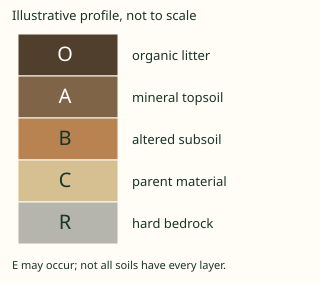
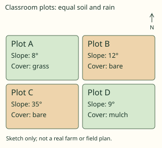
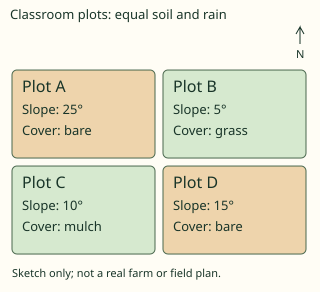

# Geography Form 4, Form Four Geography: authored answers for review

Every answer fixed by a person, not computed. Part 1: the tables, conventions and rules that computed answers come from.
Part 2: every authored question template, with all its data (keys, statements, pairs, choices and feedback) and sources.
Regenerate with `npm run review:f4-geography`. Item IDs (TR-…) match `docs/teacher-review.md`.

## Part 1

Rules the computed answers use are listed in the subject’s library tests; every authored answer is in Part 2.

## Part 2: authored question templates

| # | Template | Lesson | Type, level | Sources |
|---|---|---|---|---|
| 1 | `g4-1-terms` | 1 | multiple choice, 1 | soil |
| 2 | `g4-1-cases` | 1 | multiple choice, 1 | soil |
| 3 | `g4-1-explain` | 1 | multiple choice, 2 | soil |
| 4 | `g4-1-assess` | 1 | spot the error, 3 | soil |
| 5 | `g4-1-explain-card` (card g4-1-c3) | 1 | multiple choice, 1 | soil |
| 6 | `g4-2-terms` | 2 | multiple choice, 1 | soil |
| 7 | `g4-2-cases` | 2 | multiple choice, 1 | soil |
| 8 | `g4-2-explain` | 2 | multiple choice, 2 | soil |
| 9 | `g4-2-assess` | 2 | spot the error, 3 | soil |
| 10 | `g4-2-explain-card` (card g4-2-c3) | 2 | multiple choice, 1 | soil |
| 11 | `g4-3-terms` | 3 | multiple choice, 1 | soil |
| 12 | `g4-3-cases` | 3 | multiple choice, 1 | soil |
| 13 | `g4-3-explain` | 3 | multiple choice, 2 | soil |
| 14 | `g4-3-diagram` | 3 | multiple choice, 2 | soil |
| 15 | `g4-3-assess` | 3 | spot the error, 3 | soil |
| 16 | `g4-3-explain-card` (card g4-3-c3) | 3 | multiple choice, 1 | soil |
| 17 | `g4-4-terms` | 4 | multiple choice, 1 | soil |
| 18 | `g4-4-cases` | 4 | multiple choice, 1 | soil |
| 19 | `g4-4-explain` | 4 | multiple choice, 2 | soil |
| 20 | `g4-4-assess` | 4 | spot the error, 3 | soil |
| 21 | `g4-4-explain-card` (card g4-4-c3) | 4 | multiple choice, 1 | soil |
| 22 | `g4-5-terms` | 5 | multiple choice, 1 | soil |
| 23 | `g4-5-cases` | 5 | multiple choice, 1 | soil |
| 24 | `g4-5-explain` | 5 | multiple choice, 2 | soil |
| 25 | `g4-5-map-decision` | 5 | multiple choice, 2 | soil |
| 26 | `g4-5-assess` | 5 | spot the error, 3 | soil |
| 27 | `g4-5-explain-card` (card g4-5-c3) | 5 | multiple choice, 1 | soil |
| 28 | `g4-6-terms` | 6 | multiple choice, 1 | ecosystem |
| 29 | `g4-6-cases` | 6 | multiple choice, 1 | ecosystem |
| 30 | `g4-6-explain` | 6 | multiple choice, 2 | ecosystem |
| 31 | `g4-6-assess` | 6 | spot the error, 3 | ecosystem |
| 32 | `g4-6-explain-card` (card g4-6-c3) | 6 | multiple choice, 1 | ecosystem |
| 33 | `g4-7-terms` | 7 | multiple choice, 1 | ecosystem |
| 34 | `g4-7-cases` | 7 | multiple choice, 1 | ecosystem |
| 35 | `g4-7-explain` | 7 | multiple choice, 2 | ecosystem |
| 36 | `g4-7-assess` | 7 | spot the error, 3 | ecosystem |
| 37 | `g4-7-explain-card` (card g4-7-c3) | 7 | multiple choice, 1 | ecosystem |
| 38 | `g4-8-terms` | 8 | multiple choice, 1 | biomes, country |
| 39 | `g4-8-cases` | 8 | multiple choice, 1 | biomes, country |
| 40 | `g4-8-explain` | 8 | multiple choice, 2 | biomes, country |
| 41 | `g4-8-assess` | 8 | spot the error, 3 | biomes, country |
| 42 | `g4-8-explain-card` (card g4-8-c3) | 8 | multiple choice, 1 | biomes, country |
| 43 | `g4-9-terms` | 9 | multiple choice, 1 | biomes, country |
| 44 | `g4-9-cases` | 9 | multiple choice, 1 | biomes, country |
| 45 | `g4-9-explain` | 9 | multiple choice, 2 | biomes, country |
| 46 | `g4-9-assess` | 9 | spot the error, 3 | biomes, country |
| 47 | `g4-9-explain-card` (card g4-9-c3) | 9 | multiple choice, 1 | biomes, country |
| 48 | `g4-10-terms` | 10 | multiple choice, 1 | biomes, country |
| 49 | `g4-10-cases` | 10 | multiple choice, 1 | biomes, country |
| 50 | `g4-10-explain` | 10 | multiple choice, 2 | biomes, country |
| 51 | `g4-10-assess` | 10 | spot the error, 3 | biomes, country |
| 52 | `g4-10-explain-card` (card g4-10-c3) | 10 | multiple choice, 1 | biomes, country |
| 53 | `g4-11-terms` | 11 | multiple choice, 1 | biomes, monsoon |
| 54 | `g4-11-cases` | 11 | multiple choice, 1 | biomes, monsoon |
| 55 | `g4-11-explain` | 11 | multiple choice, 2 | biomes, monsoon |
| 56 | `g4-11-assess` | 11 | spot the error, 3 | biomes, monsoon |
| 57 | `g4-11-explain-card` (card g4-11-c3) | 11 | multiple choice, 1 | biomes, monsoon |
| 58 | `g4-12-terms` | 12 | multiple choice, 1 | biomes |
| 59 | `g4-12-cases` | 12 | multiple choice, 1 | biomes |
| 60 | `g4-12-explain` | 12 | multiple choice, 2 | biomes |
| 61 | `g4-12-assess` | 12 | spot the error, 3 | biomes |
| 62 | `g4-12-explain-card` (card g4-12-c3) | 12 | multiple choice, 1 | biomes |
| 63 | `g4-13-terms` | 13 | multiple choice, 1 | biomes |
| 64 | `g4-13-cases` | 13 | multiple choice, 1 | biomes |
| 65 | `g4-13-explain` | 13 | multiple choice, 2 | biomes |
| 66 | `g4-13-assess` | 13 | spot the error, 3 | biomes |
| 67 | `g4-13-explain-card` (card g4-13-c3) | 13 | multiple choice, 1 | biomes |
| 68 | `g4-14-terms` | 14 | multiple choice, 1 | country |
| 69 | `g4-14-cases` | 14 | multiple choice, 1 | country |
| 70 | `g4-14-explain` | 14 | multiple choice, 2 | country |
| 71 | `g4-14-assess` | 14 | spot the error, 3 | country |
| 72 | `g4-14-explain-card` (card g4-14-c3) | 14 | multiple choice, 1 | country |
| 73 | `g4-15-terms` | 15 | multiple choice, 1 | country |
| 74 | `g4-15-cases` | 15 | multiple choice, 1 | country |
| 75 | `g4-15-explain` | 15 | multiple choice, 2 | country |
| 76 | `g4-15-assess` | 15 | spot the error, 3 | country |
| 77 | `g4-15-explain-card` (card g4-15-c3) | 15 | multiple choice, 1 | country |
| 78 | `g4-16-terms` | 16 | multiple choice, 1 | drainage, country |
| 79 | `g4-16-cases` | 16 | multiple choice, 1 | drainage, country |
| 80 | `g4-16-explain` | 16 | multiple choice, 2 | drainage, country |
| 81 | `g4-16-basin-map` | 16 | multiple choice, 2 | drainage |
| 82 | `g4-16-assess` | 16 | spot the error, 3 | drainage, country |
| 83 | `g4-16-explain-card` (card g4-16-c3) | 16 | multiple choice, 1 | drainage, country |
| 84 | `g4-17-terms` | 17 | multiple choice, 1 | climate, country |
| 85 | `g4-17-cases` | 17 | multiple choice, 1 | climate, country |
| 86 | `g4-17-explain` | 17 | multiple choice, 2 | climate, country |
| 87 | `g4-17-assess` | 17 | spot the error, 3 | climate, country |
| 88 | `g4-17-explain-card` (card g4-17-c3) | 17 | multiple choice, 1 | climate, country |
| 89 | `g4-18-terms` | 18 | multiple choice, 1 | vegetation, country |
| 90 | `g4-18-cases` | 18 | multiple choice, 1 | vegetation, country |
| 91 | `g4-18-explain` | 18 | multiple choice, 2 | vegetation, country |
| 92 | `g4-18-interpret` | 18 | multiple choice, 2 | vegetation |
| 93 | `g4-18-assess` | 18 | spot the error, 3 | vegetation, country |
| 94 | `g4-18-explain-card` (card g4-18-c3) | 18 | multiple choice, 1 | vegetation, country |
| 95 | `g4-19-terms` | 19 | multiple choice, 1 | cameroon-soils, soil |
| 96 | `g4-19-cases` | 19 | multiple choice, 1 | cameroon-soils, soil |
| 97 | `g4-19-explain` | 19 | multiple choice, 2 | cameroon-soils, soil |
| 98 | `g4-19-site-judgement` | 19 | multiple choice, 2 | cameroon-soils |
| 99 | `g4-19-assess` | 19 | spot the error, 3 | cameroon-soils, soil |
| 100 | `g4-19-explain-card` (card g4-19-c3) | 19 | multiple choice, 1 | cameroon-soils, soil |

### `g4-1-terms` · Lesson 1 · multiple choice, level 1

Prompt: {X.q}

Table `X` (one row is picked each time):

| q | r | w | e | y |
|---|---|---|---|---|
| Which term means inorganic particles derived from rocks and other mineral sources? | mineral material | organic matter · pore space · open system | That concerns living-derived residues and their decomposition products, rather than the feature asked for. · That concerns spaces within soil occupied by water air or both, rather than the feature asked for. · That concerns a system exchanging matter and energy with its surroundings, rather than the feature asked for. | Mineral particles differ from organic residues even when mixed together. |
| Which term means living-derived residues and their decomposition products? | organic matter | mineral material · pore space · open system | That concerns inorganic particles derived from rocks and other mineral sources, rather than the feature asked for. · That concerns spaces within soil occupied by water air or both, rather than the feature asked for. · That concerns a system exchanging matter and energy with its surroundings, rather than the feature asked for. | Organic matter originates from organisms and differs from mineral rock. |
| Which term means spaces within soil occupied by water air or both? | pore space | mineral material · organic matter · open system | That concerns inorganic particles derived from rocks and other mineral sources, rather than the feature asked for. · That concerns living-derived residues and their decomposition products, rather than the feature asked for. · That concerns a system exchanging matter and energy with its surroundings, rather than the feature asked for. | A water-filled pore remains a pore; its contents have changed. |
| Which term means a system exchanging matter and energy with its surroundings? | open system | mineral material · organic matter · pore space | That concerns inorganic particles derived from rocks and other mineral sources, rather than the feature asked for. · That concerns living-derived residues and their decomposition products, rather than the feature asked for. · That concerns spaces within soil occupied by water air or both, rather than the feature asked for. | Inputs, outputs and internal transfers make soil a changing open system. |

Right answer: `{X.r}`; wrong choices: `{X.w[0]}`, `{X.w[1]}`, `{X.w[2]}`

- Feedback `w0`: “{X.e[0]}”
- Feedback `w1`: “{X.e[1]}”
- Feedback `w2`: “{X.e[2]}”

Three generated variants:

> Which term means a system exchanging matter and energy with its surroundings?

- ✅ open system
- ◻️ pore space  
  _↳ feedback if chosen: That concerns spaces within soil occupied by water air or both, rather than the feature asked for._
- ◻️ mineral material  
  _↳ feedback if chosen: That concerns inorganic particles derived from rocks and other mineral sources, rather than the feature asked for._
- ◻️ organic matter  
  _↳ feedback if chosen: That concerns living-derived residues and their decomposition products, rather than the feature asked for._

Full working after a second miss:

> Inputs, outputs and internal transfers make soil a changing open system.  
> So the answer is “open system”.  

> Which term means a system exchanging matter and energy with its surroundings?

- ◻️ pore space  
  _↳ feedback if chosen: That concerns spaces within soil occupied by water air or both, rather than the feature asked for._
- ✅ open system
- ◻️ mineral material  
  _↳ feedback if chosen: That concerns inorganic particles derived from rocks and other mineral sources, rather than the feature asked for._
- ◻️ organic matter  
  _↳ feedback if chosen: That concerns living-derived residues and their decomposition products, rather than the feature asked for._

Full working after a second miss:

> Inputs, outputs and internal transfers make soil a changing open system.  
> So the answer is “open system”.  

> Which term means a system exchanging matter and energy with its surroundings?

- ◻️ pore space  
  _↳ feedback if chosen: That concerns spaces within soil occupied by water air or both, rather than the feature asked for._
- ◻️ organic matter  
  _↳ feedback if chosen: That concerns living-derived residues and their decomposition products, rather than the feature asked for._
- ◻️ mineral material  
  _↳ feedback if chosen: That concerns inorganic particles derived from rocks and other mineral sources, rather than the feature asked for._
- ✅ open system

Full working after a second miss:

> Inputs, outputs and internal transfers make soil a changing open system.  
> So the answer is “open system”.  

Sources: soil (FAO soil-management and horizon guidance; soil survey and government teaching resources)

### `g4-1-cases` · Lesson 1 · multiple choice, level 1

Prompt: {X.q}

Table `X` (one row is picked each time):

| q | r | w | e | y |
|---|---|---|---|---|
| Weathering supplies sand, silt and clay to a garden soil.
Which feature is illustrated? | mineral material | organic matter · pore space · open system | That identifies living-derived residues and their decomposition products. Read the case for evidence of inorganic particles derived from rocks and other mineral sources. · That identifies spaces within soil occupied by water air or both. Read the case for evidence of inorganic particles derived from rocks and other mineral sources. · That identifies a system exchanging matter and energy with its surroundings. Read the case for evidence of inorganic particles derived from rocks and other mineral sources. | Mineral particles differ from organic residues even when mixed together. |
| Fallen leaves decompose and contribute to soil organic matter.
Which feature is illustrated? | organic matter | mineral material · pore space · open system | That identifies inorganic particles derived from rocks and other mineral sources. Read the case for evidence of living-derived residues and their decomposition products. · That identifies spaces within soil occupied by water air or both. Read the case for evidence of living-derived residues and their decomposition products. · That identifies a system exchanging matter and energy with its surroundings. Read the case for evidence of living-derived residues and their decomposition products. | Organic matter originates from organisms and differs from mineral rock. |
| Rainwater replaces some air in spaces between soil particles.
Which feature is illustrated? | pore space | mineral material · organic matter · open system | That identifies inorganic particles derived from rocks and other mineral sources. Read the case for evidence of spaces within soil occupied by water air or both. · That identifies living-derived residues and their decomposition products. Read the case for evidence of spaces within soil occupied by water air or both. · That identifies a system exchanging matter and energy with its surroundings. Read the case for evidence of spaces within soil occupied by water air or both. | A water-filled pore remains a pore; its contents have changed. |
| Rain enters a soil while drainage carries dissolved material out.
Which feature is illustrated? | open system | mineral material · organic matter · pore space | That identifies inorganic particles derived from rocks and other mineral sources. Read the case for evidence of a system exchanging matter and energy with its surroundings. · That identifies living-derived residues and their decomposition products. Read the case for evidence of a system exchanging matter and energy with its surroundings. · That identifies spaces within soil occupied by water air or both. Read the case for evidence of a system exchanging matter and energy with its surroundings. | Inputs, outputs and internal transfers make soil a changing open system. |

Right answer: `{X.r}`; wrong choices: `{X.w[0]}`, `{X.w[1]}`, `{X.w[2]}`

- Feedback `w0`: “{X.e[0]}”
- Feedback `w1`: “{X.e[1]}”
- Feedback `w2`: “{X.e[2]}”

Three generated variants:

> Rainwater replaces some air in spaces between soil particles.
> Which feature is illustrated?

- ◻️ organic matter  
  _↳ feedback if chosen: That identifies living-derived residues and their decomposition products. Read the case for evidence of spaces within soil occupied by water air or both._
- ✅ pore space
- ◻️ mineral material  
  _↳ feedback if chosen: That identifies inorganic particles derived from rocks and other mineral sources. Read the case for evidence of spaces within soil occupied by water air or both._
- ◻️ open system  
  _↳ feedback if chosen: That identifies a system exchanging matter and energy with its surroundings. Read the case for evidence of spaces within soil occupied by water air or both._

Full working after a second miss:

> A water-filled pore remains a pore; its contents have changed.  
> So the answer is “pore space”.  

> Rainwater replaces some air in spaces between soil particles.
> Which feature is illustrated?

- ◻️ open system  
  _↳ feedback if chosen: That identifies a system exchanging matter and energy with its surroundings. Read the case for evidence of spaces within soil occupied by water air or both._
- ✅ pore space
- ◻️ organic matter  
  _↳ feedback if chosen: That identifies living-derived residues and their decomposition products. Read the case for evidence of spaces within soil occupied by water air or both._
- ◻️ mineral material  
  _↳ feedback if chosen: That identifies inorganic particles derived from rocks and other mineral sources. Read the case for evidence of spaces within soil occupied by water air or both._

Full working after a second miss:

> A water-filled pore remains a pore; its contents have changed.  
> So the answer is “pore space”.  

> Weathering supplies sand, silt and clay to a garden soil.
> Which feature is illustrated?

- ◻️ open system  
  _↳ feedback if chosen: That identifies a system exchanging matter and energy with its surroundings. Read the case for evidence of inorganic particles derived from rocks and other mineral sources._
- ✅ mineral material
- ◻️ pore space  
  _↳ feedback if chosen: That identifies spaces within soil occupied by water air or both. Read the case for evidence of inorganic particles derived from rocks and other mineral sources._
- ◻️ organic matter  
  _↳ feedback if chosen: That identifies living-derived residues and their decomposition products. Read the case for evidence of inorganic particles derived from rocks and other mineral sources._

Full working after a second miss:

> Mineral particles differ from organic residues even when mixed together.  
> So the answer is “mineral material”.  

Sources: soil (FAO soil-management and horizon guidance; soil survey and government teaching resources)

### `g4-1-explain` · Lesson 1 · multiple choice, level 2

Prompt: {X.q}

Table `X` (one row is picked each time):

| q | r | w | e | y |
|---|---|---|---|---|
| Weathering supplies sand, silt and clay to a garden soil.
Which explanation follows? | Mineral particles differ from organic residues even when mixed together. | Organic matter originates from organisms and differs from mineral rock. · A water-filled pore remains a pore; its contents have changed. · Inputs, outputs and internal transfers make soil a changing open system. | That explanation addresses organic matter, rather than the process or relationship in this case. · That explanation addresses pore space, rather than the process or relationship in this case. · That explanation addresses open system, rather than the process or relationship in this case. | inorganic particles derived from rocks and other mineral sources. |
| Fallen leaves decompose and contribute to soil organic matter.
Which explanation follows? | Organic matter originates from organisms and differs from mineral rock. | Mineral particles differ from organic residues even when mixed together. · A water-filled pore remains a pore; its contents have changed. · Inputs, outputs and internal transfers make soil a changing open system. | That explanation addresses mineral material, rather than the process or relationship in this case. · That explanation addresses pore space, rather than the process or relationship in this case. · That explanation addresses open system, rather than the process or relationship in this case. | living-derived residues and their decomposition products. |
| Rainwater replaces some air in spaces between soil particles.
Which explanation follows? | A water-filled pore remains a pore; its contents have changed. | Mineral particles differ from organic residues even when mixed together. · Organic matter originates from organisms and differs from mineral rock. · Inputs, outputs and internal transfers make soil a changing open system. | That explanation addresses mineral material, rather than the process or relationship in this case. · That explanation addresses organic matter, rather than the process or relationship in this case. · That explanation addresses open system, rather than the process or relationship in this case. | spaces within soil occupied by water air or both. |
| Rain enters a soil while drainage carries dissolved material out.
Which explanation follows? | Inputs, outputs and internal transfers make soil a changing open system. | Mineral particles differ from organic residues even when mixed together. · Organic matter originates from organisms and differs from mineral rock. · A water-filled pore remains a pore; its contents have changed. | That explanation addresses mineral material, rather than the process or relationship in this case. · That explanation addresses organic matter, rather than the process or relationship in this case. · That explanation addresses pore space, rather than the process or relationship in this case. | a system exchanging matter and energy with its surroundings. |

Right answer: `{X.r}`; wrong choices: `{X.w[0]}`, `{X.w[1]}`, `{X.w[2]}`

- Feedback `w0`: “{X.e[0]}”
- Feedback `w1`: “{X.e[1]}”
- Feedback `w2`: “{X.e[2]}”

Three generated variants:

> Weathering supplies sand, silt and clay to a garden soil.
> Which explanation follows?

- ◻️ Inputs, outputs and internal transfers make soil a changing open system.  
  _↳ feedback if chosen: That explanation addresses open system, rather than the process or relationship in this case._
- ◻️ Organic matter originates from organisms and differs from mineral rock.  
  _↳ feedback if chosen: That explanation addresses organic matter, rather than the process or relationship in this case._
- ◻️ A water-filled pore remains a pore; its contents have changed.  
  _↳ feedback if chosen: That explanation addresses pore space, rather than the process or relationship in this case._
- ✅ Mineral particles differ from organic residues even when mixed together.

Full working after a second miss:

> inorganic particles derived from rocks and other mineral sources.  
> So the answer is “Mineral particles differ from organic residues even when mixed together.”.  

> Fallen leaves decompose and contribute to soil organic matter.
> Which explanation follows?

- ✅ Organic matter originates from organisms and differs from mineral rock.
- ◻️ Mineral particles differ from organic residues even when mixed together.  
  _↳ feedback if chosen: That explanation addresses mineral material, rather than the process or relationship in this case._
- ◻️ A water-filled pore remains a pore; its contents have changed.  
  _↳ feedback if chosen: That explanation addresses pore space, rather than the process or relationship in this case._
- ◻️ Inputs, outputs and internal transfers make soil a changing open system.  
  _↳ feedback if chosen: That explanation addresses open system, rather than the process or relationship in this case._

Full working after a second miss:

> living-derived residues and their decomposition products.  
> So the answer is “Organic matter originates from organisms and differs from mineral rock.”.  

> Rainwater replaces some air in spaces between soil particles.
> Which explanation follows?

- ◻️ Organic matter originates from organisms and differs from mineral rock.  
  _↳ feedback if chosen: That explanation addresses organic matter, rather than the process or relationship in this case._
- ◻️ Mineral particles differ from organic residues even when mixed together.  
  _↳ feedback if chosen: That explanation addresses mineral material, rather than the process or relationship in this case._
- ◻️ Inputs, outputs and internal transfers make soil a changing open system.  
  _↳ feedback if chosen: That explanation addresses open system, rather than the process or relationship in this case._
- ✅ A water-filled pore remains a pore; its contents have changed.

Full working after a second miss:

> spaces within soil occupied by water air or both.  
> So the answer is “A water-filled pore remains a pore; its contents have changed.”.  

Sources: soil (FAO soil-management and horizon guidance; soil survey and government teaching resources)

### `g4-1-assess` · Lesson 1 · spot the error, level 3

Prompt: Find the incorrect geographical claim.

Shows 3 correct and 1 wrong statement(s), drawn from:

- ✅ mineral material: inorganic particles derived from rocks and other mineral sources.
- ✅ organic matter: living-derived residues and their decomposition products.
- ✅ pore space: spaces within soil occupied by water air or both.
- ✅ open system: a system exchanging matter and energy with its surroundings.
- ❌ All soil solids are fresh leaves.  
  _↳ Mineral particles differ from organic residues even when mixed together._
- ❌ Humus is simply a large piece of unweathered bedrock.  
  _↳ Organic matter originates from organisms and differs from mineral rock._
- ❌ Pore space disappears because it contains water.  
  _↳ A water-filled pore remains a pore; its contents have changed._
- ❌ Soil can never gain or lose material.  
  _↳ Inputs, outputs and internal transfers make soil a changing open system._

Three generated variants:

> Find the incorrect geographical claim.

- ◻️ pore space: spaces within soil occupied by water air or both.  
  _↳ explanation: This distinction is correct: A water-filled pore remains a pore; its contents have changed. Look for a claim that reverses the process or makes an unsupported generalisation._
- ◻️ organic matter: living-derived residues and their decomposition products.  
  _↳ explanation: This distinction is correct: Organic matter originates from organisms and differs from mineral rock. Look for a claim that reverses the process or makes an unsupported generalisation._
- ✅ Humus is simply a large piece of unweathered bedrock.  
  _↳ explanation: Organic matter originates from organisms and differs from mineral rock._
- ◻️ open system: a system exchanging matter and energy with its surroundings.  
  _↳ explanation: This distinction is correct: Inputs, outputs and internal transfers make soil a changing open system. Look for a claim that reverses the process or makes an unsupported generalisation._

Full working after a second miss:

> The wrong statement is “Humus is simply a large piece of unweathered bedrock.”.  
> Organic matter originates from organisms and differs from mineral rock.  

> Find the incorrect geographical claim.

- ◻️ mineral material: inorganic particles derived from rocks and other mineral sources.  
  _↳ explanation: This distinction is correct: Mineral particles differ from organic residues even when mixed together. Look for a claim that reverses the process or makes an unsupported generalisation._
- ◻️ open system: a system exchanging matter and energy with its surroundings.  
  _↳ explanation: This distinction is correct: Inputs, outputs and internal transfers make soil a changing open system. Look for a claim that reverses the process or makes an unsupported generalisation._
- ◻️ organic matter: living-derived residues and their decomposition products.  
  _↳ explanation: This distinction is correct: Organic matter originates from organisms and differs from mineral rock. Look for a claim that reverses the process or makes an unsupported generalisation._
- ✅ Pore space disappears because it contains water.  
  _↳ explanation: A water-filled pore remains a pore; its contents have changed._

Full working after a second miss:

> The wrong statement is “Pore space disappears because it contains water.”.  
> A water-filled pore remains a pore; its contents have changed.  

> Find the incorrect geographical claim.

- ◻️ mineral material: inorganic particles derived from rocks and other mineral sources.  
  _↳ explanation: This distinction is correct: Mineral particles differ from organic residues even when mixed together. Look for a claim that reverses the process or makes an unsupported generalisation._
- ◻️ pore space: spaces within soil occupied by water air or both.  
  _↳ explanation: This distinction is correct: A water-filled pore remains a pore; its contents have changed. Look for a claim that reverses the process or makes an unsupported generalisation._
- ◻️ organic matter: living-derived residues and their decomposition products.  
  _↳ explanation: This distinction is correct: Organic matter originates from organisms and differs from mineral rock. Look for a claim that reverses the process or makes an unsupported generalisation._
- ✅ Humus is simply a large piece of unweathered bedrock.  
  _↳ explanation: Organic matter originates from organisms and differs from mineral rock._

Full working after a second miss:

> The wrong statement is “Humus is simply a large piece of unweathered bedrock.”.  
> Organic matter originates from organisms and differs from mineral rock.  

Sources: soil (FAO soil-management and horizon guidance; soil survey and government teaching resources)

### `g4-1-explain-card` · Lesson 1 · multiple choice, level 1

Prompt: {X.q}

Table `X` (one row is picked each time):

| q | r | w | e | y |
|---|---|---|---|---|
| Weathering supplies sand, silt and clay to a garden soil.
Which explanation follows? | Mineral particles differ from organic residues even when mixed together. | Organic matter originates from organisms and differs from mineral rock. · A water-filled pore remains a pore; its contents have changed. · Inputs, outputs and internal transfers make soil a changing open system. | That explanation addresses organic matter, rather than the process or relationship in this case. · That explanation addresses pore space, rather than the process or relationship in this case. · That explanation addresses open system, rather than the process or relationship in this case. | inorganic particles derived from rocks and other mineral sources. |
| Fallen leaves decompose and contribute to soil organic matter.
Which explanation follows? | Organic matter originates from organisms and differs from mineral rock. | Mineral particles differ from organic residues even when mixed together. · A water-filled pore remains a pore; its contents have changed. · Inputs, outputs and internal transfers make soil a changing open system. | That explanation addresses mineral material, rather than the process or relationship in this case. · That explanation addresses pore space, rather than the process or relationship in this case. · That explanation addresses open system, rather than the process or relationship in this case. | living-derived residues and their decomposition products. |
| Rainwater replaces some air in spaces between soil particles.
Which explanation follows? | A water-filled pore remains a pore; its contents have changed. | Mineral particles differ from organic residues even when mixed together. · Organic matter originates from organisms and differs from mineral rock. · Inputs, outputs and internal transfers make soil a changing open system. | That explanation addresses mineral material, rather than the process or relationship in this case. · That explanation addresses organic matter, rather than the process or relationship in this case. · That explanation addresses open system, rather than the process or relationship in this case. | spaces within soil occupied by water air or both. |
| Rain enters a soil while drainage carries dissolved material out.
Which explanation follows? | Inputs, outputs and internal transfers make soil a changing open system. | Mineral particles differ from organic residues even when mixed together. · Organic matter originates from organisms and differs from mineral rock. · A water-filled pore remains a pore; its contents have changed. | That explanation addresses mineral material, rather than the process or relationship in this case. · That explanation addresses organic matter, rather than the process or relationship in this case. · That explanation addresses pore space, rather than the process or relationship in this case. | a system exchanging matter and energy with its surroundings. |

Right answer: `{X.r}`; wrong choices: `{X.w[0]}`, `{X.w[1]}`, `{X.w[2]}`

- Feedback `w0`: “{X.e[0]}”
- Feedback `w1`: “{X.e[1]}”
- Feedback `w2`: “{X.e[2]}”

Three generated variants:

> Weathering supplies sand, silt and clay to a garden soil.
> Which explanation follows?

- ◻️ Organic matter originates from organisms and differs from mineral rock.  
  _↳ feedback if chosen: That explanation addresses organic matter, rather than the process or relationship in this case._
- ◻️ Inputs, outputs and internal transfers make soil a changing open system.  
  _↳ feedback if chosen: That explanation addresses open system, rather than the process or relationship in this case._
- ◻️ A water-filled pore remains a pore; its contents have changed.  
  _↳ feedback if chosen: That explanation addresses pore space, rather than the process or relationship in this case._
- ✅ Mineral particles differ from organic residues even when mixed together.

Full working after a second miss:

> inorganic particles derived from rocks and other mineral sources.  
> So the answer is “Mineral particles differ from organic residues even when mixed together.”.  

> Weathering supplies sand, silt and clay to a garden soil.
> Which explanation follows?

- ◻️ Organic matter originates from organisms and differs from mineral rock.  
  _↳ feedback if chosen: That explanation addresses organic matter, rather than the process or relationship in this case._
- ✅ Mineral particles differ from organic residues even when mixed together.
- ◻️ A water-filled pore remains a pore; its contents have changed.  
  _↳ feedback if chosen: That explanation addresses pore space, rather than the process or relationship in this case._
- ◻️ Inputs, outputs and internal transfers make soil a changing open system.  
  _↳ feedback if chosen: That explanation addresses open system, rather than the process or relationship in this case._

Full working after a second miss:

> inorganic particles derived from rocks and other mineral sources.  
> So the answer is “Mineral particles differ from organic residues even when mixed together.”.  

> Rain enters a soil while drainage carries dissolved material out.
> Which explanation follows?

- ◻️ Organic matter originates from organisms and differs from mineral rock.  
  _↳ feedback if chosen: That explanation addresses organic matter, rather than the process or relationship in this case._
- ◻️ A water-filled pore remains a pore; its contents have changed.  
  _↳ feedback if chosen: That explanation addresses pore space, rather than the process or relationship in this case._
- ◻️ Mineral particles differ from organic residues even when mixed together.  
  _↳ feedback if chosen: That explanation addresses mineral material, rather than the process or relationship in this case._
- ✅ Inputs, outputs and internal transfers make soil a changing open system.

Full working after a second miss:

> a system exchanging matter and energy with its surroundings.  
> So the answer is “Inputs, outputs and internal transfers make soil a changing open system.”.  

Sources: soil (FAO soil-management and horizon guidance; soil survey and government teaching resources)

### `g4-2-terms` · Lesson 2 · multiple choice, level 1

Prompt: {X.q}

Table `X` (one row is picked each time):

| q | r | w | e | y |
|---|---|---|---|---|
| Which term means the relative proportions of sand silt and clay in the fine-earth fraction? | texture | structure · permeability · soil reaction | That concerns the arrangement of particles into aggregates, rather than the feature asked for. · That concerns the ease with which water moves through connected pore spaces, rather than the feature asked for. · That concerns the acidity or alkalinity described by pH, rather than the feature asked for. | Particle-size proportions describe texture; aggregate arrangement describes structure. |
| Which term means the arrangement of particles into aggregates? | structure | texture · permeability · soil reaction | That concerns the relative proportions of sand silt and clay in the fine-earth fraction, rather than the feature asked for. · That concerns the ease with which water moves through connected pore spaces, rather than the feature asked for. · That concerns the acidity or alkalinity described by pH, rather than the feature asked for. | Management and organic matter can change aggregation without changing mineral texture. |
| Which term means the ease with which water moves through connected pore spaces? | permeability | texture · structure · soil reaction | That concerns the relative proportions of sand silt and clay in the fine-earth fraction, rather than the feature asked for. · That concerns the arrangement of particles into aggregates, rather than the feature asked for. · That concerns the acidity or alkalinity described by pH, rather than the feature asked for. | Connections, sizes and obstructions affect water movement as well as total pore volume. |
| Which term means the acidity or alkalinity described by pH? | soil reaction | texture · structure · permeability | That concerns the relative proportions of sand silt and clay in the fine-earth fraction, rather than the feature asked for. · That concerns the arrangement of particles into aggregates, rather than the feature asked for. · That concerns the ease with which water moves through connected pore spaces, rather than the feature asked for. | Reaction and nutrient status require evidence beyond colour. |

Right answer: `{X.r}`; wrong choices: `{X.w[0]}`, `{X.w[1]}`, `{X.w[2]}`

- Feedback `w0`: “{X.e[0]}”
- Feedback `w1`: “{X.e[1]}”
- Feedback `w2`: “{X.e[2]}”

Three generated variants:

> Which term means the ease with which water moves through connected pore spaces?

- ◻️ structure  
  _↳ feedback if chosen: That concerns the arrangement of particles into aggregates, rather than the feature asked for._
- ◻️ texture  
  _↳ feedback if chosen: That concerns the relative proportions of sand silt and clay in the fine-earth fraction, rather than the feature asked for._
- ◻️ soil reaction  
  _↳ feedback if chosen: That concerns the acidity or alkalinity described by pH, rather than the feature asked for._
- ✅ permeability

Full working after a second miss:

> Connections, sizes and obstructions affect water movement as well as total pore volume.  
> So the answer is “permeability”.  

> Which term means the relative proportions of sand silt and clay in the fine-earth fraction?

- ◻️ structure  
  _↳ feedback if chosen: That concerns the arrangement of particles into aggregates, rather than the feature asked for._
- ◻️ permeability  
  _↳ feedback if chosen: That concerns the ease with which water moves through connected pore spaces, rather than the feature asked for._
- ◻️ soil reaction  
  _↳ feedback if chosen: That concerns the acidity or alkalinity described by pH, rather than the feature asked for._
- ✅ texture

Full working after a second miss:

> Particle-size proportions describe texture; aggregate arrangement describes structure.  
> So the answer is “texture”.  

> Which term means the relative proportions of sand silt and clay in the fine-earth fraction?

- ◻️ soil reaction  
  _↳ feedback if chosen: That concerns the acidity or alkalinity described by pH, rather than the feature asked for._
- ◻️ structure  
  _↳ feedback if chosen: That concerns the arrangement of particles into aggregates, rather than the feature asked for._
- ◻️ permeability  
  _↳ feedback if chosen: That concerns the ease with which water moves through connected pore spaces, rather than the feature asked for._
- ✅ texture

Full working after a second miss:

> Particle-size proportions describe texture; aggregate arrangement describes structure.  
> So the answer is “texture”.  

Sources: soil (FAO soil-management and horizon guidance; soil survey and government teaching resources)

### `g4-2-cases` · Lesson 2 · multiple choice, level 1

Prompt: {X.q}

Table `X` (one row is picked each time):

| q | r | w | e | y |
|---|---|---|---|---|
| A record compares the sample’s sand, silt and clay shares.
Which feature is illustrated? | texture | structure · permeability · soil reaction | That identifies the arrangement of particles into aggregates. Read the case for evidence of the relative proportions of sand silt and clay in the fine-earth fraction. · That identifies the ease with which water moves through connected pore spaces. Read the case for evidence of the relative proportions of sand silt and clay in the fine-earth fraction. · That identifies the acidity or alkalinity described by pH. Read the case for evidence of the relative proportions of sand silt and clay in the fine-earth fraction. | Particle-size proportions describe texture; aggregate arrangement describes structure. |
| Two similar-textured soils differ in whether their aggregates remain stable.
Which feature is illustrated? | structure | texture · permeability · soil reaction | That identifies the relative proportions of sand silt and clay in the fine-earth fraction. Read the case for evidence of the arrangement of particles into aggregates. · That identifies the ease with which water moves through connected pore spaces. Read the case for evidence of the arrangement of particles into aggregates. · That identifies the acidity or alkalinity described by pH. Read the case for evidence of the arrangement of particles into aggregates. | Management and organic matter can change aggregation without changing mineral texture. |
| Water moves slowly through a compacted surface despite pores elsewhere in the soil.
Which feature is illustrated? | permeability | texture · structure · soil reaction | That identifies the relative proportions of sand silt and clay in the fine-earth fraction. Read the case for evidence of the ease with which water moves through connected pore spaces. · That identifies the arrangement of particles into aggregates. Read the case for evidence of the ease with which water moves through connected pore spaces. · That identifies the acidity or alkalinity described by pH. Read the case for evidence of the ease with which water moves through connected pore spaces. | Connections, sizes and obstructions affect water movement as well as total pore volume. |
| A laboratory report describes a sample as acidic.
Which feature is illustrated? | soil reaction | texture · structure · permeability | That identifies the relative proportions of sand silt and clay in the fine-earth fraction. Read the case for evidence of the acidity or alkalinity described by pH. · That identifies the arrangement of particles into aggregates. Read the case for evidence of the acidity or alkalinity described by pH. · That identifies the ease with which water moves through connected pore spaces. Read the case for evidence of the acidity or alkalinity described by pH. | Reaction and nutrient status require evidence beyond colour. |

Right answer: `{X.r}`; wrong choices: `{X.w[0]}`, `{X.w[1]}`, `{X.w[2]}`

- Feedback `w0`: “{X.e[0]}”
- Feedback `w1`: “{X.e[1]}”
- Feedback `w2`: “{X.e[2]}”

Three generated variants:

> A record compares the sample’s sand, silt and clay shares.
> Which feature is illustrated?

- ✅ texture
- ◻️ permeability  
  _↳ feedback if chosen: That identifies the ease with which water moves through connected pore spaces. Read the case for evidence of the relative proportions of sand silt and clay in the fine-earth fraction._
- ◻️ structure  
  _↳ feedback if chosen: That identifies the arrangement of particles into aggregates. Read the case for evidence of the relative proportions of sand silt and clay in the fine-earth fraction._
- ◻️ soil reaction  
  _↳ feedback if chosen: That identifies the acidity or alkalinity described by pH. Read the case for evidence of the relative proportions of sand silt and clay in the fine-earth fraction._

Full working after a second miss:

> Particle-size proportions describe texture; aggregate arrangement describes structure.  
> So the answer is “texture”.  

> Two similar-textured soils differ in whether their aggregates remain stable.
> Which feature is illustrated?

- ✅ structure
- ◻️ texture  
  _↳ feedback if chosen: That identifies the relative proportions of sand silt and clay in the fine-earth fraction. Read the case for evidence of the arrangement of particles into aggregates._
- ◻️ permeability  
  _↳ feedback if chosen: That identifies the ease with which water moves through connected pore spaces. Read the case for evidence of the arrangement of particles into aggregates._
- ◻️ soil reaction  
  _↳ feedback if chosen: That identifies the acidity or alkalinity described by pH. Read the case for evidence of the arrangement of particles into aggregates._

Full working after a second miss:

> Management and organic matter can change aggregation without changing mineral texture.  
> So the answer is “structure”.  

> A laboratory report describes a sample as acidic.
> Which feature is illustrated?

- ✅ soil reaction
- ◻️ permeability  
  _↳ feedback if chosen: That identifies the ease with which water moves through connected pore spaces. Read the case for evidence of the acidity or alkalinity described by pH._
- ◻️ texture  
  _↳ feedback if chosen: That identifies the relative proportions of sand silt and clay in the fine-earth fraction. Read the case for evidence of the acidity or alkalinity described by pH._
- ◻️ structure  
  _↳ feedback if chosen: That identifies the arrangement of particles into aggregates. Read the case for evidence of the acidity or alkalinity described by pH._

Full working after a second miss:

> Reaction and nutrient status require evidence beyond colour.  
> So the answer is “soil reaction”.  

Sources: soil (FAO soil-management and horizon guidance; soil survey and government teaching resources)

### `g4-2-explain` · Lesson 2 · multiple choice, level 2

Prompt: {X.q}

Table `X` (one row is picked each time):

| q | r | w | e | y |
|---|---|---|---|---|
| A record compares the sample’s sand, silt and clay shares.
Which explanation follows? | Particle-size proportions describe texture; aggregate arrangement describes structure. | Management and organic matter can change aggregation without changing mineral texture. · Connections, sizes and obstructions affect water movement as well as total pore volume. · Reaction and nutrient status require evidence beyond colour. | That explanation addresses structure, rather than the process or relationship in this case. · That explanation addresses permeability, rather than the process or relationship in this case. · That explanation addresses soil reaction, rather than the process or relationship in this case. | the relative proportions of sand silt and clay in the fine-earth fraction. |
| Two similar-textured soils differ in whether their aggregates remain stable.
Which explanation follows? | Management and organic matter can change aggregation without changing mineral texture. | Particle-size proportions describe texture; aggregate arrangement describes structure. · Connections, sizes and obstructions affect water movement as well as total pore volume. · Reaction and nutrient status require evidence beyond colour. | That explanation addresses texture, rather than the process or relationship in this case. · That explanation addresses permeability, rather than the process or relationship in this case. · That explanation addresses soil reaction, rather than the process or relationship in this case. | the arrangement of particles into aggregates. |
| Water moves slowly through a compacted surface despite pores elsewhere in the soil.
Which explanation follows? | Connections, sizes and obstructions affect water movement as well as total pore volume. | Particle-size proportions describe texture; aggregate arrangement describes structure. · Management and organic matter can change aggregation without changing mineral texture. · Reaction and nutrient status require evidence beyond colour. | That explanation addresses texture, rather than the process or relationship in this case. · That explanation addresses structure, rather than the process or relationship in this case. · That explanation addresses soil reaction, rather than the process or relationship in this case. | the ease with which water moves through connected pore spaces. |
| A laboratory report describes a sample as acidic.
Which explanation follows? | Reaction and nutrient status require evidence beyond colour. | Particle-size proportions describe texture; aggregate arrangement describes structure. · Management and organic matter can change aggregation without changing mineral texture. · Connections, sizes and obstructions affect water movement as well as total pore volume. | That explanation addresses texture, rather than the process or relationship in this case. · That explanation addresses structure, rather than the process or relationship in this case. · That explanation addresses permeability, rather than the process or relationship in this case. | the acidity or alkalinity described by pH. |

Right answer: `{X.r}`; wrong choices: `{X.w[0]}`, `{X.w[1]}`, `{X.w[2]}`

- Feedback `w0`: “{X.e[0]}”
- Feedback `w1`: “{X.e[1]}”
- Feedback `w2`: “{X.e[2]}”

Three generated variants:

> Two similar-textured soils differ in whether their aggregates remain stable.
> Which explanation follows?

- ◻️ Reaction and nutrient status require evidence beyond colour.  
  _↳ feedback if chosen: That explanation addresses soil reaction, rather than the process or relationship in this case._
- ◻️ Particle-size proportions describe texture; aggregate arrangement describes structure.  
  _↳ feedback if chosen: That explanation addresses texture, rather than the process or relationship in this case._
- ◻️ Connections, sizes and obstructions affect water movement as well as total pore volume.  
  _↳ feedback if chosen: That explanation addresses permeability, rather than the process or relationship in this case._
- ✅ Management and organic matter can change aggregation without changing mineral texture.

Full working after a second miss:

> the arrangement of particles into aggregates.  
> So the answer is “Management and organic matter can change aggregation without changing mineral texture.”.  

> A laboratory report describes a sample as acidic.
> Which explanation follows?

- ◻️ Particle-size proportions describe texture; aggregate arrangement describes structure.  
  _↳ feedback if chosen: That explanation addresses texture, rather than the process or relationship in this case._
- ✅ Reaction and nutrient status require evidence beyond colour.
- ◻️ Management and organic matter can change aggregation without changing mineral texture.  
  _↳ feedback if chosen: That explanation addresses structure, rather than the process or relationship in this case._
- ◻️ Connections, sizes and obstructions affect water movement as well as total pore volume.  
  _↳ feedback if chosen: That explanation addresses permeability, rather than the process or relationship in this case._

Full working after a second miss:

> the acidity or alkalinity described by pH.  
> So the answer is “Reaction and nutrient status require evidence beyond colour.”.  

> A laboratory report describes a sample as acidic.
> Which explanation follows?

- ◻️ Management and organic matter can change aggregation without changing mineral texture.  
  _↳ feedback if chosen: That explanation addresses structure, rather than the process or relationship in this case._
- ◻️ Particle-size proportions describe texture; aggregate arrangement describes structure.  
  _↳ feedback if chosen: That explanation addresses texture, rather than the process or relationship in this case._
- ✅ Reaction and nutrient status require evidence beyond colour.
- ◻️ Connections, sizes and obstructions affect water movement as well as total pore volume.  
  _↳ feedback if chosen: That explanation addresses permeability, rather than the process or relationship in this case._

Full working after a second miss:

> the acidity or alkalinity described by pH.  
> So the answer is “Reaction and nutrient status require evidence beyond colour.”.  

Sources: soil (FAO soil-management and horizon guidance; soil survey and government teaching resources)

### `g4-2-assess` · Lesson 2 · spot the error, level 3

Prompt: Find the incorrect geographical claim.

Shows 3 correct and 1 wrong statement(s), drawn from:

- ✅ texture: the relative proportions of sand silt and clay in the fine-earth fraction.
- ✅ structure: the arrangement of particles into aggregates.
- ✅ permeability: the ease with which water moves through connected pore spaces.
- ✅ soil reaction: the acidity or alkalinity described by pH.
- ❌ Texture means only the arrangement of aggregates.  
  _↳ Particle-size proportions describe texture; aggregate arrangement describes structure._
- ❌ Identical texture guarantees identical aggregation.  
  _↳ Management and organic matter can change aggregation without changing mineral texture._
- ❌ Total pore volume alone determines every flow rate.  
  _↳ Connections, sizes and obstructions affect water movement as well as total pore volume._
- ❌ Dark colour proves a neutral pH and high fertility.  
  _↳ Reaction and nutrient status require evidence beyond colour._

Three generated variants:

> Find the incorrect geographical claim.

- ◻️ structure: the arrangement of particles into aggregates.  
  _↳ explanation: This distinction is correct: Management and organic matter can change aggregation without changing mineral texture. Look for a claim that reverses the process or makes an unsupported generalisation._
- ✅ Total pore volume alone determines every flow rate.  
  _↳ explanation: Connections, sizes and obstructions affect water movement as well as total pore volume._
- ◻️ soil reaction: the acidity or alkalinity described by pH.  
  _↳ explanation: This distinction is correct: Reaction and nutrient status require evidence beyond colour. Look for a claim that reverses the process or makes an unsupported generalisation._
- ◻️ permeability: the ease with which water moves through connected pore spaces.  
  _↳ explanation: This distinction is correct: Connections, sizes and obstructions affect water movement as well as total pore volume. Look for a claim that reverses the process or makes an unsupported generalisation._

Full working after a second miss:

> The wrong statement is “Total pore volume alone determines every flow rate.”.  
> Connections, sizes and obstructions affect water movement as well as total pore volume.  

> Find the incorrect geographical claim.

- ✅ Total pore volume alone determines every flow rate.  
  _↳ explanation: Connections, sizes and obstructions affect water movement as well as total pore volume._
- ◻️ permeability: the ease with which water moves through connected pore spaces.  
  _↳ explanation: This distinction is correct: Connections, sizes and obstructions affect water movement as well as total pore volume. Look for a claim that reverses the process or makes an unsupported generalisation._
- ◻️ structure: the arrangement of particles into aggregates.  
  _↳ explanation: This distinction is correct: Management and organic matter can change aggregation without changing mineral texture. Look for a claim that reverses the process or makes an unsupported generalisation._
- ◻️ soil reaction: the acidity or alkalinity described by pH.  
  _↳ explanation: This distinction is correct: Reaction and nutrient status require evidence beyond colour. Look for a claim that reverses the process or makes an unsupported generalisation._

Full working after a second miss:

> The wrong statement is “Total pore volume alone determines every flow rate.”.  
> Connections, sizes and obstructions affect water movement as well as total pore volume.  

> Find the incorrect geographical claim.

- ◻️ structure: the arrangement of particles into aggregates.  
  _↳ explanation: This distinction is correct: Management and organic matter can change aggregation without changing mineral texture. Look for a claim that reverses the process or makes an unsupported generalisation._
- ◻️ texture: the relative proportions of sand silt and clay in the fine-earth fraction.  
  _↳ explanation: This distinction is correct: Particle-size proportions describe texture; aggregate arrangement describes structure. Look for a claim that reverses the process or makes an unsupported generalisation._
- ◻️ permeability: the ease with which water moves through connected pore spaces.  
  _↳ explanation: This distinction is correct: Connections, sizes and obstructions affect water movement as well as total pore volume. Look for a claim that reverses the process or makes an unsupported generalisation._
- ✅ Identical texture guarantees identical aggregation.  
  _↳ explanation: Management and organic matter can change aggregation without changing mineral texture._

Full working after a second miss:

> The wrong statement is “Identical texture guarantees identical aggregation.”.  
> Management and organic matter can change aggregation without changing mineral texture.  

Sources: soil (FAO soil-management and horizon guidance; soil survey and government teaching resources)

### `g4-2-explain-card` · Lesson 2 · multiple choice, level 1

Prompt: {X.q}

Table `X` (one row is picked each time):

| q | r | w | e | y |
|---|---|---|---|---|
| A record compares the sample’s sand, silt and clay shares.
Which explanation follows? | Particle-size proportions describe texture; aggregate arrangement describes structure. | Management and organic matter can change aggregation without changing mineral texture. · Connections, sizes and obstructions affect water movement as well as total pore volume. · Reaction and nutrient status require evidence beyond colour. | That explanation addresses structure, rather than the process or relationship in this case. · That explanation addresses permeability, rather than the process or relationship in this case. · That explanation addresses soil reaction, rather than the process or relationship in this case. | the relative proportions of sand silt and clay in the fine-earth fraction. |
| Two similar-textured soils differ in whether their aggregates remain stable.
Which explanation follows? | Management and organic matter can change aggregation without changing mineral texture. | Particle-size proportions describe texture; aggregate arrangement describes structure. · Connections, sizes and obstructions affect water movement as well as total pore volume. · Reaction and nutrient status require evidence beyond colour. | That explanation addresses texture, rather than the process or relationship in this case. · That explanation addresses permeability, rather than the process or relationship in this case. · That explanation addresses soil reaction, rather than the process or relationship in this case. | the arrangement of particles into aggregates. |
| Water moves slowly through a compacted surface despite pores elsewhere in the soil.
Which explanation follows? | Connections, sizes and obstructions affect water movement as well as total pore volume. | Particle-size proportions describe texture; aggregate arrangement describes structure. · Management and organic matter can change aggregation without changing mineral texture. · Reaction and nutrient status require evidence beyond colour. | That explanation addresses texture, rather than the process or relationship in this case. · That explanation addresses structure, rather than the process or relationship in this case. · That explanation addresses soil reaction, rather than the process or relationship in this case. | the ease with which water moves through connected pore spaces. |
| A laboratory report describes a sample as acidic.
Which explanation follows? | Reaction and nutrient status require evidence beyond colour. | Particle-size proportions describe texture; aggregate arrangement describes structure. · Management and organic matter can change aggregation without changing mineral texture. · Connections, sizes and obstructions affect water movement as well as total pore volume. | That explanation addresses texture, rather than the process or relationship in this case. · That explanation addresses structure, rather than the process or relationship in this case. · That explanation addresses permeability, rather than the process or relationship in this case. | the acidity or alkalinity described by pH. |

Right answer: `{X.r}`; wrong choices: `{X.w[0]}`, `{X.w[1]}`, `{X.w[2]}`

- Feedback `w0`: “{X.e[0]}”
- Feedback `w1`: “{X.e[1]}”
- Feedback `w2`: “{X.e[2]}”

Three generated variants:

> A laboratory report describes a sample as acidic.
> Which explanation follows?

- ✅ Reaction and nutrient status require evidence beyond colour.
- ◻️ Management and organic matter can change aggregation without changing mineral texture.  
  _↳ feedback if chosen: That explanation addresses structure, rather than the process or relationship in this case._
- ◻️ Particle-size proportions describe texture; aggregate arrangement describes structure.  
  _↳ feedback if chosen: That explanation addresses texture, rather than the process or relationship in this case._
- ◻️ Connections, sizes and obstructions affect water movement as well as total pore volume.  
  _↳ feedback if chosen: That explanation addresses permeability, rather than the process or relationship in this case._

Full working after a second miss:

> the acidity or alkalinity described by pH.  
> So the answer is “Reaction and nutrient status require evidence beyond colour.”.  

> A laboratory report describes a sample as acidic.
> Which explanation follows?

- ◻️ Management and organic matter can change aggregation without changing mineral texture.  
  _↳ feedback if chosen: That explanation addresses structure, rather than the process or relationship in this case._
- ◻️ Particle-size proportions describe texture; aggregate arrangement describes structure.  
  _↳ feedback if chosen: That explanation addresses texture, rather than the process or relationship in this case._
- ◻️ Connections, sizes and obstructions affect water movement as well as total pore volume.  
  _↳ feedback if chosen: That explanation addresses permeability, rather than the process or relationship in this case._
- ✅ Reaction and nutrient status require evidence beyond colour.

Full working after a second miss:

> the acidity or alkalinity described by pH.  
> So the answer is “Reaction and nutrient status require evidence beyond colour.”.  

> A record compares the sample’s sand, silt and clay shares.
> Which explanation follows?

- ◻️ Management and organic matter can change aggregation without changing mineral texture.  
  _↳ feedback if chosen: That explanation addresses structure, rather than the process or relationship in this case._
- ◻️ Reaction and nutrient status require evidence beyond colour.  
  _↳ feedback if chosen: That explanation addresses soil reaction, rather than the process or relationship in this case._
- ✅ Particle-size proportions describe texture; aggregate arrangement describes structure.
- ◻️ Connections, sizes and obstructions affect water movement as well as total pore volume.  
  _↳ feedback if chosen: That explanation addresses permeability, rather than the process or relationship in this case._

Full working after a second miss:

> the relative proportions of sand silt and clay in the fine-earth fraction.  
> So the answer is “Particle-size proportions describe texture; aggregate arrangement describes structure.”.  

Sources: soil (FAO soil-management and horizon guidance; soil survey and government teaching resources)

### `g4-3-terms` · Lesson 3 · multiple choice, level 1

Prompt: {X.q}

Table `X` (one row is picked each time):

| q | r | w | e | y |
|---|---|---|---|---|
| Which term means a vertical section through horizons and underlying material? | profile | A horizon · B horizon · C and R layers | That concerns a mineral surface horizon often mixed with organic matter, rather than the feature asked for. · That concerns an altered subsurface horizon that may show accumulation, rather than the feature asked for. · That concerns parent material and hard bedrock respectively, rather than the feature asked for. | A profile shows vertical arrangement, unlike an overhead plan. |
| Which term means a mineral surface horizon often mixed with organic matter? | A horizon | profile · B horizon · C and R layers | That concerns a vertical section through horizons and underlying material, rather than the feature asked for. · That concerns an altered subsurface horizon that may show accumulation, rather than the feature asked for. · That concerns parent material and hard bedrock respectively, rather than the feature asked for. | A is mineral soil; a predominantly organic litter layer is designated O. |
| Which term means an altered subsurface horizon that may show accumulation? | B horizon | profile · A horizon · C and R layers | That concerns a vertical section through horizons and underlying material, rather than the feature asked for. · That concerns a mineral surface horizon often mixed with organic matter, rather than the feature asked for. · That concerns parent material and hard bedrock respectively, rather than the feature asked for. | B shows soil development; hard bedrock is labelled R. |
| Which term means parent material and hard bedrock respectively? | C and R layers | profile · A horizon · B horizon | That concerns a vertical section through horizons and underlying material, rather than the feature asked for. · That concerns a mineral surface horizon often mixed with organic matter, rather than the feature asked for. · That concerns an altered subsurface horizon that may show accumulation, rather than the feature asked for. | Parent material and hard bedrock differ, and a profile may include transported deposits. |

Right answer: `{X.r}`; wrong choices: `{X.w[0]}`, `{X.w[1]}`, `{X.w[2]}`

- Feedback `w0`: “{X.e[0]}”
- Feedback `w1`: “{X.e[1]}”
- Feedback `w2`: “{X.e[2]}”

Three generated variants:

> Which term means an altered subsurface horizon that may show accumulation?

- ◻️ A horizon  
  _↳ feedback if chosen: That concerns a mineral surface horizon often mixed with organic matter, rather than the feature asked for._
- ✅ B horizon
- ◻️ profile  
  _↳ feedback if chosen: That concerns a vertical section through horizons and underlying material, rather than the feature asked for._
- ◻️ C and R layers  
  _↳ feedback if chosen: That concerns parent material and hard bedrock respectively, rather than the feature asked for._

Full working after a second miss:

> B shows soil development; hard bedrock is labelled R.  
> So the answer is “B horizon”.  

> Which term means an altered subsurface horizon that may show accumulation?

- ◻️ profile  
  _↳ feedback if chosen: That concerns a vertical section through horizons and underlying material, rather than the feature asked for._
- ◻️ A horizon  
  _↳ feedback if chosen: That concerns a mineral surface horizon often mixed with organic matter, rather than the feature asked for._
- ◻️ C and R layers  
  _↳ feedback if chosen: That concerns parent material and hard bedrock respectively, rather than the feature asked for._
- ✅ B horizon

Full working after a second miss:

> B shows soil development; hard bedrock is labelled R.  
> So the answer is “B horizon”.  

> Which term means a mineral surface horizon often mixed with organic matter?

- ✅ A horizon
- ◻️ C and R layers  
  _↳ feedback if chosen: That concerns parent material and hard bedrock respectively, rather than the feature asked for._
- ◻️ B horizon  
  _↳ feedback if chosen: That concerns an altered subsurface horizon that may show accumulation, rather than the feature asked for._
- ◻️ profile  
  _↳ feedback if chosen: That concerns a vertical section through horizons and underlying material, rather than the feature asked for._

Full working after a second miss:

> A is mineral soil; a predominantly organic litter layer is designated O.  
> So the answer is “A horizon”.  

Sources: soil (FAO soil-management and horizon guidance; soil survey and government teaching resources)

### `g4-3-cases` · Lesson 3 · multiple choice, level 1

Prompt: {X.q}

Table `X` (one row is picked each time):

| q | r | w | e | y |
|---|---|---|---|---|
| A drawing shows the surface, subsoil and parent material in sequence.
Which feature is illustrated? | profile | A horizon · B horizon · C and R layers | That identifies a mineral surface horizon often mixed with organic matter. Read the case for evidence of a vertical section through horizons and underlying material. · That identifies an altered subsurface horizon that may show accumulation. Read the case for evidence of a vertical section through horizons and underlying material. · That identifies parent material and hard bedrock respectively. Read the case for evidence of a vertical section through horizons and underlying material. | A profile shows vertical arrangement, unlike an overhead plan. |
| The illustrated mineral topsoil lies below organic litter.
Which feature is illustrated? | A horizon | profile · B horizon · C and R layers | That identifies a vertical section through horizons and underlying material. Read the case for evidence of a mineral surface horizon often mixed with organic matter. · That identifies an altered subsurface horizon that may show accumulation. Read the case for evidence of a mineral surface horizon often mixed with organic matter. · That identifies parent material and hard bedrock respectively. Read the case for evidence of a mineral surface horizon often mixed with organic matter. | A is mineral soil; a predominantly organic litter layer is designated O. |
| The illustrated subsoil differs from the surface and parent material.
Which feature is illustrated? | B horizon | profile · A horizon · C and R layers | That identifies a vertical section through horizons and underlying material. Read the case for evidence of an altered subsurface horizon that may show accumulation. · That identifies a mineral surface horizon often mixed with organic matter. Read the case for evidence of an altered subsurface horizon that may show accumulation. · That identifies parent material and hard bedrock respectively. Read the case for evidence of an altered subsurface horizon that may show accumulation. | B shows soil development; hard bedrock is labelled R. |
| The diagram separates relatively little altered material from coherent bedrock.
Which feature is illustrated? | C and R layers | profile · A horizon · B horizon | That identifies a vertical section through horizons and underlying material. Read the case for evidence of parent material and hard bedrock respectively. · That identifies a mineral surface horizon often mixed with organic matter. Read the case for evidence of parent material and hard bedrock respectively. · That identifies an altered subsurface horizon that may show accumulation. Read the case for evidence of parent material and hard bedrock respectively. | Parent material and hard bedrock differ, and a profile may include transported deposits. |

Right answer: `{X.r}`; wrong choices: `{X.w[0]}`, `{X.w[1]}`, `{X.w[2]}`

- Feedback `w0`: “{X.e[0]}”
- Feedback `w1`: “{X.e[1]}”
- Feedback `w2`: “{X.e[2]}”

Three generated variants:

> A drawing shows the surface, subsoil and parent material in sequence.
> Which feature is illustrated?

- ◻️ A horizon  
  _↳ feedback if chosen: That identifies a mineral surface horizon often mixed with organic matter. Read the case for evidence of a vertical section through horizons and underlying material._
- ◻️ C and R layers  
  _↳ feedback if chosen: That identifies parent material and hard bedrock respectively. Read the case for evidence of a vertical section through horizons and underlying material._
- ◻️ B horizon  
  _↳ feedback if chosen: That identifies an altered subsurface horizon that may show accumulation. Read the case for evidence of a vertical section through horizons and underlying material._
- ✅ profile

Full working after a second miss:

> A profile shows vertical arrangement, unlike an overhead plan.  
> So the answer is “profile”.  

> The diagram separates relatively little altered material from coherent bedrock.
> Which feature is illustrated?

- ✅ C and R layers
- ◻️ profile  
  _↳ feedback if chosen: That identifies a vertical section through horizons and underlying material. Read the case for evidence of parent material and hard bedrock respectively._
- ◻️ A horizon  
  _↳ feedback if chosen: That identifies a mineral surface horizon often mixed with organic matter. Read the case for evidence of parent material and hard bedrock respectively._
- ◻️ B horizon  
  _↳ feedback if chosen: That identifies an altered subsurface horizon that may show accumulation. Read the case for evidence of parent material and hard bedrock respectively._

Full working after a second miss:

> Parent material and hard bedrock differ, and a profile may include transported deposits.  
> So the answer is “C and R layers”.  

> The illustrated subsoil differs from the surface and parent material.
> Which feature is illustrated?

- ◻️ C and R layers  
  _↳ feedback if chosen: That identifies parent material and hard bedrock respectively. Read the case for evidence of an altered subsurface horizon that may show accumulation._
- ◻️ profile  
  _↳ feedback if chosen: That identifies a vertical section through horizons and underlying material. Read the case for evidence of an altered subsurface horizon that may show accumulation._
- ✅ B horizon
- ◻️ A horizon  
  _↳ feedback if chosen: That identifies a mineral surface horizon often mixed with organic matter. Read the case for evidence of an altered subsurface horizon that may show accumulation._

Full working after a second miss:

> B shows soil development; hard bedrock is labelled R.  
> So the answer is “B horizon”.  

Sources: soil (FAO soil-management and horizon guidance; soil survey and government teaching resources)

### `g4-3-explain` · Lesson 3 · multiple choice, level 2

Prompt: {X.q}

Table `X` (one row is picked each time):

| q | r | w | e | y |
|---|---|---|---|---|
| A drawing shows the surface, subsoil and parent material in sequence.
Which explanation follows? | A profile shows vertical arrangement, unlike an overhead plan. | A is mineral soil; a predominantly organic litter layer is designated O. · B shows soil development; hard bedrock is labelled R. · Parent material and hard bedrock differ, and a profile may include transported deposits. | That explanation addresses A horizon, rather than the process or relationship in this case. · That explanation addresses B horizon, rather than the process or relationship in this case. · That explanation addresses C and R layers, rather than the process or relationship in this case. | a vertical section through horizons and underlying material. |
| The illustrated mineral topsoil lies below organic litter.
Which explanation follows? | A is mineral soil; a predominantly organic litter layer is designated O. | A profile shows vertical arrangement, unlike an overhead plan. · B shows soil development; hard bedrock is labelled R. · Parent material and hard bedrock differ, and a profile may include transported deposits. | That explanation addresses profile, rather than the process or relationship in this case. · That explanation addresses B horizon, rather than the process or relationship in this case. · That explanation addresses C and R layers, rather than the process or relationship in this case. | a mineral surface horizon often mixed with organic matter. |
| The illustrated subsoil differs from the surface and parent material.
Which explanation follows? | B shows soil development; hard bedrock is labelled R. | A profile shows vertical arrangement, unlike an overhead plan. · A is mineral soil; a predominantly organic litter layer is designated O. · Parent material and hard bedrock differ, and a profile may include transported deposits. | That explanation addresses profile, rather than the process or relationship in this case. · That explanation addresses A horizon, rather than the process or relationship in this case. · That explanation addresses C and R layers, rather than the process or relationship in this case. | an altered subsurface horizon that may show accumulation. |
| The diagram separates relatively little altered material from coherent bedrock.
Which explanation follows? | Parent material and hard bedrock differ, and a profile may include transported deposits. | A profile shows vertical arrangement, unlike an overhead plan. · A is mineral soil; a predominantly organic litter layer is designated O. · B shows soil development; hard bedrock is labelled R. | That explanation addresses profile, rather than the process or relationship in this case. · That explanation addresses A horizon, rather than the process or relationship in this case. · That explanation addresses B horizon, rather than the process or relationship in this case. | parent material and hard bedrock respectively. |

Right answer: `{X.r}`; wrong choices: `{X.w[0]}`, `{X.w[1]}`, `{X.w[2]}`

- Feedback `w0`: “{X.e[0]}”
- Feedback `w1`: “{X.e[1]}”
- Feedback `w2`: “{X.e[2]}”

Three generated variants:

> The diagram separates relatively little altered material from coherent bedrock.
> Which explanation follows?

- ✅ Parent material and hard bedrock differ, and a profile may include transported deposits.
- ◻️ A profile shows vertical arrangement, unlike an overhead plan.  
  _↳ feedback if chosen: That explanation addresses profile, rather than the process or relationship in this case._
- ◻️ A is mineral soil; a predominantly organic litter layer is designated O.  
  _↳ feedback if chosen: That explanation addresses A horizon, rather than the process or relationship in this case._
- ◻️ B shows soil development; hard bedrock is labelled R.  
  _↳ feedback if chosen: That explanation addresses B horizon, rather than the process or relationship in this case._

Full working after a second miss:

> parent material and hard bedrock respectively.  
> So the answer is “Parent material and hard bedrock differ, and a profile may include transported deposits.”.  

> The illustrated subsoil differs from the surface and parent material.
> Which explanation follows?

- ◻️ Parent material and hard bedrock differ, and a profile may include transported deposits.  
  _↳ feedback if chosen: That explanation addresses C and R layers, rather than the process or relationship in this case._
- ◻️ A profile shows vertical arrangement, unlike an overhead plan.  
  _↳ feedback if chosen: That explanation addresses profile, rather than the process or relationship in this case._
- ✅ B shows soil development; hard bedrock is labelled R.
- ◻️ A is mineral soil; a predominantly organic litter layer is designated O.  
  _↳ feedback if chosen: That explanation addresses A horizon, rather than the process or relationship in this case._

Full working after a second miss:

> an altered subsurface horizon that may show accumulation.  
> So the answer is “B shows soil development; hard bedrock is labelled R.”.  

> The illustrated mineral topsoil lies below organic litter.
> Which explanation follows?

- ✅ A is mineral soil; a predominantly organic litter layer is designated O.
- ◻️ B shows soil development; hard bedrock is labelled R.  
  _↳ feedback if chosen: That explanation addresses B horizon, rather than the process or relationship in this case._
- ◻️ A profile shows vertical arrangement, unlike an overhead plan.  
  _↳ feedback if chosen: That explanation addresses profile, rather than the process or relationship in this case._
- ◻️ Parent material and hard bedrock differ, and a profile may include transported deposits.  
  _↳ feedback if chosen: That explanation addresses C and R layers, rather than the process or relationship in this case._

Full working after a second miss:

> a mineral surface horizon often mixed with organic matter.  
> So the answer is “A is mineral soil; a predominantly organic litter layer is designated O.”.  

Sources: soil (FAO soil-management and horizon guidance; soil survey and government teaching resources)

### `g4-3-diagram` · Lesson 3 · multiple choice, level 2

Prompt: {X.q}

Table `X` (one row is picked each time):

| q | r | w | e | y |
|---|---|---|---|---|
| Use the illustrative profile. Which labelled layer represents organic litter? | O | A · B · C | Layer A represents mineral topsoil, rather than organic litter. · Layer B represents altered subsoil, rather than organic litter. · Layer C represents parent material, rather than organic litter. | Read both the label and the layer description; this is an illustrative profile. |
| Use the illustrative profile. Which labelled layer represents mineral topsoil? | A | O · B · C | Layer O represents organic litter, rather than mineral topsoil. · Layer B represents altered subsoil, rather than mineral topsoil. · Layer C represents parent material, rather than mineral topsoil. | Read both the label and the layer description; this is an illustrative profile. |
| Use the illustrative profile. Which labelled layer represents altered subsoil? | B | O · A · C | Layer O represents organic litter, rather than altered subsoil. · Layer A represents mineral topsoil, rather than altered subsoil. · Layer C represents parent material, rather than altered subsoil. | Read both the label and the layer description; this is an illustrative profile. |
| Use the illustrative profile. Which labelled layer represents parent material? | C | O · A · B | Layer O represents organic litter, rather than parent material. · Layer A represents mineral topsoil, rather than parent material. · Layer B represents altered subsoil, rather than parent material. | Read both the label and the layer description; this is an illustrative profile. |
| Use the illustrative profile. Which labelled layer represents hard bedrock? | R | O · A · B | Layer O represents organic litter, rather than hard bedrock. · Layer A represents mineral topsoil, rather than hard bedrock. · Layer B represents altered subsoil, rather than hard bedrock. | Read both the label and the layer description; this is an illustrative profile. |

Right answer: `{X.r}`; wrong choices: `{X.w[0]}`, `{X.w[1]}`, `{X.w[2]}`

- Feedback `w0`: “{X.e[0]}”
- Feedback `w1`: “{X.e[1]}”
- Feedback `w2`: “{X.e[2]}”

Three generated variants:

> Use the illustrative profile. Which labelled layer represents hard bedrock?

- ◻️ O  
  _↳ feedback if chosen: Layer O represents organic litter, rather than hard bedrock._
- ◻️ A  
  _↳ feedback if chosen: Layer A represents mineral topsoil, rather than hard bedrock._
- ◻️ B  
  _↳ feedback if chosen: Layer B represents altered subsoil, rather than hard bedrock._
- ✅ R

Full working after a second miss:

> Read both the label and the layer description; this is an illustrative profile.  
> So the answer is “R”.  

> Use the illustrative profile. Which labelled layer represents altered subsoil?

- ◻️ C  
  _↳ feedback if chosen: Layer C represents parent material, rather than altered subsoil._
- ◻️ O  
  _↳ feedback if chosen: Layer O represents organic litter, rather than altered subsoil._
- ◻️ A  
  _↳ feedback if chosen: Layer A represents mineral topsoil, rather than altered subsoil._
- ✅ B

Full working after a second miss:

> Read both the label and the layer description; this is an illustrative profile.  
> So the answer is “B”.  

> Use the illustrative profile. Which labelled layer represents parent material?

- ◻️ B  
  _↳ feedback if chosen: Layer B represents altered subsoil, rather than parent material._
- ✅ C
- ◻️ A  
  _↳ feedback if chosen: Layer A represents mineral topsoil, rather than parent material._
- ◻️ O  
  _↳ feedback if chosen: Layer O represents organic litter, rather than parent material._

Full working after a second miss:

> Read both the label and the layer description; this is an illustrative profile.  
> So the answer is “C”.  

Sources: soil (FAO soil-management and horizon guidance; soil survey and government teaching resources)

### `g4-3-assess` · Lesson 3 · spot the error, level 3

Prompt: Find the incorrect geographical claim.

Shows 3 correct and 1 wrong statement(s), drawn from:

- ✅ profile: a vertical section through horizons and underlying material.
- ✅ A horizon: a mineral surface horizon often mixed with organic matter.
- ✅ B horizon: an altered subsurface horizon that may show accumulation.
- ✅ C and R layers: parent material and hard bedrock respectively.
- ❌ A profile is only the overhead plan of a farm.  
  _↳ A profile shows vertical arrangement, unlike an overhead plan._
- ❌ The A horizon must be pure undecomposed leaves.  
  _↳ A is mineral soil; a predominantly organic litter layer is designated O._
- ❌ Every B horizon is completely fresh solid bedrock.  
  _↳ B shows soil development; hard bedrock is labelled R._
- ❌ C and R must always be identical materials with identical properties.  
  _↳ Parent material and hard bedrock differ, and a profile may include transported deposits._

Three generated variants:

> Find the incorrect geographical claim.

- ◻️ A horizon: a mineral surface horizon often mixed with organic matter.  
  _↳ explanation: This distinction is correct: A is mineral soil; a predominantly organic litter layer is designated O. Look for a claim that reverses the process or makes an unsupported generalisation._
- ◻️ profile: a vertical section through horizons and underlying material.  
  _↳ explanation: This distinction is correct: A profile shows vertical arrangement, unlike an overhead plan. Look for a claim that reverses the process or makes an unsupported generalisation._
- ✅ Every B horizon is completely fresh solid bedrock.  
  _↳ explanation: B shows soil development; hard bedrock is labelled R._
- ◻️ B horizon: an altered subsurface horizon that may show accumulation.  
  _↳ explanation: This distinction is correct: B shows soil development; hard bedrock is labelled R. Look for a claim that reverses the process or makes an unsupported generalisation._

Full working after a second miss:

> The wrong statement is “Every B horizon is completely fresh solid bedrock.”.  
> B shows soil development; hard bedrock is labelled R.  

> Find the incorrect geographical claim.

- ◻️ C and R layers: parent material and hard bedrock respectively.  
  _↳ explanation: This distinction is correct: Parent material and hard bedrock differ, and a profile may include transported deposits. Look for a claim that reverses the process or makes an unsupported generalisation._
- ✅ C and R must always be identical materials with identical properties.  
  _↳ explanation: Parent material and hard bedrock differ, and a profile may include transported deposits._
- ◻️ A horizon: a mineral surface horizon often mixed with organic matter.  
  _↳ explanation: This distinction is correct: A is mineral soil; a predominantly organic litter layer is designated O. Look for a claim that reverses the process or makes an unsupported generalisation._
- ◻️ profile: a vertical section through horizons and underlying material.  
  _↳ explanation: This distinction is correct: A profile shows vertical arrangement, unlike an overhead plan. Look for a claim that reverses the process or makes an unsupported generalisation._

Full working after a second miss:

> The wrong statement is “C and R must always be identical materials with identical properties.”.  
> Parent material and hard bedrock differ, and a profile may include transported deposits.  

> Find the incorrect geographical claim.

- ◻️ profile: a vertical section through horizons and underlying material.  
  _↳ explanation: This distinction is correct: A profile shows vertical arrangement, unlike an overhead plan. Look for a claim that reverses the process or makes an unsupported generalisation._
- ◻️ A horizon: a mineral surface horizon often mixed with organic matter.  
  _↳ explanation: This distinction is correct: A is mineral soil; a predominantly organic litter layer is designated O. Look for a claim that reverses the process or makes an unsupported generalisation._
- ✅ The A horizon must be pure undecomposed leaves.  
  _↳ explanation: A is mineral soil; a predominantly organic litter layer is designated O._
- ◻️ B horizon: an altered subsurface horizon that may show accumulation.  
  _↳ explanation: This distinction is correct: B shows soil development; hard bedrock is labelled R. Look for a claim that reverses the process or makes an unsupported generalisation._

Full working after a second miss:

> The wrong statement is “The A horizon must be pure undecomposed leaves.”.  
> A is mineral soil; a predominantly organic litter layer is designated O.  

Sources: soil (FAO soil-management and horizon guidance; soil survey and government teaching resources)

### `g4-3-explain-card` · Lesson 3 · multiple choice, level 1

Prompt: {X.q}

Table `X` (one row is picked each time):

| q | r | w | e | y |
|---|---|---|---|---|
| A drawing shows the surface, subsoil and parent material in sequence.
Which explanation follows? | A profile shows vertical arrangement, unlike an overhead plan. | A is mineral soil; a predominantly organic litter layer is designated O. · B shows soil development; hard bedrock is labelled R. · Parent material and hard bedrock differ, and a profile may include transported deposits. | That explanation addresses A horizon, rather than the process or relationship in this case. · That explanation addresses B horizon, rather than the process or relationship in this case. · That explanation addresses C and R layers, rather than the process or relationship in this case. | a vertical section through horizons and underlying material. |
| The illustrated mineral topsoil lies below organic litter.
Which explanation follows? | A is mineral soil; a predominantly organic litter layer is designated O. | A profile shows vertical arrangement, unlike an overhead plan. · B shows soil development; hard bedrock is labelled R. · Parent material and hard bedrock differ, and a profile may include transported deposits. | That explanation addresses profile, rather than the process or relationship in this case. · That explanation addresses B horizon, rather than the process or relationship in this case. · That explanation addresses C and R layers, rather than the process or relationship in this case. | a mineral surface horizon often mixed with organic matter. |
| The illustrated subsoil differs from the surface and parent material.
Which explanation follows? | B shows soil development; hard bedrock is labelled R. | A profile shows vertical arrangement, unlike an overhead plan. · A is mineral soil; a predominantly organic litter layer is designated O. · Parent material and hard bedrock differ, and a profile may include transported deposits. | That explanation addresses profile, rather than the process or relationship in this case. · That explanation addresses A horizon, rather than the process or relationship in this case. · That explanation addresses C and R layers, rather than the process or relationship in this case. | an altered subsurface horizon that may show accumulation. |
| The diagram separates relatively little altered material from coherent bedrock.
Which explanation follows? | Parent material and hard bedrock differ, and a profile may include transported deposits. | A profile shows vertical arrangement, unlike an overhead plan. · A is mineral soil; a predominantly organic litter layer is designated O. · B shows soil development; hard bedrock is labelled R. | That explanation addresses profile, rather than the process or relationship in this case. · That explanation addresses A horizon, rather than the process or relationship in this case. · That explanation addresses B horizon, rather than the process or relationship in this case. | parent material and hard bedrock respectively. |

Right answer: `{X.r}`; wrong choices: `{X.w[0]}`, `{X.w[1]}`, `{X.w[2]}`

- Feedback `w0`: “{X.e[0]}”
- Feedback `w1`: “{X.e[1]}”
- Feedback `w2`: “{X.e[2]}”

Three generated variants:

> The illustrated subsoil differs from the surface and parent material.
> Which explanation follows?

- ◻️ Parent material and hard bedrock differ, and a profile may include transported deposits.  
  _↳ feedback if chosen: That explanation addresses C and R layers, rather than the process or relationship in this case._
- ◻️ A is mineral soil; a predominantly organic litter layer is designated O.  
  _↳ feedback if chosen: That explanation addresses A horizon, rather than the process or relationship in this case._
- ✅ B shows soil development; hard bedrock is labelled R.
- ◻️ A profile shows vertical arrangement, unlike an overhead plan.  
  _↳ feedback if chosen: That explanation addresses profile, rather than the process or relationship in this case._

Full working after a second miss:

> an altered subsurface horizon that may show accumulation.  
> So the answer is “B shows soil development; hard bedrock is labelled R.”.  

> The illustrated subsoil differs from the surface and parent material.
> Which explanation follows?

- ◻️ Parent material and hard bedrock differ, and a profile may include transported deposits.  
  _↳ feedback if chosen: That explanation addresses C and R layers, rather than the process or relationship in this case._
- ◻️ A is mineral soil; a predominantly organic litter layer is designated O.  
  _↳ feedback if chosen: That explanation addresses A horizon, rather than the process or relationship in this case._
- ✅ B shows soil development; hard bedrock is labelled R.
- ◻️ A profile shows vertical arrangement, unlike an overhead plan.  
  _↳ feedback if chosen: That explanation addresses profile, rather than the process or relationship in this case._

Full working after a second miss:

> an altered subsurface horizon that may show accumulation.  
> So the answer is “B shows soil development; hard bedrock is labelled R.”.  

> The illustrated subsoil differs from the surface and parent material.
> Which explanation follows?

- ◻️ A is mineral soil; a predominantly organic litter layer is designated O.  
  _↳ feedback if chosen: That explanation addresses A horizon, rather than the process or relationship in this case._
- ◻️ A profile shows vertical arrangement, unlike an overhead plan.  
  _↳ feedback if chosen: That explanation addresses profile, rather than the process or relationship in this case._
- ◻️ Parent material and hard bedrock differ, and a profile may include transported deposits.  
  _↳ feedback if chosen: That explanation addresses C and R layers, rather than the process or relationship in this case._
- ✅ B shows soil development; hard bedrock is labelled R.

Full working after a second miss:

> an altered subsurface horizon that may show accumulation.  
> So the answer is “B shows soil development; hard bedrock is labelled R.”.  

Sources: soil (FAO soil-management and horizon guidance; soil survey and government teaching resources)

### `g4-4-terms` · Lesson 4 · multiple choice, level 1

Prompt: {X.q}

Table `X` (one row is picked each time):

| q | r | w | e | y |
|---|---|---|---|---|
| Which term means separation of soil particles from the surface? | detachment | transport · concentrated runoff · deposition | That concerns movement of detached material by an agent, rather than the feature asked for. · That concerns surface flow gathered into channels that can cut soil, rather than the feature asked for. · That concerns settling of transported material when carrying capacity falls, rather than the feature asked for. | Detachment is the start of removal, distinct from later transport and deposition. |
| Which term means movement of detached material by an agent? | transport | detachment · concentrated runoff · deposition | That concerns separation of soil particles from the surface, rather than the feature asked for. · That concerns surface flow gathered into channels that can cut soil, rather than the feature asked for. · That concerns settling of transported material when carrying capacity falls, rather than the feature asked for. | Transport distinguishes removal by erosion from weathering in place. |
| Which term means surface flow gathered into channels that can cut soil? | concentrated runoff | detachment · transport · deposition | That concerns separation of soil particles from the surface, rather than the feature asked for. · That concerns movement of detached material by an agent, rather than the feature asked for. · That concerns settling of transported material when carrying capacity falls, rather than the feature asked for. | Flow can converge and increase local erosive action. |
| Which term means settling of transported material when carrying capacity falls? | deposition | detachment · transport · concentrated runoff | That concerns separation of soil particles from the surface, rather than the feature asked for. · That concerns movement of detached material by an agent, rather than the feature asked for. · That concerns surface flow gathered into channels that can cut soil, rather than the feature asked for. | Deposition shows accumulation but requires more evidence to trace all sources and quantities. |

Right answer: `{X.r}`; wrong choices: `{X.w[0]}`, `{X.w[1]}`, `{X.w[2]}`

- Feedback `w0`: “{X.e[0]}”
- Feedback `w1`: “{X.e[1]}”
- Feedback `w2`: “{X.e[2]}”

Three generated variants:

> Which term means surface flow gathered into channels that can cut soil?

- ◻️ deposition  
  _↳ feedback if chosen: That concerns settling of transported material when carrying capacity falls, rather than the feature asked for._
- ◻️ transport  
  _↳ feedback if chosen: That concerns movement of detached material by an agent, rather than the feature asked for._
- ◻️ detachment  
  _↳ feedback if chosen: That concerns separation of soil particles from the surface, rather than the feature asked for._
- ✅ concentrated runoff

Full working after a second miss:

> Flow can converge and increase local erosive action.  
> So the answer is “concentrated runoff”.  

> Which term means movement of detached material by an agent?

- ◻️ deposition  
  _↳ feedback if chosen: That concerns settling of transported material when carrying capacity falls, rather than the feature asked for._
- ◻️ concentrated runoff  
  _↳ feedback if chosen: That concerns surface flow gathered into channels that can cut soil, rather than the feature asked for._
- ✅ transport
- ◻️ detachment  
  _↳ feedback if chosen: That concerns separation of soil particles from the surface, rather than the feature asked for._

Full working after a second miss:

> Transport distinguishes removal by erosion from weathering in place.  
> So the answer is “transport”.  

> Which term means separation of soil particles from the surface?

- ✅ detachment
- ◻️ concentrated runoff  
  _↳ feedback if chosen: That concerns surface flow gathered into channels that can cut soil, rather than the feature asked for._
- ◻️ transport  
  _↳ feedback if chosen: That concerns movement of detached material by an agent, rather than the feature asked for._
- ◻️ deposition  
  _↳ feedback if chosen: That concerns settling of transported material when carrying capacity falls, rather than the feature asked for._

Full working after a second miss:

> Detachment is the start of removal, distinct from later transport and deposition.  
> So the answer is “detachment”.  

Sources: soil (FAO soil-management and horizon guidance; soil survey and government teaching resources)

### `g4-4-cases` · Lesson 4 · multiple choice, level 1

Prompt: {X.q}

Table `X` (one row is picked each time):

| q | r | w | e | y |
|---|---|---|---|---|
| Raindrops strike exposed ground and loosen particles.
Which feature is illustrated? | detachment | transport · concentrated runoff · deposition | That identifies movement of detached material by an agent. Read the case for evidence of separation of soil particles from the surface. · That identifies surface flow gathered into channels that can cut soil. Read the case for evidence of separation of soil particles from the surface. · That identifies settling of transported material when carrying capacity falls. Read the case for evidence of separation of soil particles from the surface. | Detachment is the start of removal, distinct from later transport and deposition. |
| Runoff carries loosened soil downslope.
Which feature is illustrated? | transport | detachment · concentrated runoff · deposition | That identifies separation of soil particles from the surface. Read the case for evidence of movement of detached material by an agent. · That identifies surface flow gathered into channels that can cut soil. Read the case for evidence of movement of detached material by an agent. · That identifies settling of transported material when carrying capacity falls. Read the case for evidence of movement of detached material by an agent. | Transport distinguishes removal by erosion from weathering in place. |
| Water follows an unprotected track and deepens a rill.
Which feature is illustrated? | concentrated runoff | detachment · transport · deposition | That identifies separation of soil particles from the surface. Read the case for evidence of surface flow gathered into channels that can cut soil. · That identifies movement of detached material by an agent. Read the case for evidence of surface flow gathered into channels that can cut soil. · That identifies settling of transported material when carrying capacity falls. Read the case for evidence of surface flow gathered into channels that can cut soil. | Flow can converge and increase local erosive action. |
| Sediment accumulates where runoff slows near a slope’s foot.
Which feature is illustrated? | deposition | detachment · transport · concentrated runoff | That identifies separation of soil particles from the surface. Read the case for evidence of settling of transported material when carrying capacity falls. · That identifies movement of detached material by an agent. Read the case for evidence of settling of transported material when carrying capacity falls. · That identifies surface flow gathered into channels that can cut soil. Read the case for evidence of settling of transported material when carrying capacity falls. | Deposition shows accumulation but requires more evidence to trace all sources and quantities. |

Right answer: `{X.r}`; wrong choices: `{X.w[0]}`, `{X.w[1]}`, `{X.w[2]}`

- Feedback `w0`: “{X.e[0]}”
- Feedback `w1`: “{X.e[1]}”
- Feedback `w2`: “{X.e[2]}”

Three generated variants:

> Runoff carries loosened soil downslope.
> Which feature is illustrated?

- ◻️ detachment  
  _↳ feedback if chosen: That identifies separation of soil particles from the surface. Read the case for evidence of movement of detached material by an agent._
- ✅ transport
- ◻️ deposition  
  _↳ feedback if chosen: That identifies settling of transported material when carrying capacity falls. Read the case for evidence of movement of detached material by an agent._
- ◻️ concentrated runoff  
  _↳ feedback if chosen: That identifies surface flow gathered into channels that can cut soil. Read the case for evidence of movement of detached material by an agent._

Full working after a second miss:

> Transport distinguishes removal by erosion from weathering in place.  
> So the answer is “transport”.  

> Raindrops strike exposed ground and loosen particles.
> Which feature is illustrated?

- ◻️ concentrated runoff  
  _↳ feedback if chosen: That identifies surface flow gathered into channels that can cut soil. Read the case for evidence of separation of soil particles from the surface._
- ✅ detachment
- ◻️ deposition  
  _↳ feedback if chosen: That identifies settling of transported material when carrying capacity falls. Read the case for evidence of separation of soil particles from the surface._
- ◻️ transport  
  _↳ feedback if chosen: That identifies movement of detached material by an agent. Read the case for evidence of separation of soil particles from the surface._

Full working after a second miss:

> Detachment is the start of removal, distinct from later transport and deposition.  
> So the answer is “detachment”.  

> Runoff carries loosened soil downslope.
> Which feature is illustrated?

- ✅ transport
- ◻️ deposition  
  _↳ feedback if chosen: That identifies settling of transported material when carrying capacity falls. Read the case for evidence of movement of detached material by an agent._
- ◻️ concentrated runoff  
  _↳ feedback if chosen: That identifies surface flow gathered into channels that can cut soil. Read the case for evidence of movement of detached material by an agent._
- ◻️ detachment  
  _↳ feedback if chosen: That identifies separation of soil particles from the surface. Read the case for evidence of movement of detached material by an agent._

Full working after a second miss:

> Transport distinguishes removal by erosion from weathering in place.  
> So the answer is “transport”.  

Sources: soil (FAO soil-management and horizon guidance; soil survey and government teaching resources)

### `g4-4-explain` · Lesson 4 · multiple choice, level 2

Prompt: {X.q}

Table `X` (one row is picked each time):

| q | r | w | e | y |
|---|---|---|---|---|
| Raindrops strike exposed ground and loosen particles.
Which explanation follows? | Detachment is the start of removal, distinct from later transport and deposition. | Transport distinguishes removal by erosion from weathering in place. · Flow can converge and increase local erosive action. · Deposition shows accumulation but requires more evidence to trace all sources and quantities. | That explanation addresses transport, rather than the process or relationship in this case. · That explanation addresses concentrated runoff, rather than the process or relationship in this case. · That explanation addresses deposition, rather than the process or relationship in this case. | separation of soil particles from the surface. |
| Runoff carries loosened soil downslope.
Which explanation follows? | Transport distinguishes removal by erosion from weathering in place. | Detachment is the start of removal, distinct from later transport and deposition. · Flow can converge and increase local erosive action. · Deposition shows accumulation but requires more evidence to trace all sources and quantities. | That explanation addresses detachment, rather than the process or relationship in this case. · That explanation addresses concentrated runoff, rather than the process or relationship in this case. · That explanation addresses deposition, rather than the process or relationship in this case. | movement of detached material by an agent. |
| Water follows an unprotected track and deepens a rill.
Which explanation follows? | Flow can converge and increase local erosive action. | Detachment is the start of removal, distinct from later transport and deposition. · Transport distinguishes removal by erosion from weathering in place. · Deposition shows accumulation but requires more evidence to trace all sources and quantities. | That explanation addresses detachment, rather than the process or relationship in this case. · That explanation addresses transport, rather than the process or relationship in this case. · That explanation addresses deposition, rather than the process or relationship in this case. | surface flow gathered into channels that can cut soil. |
| Sediment accumulates where runoff slows near a slope’s foot.
Which explanation follows? | Deposition shows accumulation but requires more evidence to trace all sources and quantities. | Detachment is the start of removal, distinct from later transport and deposition. · Transport distinguishes removal by erosion from weathering in place. · Flow can converge and increase local erosive action. | That explanation addresses detachment, rather than the process or relationship in this case. · That explanation addresses transport, rather than the process or relationship in this case. · That explanation addresses concentrated runoff, rather than the process or relationship in this case. | settling of transported material when carrying capacity falls. |

Right answer: `{X.r}`; wrong choices: `{X.w[0]}`, `{X.w[1]}`, `{X.w[2]}`

- Feedback `w0`: “{X.e[0]}”
- Feedback `w1`: “{X.e[1]}”
- Feedback `w2`: “{X.e[2]}”

Three generated variants:

> Water follows an unprotected track and deepens a rill.
> Which explanation follows?

- ✅ Flow can converge and increase local erosive action.
- ◻️ Transport distinguishes removal by erosion from weathering in place.  
  _↳ feedback if chosen: That explanation addresses transport, rather than the process or relationship in this case._
- ◻️ Detachment is the start of removal, distinct from later transport and deposition.  
  _↳ feedback if chosen: That explanation addresses detachment, rather than the process or relationship in this case._
- ◻️ Deposition shows accumulation but requires more evidence to trace all sources and quantities.  
  _↳ feedback if chosen: That explanation addresses deposition, rather than the process or relationship in this case._

Full working after a second miss:

> surface flow gathered into channels that can cut soil.  
> So the answer is “Flow can converge and increase local erosive action.”.  

> Runoff carries loosened soil downslope.
> Which explanation follows?

- ◻️ Detachment is the start of removal, distinct from later transport and deposition.  
  _↳ feedback if chosen: That explanation addresses detachment, rather than the process or relationship in this case._
- ◻️ Deposition shows accumulation but requires more evidence to trace all sources and quantities.  
  _↳ feedback if chosen: That explanation addresses deposition, rather than the process or relationship in this case._
- ✅ Transport distinguishes removal by erosion from weathering in place.
- ◻️ Flow can converge and increase local erosive action.  
  _↳ feedback if chosen: That explanation addresses concentrated runoff, rather than the process or relationship in this case._

Full working after a second miss:

> movement of detached material by an agent.  
> So the answer is “Transport distinguishes removal by erosion from weathering in place.”.  

> Sediment accumulates where runoff slows near a slope’s foot.
> Which explanation follows?

- ✅ Deposition shows accumulation but requires more evidence to trace all sources and quantities.
- ◻️ Flow can converge and increase local erosive action.  
  _↳ feedback if chosen: That explanation addresses concentrated runoff, rather than the process or relationship in this case._
- ◻️ Transport distinguishes removal by erosion from weathering in place.  
  _↳ feedback if chosen: That explanation addresses transport, rather than the process or relationship in this case._
- ◻️ Detachment is the start of removal, distinct from later transport and deposition.  
  _↳ feedback if chosen: That explanation addresses detachment, rather than the process or relationship in this case._

Full working after a second miss:

> settling of transported material when carrying capacity falls.  
> So the answer is “Deposition shows accumulation but requires more evidence to trace all sources and quantities.”.  

Sources: soil (FAO soil-management and horizon guidance; soil survey and government teaching resources)

### `g4-4-assess` · Lesson 4 · spot the error, level 3

Prompt: Find the incorrect geographical claim.

Shows 3 correct and 1 wrong statement(s), drawn from:

- ✅ detachment: separation of soil particles from the surface.
- ✅ transport: movement of detached material by an agent.
- ✅ concentrated runoff: surface flow gathered into channels that can cut soil.
- ✅ deposition: settling of transported material when carrying capacity falls.
- ❌ A detached particle must already have reached the sea.  
  _↳ Detachment is the start of removal, distinct from later transport and deposition._
- ❌ Erosion means only rock breakdown without movement.  
  _↳ Transport distinguishes removal by erosion from weathering in place._
- ❌ Every slope receives equal flow everywhere.  
  _↳ Flow can converge and increase local erosive action._
- ❌ A sediment deposit identifies the exact amount lost from every upstream field.  
  _↳ Deposition shows accumulation but requires more evidence to trace all sources and quantities._

Three generated variants:

> Find the incorrect geographical claim.

- ◻️ transport: movement of detached material by an agent.  
  _↳ explanation: This distinction is correct: Transport distinguishes removal by erosion from weathering in place. Look for a claim that reverses the process or makes an unsupported generalisation._
- ◻️ detachment: separation of soil particles from the surface.  
  _↳ explanation: This distinction is correct: Detachment is the start of removal, distinct from later transport and deposition. Look for a claim that reverses the process or makes an unsupported generalisation._
- ◻️ concentrated runoff: surface flow gathered into channels that can cut soil.  
  _↳ explanation: This distinction is correct: Flow can converge and increase local erosive action. Look for a claim that reverses the process or makes an unsupported generalisation._
- ✅ A sediment deposit identifies the exact amount lost from every upstream field.  
  _↳ explanation: Deposition shows accumulation but requires more evidence to trace all sources and quantities._

Full working after a second miss:

> The wrong statement is “A sediment deposit identifies the exact amount lost from every upstream field.”.  
> Deposition shows accumulation but requires more evidence to trace all sources and quantities.  

> Find the incorrect geographical claim.

- ✅ A sediment deposit identifies the exact amount lost from every upstream field.  
  _↳ explanation: Deposition shows accumulation but requires more evidence to trace all sources and quantities._
- ◻️ transport: movement of detached material by an agent.  
  _↳ explanation: This distinction is correct: Transport distinguishes removal by erosion from weathering in place. Look for a claim that reverses the process or makes an unsupported generalisation._
- ◻️ deposition: settling of transported material when carrying capacity falls.  
  _↳ explanation: This distinction is correct: Deposition shows accumulation but requires more evidence to trace all sources and quantities. Look for a claim that reverses the process or makes an unsupported generalisation._
- ◻️ concentrated runoff: surface flow gathered into channels that can cut soil.  
  _↳ explanation: This distinction is correct: Flow can converge and increase local erosive action. Look for a claim that reverses the process or makes an unsupported generalisation._

Full working after a second miss:

> The wrong statement is “A sediment deposit identifies the exact amount lost from every upstream field.”.  
> Deposition shows accumulation but requires more evidence to trace all sources and quantities.  

> Find the incorrect geographical claim.

- ◻️ transport: movement of detached material by an agent.  
  _↳ explanation: This distinction is correct: Transport distinguishes removal by erosion from weathering in place. Look for a claim that reverses the process or makes an unsupported generalisation._
- ◻️ detachment: separation of soil particles from the surface.  
  _↳ explanation: This distinction is correct: Detachment is the start of removal, distinct from later transport and deposition. Look for a claim that reverses the process or makes an unsupported generalisation._
- ✅ Every slope receives equal flow everywhere.  
  _↳ explanation: Flow can converge and increase local erosive action._
- ◻️ concentrated runoff: surface flow gathered into channels that can cut soil.  
  _↳ explanation: This distinction is correct: Flow can converge and increase local erosive action. Look for a claim that reverses the process or makes an unsupported generalisation._

Full working after a second miss:

> The wrong statement is “Every slope receives equal flow everywhere.”.  
> Flow can converge and increase local erosive action.  

Sources: soil (FAO soil-management and horizon guidance; soil survey and government teaching resources)

### `g4-4-explain-card` · Lesson 4 · multiple choice, level 1

Prompt: {X.q}

Table `X` (one row is picked each time):

| q | r | w | e | y |
|---|---|---|---|---|
| Raindrops strike exposed ground and loosen particles.
Which explanation follows? | Detachment is the start of removal, distinct from later transport and deposition. | Transport distinguishes removal by erosion from weathering in place. · Flow can converge and increase local erosive action. · Deposition shows accumulation but requires more evidence to trace all sources and quantities. | That explanation addresses transport, rather than the process or relationship in this case. · That explanation addresses concentrated runoff, rather than the process or relationship in this case. · That explanation addresses deposition, rather than the process or relationship in this case. | separation of soil particles from the surface. |
| Runoff carries loosened soil downslope.
Which explanation follows? | Transport distinguishes removal by erosion from weathering in place. | Detachment is the start of removal, distinct from later transport and deposition. · Flow can converge and increase local erosive action. · Deposition shows accumulation but requires more evidence to trace all sources and quantities. | That explanation addresses detachment, rather than the process or relationship in this case. · That explanation addresses concentrated runoff, rather than the process or relationship in this case. · That explanation addresses deposition, rather than the process or relationship in this case. | movement of detached material by an agent. |
| Water follows an unprotected track and deepens a rill.
Which explanation follows? | Flow can converge and increase local erosive action. | Detachment is the start of removal, distinct from later transport and deposition. · Transport distinguishes removal by erosion from weathering in place. · Deposition shows accumulation but requires more evidence to trace all sources and quantities. | That explanation addresses detachment, rather than the process or relationship in this case. · That explanation addresses transport, rather than the process or relationship in this case. · That explanation addresses deposition, rather than the process or relationship in this case. | surface flow gathered into channels that can cut soil. |
| Sediment accumulates where runoff slows near a slope’s foot.
Which explanation follows? | Deposition shows accumulation but requires more evidence to trace all sources and quantities. | Detachment is the start of removal, distinct from later transport and deposition. · Transport distinguishes removal by erosion from weathering in place. · Flow can converge and increase local erosive action. | That explanation addresses detachment, rather than the process or relationship in this case. · That explanation addresses transport, rather than the process or relationship in this case. · That explanation addresses concentrated runoff, rather than the process or relationship in this case. | settling of transported material when carrying capacity falls. |

Right answer: `{X.r}`; wrong choices: `{X.w[0]}`, `{X.w[1]}`, `{X.w[2]}`

- Feedback `w0`: “{X.e[0]}”
- Feedback `w1`: “{X.e[1]}”
- Feedback `w2`: “{X.e[2]}”

Three generated variants:

> Raindrops strike exposed ground and loosen particles.
> Which explanation follows?

- ✅ Detachment is the start of removal, distinct from later transport and deposition.
- ◻️ Transport distinguishes removal by erosion from weathering in place.  
  _↳ feedback if chosen: That explanation addresses transport, rather than the process or relationship in this case._
- ◻️ Deposition shows accumulation but requires more evidence to trace all sources and quantities.  
  _↳ feedback if chosen: That explanation addresses deposition, rather than the process or relationship in this case._
- ◻️ Flow can converge and increase local erosive action.  
  _↳ feedback if chosen: That explanation addresses concentrated runoff, rather than the process or relationship in this case._

Full working after a second miss:

> separation of soil particles from the surface.  
> So the answer is “Detachment is the start of removal, distinct from later transport and deposition.”.  

> Water follows an unprotected track and deepens a rill.
> Which explanation follows?

- ◻️ Transport distinguishes removal by erosion from weathering in place.  
  _↳ feedback if chosen: That explanation addresses transport, rather than the process or relationship in this case._
- ✅ Flow can converge and increase local erosive action.
- ◻️ Detachment is the start of removal, distinct from later transport and deposition.  
  _↳ feedback if chosen: That explanation addresses detachment, rather than the process or relationship in this case._
- ◻️ Deposition shows accumulation but requires more evidence to trace all sources and quantities.  
  _↳ feedback if chosen: That explanation addresses deposition, rather than the process or relationship in this case._

Full working after a second miss:

> surface flow gathered into channels that can cut soil.  
> So the answer is “Flow can converge and increase local erosive action.”.  

> Water follows an unprotected track and deepens a rill.
> Which explanation follows?

- ◻️ Deposition shows accumulation but requires more evidence to trace all sources and quantities.  
  _↳ feedback if chosen: That explanation addresses deposition, rather than the process or relationship in this case._
- ◻️ Detachment is the start of removal, distinct from later transport and deposition.  
  _↳ feedback if chosen: That explanation addresses detachment, rather than the process or relationship in this case._
- ◻️ Transport distinguishes removal by erosion from weathering in place.  
  _↳ feedback if chosen: That explanation addresses transport, rather than the process or relationship in this case._
- ✅ Flow can converge and increase local erosive action.

Full working after a second miss:

> surface flow gathered into channels that can cut soil.  
> So the answer is “Flow can converge and increase local erosive action.”.  

Sources: soil (FAO soil-management and horizon guidance; soil survey and government teaching resources)

### `g4-5-terms` · Lesson 5 · multiple choice, level 1

Prompt: {X.q}

Table `X` (one row is picked each time):

| q | r | w | e | y |
|---|---|---|---|---|
| Which term means protection reducing exposure to raindrop impact and bare-ground transport? | surface cover | contour management · windbreak · site assessment | That concerns placing suitable measures across the slope near equal height, rather than the feature asked for. · That concerns a suitable barrier reducing near-ground wind exposure, rather than the feature asked for. · That concerns matching a measure to conditions and recognising limits, rather than the feature asked for. | Cover intercepts impact and reduces exposed soil, rather than intensifying the impact. |
| Which term means placing suitable measures across the slope near equal height? | contour management | surface cover · windbreak · site assessment | That concerns protection reducing exposure to raindrop impact and bare-ground transport, rather than the feature asked for. · That concerns a suitable barrier reducing near-ground wind exposure, rather than the feature asked for. · That concerns matching a measure to conditions and recognising limits, rather than the feature asked for. | Downhill lines can channel water; contour measures aim to interrupt its path. |
| Which term means a suitable barrier reducing near-ground wind exposure? | windbreak | surface cover · contour management · site assessment | That concerns protection reducing exposure to raindrop impact and bare-ground transport, rather than the feature asked for. · That concerns placing suitable measures across the slope near equal height, rather than the feature asked for. · That concerns matching a measure to conditions and recognising limits, rather than the feature asked for. | Reducing wind exposure can reduce transport, though design and site matter. |
| Which term means matching a measure to conditions and recognising limits? | site assessment | surface cover · contour management · windbreak | That concerns protection reducing exposure to raindrop impact and bare-ground transport, rather than the feature asked for. · That concerns placing suitable measures across the slope near equal height, rather than the feature asked for. · That concerns a suitable barrier reducing near-ground wind exposure, rather than the feature asked for. | Actual design needs site evidence and expertise beyond the simplified map. |

Right answer: `{X.r}`; wrong choices: `{X.w[0]}`, `{X.w[1]}`, `{X.w[2]}`

- Feedback `w0`: “{X.e[0]}”
- Feedback `w1`: “{X.e[1]}”
- Feedback `w2`: “{X.e[2]}”

Three generated variants:

> Which term means protection reducing exposure to raindrop impact and bare-ground transport?

- ◻️ contour management  
  _↳ feedback if chosen: That concerns placing suitable measures across the slope near equal height, rather than the feature asked for._
- ◻️ site assessment  
  _↳ feedback if chosen: That concerns matching a measure to conditions and recognising limits, rather than the feature asked for._
- ◻️ windbreak  
  _↳ feedback if chosen: That concerns a suitable barrier reducing near-ground wind exposure, rather than the feature asked for._
- ✅ surface cover

Full working after a second miss:

> Cover intercepts impact and reduces exposed soil, rather than intensifying the impact.  
> So the answer is “surface cover”.  

> Which term means a suitable barrier reducing near-ground wind exposure?

- ◻️ contour management  
  _↳ feedback if chosen: That concerns placing suitable measures across the slope near equal height, rather than the feature asked for._
- ◻️ site assessment  
  _↳ feedback if chosen: That concerns matching a measure to conditions and recognising limits, rather than the feature asked for._
- ◻️ surface cover  
  _↳ feedback if chosen: That concerns protection reducing exposure to raindrop impact and bare-ground transport, rather than the feature asked for._
- ✅ windbreak

Full working after a second miss:

> Reducing wind exposure can reduce transport, though design and site matter.  
> So the answer is “windbreak”.  

> Which term means a suitable barrier reducing near-ground wind exposure?

- ◻️ contour management  
  _↳ feedback if chosen: That concerns placing suitable measures across the slope near equal height, rather than the feature asked for._
- ◻️ surface cover  
  _↳ feedback if chosen: That concerns protection reducing exposure to raindrop impact and bare-ground transport, rather than the feature asked for._
- ✅ windbreak
- ◻️ site assessment  
  _↳ feedback if chosen: That concerns matching a measure to conditions and recognising limits, rather than the feature asked for._

Full working after a second miss:

> Reducing wind exposure can reduce transport, though design and site matter.  
> So the answer is “windbreak”.  

Sources: soil (FAO soil-management and horizon guidance; soil survey and government teaching resources)

### `g4-5-cases` · Lesson 5 · multiple choice, level 1

Prompt: {X.q}

Table `X` (one row is picked each time):

| q | r | w | e | y |
|---|---|---|---|---|
| A teacher’s model uses mulch to protect a bare surface.
Which feature is illustrated? | surface cover | contour management · windbreak · site assessment | That identifies placing suitable measures across the slope near equal height. Read the case for evidence of protection reducing exposure to raindrop impact and bare-ground transport. · That identifies a suitable barrier reducing near-ground wind exposure. Read the case for evidence of protection reducing exposure to raindrop impact and bare-ground transport. · That identifies matching a measure to conditions and recognising limits. Read the case for evidence of protection reducing exposure to raindrop impact and bare-ground transport. | Cover intercepts impact and reduces exposed soil, rather than intensifying the impact. |
| An illustrated vegetated strip crosses the hillside rather than following the fall line.
Which feature is illustrated? | contour management | surface cover · windbreak · site assessment | That identifies protection reducing exposure to raindrop impact and bare-ground transport. Read the case for evidence of placing suitable measures across the slope near equal height. · That identifies a suitable barrier reducing near-ground wind exposure. Read the case for evidence of placing suitable measures across the slope near equal height. · That identifies matching a measure to conditions and recognising limits. Read the case for evidence of placing suitable measures across the slope near equal height. | Downhill lines can channel water; contour measures aim to interrupt its path. |
| A shelter belt is considered for a loose dry exposed surface.
Which feature is illustrated? | windbreak | surface cover · contour management · site assessment | That identifies protection reducing exposure to raindrop impact and bare-ground transport. Read the case for evidence of a suitable barrier reducing near-ground wind exposure. · That identifies placing suitable measures across the slope near equal height. Read the case for evidence of a suitable barrier reducing near-ground wind exposure. · That identifies matching a measure to conditions and recognising limits. Read the case for evidence of a suitable barrier reducing near-ground wind exposure. | Reducing wind exposure can reduce transport, though design and site matter. |
| The plan checks cover, slope and drainage before recommending work.
Which feature is illustrated? | site assessment | surface cover · contour management · windbreak | That identifies protection reducing exposure to raindrop impact and bare-ground transport. Read the case for evidence of matching a measure to conditions and recognising limits. · That identifies placing suitable measures across the slope near equal height. Read the case for evidence of matching a measure to conditions and recognising limits. · That identifies a suitable barrier reducing near-ground wind exposure. Read the case for evidence of matching a measure to conditions and recognising limits. | Actual design needs site evidence and expertise beyond the simplified map. |

Right answer: `{X.r}`; wrong choices: `{X.w[0]}`, `{X.w[1]}`, `{X.w[2]}`

- Feedback `w0`: “{X.e[0]}”
- Feedback `w1`: “{X.e[1]}”
- Feedback `w2`: “{X.e[2]}”

Three generated variants:

> A shelter belt is considered for a loose dry exposed surface.
> Which feature is illustrated?

- ◻️ contour management  
  _↳ feedback if chosen: That identifies placing suitable measures across the slope near equal height. Read the case for evidence of a suitable barrier reducing near-ground wind exposure._
- ✅ windbreak
- ◻️ surface cover  
  _↳ feedback if chosen: That identifies protection reducing exposure to raindrop impact and bare-ground transport. Read the case for evidence of a suitable barrier reducing near-ground wind exposure._
- ◻️ site assessment  
  _↳ feedback if chosen: That identifies matching a measure to conditions and recognising limits. Read the case for evidence of a suitable barrier reducing near-ground wind exposure._

Full working after a second miss:

> Reducing wind exposure can reduce transport, though design and site matter.  
> So the answer is “windbreak”.  

> A teacher’s model uses mulch to protect a bare surface.
> Which feature is illustrated?

- ◻️ windbreak  
  _↳ feedback if chosen: That identifies a suitable barrier reducing near-ground wind exposure. Read the case for evidence of protection reducing exposure to raindrop impact and bare-ground transport._
- ◻️ site assessment  
  _↳ feedback if chosen: That identifies matching a measure to conditions and recognising limits. Read the case for evidence of protection reducing exposure to raindrop impact and bare-ground transport._
- ◻️ contour management  
  _↳ feedback if chosen: That identifies placing suitable measures across the slope near equal height. Read the case for evidence of protection reducing exposure to raindrop impact and bare-ground transport._
- ✅ surface cover

Full working after a second miss:

> Cover intercepts impact and reduces exposed soil, rather than intensifying the impact.  
> So the answer is “surface cover”.  

> An illustrated vegetated strip crosses the hillside rather than following the fall line.
> Which feature is illustrated?

- ◻️ surface cover  
  _↳ feedback if chosen: That identifies protection reducing exposure to raindrop impact and bare-ground transport. Read the case for evidence of placing suitable measures across the slope near equal height._
- ◻️ windbreak  
  _↳ feedback if chosen: That identifies a suitable barrier reducing near-ground wind exposure. Read the case for evidence of placing suitable measures across the slope near equal height._
- ✅ contour management
- ◻️ site assessment  
  _↳ feedback if chosen: That identifies matching a measure to conditions and recognising limits. Read the case for evidence of placing suitable measures across the slope near equal height._

Full working after a second miss:

> Downhill lines can channel water; contour measures aim to interrupt its path.  
> So the answer is “contour management”.  

Sources: soil (FAO soil-management and horizon guidance; soil survey and government teaching resources)

### `g4-5-explain` · Lesson 5 · multiple choice, level 2

Prompt: {X.q}

Table `X` (one row is picked each time):

| q | r | w | e | y |
|---|---|---|---|---|
| A teacher’s model uses mulch to protect a bare surface.
Which explanation follows? | Cover intercepts impact and reduces exposed soil, rather than intensifying the impact. | Downhill lines can channel water; contour measures aim to interrupt its path. · Reducing wind exposure can reduce transport, though design and site matter. · Actual design needs site evidence and expertise beyond the simplified map. | That explanation addresses contour management, rather than the process or relationship in this case. · That explanation addresses windbreak, rather than the process or relationship in this case. · That explanation addresses site assessment, rather than the process or relationship in this case. | protection reducing exposure to raindrop impact and bare-ground transport. |
| An illustrated vegetated strip crosses the hillside rather than following the fall line.
Which explanation follows? | Downhill lines can channel water; contour measures aim to interrupt its path. | Cover intercepts impact and reduces exposed soil, rather than intensifying the impact. · Reducing wind exposure can reduce transport, though design and site matter. · Actual design needs site evidence and expertise beyond the simplified map. | That explanation addresses surface cover, rather than the process or relationship in this case. · That explanation addresses windbreak, rather than the process or relationship in this case. · That explanation addresses site assessment, rather than the process or relationship in this case. | placing suitable measures across the slope near equal height. |
| A shelter belt is considered for a loose dry exposed surface.
Which explanation follows? | Reducing wind exposure can reduce transport, though design and site matter. | Cover intercepts impact and reduces exposed soil, rather than intensifying the impact. · Downhill lines can channel water; contour measures aim to interrupt its path. · Actual design needs site evidence and expertise beyond the simplified map. | That explanation addresses surface cover, rather than the process or relationship in this case. · That explanation addresses contour management, rather than the process or relationship in this case. · That explanation addresses site assessment, rather than the process or relationship in this case. | a suitable barrier reducing near-ground wind exposure. |
| The plan checks cover, slope and drainage before recommending work.
Which explanation follows? | Actual design needs site evidence and expertise beyond the simplified map. | Cover intercepts impact and reduces exposed soil, rather than intensifying the impact. · Downhill lines can channel water; contour measures aim to interrupt its path. · Reducing wind exposure can reduce transport, though design and site matter. | That explanation addresses surface cover, rather than the process or relationship in this case. · That explanation addresses contour management, rather than the process or relationship in this case. · That explanation addresses windbreak, rather than the process or relationship in this case. | matching a measure to conditions and recognising limits. |

Right answer: `{X.r}`; wrong choices: `{X.w[0]}`, `{X.w[1]}`, `{X.w[2]}`

- Feedback `w0`: “{X.e[0]}”
- Feedback `w1`: “{X.e[1]}”
- Feedback `w2`: “{X.e[2]}”

Three generated variants:

> The plan checks cover, slope and drainage before recommending work.
> Which explanation follows?

- ◻️ Reducing wind exposure can reduce transport, though design and site matter.  
  _↳ feedback if chosen: That explanation addresses windbreak, rather than the process or relationship in this case._
- ✅ Actual design needs site evidence and expertise beyond the simplified map.
- ◻️ Downhill lines can channel water; contour measures aim to interrupt its path.  
  _↳ feedback if chosen: That explanation addresses contour management, rather than the process or relationship in this case._
- ◻️ Cover intercepts impact and reduces exposed soil, rather than intensifying the impact.  
  _↳ feedback if chosen: That explanation addresses surface cover, rather than the process or relationship in this case._

Full working after a second miss:

> matching a measure to conditions and recognising limits.  
> So the answer is “Actual design needs site evidence and expertise beyond the simplified map.”.  

> A teacher’s model uses mulch to protect a bare surface.
> Which explanation follows?

- ◻️ Reducing wind exposure can reduce transport, though design and site matter.  
  _↳ feedback if chosen: That explanation addresses windbreak, rather than the process or relationship in this case._
- ✅ Cover intercepts impact and reduces exposed soil, rather than intensifying the impact.
- ◻️ Actual design needs site evidence and expertise beyond the simplified map.  
  _↳ feedback if chosen: That explanation addresses site assessment, rather than the process or relationship in this case._
- ◻️ Downhill lines can channel water; contour measures aim to interrupt its path.  
  _↳ feedback if chosen: That explanation addresses contour management, rather than the process or relationship in this case._

Full working after a second miss:

> protection reducing exposure to raindrop impact and bare-ground transport.  
> So the answer is “Cover intercepts impact and reduces exposed soil, rather than intensifying the impact.”.  

> A shelter belt is considered for a loose dry exposed surface.
> Which explanation follows?

- ◻️ Cover intercepts impact and reduces exposed soil, rather than intensifying the impact.  
  _↳ feedback if chosen: That explanation addresses surface cover, rather than the process or relationship in this case._
- ◻️ Downhill lines can channel water; contour measures aim to interrupt its path.  
  _↳ feedback if chosen: That explanation addresses contour management, rather than the process or relationship in this case._
- ◻️ Actual design needs site evidence and expertise beyond the simplified map.  
  _↳ feedback if chosen: That explanation addresses site assessment, rather than the process or relationship in this case._
- ✅ Reducing wind exposure can reduce transport, though design and site matter.

Full working after a second miss:

> a suitable barrier reducing near-ground wind exposure.  
> So the answer is “Reducing wind exposure can reduce transport, though design and site matter.”.  

Sources: soil (FAO soil-management and horizon guidance; soil survey and government teaching resources)

### `g4-5-map-decision` · Lesson 5 · multiple choice, level 2

Prompt: {X.q}

Table `X` (one row is picked each time):

| q | r | w | e | y | svg |
|---|---|---|---|---|---|
| Use the map. With soil and rainfall held equal, which plot should receive first attention to reduce water-erosion exposure? | Plot A: {25}° slope, bare cover. | Plot B: {5}° slope, grass cover. · Plot C: {10}° slope, mulch cover. · Plot D: {15}° slope, bare cover. | This plot has a slope of {5}° and grass cover; compare both exposure and slope with the steepest bare plot. · This plot has a slope of {10}° and mulch cover; compare both exposure and slope with the steepest bare plot. · This plot has a slope of {15}° and bare cover; compare both exposure and slope with the steepest bare plot. | Prioritise the steep exposed plot in this simplified comparison, then choose suitable cover and runoff management. A real site needs additional evidence. | <svg xmlns="http://www.w3.org/2000/svg" viewBox="0 0 320 292" role="img" aria-label="Classroom erosion priority map with slope and cover for plots A to D" font-family="sans-serif" fill="#183428"><rect width="320" height="292" fill="#fffdf5"/><text x="10" y="19" font-size="13">Classroom plots: equal soil and rain</text><path d="M300 44V27l-4 7m4-7 4 7" stroke="#183428" fill="none"/><text x="296" y="58" font-size="11">N</text><rect x="12" y="70" width="143" height="88" rx="5" fill="#eed4ac" stroke="#49674d"/><text x="22" y="92" font-size="16">Plot A</text><text x="22" y="114" font-size="13">Slope: {25}°</text><text x="22" y="135" font-size="13">Cover: bare</text><rect x="163" y="70" width="143" height="88" rx="5" fill="#d6e9cf" stroke="#49674d"/><text x="173" y="92" font-size="16">Plot B</text><text x="173" y="114" font-size="13">Slope: {5}°</text><text x="173" y="135" font-size="13">Cover: grass</text><rect x="12" y="166" width="143" height="88" rx="5" fill="#d6e9cf" stroke="#49674d"/><text x="22" y="188" font-size="16">Plot C</text><text x="22" y="210" font-size="13">Slope: {10}°</text><text x="22" y="231" font-size="13">Cover: mulch</text><rect x="163" y="166" width="143" height="88" rx="5" fill="#eed4ac" stroke="#49674d"/><text x="173" y="188" font-size="16">Plot D</text><text x="173" y="210" font-size="13">Slope: {15}°</text><text x="173" y="231" font-size="13">Cover: bare</text><text x="12" y="277" font-size="11">Sketch only; not a real farm or field plan.</text></svg> |
| Use the map. With soil and rainfall held equal, which plot should receive first attention to reduce water-erosion exposure? | Plot B: {30}° slope, bare cover. | Plot A: {7}° slope, bare cover. · Plot C: {12}° slope, grass cover. · Plot D: {10}° slope, mulch cover. | This plot has a slope of {7}° and bare cover; compare both exposure and slope with the steepest bare plot. · This plot has a slope of {12}° and grass cover; compare both exposure and slope with the steepest bare plot. · This plot has a slope of {10}° and mulch cover; compare both exposure and slope with the steepest bare plot. | Prioritise the steep exposed plot in this simplified comparison, then choose suitable cover and runoff management. A real site needs additional evidence. | <svg xmlns="http://www.w3.org/2000/svg" viewBox="0 0 320 292" role="img" aria-label="Classroom erosion priority map with slope and cover for plots A to D" font-family="sans-serif" fill="#183428"><rect width="320" height="292" fill="#fffdf5"/><text x="10" y="19" font-size="13">Classroom plots: equal soil and rain</text><path d="M300 44V27l-4 7m4-7 4 7" stroke="#183428" fill="none"/><text x="296" y="58" font-size="11">N</text><rect x="12" y="70" width="143" height="88" rx="5" fill="#eed4ac" stroke="#49674d"/><text x="22" y="92" font-size="16">Plot A</text><text x="22" y="114" font-size="13">Slope: {7}°</text><text x="22" y="135" font-size="13">Cover: bare</text><rect x="163" y="70" width="143" height="88" rx="5" fill="#eed4ac" stroke="#49674d"/><text x="173" y="92" font-size="16">Plot B</text><text x="173" y="114" font-size="13">Slope: {30}°</text><text x="173" y="135" font-size="13">Cover: bare</text><rect x="12" y="166" width="143" height="88" rx="5" fill="#d6e9cf" stroke="#49674d"/><text x="22" y="188" font-size="16">Plot C</text><text x="22" y="210" font-size="13">Slope: {12}°</text><text x="22" y="231" font-size="13">Cover: grass</text><rect x="163" y="166" width="143" height="88" rx="5" fill="#d6e9cf" stroke="#49674d"/><text x="173" y="188" font-size="16">Plot D</text><text x="173" y="210" font-size="13">Slope: {10}°</text><text x="173" y="231" font-size="13">Cover: mulch</text><text x="12" y="277" font-size="11">Sketch only; not a real farm or field plan.</text></svg> |
| Use the map. With soil and rainfall held equal, which plot should receive first attention to reduce water-erosion exposure? | Plot C: {35}° slope, bare cover. | Plot A: {8}° slope, grass cover. · Plot B: {12}° slope, bare cover. · Plot D: {9}° slope, mulch cover. | This plot has a slope of {8}° and grass cover; compare both exposure and slope with the steepest bare plot. · This plot has a slope of {12}° and bare cover; compare both exposure and slope with the steepest bare plot. · This plot has a slope of {9}° and mulch cover; compare both exposure and slope with the steepest bare plot. | Prioritise the steep exposed plot in this simplified comparison, then choose suitable cover and runoff management. A real site needs additional evidence. | <svg xmlns="http://www.w3.org/2000/svg" viewBox="0 0 320 292" role="img" aria-label="Classroom erosion priority map with slope and cover for plots A to D" font-family="sans-serif" fill="#183428"><rect width="320" height="292" fill="#fffdf5"/><text x="10" y="19" font-size="13">Classroom plots: equal soil and rain</text><path d="M300 44V27l-4 7m4-7 4 7" stroke="#183428" fill="none"/><text x="296" y="58" font-size="11">N</text><rect x="12" y="70" width="143" height="88" rx="5" fill="#d6e9cf" stroke="#49674d"/><text x="22" y="92" font-size="16">Plot A</text><text x="22" y="114" font-size="13">Slope: {8}°</text><text x="22" y="135" font-size="13">Cover: grass</text><rect x="163" y="70" width="143" height="88" rx="5" fill="#eed4ac" stroke="#49674d"/><text x="173" y="92" font-size="16">Plot B</text><text x="173" y="114" font-size="13">Slope: {12}°</text><text x="173" y="135" font-size="13">Cover: bare</text><rect x="12" y="166" width="143" height="88" rx="5" fill="#eed4ac" stroke="#49674d"/><text x="22" y="188" font-size="16">Plot C</text><text x="22" y="210" font-size="13">Slope: {35}°</text><text x="22" y="231" font-size="13">Cover: bare</text><rect x="163" y="166" width="143" height="88" rx="5" fill="#d6e9cf" stroke="#49674d"/><text x="173" y="188" font-size="16">Plot D</text><text x="173" y="210" font-size="13">Slope: {9}°</text><text x="173" y="231" font-size="13">Cover: mulch</text><text x="12" y="277" font-size="11">Sketch only; not a real farm or field plan.</text></svg> |
| Use the map. With soil and rainfall held equal, which plot should receive first attention to reduce water-erosion exposure? | Plot D: {28}° slope, bare cover. | Plot A: {14}° slope, bare cover. · Plot B: {6}° slope, mulch cover. · Plot C: {11}° slope, grass cover. | This plot has a slope of {14}° and bare cover; compare both exposure and slope with the steepest bare plot. · This plot has a slope of {6}° and mulch cover; compare both exposure and slope with the steepest bare plot. · This plot has a slope of {11}° and grass cover; compare both exposure and slope with the steepest bare plot. | Prioritise the steep exposed plot in this simplified comparison, then choose suitable cover and runoff management. A real site needs additional evidence. | <svg xmlns="http://www.w3.org/2000/svg" viewBox="0 0 320 292" role="img" aria-label="Classroom erosion priority map with slope and cover for plots A to D" font-family="sans-serif" fill="#183428"><rect width="320" height="292" fill="#fffdf5"/><text x="10" y="19" font-size="13">Classroom plots: equal soil and rain</text><path d="M300 44V27l-4 7m4-7 4 7" stroke="#183428" fill="none"/><text x="296" y="58" font-size="11">N</text><rect x="12" y="70" width="143" height="88" rx="5" fill="#eed4ac" stroke="#49674d"/><text x="22" y="92" font-size="16">Plot A</text><text x="22" y="114" font-size="13">Slope: {14}°</text><text x="22" y="135" font-size="13">Cover: bare</text><rect x="163" y="70" width="143" height="88" rx="5" fill="#d6e9cf" stroke="#49674d"/><text x="173" y="92" font-size="16">Plot B</text><text x="173" y="114" font-size="13">Slope: {6}°</text><text x="173" y="135" font-size="13">Cover: mulch</text><rect x="12" y="166" width="143" height="88" rx="5" fill="#d6e9cf" stroke="#49674d"/><text x="22" y="188" font-size="16">Plot C</text><text x="22" y="210" font-size="13">Slope: {11}°</text><text x="22" y="231" font-size="13">Cover: grass</text><rect x="163" y="166" width="143" height="88" rx="5" fill="#eed4ac" stroke="#49674d"/><text x="173" y="188" font-size="16">Plot D</text><text x="173" y="210" font-size="13">Slope: {28}°</text><text x="173" y="231" font-size="13">Cover: bare</text><text x="12" y="277" font-size="11">Sketch only; not a real farm or field plan.</text></svg> |

Right answer: `{X.r}`; wrong choices: `{X.w[0]}`, `{X.w[1]}`, `{X.w[2]}`

- Feedback `w0`: “{X.e[0]}”
- Feedback `w1`: “{X.e[1]}”
- Feedback `w2`: “{X.e[2]}”

Three generated variants:

> Use the map. With soil and rainfall held equal, which plot should receive first attention to reduce water-erosion exposure?

- ✅ Plot C: 35° slope, bare cover.
- ◻️ Plot A: 8° slope, grass cover.  
  _↳ feedback if chosen: This plot has a slope of 8° and grass cover; compare both exposure and slope with the steepest bare plot._
- ◻️ Plot D: 9° slope, mulch cover.  
  _↳ feedback if chosen: This plot has a slope of 9° and mulch cover; compare both exposure and slope with the steepest bare plot._
- ◻️ Plot B: 12° slope, bare cover.  
  _↳ feedback if chosen: This plot has a slope of 12° and bare cover; compare both exposure and slope with the steepest bare plot._

Full working after a second miss:

> Prioritise the steep exposed plot in this simplified comparison, then choose suitable cover and runoff management. A real site needs additional evidence.  
> So the answer is “Plot C: 35° slope, bare cover.”.  

> Use the map. With soil and rainfall held equal, which plot should receive first attention to reduce water-erosion exposure?

- ◻️ Plot A: 8° slope, grass cover.  
  _↳ feedback if chosen: This plot has a slope of 8° and grass cover; compare both exposure and slope with the steepest bare plot._
- ✅ Plot C: 35° slope, bare cover.
- ◻️ Plot D: 9° slope, mulch cover.  
  _↳ feedback if chosen: This plot has a slope of 9° and mulch cover; compare both exposure and slope with the steepest bare plot._
- ◻️ Plot B: 12° slope, bare cover.  
  _↳ feedback if chosen: This plot has a slope of 12° and bare cover; compare both exposure and slope with the steepest bare plot._

Full working after a second miss:

> Prioritise the steep exposed plot in this simplified comparison, then choose suitable cover and runoff management. A real site needs additional evidence.  
> So the answer is “Plot C: 35° slope, bare cover.”.  

> Use the map. With soil and rainfall held equal, which plot should receive first attention to reduce water-erosion exposure?

- ◻️ Plot C: 10° slope, mulch cover.  
  _↳ feedback if chosen: This plot has a slope of 10° and mulch cover; compare both exposure and slope with the steepest bare plot._
- ◻️ Plot B: 5° slope, grass cover.  
  _↳ feedback if chosen: This plot has a slope of 5° and grass cover; compare both exposure and slope with the steepest bare plot._
- ✅ Plot A: 25° slope, bare cover.
- ◻️ Plot D: 15° slope, bare cover.  
  _↳ feedback if chosen: This plot has a slope of 15° and bare cover; compare both exposure and slope with the steepest bare plot._

Full working after a second miss:

> Prioritise the steep exposed plot in this simplified comparison, then choose suitable cover and runoff management. A real site needs additional evidence.  
> So the answer is “Plot A: 25° slope, bare cover.”.  

Sources: soil (FAO soil-management and horizon guidance; soil survey and government teaching resources)

### `g4-5-assess` · Lesson 5 · spot the error, level 3

Prompt: Find the incorrect geographical claim.

Shows 3 correct and 1 wrong statement(s), drawn from:

- ✅ surface cover: protection reducing exposure to raindrop impact and bare-ground transport.
- ✅ contour management: placing suitable measures across the slope near equal height.
- ✅ windbreak: a suitable barrier reducing near-ground wind exposure.
- ✅ site assessment: matching a measure to conditions and recognising limits.
- ❌ Mulch protects soil by increasing direct raindrop impact.  
  _↳ Cover intercepts impact and reduces exposed soil, rather than intensifying the impact._
- ❌ Rows directly downhill always slow concentrated runoff most effectively.  
  _↳ Downhill lines can channel water; contour measures aim to interrupt its path._
- ❌ Windbreaks act only by increasing wind speed across bare soil.  
  _↳ Reducing wind exposure can reduce transport, though design and site matter._
- ❌ One classroom priority map proves a terrace is safe at every real site.  
  _↳ Actual design needs site evidence and expertise beyond the simplified map._

Three generated variants:

> Find the incorrect geographical claim.

- ◻️ site assessment: matching a measure to conditions and recognising limits.  
  _↳ explanation: This distinction is correct: Actual design needs site evidence and expertise beyond the simplified map. Look for a claim that reverses the process or makes an unsupported generalisation._
- ◻️ surface cover: protection reducing exposure to raindrop impact and bare-ground transport.  
  _↳ explanation: This distinction is correct: Cover intercepts impact and reduces exposed soil, rather than intensifying the impact. Look for a claim that reverses the process or makes an unsupported generalisation._
- ◻️ windbreak: a suitable barrier reducing near-ground wind exposure.  
  _↳ explanation: This distinction is correct: Reducing wind exposure can reduce transport, though design and site matter. Look for a claim that reverses the process or makes an unsupported generalisation._
- ✅ Windbreaks act only by increasing wind speed across bare soil.  
  _↳ explanation: Reducing wind exposure can reduce transport, though design and site matter._

Full working after a second miss:

> The wrong statement is “Windbreaks act only by increasing wind speed across bare soil.”.  
> Reducing wind exposure can reduce transport, though design and site matter.  

> Find the incorrect geographical claim.

- ◻️ contour management: placing suitable measures across the slope near equal height.  
  _↳ explanation: This distinction is correct: Downhill lines can channel water; contour measures aim to interrupt its path. Look for a claim that reverses the process or makes an unsupported generalisation._
- ◻️ surface cover: protection reducing exposure to raindrop impact and bare-ground transport.  
  _↳ explanation: This distinction is correct: Cover intercepts impact and reduces exposed soil, rather than intensifying the impact. Look for a claim that reverses the process or makes an unsupported generalisation._
- ✅ One classroom priority map proves a terrace is safe at every real site.  
  _↳ explanation: Actual design needs site evidence and expertise beyond the simplified map._
- ◻️ site assessment: matching a measure to conditions and recognising limits.  
  _↳ explanation: This distinction is correct: Actual design needs site evidence and expertise beyond the simplified map. Look for a claim that reverses the process or makes an unsupported generalisation._

Full working after a second miss:

> The wrong statement is “One classroom priority map proves a terrace is safe at every real site.”.  
> Actual design needs site evidence and expertise beyond the simplified map.  

> Find the incorrect geographical claim.

- ◻️ windbreak: a suitable barrier reducing near-ground wind exposure.  
  _↳ explanation: This distinction is correct: Reducing wind exposure can reduce transport, though design and site matter. Look for a claim that reverses the process or makes an unsupported generalisation._
- ✅ Windbreaks act only by increasing wind speed across bare soil.  
  _↳ explanation: Reducing wind exposure can reduce transport, though design and site matter._
- ◻️ site assessment: matching a measure to conditions and recognising limits.  
  _↳ explanation: This distinction is correct: Actual design needs site evidence and expertise beyond the simplified map. Look for a claim that reverses the process or makes an unsupported generalisation._
- ◻️ contour management: placing suitable measures across the slope near equal height.  
  _↳ explanation: This distinction is correct: Downhill lines can channel water; contour measures aim to interrupt its path. Look for a claim that reverses the process or makes an unsupported generalisation._

Full working after a second miss:

> The wrong statement is “Windbreaks act only by increasing wind speed across bare soil.”.  
> Reducing wind exposure can reduce transport, though design and site matter.  

Sources: soil (FAO soil-management and horizon guidance; soil survey and government teaching resources)

### `g4-5-explain-card` · Lesson 5 · multiple choice, level 1

Prompt: {X.q}

Table `X` (one row is picked each time):

| q | r | w | e | y |
|---|---|---|---|---|
| A teacher’s model uses mulch to protect a bare surface.
Which explanation follows? | Cover intercepts impact and reduces exposed soil, rather than intensifying the impact. | Downhill lines can channel water; contour measures aim to interrupt its path. · Reducing wind exposure can reduce transport, though design and site matter. · Actual design needs site evidence and expertise beyond the simplified map. | That explanation addresses contour management, rather than the process or relationship in this case. · That explanation addresses windbreak, rather than the process or relationship in this case. · That explanation addresses site assessment, rather than the process or relationship in this case. | protection reducing exposure to raindrop impact and bare-ground transport. |
| An illustrated vegetated strip crosses the hillside rather than following the fall line.
Which explanation follows? | Downhill lines can channel water; contour measures aim to interrupt its path. | Cover intercepts impact and reduces exposed soil, rather than intensifying the impact. · Reducing wind exposure can reduce transport, though design and site matter. · Actual design needs site evidence and expertise beyond the simplified map. | That explanation addresses surface cover, rather than the process or relationship in this case. · That explanation addresses windbreak, rather than the process or relationship in this case. · That explanation addresses site assessment, rather than the process or relationship in this case. | placing suitable measures across the slope near equal height. |
| A shelter belt is considered for a loose dry exposed surface.
Which explanation follows? | Reducing wind exposure can reduce transport, though design and site matter. | Cover intercepts impact and reduces exposed soil, rather than intensifying the impact. · Downhill lines can channel water; contour measures aim to interrupt its path. · Actual design needs site evidence and expertise beyond the simplified map. | That explanation addresses surface cover, rather than the process or relationship in this case. · That explanation addresses contour management, rather than the process or relationship in this case. · That explanation addresses site assessment, rather than the process or relationship in this case. | a suitable barrier reducing near-ground wind exposure. |
| The plan checks cover, slope and drainage before recommending work.
Which explanation follows? | Actual design needs site evidence and expertise beyond the simplified map. | Cover intercepts impact and reduces exposed soil, rather than intensifying the impact. · Downhill lines can channel water; contour measures aim to interrupt its path. · Reducing wind exposure can reduce transport, though design and site matter. | That explanation addresses surface cover, rather than the process or relationship in this case. · That explanation addresses contour management, rather than the process or relationship in this case. · That explanation addresses windbreak, rather than the process or relationship in this case. | matching a measure to conditions and recognising limits. |

Right answer: `{X.r}`; wrong choices: `{X.w[0]}`, `{X.w[1]}`, `{X.w[2]}`

- Feedback `w0`: “{X.e[0]}”
- Feedback `w1`: “{X.e[1]}”
- Feedback `w2`: “{X.e[2]}”

Three generated variants:

> A teacher’s model uses mulch to protect a bare surface.
> Which explanation follows?

- ◻️ Downhill lines can channel water; contour measures aim to interrupt its path.  
  _↳ feedback if chosen: That explanation addresses contour management, rather than the process or relationship in this case._
- ◻️ Actual design needs site evidence and expertise beyond the simplified map.  
  _↳ feedback if chosen: That explanation addresses site assessment, rather than the process or relationship in this case._
- ◻️ Reducing wind exposure can reduce transport, though design and site matter.  
  _↳ feedback if chosen: That explanation addresses windbreak, rather than the process or relationship in this case._
- ✅ Cover intercepts impact and reduces exposed soil, rather than intensifying the impact.

Full working after a second miss:

> protection reducing exposure to raindrop impact and bare-ground transport.  
> So the answer is “Cover intercepts impact and reduces exposed soil, rather than intensifying the impact.”.  

> An illustrated vegetated strip crosses the hillside rather than following the fall line.
> Which explanation follows?

- ◻️ Cover intercepts impact and reduces exposed soil, rather than intensifying the impact.  
  _↳ feedback if chosen: That explanation addresses surface cover, rather than the process or relationship in this case._
- ◻️ Actual design needs site evidence and expertise beyond the simplified map.  
  _↳ feedback if chosen: That explanation addresses site assessment, rather than the process or relationship in this case._
- ◻️ Reducing wind exposure can reduce transport, though design and site matter.  
  _↳ feedback if chosen: That explanation addresses windbreak, rather than the process or relationship in this case._
- ✅ Downhill lines can channel water; contour measures aim to interrupt its path.

Full working after a second miss:

> placing suitable measures across the slope near equal height.  
> So the answer is “Downhill lines can channel water; contour measures aim to interrupt its path.”.  

> The plan checks cover, slope and drainage before recommending work.
> Which explanation follows?

- ✅ Actual design needs site evidence and expertise beyond the simplified map.
- ◻️ Cover intercepts impact and reduces exposed soil, rather than intensifying the impact.  
  _↳ feedback if chosen: That explanation addresses surface cover, rather than the process or relationship in this case._
- ◻️ Downhill lines can channel water; contour measures aim to interrupt its path.  
  _↳ feedback if chosen: That explanation addresses contour management, rather than the process or relationship in this case._
- ◻️ Reducing wind exposure can reduce transport, though design and site matter.  
  _↳ feedback if chosen: That explanation addresses windbreak, rather than the process or relationship in this case._

Full working after a second miss:

> matching a measure to conditions and recognising limits.  
> So the answer is “Actual design needs site evidence and expertise beyond the simplified map.”.  

Sources: soil (FAO soil-management and horizon guidance; soil survey and government teaching resources)

### `g4-6-terms` · Lesson 6 · multiple choice, level 1

Prompt: {X.q}

Table `X` (one row is picked each time):

| q | r | w | e | y |
|---|---|---|---|---|
| Which term means members of one species living in the stated area? | population | community · abiotic component · ecosystem interaction | That concerns interacting populations of different species, rather than the feature asked for. · That concerns a non-living environmental factor, rather than the feature asked for. · That concerns a link between organisms and their physical environment, rather than the feature asked for. | A population concerns one species; the community includes different populations. |
| Which term means interacting populations of different species? | community | population · abiotic component · ecosystem interaction | That concerns members of one species living in the stated area, rather than the feature asked for. · That concerns a non-living environmental factor, rather than the feature asked for. · That concerns a link between organisms and their physical environment, rather than the feature asked for. | Those are abiotic conditions; a community consists of living populations. |
| Which term means a non-living environmental factor? | abiotic component | population · community · ecosystem interaction | That concerns members of one species living in the stated area, rather than the feature asked for. · That concerns interacting populations of different species, rather than the feature asked for. · That concerns a link between organisms and their physical environment, rather than the feature asked for. | An ecosystem includes non-living conditions as well as organisms. |
| Which term means a link between organisms and their physical environment? | ecosystem interaction | population · community · abiotic component | That concerns members of one species living in the stated area, rather than the feature asked for. · That concerns interacting populations of different species, rather than the feature asked for. · That concerns a non-living environmental factor, rather than the feature asked for. | Influence can run in both directions between organisms and environmental conditions. |

Right answer: `{X.r}`; wrong choices: `{X.w[0]}`, `{X.w[1]}`, `{X.w[2]}`

- Feedback `w0`: “{X.e[0]}”
- Feedback `w1`: “{X.e[1]}”
- Feedback `w2`: “{X.e[2]}”

Three generated variants:

> Which term means members of one species living in the stated area?

- ✅ population
- ◻️ community  
  _↳ feedback if chosen: That concerns interacting populations of different species, rather than the feature asked for._
- ◻️ abiotic component  
  _↳ feedback if chosen: That concerns a non-living environmental factor, rather than the feature asked for._
- ◻️ ecosystem interaction  
  _↳ feedback if chosen: That concerns a link between organisms and their physical environment, rather than the feature asked for._

Full working after a second miss:

> A population concerns one species; the community includes different populations.  
> So the answer is “population”.  

> Which term means members of one species living in the stated area?

- ◻️ community  
  _↳ feedback if chosen: That concerns interacting populations of different species, rather than the feature asked for._
- ✅ population
- ◻️ ecosystem interaction  
  _↳ feedback if chosen: That concerns a link between organisms and their physical environment, rather than the feature asked for._
- ◻️ abiotic component  
  _↳ feedback if chosen: That concerns a non-living environmental factor, rather than the feature asked for._

Full working after a second miss:

> A population concerns one species; the community includes different populations.  
> So the answer is “population”.  

> Which term means a non-living environmental factor?

- ◻️ ecosystem interaction  
  _↳ feedback if chosen: That concerns a link between organisms and their physical environment, rather than the feature asked for._
- ✅ abiotic component
- ◻️ population  
  _↳ feedback if chosen: That concerns members of one species living in the stated area, rather than the feature asked for._
- ◻️ community  
  _↳ feedback if chosen: That concerns interacting populations of different species, rather than the feature asked for._

Full working after a second miss:

> An ecosystem includes non-living conditions as well as organisms.  
> So the answer is “abiotic component”.  

Sources: ecosystem (OpenStax ecosystem definitions, energy transfers and food-web conventions)

### `g4-6-cases` · Lesson 6 · multiple choice, level 1

Prompt: {X.q}

Table `X` (one row is picked each time):

| q | r | w | e | y |
|---|---|---|---|---|
| The record counts one frog species in the model pond.
Which feature is illustrated? | population | community · abiotic component · ecosystem interaction | That identifies interacting populations of different species. Read the case for evidence of members of one species living in the stated area. · That identifies a non-living environmental factor. Read the case for evidence of members of one species living in the stated area. · That identifies a link between organisms and their physical environment. Read the case for evidence of members of one species living in the stated area. | A population concerns one species; the community includes different populations. |
| The model record describes algae, insects and frogs together.
Which feature is illustrated? | community | population · abiotic component · ecosystem interaction | That identifies members of one species living in the stated area. Read the case for evidence of interacting populations of different species. · That identifies a non-living environmental factor. Read the case for evidence of interacting populations of different species. · That identifies a link between organisms and their physical environment. Read the case for evidence of interacting populations of different species. | Those are abiotic conditions; a community consists of living populations. |
| Sunlight and water temperature affect the model pond.
Which feature is illustrated? | abiotic component | population · community · ecosystem interaction | That identifies members of one species living in the stated area. Read the case for evidence of a non-living environmental factor. · That identifies interacting populations of different species. Read the case for evidence of a non-living environmental factor. · That identifies a link between organisms and their physical environment. Read the case for evidence of a non-living environmental factor. | An ecosystem includes non-living conditions as well as organisms. |
| Plants alter shade while light conditions influence plant growth.
Which feature is illustrated? | ecosystem interaction | population · community · abiotic component | That identifies members of one species living in the stated area. Read the case for evidence of a link between organisms and their physical environment. · That identifies interacting populations of different species. Read the case for evidence of a link between organisms and their physical environment. · That identifies a non-living environmental factor. Read the case for evidence of a link between organisms and their physical environment. | Influence can run in both directions between organisms and environmental conditions. |

Right answer: `{X.r}`; wrong choices: `{X.w[0]}`, `{X.w[1]}`, `{X.w[2]}`

- Feedback `w0`: “{X.e[0]}”
- Feedback `w1`: “{X.e[1]}”
- Feedback `w2`: “{X.e[2]}”

Three generated variants:

> Sunlight and water temperature affect the model pond.
> Which feature is illustrated?

- ◻️ population  
  _↳ feedback if chosen: That identifies members of one species living in the stated area. Read the case for evidence of a non-living environmental factor._
- ◻️ ecosystem interaction  
  _↳ feedback if chosen: That identifies a link between organisms and their physical environment. Read the case for evidence of a non-living environmental factor._
- ✅ abiotic component
- ◻️ community  
  _↳ feedback if chosen: That identifies interacting populations of different species. Read the case for evidence of a non-living environmental factor._

Full working after a second miss:

> An ecosystem includes non-living conditions as well as organisms.  
> So the answer is “abiotic component”.  

> The record counts one frog species in the model pond.
> Which feature is illustrated?

- ◻️ abiotic component  
  _↳ feedback if chosen: That identifies a non-living environmental factor. Read the case for evidence of members of one species living in the stated area._
- ◻️ ecosystem interaction  
  _↳ feedback if chosen: That identifies a link between organisms and their physical environment. Read the case for evidence of members of one species living in the stated area._
- ✅ population
- ◻️ community  
  _↳ feedback if chosen: That identifies interacting populations of different species. Read the case for evidence of members of one species living in the stated area._

Full working after a second miss:

> A population concerns one species; the community includes different populations.  
> So the answer is “population”.  

> Plants alter shade while light conditions influence plant growth.
> Which feature is illustrated?

- ✅ ecosystem interaction
- ◻️ population  
  _↳ feedback if chosen: That identifies members of one species living in the stated area. Read the case for evidence of a link between organisms and their physical environment._
- ◻️ abiotic component  
  _↳ feedback if chosen: That identifies a non-living environmental factor. Read the case for evidence of a link between organisms and their physical environment._
- ◻️ community  
  _↳ feedback if chosen: That identifies interacting populations of different species. Read the case for evidence of a link between organisms and their physical environment._

Full working after a second miss:

> Influence can run in both directions between organisms and environmental conditions.  
> So the answer is “ecosystem interaction”.  

Sources: ecosystem (OpenStax ecosystem definitions, energy transfers and food-web conventions)

### `g4-6-explain` · Lesson 6 · multiple choice, level 2

Prompt: {X.q}

Table `X` (one row is picked each time):

| q | r | w | e | y |
|---|---|---|---|---|
| The record counts one frog species in the model pond.
Which explanation follows? | A population concerns one species; the community includes different populations. | Those are abiotic conditions; a community consists of living populations. · An ecosystem includes non-living conditions as well as organisms. · Influence can run in both directions between organisms and environmental conditions. | That explanation addresses community, rather than the process or relationship in this case. · That explanation addresses abiotic component, rather than the process or relationship in this case. · That explanation addresses ecosystem interaction, rather than the process or relationship in this case. | members of one species living in the stated area. |
| The model record describes algae, insects and frogs together.
Which explanation follows? | Those are abiotic conditions; a community consists of living populations. | A population concerns one species; the community includes different populations. · An ecosystem includes non-living conditions as well as organisms. · Influence can run in both directions between organisms and environmental conditions. | That explanation addresses population, rather than the process or relationship in this case. · That explanation addresses abiotic component, rather than the process or relationship in this case. · That explanation addresses ecosystem interaction, rather than the process or relationship in this case. | interacting populations of different species. |
| Sunlight and water temperature affect the model pond.
Which explanation follows? | An ecosystem includes non-living conditions as well as organisms. | A population concerns one species; the community includes different populations. · Those are abiotic conditions; a community consists of living populations. · Influence can run in both directions between organisms and environmental conditions. | That explanation addresses population, rather than the process or relationship in this case. · That explanation addresses community, rather than the process or relationship in this case. · That explanation addresses ecosystem interaction, rather than the process or relationship in this case. | a non-living environmental factor. |
| Plants alter shade while light conditions influence plant growth.
Which explanation follows? | Influence can run in both directions between organisms and environmental conditions. | A population concerns one species; the community includes different populations. · Those are abiotic conditions; a community consists of living populations. · An ecosystem includes non-living conditions as well as organisms. | That explanation addresses population, rather than the process or relationship in this case. · That explanation addresses community, rather than the process or relationship in this case. · That explanation addresses abiotic component, rather than the process or relationship in this case. | a link between organisms and their physical environment. |

Right answer: `{X.r}`; wrong choices: `{X.w[0]}`, `{X.w[1]}`, `{X.w[2]}`

- Feedback `w0`: “{X.e[0]}”
- Feedback `w1`: “{X.e[1]}”
- Feedback `w2`: “{X.e[2]}”

Three generated variants:

> The record counts one frog species in the model pond.
> Which explanation follows?

- ◻️ Those are abiotic conditions; a community consists of living populations.  
  _↳ feedback if chosen: That explanation addresses community, rather than the process or relationship in this case._
- ◻️ An ecosystem includes non-living conditions as well as organisms.  
  _↳ feedback if chosen: That explanation addresses abiotic component, rather than the process or relationship in this case._
- ✅ A population concerns one species; the community includes different populations.
- ◻️ Influence can run in both directions between organisms and environmental conditions.  
  _↳ feedback if chosen: That explanation addresses ecosystem interaction, rather than the process or relationship in this case._

Full working after a second miss:

> members of one species living in the stated area.  
> So the answer is “A population concerns one species; the community includes different populations.”.  

> Plants alter shade while light conditions influence plant growth.
> Which explanation follows?

- ◻️ A population concerns one species; the community includes different populations.  
  _↳ feedback if chosen: That explanation addresses population, rather than the process or relationship in this case._
- ◻️ An ecosystem includes non-living conditions as well as organisms.  
  _↳ feedback if chosen: That explanation addresses abiotic component, rather than the process or relationship in this case._
- ◻️ Those are abiotic conditions; a community consists of living populations.  
  _↳ feedback if chosen: That explanation addresses community, rather than the process or relationship in this case._
- ✅ Influence can run in both directions between organisms and environmental conditions.

Full working after a second miss:

> a link between organisms and their physical environment.  
> So the answer is “Influence can run in both directions between organisms and environmental conditions.”.  

> Sunlight and water temperature affect the model pond.
> Which explanation follows?

- ◻️ Those are abiotic conditions; a community consists of living populations.  
  _↳ feedback if chosen: That explanation addresses community, rather than the process or relationship in this case._
- ◻️ A population concerns one species; the community includes different populations.  
  _↳ feedback if chosen: That explanation addresses population, rather than the process or relationship in this case._
- ✅ An ecosystem includes non-living conditions as well as organisms.
- ◻️ Influence can run in both directions between organisms and environmental conditions.  
  _↳ feedback if chosen: That explanation addresses ecosystem interaction, rather than the process or relationship in this case._

Full working after a second miss:

> a non-living environmental factor.  
> So the answer is “An ecosystem includes non-living conditions as well as organisms.”.  

Sources: ecosystem (OpenStax ecosystem definitions, energy transfers and food-web conventions)

### `g4-6-assess` · Lesson 6 · spot the error, level 3

Prompt: Find the incorrect geographical claim.

Shows 3 correct and 1 wrong statement(s), drawn from:

- ✅ population: members of one species living in the stated area.
- ✅ community: interacting populations of different species.
- ✅ abiotic component: a non-living environmental factor.
- ✅ ecosystem interaction: a link between organisms and their physical environment.
- ❌ A population must contain every species in a habitat.  
  _↳ A population concerns one species; the community includes different populations._
- ❌ A community includes only the pond’s water and temperature.  
  _↳ Those are abiotic conditions; a community consists of living populations._
- ❌ Everything inside an ecosystem must itself be alive.  
  _↳ An ecosystem includes non-living conditions as well as organisms._
- ❌ Organisms can never change their surroundings.  
  _↳ Influence can run in both directions between organisms and environmental conditions._

Three generated variants:

> Find the incorrect geographical claim.

- ◻️ community: interacting populations of different species.  
  _↳ explanation: This distinction is correct: Those are abiotic conditions; a community consists of living populations. Look for a claim that reverses the process or makes an unsupported generalisation._
- ✅ Organisms can never change their surroundings.  
  _↳ explanation: Influence can run in both directions between organisms and environmental conditions._
- ◻️ abiotic component: a non-living environmental factor.  
  _↳ explanation: This distinction is correct: An ecosystem includes non-living conditions as well as organisms. Look for a claim that reverses the process or makes an unsupported generalisation._
- ◻️ ecosystem interaction: a link between organisms and their physical environment.  
  _↳ explanation: This distinction is correct: Influence can run in both directions between organisms and environmental conditions. Look for a claim that reverses the process or makes an unsupported generalisation._

Full working after a second miss:

> The wrong statement is “Organisms can never change their surroundings.”.  
> Influence can run in both directions between organisms and environmental conditions.  

> Find the incorrect geographical claim.

- ✅ A population must contain every species in a habitat.  
  _↳ explanation: A population concerns one species; the community includes different populations._
- ◻️ abiotic component: a non-living environmental factor.  
  _↳ explanation: This distinction is correct: An ecosystem includes non-living conditions as well as organisms. Look for a claim that reverses the process or makes an unsupported generalisation._
- ◻️ community: interacting populations of different species.  
  _↳ explanation: This distinction is correct: Those are abiotic conditions; a community consists of living populations. Look for a claim that reverses the process or makes an unsupported generalisation._
- ◻️ ecosystem interaction: a link between organisms and their physical environment.  
  _↳ explanation: This distinction is correct: Influence can run in both directions between organisms and environmental conditions. Look for a claim that reverses the process or makes an unsupported generalisation._

Full working after a second miss:

> The wrong statement is “A population must contain every species in a habitat.”.  
> A population concerns one species; the community includes different populations.  

> Find the incorrect geographical claim.

- ◻️ population: members of one species living in the stated area.  
  _↳ explanation: This distinction is correct: A population concerns one species; the community includes different populations. Look for a claim that reverses the process or makes an unsupported generalisation._
- ◻️ community: interacting populations of different species.  
  _↳ explanation: This distinction is correct: Those are abiotic conditions; a community consists of living populations. Look for a claim that reverses the process or makes an unsupported generalisation._
- ✅ A population must contain every species in a habitat.  
  _↳ explanation: A population concerns one species; the community includes different populations._
- ◻️ ecosystem interaction: a link between organisms and their physical environment.  
  _↳ explanation: This distinction is correct: Influence can run in both directions between organisms and environmental conditions. Look for a claim that reverses the process or makes an unsupported generalisation._

Full working after a second miss:

> The wrong statement is “A population must contain every species in a habitat.”.  
> A population concerns one species; the community includes different populations.  

Sources: ecosystem (OpenStax ecosystem definitions, energy transfers and food-web conventions)

### `g4-6-explain-card` · Lesson 6 · multiple choice, level 1

Prompt: {X.q}

Table `X` (one row is picked each time):

| q | r | w | e | y |
|---|---|---|---|---|
| The record counts one frog species in the model pond.
Which explanation follows? | A population concerns one species; the community includes different populations. | Those are abiotic conditions; a community consists of living populations. · An ecosystem includes non-living conditions as well as organisms. · Influence can run in both directions between organisms and environmental conditions. | That explanation addresses community, rather than the process or relationship in this case. · That explanation addresses abiotic component, rather than the process or relationship in this case. · That explanation addresses ecosystem interaction, rather than the process or relationship in this case. | members of one species living in the stated area. |
| The model record describes algae, insects and frogs together.
Which explanation follows? | Those are abiotic conditions; a community consists of living populations. | A population concerns one species; the community includes different populations. · An ecosystem includes non-living conditions as well as organisms. · Influence can run in both directions between organisms and environmental conditions. | That explanation addresses population, rather than the process or relationship in this case. · That explanation addresses abiotic component, rather than the process or relationship in this case. · That explanation addresses ecosystem interaction, rather than the process or relationship in this case. | interacting populations of different species. |
| Sunlight and water temperature affect the model pond.
Which explanation follows? | An ecosystem includes non-living conditions as well as organisms. | A population concerns one species; the community includes different populations. · Those are abiotic conditions; a community consists of living populations. · Influence can run in both directions between organisms and environmental conditions. | That explanation addresses population, rather than the process or relationship in this case. · That explanation addresses community, rather than the process or relationship in this case. · That explanation addresses ecosystem interaction, rather than the process or relationship in this case. | a non-living environmental factor. |
| Plants alter shade while light conditions influence plant growth.
Which explanation follows? | Influence can run in both directions between organisms and environmental conditions. | A population concerns one species; the community includes different populations. · Those are abiotic conditions; a community consists of living populations. · An ecosystem includes non-living conditions as well as organisms. | That explanation addresses population, rather than the process or relationship in this case. · That explanation addresses community, rather than the process or relationship in this case. · That explanation addresses abiotic component, rather than the process or relationship in this case. | a link between organisms and their physical environment. |

Right answer: `{X.r}`; wrong choices: `{X.w[0]}`, `{X.w[1]}`, `{X.w[2]}`

- Feedback `w0`: “{X.e[0]}”
- Feedback `w1`: “{X.e[1]}”
- Feedback `w2`: “{X.e[2]}”

Three generated variants:

> Plants alter shade while light conditions influence plant growth.
> Which explanation follows?

- ◻️ A population concerns one species; the community includes different populations.  
  _↳ feedback if chosen: That explanation addresses population, rather than the process or relationship in this case._
- ◻️ An ecosystem includes non-living conditions as well as organisms.  
  _↳ feedback if chosen: That explanation addresses abiotic component, rather than the process or relationship in this case._
- ✅ Influence can run in both directions between organisms and environmental conditions.
- ◻️ Those are abiotic conditions; a community consists of living populations.  
  _↳ feedback if chosen: That explanation addresses community, rather than the process or relationship in this case._

Full working after a second miss:

> a link between organisms and their physical environment.  
> So the answer is “Influence can run in both directions between organisms and environmental conditions.”.  

> The record counts one frog species in the model pond.
> Which explanation follows?

- ◻️ Those are abiotic conditions; a community consists of living populations.  
  _↳ feedback if chosen: That explanation addresses community, rather than the process or relationship in this case._
- ◻️ Influence can run in both directions between organisms and environmental conditions.  
  _↳ feedback if chosen: That explanation addresses ecosystem interaction, rather than the process or relationship in this case._
- ◻️ An ecosystem includes non-living conditions as well as organisms.  
  _↳ feedback if chosen: That explanation addresses abiotic component, rather than the process or relationship in this case._
- ✅ A population concerns one species; the community includes different populations.

Full working after a second miss:

> members of one species living in the stated area.  
> So the answer is “A population concerns one species; the community includes different populations.”.  

> The record counts one frog species in the model pond.
> Which explanation follows?

- ◻️ Influence can run in both directions between organisms and environmental conditions.  
  _↳ feedback if chosen: That explanation addresses ecosystem interaction, rather than the process or relationship in this case._
- ◻️ An ecosystem includes non-living conditions as well as organisms.  
  _↳ feedback if chosen: That explanation addresses abiotic component, rather than the process or relationship in this case._
- ◻️ Those are abiotic conditions; a community consists of living populations.  
  _↳ feedback if chosen: That explanation addresses community, rather than the process or relationship in this case._
- ✅ A population concerns one species; the community includes different populations.

Full working after a second miss:

> members of one species living in the stated area.  
> So the answer is “A population concerns one species; the community includes different populations.”.  

Sources: ecosystem (OpenStax ecosystem definitions, energy transfers and food-web conventions)

### `g4-7-terms` · Lesson 7 · multiple choice, level 1

Prompt: {X.q}

Table `X` (one row is picked each time):

| q | r | w | e | y |
|---|---|---|---|---|
| Which term means an organism making organic material from inorganic sources? | producer | consumer · decomposition · energy flow | That concerns an organism obtaining organic food from other organisms, rather than the feature asked for. · That concerns breakdown of dead organic matter helping recycle nutrients, rather than the feature asked for. · That concerns transfer with energy becoming dispersed heat rather than complete recycling, rather than the feature asked for. | A photosynthetic producer fixes energy into organic material rather than feeding as a consumer. |
| Which term means an organism obtaining organic food from other organisms? | consumer | producer · decomposition · energy flow | That concerns an organism making organic material from inorganic sources, rather than the feature asked for. · That concerns breakdown of dead organic matter helping recycle nutrients, rather than the feature asked for. · That concerns transfer with energy becoming dispersed heat rather than complete recycling, rather than the feature asked for. | The convention here points from food to consumer to show transfer. |
| Which term means breakdown of dead organic matter helping recycle nutrients? | decomposition | producer · consumer · energy flow | That concerns an organism making organic material from inorganic sources, rather than the feature asked for. · That concerns an organism obtaining organic food from other organisms, rather than the feature asked for. · That concerns transfer with energy becoming dispersed heat rather than complete recycling, rather than the feature asked for. | Dead matter and waste arise at different levels, not only the top. |
| Which term means transfer with energy becoming dispersed heat rather than complete recycling? | energy flow | producer · consumer · decomposition | That concerns an organism making organic material from inorganic sources, rather than the feature asked for. · That concerns an organism obtaining organic food from other organisms, rather than the feature asked for. · That concerns breakdown of dead organic matter helping recycle nutrients, rather than the feature asked for. | Nutrients cycle, while energy flow needs continued input and is not a closed reusable heat loop. |

Right answer: `{X.r}`; wrong choices: `{X.w[0]}`, `{X.w[1]}`, `{X.w[2]}`

- Feedback `w0`: “{X.e[0]}”
- Feedback `w1`: “{X.e[1]}”
- Feedback `w2`: “{X.e[2]}”

Three generated variants:

> Which term means transfer with energy becoming dispersed heat rather than complete recycling?

- ✅ energy flow
- ◻️ consumer  
  _↳ feedback if chosen: That concerns an organism obtaining organic food from other organisms, rather than the feature asked for._
- ◻️ producer  
  _↳ feedback if chosen: That concerns an organism making organic material from inorganic sources, rather than the feature asked for._
- ◻️ decomposition  
  _↳ feedback if chosen: That concerns breakdown of dead organic matter helping recycle nutrients, rather than the feature asked for._

Full working after a second miss:

> Nutrients cycle, while energy flow needs continued input and is not a closed reusable heat loop.  
> So the answer is “energy flow”.  

> Which term means an organism obtaining organic food from other organisms?

- ◻️ energy flow  
  _↳ feedback if chosen: That concerns transfer with energy becoming dispersed heat rather than complete recycling, rather than the feature asked for._
- ◻️ decomposition  
  _↳ feedback if chosen: That concerns breakdown of dead organic matter helping recycle nutrients, rather than the feature asked for._
- ◻️ producer  
  _↳ feedback if chosen: That concerns an organism making organic material from inorganic sources, rather than the feature asked for._
- ✅ consumer

Full working after a second miss:

> The convention here points from food to consumer to show transfer.  
> So the answer is “consumer”.  

> Which term means an organism obtaining organic food from other organisms?

- ◻️ energy flow  
  _↳ feedback if chosen: That concerns transfer with energy becoming dispersed heat rather than complete recycling, rather than the feature asked for._
- ✅ consumer
- ◻️ producer  
  _↳ feedback if chosen: That concerns an organism making organic material from inorganic sources, rather than the feature asked for._
- ◻️ decomposition  
  _↳ feedback if chosen: That concerns breakdown of dead organic matter helping recycle nutrients, rather than the feature asked for._

Full working after a second miss:

> The convention here points from food to consumer to show transfer.  
> So the answer is “consumer”.  

Sources: ecosystem (OpenStax ecosystem definitions, energy transfers and food-web conventions)

### `g4-7-cases` · Lesson 7 · multiple choice, level 1

Prompt: {X.q}

Table `X` (one row is picked each time):

| q | r | w | e | y |
|---|---|---|---|---|
| Grass uses sunlight in photosynthesis.
Which feature is illustrated? | producer | consumer · decomposition · energy flow | That identifies an organism obtaining organic food from other organisms. Read the case for evidence of an organism making organic material from inorganic sources. · That identifies breakdown of dead organic matter helping recycle nutrients. Read the case for evidence of an organism making organic material from inorganic sources. · That identifies transfer with energy becoming dispersed heat rather than complete recycling. Read the case for evidence of an organism making organic material from inorganic sources. | A photosynthetic producer fixes energy into organic material rather than feeding as a consumer. |
| A grasshopper feeds on grass in the model chain.
Which feature is illustrated? | consumer | producer · decomposition · energy flow | That identifies an organism making organic material from inorganic sources. Read the case for evidence of an organism obtaining organic food from other organisms. · That identifies breakdown of dead organic matter helping recycle nutrients. Read the case for evidence of an organism obtaining organic food from other organisms. · That identifies transfer with energy becoming dispersed heat rather than complete recycling. Read the case for evidence of an organism obtaining organic food from other organisms. | The convention here points from food to consumer to show transfer. |
| Microbes act on dead material from several trophic levels.
Which feature is illustrated? | decomposition | producer · consumer · energy flow | That identifies an organism making organic material from inorganic sources. Read the case for evidence of breakdown of dead organic matter helping recycle nutrients. · That identifies an organism obtaining organic food from other organisms. Read the case for evidence of breakdown of dead organic matter helping recycle nutrients. · That identifies transfer with energy becoming dispersed heat rather than complete recycling. Read the case for evidence of breakdown of dead organic matter helping recycle nutrients. | Dead matter and waste arise at different levels, not only the top. |
| Less of the stated model energy reaches the next trophic level.
Which feature is illustrated? | energy flow | producer · consumer · decomposition | That identifies an organism making organic material from inorganic sources. Read the case for evidence of transfer with energy becoming dispersed heat rather than complete recycling. · That identifies an organism obtaining organic food from other organisms. Read the case for evidence of transfer with energy becoming dispersed heat rather than complete recycling. · That identifies breakdown of dead organic matter helping recycle nutrients. Read the case for evidence of transfer with energy becoming dispersed heat rather than complete recycling. | Nutrients cycle, while energy flow needs continued input and is not a closed reusable heat loop. |

Right answer: `{X.r}`; wrong choices: `{X.w[0]}`, `{X.w[1]}`, `{X.w[2]}`

- Feedback `w0`: “{X.e[0]}”
- Feedback `w1`: “{X.e[1]}”
- Feedback `w2`: “{X.e[2]}”

Three generated variants:

> A grasshopper feeds on grass in the model chain.
> Which feature is illustrated?

- ✅ consumer
- ◻️ energy flow  
  _↳ feedback if chosen: That identifies transfer with energy becoming dispersed heat rather than complete recycling. Read the case for evidence of an organism obtaining organic food from other organisms._
- ◻️ decomposition  
  _↳ feedback if chosen: That identifies breakdown of dead organic matter helping recycle nutrients. Read the case for evidence of an organism obtaining organic food from other organisms._
- ◻️ producer  
  _↳ feedback if chosen: That identifies an organism making organic material from inorganic sources. Read the case for evidence of an organism obtaining organic food from other organisms._

Full working after a second miss:

> The convention here points from food to consumer to show transfer.  
> So the answer is “consumer”.  

> Less of the stated model energy reaches the next trophic level.
> Which feature is illustrated?

- ◻️ producer  
  _↳ feedback if chosen: That identifies an organism making organic material from inorganic sources. Read the case for evidence of transfer with energy becoming dispersed heat rather than complete recycling._
- ◻️ decomposition  
  _↳ feedback if chosen: That identifies breakdown of dead organic matter helping recycle nutrients. Read the case for evidence of transfer with energy becoming dispersed heat rather than complete recycling._
- ✅ energy flow
- ◻️ consumer  
  _↳ feedback if chosen: That identifies an organism obtaining organic food from other organisms. Read the case for evidence of transfer with energy becoming dispersed heat rather than complete recycling._

Full working after a second miss:

> Nutrients cycle, while energy flow needs continued input and is not a closed reusable heat loop.  
> So the answer is “energy flow”.  

> Microbes act on dead material from several trophic levels.
> Which feature is illustrated?

- ◻️ energy flow  
  _↳ feedback if chosen: That identifies transfer with energy becoming dispersed heat rather than complete recycling. Read the case for evidence of breakdown of dead organic matter helping recycle nutrients._
- ◻️ producer  
  _↳ feedback if chosen: That identifies an organism making organic material from inorganic sources. Read the case for evidence of breakdown of dead organic matter helping recycle nutrients._
- ✅ decomposition
- ◻️ consumer  
  _↳ feedback if chosen: That identifies an organism obtaining organic food from other organisms. Read the case for evidence of breakdown of dead organic matter helping recycle nutrients._

Full working after a second miss:

> Dead matter and waste arise at different levels, not only the top.  
> So the answer is “decomposition”.  

Sources: ecosystem (OpenStax ecosystem definitions, energy transfers and food-web conventions)

### `g4-7-explain` · Lesson 7 · multiple choice, level 2

Prompt: {X.q}

Table `X` (one row is picked each time):

| q | r | w | e | y |
|---|---|---|---|---|
| Grass uses sunlight in photosynthesis.
Which explanation follows? | A photosynthetic producer fixes energy into organic material rather than feeding as a consumer. | The convention here points from food to consumer to show transfer. · Dead matter and waste arise at different levels, not only the top. · Nutrients cycle, while energy flow needs continued input and is not a closed reusable heat loop. | That explanation addresses consumer, rather than the process or relationship in this case. · That explanation addresses decomposition, rather than the process or relationship in this case. · That explanation addresses energy flow, rather than the process or relationship in this case. | an organism making organic material from inorganic sources. |
| A grasshopper feeds on grass in the model chain.
Which explanation follows? | The convention here points from food to consumer to show transfer. | A photosynthetic producer fixes energy into organic material rather than feeding as a consumer. · Dead matter and waste arise at different levels, not only the top. · Nutrients cycle, while energy flow needs continued input and is not a closed reusable heat loop. | That explanation addresses producer, rather than the process or relationship in this case. · That explanation addresses decomposition, rather than the process or relationship in this case. · That explanation addresses energy flow, rather than the process or relationship in this case. | an organism obtaining organic food from other organisms. |
| Microbes act on dead material from several trophic levels.
Which explanation follows? | Dead matter and waste arise at different levels, not only the top. | A photosynthetic producer fixes energy into organic material rather than feeding as a consumer. · The convention here points from food to consumer to show transfer. · Nutrients cycle, while energy flow needs continued input and is not a closed reusable heat loop. | That explanation addresses producer, rather than the process or relationship in this case. · That explanation addresses consumer, rather than the process or relationship in this case. · That explanation addresses energy flow, rather than the process or relationship in this case. | breakdown of dead organic matter helping recycle nutrients. |
| Less of the stated model energy reaches the next trophic level.
Which explanation follows? | Nutrients cycle, while energy flow needs continued input and is not a closed reusable heat loop. | A photosynthetic producer fixes energy into organic material rather than feeding as a consumer. · The convention here points from food to consumer to show transfer. · Dead matter and waste arise at different levels, not only the top. | That explanation addresses producer, rather than the process or relationship in this case. · That explanation addresses consumer, rather than the process or relationship in this case. · That explanation addresses decomposition, rather than the process or relationship in this case. | transfer with energy becoming dispersed heat rather than complete recycling. |

Right answer: `{X.r}`; wrong choices: `{X.w[0]}`, `{X.w[1]}`, `{X.w[2]}`

- Feedback `w0`: “{X.e[0]}”
- Feedback `w1`: “{X.e[1]}”
- Feedback `w2`: “{X.e[2]}”

Three generated variants:

> Less of the stated model energy reaches the next trophic level.
> Which explanation follows?

- ✅ Nutrients cycle, while energy flow needs continued input and is not a closed reusable heat loop.
- ◻️ The convention here points from food to consumer to show transfer.  
  _↳ feedback if chosen: That explanation addresses consumer, rather than the process or relationship in this case._
- ◻️ Dead matter and waste arise at different levels, not only the top.  
  _↳ feedback if chosen: That explanation addresses decomposition, rather than the process or relationship in this case._
- ◻️ A photosynthetic producer fixes energy into organic material rather than feeding as a consumer.  
  _↳ feedback if chosen: That explanation addresses producer, rather than the process or relationship in this case._

Full working after a second miss:

> transfer with energy becoming dispersed heat rather than complete recycling.  
> So the answer is “Nutrients cycle, while energy flow needs continued input and is not a closed reusable heat loop.”.  

> Less of the stated model energy reaches the next trophic level.
> Which explanation follows?

- ✅ Nutrients cycle, while energy flow needs continued input and is not a closed reusable heat loop.
- ◻️ Dead matter and waste arise at different levels, not only the top.  
  _↳ feedback if chosen: That explanation addresses decomposition, rather than the process or relationship in this case._
- ◻️ A photosynthetic producer fixes energy into organic material rather than feeding as a consumer.  
  _↳ feedback if chosen: That explanation addresses producer, rather than the process or relationship in this case._
- ◻️ The convention here points from food to consumer to show transfer.  
  _↳ feedback if chosen: That explanation addresses consumer, rather than the process or relationship in this case._

Full working after a second miss:

> transfer with energy becoming dispersed heat rather than complete recycling.  
> So the answer is “Nutrients cycle, while energy flow needs continued input and is not a closed reusable heat loop.”.  

> Grass uses sunlight in photosynthesis.
> Which explanation follows?

- ◻️ The convention here points from food to consumer to show transfer.  
  _↳ feedback if chosen: That explanation addresses consumer, rather than the process or relationship in this case._
- ◻️ Nutrients cycle, while energy flow needs continued input and is not a closed reusable heat loop.  
  _↳ feedback if chosen: That explanation addresses energy flow, rather than the process or relationship in this case._
- ✅ A photosynthetic producer fixes energy into organic material rather than feeding as a consumer.
- ◻️ Dead matter and waste arise at different levels, not only the top.  
  _↳ feedback if chosen: That explanation addresses decomposition, rather than the process or relationship in this case._

Full working after a second miss:

> an organism making organic material from inorganic sources.  
> So the answer is “A photosynthetic producer fixes energy into organic material rather than feeding as a consumer.”.  

Sources: ecosystem (OpenStax ecosystem definitions, energy transfers and food-web conventions)

### `g4-7-assess` · Lesson 7 · spot the error, level 3

Prompt: Find the incorrect geographical claim.

Shows 3 correct and 1 wrong statement(s), drawn from:

- ✅ producer: an organism making organic material from inorganic sources.
- ✅ consumer: an organism obtaining organic food from other organisms.
- ✅ decomposition: breakdown of dead organic matter helping recycle nutrients.
- ✅ energy flow: transfer with energy becoming dispersed heat rather than complete recycling.
- ❌ A producer obtains all its food only by eating frogs.  
  _↳ A photosynthetic producer fixes energy into organic material rather than feeding as a consumer._
- ❌ A feeding arrow must point from the eater back to its food.  
  _↳ The convention here points from food to consumer to show transfer._
- ❌ Only the last animal in a chain can provide decomposer material.  
  _↳ Dead matter and waste arise at different levels, not only the top._
- ❌ All dispersed heat is immediately recycled into plant food.  
  _↳ Nutrients cycle, while energy flow needs continued input and is not a closed reusable heat loop._

Three generated variants:

> Find the incorrect geographical claim.

- ◻️ decomposition: breakdown of dead organic matter helping recycle nutrients.  
  _↳ explanation: This distinction is correct: Dead matter and waste arise at different levels, not only the top. Look for a claim that reverses the process or makes an unsupported generalisation._
- ◻️ producer: an organism making organic material from inorganic sources.  
  _↳ explanation: This distinction is correct: A photosynthetic producer fixes energy into organic material rather than feeding as a consumer. Look for a claim that reverses the process or makes an unsupported generalisation._
- ✅ All dispersed heat is immediately recycled into plant food.  
  _↳ explanation: Nutrients cycle, while energy flow needs continued input and is not a closed reusable heat loop._
- ◻️ consumer: an organism obtaining organic food from other organisms.  
  _↳ explanation: This distinction is correct: The convention here points from food to consumer to show transfer. Look for a claim that reverses the process or makes an unsupported generalisation._

Full working after a second miss:

> The wrong statement is “All dispersed heat is immediately recycled into plant food.”.  
> Nutrients cycle, while energy flow needs continued input and is not a closed reusable heat loop.  

> Find the incorrect geographical claim.

- ✅ Only the last animal in a chain can provide decomposer material.  
  _↳ explanation: Dead matter and waste arise at different levels, not only the top._
- ◻️ consumer: an organism obtaining organic food from other organisms.  
  _↳ explanation: This distinction is correct: The convention here points from food to consumer to show transfer. Look for a claim that reverses the process or makes an unsupported generalisation._
- ◻️ energy flow: transfer with energy becoming dispersed heat rather than complete recycling.  
  _↳ explanation: This distinction is correct: Nutrients cycle, while energy flow needs continued input and is not a closed reusable heat loop. Look for a claim that reverses the process or makes an unsupported generalisation._
- ◻️ decomposition: breakdown of dead organic matter helping recycle nutrients.  
  _↳ explanation: This distinction is correct: Dead matter and waste arise at different levels, not only the top. Look for a claim that reverses the process or makes an unsupported generalisation._

Full working after a second miss:

> The wrong statement is “Only the last animal in a chain can provide decomposer material.”.  
> Dead matter and waste arise at different levels, not only the top.  

> Find the incorrect geographical claim.

- ✅ A feeding arrow must point from the eater back to its food.  
  _↳ explanation: The convention here points from food to consumer to show transfer._
- ◻️ consumer: an organism obtaining organic food from other organisms.  
  _↳ explanation: This distinction is correct: The convention here points from food to consumer to show transfer. Look for a claim that reverses the process or makes an unsupported generalisation._
- ◻️ energy flow: transfer with energy becoming dispersed heat rather than complete recycling.  
  _↳ explanation: This distinction is correct: Nutrients cycle, while energy flow needs continued input and is not a closed reusable heat loop. Look for a claim that reverses the process or makes an unsupported generalisation._
- ◻️ decomposition: breakdown of dead organic matter helping recycle nutrients.  
  _↳ explanation: This distinction is correct: Dead matter and waste arise at different levels, not only the top. Look for a claim that reverses the process or makes an unsupported generalisation._

Full working after a second miss:

> The wrong statement is “A feeding arrow must point from the eater back to its food.”.  
> The convention here points from food to consumer to show transfer.  

Sources: ecosystem (OpenStax ecosystem definitions, energy transfers and food-web conventions)

### `g4-7-explain-card` · Lesson 7 · multiple choice, level 1

Prompt: {X.q}

Table `X` (one row is picked each time):

| q | r | w | e | y |
|---|---|---|---|---|
| Grass uses sunlight in photosynthesis.
Which explanation follows? | A photosynthetic producer fixes energy into organic material rather than feeding as a consumer. | The convention here points from food to consumer to show transfer. · Dead matter and waste arise at different levels, not only the top. · Nutrients cycle, while energy flow needs continued input and is not a closed reusable heat loop. | That explanation addresses consumer, rather than the process or relationship in this case. · That explanation addresses decomposition, rather than the process or relationship in this case. · That explanation addresses energy flow, rather than the process or relationship in this case. | an organism making organic material from inorganic sources. |
| A grasshopper feeds on grass in the model chain.
Which explanation follows? | The convention here points from food to consumer to show transfer. | A photosynthetic producer fixes energy into organic material rather than feeding as a consumer. · Dead matter and waste arise at different levels, not only the top. · Nutrients cycle, while energy flow needs continued input and is not a closed reusable heat loop. | That explanation addresses producer, rather than the process or relationship in this case. · That explanation addresses decomposition, rather than the process or relationship in this case. · That explanation addresses energy flow, rather than the process or relationship in this case. | an organism obtaining organic food from other organisms. |
| Microbes act on dead material from several trophic levels.
Which explanation follows? | Dead matter and waste arise at different levels, not only the top. | A photosynthetic producer fixes energy into organic material rather than feeding as a consumer. · The convention here points from food to consumer to show transfer. · Nutrients cycle, while energy flow needs continued input and is not a closed reusable heat loop. | That explanation addresses producer, rather than the process or relationship in this case. · That explanation addresses consumer, rather than the process or relationship in this case. · That explanation addresses energy flow, rather than the process or relationship in this case. | breakdown of dead organic matter helping recycle nutrients. |
| Less of the stated model energy reaches the next trophic level.
Which explanation follows? | Nutrients cycle, while energy flow needs continued input and is not a closed reusable heat loop. | A photosynthetic producer fixes energy into organic material rather than feeding as a consumer. · The convention here points from food to consumer to show transfer. · Dead matter and waste arise at different levels, not only the top. | That explanation addresses producer, rather than the process or relationship in this case. · That explanation addresses consumer, rather than the process or relationship in this case. · That explanation addresses decomposition, rather than the process or relationship in this case. | transfer with energy becoming dispersed heat rather than complete recycling. |

Right answer: `{X.r}`; wrong choices: `{X.w[0]}`, `{X.w[1]}`, `{X.w[2]}`

- Feedback `w0`: “{X.e[0]}”
- Feedback `w1`: “{X.e[1]}”
- Feedback `w2`: “{X.e[2]}”

Three generated variants:

> A grasshopper feeds on grass in the model chain.
> Which explanation follows?

- ◻️ Nutrients cycle, while energy flow needs continued input and is not a closed reusable heat loop.  
  _↳ feedback if chosen: That explanation addresses energy flow, rather than the process or relationship in this case._
- ✅ The convention here points from food to consumer to show transfer.
- ◻️ A photosynthetic producer fixes energy into organic material rather than feeding as a consumer.  
  _↳ feedback if chosen: That explanation addresses producer, rather than the process or relationship in this case._
- ◻️ Dead matter and waste arise at different levels, not only the top.  
  _↳ feedback if chosen: That explanation addresses decomposition, rather than the process or relationship in this case._

Full working after a second miss:

> an organism obtaining organic food from other organisms.  
> So the answer is “The convention here points from food to consumer to show transfer.”.  

> Grass uses sunlight in photosynthesis.
> Which explanation follows?

- ✅ A photosynthetic producer fixes energy into organic material rather than feeding as a consumer.
- ◻️ Dead matter and waste arise at different levels, not only the top.  
  _↳ feedback if chosen: That explanation addresses decomposition, rather than the process or relationship in this case._
- ◻️ Nutrients cycle, while energy flow needs continued input and is not a closed reusable heat loop.  
  _↳ feedback if chosen: That explanation addresses energy flow, rather than the process or relationship in this case._
- ◻️ The convention here points from food to consumer to show transfer.  
  _↳ feedback if chosen: That explanation addresses consumer, rather than the process or relationship in this case._

Full working after a second miss:

> an organism making organic material from inorganic sources.  
> So the answer is “A photosynthetic producer fixes energy into organic material rather than feeding as a consumer.”.  

> Grass uses sunlight in photosynthesis.
> Which explanation follows?

- ◻️ The convention here points from food to consumer to show transfer.  
  _↳ feedback if chosen: That explanation addresses consumer, rather than the process or relationship in this case._
- ✅ A photosynthetic producer fixes energy into organic material rather than feeding as a consumer.
- ◻️ Nutrients cycle, while energy flow needs continued input and is not a closed reusable heat loop.  
  _↳ feedback if chosen: That explanation addresses energy flow, rather than the process or relationship in this case._
- ◻️ Dead matter and waste arise at different levels, not only the top.  
  _↳ feedback if chosen: That explanation addresses decomposition, rather than the process or relationship in this case._

Full working after a second miss:

> an organism making organic material from inorganic sources.  
> So the answer is “A photosynthetic producer fixes energy into organic material rather than feeding as a consumer.”.  

Sources: ecosystem (OpenStax ecosystem definitions, energy transfers and food-web conventions)

### `g4-8-terms` · Lesson 8 · multiple choice, level 1

Prompt: {X.q}

Table `X` (one row is picked each time):

| q | r | w | e | y |
|---|---|---|---|---|
| Which term means overlapping forest layers influencing light below? | canopy structure | rapid nutrient cycling · epiphyte · land-use impact | That concerns relatively quick transfer through litter decomposition and plant uptake in warm moist conditions, rather than the feature asked for. · That concerns a plant growing on another plant for support without being defined as a parasite, rather than the feature asked for. · That concerns change in forest structure and processes caused by human activity, rather than the feature asked for. | Canopy interception creates differences in light between layers. |
| Which term means relatively quick transfer through litter decomposition and plant uptake in warm moist conditions? | rapid nutrient cycling | canopy structure · epiphyte · land-use impact | That concerns overlapping forest layers influencing light below, rather than the feature asked for. · That concerns a plant growing on another plant for support without being defined as a parasite, rather than the feature asked for. · That concerns change in forest structure and processes caused by human activity, rather than the feature asked for. | Large nutrient stores can be in vegetation and cycling material rather than a rich enduring soil store. |
| Which term means a plant growing on another plant for support without being defined as a parasite? | epiphyte | canopy structure · rapid nutrient cycling · land-use impact | That concerns overlapping forest layers influencing light below, rather than the feature asked for. · That concerns relatively quick transfer through litter decomposition and plant uptake in warm moist conditions, rather than the feature asked for. · That concerns change in forest structure and processes caused by human activity, rather than the feature asked for. | Support and parasitism are different relationships. |
| Which term means change in forest structure and processes caused by human activity? | land-use impact | canopy structure · rapid nutrient cycling · epiphyte | That concerns overlapping forest layers influencing light below, rather than the feature asked for. · That concerns relatively quick transfer through litter decomposition and plant uptake in warm moist conditions, rather than the feature asked for. · That concerns a plant growing on another plant for support without being defined as a parasite, rather than the feature asked for. | Removing cover and biomass changes more than the number of visible trees. |

Right answer: `{X.r}`; wrong choices: `{X.w[0]}`, `{X.w[1]}`, `{X.w[2]}`

- Feedback `w0`: “{X.e[0]}”
- Feedback `w1`: “{X.e[1]}”
- Feedback `w2`: “{X.e[2]}”

Three generated variants:

> Which term means a plant growing on another plant for support without being defined as a parasite?

- ◻️ canopy structure  
  _↳ feedback if chosen: That concerns overlapping forest layers influencing light below, rather than the feature asked for._
- ◻️ land-use impact  
  _↳ feedback if chosen: That concerns change in forest structure and processes caused by human activity, rather than the feature asked for._
- ◻️ rapid nutrient cycling  
  _↳ feedback if chosen: That concerns relatively quick transfer through litter decomposition and plant uptake in warm moist conditions, rather than the feature asked for._
- ✅ epiphyte

Full working after a second miss:

> Support and parasitism are different relationships.  
> So the answer is “epiphyte”.  

> Which term means a plant growing on another plant for support without being defined as a parasite?

- ◻️ land-use impact  
  _↳ feedback if chosen: That concerns change in forest structure and processes caused by human activity, rather than the feature asked for._
- ◻️ canopy structure  
  _↳ feedback if chosen: That concerns overlapping forest layers influencing light below, rather than the feature asked for._
- ◻️ rapid nutrient cycling  
  _↳ feedback if chosen: That concerns relatively quick transfer through litter decomposition and plant uptake in warm moist conditions, rather than the feature asked for._
- ✅ epiphyte

Full working after a second miss:

> Support and parasitism are different relationships.  
> So the answer is “epiphyte”.  

> Which term means a plant growing on another plant for support without being defined as a parasite?

- ◻️ rapid nutrient cycling  
  _↳ feedback if chosen: That concerns relatively quick transfer through litter decomposition and plant uptake in warm moist conditions, rather than the feature asked for._
- ✅ epiphyte
- ◻️ land-use impact  
  _↳ feedback if chosen: That concerns change in forest structure and processes caused by human activity, rather than the feature asked for._
- ◻️ canopy structure  
  _↳ feedback if chosen: That concerns overlapping forest layers influencing light below, rather than the feature asked for._

Full working after a second miss:

> Support and parasitism are different relationships.  
> So the answer is “epiphyte”.  

Sources: biomes (NASA biome teaching and satellite interpretation; USDA savannah definition); country (BGS physical setting; UN geographical data; original Cameroon climate profile)

### `g4-8-cases` · Lesson 8 · multiple choice, level 1

Prompt: {X.q}

Table `X` (one row is picked each time):

| q | r | w | e | y |
|---|---|---|---|---|
| Tall crowns shade a lower layer of the model forest.
Which feature is illustrated? | canopy structure | rapid nutrient cycling · epiphyte · land-use impact | That identifies relatively quick transfer through litter decomposition and plant uptake in warm moist conditions. Read the case for evidence of overlapping forest layers influencing light below. · That identifies a plant growing on another plant for support without being defined as a parasite. Read the case for evidence of overlapping forest layers influencing light below. · That identifies change in forest structure and processes caused by human activity. Read the case for evidence of overlapping forest layers influencing light below. | Canopy interception creates differences in light between layers. |
| Litter breaks down and plants take up released nutrients.
Which feature is illustrated? | rapid nutrient cycling | canopy structure · epiphyte · land-use impact | That identifies overlapping forest layers influencing light below. Read the case for evidence of relatively quick transfer through litter decomposition and plant uptake in warm moist conditions. · That identifies a plant growing on another plant for support without being defined as a parasite. Read the case for evidence of relatively quick transfer through litter decomposition and plant uptake in warm moist conditions. · That identifies change in forest structure and processes caused by human activity. Read the case for evidence of relatively quick transfer through litter decomposition and plant uptake in warm moist conditions. | Large nutrient stores can be in vegetation and cycling material rather than a rich enduring soil store. |
| An orchid grows on a tree branch while obtaining resources from its surroundings.
Which feature is illustrated? | epiphyte | canopy structure · rapid nutrient cycling · land-use impact | That identifies overlapping forest layers influencing light below. Read the case for evidence of a plant growing on another plant for support without being defined as a parasite. · That identifies relatively quick transfer through litter decomposition and plant uptake in warm moist conditions. Read the case for evidence of a plant growing on another plant for support without being defined as a parasite. · That identifies change in forest structure and processes caused by human activity. Read the case for evidence of a plant growing on another plant for support without being defined as a parasite. | Support and parasitism are different relationships. |
| Clearing alters shade, habitat and the supply of litter.
Which feature is illustrated? | land-use impact | canopy structure · rapid nutrient cycling · epiphyte | That identifies overlapping forest layers influencing light below. Read the case for evidence of change in forest structure and processes caused by human activity. · That identifies relatively quick transfer through litter decomposition and plant uptake in warm moist conditions. Read the case for evidence of change in forest structure and processes caused by human activity. · That identifies a plant growing on another plant for support without being defined as a parasite. Read the case for evidence of change in forest structure and processes caused by human activity. | Removing cover and biomass changes more than the number of visible trees. |

Right answer: `{X.r}`; wrong choices: `{X.w[0]}`, `{X.w[1]}`, `{X.w[2]}`

- Feedback `w0`: “{X.e[0]}”
- Feedback `w1`: “{X.e[1]}”
- Feedback `w2`: “{X.e[2]}”

Three generated variants:

> An orchid grows on a tree branch while obtaining resources from its surroundings.
> Which feature is illustrated?

- ◻️ land-use impact  
  _↳ feedback if chosen: That identifies change in forest structure and processes caused by human activity. Read the case for evidence of a plant growing on another plant for support without being defined as a parasite._
- ◻️ canopy structure  
  _↳ feedback if chosen: That identifies overlapping forest layers influencing light below. Read the case for evidence of a plant growing on another plant for support without being defined as a parasite._
- ◻️ rapid nutrient cycling  
  _↳ feedback if chosen: That identifies relatively quick transfer through litter decomposition and plant uptake in warm moist conditions. Read the case for evidence of a plant growing on another plant for support without being defined as a parasite._
- ✅ epiphyte

Full working after a second miss:

> Support and parasitism are different relationships.  
> So the answer is “epiphyte”.  

> Litter breaks down and plants take up released nutrients.
> Which feature is illustrated?

- ◻️ epiphyte  
  _↳ feedback if chosen: That identifies a plant growing on another plant for support without being defined as a parasite. Read the case for evidence of relatively quick transfer through litter decomposition and plant uptake in warm moist conditions._
- ◻️ canopy structure  
  _↳ feedback if chosen: That identifies overlapping forest layers influencing light below. Read the case for evidence of relatively quick transfer through litter decomposition and plant uptake in warm moist conditions._
- ◻️ land-use impact  
  _↳ feedback if chosen: That identifies change in forest structure and processes caused by human activity. Read the case for evidence of relatively quick transfer through litter decomposition and plant uptake in warm moist conditions._
- ✅ rapid nutrient cycling

Full working after a second miss:

> Large nutrient stores can be in vegetation and cycling material rather than a rich enduring soil store.  
> So the answer is “rapid nutrient cycling”.  

> Clearing alters shade, habitat and the supply of litter.
> Which feature is illustrated?

- ◻️ epiphyte  
  _↳ feedback if chosen: That identifies a plant growing on another plant for support without being defined as a parasite. Read the case for evidence of change in forest structure and processes caused by human activity._
- ✅ land-use impact
- ◻️ canopy structure  
  _↳ feedback if chosen: That identifies overlapping forest layers influencing light below. Read the case for evidence of change in forest structure and processes caused by human activity._
- ◻️ rapid nutrient cycling  
  _↳ feedback if chosen: That identifies relatively quick transfer through litter decomposition and plant uptake in warm moist conditions. Read the case for evidence of change in forest structure and processes caused by human activity._

Full working after a second miss:

> Removing cover and biomass changes more than the number of visible trees.  
> So the answer is “land-use impact”.  

Sources: biomes (NASA biome teaching and satellite interpretation; USDA savannah definition); country (BGS physical setting; UN geographical data; original Cameroon climate profile)

### `g4-8-explain` · Lesson 8 · multiple choice, level 2

Prompt: {X.q}

Table `X` (one row is picked each time):

| q | r | w | e | y |
|---|---|---|---|---|
| Tall crowns shade a lower layer of the model forest.
Which explanation follows? | Canopy interception creates differences in light between layers. | Large nutrient stores can be in vegetation and cycling material rather than a rich enduring soil store. · Support and parasitism are different relationships. · Removing cover and biomass changes more than the number of visible trees. | That explanation addresses rapid nutrient cycling, rather than the process or relationship in this case. · That explanation addresses epiphyte, rather than the process or relationship in this case. · That explanation addresses land-use impact, rather than the process or relationship in this case. | overlapping forest layers influencing light below. |
| Litter breaks down and plants take up released nutrients.
Which explanation follows? | Large nutrient stores can be in vegetation and cycling material rather than a rich enduring soil store. | Canopy interception creates differences in light between layers. · Support and parasitism are different relationships. · Removing cover and biomass changes more than the number of visible trees. | That explanation addresses canopy structure, rather than the process or relationship in this case. · That explanation addresses epiphyte, rather than the process or relationship in this case. · That explanation addresses land-use impact, rather than the process or relationship in this case. | relatively quick transfer through litter decomposition and plant uptake in warm moist conditions. |
| An orchid grows on a tree branch while obtaining resources from its surroundings.
Which explanation follows? | Support and parasitism are different relationships. | Canopy interception creates differences in light between layers. · Large nutrient stores can be in vegetation and cycling material rather than a rich enduring soil store. · Removing cover and biomass changes more than the number of visible trees. | That explanation addresses canopy structure, rather than the process or relationship in this case. · That explanation addresses rapid nutrient cycling, rather than the process or relationship in this case. · That explanation addresses land-use impact, rather than the process or relationship in this case. | a plant growing on another plant for support without being defined as a parasite. |
| Clearing alters shade, habitat and the supply of litter.
Which explanation follows? | Removing cover and biomass changes more than the number of visible trees. | Canopy interception creates differences in light between layers. · Large nutrient stores can be in vegetation and cycling material rather than a rich enduring soil store. · Support and parasitism are different relationships. | That explanation addresses canopy structure, rather than the process or relationship in this case. · That explanation addresses rapid nutrient cycling, rather than the process or relationship in this case. · That explanation addresses epiphyte, rather than the process or relationship in this case. | change in forest structure and processes caused by human activity. |

Right answer: `{X.r}`; wrong choices: `{X.w[0]}`, `{X.w[1]}`, `{X.w[2]}`

- Feedback `w0`: “{X.e[0]}”
- Feedback `w1`: “{X.e[1]}”
- Feedback `w2`: “{X.e[2]}”

Three generated variants:

> Clearing alters shade, habitat and the supply of litter.
> Which explanation follows?

- ◻️ Support and parasitism are different relationships.  
  _↳ feedback if chosen: That explanation addresses epiphyte, rather than the process or relationship in this case._
- ◻️ Canopy interception creates differences in light between layers.  
  _↳ feedback if chosen: That explanation addresses canopy structure, rather than the process or relationship in this case._
- ✅ Removing cover and biomass changes more than the number of visible trees.
- ◻️ Large nutrient stores can be in vegetation and cycling material rather than a rich enduring soil store.  
  _↳ feedback if chosen: That explanation addresses rapid nutrient cycling, rather than the process or relationship in this case._

Full working after a second miss:

> change in forest structure and processes caused by human activity.  
> So the answer is “Removing cover and biomass changes more than the number of visible trees.”.  

> Clearing alters shade, habitat and the supply of litter.
> Which explanation follows?

- ◻️ Support and parasitism are different relationships.  
  _↳ feedback if chosen: That explanation addresses epiphyte, rather than the process or relationship in this case._
- ✅ Removing cover and biomass changes more than the number of visible trees.
- ◻️ Large nutrient stores can be in vegetation and cycling material rather than a rich enduring soil store.  
  _↳ feedback if chosen: That explanation addresses rapid nutrient cycling, rather than the process or relationship in this case._
- ◻️ Canopy interception creates differences in light between layers.  
  _↳ feedback if chosen: That explanation addresses canopy structure, rather than the process or relationship in this case._

Full working after a second miss:

> change in forest structure and processes caused by human activity.  
> So the answer is “Removing cover and biomass changes more than the number of visible trees.”.  

> Clearing alters shade, habitat and the supply of litter.
> Which explanation follows?

- ◻️ Support and parasitism are different relationships.  
  _↳ feedback if chosen: That explanation addresses epiphyte, rather than the process or relationship in this case._
- ✅ Removing cover and biomass changes more than the number of visible trees.
- ◻️ Large nutrient stores can be in vegetation and cycling material rather than a rich enduring soil store.  
  _↳ feedback if chosen: That explanation addresses rapid nutrient cycling, rather than the process or relationship in this case._
- ◻️ Canopy interception creates differences in light between layers.  
  _↳ feedback if chosen: That explanation addresses canopy structure, rather than the process or relationship in this case._

Full working after a second miss:

> change in forest structure and processes caused by human activity.  
> So the answer is “Removing cover and biomass changes more than the number of visible trees.”.  

Sources: biomes (NASA biome teaching and satellite interpretation; USDA savannah definition); country (BGS physical setting; UN geographical data; original Cameroon climate profile)

### `g4-8-assess` · Lesson 8 · spot the error, level 3

Prompt: Find the incorrect geographical claim.

Shows 3 correct and 1 wrong statement(s), drawn from:

- ✅ canopy structure: overlapping forest layers influencing light below.
- ✅ rapid nutrient cycling: relatively quick transfer through litter decomposition and plant uptake in warm moist conditions.
- ✅ epiphyte: a plant growing on another plant for support without being defined as a parasite.
- ✅ land-use impact: change in forest structure and processes caused by human activity.
- ❌ All rainforest plants receive the same light at ground level.  
  _↳ Canopy interception creates differences in light between layers._
- ❌ High forest biomass proves every nutrient remains permanently in topsoil.  
  _↳ Large nutrient stores can be in vegetation and cycling material rather than a rich enduring soil store._
- ❌ Every plant using a tree for support must feed parasitically on it.  
  _↳ Support and parasitism are different relationships._
- ❌ Clearing cannot change erosion exposure or ecosystem processes.  
  _↳ Removing cover and biomass changes more than the number of visible trees._

Three generated variants:

> Find the incorrect geographical claim.

- ◻️ epiphyte: a plant growing on another plant for support without being defined as a parasite.  
  _↳ explanation: This distinction is correct: Support and parasitism are different relationships. Look for a claim that reverses the process or makes an unsupported generalisation._
- ◻️ land-use impact: change in forest structure and processes caused by human activity.  
  _↳ explanation: This distinction is correct: Removing cover and biomass changes more than the number of visible trees. Look for a claim that reverses the process or makes an unsupported generalisation._
- ✅ High forest biomass proves every nutrient remains permanently in topsoil.  
  _↳ explanation: Large nutrient stores can be in vegetation and cycling material rather than a rich enduring soil store._
- ◻️ rapid nutrient cycling: relatively quick transfer through litter decomposition and plant uptake in warm moist conditions.  
  _↳ explanation: This distinction is correct: Large nutrient stores can be in vegetation and cycling material rather than a rich enduring soil store. Look for a claim that reverses the process or makes an unsupported generalisation._

Full working after a second miss:

> The wrong statement is “High forest biomass proves every nutrient remains permanently in topsoil.”.  
> Large nutrient stores can be in vegetation and cycling material rather than a rich enduring soil store.  

> Find the incorrect geographical claim.

- ◻️ rapid nutrient cycling: relatively quick transfer through litter decomposition and plant uptake in warm moist conditions.  
  _↳ explanation: This distinction is correct: Large nutrient stores can be in vegetation and cycling material rather than a rich enduring soil store. Look for a claim that reverses the process or makes an unsupported generalisation._
- ✅ Clearing cannot change erosion exposure or ecosystem processes.  
  _↳ explanation: Removing cover and biomass changes more than the number of visible trees._
- ◻️ land-use impact: change in forest structure and processes caused by human activity.  
  _↳ explanation: This distinction is correct: Removing cover and biomass changes more than the number of visible trees. Look for a claim that reverses the process or makes an unsupported generalisation._
- ◻️ epiphyte: a plant growing on another plant for support without being defined as a parasite.  
  _↳ explanation: This distinction is correct: Support and parasitism are different relationships. Look for a claim that reverses the process or makes an unsupported generalisation._

Full working after a second miss:

> The wrong statement is “Clearing cannot change erosion exposure or ecosystem processes.”.  
> Removing cover and biomass changes more than the number of visible trees.  

> Find the incorrect geographical claim.

- ◻️ rapid nutrient cycling: relatively quick transfer through litter decomposition and plant uptake in warm moist conditions.  
  _↳ explanation: This distinction is correct: Large nutrient stores can be in vegetation and cycling material rather than a rich enduring soil store. Look for a claim that reverses the process or makes an unsupported generalisation._
- ◻️ land-use impact: change in forest structure and processes caused by human activity.  
  _↳ explanation: This distinction is correct: Removing cover and biomass changes more than the number of visible trees. Look for a claim that reverses the process or makes an unsupported generalisation._
- ✅ Every plant using a tree for support must feed parasitically on it.  
  _↳ explanation: Support and parasitism are different relationships._
- ◻️ canopy structure: overlapping forest layers influencing light below.  
  _↳ explanation: This distinction is correct: Canopy interception creates differences in light between layers. Look for a claim that reverses the process or makes an unsupported generalisation._

Full working after a second miss:

> The wrong statement is “Every plant using a tree for support must feed parasitically on it.”.  
> Support and parasitism are different relationships.  

Sources: biomes (NASA biome teaching and satellite interpretation; USDA savannah definition); country (BGS physical setting; UN geographical data; original Cameroon climate profile)

### `g4-8-explain-card` · Lesson 8 · multiple choice, level 1

Prompt: {X.q}

Table `X` (one row is picked each time):

| q | r | w | e | y |
|---|---|---|---|---|
| Tall crowns shade a lower layer of the model forest.
Which explanation follows? | Canopy interception creates differences in light between layers. | Large nutrient stores can be in vegetation and cycling material rather than a rich enduring soil store. · Support and parasitism are different relationships. · Removing cover and biomass changes more than the number of visible trees. | That explanation addresses rapid nutrient cycling, rather than the process or relationship in this case. · That explanation addresses epiphyte, rather than the process or relationship in this case. · That explanation addresses land-use impact, rather than the process or relationship in this case. | overlapping forest layers influencing light below. |
| Litter breaks down and plants take up released nutrients.
Which explanation follows? | Large nutrient stores can be in vegetation and cycling material rather than a rich enduring soil store. | Canopy interception creates differences in light between layers. · Support and parasitism are different relationships. · Removing cover and biomass changes more than the number of visible trees. | That explanation addresses canopy structure, rather than the process or relationship in this case. · That explanation addresses epiphyte, rather than the process or relationship in this case. · That explanation addresses land-use impact, rather than the process or relationship in this case. | relatively quick transfer through litter decomposition and plant uptake in warm moist conditions. |
| An orchid grows on a tree branch while obtaining resources from its surroundings.
Which explanation follows? | Support and parasitism are different relationships. | Canopy interception creates differences in light between layers. · Large nutrient stores can be in vegetation and cycling material rather than a rich enduring soil store. · Removing cover and biomass changes more than the number of visible trees. | That explanation addresses canopy structure, rather than the process or relationship in this case. · That explanation addresses rapid nutrient cycling, rather than the process or relationship in this case. · That explanation addresses land-use impact, rather than the process or relationship in this case. | a plant growing on another plant for support without being defined as a parasite. |
| Clearing alters shade, habitat and the supply of litter.
Which explanation follows? | Removing cover and biomass changes more than the number of visible trees. | Canopy interception creates differences in light between layers. · Large nutrient stores can be in vegetation and cycling material rather than a rich enduring soil store. · Support and parasitism are different relationships. | That explanation addresses canopy structure, rather than the process or relationship in this case. · That explanation addresses rapid nutrient cycling, rather than the process or relationship in this case. · That explanation addresses epiphyte, rather than the process or relationship in this case. | change in forest structure and processes caused by human activity. |

Right answer: `{X.r}`; wrong choices: `{X.w[0]}`, `{X.w[1]}`, `{X.w[2]}`

- Feedback `w0`: “{X.e[0]}”
- Feedback `w1`: “{X.e[1]}”
- Feedback `w2`: “{X.e[2]}”

Three generated variants:

> An orchid grows on a tree branch while obtaining resources from its surroundings.
> Which explanation follows?

- ◻️ Removing cover and biomass changes more than the number of visible trees.  
  _↳ feedback if chosen: That explanation addresses land-use impact, rather than the process or relationship in this case._
- ✅ Support and parasitism are different relationships.
- ◻️ Canopy interception creates differences in light between layers.  
  _↳ feedback if chosen: That explanation addresses canopy structure, rather than the process or relationship in this case._
- ◻️ Large nutrient stores can be in vegetation and cycling material rather than a rich enduring soil store.  
  _↳ feedback if chosen: That explanation addresses rapid nutrient cycling, rather than the process or relationship in this case._

Full working after a second miss:

> a plant growing on another plant for support without being defined as a parasite.  
> So the answer is “Support and parasitism are different relationships.”.  

> Litter breaks down and plants take up released nutrients.
> Which explanation follows?

- ◻️ Support and parasitism are different relationships.  
  _↳ feedback if chosen: That explanation addresses epiphyte, rather than the process or relationship in this case._
- ◻️ Removing cover and biomass changes more than the number of visible trees.  
  _↳ feedback if chosen: That explanation addresses land-use impact, rather than the process or relationship in this case._
- ✅ Large nutrient stores can be in vegetation and cycling material rather than a rich enduring soil store.
- ◻️ Canopy interception creates differences in light between layers.  
  _↳ feedback if chosen: That explanation addresses canopy structure, rather than the process or relationship in this case._

Full working after a second miss:

> relatively quick transfer through litter decomposition and plant uptake in warm moist conditions.  
> So the answer is “Large nutrient stores can be in vegetation and cycling material rather than a rich enduring soil store.”.  

> Tall crowns shade a lower layer of the model forest.
> Which explanation follows?

- ◻️ Removing cover and biomass changes more than the number of visible trees.  
  _↳ feedback if chosen: That explanation addresses land-use impact, rather than the process or relationship in this case._
- ✅ Canopy interception creates differences in light between layers.
- ◻️ Support and parasitism are different relationships.  
  _↳ feedback if chosen: That explanation addresses epiphyte, rather than the process or relationship in this case._
- ◻️ Large nutrient stores can be in vegetation and cycling material rather than a rich enduring soil store.  
  _↳ feedback if chosen: That explanation addresses rapid nutrient cycling, rather than the process or relationship in this case._

Full working after a second miss:

> overlapping forest layers influencing light below.  
> So the answer is “Canopy interception creates differences in light between layers.”.  

Sources: biomes (NASA biome teaching and satellite interpretation; USDA savannah definition); country (BGS physical setting; UN geographical data; original Cameroon climate profile)

### `g4-9-terms` · Lesson 9 · multiple choice, level 1

Prompt: {X.q}

Table `X` (one row is picked each time):

| q | r | w | e | y |
|---|---|---|---|---|
| Which term means a dry period limiting water availability despite a rainy season? | seasonal water stress | grass-tree mosaic · drought response · multiple controls | That concerns grass cover combined with variable woody vegetation, rather than the feature asked for. · That concerns a feature or behaviour helping plants cope with reduced water availability, rather than the feature asked for. · That concerns interacting climate soil disturbance and grazing influences on vegetation, rather than the feature asked for. | Timing of rain and storage determine dry-season conditions as well as the annual total. |
| Which term means grass cover combined with variable woody vegetation? | grass-tree mosaic | seasonal water stress · drought response · multiple controls | That concerns a dry period limiting water availability despite a rainy season, rather than the feature asked for. · That concerns a feature or behaviour helping plants cope with reduced water availability, rather than the feature asked for. · That concerns interacting climate soil disturbance and grazing influences on vegetation, rather than the feature asked for. | Savannah includes a range of tree and shrub cover. |
| Which term means a feature or behaviour helping plants cope with reduced water availability? | drought response | seasonal water stress · grass-tree mosaic · multiple controls | That concerns a dry period limiting water availability despite a rainy season, rather than the feature asked for. · That concerns grass cover combined with variable woody vegetation, rather than the feature asked for. · That concerns interacting climate soil disturbance and grazing influences on vegetation, rather than the feature asked for. | Reducing active leaf area can reduce water demand, depending on the species. |
| Which term means interacting climate soil disturbance and grazing influences on vegetation? | multiple controls | seasonal water stress · grass-tree mosaic · drought response | That concerns a dry period limiting water availability despite a rainy season, rather than the feature asked for. · That concerns grass cover combined with variable woody vegetation, rather than the feature asked for. · That concerns a feature or behaviour helping plants cope with reduced water availability, rather than the feature asked for. | Vegetation reflects several controls and histories, not a single universal rainfall rule. |

Right answer: `{X.r}`; wrong choices: `{X.w[0]}`, `{X.w[1]}`, `{X.w[2]}`

- Feedback `w0`: “{X.e[0]}”
- Feedback `w1`: “{X.e[1]}”
- Feedback `w2`: “{X.e[2]}”

Three generated variants:

> Which term means interacting climate soil disturbance and grazing influences on vegetation?

- ◻️ grass-tree mosaic  
  _↳ feedback if chosen: That concerns grass cover combined with variable woody vegetation, rather than the feature asked for._
- ✅ multiple controls
- ◻️ drought response  
  _↳ feedback if chosen: That concerns a feature or behaviour helping plants cope with reduced water availability, rather than the feature asked for._
- ◻️ seasonal water stress  
  _↳ feedback if chosen: That concerns a dry period limiting water availability despite a rainy season, rather than the feature asked for._

Full working after a second miss:

> Vegetation reflects several controls and histories, not a single universal rainfall rule.  
> So the answer is “multiple controls”.  

> Which term means a feature or behaviour helping plants cope with reduced water availability?

- ◻️ seasonal water stress  
  _↳ feedback if chosen: That concerns a dry period limiting water availability despite a rainy season, rather than the feature asked for._
- ◻️ multiple controls  
  _↳ feedback if chosen: That concerns interacting climate soil disturbance and grazing influences on vegetation, rather than the feature asked for._
- ◻️ grass-tree mosaic  
  _↳ feedback if chosen: That concerns grass cover combined with variable woody vegetation, rather than the feature asked for._
- ✅ drought response

Full working after a second miss:

> Reducing active leaf area can reduce water demand, depending on the species.  
> So the answer is “drought response”.  

> Which term means a feature or behaviour helping plants cope with reduced water availability?

- ✅ drought response
- ◻️ grass-tree mosaic  
  _↳ feedback if chosen: That concerns grass cover combined with variable woody vegetation, rather than the feature asked for._
- ◻️ seasonal water stress  
  _↳ feedback if chosen: That concerns a dry period limiting water availability despite a rainy season, rather than the feature asked for._
- ◻️ multiple controls  
  _↳ feedback if chosen: That concerns interacting climate soil disturbance and grazing influences on vegetation, rather than the feature asked for._

Full working after a second miss:

> Reducing active leaf area can reduce water demand, depending on the species.  
> So the answer is “drought response”.  

Sources: biomes (NASA biome teaching and satellite interpretation; USDA savannah definition); country (BGS physical setting; UN geographical data; original Cameroon climate profile)

### `g4-9-cases` · Lesson 9 · multiple choice, level 1

Prompt: {X.q}

Table `X` (one row is picked each time):

| q | r | w | e | y |
|---|---|---|---|---|
| The model grassland becomes dry between concentrated rainy months.
Which feature is illustrated? | seasonal water stress | grass-tree mosaic · drought response · multiple controls | That identifies grass cover combined with variable woody vegetation. Read the case for evidence of a dry period limiting water availability despite a rainy season. · That identifies a feature or behaviour helping plants cope with reduced water availability. Read the case for evidence of a dry period limiting water availability despite a rainy season. · That identifies interacting climate soil disturbance and grazing influences on vegetation. Read the case for evidence of a dry period limiting water availability despite a rainy season. | Timing of rain and storage determine dry-season conditions as well as the annual total. |
| A landscape contains grass between scattered trees and denser patches.
Which feature is illustrated? | grass-tree mosaic | seasonal water stress · drought response · multiple controls | That identifies a dry period limiting water availability despite a rainy season. Read the case for evidence of grass cover combined with variable woody vegetation. · That identifies a feature or behaviour helping plants cope with reduced water availability. Read the case for evidence of grass cover combined with variable woody vegetation. · That identifies interacting climate soil disturbance and grazing influences on vegetation. Read the case for evidence of grass cover combined with variable woody vegetation. | Savannah includes a range of tree and shrub cover. |
| Some trees shed leaves as moisture becomes scarce.
Which feature is illustrated? | drought response | seasonal water stress · grass-tree mosaic · multiple controls | That identifies a dry period limiting water availability despite a rainy season. Read the case for evidence of a feature or behaviour helping plants cope with reduced water availability. · That identifies grass cover combined with variable woody vegetation. Read the case for evidence of a feature or behaviour helping plants cope with reduced water availability. · That identifies interacting climate soil disturbance and grazing influences on vegetation. Read the case for evidence of a feature or behaviour helping plants cope with reduced water availability. | Reducing active leaf area can reduce water demand, depending on the species. |
| Similar rainfall areas differ with soil, grazing and fire history.
Which feature is illustrated? | multiple controls | seasonal water stress · grass-tree mosaic · drought response | That identifies a dry period limiting water availability despite a rainy season. Read the case for evidence of interacting climate soil disturbance and grazing influences on vegetation. · That identifies grass cover combined with variable woody vegetation. Read the case for evidence of interacting climate soil disturbance and grazing influences on vegetation. · That identifies a feature or behaviour helping plants cope with reduced water availability. Read the case for evidence of interacting climate soil disturbance and grazing influences on vegetation. | Vegetation reflects several controls and histories, not a single universal rainfall rule. |

Right answer: `{X.r}`; wrong choices: `{X.w[0]}`, `{X.w[1]}`, `{X.w[2]}`

- Feedback `w0`: “{X.e[0]}”
- Feedback `w1`: “{X.e[1]}”
- Feedback `w2`: “{X.e[2]}”

Three generated variants:

> Some trees shed leaves as moisture becomes scarce.
> Which feature is illustrated?

- ◻️ multiple controls  
  _↳ feedback if chosen: That identifies interacting climate soil disturbance and grazing influences on vegetation. Read the case for evidence of a feature or behaviour helping plants cope with reduced water availability._
- ◻️ grass-tree mosaic  
  _↳ feedback if chosen: That identifies grass cover combined with variable woody vegetation. Read the case for evidence of a feature or behaviour helping plants cope with reduced water availability._
- ✅ drought response
- ◻️ seasonal water stress  
  _↳ feedback if chosen: That identifies a dry period limiting water availability despite a rainy season. Read the case for evidence of a feature or behaviour helping plants cope with reduced water availability._

Full working after a second miss:

> Reducing active leaf area can reduce water demand, depending on the species.  
> So the answer is “drought response”.  

> Some trees shed leaves as moisture becomes scarce.
> Which feature is illustrated?

- ◻️ seasonal water stress  
  _↳ feedback if chosen: That identifies a dry period limiting water availability despite a rainy season. Read the case for evidence of a feature or behaviour helping plants cope with reduced water availability._
- ◻️ multiple controls  
  _↳ feedback if chosen: That identifies interacting climate soil disturbance and grazing influences on vegetation. Read the case for evidence of a feature or behaviour helping plants cope with reduced water availability._
- ✅ drought response
- ◻️ grass-tree mosaic  
  _↳ feedback if chosen: That identifies grass cover combined with variable woody vegetation. Read the case for evidence of a feature or behaviour helping plants cope with reduced water availability._

Full working after a second miss:

> Reducing active leaf area can reduce water demand, depending on the species.  
> So the answer is “drought response”.  

> Similar rainfall areas differ with soil, grazing and fire history.
> Which feature is illustrated?

- ◻️ drought response  
  _↳ feedback if chosen: That identifies a feature or behaviour helping plants cope with reduced water availability. Read the case for evidence of interacting climate soil disturbance and grazing influences on vegetation._
- ◻️ seasonal water stress  
  _↳ feedback if chosen: That identifies a dry period limiting water availability despite a rainy season. Read the case for evidence of interacting climate soil disturbance and grazing influences on vegetation._
- ✅ multiple controls
- ◻️ grass-tree mosaic  
  _↳ feedback if chosen: That identifies grass cover combined with variable woody vegetation. Read the case for evidence of interacting climate soil disturbance and grazing influences on vegetation._

Full working after a second miss:

> Vegetation reflects several controls and histories, not a single universal rainfall rule.  
> So the answer is “multiple controls”.  

Sources: biomes (NASA biome teaching and satellite interpretation; USDA savannah definition); country (BGS physical setting; UN geographical data; original Cameroon climate profile)

### `g4-9-explain` · Lesson 9 · multiple choice, level 2

Prompt: {X.q}

Table `X` (one row is picked each time):

| q | r | w | e | y |
|---|---|---|---|---|
| The model grassland becomes dry between concentrated rainy months.
Which explanation follows? | Timing of rain and storage determine dry-season conditions as well as the annual total. | Savannah includes a range of tree and shrub cover. · Reducing active leaf area can reduce water demand, depending on the species. · Vegetation reflects several controls and histories, not a single universal rainfall rule. | That explanation addresses grass-tree mosaic, rather than the process or relationship in this case. · That explanation addresses drought response, rather than the process or relationship in this case. · That explanation addresses multiple controls, rather than the process or relationship in this case. | a dry period limiting water availability despite a rainy season. |
| A landscape contains grass between scattered trees and denser patches.
Which explanation follows? | Savannah includes a range of tree and shrub cover. | Timing of rain and storage determine dry-season conditions as well as the annual total. · Reducing active leaf area can reduce water demand, depending on the species. · Vegetation reflects several controls and histories, not a single universal rainfall rule. | That explanation addresses seasonal water stress, rather than the process or relationship in this case. · That explanation addresses drought response, rather than the process or relationship in this case. · That explanation addresses multiple controls, rather than the process or relationship in this case. | grass cover combined with variable woody vegetation. |
| Some trees shed leaves as moisture becomes scarce.
Which explanation follows? | Reducing active leaf area can reduce water demand, depending on the species. | Timing of rain and storage determine dry-season conditions as well as the annual total. · Savannah includes a range of tree and shrub cover. · Vegetation reflects several controls and histories, not a single universal rainfall rule. | That explanation addresses seasonal water stress, rather than the process or relationship in this case. · That explanation addresses grass-tree mosaic, rather than the process or relationship in this case. · That explanation addresses multiple controls, rather than the process or relationship in this case. | a feature or behaviour helping plants cope with reduced water availability. |
| Similar rainfall areas differ with soil, grazing and fire history.
Which explanation follows? | Vegetation reflects several controls and histories, not a single universal rainfall rule. | Timing of rain and storage determine dry-season conditions as well as the annual total. · Savannah includes a range of tree and shrub cover. · Reducing active leaf area can reduce water demand, depending on the species. | That explanation addresses seasonal water stress, rather than the process or relationship in this case. · That explanation addresses grass-tree mosaic, rather than the process or relationship in this case. · That explanation addresses drought response, rather than the process or relationship in this case. | interacting climate soil disturbance and grazing influences on vegetation. |

Right answer: `{X.r}`; wrong choices: `{X.w[0]}`, `{X.w[1]}`, `{X.w[2]}`

- Feedback `w0`: “{X.e[0]}”
- Feedback `w1`: “{X.e[1]}”
- Feedback `w2`: “{X.e[2]}”

Three generated variants:

> A landscape contains grass between scattered trees and denser patches.
> Which explanation follows?

- ◻️ Vegetation reflects several controls and histories, not a single universal rainfall rule.  
  _↳ feedback if chosen: That explanation addresses multiple controls, rather than the process or relationship in this case._
- ✅ Savannah includes a range of tree and shrub cover.
- ◻️ Timing of rain and storage determine dry-season conditions as well as the annual total.  
  _↳ feedback if chosen: That explanation addresses seasonal water stress, rather than the process or relationship in this case._
- ◻️ Reducing active leaf area can reduce water demand, depending on the species.  
  _↳ feedback if chosen: That explanation addresses drought response, rather than the process or relationship in this case._

Full working after a second miss:

> grass cover combined with variable woody vegetation.  
> So the answer is “Savannah includes a range of tree and shrub cover.”.  

> Some trees shed leaves as moisture becomes scarce.
> Which explanation follows?

- ◻️ Savannah includes a range of tree and shrub cover.  
  _↳ feedback if chosen: That explanation addresses grass-tree mosaic, rather than the process or relationship in this case._
- ◻️ Vegetation reflects several controls and histories, not a single universal rainfall rule.  
  _↳ feedback if chosen: That explanation addresses multiple controls, rather than the process or relationship in this case._
- ◻️ Timing of rain and storage determine dry-season conditions as well as the annual total.  
  _↳ feedback if chosen: That explanation addresses seasonal water stress, rather than the process or relationship in this case._
- ✅ Reducing active leaf area can reduce water demand, depending on the species.

Full working after a second miss:

> a feature or behaviour helping plants cope with reduced water availability.  
> So the answer is “Reducing active leaf area can reduce water demand, depending on the species.”.  

> Similar rainfall areas differ with soil, grazing and fire history.
> Which explanation follows?

- ◻️ Savannah includes a range of tree and shrub cover.  
  _↳ feedback if chosen: That explanation addresses grass-tree mosaic, rather than the process or relationship in this case._
- ✅ Vegetation reflects several controls and histories, not a single universal rainfall rule.
- ◻️ Reducing active leaf area can reduce water demand, depending on the species.  
  _↳ feedback if chosen: That explanation addresses drought response, rather than the process or relationship in this case._
- ◻️ Timing of rain and storage determine dry-season conditions as well as the annual total.  
  _↳ feedback if chosen: That explanation addresses seasonal water stress, rather than the process or relationship in this case._

Full working after a second miss:

> interacting climate soil disturbance and grazing influences on vegetation.  
> So the answer is “Vegetation reflects several controls and histories, not a single universal rainfall rule.”.  

Sources: biomes (NASA biome teaching and satellite interpretation; USDA savannah definition); country (BGS physical setting; UN geographical data; original Cameroon climate profile)

### `g4-9-assess` · Lesson 9 · spot the error, level 3

Prompt: Find the incorrect geographical claim.

Shows 3 correct and 1 wrong statement(s), drawn from:

- ✅ seasonal water stress: a dry period limiting water availability despite a rainy season.
- ✅ grass-tree mosaic: grass cover combined with variable woody vegetation.
- ✅ drought response: a feature or behaviour helping plants cope with reduced water availability.
- ✅ multiple controls: interacting climate soil disturbance and grazing influences on vegetation.
- ❌ One wet month guarantees unlimited water throughout the year.  
  _↳ Timing of rain and storage determine dry-season conditions as well as the annual total._
- ❌ Every savannah is entirely treeless.  
  _↳ Savannah includes a range of tree and shrub cover._
- ❌ Leaf shedding always increases water loss by enlarging the active leaf area.  
  _↳ Reducing active leaf area can reduce water demand, depending on the species._
- ❌ Rainfall alone fixes every tree at every site.  
  _↳ Vegetation reflects several controls and histories, not a single universal rainfall rule._

Three generated variants:

> Find the incorrect geographical claim.

- ◻️ seasonal water stress: a dry period limiting water availability despite a rainy season.  
  _↳ explanation: This distinction is correct: Timing of rain and storage determine dry-season conditions as well as the annual total. Look for a claim that reverses the process or makes an unsupported generalisation._
- ◻️ grass-tree mosaic: grass cover combined with variable woody vegetation.  
  _↳ explanation: This distinction is correct: Savannah includes a range of tree and shrub cover. Look for a claim that reverses the process or makes an unsupported generalisation._
- ✅ Rainfall alone fixes every tree at every site.  
  _↳ explanation: Vegetation reflects several controls and histories, not a single universal rainfall rule._
- ◻️ drought response: a feature or behaviour helping plants cope with reduced water availability.  
  _↳ explanation: This distinction is correct: Reducing active leaf area can reduce water demand, depending on the species. Look for a claim that reverses the process or makes an unsupported generalisation._

Full working after a second miss:

> The wrong statement is “Rainfall alone fixes every tree at every site.”.  
> Vegetation reflects several controls and histories, not a single universal rainfall rule.  

> Find the incorrect geographical claim.

- ◻️ multiple controls: interacting climate soil disturbance and grazing influences on vegetation.  
  _↳ explanation: This distinction is correct: Vegetation reflects several controls and histories, not a single universal rainfall rule. Look for a claim that reverses the process or makes an unsupported generalisation._
- ◻️ grass-tree mosaic: grass cover combined with variable woody vegetation.  
  _↳ explanation: This distinction is correct: Savannah includes a range of tree and shrub cover. Look for a claim that reverses the process or makes an unsupported generalisation._
- ✅ Rainfall alone fixes every tree at every site.  
  _↳ explanation: Vegetation reflects several controls and histories, not a single universal rainfall rule._
- ◻️ seasonal water stress: a dry period limiting water availability despite a rainy season.  
  _↳ explanation: This distinction is correct: Timing of rain and storage determine dry-season conditions as well as the annual total. Look for a claim that reverses the process or makes an unsupported generalisation._

Full working after a second miss:

> The wrong statement is “Rainfall alone fixes every tree at every site.”.  
> Vegetation reflects several controls and histories, not a single universal rainfall rule.  

> Find the incorrect geographical claim.

- ◻️ drought response: a feature or behaviour helping plants cope with reduced water availability.  
  _↳ explanation: This distinction is correct: Reducing active leaf area can reduce water demand, depending on the species. Look for a claim that reverses the process or makes an unsupported generalisation._
- ◻️ seasonal water stress: a dry period limiting water availability despite a rainy season.  
  _↳ explanation: This distinction is correct: Timing of rain and storage determine dry-season conditions as well as the annual total. Look for a claim that reverses the process or makes an unsupported generalisation._
- ◻️ multiple controls: interacting climate soil disturbance and grazing influences on vegetation.  
  _↳ explanation: This distinction is correct: Vegetation reflects several controls and histories, not a single universal rainfall rule. Look for a claim that reverses the process or makes an unsupported generalisation._
- ✅ Leaf shedding always increases water loss by enlarging the active leaf area.  
  _↳ explanation: Reducing active leaf area can reduce water demand, depending on the species._

Full working after a second miss:

> The wrong statement is “Leaf shedding always increases water loss by enlarging the active leaf area.”.  
> Reducing active leaf area can reduce water demand, depending on the species.  

Sources: biomes (NASA biome teaching and satellite interpretation; USDA savannah definition); country (BGS physical setting; UN geographical data; original Cameroon climate profile)

### `g4-9-explain-card` · Lesson 9 · multiple choice, level 1

Prompt: {X.q}

Table `X` (one row is picked each time):

| q | r | w | e | y |
|---|---|---|---|---|
| The model grassland becomes dry between concentrated rainy months.
Which explanation follows? | Timing of rain and storage determine dry-season conditions as well as the annual total. | Savannah includes a range of tree and shrub cover. · Reducing active leaf area can reduce water demand, depending on the species. · Vegetation reflects several controls and histories, not a single universal rainfall rule. | That explanation addresses grass-tree mosaic, rather than the process or relationship in this case. · That explanation addresses drought response, rather than the process or relationship in this case. · That explanation addresses multiple controls, rather than the process or relationship in this case. | a dry period limiting water availability despite a rainy season. |
| A landscape contains grass between scattered trees and denser patches.
Which explanation follows? | Savannah includes a range of tree and shrub cover. | Timing of rain and storage determine dry-season conditions as well as the annual total. · Reducing active leaf area can reduce water demand, depending on the species. · Vegetation reflects several controls and histories, not a single universal rainfall rule. | That explanation addresses seasonal water stress, rather than the process or relationship in this case. · That explanation addresses drought response, rather than the process or relationship in this case. · That explanation addresses multiple controls, rather than the process or relationship in this case. | grass cover combined with variable woody vegetation. |
| Some trees shed leaves as moisture becomes scarce.
Which explanation follows? | Reducing active leaf area can reduce water demand, depending on the species. | Timing of rain and storage determine dry-season conditions as well as the annual total. · Savannah includes a range of tree and shrub cover. · Vegetation reflects several controls and histories, not a single universal rainfall rule. | That explanation addresses seasonal water stress, rather than the process or relationship in this case. · That explanation addresses grass-tree mosaic, rather than the process or relationship in this case. · That explanation addresses multiple controls, rather than the process or relationship in this case. | a feature or behaviour helping plants cope with reduced water availability. |
| Similar rainfall areas differ with soil, grazing and fire history.
Which explanation follows? | Vegetation reflects several controls and histories, not a single universal rainfall rule. | Timing of rain and storage determine dry-season conditions as well as the annual total. · Savannah includes a range of tree and shrub cover. · Reducing active leaf area can reduce water demand, depending on the species. | That explanation addresses seasonal water stress, rather than the process or relationship in this case. · That explanation addresses grass-tree mosaic, rather than the process or relationship in this case. · That explanation addresses drought response, rather than the process or relationship in this case. | interacting climate soil disturbance and grazing influences on vegetation. |

Right answer: `{X.r}`; wrong choices: `{X.w[0]}`, `{X.w[1]}`, `{X.w[2]}`

- Feedback `w0`: “{X.e[0]}”
- Feedback `w1`: “{X.e[1]}”
- Feedback `w2`: “{X.e[2]}”

Three generated variants:

> Some trees shed leaves as moisture becomes scarce.
> Which explanation follows?

- ◻️ Timing of rain and storage determine dry-season conditions as well as the annual total.  
  _↳ feedback if chosen: That explanation addresses seasonal water stress, rather than the process or relationship in this case._
- ◻️ Vegetation reflects several controls and histories, not a single universal rainfall rule.  
  _↳ feedback if chosen: That explanation addresses multiple controls, rather than the process or relationship in this case._
- ✅ Reducing active leaf area can reduce water demand, depending on the species.
- ◻️ Savannah includes a range of tree and shrub cover.  
  _↳ feedback if chosen: That explanation addresses grass-tree mosaic, rather than the process or relationship in this case._

Full working after a second miss:

> a feature or behaviour helping plants cope with reduced water availability.  
> So the answer is “Reducing active leaf area can reduce water demand, depending on the species.”.  

> Similar rainfall areas differ with soil, grazing and fire history.
> Which explanation follows?

- ✅ Vegetation reflects several controls and histories, not a single universal rainfall rule.
- ◻️ Savannah includes a range of tree and shrub cover.  
  _↳ feedback if chosen: That explanation addresses grass-tree mosaic, rather than the process or relationship in this case._
- ◻️ Timing of rain and storage determine dry-season conditions as well as the annual total.  
  _↳ feedback if chosen: That explanation addresses seasonal water stress, rather than the process or relationship in this case._
- ◻️ Reducing active leaf area can reduce water demand, depending on the species.  
  _↳ feedback if chosen: That explanation addresses drought response, rather than the process or relationship in this case._

Full working after a second miss:

> interacting climate soil disturbance and grazing influences on vegetation.  
> So the answer is “Vegetation reflects several controls and histories, not a single universal rainfall rule.”.  

> A landscape contains grass between scattered trees and denser patches.
> Which explanation follows?

- ✅ Savannah includes a range of tree and shrub cover.
- ◻️ Vegetation reflects several controls and histories, not a single universal rainfall rule.  
  _↳ feedback if chosen: That explanation addresses multiple controls, rather than the process or relationship in this case._
- ◻️ Reducing active leaf area can reduce water demand, depending on the species.  
  _↳ feedback if chosen: That explanation addresses drought response, rather than the process or relationship in this case._
- ◻️ Timing of rain and storage determine dry-season conditions as well as the annual total.  
  _↳ feedback if chosen: That explanation addresses seasonal water stress, rather than the process or relationship in this case._

Full working after a second miss:

> grass cover combined with variable woody vegetation.  
> So the answer is “Savannah includes a range of tree and shrub cover.”.  

Sources: biomes (NASA biome teaching and satellite interpretation; USDA savannah definition); country (BGS physical setting; UN geographical data; original Cameroon climate profile)

### `g4-10-terms` · Lesson 10 · multiple choice, level 1

Prompt: {X.q}

Table `X` (one row is picked each time):

| q | r | w | e | y |
|---|---|---|---|---|
| Which term means differences in soil properties within the savannah landscape? | soil variability | seasonal resources · land-use pressure · water balance | That concerns food and water availability changing across the year, rather than the feature asked for. · That concerns intensity of use affecting cover and soil condition, rather than the feature asked for. · That concerns a stated store changing through inputs and outputs, rather than the feature asked for. | Parent material, position and development produce variation within a climatic region. |
| Which term means food and water availability changing across the year? | seasonal resources | soil variability · land-use pressure · water balance | That concerns differences in soil properties within the savannah landscape, rather than the feature asked for. · That concerns intensity of use affecting cover and soil condition, rather than the feature asked for. · That concerns a stated store changing through inputs and outputs, rather than the feature asked for. | Seasonal moisture affects the production and location of food and water. |
| Which term means intensity of use affecting cover and soil condition? | land-use pressure | soil variability · seasonal resources · water balance | That concerns differences in soil properties within the savannah landscape, rather than the feature asked for. · That concerns food and water availability changing across the year, rather than the feature asked for. · That concerns a stated store changing through inputs and outputs, rather than the feature asked for. | Pressure relative to available resources can reduce protective vegetation. |
| Which term means a stated store changing through inputs and outputs? | water balance | soil variability · seasonal resources · land-use pressure | That concerns differences in soil properties within the savannah landscape, rather than the feature asked for. · That concerns food and water availability changing across the year, rather than the feature asked for. · That concerns intensity of use affecting cover and soil condition, rather than the feature asked for. | Outputs reduce the store under the defined model boundary. |

Right answer: `{X.r}`; wrong choices: `{X.w[0]}`, `{X.w[1]}`, `{X.w[2]}`

- Feedback `w0`: “{X.e[0]}”
- Feedback `w1`: “{X.e[1]}”
- Feedback `w2`: “{X.e[2]}”

Three generated variants:

> Which term means food and water availability changing across the year?

- ◻️ land-use pressure  
  _↳ feedback if chosen: That concerns intensity of use affecting cover and soil condition, rather than the feature asked for._
- ✅ seasonal resources
- ◻️ water balance  
  _↳ feedback if chosen: That concerns a stated store changing through inputs and outputs, rather than the feature asked for._
- ◻️ soil variability  
  _↳ feedback if chosen: That concerns differences in soil properties within the savannah landscape, rather than the feature asked for._

Full working after a second miss:

> Seasonal moisture affects the production and location of food and water.  
> So the answer is “seasonal resources”.  

> Which term means differences in soil properties within the savannah landscape?

- ◻️ seasonal resources  
  _↳ feedback if chosen: That concerns food and water availability changing across the year, rather than the feature asked for._
- ◻️ land-use pressure  
  _↳ feedback if chosen: That concerns intensity of use affecting cover and soil condition, rather than the feature asked for._
- ✅ soil variability
- ◻️ water balance  
  _↳ feedback if chosen: That concerns a stated store changing through inputs and outputs, rather than the feature asked for._

Full working after a second miss:

> Parent material, position and development produce variation within a climatic region.  
> So the answer is “soil variability”.  

> Which term means a stated store changing through inputs and outputs?

- ◻️ soil variability  
  _↳ feedback if chosen: That concerns differences in soil properties within the savannah landscape, rather than the feature asked for._
- ◻️ seasonal resources  
  _↳ feedback if chosen: That concerns food and water availability changing across the year, rather than the feature asked for._
- ◻️ land-use pressure  
  _↳ feedback if chosen: That concerns intensity of use affecting cover and soil condition, rather than the feature asked for._
- ✅ water balance

Full working after a second miss:

> Outputs reduce the store under the defined model boundary.  
> So the answer is “water balance”.  

Sources: biomes (NASA biome teaching and satellite interpretation; USDA savannah definition); country (BGS physical setting; UN geographical data; original Cameroon climate profile)

### `g4-10-cases` · Lesson 10 · multiple choice, level 1

Prompt: {X.q}

Table `X` (one row is picked each time):

| q | r | w | e | y |
|---|---|---|---|---|
| A sandy slope and a clay-rich valley store and drain water differently.
Which feature is illustrated? | soil variability | seasonal resources · land-use pressure · water balance | That identifies food and water availability changing across the year. Read the case for evidence of differences in soil properties within the savannah landscape. · That identifies intensity of use affecting cover and soil condition. Read the case for evidence of differences in soil properties within the savannah landscape. · That identifies a stated store changing through inputs and outputs. Read the case for evidence of differences in soil properties within the savannah landscape. | Parent material, position and development produce variation within a climatic region. |
| Vegetation growth follows rains and some grazing resources decline later.
Which feature is illustrated? | seasonal resources | soil variability · land-use pressure · water balance | That identifies differences in soil properties within the savannah landscape. Read the case for evidence of food and water availability changing across the year. · That identifies intensity of use affecting cover and soil condition. Read the case for evidence of food and water availability changing across the year. · That identifies a stated store changing through inputs and outputs. Read the case for evidence of food and water availability changing across the year. | Seasonal moisture affects the production and location of food and water. |
| Concentrated grazing near a water point exposes patches of soil.
Which feature is illustrated? | land-use pressure | soil variability · seasonal resources · water balance | That identifies differences in soil properties within the savannah landscape. Read the case for evidence of intensity of use affecting cover and soil condition. · That identifies food and water availability changing across the year. Read the case for evidence of intensity of use affecting cover and soil condition. · That identifies a stated store changing through inputs and outputs. Read the case for evidence of intensity of use affecting cover and soil condition. | Pressure relative to available resources can reduce protective vegetation. |
| A model adds rainfall to opening storage and subtracts drainage and other stated losses.
Which feature is illustrated? | water balance | soil variability · seasonal resources · land-use pressure | That identifies differences in soil properties within the savannah landscape. Read the case for evidence of a stated store changing through inputs and outputs. · That identifies food and water availability changing across the year. Read the case for evidence of a stated store changing through inputs and outputs. · That identifies intensity of use affecting cover and soil condition. Read the case for evidence of a stated store changing through inputs and outputs. | Outputs reduce the store under the defined model boundary. |

Right answer: `{X.r}`; wrong choices: `{X.w[0]}`, `{X.w[1]}`, `{X.w[2]}`

- Feedback `w0`: “{X.e[0]}”
- Feedback `w1`: “{X.e[1]}”
- Feedback `w2`: “{X.e[2]}”

Three generated variants:

> Vegetation growth follows rains and some grazing resources decline later.
> Which feature is illustrated?

- ◻️ soil variability  
  _↳ feedback if chosen: That identifies differences in soil properties within the savannah landscape. Read the case for evidence of food and water availability changing across the year._
- ◻️ land-use pressure  
  _↳ feedback if chosen: That identifies intensity of use affecting cover and soil condition. Read the case for evidence of food and water availability changing across the year._
- ✅ seasonal resources
- ◻️ water balance  
  _↳ feedback if chosen: That identifies a stated store changing through inputs and outputs. Read the case for evidence of food and water availability changing across the year._

Full working after a second miss:

> Seasonal moisture affects the production and location of food and water.  
> So the answer is “seasonal resources”.  

> Vegetation growth follows rains and some grazing resources decline later.
> Which feature is illustrated?

- ◻️ soil variability  
  _↳ feedback if chosen: That identifies differences in soil properties within the savannah landscape. Read the case for evidence of food and water availability changing across the year._
- ◻️ water balance  
  _↳ feedback if chosen: That identifies a stated store changing through inputs and outputs. Read the case for evidence of food and water availability changing across the year._
- ◻️ land-use pressure  
  _↳ feedback if chosen: That identifies intensity of use affecting cover and soil condition. Read the case for evidence of food and water availability changing across the year._
- ✅ seasonal resources

Full working after a second miss:

> Seasonal moisture affects the production and location of food and water.  
> So the answer is “seasonal resources”.  

> Vegetation growth follows rains and some grazing resources decline later.
> Which feature is illustrated?

- ◻️ soil variability  
  _↳ feedback if chosen: That identifies differences in soil properties within the savannah landscape. Read the case for evidence of food and water availability changing across the year._
- ✅ seasonal resources
- ◻️ land-use pressure  
  _↳ feedback if chosen: That identifies intensity of use affecting cover and soil condition. Read the case for evidence of food and water availability changing across the year._
- ◻️ water balance  
  _↳ feedback if chosen: That identifies a stated store changing through inputs and outputs. Read the case for evidence of food and water availability changing across the year._

Full working after a second miss:

> Seasonal moisture affects the production and location of food and water.  
> So the answer is “seasonal resources”.  

Sources: biomes (NASA biome teaching and satellite interpretation; USDA savannah definition); country (BGS physical setting; UN geographical data; original Cameroon climate profile)

### `g4-10-explain` · Lesson 10 · multiple choice, level 2

Prompt: {X.q}

Table `X` (one row is picked each time):

| q | r | w | e | y |
|---|---|---|---|---|
| A sandy slope and a clay-rich valley store and drain water differently.
Which explanation follows? | Parent material, position and development produce variation within a climatic region. | Seasonal moisture affects the production and location of food and water. · Pressure relative to available resources can reduce protective vegetation. · Outputs reduce the store under the defined model boundary. | That explanation addresses seasonal resources, rather than the process or relationship in this case. · That explanation addresses land-use pressure, rather than the process or relationship in this case. · That explanation addresses water balance, rather than the process or relationship in this case. | differences in soil properties within the savannah landscape. |
| Vegetation growth follows rains and some grazing resources decline later.
Which explanation follows? | Seasonal moisture affects the production and location of food and water. | Parent material, position and development produce variation within a climatic region. · Pressure relative to available resources can reduce protective vegetation. · Outputs reduce the store under the defined model boundary. | That explanation addresses soil variability, rather than the process or relationship in this case. · That explanation addresses land-use pressure, rather than the process or relationship in this case. · That explanation addresses water balance, rather than the process or relationship in this case. | food and water availability changing across the year. |
| Concentrated grazing near a water point exposes patches of soil.
Which explanation follows? | Pressure relative to available resources can reduce protective vegetation. | Parent material, position and development produce variation within a climatic region. · Seasonal moisture affects the production and location of food and water. · Outputs reduce the store under the defined model boundary. | That explanation addresses soil variability, rather than the process or relationship in this case. · That explanation addresses seasonal resources, rather than the process or relationship in this case. · That explanation addresses water balance, rather than the process or relationship in this case. | intensity of use affecting cover and soil condition. |
| A model adds rainfall to opening storage and subtracts drainage and other stated losses.
Which explanation follows? | Outputs reduce the store under the defined model boundary. | Parent material, position and development produce variation within a climatic region. · Seasonal moisture affects the production and location of food and water. · Pressure relative to available resources can reduce protective vegetation. | That explanation addresses soil variability, rather than the process or relationship in this case. · That explanation addresses seasonal resources, rather than the process or relationship in this case. · That explanation addresses land-use pressure, rather than the process or relationship in this case. | a stated store changing through inputs and outputs. |

Right answer: `{X.r}`; wrong choices: `{X.w[0]}`, `{X.w[1]}`, `{X.w[2]}`

- Feedback `w0`: “{X.e[0]}”
- Feedback `w1`: “{X.e[1]}”
- Feedback `w2`: “{X.e[2]}”

Three generated variants:

> A sandy slope and a clay-rich valley store and drain water differently.
> Which explanation follows?

- ◻️ Outputs reduce the store under the defined model boundary.  
  _↳ feedback if chosen: That explanation addresses water balance, rather than the process or relationship in this case._
- ✅ Parent material, position and development produce variation within a climatic region.
- ◻️ Seasonal moisture affects the production and location of food and water.  
  _↳ feedback if chosen: That explanation addresses seasonal resources, rather than the process or relationship in this case._
- ◻️ Pressure relative to available resources can reduce protective vegetation.  
  _↳ feedback if chosen: That explanation addresses land-use pressure, rather than the process or relationship in this case._

Full working after a second miss:

> differences in soil properties within the savannah landscape.  
> So the answer is “Parent material, position and development produce variation within a climatic region.”.  

> A sandy slope and a clay-rich valley store and drain water differently.
> Which explanation follows?

- ◻️ Outputs reduce the store under the defined model boundary.  
  _↳ feedback if chosen: That explanation addresses water balance, rather than the process or relationship in this case._
- ✅ Parent material, position and development produce variation within a climatic region.
- ◻️ Seasonal moisture affects the production and location of food and water.  
  _↳ feedback if chosen: That explanation addresses seasonal resources, rather than the process or relationship in this case._
- ◻️ Pressure relative to available resources can reduce protective vegetation.  
  _↳ feedback if chosen: That explanation addresses land-use pressure, rather than the process or relationship in this case._

Full working after a second miss:

> differences in soil properties within the savannah landscape.  
> So the answer is “Parent material, position and development produce variation within a climatic region.”.  

> A sandy slope and a clay-rich valley store and drain water differently.
> Which explanation follows?

- ✅ Parent material, position and development produce variation within a climatic region.
- ◻️ Seasonal moisture affects the production and location of food and water.  
  _↳ feedback if chosen: That explanation addresses seasonal resources, rather than the process or relationship in this case._
- ◻️ Outputs reduce the store under the defined model boundary.  
  _↳ feedback if chosen: That explanation addresses water balance, rather than the process or relationship in this case._
- ◻️ Pressure relative to available resources can reduce protective vegetation.  
  _↳ feedback if chosen: That explanation addresses land-use pressure, rather than the process or relationship in this case._

Full working after a second miss:

> differences in soil properties within the savannah landscape.  
> So the answer is “Parent material, position and development produce variation within a climatic region.”.  

Sources: biomes (NASA biome teaching and satellite interpretation; USDA savannah definition); country (BGS physical setting; UN geographical data; original Cameroon climate profile)

### `g4-10-assess` · Lesson 10 · spot the error, level 3

Prompt: Find the incorrect geographical claim.

Shows 3 correct and 1 wrong statement(s), drawn from:

- ✅ soil variability: differences in soil properties within the savannah landscape.
- ✅ seasonal resources: food and water availability changing across the year.
- ✅ land-use pressure: intensity of use affecting cover and soil condition.
- ✅ water balance: a stated store changing through inputs and outputs.
- ❌ Savannah climate gives every soil identical texture.  
  _↳ Parent material, position and development produce variation within a climatic region._
- ❌ A dry season can never affect animal resources.  
  _↳ Seasonal moisture affects the production and location of food and water._
- ❌ Any number of animals can use a site without changing cover.  
  _↳ Pressure relative to available resources can reduce protective vegetation._
- ❌ A drainage loss must be added to available storage.  
  _↳ Outputs reduce the store under the defined model boundary._

Three generated variants:

> Find the incorrect geographical claim.

- ◻️ water balance: a stated store changing through inputs and outputs.  
  _↳ explanation: This distinction is correct: Outputs reduce the store under the defined model boundary. Look for a claim that reverses the process or makes an unsupported generalisation._
- ✅ Any number of animals can use a site without changing cover.  
  _↳ explanation: Pressure relative to available resources can reduce protective vegetation._
- ◻️ land-use pressure: intensity of use affecting cover and soil condition.  
  _↳ explanation: This distinction is correct: Pressure relative to available resources can reduce protective vegetation. Look for a claim that reverses the process or makes an unsupported generalisation._
- ◻️ soil variability: differences in soil properties within the savannah landscape.  
  _↳ explanation: This distinction is correct: Parent material, position and development produce variation within a climatic region. Look for a claim that reverses the process or makes an unsupported generalisation._

Full working after a second miss:

> The wrong statement is “Any number of animals can use a site without changing cover.”.  
> Pressure relative to available resources can reduce protective vegetation.  

> Find the incorrect geographical claim.

- ◻️ land-use pressure: intensity of use affecting cover and soil condition.  
  _↳ explanation: This distinction is correct: Pressure relative to available resources can reduce protective vegetation. Look for a claim that reverses the process or makes an unsupported generalisation._
- ✅ Any number of animals can use a site without changing cover.  
  _↳ explanation: Pressure relative to available resources can reduce protective vegetation._
- ◻️ water balance: a stated store changing through inputs and outputs.  
  _↳ explanation: This distinction is correct: Outputs reduce the store under the defined model boundary. Look for a claim that reverses the process or makes an unsupported generalisation._
- ◻️ soil variability: differences in soil properties within the savannah landscape.  
  _↳ explanation: This distinction is correct: Parent material, position and development produce variation within a climatic region. Look for a claim that reverses the process or makes an unsupported generalisation._

Full working after a second miss:

> The wrong statement is “Any number of animals can use a site without changing cover.”.  
> Pressure relative to available resources can reduce protective vegetation.  

> Find the incorrect geographical claim.

- ◻️ seasonal resources: food and water availability changing across the year.  
  _↳ explanation: This distinction is correct: Seasonal moisture affects the production and location of food and water. Look for a claim that reverses the process or makes an unsupported generalisation._
- ◻️ water balance: a stated store changing through inputs and outputs.  
  _↳ explanation: This distinction is correct: Outputs reduce the store under the defined model boundary. Look for a claim that reverses the process or makes an unsupported generalisation._
- ✅ Any number of animals can use a site without changing cover.  
  _↳ explanation: Pressure relative to available resources can reduce protective vegetation._
- ◻️ land-use pressure: intensity of use affecting cover and soil condition.  
  _↳ explanation: This distinction is correct: Pressure relative to available resources can reduce protective vegetation. Look for a claim that reverses the process or makes an unsupported generalisation._

Full working after a second miss:

> The wrong statement is “Any number of animals can use a site without changing cover.”.  
> Pressure relative to available resources can reduce protective vegetation.  

Sources: biomes (NASA biome teaching and satellite interpretation; USDA savannah definition); country (BGS physical setting; UN geographical data; original Cameroon climate profile)

### `g4-10-explain-card` · Lesson 10 · multiple choice, level 1

Prompt: {X.q}

Table `X` (one row is picked each time):

| q | r | w | e | y |
|---|---|---|---|---|
| A sandy slope and a clay-rich valley store and drain water differently.
Which explanation follows? | Parent material, position and development produce variation within a climatic region. | Seasonal moisture affects the production and location of food and water. · Pressure relative to available resources can reduce protective vegetation. · Outputs reduce the store under the defined model boundary. | That explanation addresses seasonal resources, rather than the process or relationship in this case. · That explanation addresses land-use pressure, rather than the process or relationship in this case. · That explanation addresses water balance, rather than the process or relationship in this case. | differences in soil properties within the savannah landscape. |
| Vegetation growth follows rains and some grazing resources decline later.
Which explanation follows? | Seasonal moisture affects the production and location of food and water. | Parent material, position and development produce variation within a climatic region. · Pressure relative to available resources can reduce protective vegetation. · Outputs reduce the store under the defined model boundary. | That explanation addresses soil variability, rather than the process or relationship in this case. · That explanation addresses land-use pressure, rather than the process or relationship in this case. · That explanation addresses water balance, rather than the process or relationship in this case. | food and water availability changing across the year. |
| Concentrated grazing near a water point exposes patches of soil.
Which explanation follows? | Pressure relative to available resources can reduce protective vegetation. | Parent material, position and development produce variation within a climatic region. · Seasonal moisture affects the production and location of food and water. · Outputs reduce the store under the defined model boundary. | That explanation addresses soil variability, rather than the process or relationship in this case. · That explanation addresses seasonal resources, rather than the process or relationship in this case. · That explanation addresses water balance, rather than the process or relationship in this case. | intensity of use affecting cover and soil condition. |
| A model adds rainfall to opening storage and subtracts drainage and other stated losses.
Which explanation follows? | Outputs reduce the store under the defined model boundary. | Parent material, position and development produce variation within a climatic region. · Seasonal moisture affects the production and location of food and water. · Pressure relative to available resources can reduce protective vegetation. | That explanation addresses soil variability, rather than the process or relationship in this case. · That explanation addresses seasonal resources, rather than the process or relationship in this case. · That explanation addresses land-use pressure, rather than the process or relationship in this case. | a stated store changing through inputs and outputs. |

Right answer: `{X.r}`; wrong choices: `{X.w[0]}`, `{X.w[1]}`, `{X.w[2]}`

- Feedback `w0`: “{X.e[0]}”
- Feedback `w1`: “{X.e[1]}”
- Feedback `w2`: “{X.e[2]}”

Three generated variants:

> A sandy slope and a clay-rich valley store and drain water differently.
> Which explanation follows?

- ✅ Parent material, position and development produce variation within a climatic region.
- ◻️ Seasonal moisture affects the production and location of food and water.  
  _↳ feedback if chosen: That explanation addresses seasonal resources, rather than the process or relationship in this case._
- ◻️ Pressure relative to available resources can reduce protective vegetation.  
  _↳ feedback if chosen: That explanation addresses land-use pressure, rather than the process or relationship in this case._
- ◻️ Outputs reduce the store under the defined model boundary.  
  _↳ feedback if chosen: That explanation addresses water balance, rather than the process or relationship in this case._

Full working after a second miss:

> differences in soil properties within the savannah landscape.  
> So the answer is “Parent material, position and development produce variation within a climatic region.”.  

> Concentrated grazing near a water point exposes patches of soil.
> Which explanation follows?

- ◻️ Parent material, position and development produce variation within a climatic region.  
  _↳ feedback if chosen: That explanation addresses soil variability, rather than the process or relationship in this case._
- ◻️ Seasonal moisture affects the production and location of food and water.  
  _↳ feedback if chosen: That explanation addresses seasonal resources, rather than the process or relationship in this case._
- ◻️ Outputs reduce the store under the defined model boundary.  
  _↳ feedback if chosen: That explanation addresses water balance, rather than the process or relationship in this case._
- ✅ Pressure relative to available resources can reduce protective vegetation.

Full working after a second miss:

> intensity of use affecting cover and soil condition.  
> So the answer is “Pressure relative to available resources can reduce protective vegetation.”.  

> Concentrated grazing near a water point exposes patches of soil.
> Which explanation follows?

- ✅ Pressure relative to available resources can reduce protective vegetation.
- ◻️ Seasonal moisture affects the production and location of food and water.  
  _↳ feedback if chosen: That explanation addresses seasonal resources, rather than the process or relationship in this case._
- ◻️ Parent material, position and development produce variation within a climatic region.  
  _↳ feedback if chosen: That explanation addresses soil variability, rather than the process or relationship in this case._
- ◻️ Outputs reduce the store under the defined model boundary.  
  _↳ feedback if chosen: That explanation addresses water balance, rather than the process or relationship in this case._

Full working after a second miss:

> intensity of use affecting cover and soil condition.  
> So the answer is “Pressure relative to available resources can reduce protective vegetation.”.  

Sources: biomes (NASA biome teaching and satellite interpretation; USDA savannah definition); country (BGS physical setting; UN geographical data; original Cameroon climate profile)

### `g4-11-terms` · Lesson 11 · multiple choice, level 1

Prompt: {X.q}

Table `X` (one row is picked each time):

| q | r | w | e | y |
|---|---|---|---|---|
| Which term means a seasonal change in prevailing atmospheric circulation? | monsoon circulation | seasonal forest · rainfall timing · regional variation | That concerns forest vegetation responding to a pronounced season of reduced moisture, rather than the feature asked for. · That concerns the distribution of rain through seasons rather than only its annual sum, rather than the feature asked for. · That concerns differences within and between monsoon-influenced regions, rather than the feature asked for. | It describes a seasonal circulation pattern rather than one isolated storm. |
| Which term means forest vegetation responding to a pronounced season of reduced moisture? | seasonal forest | monsoon circulation · rainfall timing · regional variation | That concerns a seasonal change in prevailing atmospheric circulation, rather than the feature asked for. · That concerns the distribution of rain through seasons rather than only its annual sum, rather than the feature asked for. · That concerns differences within and between monsoon-influenced regions, rather than the feature asked for. | Seasonal tropical forest differs from an assumed continuously wet model. |
| Which term means the distribution of rain through seasons rather than only its annual sum? | rainfall timing | monsoon circulation · seasonal forest · regional variation | That concerns a seasonal change in prevailing atmospheric circulation, rather than the feature asked for. · That concerns forest vegetation responding to a pronounced season of reduced moisture, rather than the feature asked for. · That concerns differences within and between monsoon-influenced regions, rather than the feature asked for. | The timing and reliability of rainfall also influence water availability. |
| Which term means differences within and between monsoon-influenced regions? | regional variation | monsoon circulation · seasonal forest · rainfall timing | That concerns a seasonal change in prevailing atmospheric circulation, rather than the feature asked for. · That concerns forest vegetation responding to a pronounced season of reduced moisture, rather than the feature asked for. · That concerns the distribution of rain through seasons rather than only its annual sum, rather than the feature asked for. | Relief, circulation and location change the local seasonal pattern. |

Right answer: `{X.r}`; wrong choices: `{X.w[0]}`, `{X.w[1]}`, `{X.w[2]}`

- Feedback `w0`: “{X.e[0]}”
- Feedback `w1`: “{X.e[1]}”
- Feedback `w2`: “{X.e[2]}”

Three generated variants:

> Which term means differences within and between monsoon-influenced regions?

- ◻️ monsoon circulation  
  _↳ feedback if chosen: That concerns a seasonal change in prevailing atmospheric circulation, rather than the feature asked for._
- ◻️ rainfall timing  
  _↳ feedback if chosen: That concerns the distribution of rain through seasons rather than only its annual sum, rather than the feature asked for._
- ◻️ seasonal forest  
  _↳ feedback if chosen: That concerns forest vegetation responding to a pronounced season of reduced moisture, rather than the feature asked for._
- ✅ regional variation

Full working after a second miss:

> Relief, circulation and location change the local seasonal pattern.  
> So the answer is “regional variation”.  

> Which term means a seasonal change in prevailing atmospheric circulation?

- ◻️ seasonal forest  
  _↳ feedback if chosen: That concerns forest vegetation responding to a pronounced season of reduced moisture, rather than the feature asked for._
- ◻️ regional variation  
  _↳ feedback if chosen: That concerns differences within and between monsoon-influenced regions, rather than the feature asked for._
- ✅ monsoon circulation
- ◻️ rainfall timing  
  _↳ feedback if chosen: That concerns the distribution of rain through seasons rather than only its annual sum, rather than the feature asked for._

Full working after a second miss:

> It describes a seasonal circulation pattern rather than one isolated storm.  
> So the answer is “monsoon circulation”.  

> Which term means the distribution of rain through seasons rather than only its annual sum?

- ✅ rainfall timing
- ◻️ monsoon circulation  
  _↳ feedback if chosen: That concerns a seasonal change in prevailing atmospheric circulation, rather than the feature asked for._
- ◻️ seasonal forest  
  _↳ feedback if chosen: That concerns forest vegetation responding to a pronounced season of reduced moisture, rather than the feature asked for._
- ◻️ regional variation  
  _↳ feedback if chosen: That concerns differences within and between monsoon-influenced regions, rather than the feature asked for._

Full working after a second miss:

> The timing and reliability of rainfall also influence water availability.  
> So the answer is “rainfall timing”.  

Sources: biomes (NASA biome teaching and satellite interpretation; USDA savannah definition); monsoon (Seasonal circulation and regional variation, NASA and national meteorological service)

### `g4-11-cases` · Lesson 11 · multiple choice, level 1

Prompt: {X.q}

Table `X` (one row is picked each time):

| q | r | w | e | y |
|---|---|---|---|---|
| A region’s prevailing winds change with the seasonal circulation.
Which feature is illustrated? | monsoon circulation | seasonal forest · rainfall timing · regional variation | That identifies forest vegetation responding to a pronounced season of reduced moisture. Read the case for evidence of a seasonal change in prevailing atmospheric circulation. · That identifies the distribution of rain through seasons rather than only its annual sum. Read the case for evidence of a seasonal change in prevailing atmospheric circulation. · That identifies differences within and between monsoon-influenced regions. Read the case for evidence of a seasonal change in prevailing atmospheric circulation. | It describes a seasonal circulation pattern rather than one isolated storm. |
| Some trees shed leaves during a drier part of the year.
Which feature is illustrated? | seasonal forest | monsoon circulation · rainfall timing · regional variation | That identifies a seasonal change in prevailing atmospheric circulation. Read the case for evidence of forest vegetation responding to a pronounced season of reduced moisture. · That identifies the distribution of rain through seasons rather than only its annual sum. Read the case for evidence of forest vegetation responding to a pronounced season of reduced moisture. · That identifies differences within and between monsoon-influenced regions. Read the case for evidence of forest vegetation responding to a pronounced season of reduced moisture. | Seasonal tropical forest differs from an assumed continuously wet model. |
| A large share of the model rain falls in a limited group of months.
Which feature is illustrated? | rainfall timing | monsoon circulation · seasonal forest · regional variation | That identifies a seasonal change in prevailing atmospheric circulation. Read the case for evidence of the distribution of rain through seasons rather than only its annual sum. · That identifies forest vegetation responding to a pronounced season of reduced moisture. Read the case for evidence of the distribution of rain through seasons rather than only its annual sum. · That identifies differences within and between monsoon-influenced regions. Read the case for evidence of the distribution of rain through seasons rather than only its annual sum. | The timing and reliability of rainfall also influence water availability. |
| A windward coast receives a different pattern from a sheltered interior.
Which feature is illustrated? | regional variation | monsoon circulation · seasonal forest · rainfall timing | That identifies a seasonal change in prevailing atmospheric circulation. Read the case for evidence of differences within and between monsoon-influenced regions. · That identifies forest vegetation responding to a pronounced season of reduced moisture. Read the case for evidence of differences within and between monsoon-influenced regions. · That identifies the distribution of rain through seasons rather than only its annual sum. Read the case for evidence of differences within and between monsoon-influenced regions. | Relief, circulation and location change the local seasonal pattern. |

Right answer: `{X.r}`; wrong choices: `{X.w[0]}`, `{X.w[1]}`, `{X.w[2]}`

- Feedback `w0`: “{X.e[0]}”
- Feedback `w1`: “{X.e[1]}”
- Feedback `w2`: “{X.e[2]}”

Three generated variants:

> A windward coast receives a different pattern from a sheltered interior.
> Which feature is illustrated?

- ◻️ monsoon circulation  
  _↳ feedback if chosen: That identifies a seasonal change in prevailing atmospheric circulation. Read the case for evidence of differences within and between monsoon-influenced regions._
- ◻️ rainfall timing  
  _↳ feedback if chosen: That identifies the distribution of rain through seasons rather than only its annual sum. Read the case for evidence of differences within and between monsoon-influenced regions._
- ◻️ seasonal forest  
  _↳ feedback if chosen: That identifies forest vegetation responding to a pronounced season of reduced moisture. Read the case for evidence of differences within and between monsoon-influenced regions._
- ✅ regional variation

Full working after a second miss:

> Relief, circulation and location change the local seasonal pattern.  
> So the answer is “regional variation”.  

> A large share of the model rain falls in a limited group of months.
> Which feature is illustrated?

- ✅ rainfall timing
- ◻️ seasonal forest  
  _↳ feedback if chosen: That identifies forest vegetation responding to a pronounced season of reduced moisture. Read the case for evidence of the distribution of rain through seasons rather than only its annual sum._
- ◻️ monsoon circulation  
  _↳ feedback if chosen: That identifies a seasonal change in prevailing atmospheric circulation. Read the case for evidence of the distribution of rain through seasons rather than only its annual sum._
- ◻️ regional variation  
  _↳ feedback if chosen: That identifies differences within and between monsoon-influenced regions. Read the case for evidence of the distribution of rain through seasons rather than only its annual sum._

Full working after a second miss:

> The timing and reliability of rainfall also influence water availability.  
> So the answer is “rainfall timing”.  

> A windward coast receives a different pattern from a sheltered interior.
> Which feature is illustrated?

- ◻️ seasonal forest  
  _↳ feedback if chosen: That identifies forest vegetation responding to a pronounced season of reduced moisture. Read the case for evidence of differences within and between monsoon-influenced regions._
- ◻️ monsoon circulation  
  _↳ feedback if chosen: That identifies a seasonal change in prevailing atmospheric circulation. Read the case for evidence of differences within and between monsoon-influenced regions._
- ◻️ rainfall timing  
  _↳ feedback if chosen: That identifies the distribution of rain through seasons rather than only its annual sum. Read the case for evidence of differences within and between monsoon-influenced regions._
- ✅ regional variation

Full working after a second miss:

> Relief, circulation and location change the local seasonal pattern.  
> So the answer is “regional variation”.  

Sources: biomes (NASA biome teaching and satellite interpretation; USDA savannah definition); monsoon (Seasonal circulation and regional variation, NASA and national meteorological service)

### `g4-11-explain` · Lesson 11 · multiple choice, level 2

Prompt: {X.q}

Table `X` (one row is picked each time):

| q | r | w | e | y |
|---|---|---|---|---|
| A region’s prevailing winds change with the seasonal circulation.
Which explanation follows? | It describes a seasonal circulation pattern rather than one isolated storm. | Seasonal tropical forest differs from an assumed continuously wet model. · The timing and reliability of rainfall also influence water availability. · Relief, circulation and location change the local seasonal pattern. | That explanation addresses seasonal forest, rather than the process or relationship in this case. · That explanation addresses rainfall timing, rather than the process or relationship in this case. · That explanation addresses regional variation, rather than the process or relationship in this case. | a seasonal change in prevailing atmospheric circulation. |
| Some trees shed leaves during a drier part of the year.
Which explanation follows? | Seasonal tropical forest differs from an assumed continuously wet model. | It describes a seasonal circulation pattern rather than one isolated storm. · The timing and reliability of rainfall also influence water availability. · Relief, circulation and location change the local seasonal pattern. | That explanation addresses monsoon circulation, rather than the process or relationship in this case. · That explanation addresses rainfall timing, rather than the process or relationship in this case. · That explanation addresses regional variation, rather than the process or relationship in this case. | forest vegetation responding to a pronounced season of reduced moisture. |
| A large share of the model rain falls in a limited group of months.
Which explanation follows? | The timing and reliability of rainfall also influence water availability. | It describes a seasonal circulation pattern rather than one isolated storm. · Seasonal tropical forest differs from an assumed continuously wet model. · Relief, circulation and location change the local seasonal pattern. | That explanation addresses monsoon circulation, rather than the process or relationship in this case. · That explanation addresses seasonal forest, rather than the process or relationship in this case. · That explanation addresses regional variation, rather than the process or relationship in this case. | the distribution of rain through seasons rather than only its annual sum. |
| A windward coast receives a different pattern from a sheltered interior.
Which explanation follows? | Relief, circulation and location change the local seasonal pattern. | It describes a seasonal circulation pattern rather than one isolated storm. · Seasonal tropical forest differs from an assumed continuously wet model. · The timing and reliability of rainfall also influence water availability. | That explanation addresses monsoon circulation, rather than the process or relationship in this case. · That explanation addresses seasonal forest, rather than the process or relationship in this case. · That explanation addresses rainfall timing, rather than the process or relationship in this case. | differences within and between monsoon-influenced regions. |

Right answer: `{X.r}`; wrong choices: `{X.w[0]}`, `{X.w[1]}`, `{X.w[2]}`

- Feedback `w0`: “{X.e[0]}”
- Feedback `w1`: “{X.e[1]}”
- Feedback `w2`: “{X.e[2]}”

Three generated variants:

> A region’s prevailing winds change with the seasonal circulation.
> Which explanation follows?

- ✅ It describes a seasonal circulation pattern rather than one isolated storm.
- ◻️ The timing and reliability of rainfall also influence water availability.  
  _↳ feedback if chosen: That explanation addresses rainfall timing, rather than the process or relationship in this case._
- ◻️ Seasonal tropical forest differs from an assumed continuously wet model.  
  _↳ feedback if chosen: That explanation addresses seasonal forest, rather than the process or relationship in this case._
- ◻️ Relief, circulation and location change the local seasonal pattern.  
  _↳ feedback if chosen: That explanation addresses regional variation, rather than the process or relationship in this case._

Full working after a second miss:

> a seasonal change in prevailing atmospheric circulation.  
> So the answer is “It describes a seasonal circulation pattern rather than one isolated storm.”.  

> A large share of the model rain falls in a limited group of months.
> Which explanation follows?

- ✅ The timing and reliability of rainfall also influence water availability.
- ◻️ Relief, circulation and location change the local seasonal pattern.  
  _↳ feedback if chosen: That explanation addresses regional variation, rather than the process or relationship in this case._
- ◻️ Seasonal tropical forest differs from an assumed continuously wet model.  
  _↳ feedback if chosen: That explanation addresses seasonal forest, rather than the process or relationship in this case._
- ◻️ It describes a seasonal circulation pattern rather than one isolated storm.  
  _↳ feedback if chosen: That explanation addresses monsoon circulation, rather than the process or relationship in this case._

Full working after a second miss:

> the distribution of rain through seasons rather than only its annual sum.  
> So the answer is “The timing and reliability of rainfall also influence water availability.”.  

> A large share of the model rain falls in a limited group of months.
> Which explanation follows?

- ◻️ It describes a seasonal circulation pattern rather than one isolated storm.  
  _↳ feedback if chosen: That explanation addresses monsoon circulation, rather than the process or relationship in this case._
- ◻️ Relief, circulation and location change the local seasonal pattern.  
  _↳ feedback if chosen: That explanation addresses regional variation, rather than the process or relationship in this case._
- ◻️ Seasonal tropical forest differs from an assumed continuously wet model.  
  _↳ feedback if chosen: That explanation addresses seasonal forest, rather than the process or relationship in this case._
- ✅ The timing and reliability of rainfall also influence water availability.

Full working after a second miss:

> the distribution of rain through seasons rather than only its annual sum.  
> So the answer is “The timing and reliability of rainfall also influence water availability.”.  

Sources: biomes (NASA biome teaching and satellite interpretation; USDA savannah definition); monsoon (Seasonal circulation and regional variation, NASA and national meteorological service)

### `g4-11-assess` · Lesson 11 · spot the error, level 3

Prompt: Find the incorrect geographical claim.

Shows 3 correct and 1 wrong statement(s), drawn from:

- ✅ monsoon circulation: a seasonal change in prevailing atmospheric circulation.
- ✅ seasonal forest: forest vegetation responding to a pronounced season of reduced moisture.
- ✅ rainfall timing: the distribution of rain through seasons rather than only its annual sum.
- ✅ regional variation: differences within and between monsoon-influenced regions.
- ❌ Monsoon means one brief thunderstorm only.  
  _↳ It describes a seasonal circulation pattern rather than one isolated storm._
- ❌ All tropical forests must remain equally moist every month.  
  _↳ Seasonal tropical forest differs from an assumed continuously wet model._
- ❌ Identical annual totals guarantee identical agricultural conditions.  
  _↳ The timing and reliability of rainfall also influence water availability._
- ❌ Every monsoon region has exactly the same rainy calendar.  
  _↳ Relief, circulation and location change the local seasonal pattern._

Three generated variants:

> Find the incorrect geographical claim.

- ◻️ monsoon circulation: a seasonal change in prevailing atmospheric circulation.  
  _↳ explanation: This distinction is correct: It describes a seasonal circulation pattern rather than one isolated storm. Look for a claim that reverses the process or makes an unsupported generalisation._
- ◻️ regional variation: differences within and between monsoon-influenced regions.  
  _↳ explanation: This distinction is correct: Relief, circulation and location change the local seasonal pattern. Look for a claim that reverses the process or makes an unsupported generalisation._
- ◻️ rainfall timing: the distribution of rain through seasons rather than only its annual sum.  
  _↳ explanation: This distinction is correct: The timing and reliability of rainfall also influence water availability. Look for a claim that reverses the process or makes an unsupported generalisation._
- ✅ All tropical forests must remain equally moist every month.  
  _↳ explanation: Seasonal tropical forest differs from an assumed continuously wet model._

Full working after a second miss:

> The wrong statement is “All tropical forests must remain equally moist every month.”.  
> Seasonal tropical forest differs from an assumed continuously wet model.  

> Find the incorrect geographical claim.

- ◻️ monsoon circulation: a seasonal change in prevailing atmospheric circulation.  
  _↳ explanation: This distinction is correct: It describes a seasonal circulation pattern rather than one isolated storm. Look for a claim that reverses the process or makes an unsupported generalisation._
- ◻️ rainfall timing: the distribution of rain through seasons rather than only its annual sum.  
  _↳ explanation: This distinction is correct: The timing and reliability of rainfall also influence water availability. Look for a claim that reverses the process or makes an unsupported generalisation._
- ✅ Monsoon means one brief thunderstorm only.  
  _↳ explanation: It describes a seasonal circulation pattern rather than one isolated storm._
- ◻️ seasonal forest: forest vegetation responding to a pronounced season of reduced moisture.  
  _↳ explanation: This distinction is correct: Seasonal tropical forest differs from an assumed continuously wet model. Look for a claim that reverses the process or makes an unsupported generalisation._

Full working after a second miss:

> The wrong statement is “Monsoon means one brief thunderstorm only.”.  
> It describes a seasonal circulation pattern rather than one isolated storm.  

> Find the incorrect geographical claim.

- ✅ Identical annual totals guarantee identical agricultural conditions.  
  _↳ explanation: The timing and reliability of rainfall also influence water availability._
- ◻️ rainfall timing: the distribution of rain through seasons rather than only its annual sum.  
  _↳ explanation: This distinction is correct: The timing and reliability of rainfall also influence water availability. Look for a claim that reverses the process or makes an unsupported generalisation._
- ◻️ seasonal forest: forest vegetation responding to a pronounced season of reduced moisture.  
  _↳ explanation: This distinction is correct: Seasonal tropical forest differs from an assumed continuously wet model. Look for a claim that reverses the process or makes an unsupported generalisation._
- ◻️ monsoon circulation: a seasonal change in prevailing atmospheric circulation.  
  _↳ explanation: This distinction is correct: It describes a seasonal circulation pattern rather than one isolated storm. Look for a claim that reverses the process or makes an unsupported generalisation._

Full working after a second miss:

> The wrong statement is “Identical annual totals guarantee identical agricultural conditions.”.  
> The timing and reliability of rainfall also influence water availability.  

Sources: biomes (NASA biome teaching and satellite interpretation; USDA savannah definition); monsoon (Seasonal circulation and regional variation, NASA and national meteorological service)

### `g4-11-explain-card` · Lesson 11 · multiple choice, level 1

Prompt: {X.q}

Table `X` (one row is picked each time):

| q | r | w | e | y |
|---|---|---|---|---|
| A region’s prevailing winds change with the seasonal circulation.
Which explanation follows? | It describes a seasonal circulation pattern rather than one isolated storm. | Seasonal tropical forest differs from an assumed continuously wet model. · The timing and reliability of rainfall also influence water availability. · Relief, circulation and location change the local seasonal pattern. | That explanation addresses seasonal forest, rather than the process or relationship in this case. · That explanation addresses rainfall timing, rather than the process or relationship in this case. · That explanation addresses regional variation, rather than the process or relationship in this case. | a seasonal change in prevailing atmospheric circulation. |
| Some trees shed leaves during a drier part of the year.
Which explanation follows? | Seasonal tropical forest differs from an assumed continuously wet model. | It describes a seasonal circulation pattern rather than one isolated storm. · The timing and reliability of rainfall also influence water availability. · Relief, circulation and location change the local seasonal pattern. | That explanation addresses monsoon circulation, rather than the process or relationship in this case. · That explanation addresses rainfall timing, rather than the process or relationship in this case. · That explanation addresses regional variation, rather than the process or relationship in this case. | forest vegetation responding to a pronounced season of reduced moisture. |
| A large share of the model rain falls in a limited group of months.
Which explanation follows? | The timing and reliability of rainfall also influence water availability. | It describes a seasonal circulation pattern rather than one isolated storm. · Seasonal tropical forest differs from an assumed continuously wet model. · Relief, circulation and location change the local seasonal pattern. | That explanation addresses monsoon circulation, rather than the process or relationship in this case. · That explanation addresses seasonal forest, rather than the process or relationship in this case. · That explanation addresses regional variation, rather than the process or relationship in this case. | the distribution of rain through seasons rather than only its annual sum. |
| A windward coast receives a different pattern from a sheltered interior.
Which explanation follows? | Relief, circulation and location change the local seasonal pattern. | It describes a seasonal circulation pattern rather than one isolated storm. · Seasonal tropical forest differs from an assumed continuously wet model. · The timing and reliability of rainfall also influence water availability. | That explanation addresses monsoon circulation, rather than the process or relationship in this case. · That explanation addresses seasonal forest, rather than the process or relationship in this case. · That explanation addresses rainfall timing, rather than the process or relationship in this case. | differences within and between monsoon-influenced regions. |

Right answer: `{X.r}`; wrong choices: `{X.w[0]}`, `{X.w[1]}`, `{X.w[2]}`

- Feedback `w0`: “{X.e[0]}”
- Feedback `w1`: “{X.e[1]}”
- Feedback `w2`: “{X.e[2]}”

Three generated variants:

> A region’s prevailing winds change with the seasonal circulation.
> Which explanation follows?

- ◻️ Relief, circulation and location change the local seasonal pattern.  
  _↳ feedback if chosen: That explanation addresses regional variation, rather than the process or relationship in this case._
- ✅ It describes a seasonal circulation pattern rather than one isolated storm.
- ◻️ Seasonal tropical forest differs from an assumed continuously wet model.  
  _↳ feedback if chosen: That explanation addresses seasonal forest, rather than the process or relationship in this case._
- ◻️ The timing and reliability of rainfall also influence water availability.  
  _↳ feedback if chosen: That explanation addresses rainfall timing, rather than the process or relationship in this case._

Full working after a second miss:

> a seasonal change in prevailing atmospheric circulation.  
> So the answer is “It describes a seasonal circulation pattern rather than one isolated storm.”.  

> A windward coast receives a different pattern from a sheltered interior.
> Which explanation follows?

- ◻️ The timing and reliability of rainfall also influence water availability.  
  _↳ feedback if chosen: That explanation addresses rainfall timing, rather than the process or relationship in this case._
- ◻️ Seasonal tropical forest differs from an assumed continuously wet model.  
  _↳ feedback if chosen: That explanation addresses seasonal forest, rather than the process or relationship in this case._
- ✅ Relief, circulation and location change the local seasonal pattern.
- ◻️ It describes a seasonal circulation pattern rather than one isolated storm.  
  _↳ feedback if chosen: That explanation addresses monsoon circulation, rather than the process or relationship in this case._

Full working after a second miss:

> differences within and between monsoon-influenced regions.  
> So the answer is “Relief, circulation and location change the local seasonal pattern.”.  

> A region’s prevailing winds change with the seasonal circulation.
> Which explanation follows?

- ◻️ The timing and reliability of rainfall also influence water availability.  
  _↳ feedback if chosen: That explanation addresses rainfall timing, rather than the process or relationship in this case._
- ◻️ Relief, circulation and location change the local seasonal pattern.  
  _↳ feedback if chosen: That explanation addresses regional variation, rather than the process or relationship in this case._
- ✅ It describes a seasonal circulation pattern rather than one isolated storm.
- ◻️ Seasonal tropical forest differs from an assumed continuously wet model.  
  _↳ feedback if chosen: That explanation addresses seasonal forest, rather than the process or relationship in this case._

Full working after a second miss:

> a seasonal change in prevailing atmospheric circulation.  
> So the answer is “It describes a seasonal circulation pattern rather than one isolated storm.”.  

Sources: biomes (NASA biome teaching and satellite interpretation; USDA savannah definition); monsoon (Seasonal circulation and regional variation, NASA and national meteorological service)

### `g4-12-terms` · Lesson 12 · multiple choice, level 1

Prompt: {X.q}

Table `X` (one row is picked each time):

| q | r | w | e | y |
|---|---|---|---|---|
| Which term means a long-term climatic shortage of available moisture? | aridity | water-conserving adaptation · local water source · surface diversity | That concerns a feature reducing loss or improving access to scarce water, rather than the feature asked for. · That concerns a concentration of accessible water within a drier landscape, rather than the feature asked for. · That concerns rocky stony and sandy surfaces rather than dunes alone, rather than the feature asked for. | A brief event does not replace the longer-term moisture regime. |
| Which term means a feature reducing loss or improving access to scarce water? | water-conserving adaptation | aridity · local water source · surface diversity | That concerns a long-term climatic shortage of available moisture, rather than the feature asked for. · That concerns a concentration of accessible water within a drier landscape, rather than the feature asked for. · That concerns rocky stony and sandy surfaces rather than dunes alone, rather than the feature asked for. | Adaptations differ but commonly address scarce moisture or high heat loads. |
| Which term means a concentration of accessible water within a drier landscape? | local water source | aridity · water-conserving adaptation · surface diversity | That concerns a long-term climatic shortage of available moisture, rather than the feature asked for. · That concerns a feature reducing loss or improving access to scarce water, rather than the feature asked for. · That concerns rocky stony and sandy surfaces rather than dunes alone, rather than the feature asked for. | A local supply can support life without changing regional aridity. |
| Which term means rocky stony and sandy surfaces rather than dunes alone? | surface diversity | aridity · water-conserving adaptation · local water source | That concerns a long-term climatic shortage of available moisture, rather than the feature asked for. · That concerns a feature reducing loss or improving access to scarce water, rather than the feature asked for. · That concerns a concentration of accessible water within a drier landscape, rather than the feature asked for. | Desert classification concerns aridity, not one required surface material. |

Right answer: `{X.r}`; wrong choices: `{X.w[0]}`, `{X.w[1]}`, `{X.w[2]}`

- Feedback `w0`: “{X.e[0]}”
- Feedback `w1`: “{X.e[1]}”
- Feedback `w2`: “{X.e[2]}”

Three generated variants:

> Which term means a concentration of accessible water within a drier landscape?

- ◻️ aridity  
  _↳ feedback if chosen: That concerns a long-term climatic shortage of available moisture, rather than the feature asked for._
- ◻️ surface diversity  
  _↳ feedback if chosen: That concerns rocky stony and sandy surfaces rather than dunes alone, rather than the feature asked for._
- ✅ local water source
- ◻️ water-conserving adaptation  
  _↳ feedback if chosen: That concerns a feature reducing loss or improving access to scarce water, rather than the feature asked for._

Full working after a second miss:

> A local supply can support life without changing regional aridity.  
> So the answer is “local water source”.  

> Which term means rocky stony and sandy surfaces rather than dunes alone?

- ✅ surface diversity
- ◻️ water-conserving adaptation  
  _↳ feedback if chosen: That concerns a feature reducing loss or improving access to scarce water, rather than the feature asked for._
- ◻️ local water source  
  _↳ feedback if chosen: That concerns a concentration of accessible water within a drier landscape, rather than the feature asked for._
- ◻️ aridity  
  _↳ feedback if chosen: That concerns a long-term climatic shortage of available moisture, rather than the feature asked for._

Full working after a second miss:

> Desert classification concerns aridity, not one required surface material.  
> So the answer is “surface diversity”.  

> Which term means a concentration of accessible water within a drier landscape?

- ✅ local water source
- ◻️ surface diversity  
  _↳ feedback if chosen: That concerns rocky stony and sandy surfaces rather than dunes alone, rather than the feature asked for._
- ◻️ aridity  
  _↳ feedback if chosen: That concerns a long-term climatic shortage of available moisture, rather than the feature asked for._
- ◻️ water-conserving adaptation  
  _↳ feedback if chosen: That concerns a feature reducing loss or improving access to scarce water, rather than the feature asked for._

Full working after a second miss:

> A local supply can support life without changing regional aridity.  
> So the answer is “local water source”.  

Sources: biomes (NASA biome teaching and satellite interpretation; USDA savannah definition)

### `g4-12-cases` · Lesson 12 · multiple choice, level 1

Prompt: {X.q}

Table `X` (one row is picked each time):

| q | r | w | e | y |
|---|---|---|---|---|
| A desert region receives little reliable rain relative to evaporative demand.
Which feature is illustrated? | aridity | water-conserving adaptation · local water source · surface diversity | That identifies a feature reducing loss or improving access to scarce water. Read the case for evidence of a long-term climatic shortage of available moisture. · That identifies a concentration of accessible water within a drier landscape. Read the case for evidence of a long-term climatic shortage of available moisture. · That identifies rocky stony and sandy surfaces rather than dunes alone. Read the case for evidence of a long-term climatic shortage of available moisture. | A brief event does not replace the longer-term moisture regime. |
| A model plant has reduced leaves and a water-storing stem.
Which feature is illustrated? | water-conserving adaptation | aridity · local water source · surface diversity | That identifies a long-term climatic shortage of available moisture. Read the case for evidence of a feature reducing loss or improving access to scarce water. · That identifies a concentration of accessible water within a drier landscape. Read the case for evidence of a feature reducing loss or improving access to scarce water. · That identifies rocky stony and sandy surfaces rather than dunes alone. Read the case for evidence of a feature reducing loss or improving access to scarce water. | Adaptations differ but commonly address scarce moisture or high heat loads. |
| An oasis supports growth around a water supply.
Which feature is illustrated? | local water source | aridity · water-conserving adaptation · surface diversity | That identifies a long-term climatic shortage of available moisture. Read the case for evidence of a concentration of accessible water within a drier landscape. · That identifies a feature reducing loss or improving access to scarce water. Read the case for evidence of a concentration of accessible water within a drier landscape. · That identifies rocky stony and sandy surfaces rather than dunes alone. Read the case for evidence of a concentration of accessible water within a drier landscape. | A local supply can support life without changing regional aridity. |
| A desert photograph shows bare rock and gravel instead of sand dunes.
Which feature is illustrated? | surface diversity | aridity · water-conserving adaptation · local water source | That identifies a long-term climatic shortage of available moisture. Read the case for evidence of rocky stony and sandy surfaces rather than dunes alone. · That identifies a feature reducing loss or improving access to scarce water. Read the case for evidence of rocky stony and sandy surfaces rather than dunes alone. · That identifies a concentration of accessible water within a drier landscape. Read the case for evidence of rocky stony and sandy surfaces rather than dunes alone. | Desert classification concerns aridity, not one required surface material. |

Right answer: `{X.r}`; wrong choices: `{X.w[0]}`, `{X.w[1]}`, `{X.w[2]}`

- Feedback `w0`: “{X.e[0]}”
- Feedback `w1`: “{X.e[1]}”
- Feedback `w2`: “{X.e[2]}”

Three generated variants:

> A model plant has reduced leaves and a water-storing stem.
> Which feature is illustrated?

- ◻️ local water source  
  _↳ feedback if chosen: That identifies a concentration of accessible water within a drier landscape. Read the case for evidence of a feature reducing loss or improving access to scarce water._
- ◻️ aridity  
  _↳ feedback if chosen: That identifies a long-term climatic shortage of available moisture. Read the case for evidence of a feature reducing loss or improving access to scarce water._
- ✅ water-conserving adaptation
- ◻️ surface diversity  
  _↳ feedback if chosen: That identifies rocky stony and sandy surfaces rather than dunes alone. Read the case for evidence of a feature reducing loss or improving access to scarce water._

Full working after a second miss:

> Adaptations differ but commonly address scarce moisture or high heat loads.  
> So the answer is “water-conserving adaptation”.  

> A desert photograph shows bare rock and gravel instead of sand dunes.
> Which feature is illustrated?

- ✅ surface diversity
- ◻️ aridity  
  _↳ feedback if chosen: That identifies a long-term climatic shortage of available moisture. Read the case for evidence of rocky stony and sandy surfaces rather than dunes alone._
- ◻️ water-conserving adaptation  
  _↳ feedback if chosen: That identifies a feature reducing loss or improving access to scarce water. Read the case for evidence of rocky stony and sandy surfaces rather than dunes alone._
- ◻️ local water source  
  _↳ feedback if chosen: That identifies a concentration of accessible water within a drier landscape. Read the case for evidence of rocky stony and sandy surfaces rather than dunes alone._

Full working after a second miss:

> Desert classification concerns aridity, not one required surface material.  
> So the answer is “surface diversity”.  

> A desert photograph shows bare rock and gravel instead of sand dunes.
> Which feature is illustrated?

- ◻️ aridity  
  _↳ feedback if chosen: That identifies a long-term climatic shortage of available moisture. Read the case for evidence of rocky stony and sandy surfaces rather than dunes alone._
- ◻️ local water source  
  _↳ feedback if chosen: That identifies a concentration of accessible water within a drier landscape. Read the case for evidence of rocky stony and sandy surfaces rather than dunes alone._
- ◻️ water-conserving adaptation  
  _↳ feedback if chosen: That identifies a feature reducing loss or improving access to scarce water. Read the case for evidence of rocky stony and sandy surfaces rather than dunes alone._
- ✅ surface diversity

Full working after a second miss:

> Desert classification concerns aridity, not one required surface material.  
> So the answer is “surface diversity”.  

Sources: biomes (NASA biome teaching and satellite interpretation; USDA savannah definition)

### `g4-12-explain` · Lesson 12 · multiple choice, level 2

Prompt: {X.q}

Table `X` (one row is picked each time):

| q | r | w | e | y |
|---|---|---|---|---|
| A desert region receives little reliable rain relative to evaporative demand.
Which explanation follows? | A brief event does not replace the longer-term moisture regime. | Adaptations differ but commonly address scarce moisture or high heat loads. · A local supply can support life without changing regional aridity. · Desert classification concerns aridity, not one required surface material. | That explanation addresses water-conserving adaptation, rather than the process or relationship in this case. · That explanation addresses local water source, rather than the process or relationship in this case. · That explanation addresses surface diversity, rather than the process or relationship in this case. | a long-term climatic shortage of available moisture. |
| A model plant has reduced leaves and a water-storing stem.
Which explanation follows? | Adaptations differ but commonly address scarce moisture or high heat loads. | A brief event does not replace the longer-term moisture regime. · A local supply can support life without changing regional aridity. · Desert classification concerns aridity, not one required surface material. | That explanation addresses aridity, rather than the process or relationship in this case. · That explanation addresses local water source, rather than the process or relationship in this case. · That explanation addresses surface diversity, rather than the process or relationship in this case. | a feature reducing loss or improving access to scarce water. |
| An oasis supports growth around a water supply.
Which explanation follows? | A local supply can support life without changing regional aridity. | A brief event does not replace the longer-term moisture regime. · Adaptations differ but commonly address scarce moisture or high heat loads. · Desert classification concerns aridity, not one required surface material. | That explanation addresses aridity, rather than the process or relationship in this case. · That explanation addresses water-conserving adaptation, rather than the process or relationship in this case. · That explanation addresses surface diversity, rather than the process or relationship in this case. | a concentration of accessible water within a drier landscape. |
| A desert photograph shows bare rock and gravel instead of sand dunes.
Which explanation follows? | Desert classification concerns aridity, not one required surface material. | A brief event does not replace the longer-term moisture regime. · Adaptations differ but commonly address scarce moisture or high heat loads. · A local supply can support life without changing regional aridity. | That explanation addresses aridity, rather than the process or relationship in this case. · That explanation addresses water-conserving adaptation, rather than the process or relationship in this case. · That explanation addresses local water source, rather than the process or relationship in this case. | rocky stony and sandy surfaces rather than dunes alone. |

Right answer: `{X.r}`; wrong choices: `{X.w[0]}`, `{X.w[1]}`, `{X.w[2]}`

- Feedback `w0`: “{X.e[0]}”
- Feedback `w1`: “{X.e[1]}”
- Feedback `w2`: “{X.e[2]}”

Three generated variants:

> A desert region receives little reliable rain relative to evaporative demand.
> Which explanation follows?

- ◻️ A local supply can support life without changing regional aridity.  
  _↳ feedback if chosen: That explanation addresses local water source, rather than the process or relationship in this case._
- ◻️ Desert classification concerns aridity, not one required surface material.  
  _↳ feedback if chosen: That explanation addresses surface diversity, rather than the process or relationship in this case._
- ◻️ Adaptations differ but commonly address scarce moisture or high heat loads.  
  _↳ feedback if chosen: That explanation addresses water-conserving adaptation, rather than the process or relationship in this case._
- ✅ A brief event does not replace the longer-term moisture regime.

Full working after a second miss:

> a long-term climatic shortage of available moisture.  
> So the answer is “A brief event does not replace the longer-term moisture regime.”.  

> A model plant has reduced leaves and a water-storing stem.
> Which explanation follows?

- ◻️ A brief event does not replace the longer-term moisture regime.  
  _↳ feedback if chosen: That explanation addresses aridity, rather than the process or relationship in this case._
- ◻️ Desert classification concerns aridity, not one required surface material.  
  _↳ feedback if chosen: That explanation addresses surface diversity, rather than the process or relationship in this case._
- ✅ Adaptations differ but commonly address scarce moisture or high heat loads.
- ◻️ A local supply can support life without changing regional aridity.  
  _↳ feedback if chosen: That explanation addresses local water source, rather than the process or relationship in this case._

Full working after a second miss:

> a feature reducing loss or improving access to scarce water.  
> So the answer is “Adaptations differ but commonly address scarce moisture or high heat loads.”.  

> A model plant has reduced leaves and a water-storing stem.
> Which explanation follows?

- ◻️ Desert classification concerns aridity, not one required surface material.  
  _↳ feedback if chosen: That explanation addresses surface diversity, rather than the process or relationship in this case._
- ◻️ A brief event does not replace the longer-term moisture regime.  
  _↳ feedback if chosen: That explanation addresses aridity, rather than the process or relationship in this case._
- ◻️ A local supply can support life without changing regional aridity.  
  _↳ feedback if chosen: That explanation addresses local water source, rather than the process or relationship in this case._
- ✅ Adaptations differ but commonly address scarce moisture or high heat loads.

Full working after a second miss:

> a feature reducing loss or improving access to scarce water.  
> So the answer is “Adaptations differ but commonly address scarce moisture or high heat loads.”.  

Sources: biomes (NASA biome teaching and satellite interpretation; USDA savannah definition)

### `g4-12-assess` · Lesson 12 · spot the error, level 3

Prompt: Find the incorrect geographical claim.

Shows 3 correct and 1 wrong statement(s), drawn from:

- ✅ aridity: a long-term climatic shortage of available moisture.
- ✅ water-conserving adaptation: a feature reducing loss or improving access to scarce water.
- ✅ local water source: a concentration of accessible water within a drier landscape.
- ✅ surface diversity: rocky stony and sandy surfaces rather than dunes alone.
- ❌ One rain shower permanently ends climatic aridity.  
  _↳ A brief event does not replace the longer-term moisture regime._
- ❌ Every desert plant must have large permanently exposed soft leaves.  
  _↳ Adaptations differ but commonly address scarce moisture or high heat loads._
- ❌ One oasis proves that the surrounding desert is uniformly wet.  
  _↳ A local supply can support life without changing regional aridity._
- ❌ A place without dunes cannot be a desert.  
  _↳ Desert classification concerns aridity, not one required surface material._

Three generated variants:

> Find the incorrect geographical claim.

- ✅ Every desert plant must have large permanently exposed soft leaves.  
  _↳ explanation: Adaptations differ but commonly address scarce moisture or high heat loads._
- ◻️ water-conserving adaptation: a feature reducing loss or improving access to scarce water.  
  _↳ explanation: This distinction is correct: Adaptations differ but commonly address scarce moisture or high heat loads. Look for a claim that reverses the process or makes an unsupported generalisation._
- ◻️ local water source: a concentration of accessible water within a drier landscape.  
  _↳ explanation: This distinction is correct: A local supply can support life without changing regional aridity. Look for a claim that reverses the process or makes an unsupported generalisation._
- ◻️ aridity: a long-term climatic shortage of available moisture.  
  _↳ explanation: This distinction is correct: A brief event does not replace the longer-term moisture regime. Look for a claim that reverses the process or makes an unsupported generalisation._

Full working after a second miss:

> The wrong statement is “Every desert plant must have large permanently exposed soft leaves.”.  
> Adaptations differ but commonly address scarce moisture or high heat loads.  

> Find the incorrect geographical claim.

- ✅ One rain shower permanently ends climatic aridity.  
  _↳ explanation: A brief event does not replace the longer-term moisture regime._
- ◻️ surface diversity: rocky stony and sandy surfaces rather than dunes alone.  
  _↳ explanation: This distinction is correct: Desert classification concerns aridity, not one required surface material. Look for a claim that reverses the process or makes an unsupported generalisation._
- ◻️ aridity: a long-term climatic shortage of available moisture.  
  _↳ explanation: This distinction is correct: A brief event does not replace the longer-term moisture regime. Look for a claim that reverses the process or makes an unsupported generalisation._
- ◻️ water-conserving adaptation: a feature reducing loss or improving access to scarce water.  
  _↳ explanation: This distinction is correct: Adaptations differ but commonly address scarce moisture or high heat loads. Look for a claim that reverses the process or makes an unsupported generalisation._

Full working after a second miss:

> The wrong statement is “One rain shower permanently ends climatic aridity.”.  
> A brief event does not replace the longer-term moisture regime.  

> Find the incorrect geographical claim.

- ✅ One rain shower permanently ends climatic aridity.  
  _↳ explanation: A brief event does not replace the longer-term moisture regime._
- ◻️ local water source: a concentration of accessible water within a drier landscape.  
  _↳ explanation: This distinction is correct: A local supply can support life without changing regional aridity. Look for a claim that reverses the process or makes an unsupported generalisation._
- ◻️ water-conserving adaptation: a feature reducing loss or improving access to scarce water.  
  _↳ explanation: This distinction is correct: Adaptations differ but commonly address scarce moisture or high heat loads. Look for a claim that reverses the process or makes an unsupported generalisation._
- ◻️ aridity: a long-term climatic shortage of available moisture.  
  _↳ explanation: This distinction is correct: A brief event does not replace the longer-term moisture regime. Look for a claim that reverses the process or makes an unsupported generalisation._

Full working after a second miss:

> The wrong statement is “One rain shower permanently ends climatic aridity.”.  
> A brief event does not replace the longer-term moisture regime.  

Sources: biomes (NASA biome teaching and satellite interpretation; USDA savannah definition)

### `g4-12-explain-card` · Lesson 12 · multiple choice, level 1

Prompt: {X.q}

Table `X` (one row is picked each time):

| q | r | w | e | y |
|---|---|---|---|---|
| A desert region receives little reliable rain relative to evaporative demand.
Which explanation follows? | A brief event does not replace the longer-term moisture regime. | Adaptations differ but commonly address scarce moisture or high heat loads. · A local supply can support life without changing regional aridity. · Desert classification concerns aridity, not one required surface material. | That explanation addresses water-conserving adaptation, rather than the process or relationship in this case. · That explanation addresses local water source, rather than the process or relationship in this case. · That explanation addresses surface diversity, rather than the process or relationship in this case. | a long-term climatic shortage of available moisture. |
| A model plant has reduced leaves and a water-storing stem.
Which explanation follows? | Adaptations differ but commonly address scarce moisture or high heat loads. | A brief event does not replace the longer-term moisture regime. · A local supply can support life without changing regional aridity. · Desert classification concerns aridity, not one required surface material. | That explanation addresses aridity, rather than the process or relationship in this case. · That explanation addresses local water source, rather than the process or relationship in this case. · That explanation addresses surface diversity, rather than the process or relationship in this case. | a feature reducing loss or improving access to scarce water. |
| An oasis supports growth around a water supply.
Which explanation follows? | A local supply can support life without changing regional aridity. | A brief event does not replace the longer-term moisture regime. · Adaptations differ but commonly address scarce moisture or high heat loads. · Desert classification concerns aridity, not one required surface material. | That explanation addresses aridity, rather than the process or relationship in this case. · That explanation addresses water-conserving adaptation, rather than the process or relationship in this case. · That explanation addresses surface diversity, rather than the process or relationship in this case. | a concentration of accessible water within a drier landscape. |
| A desert photograph shows bare rock and gravel instead of sand dunes.
Which explanation follows? | Desert classification concerns aridity, not one required surface material. | A brief event does not replace the longer-term moisture regime. · Adaptations differ but commonly address scarce moisture or high heat loads. · A local supply can support life without changing regional aridity. | That explanation addresses aridity, rather than the process or relationship in this case. · That explanation addresses water-conserving adaptation, rather than the process or relationship in this case. · That explanation addresses local water source, rather than the process or relationship in this case. | rocky stony and sandy surfaces rather than dunes alone. |

Right answer: `{X.r}`; wrong choices: `{X.w[0]}`, `{X.w[1]}`, `{X.w[2]}`

- Feedback `w0`: “{X.e[0]}”
- Feedback `w1`: “{X.e[1]}”
- Feedback `w2`: “{X.e[2]}”

Three generated variants:

> An oasis supports growth around a water supply.
> Which explanation follows?

- ◻️ Adaptations differ but commonly address scarce moisture or high heat loads.  
  _↳ feedback if chosen: That explanation addresses water-conserving adaptation, rather than the process or relationship in this case._
- ◻️ A brief event does not replace the longer-term moisture regime.  
  _↳ feedback if chosen: That explanation addresses aridity, rather than the process or relationship in this case._
- ✅ A local supply can support life without changing regional aridity.
- ◻️ Desert classification concerns aridity, not one required surface material.  
  _↳ feedback if chosen: That explanation addresses surface diversity, rather than the process or relationship in this case._

Full working after a second miss:

> a concentration of accessible water within a drier landscape.  
> So the answer is “A local supply can support life without changing regional aridity.”.  

> A desert photograph shows bare rock and gravel instead of sand dunes.
> Which explanation follows?

- ◻️ A brief event does not replace the longer-term moisture regime.  
  _↳ feedback if chosen: That explanation addresses aridity, rather than the process or relationship in this case._
- ✅ Desert classification concerns aridity, not one required surface material.
- ◻️ Adaptations differ but commonly address scarce moisture or high heat loads.  
  _↳ feedback if chosen: That explanation addresses water-conserving adaptation, rather than the process or relationship in this case._
- ◻️ A local supply can support life without changing regional aridity.  
  _↳ feedback if chosen: That explanation addresses local water source, rather than the process or relationship in this case._

Full working after a second miss:

> rocky stony and sandy surfaces rather than dunes alone.  
> So the answer is “Desert classification concerns aridity, not one required surface material.”.  

> A desert photograph shows bare rock and gravel instead of sand dunes.
> Which explanation follows?

- ◻️ A local supply can support life without changing regional aridity.  
  _↳ feedback if chosen: That explanation addresses local water source, rather than the process or relationship in this case._
- ◻️ A brief event does not replace the longer-term moisture regime.  
  _↳ feedback if chosen: That explanation addresses aridity, rather than the process or relationship in this case._
- ◻️ Adaptations differ but commonly address scarce moisture or high heat loads.  
  _↳ feedback if chosen: That explanation addresses water-conserving adaptation, rather than the process or relationship in this case._
- ✅ Desert classification concerns aridity, not one required surface material.

Full working after a second miss:

> rocky stony and sandy surfaces rather than dunes alone.  
> So the answer is “Desert classification concerns aridity, not one required surface material.”.  

Sources: biomes (NASA biome teaching and satellite interpretation; USDA savannah definition)

### `g4-13-terms` · Lesson 13 · multiple choice, level 1

Prompt: {X.q}

Table `X` (one row is picked each time):

| q | r | w | e | y |
|---|---|---|---|---|
| Which term means a dry period coinciding with the warm season? | summer drought | sclerophyll feature · hemisphere contrast · resource constraint | That concerns small tough leaves helping plants cope with seasonal stress, rather than the feature asked for. · That concerns opposite seasonal calendars north and south of the Equator, rather than the feature asked for. · That concerns a limit affecting how people use seasonal water and land, rather than the feature asked for. | The characteristic contrast is dry summer and wetter cooler season. |
| Which term means small tough leaves helping plants cope with seasonal stress? | sclerophyll feature | summer drought · hemisphere contrast · resource constraint | That concerns a dry period coinciding with the warm season, rather than the feature asked for. · That concerns opposite seasonal calendars north and south of the Equator, rather than the feature asked for. · That concerns a limit affecting how people use seasonal water and land, rather than the feature asked for. | Tough-leaved vegetation includes features associated with limiting water loss. |
| Which term means opposite seasonal calendars north and south of the Equator? | hemisphere contrast | summer drought · sclerophyll feature · resource constraint | That concerns a dry period coinciding with the warm season, rather than the feature asked for. · That concerns small tough leaves helping plants cope with seasonal stress, rather than the feature asked for. · That concerns a limit affecting how people use seasonal water and land, rather than the feature asked for. | Seasonal timing reverses between hemispheres. |
| Which term means a limit affecting how people use seasonal water and land? | resource constraint | summer drought · sclerophyll feature · hemisphere contrast | That concerns a dry period coinciding with the warm season, rather than the feature asked for. · That concerns small tough leaves helping plants cope with seasonal stress, rather than the feature asked for. · That concerns opposite seasonal calendars north and south of the Equator, rather than the feature asked for. | Irrigation reallocates a finite resource and requires suitable management. |

Right answer: `{X.r}`; wrong choices: `{X.w[0]}`, `{X.w[1]}`, `{X.w[2]}`

- Feedback `w0`: “{X.e[0]}”
- Feedback `w1`: “{X.e[1]}”
- Feedback `w2`: “{X.e[2]}”

Three generated variants:

> Which term means a limit affecting how people use seasonal water and land?

- ◻️ summer drought  
  _↳ feedback if chosen: That concerns a dry period coinciding with the warm season, rather than the feature asked for._
- ◻️ sclerophyll feature  
  _↳ feedback if chosen: That concerns small tough leaves helping plants cope with seasonal stress, rather than the feature asked for._
- ◻️ hemisphere contrast  
  _↳ feedback if chosen: That concerns opposite seasonal calendars north and south of the Equator, rather than the feature asked for._
- ✅ resource constraint

Full working after a second miss:

> Irrigation reallocates a finite resource and requires suitable management.  
> So the answer is “resource constraint”.  

> Which term means a limit affecting how people use seasonal water and land?

- ◻️ hemisphere contrast  
  _↳ feedback if chosen: That concerns opposite seasonal calendars north and south of the Equator, rather than the feature asked for._
- ✅ resource constraint
- ◻️ summer drought  
  _↳ feedback if chosen: That concerns a dry period coinciding with the warm season, rather than the feature asked for._
- ◻️ sclerophyll feature  
  _↳ feedback if chosen: That concerns small tough leaves helping plants cope with seasonal stress, rather than the feature asked for._

Full working after a second miss:

> Irrigation reallocates a finite resource and requires suitable management.  
> So the answer is “resource constraint”.  

> Which term means opposite seasonal calendars north and south of the Equator?

- ◻️ sclerophyll feature  
  _↳ feedback if chosen: That concerns small tough leaves helping plants cope with seasonal stress, rather than the feature asked for._
- ◻️ resource constraint  
  _↳ feedback if chosen: That concerns a limit affecting how people use seasonal water and land, rather than the feature asked for._
- ◻️ summer drought  
  _↳ feedback if chosen: That concerns a dry period coinciding with the warm season, rather than the feature asked for._
- ✅ hemisphere contrast

Full working after a second miss:

> Seasonal timing reverses between hemispheres.  
> So the answer is “hemisphere contrast”.  

Sources: biomes (NASA biome teaching and satellite interpretation; USDA savannah definition)

### `g4-13-cases` · Lesson 13 · multiple choice, level 1

Prompt: {X.q}

Table `X` (one row is picked each time):

| q | r | w | e | y |
|---|---|---|---|---|
| The northern-hemisphere model has little rain during its summer months.
Which feature is illustrated? | summer drought | sclerophyll feature · hemisphere contrast · resource constraint | That identifies small tough leaves helping plants cope with seasonal stress. Read the case for evidence of a dry period coinciding with the warm season. · That identifies opposite seasonal calendars north and south of the Equator. Read the case for evidence of a dry period coinciding with the warm season. · That identifies a limit affecting how people use seasonal water and land. Read the case for evidence of a dry period coinciding with the warm season. | The characteristic contrast is dry summer and wetter cooler season. |
| An evergreen shrub has firm leaves with a resistant surface.
Which feature is illustrated? | sclerophyll feature | summer drought · hemisphere contrast · resource constraint | That identifies a dry period coinciding with the warm season. Read the case for evidence of small tough leaves helping plants cope with seasonal stress. · That identifies opposite seasonal calendars north and south of the Equator. Read the case for evidence of small tough leaves helping plants cope with seasonal stress. · That identifies a limit affecting how people use seasonal water and land. Read the case for evidence of small tough leaves helping plants cope with seasonal stress. | Tough-leaved vegetation includes features associated with limiting water loss. |
| The Cape’s summer occurs in a different part of the year from the Mediterranean basin’s summer.
Which feature is illustrated? | hemisphere contrast | summer drought · sclerophyll feature · resource constraint | That identifies a dry period coinciding with the warm season. Read the case for evidence of opposite seasonal calendars north and south of the Equator. · That identifies small tough leaves helping plants cope with seasonal stress. Read the case for evidence of opposite seasonal calendars north and south of the Equator. · That identifies a limit affecting how people use seasonal water and land. Read the case for evidence of opposite seasonal calendars north and south of the Equator. | Seasonal timing reverses between hemispheres. |
| A farm considers available water before extending irrigated cultivation.
Which feature is illustrated? | resource constraint | summer drought · sclerophyll feature · hemisphere contrast | That identifies a dry period coinciding with the warm season. Read the case for evidence of a limit affecting how people use seasonal water and land. · That identifies small tough leaves helping plants cope with seasonal stress. Read the case for evidence of a limit affecting how people use seasonal water and land. · That identifies opposite seasonal calendars north and south of the Equator. Read the case for evidence of a limit affecting how people use seasonal water and land. | Irrigation reallocates a finite resource and requires suitable management. |

Right answer: `{X.r}`; wrong choices: `{X.w[0]}`, `{X.w[1]}`, `{X.w[2]}`

- Feedback `w0`: “{X.e[0]}”
- Feedback `w1`: “{X.e[1]}”
- Feedback `w2`: “{X.e[2]}”

Three generated variants:

> An evergreen shrub has firm leaves with a resistant surface.
> Which feature is illustrated?

- ◻️ hemisphere contrast  
  _↳ feedback if chosen: That identifies opposite seasonal calendars north and south of the Equator. Read the case for evidence of small tough leaves helping plants cope with seasonal stress._
- ◻️ summer drought  
  _↳ feedback if chosen: That identifies a dry period coinciding with the warm season. Read the case for evidence of small tough leaves helping plants cope with seasonal stress._
- ◻️ resource constraint  
  _↳ feedback if chosen: That identifies a limit affecting how people use seasonal water and land. Read the case for evidence of small tough leaves helping plants cope with seasonal stress._
- ✅ sclerophyll feature

Full working after a second miss:

> Tough-leaved vegetation includes features associated with limiting water loss.  
> So the answer is “sclerophyll feature”.  

> An evergreen shrub has firm leaves with a resistant surface.
> Which feature is illustrated?

- ◻️ resource constraint  
  _↳ feedback if chosen: That identifies a limit affecting how people use seasonal water and land. Read the case for evidence of small tough leaves helping plants cope with seasonal stress._
- ✅ sclerophyll feature
- ◻️ summer drought  
  _↳ feedback if chosen: That identifies a dry period coinciding with the warm season. Read the case for evidence of small tough leaves helping plants cope with seasonal stress._
- ◻️ hemisphere contrast  
  _↳ feedback if chosen: That identifies opposite seasonal calendars north and south of the Equator. Read the case for evidence of small tough leaves helping plants cope with seasonal stress._

Full working after a second miss:

> Tough-leaved vegetation includes features associated with limiting water loss.  
> So the answer is “sclerophyll feature”.  

> An evergreen shrub has firm leaves with a resistant surface.
> Which feature is illustrated?

- ◻️ hemisphere contrast  
  _↳ feedback if chosen: That identifies opposite seasonal calendars north and south of the Equator. Read the case for evidence of small tough leaves helping plants cope with seasonal stress._
- ◻️ summer drought  
  _↳ feedback if chosen: That identifies a dry period coinciding with the warm season. Read the case for evidence of small tough leaves helping plants cope with seasonal stress._
- ✅ sclerophyll feature
- ◻️ resource constraint  
  _↳ feedback if chosen: That identifies a limit affecting how people use seasonal water and land. Read the case for evidence of small tough leaves helping plants cope with seasonal stress._

Full working after a second miss:

> Tough-leaved vegetation includes features associated with limiting water loss.  
> So the answer is “sclerophyll feature”.  

Sources: biomes (NASA biome teaching and satellite interpretation; USDA savannah definition)

### `g4-13-explain` · Lesson 13 · multiple choice, level 2

Prompt: {X.q}

Table `X` (one row is picked each time):

| q | r | w | e | y |
|---|---|---|---|---|
| The northern-hemisphere model has little rain during its summer months.
Which explanation follows? | The characteristic contrast is dry summer and wetter cooler season. | Tough-leaved vegetation includes features associated with limiting water loss. · Seasonal timing reverses between hemispheres. · Irrigation reallocates a finite resource and requires suitable management. | That explanation addresses sclerophyll feature, rather than the process or relationship in this case. · That explanation addresses hemisphere contrast, rather than the process or relationship in this case. · That explanation addresses resource constraint, rather than the process or relationship in this case. | a dry period coinciding with the warm season. |
| An evergreen shrub has firm leaves with a resistant surface.
Which explanation follows? | Tough-leaved vegetation includes features associated with limiting water loss. | The characteristic contrast is dry summer and wetter cooler season. · Seasonal timing reverses between hemispheres. · Irrigation reallocates a finite resource and requires suitable management. | That explanation addresses summer drought, rather than the process or relationship in this case. · That explanation addresses hemisphere contrast, rather than the process or relationship in this case. · That explanation addresses resource constraint, rather than the process or relationship in this case. | small tough leaves helping plants cope with seasonal stress. |
| The Cape’s summer occurs in a different part of the year from the Mediterranean basin’s summer.
Which explanation follows? | Seasonal timing reverses between hemispheres. | The characteristic contrast is dry summer and wetter cooler season. · Tough-leaved vegetation includes features associated with limiting water loss. · Irrigation reallocates a finite resource and requires suitable management. | That explanation addresses summer drought, rather than the process or relationship in this case. · That explanation addresses sclerophyll feature, rather than the process or relationship in this case. · That explanation addresses resource constraint, rather than the process or relationship in this case. | opposite seasonal calendars north and south of the Equator. |
| A farm considers available water before extending irrigated cultivation.
Which explanation follows? | Irrigation reallocates a finite resource and requires suitable management. | The characteristic contrast is dry summer and wetter cooler season. · Tough-leaved vegetation includes features associated with limiting water loss. · Seasonal timing reverses between hemispheres. | That explanation addresses summer drought, rather than the process or relationship in this case. · That explanation addresses sclerophyll feature, rather than the process or relationship in this case. · That explanation addresses hemisphere contrast, rather than the process or relationship in this case. | a limit affecting how people use seasonal water and land. |

Right answer: `{X.r}`; wrong choices: `{X.w[0]}`, `{X.w[1]}`, `{X.w[2]}`

- Feedback `w0`: “{X.e[0]}”
- Feedback `w1`: “{X.e[1]}”
- Feedback `w2`: “{X.e[2]}”

Three generated variants:

> The northern-hemisphere model has little rain during its summer months.
> Which explanation follows?

- ✅ The characteristic contrast is dry summer and wetter cooler season.
- ◻️ Tough-leaved vegetation includes features associated with limiting water loss.  
  _↳ feedback if chosen: That explanation addresses sclerophyll feature, rather than the process or relationship in this case._
- ◻️ Irrigation reallocates a finite resource and requires suitable management.  
  _↳ feedback if chosen: That explanation addresses resource constraint, rather than the process or relationship in this case._
- ◻️ Seasonal timing reverses between hemispheres.  
  _↳ feedback if chosen: That explanation addresses hemisphere contrast, rather than the process or relationship in this case._

Full working after a second miss:

> a dry period coinciding with the warm season.  
> So the answer is “The characteristic contrast is dry summer and wetter cooler season.”.  

> A farm considers available water before extending irrigated cultivation.
> Which explanation follows?

- ◻️ Tough-leaved vegetation includes features associated with limiting water loss.  
  _↳ feedback if chosen: That explanation addresses sclerophyll feature, rather than the process or relationship in this case._
- ✅ Irrigation reallocates a finite resource and requires suitable management.
- ◻️ The characteristic contrast is dry summer and wetter cooler season.  
  _↳ feedback if chosen: That explanation addresses summer drought, rather than the process or relationship in this case._
- ◻️ Seasonal timing reverses between hemispheres.  
  _↳ feedback if chosen: That explanation addresses hemisphere contrast, rather than the process or relationship in this case._

Full working after a second miss:

> a limit affecting how people use seasonal water and land.  
> So the answer is “Irrigation reallocates a finite resource and requires suitable management.”.  

> The Cape’s summer occurs in a different part of the year from the Mediterranean basin’s summer.
> Which explanation follows?

- ◻️ Tough-leaved vegetation includes features associated with limiting water loss.  
  _↳ feedback if chosen: That explanation addresses sclerophyll feature, rather than the process or relationship in this case._
- ✅ Seasonal timing reverses between hemispheres.
- ◻️ Irrigation reallocates a finite resource and requires suitable management.  
  _↳ feedback if chosen: That explanation addresses resource constraint, rather than the process or relationship in this case._
- ◻️ The characteristic contrast is dry summer and wetter cooler season.  
  _↳ feedback if chosen: That explanation addresses summer drought, rather than the process or relationship in this case._

Full working after a second miss:

> opposite seasonal calendars north and south of the Equator.  
> So the answer is “Seasonal timing reverses between hemispheres.”.  

Sources: biomes (NASA biome teaching and satellite interpretation; USDA savannah definition)

### `g4-13-assess` · Lesson 13 · spot the error, level 3

Prompt: Find the incorrect geographical claim.

Shows 3 correct and 1 wrong statement(s), drawn from:

- ✅ summer drought: a dry period coinciding with the warm season.
- ✅ sclerophyll feature: small tough leaves helping plants cope with seasonal stress.
- ✅ hemisphere contrast: opposite seasonal calendars north and south of the Equator.
- ✅ resource constraint: a limit affecting how people use seasonal water and land.
- ❌ Mediterranean rainfall is necessarily greatest in every summer month.  
  _↳ The characteristic contrast is dry summer and wetter cooler season._
- ❌ Every Mediterranean plant loses all water immediately through huge soft leaves.  
  _↳ Tough-leaved vegetation includes features associated with limiting water loss._
- ❌ Summer occurs in the same months in both hemispheres.  
  _↳ Seasonal timing reverses between hemispheres._
- ❌ Irrigation creates unlimited fresh water with no costs or consequences.  
  _↳ Irrigation reallocates a finite resource and requires suitable management._

Three generated variants:

> Find the incorrect geographical claim.

- ◻️ resource constraint: a limit affecting how people use seasonal water and land.  
  _↳ explanation: This distinction is correct: Irrigation reallocates a finite resource and requires suitable management. Look for a claim that reverses the process or makes an unsupported generalisation._
- ◻️ hemisphere contrast: opposite seasonal calendars north and south of the Equator.  
  _↳ explanation: This distinction is correct: Seasonal timing reverses between hemispheres. Look for a claim that reverses the process or makes an unsupported generalisation._
- ◻️ sclerophyll feature: small tough leaves helping plants cope with seasonal stress.  
  _↳ explanation: This distinction is correct: Tough-leaved vegetation includes features associated with limiting water loss. Look for a claim that reverses the process or makes an unsupported generalisation._
- ✅ Mediterranean rainfall is necessarily greatest in every summer month.  
  _↳ explanation: The characteristic contrast is dry summer and wetter cooler season._

Full working after a second miss:

> The wrong statement is “Mediterranean rainfall is necessarily greatest in every summer month.”.  
> The characteristic contrast is dry summer and wetter cooler season.  

> Find the incorrect geographical claim.

- ◻️ sclerophyll feature: small tough leaves helping plants cope with seasonal stress.  
  _↳ explanation: This distinction is correct: Tough-leaved vegetation includes features associated with limiting water loss. Look for a claim that reverses the process or makes an unsupported generalisation._
- ✅ Summer occurs in the same months in both hemispheres.  
  _↳ explanation: Seasonal timing reverses between hemispheres._
- ◻️ summer drought: a dry period coinciding with the warm season.  
  _↳ explanation: This distinction is correct: The characteristic contrast is dry summer and wetter cooler season. Look for a claim that reverses the process or makes an unsupported generalisation._
- ◻️ resource constraint: a limit affecting how people use seasonal water and land.  
  _↳ explanation: This distinction is correct: Irrigation reallocates a finite resource and requires suitable management. Look for a claim that reverses the process or makes an unsupported generalisation._

Full working after a second miss:

> The wrong statement is “Summer occurs in the same months in both hemispheres.”.  
> Seasonal timing reverses between hemispheres.  

> Find the incorrect geographical claim.

- ◻️ sclerophyll feature: small tough leaves helping plants cope with seasonal stress.  
  _↳ explanation: This distinction is correct: Tough-leaved vegetation includes features associated with limiting water loss. Look for a claim that reverses the process or makes an unsupported generalisation._
- ◻️ summer drought: a dry period coinciding with the warm season.  
  _↳ explanation: This distinction is correct: The characteristic contrast is dry summer and wetter cooler season. Look for a claim that reverses the process or makes an unsupported generalisation._
- ◻️ resource constraint: a limit affecting how people use seasonal water and land.  
  _↳ explanation: This distinction is correct: Irrigation reallocates a finite resource and requires suitable management. Look for a claim that reverses the process or makes an unsupported generalisation._
- ✅ Summer occurs in the same months in both hemispheres.  
  _↳ explanation: Seasonal timing reverses between hemispheres._

Full working after a second miss:

> The wrong statement is “Summer occurs in the same months in both hemispheres.”.  
> Seasonal timing reverses between hemispheres.  

Sources: biomes (NASA biome teaching and satellite interpretation; USDA savannah definition)

### `g4-13-explain-card` · Lesson 13 · multiple choice, level 1

Prompt: {X.q}

Table `X` (one row is picked each time):

| q | r | w | e | y |
|---|---|---|---|---|
| The northern-hemisphere model has little rain during its summer months.
Which explanation follows? | The characteristic contrast is dry summer and wetter cooler season. | Tough-leaved vegetation includes features associated with limiting water loss. · Seasonal timing reverses between hemispheres. · Irrigation reallocates a finite resource and requires suitable management. | That explanation addresses sclerophyll feature, rather than the process or relationship in this case. · That explanation addresses hemisphere contrast, rather than the process or relationship in this case. · That explanation addresses resource constraint, rather than the process or relationship in this case. | a dry period coinciding with the warm season. |
| An evergreen shrub has firm leaves with a resistant surface.
Which explanation follows? | Tough-leaved vegetation includes features associated with limiting water loss. | The characteristic contrast is dry summer and wetter cooler season. · Seasonal timing reverses between hemispheres. · Irrigation reallocates a finite resource and requires suitable management. | That explanation addresses summer drought, rather than the process or relationship in this case. · That explanation addresses hemisphere contrast, rather than the process or relationship in this case. · That explanation addresses resource constraint, rather than the process or relationship in this case. | small tough leaves helping plants cope with seasonal stress. |
| The Cape’s summer occurs in a different part of the year from the Mediterranean basin’s summer.
Which explanation follows? | Seasonal timing reverses between hemispheres. | The characteristic contrast is dry summer and wetter cooler season. · Tough-leaved vegetation includes features associated with limiting water loss. · Irrigation reallocates a finite resource and requires suitable management. | That explanation addresses summer drought, rather than the process or relationship in this case. · That explanation addresses sclerophyll feature, rather than the process or relationship in this case. · That explanation addresses resource constraint, rather than the process or relationship in this case. | opposite seasonal calendars north and south of the Equator. |
| A farm considers available water before extending irrigated cultivation.
Which explanation follows? | Irrigation reallocates a finite resource and requires suitable management. | The characteristic contrast is dry summer and wetter cooler season. · Tough-leaved vegetation includes features associated with limiting water loss. · Seasonal timing reverses between hemispheres. | That explanation addresses summer drought, rather than the process or relationship in this case. · That explanation addresses sclerophyll feature, rather than the process or relationship in this case. · That explanation addresses hemisphere contrast, rather than the process or relationship in this case. | a limit affecting how people use seasonal water and land. |

Right answer: `{X.r}`; wrong choices: `{X.w[0]}`, `{X.w[1]}`, `{X.w[2]}`

- Feedback `w0`: “{X.e[0]}”
- Feedback `w1`: “{X.e[1]}”
- Feedback `w2`: “{X.e[2]}”

Three generated variants:

> An evergreen shrub has firm leaves with a resistant surface.
> Which explanation follows?

- ◻️ Irrigation reallocates a finite resource and requires suitable management.  
  _↳ feedback if chosen: That explanation addresses resource constraint, rather than the process or relationship in this case._
- ✅ Tough-leaved vegetation includes features associated with limiting water loss.
- ◻️ The characteristic contrast is dry summer and wetter cooler season.  
  _↳ feedback if chosen: That explanation addresses summer drought, rather than the process or relationship in this case._
- ◻️ Seasonal timing reverses between hemispheres.  
  _↳ feedback if chosen: That explanation addresses hemisphere contrast, rather than the process or relationship in this case._

Full working after a second miss:

> small tough leaves helping plants cope with seasonal stress.  
> So the answer is “Tough-leaved vegetation includes features associated with limiting water loss.”.  

> An evergreen shrub has firm leaves with a resistant surface.
> Which explanation follows?

- ✅ Tough-leaved vegetation includes features associated with limiting water loss.
- ◻️ Seasonal timing reverses between hemispheres.  
  _↳ feedback if chosen: That explanation addresses hemisphere contrast, rather than the process or relationship in this case._
- ◻️ Irrigation reallocates a finite resource and requires suitable management.  
  _↳ feedback if chosen: That explanation addresses resource constraint, rather than the process or relationship in this case._
- ◻️ The characteristic contrast is dry summer and wetter cooler season.  
  _↳ feedback if chosen: That explanation addresses summer drought, rather than the process or relationship in this case._

Full working after a second miss:

> small tough leaves helping plants cope with seasonal stress.  
> So the answer is “Tough-leaved vegetation includes features associated with limiting water loss.”.  

> An evergreen shrub has firm leaves with a resistant surface.
> Which explanation follows?

- ◻️ The characteristic contrast is dry summer and wetter cooler season.  
  _↳ feedback if chosen: That explanation addresses summer drought, rather than the process or relationship in this case._
- ✅ Tough-leaved vegetation includes features associated with limiting water loss.
- ◻️ Irrigation reallocates a finite resource and requires suitable management.  
  _↳ feedback if chosen: That explanation addresses resource constraint, rather than the process or relationship in this case._
- ◻️ Seasonal timing reverses between hemispheres.  
  _↳ feedback if chosen: That explanation addresses hemisphere contrast, rather than the process or relationship in this case._

Full working after a second miss:

> small tough leaves helping plants cope with seasonal stress.  
> So the answer is “Tough-leaved vegetation includes features associated with limiting water loss.”.  

Sources: biomes (NASA biome teaching and satellite interpretation; USDA savannah definition)

### `g4-14-terms` · Lesson 14 · multiple choice, level 1

Prompt: {X.q}

Table `X` (one row is picked each time):

| q | r | w | e | y |
|---|---|---|---|---|
| Which term means position described using geographical coordinates? | absolute location | relative location · neighbouring states · approximate area | That concerns position described in relation to other places or features, rather than the feature asked for. · That concerns countries sharing Cameroon’s land boundaries, rather than the feature asked for. · That concerns a rounded measure of the country’s surface extent, rather than the feature asked for. | They measure position from different reference lines and must be kept distinct. |
| Which term means position described in relation to other places or features? | relative location | absolute location · neighbouring states · approximate area | That concerns position described using geographical coordinates, rather than the feature asked for. · That concerns countries sharing Cameroon’s land boundaries, rather than the feature asked for. · That concerns a rounded measure of the country’s surface extent, rather than the feature asked for. | A relative description locates broadly without identifying a precise point. |
| Which term means countries sharing Cameroon’s land boundaries? | neighbouring states | absolute location · relative location · approximate area | That concerns position described using geographical coordinates, rather than the feature asked for. · That concerns position described in relation to other places or features, rather than the feature asked for. · That concerns a rounded measure of the country’s surface extent, rather than the feature asked for. | The neighbour is the Republic of the Congo; the two Congo states are distinct. |
| Which term means a rounded measure of the country’s surface extent? | approximate area | absolute location · relative location · neighbouring states | That concerns position described using geographical coordinates, rather than the feature asked for. · That concerns position described in relation to other places or features, rather than the feature asked for. · That concerns countries sharing Cameroon’s land boundaries, rather than the feature asked for. | Area and distance measure different quantities and require different units. |

Right answer: `{X.r}`; wrong choices: `{X.w[0]}`, `{X.w[1]}`, `{X.w[2]}`

- Feedback `w0`: “{X.e[0]}”
- Feedback `w1`: “{X.e[1]}”
- Feedback `w2`: “{X.e[2]}”

Three generated variants:

> Which term means a rounded measure of the country’s surface extent?

- ◻️ absolute location  
  _↳ feedback if chosen: That concerns position described using geographical coordinates, rather than the feature asked for._
- ◻️ relative location  
  _↳ feedback if chosen: That concerns position described in relation to other places or features, rather than the feature asked for._
- ✅ approximate area
- ◻️ neighbouring states  
  _↳ feedback if chosen: That concerns countries sharing Cameroon’s land boundaries, rather than the feature asked for._

Full working after a second miss:

> Area and distance measure different quantities and require different units.  
> So the answer is “approximate area”.  

> Which term means position described using geographical coordinates?

- ✅ absolute location
- ◻️ relative location  
  _↳ feedback if chosen: That concerns position described in relation to other places or features, rather than the feature asked for._
- ◻️ approximate area  
  _↳ feedback if chosen: That concerns a rounded measure of the country’s surface extent, rather than the feature asked for._
- ◻️ neighbouring states  
  _↳ feedback if chosen: That concerns countries sharing Cameroon’s land boundaries, rather than the feature asked for._

Full working after a second miss:

> They measure position from different reference lines and must be kept distinct.  
> So the answer is “absolute location”.  

> Which term means countries sharing Cameroon’s land boundaries?

- ◻️ absolute location  
  _↳ feedback if chosen: That concerns position described using geographical coordinates, rather than the feature asked for._
- ◻️ approximate area  
  _↳ feedback if chosen: That concerns a rounded measure of the country’s surface extent, rather than the feature asked for._
- ✅ neighbouring states
- ◻️ relative location  
  _↳ feedback if chosen: That concerns position described in relation to other places or features, rather than the feature asked for._

Full working after a second miss:

> The neighbour is the Republic of the Congo; the two Congo states are distinct.  
> So the answer is “neighbouring states”.  

Sources: country (BGS physical setting; UN geographical data; original Cameroon climate profile)

### `g4-14-cases` · Lesson 14 · multiple choice, level 1

Prompt: {X.q}

Table `X` (one row is picked each time):

| q | r | w | e | y |
|---|---|---|---|---|
| A classroom station is described by a latitude and longitude.
Which feature is illustrated? | absolute location | relative location · neighbouring states · approximate area | That identifies position described in relation to other places or features. Read the case for evidence of position described using geographical coordinates. · That identifies countries sharing Cameroon’s land boundaries. Read the case for evidence of position described using geographical coordinates. · That identifies a rounded measure of the country’s surface extent. Read the case for evidence of position described using geographical coordinates. | They measure position from different reference lines and must be kept distinct. |
| Cameroon lies beside the Gulf of Guinea and borders Nigeria.
Which feature is illustrated? | relative location | absolute location · neighbouring states · approximate area | That identifies position described using geographical coordinates. Read the case for evidence of position described in relation to other places or features. · That identifies countries sharing Cameroon’s land boundaries. Read the case for evidence of position described in relation to other places or features. · That identifies a rounded measure of the country’s surface extent. Read the case for evidence of position described in relation to other places or features. | A relative description locates broadly without identifying a precise point. |
| Nigeria, Chad, CAR, Congo, Gabon and Equatorial Guinea adjoin Cameroon.
Which feature is illustrated? | neighbouring states | absolute location · relative location · approximate area | That identifies position described using geographical coordinates. Read the case for evidence of countries sharing Cameroon’s land boundaries. · That identifies position described in relation to other places or features. Read the case for evidence of countries sharing Cameroon’s land boundaries. · That identifies a rounded measure of the country’s surface extent. Read the case for evidence of countries sharing Cameroon’s land boundaries. | The neighbour is the Republic of the Congo; the two Congo states are distinct. |
| The lesson uses about {475000} km² rather than claiming one exact surveyed total.
Which feature is illustrated? | approximate area | absolute location · relative location · neighbouring states | That identifies position described using geographical coordinates. Read the case for evidence of a rounded measure of the country’s surface extent. · That identifies position described in relation to other places or features. Read the case for evidence of a rounded measure of the country’s surface extent. · That identifies countries sharing Cameroon’s land boundaries. Read the case for evidence of a rounded measure of the country’s surface extent. | Area and distance measure different quantities and require different units. |

Right answer: `{X.r}`; wrong choices: `{X.w[0]}`, `{X.w[1]}`, `{X.w[2]}`

- Feedback `w0`: “{X.e[0]}”
- Feedback `w1`: “{X.e[1]}”
- Feedback `w2`: “{X.e[2]}”

Three generated variants:

> Cameroon lies beside the Gulf of Guinea and borders Nigeria.
> Which feature is illustrated?

- ✅ relative location
- ◻️ absolute location  
  _↳ feedback if chosen: That identifies position described using geographical coordinates. Read the case for evidence of position described in relation to other places or features._
- ◻️ approximate area  
  _↳ feedback if chosen: That identifies a rounded measure of the country’s surface extent. Read the case for evidence of position described in relation to other places or features._
- ◻️ neighbouring states  
  _↳ feedback if chosen: That identifies countries sharing Cameroon’s land boundaries. Read the case for evidence of position described in relation to other places or features._

Full working after a second miss:

> A relative description locates broadly without identifying a precise point.  
> So the answer is “relative location”.  

> Cameroon lies beside the Gulf of Guinea and borders Nigeria.
> Which feature is illustrated?

- ◻️ absolute location  
  _↳ feedback if chosen: That identifies position described using geographical coordinates. Read the case for evidence of position described in relation to other places or features._
- ✅ relative location
- ◻️ approximate area  
  _↳ feedback if chosen: That identifies a rounded measure of the country’s surface extent. Read the case for evidence of position described in relation to other places or features._
- ◻️ neighbouring states  
  _↳ feedback if chosen: That identifies countries sharing Cameroon’s land boundaries. Read the case for evidence of position described in relation to other places or features._

Full working after a second miss:

> A relative description locates broadly without identifying a precise point.  
> So the answer is “relative location”.  

> A classroom station is described by a latitude and longitude.
> Which feature is illustrated?

- ✅ absolute location
- ◻️ relative location  
  _↳ feedback if chosen: That identifies position described in relation to other places or features. Read the case for evidence of position described using geographical coordinates._
- ◻️ approximate area  
  _↳ feedback if chosen: That identifies a rounded measure of the country’s surface extent. Read the case for evidence of position described using geographical coordinates._
- ◻️ neighbouring states  
  _↳ feedback if chosen: That identifies countries sharing Cameroon’s land boundaries. Read the case for evidence of position described using geographical coordinates._

Full working after a second miss:

> They measure position from different reference lines and must be kept distinct.  
> So the answer is “absolute location”.  

Sources: country (BGS physical setting; UN geographical data; original Cameroon climate profile)

### `g4-14-explain` · Lesson 14 · multiple choice, level 2

Prompt: {X.q}

Table `X` (one row is picked each time):

| q | r | w | e | y |
|---|---|---|---|---|
| A classroom station is described by a latitude and longitude.
Which explanation follows? | They measure position from different reference lines and must be kept distinct. | A relative description locates broadly without identifying a precise point. · The neighbour is the Republic of the Congo; the two Congo states are distinct. · Area and distance measure different quantities and require different units. | That explanation addresses relative location, rather than the process or relationship in this case. · That explanation addresses neighbouring states, rather than the process or relationship in this case. · That explanation addresses approximate area, rather than the process or relationship in this case. | position described using geographical coordinates. |
| Cameroon lies beside the Gulf of Guinea and borders Nigeria.
Which explanation follows? | A relative description locates broadly without identifying a precise point. | They measure position from different reference lines and must be kept distinct. · The neighbour is the Republic of the Congo; the two Congo states are distinct. · Area and distance measure different quantities and require different units. | That explanation addresses absolute location, rather than the process or relationship in this case. · That explanation addresses neighbouring states, rather than the process or relationship in this case. · That explanation addresses approximate area, rather than the process or relationship in this case. | position described in relation to other places or features. |
| Nigeria, Chad, CAR, Congo, Gabon and Equatorial Guinea adjoin Cameroon.
Which explanation follows? | The neighbour is the Republic of the Congo; the two Congo states are distinct. | They measure position from different reference lines and must be kept distinct. · A relative description locates broadly without identifying a precise point. · Area and distance measure different quantities and require different units. | That explanation addresses absolute location, rather than the process or relationship in this case. · That explanation addresses relative location, rather than the process or relationship in this case. · That explanation addresses approximate area, rather than the process or relationship in this case. | countries sharing Cameroon’s land boundaries. |
| The lesson uses about {475000} km² rather than claiming one exact surveyed total.
Which explanation follows? | Area and distance measure different quantities and require different units. | They measure position from different reference lines and must be kept distinct. · A relative description locates broadly without identifying a precise point. · The neighbour is the Republic of the Congo; the two Congo states are distinct. | That explanation addresses absolute location, rather than the process or relationship in this case. · That explanation addresses relative location, rather than the process or relationship in this case. · That explanation addresses neighbouring states, rather than the process or relationship in this case. | a rounded measure of the country’s surface extent. |

Right answer: `{X.r}`; wrong choices: `{X.w[0]}`, `{X.w[1]}`, `{X.w[2]}`

- Feedback `w0`: “{X.e[0]}”
- Feedback `w1`: “{X.e[1]}”
- Feedback `w2`: “{X.e[2]}”

Three generated variants:

> Nigeria, Chad, CAR, Congo, Gabon and Equatorial Guinea adjoin Cameroon.
> Which explanation follows?

- ◻️ Area and distance measure different quantities and require different units.  
  _↳ feedback if chosen: That explanation addresses approximate area, rather than the process or relationship in this case._
- ✅ The neighbour is the Republic of the Congo; the two Congo states are distinct.
- ◻️ They measure position from different reference lines and must be kept distinct.  
  _↳ feedback if chosen: That explanation addresses absolute location, rather than the process or relationship in this case._
- ◻️ A relative description locates broadly without identifying a precise point.  
  _↳ feedback if chosen: That explanation addresses relative location, rather than the process or relationship in this case._

Full working after a second miss:

> countries sharing Cameroon’s land boundaries.  
> So the answer is “The neighbour is the Republic of the Congo; the two Congo states are distinct.”.  

> Cameroon lies beside the Gulf of Guinea and borders Nigeria.
> Which explanation follows?

- ◻️ They measure position from different reference lines and must be kept distinct.  
  _↳ feedback if chosen: That explanation addresses absolute location, rather than the process or relationship in this case._
- ✅ A relative description locates broadly without identifying a precise point.
- ◻️ Area and distance measure different quantities and require different units.  
  _↳ feedback if chosen: That explanation addresses approximate area, rather than the process or relationship in this case._
- ◻️ The neighbour is the Republic of the Congo; the two Congo states are distinct.  
  _↳ feedback if chosen: That explanation addresses neighbouring states, rather than the process or relationship in this case._

Full working after a second miss:

> position described in relation to other places or features.  
> So the answer is “A relative description locates broadly without identifying a precise point.”.  

> The lesson uses about 475 000 km² rather than claiming one exact surveyed total.
> Which explanation follows?

- ✅ Area and distance measure different quantities and require different units.
- ◻️ The neighbour is the Republic of the Congo; the two Congo states are distinct.  
  _↳ feedback if chosen: That explanation addresses neighbouring states, rather than the process or relationship in this case._
- ◻️ A relative description locates broadly without identifying a precise point.  
  _↳ feedback if chosen: That explanation addresses relative location, rather than the process or relationship in this case._
- ◻️ They measure position from different reference lines and must be kept distinct.  
  _↳ feedback if chosen: That explanation addresses absolute location, rather than the process or relationship in this case._

Full working after a second miss:

> a rounded measure of the country’s surface extent.  
> So the answer is “Area and distance measure different quantities and require different units.”.  

Sources: country (BGS physical setting; UN geographical data; original Cameroon climate profile)

### `g4-14-assess` · Lesson 14 · spot the error, level 3

Prompt: Find the incorrect geographical claim.

Shows 3 correct and 1 wrong statement(s), drawn from:

- ✅ absolute location: position described using geographical coordinates.
- ✅ relative location: position described in relation to other places or features.
- ✅ neighbouring states: countries sharing Cameroon’s land boundaries.
- ✅ approximate area: a rounded measure of the country’s surface extent.
- ❌ Latitude and longitude are the same coordinate written twice.  
  _↳ They measure position from different reference lines and must be kept distinct._
- ❌ An ocean-side description supplies an exact coordinate for every town.  
  _↳ A relative description locates broadly without identifying a precise point._
- ❌ The Democratic Republic of the Congo is the same state as Cameroon’s Congo neighbour.  
  _↳ The neighbour is the Republic of the Congo; the two Congo states are distinct._
- ❌ An area in km² is a linear distance in km.  
  _↳ Area and distance measure different quantities and require different units._

Three generated variants:

> Find the incorrect geographical claim.

- ◻️ neighbouring states: countries sharing Cameroon’s land boundaries.  
  _↳ explanation: This distinction is correct: The neighbour is the Republic of the Congo; the two Congo states are distinct. Look for a claim that reverses the process or makes an unsupported generalisation._
- ◻️ approximate area: a rounded measure of the country’s surface extent.  
  _↳ explanation: This distinction is correct: Area and distance measure different quantities and require different units. Look for a claim that reverses the process or makes an unsupported generalisation._
- ◻️ relative location: position described in relation to other places or features.  
  _↳ explanation: This distinction is correct: A relative description locates broadly without identifying a precise point. Look for a claim that reverses the process or makes an unsupported generalisation._
- ✅ An area in km² is a linear distance in km.  
  _↳ explanation: Area and distance measure different quantities and require different units._

Full working after a second miss:

> The wrong statement is “An area in km² is a linear distance in km.”.  
> Area and distance measure different quantities and require different units.  

> Find the incorrect geographical claim.

- ◻️ relative location: position described in relation to other places or features.  
  _↳ explanation: This distinction is correct: A relative description locates broadly without identifying a precise point. Look for a claim that reverses the process or makes an unsupported generalisation._
- ✅ The Democratic Republic of the Congo is the same state as Cameroon’s Congo neighbour.  
  _↳ explanation: The neighbour is the Republic of the Congo; the two Congo states are distinct._
- ◻️ approximate area: a rounded measure of the country’s surface extent.  
  _↳ explanation: This distinction is correct: Area and distance measure different quantities and require different units. Look for a claim that reverses the process or makes an unsupported generalisation._
- ◻️ absolute location: position described using geographical coordinates.  
  _↳ explanation: This distinction is correct: They measure position from different reference lines and must be kept distinct. Look for a claim that reverses the process or makes an unsupported generalisation._

Full working after a second miss:

> The wrong statement is “The Democratic Republic of the Congo is the same state as Cameroon’s Congo neighbour.”.  
> The neighbour is the Republic of the Congo; the two Congo states are distinct.  

> Find the incorrect geographical claim.

- ◻️ absolute location: position described using geographical coordinates.  
  _↳ explanation: This distinction is correct: They measure position from different reference lines and must be kept distinct. Look for a claim that reverses the process or makes an unsupported generalisation._
- ◻️ relative location: position described in relation to other places or features.  
  _↳ explanation: This distinction is correct: A relative description locates broadly without identifying a precise point. Look for a claim that reverses the process or makes an unsupported generalisation._
- ◻️ approximate area: a rounded measure of the country’s surface extent.  
  _↳ explanation: This distinction is correct: Area and distance measure different quantities and require different units. Look for a claim that reverses the process or makes an unsupported generalisation._
- ✅ Latitude and longitude are the same coordinate written twice.  
  _↳ explanation: They measure position from different reference lines and must be kept distinct._

Full working after a second miss:

> The wrong statement is “Latitude and longitude are the same coordinate written twice.”.  
> They measure position from different reference lines and must be kept distinct.  

Sources: country (BGS physical setting; UN geographical data; original Cameroon climate profile)

### `g4-14-explain-card` · Lesson 14 · multiple choice, level 1

Prompt: {X.q}

Table `X` (one row is picked each time):

| q | r | w | e | y |
|---|---|---|---|---|
| A classroom station is described by a latitude and longitude.
Which explanation follows? | They measure position from different reference lines and must be kept distinct. | A relative description locates broadly without identifying a precise point. · The neighbour is the Republic of the Congo; the two Congo states are distinct. · Area and distance measure different quantities and require different units. | That explanation addresses relative location, rather than the process or relationship in this case. · That explanation addresses neighbouring states, rather than the process or relationship in this case. · That explanation addresses approximate area, rather than the process or relationship in this case. | position described using geographical coordinates. |
| Cameroon lies beside the Gulf of Guinea and borders Nigeria.
Which explanation follows? | A relative description locates broadly without identifying a precise point. | They measure position from different reference lines and must be kept distinct. · The neighbour is the Republic of the Congo; the two Congo states are distinct. · Area and distance measure different quantities and require different units. | That explanation addresses absolute location, rather than the process or relationship in this case. · That explanation addresses neighbouring states, rather than the process or relationship in this case. · That explanation addresses approximate area, rather than the process or relationship in this case. | position described in relation to other places or features. |
| Nigeria, Chad, CAR, Congo, Gabon and Equatorial Guinea adjoin Cameroon.
Which explanation follows? | The neighbour is the Republic of the Congo; the two Congo states are distinct. | They measure position from different reference lines and must be kept distinct. · A relative description locates broadly without identifying a precise point. · Area and distance measure different quantities and require different units. | That explanation addresses absolute location, rather than the process or relationship in this case. · That explanation addresses relative location, rather than the process or relationship in this case. · That explanation addresses approximate area, rather than the process or relationship in this case. | countries sharing Cameroon’s land boundaries. |
| The lesson uses about {475000} km² rather than claiming one exact surveyed total.
Which explanation follows? | Area and distance measure different quantities and require different units. | They measure position from different reference lines and must be kept distinct. · A relative description locates broadly without identifying a precise point. · The neighbour is the Republic of the Congo; the two Congo states are distinct. | That explanation addresses absolute location, rather than the process or relationship in this case. · That explanation addresses relative location, rather than the process or relationship in this case. · That explanation addresses neighbouring states, rather than the process or relationship in this case. | a rounded measure of the country’s surface extent. |

Right answer: `{X.r}`; wrong choices: `{X.w[0]}`, `{X.w[1]}`, `{X.w[2]}`

- Feedback `w0`: “{X.e[0]}”
- Feedback `w1`: “{X.e[1]}”
- Feedback `w2`: “{X.e[2]}”

Three generated variants:

> A classroom station is described by a latitude and longitude.
> Which explanation follows?

- ✅ They measure position from different reference lines and must be kept distinct.
- ◻️ The neighbour is the Republic of the Congo; the two Congo states are distinct.  
  _↳ feedback if chosen: That explanation addresses neighbouring states, rather than the process or relationship in this case._
- ◻️ Area and distance measure different quantities and require different units.  
  _↳ feedback if chosen: That explanation addresses approximate area, rather than the process or relationship in this case._
- ◻️ A relative description locates broadly without identifying a precise point.  
  _↳ feedback if chosen: That explanation addresses relative location, rather than the process or relationship in this case._

Full working after a second miss:

> position described using geographical coordinates.  
> So the answer is “They measure position from different reference lines and must be kept distinct.”.  

> The lesson uses about 475 000 km² rather than claiming one exact surveyed total.
> Which explanation follows?

- ◻️ A relative description locates broadly without identifying a precise point.  
  _↳ feedback if chosen: That explanation addresses relative location, rather than the process or relationship in this case._
- ◻️ The neighbour is the Republic of the Congo; the two Congo states are distinct.  
  _↳ feedback if chosen: That explanation addresses neighbouring states, rather than the process or relationship in this case._
- ◻️ They measure position from different reference lines and must be kept distinct.  
  _↳ feedback if chosen: That explanation addresses absolute location, rather than the process or relationship in this case._
- ✅ Area and distance measure different quantities and require different units.

Full working after a second miss:

> a rounded measure of the country’s surface extent.  
> So the answer is “Area and distance measure different quantities and require different units.”.  

> Cameroon lies beside the Gulf of Guinea and borders Nigeria.
> Which explanation follows?

- ◻️ They measure position from different reference lines and must be kept distinct.  
  _↳ feedback if chosen: That explanation addresses absolute location, rather than the process or relationship in this case._
- ◻️ Area and distance measure different quantities and require different units.  
  _↳ feedback if chosen: That explanation addresses approximate area, rather than the process or relationship in this case._
- ◻️ The neighbour is the Republic of the Congo; the two Congo states are distinct.  
  _↳ feedback if chosen: That explanation addresses neighbouring states, rather than the process or relationship in this case._
- ✅ A relative description locates broadly without identifying a precise point.

Full working after a second miss:

> position described in relation to other places or features.  
> So the answer is “A relative description locates broadly without identifying a precise point.”.  

Sources: country (BGS physical setting; UN geographical data; original Cameroon climate profile)

### `g4-15-terms` · Lesson 15 · multiple choice, level 1

Prompt: {X.q}

Table `X` (one row is picked each time):

| q | r | w | e | y |
|---|---|---|---|---|
| Which term means relatively low terrain bordering the sea? | coastal lowland | plateau · western highlands · Adamawa transition | That concerns an elevated area that may contain locally gentle surfaces and incised valleys, rather than the feature asked for. · That concerns the mountainous and plateau terrain of western Cameroon, rather than the feature asked for. · That concerns an elevated central zone influencing drainage and regional environmental contrasts, rather than the feature asked for. | Lowland describes relative elevation and relief, not a universal negative altitude. |
| Which term means an elevated area that may contain locally gentle surfaces and incised valleys? | plateau | coastal lowland · western highlands · Adamawa transition | That concerns relatively low terrain bordering the sea, rather than the feature asked for. · That concerns the mountainous and plateau terrain of western Cameroon, rather than the feature asked for. · That concerns an elevated central zone influencing drainage and regional environmental contrasts, rather than the feature asked for. | An elevated region can be dissected and locally varied. |
| Which term means the mountainous and plateau terrain of western Cameroon? | western highlands | coastal lowland · plateau · Adamawa transition | That concerns relatively low terrain bordering the sea, rather than the feature asked for. · That concerns an elevated area that may contain locally gentle surfaces and incised valleys, rather than the feature asked for. · That concerns an elevated central zone influencing drainage and regional environmental contrasts, rather than the feature asked for. | Highland relief includes differences in local form, elevation and exposure. |
| Which term means an elevated central zone influencing drainage and regional environmental contrasts? | Adamawa transition | coastal lowland · plateau · western highlands | That concerns relatively low terrain bordering the sea, rather than the feature asked for. · That concerns an elevated area that may contain locally gentle surfaces and incised valleys, rather than the feature asked for. · That concerns the mountainous and plateau terrain of western Cameroon, rather than the feature asked for. | It is an inland elevated region, not the coastal lowland. |
| Which term means the difference between elevations measured from the same datum? | relative height | coastal lowland · plateau · western highlands | That concerns relatively low terrain bordering the sea, rather than the feature asked for. · That concerns an elevated area that may contain locally gentle surfaces and incised valleys, rather than the feature asked for. · That concerns the mountainous and plateau terrain of western Cameroon, rather than the feature asked for. | The reference level differs; relative height needs a stated comparison. |

Right answer: `{X.r}`; wrong choices: `{X.w[0]}`, `{X.w[1]}`, `{X.w[2]}`

- Feedback `w0`: “{X.e[0]}”
- Feedback `w1`: “{X.e[1]}”
- Feedback `w2`: “{X.e[2]}”

Three generated variants:

> Which term means relatively low terrain bordering the sea?

- ✅ coastal lowland
- ◻️ western highlands  
  _↳ feedback if chosen: That concerns the mountainous and plateau terrain of western Cameroon, rather than the feature asked for._
- ◻️ Adamawa transition  
  _↳ feedback if chosen: That concerns an elevated central zone influencing drainage and regional environmental contrasts, rather than the feature asked for._
- ◻️ plateau  
  _↳ feedback if chosen: That concerns an elevated area that may contain locally gentle surfaces and incised valleys, rather than the feature asked for._

Full working after a second miss:

> Lowland describes relative elevation and relief, not a universal negative altitude.  
> So the answer is “coastal lowland”.  

> Which term means an elevated area that may contain locally gentle surfaces and incised valleys?

- ◻️ Adamawa transition  
  _↳ feedback if chosen: That concerns an elevated central zone influencing drainage and regional environmental contrasts, rather than the feature asked for._
- ◻️ coastal lowland  
  _↳ feedback if chosen: That concerns relatively low terrain bordering the sea, rather than the feature asked for._
- ✅ plateau
- ◻️ western highlands  
  _↳ feedback if chosen: That concerns the mountainous and plateau terrain of western Cameroon, rather than the feature asked for._

Full working after a second miss:

> An elevated region can be dissected and locally varied.  
> So the answer is “plateau”.  

> Which term means the mountainous and plateau terrain of western Cameroon?

- ◻️ coastal lowland  
  _↳ feedback if chosen: That concerns relatively low terrain bordering the sea, rather than the feature asked for._
- ◻️ plateau  
  _↳ feedback if chosen: That concerns an elevated area that may contain locally gentle surfaces and incised valleys, rather than the feature asked for._
- ◻️ Adamawa transition  
  _↳ feedback if chosen: That concerns an elevated central zone influencing drainage and regional environmental contrasts, rather than the feature asked for._
- ✅ western highlands

Full working after a second miss:

> Highland relief includes differences in local form, elevation and exposure.  
> So the answer is “western highlands”.  

Sources: country (BGS physical setting; UN geographical data; original Cameroon climate profile)

### `g4-15-cases` · Lesson 15 · multiple choice, level 1

Prompt: {X.q}

Table `X` (one row is picked each time):

| q | r | w | e | y |
|---|---|---|---|---|
| The Douala coastal setting contrasts with inland elevated terrain.
Which feature is illustrated? | coastal lowland | plateau · western highlands · Adamawa transition | That identifies an elevated area that may contain locally gentle surfaces and incised valleys. Read the case for evidence of relatively low terrain bordering the sea. · That identifies the mountainous and plateau terrain of western Cameroon. Read the case for evidence of relatively low terrain bordering the sea. · That identifies an elevated central zone influencing drainage and regional environmental contrasts. Read the case for evidence of relatively low terrain bordering the sea. | Lowland describes relative elevation and relief, not a universal negative altitude. |
| The South Cameroon Plateau supports elevated terrain around the Yaoundé region.
Which feature is illustrated? | plateau | coastal lowland · western highlands · Adamawa transition | That identifies relatively low terrain bordering the sea. Read the case for evidence of an elevated area that may contain locally gentle surfaces and incised valleys. · That identifies the mountainous and plateau terrain of western Cameroon. Read the case for evidence of an elevated area that may contain locally gentle surfaces and incised valleys. · That identifies an elevated central zone influencing drainage and regional environmental contrasts. Read the case for evidence of an elevated area that may contain locally gentle surfaces and incised valleys. | An elevated region can be dissected and locally varied. |
| A comparison includes upland landscapes near Bamenda and the western volcanic massifs.
Which feature is illustrated? | western highlands | coastal lowland · plateau · Adamawa transition | That identifies relatively low terrain bordering the sea. Read the case for evidence of the mountainous and plateau terrain of western Cameroon. · That identifies an elevated area that may contain locally gentle surfaces and incised valleys. Read the case for evidence of the mountainous and plateau terrain of western Cameroon. · That identifies an elevated central zone influencing drainage and regional environmental contrasts. Read the case for evidence of the mountainous and plateau terrain of western Cameroon. | Highland relief includes differences in local form, elevation and exposure. |
| The Adamawa Plateau separates and links broad northern and southern settings.
Which feature is illustrated? | Adamawa transition | coastal lowland · plateau · western highlands | That identifies relatively low terrain bordering the sea. Read the case for evidence of an elevated central zone influencing drainage and regional environmental contrasts. · That identifies an elevated area that may contain locally gentle surfaces and incised valleys. Read the case for evidence of an elevated central zone influencing drainage and regional environmental contrasts. · That identifies the mountainous and plateau terrain of western Cameroon. Read the case for evidence of an elevated central zone influencing drainage and regional environmental contrasts. | It is an inland elevated region, not the coastal lowland. |
| A record subtracts valley elevation from summit elevation.
Which feature is illustrated? | relative height | coastal lowland · plateau · western highlands | That identifies relatively low terrain bordering the sea. Read the case for evidence of the difference between elevations measured from the same datum. · That identifies an elevated area that may contain locally gentle surfaces and incised valleys. Read the case for evidence of the difference between elevations measured from the same datum. · That identifies the mountainous and plateau terrain of western Cameroon. Read the case for evidence of the difference between elevations measured from the same datum. | The reference level differs; relative height needs a stated comparison. |

Right answer: `{X.r}`; wrong choices: `{X.w[0]}`, `{X.w[1]}`, `{X.w[2]}`

- Feedback `w0`: “{X.e[0]}”
- Feedback `w1`: “{X.e[1]}”
- Feedback `w2`: “{X.e[2]}”

Three generated variants:

> The South Cameroon Plateau supports elevated terrain around the Yaoundé region.
> Which feature is illustrated?

- ✅ plateau
- ◻️ coastal lowland  
  _↳ feedback if chosen: That identifies relatively low terrain bordering the sea. Read the case for evidence of an elevated area that may contain locally gentle surfaces and incised valleys._
- ◻️ western highlands  
  _↳ feedback if chosen: That identifies the mountainous and plateau terrain of western Cameroon. Read the case for evidence of an elevated area that may contain locally gentle surfaces and incised valleys._
- ◻️ Adamawa transition  
  _↳ feedback if chosen: That identifies an elevated central zone influencing drainage and regional environmental contrasts. Read the case for evidence of an elevated area that may contain locally gentle surfaces and incised valleys._

Full working after a second miss:

> An elevated region can be dissected and locally varied.  
> So the answer is “plateau”.  

> The Douala coastal setting contrasts with inland elevated terrain.
> Which feature is illustrated?

- ◻️ Adamawa transition  
  _↳ feedback if chosen: That identifies an elevated central zone influencing drainage and regional environmental contrasts. Read the case for evidence of relatively low terrain bordering the sea._
- ✅ coastal lowland
- ◻️ western highlands  
  _↳ feedback if chosen: That identifies the mountainous and plateau terrain of western Cameroon. Read the case for evidence of relatively low terrain bordering the sea._
- ◻️ plateau  
  _↳ feedback if chosen: That identifies an elevated area that may contain locally gentle surfaces and incised valleys. Read the case for evidence of relatively low terrain bordering the sea._

Full working after a second miss:

> Lowland describes relative elevation and relief, not a universal negative altitude.  
> So the answer is “coastal lowland”.  

> The Adamawa Plateau separates and links broad northern and southern settings.
> Which feature is illustrated?

- ✅ Adamawa transition
- ◻️ plateau  
  _↳ feedback if chosen: That identifies an elevated area that may contain locally gentle surfaces and incised valleys. Read the case for evidence of an elevated central zone influencing drainage and regional environmental contrasts._
- ◻️ coastal lowland  
  _↳ feedback if chosen: That identifies relatively low terrain bordering the sea. Read the case for evidence of an elevated central zone influencing drainage and regional environmental contrasts._
- ◻️ western highlands  
  _↳ feedback if chosen: That identifies the mountainous and plateau terrain of western Cameroon. Read the case for evidence of an elevated central zone influencing drainage and regional environmental contrasts._

Full working after a second miss:

> It is an inland elevated region, not the coastal lowland.  
> So the answer is “Adamawa transition”.  

Sources: country (BGS physical setting; UN geographical data; original Cameroon climate profile)

### `g4-15-explain` · Lesson 15 · multiple choice, level 2

Prompt: {X.q}

Table `X` (one row is picked each time):

| q | r | w | e | y |
|---|---|---|---|---|
| The Douala coastal setting contrasts with inland elevated terrain.
Which explanation follows? | Lowland describes relative elevation and relief, not a universal negative altitude. | An elevated region can be dissected and locally varied. · Highland relief includes differences in local form, elevation and exposure. · It is an inland elevated region, not the coastal lowland. | That explanation addresses plateau, rather than the process or relationship in this case. · That explanation addresses western highlands, rather than the process or relationship in this case. · That explanation addresses Adamawa transition, rather than the process or relationship in this case. | relatively low terrain bordering the sea. |
| The South Cameroon Plateau supports elevated terrain around the Yaoundé region.
Which explanation follows? | An elevated region can be dissected and locally varied. | Lowland describes relative elevation and relief, not a universal negative altitude. · Highland relief includes differences in local form, elevation and exposure. · It is an inland elevated region, not the coastal lowland. | That explanation addresses coastal lowland, rather than the process or relationship in this case. · That explanation addresses western highlands, rather than the process or relationship in this case. · That explanation addresses Adamawa transition, rather than the process or relationship in this case. | an elevated area that may contain locally gentle surfaces and incised valleys. |
| A comparison includes upland landscapes near Bamenda and the western volcanic massifs.
Which explanation follows? | Highland relief includes differences in local form, elevation and exposure. | Lowland describes relative elevation and relief, not a universal negative altitude. · An elevated region can be dissected and locally varied. · It is an inland elevated region, not the coastal lowland. | That explanation addresses coastal lowland, rather than the process or relationship in this case. · That explanation addresses plateau, rather than the process or relationship in this case. · That explanation addresses Adamawa transition, rather than the process or relationship in this case. | the mountainous and plateau terrain of western Cameroon. |
| The Adamawa Plateau separates and links broad northern and southern settings.
Which explanation follows? | It is an inland elevated region, not the coastal lowland. | Lowland describes relative elevation and relief, not a universal negative altitude. · An elevated region can be dissected and locally varied. · Highland relief includes differences in local form, elevation and exposure. | That explanation addresses coastal lowland, rather than the process or relationship in this case. · That explanation addresses plateau, rather than the process or relationship in this case. · That explanation addresses western highlands, rather than the process or relationship in this case. | an elevated central zone influencing drainage and regional environmental contrasts. |
| A record subtracts valley elevation from summit elevation.
Which explanation follows? | The reference level differs; relative height needs a stated comparison. | Lowland describes relative elevation and relief, not a universal negative altitude. · An elevated region can be dissected and locally varied. · Highland relief includes differences in local form, elevation and exposure. | That explanation addresses coastal lowland, rather than the process or relationship in this case. · That explanation addresses plateau, rather than the process or relationship in this case. · That explanation addresses western highlands, rather than the process or relationship in this case. | the difference between elevations measured from the same datum. |

Right answer: `{X.r}`; wrong choices: `{X.w[0]}`, `{X.w[1]}`, `{X.w[2]}`

- Feedback `w0`: “{X.e[0]}”
- Feedback `w1`: “{X.e[1]}”
- Feedback `w2`: “{X.e[2]}”

Three generated variants:

> The South Cameroon Plateau supports elevated terrain around the Yaoundé region.
> Which explanation follows?

- ◻️ Highland relief includes differences in local form, elevation and exposure.  
  _↳ feedback if chosen: That explanation addresses western highlands, rather than the process or relationship in this case._
- ◻️ Lowland describes relative elevation and relief, not a universal negative altitude.  
  _↳ feedback if chosen: That explanation addresses coastal lowland, rather than the process or relationship in this case._
- ✅ An elevated region can be dissected and locally varied.
- ◻️ It is an inland elevated region, not the coastal lowland.  
  _↳ feedback if chosen: That explanation addresses Adamawa transition, rather than the process or relationship in this case._

Full working after a second miss:

> an elevated area that may contain locally gentle surfaces and incised valleys.  
> So the answer is “An elevated region can be dissected and locally varied.”.  

> The South Cameroon Plateau supports elevated terrain around the Yaoundé region.
> Which explanation follows?

- ◻️ It is an inland elevated region, not the coastal lowland.  
  _↳ feedback if chosen: That explanation addresses Adamawa transition, rather than the process or relationship in this case._
- ◻️ Highland relief includes differences in local form, elevation and exposure.  
  _↳ feedback if chosen: That explanation addresses western highlands, rather than the process or relationship in this case._
- ✅ An elevated region can be dissected and locally varied.
- ◻️ Lowland describes relative elevation and relief, not a universal negative altitude.  
  _↳ feedback if chosen: That explanation addresses coastal lowland, rather than the process or relationship in this case._

Full working after a second miss:

> an elevated area that may contain locally gentle surfaces and incised valleys.  
> So the answer is “An elevated region can be dissected and locally varied.”.  

> The Douala coastal setting contrasts with inland elevated terrain.
> Which explanation follows?

- ◻️ Highland relief includes differences in local form, elevation and exposure.  
  _↳ feedback if chosen: That explanation addresses western highlands, rather than the process or relationship in this case._
- ◻️ It is an inland elevated region, not the coastal lowland.  
  _↳ feedback if chosen: That explanation addresses Adamawa transition, rather than the process or relationship in this case._
- ◻️ An elevated region can be dissected and locally varied.  
  _↳ feedback if chosen: That explanation addresses plateau, rather than the process or relationship in this case._
- ✅ Lowland describes relative elevation and relief, not a universal negative altitude.

Full working after a second miss:

> relatively low terrain bordering the sea.  
> So the answer is “Lowland describes relative elevation and relief, not a universal negative altitude.”.  

Sources: country (BGS physical setting; UN geographical data; original Cameroon climate profile)

### `g4-15-assess` · Lesson 15 · spot the error, level 3

Prompt: Find the incorrect geographical claim.

Shows 3 correct and 1 wrong statement(s), drawn from:

- ✅ coastal lowland: relatively low terrain bordering the sea.
- ✅ plateau: an elevated area that may contain locally gentle surfaces and incised valleys.
- ✅ western highlands: the mountainous and plateau terrain of western Cameroon.
- ✅ Adamawa transition: an elevated central zone influencing drainage and regional environmental contrasts.
- ✅ relative height: the difference between elevations measured from the same datum.
- ❌ Coastal lowland must be below sea level everywhere.  
  _↳ Lowland describes relative elevation and relief, not a universal negative altitude._
- ❌ Every plateau is a perfectly flat surface with no valleys.  
  _↳ An elevated region can be dissected and locally varied._
- ❌ Every part of western Cameroon has the same elevation and slope.  
  _↳ Highland relief includes differences in local form, elevation and exposure._
- ❌ Adamawa is simply the same coastal plain beside Douala.  
  _↳ It is an inland elevated region, not the coastal lowland._
- ❌ Elevation above sea level and height above a valley are always identical.  
  _↳ The reference level differs; relative height needs a stated comparison._

Three generated variants:

> Find the incorrect geographical claim.

- ◻️ western highlands: the mountainous and plateau terrain of western Cameroon.  
  _↳ explanation: This distinction is correct: Highland relief includes differences in local form, elevation and exposure. Look for a claim that reverses the process or makes an unsupported generalisation._
- ◻️ coastal lowland: relatively low terrain bordering the sea.  
  _↳ explanation: This distinction is correct: Lowland describes relative elevation and relief, not a universal negative altitude. Look for a claim that reverses the process or makes an unsupported generalisation._
- ◻️ relative height: the difference between elevations measured from the same datum.  
  _↳ explanation: This distinction is correct: The reference level differs; relative height needs a stated comparison. Look for a claim that reverses the process or makes an unsupported generalisation._
- ✅ Every plateau is a perfectly flat surface with no valleys.  
  _↳ explanation: An elevated region can be dissected and locally varied._

Full working after a second miss:

> The wrong statement is “Every plateau is a perfectly flat surface with no valleys.”.  
> An elevated region can be dissected and locally varied.  

> Find the incorrect geographical claim.

- ✅ Adamawa is simply the same coastal plain beside Douala.  
  _↳ explanation: It is an inland elevated region, not the coastal lowland._
- ◻️ relative height: the difference between elevations measured from the same datum.  
  _↳ explanation: This distinction is correct: The reference level differs; relative height needs a stated comparison. Look for a claim that reverses the process or makes an unsupported generalisation._
- ◻️ Adamawa transition: an elevated central zone influencing drainage and regional environmental contrasts.  
  _↳ explanation: This distinction is correct: It is an inland elevated region, not the coastal lowland. Look for a claim that reverses the process or makes an unsupported generalisation._
- ◻️ coastal lowland: relatively low terrain bordering the sea.  
  _↳ explanation: This distinction is correct: Lowland describes relative elevation and relief, not a universal negative altitude. Look for a claim that reverses the process or makes an unsupported generalisation._

Full working after a second miss:

> The wrong statement is “Adamawa is simply the same coastal plain beside Douala.”.  
> It is an inland elevated region, not the coastal lowland.  

> Find the incorrect geographical claim.

- ◻️ coastal lowland: relatively low terrain bordering the sea.  
  _↳ explanation: This distinction is correct: Lowland describes relative elevation and relief, not a universal negative altitude. Look for a claim that reverses the process or makes an unsupported generalisation._
- ◻️ relative height: the difference between elevations measured from the same datum.  
  _↳ explanation: This distinction is correct: The reference level differs; relative height needs a stated comparison. Look for a claim that reverses the process or makes an unsupported generalisation._
- ✅ Every part of western Cameroon has the same elevation and slope.  
  _↳ explanation: Highland relief includes differences in local form, elevation and exposure._
- ◻️ Adamawa transition: an elevated central zone influencing drainage and regional environmental contrasts.  
  _↳ explanation: This distinction is correct: It is an inland elevated region, not the coastal lowland. Look for a claim that reverses the process or makes an unsupported generalisation._

Full working after a second miss:

> The wrong statement is “Every part of western Cameroon has the same elevation and slope.”.  
> Highland relief includes differences in local form, elevation and exposure.  

Sources: country (BGS physical setting; UN geographical data; original Cameroon climate profile)

### `g4-15-explain-card` · Lesson 15 · multiple choice, level 1

Prompt: {X.q}

Table `X` (one row is picked each time):

| q | r | w | e | y |
|---|---|---|---|---|
| The Douala coastal setting contrasts with inland elevated terrain.
Which explanation follows? | Lowland describes relative elevation and relief, not a universal negative altitude. | An elevated region can be dissected and locally varied. · Highland relief includes differences in local form, elevation and exposure. · It is an inland elevated region, not the coastal lowland. | That explanation addresses plateau, rather than the process or relationship in this case. · That explanation addresses western highlands, rather than the process or relationship in this case. · That explanation addresses Adamawa transition, rather than the process or relationship in this case. | relatively low terrain bordering the sea. |
| The South Cameroon Plateau supports elevated terrain around the Yaoundé region.
Which explanation follows? | An elevated region can be dissected and locally varied. | Lowland describes relative elevation and relief, not a universal negative altitude. · Highland relief includes differences in local form, elevation and exposure. · It is an inland elevated region, not the coastal lowland. | That explanation addresses coastal lowland, rather than the process or relationship in this case. · That explanation addresses western highlands, rather than the process or relationship in this case. · That explanation addresses Adamawa transition, rather than the process or relationship in this case. | an elevated area that may contain locally gentle surfaces and incised valleys. |
| A comparison includes upland landscapes near Bamenda and the western volcanic massifs.
Which explanation follows? | Highland relief includes differences in local form, elevation and exposure. | Lowland describes relative elevation and relief, not a universal negative altitude. · An elevated region can be dissected and locally varied. · It is an inland elevated region, not the coastal lowland. | That explanation addresses coastal lowland, rather than the process or relationship in this case. · That explanation addresses plateau, rather than the process or relationship in this case. · That explanation addresses Adamawa transition, rather than the process or relationship in this case. | the mountainous and plateau terrain of western Cameroon. |
| The Adamawa Plateau separates and links broad northern and southern settings.
Which explanation follows? | It is an inland elevated region, not the coastal lowland. | Lowland describes relative elevation and relief, not a universal negative altitude. · An elevated region can be dissected and locally varied. · Highland relief includes differences in local form, elevation and exposure. | That explanation addresses coastal lowland, rather than the process or relationship in this case. · That explanation addresses plateau, rather than the process or relationship in this case. · That explanation addresses western highlands, rather than the process or relationship in this case. | an elevated central zone influencing drainage and regional environmental contrasts. |
| A record subtracts valley elevation from summit elevation.
Which explanation follows? | The reference level differs; relative height needs a stated comparison. | Lowland describes relative elevation and relief, not a universal negative altitude. · An elevated region can be dissected and locally varied. · Highland relief includes differences in local form, elevation and exposure. | That explanation addresses coastal lowland, rather than the process or relationship in this case. · That explanation addresses plateau, rather than the process or relationship in this case. · That explanation addresses western highlands, rather than the process or relationship in this case. | the difference between elevations measured from the same datum. |

Right answer: `{X.r}`; wrong choices: `{X.w[0]}`, `{X.w[1]}`, `{X.w[2]}`

- Feedback `w0`: “{X.e[0]}”
- Feedback `w1`: “{X.e[1]}”
- Feedback `w2`: “{X.e[2]}”

Three generated variants:

> A comparison includes upland landscapes near Bamenda and the western volcanic massifs.
> Which explanation follows?

- ◻️ It is an inland elevated region, not the coastal lowland.  
  _↳ feedback if chosen: That explanation addresses Adamawa transition, rather than the process or relationship in this case._
- ◻️ Lowland describes relative elevation and relief, not a universal negative altitude.  
  _↳ feedback if chosen: That explanation addresses coastal lowland, rather than the process or relationship in this case._
- ◻️ An elevated region can be dissected and locally varied.  
  _↳ feedback if chosen: That explanation addresses plateau, rather than the process or relationship in this case._
- ✅ Highland relief includes differences in local form, elevation and exposure.

Full working after a second miss:

> the mountainous and plateau terrain of western Cameroon.  
> So the answer is “Highland relief includes differences in local form, elevation and exposure.”.  

> The South Cameroon Plateau supports elevated terrain around the Yaoundé region.
> Which explanation follows?

- ◻️ It is an inland elevated region, not the coastal lowland.  
  _↳ feedback if chosen: That explanation addresses Adamawa transition, rather than the process or relationship in this case._
- ◻️ Lowland describes relative elevation and relief, not a universal negative altitude.  
  _↳ feedback if chosen: That explanation addresses coastal lowland, rather than the process or relationship in this case._
- ◻️ Highland relief includes differences in local form, elevation and exposure.  
  _↳ feedback if chosen: That explanation addresses western highlands, rather than the process or relationship in this case._
- ✅ An elevated region can be dissected and locally varied.

Full working after a second miss:

> an elevated area that may contain locally gentle surfaces and incised valleys.  
> So the answer is “An elevated region can be dissected and locally varied.”.  

> The Adamawa Plateau separates and links broad northern and southern settings.
> Which explanation follows?

- ◻️ Lowland describes relative elevation and relief, not a universal negative altitude.  
  _↳ feedback if chosen: That explanation addresses coastal lowland, rather than the process or relationship in this case._
- ✅ It is an inland elevated region, not the coastal lowland.
- ◻️ Highland relief includes differences in local form, elevation and exposure.  
  _↳ feedback if chosen: That explanation addresses western highlands, rather than the process or relationship in this case._
- ◻️ An elevated region can be dissected and locally varied.  
  _↳ feedback if chosen: That explanation addresses plateau, rather than the process or relationship in this case._

Full working after a second miss:

> an elevated central zone influencing drainage and regional environmental contrasts.  
> So the answer is “It is an inland elevated region, not the coastal lowland.”.  

Sources: country (BGS physical setting; UN geographical data; original Cameroon climate profile)

### `g4-16-terms` · Lesson 16 · multiple choice, level 1

Prompt: {X.q}

Table `X` (one row is picked each time):

| q | r | w | e | y |
|---|---|---|---|---|
| Which term means the land area contributing water towards a river system? | drainage basin | divide · tributary connection · internal drainage | That concerns a boundary separating adjacent drainage basins, rather than the feature asked for. · That concerns a smaller river joining a larger downstream system, rather than the feature asked for. · That concerns drainage into a basin without a normal river outlet to the ocean, rather than the feature asked for. | A basin includes contributing land and tributaries, not just the channel. |
| Which term means a boundary separating adjacent drainage basins? | divide | drainage basin · tributary connection · internal drainage | That concerns the land area contributing water towards a river system, rather than the feature asked for. · That concerns a smaller river joining a larger downstream system, rather than the feature asked for. · That concerns drainage into a basin without a normal river outlet to the ocean, rather than the feature asked for. | A divide separates drainage, whereas a confluence joins channels. |
| Which term means a smaller river joining a larger downstream system? | tributary connection | drainage basin · divide · internal drainage | That concerns the land area contributing water towards a river system, rather than the feature asked for. · That concerns a boundary separating adjacent drainage basins, rather than the feature asked for. · That concerns drainage into a basin without a normal river outlet to the ocean, rather than the feature asked for. | Trace its confluence and downstream river rather than assuming a separate ocean mouth. |
| Which term means drainage into a basin without a normal river outlet to the ocean? | internal drainage | drainage basin · divide · tributary connection | That concerns the land area contributing water towards a river system, rather than the feature asked for. · That concerns a boundary separating adjacent drainage basins, rather than the feature asked for. · That concerns a smaller river joining a larger downstream system, rather than the feature asked for. | The Lake Chad basin is internally drained, unlike the direct Atlantic-draining example. |

Right answer: `{X.r}`; wrong choices: `{X.w[0]}`, `{X.w[1]}`, `{X.w[2]}`

- Feedback `w0`: “{X.e[0]}”
- Feedback `w1`: “{X.e[1]}”
- Feedback `w2`: “{X.e[2]}”

Three generated variants:

> Which term means a boundary separating adjacent drainage basins?

- ◻️ tributary connection  
  _↳ feedback if chosen: That concerns a smaller river joining a larger downstream system, rather than the feature asked for._
- ◻️ drainage basin  
  _↳ feedback if chosen: That concerns the land area contributing water towards a river system, rather than the feature asked for._
- ✅ divide
- ◻️ internal drainage  
  _↳ feedback if chosen: That concerns drainage into a basin without a normal river outlet to the ocean, rather than the feature asked for._

Full working after a second miss:

> A divide separates drainage, whereas a confluence joins channels.  
> So the answer is “divide”.  

> Which term means a smaller river joining a larger downstream system?

- ◻️ internal drainage  
  _↳ feedback if chosen: That concerns drainage into a basin without a normal river outlet to the ocean, rather than the feature asked for._
- ◻️ drainage basin  
  _↳ feedback if chosen: That concerns the land area contributing water towards a river system, rather than the feature asked for._
- ◻️ divide  
  _↳ feedback if chosen: That concerns a boundary separating adjacent drainage basins, rather than the feature asked for._
- ✅ tributary connection

Full working after a second miss:

> Trace its confluence and downstream river rather than assuming a separate ocean mouth.  
> So the answer is “tributary connection”.  

> Which term means the land area contributing water towards a river system?

- ✅ drainage basin
- ◻️ internal drainage  
  _↳ feedback if chosen: That concerns drainage into a basin without a normal river outlet to the ocean, rather than the feature asked for._
- ◻️ tributary connection  
  _↳ feedback if chosen: That concerns a smaller river joining a larger downstream system, rather than the feature asked for._
- ◻️ divide  
  _↳ feedback if chosen: That concerns a boundary separating adjacent drainage basins, rather than the feature asked for._

Full working after a second miss:

> A basin includes contributing land and tributaries, not just the channel.  
> So the answer is “drainage basin”.  

Sources: drainage (Original watershed research and BGS geographical setting); country (BGS physical setting; UN geographical data; original Cameroon climate profile)

### `g4-16-cases` · Lesson 16 · multiple choice, level 1

Prompt: {X.q}

Table `X` (one row is picked each time):

| q | r | w | e | y |
|---|---|---|---|---|
| Rain falling on one side of a divide drains to the corresponding system.
Which feature is illustrated? | drainage basin | divide · tributary connection · internal drainage | That identifies a boundary separating adjacent drainage basins. Read the case for evidence of the land area contributing water towards a river system. · That identifies a smaller river joining a larger downstream system. Read the case for evidence of the land area contributing water towards a river system. · That identifies drainage into a basin without a normal river outlet to the ocean. Read the case for evidence of the land area contributing water towards a river system. | A basin includes contributing land and tributaries, not just the channel. |
| Water on opposite sides of a ridge can reach different systems.
Which feature is illustrated? | divide | drainage basin · tributary connection · internal drainage | That identifies the land area contributing water towards a river system. Read the case for evidence of a boundary separating adjacent drainage basins. · That identifies a smaller river joining a larger downstream system. Read the case for evidence of a boundary separating adjacent drainage basins. · That identifies drainage into a basin without a normal river outlet to the ocean. Read the case for evidence of a boundary separating adjacent drainage basins. | A divide separates drainage, whereas a confluence joins channels. |
| The Benue contributes to the Niger system.
Which feature is illustrated? | tributary connection | drainage basin · divide · internal drainage | That identifies the land area contributing water towards a river system. Read the case for evidence of a smaller river joining a larger downstream system. · That identifies a boundary separating adjacent drainage basins. Read the case for evidence of a smaller river joining a larger downstream system. · That identifies drainage into a basin without a normal river outlet to the ocean. Read the case for evidence of a smaller river joining a larger downstream system. | Trace its confluence and downstream river rather than assuming a separate ocean mouth. |
| The Logone–Chari connection leads towards Lake Chad.
Which feature is illustrated? | internal drainage | drainage basin · divide · tributary connection | That identifies the land area contributing water towards a river system. Read the case for evidence of drainage into a basin without a normal river outlet to the ocean. · That identifies a boundary separating adjacent drainage basins. Read the case for evidence of drainage into a basin without a normal river outlet to the ocean. · That identifies a smaller river joining a larger downstream system. Read the case for evidence of drainage into a basin without a normal river outlet to the ocean. | The Lake Chad basin is internally drained, unlike the direct Atlantic-draining example. |

Right answer: `{X.r}`; wrong choices: `{X.w[0]}`, `{X.w[1]}`, `{X.w[2]}`

- Feedback `w0`: “{X.e[0]}”
- Feedback `w1`: “{X.e[1]}”
- Feedback `w2`: “{X.e[2]}”

Three generated variants:

> Water on opposite sides of a ridge can reach different systems.
> Which feature is illustrated?

- ◻️ internal drainage  
  _↳ feedback if chosen: That identifies drainage into a basin without a normal river outlet to the ocean. Read the case for evidence of a boundary separating adjacent drainage basins._
- ✅ divide
- ◻️ tributary connection  
  _↳ feedback if chosen: That identifies a smaller river joining a larger downstream system. Read the case for evidence of a boundary separating adjacent drainage basins._
- ◻️ drainage basin  
  _↳ feedback if chosen: That identifies the land area contributing water towards a river system. Read the case for evidence of a boundary separating adjacent drainage basins._

Full working after a second miss:

> A divide separates drainage, whereas a confluence joins channels.  
> So the answer is “divide”.  

> Rain falling on one side of a divide drains to the corresponding system.
> Which feature is illustrated?

- ✅ drainage basin
- ◻️ tributary connection  
  _↳ feedback if chosen: That identifies a smaller river joining a larger downstream system. Read the case for evidence of the land area contributing water towards a river system._
- ◻️ divide  
  _↳ feedback if chosen: That identifies a boundary separating adjacent drainage basins. Read the case for evidence of the land area contributing water towards a river system._
- ◻️ internal drainage  
  _↳ feedback if chosen: That identifies drainage into a basin without a normal river outlet to the ocean. Read the case for evidence of the land area contributing water towards a river system._

Full working after a second miss:

> A basin includes contributing land and tributaries, not just the channel.  
> So the answer is “drainage basin”.  

> Rain falling on one side of a divide drains to the corresponding system.
> Which feature is illustrated?

- ◻️ divide  
  _↳ feedback if chosen: That identifies a boundary separating adjacent drainage basins. Read the case for evidence of the land area contributing water towards a river system._
- ✅ drainage basin
- ◻️ tributary connection  
  _↳ feedback if chosen: That identifies a smaller river joining a larger downstream system. Read the case for evidence of the land area contributing water towards a river system._
- ◻️ internal drainage  
  _↳ feedback if chosen: That identifies drainage into a basin without a normal river outlet to the ocean. Read the case for evidence of the land area contributing water towards a river system._

Full working after a second miss:

> A basin includes contributing land and tributaries, not just the channel.  
> So the answer is “drainage basin”.  

Sources: drainage (Original watershed research and BGS geographical setting); country (BGS physical setting; UN geographical data; original Cameroon climate profile)

### `g4-16-explain` · Lesson 16 · multiple choice, level 2

Prompt: {X.q}

Table `X` (one row is picked each time):

| q | r | w | e | y |
|---|---|---|---|---|
| Rain falling on one side of a divide drains to the corresponding system.
Which explanation follows? | A basin includes contributing land and tributaries, not just the channel. | A divide separates drainage, whereas a confluence joins channels. · Trace its confluence and downstream river rather than assuming a separate ocean mouth. · The Lake Chad basin is internally drained, unlike the direct Atlantic-draining example. | That explanation addresses divide, rather than the process or relationship in this case. · That explanation addresses tributary connection, rather than the process or relationship in this case. · That explanation addresses internal drainage, rather than the process or relationship in this case. | the land area contributing water towards a river system. |
| Water on opposite sides of a ridge can reach different systems.
Which explanation follows? | A divide separates drainage, whereas a confluence joins channels. | A basin includes contributing land and tributaries, not just the channel. · Trace its confluence and downstream river rather than assuming a separate ocean mouth. · The Lake Chad basin is internally drained, unlike the direct Atlantic-draining example. | That explanation addresses drainage basin, rather than the process or relationship in this case. · That explanation addresses tributary connection, rather than the process or relationship in this case. · That explanation addresses internal drainage, rather than the process or relationship in this case. | a boundary separating adjacent drainage basins. |
| The Benue contributes to the Niger system.
Which explanation follows? | Trace its confluence and downstream river rather than assuming a separate ocean mouth. | A basin includes contributing land and tributaries, not just the channel. · A divide separates drainage, whereas a confluence joins channels. · The Lake Chad basin is internally drained, unlike the direct Atlantic-draining example. | That explanation addresses drainage basin, rather than the process or relationship in this case. · That explanation addresses divide, rather than the process or relationship in this case. · That explanation addresses internal drainage, rather than the process or relationship in this case. | a smaller river joining a larger downstream system. |
| The Logone–Chari connection leads towards Lake Chad.
Which explanation follows? | The Lake Chad basin is internally drained, unlike the direct Atlantic-draining example. | A basin includes contributing land and tributaries, not just the channel. · A divide separates drainage, whereas a confluence joins channels. · Trace its confluence and downstream river rather than assuming a separate ocean mouth. | That explanation addresses drainage basin, rather than the process or relationship in this case. · That explanation addresses divide, rather than the process or relationship in this case. · That explanation addresses tributary connection, rather than the process or relationship in this case. | drainage into a basin without a normal river outlet to the ocean. |

Right answer: `{X.r}`; wrong choices: `{X.w[0]}`, `{X.w[1]}`, `{X.w[2]}`

- Feedback `w0`: “{X.e[0]}”
- Feedback `w1`: “{X.e[1]}”
- Feedback `w2`: “{X.e[2]}”

Three generated variants:

> Rain falling on one side of a divide drains to the corresponding system.
> Which explanation follows?

- ◻️ A divide separates drainage, whereas a confluence joins channels.  
  _↳ feedback if chosen: That explanation addresses divide, rather than the process or relationship in this case._
- ◻️ The Lake Chad basin is internally drained, unlike the direct Atlantic-draining example.  
  _↳ feedback if chosen: That explanation addresses internal drainage, rather than the process or relationship in this case._
- ✅ A basin includes contributing land and tributaries, not just the channel.
- ◻️ Trace its confluence and downstream river rather than assuming a separate ocean mouth.  
  _↳ feedback if chosen: That explanation addresses tributary connection, rather than the process or relationship in this case._

Full working after a second miss:

> the land area contributing water towards a river system.  
> So the answer is “A basin includes contributing land and tributaries, not just the channel.”.  

> Rain falling on one side of a divide drains to the corresponding system.
> Which explanation follows?

- ◻️ Trace its confluence and downstream river rather than assuming a separate ocean mouth.  
  _↳ feedback if chosen: That explanation addresses tributary connection, rather than the process or relationship in this case._
- ◻️ The Lake Chad basin is internally drained, unlike the direct Atlantic-draining example.  
  _↳ feedback if chosen: That explanation addresses internal drainage, rather than the process or relationship in this case._
- ◻️ A divide separates drainage, whereas a confluence joins channels.  
  _↳ feedback if chosen: That explanation addresses divide, rather than the process or relationship in this case._
- ✅ A basin includes contributing land and tributaries, not just the channel.

Full working after a second miss:

> the land area contributing water towards a river system.  
> So the answer is “A basin includes contributing land and tributaries, not just the channel.”.  

> Water on opposite sides of a ridge can reach different systems.
> Which explanation follows?

- ◻️ The Lake Chad basin is internally drained, unlike the direct Atlantic-draining example.  
  _↳ feedback if chosen: That explanation addresses internal drainage, rather than the process or relationship in this case._
- ◻️ Trace its confluence and downstream river rather than assuming a separate ocean mouth.  
  _↳ feedback if chosen: That explanation addresses tributary connection, rather than the process or relationship in this case._
- ◻️ A basin includes contributing land and tributaries, not just the channel.  
  _↳ feedback if chosen: That explanation addresses drainage basin, rather than the process or relationship in this case._
- ✅ A divide separates drainage, whereas a confluence joins channels.

Full working after a second miss:

> a boundary separating adjacent drainage basins.  
> So the answer is “A divide separates drainage, whereas a confluence joins channels.”.  

Sources: drainage (Original watershed research and BGS geographical setting); country (BGS physical setting; UN geographical data; original Cameroon climate profile)

### `g4-16-basin-map` · Lesson 16 · multiple choice, level 2

Prompt: {X.q}

Table `X` (one row is picked each time):

| q | r | w | e | y |
|---|---|---|---|---|
| Use the drainage schematic. Which downstream connection fits the Sanaga system? | Atlantic Ocean | Niger → Atlantic · Congo → Atlantic · Lake Chad basin | That is the connection shown for Benue, rather than Sanaga. · That is the connection shown for Dja, rather than Sanaga. · That is the connection shown for Logone, rather than Sanaga. | a direct Atlantic-draining river system. |
| Use the drainage schematic. Which downstream connection fits the Benue system? | Niger → Atlantic | Atlantic Ocean · Congo → Atlantic · Lake Chad basin | That is the connection shown for Sanaga, rather than Benue. · That is the connection shown for Dja, rather than Benue. · That is the connection shown for Logone, rather than Benue. | a tributary system feeding the Niger. |
| Use the drainage schematic. Which downstream connection fits the Dja system? | Congo → Atlantic | Atlantic Ocean · Niger → Atlantic · Lake Chad basin | That is the connection shown for Sanaga, rather than Dja. · That is the connection shown for Benue, rather than Dja. · That is the connection shown for Logone, rather than Dja. | a river feeding the Congo system through the Sangha. |
| Use the drainage schematic. Which downstream connection fits the Logone system? | Lake Chad basin | Atlantic Ocean · Niger → Atlantic · Congo → Atlantic | That is the connection shown for Sanaga, rather than Logone. · That is the connection shown for Benue, rather than Logone. · That is the connection shown for Dja, rather than Logone. | a tributary system connected to the Chari and Lake Chad basin. |

Right answer: `{X.r}`; wrong choices: `{X.w[0]}`, `{X.w[1]}`, `{X.w[2]}`

- Feedback `w0`: “{X.e[0]}”
- Feedback `w1`: “{X.e[1]}”
- Feedback `w2`: “{X.e[2]}”

Three generated variants:

> Use the drainage schematic. Which downstream connection fits the Logone system?

- ◻️ Niger → Atlantic  
  _↳ feedback if chosen: That is the connection shown for Benue, rather than Logone._
- ◻️ Atlantic Ocean  
  _↳ feedback if chosen: That is the connection shown for Sanaga, rather than Logone._
- ◻️ Congo → Atlantic  
  _↳ feedback if chosen: That is the connection shown for Dja, rather than Logone._
- ✅ Lake Chad basin

Full working after a second miss:

> a tributary system connected to the Chari and Lake Chad basin.  
> So the answer is “Lake Chad basin”.  

> Use the drainage schematic. Which downstream connection fits the Logone system?

- ◻️ Niger → Atlantic  
  _↳ feedback if chosen: That is the connection shown for Benue, rather than Logone._
- ◻️ Congo → Atlantic  
  _↳ feedback if chosen: That is the connection shown for Dja, rather than Logone._
- ✅ Lake Chad basin
- ◻️ Atlantic Ocean  
  _↳ feedback if chosen: That is the connection shown for Sanaga, rather than Logone._

Full working after a second miss:

> a tributary system connected to the Chari and Lake Chad basin.  
> So the answer is “Lake Chad basin”.  

> Use the drainage schematic. Which downstream connection fits the Benue system?

- ◻️ Lake Chad basin  
  _↳ feedback if chosen: That is the connection shown for Logone, rather than Benue._
- ◻️ Congo → Atlantic  
  _↳ feedback if chosen: That is the connection shown for Dja, rather than Benue._
- ✅ Niger → Atlantic
- ◻️ Atlantic Ocean  
  _↳ feedback if chosen: That is the connection shown for Sanaga, rather than Benue._

Full working after a second miss:

> a tributary system feeding the Niger.  
> So the answer is “Niger → Atlantic”.  

Sources: drainage (Original watershed research and BGS geographical setting)

### `g4-16-assess` · Lesson 16 · spot the error, level 3

Prompt: Find the incorrect geographical claim.

Shows 3 correct and 1 wrong statement(s), drawn from:

- ✅ drainage basin: the land area contributing water towards a river system.
- ✅ divide: a boundary separating adjacent drainage basins.
- ✅ tributary connection: a smaller river joining a larger downstream system.
- ✅ internal drainage: drainage into a basin without a normal river outlet to the ocean.
- ❌ A basin is only the width of the river channel.  
  _↳ A basin includes contributing land and tributaries, not just the channel._
- ❌ A divide must be the line where every river joins.  
  _↳ A divide separates drainage, whereas a confluence joins channels._
- ❌ Every tributary flows independently straight to the sea.  
  _↳ Trace its confluence and downstream river rather than assuming a separate ocean mouth._
- ❌ Lake Chad has the same direct ocean outlet as the Sanaga.  
  _↳ The Lake Chad basin is internally drained, unlike the direct Atlantic-draining example._

Three generated variants:

> Find the incorrect geographical claim.

- ✅ Every tributary flows independently straight to the sea.  
  _↳ explanation: Trace its confluence and downstream river rather than assuming a separate ocean mouth._
- ◻️ internal drainage: drainage into a basin without a normal river outlet to the ocean.  
  _↳ explanation: This distinction is correct: The Lake Chad basin is internally drained, unlike the direct Atlantic-draining example. Look for a claim that reverses the process or makes an unsupported generalisation._
- ◻️ tributary connection: a smaller river joining a larger downstream system.  
  _↳ explanation: This distinction is correct: Trace its confluence and downstream river rather than assuming a separate ocean mouth. Look for a claim that reverses the process or makes an unsupported generalisation._
- ◻️ drainage basin: the land area contributing water towards a river system.  
  _↳ explanation: This distinction is correct: A basin includes contributing land and tributaries, not just the channel. Look for a claim that reverses the process or makes an unsupported generalisation._

Full working after a second miss:

> The wrong statement is “Every tributary flows independently straight to the sea.”.  
> Trace its confluence and downstream river rather than assuming a separate ocean mouth.  

> Find the incorrect geographical claim.

- ◻️ divide: a boundary separating adjacent drainage basins.  
  _↳ explanation: This distinction is correct: A divide separates drainage, whereas a confluence joins channels. Look for a claim that reverses the process or makes an unsupported generalisation._
- ◻️ tributary connection: a smaller river joining a larger downstream system.  
  _↳ explanation: This distinction is correct: Trace its confluence and downstream river rather than assuming a separate ocean mouth. Look for a claim that reverses the process or makes an unsupported generalisation._
- ◻️ internal drainage: drainage into a basin without a normal river outlet to the ocean.  
  _↳ explanation: This distinction is correct: The Lake Chad basin is internally drained, unlike the direct Atlantic-draining example. Look for a claim that reverses the process or makes an unsupported generalisation._
- ✅ Lake Chad has the same direct ocean outlet as the Sanaga.  
  _↳ explanation: The Lake Chad basin is internally drained, unlike the direct Atlantic-draining example._

Full working after a second miss:

> The wrong statement is “Lake Chad has the same direct ocean outlet as the Sanaga.”.  
> The Lake Chad basin is internally drained, unlike the direct Atlantic-draining example.  

> Find the incorrect geographical claim.

- ◻️ drainage basin: the land area contributing water towards a river system.  
  _↳ explanation: This distinction is correct: A basin includes contributing land and tributaries, not just the channel. Look for a claim that reverses the process or makes an unsupported generalisation._
- ◻️ divide: a boundary separating adjacent drainage basins.  
  _↳ explanation: This distinction is correct: A divide separates drainage, whereas a confluence joins channels. Look for a claim that reverses the process or makes an unsupported generalisation._
- ✅ Every tributary flows independently straight to the sea.  
  _↳ explanation: Trace its confluence and downstream river rather than assuming a separate ocean mouth._
- ◻️ internal drainage: drainage into a basin without a normal river outlet to the ocean.  
  _↳ explanation: This distinction is correct: The Lake Chad basin is internally drained, unlike the direct Atlantic-draining example. Look for a claim that reverses the process or makes an unsupported generalisation._

Full working after a second miss:

> The wrong statement is “Every tributary flows independently straight to the sea.”.  
> Trace its confluence and downstream river rather than assuming a separate ocean mouth.  

Sources: drainage (Original watershed research and BGS geographical setting); country (BGS physical setting; UN geographical data; original Cameroon climate profile)

### `g4-16-explain-card` · Lesson 16 · multiple choice, level 1

Prompt: {X.q}

Table `X` (one row is picked each time):

| q | r | w | e | y |
|---|---|---|---|---|
| Rain falling on one side of a divide drains to the corresponding system.
Which explanation follows? | A basin includes contributing land and tributaries, not just the channel. | A divide separates drainage, whereas a confluence joins channels. · Trace its confluence and downstream river rather than assuming a separate ocean mouth. · The Lake Chad basin is internally drained, unlike the direct Atlantic-draining example. | That explanation addresses divide, rather than the process or relationship in this case. · That explanation addresses tributary connection, rather than the process or relationship in this case. · That explanation addresses internal drainage, rather than the process or relationship in this case. | the land area contributing water towards a river system. |
| Water on opposite sides of a ridge can reach different systems.
Which explanation follows? | A divide separates drainage, whereas a confluence joins channels. | A basin includes contributing land and tributaries, not just the channel. · Trace its confluence and downstream river rather than assuming a separate ocean mouth. · The Lake Chad basin is internally drained, unlike the direct Atlantic-draining example. | That explanation addresses drainage basin, rather than the process or relationship in this case. · That explanation addresses tributary connection, rather than the process or relationship in this case. · That explanation addresses internal drainage, rather than the process or relationship in this case. | a boundary separating adjacent drainage basins. |
| The Benue contributes to the Niger system.
Which explanation follows? | Trace its confluence and downstream river rather than assuming a separate ocean mouth. | A basin includes contributing land and tributaries, not just the channel. · A divide separates drainage, whereas a confluence joins channels. · The Lake Chad basin is internally drained, unlike the direct Atlantic-draining example. | That explanation addresses drainage basin, rather than the process or relationship in this case. · That explanation addresses divide, rather than the process or relationship in this case. · That explanation addresses internal drainage, rather than the process or relationship in this case. | a smaller river joining a larger downstream system. |
| The Logone–Chari connection leads towards Lake Chad.
Which explanation follows? | The Lake Chad basin is internally drained, unlike the direct Atlantic-draining example. | A basin includes contributing land and tributaries, not just the channel. · A divide separates drainage, whereas a confluence joins channels. · Trace its confluence and downstream river rather than assuming a separate ocean mouth. | That explanation addresses drainage basin, rather than the process or relationship in this case. · That explanation addresses divide, rather than the process or relationship in this case. · That explanation addresses tributary connection, rather than the process or relationship in this case. | drainage into a basin without a normal river outlet to the ocean. |

Right answer: `{X.r}`; wrong choices: `{X.w[0]}`, `{X.w[1]}`, `{X.w[2]}`

- Feedback `w0`: “{X.e[0]}”
- Feedback `w1`: “{X.e[1]}”
- Feedback `w2`: “{X.e[2]}”

Three generated variants:

> Rain falling on one side of a divide drains to the corresponding system.
> Which explanation follows?

- ◻️ A divide separates drainage, whereas a confluence joins channels.  
  _↳ feedback if chosen: That explanation addresses divide, rather than the process or relationship in this case._
- ✅ A basin includes contributing land and tributaries, not just the channel.
- ◻️ Trace its confluence and downstream river rather than assuming a separate ocean mouth.  
  _↳ feedback if chosen: That explanation addresses tributary connection, rather than the process or relationship in this case._
- ◻️ The Lake Chad basin is internally drained, unlike the direct Atlantic-draining example.  
  _↳ feedback if chosen: That explanation addresses internal drainage, rather than the process or relationship in this case._

Full working after a second miss:

> the land area contributing water towards a river system.  
> So the answer is “A basin includes contributing land and tributaries, not just the channel.”.  

> Rain falling on one side of a divide drains to the corresponding system.
> Which explanation follows?

- ◻️ A divide separates drainage, whereas a confluence joins channels.  
  _↳ feedback if chosen: That explanation addresses divide, rather than the process or relationship in this case._
- ◻️ Trace its confluence and downstream river rather than assuming a separate ocean mouth.  
  _↳ feedback if chosen: That explanation addresses tributary connection, rather than the process or relationship in this case._
- ✅ A basin includes contributing land and tributaries, not just the channel.
- ◻️ The Lake Chad basin is internally drained, unlike the direct Atlantic-draining example.  
  _↳ feedback if chosen: That explanation addresses internal drainage, rather than the process or relationship in this case._

Full working after a second miss:

> the land area contributing water towards a river system.  
> So the answer is “A basin includes contributing land and tributaries, not just the channel.”.  

> Rain falling on one side of a divide drains to the corresponding system.
> Which explanation follows?

- ✅ A basin includes contributing land and tributaries, not just the channel.
- ◻️ A divide separates drainage, whereas a confluence joins channels.  
  _↳ feedback if chosen: That explanation addresses divide, rather than the process or relationship in this case._
- ◻️ Trace its confluence and downstream river rather than assuming a separate ocean mouth.  
  _↳ feedback if chosen: That explanation addresses tributary connection, rather than the process or relationship in this case._
- ◻️ The Lake Chad basin is internally drained, unlike the direct Atlantic-draining example.  
  _↳ feedback if chosen: That explanation addresses internal drainage, rather than the process or relationship in this case._

Full working after a second miss:

> the land area contributing water towards a river system.  
> So the answer is “A basin includes contributing land and tributaries, not just the channel.”.  

Sources: drainage (Original watershed research and BGS geographical setting); country (BGS physical setting; UN geographical data; original Cameroon climate profile)

### `g4-17-terms` · Lesson 17 · multiple choice, level 1

Prompt: {X.q}

Table `X` (one row is picked each time):

| q | r | w | e | y |
|---|---|---|---|---|
| Which term means very moist conditions influenced by the ocean and relief? | wet coastal regime | southern-interior bimodality · highland modification · northern seasonal gradient | That concerns a rainfall regime with two wetter periods during the year, rather than the feature asked for. · That concerns changes in temperature and rainfall associated with altitude and exposure, rather than the feature asked for. · That concerns stronger dry-season and semi-arid influences towards the Far North, rather than the feature asked for. | Coastal moisture is a broad tendency; exposure and locality still matter. |
| Which term means a rainfall regime with two wetter periods during the year? | southern-interior bimodality | wet coastal regime · highland modification · northern seasonal gradient | That concerns very moist conditions influenced by the ocean and relief, rather than the feature asked for. · That concerns changes in temperature and rainfall associated with altitude and exposure, rather than the feature asked for. · That concerns stronger dry-season and semi-arid influences towards the Far North, rather than the feature asked for. | Two peaks describe timing, not uniform monthly rainfall. |
| Which term means changes in temperature and rainfall associated with altitude and exposure? | highland modification | wet coastal regime · southern-interior bimodality · northern seasonal gradient | That concerns very moist conditions influenced by the ocean and relief, rather than the feature asked for. · That concerns a rainfall regime with two wetter periods during the year, rather than the feature asked for. · That concerns stronger dry-season and semi-arid influences towards the Far North, rather than the feature asked for. | Temperature generally decreases with height, while rainfall also depends on exposure. |
| Which term means stronger dry-season and semi-arid influences towards the Far North? | northern seasonal gradient | wet coastal regime · southern-interior bimodality · highland modification | That concerns very moist conditions influenced by the ocean and relief, rather than the feature asked for. · That concerns a rainfall regime with two wetter periods during the year, rather than the feature asked for. · That concerns changes in temperature and rainfall associated with altitude and exposure, rather than the feature asked for. | Seasonal tropical and semi-arid regimes still receive rain and differ from a blanket desert label. |

Right answer: `{X.r}`; wrong choices: `{X.w[0]}`, `{X.w[1]}`, `{X.w[2]}`

- Feedback `w0`: “{X.e[0]}”
- Feedback `w1`: “{X.e[1]}”
- Feedback `w2`: “{X.e[2]}”

Three generated variants:

> Which term means stronger dry-season and semi-arid influences towards the Far North?

- ◻️ wet coastal regime  
  _↳ feedback if chosen: That concerns very moist conditions influenced by the ocean and relief, rather than the feature asked for._
- ◻️ highland modification  
  _↳ feedback if chosen: That concerns changes in temperature and rainfall associated with altitude and exposure, rather than the feature asked for._
- ◻️ southern-interior bimodality  
  _↳ feedback if chosen: That concerns a rainfall regime with two wetter periods during the year, rather than the feature asked for._
- ✅ northern seasonal gradient

Full working after a second miss:

> Seasonal tropical and semi-arid regimes still receive rain and differ from a blanket desert label.  
> So the answer is “northern seasonal gradient”.  

> Which term means stronger dry-season and semi-arid influences towards the Far North?

- ◻️ highland modification  
  _↳ feedback if chosen: That concerns changes in temperature and rainfall associated with altitude and exposure, rather than the feature asked for._
- ◻️ wet coastal regime  
  _↳ feedback if chosen: That concerns very moist conditions influenced by the ocean and relief, rather than the feature asked for._
- ◻️ southern-interior bimodality  
  _↳ feedback if chosen: That concerns a rainfall regime with two wetter periods during the year, rather than the feature asked for._
- ✅ northern seasonal gradient

Full working after a second miss:

> Seasonal tropical and semi-arid regimes still receive rain and differ from a blanket desert label.  
> So the answer is “northern seasonal gradient”.  

> Which term means changes in temperature and rainfall associated with altitude and exposure?

- ◻️ wet coastal regime  
  _↳ feedback if chosen: That concerns very moist conditions influenced by the ocean and relief, rather than the feature asked for._
- ✅ highland modification
- ◻️ southern-interior bimodality  
  _↳ feedback if chosen: That concerns a rainfall regime with two wetter periods during the year, rather than the feature asked for._
- ◻️ northern seasonal gradient  
  _↳ feedback if chosen: That concerns stronger dry-season and semi-arid influences towards the Far North, rather than the feature asked for._

Full working after a second miss:

> Temperature generally decreases with height, while rainfall also depends on exposure.  
> So the answer is “highland modification”.  

Sources: climate (Cameroon national climate communication; original regional research and climate profile); country (BGS physical setting; UN geographical data; original Cameroon climate profile)

### `g4-17-cases` · Lesson 17 · multiple choice, level 1

Prompt: {X.q}

Table `X` (one row is picked each time):

| q | r | w | e | y |
|---|---|---|---|---|
| A coastal record has a large annual rainfall total and a relatively short drier period.
Which feature is illustrated? | wet coastal regime | southern-interior bimodality · highland modification · northern seasonal gradient | That identifies a rainfall regime with two wetter periods during the year. Read the case for evidence of very moist conditions influenced by the ocean and relief. · That identifies changes in temperature and rainfall associated with altitude and exposure. Read the case for evidence of very moist conditions influenced by the ocean and relief. · That identifies stronger dry-season and semi-arid influences towards the Far North. Read the case for evidence of very moist conditions influenced by the ocean and relief. | Coastal moisture is a broad tendency; exposure and locality still matter. |
| A Yaoundé-region description distinguishes two rainy seasons with less rainy intervals.
Which feature is illustrated? | southern-interior bimodality | wet coastal regime · highland modification · northern seasonal gradient | That identifies very moist conditions influenced by the ocean and relief. Read the case for evidence of a rainfall regime with two wetter periods during the year. · That identifies changes in temperature and rainfall associated with altitude and exposure. Read the case for evidence of a rainfall regime with two wetter periods during the year. · That identifies stronger dry-season and semi-arid influences towards the Far North. Read the case for evidence of a rainfall regime with two wetter periods during the year. | Two peaks describe timing, not uniform monthly rainfall. |
| A western upland site is cooler than a comparable nearby lowland.
Which feature is illustrated? | highland modification | wet coastal regime · southern-interior bimodality · northern seasonal gradient | That identifies very moist conditions influenced by the ocean and relief. Read the case for evidence of changes in temperature and rainfall associated with altitude and exposure. · That identifies a rainfall regime with two wetter periods during the year. Read the case for evidence of changes in temperature and rainfall associated with altitude and exposure. · That identifies stronger dry-season and semi-arid influences towards the Far North. Read the case for evidence of changes in temperature and rainfall associated with altitude and exposure. | Temperature generally decreases with height, while rainfall also depends on exposure. |
| The northern comparison has more limited moisture and a marked dry season.
Which feature is illustrated? | northern seasonal gradient | wet coastal regime · southern-interior bimodality · highland modification | That identifies very moist conditions influenced by the ocean and relief. Read the case for evidence of stronger dry-season and semi-arid influences towards the Far North. · That identifies a rainfall regime with two wetter periods during the year. Read the case for evidence of stronger dry-season and semi-arid influences towards the Far North. · That identifies changes in temperature and rainfall associated with altitude and exposure. Read the case for evidence of stronger dry-season and semi-arid influences towards the Far North. | Seasonal tropical and semi-arid regimes still receive rain and differ from a blanket desert label. |

Right answer: `{X.r}`; wrong choices: `{X.w[0]}`, `{X.w[1]}`, `{X.w[2]}`

- Feedback `w0`: “{X.e[0]}”
- Feedback `w1`: “{X.e[1]}”
- Feedback `w2`: “{X.e[2]}”

Three generated variants:

> A coastal record has a large annual rainfall total and a relatively short drier period.
> Which feature is illustrated?

- ◻️ highland modification  
  _↳ feedback if chosen: That identifies changes in temperature and rainfall associated with altitude and exposure. Read the case for evidence of very moist conditions influenced by the ocean and relief._
- ✅ wet coastal regime
- ◻️ southern-interior bimodality  
  _↳ feedback if chosen: That identifies a rainfall regime with two wetter periods during the year. Read the case for evidence of very moist conditions influenced by the ocean and relief._
- ◻️ northern seasonal gradient  
  _↳ feedback if chosen: That identifies stronger dry-season and semi-arid influences towards the Far North. Read the case for evidence of very moist conditions influenced by the ocean and relief._

Full working after a second miss:

> Coastal moisture is a broad tendency; exposure and locality still matter.  
> So the answer is “wet coastal regime”.  

> A coastal record has a large annual rainfall total and a relatively short drier period.
> Which feature is illustrated?

- ◻️ highland modification  
  _↳ feedback if chosen: That identifies changes in temperature and rainfall associated with altitude and exposure. Read the case for evidence of very moist conditions influenced by the ocean and relief._
- ✅ wet coastal regime
- ◻️ northern seasonal gradient  
  _↳ feedback if chosen: That identifies stronger dry-season and semi-arid influences towards the Far North. Read the case for evidence of very moist conditions influenced by the ocean and relief._
- ◻️ southern-interior bimodality  
  _↳ feedback if chosen: That identifies a rainfall regime with two wetter periods during the year. Read the case for evidence of very moist conditions influenced by the ocean and relief._

Full working after a second miss:

> Coastal moisture is a broad tendency; exposure and locality still matter.  
> So the answer is “wet coastal regime”.  

> The northern comparison has more limited moisture and a marked dry season.
> Which feature is illustrated?

- ◻️ southern-interior bimodality  
  _↳ feedback if chosen: That identifies a rainfall regime with two wetter periods during the year. Read the case for evidence of stronger dry-season and semi-arid influences towards the Far North._
- ✅ northern seasonal gradient
- ◻️ highland modification  
  _↳ feedback if chosen: That identifies changes in temperature and rainfall associated with altitude and exposure. Read the case for evidence of stronger dry-season and semi-arid influences towards the Far North._
- ◻️ wet coastal regime  
  _↳ feedback if chosen: That identifies very moist conditions influenced by the ocean and relief. Read the case for evidence of stronger dry-season and semi-arid influences towards the Far North._

Full working after a second miss:

> Seasonal tropical and semi-arid regimes still receive rain and differ from a blanket desert label.  
> So the answer is “northern seasonal gradient”.  

Sources: climate (Cameroon national climate communication; original regional research and climate profile); country (BGS physical setting; UN geographical data; original Cameroon climate profile)

### `g4-17-explain` · Lesson 17 · multiple choice, level 2

Prompt: {X.q}

Table `X` (one row is picked each time):

| q | r | w | e | y |
|---|---|---|---|---|
| A coastal record has a large annual rainfall total and a relatively short drier period.
Which explanation follows? | Coastal moisture is a broad tendency; exposure and locality still matter. | Two peaks describe timing, not uniform monthly rainfall. · Temperature generally decreases with height, while rainfall also depends on exposure. · Seasonal tropical and semi-arid regimes still receive rain and differ from a blanket desert label. | That explanation addresses southern-interior bimodality, rather than the process or relationship in this case. · That explanation addresses highland modification, rather than the process or relationship in this case. · That explanation addresses northern seasonal gradient, rather than the process or relationship in this case. | very moist conditions influenced by the ocean and relief. |
| A Yaoundé-region description distinguishes two rainy seasons with less rainy intervals.
Which explanation follows? | Two peaks describe timing, not uniform monthly rainfall. | Coastal moisture is a broad tendency; exposure and locality still matter. · Temperature generally decreases with height, while rainfall also depends on exposure. · Seasonal tropical and semi-arid regimes still receive rain and differ from a blanket desert label. | That explanation addresses wet coastal regime, rather than the process or relationship in this case. · That explanation addresses highland modification, rather than the process or relationship in this case. · That explanation addresses northern seasonal gradient, rather than the process or relationship in this case. | a rainfall regime with two wetter periods during the year. |
| A western upland site is cooler than a comparable nearby lowland.
Which explanation follows? | Temperature generally decreases with height, while rainfall also depends on exposure. | Coastal moisture is a broad tendency; exposure and locality still matter. · Two peaks describe timing, not uniform monthly rainfall. · Seasonal tropical and semi-arid regimes still receive rain and differ from a blanket desert label. | That explanation addresses wet coastal regime, rather than the process or relationship in this case. · That explanation addresses southern-interior bimodality, rather than the process or relationship in this case. · That explanation addresses northern seasonal gradient, rather than the process or relationship in this case. | changes in temperature and rainfall associated with altitude and exposure. |
| The northern comparison has more limited moisture and a marked dry season.
Which explanation follows? | Seasonal tropical and semi-arid regimes still receive rain and differ from a blanket desert label. | Coastal moisture is a broad tendency; exposure and locality still matter. · Two peaks describe timing, not uniform monthly rainfall. · Temperature generally decreases with height, while rainfall also depends on exposure. | That explanation addresses wet coastal regime, rather than the process or relationship in this case. · That explanation addresses southern-interior bimodality, rather than the process or relationship in this case. · That explanation addresses highland modification, rather than the process or relationship in this case. | stronger dry-season and semi-arid influences towards the Far North. |

Right answer: `{X.r}`; wrong choices: `{X.w[0]}`, `{X.w[1]}`, `{X.w[2]}`

- Feedback `w0`: “{X.e[0]}”
- Feedback `w1`: “{X.e[1]}”
- Feedback `w2`: “{X.e[2]}”

Three generated variants:

> A western upland site is cooler than a comparable nearby lowland.
> Which explanation follows?

- ◻️ Two peaks describe timing, not uniform monthly rainfall.  
  _↳ feedback if chosen: That explanation addresses southern-interior bimodality, rather than the process or relationship in this case._
- ◻️ Seasonal tropical and semi-arid regimes still receive rain and differ from a blanket desert label.  
  _↳ feedback if chosen: That explanation addresses northern seasonal gradient, rather than the process or relationship in this case._
- ◻️ Coastal moisture is a broad tendency; exposure and locality still matter.  
  _↳ feedback if chosen: That explanation addresses wet coastal regime, rather than the process or relationship in this case._
- ✅ Temperature generally decreases with height, while rainfall also depends on exposure.

Full working after a second miss:

> changes in temperature and rainfall associated with altitude and exposure.  
> So the answer is “Temperature generally decreases with height, while rainfall also depends on exposure.”.  

> A western upland site is cooler than a comparable nearby lowland.
> Which explanation follows?

- ◻️ Two peaks describe timing, not uniform monthly rainfall.  
  _↳ feedback if chosen: That explanation addresses southern-interior bimodality, rather than the process or relationship in this case._
- ◻️ Seasonal tropical and semi-arid regimes still receive rain and differ from a blanket desert label.  
  _↳ feedback if chosen: That explanation addresses northern seasonal gradient, rather than the process or relationship in this case._
- ✅ Temperature generally decreases with height, while rainfall also depends on exposure.
- ◻️ Coastal moisture is a broad tendency; exposure and locality still matter.  
  _↳ feedback if chosen: That explanation addresses wet coastal regime, rather than the process or relationship in this case._

Full working after a second miss:

> changes in temperature and rainfall associated with altitude and exposure.  
> So the answer is “Temperature generally decreases with height, while rainfall also depends on exposure.”.  

> A coastal record has a large annual rainfall total and a relatively short drier period.
> Which explanation follows?

- ◻️ Seasonal tropical and semi-arid regimes still receive rain and differ from a blanket desert label.  
  _↳ feedback if chosen: That explanation addresses northern seasonal gradient, rather than the process or relationship in this case._
- ◻️ Two peaks describe timing, not uniform monthly rainfall.  
  _↳ feedback if chosen: That explanation addresses southern-interior bimodality, rather than the process or relationship in this case._
- ✅ Coastal moisture is a broad tendency; exposure and locality still matter.
- ◻️ Temperature generally decreases with height, while rainfall also depends on exposure.  
  _↳ feedback if chosen: That explanation addresses highland modification, rather than the process or relationship in this case._

Full working after a second miss:

> very moist conditions influenced by the ocean and relief.  
> So the answer is “Coastal moisture is a broad tendency; exposure and locality still matter.”.  

Sources: climate (Cameroon national climate communication; original regional research and climate profile); country (BGS physical setting; UN geographical data; original Cameroon climate profile)

### `g4-17-assess` · Lesson 17 · spot the error, level 3

Prompt: Find the incorrect geographical claim.

Shows 3 correct and 1 wrong statement(s), drawn from:

- ✅ wet coastal regime: very moist conditions influenced by the ocean and relief.
- ✅ southern-interior bimodality: a rainfall regime with two wetter periods during the year.
- ✅ highland modification: changes in temperature and rainfall associated with altitude and exposure.
- ✅ northern seasonal gradient: stronger dry-season and semi-arid influences towards the Far North.
- ❌ Every coastal location in Cameroon has an identical rainfall total.  
  _↳ Coastal moisture is a broad tendency; exposure and locality still matter._
- ❌ Bimodal means rain must fall equally every month.  
  _↳ Two peaks describe timing, not uniform monthly rainfall._
- ❌ Higher altitude guarantees greater heat everywhere.  
  _↳ Temperature generally decreases with height, while rainfall also depends on exposure._
- ❌ All northern Cameroon is permanently rainless hot desert.  
  _↳ Seasonal tropical and semi-arid regimes still receive rain and differ from a blanket desert label._

Three generated variants:

> Find the incorrect geographical claim.

- ◻️ wet coastal regime: very moist conditions influenced by the ocean and relief.  
  _↳ explanation: This distinction is correct: Coastal moisture is a broad tendency; exposure and locality still matter. Look for a claim that reverses the process or makes an unsupported generalisation._
- ✅ Every coastal location in Cameroon has an identical rainfall total.  
  _↳ explanation: Coastal moisture is a broad tendency; exposure and locality still matter._
- ◻️ northern seasonal gradient: stronger dry-season and semi-arid influences towards the Far North.  
  _↳ explanation: This distinction is correct: Seasonal tropical and semi-arid regimes still receive rain and differ from a blanket desert label. Look for a claim that reverses the process or makes an unsupported generalisation._
- ◻️ southern-interior bimodality: a rainfall regime with two wetter periods during the year.  
  _↳ explanation: This distinction is correct: Two peaks describe timing, not uniform monthly rainfall. Look for a claim that reverses the process or makes an unsupported generalisation._

Full working after a second miss:

> The wrong statement is “Every coastal location in Cameroon has an identical rainfall total.”.  
> Coastal moisture is a broad tendency; exposure and locality still matter.  

> Find the incorrect geographical claim.

- ◻️ southern-interior bimodality: a rainfall regime with two wetter periods during the year.  
  _↳ explanation: This distinction is correct: Two peaks describe timing, not uniform monthly rainfall. Look for a claim that reverses the process or makes an unsupported generalisation._
- ✅ Bimodal means rain must fall equally every month.  
  _↳ explanation: Two peaks describe timing, not uniform monthly rainfall._
- ◻️ northern seasonal gradient: stronger dry-season and semi-arid influences towards the Far North.  
  _↳ explanation: This distinction is correct: Seasonal tropical and semi-arid regimes still receive rain and differ from a blanket desert label. Look for a claim that reverses the process or makes an unsupported generalisation._
- ◻️ highland modification: changes in temperature and rainfall associated with altitude and exposure.  
  _↳ explanation: This distinction is correct: Temperature generally decreases with height, while rainfall also depends on exposure. Look for a claim that reverses the process or makes an unsupported generalisation._

Full working after a second miss:

> The wrong statement is “Bimodal means rain must fall equally every month.”.  
> Two peaks describe timing, not uniform monthly rainfall.  

> Find the incorrect geographical claim.

- ◻️ wet coastal regime: very moist conditions influenced by the ocean and relief.  
  _↳ explanation: This distinction is correct: Coastal moisture is a broad tendency; exposure and locality still matter. Look for a claim that reverses the process or makes an unsupported generalisation._
- ✅ Every coastal location in Cameroon has an identical rainfall total.  
  _↳ explanation: Coastal moisture is a broad tendency; exposure and locality still matter._
- ◻️ southern-interior bimodality: a rainfall regime with two wetter periods during the year.  
  _↳ explanation: This distinction is correct: Two peaks describe timing, not uniform monthly rainfall. Look for a claim that reverses the process or makes an unsupported generalisation._
- ◻️ highland modification: changes in temperature and rainfall associated with altitude and exposure.  
  _↳ explanation: This distinction is correct: Temperature generally decreases with height, while rainfall also depends on exposure. Look for a claim that reverses the process or makes an unsupported generalisation._

Full working after a second miss:

> The wrong statement is “Every coastal location in Cameroon has an identical rainfall total.”.  
> Coastal moisture is a broad tendency; exposure and locality still matter.  

Sources: climate (Cameroon national climate communication; original regional research and climate profile); country (BGS physical setting; UN geographical data; original Cameroon climate profile)

### `g4-17-explain-card` · Lesson 17 · multiple choice, level 1

Prompt: {X.q}

Table `X` (one row is picked each time):

| q | r | w | e | y |
|---|---|---|---|---|
| A coastal record has a large annual rainfall total and a relatively short drier period.
Which explanation follows? | Coastal moisture is a broad tendency; exposure and locality still matter. | Two peaks describe timing, not uniform monthly rainfall. · Temperature generally decreases with height, while rainfall also depends on exposure. · Seasonal tropical and semi-arid regimes still receive rain and differ from a blanket desert label. | That explanation addresses southern-interior bimodality, rather than the process or relationship in this case. · That explanation addresses highland modification, rather than the process or relationship in this case. · That explanation addresses northern seasonal gradient, rather than the process or relationship in this case. | very moist conditions influenced by the ocean and relief. |
| A Yaoundé-region description distinguishes two rainy seasons with less rainy intervals.
Which explanation follows? | Two peaks describe timing, not uniform monthly rainfall. | Coastal moisture is a broad tendency; exposure and locality still matter. · Temperature generally decreases with height, while rainfall also depends on exposure. · Seasonal tropical and semi-arid regimes still receive rain and differ from a blanket desert label. | That explanation addresses wet coastal regime, rather than the process or relationship in this case. · That explanation addresses highland modification, rather than the process or relationship in this case. · That explanation addresses northern seasonal gradient, rather than the process or relationship in this case. | a rainfall regime with two wetter periods during the year. |
| A western upland site is cooler than a comparable nearby lowland.
Which explanation follows? | Temperature generally decreases with height, while rainfall also depends on exposure. | Coastal moisture is a broad tendency; exposure and locality still matter. · Two peaks describe timing, not uniform monthly rainfall. · Seasonal tropical and semi-arid regimes still receive rain and differ from a blanket desert label. | That explanation addresses wet coastal regime, rather than the process or relationship in this case. · That explanation addresses southern-interior bimodality, rather than the process or relationship in this case. · That explanation addresses northern seasonal gradient, rather than the process or relationship in this case. | changes in temperature and rainfall associated with altitude and exposure. |
| The northern comparison has more limited moisture and a marked dry season.
Which explanation follows? | Seasonal tropical and semi-arid regimes still receive rain and differ from a blanket desert label. | Coastal moisture is a broad tendency; exposure and locality still matter. · Two peaks describe timing, not uniform monthly rainfall. · Temperature generally decreases with height, while rainfall also depends on exposure. | That explanation addresses wet coastal regime, rather than the process or relationship in this case. · That explanation addresses southern-interior bimodality, rather than the process or relationship in this case. · That explanation addresses highland modification, rather than the process or relationship in this case. | stronger dry-season and semi-arid influences towards the Far North. |

Right answer: `{X.r}`; wrong choices: `{X.w[0]}`, `{X.w[1]}`, `{X.w[2]}`

- Feedback `w0`: “{X.e[0]}”
- Feedback `w1`: “{X.e[1]}”
- Feedback `w2`: “{X.e[2]}”

Three generated variants:

> A Yaoundé-region description distinguishes two rainy seasons with less rainy intervals.
> Which explanation follows?

- ◻️ Coastal moisture is a broad tendency; exposure and locality still matter.  
  _↳ feedback if chosen: That explanation addresses wet coastal regime, rather than the process or relationship in this case._
- ◻️ Temperature generally decreases with height, while rainfall also depends on exposure.  
  _↳ feedback if chosen: That explanation addresses highland modification, rather than the process or relationship in this case._
- ◻️ Seasonal tropical and semi-arid regimes still receive rain and differ from a blanket desert label.  
  _↳ feedback if chosen: That explanation addresses northern seasonal gradient, rather than the process or relationship in this case._
- ✅ Two peaks describe timing, not uniform monthly rainfall.

Full working after a second miss:

> a rainfall regime with two wetter periods during the year.  
> So the answer is “Two peaks describe timing, not uniform monthly rainfall.”.  

> A western upland site is cooler than a comparable nearby lowland.
> Which explanation follows?

- ◻️ Two peaks describe timing, not uniform monthly rainfall.  
  _↳ feedback if chosen: That explanation addresses southern-interior bimodality, rather than the process or relationship in this case._
- ◻️ Seasonal tropical and semi-arid regimes still receive rain and differ from a blanket desert label.  
  _↳ feedback if chosen: That explanation addresses northern seasonal gradient, rather than the process or relationship in this case._
- ✅ Temperature generally decreases with height, while rainfall also depends on exposure.
- ◻️ Coastal moisture is a broad tendency; exposure and locality still matter.  
  _↳ feedback if chosen: That explanation addresses wet coastal regime, rather than the process or relationship in this case._

Full working after a second miss:

> changes in temperature and rainfall associated with altitude and exposure.  
> So the answer is “Temperature generally decreases with height, while rainfall also depends on exposure.”.  

> The northern comparison has more limited moisture and a marked dry season.
> Which explanation follows?

- ◻️ Coastal moisture is a broad tendency; exposure and locality still matter.  
  _↳ feedback if chosen: That explanation addresses wet coastal regime, rather than the process or relationship in this case._
- ◻️ Temperature generally decreases with height, while rainfall also depends on exposure.  
  _↳ feedback if chosen: That explanation addresses highland modification, rather than the process or relationship in this case._
- ✅ Seasonal tropical and semi-arid regimes still receive rain and differ from a blanket desert label.
- ◻️ Two peaks describe timing, not uniform monthly rainfall.  
  _↳ feedback if chosen: That explanation addresses southern-interior bimodality, rather than the process or relationship in this case._

Full working after a second miss:

> stronger dry-season and semi-arid influences towards the Far North.  
> So the answer is “Seasonal tropical and semi-arid regimes still receive rain and differ from a blanket desert label.”.  

Sources: climate (Cameroon national climate communication; original regional research and climate profile); country (BGS physical setting; UN geographical data; original Cameroon climate profile)

### `g4-18-terms` · Lesson 18 · multiple choice, level 1

Prompt: {X.q}

Table `X` (one row is picked each time):

| q | r | w | e | y |
|---|---|---|---|---|
| Which term means tree-dominated vegetation associated with moist southern settings? | humid forest formation | savannah mosaic · montane community · mangrove setting | That concerns seasonal grass-dominated vegetation with variable woody cover, rather than the feature asked for. · That concerns vegetation associated with cooler elevated conditions, rather than the feature asked for. · That concerns suitable tidal coastal habitat supporting salt-tolerant woody vegetation, rather than the feature asked for. | Moist forest includes local and historical variation rather than one uniform stand. |
| Which term means seasonal grass-dominated vegetation with variable woody cover? | savannah mosaic | humid forest formation · montane community · mangrove setting | That concerns tree-dominated vegetation associated with moist southern settings, rather than the feature asked for. · That concerns vegetation associated with cooler elevated conditions, rather than the feature asked for. · That concerns suitable tidal coastal habitat supporting salt-tolerant woody vegetation, rather than the feature asked for. | Variable woody cover is part of savannah diversity. |
| Which term means vegetation associated with cooler elevated conditions? | montane community | humid forest formation · savannah mosaic · mangrove setting | That concerns tree-dominated vegetation associated with moist southern settings, rather than the feature asked for. · That concerns seasonal grass-dominated vegetation with variable woody cover, rather than the feature asked for. · That concerns suitable tidal coastal habitat supporting salt-tolerant woody vegetation, rather than the feature asked for. | Altitude and exposure can modify local climate within the same latitude zone. |
| Which term means suitable tidal coastal habitat supporting salt-tolerant woody vegetation? | mangrove setting | humid forest formation · savannah mosaic · montane community | That concerns tree-dominated vegetation associated with moist southern settings, rather than the feature asked for. · That concerns seasonal grass-dominated vegetation with variable woody cover, rather than the feature asked for. · That concerns vegetation associated with cooler elevated conditions, rather than the feature asked for. | Mangroves are linked to particular coastal tidal conditions, not all forests. |
| Which term means plant cover developing after disturbance of earlier vegetation? | secondary vegetation | humid forest formation · savannah mosaic · montane community | That concerns tree-dominated vegetation associated with moist southern settings, rather than the feature asked for. · That concerns seasonal grass-dominated vegetation with variable woody cover, rather than the feature asked for. · That concerns vegetation associated with cooler elevated conditions, rather than the feature asked for. | Present plant cover must be interpreted alongside land-use history. |

Right answer: `{X.r}`; wrong choices: `{X.w[0]}`, `{X.w[1]}`, `{X.w[2]}`

- Feedback `w0`: “{X.e[0]}”
- Feedback `w1`: “{X.e[1]}”
- Feedback `w2`: “{X.e[2]}”

Three generated variants:

> Which term means vegetation associated with cooler elevated conditions?

- ◻️ mangrove setting  
  _↳ feedback if chosen: That concerns suitable tidal coastal habitat supporting salt-tolerant woody vegetation, rather than the feature asked for._
- ◻️ savannah mosaic  
  _↳ feedback if chosen: That concerns seasonal grass-dominated vegetation with variable woody cover, rather than the feature asked for._
- ◻️ humid forest formation  
  _↳ feedback if chosen: That concerns tree-dominated vegetation associated with moist southern settings, rather than the feature asked for._
- ✅ montane community

Full working after a second miss:

> Altitude and exposure can modify local climate within the same latitude zone.  
> So the answer is “montane community”.  

> Which term means vegetation associated with cooler elevated conditions?

- ◻️ humid forest formation  
  _↳ feedback if chosen: That concerns tree-dominated vegetation associated with moist southern settings, rather than the feature asked for._
- ◻️ savannah mosaic  
  _↳ feedback if chosen: That concerns seasonal grass-dominated vegetation with variable woody cover, rather than the feature asked for._
- ◻️ mangrove setting  
  _↳ feedback if chosen: That concerns suitable tidal coastal habitat supporting salt-tolerant woody vegetation, rather than the feature asked for._
- ✅ montane community

Full working after a second miss:

> Altitude and exposure can modify local climate within the same latitude zone.  
> So the answer is “montane community”.  

> Which term means suitable tidal coastal habitat supporting salt-tolerant woody vegetation?

- ◻️ savannah mosaic  
  _↳ feedback if chosen: That concerns seasonal grass-dominated vegetation with variable woody cover, rather than the feature asked for._
- ◻️ montane community  
  _↳ feedback if chosen: That concerns vegetation associated with cooler elevated conditions, rather than the feature asked for._
- ✅ mangrove setting
- ◻️ humid forest formation  
  _↳ feedback if chosen: That concerns tree-dominated vegetation associated with moist southern settings, rather than the feature asked for._

Full working after a second miss:

> Mangroves are linked to particular coastal tidal conditions, not all forests.  
> So the answer is “mangrove setting”.  

Sources: vegetation (Cameroon national climate communication and regional physical-environment research); country (BGS physical setting; UN geographical data; original Cameroon climate profile)

### `g4-18-cases` · Lesson 18 · multiple choice, level 1

Prompt: {X.q}

Table `X` (one row is picked each time):

| q | r | w | e | y |
|---|---|---|---|---|
| A southern landscape contains evergreen and semi-deciduous forest communities.
Which feature is illustrated? | humid forest formation | savannah mosaic · montane community · mangrove setting | That identifies seasonal grass-dominated vegetation with variable woody cover. Read the case for evidence of tree-dominated vegetation associated with moist southern settings. · That identifies vegetation associated with cooler elevated conditions. Read the case for evidence of tree-dominated vegetation associated with moist southern settings. · That identifies suitable tidal coastal habitat supporting salt-tolerant woody vegetation. Read the case for evidence of tree-dominated vegetation associated with moist southern settings. | Moist forest includes local and historical variation rather than one uniform stand. |
| An open northern landscape has grasses, shrubs and scattered trees.
Which feature is illustrated? | savannah mosaic | humid forest formation · montane community · mangrove setting | That identifies tree-dominated vegetation associated with moist southern settings. Read the case for evidence of seasonal grass-dominated vegetation with variable woody cover. · That identifies vegetation associated with cooler elevated conditions. Read the case for evidence of seasonal grass-dominated vegetation with variable woody cover. · That identifies suitable tidal coastal habitat supporting salt-tolerant woody vegetation. Read the case for evidence of seasonal grass-dominated vegetation with variable woody cover. | Variable woody cover is part of savannah diversity. |
| Plant communities change along an upland altitude gradient.
Which feature is illustrated? | montane community | humid forest formation · savannah mosaic · mangrove setting | That identifies tree-dominated vegetation associated with moist southern settings. Read the case for evidence of vegetation associated with cooler elevated conditions. · That identifies seasonal grass-dominated vegetation with variable woody cover. Read the case for evidence of vegetation associated with cooler elevated conditions. · That identifies suitable tidal coastal habitat supporting salt-tolerant woody vegetation. Read the case for evidence of vegetation associated with cooler elevated conditions. | Altitude and exposure can modify local climate within the same latitude zone. |
| Trees grow in a brackish estuary with tidal water movement.
Which feature is illustrated? | mangrove setting | humid forest formation · savannah mosaic · montane community | That identifies tree-dominated vegetation associated with moist southern settings. Read the case for evidence of suitable tidal coastal habitat supporting salt-tolerant woody vegetation. · That identifies seasonal grass-dominated vegetation with variable woody cover. Read the case for evidence of suitable tidal coastal habitat supporting salt-tolerant woody vegetation. · That identifies vegetation associated with cooler elevated conditions. Read the case for evidence of suitable tidal coastal habitat supporting salt-tolerant woody vegetation. | Mangroves are linked to particular coastal tidal conditions, not all forests. |
| Shrubs and young trees regrow after a clearing is abandoned.
Which feature is illustrated? | secondary vegetation | humid forest formation · savannah mosaic · montane community | That identifies tree-dominated vegetation associated with moist southern settings. Read the case for evidence of plant cover developing after disturbance of earlier vegetation. · That identifies seasonal grass-dominated vegetation with variable woody cover. Read the case for evidence of plant cover developing after disturbance of earlier vegetation. · That identifies vegetation associated with cooler elevated conditions. Read the case for evidence of plant cover developing after disturbance of earlier vegetation. | Present plant cover must be interpreted alongside land-use history. |

Right answer: `{X.r}`; wrong choices: `{X.w[0]}`, `{X.w[1]}`, `{X.w[2]}`

- Feedback `w0`: “{X.e[0]}”
- Feedback `w1`: “{X.e[1]}”
- Feedback `w2`: “{X.e[2]}”

Three generated variants:

> A southern landscape contains evergreen and semi-deciduous forest communities.
> Which feature is illustrated?

- ◻️ montane community  
  _↳ feedback if chosen: That identifies vegetation associated with cooler elevated conditions. Read the case for evidence of tree-dominated vegetation associated with moist southern settings._
- ◻️ savannah mosaic  
  _↳ feedback if chosen: That identifies seasonal grass-dominated vegetation with variable woody cover. Read the case for evidence of tree-dominated vegetation associated with moist southern settings._
- ✅ humid forest formation
- ◻️ mangrove setting  
  _↳ feedback if chosen: That identifies suitable tidal coastal habitat supporting salt-tolerant woody vegetation. Read the case for evidence of tree-dominated vegetation associated with moist southern settings._

Full working after a second miss:

> Moist forest includes local and historical variation rather than one uniform stand.  
> So the answer is “humid forest formation”.  

> Trees grow in a brackish estuary with tidal water movement.
> Which feature is illustrated?

- ◻️ humid forest formation  
  _↳ feedback if chosen: That identifies tree-dominated vegetation associated with moist southern settings. Read the case for evidence of suitable tidal coastal habitat supporting salt-tolerant woody vegetation._
- ◻️ montane community  
  _↳ feedback if chosen: That identifies vegetation associated with cooler elevated conditions. Read the case for evidence of suitable tidal coastal habitat supporting salt-tolerant woody vegetation._
- ✅ mangrove setting
- ◻️ savannah mosaic  
  _↳ feedback if chosen: That identifies seasonal grass-dominated vegetation with variable woody cover. Read the case for evidence of suitable tidal coastal habitat supporting salt-tolerant woody vegetation._

Full working after a second miss:

> Mangroves are linked to particular coastal tidal conditions, not all forests.  
> So the answer is “mangrove setting”.  

> Trees grow in a brackish estuary with tidal water movement.
> Which feature is illustrated?

- ◻️ montane community  
  _↳ feedback if chosen: That identifies vegetation associated with cooler elevated conditions. Read the case for evidence of suitable tidal coastal habitat supporting salt-tolerant woody vegetation._
- ◻️ savannah mosaic  
  _↳ feedback if chosen: That identifies seasonal grass-dominated vegetation with variable woody cover. Read the case for evidence of suitable tidal coastal habitat supporting salt-tolerant woody vegetation._
- ◻️ humid forest formation  
  _↳ feedback if chosen: That identifies tree-dominated vegetation associated with moist southern settings. Read the case for evidence of suitable tidal coastal habitat supporting salt-tolerant woody vegetation._
- ✅ mangrove setting

Full working after a second miss:

> Mangroves are linked to particular coastal tidal conditions, not all forests.  
> So the answer is “mangrove setting”.  

Sources: vegetation (Cameroon national climate communication and regional physical-environment research); country (BGS physical setting; UN geographical data; original Cameroon climate profile)

### `g4-18-explain` · Lesson 18 · multiple choice, level 2

Prompt: {X.q}

Table `X` (one row is picked each time):

| q | r | w | e | y |
|---|---|---|---|---|
| A southern landscape contains evergreen and semi-deciduous forest communities.
Which explanation follows? | Moist forest includes local and historical variation rather than one uniform stand. | Variable woody cover is part of savannah diversity. · Altitude and exposure can modify local climate within the same latitude zone. · Mangroves are linked to particular coastal tidal conditions, not all forests. | That explanation addresses savannah mosaic, rather than the process or relationship in this case. · That explanation addresses montane community, rather than the process or relationship in this case. · That explanation addresses mangrove setting, rather than the process or relationship in this case. | tree-dominated vegetation associated with moist southern settings. |
| An open northern landscape has grasses, shrubs and scattered trees.
Which explanation follows? | Variable woody cover is part of savannah diversity. | Moist forest includes local and historical variation rather than one uniform stand. · Altitude and exposure can modify local climate within the same latitude zone. · Mangroves are linked to particular coastal tidal conditions, not all forests. | That explanation addresses humid forest formation, rather than the process or relationship in this case. · That explanation addresses montane community, rather than the process or relationship in this case. · That explanation addresses mangrove setting, rather than the process or relationship in this case. | seasonal grass-dominated vegetation with variable woody cover. |
| Plant communities change along an upland altitude gradient.
Which explanation follows? | Altitude and exposure can modify local climate within the same latitude zone. | Moist forest includes local and historical variation rather than one uniform stand. · Variable woody cover is part of savannah diversity. · Mangroves are linked to particular coastal tidal conditions, not all forests. | That explanation addresses humid forest formation, rather than the process or relationship in this case. · That explanation addresses savannah mosaic, rather than the process or relationship in this case. · That explanation addresses mangrove setting, rather than the process or relationship in this case. | vegetation associated with cooler elevated conditions. |
| Trees grow in a brackish estuary with tidal water movement.
Which explanation follows? | Mangroves are linked to particular coastal tidal conditions, not all forests. | Moist forest includes local and historical variation rather than one uniform stand. · Variable woody cover is part of savannah diversity. · Altitude and exposure can modify local climate within the same latitude zone. | That explanation addresses humid forest formation, rather than the process or relationship in this case. · That explanation addresses savannah mosaic, rather than the process or relationship in this case. · That explanation addresses montane community, rather than the process or relationship in this case. | suitable tidal coastal habitat supporting salt-tolerant woody vegetation. |
| Shrubs and young trees regrow after a clearing is abandoned.
Which explanation follows? | Present plant cover must be interpreted alongside land-use history. | Moist forest includes local and historical variation rather than one uniform stand. · Variable woody cover is part of savannah diversity. · Altitude and exposure can modify local climate within the same latitude zone. | That explanation addresses humid forest formation, rather than the process or relationship in this case. · That explanation addresses savannah mosaic, rather than the process or relationship in this case. · That explanation addresses montane community, rather than the process or relationship in this case. | plant cover developing after disturbance of earlier vegetation. |

Right answer: `{X.r}`; wrong choices: `{X.w[0]}`, `{X.w[1]}`, `{X.w[2]}`

- Feedback `w0`: “{X.e[0]}”
- Feedback `w1`: “{X.e[1]}”
- Feedback `w2`: “{X.e[2]}”

Three generated variants:

> A southern landscape contains evergreen and semi-deciduous forest communities.
> Which explanation follows?

- ◻️ Mangroves are linked to particular coastal tidal conditions, not all forests.  
  _↳ feedback if chosen: That explanation addresses mangrove setting, rather than the process or relationship in this case._
- ◻️ Variable woody cover is part of savannah diversity.  
  _↳ feedback if chosen: That explanation addresses savannah mosaic, rather than the process or relationship in this case._
- ◻️ Altitude and exposure can modify local climate within the same latitude zone.  
  _↳ feedback if chosen: That explanation addresses montane community, rather than the process or relationship in this case._
- ✅ Moist forest includes local and historical variation rather than one uniform stand.

Full working after a second miss:

> tree-dominated vegetation associated with moist southern settings.  
> So the answer is “Moist forest includes local and historical variation rather than one uniform stand.”.  

> An open northern landscape has grasses, shrubs and scattered trees.
> Which explanation follows?

- ◻️ Mangroves are linked to particular coastal tidal conditions, not all forests.  
  _↳ feedback if chosen: That explanation addresses mangrove setting, rather than the process or relationship in this case._
- ◻️ Altitude and exposure can modify local climate within the same latitude zone.  
  _↳ feedback if chosen: That explanation addresses montane community, rather than the process or relationship in this case._
- ◻️ Moist forest includes local and historical variation rather than one uniform stand.  
  _↳ feedback if chosen: That explanation addresses humid forest formation, rather than the process or relationship in this case._
- ✅ Variable woody cover is part of savannah diversity.

Full working after a second miss:

> seasonal grass-dominated vegetation with variable woody cover.  
> So the answer is “Variable woody cover is part of savannah diversity.”.  

> Shrubs and young trees regrow after a clearing is abandoned.
> Which explanation follows?

- ◻️ Variable woody cover is part of savannah diversity.  
  _↳ feedback if chosen: That explanation addresses savannah mosaic, rather than the process or relationship in this case._
- ✅ Present plant cover must be interpreted alongside land-use history.
- ◻️ Moist forest includes local and historical variation rather than one uniform stand.  
  _↳ feedback if chosen: That explanation addresses humid forest formation, rather than the process or relationship in this case._
- ◻️ Altitude and exposure can modify local climate within the same latitude zone.  
  _↳ feedback if chosen: That explanation addresses montane community, rather than the process or relationship in this case._

Full working after a second miss:

> plant cover developing after disturbance of earlier vegetation.  
> So the answer is “Present plant cover must be interpreted alongside land-use history.”.  

Sources: vegetation (Cameroon national climate communication and regional physical-environment research); country (BGS physical setting; UN geographical data; original Cameroon climate profile)

### `g4-18-interpret` · Lesson 18 · multiple choice, level 2

Prompt: {X.q}

Table `X` (one row is picked each time):

| q | r | w | e | y |
|---|---|---|---|---|
| A humid southern forest patch is cleared, then shrubs and young trees regrow. | The regrowth may be secondary vegetation shaped by disturbance. | The region instantly becomes a permanent hot desert. · Every young tree proves untouched primary forest. · No human activity can affect plant cover. | Clearing alone does not establish a new desert climate. · Regrowth after clearing differs from undisturbed mature structure. · The stated clearing directly changes the cover. | Use land-use history with climate and site evidence. |
| A tidal coastal site has waterlogged saline or brackish conditions. | Mangrove vegetation may occur where suitable species and conditions exist. | Only alpine vegetation can tolerate a tidal coast. · All saline water is evidence of inland rainforest soil. · Every wet site has identical plants regardless of salinity. | Alpine settings are high-altitude, unlike this site. · Tidal salinity identifies a different site constraint. · Salinity and tidal conditions influence the plant community. | Describe the habitat conditions before predicting vegetation. |
| An upland site is cooler and more exposed than nearby lowland forest. | Altitude and exposure can support a different montane plant community. | Higher ground must have the same plants at every elevation. · Only longitude changes vegetation at a site. · A cooler site proves the country lies outside the tropics. | Temperature and exposure can change with altitude. · Altitude and local conditions are relevant here. · High elevations can be cool within a tropical country. | Altitude modifies local conditions without moving the country’s latitude. |
| A river corridor stays moister than surrounding seasonal grassland. | Gallery vegetation may follow the better-watered corridor. | The corridor proves every surrounding slope is equally moist. · Rivers cannot influence nearby plants. · All vegetation boundaries must follow administrative borders. | A local water supply differs from the regional upland setting. · Available moisture affects plant communities. · Ecological conditions do not have to match administrative lines. | Separate local corridor conditions from the wider landscape. |

Right answer: `{X.r}`; wrong choices: `{X.w[0]}`, `{X.w[1]}`, `{X.w[2]}`

- Feedback `w0`: “{X.e[0]}”
- Feedback `w1`: “{X.e[1]}”
- Feedback `w2`: “{X.e[2]}”

Three generated variants:

> An upland site is cooler and more exposed than nearby lowland forest.

- ◻️ Higher ground must have the same plants at every elevation.  
  _↳ feedback if chosen: Temperature and exposure can change with altitude._
- ◻️ Only longitude changes vegetation at a site.  
  _↳ feedback if chosen: Altitude and local conditions are relevant here._
- ✅ Altitude and exposure can support a different montane plant community.
- ◻️ A cooler site proves the country lies outside the tropics.  
  _↳ feedback if chosen: High elevations can be cool within a tropical country._

Full working after a second miss:

> Altitude modifies local conditions without moving the country’s latitude.  
> So the answer is “Altitude and exposure can support a different montane plant community.”.  

> An upland site is cooler and more exposed than nearby lowland forest.

- ◻️ A cooler site proves the country lies outside the tropics.  
  _↳ feedback if chosen: High elevations can be cool within a tropical country._
- ◻️ Higher ground must have the same plants at every elevation.  
  _↳ feedback if chosen: Temperature and exposure can change with altitude._
- ✅ Altitude and exposure can support a different montane plant community.
- ◻️ Only longitude changes vegetation at a site.  
  _↳ feedback if chosen: Altitude and local conditions are relevant here._

Full working after a second miss:

> Altitude modifies local conditions without moving the country’s latitude.  
> So the answer is “Altitude and exposure can support a different montane plant community.”.  

> A tidal coastal site has waterlogged saline or brackish conditions.

- ◻️ Only alpine vegetation can tolerate a tidal coast.  
  _↳ feedback if chosen: Alpine settings are high-altitude, unlike this site._
- ✅ Mangrove vegetation may occur where suitable species and conditions exist.
- ◻️ Every wet site has identical plants regardless of salinity.  
  _↳ feedback if chosen: Salinity and tidal conditions influence the plant community._
- ◻️ All saline water is evidence of inland rainforest soil.  
  _↳ feedback if chosen: Tidal salinity identifies a different site constraint._

Full working after a second miss:

> Describe the habitat conditions before predicting vegetation.  
> So the answer is “Mangrove vegetation may occur where suitable species and conditions exist.”.  

Sources: vegetation (Cameroon national climate communication and regional physical-environment research)

### `g4-18-assess` · Lesson 18 · spot the error, level 3

Prompt: Find the incorrect geographical claim.

Shows 3 correct and 1 wrong statement(s), drawn from:

- ✅ humid forest formation: tree-dominated vegetation associated with moist southern settings.
- ✅ savannah mosaic: seasonal grass-dominated vegetation with variable woody cover.
- ✅ montane community: vegetation associated with cooler elevated conditions.
- ✅ mangrove setting: suitable tidal coastal habitat supporting salt-tolerant woody vegetation.
- ✅ secondary vegetation: plant cover developing after disturbance of earlier vegetation.
- ❌ Every forest patch has identical structure and disturbance history.  
  _↳ Moist forest includes local and historical variation rather than one uniform stand._
- ❌ Savannah must contain no trees of any kind.  
  _↳ Variable woody cover is part of savannah diversity._
- ❌ Latitude is the only possible cause of vegetation change.  
  _↳ Altitude and exposure can modify local climate within the same latitude zone._
- ❌ Every inland hillside forest is a mangrove.  
  _↳ Mangroves are linked to particular coastal tidal conditions, not all forests._
- ❌ Regrowth is proof the site was never disturbed.  
  _↳ Present plant cover must be interpreted alongside land-use history._

Three generated variants:

> Find the incorrect geographical claim.

- ◻️ secondary vegetation: plant cover developing after disturbance of earlier vegetation.  
  _↳ explanation: This distinction is correct: Present plant cover must be interpreted alongside land-use history. Look for a claim that reverses the process or makes an unsupported generalisation._
- ◻️ savannah mosaic: seasonal grass-dominated vegetation with variable woody cover.  
  _↳ explanation: This distinction is correct: Variable woody cover is part of savannah diversity. Look for a claim that reverses the process or makes an unsupported generalisation._
- ◻️ humid forest formation: tree-dominated vegetation associated with moist southern settings.  
  _↳ explanation: This distinction is correct: Moist forest includes local and historical variation rather than one uniform stand. Look for a claim that reverses the process or makes an unsupported generalisation._
- ✅ Every forest patch has identical structure and disturbance history.  
  _↳ explanation: Moist forest includes local and historical variation rather than one uniform stand._

Full working after a second miss:

> The wrong statement is “Every forest patch has identical structure and disturbance history.”.  
> Moist forest includes local and historical variation rather than one uniform stand.  

> Find the incorrect geographical claim.

- ◻️ mangrove setting: suitable tidal coastal habitat supporting salt-tolerant woody vegetation.  
  _↳ explanation: This distinction is correct: Mangroves are linked to particular coastal tidal conditions, not all forests. Look for a claim that reverses the process or makes an unsupported generalisation._
- ◻️ secondary vegetation: plant cover developing after disturbance of earlier vegetation.  
  _↳ explanation: This distinction is correct: Present plant cover must be interpreted alongside land-use history. Look for a claim that reverses the process or makes an unsupported generalisation._
- ✅ Savannah must contain no trees of any kind.  
  _↳ explanation: Variable woody cover is part of savannah diversity._
- ◻️ montane community: vegetation associated with cooler elevated conditions.  
  _↳ explanation: This distinction is correct: Altitude and exposure can modify local climate within the same latitude zone. Look for a claim that reverses the process or makes an unsupported generalisation._

Full working after a second miss:

> The wrong statement is “Savannah must contain no trees of any kind.”.  
> Variable woody cover is part of savannah diversity.  

> Find the incorrect geographical claim.

- ◻️ montane community: vegetation associated with cooler elevated conditions.  
  _↳ explanation: This distinction is correct: Altitude and exposure can modify local climate within the same latitude zone. Look for a claim that reverses the process or makes an unsupported generalisation._
- ◻️ mangrove setting: suitable tidal coastal habitat supporting salt-tolerant woody vegetation.  
  _↳ explanation: This distinction is correct: Mangroves are linked to particular coastal tidal conditions, not all forests. Look for a claim that reverses the process or makes an unsupported generalisation._
- ◻️ savannah mosaic: seasonal grass-dominated vegetation with variable woody cover.  
  _↳ explanation: This distinction is correct: Variable woody cover is part of savannah diversity. Look for a claim that reverses the process or makes an unsupported generalisation._
- ✅ Savannah must contain no trees of any kind.  
  _↳ explanation: Variable woody cover is part of savannah diversity._

Full working after a second miss:

> The wrong statement is “Savannah must contain no trees of any kind.”.  
> Variable woody cover is part of savannah diversity.  

Sources: vegetation (Cameroon national climate communication and regional physical-environment research); country (BGS physical setting; UN geographical data; original Cameroon climate profile)

### `g4-18-explain-card` · Lesson 18 · multiple choice, level 1

Prompt: {X.q}

Table `X` (one row is picked each time):

| q | r | w | e | y |
|---|---|---|---|---|
| A southern landscape contains evergreen and semi-deciduous forest communities.
Which explanation follows? | Moist forest includes local and historical variation rather than one uniform stand. | Variable woody cover is part of savannah diversity. · Altitude and exposure can modify local climate within the same latitude zone. · Mangroves are linked to particular coastal tidal conditions, not all forests. | That explanation addresses savannah mosaic, rather than the process or relationship in this case. · That explanation addresses montane community, rather than the process or relationship in this case. · That explanation addresses mangrove setting, rather than the process or relationship in this case. | tree-dominated vegetation associated with moist southern settings. |
| An open northern landscape has grasses, shrubs and scattered trees.
Which explanation follows? | Variable woody cover is part of savannah diversity. | Moist forest includes local and historical variation rather than one uniform stand. · Altitude and exposure can modify local climate within the same latitude zone. · Mangroves are linked to particular coastal tidal conditions, not all forests. | That explanation addresses humid forest formation, rather than the process or relationship in this case. · That explanation addresses montane community, rather than the process or relationship in this case. · That explanation addresses mangrove setting, rather than the process or relationship in this case. | seasonal grass-dominated vegetation with variable woody cover. |
| Plant communities change along an upland altitude gradient.
Which explanation follows? | Altitude and exposure can modify local climate within the same latitude zone. | Moist forest includes local and historical variation rather than one uniform stand. · Variable woody cover is part of savannah diversity. · Mangroves are linked to particular coastal tidal conditions, not all forests. | That explanation addresses humid forest formation, rather than the process or relationship in this case. · That explanation addresses savannah mosaic, rather than the process or relationship in this case. · That explanation addresses mangrove setting, rather than the process or relationship in this case. | vegetation associated with cooler elevated conditions. |
| Trees grow in a brackish estuary with tidal water movement.
Which explanation follows? | Mangroves are linked to particular coastal tidal conditions, not all forests. | Moist forest includes local and historical variation rather than one uniform stand. · Variable woody cover is part of savannah diversity. · Altitude and exposure can modify local climate within the same latitude zone. | That explanation addresses humid forest formation, rather than the process or relationship in this case. · That explanation addresses savannah mosaic, rather than the process or relationship in this case. · That explanation addresses montane community, rather than the process or relationship in this case. | suitable tidal coastal habitat supporting salt-tolerant woody vegetation. |
| Shrubs and young trees regrow after a clearing is abandoned.
Which explanation follows? | Present plant cover must be interpreted alongside land-use history. | Moist forest includes local and historical variation rather than one uniform stand. · Variable woody cover is part of savannah diversity. · Altitude and exposure can modify local climate within the same latitude zone. | That explanation addresses humid forest formation, rather than the process or relationship in this case. · That explanation addresses savannah mosaic, rather than the process or relationship in this case. · That explanation addresses montane community, rather than the process or relationship in this case. | plant cover developing after disturbance of earlier vegetation. |

Right answer: `{X.r}`; wrong choices: `{X.w[0]}`, `{X.w[1]}`, `{X.w[2]}`

- Feedback `w0`: “{X.e[0]}”
- Feedback `w1`: “{X.e[1]}”
- Feedback `w2`: “{X.e[2]}”

Three generated variants:

> A southern landscape contains evergreen and semi-deciduous forest communities.
> Which explanation follows?

- ◻️ Mangroves are linked to particular coastal tidal conditions, not all forests.  
  _↳ feedback if chosen: That explanation addresses mangrove setting, rather than the process or relationship in this case._
- ◻️ Altitude and exposure can modify local climate within the same latitude zone.  
  _↳ feedback if chosen: That explanation addresses montane community, rather than the process or relationship in this case._
- ✅ Moist forest includes local and historical variation rather than one uniform stand.
- ◻️ Variable woody cover is part of savannah diversity.  
  _↳ feedback if chosen: That explanation addresses savannah mosaic, rather than the process or relationship in this case._

Full working after a second miss:

> tree-dominated vegetation associated with moist southern settings.  
> So the answer is “Moist forest includes local and historical variation rather than one uniform stand.”.  

> An open northern landscape has grasses, shrubs and scattered trees.
> Which explanation follows?

- ✅ Variable woody cover is part of savannah diversity.
- ◻️ Altitude and exposure can modify local climate within the same latitude zone.  
  _↳ feedback if chosen: That explanation addresses montane community, rather than the process or relationship in this case._
- ◻️ Moist forest includes local and historical variation rather than one uniform stand.  
  _↳ feedback if chosen: That explanation addresses humid forest formation, rather than the process or relationship in this case._
- ◻️ Mangroves are linked to particular coastal tidal conditions, not all forests.  
  _↳ feedback if chosen: That explanation addresses mangrove setting, rather than the process or relationship in this case._

Full working after a second miss:

> seasonal grass-dominated vegetation with variable woody cover.  
> So the answer is “Variable woody cover is part of savannah diversity.”.  

> Shrubs and young trees regrow after a clearing is abandoned.
> Which explanation follows?

- ◻️ Moist forest includes local and historical variation rather than one uniform stand.  
  _↳ feedback if chosen: That explanation addresses humid forest formation, rather than the process or relationship in this case._
- ◻️ Altitude and exposure can modify local climate within the same latitude zone.  
  _↳ feedback if chosen: That explanation addresses montane community, rather than the process or relationship in this case._
- ✅ Present plant cover must be interpreted alongside land-use history.
- ◻️ Variable woody cover is part of savannah diversity.  
  _↳ feedback if chosen: That explanation addresses savannah mosaic, rather than the process or relationship in this case._

Full working after a second miss:

> plant cover developing after disturbance of earlier vegetation.  
> So the answer is “Present plant cover must be interpreted alongside land-use history.”.  

Sources: vegetation (Cameroon national climate communication and regional physical-environment research); country (BGS physical setting; UN geographical data; original Cameroon climate profile)

### `g4-19-terms` · Lesson 19 · multiple choice, level 1

Prompt: {X.q}

Table `X` (one row is picked each time):

| q | r | w | e | y |
|---|---|---|---|---|
| Which term means strongly weathered soils common in humid tropical settings? | ferrallitic grouping | ferruginous tropical grouping · volcanic-derived soil · alluvial material | That concerns a traditional grouping associated with more seasonal tropical weathering, rather than the feature asked for. · That concerns soil developed from volcanic parent material with properties varying by development and site, rather than the feature asked for. · That concerns sediment deposited by rivers and forming part of young floodplain soils, rather than the feature asked for. | Nutrient cycling and vegetation stores can support forest without a universally rich available soil reserve. |
| Which term means a traditional grouping associated with more seasonal tropical weathering? | ferruginous tropical grouping | ferrallitic grouping · volcanic-derived soil · alluvial material | That concerns strongly weathered soils common in humid tropical settings, rather than the feature asked for. · That concerns soil developed from volcanic parent material with properties varying by development and site, rather than the feature asked for. · That concerns sediment deposited by rivers and forming part of young floodplain soils, rather than the feature asked for. | Traditional labels and modern diagnostic classifications are not one-to-one everywhere. |
| Which term means soil developed from volcanic parent material with properties varying by development and site? | volcanic-derived soil | ferrallitic grouping · ferruginous tropical grouping · alluvial material | That concerns strongly weathered soils common in humid tropical settings, rather than the feature asked for. · That concerns a traditional grouping associated with more seasonal tropical weathering, rather than the feature asked for. · That concerns sediment deposited by rivers and forming part of young floodplain soils, rather than the feature asked for. | Age, weathering, slope and drainage still influence properties and risks. |
| Which term means sediment deposited by rivers and forming part of young floodplain soils? | alluvial material | ferrallitic grouping · ferruginous tropical grouping · volcanic-derived soil | That concerns strongly weathered soils common in humid tropical settings, rather than the feature asked for. · That concerns a traditional grouping associated with more seasonal tropical weathering, rather than the feature asked for. · That concerns soil developed from volcanic parent material with properties varying by development and site, rather than the feature asked for. | Alluvium is deposited sediment and can vary in texture, nutrients and drainage. |
| Which term means soil development influenced by prolonged saturation? | hydromorphic condition | ferrallitic grouping · ferruginous tropical grouping · volcanic-derived soil | That concerns strongly weathered soils common in humid tropical settings, rather than the feature asked for. · That concerns a traditional grouping associated with more seasonal tropical weathering, rather than the feature asked for. · That concerns soil developed from volcanic parent material with properties varying by development and site, rather than the feature asked for. | Water regime and parent material describe different aspects of the soil. |
| Which term means a clay-rich soil showing marked contraction on drying and expansion on wetting? | shrink-swell clay soil | ferrallitic grouping · ferruginous tropical grouping · volcanic-derived soil | That concerns strongly weathered soils common in humid tropical settings, rather than the feature asked for. · That concerns a traditional grouping associated with more seasonal tropical weathering, rather than the feature asked for. · That concerns soil developed from volcanic parent material with properties varying by development and site, rather than the feature asked for. | The behaviour is associated with suitable clay minerals; formal classification requires diagnostic evidence. |

Right answer: `{X.r}`; wrong choices: `{X.w[0]}`, `{X.w[1]}`, `{X.w[2]}`

- Feedback `w0`: “{X.e[0]}”
- Feedback `w1`: “{X.e[1]}”
- Feedback `w2`: “{X.e[2]}”

Three generated variants:

> Which term means soil development influenced by prolonged saturation?

- ◻️ ferrallitic grouping  
  _↳ feedback if chosen: That concerns strongly weathered soils common in humid tropical settings, rather than the feature asked for._
- ✅ hydromorphic condition
- ◻️ ferruginous tropical grouping  
  _↳ feedback if chosen: That concerns a traditional grouping associated with more seasonal tropical weathering, rather than the feature asked for._
- ◻️ volcanic-derived soil  
  _↳ feedback if chosen: That concerns soil developed from volcanic parent material with properties varying by development and site, rather than the feature asked for._

Full working after a second miss:

> Water regime and parent material describe different aspects of the soil.  
> So the answer is “hydromorphic condition”.  

> Which term means sediment deposited by rivers and forming part of young floodplain soils?

- ◻️ volcanic-derived soil  
  _↳ feedback if chosen: That concerns soil developed from volcanic parent material with properties varying by development and site, rather than the feature asked for._
- ◻️ ferruginous tropical grouping  
  _↳ feedback if chosen: That concerns a traditional grouping associated with more seasonal tropical weathering, rather than the feature asked for._
- ◻️ ferrallitic grouping  
  _↳ feedback if chosen: That concerns strongly weathered soils common in humid tropical settings, rather than the feature asked for._
- ✅ alluvial material

Full working after a second miss:

> Alluvium is deposited sediment and can vary in texture, nutrients and drainage.  
> So the answer is “alluvial material”.  

> Which term means a traditional grouping associated with more seasonal tropical weathering?

- ◻️ volcanic-derived soil  
  _↳ feedback if chosen: That concerns soil developed from volcanic parent material with properties varying by development and site, rather than the feature asked for._
- ◻️ alluvial material  
  _↳ feedback if chosen: That concerns sediment deposited by rivers and forming part of young floodplain soils, rather than the feature asked for._
- ◻️ ferrallitic grouping  
  _↳ feedback if chosen: That concerns strongly weathered soils common in humid tropical settings, rather than the feature asked for._
- ✅ ferruginous tropical grouping

Full working after a second miss:

> Traditional labels and modern diagnostic classifications are not one-to-one everywhere.  
> So the answer is “ferruginous tropical grouping”.  

Sources: cameroon-soils (Cameroon soil priorities, original regional field research and older survey classification); soil (FAO soil-management and horizon guidance; soil survey and government teaching resources)

### `g4-19-cases` · Lesson 19 · multiple choice, level 1

Prompt: {X.q}

Table `X` (one row is picked each time):

| q | r | w | e | y |
|---|---|---|---|---|
| A humid southern plateau has deep weathering and leaching.
Which feature is illustrated? | ferrallitic grouping | ferruginous tropical grouping · volcanic-derived soil · alluvial material | That identifies a traditional grouping associated with more seasonal tropical weathering. Read the case for evidence of strongly weathered soils common in humid tropical settings. · That identifies soil developed from volcanic parent material with properties varying by development and site. Read the case for evidence of strongly weathered soils common in humid tropical settings. · That identifies sediment deposited by rivers and forming part of young floodplain soils. Read the case for evidence of strongly weathered soils common in humid tropical settings. | Nutrient cycling and vegetation stores can support forest without a universally rich available soil reserve. |
| A northern seasonal landscape includes iron-rich weathered soils.
Which feature is illustrated? | ferruginous tropical grouping | ferrallitic grouping · volcanic-derived soil · alluvial material | That identifies strongly weathered soils common in humid tropical settings. Read the case for evidence of a traditional grouping associated with more seasonal tropical weathering. · That identifies soil developed from volcanic parent material with properties varying by development and site. Read the case for evidence of a traditional grouping associated with more seasonal tropical weathering. · That identifies sediment deposited by rivers and forming part of young floodplain soils. Read the case for evidence of a traditional grouping associated with more seasonal tropical weathering. | Traditional labels and modern diagnostic classifications are not one-to-one everywhere. |
| A western upland includes soil on weathered volcanic material.
Which feature is illustrated? | volcanic-derived soil | ferrallitic grouping · ferruginous tropical grouping · alluvial material | That identifies strongly weathered soils common in humid tropical settings. Read the case for evidence of soil developed from volcanic parent material with properties varying by development and site. · That identifies a traditional grouping associated with more seasonal tropical weathering. Read the case for evidence of soil developed from volcanic parent material with properties varying by development and site. · That identifies sediment deposited by rivers and forming part of young floodplain soils. Read the case for evidence of soil developed from volcanic parent material with properties varying by development and site. | Age, weathering, slope and drainage still influence properties and risks. |
| A river deposits layers on a floodplain.
Which feature is illustrated? | alluvial material | ferrallitic grouping · ferruginous tropical grouping · volcanic-derived soil | That identifies strongly weathered soils common in humid tropical settings. Read the case for evidence of sediment deposited by rivers and forming part of young floodplain soils. · That identifies a traditional grouping associated with more seasonal tropical weathering. Read the case for evidence of sediment deposited by rivers and forming part of young floodplain soils. · That identifies soil developed from volcanic parent material with properties varying by development and site. Read the case for evidence of sediment deposited by rivers and forming part of young floodplain soils. | Alluvium is deposited sediment and can vary in texture, nutrients and drainage. |
| A low-lying soil shows evidence of long-lasting wet conditions.
Which feature is illustrated? | hydromorphic condition | ferrallitic grouping · ferruginous tropical grouping · volcanic-derived soil | That identifies strongly weathered soils common in humid tropical settings. Read the case for evidence of soil development influenced by prolonged saturation. · That identifies a traditional grouping associated with more seasonal tropical weathering. Read the case for evidence of soil development influenced by prolonged saturation. · That identifies soil developed from volcanic parent material with properties varying by development and site. Read the case for evidence of soil development influenced by prolonged saturation. | Water regime and parent material describe different aspects of the soil. |
| Some northern plain soils develop deep cracks as they dry and swell when wet.
Which feature is illustrated? | shrink-swell clay soil | ferrallitic grouping · ferruginous tropical grouping · volcanic-derived soil | That identifies strongly weathered soils common in humid tropical settings. Read the case for evidence of a clay-rich soil showing marked contraction on drying and expansion on wetting. · That identifies a traditional grouping associated with more seasonal tropical weathering. Read the case for evidence of a clay-rich soil showing marked contraction on drying and expansion on wetting. · That identifies soil developed from volcanic parent material with properties varying by development and site. Read the case for evidence of a clay-rich soil showing marked contraction on drying and expansion on wetting. | The behaviour is associated with suitable clay minerals; formal classification requires diagnostic evidence. |

Right answer: `{X.r}`; wrong choices: `{X.w[0]}`, `{X.w[1]}`, `{X.w[2]}`

- Feedback `w0`: “{X.e[0]}”
- Feedback `w1`: “{X.e[1]}”
- Feedback `w2`: “{X.e[2]}”

Three generated variants:

> Some northern plain soils develop deep cracks as they dry and swell when wet.
> Which feature is illustrated?

- ◻️ ferruginous tropical grouping  
  _↳ feedback if chosen: That identifies a traditional grouping associated with more seasonal tropical weathering. Read the case for evidence of a clay-rich soil showing marked contraction on drying and expansion on wetting._
- ◻️ ferrallitic grouping  
  _↳ feedback if chosen: That identifies strongly weathered soils common in humid tropical settings. Read the case for evidence of a clay-rich soil showing marked contraction on drying and expansion on wetting._
- ✅ shrink-swell clay soil
- ◻️ volcanic-derived soil  
  _↳ feedback if chosen: That identifies soil developed from volcanic parent material with properties varying by development and site. Read the case for evidence of a clay-rich soil showing marked contraction on drying and expansion on wetting._

Full working after a second miss:

> The behaviour is associated with suitable clay minerals; formal classification requires diagnostic evidence.  
> So the answer is “shrink-swell clay soil”.  

> A river deposits layers on a floodplain.
> Which feature is illustrated?

- ✅ alluvial material
- ◻️ ferruginous tropical grouping  
  _↳ feedback if chosen: That identifies a traditional grouping associated with more seasonal tropical weathering. Read the case for evidence of sediment deposited by rivers and forming part of young floodplain soils._
- ◻️ ferrallitic grouping  
  _↳ feedback if chosen: That identifies strongly weathered soils common in humid tropical settings. Read the case for evidence of sediment deposited by rivers and forming part of young floodplain soils._
- ◻️ volcanic-derived soil  
  _↳ feedback if chosen: That identifies soil developed from volcanic parent material with properties varying by development and site. Read the case for evidence of sediment deposited by rivers and forming part of young floodplain soils._

Full working after a second miss:

> Alluvium is deposited sediment and can vary in texture, nutrients and drainage.  
> So the answer is “alluvial material”.  

> A low-lying soil shows evidence of long-lasting wet conditions.
> Which feature is illustrated?

- ◻️ ferruginous tropical grouping  
  _↳ feedback if chosen: That identifies a traditional grouping associated with more seasonal tropical weathering. Read the case for evidence of soil development influenced by prolonged saturation._
- ◻️ ferrallitic grouping  
  _↳ feedback if chosen: That identifies strongly weathered soils common in humid tropical settings. Read the case for evidence of soil development influenced by prolonged saturation._
- ◻️ volcanic-derived soil  
  _↳ feedback if chosen: That identifies soil developed from volcanic parent material with properties varying by development and site. Read the case for evidence of soil development influenced by prolonged saturation._
- ✅ hydromorphic condition

Full working after a second miss:

> Water regime and parent material describe different aspects of the soil.  
> So the answer is “hydromorphic condition”.  

Sources: cameroon-soils (Cameroon soil priorities, original regional field research and older survey classification); soil (FAO soil-management and horizon guidance; soil survey and government teaching resources)

### `g4-19-explain` · Lesson 19 · multiple choice, level 2

Prompt: {X.q}

Table `X` (one row is picked each time):

| q | r | w | e | y |
|---|---|---|---|---|
| A humid southern plateau has deep weathering and leaching.
Which explanation follows? | Nutrient cycling and vegetation stores can support forest without a universally rich available soil reserve. | Traditional labels and modern diagnostic classifications are not one-to-one everywhere. · Age, weathering, slope and drainage still influence properties and risks. · Alluvium is deposited sediment and can vary in texture, nutrients and drainage. | That explanation addresses ferruginous tropical grouping, rather than the process or relationship in this case. · That explanation addresses volcanic-derived soil, rather than the process or relationship in this case. · That explanation addresses alluvial material, rather than the process or relationship in this case. | strongly weathered soils common in humid tropical settings. |
| A northern seasonal landscape includes iron-rich weathered soils.
Which explanation follows? | Traditional labels and modern diagnostic classifications are not one-to-one everywhere. | Nutrient cycling and vegetation stores can support forest without a universally rich available soil reserve. · Age, weathering, slope and drainage still influence properties and risks. · Alluvium is deposited sediment and can vary in texture, nutrients and drainage. | That explanation addresses ferrallitic grouping, rather than the process or relationship in this case. · That explanation addresses volcanic-derived soil, rather than the process or relationship in this case. · That explanation addresses alluvial material, rather than the process or relationship in this case. | a traditional grouping associated with more seasonal tropical weathering. |
| A western upland includes soil on weathered volcanic material.
Which explanation follows? | Age, weathering, slope and drainage still influence properties and risks. | Nutrient cycling and vegetation stores can support forest without a universally rich available soil reserve. · Traditional labels and modern diagnostic classifications are not one-to-one everywhere. · Alluvium is deposited sediment and can vary in texture, nutrients and drainage. | That explanation addresses ferrallitic grouping, rather than the process or relationship in this case. · That explanation addresses ferruginous tropical grouping, rather than the process or relationship in this case. · That explanation addresses alluvial material, rather than the process or relationship in this case. | soil developed from volcanic parent material with properties varying by development and site. |
| A river deposits layers on a floodplain.
Which explanation follows? | Alluvium is deposited sediment and can vary in texture, nutrients and drainage. | Nutrient cycling and vegetation stores can support forest without a universally rich available soil reserve. · Traditional labels and modern diagnostic classifications are not one-to-one everywhere. · Age, weathering, slope and drainage still influence properties and risks. | That explanation addresses ferrallitic grouping, rather than the process or relationship in this case. · That explanation addresses ferruginous tropical grouping, rather than the process or relationship in this case. · That explanation addresses volcanic-derived soil, rather than the process or relationship in this case. | sediment deposited by rivers and forming part of young floodplain soils. |
| A low-lying soil shows evidence of long-lasting wet conditions.
Which explanation follows? | Water regime and parent material describe different aspects of the soil. | Nutrient cycling and vegetation stores can support forest without a universally rich available soil reserve. · Traditional labels and modern diagnostic classifications are not one-to-one everywhere. · Age, weathering, slope and drainage still influence properties and risks. | That explanation addresses ferrallitic grouping, rather than the process or relationship in this case. · That explanation addresses ferruginous tropical grouping, rather than the process or relationship in this case. · That explanation addresses volcanic-derived soil, rather than the process or relationship in this case. | soil development influenced by prolonged saturation. |
| Some northern plain soils develop deep cracks as they dry and swell when wet.
Which explanation follows? | The behaviour is associated with suitable clay minerals; formal classification requires diagnostic evidence. | Nutrient cycling and vegetation stores can support forest without a universally rich available soil reserve. · Traditional labels and modern diagnostic classifications are not one-to-one everywhere. · Age, weathering, slope and drainage still influence properties and risks. | That explanation addresses ferrallitic grouping, rather than the process or relationship in this case. · That explanation addresses ferruginous tropical grouping, rather than the process or relationship in this case. · That explanation addresses volcanic-derived soil, rather than the process or relationship in this case. | a clay-rich soil showing marked contraction on drying and expansion on wetting. |

Right answer: `{X.r}`; wrong choices: `{X.w[0]}`, `{X.w[1]}`, `{X.w[2]}`

- Feedback `w0`: “{X.e[0]}”
- Feedback `w1`: “{X.e[1]}”
- Feedback `w2`: “{X.e[2]}”

Three generated variants:

> A northern seasonal landscape includes iron-rich weathered soils.
> Which explanation follows?

- ◻️ Alluvium is deposited sediment and can vary in texture, nutrients and drainage.  
  _↳ feedback if chosen: That explanation addresses alluvial material, rather than the process or relationship in this case._
- ✅ Traditional labels and modern diagnostic classifications are not one-to-one everywhere.
- ◻️ Nutrient cycling and vegetation stores can support forest without a universally rich available soil reserve.  
  _↳ feedback if chosen: That explanation addresses ferrallitic grouping, rather than the process or relationship in this case._
- ◻️ Age, weathering, slope and drainage still influence properties and risks.  
  _↳ feedback if chosen: That explanation addresses volcanic-derived soil, rather than the process or relationship in this case._

Full working after a second miss:

> a traditional grouping associated with more seasonal tropical weathering.  
> So the answer is “Traditional labels and modern diagnostic classifications are not one-to-one everywhere.”.  

> Some northern plain soils develop deep cracks as they dry and swell when wet.
> Which explanation follows?

- ✅ The behaviour is associated with suitable clay minerals; formal classification requires diagnostic evidence.
- ◻️ Age, weathering, slope and drainage still influence properties and risks.  
  _↳ feedback if chosen: That explanation addresses volcanic-derived soil, rather than the process or relationship in this case._
- ◻️ Traditional labels and modern diagnostic classifications are not one-to-one everywhere.  
  _↳ feedback if chosen: That explanation addresses ferruginous tropical grouping, rather than the process or relationship in this case._
- ◻️ Nutrient cycling and vegetation stores can support forest without a universally rich available soil reserve.  
  _↳ feedback if chosen: That explanation addresses ferrallitic grouping, rather than the process or relationship in this case._

Full working after a second miss:

> a clay-rich soil showing marked contraction on drying and expansion on wetting.  
> So the answer is “The behaviour is associated with suitable clay minerals; formal classification requires diagnostic evidence.”.  

> A northern seasonal landscape includes iron-rich weathered soils.
> Which explanation follows?

- ◻️ Alluvium is deposited sediment and can vary in texture, nutrients and drainage.  
  _↳ feedback if chosen: That explanation addresses alluvial material, rather than the process or relationship in this case._
- ◻️ Nutrient cycling and vegetation stores can support forest without a universally rich available soil reserve.  
  _↳ feedback if chosen: That explanation addresses ferrallitic grouping, rather than the process or relationship in this case._
- ◻️ Age, weathering, slope and drainage still influence properties and risks.  
  _↳ feedback if chosen: That explanation addresses volcanic-derived soil, rather than the process or relationship in this case._
- ✅ Traditional labels and modern diagnostic classifications are not one-to-one everywhere.

Full working after a second miss:

> a traditional grouping associated with more seasonal tropical weathering.  
> So the answer is “Traditional labels and modern diagnostic classifications are not one-to-one everywhere.”.  

Sources: cameroon-soils (Cameroon soil priorities, original regional field research and older survey classification); soil (FAO soil-management and horizon guidance; soil survey and government teaching resources)

### `g4-19-site-judgement` · Lesson 19 · multiple choice, level 2

Prompt: {X.q}

Table `X` (one row is picked each time):

| q | r | w | e | y |
|---|---|---|---|---|
| A humid southern site has a deeply weathered, leached soil. A crop is being considered. | Assess acidity and available nutrients as well as texture before choosing management. | Assume red colour guarantees every nutrient is abundant. · Ignore soil tests because every forest soil is permanently fertile. · Use a universal chemical dose without local evidence. | Colour does not establish all nutrient supplies. · Forest biomass is not proof of a rich enduring soil nutrient store. · No rate can be inferred from a broad soil label alone. | Soil suitability requires observed properties and the crop’s requirements. |
| A floodplain site has recent alluvial deposits and seasonal waterlogging. | Examine flooding and drainage alongside the deposited material. | Treat recent deposits as a guarantee of year-round safe access. · Assume every alluvial site is chemically identical. · Classify the site as hard bedrock solely because it is low. | Flood and drainage risk remain relevant. · Deposited materials and later development vary. · Low position does not imply coherent bedrock at the surface. | Potential benefits of deposition must be weighed against water conditions. |
| An upland soil is developed from volcanic material on a steep exposed slope. | Assess erosion exposure and measured soil properties despite potentially favourable parent material. | Assume volcanic origin cancels all slope erosion. · Infer identical fertility at every volcanic site. · Remove cover because all upland soils are immune to runoff. | Parent material does not remove the effect of slope and cover. · Age, weathering, drainage and organic matter vary. · Exposure can increase erosion risk. | Volcanic origin is relevant but does not determine every property or safe use. |
| A valley soil remains saturated for a long period. | Consider oxygen availability and hydromorphic conditions before selecting land use. | Assume more saturation always gives roots more oxygen. · Ignore water-table depth because only colour matters. · Conclude that saturation proves no soil organisms exist anywhere. | Water-filled pores can restrict air supply. · Drainage and saturation need direct evidence. · Wet conditions change communities and processes rather than proving universal absence of life. | Water regime affects soil processes and rooting conditions. |

Right answer: `{X.r}`; wrong choices: `{X.w[0]}`, `{X.w[1]}`, `{X.w[2]}`

- Feedback `w0`: “{X.e[0]}”
- Feedback `w1`: “{X.e[1]}”
- Feedback `w2`: “{X.e[2]}”

Three generated variants:

> An upland soil is developed from volcanic material on a steep exposed slope.

- ◻️ Infer identical fertility at every volcanic site.  
  _↳ feedback if chosen: Age, weathering, drainage and organic matter vary._
- ✅ Assess erosion exposure and measured soil properties despite potentially favourable parent material.
- ◻️ Assume volcanic origin cancels all slope erosion.  
  _↳ feedback if chosen: Parent material does not remove the effect of slope and cover._
- ◻️ Remove cover because all upland soils are immune to runoff.  
  _↳ feedback if chosen: Exposure can increase erosion risk._

Full working after a second miss:

> Volcanic origin is relevant but does not determine every property or safe use.  
> So the answer is “Assess erosion exposure and measured soil properties despite potentially favourable parent material.”.  

> A valley soil remains saturated for a long period.

- ◻️ Conclude that saturation proves no soil organisms exist anywhere.  
  _↳ feedback if chosen: Wet conditions change communities and processes rather than proving universal absence of life._
- ✅ Consider oxygen availability and hydromorphic conditions before selecting land use.
- ◻️ Ignore water-table depth because only colour matters.  
  _↳ feedback if chosen: Drainage and saturation need direct evidence._
- ◻️ Assume more saturation always gives roots more oxygen.  
  _↳ feedback if chosen: Water-filled pores can restrict air supply._

Full working after a second miss:

> Water regime affects soil processes and rooting conditions.  
> So the answer is “Consider oxygen availability and hydromorphic conditions before selecting land use.”.  

> A humid southern site has a deeply weathered, leached soil. A crop is being considered.

- ◻️ Use a universal chemical dose without local evidence.  
  _↳ feedback if chosen: No rate can be inferred from a broad soil label alone._
- ✅ Assess acidity and available nutrients as well as texture before choosing management.
- ◻️ Ignore soil tests because every forest soil is permanently fertile.  
  _↳ feedback if chosen: Forest biomass is not proof of a rich enduring soil nutrient store._
- ◻️ Assume red colour guarantees every nutrient is abundant.  
  _↳ feedback if chosen: Colour does not establish all nutrient supplies._

Full working after a second miss:

> Soil suitability requires observed properties and the crop’s requirements.  
> So the answer is “Assess acidity and available nutrients as well as texture before choosing management.”.  

Sources: cameroon-soils (Cameroon soil priorities, original regional field research and older survey classification)

### `g4-19-assess` · Lesson 19 · spot the error, level 3

Prompt: Find the incorrect geographical claim.

Shows 3 correct and 1 wrong statement(s), drawn from:

- ✅ ferrallitic grouping: strongly weathered soils common in humid tropical settings.
- ✅ ferruginous tropical grouping: a traditional grouping associated with more seasonal tropical weathering.
- ✅ volcanic-derived soil: soil developed from volcanic parent material with properties varying by development and site.
- ✅ alluvial material: sediment deposited by rivers and forming part of young floodplain soils.
- ✅ hydromorphic condition: soil development influenced by prolonged saturation.
- ✅ shrink-swell clay soil: a clay-rich soil showing marked contraction on drying and expansion on wetting.
- ❌ All nutrients must remain abundant merely because a forest grows above the soil.  
  _↳ Nutrient cycling and vegetation stores can support forest without a universally rich available soil reserve._
- ❌ A school grouping translates perfectly into one modern class at every site.  
  _↳ Traditional labels and modern diagnostic classifications are not one-to-one everywhere._
- ❌ Volcanic origin guarantees identical fertility and no erosion.  
  _↳ Age, weathering, slope and drainage still influence properties and risks._
- ❌ Every alluvial deposit is hard unweathered bedrock.  
  _↳ Alluvium is deposited sediment and can vary in texture, nutrients and drainage._
- ❌ A wetness description specifies every mineral parent material automatically.  
  _↳ Water regime and parent material describe different aspects of the soil._
- ❌ Pronounced shrink-swell behaviour proves a soil contains only coarse sand.  
  _↳ The behaviour is associated with suitable clay minerals; formal classification requires diagnostic evidence._

Three generated variants:

> Find the incorrect geographical claim.

- ◻️ volcanic-derived soil: soil developed from volcanic parent material with properties varying by development and site.  
  _↳ explanation: This distinction is correct: Age, weathering, slope and drainage still influence properties and risks. Look for a claim that reverses the process or makes an unsupported generalisation._
- ◻️ shrink-swell clay soil: a clay-rich soil showing marked contraction on drying and expansion on wetting.  
  _↳ explanation: This distinction is correct: The behaviour is associated with suitable clay minerals; formal classification requires diagnostic evidence. Look for a claim that reverses the process or makes an unsupported generalisation._
- ✅ Every alluvial deposit is hard unweathered bedrock.  
  _↳ explanation: Alluvium is deposited sediment and can vary in texture, nutrients and drainage._
- ◻️ ferruginous tropical grouping: a traditional grouping associated with more seasonal tropical weathering.  
  _↳ explanation: This distinction is correct: Traditional labels and modern diagnostic classifications are not one-to-one everywhere. Look for a claim that reverses the process or makes an unsupported generalisation._

Full working after a second miss:

> The wrong statement is “Every alluvial deposit is hard unweathered bedrock.”.  
> Alluvium is deposited sediment and can vary in texture, nutrients and drainage.  

> Find the incorrect geographical claim.

- ◻️ volcanic-derived soil: soil developed from volcanic parent material with properties varying by development and site.  
  _↳ explanation: This distinction is correct: Age, weathering, slope and drainage still influence properties and risks. Look for a claim that reverses the process or makes an unsupported generalisation._
- ◻️ ferruginous tropical grouping: a traditional grouping associated with more seasonal tropical weathering.  
  _↳ explanation: This distinction is correct: Traditional labels and modern diagnostic classifications are not one-to-one everywhere. Look for a claim that reverses the process or makes an unsupported generalisation._
- ✅ A school grouping translates perfectly into one modern class at every site.  
  _↳ explanation: Traditional labels and modern diagnostic classifications are not one-to-one everywhere._
- ◻️ ferrallitic grouping: strongly weathered soils common in humid tropical settings.  
  _↳ explanation: This distinction is correct: Nutrient cycling and vegetation stores can support forest without a universally rich available soil reserve. Look for a claim that reverses the process or makes an unsupported generalisation._

Full working after a second miss:

> The wrong statement is “A school grouping translates perfectly into one modern class at every site.”.  
> Traditional labels and modern diagnostic classifications are not one-to-one everywhere.  

> Find the incorrect geographical claim.

- ✅ Pronounced shrink-swell behaviour proves a soil contains only coarse sand.  
  _↳ explanation: The behaviour is associated with suitable clay minerals; formal classification requires diagnostic evidence._
- ◻️ alluvial material: sediment deposited by rivers and forming part of young floodplain soils.  
  _↳ explanation: This distinction is correct: Alluvium is deposited sediment and can vary in texture, nutrients and drainage. Look for a claim that reverses the process or makes an unsupported generalisation._
- ◻️ ferrallitic grouping: strongly weathered soils common in humid tropical settings.  
  _↳ explanation: This distinction is correct: Nutrient cycling and vegetation stores can support forest without a universally rich available soil reserve. Look for a claim that reverses the process or makes an unsupported generalisation._
- ◻️ hydromorphic condition: soil development influenced by prolonged saturation.  
  _↳ explanation: This distinction is correct: Water regime and parent material describe different aspects of the soil. Look for a claim that reverses the process or makes an unsupported generalisation._

Full working after a second miss:

> The wrong statement is “Pronounced shrink-swell behaviour proves a soil contains only coarse sand.”.  
> The behaviour is associated with suitable clay minerals; formal classification requires diagnostic evidence.  

Sources: cameroon-soils (Cameroon soil priorities, original regional field research and older survey classification); soil (FAO soil-management and horizon guidance; soil survey and government teaching resources)

### `g4-19-explain-card` · Lesson 19 · multiple choice, level 1

Prompt: {X.q}

Table `X` (one row is picked each time):

| q | r | w | e | y |
|---|---|---|---|---|
| A humid southern plateau has deep weathering and leaching.
Which explanation follows? | Nutrient cycling and vegetation stores can support forest without a universally rich available soil reserve. | Traditional labels and modern diagnostic classifications are not one-to-one everywhere. · Age, weathering, slope and drainage still influence properties and risks. · Alluvium is deposited sediment and can vary in texture, nutrients and drainage. | That explanation addresses ferruginous tropical grouping, rather than the process or relationship in this case. · That explanation addresses volcanic-derived soil, rather than the process or relationship in this case. · That explanation addresses alluvial material, rather than the process or relationship in this case. | strongly weathered soils common in humid tropical settings. |
| A northern seasonal landscape includes iron-rich weathered soils.
Which explanation follows? | Traditional labels and modern diagnostic classifications are not one-to-one everywhere. | Nutrient cycling and vegetation stores can support forest without a universally rich available soil reserve. · Age, weathering, slope and drainage still influence properties and risks. · Alluvium is deposited sediment and can vary in texture, nutrients and drainage. | That explanation addresses ferrallitic grouping, rather than the process or relationship in this case. · That explanation addresses volcanic-derived soil, rather than the process or relationship in this case. · That explanation addresses alluvial material, rather than the process or relationship in this case. | a traditional grouping associated with more seasonal tropical weathering. |
| A western upland includes soil on weathered volcanic material.
Which explanation follows? | Age, weathering, slope and drainage still influence properties and risks. | Nutrient cycling and vegetation stores can support forest without a universally rich available soil reserve. · Traditional labels and modern diagnostic classifications are not one-to-one everywhere. · Alluvium is deposited sediment and can vary in texture, nutrients and drainage. | That explanation addresses ferrallitic grouping, rather than the process or relationship in this case. · That explanation addresses ferruginous tropical grouping, rather than the process or relationship in this case. · That explanation addresses alluvial material, rather than the process or relationship in this case. | soil developed from volcanic parent material with properties varying by development and site. |
| A river deposits layers on a floodplain.
Which explanation follows? | Alluvium is deposited sediment and can vary in texture, nutrients and drainage. | Nutrient cycling and vegetation stores can support forest without a universally rich available soil reserve. · Traditional labels and modern diagnostic classifications are not one-to-one everywhere. · Age, weathering, slope and drainage still influence properties and risks. | That explanation addresses ferrallitic grouping, rather than the process or relationship in this case. · That explanation addresses ferruginous tropical grouping, rather than the process or relationship in this case. · That explanation addresses volcanic-derived soil, rather than the process or relationship in this case. | sediment deposited by rivers and forming part of young floodplain soils. |
| A low-lying soil shows evidence of long-lasting wet conditions.
Which explanation follows? | Water regime and parent material describe different aspects of the soil. | Nutrient cycling and vegetation stores can support forest without a universally rich available soil reserve. · Traditional labels and modern diagnostic classifications are not one-to-one everywhere. · Age, weathering, slope and drainage still influence properties and risks. | That explanation addresses ferrallitic grouping, rather than the process or relationship in this case. · That explanation addresses ferruginous tropical grouping, rather than the process or relationship in this case. · That explanation addresses volcanic-derived soil, rather than the process or relationship in this case. | soil development influenced by prolonged saturation. |
| Some northern plain soils develop deep cracks as they dry and swell when wet.
Which explanation follows? | The behaviour is associated with suitable clay minerals; formal classification requires diagnostic evidence. | Nutrient cycling and vegetation stores can support forest without a universally rich available soil reserve. · Traditional labels and modern diagnostic classifications are not one-to-one everywhere. · Age, weathering, slope and drainage still influence properties and risks. | That explanation addresses ferrallitic grouping, rather than the process or relationship in this case. · That explanation addresses ferruginous tropical grouping, rather than the process or relationship in this case. · That explanation addresses volcanic-derived soil, rather than the process or relationship in this case. | a clay-rich soil showing marked contraction on drying and expansion on wetting. |

Right answer: `{X.r}`; wrong choices: `{X.w[0]}`, `{X.w[1]}`, `{X.w[2]}`

- Feedback `w0`: “{X.e[0]}”
- Feedback `w1`: “{X.e[1]}”
- Feedback `w2`: “{X.e[2]}”

Three generated variants:

> A western upland includes soil on weathered volcanic material.
> Which explanation follows?

- ◻️ Alluvium is deposited sediment and can vary in texture, nutrients and drainage.  
  _↳ feedback if chosen: That explanation addresses alluvial material, rather than the process or relationship in this case._
- ✅ Age, weathering, slope and drainage still influence properties and risks.
- ◻️ Traditional labels and modern diagnostic classifications are not one-to-one everywhere.  
  _↳ feedback if chosen: That explanation addresses ferruginous tropical grouping, rather than the process or relationship in this case._
- ◻️ Nutrient cycling and vegetation stores can support forest without a universally rich available soil reserve.  
  _↳ feedback if chosen: That explanation addresses ferrallitic grouping, rather than the process or relationship in this case._

Full working after a second miss:

> soil developed from volcanic parent material with properties varying by development and site.  
> So the answer is “Age, weathering, slope and drainage still influence properties and risks.”.  

> A northern seasonal landscape includes iron-rich weathered soils.
> Which explanation follows?

- ✅ Traditional labels and modern diagnostic classifications are not one-to-one everywhere.
- ◻️ Nutrient cycling and vegetation stores can support forest without a universally rich available soil reserve.  
  _↳ feedback if chosen: That explanation addresses ferrallitic grouping, rather than the process or relationship in this case._
- ◻️ Alluvium is deposited sediment and can vary in texture, nutrients and drainage.  
  _↳ feedback if chosen: That explanation addresses alluvial material, rather than the process or relationship in this case._
- ◻️ Age, weathering, slope and drainage still influence properties and risks.  
  _↳ feedback if chosen: That explanation addresses volcanic-derived soil, rather than the process or relationship in this case._

Full working after a second miss:

> a traditional grouping associated with more seasonal tropical weathering.  
> So the answer is “Traditional labels and modern diagnostic classifications are not one-to-one everywhere.”.  

> A river deposits layers on a floodplain.
> Which explanation follows?

- ◻️ Age, weathering, slope and drainage still influence properties and risks.  
  _↳ feedback if chosen: That explanation addresses volcanic-derived soil, rather than the process or relationship in this case._
- ✅ Alluvium is deposited sediment and can vary in texture, nutrients and drainage.
- ◻️ Traditional labels and modern diagnostic classifications are not one-to-one everywhere.  
  _↳ feedback if chosen: That explanation addresses ferruginous tropical grouping, rather than the process or relationship in this case._
- ◻️ Nutrient cycling and vegetation stores can support forest without a universally rich available soil reserve.  
  _↳ feedback if chosen: That explanation addresses ferrallitic grouping, rather than the process or relationship in this case._

Full working after a second miss:

> sediment deposited by rivers and forming part of young floodplain soils.  
> So the answer is “Alluvium is deposited sediment and can vary in texture, nutrients and drainage.”.  

Sources: cameroon-soils (Cameroon soil priorities, original regional field research and older survey classification); soil (FAO soil-management and horizon guidance; soil survey and government teaching resources)

