# Geography Form 4, Form Four Geography: drafts for review (Lessons 19 lessons (1–19))

Generated by `npm run review:f4-geography` from `content/form-4/geography/*.json`. Every question and drawing below was built by the engine.
All notes, teach cards, worked examples and paper tasks are **status: draft**. “Authored key” means a person fixed the
right answer (see `AUTHORED.md`); “computed by rule” means code worked it out (a formula, a conversion, a spelling rule).

Teach mode: cards (idea + example + 1 level-1 check) → worked example → practice (levels 1–3) → the note as a summary.

## Sample rendered lesson: Lesson 1 in teach mode

### Lesson 1: (Part 1): Concept of the soil (Definition, Components, The soil system)

**Card g4-1-c1** (draft)

> Distinguish the features before applying them.
>
> _mineral material: inorganic particles derived from rocks and other mineral sources._  
> _organic matter: living-derived residues and their decomposition products._  
> _pore space: spaces within soil occupied by water air or both._  
> _open system: a system exchanging matter and energy with its surroundings._  

Check question: `g4-1-terms` · multiple choice, level 1 · **authored key**, reused from practice

> Which term means spaces within soil occupied by water air or both?

- ✅ pore space
- ◻️ organic matter  
  _↳ feedback if chosen: That concerns living-derived residues and their decomposition products, rather than the feature asked for._
- ◻️ open system  
  _↳ feedback if chosen: That concerns a system exchanging matter and energy with its surroundings, rather than the feature asked for._
- ◻️ mineral material  
  _↳ feedback if chosen: That concerns inorganic particles derived from rocks and other mineral sources, rather than the feature asked for._

Full working after a second miss:

> A water-filled pore remains a pore; its contents have changed.  
> So the answer is “pore space”.  

**Card g4-1-c2** (draft)

> Use the evidence in the example, not a place name alone.
>
> _Weathering supplies sand, silt and clay to a garden soil._  
> _Fallen leaves decompose and contribute to soil organic matter._  
> _Rainwater replaces some air in spaces between soil particles._  
> _Rain enters a soil while drainage carries dissolved material out._  

Check question: `g4-1-cases` · multiple choice, level 1 · **authored key**, reused from practice

> Weathering supplies sand, silt and clay to a garden soil.
> Which feature is illustrated?

- ◻️ pore space  
  _↳ feedback if chosen: That identifies spaces within soil occupied by water air or both. Read the case for evidence of inorganic particles derived from rocks and other mineral sources._
- ◻️ organic matter  
  _↳ feedback if chosen: That identifies living-derived residues and their decomposition products. Read the case for evidence of inorganic particles derived from rocks and other mineral sources._
- ✅ mineral material
- ◻️ open system  
  _↳ feedback if chosen: That identifies a system exchanging matter and energy with its surroundings. Read the case for evidence of inorganic particles derived from rocks and other mineral sources._

Full working after a second miss:

> Mineral particles differ from organic residues even when mixed together.  
> So the answer is “mineral material”.  

**Card g4-1-c3** (draft)

> Explain how the process produces the stated effect.
>
> _Mineral particles differ from organic residues even when mixed together._  
> _Organic matter originates from organisms and differs from mineral rock._  
> _A water-filled pore remains a pore; its contents have changed._  
> _Inputs, outputs and internal transfers make soil a changing open system._  

Check question: `g4-1-explain-card` · multiple choice, level 1 · **authored key**

> Rainwater replaces some air in spaces between soil particles.
> Which explanation follows?

- ◻️ Inputs, outputs and internal transfers make soil a changing open system.  
  _↳ feedback if chosen: That explanation addresses open system, rather than the process or relationship in this case._
- ◻️ Mineral particles differ from organic residues even when mixed together.  
  _↳ feedback if chosen: That explanation addresses mineral material, rather than the process or relationship in this case._
- ◻️ Organic matter originates from organisms and differs from mineral rock.  
  _↳ feedback if chosen: That explanation addresses organic matter, rather than the process or relationship in this case._
- ✅ A water-filled pore remains a pore; its contents have changed.

Full working after a second miss:

> spaces within soil occupied by water air or both.  
> So the answer is “A water-filled pore remains a pore; its contents have changed.”.  

**Worked example** (draft)

> Weathering supplies sand, silt and clay to a garden soil. Explain the relationship.

1. inorganic particles derived from rocks and other mineral sources.
2. Mineral particles differ from organic residues even when mixed together.

**Answer:** mineral material

**Practice** (one generated question per template, easiest first)

Practice 1: `g4-1-terms` · multiple choice, level 1 · **authored key**

> Which term means living-derived residues and their decomposition products?

- ✅ organic matter
- ◻️ pore space  
  _↳ feedback if chosen: That concerns spaces within soil occupied by water air or both, rather than the feature asked for._
- ◻️ mineral material  
  _↳ feedback if chosen: That concerns inorganic particles derived from rocks and other mineral sources, rather than the feature asked for._
- ◻️ open system  
  _↳ feedback if chosen: That concerns a system exchanging matter and energy with its surroundings, rather than the feature asked for._

Full working after a second miss:

> Organic matter originates from organisms and differs from mineral rock.  
> So the answer is “organic matter”.  

Practice 2: `g4-1-cases` · multiple choice, level 1 · **authored key**

> Weathering supplies sand, silt and clay to a garden soil.
> Which feature is illustrated?

- ✅ mineral material
- ◻️ open system  
  _↳ feedback if chosen: That identifies a system exchanging matter and energy with its surroundings. Read the case for evidence of inorganic particles derived from rocks and other mineral sources._
- ◻️ organic matter  
  _↳ feedback if chosen: That identifies living-derived residues and their decomposition products. Read the case for evidence of inorganic particles derived from rocks and other mineral sources._
- ◻️ pore space  
  _↳ feedback if chosen: That identifies spaces within soil occupied by water air or both. Read the case for evidence of inorganic particles derived from rocks and other mineral sources._

Full working after a second miss:

> Mineral particles differ from organic residues even when mixed together.  
> So the answer is “mineral material”.  

Practice 3: `g4-1-explain` · multiple choice, level 2 · **authored key**

> Rain enters a soil while drainage carries dissolved material out.
> Which explanation follows?

- ◻️ A water-filled pore remains a pore; its contents have changed.  
  _↳ feedback if chosen: That explanation addresses pore space, rather than the process or relationship in this case._
- ◻️ Organic matter originates from organisms and differs from mineral rock.  
  _↳ feedback if chosen: That explanation addresses organic matter, rather than the process or relationship in this case._
- ◻️ Mineral particles differ from organic residues even when mixed together.  
  _↳ feedback if chosen: That explanation addresses mineral material, rather than the process or relationship in this case._
- ✅ Inputs, outputs and internal transfers make soil a changing open system.

Full working after a second miss:

> a system exchanging matter and energy with its surroundings.  
> So the answer is “Inputs, outputs and internal transfers make soil a changing open system.”.  

Practice 4: `g4-1-air` · number, level 2 · computed by rule

> A classroom soil-volume model totals 100%. Mineral solids occupy 45% and organic matter 5%; water occupies 21%. What percentage is air-filled pore space? These are invented proportions, not a universal soil recipe.

Answer: **29 %**
- Typed **21** (water) → “That repeats the water share rather than finding the remaining air space.”
- Typed **50** (pores) → “That is total pore space, including water as well as air.”
- Typed **34** (omit) → “That forgets organic matter within the solids.”

Full working after a second miss:

> Subtract the occupied shares from the complete model.  
> Air-filled space = 100 − 45 − 5 − 21 = 29%.  

Practice 5: `g4-1-assess` · spot the error, level 3 · **authored key**

> Find the incorrect geographical claim.

- ◻️ open system: a system exchanging matter and energy with its surroundings.  
  _↳ explanation: This distinction is correct: Inputs, outputs and internal transfers make soil a changing open system. Look for a claim that reverses the process or makes an unsupported generalisation._
- ◻️ pore space: spaces within soil occupied by water air or both.  
  _↳ explanation: This distinction is correct: A water-filled pore remains a pore; its contents have changed. Look for a claim that reverses the process or makes an unsupported generalisation._
- ✅ Humus is simply a large piece of unweathered bedrock.  
  _↳ explanation: Organic matter originates from organisms and differs from mineral rock._
- ◻️ mineral material: inorganic particles derived from rocks and other mineral sources.  
  _↳ explanation: This distinction is correct: Mineral particles differ from organic residues even when mixed together. Look for a claim that reverses the process or makes an unsupported generalisation._

Full working after a second miss:

> The wrong statement is “Humus is simply a large piece of unweathered bedrock.”.  
> Organic matter originates from organisms and differs from mineral rock.  

**Summary (the note)**

> Soil is a living, developing surface material containing mineral particles, organic matter, organisms and pores holding water or air. It supports plants and stores and transmits water and nutrients. Weathering contributes mineral material; decomposing remains contribute organic matter. Soil is an open system: rainfall and litter enter, while drainage, gases, harvest and erosion can remove material. The proportions vary with soil, depth and conditions. More pore water usually leaves less pore air at a fixed pore volume; saturation can restrict oxygen available to roots.

## All drafts

| Lesson | Title (sheet) | Status | Cards | Practice | Paper task |
|---|---|---|---|---|---|
| 1 | (Part 1): Concept of the soil (Definition, Components, The soil system) | draft | 3 | 5 | — |
| 2 | (Part 2): Soil Characteristics | draft | 3 | 5 | — |
| 3 | Soil Profile | draft | 3 | 5 | — |
| 4 | Soil Erosion | draft | 3 | 5 | — |
| 5 | Soil Conservation | draft | 3 | 5 | — |
| 6 | The ecosystem | draft | 3 | 5 | — |
| 7 | Functioning of the ecosystem | draft | 3 | 5 | — |
| 8 | Tropical Rainforest Biome: (location & characteristics of climate & vegetation, Human activities) | draft | 3 | 5 | — |
| 9 | (Part 1):Tropical savannah Biome (location & characteristics of climate & vegetation) | draft | 3 | 5 | — |
| 10 | (Part 2): Tropical savannah Biome (soils, animal life & human activity) | draft | 3 | 5 | — |
| 11 | ; Tropical monsoon Biome | draft | 3 | 5 | — |
| 12 | Hot desert Biome | draft | 3 | 5 | — |
| 13 | Mediterranean biome | draft | 3 | 5 | — |
| 14 | Situation of Cameroon (Location, Size) | draft | 3 | 5 | — |
| 15 | Relief of Cameroon | draft | 3 | 5 | — |
| 16 | Drainage of Cameroon | draft | 3 | 5 | — |
| 17 | Climatic types of Cameroon | draft | 3 | 5 | — |
| 18 | Vegetation of Cameroon | draft | 3 | 5 | — |
| 19 | Soil types in Cameroon | draft | 3 | 5 | — |

## Lesson 1: (Part 1): Concept of the soil (Definition, Components, The soil system)

Prerequisites: none · Skill: g4-1 (Soil: components and an open system)

**Note** (draft)

> Soil is a living, developing surface material containing mineral particles, organic matter, organisms and pores holding water or air. It supports plants and stores and transmits water and nutrients. Weathering contributes mineral material; decomposing remains contribute organic matter. Soil is an open system: rainfall and litter enter, while drainage, gases, harvest and erosion can remove material. The proportions vary with soil, depth and conditions. More pore water usually leaves less pore air at a fixed pore volume; saturation can restrict oxygen available to roots.

**Learn: Your goal and connections** (draft)

> By the end, you should be able to identify soil components and balance air and water within a stated pore-space model. Builds on: Form Three’s weathering and land-surface processes. Leads to: soil properties, profiles and erosion.

**Learn: Explain the geography** (draft)

> Soil is a living, developing surface material containing mineral particles, organic matter, organisms and pores holding water or air. It supports plants and stores and transmits water and nutrients. Weathering contributes mineral material; decomposing remains contribute organic matter. Soil is an open system: rainfall and litter enter, while drainage, gases, harvest and erosion can remove material. The proportions vary with soil, depth and conditions. More pore water usually leaves less pore air at a fixed pore volume; saturation can restrict oxygen available to roots.

**Learn: Follow the local example or model** (draft)

> In an invented Buea garden comparison, rain enters pore spaces that previously held air. This changes moisture and aeration without turning mineral grains into water. The calculation uses a classroom mixture totalling 100%, not a prescription for every real soil. A soil organism is living; humus is relatively decomposed organic material rather than another name for all mineral grains.

**Learn: Apply and check** (draft)

> Identify solids, organisms and pore contents separately. When shares are given for a whole, subtract every stated share once. Explain an input or output by tracing what crosses the chosen system boundary. Do not taste soil or handle unknown contaminated samples; the screen model supplies all data needed.

**Learn: key words and examples** (draft)

- **mineral material**: inorganic particles derived from rocks and other mineral sources
- **organic matter**: living-derived residues and their decomposition products
- **pore space**: spaces within soil occupied by water air or both
- **open system**: a system exchanging matter and energy with its surroundings

Common mistake: “All soil solids are fresh leaves.” → “inorganic particles derived from rocks and other mineral sources.”. Mineral particles differ from organic residues even when mixed together.

**Card g4-1-c1** (draft)

> Distinguish the features before applying them.
>
> _mineral material: inorganic particles derived from rocks and other mineral sources._  
> _organic matter: living-derived residues and their decomposition products._  
> _pore space: spaces within soil occupied by water air or both._  
> _open system: a system exchanging matter and energy with its surroundings._  

Check question: `g4-1-terms` · multiple choice, level 1 · **authored key**, reused from practice

> Which term means living-derived residues and their decomposition products?

- ◻️ open system  
  _↳ feedback if chosen: That concerns a system exchanging matter and energy with its surroundings, rather than the feature asked for._
- ◻️ pore space  
  _↳ feedback if chosen: That concerns spaces within soil occupied by water air or both, rather than the feature asked for._
- ◻️ mineral material  
  _↳ feedback if chosen: That concerns inorganic particles derived from rocks and other mineral sources, rather than the feature asked for._
- ✅ organic matter

Full working after a second miss:

> Organic matter originates from organisms and differs from mineral rock.  
> So the answer is “organic matter”.  

**Card g4-1-c2** (draft)

> Use the evidence in the example, not a place name alone.
>
> _Weathering supplies sand, silt and clay to a garden soil._  
> _Fallen leaves decompose and contribute to soil organic matter._  
> _Rainwater replaces some air in spaces between soil particles._  
> _Rain enters a soil while drainage carries dissolved material out._  

Check question: `g4-1-cases` · multiple choice, level 1 · **authored key**, reused from practice

> Rain enters a soil while drainage carries dissolved material out.
> Which feature is illustrated?

- ◻️ mineral material  
  _↳ feedback if chosen: That identifies inorganic particles derived from rocks and other mineral sources. Read the case for evidence of a system exchanging matter and energy with its surroundings._
- ◻️ pore space  
  _↳ feedback if chosen: That identifies spaces within soil occupied by water air or both. Read the case for evidence of a system exchanging matter and energy with its surroundings._
- ✅ open system
- ◻️ organic matter  
  _↳ feedback if chosen: That identifies living-derived residues and their decomposition products. Read the case for evidence of a system exchanging matter and energy with its surroundings._

Full working after a second miss:

> Inputs, outputs and internal transfers make soil a changing open system.  
> So the answer is “open system”.  

**Card g4-1-c3** (draft)

> Explain how the process produces the stated effect.
>
> _Mineral particles differ from organic residues even when mixed together._  
> _Organic matter originates from organisms and differs from mineral rock._  
> _A water-filled pore remains a pore; its contents have changed._  
> _Inputs, outputs and internal transfers make soil a changing open system._  

Check question: `g4-1-explain-card` · multiple choice, level 1 · **authored key**

> Weathering supplies sand, silt and clay to a garden soil.
> Which explanation follows?

- ◻️ A water-filled pore remains a pore; its contents have changed.  
  _↳ feedback if chosen: That explanation addresses pore space, rather than the process or relationship in this case._
- ◻️ Inputs, outputs and internal transfers make soil a changing open system.  
  _↳ feedback if chosen: That explanation addresses open system, rather than the process or relationship in this case._
- ✅ Mineral particles differ from organic residues even when mixed together.
- ◻️ Organic matter originates from organisms and differs from mineral rock.  
  _↳ feedback if chosen: That explanation addresses organic matter, rather than the process or relationship in this case._

Full working after a second miss:

> inorganic particles derived from rocks and other mineral sources.  
> So the answer is “Mineral particles differ from organic residues even when mixed together.”.  

**Worked example** (draft)

> Weathering supplies sand, silt and clay to a garden soil. Explain the relationship.

1. inorganic particles derived from rocks and other mineral sources.
2. Mineral particles differ from organic residues even when mixed together.

**Answer:** mineral material

**Practice** `g4-1-terms` · multiple choice, level 1 · **authored key**

> Which term means a system exchanging matter and energy with its surroundings?

- ◻️ pore space  
  _↳ feedback if chosen: That concerns spaces within soil occupied by water air or both, rather than the feature asked for._
- ◻️ organic matter  
  _↳ feedback if chosen: That concerns living-derived residues and their decomposition products, rather than the feature asked for._
- ◻️ mineral material  
  _↳ feedback if chosen: That concerns inorganic particles derived from rocks and other mineral sources, rather than the feature asked for._
- ✅ open system

Full working after a second miss:

> Inputs, outputs and internal transfers make soil a changing open system.  
> So the answer is “open system”.  

> Which term means a system exchanging matter and energy with its surroundings?

- ◻️ mineral material  
  _↳ feedback if chosen: That concerns inorganic particles derived from rocks and other mineral sources, rather than the feature asked for._
- ✅ open system
- ◻️ pore space  
  _↳ feedback if chosen: That concerns spaces within soil occupied by water air or both, rather than the feature asked for._
- ◻️ organic matter  
  _↳ feedback if chosen: That concerns living-derived residues and their decomposition products, rather than the feature asked for._

Full working after a second miss:

> Inputs, outputs and internal transfers make soil a changing open system.  
> So the answer is “open system”.  

**Practice** `g4-1-cases` · multiple choice, level 1 · **authored key**

> Weathering supplies sand, silt and clay to a garden soil.
> Which feature is illustrated?

- ◻️ open system  
  _↳ feedback if chosen: That identifies a system exchanging matter and energy with its surroundings. Read the case for evidence of inorganic particles derived from rocks and other mineral sources._
- ✅ mineral material
- ◻️ pore space  
  _↳ feedback if chosen: That identifies spaces within soil occupied by water air or both. Read the case for evidence of inorganic particles derived from rocks and other mineral sources._
- ◻️ organic matter  
  _↳ feedback if chosen: That identifies living-derived residues and their decomposition products. Read the case for evidence of inorganic particles derived from rocks and other mineral sources._

Full working after a second miss:

> Mineral particles differ from organic residues even when mixed together.  
> So the answer is “mineral material”.  

> Rainwater replaces some air in spaces between soil particles.
> Which feature is illustrated?

- ◻️ organic matter  
  _↳ feedback if chosen: That identifies living-derived residues and their decomposition products. Read the case for evidence of spaces within soil occupied by water air or both._
- ◻️ open system  
  _↳ feedback if chosen: That identifies a system exchanging matter and energy with its surroundings. Read the case for evidence of spaces within soil occupied by water air or both._
- ◻️ mineral material  
  _↳ feedback if chosen: That identifies inorganic particles derived from rocks and other mineral sources. Read the case for evidence of spaces within soil occupied by water air or both._
- ✅ pore space

Full working after a second miss:

> A water-filled pore remains a pore; its contents have changed.  
> So the answer is “pore space”.  

**Practice** `g4-1-explain` · multiple choice, level 2 · **authored key**

> Rainwater replaces some air in spaces between soil particles.
> Which explanation follows?

- ◻️ Organic matter originates from organisms and differs from mineral rock.  
  _↳ feedback if chosen: That explanation addresses organic matter, rather than the process or relationship in this case._
- ◻️ Mineral particles differ from organic residues even when mixed together.  
  _↳ feedback if chosen: That explanation addresses mineral material, rather than the process or relationship in this case._
- ◻️ Inputs, outputs and internal transfers make soil a changing open system.  
  _↳ feedback if chosen: That explanation addresses open system, rather than the process or relationship in this case._
- ✅ A water-filled pore remains a pore; its contents have changed.

Full working after a second miss:

> spaces within soil occupied by water air or both.  
> So the answer is “A water-filled pore remains a pore; its contents have changed.”.  

> Weathering supplies sand, silt and clay to a garden soil.
> Which explanation follows?

- ◻️ Organic matter originates from organisms and differs from mineral rock.  
  _↳ feedback if chosen: That explanation addresses organic matter, rather than the process or relationship in this case._
- ◻️ Inputs, outputs and internal transfers make soil a changing open system.  
  _↳ feedback if chosen: That explanation addresses open system, rather than the process or relationship in this case._
- ◻️ A water-filled pore remains a pore; its contents have changed.  
  _↳ feedback if chosen: That explanation addresses pore space, rather than the process or relationship in this case._
- ✅ Mineral particles differ from organic residues even when mixed together.

Full working after a second miss:

> inorganic particles derived from rocks and other mineral sources.  
> So the answer is “Mineral particles differ from organic residues even when mixed together.”.  

**Practice** `g4-1-air` · number, level 2 · computed by rule

> A classroom soil-volume model totals 100%. Mineral solids occupy 45% and organic matter 5%; water occupies 11%. What percentage is air-filled pore space? These are invented proportions, not a universal soil recipe.

Answer: **39 %**
- Typed **11** (water) → “That repeats the water share rather than finding the remaining air space.”
- Typed **50** (pores) → “That is total pore space, including water as well as air.”
- Typed **44** (omit) → “That forgets organic matter within the solids.”

Full working after a second miss:

> Subtract the occupied shares from the complete model.  
> Air-filled space = 100 − 45 − 5 − 11 = 39%.  

> A classroom soil-volume model totals 100%. Mineral solids occupy 45% and organic matter 5%; water occupies 28%. What percentage is air-filled pore space? These are invented proportions, not a universal soil recipe.

Answer: **22 %**
- Typed **28** (water) → “That repeats the water share rather than finding the remaining air space.”
- Typed **50** (pores) → “That is total pore space, including water as well as air.”
- Typed **27** (omit) → “That forgets organic matter within the solids.”

Full working after a second miss:

> Subtract the occupied shares from the complete model.  
> Air-filled space = 100 − 45 − 5 − 28 = 22%.  

**Practice** `g4-1-assess` · spot the error, level 3 · **authored key**

> Find the incorrect geographical claim.

- ◻️ mineral material: inorganic particles derived from rocks and other mineral sources.  
  _↳ explanation: This distinction is correct: Mineral particles differ from organic residues even when mixed together. Look for a claim that reverses the process or makes an unsupported generalisation._
- ◻️ pore space: spaces within soil occupied by water air or both.  
  _↳ explanation: This distinction is correct: A water-filled pore remains a pore; its contents have changed. Look for a claim that reverses the process or makes an unsupported generalisation._
- ◻️ organic matter: living-derived residues and their decomposition products.  
  _↳ explanation: This distinction is correct: Organic matter originates from organisms and differs from mineral rock. Look for a claim that reverses the process or makes an unsupported generalisation._
- ✅ Humus is simply a large piece of unweathered bedrock.  
  _↳ explanation: Organic matter originates from organisms and differs from mineral rock._

Full working after a second miss:

> The wrong statement is “Humus is simply a large piece of unweathered bedrock.”.  
> Organic matter originates from organisms and differs from mineral rock.  

> Find the incorrect geographical claim.

- ◻️ mineral material: inorganic particles derived from rocks and other mineral sources.  
  _↳ explanation: This distinction is correct: Mineral particles differ from organic residues even when mixed together. Look for a claim that reverses the process or makes an unsupported generalisation._
- ◻️ pore space: spaces within soil occupied by water air or both.  
  _↳ explanation: This distinction is correct: A water-filled pore remains a pore; its contents have changed. Look for a claim that reverses the process or makes an unsupported generalisation._
- ✅ All soil solids are fresh leaves.  
  _↳ explanation: Mineral particles differ from organic residues even when mixed together._
- ◻️ organic matter: living-derived residues and their decomposition products.  
  _↳ explanation: This distinction is correct: Organic matter originates from organisms and differs from mineral rock. Look for a claim that reverses the process or makes an unsupported generalisation._

Full working after a second miss:

> The wrong statement is “All soil solids are fresh leaves.”.  
> Mineral particles differ from organic residues even when mixed together.  

## Lesson 2: (Part 2): Soil Characteristics

Prerequisites: 1 · Skill: g4-2 (Soil characteristics)

**Note** (draft)

> Texture describes the relative proportions of sand, silt and clay in fine earth. Structure describes particle aggregation. Porosity concerns pore volume; permeability concerns water movement through connected pores. Clay can hold much water yet drain slowly. Soil pH below 7 is acidic, around 7 neutral and above 7 alkaline under the usual reference conditions. Colour can suggest organic matter, minerals or drainage conditions but cannot establish fertility on its own. No single property gives a complete suitability assessment.

**Learn: Your goal and connections** (draft)

> By the end, you should be able to distinguish texture structure porosity and chemical reaction and calculate a missing particle fraction. Builds on: soil components and pore contents. Leads to: reading a soil profile and explaining erosion risk.

**Learn: Explain the geography** (draft)

> Texture describes the relative proportions of sand, silt and clay in fine earth. Structure describes particle aggregation. Porosity concerns pore volume; permeability concerns water movement through connected pores. Clay can hold much water yet drain slowly. Soil pH below 7 is acidic, around 7 neutral and above 7 alkaline under the usual reference conditions. Colour can suggest organic matter, minerals or drainage conditions but cannot establish fertility on its own. No single property gives a complete suitability assessment.

**Learn: Follow the local example or model** (draft)

> Compare an aggregated garden soil with a compacted path near a Bamenda school. Similar mineral texture does not guarantee the same structure or infiltration. In a simplified laboratory record, the sand, silt and clay masses account for the entire stated fine-earth sample. This bookkeeping task is not enough to assign a formal texture-class name without the relevant classification chart.

**Learn: Apply and check** (draft)

> State which property the evidence measures. Do not confuse particle size with aggregate arrangement, or water storage with rapid flow. A pH value describes reaction, not a direct score for every nutrient. Use the supplied masses consistently and leave out no fraction.

**Learn: key words and examples** (draft)

- **texture**: the relative proportions of sand silt and clay in the fine-earth fraction
- **structure**: the arrangement of particles into aggregates
- **permeability**: the ease with which water moves through connected pore spaces
- **soil reaction**: the acidity or alkalinity described by pH

Common mistake: “Texture means only the arrangement of aggregates.” → “the relative proportions of sand silt and clay in the fine-earth fraction.”. Particle-size proportions describe texture; aggregate arrangement describes structure.

**Card g4-2-c1** (draft)

> Distinguish the features before applying them.
>
> _texture: the relative proportions of sand silt and clay in the fine-earth fraction._  
> _structure: the arrangement of particles into aggregates._  
> _permeability: the ease with which water moves through connected pore spaces._  
> _soil reaction: the acidity or alkalinity described by pH._  

Check question: `g4-2-terms` · multiple choice, level 1 · **authored key**, reused from practice

> Which term means the ease with which water moves through connected pore spaces?

- ◻️ soil reaction  
  _↳ feedback if chosen: That concerns the acidity or alkalinity described by pH, rather than the feature asked for._
- ◻️ structure  
  _↳ feedback if chosen: That concerns the arrangement of particles into aggregates, rather than the feature asked for._
- ✅ permeability
- ◻️ texture  
  _↳ feedback if chosen: That concerns the relative proportions of sand silt and clay in the fine-earth fraction, rather than the feature asked for._

Full working after a second miss:

> Connections, sizes and obstructions affect water movement as well as total pore volume.  
> So the answer is “permeability”.  

**Card g4-2-c2** (draft)

> Use the evidence in the example, not a place name alone.
>
> _A record compares the sample’s sand, silt and clay shares._  
> _Two similar-textured soils differ in whether their aggregates remain stable._  
> _Water moves slowly through a compacted surface despite pores elsewhere in the soil._  
> _A laboratory report describes a sample as acidic._  

Check question: `g4-2-cases` · multiple choice, level 1 · **authored key**, reused from practice

> Water moves slowly through a compacted surface despite pores elsewhere in the soil.
> Which feature is illustrated?

- ◻️ texture  
  _↳ feedback if chosen: That identifies the relative proportions of sand silt and clay in the fine-earth fraction. Read the case for evidence of the ease with which water moves through connected pore spaces._
- ✅ permeability
- ◻️ structure  
  _↳ feedback if chosen: That identifies the arrangement of particles into aggregates. Read the case for evidence of the ease with which water moves through connected pore spaces._
- ◻️ soil reaction  
  _↳ feedback if chosen: That identifies the acidity or alkalinity described by pH. Read the case for evidence of the ease with which water moves through connected pore spaces._

Full working after a second miss:

> Connections, sizes and obstructions affect water movement as well as total pore volume.  
> So the answer is “permeability”.  

**Card g4-2-c3** (draft)

> Explain how the process produces the stated effect.
>
> _Particle-size proportions describe texture; aggregate arrangement describes structure._  
> _Management and organic matter can change aggregation without changing mineral texture._  
> _Connections, sizes and obstructions affect water movement as well as total pore volume._  
> _Reaction and nutrient status require evidence beyond colour._  

Check question: `g4-2-explain-card` · multiple choice, level 1 · **authored key**

> A laboratory report describes a sample as acidic.
> Which explanation follows?

- ◻️ Particle-size proportions describe texture; aggregate arrangement describes structure.  
  _↳ feedback if chosen: That explanation addresses texture, rather than the process or relationship in this case._
- ✅ Reaction and nutrient status require evidence beyond colour.
- ◻️ Management and organic matter can change aggregation without changing mineral texture.  
  _↳ feedback if chosen: That explanation addresses structure, rather than the process or relationship in this case._
- ◻️ Connections, sizes and obstructions affect water movement as well as total pore volume.  
  _↳ feedback if chosen: That explanation addresses permeability, rather than the process or relationship in this case._

Full working after a second miss:

> the acidity or alkalinity described by pH.  
> So the answer is “Reaction and nutrient status require evidence beyond colour.”.  

**Worked example** (draft)

> A record compares the sample’s sand, silt and clay shares. Explain the relationship.

1. the relative proportions of sand silt and clay in the fine-earth fraction.
2. Particle-size proportions describe texture; aggregate arrangement describes structure.

**Answer:** texture

**Practice** `g4-2-terms` · multiple choice, level 1 · **authored key**

> Which term means the relative proportions of sand silt and clay in the fine-earth fraction?

- ◻️ soil reaction  
  _↳ feedback if chosen: That concerns the acidity or alkalinity described by pH, rather than the feature asked for._
- ◻️ structure  
  _↳ feedback if chosen: That concerns the arrangement of particles into aggregates, rather than the feature asked for._
- ◻️ permeability  
  _↳ feedback if chosen: That concerns the ease with which water moves through connected pore spaces, rather than the feature asked for._
- ✅ texture

Full working after a second miss:

> Particle-size proportions describe texture; aggregate arrangement describes structure.  
> So the answer is “texture”.  

> Which term means the relative proportions of sand silt and clay in the fine-earth fraction?

- ◻️ permeability  
  _↳ feedback if chosen: That concerns the ease with which water moves through connected pore spaces, rather than the feature asked for._
- ◻️ structure  
  _↳ feedback if chosen: That concerns the arrangement of particles into aggregates, rather than the feature asked for._
- ◻️ soil reaction  
  _↳ feedback if chosen: That concerns the acidity or alkalinity described by pH, rather than the feature asked for._
- ✅ texture

Full working after a second miss:

> Particle-size proportions describe texture; aggregate arrangement describes structure.  
> So the answer is “texture”.  

**Practice** `g4-2-cases` · multiple choice, level 1 · **authored key**

> A laboratory report describes a sample as acidic.
> Which feature is illustrated?

- ✅ soil reaction
- ◻️ permeability  
  _↳ feedback if chosen: That identifies the ease with which water moves through connected pore spaces. Read the case for evidence of the acidity or alkalinity described by pH._
- ◻️ texture  
  _↳ feedback if chosen: That identifies the relative proportions of sand silt and clay in the fine-earth fraction. Read the case for evidence of the acidity or alkalinity described by pH._
- ◻️ structure  
  _↳ feedback if chosen: That identifies the arrangement of particles into aggregates. Read the case for evidence of the acidity or alkalinity described by pH._

Full working after a second miss:

> Reaction and nutrient status require evidence beyond colour.  
> So the answer is “soil reaction”.  

> Water moves slowly through a compacted surface despite pores elsewhere in the soil.
> Which feature is illustrated?

- ◻️ soil reaction  
  _↳ feedback if chosen: That identifies the acidity or alkalinity described by pH. Read the case for evidence of the ease with which water moves through connected pore spaces._
- ◻️ texture  
  _↳ feedback if chosen: That identifies the relative proportions of sand silt and clay in the fine-earth fraction. Read the case for evidence of the ease with which water moves through connected pore spaces._
- ◻️ structure  
  _↳ feedback if chosen: That identifies the arrangement of particles into aggregates. Read the case for evidence of the ease with which water moves through connected pore spaces._
- ✅ permeability

Full working after a second miss:

> Connections, sizes and obstructions affect water movement as well as total pore volume.  
> So the answer is “permeability”.  

**Practice** `g4-2-explain` · multiple choice, level 2 · **authored key**

> A laboratory report describes a sample as acidic.
> Which explanation follows?

- ◻️ Management and organic matter can change aggregation without changing mineral texture.  
  _↳ feedback if chosen: That explanation addresses structure, rather than the process or relationship in this case._
- ◻️ Particle-size proportions describe texture; aggregate arrangement describes structure.  
  _↳ feedback if chosen: That explanation addresses texture, rather than the process or relationship in this case._
- ✅ Reaction and nutrient status require evidence beyond colour.
- ◻️ Connections, sizes and obstructions affect water movement as well as total pore volume.  
  _↳ feedback if chosen: That explanation addresses permeability, rather than the process or relationship in this case._

Full working after a second miss:

> the acidity or alkalinity described by pH.  
> So the answer is “Reaction and nutrient status require evidence beyond colour.”.  

> A laboratory report describes a sample as acidic.
> Which explanation follows?

- ✅ Reaction and nutrient status require evidence beyond colour.
- ◻️ Management and organic matter can change aggregation without changing mineral texture.  
  _↳ feedback if chosen: That explanation addresses structure, rather than the process or relationship in this case._
- ◻️ Connections, sizes and obstructions affect water movement as well as total pore volume.  
  _↳ feedback if chosen: That explanation addresses permeability, rather than the process or relationship in this case._
- ◻️ Particle-size proportions describe texture; aggregate arrangement describes structure.  
  _↳ feedback if chosen: That explanation addresses texture, rather than the process or relationship in this case._

Full working after a second miss:

> the acidity or alkalinity described by pH.  
> So the answer is “Reaction and nutrient status require evidence beyond colour.”.  

**Practice** `g4-2-clay` · number, level 2 · computed by rule

> A simplified dry fine-earth sample has mass 200 g: sand 45 g, silt 12 g, and the remainder clay. Find the clay mass.

Answer: **143 g**
- Typed **57** (sum) → “That is the combined sand and silt, not the remaining clay.”
- Typed **155** (omit) → “That leaves silt inside the supposed clay mass.”
- Typed **200** (total) → “That reports the whole sample rather than its clay fraction.”

Full working after a second miss:

> Add the sand and silt masses: 57 g.  
> Subtract from the complete sample: 200 − 57 = 143 g.  

> A simplified dry fine-earth sample has mass 200 g: sand 49 g, silt 28 g, and the remainder clay. Find the clay mass.

Answer: **123 g**
- Typed **77** (sum) → “That is the combined sand and silt, not the remaining clay.”
- Typed **151** (omit) → “That leaves silt inside the supposed clay mass.”
- Typed **200** (total) → “That reports the whole sample rather than its clay fraction.”

Full working after a second miss:

> Add the sand and silt masses: 77 g.  
> Subtract from the complete sample: 200 − 77 = 123 g.  

**Practice** `g4-2-assess` · spot the error, level 3 · **authored key**

> Find the incorrect geographical claim.

- ◻️ structure: the arrangement of particles into aggregates.  
  _↳ explanation: This distinction is correct: Management and organic matter can change aggregation without changing mineral texture. Look for a claim that reverses the process or makes an unsupported generalisation._
- ◻️ texture: the relative proportions of sand silt and clay in the fine-earth fraction.  
  _↳ explanation: This distinction is correct: Particle-size proportions describe texture; aggregate arrangement describes structure. Look for a claim that reverses the process or makes an unsupported generalisation._
- ◻️ permeability: the ease with which water moves through connected pore spaces.  
  _↳ explanation: This distinction is correct: Connections, sizes and obstructions affect water movement as well as total pore volume. Look for a claim that reverses the process or makes an unsupported generalisation._
- ✅ Identical texture guarantees identical aggregation.  
  _↳ explanation: Management and organic matter can change aggregation without changing mineral texture._

Full working after a second miss:

> The wrong statement is “Identical texture guarantees identical aggregation.”.  
> Management and organic matter can change aggregation without changing mineral texture.  

> Find the incorrect geographical claim.

- ◻️ texture: the relative proportions of sand silt and clay in the fine-earth fraction.  
  _↳ explanation: This distinction is correct: Particle-size proportions describe texture; aggregate arrangement describes structure. Look for a claim that reverses the process or makes an unsupported generalisation._
- ✅ Texture means only the arrangement of aggregates.  
  _↳ explanation: Particle-size proportions describe texture; aggregate arrangement describes structure._
- ◻️ structure: the arrangement of particles into aggregates.  
  _↳ explanation: This distinction is correct: Management and organic matter can change aggregation without changing mineral texture. Look for a claim that reverses the process or makes an unsupported generalisation._
- ◻️ permeability: the ease with which water moves through connected pore spaces.  
  _↳ explanation: This distinction is correct: Connections, sizes and obstructions affect water movement as well as total pore volume. Look for a claim that reverses the process or makes an unsupported generalisation._

Full working after a second miss:

> The wrong statement is “Texture means only the arrangement of aggregates.”.  
> Particle-size proportions describe texture; aggregate arrangement describes structure.  

## Lesson 3: Soil Profile

Prerequisites: 1, 2 · Skill: g4-3 (The soil profile)

**Note** (draft)

> A soil profile is a vertical section showing horizons and underlying layers. O denotes predominantly organic litter where present. A is a mineral surface horizon often mixed with humified organic matter. B is an altered subsoil, sometimes showing accumulation from above. C is relatively little altered parent material; R is hard bedrock. An E horizon, where present, shows removal of substances such as clay or iron. Profiles vary: horizons may be absent, mixed or truncated, and C material need not match the rock immediately below.

**Learn: Your goal and connections** (draft)

> By the end, you should be able to interpret labelled soil horizons and distinguish a profile model from every real soil sequence. Builds on: components, texture and structure. Leads to: topsoil loss and conservation decisions.

**Learn: Explain the geography** (draft)

> A soil profile is a vertical section showing horizons and underlying layers. O denotes predominantly organic litter where present. A is a mineral surface horizon often mixed with humified organic matter. B is an altered subsoil, sometimes showing accumulation from above. C is relatively little altered parent material; R is hard bedrock. An E horizon, where present, shows removal of substances such as clay or iron. Profiles vary: horizons may be absent, mixed or truncated, and C material need not match the rock immediately below.

**Learn: Follow the local example or model** (draft)

> The drawing is an original idealised section, not a pit measured in Cameroon. Read from the surface down and distinguish mineral topsoil from organic litter. A cultivated or eroded profile near a settlement may lack an obvious O layer. Soil depth and horizon thickness require measured boundaries, not an estimate from the decorative thickness of this drawing.

**Learn: Apply and check** (draft)

> Identify features as well as position. Do not diagnose a horizon from colour alone. Explain leaching as downward movement of soluble materials and eluviation as removal of substances from a horizon; accumulation can occur below. Observe supplied records on screen rather than entering roadside cuts or unstable pits.

**Learn: key words and examples** (draft)

- **profile**: a vertical section through horizons and underlying material
- **A horizon**: a mineral surface horizon often mixed with organic matter
- **B horizon**: an altered subsurface horizon that may show accumulation
- **C and R layers**: parent material and hard bedrock respectively

Common mistake: “A profile is only the overhead plan of a farm.” → “a vertical section through horizons and underlying material.”. A profile shows vertical arrangement, unlike an overhead plan.

**Card g4-3-c1** (draft)

> Distinguish the features before applying them.
>
> _profile: a vertical section through horizons and underlying material._  
> _A horizon: a mineral surface horizon often mixed with organic matter._  
> _B horizon: an altered subsurface horizon that may show accumulation._  
> _C and R layers: parent material and hard bedrock respectively._  

Check question: `g4-3-terms` · multiple choice, level 1 · **authored key**, reused from practice

> Which term means an altered subsurface horizon that may show accumulation?

- ◻️ C and R layers  
  _↳ feedback if chosen: That concerns parent material and hard bedrock respectively, rather than the feature asked for._
- ◻️ profile  
  _↳ feedback if chosen: That concerns a vertical section through horizons and underlying material, rather than the feature asked for._
- ✅ B horizon
- ◻️ A horizon  
  _↳ feedback if chosen: That concerns a mineral surface horizon often mixed with organic matter, rather than the feature asked for._

Full working after a second miss:

> B shows soil development; hard bedrock is labelled R.  
> So the answer is “B horizon”.  

**Card g4-3-c2** (draft)

> Use the evidence in the example, not a place name alone.
>
> _A drawing shows the surface, subsoil and parent material in sequence._  
> _The illustrated mineral topsoil lies below organic litter._  
> _The illustrated subsoil differs from the surface and parent material._  
> _The diagram separates relatively little altered material from coherent bedrock._  

Check question: `g4-3-cases` · multiple choice, level 1 · **authored key**, reused from practice

> A drawing shows the surface, subsoil and parent material in sequence.
> Which feature is illustrated?

- ◻️ B horizon  
  _↳ feedback if chosen: That identifies an altered subsurface horizon that may show accumulation. Read the case for evidence of a vertical section through horizons and underlying material._
- ◻️ C and R layers  
  _↳ feedback if chosen: That identifies parent material and hard bedrock respectively. Read the case for evidence of a vertical section through horizons and underlying material._
- ◻️ A horizon  
  _↳ feedback if chosen: That identifies a mineral surface horizon often mixed with organic matter. Read the case for evidence of a vertical section through horizons and underlying material._
- ✅ profile

Full working after a second miss:

> A profile shows vertical arrangement, unlike an overhead plan.  
> So the answer is “profile”.  

**Card g4-3-c3** (draft)

> Explain how the process produces the stated effect.
>
> _A profile shows vertical arrangement, unlike an overhead plan._  
> _A is mineral soil; a predominantly organic litter layer is designated O._  
> _B shows soil development; hard bedrock is labelled R._  
> _Parent material and hard bedrock differ, and a profile may include transported deposits._  

Check question: `g4-3-explain-card` · multiple choice, level 1 · **authored key**

> The diagram separates relatively little altered material from coherent bedrock.
> Which explanation follows?

- ◻️ B shows soil development; hard bedrock is labelled R.  
  _↳ feedback if chosen: That explanation addresses B horizon, rather than the process or relationship in this case._
- ✅ Parent material and hard bedrock differ, and a profile may include transported deposits.
- ◻️ A profile shows vertical arrangement, unlike an overhead plan.  
  _↳ feedback if chosen: That explanation addresses profile, rather than the process or relationship in this case._
- ◻️ A is mineral soil; a predominantly organic litter layer is designated O.  
  _↳ feedback if chosen: That explanation addresses A horizon, rather than the process or relationship in this case._

Full working after a second miss:

> parent material and hard bedrock respectively.  
> So the answer is “Parent material and hard bedrock differ, and a profile may include transported deposits.”.  

**Worked example** (draft)

> A drawing shows the surface, subsoil and parent material in sequence. Explain the relationship.

1. a vertical section through horizons and underlying material.
2. A profile shows vertical arrangement, unlike an overhead plan.

**Answer:** profile

**Practice** `g4-3-terms` · multiple choice, level 1 · **authored key**

> Which term means a mineral surface horizon often mixed with organic matter?

- ✅ A horizon
- ◻️ C and R layers  
  _↳ feedback if chosen: That concerns parent material and hard bedrock respectively, rather than the feature asked for._
- ◻️ B horizon  
  _↳ feedback if chosen: That concerns an altered subsurface horizon that may show accumulation, rather than the feature asked for._
- ◻️ profile  
  _↳ feedback if chosen: That concerns a vertical section through horizons and underlying material, rather than the feature asked for._

Full working after a second miss:

> A is mineral soil; a predominantly organic litter layer is designated O.  
> So the answer is “A horizon”.  

> Which term means a vertical section through horizons and underlying material?

- ◻️ C and R layers  
  _↳ feedback if chosen: That concerns parent material and hard bedrock respectively, rather than the feature asked for._
- ◻️ A horizon  
  _↳ feedback if chosen: That concerns a mineral surface horizon often mixed with organic matter, rather than the feature asked for._
- ◻️ B horizon  
  _↳ feedback if chosen: That concerns an altered subsurface horizon that may show accumulation, rather than the feature asked for._
- ✅ profile

Full working after a second miss:

> A profile shows vertical arrangement, unlike an overhead plan.  
> So the answer is “profile”.  

**Practice** `g4-3-cases` · multiple choice, level 1 · **authored key**

> The illustrated subsoil differs from the surface and parent material.
> Which feature is illustrated?

- ◻️ C and R layers  
  _↳ feedback if chosen: That identifies parent material and hard bedrock respectively. Read the case for evidence of an altered subsurface horizon that may show accumulation._
- ◻️ profile  
  _↳ feedback if chosen: That identifies a vertical section through horizons and underlying material. Read the case for evidence of an altered subsurface horizon that may show accumulation._
- ✅ B horizon
- ◻️ A horizon  
  _↳ feedback if chosen: That identifies a mineral surface horizon often mixed with organic matter. Read the case for evidence of an altered subsurface horizon that may show accumulation._

Full working after a second miss:

> B shows soil development; hard bedrock is labelled R.  
> So the answer is “B horizon”.  

> The illustrated subsoil differs from the surface and parent material.
> Which feature is illustrated?

- ◻️ A horizon  
  _↳ feedback if chosen: That identifies a mineral surface horizon often mixed with organic matter. Read the case for evidence of an altered subsurface horizon that may show accumulation._
- ◻️ C and R layers  
  _↳ feedback if chosen: That identifies parent material and hard bedrock respectively. Read the case for evidence of an altered subsurface horizon that may show accumulation._
- ◻️ profile  
  _↳ feedback if chosen: That identifies a vertical section through horizons and underlying material. Read the case for evidence of an altered subsurface horizon that may show accumulation._
- ✅ B horizon

Full working after a second miss:

> B shows soil development; hard bedrock is labelled R.  
> So the answer is “B horizon”.  

**Practice** `g4-3-explain` · multiple choice, level 2 · **authored key**

> The illustrated mineral topsoil lies below organic litter.
> Which explanation follows?

- ✅ A is mineral soil; a predominantly organic litter layer is designated O.
- ◻️ B shows soil development; hard bedrock is labelled R.  
  _↳ feedback if chosen: That explanation addresses B horizon, rather than the process or relationship in this case._
- ◻️ A profile shows vertical arrangement, unlike an overhead plan.  
  _↳ feedback if chosen: That explanation addresses profile, rather than the process or relationship in this case._
- ◻️ Parent material and hard bedrock differ, and a profile may include transported deposits.  
  _↳ feedback if chosen: That explanation addresses C and R layers, rather than the process or relationship in this case._

Full working after a second miss:

> a mineral surface horizon often mixed with organic matter.  
> So the answer is “A is mineral soil; a predominantly organic litter layer is designated O.”.  

> The illustrated mineral topsoil lies below organic litter.
> Which explanation follows?

- ◻️ A profile shows vertical arrangement, unlike an overhead plan.  
  _↳ feedback if chosen: That explanation addresses profile, rather than the process or relationship in this case._
- ◻️ B shows soil development; hard bedrock is labelled R.  
  _↳ feedback if chosen: That explanation addresses B horizon, rather than the process or relationship in this case._
- ✅ A is mineral soil; a predominantly organic litter layer is designated O.
- ◻️ Parent material and hard bedrock differ, and a profile may include transported deposits.  
  _↳ feedback if chosen: That explanation addresses C and R layers, rather than the process or relationship in this case._

Full working after a second miss:

> a mineral surface horizon often mixed with organic matter.  
> So the answer is “A is mineral soil; a predominantly organic litter layer is designated O.”.  

**Practice** `g4-3-diagram` · multiple choice, level 2 · **authored key**

> Use the illustrative profile. Which labelled layer represents parent material?

- ◻️ B  
  _↳ feedback if chosen: Layer B represents altered subsoil, rather than parent material._
- ✅ C
- ◻️ A  
  _↳ feedback if chosen: Layer A represents mineral topsoil, rather than parent material._
- ◻️ O  
  _↳ feedback if chosen: Layer O represents organic litter, rather than parent material._

Full working after a second miss:

> Read both the label and the layer description; this is an illustrative profile.  
> So the answer is “C”.  

> Use the illustrative profile. Which labelled layer represents organic litter?

- ✅ O
- ◻️ A  
  _↳ feedback if chosen: Layer A represents mineral topsoil, rather than organic litter._
- ◻️ B  
  _↳ feedback if chosen: Layer B represents altered subsoil, rather than organic litter._
- ◻️ C  
  _↳ feedback if chosen: Layer C represents parent material, rather than organic litter._

Full working after a second miss:

> Read both the label and the layer description; this is an illustrative profile.  
> So the answer is “O”.  

**Practice** `g4-3-assess` · spot the error, level 3 · **authored key**

> Find the incorrect geographical claim.

- ◻️ profile: a vertical section through horizons and underlying material.  
  _↳ explanation: This distinction is correct: A profile shows vertical arrangement, unlike an overhead plan. Look for a claim that reverses the process or makes an unsupported generalisation._
- ◻️ A horizon: a mineral surface horizon often mixed with organic matter.  
  _↳ explanation: This distinction is correct: A is mineral soil; a predominantly organic litter layer is designated O. Look for a claim that reverses the process or makes an unsupported generalisation._
- ✅ The A horizon must be pure undecomposed leaves.  
  _↳ explanation: A is mineral soil; a predominantly organic litter layer is designated O._
- ◻️ B horizon: an altered subsurface horizon that may show accumulation.  
  _↳ explanation: This distinction is correct: B shows soil development; hard bedrock is labelled R. Look for a claim that reverses the process or makes an unsupported generalisation._

Full working after a second miss:

> The wrong statement is “The A horizon must be pure undecomposed leaves.”.  
> A is mineral soil; a predominantly organic litter layer is designated O.  

> Find the incorrect geographical claim.

- ✅ C and R must always be identical materials with identical properties.  
  _↳ explanation: Parent material and hard bedrock differ, and a profile may include transported deposits._
- ◻️ profile: a vertical section through horizons and underlying material.  
  _↳ explanation: This distinction is correct: A profile shows vertical arrangement, unlike an overhead plan. Look for a claim that reverses the process or makes an unsupported generalisation._
- ◻️ A horizon: a mineral surface horizon often mixed with organic matter.  
  _↳ explanation: This distinction is correct: A is mineral soil; a predominantly organic litter layer is designated O. Look for a claim that reverses the process or makes an unsupported generalisation._
- ◻️ C and R layers: parent material and hard bedrock respectively.  
  _↳ explanation: This distinction is correct: Parent material and hard bedrock differ, and a profile may include transported deposits. Look for a claim that reverses the process or makes an unsupported generalisation._

Full working after a second miss:

> The wrong statement is “C and R must always be identical materials with identical properties.”.  
> Parent material and hard bedrock differ, and a profile may include transported deposits.  

## Lesson 4: Soil Erosion

Prerequisites: 2, 3 · Skill: g4-4 (Soil erosion)

**Note** (draft)

> Soil erosion is detachment and movement of soil by water, wind or other agents. It differs from weathering, which breaks down material in place. Raindrop impact can detach exposed particles; runoff transports them. Sheet wash removes a thin surface layer, while concentrated flow can form rills and gullies. Deposition occurs when transported material settles. Slope, cover, rainfall intensity, soil condition and land use interact. Removing topsoil can reduce rooting depth and nutrient stores and send sediment into watercourses.

**Learn: Your goal and connections** (draft)

> By the end, you should be able to distinguish detachment transport and deposition and explain how cover and runoff influence loss. Builds on: soil properties and the profile. Leads to: choosing measures that address erosion processes.

**Learn: Explain the geography** (draft)

> Soil erosion is detachment and movement of soil by water, wind or other agents. It differs from weathering, which breaks down material in place. Raindrop impact can detach exposed particles; runoff transports them. Sheet wash removes a thin surface layer, while concentrated flow can form rills and gullies. Deposition occurs when transported material settles. Slope, cover, rainfall intensity, soil condition and land use interact. Removing topsoil can reduce rooting depth and nutrient stores and send sediment into watercourses.

**Learn: Follow the local example or model** (draft)

> An invented school comparison uses equal areas and equal rainfall to compare covered and bare soil. A measured difference supports a conclusion about those models under those conditions; it does not establish a national erosion rate. On western highland slopes, exposed ground and concentrated runoff help explain risk, while vegetation and stable structure can reduce it. Wind erosion is also relevant where dry loose surfaces lack protection.

**Learn: Apply and check** (draft)

> Trace source, pathway and deposit. Distinguish evidence of detachment from evidence of accumulated sediment. Compare like conditions before attributing all differences to cover. Do not inspect active gullies or enter floodwater; the lesson uses drawings and supplied measurements.

**Learn: key words and examples** (draft)

- **detachment**: separation of soil particles from the surface
- **transport**: movement of detached material by an agent
- **concentrated runoff**: surface flow gathered into channels that can cut soil
- **deposition**: settling of transported material when carrying capacity falls

Common mistake: “A detached particle must already have reached the sea.” → “separation of soil particles from the surface.”. Detachment is the start of removal, distinct from later transport and deposition.

**Card g4-4-c1** (draft)

> Distinguish the features before applying them.
>
> _detachment: separation of soil particles from the surface._  
> _transport: movement of detached material by an agent._  
> _concentrated runoff: surface flow gathered into channels that can cut soil._  
> _deposition: settling of transported material when carrying capacity falls._  

Check question: `g4-4-terms` · multiple choice, level 1 · **authored key**, reused from practice

> Which term means surface flow gathered into channels that can cut soil?

- ◻️ transport  
  _↳ feedback if chosen: That concerns movement of detached material by an agent, rather than the feature asked for._
- ◻️ deposition  
  _↳ feedback if chosen: That concerns settling of transported material when carrying capacity falls, rather than the feature asked for._
- ✅ concentrated runoff
- ◻️ detachment  
  _↳ feedback if chosen: That concerns separation of soil particles from the surface, rather than the feature asked for._

Full working after a second miss:

> Flow can converge and increase local erosive action.  
> So the answer is “concentrated runoff”.  

**Card g4-4-c2** (draft)

> Use the evidence in the example, not a place name alone.
>
> _Raindrops strike exposed ground and loosen particles._  
> _Runoff carries loosened soil downslope._  
> _Water follows an unprotected track and deepens a rill._  
> _Sediment accumulates where runoff slows near a slope’s foot._  

Check question: `g4-4-cases` · multiple choice, level 1 · **authored key**, reused from practice

> Water follows an unprotected track and deepens a rill.
> Which feature is illustrated?

- ✅ concentrated runoff
- ◻️ detachment  
  _↳ feedback if chosen: That identifies separation of soil particles from the surface. Read the case for evidence of surface flow gathered into channels that can cut soil._
- ◻️ transport  
  _↳ feedback if chosen: That identifies movement of detached material by an agent. Read the case for evidence of surface flow gathered into channels that can cut soil._
- ◻️ deposition  
  _↳ feedback if chosen: That identifies settling of transported material when carrying capacity falls. Read the case for evidence of surface flow gathered into channels that can cut soil._

Full working after a second miss:

> Flow can converge and increase local erosive action.  
> So the answer is “concentrated runoff”.  

**Card g4-4-c3** (draft)

> Explain how the process produces the stated effect.
>
> _Detachment is the start of removal, distinct from later transport and deposition._  
> _Transport distinguishes removal by erosion from weathering in place._  
> _Flow can converge and increase local erosive action._  
> _Deposition shows accumulation but requires more evidence to trace all sources and quantities._  

Check question: `g4-4-explain-card` · multiple choice, level 1 · **authored key**

> Runoff carries loosened soil downslope.
> Which explanation follows?

- ✅ Transport distinguishes removal by erosion from weathering in place.
- ◻️ Detachment is the start of removal, distinct from later transport and deposition.  
  _↳ feedback if chosen: That explanation addresses detachment, rather than the process or relationship in this case._
- ◻️ Deposition shows accumulation but requires more evidence to trace all sources and quantities.  
  _↳ feedback if chosen: That explanation addresses deposition, rather than the process or relationship in this case._
- ◻️ Flow can converge and increase local erosive action.  
  _↳ feedback if chosen: That explanation addresses concentrated runoff, rather than the process or relationship in this case._

Full working after a second miss:

> movement of detached material by an agent.  
> So the answer is “Transport distinguishes removal by erosion from weathering in place.”.  

**Worked example** (draft)

> Raindrops strike exposed ground and loosen particles. Explain the relationship.

1. separation of soil particles from the surface.
2. Detachment is the start of removal, distinct from later transport and deposition.

**Answer:** detachment

**Practice** `g4-4-terms` · multiple choice, level 1 · **authored key**

> Which term means separation of soil particles from the surface?

- ✅ detachment
- ◻️ concentrated runoff  
  _↳ feedback if chosen: That concerns surface flow gathered into channels that can cut soil, rather than the feature asked for._
- ◻️ transport  
  _↳ feedback if chosen: That concerns movement of detached material by an agent, rather than the feature asked for._
- ◻️ deposition  
  _↳ feedback if chosen: That concerns settling of transported material when carrying capacity falls, rather than the feature asked for._

Full working after a second miss:

> Detachment is the start of removal, distinct from later transport and deposition.  
> So the answer is “detachment”.  

> Which term means separation of soil particles from the surface?

- ◻️ transport  
  _↳ feedback if chosen: That concerns movement of detached material by an agent, rather than the feature asked for._
- ✅ detachment
- ◻️ concentrated runoff  
  _↳ feedback if chosen: That concerns surface flow gathered into channels that can cut soil, rather than the feature asked for._
- ◻️ deposition  
  _↳ feedback if chosen: That concerns settling of transported material when carrying capacity falls, rather than the feature asked for._

Full working after a second miss:

> Detachment is the start of removal, distinct from later transport and deposition.  
> So the answer is “detachment”.  

**Practice** `g4-4-cases` · multiple choice, level 1 · **authored key**

> Runoff carries loosened soil downslope.
> Which feature is illustrated?

- ✅ transport
- ◻️ deposition  
  _↳ feedback if chosen: That identifies settling of transported material when carrying capacity falls. Read the case for evidence of movement of detached material by an agent._
- ◻️ concentrated runoff  
  _↳ feedback if chosen: That identifies surface flow gathered into channels that can cut soil. Read the case for evidence of movement of detached material by an agent._
- ◻️ detachment  
  _↳ feedback if chosen: That identifies separation of soil particles from the surface. Read the case for evidence of movement of detached material by an agent._

Full working after a second miss:

> Transport distinguishes removal by erosion from weathering in place.  
> So the answer is “transport”.  

> Runoff carries loosened soil downslope.
> Which feature is illustrated?

- ◻️ deposition  
  _↳ feedback if chosen: That identifies settling of transported material when carrying capacity falls. Read the case for evidence of movement of detached material by an agent._
- ◻️ detachment  
  _↳ feedback if chosen: That identifies separation of soil particles from the surface. Read the case for evidence of movement of detached material by an agent._
- ✅ transport
- ◻️ concentrated runoff  
  _↳ feedback if chosen: That identifies surface flow gathered into channels that can cut soil. Read the case for evidence of movement of detached material by an agent._

Full working after a second miss:

> Transport distinguishes removal by erosion from weathering in place.  
> So the answer is “transport”.  

**Practice** `g4-4-explain` · multiple choice, level 2 · **authored key**

> Sediment accumulates where runoff slows near a slope’s foot.
> Which explanation follows?

- ✅ Deposition shows accumulation but requires more evidence to trace all sources and quantities.
- ◻️ Flow can converge and increase local erosive action.  
  _↳ feedback if chosen: That explanation addresses concentrated runoff, rather than the process or relationship in this case._
- ◻️ Transport distinguishes removal by erosion from weathering in place.  
  _↳ feedback if chosen: That explanation addresses transport, rather than the process or relationship in this case._
- ◻️ Detachment is the start of removal, distinct from later transport and deposition.  
  _↳ feedback if chosen: That explanation addresses detachment, rather than the process or relationship in this case._

Full working after a second miss:

> settling of transported material when carrying capacity falls.  
> So the answer is “Deposition shows accumulation but requires more evidence to trace all sources and quantities.”.  

> Raindrops strike exposed ground and loosen particles.
> Which explanation follows?

- ◻️ Flow can converge and increase local erosive action.  
  _↳ feedback if chosen: That explanation addresses concentrated runoff, rather than the process or relationship in this case._
- ◻️ Transport distinguishes removal by erosion from weathering in place.  
  _↳ feedback if chosen: That explanation addresses transport, rather than the process or relationship in this case._
- ◻️ Deposition shows accumulation but requires more evidence to trace all sources and quantities.  
  _↳ feedback if chosen: That explanation addresses deposition, rather than the process or relationship in this case._
- ✅ Detachment is the start of removal, distinct from later transport and deposition.

Full working after a second miss:

> separation of soil particles from the surface.  
> So the answer is “Detachment is the start of removal, distinct from later transport and deposition.”.  

**Practice** `g4-4-loss` · number, level 2 · computed by rule

> In equal-area classroom runoff models under the same rain, bare soil loses 49 g and covered soil loses 6 g. How much more soil is lost from the bare model?

Answer: **43 g**
- Typed **55** (add) → “That adds both losses rather than comparing them.”
- Typed **49** (bare) → “That repeats the bare tray’s loss instead of the difference.”
- Typed **−43** (reverse) → “That reverses the requested bare-minus-covered comparison.”

Full working after a second miss:

> Compare like areas and rainfall conditions.  
> Difference = 49 − 6 = 43 g.  

> In equal-area classroom runoff models under the same rain, bare soil loses 59 g and covered soil loses 12 g. How much more soil is lost from the bare model?

Answer: **47 g**
- Typed **71** (add) → “That adds both losses rather than comparing them.”
- Typed **59** (bare) → “That repeats the bare tray’s loss instead of the difference.”
- Typed **−47** (reverse) → “That reverses the requested bare-minus-covered comparison.”

Full working after a second miss:

> Compare like areas and rainfall conditions.  
> Difference = 59 − 12 = 47 g.  

**Practice** `g4-4-assess` · spot the error, level 3 · **authored key**

> Find the incorrect geographical claim.

- ◻️ transport: movement of detached material by an agent.  
  _↳ explanation: This distinction is correct: Transport distinguishes removal by erosion from weathering in place. Look for a claim that reverses the process or makes an unsupported generalisation._
- ◻️ detachment: separation of soil particles from the surface.  
  _↳ explanation: This distinction is correct: Detachment is the start of removal, distinct from later transport and deposition. Look for a claim that reverses the process or makes an unsupported generalisation._
- ✅ Every slope receives equal flow everywhere.  
  _↳ explanation: Flow can converge and increase local erosive action._
- ◻️ concentrated runoff: surface flow gathered into channels that can cut soil.  
  _↳ explanation: This distinction is correct: Flow can converge and increase local erosive action. Look for a claim that reverses the process or makes an unsupported generalisation._

Full working after a second miss:

> The wrong statement is “Every slope receives equal flow everywhere.”.  
> Flow can converge and increase local erosive action.  

> Find the incorrect geographical claim.

- ◻️ concentrated runoff: surface flow gathered into channels that can cut soil.  
  _↳ explanation: This distinction is correct: Flow can converge and increase local erosive action. Look for a claim that reverses the process or makes an unsupported generalisation._
- ◻️ detachment: separation of soil particles from the surface.  
  _↳ explanation: This distinction is correct: Detachment is the start of removal, distinct from later transport and deposition. Look for a claim that reverses the process or makes an unsupported generalisation._
- ✅ Every slope receives equal flow everywhere.  
  _↳ explanation: Flow can converge and increase local erosive action._
- ◻️ deposition: settling of transported material when carrying capacity falls.  
  _↳ explanation: This distinction is correct: Deposition shows accumulation but requires more evidence to trace all sources and quantities. Look for a claim that reverses the process or makes an unsupported generalisation._

Full working after a second miss:

> The wrong statement is “Every slope receives equal flow everywhere.”.  
> Flow can converge and increase local erosive action.  

## Lesson 5: Soil Conservation

Prerequisites: 4 · Skill: g4-5 (Soil conservation)

**Note** (draft)

> Soil conservation maintains soil’s productive and ecological functions. Cover crops and mulch reduce exposure to raindrop impact; suitable vegetation and contour measures can slow runoff. Terraces shorten and reshape slopes but need sound design and maintenance. Windbreaks can reduce wind speed near the ground. Rotations and organic inputs can support soil condition, while controlled traffic limits compaction. No method is best everywhere: waterlogging, slope stability, cost, labour and land use must be considered.

**Learn: Your goal and connections** (draft)

> By the end, you should be able to use a labelled slope-and-cover map to prioritise erosion control and explain how a measure works. Builds on: erosion agents, runoff and soil properties. Leads to: ecosystem links and later land-use evaluation.

**Learn: Explain the geography** (draft)

> Soil conservation maintains soil’s productive and ecological functions. Cover crops and mulch reduce exposure to raindrop impact; suitable vegetation and contour measures can slow runoff. Terraces shorten and reshape slopes but need sound design and maintenance. Windbreaks can reduce wind speed near the ground. Rotations and organic inputs can support soil condition, while controlled traffic limits compaction. No method is best everywhere: waterlogging, slope stability, cost, labour and land use must be considered.

**Learn: Follow the local example or model** (draft)

> The original classroom map compares invented plots under equal soil and rain. Choose the steepest bare plot for first attention rather than choosing by letter or colour alone. That is a priority exercise, not an instruction to construct works on a real farm. A vegetated contour strip can interrupt downslope flow, while a row running directly downhill can concentrate it.

**Learn: Apply and check** (draft)

> Name the process, choose a measure and explain the link: cover reduces impact; a suitable barrier slows flow; roots and stable aggregates can help retain soil. Then state a limitation. Engineering, drainage and field implementation require local expertise. Pupils analyse the supplied map without cutting slopes, burning vegetation or altering a watercourse.

**Learn: key words and examples** (draft)

- **surface cover**: protection reducing exposure to raindrop impact and bare-ground transport
- **contour management**: placing suitable measures across the slope near equal height
- **windbreak**: a suitable barrier reducing near-ground wind exposure
- **site assessment**: matching a measure to conditions and recognising limits

Common mistake: “Mulch protects soil by increasing direct raindrop impact.” → “protection reducing exposure to raindrop impact and bare-ground transport.”. Cover intercepts impact and reduces exposed soil, rather than intensifying the impact.

**Card g4-5-c1** (draft)

> Distinguish the features before applying them.
>
> _surface cover: protection reducing exposure to raindrop impact and bare-ground transport._  
> _contour management: placing suitable measures across the slope near equal height._  
> _windbreak: a suitable barrier reducing near-ground wind exposure._  
> _site assessment: matching a measure to conditions and recognising limits._  

Check question: `g4-5-terms` · multiple choice, level 1 · **authored key**, reused from practice

> Which term means placing suitable measures across the slope near equal height?

- ✅ contour management
- ◻️ windbreak  
  _↳ feedback if chosen: That concerns a suitable barrier reducing near-ground wind exposure, rather than the feature asked for._
- ◻️ surface cover  
  _↳ feedback if chosen: That concerns protection reducing exposure to raindrop impact and bare-ground transport, rather than the feature asked for._
- ◻️ site assessment  
  _↳ feedback if chosen: That concerns matching a measure to conditions and recognising limits, rather than the feature asked for._

Full working after a second miss:

> Downhill lines can channel water; contour measures aim to interrupt its path.  
> So the answer is “contour management”.  

**Card g4-5-c2** (draft)

> Use the evidence in the example, not a place name alone.
>
> _A teacher’s model uses mulch to protect a bare surface._  
> _An illustrated vegetated strip crosses the hillside rather than following the fall line._  
> _A shelter belt is considered for a loose dry exposed surface._  
> _The plan checks cover, slope and drainage before recommending work._  

Check question: `g4-5-cases` · multiple choice, level 1 · **authored key**, reused from practice

> A teacher’s model uses mulch to protect a bare surface.
> Which feature is illustrated?

- ◻️ site assessment  
  _↳ feedback if chosen: That identifies matching a measure to conditions and recognising limits. Read the case for evidence of protection reducing exposure to raindrop impact and bare-ground transport._
- ✅ surface cover
- ◻️ windbreak  
  _↳ feedback if chosen: That identifies a suitable barrier reducing near-ground wind exposure. Read the case for evidence of protection reducing exposure to raindrop impact and bare-ground transport._
- ◻️ contour management  
  _↳ feedback if chosen: That identifies placing suitable measures across the slope near equal height. Read the case for evidence of protection reducing exposure to raindrop impact and bare-ground transport._

Full working after a second miss:

> Cover intercepts impact and reduces exposed soil, rather than intensifying the impact.  
> So the answer is “surface cover”.  

**Card g4-5-c3** (draft)

> Explain how the process produces the stated effect.
>
> _Cover intercepts impact and reduces exposed soil, rather than intensifying the impact._  
> _Downhill lines can channel water; contour measures aim to interrupt its path._  
> _Reducing wind exposure can reduce transport, though design and site matter._  
> _Actual design needs site evidence and expertise beyond the simplified map._  

Check question: `g4-5-explain-card` · multiple choice, level 1 · **authored key**

> A teacher’s model uses mulch to protect a bare surface.
> Which explanation follows?

- ◻️ Reducing wind exposure can reduce transport, though design and site matter.  
  _↳ feedback if chosen: That explanation addresses windbreak, rather than the process or relationship in this case._
- ◻️ Downhill lines can channel water; contour measures aim to interrupt its path.  
  _↳ feedback if chosen: That explanation addresses contour management, rather than the process or relationship in this case._
- ✅ Cover intercepts impact and reduces exposed soil, rather than intensifying the impact.
- ◻️ Actual design needs site evidence and expertise beyond the simplified map.  
  _↳ feedback if chosen: That explanation addresses site assessment, rather than the process or relationship in this case._

Full working after a second miss:

> protection reducing exposure to raindrop impact and bare-ground transport.  
> So the answer is “Cover intercepts impact and reduces exposed soil, rather than intensifying the impact.”.  

**Worked example** (draft)

> A teacher’s model uses mulch to protect a bare surface. Explain the relationship.

1. protection reducing exposure to raindrop impact and bare-ground transport.
2. Cover intercepts impact and reduces exposed soil, rather than intensifying the impact.

**Answer:** surface cover

**Practice** `g4-5-terms` · multiple choice, level 1 · **authored key**

> Which term means a suitable barrier reducing near-ground wind exposure?

- ◻️ contour management  
  _↳ feedback if chosen: That concerns placing suitable measures across the slope near equal height, rather than the feature asked for._
- ◻️ surface cover  
  _↳ feedback if chosen: That concerns protection reducing exposure to raindrop impact and bare-ground transport, rather than the feature asked for._
- ✅ windbreak
- ◻️ site assessment  
  _↳ feedback if chosen: That concerns matching a measure to conditions and recognising limits, rather than the feature asked for._

Full working after a second miss:

> Reducing wind exposure can reduce transport, though design and site matter.  
> So the answer is “windbreak”.  

> Which term means a suitable barrier reducing near-ground wind exposure?

- ✅ windbreak
- ◻️ site assessment  
  _↳ feedback if chosen: That concerns matching a measure to conditions and recognising limits, rather than the feature asked for._
- ◻️ surface cover  
  _↳ feedback if chosen: That concerns protection reducing exposure to raindrop impact and bare-ground transport, rather than the feature asked for._
- ◻️ contour management  
  _↳ feedback if chosen: That concerns placing suitable measures across the slope near equal height, rather than the feature asked for._

Full working after a second miss:

> Reducing wind exposure can reduce transport, though design and site matter.  
> So the answer is “windbreak”.  

**Practice** `g4-5-cases` · multiple choice, level 1 · **authored key**

> An illustrated vegetated strip crosses the hillside rather than following the fall line.
> Which feature is illustrated?

- ◻️ surface cover  
  _↳ feedback if chosen: That identifies protection reducing exposure to raindrop impact and bare-ground transport. Read the case for evidence of placing suitable measures across the slope near equal height._
- ◻️ windbreak  
  _↳ feedback if chosen: That identifies a suitable barrier reducing near-ground wind exposure. Read the case for evidence of placing suitable measures across the slope near equal height._
- ✅ contour management
- ◻️ site assessment  
  _↳ feedback if chosen: That identifies matching a measure to conditions and recognising limits. Read the case for evidence of placing suitable measures across the slope near equal height._

Full working after a second miss:

> Downhill lines can channel water; contour measures aim to interrupt its path.  
> So the answer is “contour management”.  

> An illustrated vegetated strip crosses the hillside rather than following the fall line.
> Which feature is illustrated?

- ◻️ surface cover  
  _↳ feedback if chosen: That identifies protection reducing exposure to raindrop impact and bare-ground transport. Read the case for evidence of placing suitable measures across the slope near equal height._
- ◻️ site assessment  
  _↳ feedback if chosen: That identifies matching a measure to conditions and recognising limits. Read the case for evidence of placing suitable measures across the slope near equal height._
- ◻️ windbreak  
  _↳ feedback if chosen: That identifies a suitable barrier reducing near-ground wind exposure. Read the case for evidence of placing suitable measures across the slope near equal height._
- ✅ contour management

Full working after a second miss:

> Downhill lines can channel water; contour measures aim to interrupt its path.  
> So the answer is “contour management”.  

**Practice** `g4-5-explain` · multiple choice, level 2 · **authored key**

> A shelter belt is considered for a loose dry exposed surface.
> Which explanation follows?

- ◻️ Cover intercepts impact and reduces exposed soil, rather than intensifying the impact.  
  _↳ feedback if chosen: That explanation addresses surface cover, rather than the process or relationship in this case._
- ◻️ Downhill lines can channel water; contour measures aim to interrupt its path.  
  _↳ feedback if chosen: That explanation addresses contour management, rather than the process or relationship in this case._
- ◻️ Actual design needs site evidence and expertise beyond the simplified map.  
  _↳ feedback if chosen: That explanation addresses site assessment, rather than the process or relationship in this case._
- ✅ Reducing wind exposure can reduce transport, though design and site matter.

Full working after a second miss:

> a suitable barrier reducing near-ground wind exposure.  
> So the answer is “Reducing wind exposure can reduce transport, though design and site matter.”.  

> An illustrated vegetated strip crosses the hillside rather than following the fall line.
> Which explanation follows?

- ◻️ Cover intercepts impact and reduces exposed soil, rather than intensifying the impact.  
  _↳ feedback if chosen: That explanation addresses surface cover, rather than the process or relationship in this case._
- ◻️ Reducing wind exposure can reduce transport, though design and site matter.  
  _↳ feedback if chosen: That explanation addresses windbreak, rather than the process or relationship in this case._
- ✅ Downhill lines can channel water; contour measures aim to interrupt its path.
- ◻️ Actual design needs site evidence and expertise beyond the simplified map.  
  _↳ feedback if chosen: That explanation addresses site assessment, rather than the process or relationship in this case._

Full working after a second miss:

> placing suitable measures across the slope near equal height.  
> So the answer is “Downhill lines can channel water; contour measures aim to interrupt its path.”.  

**Practice** `g4-5-map-decision` · multiple choice, level 2 · **authored key**

> Use the map. With soil and rainfall held equal, which plot should receive first attention to reduce water-erosion exposure?

- ◻️ Plot C: 10° slope, mulch cover.  
  _↳ feedback if chosen: This plot has a slope of 10° and mulch cover; compare both exposure and slope with the steepest bare plot._
- ◻️ Plot B: 5° slope, grass cover.  
  _↳ feedback if chosen: This plot has a slope of 5° and grass cover; compare both exposure and slope with the steepest bare plot._
- ✅ Plot A: 25° slope, bare cover.
- ◻️ Plot D: 15° slope, bare cover.  
  _↳ feedback if chosen: This plot has a slope of 15° and bare cover; compare both exposure and slope with the steepest bare plot._

Full working after a second miss:

> Prioritise the steep exposed plot in this simplified comparison, then choose suitable cover and runoff management. A real site needs additional evidence.  
> So the answer is “Plot A: 25° slope, bare cover.”.  

> Use the map. With soil and rainfall held equal, which plot should receive first attention to reduce water-erosion exposure?

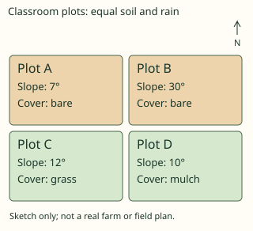

- ✅ Plot B: 30° slope, bare cover.
- ◻️ Plot C: 12° slope, grass cover.  
  _↳ feedback if chosen: This plot has a slope of 12° and grass cover; compare both exposure and slope with the steepest bare plot._
- ◻️ Plot A: 7° slope, bare cover.  
  _↳ feedback if chosen: This plot has a slope of 7° and bare cover; compare both exposure and slope with the steepest bare plot._
- ◻️ Plot D: 10° slope, mulch cover.  
  _↳ feedback if chosen: This plot has a slope of 10° and mulch cover; compare both exposure and slope with the steepest bare plot._

Full working after a second miss:

> Prioritise the steep exposed plot in this simplified comparison, then choose suitable cover and runoff management. A real site needs additional evidence.  
> So the answer is “Plot B: 30° slope, bare cover.”.  

**Practice** `g4-5-assess` · spot the error, level 3 · **authored key**

> Find the incorrect geographical claim.

- ◻️ windbreak: a suitable barrier reducing near-ground wind exposure.  
  _↳ explanation: This distinction is correct: Reducing wind exposure can reduce transport, though design and site matter. Look for a claim that reverses the process or makes an unsupported generalisation._
- ✅ Windbreaks act only by increasing wind speed across bare soil.  
  _↳ explanation: Reducing wind exposure can reduce transport, though design and site matter._
- ◻️ site assessment: matching a measure to conditions and recognising limits.  
  _↳ explanation: This distinction is correct: Actual design needs site evidence and expertise beyond the simplified map. Look for a claim that reverses the process or makes an unsupported generalisation._
- ◻️ contour management: placing suitable measures across the slope near equal height.  
  _↳ explanation: This distinction is correct: Downhill lines can channel water; contour measures aim to interrupt its path. Look for a claim that reverses the process or makes an unsupported generalisation._

Full working after a second miss:

> The wrong statement is “Windbreaks act only by increasing wind speed across bare soil.”.  
> Reducing wind exposure can reduce transport, though design and site matter.  

> Find the incorrect geographical claim.

- ◻️ site assessment: matching a measure to conditions and recognising limits.  
  _↳ explanation: This distinction is correct: Actual design needs site evidence and expertise beyond the simplified map. Look for a claim that reverses the process or makes an unsupported generalisation._
- ✅ Mulch protects soil by increasing direct raindrop impact.  
  _↳ explanation: Cover intercepts impact and reduces exposed soil, rather than intensifying the impact._
- ◻️ contour management: placing suitable measures across the slope near equal height.  
  _↳ explanation: This distinction is correct: Downhill lines can channel water; contour measures aim to interrupt its path. Look for a claim that reverses the process or makes an unsupported generalisation._
- ◻️ windbreak: a suitable barrier reducing near-ground wind exposure.  
  _↳ explanation: This distinction is correct: Reducing wind exposure can reduce transport, though design and site matter. Look for a claim that reverses the process or makes an unsupported generalisation._

Full working after a second miss:

> The wrong statement is “Mulch protects soil by increasing direct raindrop impact.”.  
> Cover intercepts impact and reduces exposed soil, rather than intensifying the impact.  

## Lesson 6: The ecosystem

Prerequisites: 1, 5 · Skill: g4-6 (The ecosystem)

**Note** (draft)

> An ecosystem includes a community of organisms interacting with its non-living environment. A population consists of one species in an area; a community includes populations of different species. A habitat is where an organism lives, while its niche concerns its role and use of resources. Light, water, temperature and soil influence organisms; organisms can also modify these conditions. An ecosystem can be a pond, woodland or a larger landscape, so a boundary is chosen to suit the question.

**Learn: Your goal and connections** (draft)

> By the end, you should be able to identify interacting living and non-living components and locate a model habitat on a grid. Builds on: soil as an open system and conservation. Leads to: energy transfer and nutrient cycling.

**Learn: Explain the geography** (draft)

> An ecosystem includes a community of organisms interacting with its non-living environment. A population consists of one species in an area; a community includes populations of different species. A habitat is where an organism lives, while its niche concerns its role and use of resources. Light, water, temperature and soil influence organisms; organisms can also modify these conditions. An ecosystem can be a pond, woodland or a larger landscape, so a boundary is chosen to suit the question.

**Learn: Follow the local example or model** (draft)

> In a fictional school pond near Yaoundé, algae, insects and microbes interact with light, water and mineral nutrients. Water is an abiotic component even when it contains living organisms. The grid exercise locates a model pond using eastings before northings; it is not a real pond survey. A site label locates a place but does not measure its biodiversity or water quality.

**Learn: Apply and check** (draft)

> Separate population, community and ecosystem by what each includes. Describe one interaction rather than only naming organisms. Check the map’s labelled lines before recording a grid square. Use classroom records rather than entering ponds or collecting unknown organisms.

**Learn: key words and examples** (draft)

- **population**: members of one species living in the stated area
- **community**: interacting populations of different species
- **abiotic component**: a non-living environmental factor
- **ecosystem interaction**: a link between organisms and their physical environment

Common mistake: “A population must contain every species in a habitat.” → “members of one species living in the stated area.”. A population concerns one species; the community includes different populations.

**Card g4-6-c1** (draft)

> Distinguish the features before applying them.
>
> _population: members of one species living in the stated area._  
> _community: interacting populations of different species._  
> _abiotic component: a non-living environmental factor._  
> _ecosystem interaction: a link between organisms and their physical environment._  

Check question: `g4-6-terms` · multiple choice, level 1 · **authored key**, reused from practice

> Which term means interacting populations of different species?

- ✅ community
- ◻️ abiotic component  
  _↳ feedback if chosen: That concerns a non-living environmental factor, rather than the feature asked for._
- ◻️ population  
  _↳ feedback if chosen: That concerns members of one species living in the stated area, rather than the feature asked for._
- ◻️ ecosystem interaction  
  _↳ feedback if chosen: That concerns a link between organisms and their physical environment, rather than the feature asked for._

Full working after a second miss:

> Those are abiotic conditions; a community consists of living populations.  
> So the answer is “community”.  

**Card g4-6-c2** (draft)

> Use the evidence in the example, not a place name alone.
>
> _The record counts one frog species in the model pond._  
> _The model record describes algae, insects and frogs together._  
> _Sunlight and water temperature affect the model pond._  
> _Plants alter shade while light conditions influence plant growth._  

Check question: `g4-6-cases` · multiple choice, level 1 · **authored key**, reused from practice

> Sunlight and water temperature affect the model pond.
> Which feature is illustrated?

- ◻️ ecosystem interaction  
  _↳ feedback if chosen: That identifies a link between organisms and their physical environment. Read the case for evidence of a non-living environmental factor._
- ◻️ population  
  _↳ feedback if chosen: That identifies members of one species living in the stated area. Read the case for evidence of a non-living environmental factor._
- ✅ abiotic component
- ◻️ community  
  _↳ feedback if chosen: That identifies interacting populations of different species. Read the case for evidence of a non-living environmental factor._

Full working after a second miss:

> An ecosystem includes non-living conditions as well as organisms.  
> So the answer is “abiotic component”.  

**Card g4-6-c3** (draft)

> Explain how the process produces the stated effect.
>
> _A population concerns one species; the community includes different populations._  
> _Those are abiotic conditions; a community consists of living populations._  
> _An ecosystem includes non-living conditions as well as organisms._  
> _Influence can run in both directions between organisms and environmental conditions._  

Check question: `g4-6-explain-card` · multiple choice, level 1 · **authored key**

> The model record describes algae, insects and frogs together.
> Which explanation follows?

- ◻️ An ecosystem includes non-living conditions as well as organisms.  
  _↳ feedback if chosen: That explanation addresses abiotic component, rather than the process or relationship in this case._
- ✅ Those are abiotic conditions; a community consists of living populations.
- ◻️ A population concerns one species; the community includes different populations.  
  _↳ feedback if chosen: That explanation addresses population, rather than the process or relationship in this case._
- ◻️ Influence can run in both directions between organisms and environmental conditions.  
  _↳ feedback if chosen: That explanation addresses ecosystem interaction, rather than the process or relationship in this case._

Full working after a second miss:

> interacting populations of different species.  
> So the answer is “Those are abiotic conditions; a community consists of living populations.”.  

**Worked example** (draft)

> The record counts one frog species in the model pond. Explain the relationship.

1. members of one species living in the stated area.
2. A population concerns one species; the community includes different populations.

**Answer:** population

**Practice** `g4-6-terms` · multiple choice, level 1 · **authored key**

> Which term means a non-living environmental factor?

- ◻️ ecosystem interaction  
  _↳ feedback if chosen: That concerns a link between organisms and their physical environment, rather than the feature asked for._
- ✅ abiotic component
- ◻️ population  
  _↳ feedback if chosen: That concerns members of one species living in the stated area, rather than the feature asked for._
- ◻️ community  
  _↳ feedback if chosen: That concerns interacting populations of different species, rather than the feature asked for._

Full working after a second miss:

> An ecosystem includes non-living conditions as well as organisms.  
> So the answer is “abiotic component”.  

> Which term means members of one species living in the stated area?

- ◻️ community  
  _↳ feedback if chosen: That concerns interacting populations of different species, rather than the feature asked for._
- ◻️ abiotic component  
  _↳ feedback if chosen: That concerns a non-living environmental factor, rather than the feature asked for._
- ◻️ ecosystem interaction  
  _↳ feedback if chosen: That concerns a link between organisms and their physical environment, rather than the feature asked for._
- ✅ population

Full working after a second miss:

> A population concerns one species; the community includes different populations.  
> So the answer is “population”.  

**Practice** `g4-6-cases` · multiple choice, level 1 · **authored key**

> Plants alter shade while light conditions influence plant growth.
> Which feature is illustrated?

- ✅ ecosystem interaction
- ◻️ population  
  _↳ feedback if chosen: That identifies members of one species living in the stated area. Read the case for evidence of a link between organisms and their physical environment._
- ◻️ abiotic component  
  _↳ feedback if chosen: That identifies a non-living environmental factor. Read the case for evidence of a link between organisms and their physical environment._
- ◻️ community  
  _↳ feedback if chosen: That identifies interacting populations of different species. Read the case for evidence of a link between organisms and their physical environment._

Full working after a second miss:

> Influence can run in both directions between organisms and environmental conditions.  
> So the answer is “ecosystem interaction”.  

> Sunlight and water temperature affect the model pond.
> Which feature is illustrated?

- ◻️ population  
  _↳ feedback if chosen: That identifies members of one species living in the stated area. Read the case for evidence of a non-living environmental factor._
- ✅ abiotic component
- ◻️ ecosystem interaction  
  _↳ feedback if chosen: That identifies a link between organisms and their physical environment. Read the case for evidence of a non-living environmental factor._
- ◻️ community  
  _↳ feedback if chosen: That identifies interacting populations of different species. Read the case for evidence of a non-living environmental factor._

Full working after a second miss:

> An ecosystem includes non-living conditions as well as organisms.  
> So the answer is “abiotic component”.  

**Practice** `g4-6-explain` · multiple choice, level 2 · **authored key**

> Sunlight and water temperature affect the model pond.
> Which explanation follows?

- ◻️ Those are abiotic conditions; a community consists of living populations.  
  _↳ feedback if chosen: That explanation addresses community, rather than the process or relationship in this case._
- ◻️ A population concerns one species; the community includes different populations.  
  _↳ feedback if chosen: That explanation addresses population, rather than the process or relationship in this case._
- ✅ An ecosystem includes non-living conditions as well as organisms.
- ◻️ Influence can run in both directions between organisms and environmental conditions.  
  _↳ feedback if chosen: That explanation addresses ecosystem interaction, rather than the process or relationship in this case._

Full working after a second miss:

> a non-living environmental factor.  
> So the answer is “An ecosystem includes non-living conditions as well as organisms.”.  

> Plants alter shade while light conditions influence plant growth.
> Which explanation follows?

- ◻️ Those are abiotic conditions; a community consists of living populations.  
  _↳ feedback if chosen: That explanation addresses community, rather than the process or relationship in this case._
- ◻️ A population concerns one species; the community includes different populations.  
  _↳ feedback if chosen: That explanation addresses population, rather than the process or relationship in this case._
- ◻️ An ecosystem includes non-living conditions as well as organisms.  
  _↳ feedback if chosen: That explanation addresses abiotic component, rather than the process or relationship in this case._
- ✅ Influence can run in both directions between organisms and environmental conditions.

Full working after a second miss:

> a link between organisms and their physical environment.  
> So the answer is “Influence can run in both directions between organisms and environmental conditions.”.  

**Practice** `g4-6-habitat-grid` · multiple choice, level 2 · computed by rule

> An invented pond habitat is marked P. Read its four-figure grid square: eastings first, then northings.

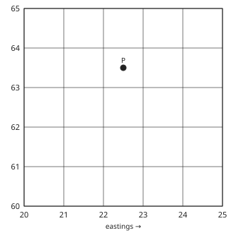

- ✅ 2263
- ◻️ 2264  
  _↳ feedback if chosen: That uses the line north of the square instead of its southern edge._
- ◻️ 2363  
  _↳ feedback if chosen: That uses the line east of the square instead of its western edge._
- ◻️ 6322  
  _↳ feedback if chosen: That reads northings before eastings._

Full working after a second miss:

> Find the grid line immediately west of P, then immediately south.  
> The square is 2263.  

> An invented pond habitat is marked P. Read its four-figure grid square: eastings first, then northings.

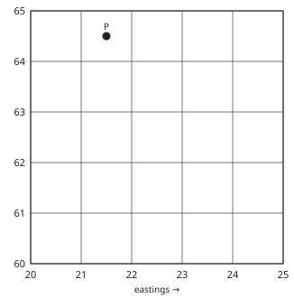

- ◻️ 2264  
  _↳ feedback if chosen: That uses the line east of the square instead of its western edge._
- ◻️ 2165  
  _↳ feedback if chosen: That uses the line north of the square instead of its southern edge._
- ✅ 2164
- ◻️ 6421  
  _↳ feedback if chosen: That reads northings before eastings._

Full working after a second miss:

> Find the grid line immediately west of P, then immediately south.  
> The square is 2164.  

**Practice** `g4-6-assess` · spot the error, level 3 · **authored key**

> Find the incorrect geographical claim.

- ◻️ population: members of one species living in the stated area.  
  _↳ explanation: This distinction is correct: A population concerns one species; the community includes different populations. Look for a claim that reverses the process or makes an unsupported generalisation._
- ◻️ community: interacting populations of different species.  
  _↳ explanation: This distinction is correct: Those are abiotic conditions; a community consists of living populations. Look for a claim that reverses the process or makes an unsupported generalisation._
- ✅ A population must contain every species in a habitat.  
  _↳ explanation: A population concerns one species; the community includes different populations._
- ◻️ ecosystem interaction: a link between organisms and their physical environment.  
  _↳ explanation: This distinction is correct: Influence can run in both directions between organisms and environmental conditions. Look for a claim that reverses the process or makes an unsupported generalisation._

Full working after a second miss:

> The wrong statement is “A population must contain every species in a habitat.”.  
> A population concerns one species; the community includes different populations.  

> Find the incorrect geographical claim.

- ◻️ ecosystem interaction: a link between organisms and their physical environment.  
  _↳ explanation: This distinction is correct: Influence can run in both directions between organisms and environmental conditions. Look for a claim that reverses the process or makes an unsupported generalisation._
- ◻️ community: interacting populations of different species.  
  _↳ explanation: This distinction is correct: Those are abiotic conditions; a community consists of living populations. Look for a claim that reverses the process or makes an unsupported generalisation._
- ✅ Everything inside an ecosystem must itself be alive.  
  _↳ explanation: An ecosystem includes non-living conditions as well as organisms._
- ◻️ population: members of one species living in the stated area.  
  _↳ explanation: This distinction is correct: A population concerns one species; the community includes different populations. Look for a claim that reverses the process or makes an unsupported generalisation._

Full working after a second miss:

> The wrong statement is “Everything inside an ecosystem must itself be alive.”.  
> An ecosystem includes non-living conditions as well as organisms.  

## Lesson 7: Functioning of the ecosystem

Prerequisites: 6 · Skill: g4-7 (How ecosystems function)

**Note** (draft)

> Producers fix energy into organic material, usually through photosynthesis. Consumers obtain food by eating organisms or their products. Food-chain arrows point from the food source towards the consumer, showing transfer. Decomposers break down dead organic matter and help return nutrients to available pools. Energy flows through the system and much becomes dispersed heat; nutrients can cycle between organisms and the environment. A fixed transfer percentage is a teaching assumption, not a law applying to every link.

**Learn: Your goal and connections** (draft)

> By the end, you should be able to trace energy flow and nutrient cycling and calculate a transfer using an explicitly assumed efficiency. Builds on: ecosystem components and interactions. Leads to: biomes and responses to environmental change.

**Learn: Explain the geography** (draft)

> Producers fix energy into organic material, usually through photosynthesis. Consumers obtain food by eating organisms or their products. Food-chain arrows point from the food source towards the consumer, showing transfer. Decomposers break down dead organic matter and help return nutrients to available pools. Energy flows through the system and much becomes dispersed heat; nutrients can cycle between organisms and the environment. A fixed transfer percentage is a teaching assumption, not a law applying to every link.

**Learn: Follow the local example or model** (draft)

> A model chain in a grass plot is grass → grasshopper → frog. The arrow from grass to grasshopper indicates feeding and transfer towards the consumer. Dead material from every level can enter decomposition, not only material from the last consumer. Removing vegetation can affect food, shade, habitat and soil, so consequences can spread through more than one pathway.

**Learn: Apply and check** (draft)

> Follow each arrow and state what moves. Distinguish energy transfer from mineral nutrient recycling: decomposers do not send all lost heat back to plants as usable food energy. For a percentage model, calculate the fraction of the stated input and retain kJ as the unit. Predict a possible effect, then identify evidence needed to test it.

**Learn: key words and examples** (draft)

- **producer**: an organism making organic material from inorganic sources
- **consumer**: an organism obtaining organic food from other organisms
- **decomposition**: breakdown of dead organic matter helping recycle nutrients
- **energy flow**: transfer with energy becoming dispersed heat rather than complete recycling

Common mistake: “A producer obtains all its food only by eating frogs.” → “an organism making organic material from inorganic sources.”. A photosynthetic producer fixes energy into organic material rather than feeding as a consumer.

**Card g4-7-c1** (draft)

> Distinguish the features before applying them.
>
> _producer: an organism making organic material from inorganic sources._  
> _consumer: an organism obtaining organic food from other organisms._  
> _decomposition: breakdown of dead organic matter helping recycle nutrients._  
> _energy flow: transfer with energy becoming dispersed heat rather than complete recycling._  

Check question: `g4-7-terms` · multiple choice, level 1 · **authored key**, reused from practice

> Which term means transfer with energy becoming dispersed heat rather than complete recycling?

- ◻️ consumer  
  _↳ feedback if chosen: That concerns an organism obtaining organic food from other organisms, rather than the feature asked for._
- ✅ energy flow
- ◻️ decomposition  
  _↳ feedback if chosen: That concerns breakdown of dead organic matter helping recycle nutrients, rather than the feature asked for._
- ◻️ producer  
  _↳ feedback if chosen: That concerns an organism making organic material from inorganic sources, rather than the feature asked for._

Full working after a second miss:

> Nutrients cycle, while energy flow needs continued input and is not a closed reusable heat loop.  
> So the answer is “energy flow”.  

**Card g4-7-c2** (draft)

> Use the evidence in the example, not a place name alone.
>
> _Grass uses sunlight in photosynthesis._  
> _A grasshopper feeds on grass in the model chain._  
> _Microbes act on dead material from several trophic levels._  
> _Less of the stated model energy reaches the next trophic level._  

Check question: `g4-7-cases` · multiple choice, level 1 · **authored key**, reused from practice

> Grass uses sunlight in photosynthesis.
> Which feature is illustrated?

- ◻️ energy flow  
  _↳ feedback if chosen: That identifies transfer with energy becoming dispersed heat rather than complete recycling. Read the case for evidence of an organism making organic material from inorganic sources._
- ◻️ consumer  
  _↳ feedback if chosen: That identifies an organism obtaining organic food from other organisms. Read the case for evidence of an organism making organic material from inorganic sources._
- ◻️ decomposition  
  _↳ feedback if chosen: That identifies breakdown of dead organic matter helping recycle nutrients. Read the case for evidence of an organism making organic material from inorganic sources._
- ✅ producer

Full working after a second miss:

> A photosynthetic producer fixes energy into organic material rather than feeding as a consumer.  
> So the answer is “producer”.  

**Card g4-7-c3** (draft)

> Explain how the process produces the stated effect.
>
> _A photosynthetic producer fixes energy into organic material rather than feeding as a consumer._  
> _The convention here points from food to consumer to show transfer._  
> _Dead matter and waste arise at different levels, not only the top._  
> _Nutrients cycle, while energy flow needs continued input and is not a closed reusable heat loop._  

Check question: `g4-7-explain-card` · multiple choice, level 1 · **authored key**

> Grass uses sunlight in photosynthesis.
> Which explanation follows?

- ◻️ Nutrients cycle, while energy flow needs continued input and is not a closed reusable heat loop.  
  _↳ feedback if chosen: That explanation addresses energy flow, rather than the process or relationship in this case._
- ◻️ Dead matter and waste arise at different levels, not only the top.  
  _↳ feedback if chosen: That explanation addresses decomposition, rather than the process or relationship in this case._
- ✅ A photosynthetic producer fixes energy into organic material rather than feeding as a consumer.
- ◻️ The convention here points from food to consumer to show transfer.  
  _↳ feedback if chosen: That explanation addresses consumer, rather than the process or relationship in this case._

Full working after a second miss:

> an organism making organic material from inorganic sources.  
> So the answer is “A photosynthetic producer fixes energy into organic material rather than feeding as a consumer.”.  

**Worked example** (draft)

> Grass uses sunlight in photosynthesis. Explain the relationship.

1. an organism making organic material from inorganic sources.
2. A photosynthetic producer fixes energy into organic material rather than feeding as a consumer.

**Answer:** producer

**Practice** `g4-7-terms` · multiple choice, level 1 · **authored key**

> Which term means an organism obtaining organic food from other organisms?

- ◻️ energy flow  
  _↳ feedback if chosen: That concerns transfer with energy becoming dispersed heat rather than complete recycling, rather than the feature asked for._
- ✅ consumer
- ◻️ producer  
  _↳ feedback if chosen: That concerns an organism making organic material from inorganic sources, rather than the feature asked for._
- ◻️ decomposition  
  _↳ feedback if chosen: That concerns breakdown of dead organic matter helping recycle nutrients, rather than the feature asked for._

Full working after a second miss:

> The convention here points from food to consumer to show transfer.  
> So the answer is “consumer”.  

> Which term means an organism obtaining organic food from other organisms?

- ◻️ producer  
  _↳ feedback if chosen: That concerns an organism making organic material from inorganic sources, rather than the feature asked for._
- ◻️ energy flow  
  _↳ feedback if chosen: That concerns transfer with energy becoming dispersed heat rather than complete recycling, rather than the feature asked for._
- ✅ consumer
- ◻️ decomposition  
  _↳ feedback if chosen: That concerns breakdown of dead organic matter helping recycle nutrients, rather than the feature asked for._

Full working after a second miss:

> The convention here points from food to consumer to show transfer.  
> So the answer is “consumer”.  

**Practice** `g4-7-cases` · multiple choice, level 1 · **authored key**

> Microbes act on dead material from several trophic levels.
> Which feature is illustrated?

- ◻️ energy flow  
  _↳ feedback if chosen: That identifies transfer with energy becoming dispersed heat rather than complete recycling. Read the case for evidence of breakdown of dead organic matter helping recycle nutrients._
- ◻️ producer  
  _↳ feedback if chosen: That identifies an organism making organic material from inorganic sources. Read the case for evidence of breakdown of dead organic matter helping recycle nutrients._
- ✅ decomposition
- ◻️ consumer  
  _↳ feedback if chosen: That identifies an organism obtaining organic food from other organisms. Read the case for evidence of breakdown of dead organic matter helping recycle nutrients._

Full working after a second miss:

> Dead matter and waste arise at different levels, not only the top.  
> So the answer is “decomposition”.  

> Less of the stated model energy reaches the next trophic level.
> Which feature is illustrated?

- ✅ energy flow
- ◻️ consumer  
  _↳ feedback if chosen: That identifies an organism obtaining organic food from other organisms. Read the case for evidence of transfer with energy becoming dispersed heat rather than complete recycling._
- ◻️ producer  
  _↳ feedback if chosen: That identifies an organism making organic material from inorganic sources. Read the case for evidence of transfer with energy becoming dispersed heat rather than complete recycling._
- ◻️ decomposition  
  _↳ feedback if chosen: That identifies breakdown of dead organic matter helping recycle nutrients. Read the case for evidence of transfer with energy becoming dispersed heat rather than complete recycling._

Full working after a second miss:

> Nutrients cycle, while energy flow needs continued input and is not a closed reusable heat loop.  
> So the answer is “energy flow”.  

**Practice** `g4-7-explain` · multiple choice, level 2 · **authored key**

> Grass uses sunlight in photosynthesis.
> Which explanation follows?

- ◻️ The convention here points from food to consumer to show transfer.  
  _↳ feedback if chosen: That explanation addresses consumer, rather than the process or relationship in this case._
- ◻️ Nutrients cycle, while energy flow needs continued input and is not a closed reusable heat loop.  
  _↳ feedback if chosen: That explanation addresses energy flow, rather than the process or relationship in this case._
- ✅ A photosynthetic producer fixes energy into organic material rather than feeding as a consumer.
- ◻️ Dead matter and waste arise at different levels, not only the top.  
  _↳ feedback if chosen: That explanation addresses decomposition, rather than the process or relationship in this case._

Full working after a second miss:

> an organism making organic material from inorganic sources.  
> So the answer is “A photosynthetic producer fixes energy into organic material rather than feeding as a consumer.”.  

> Microbes act on dead material from several trophic levels.
> Which explanation follows?

- ◻️ A photosynthetic producer fixes energy into organic material rather than feeding as a consumer.  
  _↳ feedback if chosen: That explanation addresses producer, rather than the process or relationship in this case._
- ◻️ The convention here points from food to consumer to show transfer.  
  _↳ feedback if chosen: That explanation addresses consumer, rather than the process or relationship in this case._
- ✅ Dead matter and waste arise at different levels, not only the top.
- ◻️ Nutrients cycle, while energy flow needs continued input and is not a closed reusable heat loop.  
  _↳ feedback if chosen: That explanation addresses energy flow, rather than the process or relationship in this case._

Full working after a second miss:

> breakdown of dead organic matter helping recycle nutrients.  
> So the answer is “Dead matter and waste arise at different levels, not only the top.”.  

**Practice** `g4-7-transfer` · number, level 2 · computed by rule

> A simplified food-chain model has 10 kJ available at one trophic level and assumes 5% transfers to the next. Calculate the transferred energy. The percentage is a model assumption, not a universal rule.

Answer: **0.5 kJ**
- Typed **50** (no-percent) → “That treats the percentage as a whole-number multiplier and omits division by one hundred.”
- Typed **5** (percent) → “That repeats the percentage rather than calculating an energy amount.”
- Typed **10** (all) → “That assumes complete transfer, contrary to the stated percentage.”

Full working after a second miss:

> Multiply the available energy by the assumed fraction.  
> Transfer = 10 × 5/100 = 0.5 kJ.  

> A simplified food-chain model has 30 kJ available at one trophic level and assumes 10% transfers to the next. Calculate the transferred energy. The percentage is a model assumption, not a universal rule.

Answer: **3 kJ**
- Typed **300** (no-percent) → “That treats the percentage as a whole-number multiplier and omits division by one hundred.”
- Typed **10** (percent) → “That repeats the percentage rather than calculating an energy amount.”
- Typed **30** (all) → “That assumes complete transfer, contrary to the stated percentage.”

Full working after a second miss:

> Multiply the available energy by the assumed fraction.  
> Transfer = 30 × 10/100 = 3 kJ.  

**Practice** `g4-7-assess` · spot the error, level 3 · **authored key**

> Find the incorrect geographical claim.

- ✅ A feeding arrow must point from the eater back to its food.  
  _↳ explanation: The convention here points from food to consumer to show transfer._
- ◻️ consumer: an organism obtaining organic food from other organisms.  
  _↳ explanation: This distinction is correct: The convention here points from food to consumer to show transfer. Look for a claim that reverses the process or makes an unsupported generalisation._
- ◻️ energy flow: transfer with energy becoming dispersed heat rather than complete recycling.  
  _↳ explanation: This distinction is correct: Nutrients cycle, while energy flow needs continued input and is not a closed reusable heat loop. Look for a claim that reverses the process or makes an unsupported generalisation._
- ◻️ decomposition: breakdown of dead organic matter helping recycle nutrients.  
  _↳ explanation: This distinction is correct: Dead matter and waste arise at different levels, not only the top. Look for a claim that reverses the process or makes an unsupported generalisation._

Full working after a second miss:

> The wrong statement is “A feeding arrow must point from the eater back to its food.”.  
> The convention here points from food to consumer to show transfer.  

> Find the incorrect geographical claim.

- ◻️ decomposition: breakdown of dead organic matter helping recycle nutrients.  
  _↳ explanation: This distinction is correct: Dead matter and waste arise at different levels, not only the top. Look for a claim that reverses the process or makes an unsupported generalisation._
- ◻️ energy flow: transfer with energy becoming dispersed heat rather than complete recycling.  
  _↳ explanation: This distinction is correct: Nutrients cycle, while energy flow needs continued input and is not a closed reusable heat loop. Look for a claim that reverses the process or makes an unsupported generalisation._
- ✅ A feeding arrow must point from the eater back to its food.  
  _↳ explanation: The convention here points from food to consumer to show transfer._
- ◻️ producer: an organism making organic material from inorganic sources.  
  _↳ explanation: This distinction is correct: A photosynthetic producer fixes energy into organic material rather than feeding as a consumer. Look for a claim that reverses the process or makes an unsupported generalisation._

Full working after a second miss:

> The wrong statement is “A feeding arrow must point from the eater back to its food.”.  
> The convention here points from food to consumer to show transfer.  

## Lesson 8: Tropical Rainforest Biome: (location & characteristics of climate & vegetation, Human activities)

Prerequisites: 7 · Skill: g4-8 (The tropical rainforest biome)

**Note** (draft)

> Tropical rainforests occur in warm humid parts of the tropics, including southern Cameroon and the wider Congo Basin, Amazonia and Southeast Asia. Broad-leaved trees form a canopy with emergents and shaded lower layers. Lianas and epiphytes use tree structure in different ways. Warmth and moisture often support rapid decomposition and nutrient cycling, while many strongly weathered soils retain limited readily available nutrients. Forest richness does not prove deep, uniformly fertile soil. Rainfall seasonality varies within the broad rainforest category.

**Learn: Your goal and connections** (draft)

> By the end, you should be able to connect year-round moisture and warmth to forest structure and interpret a model rainfall chart. Builds on: ecosystem functioning and nutrient cycling. Leads to: comparison with seasonal savannah and monsoon landscapes.

**Learn: Explain the geography** (draft)

> Tropical rainforests occur in warm humid parts of the tropics, including southern Cameroon and the wider Congo Basin, Amazonia and Southeast Asia. Broad-leaved trees form a canopy with emergents and shaded lower layers. Lianas and epiphytes use tree structure in different ways. Warmth and moisture often support rapid decomposition and nutrient cycling, while many strongly weathered soils retain limited readily available nutrients. Forest richness does not prove deep, uniformly fertile soil. Rainfall seasonality varies within the broad rainforest category.

**Learn: Follow the local example or model** (draft)

> Southern Cameroon supplies a local setting for comparing forest cover, cultivation and conservation. Farming and logging can provide livelihoods but alter habitat, canopy and nutrient pathways; outcomes depend on methods and intensity. The chart is an invented warm-region rainfall record with moisture in every month, not measured data for Douala or a test proving rainforest from rainfall alone.

**Learn: Apply and check** (draft)

> Explain a link: shade affects understorey growth; continuous moisture supports growth and decomposition; clearing changes both habitat and soil exposure. Distinguish a liana rooted in soil from an epiphyte growing on a plant for support. Read seasonality before adding monthly totals and state the limits of the model.

**Learn: key words and examples** (draft)

- **canopy structure**: overlapping forest layers influencing light below
- **rapid nutrient cycling**: relatively quick transfer through litter decomposition and plant uptake in warm moist conditions
- **epiphyte**: a plant growing on another plant for support without being defined as a parasite
- **land-use impact**: change in forest structure and processes caused by human activity

Common mistake: “All rainforest plants receive the same light at ground level.” → “overlapping forest layers influencing light below.”. Canopy interception creates differences in light between layers.

**Card g4-8-c1** (draft)

> Distinguish the features before applying them.
>
> _canopy structure: overlapping forest layers influencing light below._  
> _rapid nutrient cycling: relatively quick transfer through litter decomposition and plant uptake in warm moist conditions._  
> _epiphyte: a plant growing on another plant for support without being defined as a parasite._  
> _land-use impact: change in forest structure and processes caused by human activity._  

Check question: `g4-8-terms` · multiple choice, level 1 · **authored key**, reused from practice

> Which term means overlapping forest layers influencing light below?

- ◻️ land-use impact  
  _↳ feedback if chosen: That concerns change in forest structure and processes caused by human activity, rather than the feature asked for._
- ◻️ rapid nutrient cycling  
  _↳ feedback if chosen: That concerns relatively quick transfer through litter decomposition and plant uptake in warm moist conditions, rather than the feature asked for._
- ✅ canopy structure
- ◻️ epiphyte  
  _↳ feedback if chosen: That concerns a plant growing on another plant for support without being defined as a parasite, rather than the feature asked for._

Full working after a second miss:

> Canopy interception creates differences in light between layers.  
> So the answer is “canopy structure”.  

**Card g4-8-c2** (draft)

> Use the evidence in the example, not a place name alone.
>
> _Tall crowns shade a lower layer of the model forest._  
> _Litter breaks down and plants take up released nutrients._  
> _An orchid grows on a tree branch while obtaining resources from its surroundings._  
> _Clearing alters shade, habitat and the supply of litter._  

Check question: `g4-8-cases` · multiple choice, level 1 · **authored key**, reused from practice

> An orchid grows on a tree branch while obtaining resources from its surroundings.
> Which feature is illustrated?

- ◻️ canopy structure  
  _↳ feedback if chosen: That identifies overlapping forest layers influencing light below. Read the case for evidence of a plant growing on another plant for support without being defined as a parasite._
- ◻️ rapid nutrient cycling  
  _↳ feedback if chosen: That identifies relatively quick transfer through litter decomposition and plant uptake in warm moist conditions. Read the case for evidence of a plant growing on another plant for support without being defined as a parasite._
- ✅ epiphyte
- ◻️ land-use impact  
  _↳ feedback if chosen: That identifies change in forest structure and processes caused by human activity. Read the case for evidence of a plant growing on another plant for support without being defined as a parasite._

Full working after a second miss:

> Support and parasitism are different relationships.  
> So the answer is “epiphyte”.  

**Card g4-8-c3** (draft)

> Explain how the process produces the stated effect.
>
> _Canopy interception creates differences in light between layers._  
> _Large nutrient stores can be in vegetation and cycling material rather than a rich enduring soil store._  
> _Support and parasitism are different relationships._  
> _Removing cover and biomass changes more than the number of visible trees._  

Check question: `g4-8-explain-card` · multiple choice, level 1 · **authored key**

> An orchid grows on a tree branch while obtaining resources from its surroundings.
> Which explanation follows?

- ◻️ Removing cover and biomass changes more than the number of visible trees.  
  _↳ feedback if chosen: That explanation addresses land-use impact, rather than the process or relationship in this case._
- ✅ Support and parasitism are different relationships.
- ◻️ Canopy interception creates differences in light between layers.  
  _↳ feedback if chosen: That explanation addresses canopy structure, rather than the process or relationship in this case._
- ◻️ Large nutrient stores can be in vegetation and cycling material rather than a rich enduring soil store.  
  _↳ feedback if chosen: That explanation addresses rapid nutrient cycling, rather than the process or relationship in this case._

Full working after a second miss:

> a plant growing on another plant for support without being defined as a parasite.  
> So the answer is “Support and parasitism are different relationships.”.  

**Worked example** (draft)

> Tall crowns shade a lower layer of the model forest. Explain the relationship.

1. overlapping forest layers influencing light below.
2. Canopy interception creates differences in light between layers.

**Answer:** canopy structure

**Practice** `g4-8-terms` · multiple choice, level 1 · **authored key**

> Which term means a plant growing on another plant for support without being defined as a parasite?

- ◻️ rapid nutrient cycling  
  _↳ feedback if chosen: That concerns relatively quick transfer through litter decomposition and plant uptake in warm moist conditions, rather than the feature asked for._
- ✅ epiphyte
- ◻️ land-use impact  
  _↳ feedback if chosen: That concerns change in forest structure and processes caused by human activity, rather than the feature asked for._
- ◻️ canopy structure  
  _↳ feedback if chosen: That concerns overlapping forest layers influencing light below, rather than the feature asked for._

Full working after a second miss:

> Support and parasitism are different relationships.  
> So the answer is “epiphyte”.  

> Which term means a plant growing on another plant for support without being defined as a parasite?

- ✅ epiphyte
- ◻️ canopy structure  
  _↳ feedback if chosen: That concerns overlapping forest layers influencing light below, rather than the feature asked for._
- ◻️ land-use impact  
  _↳ feedback if chosen: That concerns change in forest structure and processes caused by human activity, rather than the feature asked for._
- ◻️ rapid nutrient cycling  
  _↳ feedback if chosen: That concerns relatively quick transfer through litter decomposition and plant uptake in warm moist conditions, rather than the feature asked for._

Full working after a second miss:

> Support and parasitism are different relationships.  
> So the answer is “epiphyte”.  

**Practice** `g4-8-cases` · multiple choice, level 1 · **authored key**

> Clearing alters shade, habitat and the supply of litter.
> Which feature is illustrated?

- ◻️ epiphyte  
  _↳ feedback if chosen: That identifies a plant growing on another plant for support without being defined as a parasite. Read the case for evidence of change in forest structure and processes caused by human activity._
- ✅ land-use impact
- ◻️ canopy structure  
  _↳ feedback if chosen: That identifies overlapping forest layers influencing light below. Read the case for evidence of change in forest structure and processes caused by human activity._
- ◻️ rapid nutrient cycling  
  _↳ feedback if chosen: That identifies relatively quick transfer through litter decomposition and plant uptake in warm moist conditions. Read the case for evidence of change in forest structure and processes caused by human activity._

Full working after a second miss:

> Removing cover and biomass changes more than the number of visible trees.  
> So the answer is “land-use impact”.  

> An orchid grows on a tree branch while obtaining resources from its surroundings.
> Which feature is illustrated?

- ✅ epiphyte
- ◻️ rapid nutrient cycling  
  _↳ feedback if chosen: That identifies relatively quick transfer through litter decomposition and plant uptake in warm moist conditions. Read the case for evidence of a plant growing on another plant for support without being defined as a parasite._
- ◻️ land-use impact  
  _↳ feedback if chosen: That identifies change in forest structure and processes caused by human activity. Read the case for evidence of a plant growing on another plant for support without being defined as a parasite._
- ◻️ canopy structure  
  _↳ feedback if chosen: That identifies overlapping forest layers influencing light below. Read the case for evidence of a plant growing on another plant for support without being defined as a parasite._

Full working after a second miss:

> Support and parasitism are different relationships.  
> So the answer is “epiphyte”.  

**Practice** `g4-8-explain` · multiple choice, level 2 · **authored key**

> Clearing alters shade, habitat and the supply of litter.
> Which explanation follows?

- ◻️ Support and parasitism are different relationships.  
  _↳ feedback if chosen: That explanation addresses epiphyte, rather than the process or relationship in this case._
- ✅ Removing cover and biomass changes more than the number of visible trees.
- ◻️ Large nutrient stores can be in vegetation and cycling material rather than a rich enduring soil store.  
  _↳ feedback if chosen: That explanation addresses rapid nutrient cycling, rather than the process or relationship in this case._
- ◻️ Canopy interception creates differences in light between layers.  
  _↳ feedback if chosen: That explanation addresses canopy structure, rather than the process or relationship in this case._

Full working after a second miss:

> change in forest structure and processes caused by human activity.  
> So the answer is “Removing cover and biomass changes more than the number of visible trees.”.  

> Clearing alters shade, habitat and the supply of litter.
> Which explanation follows?

- ✅ Removing cover and biomass changes more than the number of visible trees.
- ◻️ Canopy interception creates differences in light between layers.  
  _↳ feedback if chosen: That explanation addresses canopy structure, rather than the process or relationship in this case._
- ◻️ Support and parasitism are different relationships.  
  _↳ feedback if chosen: That explanation addresses epiphyte, rather than the process or relationship in this case._
- ◻️ Large nutrient stores can be in vegetation and cycling material rather than a rich enduring soil store.  
  _↳ feedback if chosen: That explanation addresses rapid nutrient cycling, rather than the process or relationship in this case._

Full working after a second miss:

> change in forest structure and processes caused by human activity.  
> So the answer is “Removing cover and biomass changes more than the number of visible trees.”.  

**Practice** `g4-8-rain-total` · number, level 2 · computed by rule

> Read the invented monthly rainfall chart. Add the labels above all monthly bars to obtain the annual total in mm; the vertical-axis tick labels are not extra observations.

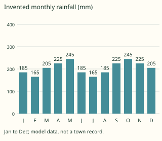

Answer: **2460 mm**
- Typed **205** (mean) → “That is a monthly mean, not the sum for the year.”
- Typed **80** (range) → “That is the difference between wettest and driest months, not the annual total.”
- Typed **24 600** (tenfold) → “That multiplies an already millimetre total by ten without a unit conversion.”

Full working after a second miss:

> Add each monthly amount once.  
> The annual rainfall of this classroom record is 2460 mm. A real biome classification also needs temperature and other evidence.  

> Read the invented monthly rainfall chart. Add the labels above all monthly bars to obtain the annual total in mm; the vertical-axis tick labels are not extra observations.

Answer: **2400 mm**
- Typed **200** (mean) → “That is a monthly mean, not the sum for the year.”
- Typed **80** (range) → “That is the difference between wettest and driest months, not the annual total.”
- Typed **24 000** (tenfold) → “That multiplies an already millimetre total by ten without a unit conversion.”

Full working after a second miss:

> Add each monthly amount once.  
> The annual rainfall of this classroom record is 2400 mm. A real biome classification also needs temperature and other evidence.  

**Practice** `g4-8-assess` · spot the error, level 3 · **authored key**

> Find the incorrect geographical claim.

- ◻️ rapid nutrient cycling: relatively quick transfer through litter decomposition and plant uptake in warm moist conditions.  
  _↳ explanation: This distinction is correct: Large nutrient stores can be in vegetation and cycling material rather than a rich enduring soil store. Look for a claim that reverses the process or makes an unsupported generalisation._
- ◻️ land-use impact: change in forest structure and processes caused by human activity.  
  _↳ explanation: This distinction is correct: Removing cover and biomass changes more than the number of visible trees. Look for a claim that reverses the process or makes an unsupported generalisation._
- ✅ Every plant using a tree for support must feed parasitically on it.  
  _↳ explanation: Support and parasitism are different relationships._
- ◻️ canopy structure: overlapping forest layers influencing light below.  
  _↳ explanation: This distinction is correct: Canopy interception creates differences in light between layers. Look for a claim that reverses the process or makes an unsupported generalisation._

Full working after a second miss:

> The wrong statement is “Every plant using a tree for support must feed parasitically on it.”.  
> Support and parasitism are different relationships.  

> Find the incorrect geographical claim.

- ◻️ canopy structure: overlapping forest layers influencing light below.  
  _↳ explanation: This distinction is correct: Canopy interception creates differences in light between layers. Look for a claim that reverses the process or makes an unsupported generalisation._
- ◻️ land-use impact: change in forest structure and processes caused by human activity.  
  _↳ explanation: This distinction is correct: Removing cover and biomass changes more than the number of visible trees. Look for a claim that reverses the process or makes an unsupported generalisation._
- ◻️ rapid nutrient cycling: relatively quick transfer through litter decomposition and plant uptake in warm moist conditions.  
  _↳ explanation: This distinction is correct: Large nutrient stores can be in vegetation and cycling material rather than a rich enduring soil store. Look for a claim that reverses the process or makes an unsupported generalisation._
- ✅ All rainforest plants receive the same light at ground level.  
  _↳ explanation: Canopy interception creates differences in light between layers._

Full working after a second miss:

> The wrong statement is “All rainforest plants receive the same light at ground level.”.  
> Canopy interception creates differences in light between layers.  

## Lesson 9: (Part 1):Tropical savannah Biome (location & characteristics of climate & vegetation)

Prerequisites: 8 · Skill: g4-9 (Tropical savannah: climate and vegetation)

**Note** (draft)

> Tropical savannah is characterised by grasses with varying tree or shrub cover and marked seasonal water limitation. It occurs across parts of Africa, South America and Australia. Cameroon’s broad transition from wetter southern forests towards more seasonal northern landscapes provides local examples. A rainy season supports growth; a dry season constrains water availability. Root systems, leaf shedding and fire responses vary by species. Climate, soil, herbivory, fire and human activity all influence the balance between grasses and woody plants.

**Learn: Your goal and connections** (draft)

> By the end, you should be able to explain seasonal moisture stress and relate grass-tree structure to rainfall fire and land use. Builds on: rainforest structure and the role of moisture. Leads to: savannah soils, wildlife and human activity.

**Learn: Explain the geography** (draft)

> Tropical savannah is characterised by grasses with varying tree or shrub cover and marked seasonal water limitation. It occurs across parts of Africa, South America and Australia. Cameroon’s broad transition from wetter southern forests towards more seasonal northern landscapes provides local examples. A rainy season supports growth; a dry season constrains water availability. Root systems, leaf shedding and fire responses vary by species. Climate, soil, herbivory, fire and human activity all influence the balance between grasses and woody plants.

**Learn: Follow the local example or model** (draft)

> A classroom record shows wet months followed by several months with little rain. This helps explain seasonal grass growth and water stress but does not establish an exact vegetation boundary. Some savannah trees shed leaves, while grasses can regrow from protected basal parts. Dense gallery vegetation may follow a watercourse within a more open landscape; a river corridor does not make every surrounding slope rainforest.

**Learn: Apply and check** (draft)

> Compare distributions across the year rather than annual totals alone. Explain how a plant feature relates to a seasonal constraint, without claiming every species has one adaptation. Do not equate all savannah with recent forest clearing, or all fire with a beneficial outcome. Use regional evidence and acknowledge human modification.

**Learn: key words and examples** (draft)

- **seasonal water stress**: a dry period limiting water availability despite a rainy season
- **grass-tree mosaic**: grass cover combined with variable woody vegetation
- **drought response**: a feature or behaviour helping plants cope with reduced water availability
- **multiple controls**: interacting climate soil disturbance and grazing influences on vegetation

Common mistake: “One wet month guarantees unlimited water throughout the year.” → “a dry period limiting water availability despite a rainy season.”. Timing of rain and storage determine dry-season conditions as well as the annual total.

**Card g4-9-c1** (draft)

> Distinguish the features before applying them.
>
> _seasonal water stress: a dry period limiting water availability despite a rainy season._  
> _grass-tree mosaic: grass cover combined with variable woody vegetation._  
> _drought response: a feature or behaviour helping plants cope with reduced water availability._  
> _multiple controls: interacting climate soil disturbance and grazing influences on vegetation._  

Check question: `g4-9-terms` · multiple choice, level 1 · **authored key**, reused from practice

> Which term means a feature or behaviour helping plants cope with reduced water availability?

- ✅ drought response
- ◻️ multiple controls  
  _↳ feedback if chosen: That concerns interacting climate soil disturbance and grazing influences on vegetation, rather than the feature asked for._
- ◻️ grass-tree mosaic  
  _↳ feedback if chosen: That concerns grass cover combined with variable woody vegetation, rather than the feature asked for._
- ◻️ seasonal water stress  
  _↳ feedback if chosen: That concerns a dry period limiting water availability despite a rainy season, rather than the feature asked for._

Full working after a second miss:

> Reducing active leaf area can reduce water demand, depending on the species.  
> So the answer is “drought response”.  

**Card g4-9-c2** (draft)

> Use the evidence in the example, not a place name alone.
>
> _The model grassland becomes dry between concentrated rainy months._  
> _A landscape contains grass between scattered trees and denser patches._  
> _Some trees shed leaves as moisture becomes scarce._  
> _Similar rainfall areas differ with soil, grazing and fire history._  

Check question: `g4-9-cases` · multiple choice, level 1 · **authored key**, reused from practice

> The model grassland becomes dry between concentrated rainy months.
> Which feature is illustrated?

- ◻️ grass-tree mosaic  
  _↳ feedback if chosen: That identifies grass cover combined with variable woody vegetation. Read the case for evidence of a dry period limiting water availability despite a rainy season._
- ✅ seasonal water stress
- ◻️ multiple controls  
  _↳ feedback if chosen: That identifies interacting climate soil disturbance and grazing influences on vegetation. Read the case for evidence of a dry period limiting water availability despite a rainy season._
- ◻️ drought response  
  _↳ feedback if chosen: That identifies a feature or behaviour helping plants cope with reduced water availability. Read the case for evidence of a dry period limiting water availability despite a rainy season._

Full working after a second miss:

> Timing of rain and storage determine dry-season conditions as well as the annual total.  
> So the answer is “seasonal water stress”.  

**Card g4-9-c3** (draft)

> Explain how the process produces the stated effect.
>
> _Timing of rain and storage determine dry-season conditions as well as the annual total._  
> _Savannah includes a range of tree and shrub cover._  
> _Reducing active leaf area can reduce water demand, depending on the species._  
> _Vegetation reflects several controls and histories, not a single universal rainfall rule._  

Check question: `g4-9-explain-card` · multiple choice, level 1 · **authored key**

> A landscape contains grass between scattered trees and denser patches.
> Which explanation follows?

- ◻️ Timing of rain and storage determine dry-season conditions as well as the annual total.  
  _↳ feedback if chosen: That explanation addresses seasonal water stress, rather than the process or relationship in this case._
- ✅ Savannah includes a range of tree and shrub cover.
- ◻️ Vegetation reflects several controls and histories, not a single universal rainfall rule.  
  _↳ feedback if chosen: That explanation addresses multiple controls, rather than the process or relationship in this case._
- ◻️ Reducing active leaf area can reduce water demand, depending on the species.  
  _↳ feedback if chosen: That explanation addresses drought response, rather than the process or relationship in this case._

Full working after a second miss:

> grass cover combined with variable woody vegetation.  
> So the answer is “Savannah includes a range of tree and shrub cover.”.  

**Worked example** (draft)

> The model grassland becomes dry between concentrated rainy months. Explain the relationship.

1. a dry period limiting water availability despite a rainy season.
2. Timing of rain and storage determine dry-season conditions as well as the annual total.

**Answer:** seasonal water stress

**Practice** `g4-9-terms` · multiple choice, level 1 · **authored key**

> Which term means a feature or behaviour helping plants cope with reduced water availability?

- ✅ drought response
- ◻️ grass-tree mosaic  
  _↳ feedback if chosen: That concerns grass cover combined with variable woody vegetation, rather than the feature asked for._
- ◻️ seasonal water stress  
  _↳ feedback if chosen: That concerns a dry period limiting water availability despite a rainy season, rather than the feature asked for._
- ◻️ multiple controls  
  _↳ feedback if chosen: That concerns interacting climate soil disturbance and grazing influences on vegetation, rather than the feature asked for._

Full working after a second miss:

> Reducing active leaf area can reduce water demand, depending on the species.  
> So the answer is “drought response”.  

> Which term means interacting climate soil disturbance and grazing influences on vegetation?

- ◻️ grass-tree mosaic  
  _↳ feedback if chosen: That concerns grass cover combined with variable woody vegetation, rather than the feature asked for._
- ◻️ seasonal water stress  
  _↳ feedback if chosen: That concerns a dry period limiting water availability despite a rainy season, rather than the feature asked for._
- ✅ multiple controls
- ◻️ drought response  
  _↳ feedback if chosen: That concerns a feature or behaviour helping plants cope with reduced water availability, rather than the feature asked for._

Full working after a second miss:

> Vegetation reflects several controls and histories, not a single universal rainfall rule.  
> So the answer is “multiple controls”.  

**Practice** `g4-9-cases` · multiple choice, level 1 · **authored key**

> Similar rainfall areas differ with soil, grazing and fire history.
> Which feature is illustrated?

- ◻️ drought response  
  _↳ feedback if chosen: That identifies a feature or behaviour helping plants cope with reduced water availability. Read the case for evidence of interacting climate soil disturbance and grazing influences on vegetation._
- ◻️ seasonal water stress  
  _↳ feedback if chosen: That identifies a dry period limiting water availability despite a rainy season. Read the case for evidence of interacting climate soil disturbance and grazing influences on vegetation._
- ✅ multiple controls
- ◻️ grass-tree mosaic  
  _↳ feedback if chosen: That identifies grass cover combined with variable woody vegetation. Read the case for evidence of interacting climate soil disturbance and grazing influences on vegetation._

Full working after a second miss:

> Vegetation reflects several controls and histories, not a single universal rainfall rule.  
> So the answer is “multiple controls”.  

> Similar rainfall areas differ with soil, grazing and fire history.
> Which feature is illustrated?

- ◻️ seasonal water stress  
  _↳ feedback if chosen: That identifies a dry period limiting water availability despite a rainy season. Read the case for evidence of interacting climate soil disturbance and grazing influences on vegetation._
- ✅ multiple controls
- ◻️ drought response  
  _↳ feedback if chosen: That identifies a feature or behaviour helping plants cope with reduced water availability. Read the case for evidence of interacting climate soil disturbance and grazing influences on vegetation._
- ◻️ grass-tree mosaic  
  _↳ feedback if chosen: That identifies grass cover combined with variable woody vegetation. Read the case for evidence of interacting climate soil disturbance and grazing influences on vegetation._

Full working after a second miss:

> Vegetation reflects several controls and histories, not a single universal rainfall rule.  
> So the answer is “multiple controls”.  

**Practice** `g4-9-explain` · multiple choice, level 2 · **authored key**

> Similar rainfall areas differ with soil, grazing and fire history.
> Which explanation follows?

- ◻️ Savannah includes a range of tree and shrub cover.  
  _↳ feedback if chosen: That explanation addresses grass-tree mosaic, rather than the process or relationship in this case._
- ✅ Vegetation reflects several controls and histories, not a single universal rainfall rule.
- ◻️ Reducing active leaf area can reduce water demand, depending on the species.  
  _↳ feedback if chosen: That explanation addresses drought response, rather than the process or relationship in this case._
- ◻️ Timing of rain and storage determine dry-season conditions as well as the annual total.  
  _↳ feedback if chosen: That explanation addresses seasonal water stress, rather than the process or relationship in this case._

Full working after a second miss:

> interacting climate soil disturbance and grazing influences on vegetation.  
> So the answer is “Vegetation reflects several controls and histories, not a single universal rainfall rule.”.  

> A landscape contains grass between scattered trees and denser patches.
> Which explanation follows?

- ◻️ Vegetation reflects several controls and histories, not a single universal rainfall rule.  
  _↳ feedback if chosen: That explanation addresses multiple controls, rather than the process or relationship in this case._
- ◻️ Timing of rain and storage determine dry-season conditions as well as the annual total.  
  _↳ feedback if chosen: That explanation addresses seasonal water stress, rather than the process or relationship in this case._
- ✅ Savannah includes a range of tree and shrub cover.
- ◻️ Reducing active leaf area can reduce water demand, depending on the species.  
  _↳ feedback if chosen: That explanation addresses drought response, rather than the process or relationship in this case._

Full working after a second miss:

> grass cover combined with variable woody vegetation.  
> So the answer is “Savannah includes a range of tree and shrub cover.”.  

**Practice** `g4-9-rain-total` · number, level 2 · computed by rule

> Read the invented monthly rainfall chart. Add the labels above all monthly bars to obtain the annual total in mm; the vertical-axis tick labels are not extra observations.

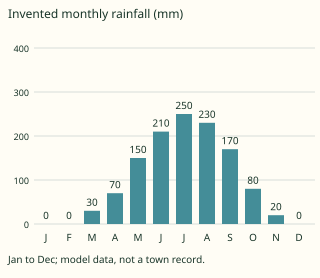

Answer: **1210 mm**
- Typed **100.833333333** (mean) → “That is a monthly mean, not the sum for the year.”
- Typed **250** (range) → “That is the difference between wettest and driest months, not the annual total.”
- Typed **12 100** (tenfold) → “That multiplies an already millimetre total by ten without a unit conversion.”

Full working after a second miss:

> Add each monthly amount once.  
> The annual rainfall of this classroom record is 1210 mm. A real biome classification also needs temperature and other evidence.  

> Read the invented monthly rainfall chart. Add the labels above all monthly bars to obtain the annual total in mm; the vertical-axis tick labels are not extra observations.

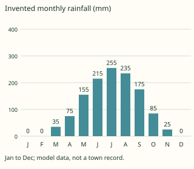

Answer: **1255 mm**
- Typed **104.583333333** (mean) → “That is a monthly mean, not the sum for the year.”
- Typed **255** (range) → “That is the difference between wettest and driest months, not the annual total.”
- Typed **12 550** (tenfold) → “That multiplies an already millimetre total by ten without a unit conversion.”

Full working after a second miss:

> Add each monthly amount once.  
> The annual rainfall of this classroom record is 1255 mm. A real biome classification also needs temperature and other evidence.  

**Practice** `g4-9-assess` · spot the error, level 3 · **authored key**

> Find the incorrect geographical claim.

- ◻️ drought response: a feature or behaviour helping plants cope with reduced water availability.  
  _↳ explanation: This distinction is correct: Reducing active leaf area can reduce water demand, depending on the species. Look for a claim that reverses the process or makes an unsupported generalisation._
- ◻️ seasonal water stress: a dry period limiting water availability despite a rainy season.  
  _↳ explanation: This distinction is correct: Timing of rain and storage determine dry-season conditions as well as the annual total. Look for a claim that reverses the process or makes an unsupported generalisation._
- ◻️ multiple controls: interacting climate soil disturbance and grazing influences on vegetation.  
  _↳ explanation: This distinction is correct: Vegetation reflects several controls and histories, not a single universal rainfall rule. Look for a claim that reverses the process or makes an unsupported generalisation._
- ✅ Leaf shedding always increases water loss by enlarging the active leaf area.  
  _↳ explanation: Reducing active leaf area can reduce water demand, depending on the species._

Full working after a second miss:

> The wrong statement is “Leaf shedding always increases water loss by enlarging the active leaf area.”.  
> Reducing active leaf area can reduce water demand, depending on the species.  

> Find the incorrect geographical claim.

- ◻️ drought response: a feature or behaviour helping plants cope with reduced water availability.  
  _↳ explanation: This distinction is correct: Reducing active leaf area can reduce water demand, depending on the species. Look for a claim that reverses the process or makes an unsupported generalisation._
- ◻️ multiple controls: interacting climate soil disturbance and grazing influences on vegetation.  
  _↳ explanation: This distinction is correct: Vegetation reflects several controls and histories, not a single universal rainfall rule. Look for a claim that reverses the process or makes an unsupported generalisation._
- ✅ Rainfall alone fixes every tree at every site.  
  _↳ explanation: Vegetation reflects several controls and histories, not a single universal rainfall rule._
- ◻️ grass-tree mosaic: grass cover combined with variable woody vegetation.  
  _↳ explanation: This distinction is correct: Savannah includes a range of tree and shrub cover. Look for a claim that reverses the process or makes an unsupported generalisation._

Full working after a second miss:

> The wrong statement is “Rainfall alone fixes every tree at every site.”.  
> Vegetation reflects several controls and histories, not a single universal rainfall rule.  

## Lesson 10: (Part 2): Tropical savannah Biome (soils, animal life & human activity)

Prerequisites: 2, 7, 9 · Skill: g4-10 (Savannah soils, animal life and human activity)

**Note** (draft)

> Savannah soils vary with parent material, drainage, weathering and organic inputs; there is no single uniformly fertile savannah soil. Seasonal water availability affects decomposition, plant growth and grazing resources. Herbivores feed on vegetation and predators depend on prey; movements may follow seasonal food and water, but differ by species and barriers. Farming and livestock keeping use these environments, while excessive pressure can reduce cover and increase erosion. Protected areas also support conservation and tourism, with outcomes requiring local management.

**Learn: Your goal and connections** (draft)

> By the end, you should be able to connect seasonal resources to soils wildlife and land use and balance a stated water store. Builds on: savannah seasonality and soil properties. Leads to: monsoon environments and Cameroon’s regional contrasts.

**Learn: Explain the geography** (draft)

> Savannah soils vary with parent material, drainage, weathering and organic inputs; there is no single uniformly fertile savannah soil. Seasonal water availability affects decomposition, plant growth and grazing resources. Herbivores feed on vegetation and predators depend on prey; movements may follow seasonal food and water, but differ by species and barriers. Farming and livestock keeping use these environments, while excessive pressure can reduce cover and increase erosion. Protected areas also support conservation and tourism, with outcomes requiring local management.

**Learn: Follow the local example or model** (draft)

> Northern Cameroon provides a setting for examining seasonal grazing, cultivation and conservation. A simple root-zone water account tracks an opening store, rainfall and stated losses. It is a classroom model, not an irrigation schedule. Soil texture, rooting depth and runoff affect actual water availability, while land rights, disease, markets and conservation requirements also influence real activities.

**Learn: Apply and check** (draft)

> Explain the sequence from seasonal rain to vegetation and resource availability, then consider animal or human responses. Do not assume every animal migrates, all farmers share one method or every soil is identical. For the model account, label inputs and outputs before calculation; a mathematical balance does not alone justify a real land-use decision.

**Learn: key words and examples** (draft)

- **soil variability**: differences in soil properties within the savannah landscape
- **seasonal resources**: food and water availability changing across the year
- **land-use pressure**: intensity of use affecting cover and soil condition
- **water balance**: a stated store changing through inputs and outputs

Common mistake: “Savannah climate gives every soil identical texture.” → “differences in soil properties within the savannah landscape.”. Parent material, position and development produce variation within a climatic region.

**Card g4-10-c1** (draft)

> Distinguish the features before applying them.
>
> _soil variability: differences in soil properties within the savannah landscape._  
> _seasonal resources: food and water availability changing across the year._  
> _land-use pressure: intensity of use affecting cover and soil condition._  
> _water balance: a stated store changing through inputs and outputs._  

Check question: `g4-10-terms` · multiple choice, level 1 · **authored key**, reused from practice

> Which term means food and water availability changing across the year?

- ◻️ soil variability  
  _↳ feedback if chosen: That concerns differences in soil properties within the savannah landscape, rather than the feature asked for._
- ◻️ water balance  
  _↳ feedback if chosen: That concerns a stated store changing through inputs and outputs, rather than the feature asked for._
- ◻️ land-use pressure  
  _↳ feedback if chosen: That concerns intensity of use affecting cover and soil condition, rather than the feature asked for._
- ✅ seasonal resources

Full working after a second miss:

> Seasonal moisture affects the production and location of food and water.  
> So the answer is “seasonal resources”.  

**Card g4-10-c2** (draft)

> Use the evidence in the example, not a place name alone.
>
> _A sandy slope and a clay-rich valley store and drain water differently._  
> _Vegetation growth follows rains and some grazing resources decline later._  
> _Concentrated grazing near a water point exposes patches of soil._  
> _A model adds rainfall to opening storage and subtracts drainage and other stated losses._  

Check question: `g4-10-cases` · multiple choice, level 1 · **authored key**, reused from practice

> A model adds rainfall to opening storage and subtracts drainage and other stated losses.
> Which feature is illustrated?

- ◻️ soil variability  
  _↳ feedback if chosen: That identifies differences in soil properties within the savannah landscape. Read the case for evidence of a stated store changing through inputs and outputs._
- ◻️ seasonal resources  
  _↳ feedback if chosen: That identifies food and water availability changing across the year. Read the case for evidence of a stated store changing through inputs and outputs._
- ✅ water balance
- ◻️ land-use pressure  
  _↳ feedback if chosen: That identifies intensity of use affecting cover and soil condition. Read the case for evidence of a stated store changing through inputs and outputs._

Full working after a second miss:

> Outputs reduce the store under the defined model boundary.  
> So the answer is “water balance”.  

**Card g4-10-c3** (draft)

> Explain how the process produces the stated effect.
>
> _Parent material, position and development produce variation within a climatic region._  
> _Seasonal moisture affects the production and location of food and water._  
> _Pressure relative to available resources can reduce protective vegetation._  
> _Outputs reduce the store under the defined model boundary._  

Check question: `g4-10-explain-card` · multiple choice, level 1 · **authored key**

> A model adds rainfall to opening storage and subtracts drainage and other stated losses.
> Which explanation follows?

- ◻️ Seasonal moisture affects the production and location of food and water.  
  _↳ feedback if chosen: That explanation addresses seasonal resources, rather than the process or relationship in this case._
- ✅ Outputs reduce the store under the defined model boundary.
- ◻️ Pressure relative to available resources can reduce protective vegetation.  
  _↳ feedback if chosen: That explanation addresses land-use pressure, rather than the process or relationship in this case._
- ◻️ Parent material, position and development produce variation within a climatic region.  
  _↳ feedback if chosen: That explanation addresses soil variability, rather than the process or relationship in this case._

Full working after a second miss:

> a stated store changing through inputs and outputs.  
> So the answer is “Outputs reduce the store under the defined model boundary.”.  

**Worked example** (draft)

> A sandy slope and a clay-rich valley store and drain water differently. Explain the relationship.

1. differences in soil properties within the savannah landscape.
2. Parent material, position and development produce variation within a climatic region.

**Answer:** soil variability

**Practice** `g4-10-terms` · multiple choice, level 1 · **authored key**

> Which term means a stated store changing through inputs and outputs?

- ◻️ soil variability  
  _↳ feedback if chosen: That concerns differences in soil properties within the savannah landscape, rather than the feature asked for._
- ◻️ seasonal resources  
  _↳ feedback if chosen: That concerns food and water availability changing across the year, rather than the feature asked for._
- ◻️ land-use pressure  
  _↳ feedback if chosen: That concerns intensity of use affecting cover and soil condition, rather than the feature asked for._
- ✅ water balance

Full working after a second miss:

> Outputs reduce the store under the defined model boundary.  
> So the answer is “water balance”.  

> Which term means differences in soil properties within the savannah landscape?

- ✅ soil variability
- ◻️ land-use pressure  
  _↳ feedback if chosen: That concerns intensity of use affecting cover and soil condition, rather than the feature asked for._
- ◻️ water balance  
  _↳ feedback if chosen: That concerns a stated store changing through inputs and outputs, rather than the feature asked for._
- ◻️ seasonal resources  
  _↳ feedback if chosen: That concerns food and water availability changing across the year, rather than the feature asked for._

Full working after a second miss:

> Parent material, position and development produce variation within a climatic region.  
> So the answer is “soil variability”.  

**Practice** `g4-10-cases` · multiple choice, level 1 · **authored key**

> Vegetation growth follows rains and some grazing resources decline later.
> Which feature is illustrated?

- ◻️ soil variability  
  _↳ feedback if chosen: That identifies differences in soil properties within the savannah landscape. Read the case for evidence of food and water availability changing across the year._
- ✅ seasonal resources
- ◻️ land-use pressure  
  _↳ feedback if chosen: That identifies intensity of use affecting cover and soil condition. Read the case for evidence of food and water availability changing across the year._
- ◻️ water balance  
  _↳ feedback if chosen: That identifies a stated store changing through inputs and outputs. Read the case for evidence of food and water availability changing across the year._

Full working after a second miss:

> Seasonal moisture affects the production and location of food and water.  
> So the answer is “seasonal resources”.  

> A sandy slope and a clay-rich valley store and drain water differently.
> Which feature is illustrated?

- ✅ soil variability
- ◻️ water balance  
  _↳ feedback if chosen: That identifies a stated store changing through inputs and outputs. Read the case for evidence of differences in soil properties within the savannah landscape._
- ◻️ seasonal resources  
  _↳ feedback if chosen: That identifies food and water availability changing across the year. Read the case for evidence of differences in soil properties within the savannah landscape._
- ◻️ land-use pressure  
  _↳ feedback if chosen: That identifies intensity of use affecting cover and soil condition. Read the case for evidence of differences in soil properties within the savannah landscape._

Full working after a second miss:

> Parent material, position and development produce variation within a climatic region.  
> So the answer is “soil variability”.  

**Practice** `g4-10-explain` · multiple choice, level 2 · **authored key**

> A sandy slope and a clay-rich valley store and drain water differently.
> Which explanation follows?

- ✅ Parent material, position and development produce variation within a climatic region.
- ◻️ Seasonal moisture affects the production and location of food and water.  
  _↳ feedback if chosen: That explanation addresses seasonal resources, rather than the process or relationship in this case._
- ◻️ Outputs reduce the store under the defined model boundary.  
  _↳ feedback if chosen: That explanation addresses water balance, rather than the process or relationship in this case._
- ◻️ Pressure relative to available resources can reduce protective vegetation.  
  _↳ feedback if chosen: That explanation addresses land-use pressure, rather than the process or relationship in this case._

Full working after a second miss:

> differences in soil properties within the savannah landscape.  
> So the answer is “Parent material, position and development produce variation within a climatic region.”.  

> A model adds rainfall to opening storage and subtracts drainage and other stated losses.
> Which explanation follows?

- ✅ Outputs reduce the store under the defined model boundary.
- ◻️ Pressure relative to available resources can reduce protective vegetation.  
  _↳ feedback if chosen: That explanation addresses land-use pressure, rather than the process or relationship in this case._
- ◻️ Parent material, position and development produce variation within a climatic region.  
  _↳ feedback if chosen: That explanation addresses soil variability, rather than the process or relationship in this case._
- ◻️ Seasonal moisture affects the production and location of food and water.  
  _↳ feedback if chosen: That explanation addresses seasonal resources, rather than the process or relationship in this case._

Full working after a second miss:

> a stated store changing through inputs and outputs.  
> So the answer is “Outputs reduce the store under the defined model boundary.”.  

**Practice** `g4-10-water-store` · number, level 2 · computed by rule

> A simplified savannah root-zone store begins with 42 mm. Rain adds 23 mm; stated combined plant/evaporation losses remove 30 mm and drainage removes 15 mm. With no other flows, find the final store.

Answer: **20 mm**
- Typed **110** (all-add) → “That treats losses as additional inputs.”
- Typed **35** (no-drain) → “That omits the stated drainage loss.”
- Typed **23** (rain) → “That repeats rainfall instead of balancing the store.”

Full working after a second miss:

> Final store = opening store + input − the stated outputs.  
> 42 + 23 − 30 − 15 = 20 mm. This model omits other possible flows.  

> A simplified savannah root-zone store begins with 50 mm. Rain adds 34 mm; stated combined plant/evaporation losses remove 25 mm and drainage removes 11 mm. With no other flows, find the final store.

Answer: **48 mm**
- Typed **120** (all-add) → “That treats losses as additional inputs.”
- Typed **59** (no-drain) → “That omits the stated drainage loss.”
- Typed **34** (rain) → “That repeats rainfall instead of balancing the store.”

Full working after a second miss:

> Final store = opening store + input − the stated outputs.  
> 50 + 34 − 25 − 11 = 48 mm. This model omits other possible flows.  

**Practice** `g4-10-assess` · spot the error, level 3 · **authored key**

> Find the incorrect geographical claim.

- ◻️ seasonal resources: food and water availability changing across the year.  
  _↳ explanation: This distinction is correct: Seasonal moisture affects the production and location of food and water. Look for a claim that reverses the process or makes an unsupported generalisation._
- ◻️ water balance: a stated store changing through inputs and outputs.  
  _↳ explanation: This distinction is correct: Outputs reduce the store under the defined model boundary. Look for a claim that reverses the process or makes an unsupported generalisation._
- ✅ Any number of animals can use a site without changing cover.  
  _↳ explanation: Pressure relative to available resources can reduce protective vegetation._
- ◻️ land-use pressure: intensity of use affecting cover and soil condition.  
  _↳ explanation: This distinction is correct: Pressure relative to available resources can reduce protective vegetation. Look for a claim that reverses the process or makes an unsupported generalisation._

Full working after a second miss:

> The wrong statement is “Any number of animals can use a site without changing cover.”.  
> Pressure relative to available resources can reduce protective vegetation.  

> Find the incorrect geographical claim.

- ◻️ water balance: a stated store changing through inputs and outputs.  
  _↳ explanation: This distinction is correct: Outputs reduce the store under the defined model boundary. Look for a claim that reverses the process or makes an unsupported generalisation._
- ◻️ soil variability: differences in soil properties within the savannah landscape.  
  _↳ explanation: This distinction is correct: Parent material, position and development produce variation within a climatic region. Look for a claim that reverses the process or makes an unsupported generalisation._
- ✅ A drainage loss must be added to available storage.  
  _↳ explanation: Outputs reduce the store under the defined model boundary._
- ◻️ seasonal resources: food and water availability changing across the year.  
  _↳ explanation: This distinction is correct: Seasonal moisture affects the production and location of food and water. Look for a claim that reverses the process or makes an unsupported generalisation._

Full working after a second miss:

> The wrong statement is “A drainage loss must be added to available storage.”.  
> Outputs reduce the store under the defined model boundary.  

## Lesson 11: ; Tropical monsoon Biome

Prerequisites: 8, 9, 10 · Skill: g4-11 (The tropical monsoon biome)

**Note** (draft)

> A monsoon is a seasonal change in prevailing circulation, often associated with strongly seasonal rainfall. Tropical monsoon landscapes occur notably in South and Southeast Asia, although monsoon systems also influence other regions. Moist-season growth contrasts with a drier period; seasonal forests can include deciduous trees. A monsoon is not simply one violent rainstorm. Relief, distance from the sea and the direction of moist winds create local differences, so not every monsoon coast has the same wet months or vegetation.

**Learn: Your goal and connections** (draft)

> By the end, you should be able to connect seasonal wind circulation and rainfall to seasonal forest and farming constraints. Builds on: seasonality in savannah and rainforest comparisons. Leads to: desert and Mediterranean contrasts and Cameroon climate types.

**Learn: Explain the geography** (draft)

> A monsoon is a seasonal change in prevailing circulation, often associated with strongly seasonal rainfall. Tropical monsoon landscapes occur notably in South and Southeast Asia, although monsoon systems also influence other regions. Moist-season growth contrasts with a drier period; seasonal forests can include deciduous trees. A monsoon is not simply one violent rainstorm. Relief, distance from the sea and the direction of moist winds create local differences, so not every monsoon coast has the same wet months or vegetation.

**Learn: Follow the local example or model** (draft)

> In a South Asian teaching example, a concentrated rainy season supports water-demanding cultivation while a drier period requires different planning. The invented chart shows strong seasonality without claiming a real town’s measurements. Cameroon’s wet coast is influenced by moist seasonal circulation, but its rainfall regime should be described locally rather than copying an Asian calendar or assuming one identical global monsoon biome.

**Learn: Apply and check** (draft)

> Link wind source, moisture and rainfall season. Distinguish a climatic pattern over years from one storm or flood. Explain how timing and reliability matter to cultivation, then identify the limits of the supplied record. A rainfall chart alone does not prove wind reversal, soil type or the safest crop choice.

**Learn: key words and examples** (draft)

- **monsoon circulation**: a seasonal change in prevailing atmospheric circulation
- **seasonal forest**: forest vegetation responding to a pronounced season of reduced moisture
- **rainfall timing**: the distribution of rain through seasons rather than only its annual sum
- **regional variation**: differences within and between monsoon-influenced regions

Common mistake: “Monsoon means one brief thunderstorm only.” → “a seasonal change in prevailing atmospheric circulation.”. It describes a seasonal circulation pattern rather than one isolated storm.

**Card g4-11-c1** (draft)

> Distinguish the features before applying them.
>
> _monsoon circulation: a seasonal change in prevailing atmospheric circulation._  
> _seasonal forest: forest vegetation responding to a pronounced season of reduced moisture._  
> _rainfall timing: the distribution of rain through seasons rather than only its annual sum._  
> _regional variation: differences within and between monsoon-influenced regions._  

Check question: `g4-11-terms` · multiple choice, level 1 · **authored key**, reused from practice

> Which term means forest vegetation responding to a pronounced season of reduced moisture?

- ◻️ rainfall timing  
  _↳ feedback if chosen: That concerns the distribution of rain through seasons rather than only its annual sum, rather than the feature asked for._
- ✅ seasonal forest
- ◻️ monsoon circulation  
  _↳ feedback if chosen: That concerns a seasonal change in prevailing atmospheric circulation, rather than the feature asked for._
- ◻️ regional variation  
  _↳ feedback if chosen: That concerns differences within and between monsoon-influenced regions, rather than the feature asked for._

Full working after a second miss:

> Seasonal tropical forest differs from an assumed continuously wet model.  
> So the answer is “seasonal forest”.  

**Card g4-11-c2** (draft)

> Use the evidence in the example, not a place name alone.
>
> _A region’s prevailing winds change with the seasonal circulation._  
> _Some trees shed leaves during a drier part of the year._  
> _A large share of the model rain falls in a limited group of months._  
> _A windward coast receives a different pattern from a sheltered interior._  

Check question: `g4-11-cases` · multiple choice, level 1 · **authored key**, reused from practice

> A windward coast receives a different pattern from a sheltered interior.
> Which feature is illustrated?

- ◻️ rainfall timing  
  _↳ feedback if chosen: That identifies the distribution of rain through seasons rather than only its annual sum. Read the case for evidence of differences within and between monsoon-influenced regions._
- ✅ regional variation
- ◻️ monsoon circulation  
  _↳ feedback if chosen: That identifies a seasonal change in prevailing atmospheric circulation. Read the case for evidence of differences within and between monsoon-influenced regions._
- ◻️ seasonal forest  
  _↳ feedback if chosen: That identifies forest vegetation responding to a pronounced season of reduced moisture. Read the case for evidence of differences within and between monsoon-influenced regions._

Full working after a second miss:

> Relief, circulation and location change the local seasonal pattern.  
> So the answer is “regional variation”.  

**Card g4-11-c3** (draft)

> Explain how the process produces the stated effect.
>
> _It describes a seasonal circulation pattern rather than one isolated storm._  
> _Seasonal tropical forest differs from an assumed continuously wet model._  
> _The timing and reliability of rainfall also influence water availability._  
> _Relief, circulation and location change the local seasonal pattern._  

Check question: `g4-11-explain-card` · multiple choice, level 1 · **authored key**

> A region’s prevailing winds change with the seasonal circulation.
> Which explanation follows?

- ◻️ Relief, circulation and location change the local seasonal pattern.  
  _↳ feedback if chosen: That explanation addresses regional variation, rather than the process or relationship in this case._
- ✅ It describes a seasonal circulation pattern rather than one isolated storm.
- ◻️ The timing and reliability of rainfall also influence water availability.  
  _↳ feedback if chosen: That explanation addresses rainfall timing, rather than the process or relationship in this case._
- ◻️ Seasonal tropical forest differs from an assumed continuously wet model.  
  _↳ feedback if chosen: That explanation addresses seasonal forest, rather than the process or relationship in this case._

Full working after a second miss:

> a seasonal change in prevailing atmospheric circulation.  
> So the answer is “It describes a seasonal circulation pattern rather than one isolated storm.”.  

**Worked example** (draft)

> A region’s prevailing winds change with the seasonal circulation. Explain the relationship.

1. a seasonal change in prevailing atmospheric circulation.
2. It describes a seasonal circulation pattern rather than one isolated storm.

**Answer:** monsoon circulation

**Practice** `g4-11-terms` · multiple choice, level 1 · **authored key**

> Which term means the distribution of rain through seasons rather than only its annual sum?

- ✅ rainfall timing
- ◻️ monsoon circulation  
  _↳ feedback if chosen: That concerns a seasonal change in prevailing atmospheric circulation, rather than the feature asked for._
- ◻️ seasonal forest  
  _↳ feedback if chosen: That concerns forest vegetation responding to a pronounced season of reduced moisture, rather than the feature asked for._
- ◻️ regional variation  
  _↳ feedback if chosen: That concerns differences within and between monsoon-influenced regions, rather than the feature asked for._

Full working after a second miss:

> The timing and reliability of rainfall also influence water availability.  
> So the answer is “rainfall timing”.  

> Which term means forest vegetation responding to a pronounced season of reduced moisture?

- ✅ seasonal forest
- ◻️ rainfall timing  
  _↳ feedback if chosen: That concerns the distribution of rain through seasons rather than only its annual sum, rather than the feature asked for._
- ◻️ monsoon circulation  
  _↳ feedback if chosen: That concerns a seasonal change in prevailing atmospheric circulation, rather than the feature asked for._
- ◻️ regional variation  
  _↳ feedback if chosen: That concerns differences within and between monsoon-influenced regions, rather than the feature asked for._

Full working after a second miss:

> Seasonal tropical forest differs from an assumed continuously wet model.  
> So the answer is “seasonal forest”.  

**Practice** `g4-11-cases` · multiple choice, level 1 · **authored key**

> A windward coast receives a different pattern from a sheltered interior.
> Which feature is illustrated?

- ◻️ seasonal forest  
  _↳ feedback if chosen: That identifies forest vegetation responding to a pronounced season of reduced moisture. Read the case for evidence of differences within and between monsoon-influenced regions._
- ◻️ monsoon circulation  
  _↳ feedback if chosen: That identifies a seasonal change in prevailing atmospheric circulation. Read the case for evidence of differences within and between monsoon-influenced regions._
- ◻️ rainfall timing  
  _↳ feedback if chosen: That identifies the distribution of rain through seasons rather than only its annual sum. Read the case for evidence of differences within and between monsoon-influenced regions._
- ✅ regional variation

Full working after a second miss:

> Relief, circulation and location change the local seasonal pattern.  
> So the answer is “regional variation”.  

> Some trees shed leaves during a drier part of the year.
> Which feature is illustrated?

- ◻️ monsoon circulation  
  _↳ feedback if chosen: That identifies a seasonal change in prevailing atmospheric circulation. Read the case for evidence of forest vegetation responding to a pronounced season of reduced moisture._
- ◻️ regional variation  
  _↳ feedback if chosen: That identifies differences within and between monsoon-influenced regions. Read the case for evidence of forest vegetation responding to a pronounced season of reduced moisture._
- ◻️ rainfall timing  
  _↳ feedback if chosen: That identifies the distribution of rain through seasons rather than only its annual sum. Read the case for evidence of forest vegetation responding to a pronounced season of reduced moisture._
- ✅ seasonal forest

Full working after a second miss:

> Seasonal tropical forest differs from an assumed continuously wet model.  
> So the answer is “seasonal forest”.  

**Practice** `g4-11-explain` · multiple choice, level 2 · **authored key**

> A large share of the model rain falls in a limited group of months.
> Which explanation follows?

- ◻️ It describes a seasonal circulation pattern rather than one isolated storm.  
  _↳ feedback if chosen: That explanation addresses monsoon circulation, rather than the process or relationship in this case._
- ◻️ Relief, circulation and location change the local seasonal pattern.  
  _↳ feedback if chosen: That explanation addresses regional variation, rather than the process or relationship in this case._
- ◻️ Seasonal tropical forest differs from an assumed continuously wet model.  
  _↳ feedback if chosen: That explanation addresses seasonal forest, rather than the process or relationship in this case._
- ✅ The timing and reliability of rainfall also influence water availability.

Full working after a second miss:

> the distribution of rain through seasons rather than only its annual sum.  
> So the answer is “The timing and reliability of rainfall also influence water availability.”.  

> A region’s prevailing winds change with the seasonal circulation.
> Which explanation follows?

- ✅ It describes a seasonal circulation pattern rather than one isolated storm.
- ◻️ Relief, circulation and location change the local seasonal pattern.  
  _↳ feedback if chosen: That explanation addresses regional variation, rather than the process or relationship in this case._
- ◻️ The timing and reliability of rainfall also influence water availability.  
  _↳ feedback if chosen: That explanation addresses rainfall timing, rather than the process or relationship in this case._
- ◻️ Seasonal tropical forest differs from an assumed continuously wet model.  
  _↳ feedback if chosen: That explanation addresses seasonal forest, rather than the process or relationship in this case._

Full working after a second miss:

> a seasonal change in prevailing atmospheric circulation.  
> So the answer is “It describes a seasonal circulation pattern rather than one isolated storm.”.  

**Practice** `g4-11-rain-total` · number, level 2 · computed by rule

> Read the invented monthly rainfall chart. Add the labels above all monthly bars to obtain the annual total in mm; the vertical-axis tick labels are not extra observations.

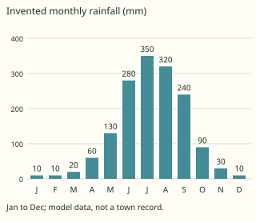

Answer: **1550 mm**
- Typed **129.166666667** (mean) → “That is a monthly mean, not the sum for the year.”
- Typed **340** (range) → “That is the difference between wettest and driest months, not the annual total.”
- Typed **15 500** (tenfold) → “That multiplies an already millimetre total by ten without a unit conversion.”

Full working after a second miss:

> Add each monthly amount once.  
> The annual rainfall of this classroom record is 1550 mm. A real biome classification also needs temperature and other evidence.  

> Read the invented monthly rainfall chart. Add the labels above all monthly bars to obtain the annual total in mm; the vertical-axis tick labels are not extra observations.

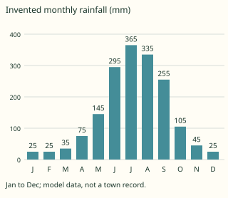

Answer: **1730 mm**
- Typed **144.166666667** (mean) → “That is a monthly mean, not the sum for the year.”
- Typed **340** (range) → “That is the difference between wettest and driest months, not the annual total.”
- Typed **17 300** (tenfold) → “That multiplies an already millimetre total by ten without a unit conversion.”

Full working after a second miss:

> Add each monthly amount once.  
> The annual rainfall of this classroom record is 1730 mm. A real biome classification also needs temperature and other evidence.  

**Practice** `g4-11-assess` · spot the error, level 3 · **authored key**

> Find the incorrect geographical claim.

- ✅ Identical annual totals guarantee identical agricultural conditions.  
  _↳ explanation: The timing and reliability of rainfall also influence water availability._
- ◻️ rainfall timing: the distribution of rain through seasons rather than only its annual sum.  
  _↳ explanation: This distinction is correct: The timing and reliability of rainfall also influence water availability. Look for a claim that reverses the process or makes an unsupported generalisation._
- ◻️ seasonal forest: forest vegetation responding to a pronounced season of reduced moisture.  
  _↳ explanation: This distinction is correct: Seasonal tropical forest differs from an assumed continuously wet model. Look for a claim that reverses the process or makes an unsupported generalisation._
- ◻️ monsoon circulation: a seasonal change in prevailing atmospheric circulation.  
  _↳ explanation: This distinction is correct: It describes a seasonal circulation pattern rather than one isolated storm. Look for a claim that reverses the process or makes an unsupported generalisation._

Full working after a second miss:

> The wrong statement is “Identical annual totals guarantee identical agricultural conditions.”.  
> The timing and reliability of rainfall also influence water availability.  

> Find the incorrect geographical claim.

- ◻️ rainfall timing: the distribution of rain through seasons rather than only its annual sum.  
  _↳ explanation: This distinction is correct: The timing and reliability of rainfall also influence water availability. Look for a claim that reverses the process or makes an unsupported generalisation._
- ◻️ regional variation: differences within and between monsoon-influenced regions.  
  _↳ explanation: This distinction is correct: Relief, circulation and location change the local seasonal pattern. Look for a claim that reverses the process or makes an unsupported generalisation._
- ◻️ monsoon circulation: a seasonal change in prevailing atmospheric circulation.  
  _↳ explanation: This distinction is correct: It describes a seasonal circulation pattern rather than one isolated storm. Look for a claim that reverses the process or makes an unsupported generalisation._
- ✅ Every monsoon region has exactly the same rainy calendar.  
  _↳ explanation: Relief, circulation and location change the local seasonal pattern._

Full working after a second miss:

> The wrong statement is “Every monsoon region has exactly the same rainy calendar.”.  
> Relief, circulation and location change the local seasonal pattern.  

## Lesson 12: Hot desert Biome

Prerequisites: 11 · Skill: g4-12 (The hot desert biome)

**Note** (draft)

> Hot deserts have severe water limitation, often with low and unreliable rainfall and high evaporative demand. Many lie in subtropical belts, such as the Sahara, but position, rain shadows and ocean influences matter. Ground may be rocky, stony or sandy; deserts are not all sand dunes. Vegetation is usually sparse, with adaptations such as reduced leaves, water storage, deep or spreading roots and rapid growth after rain. Some animals avoid daytime heat or conserve water. Not every desert is hot, though this lesson concerns hot deserts.

**Learn: Your goal and connections** (draft)

> By the end, you should be able to explain aridity and adaptations and distinguish low rainfall from absence of life. Builds on: seasonal moisture limitation and monsoon contrasts. Leads to: Mediterranean drought and the drier parts of Cameroon.

**Learn: Explain the geography** (draft)

> Hot deserts have severe water limitation, often with low and unreliable rainfall and high evaporative demand. Many lie in subtropical belts, such as the Sahara, but position, rain shadows and ocean influences matter. Ground may be rocky, stony or sandy; deserts are not all sand dunes. Vegetation is usually sparse, with adaptations such as reduced leaves, water storage, deep or spreading roots and rapid growth after rain. Some animals avoid daytime heat or conserve water. Not every desert is hot, though this lesson concerns hot deserts.

**Learn: Follow the local example or model** (draft)

> An invented desert chart has very small monthly amounts. Its annual total illustrates dryness, while temperature and evaporation evidence would strengthen a water-deficit explanation. Oases concentrate water locally; they do not remove aridity across the whole desert. Pastoralism and irrigated cultivation face water and land constraints. Overuse of scarce water or poor drainage under irrigation can create additional problems, including salinity.

**Learn: Apply and check** (draft)

> Explain each adaptation’s relationship to water or heat without claiming that all plants share it. Distinguish drought, a temporary shortage relative to usual conditions, from aridity, a long-term climatic condition. The Far North of Cameroon includes semi-arid landscapes; do not label the entire region a true hot desert merely because it has a long dry season.

**Learn: key words and examples** (draft)

- **aridity**: a long-term climatic shortage of available moisture
- **water-conserving adaptation**: a feature reducing loss or improving access to scarce water
- **local water source**: a concentration of accessible water within a drier landscape
- **surface diversity**: rocky stony and sandy surfaces rather than dunes alone

Common mistake: “One rain shower permanently ends climatic aridity.” → “a long-term climatic shortage of available moisture.”. A brief event does not replace the longer-term moisture regime.

**Card g4-12-c1** (draft)

> Distinguish the features before applying them.
>
> _aridity: a long-term climatic shortage of available moisture._  
> _water-conserving adaptation: a feature reducing loss or improving access to scarce water._  
> _local water source: a concentration of accessible water within a drier landscape._  
> _surface diversity: rocky stony and sandy surfaces rather than dunes alone._  

Check question: `g4-12-terms` · multiple choice, level 1 · **authored key**, reused from practice

> Which term means rocky stony and sandy surfaces rather than dunes alone?

- ◻️ water-conserving adaptation  
  _↳ feedback if chosen: That concerns a feature reducing loss or improving access to scarce water, rather than the feature asked for._
- ◻️ local water source  
  _↳ feedback if chosen: That concerns a concentration of accessible water within a drier landscape, rather than the feature asked for._
- ✅ surface diversity
- ◻️ aridity  
  _↳ feedback if chosen: That concerns a long-term climatic shortage of available moisture, rather than the feature asked for._

Full working after a second miss:

> Desert classification concerns aridity, not one required surface material.  
> So the answer is “surface diversity”.  

**Card g4-12-c2** (draft)

> Use the evidence in the example, not a place name alone.
>
> _A desert region receives little reliable rain relative to evaporative demand._  
> _A model plant has reduced leaves and a water-storing stem._  
> _An oasis supports growth around a water supply._  
> _A desert photograph shows bare rock and gravel instead of sand dunes._  

Check question: `g4-12-cases` · multiple choice, level 1 · **authored key**, reused from practice

> A model plant has reduced leaves and a water-storing stem.
> Which feature is illustrated?

- ◻️ aridity  
  _↳ feedback if chosen: That identifies a long-term climatic shortage of available moisture. Read the case for evidence of a feature reducing loss or improving access to scarce water._
- ◻️ local water source  
  _↳ feedback if chosen: That identifies a concentration of accessible water within a drier landscape. Read the case for evidence of a feature reducing loss or improving access to scarce water._
- ✅ water-conserving adaptation
- ◻️ surface diversity  
  _↳ feedback if chosen: That identifies rocky stony and sandy surfaces rather than dunes alone. Read the case for evidence of a feature reducing loss or improving access to scarce water._

Full working after a second miss:

> Adaptations differ but commonly address scarce moisture or high heat loads.  
> So the answer is “water-conserving adaptation”.  

**Card g4-12-c3** (draft)

> Explain how the process produces the stated effect.
>
> _A brief event does not replace the longer-term moisture regime._  
> _Adaptations differ but commonly address scarce moisture or high heat loads._  
> _A local supply can support life without changing regional aridity._  
> _Desert classification concerns aridity, not one required surface material._  

Check question: `g4-12-explain-card` · multiple choice, level 1 · **authored key**

> An oasis supports growth around a water supply.
> Which explanation follows?

- ✅ A local supply can support life without changing regional aridity.
- ◻️ Adaptations differ but commonly address scarce moisture or high heat loads.  
  _↳ feedback if chosen: That explanation addresses water-conserving adaptation, rather than the process or relationship in this case._
- ◻️ Desert classification concerns aridity, not one required surface material.  
  _↳ feedback if chosen: That explanation addresses surface diversity, rather than the process or relationship in this case._
- ◻️ A brief event does not replace the longer-term moisture regime.  
  _↳ feedback if chosen: That explanation addresses aridity, rather than the process or relationship in this case._

Full working after a second miss:

> a concentration of accessible water within a drier landscape.  
> So the answer is “A local supply can support life without changing regional aridity.”.  

**Worked example** (draft)

> A desert region receives little reliable rain relative to evaporative demand. Explain the relationship.

1. a long-term climatic shortage of available moisture.
2. A brief event does not replace the longer-term moisture regime.

**Answer:** aridity

**Practice** `g4-12-terms` · multiple choice, level 1 · **authored key**

> Which term means a concentration of accessible water within a drier landscape?

- ✅ local water source
- ◻️ surface diversity  
  _↳ feedback if chosen: That concerns rocky stony and sandy surfaces rather than dunes alone, rather than the feature asked for._
- ◻️ aridity  
  _↳ feedback if chosen: That concerns a long-term climatic shortage of available moisture, rather than the feature asked for._
- ◻️ water-conserving adaptation  
  _↳ feedback if chosen: That concerns a feature reducing loss or improving access to scarce water, rather than the feature asked for._

Full working after a second miss:

> A local supply can support life without changing regional aridity.  
> So the answer is “local water source”.  

> Which term means rocky stony and sandy surfaces rather than dunes alone?

- ◻️ local water source  
  _↳ feedback if chosen: That concerns a concentration of accessible water within a drier landscape, rather than the feature asked for._
- ◻️ aridity  
  _↳ feedback if chosen: That concerns a long-term climatic shortage of available moisture, rather than the feature asked for._
- ◻️ water-conserving adaptation  
  _↳ feedback if chosen: That concerns a feature reducing loss or improving access to scarce water, rather than the feature asked for._
- ✅ surface diversity

Full working after a second miss:

> Desert classification concerns aridity, not one required surface material.  
> So the answer is “surface diversity”.  

**Practice** `g4-12-cases` · multiple choice, level 1 · **authored key**

> A desert photograph shows bare rock and gravel instead of sand dunes.
> Which feature is illustrated?

- ◻️ aridity  
  _↳ feedback if chosen: That identifies a long-term climatic shortage of available moisture. Read the case for evidence of rocky stony and sandy surfaces rather than dunes alone._
- ◻️ local water source  
  _↳ feedback if chosen: That identifies a concentration of accessible water within a drier landscape. Read the case for evidence of rocky stony and sandy surfaces rather than dunes alone._
- ◻️ water-conserving adaptation  
  _↳ feedback if chosen: That identifies a feature reducing loss or improving access to scarce water. Read the case for evidence of rocky stony and sandy surfaces rather than dunes alone._
- ✅ surface diversity

Full working after a second miss:

> Desert classification concerns aridity, not one required surface material.  
> So the answer is “surface diversity”.  

> A desert photograph shows bare rock and gravel instead of sand dunes.
> Which feature is illustrated?

- ◻️ local water source  
  _↳ feedback if chosen: That identifies a concentration of accessible water within a drier landscape. Read the case for evidence of rocky stony and sandy surfaces rather than dunes alone._
- ◻️ aridity  
  _↳ feedback if chosen: That identifies a long-term climatic shortage of available moisture. Read the case for evidence of rocky stony and sandy surfaces rather than dunes alone._
- ✅ surface diversity
- ◻️ water-conserving adaptation  
  _↳ feedback if chosen: That identifies a feature reducing loss or improving access to scarce water. Read the case for evidence of rocky stony and sandy surfaces rather than dunes alone._

Full working after a second miss:

> Desert classification concerns aridity, not one required surface material.  
> So the answer is “surface diversity”.  

**Practice** `g4-12-explain` · multiple choice, level 2 · **authored key**

> A model plant has reduced leaves and a water-storing stem.
> Which explanation follows?

- ◻️ Desert classification concerns aridity, not one required surface material.  
  _↳ feedback if chosen: That explanation addresses surface diversity, rather than the process or relationship in this case._
- ◻️ A brief event does not replace the longer-term moisture regime.  
  _↳ feedback if chosen: That explanation addresses aridity, rather than the process or relationship in this case._
- ◻️ A local supply can support life without changing regional aridity.  
  _↳ feedback if chosen: That explanation addresses local water source, rather than the process or relationship in this case._
- ✅ Adaptations differ but commonly address scarce moisture or high heat loads.

Full working after a second miss:

> a feature reducing loss or improving access to scarce water.  
> So the answer is “Adaptations differ but commonly address scarce moisture or high heat loads.”.  

> A model plant has reduced leaves and a water-storing stem.
> Which explanation follows?

- ◻️ Desert classification concerns aridity, not one required surface material.  
  _↳ feedback if chosen: That explanation addresses surface diversity, rather than the process or relationship in this case._
- ◻️ A brief event does not replace the longer-term moisture regime.  
  _↳ feedback if chosen: That explanation addresses aridity, rather than the process or relationship in this case._
- ◻️ A local supply can support life without changing regional aridity.  
  _↳ feedback if chosen: That explanation addresses local water source, rather than the process or relationship in this case._
- ✅ Adaptations differ but commonly address scarce moisture or high heat loads.

Full working after a second miss:

> a feature reducing loss or improving access to scarce water.  
> So the answer is “Adaptations differ but commonly address scarce moisture or high heat loads.”.  

**Practice** `g4-12-rain-total` · number, level 2 · computed by rule

> Read the invented monthly rainfall chart. Add the labels above all monthly bars to obtain the annual total in mm; the vertical-axis tick labels are not extra observations.

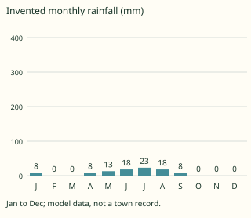

Answer: **96 mm**
- Typed **8** (mean) → “That is a monthly mean, not the sum for the year.”
- Typed **23** (range) → “That is the difference between wettest and driest months, not the annual total.”
- Typed **960** (tenfold) → “That multiplies an already millimetre total by ten without a unit conversion.”

Full working after a second miss:

> Add each monthly amount once.  
> The annual rainfall of this classroom record is 96 mm. A real biome classification also needs temperature and other evidence.  

> Read the invented monthly rainfall chart. Add the labels above all monthly bars to obtain the annual total in mm; the vertical-axis tick labels are not extra observations.

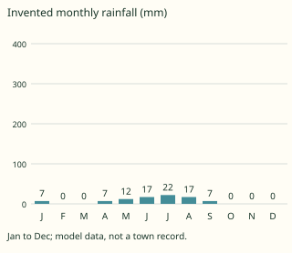

Answer: **89 mm**
- Typed **7.416666667** (mean) → “That is a monthly mean, not the sum for the year.”
- Typed **22** (range) → “That is the difference between wettest and driest months, not the annual total.”
- Typed **890** (tenfold) → “That multiplies an already millimetre total by ten without a unit conversion.”

Full working after a second miss:

> Add each monthly amount once.  
> The annual rainfall of this classroom record is 89 mm. A real biome classification also needs temperature and other evidence.  

**Practice** `g4-12-assess` · spot the error, level 3 · **authored key**

> Find the incorrect geographical claim.

- ✅ One rain shower permanently ends climatic aridity.  
  _↳ explanation: A brief event does not replace the longer-term moisture regime._
- ◻️ local water source: a concentration of accessible water within a drier landscape.  
  _↳ explanation: This distinction is correct: A local supply can support life without changing regional aridity. Look for a claim that reverses the process or makes an unsupported generalisation._
- ◻️ water-conserving adaptation: a feature reducing loss or improving access to scarce water.  
  _↳ explanation: This distinction is correct: Adaptations differ but commonly address scarce moisture or high heat loads. Look for a claim that reverses the process or makes an unsupported generalisation._
- ◻️ aridity: a long-term climatic shortage of available moisture.  
  _↳ explanation: This distinction is correct: A brief event does not replace the longer-term moisture regime. Look for a claim that reverses the process or makes an unsupported generalisation._

Full working after a second miss:

> The wrong statement is “One rain shower permanently ends climatic aridity.”.  
> A brief event does not replace the longer-term moisture regime.  

> Find the incorrect geographical claim.

- ◻️ local water source: a concentration of accessible water within a drier landscape.  
  _↳ explanation: This distinction is correct: A local supply can support life without changing regional aridity. Look for a claim that reverses the process or makes an unsupported generalisation._
- ✅ One rain shower permanently ends climatic aridity.  
  _↳ explanation: A brief event does not replace the longer-term moisture regime._
- ◻️ water-conserving adaptation: a feature reducing loss or improving access to scarce water.  
  _↳ explanation: This distinction is correct: Adaptations differ but commonly address scarce moisture or high heat loads. Look for a claim that reverses the process or makes an unsupported generalisation._
- ◻️ aridity: a long-term climatic shortage of available moisture.  
  _↳ explanation: This distinction is correct: A brief event does not replace the longer-term moisture regime. Look for a claim that reverses the process or makes an unsupported generalisation._

Full working after a second miss:

> The wrong statement is “One rain shower permanently ends climatic aridity.”.  
> A brief event does not replace the longer-term moisture regime.  

## Lesson 13: Mediterranean biome

Prerequisites: 12 · Skill: g4-13 (The Mediterranean biome)

**Note** (draft)

> Mediterranean-type climates have generally hot or warm dry summers and milder wetter winters. They occur around the Mediterranean Sea and in other western-margin regions, including parts of California, central Chile, the Cape and southwestern Australia. Seasons reverse between hemispheres. Vegetation often includes evergreen shrubs and trees with small tough leaves; woodland and more open formations vary with site and disturbance. Summer drought influences growth, fire risk and cultivation. The biome is not defined by rain falling only in the warmest season.

**Learn: Your goal and connections** (draft)

> By the end, you should be able to relate dry summers and wetter winters to plant adaptations and seasonal land-use constraints. Builds on: hot-desert aridity and seasonal vegetation responses. Leads to: comparing Cameroon’s environments with global biome patterns.

**Learn: Explain the geography** (draft)

> Mediterranean-type climates have generally hot or warm dry summers and milder wetter winters. They occur around the Mediterranean Sea and in other western-margin regions, including parts of California, central Chile, the Cape and southwestern Australia. Seasons reverse between hemispheres. Vegetation often includes evergreen shrubs and trees with small tough leaves; woodland and more open formations vary with site and disturbance. Summer drought influences growth, fire risk and cultivation. The biome is not defined by rain falling only in the warmest season.

**Learn: Follow the local example or model** (draft)

> The chart is an invented northern-hemisphere record with summer dryness and wetter cooler-season months. A southern-hemisphere example would shift the seasonal calendar. Olives, vines and other crops are associated with parts of Mediterranean agriculture, but their viability depends on local conditions and management. Irrigation may supplement water but has costs and resource limits. Cameroon’s tropical seasons should not be relabelled Mediterranean merely because some months are dry.

**Learn: Apply and check** (draft)

> State which hemisphere is used before naming summer months. Explain how tough leaves or seasonal growth help with drought, without treating all shrubs as identical. A humid winter and dry summer are a pattern, not a promise that every year has equal rain. Compare climate evidence rather than assigning a biome from a crop name alone.

**Learn: key words and examples** (draft)

- **summer drought**: a dry period coinciding with the warm season
- **sclerophyll feature**: small tough leaves helping plants cope with seasonal stress
- **hemisphere contrast**: opposite seasonal calendars north and south of the Equator
- **resource constraint**: a limit affecting how people use seasonal water and land

Common mistake: “Mediterranean rainfall is necessarily greatest in every summer month.” → “a dry period coinciding with the warm season.”. The characteristic contrast is dry summer and wetter cooler season.

**Card g4-13-c1** (draft)

> Distinguish the features before applying them.
>
> _summer drought: a dry period coinciding with the warm season._  
> _sclerophyll feature: small tough leaves helping plants cope with seasonal stress._  
> _hemisphere contrast: opposite seasonal calendars north and south of the Equator._  
> _resource constraint: a limit affecting how people use seasonal water and land._  

Check question: `g4-13-terms` · multiple choice, level 1 · **authored key**, reused from practice

> Which term means opposite seasonal calendars north and south of the Equator?

- ◻️ summer drought  
  _↳ feedback if chosen: That concerns a dry period coinciding with the warm season, rather than the feature asked for._
- ✅ hemisphere contrast
- ◻️ resource constraint  
  _↳ feedback if chosen: That concerns a limit affecting how people use seasonal water and land, rather than the feature asked for._
- ◻️ sclerophyll feature  
  _↳ feedback if chosen: That concerns small tough leaves helping plants cope with seasonal stress, rather than the feature asked for._

Full working after a second miss:

> Seasonal timing reverses between hemispheres.  
> So the answer is “hemisphere contrast”.  

**Card g4-13-c2** (draft)

> Use the evidence in the example, not a place name alone.
>
> _The northern-hemisphere model has little rain during its summer months._  
> _An evergreen shrub has firm leaves with a resistant surface._  
> _The Cape’s summer occurs in a different part of the year from the Mediterranean basin’s summer._  
> _A farm considers available water before extending irrigated cultivation._  

Check question: `g4-13-cases` · multiple choice, level 1 · **authored key**, reused from practice

> An evergreen shrub has firm leaves with a resistant surface.
> Which feature is illustrated?

- ◻️ summer drought  
  _↳ feedback if chosen: That identifies a dry period coinciding with the warm season. Read the case for evidence of small tough leaves helping plants cope with seasonal stress._
- ✅ sclerophyll feature
- ◻️ hemisphere contrast  
  _↳ feedback if chosen: That identifies opposite seasonal calendars north and south of the Equator. Read the case for evidence of small tough leaves helping plants cope with seasonal stress._
- ◻️ resource constraint  
  _↳ feedback if chosen: That identifies a limit affecting how people use seasonal water and land. Read the case for evidence of small tough leaves helping plants cope with seasonal stress._

Full working after a second miss:

> Tough-leaved vegetation includes features associated with limiting water loss.  
> So the answer is “sclerophyll feature”.  

**Card g4-13-c3** (draft)

> Explain how the process produces the stated effect.
>
> _The characteristic contrast is dry summer and wetter cooler season._  
> _Tough-leaved vegetation includes features associated with limiting water loss._  
> _Seasonal timing reverses between hemispheres._  
> _Irrigation reallocates a finite resource and requires suitable management._  

Check question: `g4-13-explain-card` · multiple choice, level 1 · **authored key**

> The northern-hemisphere model has little rain during its summer months.
> Which explanation follows?

- ◻️ Irrigation reallocates a finite resource and requires suitable management.  
  _↳ feedback if chosen: That explanation addresses resource constraint, rather than the process or relationship in this case._
- ◻️ Tough-leaved vegetation includes features associated with limiting water loss.  
  _↳ feedback if chosen: That explanation addresses sclerophyll feature, rather than the process or relationship in this case._
- ✅ The characteristic contrast is dry summer and wetter cooler season.
- ◻️ Seasonal timing reverses between hemispheres.  
  _↳ feedback if chosen: That explanation addresses hemisphere contrast, rather than the process or relationship in this case._

Full working after a second miss:

> a dry period coinciding with the warm season.  
> So the answer is “The characteristic contrast is dry summer and wetter cooler season.”.  

**Worked example** (draft)

> The northern-hemisphere model has little rain during its summer months. Explain the relationship.

1. a dry period coinciding with the warm season.
2. The characteristic contrast is dry summer and wetter cooler season.

**Answer:** summer drought

**Practice** `g4-13-terms` · multiple choice, level 1 · **authored key**

> Which term means opposite seasonal calendars north and south of the Equator?

- ◻️ sclerophyll feature  
  _↳ feedback if chosen: That concerns small tough leaves helping plants cope with seasonal stress, rather than the feature asked for._
- ◻️ resource constraint  
  _↳ feedback if chosen: That concerns a limit affecting how people use seasonal water and land, rather than the feature asked for._
- ◻️ summer drought  
  _↳ feedback if chosen: That concerns a dry period coinciding with the warm season, rather than the feature asked for._
- ✅ hemisphere contrast

Full working after a second miss:

> Seasonal timing reverses between hemispheres.  
> So the answer is “hemisphere contrast”.  

> Which term means a limit affecting how people use seasonal water and land?

- ✅ resource constraint
- ◻️ sclerophyll feature  
  _↳ feedback if chosen: That concerns small tough leaves helping plants cope with seasonal stress, rather than the feature asked for._
- ◻️ summer drought  
  _↳ feedback if chosen: That concerns a dry period coinciding with the warm season, rather than the feature asked for._
- ◻️ hemisphere contrast  
  _↳ feedback if chosen: That concerns opposite seasonal calendars north and south of the Equator, rather than the feature asked for._

Full working after a second miss:

> Irrigation reallocates a finite resource and requires suitable management.  
> So the answer is “resource constraint”.  

**Practice** `g4-13-cases` · multiple choice, level 1 · **authored key**

> An evergreen shrub has firm leaves with a resistant surface.
> Which feature is illustrated?

- ◻️ hemisphere contrast  
  _↳ feedback if chosen: That identifies opposite seasonal calendars north and south of the Equator. Read the case for evidence of small tough leaves helping plants cope with seasonal stress._
- ◻️ summer drought  
  _↳ feedback if chosen: That identifies a dry period coinciding with the warm season. Read the case for evidence of small tough leaves helping plants cope with seasonal stress._
- ✅ sclerophyll feature
- ◻️ resource constraint  
  _↳ feedback if chosen: That identifies a limit affecting how people use seasonal water and land. Read the case for evidence of small tough leaves helping plants cope with seasonal stress._

Full working after a second miss:

> Tough-leaved vegetation includes features associated with limiting water loss.  
> So the answer is “sclerophyll feature”.  

> A farm considers available water before extending irrigated cultivation.
> Which feature is illustrated?

- ◻️ summer drought  
  _↳ feedback if chosen: That identifies a dry period coinciding with the warm season. Read the case for evidence of a limit affecting how people use seasonal water and land._
- ◻️ sclerophyll feature  
  _↳ feedback if chosen: That identifies small tough leaves helping plants cope with seasonal stress. Read the case for evidence of a limit affecting how people use seasonal water and land._
- ◻️ hemisphere contrast  
  _↳ feedback if chosen: That identifies opposite seasonal calendars north and south of the Equator. Read the case for evidence of a limit affecting how people use seasonal water and land._
- ✅ resource constraint

Full working after a second miss:

> Irrigation reallocates a finite resource and requires suitable management.  
> So the answer is “resource constraint”.  

**Practice** `g4-13-explain` · multiple choice, level 2 · **authored key**

> The Cape’s summer occurs in a different part of the year from the Mediterranean basin’s summer.
> Which explanation follows?

- ◻️ Tough-leaved vegetation includes features associated with limiting water loss.  
  _↳ feedback if chosen: That explanation addresses sclerophyll feature, rather than the process or relationship in this case._
- ✅ Seasonal timing reverses between hemispheres.
- ◻️ Irrigation reallocates a finite resource and requires suitable management.  
  _↳ feedback if chosen: That explanation addresses resource constraint, rather than the process or relationship in this case._
- ◻️ The characteristic contrast is dry summer and wetter cooler season.  
  _↳ feedback if chosen: That explanation addresses summer drought, rather than the process or relationship in this case._

Full working after a second miss:

> opposite seasonal calendars north and south of the Equator.  
> So the answer is “Seasonal timing reverses between hemispheres.”.  

> A farm considers available water before extending irrigated cultivation.
> Which explanation follows?

- ◻️ Tough-leaved vegetation includes features associated with limiting water loss.  
  _↳ feedback if chosen: That explanation addresses sclerophyll feature, rather than the process or relationship in this case._
- ✅ Irrigation reallocates a finite resource and requires suitable management.
- ◻️ The characteristic contrast is dry summer and wetter cooler season.  
  _↳ feedback if chosen: That explanation addresses summer drought, rather than the process or relationship in this case._
- ◻️ Seasonal timing reverses between hemispheres.  
  _↳ feedback if chosen: That explanation addresses hemisphere contrast, rather than the process or relationship in this case._

Full working after a second miss:

> a limit affecting how people use seasonal water and land.  
> So the answer is “Irrigation reallocates a finite resource and requires suitable management.”.  

**Practice** `g4-13-rain-total` · number, level 2 · computed by rule

> Read the invented monthly rainfall chart. Add the labels above all monthly bars to obtain the annual total in mm; the vertical-axis tick labels are not extra observations.

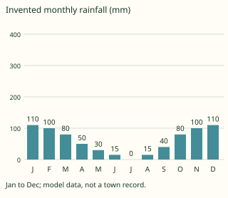

Answer: **730 mm**
- Typed **60.833333333** (mean) → “That is a monthly mean, not the sum for the year.”
- Typed **110** (range) → “That is the difference between wettest and driest months, not the annual total.”
- Typed **7300** (tenfold) → “That multiplies an already millimetre total by ten without a unit conversion.”

Full working after a second miss:

> Add each monthly amount once.  
> The annual rainfall of this classroom record is 730 mm. A real biome classification also needs temperature and other evidence.  

> Read the invented monthly rainfall chart. Add the labels above all monthly bars to obtain the annual total in mm; the vertical-axis tick labels are not extra observations.

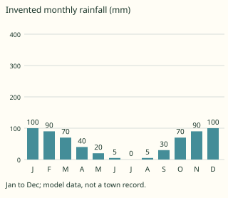

Answer: **620 mm**
- Typed **51.666666667** (mean) → “That is a monthly mean, not the sum for the year.”
- Typed **100** (range) → “That is the difference between wettest and driest months, not the annual total.”
- Typed **6200** (tenfold) → “That multiplies an already millimetre total by ten without a unit conversion.”

Full working after a second miss:

> Add each monthly amount once.  
> The annual rainfall of this classroom record is 620 mm. A real biome classification also needs temperature and other evidence.  

**Practice** `g4-13-assess` · spot the error, level 3 · **authored key**

> Find the incorrect geographical claim.

- ◻️ sclerophyll feature: small tough leaves helping plants cope with seasonal stress.  
  _↳ explanation: This distinction is correct: Tough-leaved vegetation includes features associated with limiting water loss. Look for a claim that reverses the process or makes an unsupported generalisation._
- ◻️ summer drought: a dry period coinciding with the warm season.  
  _↳ explanation: This distinction is correct: The characteristic contrast is dry summer and wetter cooler season. Look for a claim that reverses the process or makes an unsupported generalisation._
- ◻️ resource constraint: a limit affecting how people use seasonal water and land.  
  _↳ explanation: This distinction is correct: Irrigation reallocates a finite resource and requires suitable management. Look for a claim that reverses the process or makes an unsupported generalisation._
- ✅ Summer occurs in the same months in both hemispheres.  
  _↳ explanation: Seasonal timing reverses between hemispheres._

Full working after a second miss:

> The wrong statement is “Summer occurs in the same months in both hemispheres.”.  
> Seasonal timing reverses between hemispheres.  

> Find the incorrect geographical claim.

- ✅ Mediterranean rainfall is necessarily greatest in every summer month.  
  _↳ explanation: The characteristic contrast is dry summer and wetter cooler season._
- ◻️ resource constraint: a limit affecting how people use seasonal water and land.  
  _↳ explanation: This distinction is correct: Irrigation reallocates a finite resource and requires suitable management. Look for a claim that reverses the process or makes an unsupported generalisation._
- ◻️ sclerophyll feature: small tough leaves helping plants cope with seasonal stress.  
  _↳ explanation: This distinction is correct: Tough-leaved vegetation includes features associated with limiting water loss. Look for a claim that reverses the process or makes an unsupported generalisation._
- ◻️ summer drought: a dry period coinciding with the warm season.  
  _↳ explanation: This distinction is correct: The characteristic contrast is dry summer and wetter cooler season. Look for a claim that reverses the process or makes an unsupported generalisation._

Full working after a second miss:

> The wrong statement is “Mediterranean rainfall is necessarily greatest in every summer month.”.  
> The characteristic contrast is dry summer and wetter cooler season.  

## Lesson 14: Situation of Cameroon (Location, Size)

Prerequisites: 8, 9, 11, 12, 13 · Skill: g4-14 (Cameroon: location and size)

**Note** (draft)

> Cameroon lies in central-western Africa, north of the Equator and east of Greenwich, with a coast on the Gulf of Guinea. Its neighbours are Nigeria, Chad, the Central African Republic, the Republic of the Congo, Gabon and Equatorial Guinea. Yaoundé is the capital; Douala is a major coastal city. The country extends from a humid coast towards the Lake Chad basin. Its surface area is about 475000 km²; published exact totals vary by source and convention, so this is deliberately approximate.

**Learn: Your goal and connections** (draft)

> By the end, you should be able to describe Cameroon’s position and neighbours and read a coordinate on a regional graticule. Builds on: Form Three’s coordinates and this term’s global biome comparisons. Leads to: Cameroon’s relief, rivers and climatic regions.

**Learn: Explain the geography** (draft)

> Cameroon lies in central-western Africa, north of the Equator and east of Greenwich, with a coast on the Gulf of Guinea. Its neighbours are Nigeria, Chad, the Central African Republic, the Republic of the Congo, Gabon and Equatorial Guinea. Yaoundé is the capital; Douala is a major coastal city. The country extends from a humid coast towards the Lake Chad basin. Its surface area is about 475 000 km²; published exact totals vary by source and convention, so this is deliberately approximate.

**Learn: Follow the local example or model** (draft)

> Latitude describes north-south position; longitude describes east-west position. Cameroon’s length and relief help explain environmental contrasts, but latitude alone does not determine rainfall or land use. The exercise uses a fictional station on a regional graticule, not the measured location of a named town. A coordinate point does not represent the outline, area or administrative boundary of the whole country.

**Learn: Apply and check** (draft)

> Read hemisphere labels and write latitude before longitude. Distinguish a neighbouring country from an internal region and the Republic of the Congo from the Democratic Republic of the Congo. Use an atlas for precise boundaries and measurements. Do not treat an approximate area as an exact cadastral figure.

**Learn: key words and examples** (draft)

- **absolute location**: position described using geographical coordinates
- **relative location**: position described in relation to other places or features
- **neighbouring states**: countries sharing Cameroon’s land boundaries
- **approximate area**: a rounded measure of the country’s surface extent

Common mistake: “Latitude and longitude are the same coordinate written twice.” → “position described using geographical coordinates.”. They measure position from different reference lines and must be kept distinct.

**Card g4-14-c1** (draft)

> Distinguish the features before applying them.
>
> _absolute location: position described using geographical coordinates._  
> _relative location: position described in relation to other places or features._  
> _neighbouring states: countries sharing Cameroon’s land boundaries._  
> _approximate area: a rounded measure of the country’s surface extent._  

Check question: `g4-14-terms` · multiple choice, level 1 · **authored key**, reused from practice

> Which term means position described using geographical coordinates?

- ◻️ neighbouring states  
  _↳ feedback if chosen: That concerns countries sharing Cameroon’s land boundaries, rather than the feature asked for._
- ◻️ relative location  
  _↳ feedback if chosen: That concerns position described in relation to other places or features, rather than the feature asked for._
- ◻️ approximate area  
  _↳ feedback if chosen: That concerns a rounded measure of the country’s surface extent, rather than the feature asked for._
- ✅ absolute location

Full working after a second miss:

> They measure position from different reference lines and must be kept distinct.  
> So the answer is “absolute location”.  

**Card g4-14-c2** (draft)

> Use the evidence in the example, not a place name alone.
>
> _A classroom station is described by a latitude and longitude._  
> _Cameroon lies beside the Gulf of Guinea and borders Nigeria._  
> _Nigeria, Chad, CAR, Congo, Gabon and Equatorial Guinea adjoin Cameroon._  
> _The lesson uses about 475 000 km² rather than claiming one exact surveyed total._  

Check question: `g4-14-cases` · multiple choice, level 1 · **authored key**, reused from practice

> Cameroon lies beside the Gulf of Guinea and borders Nigeria.
> Which feature is illustrated?

- ◻️ approximate area  
  _↳ feedback if chosen: That identifies a rounded measure of the country’s surface extent. Read the case for evidence of position described in relation to other places or features._
- ◻️ neighbouring states  
  _↳ feedback if chosen: That identifies countries sharing Cameroon’s land boundaries. Read the case for evidence of position described in relation to other places or features._
- ◻️ absolute location  
  _↳ feedback if chosen: That identifies position described using geographical coordinates. Read the case for evidence of position described in relation to other places or features._
- ✅ relative location

Full working after a second miss:

> A relative description locates broadly without identifying a precise point.  
> So the answer is “relative location”.  

**Card g4-14-c3** (draft)

> Explain how the process produces the stated effect.
>
> _They measure position from different reference lines and must be kept distinct._  
> _A relative description locates broadly without identifying a precise point._  
> _The neighbour is the Republic of the Congo; the two Congo states are distinct._  
> _Area and distance measure different quantities and require different units._  

Check question: `g4-14-explain-card` · multiple choice, level 1 · **authored key**

> The lesson uses about 475 000 km² rather than claiming one exact surveyed total.
> Which explanation follows?

- ◻️ The neighbour is the Republic of the Congo; the two Congo states are distinct.  
  _↳ feedback if chosen: That explanation addresses neighbouring states, rather than the process or relationship in this case._
- ◻️ They measure position from different reference lines and must be kept distinct.  
  _↳ feedback if chosen: That explanation addresses absolute location, rather than the process or relationship in this case._
- ✅ Area and distance measure different quantities and require different units.
- ◻️ A relative description locates broadly without identifying a precise point.  
  _↳ feedback if chosen: That explanation addresses relative location, rather than the process or relationship in this case._

Full working after a second miss:

> a rounded measure of the country’s surface extent.  
> So the answer is “Area and distance measure different quantities and require different units.”.  

**Worked example** (draft)

> A classroom station is described by a latitude and longitude. Explain the relationship.

1. position described using geographical coordinates.
2. They measure position from different reference lines and must be kept distinct.

**Answer:** absolute location

**Practice** `g4-14-terms` · multiple choice, level 1 · **authored key**

> Which term means countries sharing Cameroon’s land boundaries?

- ◻️ absolute location  
  _↳ feedback if chosen: That concerns position described using geographical coordinates, rather than the feature asked for._
- ◻️ approximate area  
  _↳ feedback if chosen: That concerns a rounded measure of the country’s surface extent, rather than the feature asked for._
- ✅ neighbouring states
- ◻️ relative location  
  _↳ feedback if chosen: That concerns position described in relation to other places or features, rather than the feature asked for._

Full working after a second miss:

> The neighbour is the Republic of the Congo; the two Congo states are distinct.  
> So the answer is “neighbouring states”.  

> Which term means position described using geographical coordinates?

- ◻️ approximate area  
  _↳ feedback if chosen: That concerns a rounded measure of the country’s surface extent, rather than the feature asked for._
- ◻️ neighbouring states  
  _↳ feedback if chosen: That concerns countries sharing Cameroon’s land boundaries, rather than the feature asked for._
- ◻️ relative location  
  _↳ feedback if chosen: That concerns position described in relation to other places or features, rather than the feature asked for._
- ✅ absolute location

Full working after a second miss:

> They measure position from different reference lines and must be kept distinct.  
> So the answer is “absolute location”.  

**Practice** `g4-14-cases` · multiple choice, level 1 · **authored key**

> A classroom station is described by a latitude and longitude.
> Which feature is illustrated?

- ✅ absolute location
- ◻️ relative location  
  _↳ feedback if chosen: That identifies position described in relation to other places or features. Read the case for evidence of position described using geographical coordinates._
- ◻️ approximate area  
  _↳ feedback if chosen: That identifies a rounded measure of the country’s surface extent. Read the case for evidence of position described using geographical coordinates._
- ◻️ neighbouring states  
  _↳ feedback if chosen: That identifies countries sharing Cameroon’s land boundaries. Read the case for evidence of position described using geographical coordinates._

Full working after a second miss:

> They measure position from different reference lines and must be kept distinct.  
> So the answer is “absolute location”.  

> The lesson uses about 475 000 km² rather than claiming one exact surveyed total.
> Which feature is illustrated?

- ◻️ neighbouring states  
  _↳ feedback if chosen: That identifies countries sharing Cameroon’s land boundaries. Read the case for evidence of a rounded measure of the country’s surface extent._
- ◻️ absolute location  
  _↳ feedback if chosen: That identifies position described using geographical coordinates. Read the case for evidence of a rounded measure of the country’s surface extent._
- ◻️ relative location  
  _↳ feedback if chosen: That identifies position described in relation to other places or features. Read the case for evidence of a rounded measure of the country’s surface extent._
- ✅ approximate area

Full working after a second miss:

> Area and distance measure different quantities and require different units.  
> So the answer is “approximate area”.  

**Practice** `g4-14-explain` · multiple choice, level 2 · **authored key**

> The lesson uses about 475 000 km² rather than claiming one exact surveyed total.
> Which explanation follows?

- ✅ Area and distance measure different quantities and require different units.
- ◻️ The neighbour is the Republic of the Congo; the two Congo states are distinct.  
  _↳ feedback if chosen: That explanation addresses neighbouring states, rather than the process or relationship in this case._
- ◻️ A relative description locates broadly without identifying a precise point.  
  _↳ feedback if chosen: That explanation addresses relative location, rather than the process or relationship in this case._
- ◻️ They measure position from different reference lines and must be kept distinct.  
  _↳ feedback if chosen: That explanation addresses absolute location, rather than the process or relationship in this case._

Full working after a second miss:

> a rounded measure of the country’s surface extent.  
> So the answer is “Area and distance measure different quantities and require different units.”.  

> A classroom station is described by a latitude and longitude.
> Which explanation follows?

- ✅ They measure position from different reference lines and must be kept distinct.
- ◻️ A relative description locates broadly without identifying a precise point.  
  _↳ feedback if chosen: That explanation addresses relative location, rather than the process or relationship in this case._
- ◻️ Area and distance measure different quantities and require different units.  
  _↳ feedback if chosen: That explanation addresses approximate area, rather than the process or relationship in this case._
- ◻️ The neighbour is the Republic of the Congo; the two Congo states are distinct.  
  _↳ feedback if chosen: That explanation addresses neighbouring states, rather than the process or relationship in this case._

Full working after a second miss:

> position described using geographical coordinates.  
> So the answer is “They measure position from different reference lines and must be kept distinct.”.  

**Practice** `g4-14-coordinate` · multiple choice, level 2 · computed by rule

> Read classroom station P on this regional graticule. Choose latitude first, then longitude. P is fictional, not a surveyed town.

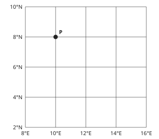

- ◻️ 10°N, 8°E  
  _↳ feedback if chosen: That exchanges the latitude and longitude values._
- ◻️ 8°N, 10°W  
  _↳ feedback if chosen: The map labels east, not west, of Greenwich._
- ◻️ 8°S, 10°E  
  _↳ feedback if chosen: The map labels north, not south, of the Equator._
- ✅ 8°N, 10°E

Full working after a second miss:

> Read the parallel through P and then its meridian.  
> The coordinate is 8°N, 10°E.  

> Read classroom station P on this regional graticule. Choose latitude first, then longitude. P is fictional, not a surveyed town.

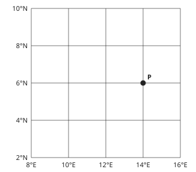

- ◻️ 14°N, 6°E  
  _↳ feedback if chosen: That exchanges the latitude and longitude values._
- ✅ 6°N, 14°E
- ◻️ 6°S, 14°E  
  _↳ feedback if chosen: The map labels north, not south, of the Equator._
- ◻️ 6°N, 14°W  
  _↳ feedback if chosen: The map labels east, not west, of Greenwich._

Full working after a second miss:

> Read the parallel through P and then its meridian.  
> The coordinate is 6°N, 14°E.  

**Practice** `g4-14-assess` · spot the error, level 3 · **authored key**

> Find the incorrect geographical claim.

- ◻️ absolute location: position described using geographical coordinates.  
  _↳ explanation: This distinction is correct: They measure position from different reference lines and must be kept distinct. Look for a claim that reverses the process or makes an unsupported generalisation._
- ◻️ relative location: position described in relation to other places or features.  
  _↳ explanation: This distinction is correct: A relative description locates broadly without identifying a precise point. Look for a claim that reverses the process or makes an unsupported generalisation._
- ◻️ approximate area: a rounded measure of the country’s surface extent.  
  _↳ explanation: This distinction is correct: Area and distance measure different quantities and require different units. Look for a claim that reverses the process or makes an unsupported generalisation._
- ✅ Latitude and longitude are the same coordinate written twice.  
  _↳ explanation: They measure position from different reference lines and must be kept distinct._

Full working after a second miss:

> The wrong statement is “Latitude and longitude are the same coordinate written twice.”.  
> They measure position from different reference lines and must be kept distinct.  

> Find the incorrect geographical claim.

- ✅ An area in km² is a linear distance in km.  
  _↳ explanation: Area and distance measure different quantities and require different units._
- ◻️ absolute location: position described using geographical coordinates.  
  _↳ explanation: This distinction is correct: They measure position from different reference lines and must be kept distinct. Look for a claim that reverses the process or makes an unsupported generalisation._
- ◻️ neighbouring states: countries sharing Cameroon’s land boundaries.  
  _↳ explanation: This distinction is correct: The neighbour is the Republic of the Congo; the two Congo states are distinct. Look for a claim that reverses the process or makes an unsupported generalisation._
- ◻️ relative location: position described in relation to other places or features.  
  _↳ explanation: This distinction is correct: A relative description locates broadly without identifying a precise point. Look for a claim that reverses the process or makes an unsupported generalisation._

Full working after a second miss:

> The wrong statement is “An area in km² is a linear distance in km.”.  
> Area and distance measure different quantities and require different units.  

## Lesson 15: Relief of Cameroon

Prerequisites: 4, 14 · Skill: g4-15 (Relief of Cameroon)

**Note** (draft)

> Cameroon’s relief includes coastal lowlands, the South Cameroon Plateau, western highlands, the Adamawa Plateau and northern lowlands. Mount Cameroon rises above 4000 m near the coast. The western highlands include mountains and plateaus rather than a uniformly flat surface. Adamawa forms an important elevated zone between wetter southern and drier northern landscapes. A lowland is low relative to surrounding regions, not necessarily below sea level. Relief influences drainage, temperature, rainfall exposure, transport and land use without determining them alone.

**Learn: Your goal and connections** (draft)

> By the end, you should be able to locate broad relief regions and distinguish elevation from relative height and gradient. Builds on: Cameroon’s location and soil-erosion processes. Leads to: drainage divides and the influence of altitude on climate.

**Learn: Explain the geography** (draft)

> Cameroon’s relief includes coastal lowlands, the South Cameroon Plateau, western highlands, the Adamawa Plateau and northern lowlands. Mount Cameroon rises above 4000 m near the coast. The western highlands include mountains and plateaus rather than a uniformly flat surface. Adamawa forms an important elevated zone between wetter southern and drier northern landscapes. A lowland is low relative to surrounding regions, not necessarily below sea level. Relief influences drainage, temperature, rainfall exposure, transport and land use without determining them alone.

**Learn: Follow the local example or model** (draft)

> Compare the coastal plain around Douala with plateau country around Yaoundé and the western highlands. Greater elevation often brings cooler conditions, while steepness can complicate transport and increase erosion exposure where cover is removed. A high plateau can have locally gentle slopes; altitude and gradient are different properties. The arithmetic uses invented points, not a claimed surveyed summit or valley.

**Learn: Apply and check** (draft)

> Name the region, describe height and form, then explain one consequence with a qualification. Calculate relative height by subtracting elevations measured from the same datum. Do not interpret a higher point as automatically steeper, safer or more fertile. Exact peak elevations and regional boundaries require the chosen atlas convention.

**Learn: key words and examples** (draft)

- **coastal lowland**: relatively low terrain bordering the sea
- **plateau**: an elevated area that may contain locally gentle surfaces and incised valleys
- **western highlands**: the mountainous and plateau terrain of western Cameroon
- **Adamawa transition**: an elevated central zone influencing drainage and regional environmental contrasts
- **relative height**: the difference between elevations measured from the same datum

Common mistake: “Coastal lowland must be below sea level everywhere.” → “relatively low terrain bordering the sea.”. Lowland describes relative elevation and relief, not a universal negative altitude.

**Card g4-15-c1** (draft)

> Distinguish the features before applying them.
>
> _coastal lowland: relatively low terrain bordering the sea._  
> _plateau: an elevated area that may contain locally gentle surfaces and incised valleys._  
> _western highlands: the mountainous and plateau terrain of western Cameroon._  
> _Adamawa transition: an elevated central zone influencing drainage and regional environmental contrasts._  
> _relative height: the difference between elevations measured from the same datum._  

Check question: `g4-15-terms` · multiple choice, level 1 · **authored key**, reused from practice

> Which term means an elevated area that may contain locally gentle surfaces and incised valleys?

- ◻️ western highlands  
  _↳ feedback if chosen: That concerns the mountainous and plateau terrain of western Cameroon, rather than the feature asked for._
- ◻️ coastal lowland  
  _↳ feedback if chosen: That concerns relatively low terrain bordering the sea, rather than the feature asked for._
- ✅ plateau
- ◻️ Adamawa transition  
  _↳ feedback if chosen: That concerns an elevated central zone influencing drainage and regional environmental contrasts, rather than the feature asked for._

Full working after a second miss:

> An elevated region can be dissected and locally varied.  
> So the answer is “plateau”.  

**Card g4-15-c2** (draft)

> Use the evidence in the example, not a place name alone.
>
> _The Douala coastal setting contrasts with inland elevated terrain._  
> _The South Cameroon Plateau supports elevated terrain around the Yaoundé region._  
> _A comparison includes upland landscapes near Bamenda and the western volcanic massifs._  
> _The Adamawa Plateau separates and links broad northern and southern settings._  
> _A record subtracts valley elevation from summit elevation._  

Check question: `g4-15-cases` · multiple choice, level 1 · **authored key**, reused from practice

> The Adamawa Plateau separates and links broad northern and southern settings.
> Which feature is illustrated?

- ◻️ coastal lowland  
  _↳ feedback if chosen: That identifies relatively low terrain bordering the sea. Read the case for evidence of an elevated central zone influencing drainage and regional environmental contrasts._
- ◻️ western highlands  
  _↳ feedback if chosen: That identifies the mountainous and plateau terrain of western Cameroon. Read the case for evidence of an elevated central zone influencing drainage and regional environmental contrasts._
- ✅ Adamawa transition
- ◻️ plateau  
  _↳ feedback if chosen: That identifies an elevated area that may contain locally gentle surfaces and incised valleys. Read the case for evidence of an elevated central zone influencing drainage and regional environmental contrasts._

Full working after a second miss:

> It is an inland elevated region, not the coastal lowland.  
> So the answer is “Adamawa transition”.  

**Card g4-15-c3** (draft)

> Explain how the process produces the stated effect.
>
> _Lowland describes relative elevation and relief, not a universal negative altitude._  
> _An elevated region can be dissected and locally varied._  
> _Highland relief includes differences in local form, elevation and exposure._  
> _It is an inland elevated region, not the coastal lowland._  
> _The reference level differs; relative height needs a stated comparison._  

Check question: `g4-15-explain-card` · multiple choice, level 1 · **authored key**

> The South Cameroon Plateau supports elevated terrain around the Yaoundé region.
> Which explanation follows?

- ◻️ Highland relief includes differences in local form, elevation and exposure.  
  _↳ feedback if chosen: That explanation addresses western highlands, rather than the process or relationship in this case._
- ✅ An elevated region can be dissected and locally varied.
- ◻️ Lowland describes relative elevation and relief, not a universal negative altitude.  
  _↳ feedback if chosen: That explanation addresses coastal lowland, rather than the process or relationship in this case._
- ◻️ It is an inland elevated region, not the coastal lowland.  
  _↳ feedback if chosen: That explanation addresses Adamawa transition, rather than the process or relationship in this case._

Full working after a second miss:

> an elevated area that may contain locally gentle surfaces and incised valleys.  
> So the answer is “An elevated region can be dissected and locally varied.”.  

**Worked example** (draft)

> The Douala coastal setting contrasts with inland elevated terrain. Explain the relationship.

1. relatively low terrain bordering the sea.
2. Lowland describes relative elevation and relief, not a universal negative altitude.

**Answer:** coastal lowland

**Practice** `g4-15-terms` · multiple choice, level 1 · **authored key**

> Which term means the mountainous and plateau terrain of western Cameroon?

- ◻️ coastal lowland  
  _↳ feedback if chosen: That concerns relatively low terrain bordering the sea, rather than the feature asked for._
- ◻️ plateau  
  _↳ feedback if chosen: That concerns an elevated area that may contain locally gentle surfaces and incised valleys, rather than the feature asked for._
- ◻️ Adamawa transition  
  _↳ feedback if chosen: That concerns an elevated central zone influencing drainage and regional environmental contrasts, rather than the feature asked for._
- ✅ western highlands

Full working after a second miss:

> Highland relief includes differences in local form, elevation and exposure.  
> So the answer is “western highlands”.  

> Which term means the difference between elevations measured from the same datum?

- ✅ relative height
- ◻️ plateau  
  _↳ feedback if chosen: That concerns an elevated area that may contain locally gentle surfaces and incised valleys, rather than the feature asked for._
- ◻️ western highlands  
  _↳ feedback if chosen: That concerns the mountainous and plateau terrain of western Cameroon, rather than the feature asked for._
- ◻️ coastal lowland  
  _↳ feedback if chosen: That concerns relatively low terrain bordering the sea, rather than the feature asked for._

Full working after a second miss:

> The reference level differs; relative height needs a stated comparison.  
> So the answer is “relative height”.  

**Practice** `g4-15-cases` · multiple choice, level 1 · **authored key**

> The Adamawa Plateau separates and links broad northern and southern settings.
> Which feature is illustrated?

- ✅ Adamawa transition
- ◻️ plateau  
  _↳ feedback if chosen: That identifies an elevated area that may contain locally gentle surfaces and incised valleys. Read the case for evidence of an elevated central zone influencing drainage and regional environmental contrasts._
- ◻️ coastal lowland  
  _↳ feedback if chosen: That identifies relatively low terrain bordering the sea. Read the case for evidence of an elevated central zone influencing drainage and regional environmental contrasts._
- ◻️ western highlands  
  _↳ feedback if chosen: That identifies the mountainous and plateau terrain of western Cameroon. Read the case for evidence of an elevated central zone influencing drainage and regional environmental contrasts._

Full working after a second miss:

> It is an inland elevated region, not the coastal lowland.  
> So the answer is “Adamawa transition”.  

> The Adamawa Plateau separates and links broad northern and southern settings.
> Which feature is illustrated?

- ✅ Adamawa transition
- ◻️ coastal lowland  
  _↳ feedback if chosen: That identifies relatively low terrain bordering the sea. Read the case for evidence of an elevated central zone influencing drainage and regional environmental contrasts._
- ◻️ plateau  
  _↳ feedback if chosen: That identifies an elevated area that may contain locally gentle surfaces and incised valleys. Read the case for evidence of an elevated central zone influencing drainage and regional environmental contrasts._
- ◻️ western highlands  
  _↳ feedback if chosen: That identifies the mountainous and plateau terrain of western Cameroon. Read the case for evidence of an elevated central zone influencing drainage and regional environmental contrasts._

Full working after a second miss:

> It is an inland elevated region, not the coastal lowland.  
> So the answer is “Adamawa transition”.  

**Practice** `g4-15-explain` · multiple choice, level 2 · **authored key**

> The Douala coastal setting contrasts with inland elevated terrain.
> Which explanation follows?

- ◻️ Highland relief includes differences in local form, elevation and exposure.  
  _↳ feedback if chosen: That explanation addresses western highlands, rather than the process or relationship in this case._
- ◻️ It is an inland elevated region, not the coastal lowland.  
  _↳ feedback if chosen: That explanation addresses Adamawa transition, rather than the process or relationship in this case._
- ◻️ An elevated region can be dissected and locally varied.  
  _↳ feedback if chosen: That explanation addresses plateau, rather than the process or relationship in this case._
- ✅ Lowland describes relative elevation and relief, not a universal negative altitude.

Full working after a second miss:

> relatively low terrain bordering the sea.  
> So the answer is “Lowland describes relative elevation and relief, not a universal negative altitude.”.  

> A record subtracts valley elevation from summit elevation.
> Which explanation follows?

- ✅ The reference level differs; relative height needs a stated comparison.
- ◻️ Highland relief includes differences in local form, elevation and exposure.  
  _↳ feedback if chosen: That explanation addresses western highlands, rather than the process or relationship in this case._
- ◻️ An elevated region can be dissected and locally varied.  
  _↳ feedback if chosen: That explanation addresses plateau, rather than the process or relationship in this case._
- ◻️ Lowland describes relative elevation and relief, not a universal negative altitude.  
  _↳ feedback if chosen: That explanation addresses coastal lowland, rather than the process or relationship in this case._

Full working after a second miss:

> the difference between elevations measured from the same datum.  
> So the answer is “The reference level differs; relative height needs a stated comparison.”.  

**Practice** `g4-15-relative-height` · number, level 2 · computed by rule

> On an invented local relief record, a summit is 600 m above sea level and a valley point is 300 m above sea level. Calculate the height difference.

Answer: **300 m**
- Typed **900** (add) → “That adds elevations instead of finding the difference.”
- Typed **600** (summit) → “That gives the summit’s absolute elevation, not relative height.”

Full working after a second miss:

> Use the same vertical datum for both points.  
> Relative height = 600 − 300 = 300 m.  

> On an invented local relief record, a summit is 800 m above sea level and a valley point is 150 m above sea level. Calculate the height difference.

Answer: **650 m**
- Typed **950** (add) → “That adds elevations instead of finding the difference.”
- Typed **800** (summit) → “That gives the summit’s absolute elevation, not relative height.”
- Typed **150** (valley) → “That repeats the valley elevation.”

Full working after a second miss:

> Use the same vertical datum for both points.  
> Relative height = 800 − 150 = 650 m.  

**Practice** `g4-15-assess` · spot the error, level 3 · **authored key**

> Find the incorrect geographical claim.

- ◻️ coastal lowland: relatively low terrain bordering the sea.  
  _↳ explanation: This distinction is correct: Lowland describes relative elevation and relief, not a universal negative altitude. Look for a claim that reverses the process or makes an unsupported generalisation._
- ◻️ relative height: the difference between elevations measured from the same datum.  
  _↳ explanation: This distinction is correct: The reference level differs; relative height needs a stated comparison. Look for a claim that reverses the process or makes an unsupported generalisation._
- ✅ Every part of western Cameroon has the same elevation and slope.  
  _↳ explanation: Highland relief includes differences in local form, elevation and exposure._
- ◻️ Adamawa transition: an elevated central zone influencing drainage and regional environmental contrasts.  
  _↳ explanation: This distinction is correct: It is an inland elevated region, not the coastal lowland. Look for a claim that reverses the process or makes an unsupported generalisation._

Full working after a second miss:

> The wrong statement is “Every part of western Cameroon has the same elevation and slope.”.  
> Highland relief includes differences in local form, elevation and exposure.  

> Find the incorrect geographical claim.

- ◻️ relative height: the difference between elevations measured from the same datum.  
  _↳ explanation: This distinction is correct: The reference level differs; relative height needs a stated comparison. Look for a claim that reverses the process or makes an unsupported generalisation._
- ◻️ coastal lowland: relatively low terrain bordering the sea.  
  _↳ explanation: This distinction is correct: Lowland describes relative elevation and relief, not a universal negative altitude. Look for a claim that reverses the process or makes an unsupported generalisation._
- ✅ Every part of western Cameroon has the same elevation and slope.  
  _↳ explanation: Highland relief includes differences in local form, elevation and exposure._
- ◻️ plateau: an elevated area that may contain locally gentle surfaces and incised valleys.  
  _↳ explanation: This distinction is correct: An elevated region can be dissected and locally varied. Look for a claim that reverses the process or makes an unsupported generalisation._

Full working after a second miss:

> The wrong statement is “Every part of western Cameroon has the same elevation and slope.”.  
> Highland relief includes differences in local form, elevation and exposure.  

## Lesson 16: Drainage of Cameroon

Prerequisites: 15 · Skill: g4-16 (Drainage of Cameroon)

**Note** (draft)

> A drainage basin is the area contributing water to a river system; a divide separates neighbouring basins. Cameroon’s rivers connect to several larger drainage systems. The Sanaga and coastal rivers such as the Nyong reach the Atlantic. The Benue feeds the Niger system; the Dja and Sangha connect towards the Congo; the Logone and Chari connect to Lake Chad. Some school classifications separate the Sanaga from other coastal basins. Use the convention requested while preserving the correct downstream connections.

**Learn: Your goal and connections** (draft)

> By the end, you should be able to trace major river-basin connections and explain the role of divides rather than assuming all rivers share one outlet. Builds on: Cameroon’s relief and the meaning of slope. Leads to: climate, vegetation and water-related land-use questions.

**Learn: Explain the geography** (draft)

> A drainage basin is the area contributing water to a river system; a divide separates neighbouring basins. Cameroon’s rivers connect to several larger drainage systems. The Sanaga and coastal rivers such as the Nyong reach the Atlantic. The Benue feeds the Niger system; the Dja and Sangha connect towards the Congo; the Logone and Chari connect to Lake Chad. Some school classifications separate the Sanaga from other coastal basins. Use the convention requested while preserving the correct downstream connections.

**Learn: Follow the local example or model** (draft)

> The schematic shows connections, not measured river courses, borders or distances. Trace each arrow downstream. A tributary joins a larger river; it does not necessarily reach the sea independently. The Lake Chad basin has no normal river outlet to the ocean, unlike the Niger and Congo systems. Relief helps establish flow directions and divides, while rainfall, storage and human use affect seasonal discharge.

**Learn: Apply and check** (draft)

> Distinguish the direction of a diagram arrow from compass direction on a map. Explain one use such as water supply, irrigation, fishing or hydropower alongside a constraint such as seasonality, sediment, falls or flooding. A drawn line does not prove year-round navigability or safe drinking water. Use supplied information rather than entering a river channel.

**Learn: key words and examples** (draft)

- **drainage basin**: the land area contributing water towards a river system
- **divide**: a boundary separating adjacent drainage basins
- **tributary connection**: a smaller river joining a larger downstream system
- **internal drainage**: drainage into a basin without a normal river outlet to the ocean

Common mistake: “A basin is only the width of the river channel.” → “the land area contributing water towards a river system.”. A basin includes contributing land and tributaries, not just the channel.

**Card g4-16-c1** (draft)

> Distinguish the features before applying them.
>
> _drainage basin: the land area contributing water towards a river system._  
> _divide: a boundary separating adjacent drainage basins._  
> _tributary connection: a smaller river joining a larger downstream system._  
> _internal drainage: drainage into a basin without a normal river outlet to the ocean._  

Check question: `g4-16-terms` · multiple choice, level 1 · **authored key**, reused from practice

> Which term means the land area contributing water towards a river system?

- ◻️ internal drainage  
  _↳ feedback if chosen: That concerns drainage into a basin without a normal river outlet to the ocean, rather than the feature asked for._
- ◻️ divide  
  _↳ feedback if chosen: That concerns a boundary separating adjacent drainage basins, rather than the feature asked for._
- ◻️ tributary connection  
  _↳ feedback if chosen: That concerns a smaller river joining a larger downstream system, rather than the feature asked for._
- ✅ drainage basin

Full working after a second miss:

> A basin includes contributing land and tributaries, not just the channel.  
> So the answer is “drainage basin”.  

**Card g4-16-c2** (draft)

> Use the evidence in the example, not a place name alone.
>
> _Rain falling on one side of a divide drains to the corresponding system._  
> _Water on opposite sides of a ridge can reach different systems._  
> _The Benue contributes to the Niger system._  
> _The Logone–Chari connection leads towards Lake Chad._  

Check question: `g4-16-cases` · multiple choice, level 1 · **authored key**, reused from practice

> Water on opposite sides of a ridge can reach different systems.
> Which feature is illustrated?

- ✅ divide
- ◻️ tributary connection  
  _↳ feedback if chosen: That identifies a smaller river joining a larger downstream system. Read the case for evidence of a boundary separating adjacent drainage basins._
- ◻️ drainage basin  
  _↳ feedback if chosen: That identifies the land area contributing water towards a river system. Read the case for evidence of a boundary separating adjacent drainage basins._
- ◻️ internal drainage  
  _↳ feedback if chosen: That identifies drainage into a basin without a normal river outlet to the ocean. Read the case for evidence of a boundary separating adjacent drainage basins._

Full working after a second miss:

> A divide separates drainage, whereas a confluence joins channels.  
> So the answer is “divide”.  

**Card g4-16-c3** (draft)

> Explain how the process produces the stated effect.
>
> _A basin includes contributing land and tributaries, not just the channel._  
> _A divide separates drainage, whereas a confluence joins channels._  
> _Trace its confluence and downstream river rather than assuming a separate ocean mouth._  
> _The Lake Chad basin is internally drained, unlike the direct Atlantic-draining example._  

Check question: `g4-16-explain-card` · multiple choice, level 1 · **authored key**

> Water on opposite sides of a ridge can reach different systems.
> Which explanation follows?

- ✅ A divide separates drainage, whereas a confluence joins channels.
- ◻️ A basin includes contributing land and tributaries, not just the channel.  
  _↳ feedback if chosen: That explanation addresses drainage basin, rather than the process or relationship in this case._
- ◻️ Trace its confluence and downstream river rather than assuming a separate ocean mouth.  
  _↳ feedback if chosen: That explanation addresses tributary connection, rather than the process or relationship in this case._
- ◻️ The Lake Chad basin is internally drained, unlike the direct Atlantic-draining example.  
  _↳ feedback if chosen: That explanation addresses internal drainage, rather than the process or relationship in this case._

Full working after a second miss:

> a boundary separating adjacent drainage basins.  
> So the answer is “A divide separates drainage, whereas a confluence joins channels.”.  

**Worked example** (draft)

> Rain falling on one side of a divide drains to the corresponding system. Explain the relationship.

1. the land area contributing water towards a river system.
2. A basin includes contributing land and tributaries, not just the channel.

**Answer:** drainage basin

**Practice** `g4-16-terms` · multiple choice, level 1 · **authored key**

> Which term means the land area contributing water towards a river system?

- ✅ drainage basin
- ◻️ internal drainage  
  _↳ feedback if chosen: That concerns drainage into a basin without a normal river outlet to the ocean, rather than the feature asked for._
- ◻️ tributary connection  
  _↳ feedback if chosen: That concerns a smaller river joining a larger downstream system, rather than the feature asked for._
- ◻️ divide  
  _↳ feedback if chosen: That concerns a boundary separating adjacent drainage basins, rather than the feature asked for._

Full working after a second miss:

> A basin includes contributing land and tributaries, not just the channel.  
> So the answer is “drainage basin”.  

> Which term means drainage into a basin without a normal river outlet to the ocean?

- ◻️ drainage basin  
  _↳ feedback if chosen: That concerns the land area contributing water towards a river system, rather than the feature asked for._
- ◻️ tributary connection  
  _↳ feedback if chosen: That concerns a smaller river joining a larger downstream system, rather than the feature asked for._
- ✅ internal drainage
- ◻️ divide  
  _↳ feedback if chosen: That concerns a boundary separating adjacent drainage basins, rather than the feature asked for._

Full working after a second miss:

> The Lake Chad basin is internally drained, unlike the direct Atlantic-draining example.  
> So the answer is “internal drainage”.  

**Practice** `g4-16-cases` · multiple choice, level 1 · **authored key**

> Rain falling on one side of a divide drains to the corresponding system.
> Which feature is illustrated?

- ◻️ divide  
  _↳ feedback if chosen: That identifies a boundary separating adjacent drainage basins. Read the case for evidence of the land area contributing water towards a river system._
- ✅ drainage basin
- ◻️ tributary connection  
  _↳ feedback if chosen: That identifies a smaller river joining a larger downstream system. Read the case for evidence of the land area contributing water towards a river system._
- ◻️ internal drainage  
  _↳ feedback if chosen: That identifies drainage into a basin without a normal river outlet to the ocean. Read the case for evidence of the land area contributing water towards a river system._

Full working after a second miss:

> A basin includes contributing land and tributaries, not just the channel.  
> So the answer is “drainage basin”.  

> The Logone–Chari connection leads towards Lake Chad.
> Which feature is illustrated?

- ◻️ drainage basin  
  _↳ feedback if chosen: That identifies the land area contributing water towards a river system. Read the case for evidence of drainage into a basin without a normal river outlet to the ocean._
- ◻️ tributary connection  
  _↳ feedback if chosen: That identifies a smaller river joining a larger downstream system. Read the case for evidence of drainage into a basin without a normal river outlet to the ocean._
- ✅ internal drainage
- ◻️ divide  
  _↳ feedback if chosen: That identifies a boundary separating adjacent drainage basins. Read the case for evidence of drainage into a basin without a normal river outlet to the ocean._

Full working after a second miss:

> The Lake Chad basin is internally drained, unlike the direct Atlantic-draining example.  
> So the answer is “internal drainage”.  

**Practice** `g4-16-explain` · multiple choice, level 2 · **authored key**

> Water on opposite sides of a ridge can reach different systems.
> Which explanation follows?

- ◻️ The Lake Chad basin is internally drained, unlike the direct Atlantic-draining example.  
  _↳ feedback if chosen: That explanation addresses internal drainage, rather than the process or relationship in this case._
- ◻️ Trace its confluence and downstream river rather than assuming a separate ocean mouth.  
  _↳ feedback if chosen: That explanation addresses tributary connection, rather than the process or relationship in this case._
- ◻️ A basin includes contributing land and tributaries, not just the channel.  
  _↳ feedback if chosen: That explanation addresses drainage basin, rather than the process or relationship in this case._
- ✅ A divide separates drainage, whereas a confluence joins channels.

Full working after a second miss:

> a boundary separating adjacent drainage basins.  
> So the answer is “A divide separates drainage, whereas a confluence joins channels.”.  

> Rain falling on one side of a divide drains to the corresponding system.
> Which explanation follows?

- ◻️ The Lake Chad basin is internally drained, unlike the direct Atlantic-draining example.  
  _↳ feedback if chosen: That explanation addresses internal drainage, rather than the process or relationship in this case._
- ◻️ Trace its confluence and downstream river rather than assuming a separate ocean mouth.  
  _↳ feedback if chosen: That explanation addresses tributary connection, rather than the process or relationship in this case._
- ◻️ A divide separates drainage, whereas a confluence joins channels.  
  _↳ feedback if chosen: That explanation addresses divide, rather than the process or relationship in this case._
- ✅ A basin includes contributing land and tributaries, not just the channel.

Full working after a second miss:

> the land area contributing water towards a river system.  
> So the answer is “A basin includes contributing land and tributaries, not just the channel.”.  

**Practice** `g4-16-basin-map` · multiple choice, level 2 · **authored key**

> Use the drainage schematic. Which downstream connection fits the Benue system?

- ◻️ Lake Chad basin  
  _↳ feedback if chosen: That is the connection shown for Logone, rather than Benue._
- ◻️ Congo → Atlantic  
  _↳ feedback if chosen: That is the connection shown for Dja, rather than Benue._
- ✅ Niger → Atlantic
- ◻️ Atlantic Ocean  
  _↳ feedback if chosen: That is the connection shown for Sanaga, rather than Benue._

Full working after a second miss:

> a tributary system feeding the Niger.  
> So the answer is “Niger → Atlantic”.  

> Use the drainage schematic. Which downstream connection fits the Benue system?

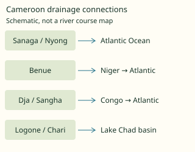

- ◻️ Lake Chad basin  
  _↳ feedback if chosen: That is the connection shown for Logone, rather than Benue._
- ◻️ Congo → Atlantic  
  _↳ feedback if chosen: That is the connection shown for Dja, rather than Benue._
- ◻️ Atlantic Ocean  
  _↳ feedback if chosen: That is the connection shown for Sanaga, rather than Benue._
- ✅ Niger → Atlantic

Full working after a second miss:

> a tributary system feeding the Niger.  
> So the answer is “Niger → Atlantic”.  

**Practice** `g4-16-assess` · spot the error, level 3 · **authored key**

> Find the incorrect geographical claim.

- ◻️ drainage basin: the land area contributing water towards a river system.  
  _↳ explanation: This distinction is correct: A basin includes contributing land and tributaries, not just the channel. Look for a claim that reverses the process or makes an unsupported generalisation._
- ◻️ divide: a boundary separating adjacent drainage basins.  
  _↳ explanation: This distinction is correct: A divide separates drainage, whereas a confluence joins channels. Look for a claim that reverses the process or makes an unsupported generalisation._
- ✅ Every tributary flows independently straight to the sea.  
  _↳ explanation: Trace its confluence and downstream river rather than assuming a separate ocean mouth._
- ◻️ internal drainage: drainage into a basin without a normal river outlet to the ocean.  
  _↳ explanation: This distinction is correct: The Lake Chad basin is internally drained, unlike the direct Atlantic-draining example. Look for a claim that reverses the process or makes an unsupported generalisation._

Full working after a second miss:

> The wrong statement is “Every tributary flows independently straight to the sea.”.  
> Trace its confluence and downstream river rather than assuming a separate ocean mouth.  

> Find the incorrect geographical claim.

- ◻️ internal drainage: drainage into a basin without a normal river outlet to the ocean.  
  _↳ explanation: This distinction is correct: The Lake Chad basin is internally drained, unlike the direct Atlantic-draining example. Look for a claim that reverses the process or makes an unsupported generalisation._
- ◻️ divide: a boundary separating adjacent drainage basins.  
  _↳ explanation: This distinction is correct: A divide separates drainage, whereas a confluence joins channels. Look for a claim that reverses the process or makes an unsupported generalisation._
- ◻️ tributary connection: a smaller river joining a larger downstream system.  
  _↳ explanation: This distinction is correct: Trace its confluence and downstream river rather than assuming a separate ocean mouth. Look for a claim that reverses the process or makes an unsupported generalisation._
- ✅ Lake Chad has the same direct ocean outlet as the Sanaga.  
  _↳ explanation: The Lake Chad basin is internally drained, unlike the direct Atlantic-draining example._

Full working after a second miss:

> The wrong statement is “Lake Chad has the same direct ocean outlet as the Sanaga.”.  
> The Lake Chad basin is internally drained, unlike the direct Atlantic-draining example.  

## Lesson 17: Climatic types of Cameroon

Prerequisites: 9, 11, 12, 13, 15, 16 · Skill: g4-17 (Climatic types of Cameroon)

**Note** (draft)

> Cameroon’s climates vary with latitude, seasonal air circulation, distance from the sea and relief. The coast is generally very wet; parts of the southern interior have a bimodal rainfall pattern with two wetter seasons. Western highlands are cooler than nearby lowlands and relief modifies rainfall. Northern tropical landscapes have a stronger dry-season contrast, becoming more semi-arid towards the Far North. School names include equatorial, monsoon or Cameroonian, Guinean, Sudanian, Sahelian and highland variants; labels must be linked to their actual characteristics rather than treated as identical schemes.

**Learn: Your goal and connections** (draft)

> By the end, you should be able to compare coastal southern-interior highland and northern regimes and explain how location and relief modify them. Builds on: global seasonal climates and Cameroon’s position, relief and drainage. Leads to: regional vegetation and soil patterns.

**Learn: Explain the geography** (draft)

> Cameroon’s climates vary with latitude, seasonal air circulation, distance from the sea and relief. The coast is generally very wet; parts of the southern interior have a bimodal rainfall pattern with two wetter seasons. Western highlands are cooler than nearby lowlands and relief modifies rainfall. Northern tropical landscapes have a stronger dry-season contrast, becoming more semi-arid towards the Far North. School names include equatorial, monsoon or Cameroonian, Guinean, Sudanian, Sahelian and highland variants; labels must be linked to their actual characteristics rather than treated as identical schemes.

**Learn: Follow the local example or model** (draft)

> Compare a wet coast near Douala, the southern plateau around Yaoundé, the western highlands and the northern plains. A hill’s windward side and sheltered side can differ, and altitude affects temperature. The supplied annual rainfall figures are fictional examples. They demonstrate a difference in totals, not a forecast or the precise mean for a real town. One national average would conceal important regional contrasts.

**Learn: Apply and check** (draft)

> Describe temperature and rainfall amount and timing before applying a climate label. Distinguish weather on a particular day from climate over a longer reference period. State the station and period when using real records. A broad north-south tendency does not eliminate local variation or establish a land-use recommendation by itself.

**Learn: key words and examples** (draft)

- **wet coastal regime**: very moist conditions influenced by the ocean and relief
- **southern-interior bimodality**: a rainfall regime with two wetter periods during the year
- **highland modification**: changes in temperature and rainfall associated with altitude and exposure
- **northern seasonal gradient**: stronger dry-season and semi-arid influences towards the Far North

Common mistake: “Every coastal location in Cameroon has an identical rainfall total.” → “very moist conditions influenced by the ocean and relief.”. Coastal moisture is a broad tendency; exposure and locality still matter.

**Card g4-17-c1** (draft)

> Distinguish the features before applying them.
>
> _wet coastal regime: very moist conditions influenced by the ocean and relief._  
> _southern-interior bimodality: a rainfall regime with two wetter periods during the year._  
> _highland modification: changes in temperature and rainfall associated with altitude and exposure._  
> _northern seasonal gradient: stronger dry-season and semi-arid influences towards the Far North._  

Check question: `g4-17-terms` · multiple choice, level 1 · **authored key**, reused from practice

> Which term means changes in temperature and rainfall associated with altitude and exposure?

- ◻️ wet coastal regime  
  _↳ feedback if chosen: That concerns very moist conditions influenced by the ocean and relief, rather than the feature asked for._
- ✅ highland modification
- ◻️ southern-interior bimodality  
  _↳ feedback if chosen: That concerns a rainfall regime with two wetter periods during the year, rather than the feature asked for._
- ◻️ northern seasonal gradient  
  _↳ feedback if chosen: That concerns stronger dry-season and semi-arid influences towards the Far North, rather than the feature asked for._

Full working after a second miss:

> Temperature generally decreases with height, while rainfall also depends on exposure.  
> So the answer is “highland modification”.  

**Card g4-17-c2** (draft)

> Use the evidence in the example, not a place name alone.
>
> _A coastal record has a large annual rainfall total and a relatively short drier period._  
> _A Yaoundé-region description distinguishes two rainy seasons with less rainy intervals._  
> _A western upland site is cooler than a comparable nearby lowland._  
> _The northern comparison has more limited moisture and a marked dry season._  

Check question: `g4-17-cases` · multiple choice, level 1 · **authored key**, reused from practice

> The northern comparison has more limited moisture and a marked dry season.
> Which feature is illustrated?

- ✅ northern seasonal gradient
- ◻️ highland modification  
  _↳ feedback if chosen: That identifies changes in temperature and rainfall associated with altitude and exposure. Read the case for evidence of stronger dry-season and semi-arid influences towards the Far North._
- ◻️ southern-interior bimodality  
  _↳ feedback if chosen: That identifies a rainfall regime with two wetter periods during the year. Read the case for evidence of stronger dry-season and semi-arid influences towards the Far North._
- ◻️ wet coastal regime  
  _↳ feedback if chosen: That identifies very moist conditions influenced by the ocean and relief. Read the case for evidence of stronger dry-season and semi-arid influences towards the Far North._

Full working after a second miss:

> Seasonal tropical and semi-arid regimes still receive rain and differ from a blanket desert label.  
> So the answer is “northern seasonal gradient”.  

**Card g4-17-c3** (draft)

> Explain how the process produces the stated effect.
>
> _Coastal moisture is a broad tendency; exposure and locality still matter._  
> _Two peaks describe timing, not uniform monthly rainfall._  
> _Temperature generally decreases with height, while rainfall also depends on exposure._  
> _Seasonal tropical and semi-arid regimes still receive rain and differ from a blanket desert label._  

Check question: `g4-17-explain-card` · multiple choice, level 1 · **authored key**

> A Yaoundé-region description distinguishes two rainy seasons with less rainy intervals.
> Which explanation follows?

- ✅ Two peaks describe timing, not uniform monthly rainfall.
- ◻️ Seasonal tropical and semi-arid regimes still receive rain and differ from a blanket desert label.  
  _↳ feedback if chosen: That explanation addresses northern seasonal gradient, rather than the process or relationship in this case._
- ◻️ Coastal moisture is a broad tendency; exposure and locality still matter.  
  _↳ feedback if chosen: That explanation addresses wet coastal regime, rather than the process or relationship in this case._
- ◻️ Temperature generally decreases with height, while rainfall also depends on exposure.  
  _↳ feedback if chosen: That explanation addresses highland modification, rather than the process or relationship in this case._

Full working after a second miss:

> a rainfall regime with two wetter periods during the year.  
> So the answer is “Two peaks describe timing, not uniform monthly rainfall.”.  

**Worked example** (draft)

> A coastal record has a large annual rainfall total and a relatively short drier period. Explain the relationship.

1. very moist conditions influenced by the ocean and relief.
2. Coastal moisture is a broad tendency; exposure and locality still matter.

**Answer:** wet coastal regime

**Practice** `g4-17-terms` · multiple choice, level 1 · **authored key**

> Which term means changes in temperature and rainfall associated with altitude and exposure?

- ◻️ wet coastal regime  
  _↳ feedback if chosen: That concerns very moist conditions influenced by the ocean and relief, rather than the feature asked for._
- ✅ highland modification
- ◻️ southern-interior bimodality  
  _↳ feedback if chosen: That concerns a rainfall regime with two wetter periods during the year, rather than the feature asked for._
- ◻️ northern seasonal gradient  
  _↳ feedback if chosen: That concerns stronger dry-season and semi-arid influences towards the Far North, rather than the feature asked for._

Full working after a second miss:

> Temperature generally decreases with height, while rainfall also depends on exposure.  
> So the answer is “highland modification”.  

> Which term means very moist conditions influenced by the ocean and relief?

- ◻️ northern seasonal gradient  
  _↳ feedback if chosen: That concerns stronger dry-season and semi-arid influences towards the Far North, rather than the feature asked for._
- ✅ wet coastal regime
- ◻️ southern-interior bimodality  
  _↳ feedback if chosen: That concerns a rainfall regime with two wetter periods during the year, rather than the feature asked for._
- ◻️ highland modification  
  _↳ feedback if chosen: That concerns changes in temperature and rainfall associated with altitude and exposure, rather than the feature asked for._

Full working after a second miss:

> Coastal moisture is a broad tendency; exposure and locality still matter.  
> So the answer is “wet coastal regime”.  

**Practice** `g4-17-cases` · multiple choice, level 1 · **authored key**

> The northern comparison has more limited moisture and a marked dry season.
> Which feature is illustrated?

- ◻️ southern-interior bimodality  
  _↳ feedback if chosen: That identifies a rainfall regime with two wetter periods during the year. Read the case for evidence of stronger dry-season and semi-arid influences towards the Far North._
- ✅ northern seasonal gradient
- ◻️ highland modification  
  _↳ feedback if chosen: That identifies changes in temperature and rainfall associated with altitude and exposure. Read the case for evidence of stronger dry-season and semi-arid influences towards the Far North._
- ◻️ wet coastal regime  
  _↳ feedback if chosen: That identifies very moist conditions influenced by the ocean and relief. Read the case for evidence of stronger dry-season and semi-arid influences towards the Far North._

Full working after a second miss:

> Seasonal tropical and semi-arid regimes still receive rain and differ from a blanket desert label.  
> So the answer is “northern seasonal gradient”.  

> A Yaoundé-region description distinguishes two rainy seasons with less rainy intervals.
> Which feature is illustrated?

- ◻️ northern seasonal gradient  
  _↳ feedback if chosen: That identifies stronger dry-season and semi-arid influences towards the Far North. Read the case for evidence of a rainfall regime with two wetter periods during the year._
- ✅ southern-interior bimodality
- ◻️ wet coastal regime  
  _↳ feedback if chosen: That identifies very moist conditions influenced by the ocean and relief. Read the case for evidence of a rainfall regime with two wetter periods during the year._
- ◻️ highland modification  
  _↳ feedback if chosen: That identifies changes in temperature and rainfall associated with altitude and exposure. Read the case for evidence of a rainfall regime with two wetter periods during the year._

Full working after a second miss:

> Two peaks describe timing, not uniform monthly rainfall.  
> So the answer is “southern-interior bimodality”.  

**Practice** `g4-17-explain` · multiple choice, level 2 · **authored key**

> A coastal record has a large annual rainfall total and a relatively short drier period.
> Which explanation follows?

- ◻️ Seasonal tropical and semi-arid regimes still receive rain and differ from a blanket desert label.  
  _↳ feedback if chosen: That explanation addresses northern seasonal gradient, rather than the process or relationship in this case._
- ◻️ Two peaks describe timing, not uniform monthly rainfall.  
  _↳ feedback if chosen: That explanation addresses southern-interior bimodality, rather than the process or relationship in this case._
- ✅ Coastal moisture is a broad tendency; exposure and locality still matter.
- ◻️ Temperature generally decreases with height, while rainfall also depends on exposure.  
  _↳ feedback if chosen: That explanation addresses highland modification, rather than the process or relationship in this case._

Full working after a second miss:

> very moist conditions influenced by the ocean and relief.  
> So the answer is “Coastal moisture is a broad tendency; exposure and locality still matter.”.  

> The northern comparison has more limited moisture and a marked dry season.
> Which explanation follows?

- ◻️ Coastal moisture is a broad tendency; exposure and locality still matter.  
  _↳ feedback if chosen: That explanation addresses wet coastal regime, rather than the process or relationship in this case._
- ◻️ Temperature generally decreases with height, while rainfall also depends on exposure.  
  _↳ feedback if chosen: That explanation addresses highland modification, rather than the process or relationship in this case._
- ✅ Seasonal tropical and semi-arid regimes still receive rain and differ from a blanket desert label.
- ◻️ Two peaks describe timing, not uniform monthly rainfall.  
  _↳ feedback if chosen: That explanation addresses southern-interior bimodality, rather than the process or relationship in this case._

Full working after a second miss:

> stronger dry-season and semi-arid influences towards the Far North.  
> So the answer is “Seasonal tropical and semi-arid regimes still receive rain and differ from a blanket desert label.”.  

**Practice** `g4-17-rain-contrast` · number, level 2 · computed by rule

> Two invented annual station records give 2300 mm for a wet coastal site and 650 mm for a drier northern site. How much greater is the coastal total? These are teaching data, not observed town averages.

Answer: **1650 mm**
- Typed **2950** (add) → “That combines the records rather than comparing them.”
- Typed **2300** (coast) → “That reports the full coastal total, not its excess.”
- Typed **650** (north) → “That repeats the northern total instead of calculating the difference.”

Full working after a second miss:

> Compare totals for the same period and unit.  
> Difference = 2300 − 650 = 1650 mm. Annual totals do not reveal every seasonal detail.  

> Two invented annual station records give 2200 mm for a wet coastal site and 550 mm for a drier northern site. How much greater is the coastal total? These are teaching data, not observed town averages.

Answer: **1650 mm**
- Typed **2750** (add) → “That combines the records rather than comparing them.”
- Typed **2200** (coast) → “That reports the full coastal total, not its excess.”
- Typed **550** (north) → “That repeats the northern total instead of calculating the difference.”

Full working after a second miss:

> Compare totals for the same period and unit.  
> Difference = 2200 − 550 = 1650 mm. Annual totals do not reveal every seasonal detail.  

**Practice** `g4-17-assess` · spot the error, level 3 · **authored key**

> Find the incorrect geographical claim.

- ◻️ wet coastal regime: very moist conditions influenced by the ocean and relief.  
  _↳ explanation: This distinction is correct: Coastal moisture is a broad tendency; exposure and locality still matter. Look for a claim that reverses the process or makes an unsupported generalisation._
- ✅ Every coastal location in Cameroon has an identical rainfall total.  
  _↳ explanation: Coastal moisture is a broad tendency; exposure and locality still matter._
- ◻️ southern-interior bimodality: a rainfall regime with two wetter periods during the year.  
  _↳ explanation: This distinction is correct: Two peaks describe timing, not uniform monthly rainfall. Look for a claim that reverses the process or makes an unsupported generalisation._
- ◻️ highland modification: changes in temperature and rainfall associated with altitude and exposure.  
  _↳ explanation: This distinction is correct: Temperature generally decreases with height, while rainfall also depends on exposure. Look for a claim that reverses the process or makes an unsupported generalisation._

Full working after a second miss:

> The wrong statement is “Every coastal location in Cameroon has an identical rainfall total.”.  
> Coastal moisture is a broad tendency; exposure and locality still matter.  

> Find the incorrect geographical claim.

- ◻️ southern-interior bimodality: a rainfall regime with two wetter periods during the year.  
  _↳ explanation: This distinction is correct: Two peaks describe timing, not uniform monthly rainfall. Look for a claim that reverses the process or makes an unsupported generalisation._
- ✅ Bimodal means rain must fall equally every month.  
  _↳ explanation: Two peaks describe timing, not uniform monthly rainfall._
- ◻️ highland modification: changes in temperature and rainfall associated with altitude and exposure.  
  _↳ explanation: This distinction is correct: Temperature generally decreases with height, while rainfall also depends on exposure. Look for a claim that reverses the process or makes an unsupported generalisation._
- ◻️ northern seasonal gradient: stronger dry-season and semi-arid influences towards the Far North.  
  _↳ explanation: This distinction is correct: Seasonal tropical and semi-arid regimes still receive rain and differ from a blanket desert label. Look for a claim that reverses the process or makes an unsupported generalisation._

Full working after a second miss:

> The wrong statement is “Bimodal means rain must fall equally every month.”.  
> Two peaks describe timing, not uniform monthly rainfall.  

## Lesson 18: Vegetation of Cameroon

Prerequisites: 8, 9, 17 · Skill: g4-18 (Vegetation of Cameroon)

**Note** (draft)

> Cameroon’s vegetation includes humid southern forests, savannah mosaics, drier northern formations, montane communities and coastal mangroves. These are broad patterns with transitions rather than perfectly straight boundaries. Moisture, temperature, soil, drainage and disturbance interact. Forests can be evergreen or semi-deciduous depending on conditions; savannah has variable woody cover. Montane vegetation responds to altitude, while mangroves occupy suitable tidal settings. Farms, settlements, logging and fire can replace or modify natural formations, creating secondary vegetation and mosaics.

**Learn: Your goal and connections** (draft)

> By the end, you should be able to relate major vegetation formations to climate altitude drainage and human modification. Builds on: biomes and Cameroon’s climatic contrasts. Leads to: soil patterns and later ecosystem and land-use evaluation.

**Learn: Explain the geography** (draft)

> Cameroon’s vegetation includes humid southern forests, savannah mosaics, drier northern formations, montane communities and coastal mangroves. These are broad patterns with transitions rather than perfectly straight boundaries. Moisture, temperature, soil, drainage and disturbance interact. Forests can be evergreen or semi-deciduous depending on conditions; savannah has variable woody cover. Montane vegetation responds to altitude, while mangroves occupy suitable tidal settings. Farms, settlements, logging and fire can replace or modify natural formations, creating secondary vegetation and mosaics.

**Learn: Follow the local example or model** (draft)

> Compare forest in southern Cameroon, seasonal savannah farther north and cooler vegetation on high western slopes. A moist gallery along a stream can differ from the surrounding landscape. Mangroves near an estuary reflect salinity and tidal conditions as well as rainfall. A satellite image’s green colour alone does not distinguish plantation, young regrowth and intact forest; local records and field identification are needed.

**Learn: Apply and check** (draft)

> Explain pattern at both regional and local scale. Use climate together with altitude, drainage and land-use history. Distinguish potential natural vegetation from present cover. A boundary can be gradual or disturbed rather than a fixed line. Classroom interpretation does not require entering a protected site or collecting plants.

**Learn: key words and examples** (draft)

- **humid forest formation**: tree-dominated vegetation associated with moist southern settings
- **savannah mosaic**: seasonal grass-dominated vegetation with variable woody cover
- **montane community**: vegetation associated with cooler elevated conditions
- **mangrove setting**: suitable tidal coastal habitat supporting salt-tolerant woody vegetation
- **secondary vegetation**: plant cover developing after disturbance of earlier vegetation

Common mistake: “Every forest patch has identical structure and disturbance history.” → “tree-dominated vegetation associated with moist southern settings.”. Moist forest includes local and historical variation rather than one uniform stand.

**Card g4-18-c1** (draft)

> Distinguish the features before applying them.
>
> _humid forest formation: tree-dominated vegetation associated with moist southern settings._  
> _savannah mosaic: seasonal grass-dominated vegetation with variable woody cover._  
> _montane community: vegetation associated with cooler elevated conditions._  
> _mangrove setting: suitable tidal coastal habitat supporting salt-tolerant woody vegetation._  
> _secondary vegetation: plant cover developing after disturbance of earlier vegetation._  

Check question: `g4-18-terms` · multiple choice, level 1 · **authored key**, reused from practice

> Which term means plant cover developing after disturbance of earlier vegetation?

- ✅ secondary vegetation
- ◻️ montane community  
  _↳ feedback if chosen: That concerns vegetation associated with cooler elevated conditions, rather than the feature asked for._
- ◻️ savannah mosaic  
  _↳ feedback if chosen: That concerns seasonal grass-dominated vegetation with variable woody cover, rather than the feature asked for._
- ◻️ humid forest formation  
  _↳ feedback if chosen: That concerns tree-dominated vegetation associated with moist southern settings, rather than the feature asked for._

Full working after a second miss:

> Present plant cover must be interpreted alongside land-use history.  
> So the answer is “secondary vegetation”.  

**Card g4-18-c2** (draft)

> Use the evidence in the example, not a place name alone.
>
> _A southern landscape contains evergreen and semi-deciduous forest communities._  
> _An open northern landscape has grasses, shrubs and scattered trees._  
> _Plant communities change along an upland altitude gradient._  
> _Trees grow in a brackish estuary with tidal water movement._  
> _Shrubs and young trees regrow after a clearing is abandoned._  

Check question: `g4-18-cases` · multiple choice, level 1 · **authored key**, reused from practice

> Shrubs and young trees regrow after a clearing is abandoned.
> Which feature is illustrated?

- ◻️ montane community  
  _↳ feedback if chosen: That identifies vegetation associated with cooler elevated conditions. Read the case for evidence of plant cover developing after disturbance of earlier vegetation._
- ◻️ humid forest formation  
  _↳ feedback if chosen: That identifies tree-dominated vegetation associated with moist southern settings. Read the case for evidence of plant cover developing after disturbance of earlier vegetation._
- ✅ secondary vegetation
- ◻️ savannah mosaic  
  _↳ feedback if chosen: That identifies seasonal grass-dominated vegetation with variable woody cover. Read the case for evidence of plant cover developing after disturbance of earlier vegetation._

Full working after a second miss:

> Present plant cover must be interpreted alongside land-use history.  
> So the answer is “secondary vegetation”.  

**Card g4-18-c3** (draft)

> Explain how the process produces the stated effect.
>
> _Moist forest includes local and historical variation rather than one uniform stand._  
> _Variable woody cover is part of savannah diversity._  
> _Altitude and exposure can modify local climate within the same latitude zone._  
> _Mangroves are linked to particular coastal tidal conditions, not all forests._  
> _Present plant cover must be interpreted alongside land-use history._  

Check question: `g4-18-explain-card` · multiple choice, level 1 · **authored key**

> Plant communities change along an upland altitude gradient.
> Which explanation follows?

- ✅ Altitude and exposure can modify local climate within the same latitude zone.
- ◻️ Moist forest includes local and historical variation rather than one uniform stand.  
  _↳ feedback if chosen: That explanation addresses humid forest formation, rather than the process or relationship in this case._
- ◻️ Variable woody cover is part of savannah diversity.  
  _↳ feedback if chosen: That explanation addresses savannah mosaic, rather than the process or relationship in this case._
- ◻️ Mangroves are linked to particular coastal tidal conditions, not all forests.  
  _↳ feedback if chosen: That explanation addresses mangrove setting, rather than the process or relationship in this case._

Full working after a second miss:

> vegetation associated with cooler elevated conditions.  
> So the answer is “Altitude and exposure can modify local climate within the same latitude zone.”.  

**Worked example** (draft)

> A southern landscape contains evergreen and semi-deciduous forest communities. Explain the relationship.

1. tree-dominated vegetation associated with moist southern settings.
2. Moist forest includes local and historical variation rather than one uniform stand.

**Answer:** humid forest formation

**Practice** `g4-18-terms` · multiple choice, level 1 · **authored key**

> Which term means suitable tidal coastal habitat supporting salt-tolerant woody vegetation?

- ◻️ savannah mosaic  
  _↳ feedback if chosen: That concerns seasonal grass-dominated vegetation with variable woody cover, rather than the feature asked for._
- ◻️ montane community  
  _↳ feedback if chosen: That concerns vegetation associated with cooler elevated conditions, rather than the feature asked for._
- ✅ mangrove setting
- ◻️ humid forest formation  
  _↳ feedback if chosen: That concerns tree-dominated vegetation associated with moist southern settings, rather than the feature asked for._

Full working after a second miss:

> Mangroves are linked to particular coastal tidal conditions, not all forests.  
> So the answer is “mangrove setting”.  

> Which term means plant cover developing after disturbance of earlier vegetation?

- ◻️ montane community  
  _↳ feedback if chosen: That concerns vegetation associated with cooler elevated conditions, rather than the feature asked for._
- ◻️ humid forest formation  
  _↳ feedback if chosen: That concerns tree-dominated vegetation associated with moist southern settings, rather than the feature asked for._
- ◻️ savannah mosaic  
  _↳ feedback if chosen: That concerns seasonal grass-dominated vegetation with variable woody cover, rather than the feature asked for._
- ✅ secondary vegetation

Full working after a second miss:

> Present plant cover must be interpreted alongside land-use history.  
> So the answer is “secondary vegetation”.  

**Practice** `g4-18-cases` · multiple choice, level 1 · **authored key**

> Trees grow in a brackish estuary with tidal water movement.
> Which feature is illustrated?

- ◻️ montane community  
  _↳ feedback if chosen: That identifies vegetation associated with cooler elevated conditions. Read the case for evidence of suitable tidal coastal habitat supporting salt-tolerant woody vegetation._
- ◻️ savannah mosaic  
  _↳ feedback if chosen: That identifies seasonal grass-dominated vegetation with variable woody cover. Read the case for evidence of suitable tidal coastal habitat supporting salt-tolerant woody vegetation._
- ◻️ humid forest formation  
  _↳ feedback if chosen: That identifies tree-dominated vegetation associated with moist southern settings. Read the case for evidence of suitable tidal coastal habitat supporting salt-tolerant woody vegetation._
- ✅ mangrove setting

Full working after a second miss:

> Mangroves are linked to particular coastal tidal conditions, not all forests.  
> So the answer is “mangrove setting”.  

> An open northern landscape has grasses, shrubs and scattered trees.
> Which feature is illustrated?

- ◻️ humid forest formation  
  _↳ feedback if chosen: That identifies tree-dominated vegetation associated with moist southern settings. Read the case for evidence of seasonal grass-dominated vegetation with variable woody cover._
- ✅ savannah mosaic
- ◻️ montane community  
  _↳ feedback if chosen: That identifies vegetation associated with cooler elevated conditions. Read the case for evidence of seasonal grass-dominated vegetation with variable woody cover._
- ◻️ mangrove setting  
  _↳ feedback if chosen: That identifies suitable tidal coastal habitat supporting salt-tolerant woody vegetation. Read the case for evidence of seasonal grass-dominated vegetation with variable woody cover._

Full working after a second miss:

> Variable woody cover is part of savannah diversity.  
> So the answer is “savannah mosaic”.  

**Practice** `g4-18-explain` · multiple choice, level 2 · **authored key**

> Shrubs and young trees regrow after a clearing is abandoned.
> Which explanation follows?

- ◻️ Variable woody cover is part of savannah diversity.  
  _↳ feedback if chosen: That explanation addresses savannah mosaic, rather than the process or relationship in this case._
- ✅ Present plant cover must be interpreted alongside land-use history.
- ◻️ Moist forest includes local and historical variation rather than one uniform stand.  
  _↳ feedback if chosen: That explanation addresses humid forest formation, rather than the process or relationship in this case._
- ◻️ Altitude and exposure can modify local climate within the same latitude zone.  
  _↳ feedback if chosen: That explanation addresses montane community, rather than the process or relationship in this case._

Full working after a second miss:

> plant cover developing after disturbance of earlier vegetation.  
> So the answer is “Present plant cover must be interpreted alongside land-use history.”.  

> Trees grow in a brackish estuary with tidal water movement.
> Which explanation follows?

- ◻️ Altitude and exposure can modify local climate within the same latitude zone.  
  _↳ feedback if chosen: That explanation addresses montane community, rather than the process or relationship in this case._
- ✅ Mangroves are linked to particular coastal tidal conditions, not all forests.
- ◻️ Moist forest includes local and historical variation rather than one uniform stand.  
  _↳ feedback if chosen: That explanation addresses humid forest formation, rather than the process or relationship in this case._
- ◻️ Variable woody cover is part of savannah diversity.  
  _↳ feedback if chosen: That explanation addresses savannah mosaic, rather than the process or relationship in this case._

Full working after a second miss:

> suitable tidal coastal habitat supporting salt-tolerant woody vegetation.  
> So the answer is “Mangroves are linked to particular coastal tidal conditions, not all forests.”.  

**Practice** `g4-18-interpret` · multiple choice, level 2 · **authored key**

> A tidal coastal site has waterlogged saline or brackish conditions.

- ◻️ Only alpine vegetation can tolerate a tidal coast.  
  _↳ feedback if chosen: Alpine settings are high-altitude, unlike this site._
- ✅ Mangrove vegetation may occur where suitable species and conditions exist.
- ◻️ Every wet site has identical plants regardless of salinity.  
  _↳ feedback if chosen: Salinity and tidal conditions influence the plant community._
- ◻️ All saline water is evidence of inland rainforest soil.  
  _↳ feedback if chosen: Tidal salinity identifies a different site constraint._

Full working after a second miss:

> Describe the habitat conditions before predicting vegetation.  
> So the answer is “Mangrove vegetation may occur where suitable species and conditions exist.”.  

> A humid southern forest patch is cleared, then shrubs and young trees regrow.

- ◻️ The region instantly becomes a permanent hot desert.  
  _↳ feedback if chosen: Clearing alone does not establish a new desert climate._
- ✅ The regrowth may be secondary vegetation shaped by disturbance.
- ◻️ No human activity can affect plant cover.  
  _↳ feedback if chosen: The stated clearing directly changes the cover._
- ◻️ Every young tree proves untouched primary forest.  
  _↳ feedback if chosen: Regrowth after clearing differs from undisturbed mature structure._

Full working after a second miss:

> Use land-use history with climate and site evidence.  
> So the answer is “The regrowth may be secondary vegetation shaped by disturbance.”.  

**Practice** `g4-18-assess` · spot the error, level 3 · **authored key**

> Find the incorrect geographical claim.

- ◻️ montane community: vegetation associated with cooler elevated conditions.  
  _↳ explanation: This distinction is correct: Altitude and exposure can modify local climate within the same latitude zone. Look for a claim that reverses the process or makes an unsupported generalisation._
- ◻️ mangrove setting: suitable tidal coastal habitat supporting salt-tolerant woody vegetation.  
  _↳ explanation: This distinction is correct: Mangroves are linked to particular coastal tidal conditions, not all forests. Look for a claim that reverses the process or makes an unsupported generalisation._
- ◻️ savannah mosaic: seasonal grass-dominated vegetation with variable woody cover.  
  _↳ explanation: This distinction is correct: Variable woody cover is part of savannah diversity. Look for a claim that reverses the process or makes an unsupported generalisation._
- ✅ Savannah must contain no trees of any kind.  
  _↳ explanation: Variable woody cover is part of savannah diversity._

Full working after a second miss:

> The wrong statement is “Savannah must contain no trees of any kind.”.  
> Variable woody cover is part of savannah diversity.  

> Find the incorrect geographical claim.

- ✅ Latitude is the only possible cause of vegetation change.  
  _↳ explanation: Altitude and exposure can modify local climate within the same latitude zone._
- ◻️ savannah mosaic: seasonal grass-dominated vegetation with variable woody cover.  
  _↳ explanation: This distinction is correct: Variable woody cover is part of savannah diversity. Look for a claim that reverses the process or makes an unsupported generalisation._
- ◻️ secondary vegetation: plant cover developing after disturbance of earlier vegetation.  
  _↳ explanation: This distinction is correct: Present plant cover must be interpreted alongside land-use history. Look for a claim that reverses the process or makes an unsupported generalisation._
- ◻️ humid forest formation: tree-dominated vegetation associated with moist southern settings.  
  _↳ explanation: This distinction is correct: Moist forest includes local and historical variation rather than one uniform stand. Look for a claim that reverses the process or makes an unsupported generalisation._

Full working after a second miss:

> The wrong statement is “Latitude is the only possible cause of vegetation change.”.  
> Altitude and exposure can modify local climate within the same latitude zone.  

## Lesson 19: Soil types in Cameroon

Prerequisites: 1, 2, 3, 15, 17, 18 · Skill: g4-19 (Soil types in Cameroon)

**Note** (draft)

> Cameroon has diverse soils. School groupings include strongly weathered ferrallitic soils across much of the humid south, ferruginous tropical soils in more seasonal northern settings, volcanic-derived soils in uplands and young alluvial deposits on floodplains. Hydromorphic soils reflect prolonged wetness; clay-rich cracking soils also occur in northern plains. These categories overlap different classification traditions and do not map perfectly onto modern WRB names. Climate, parent material, relief, organisms, drainage and time interact. A broad label does not establish fertility, crop suitability or erosion resistance at every site.

**Learn: Your goal and connections** (draft)

> By the end, you should be able to connect broad soil groups to formation and landscape position while evaluating suitability from observed properties. Builds on: soil components, profiles and Cameroon’s climate and vegetation. Leads to: later resource management and evidence-based land-use decisions.

**Learn: Explain the geography** (draft)

> Cameroon has diverse soils. School groupings include strongly weathered ferrallitic soils across much of the humid south, ferruginous tropical soils in more seasonal northern settings, volcanic-derived soils in uplands and young alluvial deposits on floodplains. Hydromorphic soils reflect prolonged wetness; clay-rich cracking soils also occur in northern plains. These categories overlap different classification traditions and do not map perfectly onto modern WRB names. Climate, parent material, relief, organisms, drainage and time interact. A broad label does not establish fertility, crop suitability or erosion resistance at every site.

**Learn: Follow the local example or model** (draft)

> Compare a southern weathered plateau, a western volcanic upland and a seasonally wet river plain. Local research around Bambouto and Bokito shows differences within the same broad landscape. Volcanic-derived soils can have favourable properties but still erode on exposed slopes; flood deposits can supply material while flood risk remains. The appropriate assessment combines depth, texture, acidity, nutrients, drainage and slope rather than choosing from colour or regional name alone.

**Learn: Apply and check** (draft)

> Describe origin and observed properties, then explain an opportunity and a limitation. Distinguish parent-material terms from wetness terms. Do not assume every alluvial or volcanic soil is equally fertile, or every red soil is infertile. This is classroom evaluation, not a fertiliser prescription or permission to alter drainage; local survey and agronomic evidence are needed.

**Learn: key words and examples** (draft)

- **ferrallitic grouping**: strongly weathered soils common in humid tropical settings
- **ferruginous tropical grouping**: a traditional grouping associated with more seasonal tropical weathering
- **volcanic-derived soil**: soil developed from volcanic parent material with properties varying by development and site
- **alluvial material**: sediment deposited by rivers and forming part of young floodplain soils
- **hydromorphic condition**: soil development influenced by prolonged saturation
- **shrink-swell clay soil**: a clay-rich soil showing marked contraction on drying and expansion on wetting

Common mistake: “All nutrients must remain abundant merely because a forest grows above the soil.” → “strongly weathered soils common in humid tropical settings.”. Nutrient cycling and vegetation stores can support forest without a universally rich available soil reserve.

**Card g4-19-c1** (draft)

> Distinguish the features before applying them.
>
> _ferrallitic grouping: strongly weathered soils common in humid tropical settings._  
> _ferruginous tropical grouping: a traditional grouping associated with more seasonal tropical weathering._  
> _volcanic-derived soil: soil developed from volcanic parent material with properties varying by development and site._  
> _alluvial material: sediment deposited by rivers and forming part of young floodplain soils._  
> _hydromorphic condition: soil development influenced by prolonged saturation._  
> _shrink-swell clay soil: a clay-rich soil showing marked contraction on drying and expansion on wetting._  

Check question: `g4-19-terms` · multiple choice, level 1 · **authored key**, reused from practice

> Which term means strongly weathered soils common in humid tropical settings?

- ◻️ volcanic-derived soil  
  _↳ feedback if chosen: That concerns soil developed from volcanic parent material with properties varying by development and site, rather than the feature asked for._
- ✅ ferrallitic grouping
- ◻️ ferruginous tropical grouping  
  _↳ feedback if chosen: That concerns a traditional grouping associated with more seasonal tropical weathering, rather than the feature asked for._
- ◻️ alluvial material  
  _↳ feedback if chosen: That concerns sediment deposited by rivers and forming part of young floodplain soils, rather than the feature asked for._

Full working after a second miss:

> Nutrient cycling and vegetation stores can support forest without a universally rich available soil reserve.  
> So the answer is “ferrallitic grouping”.  

**Card g4-19-c2** (draft)

> Use the evidence in the example, not a place name alone.
>
> _A humid southern plateau has deep weathering and leaching._  
> _A northern seasonal landscape includes iron-rich weathered soils._  
> _A western upland includes soil on weathered volcanic material._  
> _A river deposits layers on a floodplain._  
> _A low-lying soil shows evidence of long-lasting wet conditions._  
> _Some northern plain soils develop deep cracks as they dry and swell when wet._  

Check question: `g4-19-cases` · multiple choice, level 1 · **authored key**, reused from practice

> A humid southern plateau has deep weathering and leaching.
> Which feature is illustrated?

- ✅ ferrallitic grouping
- ◻️ volcanic-derived soil  
  _↳ feedback if chosen: That identifies soil developed from volcanic parent material with properties varying by development and site. Read the case for evidence of strongly weathered soils common in humid tropical settings._
- ◻️ ferruginous tropical grouping  
  _↳ feedback if chosen: That identifies a traditional grouping associated with more seasonal tropical weathering. Read the case for evidence of strongly weathered soils common in humid tropical settings._
- ◻️ alluvial material  
  _↳ feedback if chosen: That identifies sediment deposited by rivers and forming part of young floodplain soils. Read the case for evidence of strongly weathered soils common in humid tropical settings._

Full working after a second miss:

> Nutrient cycling and vegetation stores can support forest without a universally rich available soil reserve.  
> So the answer is “ferrallitic grouping”.  

**Card g4-19-c3** (draft)

> Explain how the process produces the stated effect.
>
> _Nutrient cycling and vegetation stores can support forest without a universally rich available soil reserve._  
> _Traditional labels and modern diagnostic classifications are not one-to-one everywhere._  
> _Age, weathering, slope and drainage still influence properties and risks._  
> _Alluvium is deposited sediment and can vary in texture, nutrients and drainage._  
> _Water regime and parent material describe different aspects of the soil._  
> _The behaviour is associated with suitable clay minerals; formal classification requires diagnostic evidence._  

Check question: `g4-19-explain-card` · multiple choice, level 1 · **authored key**

> A western upland includes soil on weathered volcanic material.
> Which explanation follows?

- ◻️ Traditional labels and modern diagnostic classifications are not one-to-one everywhere.  
  _↳ feedback if chosen: That explanation addresses ferruginous tropical grouping, rather than the process or relationship in this case._
- ✅ Age, weathering, slope and drainage still influence properties and risks.
- ◻️ Nutrient cycling and vegetation stores can support forest without a universally rich available soil reserve.  
  _↳ feedback if chosen: That explanation addresses ferrallitic grouping, rather than the process or relationship in this case._
- ◻️ Alluvium is deposited sediment and can vary in texture, nutrients and drainage.  
  _↳ feedback if chosen: That explanation addresses alluvial material, rather than the process or relationship in this case._

Full working after a second miss:

> soil developed from volcanic parent material with properties varying by development and site.  
> So the answer is “Age, weathering, slope and drainage still influence properties and risks.”.  

**Worked example** (draft)

> A humid southern plateau has deep weathering and leaching. Explain the relationship.

1. strongly weathered soils common in humid tropical settings.
2. Nutrient cycling and vegetation stores can support forest without a universally rich available soil reserve.

**Answer:** ferrallitic grouping

**Practice** `g4-19-terms` · multiple choice, level 1 · **authored key**

> Which term means a traditional grouping associated with more seasonal tropical weathering?

- ◻️ volcanic-derived soil  
  _↳ feedback if chosen: That concerns soil developed from volcanic parent material with properties varying by development and site, rather than the feature asked for._
- ◻️ alluvial material  
  _↳ feedback if chosen: That concerns sediment deposited by rivers and forming part of young floodplain soils, rather than the feature asked for._
- ◻️ ferrallitic grouping  
  _↳ feedback if chosen: That concerns strongly weathered soils common in humid tropical settings, rather than the feature asked for._
- ✅ ferruginous tropical grouping

Full working after a second miss:

> Traditional labels and modern diagnostic classifications are not one-to-one everywhere.  
> So the answer is “ferruginous tropical grouping”.  

> Which term means soil developed from volcanic parent material with properties varying by development and site?

- ◻️ ferruginous tropical grouping  
  _↳ feedback if chosen: That concerns a traditional grouping associated with more seasonal tropical weathering, rather than the feature asked for._
- ✅ volcanic-derived soil
- ◻️ ferrallitic grouping  
  _↳ feedback if chosen: That concerns strongly weathered soils common in humid tropical settings, rather than the feature asked for._
- ◻️ alluvial material  
  _↳ feedback if chosen: That concerns sediment deposited by rivers and forming part of young floodplain soils, rather than the feature asked for._

Full working after a second miss:

> Age, weathering, slope and drainage still influence properties and risks.  
> So the answer is “volcanic-derived soil”.  

**Practice** `g4-19-cases` · multiple choice, level 1 · **authored key**

> A low-lying soil shows evidence of long-lasting wet conditions.
> Which feature is illustrated?

- ◻️ ferruginous tropical grouping  
  _↳ feedback if chosen: That identifies a traditional grouping associated with more seasonal tropical weathering. Read the case for evidence of soil development influenced by prolonged saturation._
- ◻️ ferrallitic grouping  
  _↳ feedback if chosen: That identifies strongly weathered soils common in humid tropical settings. Read the case for evidence of soil development influenced by prolonged saturation._
- ◻️ volcanic-derived soil  
  _↳ feedback if chosen: That identifies soil developed from volcanic parent material with properties varying by development and site. Read the case for evidence of soil development influenced by prolonged saturation._
- ✅ hydromorphic condition

Full working after a second miss:

> Water regime and parent material describe different aspects of the soil.  
> So the answer is “hydromorphic condition”.  

> Some northern plain soils develop deep cracks as they dry and swell when wet.
> Which feature is illustrated?

- ◻️ ferrallitic grouping  
  _↳ feedback if chosen: That identifies strongly weathered soils common in humid tropical settings. Read the case for evidence of a clay-rich soil showing marked contraction on drying and expansion on wetting._
- ◻️ ferruginous tropical grouping  
  _↳ feedback if chosen: That identifies a traditional grouping associated with more seasonal tropical weathering. Read the case for evidence of a clay-rich soil showing marked contraction on drying and expansion on wetting._
- ◻️ volcanic-derived soil  
  _↳ feedback if chosen: That identifies soil developed from volcanic parent material with properties varying by development and site. Read the case for evidence of a clay-rich soil showing marked contraction on drying and expansion on wetting._
- ✅ shrink-swell clay soil

Full working after a second miss:

> The behaviour is associated with suitable clay minerals; formal classification requires diagnostic evidence.  
> So the answer is “shrink-swell clay soil”.  

**Practice** `g4-19-explain` · multiple choice, level 2 · **authored key**

> A northern seasonal landscape includes iron-rich weathered soils.
> Which explanation follows?

- ◻️ Alluvium is deposited sediment and can vary in texture, nutrients and drainage.  
  _↳ feedback if chosen: That explanation addresses alluvial material, rather than the process or relationship in this case._
- ◻️ Nutrient cycling and vegetation stores can support forest without a universally rich available soil reserve.  
  _↳ feedback if chosen: That explanation addresses ferrallitic grouping, rather than the process or relationship in this case._
- ◻️ Age, weathering, slope and drainage still influence properties and risks.  
  _↳ feedback if chosen: That explanation addresses volcanic-derived soil, rather than the process or relationship in this case._
- ✅ Traditional labels and modern diagnostic classifications are not one-to-one everywhere.

Full working after a second miss:

> a traditional grouping associated with more seasonal tropical weathering.  
> So the answer is “Traditional labels and modern diagnostic classifications are not one-to-one everywhere.”.  

> A humid southern plateau has deep weathering and leaching.
> Which explanation follows?

- ✅ Nutrient cycling and vegetation stores can support forest without a universally rich available soil reserve.
- ◻️ Age, weathering, slope and drainage still influence properties and risks.  
  _↳ feedback if chosen: That explanation addresses volcanic-derived soil, rather than the process or relationship in this case._
- ◻️ Traditional labels and modern diagnostic classifications are not one-to-one everywhere.  
  _↳ feedback if chosen: That explanation addresses ferruginous tropical grouping, rather than the process or relationship in this case._
- ◻️ Alluvium is deposited sediment and can vary in texture, nutrients and drainage.  
  _↳ feedback if chosen: That explanation addresses alluvial material, rather than the process or relationship in this case._

Full working after a second miss:

> strongly weathered soils common in humid tropical settings.  
> So the answer is “Nutrient cycling and vegetation stores can support forest without a universally rich available soil reserve.”.  

**Practice** `g4-19-site-judgement` · multiple choice, level 2 · **authored key**

> A humid southern site has a deeply weathered, leached soil. A crop is being considered.

- ◻️ Use a universal chemical dose without local evidence.  
  _↳ feedback if chosen: No rate can be inferred from a broad soil label alone._
- ✅ Assess acidity and available nutrients as well as texture before choosing management.
- ◻️ Ignore soil tests because every forest soil is permanently fertile.  
  _↳ feedback if chosen: Forest biomass is not proof of a rich enduring soil nutrient store._
- ◻️ Assume red colour guarantees every nutrient is abundant.  
  _↳ feedback if chosen: Colour does not establish all nutrient supplies._

Full working after a second miss:

> Soil suitability requires observed properties and the crop’s requirements.  
> So the answer is “Assess acidity and available nutrients as well as texture before choosing management.”.  

> A humid southern site has a deeply weathered, leached soil. A crop is being considered.

- ✅ Assess acidity and available nutrients as well as texture before choosing management.
- ◻️ Ignore soil tests because every forest soil is permanently fertile.  
  _↳ feedback if chosen: Forest biomass is not proof of a rich enduring soil nutrient store._
- ◻️ Assume red colour guarantees every nutrient is abundant.  
  _↳ feedback if chosen: Colour does not establish all nutrient supplies._
- ◻️ Use a universal chemical dose without local evidence.  
  _↳ feedback if chosen: No rate can be inferred from a broad soil label alone._

Full working after a second miss:

> Soil suitability requires observed properties and the crop’s requirements.  
> So the answer is “Assess acidity and available nutrients as well as texture before choosing management.”.  

**Practice** `g4-19-assess` · spot the error, level 3 · **authored key**

> Find the incorrect geographical claim.

- ✅ Pronounced shrink-swell behaviour proves a soil contains only coarse sand.  
  _↳ explanation: The behaviour is associated with suitable clay minerals; formal classification requires diagnostic evidence._
- ◻️ alluvial material: sediment deposited by rivers and forming part of young floodplain soils.  
  _↳ explanation: This distinction is correct: Alluvium is deposited sediment and can vary in texture, nutrients and drainage. Look for a claim that reverses the process or makes an unsupported generalisation._
- ◻️ ferrallitic grouping: strongly weathered soils common in humid tropical settings.  
  _↳ explanation: This distinction is correct: Nutrient cycling and vegetation stores can support forest without a universally rich available soil reserve. Look for a claim that reverses the process or makes an unsupported generalisation._
- ◻️ hydromorphic condition: soil development influenced by prolonged saturation.  
  _↳ explanation: This distinction is correct: Water regime and parent material describe different aspects of the soil. Look for a claim that reverses the process or makes an unsupported generalisation._

Full working after a second miss:

> The wrong statement is “Pronounced shrink-swell behaviour proves a soil contains only coarse sand.”.  
> The behaviour is associated with suitable clay minerals; formal classification requires diagnostic evidence.  

> Find the incorrect geographical claim.

- ✅ All nutrients must remain abundant merely because a forest grows above the soil.  
  _↳ explanation: Nutrient cycling and vegetation stores can support forest without a universally rich available soil reserve._
- ◻️ volcanic-derived soil: soil developed from volcanic parent material with properties varying by development and site.  
  _↳ explanation: This distinction is correct: Age, weathering, slope and drainage still influence properties and risks. Look for a claim that reverses the process or makes an unsupported generalisation._
- ◻️ hydromorphic condition: soil development influenced by prolonged saturation.  
  _↳ explanation: This distinction is correct: Water regime and parent material describe different aspects of the soil. Look for a claim that reverses the process or makes an unsupported generalisation._
- ◻️ alluvial material: sediment deposited by rivers and forming part of young floodplain soils.  
  _↳ explanation: This distinction is correct: Alluvium is deposited sediment and can vary in texture, nutrients and drainage. Look for a claim that reverses the process or makes an unsupported generalisation._

Full working after a second miss:

> The wrong statement is “All nutrients must remain abundant merely because a forest grows above the soil.”.  
> Nutrient cycling and vegetation stores can support forest without a universally rich available soil reserve.  

