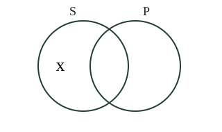

# Logic Form 4, Form Four Logic: authored answers for review

Every answer fixed by a person, not computed. Part 1: the tables, conventions and rules that computed answers come from.
Part 2: every authored question template, with all its data (keys, statements, pairs, choices and feedback) and sources.
Regenerate with `npm run review:f4-logic`. Item IDs (TR-…) match `docs/teacher-review.md`.

## Part 1

Rules the computed answers use are listed in the subject’s library tests; every authored answer is in Part 2.

## Part 2: authored question templates

| # | Template | Lesson | Type, level | Sources |
|---|---|---|---|---|
| 1 | `l4-1-parts` | 1 | multiple choice, 1 | categorical |
| 2 | `l4-1-subject` | 1 | multiple choice, 1 | categorical |
| 3 | `l4-1-predicate` | 1 | multiple choice, 2 | categorical |
| 4 | `l4-1-boundaries` | 1 | multiple choice, 2 | categorical |
| 5 | `l4-1-repair` | 1 | spot the error, 3 | categorical |
| 6 | `l4-1-boundaries-card` (card l4-1-c3) | 1 | multiple choice, 1 | categorical |
| 7 | `l4-2-recognise` | 2 | multiple choice, 1 | categorical |
| 8 | `l4-2-some` | 2 | multiple choice, 1 | categorical |
| 9 | `l4-2-no` | 2 | multiple choice, 2 | categorical |
| 10 | `l4-2-direction` | 2 | multiple choice, 2 | categorical |
| 11 | `l4-2-repair` | 2 | spot the error, 3 | categorical |
| 12 | `l4-2-no-card` (card l4-2-c3) | 2 | multiple choice, 1 | categorical |
| 13 | `l4-3-quantity` | 3 | multiple choice, 1 | categorical |
| 14 | `l4-3-quality` | 3 | multiple choice, 1 | categorical |
| 15 | `l4-3-combine` | 3 | multiple choice, 2 | categorical |
| 16 | `l4-3-change` | 3 | multiple choice, 2 | categorical |
| 17 | `l4-3-repair` | 3 | spot the error, 3 | categorical |
| 18 | `l4-3-change-card` (card l4-3-c3) | 3 | multiple choice, 1 | categorical |
| 19 | `l4-4-classify` | 4 | multiple choice, 1 | categorical |
| 20 | `l4-4-form` | 4 | multiple choice, 1 | categorical |
| 21 | `l4-4-match` | 4 | matching, 2 | categorical |
| 22 | `l4-4-repair` | 4 | spot the error, 3 | categorical |
| 23 | `l4-4-repair-card` (card l4-4-c3) | 4 | spot the error, 1 | categorical |
| 24 | `l4-5-coverage` | 5 | multiple choice, 1 | categorical |
| 25 | `l4-5-why` | 5 | multiple choice, 1 | categorical |
| 26 | `l4-5-negative` | 5 | multiple choice, 2 | categorical |
| 27 | `l4-5-reverse` | 5 | multiple choice, 2 | categorical |
| 28 | `l4-5-repair` | 5 | spot the error, 3 | categorical |
| 29 | `l4-5-negative-card` (card l4-5-c3) | 5 | multiple choice, 1 | categorical |
| 30 | `l4-6-symbol` | 6 | multiple choice, 1 | categorical |
| 31 | `l4-6-mark` | 6 | multiple choice, 1 | categorical |
| 32 | `l4-6-read-diagram` | 6 | multiple choice, 2 | categorical |
| 33 | `l4-6-unmarked` | 6 | multiple choice, 2 | categorical |
| 34 | `l4-6-repair` | 6 | spot the error, 3 | categorical |
| 35 | `l4-6-unmarked-card` (card l4-6-c3) | 6 | multiple choice, 1 | categorical |
| 36 | `l4-8-antecedent` | 8 | multiple choice, 1 | categorical |
| 37 | `l4-8-conditions` | 8 | multiple choice, 1 | categorical |
| 38 | `l4-8-counterexample` | 8 | multiple choice, 2 | categorical |
| 39 | `l4-8-repair` | 8 | spot the error, 3 | categorical |
| 40 | `l4-8-counterexample-card` (card l4-8-c3) | 8 | multiple choice, 1 | categorical |
| 41 | `l4-9-inclusive` | 9 | multiple choice, 1 | categorical |
| 42 | `l4-9-infer` | 9 | multiple choice, 2 | categorical |
| 43 | `l4-9-repair` | 9 | spot the error, 3 | categorical |
| 44 | `l4-10-only` | 10 | multiple choice, 1 | categorical |
| 45 | `l4-10-singular` | 10 | multiple choice, 1 | categorical |
| 46 | `l4-10-not-all` | 10 | multiple choice, 2 | categorical |
| 47 | `l4-10-indefinite` | 10 | multiple choice, 2 | categorical |
| 48 | `l4-10-repair` | 10 | spot the error, 3 | categorical |
| 49 | `l4-10-exceptions` | 10 | multiple choice, 3 | categorical |
| 50 | `l4-10-not-all-card` (card l4-10-c3) | 10 | multiple choice, 1 | categorical |

### `l4-1-parts` · Lesson 1 · multiple choice, level 1

Prompt: {X.q}

Table `X` (one row is picked each time):

| q | r | w | e | y |
|---|---|---|---|---|
| In All club members are badge holders, what is the role of “All”? | quantifier | subject term · copula · predicate term | That role concerns the class about which the claim is made, rather than the selected expression. · That role concerns the linking expression joining subject and predicate, rather than the selected expression. · That role concerns the class attributed to, or denied of, the subject, rather than the selected expression. | how much of the subject class is covered. |
| In All club members are badge holders, what is the role of “club members”? | subject term | quantifier · copula · predicate term | That role concerns how much of the subject class is covered, rather than the selected expression. · That role concerns the linking expression joining subject and predicate, rather than the selected expression. · That role concerns the class attributed to, or denied of, the subject, rather than the selected expression. | the class about which the claim is made. |
| In All club members are badge holders, what is the role of “are”? | copula | quantifier · subject term · predicate term | That role concerns how much of the subject class is covered, rather than the selected expression. · That role concerns the class about which the claim is made, rather than the selected expression. · That role concerns the class attributed to, or denied of, the subject, rather than the selected expression. | the linking expression joining subject and predicate. |
| In All club members are badge holders, what is the role of “badge holders”? | predicate term | quantifier · subject term · copula | That role concerns how much of the subject class is covered, rather than the selected expression. · That role concerns the class about which the claim is made, rather than the selected expression. · That role concerns the linking expression joining subject and predicate, rather than the selected expression. | the class attributed to, or denied of, the subject. |

Right answer: `{X.r}`; wrong choices: `{X.w[0]}`, `{X.w[1]}`, `{X.w[2]}`

- Feedback `w0`: “{X.e[0]}”
- Feedback `w1`: “{X.e[1]}”
- Feedback `w2`: “{X.e[2]}”

Three generated variants:

> In All club members are badge holders, what is the role of “badge holders”?

- ◻️ subject term  
  _↳ feedback if chosen: That role concerns the class about which the claim is made, rather than the selected expression._
- ◻️ quantifier  
  _↳ feedback if chosen: That role concerns how much of the subject class is covered, rather than the selected expression._
- ◻️ copula  
  _↳ feedback if chosen: That role concerns the linking expression joining subject and predicate, rather than the selected expression._
- ✅ predicate term

Full working after a second miss:

> the class attributed to, or denied of, the subject.  
> So the answer is “predicate term”.  

> In All club members are badge holders, what is the role of “All”?

- ◻️ predicate term  
  _↳ feedback if chosen: That role concerns the class attributed to, or denied of, the subject, rather than the selected expression._
- ◻️ subject term  
  _↳ feedback if chosen: That role concerns the class about which the claim is made, rather than the selected expression._
- ✅ quantifier
- ◻️ copula  
  _↳ feedback if chosen: That role concerns the linking expression joining subject and predicate, rather than the selected expression._

Full working after a second miss:

> how much of the subject class is covered.  
> So the answer is “quantifier”.  

> In All club members are badge holders, what is the role of “All”?

- ◻️ predicate term  
  _↳ feedback if chosen: That role concerns the class attributed to, or denied of, the subject, rather than the selected expression._
- ◻️ copula  
  _↳ feedback if chosen: That role concerns the linking expression joining subject and predicate, rather than the selected expression._
- ◻️ subject term  
  _↳ feedback if chosen: That role concerns the class about which the claim is made, rather than the selected expression._
- ✅ quantifier

Full working after a second miss:

> how much of the subject class is covered.  
> So the answer is “quantifier”.  

Sources: categorical (Original examples and exercises; Oxford University Press Baronett Logic chapter guide (indexed excerpts on distribution and translation), OpenStax Introduction to Philosophy on statements and inferences, Stanford Encyclopedia on necessary/sufficient conditions)

### `l4-1-subject` · Lesson 1 · multiple choice, level 1

Prompt: {X.q}

Table `X` (one row is picked each time):

| q | r | w | e | y |
|---|---|---|---|---|
| Identify the subject term: All club members are badge holders. | club members | badge holders · All · are | That is the predicate class; the claim is made about club members. · That is a quantifier, not the complete subject term. · The linking expression is not the subject class. | The claim concerns the class club members. |
| Identify the subject term: No club members are badge holders. | club members | badge holders · No · are | That is the predicate class; the claim is made about club members. · That is a quantifier, not the complete subject term. · The linking expression is not the subject class. | The claim concerns the class club members. |
| Identify the subject term: Some club members are badge holders. | club members | badge holders · Some · are | That is the predicate class; the claim is made about club members. · That is a quantifier, not the complete subject term. · The linking expression is not the subject class. | The claim concerns the class club members. |
| Identify the subject term: Some club members are not badge holders. | club members | badge holders · Some · are not | That is the predicate class; the claim is made about club members. · That is a quantifier, not the complete subject term. · The linking expression is not the subject class. | The claim concerns the class club members. |
| Identify the subject term: All library books are loanable items. | library books | loanable items · All · are | That is the predicate class; the claim is made about library books. · That is a quantifier, not the complete subject term. · The linking expression is not the subject class. | The claim concerns the class library books. |
| Identify the subject term: No library books are loanable items. | library books | loanable items · No · are | That is the predicate class; the claim is made about library books. · That is a quantifier, not the complete subject term. · The linking expression is not the subject class. | The claim concerns the class library books. |
| Identify the subject term: Some library books are loanable items. | library books | loanable items · Some · are | That is the predicate class; the claim is made about library books. · That is a quantifier, not the complete subject term. · The linking expression is not the subject class. | The claim concerns the class library books. |
| Identify the subject term: Some library books are not loanable items. | library books | loanable items · Some · are not | That is the predicate class; the claim is made about library books. · That is a quantifier, not the complete subject term. · The linking expression is not the subject class. | The claim concerns the class library books. |
| Identify the subject term: All school gardens are cultivated areas. | school gardens | cultivated areas · All · are | That is the predicate class; the claim is made about school gardens. · That is a quantifier, not the complete subject term. · The linking expression is not the subject class. | The claim concerns the class school gardens. |
| Identify the subject term: No school gardens are cultivated areas. | school gardens | cultivated areas · No · are | That is the predicate class; the claim is made about school gardens. · That is a quantifier, not the complete subject term. · The linking expression is not the subject class. | The claim concerns the class school gardens. |
| Identify the subject term: Some school gardens are cultivated areas. | school gardens | cultivated areas · Some · are | That is the predicate class; the claim is made about school gardens. · That is a quantifier, not the complete subject term. · The linking expression is not the subject class. | The claim concerns the class school gardens. |
| Identify the subject term: Some school gardens are not cultivated areas. | school gardens | cultivated areas · Some · are not | That is the predicate class; the claim is made about school gardens. · That is a quantifier, not the complete subject term. · The linking expression is not the subject class. | The claim concerns the class school gardens. |
| Identify the subject term: All reading rooms are quiet places. | reading rooms | quiet places · All · are | That is the predicate class; the claim is made about reading rooms. · That is a quantifier, not the complete subject term. · The linking expression is not the subject class. | The claim concerns the class reading rooms. |
| Identify the subject term: No reading rooms are quiet places. | reading rooms | quiet places · No · are | That is the predicate class; the claim is made about reading rooms. · That is a quantifier, not the complete subject term. · The linking expression is not the subject class. | The claim concerns the class reading rooms. |
| Identify the subject term: Some reading rooms are quiet places. | reading rooms | quiet places · Some · are | That is the predicate class; the claim is made about reading rooms. · That is a quantifier, not the complete subject term. · The linking expression is not the subject class. | The claim concerns the class reading rooms. |
| Identify the subject term: Some reading rooms are not quiet places. | reading rooms | quiet places · Some · are not | That is the predicate class; the claim is made about reading rooms. · That is a quantifier, not the complete subject term. · The linking expression is not the subject class. | The claim concerns the class reading rooms. |

Right answer: `{X.r}`; wrong choices: `{X.w[0]}`, `{X.w[1]}`, `{X.w[2]}`

- Feedback `w0`: “{X.e[0]}”
- Feedback `w1`: “{X.e[1]}”
- Feedback `w2`: “{X.e[2]}”

Three generated variants:

> Identify the subject term: All club members are badge holders.

- ✅ club members
- ◻️ are  
  _↳ feedback if chosen: The linking expression is not the subject class._
- ◻️ All  
  _↳ feedback if chosen: That is a quantifier, not the complete subject term._
- ◻️ badge holders  
  _↳ feedback if chosen: That is the predicate class; the claim is made about club members._

Full working after a second miss:

> The claim concerns the class club members.  
> So the answer is “club members”.  

> Identify the subject term: All school gardens are cultivated areas.

- ✅ school gardens
- ◻️ are  
  _↳ feedback if chosen: The linking expression is not the subject class._
- ◻️ cultivated areas  
  _↳ feedback if chosen: That is the predicate class; the claim is made about school gardens._
- ◻️ All  
  _↳ feedback if chosen: That is a quantifier, not the complete subject term._

Full working after a second miss:

> The claim concerns the class school gardens.  
> So the answer is “school gardens”.  

> Identify the subject term: Some library books are loanable items.

- ◻️ are  
  _↳ feedback if chosen: The linking expression is not the subject class._
- ✅ library books
- ◻️ Some  
  _↳ feedback if chosen: That is a quantifier, not the complete subject term._
- ◻️ loanable items  
  _↳ feedback if chosen: That is the predicate class; the claim is made about library books._

Full working after a second miss:

> The claim concerns the class library books.  
> So the answer is “library books”.  

Sources: categorical (Original examples and exercises; Oxford University Press Baronett Logic chapter guide (indexed excerpts on distribution and translation), OpenStax Introduction to Philosophy on statements and inferences, Stanford Encyclopedia on necessary/sufficient conditions)

### `l4-1-predicate` · Lesson 1 · multiple choice, level 2

Prompt: {X.q}

Table `X` (one row is picked each time):

| q | r | w | e | y |
|---|---|---|---|---|
| Identify the complete predicate term: All club members are badge holders. | badge holders | club members · are · All club members are badge holders. | That is the subject class, not the predicate. · The copula links the classes but is not the predicate class. · The whole proposition includes more than its predicate term. | Keep the complete class expression badge holders. |
| Identify the complete predicate term: No club members are badge holders. | badge holders | club members · are · No club members are badge holders. | That is the subject class, not the predicate. · The copula links the classes but is not the predicate class. · The whole proposition includes more than its predicate term. | Keep the complete class expression badge holders. |
| Identify the complete predicate term: Some club members are badge holders. | badge holders | club members · are · Some club members are badge holders. | That is the subject class, not the predicate. · The copula links the classes but is not the predicate class. · The whole proposition includes more than its predicate term. | Keep the complete class expression badge holders. |
| Identify the complete predicate term: Some club members are not badge holders. | badge holders | club members · are not · Some club members are not badge holders. | That is the subject class, not the predicate. · The copula links the classes but is not the predicate class. · The whole proposition includes more than its predicate term. | Keep the complete class expression badge holders. |
| Identify the complete predicate term: All library books are loanable items. | loanable items | library books · are · All library books are loanable items. | That is the subject class, not the predicate. · The copula links the classes but is not the predicate class. · The whole proposition includes more than its predicate term. | Keep the complete class expression loanable items. |
| Identify the complete predicate term: No library books are loanable items. | loanable items | library books · are · No library books are loanable items. | That is the subject class, not the predicate. · The copula links the classes but is not the predicate class. · The whole proposition includes more than its predicate term. | Keep the complete class expression loanable items. |
| Identify the complete predicate term: Some library books are loanable items. | loanable items | library books · are · Some library books are loanable items. | That is the subject class, not the predicate. · The copula links the classes but is not the predicate class. · The whole proposition includes more than its predicate term. | Keep the complete class expression loanable items. |
| Identify the complete predicate term: Some library books are not loanable items. | loanable items | library books · are not · Some library books are not loanable items. | That is the subject class, not the predicate. · The copula links the classes but is not the predicate class. · The whole proposition includes more than its predicate term. | Keep the complete class expression loanable items. |
| Identify the complete predicate term: All school gardens are cultivated areas. | cultivated areas | school gardens · are · All school gardens are cultivated areas. | That is the subject class, not the predicate. · The copula links the classes but is not the predicate class. · The whole proposition includes more than its predicate term. | Keep the complete class expression cultivated areas. |
| Identify the complete predicate term: No school gardens are cultivated areas. | cultivated areas | school gardens · are · No school gardens are cultivated areas. | That is the subject class, not the predicate. · The copula links the classes but is not the predicate class. · The whole proposition includes more than its predicate term. | Keep the complete class expression cultivated areas. |
| Identify the complete predicate term: Some school gardens are cultivated areas. | cultivated areas | school gardens · are · Some school gardens are cultivated areas. | That is the subject class, not the predicate. · The copula links the classes but is not the predicate class. · The whole proposition includes more than its predicate term. | Keep the complete class expression cultivated areas. |
| Identify the complete predicate term: Some school gardens are not cultivated areas. | cultivated areas | school gardens · are not · Some school gardens are not cultivated areas. | That is the subject class, not the predicate. · The copula links the classes but is not the predicate class. · The whole proposition includes more than its predicate term. | Keep the complete class expression cultivated areas. |
| Identify the complete predicate term: All reading rooms are quiet places. | quiet places | reading rooms · are · All reading rooms are quiet places. | That is the subject class, not the predicate. · The copula links the classes but is not the predicate class. · The whole proposition includes more than its predicate term. | Keep the complete class expression quiet places. |
| Identify the complete predicate term: No reading rooms are quiet places. | quiet places | reading rooms · are · No reading rooms are quiet places. | That is the subject class, not the predicate. · The copula links the classes but is not the predicate class. · The whole proposition includes more than its predicate term. | Keep the complete class expression quiet places. |
| Identify the complete predicate term: Some reading rooms are quiet places. | quiet places | reading rooms · are · Some reading rooms are quiet places. | That is the subject class, not the predicate. · The copula links the classes but is not the predicate class. · The whole proposition includes more than its predicate term. | Keep the complete class expression quiet places. |
| Identify the complete predicate term: Some reading rooms are not quiet places. | quiet places | reading rooms · are not · Some reading rooms are not quiet places. | That is the subject class, not the predicate. · The copula links the classes but is not the predicate class. · The whole proposition includes more than its predicate term. | Keep the complete class expression quiet places. |

Right answer: `{X.r}`; wrong choices: `{X.w[0]}`, `{X.w[1]}`, `{X.w[2]}`

- Feedback `w0`: “{X.e[0]}”
- Feedback `w1`: “{X.e[1]}”
- Feedback `w2`: “{X.e[2]}”

Three generated variants:

> Identify the complete predicate term: Some reading rooms are not quiet places.

- ◻️ Some reading rooms are not quiet places.  
  _↳ feedback if chosen: The whole proposition includes more than its predicate term._
- ◻️ reading rooms  
  _↳ feedback if chosen: That is the subject class, not the predicate._
- ◻️ are not  
  _↳ feedback if chosen: The copula links the classes but is not the predicate class._
- ✅ quiet places

Full working after a second miss:

> Keep the complete class expression quiet places.  
> So the answer is “quiet places”.  

> Identify the complete predicate term: Some reading rooms are quiet places.

- ✅ quiet places
- ◻️ are  
  _↳ feedback if chosen: The copula links the classes but is not the predicate class._
- ◻️ Some reading rooms are quiet places.  
  _↳ feedback if chosen: The whole proposition includes more than its predicate term._
- ◻️ reading rooms  
  _↳ feedback if chosen: That is the subject class, not the predicate._

Full working after a second miss:

> Keep the complete class expression quiet places.  
> So the answer is “quiet places”.  

> Identify the complete predicate term: Some club members are badge holders.

- ✅ badge holders
- ◻️ Some club members are badge holders.  
  _↳ feedback if chosen: The whole proposition includes more than its predicate term._
- ◻️ club members  
  _↳ feedback if chosen: That is the subject class, not the predicate._
- ◻️ are  
  _↳ feedback if chosen: The copula links the classes but is not the predicate class._

Full working after a second miss:

> Keep the complete class expression badge holders.  
> So the answer is “badge holders”.  

Sources: categorical (Original examples and exercises; Oxford University Press Baronett Logic chapter guide (indexed excerpts on distribution and translation), OpenStax Introduction to Philosophy on statements and inferences, Stanford Encyclopedia on necessary/sufficient conditions)

### `l4-1-boundaries` · Lesson 1 · multiple choice, level 2

Prompt: {X.q}

Table `X` (one row is picked each time):

| q | r | w | e | y |
|---|---|---|---|---|
| In “All club members are badge holders,” which expression is one complete logical term? | club members | All · are · All are | All is the quantifier. · Are is the copula. · This combines separate functions and omits the class expression. | A logical term may contain several words while naming one class. |
| In “All library books are loanable items,” which expression is one complete logical term? | library books | All · are · All are | All is the quantifier. · Are is the copula. · This combines separate functions and omits the class expression. | A logical term may contain several words while naming one class. |
| In “All school gardens are cultivated areas,” which expression is one complete logical term? | school gardens | All · are · All are | All is the quantifier. · Are is the copula. · This combines separate functions and omits the class expression. | A logical term may contain several words while naming one class. |
| In “All reading rooms are quiet places,” which expression is one complete logical term? | reading rooms | All · are · All are | All is the quantifier. · Are is the copula. · This combines separate functions and omits the class expression. | A logical term may contain several words while naming one class. |

Right answer: `{X.r}`; wrong choices: `{X.w[0]}`, `{X.w[1]}`, `{X.w[2]}`

- Feedback `w0`: “{X.e[0]}”
- Feedback `w1`: “{X.e[1]}”
- Feedback `w2`: “{X.e[2]}”

Three generated variants:

> In “All library books are loanable items,” which expression is one complete logical term?

- ✅ library books
- ◻️ All  
  _↳ feedback if chosen: All is the quantifier._
- ◻️ All are  
  _↳ feedback if chosen: This combines separate functions and omits the class expression._
- ◻️ are  
  _↳ feedback if chosen: Are is the copula._

Full working after a second miss:

> A logical term may contain several words while naming one class.  
> So the answer is “library books”.  

> In “All reading rooms are quiet places,” which expression is one complete logical term?

- ◻️ All are  
  _↳ feedback if chosen: This combines separate functions and omits the class expression._
- ✅ reading rooms
- ◻️ are  
  _↳ feedback if chosen: Are is the copula._
- ◻️ All  
  _↳ feedback if chosen: All is the quantifier._

Full working after a second miss:

> A logical term may contain several words while naming one class.  
> So the answer is “reading rooms”.  

> In “All library books are loanable items,” which expression is one complete logical term?

- ◻️ are  
  _↳ feedback if chosen: Are is the copula._
- ◻️ All  
  _↳ feedback if chosen: All is the quantifier._
- ◻️ All are  
  _↳ feedback if chosen: This combines separate functions and omits the class expression._
- ✅ library books

Full working after a second miss:

> A logical term may contain several words while naming one class.  
> So the answer is “library books”.  

Sources: categorical (Original examples and exercises; Oxford University Press Baronett Logic chapter guide (indexed excerpts on distribution and translation), OpenStax Introduction to Philosophy on statements and inferences, Stanford Encyclopedia on necessary/sufficient conditions)

### `l4-1-repair` · Lesson 1 · spot the error, level 3

Prompt: Find the incorrect claim, then read the reason for the correction.

Shows 3 correct and 1 wrong statement(s), drawn from:

- ✅ A logical term can contain several words.
- ✅ A quantifier indicates scope over the subject class.
- ✅ A proposition makes a claim that can be true or false.
- ✅ The copula connects the subject and predicate in this model.
- ❌ Every individual word is a separate complete logical term.  
  _↳ Club members is a multiword expression functioning as one term._
- ❌ The predicate is always the person speaking.  
  _↳ The predicate term names the class attributed to or denied of the subject._
- ❌ A question is a true-or-false assertion merely because it ends with a sign.  
  _↳ A question asks for information; it does not by itself assert the requested claim._
- ❌ Identifying sentence parts establishes the factual truth of a claim.  
  _↳ Parsing establishes structure; checking the facts is a separate task._

Three generated variants:

> Find the incorrect claim, then read the reason for the correction.

- ◻️ A logical term can contain several words.  
  _↳ explanation: This is a correct rule: A logical term can contain several words. Look for a claim that breaks a rule taught in Learn._
- ◻️ The copula connects the subject and predicate in this model.  
  _↳ explanation: This is a correct rule: The copula connects the subject and predicate in this model. Look for a claim that breaks a rule taught in Learn._
- ◻️ A proposition makes a claim that can be true or false.  
  _↳ explanation: This is a correct rule: A proposition makes a claim that can be true or false. Look for a claim that breaks a rule taught in Learn._
- ✅ Every individual word is a separate complete logical term.  
  _↳ explanation: Club members is a multiword expression functioning as one term._

Full working after a second miss:

> The wrong statement is “Every individual word is a separate complete logical term.”.  
> Club members is a multiword expression functioning as one term.  

> Find the incorrect claim, then read the reason for the correction.

- ◻️ The copula connects the subject and predicate in this model.  
  _↳ explanation: This is a correct rule: The copula connects the subject and predicate in this model. Look for a claim that breaks a rule taught in Learn._
- ◻️ A logical term can contain several words.  
  _↳ explanation: This is a correct rule: A logical term can contain several words. Look for a claim that breaks a rule taught in Learn._
- ◻️ A quantifier indicates scope over the subject class.  
  _↳ explanation: This is a correct rule: A quantifier indicates scope over the subject class. Look for a claim that breaks a rule taught in Learn._
- ✅ Identifying sentence parts establishes the factual truth of a claim.  
  _↳ explanation: Parsing establishes structure; checking the facts is a separate task._

Full working after a second miss:

> The wrong statement is “Identifying sentence parts establishes the factual truth of a claim.”.  
> Parsing establishes structure; checking the facts is a separate task.  

> Find the incorrect claim, then read the reason for the correction.

- ◻️ A quantifier indicates scope over the subject class.  
  _↳ explanation: This is a correct rule: A quantifier indicates scope over the subject class. Look for a claim that breaks a rule taught in Learn._
- ◻️ A logical term can contain several words.  
  _↳ explanation: This is a correct rule: A logical term can contain several words. Look for a claim that breaks a rule taught in Learn._
- ◻️ A proposition makes a claim that can be true or false.  
  _↳ explanation: This is a correct rule: A proposition makes a claim that can be true or false. Look for a claim that breaks a rule taught in Learn._
- ✅ The predicate is always the person speaking.  
  _↳ explanation: The predicate term names the class attributed to or denied of the subject._

Full working after a second miss:

> The wrong statement is “The predicate is always the person speaking.”.  
> The predicate term names the class attributed to or denied of the subject.  

Sources: categorical (Original examples and exercises; Oxford University Press Baronett Logic chapter guide (indexed excerpts on distribution and translation), OpenStax Introduction to Philosophy on statements and inferences, Stanford Encyclopedia on necessary/sufficient conditions)

### `l4-1-boundaries-card` · Lesson 1 · multiple choice, level 1

Prompt: {X.q}

Table `X` (one row is picked each time):

| q | r | w | e | y |
|---|---|---|---|---|
| In “All club members are badge holders,” which expression is one complete logical term? | club members | All · are · All are | All is the quantifier. · Are is the copula. · This combines separate functions and omits the class expression. | A logical term may contain several words while naming one class. |
| In “All library books are loanable items,” which expression is one complete logical term? | library books | All · are · All are | All is the quantifier. · Are is the copula. · This combines separate functions and omits the class expression. | A logical term may contain several words while naming one class. |
| In “All school gardens are cultivated areas,” which expression is one complete logical term? | school gardens | All · are · All are | All is the quantifier. · Are is the copula. · This combines separate functions and omits the class expression. | A logical term may contain several words while naming one class. |
| In “All reading rooms are quiet places,” which expression is one complete logical term? | reading rooms | All · are · All are | All is the quantifier. · Are is the copula. · This combines separate functions and omits the class expression. | A logical term may contain several words while naming one class. |

Right answer: `{X.r}`; wrong choices: `{X.w[0]}`, `{X.w[1]}`, `{X.w[2]}`

- Feedback `w0`: “{X.e[0]}”
- Feedback `w1`: “{X.e[1]}”
- Feedback `w2`: “{X.e[2]}”

Three generated variants:

> In “All school gardens are cultivated areas,” which expression is one complete logical term?

- ◻️ All  
  _↳ feedback if chosen: All is the quantifier._
- ◻️ All are  
  _↳ feedback if chosen: This combines separate functions and omits the class expression._
- ✅ school gardens
- ◻️ are  
  _↳ feedback if chosen: Are is the copula._

Full working after a second miss:

> A logical term may contain several words while naming one class.  
> So the answer is “school gardens”.  

> In “All school gardens are cultivated areas,” which expression is one complete logical term?

- ✅ school gardens
- ◻️ are  
  _↳ feedback if chosen: Are is the copula._
- ◻️ All  
  _↳ feedback if chosen: All is the quantifier._
- ◻️ All are  
  _↳ feedback if chosen: This combines separate functions and omits the class expression._

Full working after a second miss:

> A logical term may contain several words while naming one class.  
> So the answer is “school gardens”.  

> In “All school gardens are cultivated areas,” which expression is one complete logical term?

- ✅ school gardens
- ◻️ All are  
  _↳ feedback if chosen: This combines separate functions and omits the class expression._
- ◻️ All  
  _↳ feedback if chosen: All is the quantifier._
- ◻️ are  
  _↳ feedback if chosen: Are is the copula._

Full working after a second miss:

> A logical term may contain several words while naming one class.  
> So the answer is “school gardens”.  

Sources: categorical (Original examples and exercises; Oxford University Press Baronett Logic chapter guide (indexed excerpts on distribution and translation), OpenStax Introduction to Philosophy on statements and inferences, Stanford Encyclopedia on necessary/sufficient conditions)

### `l4-2-recognise` · Lesson 2 · multiple choice, level 1

Prompt: {X.q}

Table `X` (one row is picked each time):

| q | r | w | e | y |
|---|---|---|---|---|
| Which option directly relates the named classes in standard categorical form? | All club members are badge holders. | If a meeting starts, club members arrive. · Are all club members badge holders? · Please contact the club members. | This is a conditional construction, not the requested standard class form. · This asks a question instead of making the claim. · This is a request, not a categorical assertion. | The selected statement explicitly quantifies a subject class and attributes a predicate class. |
| Which option directly relates the named classes in standard categorical form? | All library books are loanable items. | If a meeting starts, library books arrive. · Are all library books loanable items? · Please contact the library books. | This is a conditional construction, not the requested standard class form. · This asks a question instead of making the claim. · This is a request, not a categorical assertion. | The selected statement explicitly quantifies a subject class and attributes a predicate class. |
| Which option directly relates the named classes in standard categorical form? | All school gardens are cultivated areas. | If a meeting starts, school gardens arrive. · Are all school gardens cultivated areas? · Please contact the school gardens. | This is a conditional construction, not the requested standard class form. · This asks a question instead of making the claim. · This is a request, not a categorical assertion. | The selected statement explicitly quantifies a subject class and attributes a predicate class. |
| Which option directly relates the named classes in standard categorical form? | All reading rooms are quiet places. | If a meeting starts, reading rooms arrive. · Are all reading rooms quiet places? · Please contact the reading rooms. | This is a conditional construction, not the requested standard class form. · This asks a question instead of making the claim. · This is a request, not a categorical assertion. | The selected statement explicitly quantifies a subject class and attributes a predicate class. |

Right answer: `{X.r}`; wrong choices: `{X.w[0]}`, `{X.w[1]}`, `{X.w[2]}`

- Feedback `w0`: “{X.e[0]}”
- Feedback `w1`: “{X.e[1]}”
- Feedback `w2`: “{X.e[2]}”

Three generated variants:

> Which option directly relates the named classes in standard categorical form?

- ✅ All reading rooms are quiet places.
- ◻️ If a meeting starts, reading rooms arrive.  
  _↳ feedback if chosen: This is a conditional construction, not the requested standard class form._
- ◻️ Are all reading rooms quiet places?  
  _↳ feedback if chosen: This asks a question instead of making the claim._
- ◻️ Please contact the reading rooms.  
  _↳ feedback if chosen: This is a request, not a categorical assertion._

Full working after a second miss:

> The selected statement explicitly quantifies a subject class and attributes a predicate class.  
> So the answer is “All reading rooms are quiet places.”.  

> Which option directly relates the named classes in standard categorical form?

- ◻️ Are all library books loanable items?  
  _↳ feedback if chosen: This asks a question instead of making the claim._
- ◻️ Please contact the library books.  
  _↳ feedback if chosen: This is a request, not a categorical assertion._
- ◻️ If a meeting starts, library books arrive.  
  _↳ feedback if chosen: This is a conditional construction, not the requested standard class form._
- ✅ All library books are loanable items.

Full working after a second miss:

> The selected statement explicitly quantifies a subject class and attributes a predicate class.  
> So the answer is “All library books are loanable items.”.  

> Which option directly relates the named classes in standard categorical form?

- ◻️ Please contact the library books.  
  _↳ feedback if chosen: This is a request, not a categorical assertion._
- ✅ All library books are loanable items.
- ◻️ Are all library books loanable items?  
  _↳ feedback if chosen: This asks a question instead of making the claim._
- ◻️ If a meeting starts, library books arrive.  
  _↳ feedback if chosen: This is a conditional construction, not the requested standard class form._

Full working after a second miss:

> The selected statement explicitly quantifies a subject class and attributes a predicate class.  
> So the answer is “All library books are loanable items.”.  

Sources: categorical (Original examples and exercises; Oxford University Press Baronett Logic chapter guide (indexed excerpts on distribution and translation), OpenStax Introduction to Philosophy on statements and inferences, Stanford Encyclopedia on necessary/sufficient conditions)

### `l4-2-some` · Lesson 2 · multiple choice, level 1

Prompt: {X.q}

Table `X` (one row is picked each time):

| q | r | w | e | y |
|---|---|---|---|---|
| In “Some club members are badge holders,” what does Some establish? | At least one subject-class member belongs to the predicate class. | Every subject member belongs. · Exactly half the subject members belong. · Some but certainly not all belong. | Some does not assert a universal claim. · Some fixes no such fraction. · Some allows all to belong; it does not itself say not all. | In this logical use, some means at least one. |
| In “Some library books are loanable items,” what does Some establish? | At least one subject-class member belongs to the predicate class. | Every subject member belongs. · Exactly half the subject members belong. · Some but certainly not all belong. | Some does not assert a universal claim. · Some fixes no such fraction. · Some allows all to belong; it does not itself say not all. | In this logical use, some means at least one. |
| In “Some school gardens are cultivated areas,” what does Some establish? | At least one subject-class member belongs to the predicate class. | Every subject member belongs. · Exactly half the subject members belong. · Some but certainly not all belong. | Some does not assert a universal claim. · Some fixes no such fraction. · Some allows all to belong; it does not itself say not all. | In this logical use, some means at least one. |
| In “Some reading rooms are quiet places,” what does Some establish? | At least one subject-class member belongs to the predicate class. | Every subject member belongs. · Exactly half the subject members belong. · Some but certainly not all belong. | Some does not assert a universal claim. · Some fixes no such fraction. · Some allows all to belong; it does not itself say not all. | In this logical use, some means at least one. |

Right answer: `{X.r}`; wrong choices: `{X.w[0]}`, `{X.w[1]}`, `{X.w[2]}`

- Feedback `w0`: “{X.e[0]}”
- Feedback `w1`: “{X.e[1]}”
- Feedback `w2`: “{X.e[2]}”

Three generated variants:

> In “Some library books are loanable items,” what does Some establish?

- ◻️ Exactly half the subject members belong.  
  _↳ feedback if chosen: Some fixes no such fraction._
- ✅ At least one subject-class member belongs to the predicate class.
- ◻️ Every subject member belongs.  
  _↳ feedback if chosen: Some does not assert a universal claim._
- ◻️ Some but certainly not all belong.  
  _↳ feedback if chosen: Some allows all to belong; it does not itself say not all._

Full working after a second miss:

> In this logical use, some means at least one.  
> So the answer is “At least one subject-class member belongs to the predicate class.”.  

> In “Some school gardens are cultivated areas,” what does Some establish?

- ✅ At least one subject-class member belongs to the predicate class.
- ◻️ Exactly half the subject members belong.  
  _↳ feedback if chosen: Some fixes no such fraction._
- ◻️ Some but certainly not all belong.  
  _↳ feedback if chosen: Some allows all to belong; it does not itself say not all._
- ◻️ Every subject member belongs.  
  _↳ feedback if chosen: Some does not assert a universal claim._

Full working after a second miss:

> In this logical use, some means at least one.  
> So the answer is “At least one subject-class member belongs to the predicate class.”.  

> In “Some school gardens are cultivated areas,” what does Some establish?

- ◻️ Exactly half the subject members belong.  
  _↳ feedback if chosen: Some fixes no such fraction._
- ✅ At least one subject-class member belongs to the predicate class.
- ◻️ Every subject member belongs.  
  _↳ feedback if chosen: Some does not assert a universal claim._
- ◻️ Some but certainly not all belong.  
  _↳ feedback if chosen: Some allows all to belong; it does not itself say not all._

Full working after a second miss:

> In this logical use, some means at least one.  
> So the answer is “At least one subject-class member belongs to the predicate class.”.  

Sources: categorical (Original examples and exercises; Oxford University Press Baronett Logic chapter guide (indexed excerpts on distribution and translation), OpenStax Introduction to Philosophy on statements and inferences, Stanford Encyclopedia on necessary/sufficient conditions)

### `l4-2-no` · Lesson 2 · multiple choice, level 2

Prompt: {X.q}

Table `X` (one row is picked each time):

| q | r | w | e | y |
|---|---|---|---|---|
| What does “No club members are badge holders” rule out? | Any member belonging to both named classes. | Every object outside both classes. · Only one selected subject member. · The existence of the predicate class everywhere. | The claim concerns overlap, not everything outside both classes. · No excludes overlap for the whole subject class. · The predicate class may exist outside the subject class. | No S are P denies overlap, rather than denying that P has any members anywhere. |
| What does “No library books are loanable items” rule out? | Any member belonging to both named classes. | Every object outside both classes. · Only one selected subject member. · The existence of the predicate class everywhere. | The claim concerns overlap, not everything outside both classes. · No excludes overlap for the whole subject class. · The predicate class may exist outside the subject class. | No S are P denies overlap, rather than denying that P has any members anywhere. |
| What does “No school gardens are cultivated areas” rule out? | Any member belonging to both named classes. | Every object outside both classes. · Only one selected subject member. · The existence of the predicate class everywhere. | The claim concerns overlap, not everything outside both classes. · No excludes overlap for the whole subject class. · The predicate class may exist outside the subject class. | No S are P denies overlap, rather than denying that P has any members anywhere. |
| What does “No reading rooms are quiet places” rule out? | Any member belonging to both named classes. | Every object outside both classes. · Only one selected subject member. · The existence of the predicate class everywhere. | The claim concerns overlap, not everything outside both classes. · No excludes overlap for the whole subject class. · The predicate class may exist outside the subject class. | No S are P denies overlap, rather than denying that P has any members anywhere. |

Right answer: `{X.r}`; wrong choices: `{X.w[0]}`, `{X.w[1]}`, `{X.w[2]}`

- Feedback `w0`: “{X.e[0]}”
- Feedback `w1`: “{X.e[1]}”
- Feedback `w2`: “{X.e[2]}”

Three generated variants:

> What does “No school gardens are cultivated areas” rule out?

- ◻️ Only one selected subject member.  
  _↳ feedback if chosen: No excludes overlap for the whole subject class._
- ✅ Any member belonging to both named classes.
- ◻️ Every object outside both classes.  
  _↳ feedback if chosen: The claim concerns overlap, not everything outside both classes._
- ◻️ The existence of the predicate class everywhere.  
  _↳ feedback if chosen: The predicate class may exist outside the subject class._

Full working after a second miss:

> No S are P denies overlap, rather than denying that P has any members anywhere.  
> So the answer is “Any member belonging to both named classes.”.  

> What does “No library books are loanable items” rule out?

- ◻️ Only one selected subject member.  
  _↳ feedback if chosen: No excludes overlap for the whole subject class._
- ◻️ The existence of the predicate class everywhere.  
  _↳ feedback if chosen: The predicate class may exist outside the subject class._
- ◻️ Every object outside both classes.  
  _↳ feedback if chosen: The claim concerns overlap, not everything outside both classes._
- ✅ Any member belonging to both named classes.

Full working after a second miss:

> No S are P denies overlap, rather than denying that P has any members anywhere.  
> So the answer is “Any member belonging to both named classes.”.  

> What does “No club members are badge holders” rule out?

- ✅ Any member belonging to both named classes.
- ◻️ Only one selected subject member.  
  _↳ feedback if chosen: No excludes overlap for the whole subject class._
- ◻️ The existence of the predicate class everywhere.  
  _↳ feedback if chosen: The predicate class may exist outside the subject class._
- ◻️ Every object outside both classes.  
  _↳ feedback if chosen: The claim concerns overlap, not everything outside both classes._

Full working after a second miss:

> No S are P denies overlap, rather than denying that P has any members anywhere.  
> So the answer is “Any member belonging to both named classes.”.  

Sources: categorical (Original examples and exercises; Oxford University Press Baronett Logic chapter guide (indexed excerpts on distribution and translation), OpenStax Introduction to Philosophy on statements and inferences, Stanford Encyclopedia on necessary/sufficient conditions)

### `l4-2-direction` · Lesson 2 · multiple choice, level 2

Prompt: {X.q}

Table `X` (one row is picked each time):

| q | r | w | e | y |
|---|---|---|---|---|
| Suppose All club members are badge holders. Which additional situation can still fit that claim? | Some badge holders are outside the class of club members. | A subject-class member is outside the predicate class. · No subject member can belong to the predicate class, even if a subject exists. · The claim automatically reverses to All badge holders are club members. | That is a direct counterexample to All S are P. · An existing subject must belong to P under the stated universal. · Inclusion need not be an equality or a reversible relation. | All S are P puts S inside P without exhausting P. |
| Suppose All library books are loanable items. Which additional situation can still fit that claim? | Some loanable items are outside the class of library books. | A subject-class member is outside the predicate class. · No subject member can belong to the predicate class, even if a subject exists. · The claim automatically reverses to All loanable items are library books. | That is a direct counterexample to All S are P. · An existing subject must belong to P under the stated universal. · Inclusion need not be an equality or a reversible relation. | All S are P puts S inside P without exhausting P. |
| Suppose All school gardens are cultivated areas. Which additional situation can still fit that claim? | Some cultivated areas are outside the class of school gardens. | A subject-class member is outside the predicate class. · No subject member can belong to the predicate class, even if a subject exists. · The claim automatically reverses to All cultivated areas are school gardens. | That is a direct counterexample to All S are P. · An existing subject must belong to P under the stated universal. · Inclusion need not be an equality or a reversible relation. | All S are P puts S inside P without exhausting P. |
| Suppose All reading rooms are quiet places. Which additional situation can still fit that claim? | Some quiet places are outside the class of reading rooms. | A subject-class member is outside the predicate class. · No subject member can belong to the predicate class, even if a subject exists. · The claim automatically reverses to All quiet places are reading rooms. | That is a direct counterexample to All S are P. · An existing subject must belong to P under the stated universal. · Inclusion need not be an equality or a reversible relation. | All S are P puts S inside P without exhausting P. |

Right answer: `{X.r}`; wrong choices: `{X.w[0]}`, `{X.w[1]}`, `{X.w[2]}`

- Feedback `w0`: “{X.e[0]}”
- Feedback `w1`: “{X.e[1]}”
- Feedback `w2`: “{X.e[2]}”

Three generated variants:

> Suppose All school gardens are cultivated areas. Which additional situation can still fit that claim?

- ✅ Some cultivated areas are outside the class of school gardens.
- ◻️ A subject-class member is outside the predicate class.  
  _↳ feedback if chosen: That is a direct counterexample to All S are P._
- ◻️ No subject member can belong to the predicate class, even if a subject exists.  
  _↳ feedback if chosen: An existing subject must belong to P under the stated universal._
- ◻️ The claim automatically reverses to All cultivated areas are school gardens.  
  _↳ feedback if chosen: Inclusion need not be an equality or a reversible relation._

Full working after a second miss:

> All S are P puts S inside P without exhausting P.  
> So the answer is “Some cultivated areas are outside the class of school gardens.”.  

> Suppose All library books are loanable items. Which additional situation can still fit that claim?

- ◻️ The claim automatically reverses to All loanable items are library books.  
  _↳ feedback if chosen: Inclusion need not be an equality or a reversible relation._
- ◻️ A subject-class member is outside the predicate class.  
  _↳ feedback if chosen: That is a direct counterexample to All S are P._
- ✅ Some loanable items are outside the class of library books.
- ◻️ No subject member can belong to the predicate class, even if a subject exists.  
  _↳ feedback if chosen: An existing subject must belong to P under the stated universal._

Full working after a second miss:

> All S are P puts S inside P without exhausting P.  
> So the answer is “Some loanable items are outside the class of library books.”.  

> Suppose All reading rooms are quiet places. Which additional situation can still fit that claim?

- ◻️ The claim automatically reverses to All quiet places are reading rooms.  
  _↳ feedback if chosen: Inclusion need not be an equality or a reversible relation._
- ◻️ A subject-class member is outside the predicate class.  
  _↳ feedback if chosen: That is a direct counterexample to All S are P._
- ✅ Some quiet places are outside the class of reading rooms.
- ◻️ No subject member can belong to the predicate class, even if a subject exists.  
  _↳ feedback if chosen: An existing subject must belong to P under the stated universal._

Full working after a second miss:

> All S are P puts S inside P without exhausting P.  
> So the answer is “Some quiet places are outside the class of reading rooms.”.  

Sources: categorical (Original examples and exercises; Oxford University Press Baronett Logic chapter guide (indexed excerpts on distribution and translation), OpenStax Introduction to Philosophy on statements and inferences, Stanford Encyclopedia on necessary/sufficient conditions)

### `l4-2-repair` · Lesson 2 · spot the error, level 3

Prompt: Find the incorrect claim, then read the reason for the correction.

Shows 3 correct and 1 wrong statement(s), drawn from:

- ✅ Some means at least one in these exercises.
- ✅ A categorical proposition relates subject and predicate classes.
- ✅ All S are P does not automatically mean All P are S.
- ✅ No S are P excludes overlap between the classes.
- ❌ Some S are P necessarily means not all S are P.  
  _↳ Some is compatible with all; not all is an extra assertion._
- ❌ All S are P is automatically an argument with premises and a conclusion.  
  _↳ It is one proposition; an argument requires supporting claims and an inference._
- ❌ No S are P says that P cannot exist anywhere.  
  _↳ It excludes shared members, but P can have members outside S._
- ❌ An invented class example is automatically an actual rule at every school.  
  _↳ The model illustrates logical structure, not a verified nationwide fact._

Three generated variants:

> Find the incorrect claim, then read the reason for the correction.

- ✅ No S are P says that P cannot exist anywhere.  
  _↳ explanation: It excludes shared members, but P can have members outside S._
- ◻️ A categorical proposition relates subject and predicate classes.  
  _↳ explanation: This is a correct rule: A categorical proposition relates subject and predicate classes. Look for a claim that breaks a rule taught in Learn._
- ◻️ Some means at least one in these exercises.  
  _↳ explanation: This is a correct rule: Some means at least one in these exercises. Look for a claim that breaks a rule taught in Learn._
- ◻️ No S are P excludes overlap between the classes.  
  _↳ explanation: This is a correct rule: No S are P excludes overlap between the classes. Look for a claim that breaks a rule taught in Learn._

Full working after a second miss:

> The wrong statement is “No S are P says that P cannot exist anywhere.”.  
> It excludes shared members, but P can have members outside S.  

> Find the incorrect claim, then read the reason for the correction.

- ◻️ No S are P excludes overlap between the classes.  
  _↳ explanation: This is a correct rule: No S are P excludes overlap between the classes. Look for a claim that breaks a rule taught in Learn._
- ✅ No S are P says that P cannot exist anywhere.  
  _↳ explanation: It excludes shared members, but P can have members outside S._
- ◻️ Some means at least one in these exercises.  
  _↳ explanation: This is a correct rule: Some means at least one in these exercises. Look for a claim that breaks a rule taught in Learn._
- ◻️ A categorical proposition relates subject and predicate classes.  
  _↳ explanation: This is a correct rule: A categorical proposition relates subject and predicate classes. Look for a claim that breaks a rule taught in Learn._

Full working after a second miss:

> The wrong statement is “No S are P says that P cannot exist anywhere.”.  
> It excludes shared members, but P can have members outside S.  

> Find the incorrect claim, then read the reason for the correction.

- ✅ All S are P is automatically an argument with premises and a conclusion.  
  _↳ explanation: It is one proposition; an argument requires supporting claims and an inference._
- ◻️ Some means at least one in these exercises.  
  _↳ explanation: This is a correct rule: Some means at least one in these exercises. Look for a claim that breaks a rule taught in Learn._
- ◻️ No S are P excludes overlap between the classes.  
  _↳ explanation: This is a correct rule: No S are P excludes overlap between the classes. Look for a claim that breaks a rule taught in Learn._
- ◻️ A categorical proposition relates subject and predicate classes.  
  _↳ explanation: This is a correct rule: A categorical proposition relates subject and predicate classes. Look for a claim that breaks a rule taught in Learn._

Full working after a second miss:

> The wrong statement is “All S are P is automatically an argument with premises and a conclusion.”.  
> It is one proposition; an argument requires supporting claims and an inference.  

Sources: categorical (Original examples and exercises; Oxford University Press Baronett Logic chapter guide (indexed excerpts on distribution and translation), OpenStax Introduction to Philosophy on statements and inferences, Stanford Encyclopedia on necessary/sufficient conditions)

### `l4-2-no-card` · Lesson 2 · multiple choice, level 1

Prompt: {X.q}

Table `X` (one row is picked each time):

| q | r | w | e | y |
|---|---|---|---|---|
| What does “No club members are badge holders” rule out? | Any member belonging to both named classes. | Every object outside both classes. · Only one selected subject member. · The existence of the predicate class everywhere. | The claim concerns overlap, not everything outside both classes. · No excludes overlap for the whole subject class. · The predicate class may exist outside the subject class. | No S are P denies overlap, rather than denying that P has any members anywhere. |
| What does “No library books are loanable items” rule out? | Any member belonging to both named classes. | Every object outside both classes. · Only one selected subject member. · The existence of the predicate class everywhere. | The claim concerns overlap, not everything outside both classes. · No excludes overlap for the whole subject class. · The predicate class may exist outside the subject class. | No S are P denies overlap, rather than denying that P has any members anywhere. |
| What does “No school gardens are cultivated areas” rule out? | Any member belonging to both named classes. | Every object outside both classes. · Only one selected subject member. · The existence of the predicate class everywhere. | The claim concerns overlap, not everything outside both classes. · No excludes overlap for the whole subject class. · The predicate class may exist outside the subject class. | No S are P denies overlap, rather than denying that P has any members anywhere. |
| What does “No reading rooms are quiet places” rule out? | Any member belonging to both named classes. | Every object outside both classes. · Only one selected subject member. · The existence of the predicate class everywhere. | The claim concerns overlap, not everything outside both classes. · No excludes overlap for the whole subject class. · The predicate class may exist outside the subject class. | No S are P denies overlap, rather than denying that P has any members anywhere. |

Right answer: `{X.r}`; wrong choices: `{X.w[0]}`, `{X.w[1]}`, `{X.w[2]}`

- Feedback `w0`: “{X.e[0]}”
- Feedback `w1`: “{X.e[1]}”
- Feedback `w2`: “{X.e[2]}”

Three generated variants:

> What does “No reading rooms are quiet places” rule out?

- ◻️ The existence of the predicate class everywhere.  
  _↳ feedback if chosen: The predicate class may exist outside the subject class._
- ◻️ Every object outside both classes.  
  _↳ feedback if chosen: The claim concerns overlap, not everything outside both classes._
- ◻️ Only one selected subject member.  
  _↳ feedback if chosen: No excludes overlap for the whole subject class._
- ✅ Any member belonging to both named classes.

Full working after a second miss:

> No S are P denies overlap, rather than denying that P has any members anywhere.  
> So the answer is “Any member belonging to both named classes.”.  

> What does “No club members are badge holders” rule out?

- ◻️ Every object outside both classes.  
  _↳ feedback if chosen: The claim concerns overlap, not everything outside both classes._
- ✅ Any member belonging to both named classes.
- ◻️ The existence of the predicate class everywhere.  
  _↳ feedback if chosen: The predicate class may exist outside the subject class._
- ◻️ Only one selected subject member.  
  _↳ feedback if chosen: No excludes overlap for the whole subject class._

Full working after a second miss:

> No S are P denies overlap, rather than denying that P has any members anywhere.  
> So the answer is “Any member belonging to both named classes.”.  

> What does “No reading rooms are quiet places” rule out?

- ◻️ Only one selected subject member.  
  _↳ feedback if chosen: No excludes overlap for the whole subject class._
- ◻️ Every object outside both classes.  
  _↳ feedback if chosen: The claim concerns overlap, not everything outside both classes._
- ✅ Any member belonging to both named classes.
- ◻️ The existence of the predicate class everywhere.  
  _↳ feedback if chosen: The predicate class may exist outside the subject class._

Full working after a second miss:

> No S are P denies overlap, rather than denying that P has any members anywhere.  
> So the answer is “Any member belonging to both named classes.”.  

Sources: categorical (Original examples and exercises; Oxford University Press Baronett Logic chapter guide (indexed excerpts on distribution and translation), OpenStax Introduction to Philosophy on statements and inferences, Stanford Encyclopedia on necessary/sufficient conditions)

### `l4-3-quantity` · Lesson 3 · multiple choice, level 1

Prompt: {X.q}

Table `X` (one row is picked each time):

| q | r | w | e | y |
|---|---|---|---|---|
| Give the quantity of: All club members are badge holders. | universal | particular · affirmative · negative | Check whether the claim covers all S or asserts at least one S. · Affirmative is a quality, not a quantity. · Negative is a quality, not a quantity. | The quantifier makes this a universal proposition. |
| Give the quantity of: No club members are badge holders. | universal | particular · affirmative · negative | Check whether the claim covers all S or asserts at least one S. · Affirmative is a quality, not a quantity. · Negative is a quality, not a quantity. | The quantifier makes this a universal proposition. |
| Give the quantity of: Some club members are badge holders. | particular | universal · affirmative · negative | Check whether the claim covers all S or asserts at least one S. · Affirmative is a quality, not a quantity. · Negative is a quality, not a quantity. | The quantifier makes this a particular proposition. |
| Give the quantity of: Some club members are not badge holders. | particular | universal · affirmative · negative | Check whether the claim covers all S or asserts at least one S. · Affirmative is a quality, not a quantity. · Negative is a quality, not a quantity. | The quantifier makes this a particular proposition. |
| Give the quantity of: All library books are loanable items. | universal | particular · affirmative · negative | Check whether the claim covers all S or asserts at least one S. · Affirmative is a quality, not a quantity. · Negative is a quality, not a quantity. | The quantifier makes this a universal proposition. |
| Give the quantity of: No library books are loanable items. | universal | particular · affirmative · negative | Check whether the claim covers all S or asserts at least one S. · Affirmative is a quality, not a quantity. · Negative is a quality, not a quantity. | The quantifier makes this a universal proposition. |
| Give the quantity of: Some library books are loanable items. | particular | universal · affirmative · negative | Check whether the claim covers all S or asserts at least one S. · Affirmative is a quality, not a quantity. · Negative is a quality, not a quantity. | The quantifier makes this a particular proposition. |
| Give the quantity of: Some library books are not loanable items. | particular | universal · affirmative · negative | Check whether the claim covers all S or asserts at least one S. · Affirmative is a quality, not a quantity. · Negative is a quality, not a quantity. | The quantifier makes this a particular proposition. |
| Give the quantity of: All school gardens are cultivated areas. | universal | particular · affirmative · negative | Check whether the claim covers all S or asserts at least one S. · Affirmative is a quality, not a quantity. · Negative is a quality, not a quantity. | The quantifier makes this a universal proposition. |
| Give the quantity of: No school gardens are cultivated areas. | universal | particular · affirmative · negative | Check whether the claim covers all S or asserts at least one S. · Affirmative is a quality, not a quantity. · Negative is a quality, not a quantity. | The quantifier makes this a universal proposition. |
| Give the quantity of: Some school gardens are cultivated areas. | particular | universal · affirmative · negative | Check whether the claim covers all S or asserts at least one S. · Affirmative is a quality, not a quantity. · Negative is a quality, not a quantity. | The quantifier makes this a particular proposition. |
| Give the quantity of: Some school gardens are not cultivated areas. | particular | universal · affirmative · negative | Check whether the claim covers all S or asserts at least one S. · Affirmative is a quality, not a quantity. · Negative is a quality, not a quantity. | The quantifier makes this a particular proposition. |
| Give the quantity of: All reading rooms are quiet places. | universal | particular · affirmative · negative | Check whether the claim covers all S or asserts at least one S. · Affirmative is a quality, not a quantity. · Negative is a quality, not a quantity. | The quantifier makes this a universal proposition. |
| Give the quantity of: No reading rooms are quiet places. | universal | particular · affirmative · negative | Check whether the claim covers all S or asserts at least one S. · Affirmative is a quality, not a quantity. · Negative is a quality, not a quantity. | The quantifier makes this a universal proposition. |
| Give the quantity of: Some reading rooms are quiet places. | particular | universal · affirmative · negative | Check whether the claim covers all S or asserts at least one S. · Affirmative is a quality, not a quantity. · Negative is a quality, not a quantity. | The quantifier makes this a particular proposition. |
| Give the quantity of: Some reading rooms are not quiet places. | particular | universal · affirmative · negative | Check whether the claim covers all S or asserts at least one S. · Affirmative is a quality, not a quantity. · Negative is a quality, not a quantity. | The quantifier makes this a particular proposition. |

Right answer: `{X.r}`; wrong choices: `{X.w[0]}`, `{X.w[1]}`, `{X.w[2]}`

- Feedback `w0`: “{X.e[0]}”
- Feedback `w1`: “{X.e[1]}”
- Feedback `w2`: “{X.e[2]}”

Three generated variants:

> Give the quantity of: Some reading rooms are quiet places.

- ◻️ universal  
  _↳ feedback if chosen: Check whether the claim covers all S or asserts at least one S._
- ◻️ affirmative  
  _↳ feedback if chosen: Affirmative is a quality, not a quantity._
- ◻️ negative  
  _↳ feedback if chosen: Negative is a quality, not a quantity._
- ✅ particular

Full working after a second miss:

> The quantifier makes this a particular proposition.  
> So the answer is “particular”.  

> Give the quantity of: Some reading rooms are not quiet places.

- ◻️ affirmative  
  _↳ feedback if chosen: Affirmative is a quality, not a quantity._
- ◻️ universal  
  _↳ feedback if chosen: Check whether the claim covers all S or asserts at least one S._
- ◻️ negative  
  _↳ feedback if chosen: Negative is a quality, not a quantity._
- ✅ particular

Full working after a second miss:

> The quantifier makes this a particular proposition.  
> So the answer is “particular”.  

> Give the quantity of: Some school gardens are cultivated areas.

- ◻️ affirmative  
  _↳ feedback if chosen: Affirmative is a quality, not a quantity._
- ◻️ universal  
  _↳ feedback if chosen: Check whether the claim covers all S or asserts at least one S._
- ◻️ negative  
  _↳ feedback if chosen: Negative is a quality, not a quantity._
- ✅ particular

Full working after a second miss:

> The quantifier makes this a particular proposition.  
> So the answer is “particular”.  

Sources: categorical (Original examples and exercises; Oxford University Press Baronett Logic chapter guide (indexed excerpts on distribution and translation), OpenStax Introduction to Philosophy on statements and inferences, Stanford Encyclopedia on necessary/sufficient conditions)

### `l4-3-quality` · Lesson 3 · multiple choice, level 1

Prompt: {X.q}

Table `X` (one row is picked each time):

| q | r | w | e | y |
|---|---|---|---|---|
| Give the quality of: All club members are badge holders. | affirmative | negative · universal · particular | Check whether membership is affirmed or denied. · Universal is a quantity, not a quality. · Particular is a quantity, not a quality. | The relation is affirmative; the quantifier alone does not settle quality. |
| Give the quality of: No club members are badge holders. | negative | affirmative · universal · particular | Check whether membership is affirmed or denied. · Universal is a quantity, not a quality. · Particular is a quantity, not a quality. | The relation is negative; the quantifier alone does not settle quality. |
| Give the quality of: Some club members are badge holders. | affirmative | negative · universal · particular | Check whether membership is affirmed or denied. · Universal is a quantity, not a quality. · Particular is a quantity, not a quality. | The relation is affirmative; the quantifier alone does not settle quality. |
| Give the quality of: Some club members are not badge holders. | negative | affirmative · universal · particular | Check whether membership is affirmed or denied. · Universal is a quantity, not a quality. · Particular is a quantity, not a quality. | The relation is negative; the quantifier alone does not settle quality. |
| Give the quality of: All library books are loanable items. | affirmative | negative · universal · particular | Check whether membership is affirmed or denied. · Universal is a quantity, not a quality. · Particular is a quantity, not a quality. | The relation is affirmative; the quantifier alone does not settle quality. |
| Give the quality of: No library books are loanable items. | negative | affirmative · universal · particular | Check whether membership is affirmed or denied. · Universal is a quantity, not a quality. · Particular is a quantity, not a quality. | The relation is negative; the quantifier alone does not settle quality. |
| Give the quality of: Some library books are loanable items. | affirmative | negative · universal · particular | Check whether membership is affirmed or denied. · Universal is a quantity, not a quality. · Particular is a quantity, not a quality. | The relation is affirmative; the quantifier alone does not settle quality. |
| Give the quality of: Some library books are not loanable items. | negative | affirmative · universal · particular | Check whether membership is affirmed or denied. · Universal is a quantity, not a quality. · Particular is a quantity, not a quality. | The relation is negative; the quantifier alone does not settle quality. |
| Give the quality of: All school gardens are cultivated areas. | affirmative | negative · universal · particular | Check whether membership is affirmed or denied. · Universal is a quantity, not a quality. · Particular is a quantity, not a quality. | The relation is affirmative; the quantifier alone does not settle quality. |
| Give the quality of: No school gardens are cultivated areas. | negative | affirmative · universal · particular | Check whether membership is affirmed or denied. · Universal is a quantity, not a quality. · Particular is a quantity, not a quality. | The relation is negative; the quantifier alone does not settle quality. |
| Give the quality of: Some school gardens are cultivated areas. | affirmative | negative · universal · particular | Check whether membership is affirmed or denied. · Universal is a quantity, not a quality. · Particular is a quantity, not a quality. | The relation is affirmative; the quantifier alone does not settle quality. |
| Give the quality of: Some school gardens are not cultivated areas. | negative | affirmative · universal · particular | Check whether membership is affirmed or denied. · Universal is a quantity, not a quality. · Particular is a quantity, not a quality. | The relation is negative; the quantifier alone does not settle quality. |
| Give the quality of: All reading rooms are quiet places. | affirmative | negative · universal · particular | Check whether membership is affirmed or denied. · Universal is a quantity, not a quality. · Particular is a quantity, not a quality. | The relation is affirmative; the quantifier alone does not settle quality. |
| Give the quality of: No reading rooms are quiet places. | negative | affirmative · universal · particular | Check whether membership is affirmed or denied. · Universal is a quantity, not a quality. · Particular is a quantity, not a quality. | The relation is negative; the quantifier alone does not settle quality. |
| Give the quality of: Some reading rooms are quiet places. | affirmative | negative · universal · particular | Check whether membership is affirmed or denied. · Universal is a quantity, not a quality. · Particular is a quantity, not a quality. | The relation is affirmative; the quantifier alone does not settle quality. |
| Give the quality of: Some reading rooms are not quiet places. | negative | affirmative · universal · particular | Check whether membership is affirmed or denied. · Universal is a quantity, not a quality. · Particular is a quantity, not a quality. | The relation is negative; the quantifier alone does not settle quality. |

Right answer: `{X.r}`; wrong choices: `{X.w[0]}`, `{X.w[1]}`, `{X.w[2]}`

- Feedback `w0`: “{X.e[0]}”
- Feedback `w1`: “{X.e[1]}”
- Feedback `w2`: “{X.e[2]}”

Three generated variants:

> Give the quality of: All library books are loanable items.

- ◻️ negative  
  _↳ feedback if chosen: Check whether membership is affirmed or denied._
- ◻️ particular  
  _↳ feedback if chosen: Particular is a quantity, not a quality._
- ◻️ universal  
  _↳ feedback if chosen: Universal is a quantity, not a quality._
- ✅ affirmative

Full working after a second miss:

> The relation is affirmative; the quantifier alone does not settle quality.  
> So the answer is “affirmative”.  

> Give the quality of: Some club members are not badge holders.

- ✅ negative
- ◻️ affirmative  
  _↳ feedback if chosen: Check whether membership is affirmed or denied._
- ◻️ universal  
  _↳ feedback if chosen: Universal is a quantity, not a quality._
- ◻️ particular  
  _↳ feedback if chosen: Particular is a quantity, not a quality._

Full working after a second miss:

> The relation is negative; the quantifier alone does not settle quality.  
> So the answer is “negative”.  

> Give the quality of: Some reading rooms are quiet places.

- ◻️ negative  
  _↳ feedback if chosen: Check whether membership is affirmed or denied._
- ◻️ particular  
  _↳ feedback if chosen: Particular is a quantity, not a quality._
- ◻️ universal  
  _↳ feedback if chosen: Universal is a quantity, not a quality._
- ✅ affirmative

Full working after a second miss:

> The relation is affirmative; the quantifier alone does not settle quality.  
> So the answer is “affirmative”.  

Sources: categorical (Original examples and exercises; Oxford University Press Baronett Logic chapter guide (indexed excerpts on distribution and translation), OpenStax Introduction to Philosophy on statements and inferences, Stanford Encyclopedia on necessary/sufficient conditions)

### `l4-3-combine` · Lesson 3 · multiple choice, level 2

Prompt: {X.q}

Table `X` (one row is picked each time):

| q | r | w | e | y |
|---|---|---|---|---|
| Give the quantity and quality of: All club members are badge holders. | universal affirmative | universal negative · particular affirmative · particular negative | That combination does not match both the quantifier and the affirmation/denial in this sentence. · That combination does not match both the quantifier and the affirmation/denial in this sentence. · That combination does not match both the quantifier and the affirmation/denial in this sentence. | The quantifier makes it universal and the membership relation affirmative. |
| Give the quantity and quality of: No club members are badge holders. | universal negative | universal affirmative · particular affirmative · particular negative | That combination does not match both the quantifier and the affirmation/denial in this sentence. · That combination does not match both the quantifier and the affirmation/denial in this sentence. · That combination does not match both the quantifier and the affirmation/denial in this sentence. | The quantifier makes it universal and the membership relation negative. |
| Give the quantity and quality of: Some club members are badge holders. | particular affirmative | universal affirmative · universal negative · particular negative | That combination does not match both the quantifier and the affirmation/denial in this sentence. · That combination does not match both the quantifier and the affirmation/denial in this sentence. · That combination does not match both the quantifier and the affirmation/denial in this sentence. | The quantifier makes it particular and the membership relation affirmative. |
| Give the quantity and quality of: Some club members are not badge holders. | particular negative | universal affirmative · universal negative · particular affirmative | That combination does not match both the quantifier and the affirmation/denial in this sentence. · That combination does not match both the quantifier and the affirmation/denial in this sentence. · That combination does not match both the quantifier and the affirmation/denial in this sentence. | The quantifier makes it particular and the membership relation negative. |
| Give the quantity and quality of: All library books are loanable items. | universal affirmative | universal negative · particular affirmative · particular negative | That combination does not match both the quantifier and the affirmation/denial in this sentence. · That combination does not match both the quantifier and the affirmation/denial in this sentence. · That combination does not match both the quantifier and the affirmation/denial in this sentence. | The quantifier makes it universal and the membership relation affirmative. |
| Give the quantity and quality of: No library books are loanable items. | universal negative | universal affirmative · particular affirmative · particular negative | That combination does not match both the quantifier and the affirmation/denial in this sentence. · That combination does not match both the quantifier and the affirmation/denial in this sentence. · That combination does not match both the quantifier and the affirmation/denial in this sentence. | The quantifier makes it universal and the membership relation negative. |
| Give the quantity and quality of: Some library books are loanable items. | particular affirmative | universal affirmative · universal negative · particular negative | That combination does not match both the quantifier and the affirmation/denial in this sentence. · That combination does not match both the quantifier and the affirmation/denial in this sentence. · That combination does not match both the quantifier and the affirmation/denial in this sentence. | The quantifier makes it particular and the membership relation affirmative. |
| Give the quantity and quality of: Some library books are not loanable items. | particular negative | universal affirmative · universal negative · particular affirmative | That combination does not match both the quantifier and the affirmation/denial in this sentence. · That combination does not match both the quantifier and the affirmation/denial in this sentence. · That combination does not match both the quantifier and the affirmation/denial in this sentence. | The quantifier makes it particular and the membership relation negative. |
| Give the quantity and quality of: All school gardens are cultivated areas. | universal affirmative | universal negative · particular affirmative · particular negative | That combination does not match both the quantifier and the affirmation/denial in this sentence. · That combination does not match both the quantifier and the affirmation/denial in this sentence. · That combination does not match both the quantifier and the affirmation/denial in this sentence. | The quantifier makes it universal and the membership relation affirmative. |
| Give the quantity and quality of: No school gardens are cultivated areas. | universal negative | universal affirmative · particular affirmative · particular negative | That combination does not match both the quantifier and the affirmation/denial in this sentence. · That combination does not match both the quantifier and the affirmation/denial in this sentence. · That combination does not match both the quantifier and the affirmation/denial in this sentence. | The quantifier makes it universal and the membership relation negative. |
| Give the quantity and quality of: Some school gardens are cultivated areas. | particular affirmative | universal affirmative · universal negative · particular negative | That combination does not match both the quantifier and the affirmation/denial in this sentence. · That combination does not match both the quantifier and the affirmation/denial in this sentence. · That combination does not match both the quantifier and the affirmation/denial in this sentence. | The quantifier makes it particular and the membership relation affirmative. |
| Give the quantity and quality of: Some school gardens are not cultivated areas. | particular negative | universal affirmative · universal negative · particular affirmative | That combination does not match both the quantifier and the affirmation/denial in this sentence. · That combination does not match both the quantifier and the affirmation/denial in this sentence. · That combination does not match both the quantifier and the affirmation/denial in this sentence. | The quantifier makes it particular and the membership relation negative. |
| Give the quantity and quality of: All reading rooms are quiet places. | universal affirmative | universal negative · particular affirmative · particular negative | That combination does not match both the quantifier and the affirmation/denial in this sentence. · That combination does not match both the quantifier and the affirmation/denial in this sentence. · That combination does not match both the quantifier and the affirmation/denial in this sentence. | The quantifier makes it universal and the membership relation affirmative. |
| Give the quantity and quality of: No reading rooms are quiet places. | universal negative | universal affirmative · particular affirmative · particular negative | That combination does not match both the quantifier and the affirmation/denial in this sentence. · That combination does not match both the quantifier and the affirmation/denial in this sentence. · That combination does not match both the quantifier and the affirmation/denial in this sentence. | The quantifier makes it universal and the membership relation negative. |
| Give the quantity and quality of: Some reading rooms are quiet places. | particular affirmative | universal affirmative · universal negative · particular negative | That combination does not match both the quantifier and the affirmation/denial in this sentence. · That combination does not match both the quantifier and the affirmation/denial in this sentence. · That combination does not match both the quantifier and the affirmation/denial in this sentence. | The quantifier makes it particular and the membership relation affirmative. |
| Give the quantity and quality of: Some reading rooms are not quiet places. | particular negative | universal affirmative · universal negative · particular affirmative | That combination does not match both the quantifier and the affirmation/denial in this sentence. · That combination does not match both the quantifier and the affirmation/denial in this sentence. · That combination does not match both the quantifier and the affirmation/denial in this sentence. | The quantifier makes it particular and the membership relation negative. |

Right answer: `{X.r}`; wrong choices: `{X.w[0]}`, `{X.w[1]}`, `{X.w[2]}`

- Feedback `w0`: “{X.e[0]}”
- Feedback `w1`: “{X.e[1]}”
- Feedback `w2`: “{X.e[2]}”

Three generated variants:

> Give the quantity and quality of: No library books are loanable items.

- ◻️ universal affirmative  
  _↳ feedback if chosen: That combination does not match both the quantifier and the affirmation/denial in this sentence._
- ◻️ particular negative  
  _↳ feedback if chosen: That combination does not match both the quantifier and the affirmation/denial in this sentence._
- ◻️ particular affirmative  
  _↳ feedback if chosen: That combination does not match both the quantifier and the affirmation/denial in this sentence._
- ✅ universal negative

Full working after a second miss:

> The quantifier makes it universal and the membership relation negative.  
> So the answer is “universal negative”.  

> Give the quantity and quality of: Some club members are badge holders.

- ✅ particular affirmative
- ◻️ particular negative  
  _↳ feedback if chosen: That combination does not match both the quantifier and the affirmation/denial in this sentence._
- ◻️ universal negative  
  _↳ feedback if chosen: That combination does not match both the quantifier and the affirmation/denial in this sentence._
- ◻️ universal affirmative  
  _↳ feedback if chosen: That combination does not match both the quantifier and the affirmation/denial in this sentence._

Full working after a second miss:

> The quantifier makes it particular and the membership relation affirmative.  
> So the answer is “particular affirmative”.  

> Give the quantity and quality of: No reading rooms are quiet places.

- ◻️ particular negative  
  _↳ feedback if chosen: That combination does not match both the quantifier and the affirmation/denial in this sentence._
- ◻️ particular affirmative  
  _↳ feedback if chosen: That combination does not match both the quantifier and the affirmation/denial in this sentence._
- ◻️ universal affirmative  
  _↳ feedback if chosen: That combination does not match both the quantifier and the affirmation/denial in this sentence._
- ✅ universal negative

Full working after a second miss:

> The quantifier makes it universal and the membership relation negative.  
> So the answer is “universal negative”.  

Sources: categorical (Original examples and exercises; Oxford University Press Baronett Logic chapter guide (indexed excerpts on distribution and translation), OpenStax Introduction to Philosophy on statements and inferences, Stanford Encyclopedia on necessary/sufficient conditions)

### `l4-3-change` · Lesson 3 · multiple choice, level 2

Prompt: {X.q}

Table `X` (one row is picked each time):

| q | r | w | e | y |
|---|---|---|---|---|
| Bih changes “All club members are badge holders” to “Some club members are badge holders.” What changes? | Quantity changes; quality stays affirmative. | Quality changes; quantity stays universal. · Both become negative. · Neither quantity nor quality changes. | All becomes some, changing scope rather than affirmation. · Neither sentence denies membership. · The universal-to-particular change is significant. | All and some differ in quantity, while both sentences affirm membership. |
| Bih changes “All library books are loanable items” to “Some library books are loanable items.” What changes? | Quantity changes; quality stays affirmative. | Quality changes; quantity stays universal. · Both become negative. · Neither quantity nor quality changes. | All becomes some, changing scope rather than affirmation. · Neither sentence denies membership. · The universal-to-particular change is significant. | All and some differ in quantity, while both sentences affirm membership. |
| Bih changes “All school gardens are cultivated areas” to “Some school gardens are cultivated areas.” What changes? | Quantity changes; quality stays affirmative. | Quality changes; quantity stays universal. · Both become negative. · Neither quantity nor quality changes. | All becomes some, changing scope rather than affirmation. · Neither sentence denies membership. · The universal-to-particular change is significant. | All and some differ in quantity, while both sentences affirm membership. |
| Bih changes “All reading rooms are quiet places” to “Some reading rooms are quiet places.” What changes? | Quantity changes; quality stays affirmative. | Quality changes; quantity stays universal. · Both become negative. · Neither quantity nor quality changes. | All becomes some, changing scope rather than affirmation. · Neither sentence denies membership. · The universal-to-particular change is significant. | All and some differ in quantity, while both sentences affirm membership. |

Right answer: `{X.r}`; wrong choices: `{X.w[0]}`, `{X.w[1]}`, `{X.w[2]}`

- Feedback `w0`: “{X.e[0]}”
- Feedback `w1`: “{X.e[1]}”
- Feedback `w2`: “{X.e[2]}”

Three generated variants:

> Bih changes “All reading rooms are quiet places” to “Some reading rooms are quiet places.” What changes?

- ◻️ Both become negative.  
  _↳ feedback if chosen: Neither sentence denies membership._
- ✅ Quantity changes; quality stays affirmative.
- ◻️ Neither quantity nor quality changes.  
  _↳ feedback if chosen: The universal-to-particular change is significant._
- ◻️ Quality changes; quantity stays universal.  
  _↳ feedback if chosen: All becomes some, changing scope rather than affirmation._

Full working after a second miss:

> All and some differ in quantity, while both sentences affirm membership.  
> So the answer is “Quantity changes; quality stays affirmative.”.  

> Bih changes “All club members are badge holders” to “Some club members are badge holders.” What changes?

- ✅ Quantity changes; quality stays affirmative.
- ◻️ Quality changes; quantity stays universal.  
  _↳ feedback if chosen: All becomes some, changing scope rather than affirmation._
- ◻️ Neither quantity nor quality changes.  
  _↳ feedback if chosen: The universal-to-particular change is significant._
- ◻️ Both become negative.  
  _↳ feedback if chosen: Neither sentence denies membership._

Full working after a second miss:

> All and some differ in quantity, while both sentences affirm membership.  
> So the answer is “Quantity changes; quality stays affirmative.”.  

> Bih changes “All club members are badge holders” to “Some club members are badge holders.” What changes?

- ◻️ Neither quantity nor quality changes.  
  _↳ feedback if chosen: The universal-to-particular change is significant._
- ◻️ Quality changes; quantity stays universal.  
  _↳ feedback if chosen: All becomes some, changing scope rather than affirmation._
- ✅ Quantity changes; quality stays affirmative.
- ◻️ Both become negative.  
  _↳ feedback if chosen: Neither sentence denies membership._

Full working after a second miss:

> All and some differ in quantity, while both sentences affirm membership.  
> So the answer is “Quantity changes; quality stays affirmative.”.  

Sources: categorical (Original examples and exercises; Oxford University Press Baronett Logic chapter guide (indexed excerpts on distribution and translation), OpenStax Introduction to Philosophy on statements and inferences, Stanford Encyclopedia on necessary/sufficient conditions)

### `l4-3-repair` · Lesson 3 · spot the error, level 3

Prompt: Find the incorrect claim, then read the reason for the correction.

Shows 3 correct and 1 wrong statement(s), drawn from:

- ✅ Quantity distinguishes universal and particular scope.
- ✅ Quality distinguishes affirmation and denial.
- ✅ No S are P is universal and negative.
- ✅ Some S are P is particular and affirmative.
- ❌ No S are P is particular because it contains no objects.  
  _↳ No covers the whole subject class by denying any overlap; it is universal in quantity._
- ❌ A negative proposition must be an insulting remark.  
  _↳ Negative is a logical denial of membership, not a description of politeness._
- ❌ Every particular claim is negative.  
  _↳ Some S are P is particular and affirmative._
- ❌ All and some differ only in spelling, without a change in scope.  
  _↳ All concerns the whole subject class; some asserts at least one member._

Three generated variants:

> Find the incorrect claim, then read the reason for the correction.

- ✅ No S are P is particular because it contains no objects.  
  _↳ explanation: No covers the whole subject class by denying any overlap; it is universal in quantity._
- ◻️ Quality distinguishes affirmation and denial.  
  _↳ explanation: This is a correct rule: Quality distinguishes affirmation and denial. Look for a claim that breaks a rule taught in Learn._
- ◻️ Some S are P is particular and affirmative.  
  _↳ explanation: This is a correct rule: Some S are P is particular and affirmative. Look for a claim that breaks a rule taught in Learn._
- ◻️ No S are P is universal and negative.  
  _↳ explanation: This is a correct rule: No S are P is universal and negative. Look for a claim that breaks a rule taught in Learn._

Full working after a second miss:

> The wrong statement is “No S are P is particular because it contains no objects.”.  
> No covers the whole subject class by denying any overlap; it is universal in quantity.  

> Find the incorrect claim, then read the reason for the correction.

- ◻️ Some S are P is particular and affirmative.  
  _↳ explanation: This is a correct rule: Some S are P is particular and affirmative. Look for a claim that breaks a rule taught in Learn._
- ◻️ Quality distinguishes affirmation and denial.  
  _↳ explanation: This is a correct rule: Quality distinguishes affirmation and denial. Look for a claim that breaks a rule taught in Learn._
- ✅ No S are P is particular because it contains no objects.  
  _↳ explanation: No covers the whole subject class by denying any overlap; it is universal in quantity._
- ◻️ No S are P is universal and negative.  
  _↳ explanation: This is a correct rule: No S are P is universal and negative. Look for a claim that breaks a rule taught in Learn._

Full working after a second miss:

> The wrong statement is “No S are P is particular because it contains no objects.”.  
> No covers the whole subject class by denying any overlap; it is universal in quantity.  

> Find the incorrect claim, then read the reason for the correction.

- ◻️ Some S are P is particular and affirmative.  
  _↳ explanation: This is a correct rule: Some S are P is particular and affirmative. Look for a claim that breaks a rule taught in Learn._
- ✅ All and some differ only in spelling, without a change in scope.  
  _↳ explanation: All concerns the whole subject class; some asserts at least one member._
- ◻️ Quality distinguishes affirmation and denial.  
  _↳ explanation: This is a correct rule: Quality distinguishes affirmation and denial. Look for a claim that breaks a rule taught in Learn._
- ◻️ No S are P is universal and negative.  
  _↳ explanation: This is a correct rule: No S are P is universal and negative. Look for a claim that breaks a rule taught in Learn._

Full working after a second miss:

> The wrong statement is “All and some differ only in spelling, without a change in scope.”.  
> All concerns the whole subject class; some asserts at least one member.  

Sources: categorical (Original examples and exercises; Oxford University Press Baronett Logic chapter guide (indexed excerpts on distribution and translation), OpenStax Introduction to Philosophy on statements and inferences, Stanford Encyclopedia on necessary/sufficient conditions)

### `l4-3-change-card` · Lesson 3 · multiple choice, level 1

Prompt: {X.q}

Table `X` (one row is picked each time):

| q | r | w | e | y |
|---|---|---|---|---|
| Bih changes “All club members are badge holders” to “Some club members are badge holders.” What changes? | Quantity changes; quality stays affirmative. | Quality changes; quantity stays universal. · Both become negative. · Neither quantity nor quality changes. | All becomes some, changing scope rather than affirmation. · Neither sentence denies membership. · The universal-to-particular change is significant. | All and some differ in quantity, while both sentences affirm membership. |
| Bih changes “All library books are loanable items” to “Some library books are loanable items.” What changes? | Quantity changes; quality stays affirmative. | Quality changes; quantity stays universal. · Both become negative. · Neither quantity nor quality changes. | All becomes some, changing scope rather than affirmation. · Neither sentence denies membership. · The universal-to-particular change is significant. | All and some differ in quantity, while both sentences affirm membership. |
| Bih changes “All school gardens are cultivated areas” to “Some school gardens are cultivated areas.” What changes? | Quantity changes; quality stays affirmative. | Quality changes; quantity stays universal. · Both become negative. · Neither quantity nor quality changes. | All becomes some, changing scope rather than affirmation. · Neither sentence denies membership. · The universal-to-particular change is significant. | All and some differ in quantity, while both sentences affirm membership. |
| Bih changes “All reading rooms are quiet places” to “Some reading rooms are quiet places.” What changes? | Quantity changes; quality stays affirmative. | Quality changes; quantity stays universal. · Both become negative. · Neither quantity nor quality changes. | All becomes some, changing scope rather than affirmation. · Neither sentence denies membership. · The universal-to-particular change is significant. | All and some differ in quantity, while both sentences affirm membership. |

Right answer: `{X.r}`; wrong choices: `{X.w[0]}`, `{X.w[1]}`, `{X.w[2]}`

- Feedback `w0`: “{X.e[0]}”
- Feedback `w1`: “{X.e[1]}”
- Feedback `w2`: “{X.e[2]}”

Three generated variants:

> Bih changes “All library books are loanable items” to “Some library books are loanable items.” What changes?

- ✅ Quantity changes; quality stays affirmative.
- ◻️ Quality changes; quantity stays universal.  
  _↳ feedback if chosen: All becomes some, changing scope rather than affirmation._
- ◻️ Neither quantity nor quality changes.  
  _↳ feedback if chosen: The universal-to-particular change is significant._
- ◻️ Both become negative.  
  _↳ feedback if chosen: Neither sentence denies membership._

Full working after a second miss:

> All and some differ in quantity, while both sentences affirm membership.  
> So the answer is “Quantity changes; quality stays affirmative.”.  

> Bih changes “All school gardens are cultivated areas” to “Some school gardens are cultivated areas.” What changes?

- ◻️ Neither quantity nor quality changes.  
  _↳ feedback if chosen: The universal-to-particular change is significant._
- ◻️ Quality changes; quantity stays universal.  
  _↳ feedback if chosen: All becomes some, changing scope rather than affirmation._
- ◻️ Both become negative.  
  _↳ feedback if chosen: Neither sentence denies membership._
- ✅ Quantity changes; quality stays affirmative.

Full working after a second miss:

> All and some differ in quantity, while both sentences affirm membership.  
> So the answer is “Quantity changes; quality stays affirmative.”.  

> Bih changes “All reading rooms are quiet places” to “Some reading rooms are quiet places.” What changes?

- ◻️ Quality changes; quantity stays universal.  
  _↳ feedback if chosen: All becomes some, changing scope rather than affirmation._
- ◻️ Both become negative.  
  _↳ feedback if chosen: Neither sentence denies membership._
- ◻️ Neither quantity nor quality changes.  
  _↳ feedback if chosen: The universal-to-particular change is significant._
- ✅ Quantity changes; quality stays affirmative.

Full working after a second miss:

> All and some differ in quantity, while both sentences affirm membership.  
> So the answer is “Quantity changes; quality stays affirmative.”.  

Sources: categorical (Original examples and exercises; Oxford University Press Baronett Logic chapter guide (indexed excerpts on distribution and translation), OpenStax Introduction to Philosophy on statements and inferences, Stanford Encyclopedia on necessary/sufficient conditions)

### `l4-4-classify` · Lesson 4 · multiple choice, level 1

Prompt: {X.q}

Table `X` (one row is picked each time):

| q | r | w | e | y |
|---|---|---|---|---|
| Classify the form, without deciding whether the invented claim is true: All club members are badge holders. | A — universal affirmative | E — universal negative · I — particular affirmative · O — particular negative | That form is universal negative; this claim is universal and affirmative. · That form is particular affirmative; this claim is universal and affirmative. · That form is particular negative; this claim is universal and affirmative. | Read the quantifier and whether membership is affirmed or denied: universal affirmative. |
| Classify the form, without deciding whether the invented claim is true: No club members are badge holders. | E — universal negative | A — universal affirmative · I — particular affirmative · O — particular negative | That form is universal affirmative; this claim is universal and negative. · That form is particular affirmative; this claim is universal and negative. · That form is particular negative; this claim is universal and negative. | Read the quantifier and whether membership is affirmed or denied: universal negative. |
| Classify the form, without deciding whether the invented claim is true: Some club members are badge holders. | I — particular affirmative | A — universal affirmative · E — universal negative · O — particular negative | That form is universal affirmative; this claim is particular and affirmative. · That form is universal negative; this claim is particular and affirmative. · That form is particular negative; this claim is particular and affirmative. | Read the quantifier and whether membership is affirmed or denied: particular affirmative. |
| Classify the form, without deciding whether the invented claim is true: Some club members are not badge holders. | O — particular negative | A — universal affirmative · E — universal negative · I — particular affirmative | That form is universal affirmative; this claim is particular and negative. · That form is universal negative; this claim is particular and negative. · That form is particular affirmative; this claim is particular and negative. | Read the quantifier and whether membership is affirmed or denied: particular negative. |
| Classify the form, without deciding whether the invented claim is true: All library books are loanable items. | A — universal affirmative | E — universal negative · I — particular affirmative · O — particular negative | That form is universal negative; this claim is universal and affirmative. · That form is particular affirmative; this claim is universal and affirmative. · That form is particular negative; this claim is universal and affirmative. | Read the quantifier and whether membership is affirmed or denied: universal affirmative. |
| Classify the form, without deciding whether the invented claim is true: No library books are loanable items. | E — universal negative | A — universal affirmative · I — particular affirmative · O — particular negative | That form is universal affirmative; this claim is universal and negative. · That form is particular affirmative; this claim is universal and negative. · That form is particular negative; this claim is universal and negative. | Read the quantifier and whether membership is affirmed or denied: universal negative. |
| Classify the form, without deciding whether the invented claim is true: Some library books are loanable items. | I — particular affirmative | A — universal affirmative · E — universal negative · O — particular negative | That form is universal affirmative; this claim is particular and affirmative. · That form is universal negative; this claim is particular and affirmative. · That form is particular negative; this claim is particular and affirmative. | Read the quantifier and whether membership is affirmed or denied: particular affirmative. |
| Classify the form, without deciding whether the invented claim is true: Some library books are not loanable items. | O — particular negative | A — universal affirmative · E — universal negative · I — particular affirmative | That form is universal affirmative; this claim is particular and negative. · That form is universal negative; this claim is particular and negative. · That form is particular affirmative; this claim is particular and negative. | Read the quantifier and whether membership is affirmed or denied: particular negative. |
| Classify the form, without deciding whether the invented claim is true: All school gardens are cultivated areas. | A — universal affirmative | E — universal negative · I — particular affirmative · O — particular negative | That form is universal negative; this claim is universal and affirmative. · That form is particular affirmative; this claim is universal and affirmative. · That form is particular negative; this claim is universal and affirmative. | Read the quantifier and whether membership is affirmed or denied: universal affirmative. |
| Classify the form, without deciding whether the invented claim is true: No school gardens are cultivated areas. | E — universal negative | A — universal affirmative · I — particular affirmative · O — particular negative | That form is universal affirmative; this claim is universal and negative. · That form is particular affirmative; this claim is universal and negative. · That form is particular negative; this claim is universal and negative. | Read the quantifier and whether membership is affirmed or denied: universal negative. |
| Classify the form, without deciding whether the invented claim is true: Some school gardens are cultivated areas. | I — particular affirmative | A — universal affirmative · E — universal negative · O — particular negative | That form is universal affirmative; this claim is particular and affirmative. · That form is universal negative; this claim is particular and affirmative. · That form is particular negative; this claim is particular and affirmative. | Read the quantifier and whether membership is affirmed or denied: particular affirmative. |
| Classify the form, without deciding whether the invented claim is true: Some school gardens are not cultivated areas. | O — particular negative | A — universal affirmative · E — universal negative · I — particular affirmative | That form is universal affirmative; this claim is particular and negative. · That form is universal negative; this claim is particular and negative. · That form is particular affirmative; this claim is particular and negative. | Read the quantifier and whether membership is affirmed or denied: particular negative. |
| Classify the form, without deciding whether the invented claim is true: All reading rooms are quiet places. | A — universal affirmative | E — universal negative · I — particular affirmative · O — particular negative | That form is universal negative; this claim is universal and affirmative. · That form is particular affirmative; this claim is universal and affirmative. · That form is particular negative; this claim is universal and affirmative. | Read the quantifier and whether membership is affirmed or denied: universal affirmative. |
| Classify the form, without deciding whether the invented claim is true: No reading rooms are quiet places. | E — universal negative | A — universal affirmative · I — particular affirmative · O — particular negative | That form is universal affirmative; this claim is universal and negative. · That form is particular affirmative; this claim is universal and negative. · That form is particular negative; this claim is universal and negative. | Read the quantifier and whether membership is affirmed or denied: universal negative. |
| Classify the form, without deciding whether the invented claim is true: Some reading rooms are quiet places. | I — particular affirmative | A — universal affirmative · E — universal negative · O — particular negative | That form is universal affirmative; this claim is particular and affirmative. · That form is universal negative; this claim is particular and affirmative. · That form is particular negative; this claim is particular and affirmative. | Read the quantifier and whether membership is affirmed or denied: particular affirmative. |
| Classify the form, without deciding whether the invented claim is true: Some reading rooms are not quiet places. | O — particular negative | A — universal affirmative · E — universal negative · I — particular affirmative | That form is universal affirmative; this claim is particular and negative. · That form is universal negative; this claim is particular and negative. · That form is particular affirmative; this claim is particular and negative. | Read the quantifier and whether membership is affirmed or denied: particular negative. |

Right answer: `{X.r}`; wrong choices: `{X.w[0]}`, `{X.w[1]}`, `{X.w[2]}`

- Feedback `w0`: “{X.e[0]}”
- Feedback `w1`: “{X.e[1]}”
- Feedback `w2`: “{X.e[2]}”

Three generated variants:

> Classify the form, without deciding whether the invented claim is true: Some club members are badge holders.

- ◻️ A — universal affirmative  
  _↳ feedback if chosen: That form is universal affirmative; this claim is particular and affirmative._
- ✅ I — particular affirmative
- ◻️ E — universal negative  
  _↳ feedback if chosen: That form is universal negative; this claim is particular and affirmative._
- ◻️ O — particular negative  
  _↳ feedback if chosen: That form is particular negative; this claim is particular and affirmative._

Full working after a second miss:

> Read the quantifier and whether membership is affirmed or denied: particular affirmative.  
> So the answer is “I — particular affirmative”.  

> Classify the form, without deciding whether the invented claim is true: Some school gardens are cultivated areas.

- ◻️ A — universal affirmative  
  _↳ feedback if chosen: That form is universal affirmative; this claim is particular and affirmative._
- ◻️ E — universal negative  
  _↳ feedback if chosen: That form is universal negative; this claim is particular and affirmative._
- ✅ I — particular affirmative
- ◻️ O — particular negative  
  _↳ feedback if chosen: That form is particular negative; this claim is particular and affirmative._

Full working after a second miss:

> Read the quantifier and whether membership is affirmed or denied: particular affirmative.  
> So the answer is “I — particular affirmative”.  

> Classify the form, without deciding whether the invented claim is true: Some club members are not badge holders.

- ◻️ A — universal affirmative  
  _↳ feedback if chosen: That form is universal affirmative; this claim is particular and negative._
- ✅ O — particular negative
- ◻️ I — particular affirmative  
  _↳ feedback if chosen: That form is particular affirmative; this claim is particular and negative._
- ◻️ E — universal negative  
  _↳ feedback if chosen: That form is universal negative; this claim is particular and negative._

Full working after a second miss:

> Read the quantifier and whether membership is affirmed or denied: particular negative.  
> So the answer is “O — particular negative”.  

Sources: categorical (Original examples and exercises; Oxford University Press Baronett Logic chapter guide (indexed excerpts on distribution and translation), OpenStax Introduction to Philosophy on statements and inferences, Stanford Encyclopedia on necessary/sufficient conditions)

### `l4-4-form` · Lesson 4 · multiple choice, level 1

Prompt: {X.q}

Table `X` (one row is picked each time):

| q | r | w | e | y |
|---|---|---|---|---|
| Choose the universal affirmative statement about the named classes. | All club members are badge holders. | No club members are badge holders. · Some club members are badge holders. · Some club members are not badge holders. | That is universal negative, rather than universal affirmative. · That is particular affirmative, rather than universal affirmative. · That is particular negative, rather than universal affirmative. | The form is A: universal affirmative. |
| Choose the universal negative statement about the named classes. | No club members are badge holders. | All club members are badge holders. · Some club members are badge holders. · Some club members are not badge holders. | That is universal affirmative, rather than universal negative. · That is particular affirmative, rather than universal negative. · That is particular negative, rather than universal negative. | The form is E: universal negative. |
| Choose the particular affirmative statement about the named classes. | Some club members are badge holders. | All club members are badge holders. · No club members are badge holders. · Some club members are not badge holders. | That is universal affirmative, rather than particular affirmative. · That is universal negative, rather than particular affirmative. · That is particular negative, rather than particular affirmative. | The form is I: particular affirmative. |
| Choose the particular negative statement about the named classes. | Some club members are not badge holders. | All club members are badge holders. · No club members are badge holders. · Some club members are badge holders. | That is universal affirmative, rather than particular negative. · That is universal negative, rather than particular negative. · That is particular affirmative, rather than particular negative. | The form is O: particular negative. |
| Choose the universal affirmative statement about the named classes. | All library books are loanable items. | No library books are loanable items. · Some library books are loanable items. · Some library books are not loanable items. | That is universal negative, rather than universal affirmative. · That is particular affirmative, rather than universal affirmative. · That is particular negative, rather than universal affirmative. | The form is A: universal affirmative. |
| Choose the universal negative statement about the named classes. | No library books are loanable items. | All library books are loanable items. · Some library books are loanable items. · Some library books are not loanable items. | That is universal affirmative, rather than universal negative. · That is particular affirmative, rather than universal negative. · That is particular negative, rather than universal negative. | The form is E: universal negative. |
| Choose the particular affirmative statement about the named classes. | Some library books are loanable items. | All library books are loanable items. · No library books are loanable items. · Some library books are not loanable items. | That is universal affirmative, rather than particular affirmative. · That is universal negative, rather than particular affirmative. · That is particular negative, rather than particular affirmative. | The form is I: particular affirmative. |
| Choose the particular negative statement about the named classes. | Some library books are not loanable items. | All library books are loanable items. · No library books are loanable items. · Some library books are loanable items. | That is universal affirmative, rather than particular negative. · That is universal negative, rather than particular negative. · That is particular affirmative, rather than particular negative. | The form is O: particular negative. |
| Choose the universal affirmative statement about the named classes. | All school gardens are cultivated areas. | No school gardens are cultivated areas. · Some school gardens are cultivated areas. · Some school gardens are not cultivated areas. | That is universal negative, rather than universal affirmative. · That is particular affirmative, rather than universal affirmative. · That is particular negative, rather than universal affirmative. | The form is A: universal affirmative. |
| Choose the universal negative statement about the named classes. | No school gardens are cultivated areas. | All school gardens are cultivated areas. · Some school gardens are cultivated areas. · Some school gardens are not cultivated areas. | That is universal affirmative, rather than universal negative. · That is particular affirmative, rather than universal negative. · That is particular negative, rather than universal negative. | The form is E: universal negative. |
| Choose the particular affirmative statement about the named classes. | Some school gardens are cultivated areas. | All school gardens are cultivated areas. · No school gardens are cultivated areas. · Some school gardens are not cultivated areas. | That is universal affirmative, rather than particular affirmative. · That is universal negative, rather than particular affirmative. · That is particular negative, rather than particular affirmative. | The form is I: particular affirmative. |
| Choose the particular negative statement about the named classes. | Some school gardens are not cultivated areas. | All school gardens are cultivated areas. · No school gardens are cultivated areas. · Some school gardens are cultivated areas. | That is universal affirmative, rather than particular negative. · That is universal negative, rather than particular negative. · That is particular affirmative, rather than particular negative. | The form is O: particular negative. |
| Choose the universal affirmative statement about the named classes. | All reading rooms are quiet places. | No reading rooms are quiet places. · Some reading rooms are quiet places. · Some reading rooms are not quiet places. | That is universal negative, rather than universal affirmative. · That is particular affirmative, rather than universal affirmative. · That is particular negative, rather than universal affirmative. | The form is A: universal affirmative. |
| Choose the universal negative statement about the named classes. | No reading rooms are quiet places. | All reading rooms are quiet places. · Some reading rooms are quiet places. · Some reading rooms are not quiet places. | That is universal affirmative, rather than universal negative. · That is particular affirmative, rather than universal negative. · That is particular negative, rather than universal negative. | The form is E: universal negative. |
| Choose the particular affirmative statement about the named classes. | Some reading rooms are quiet places. | All reading rooms are quiet places. · No reading rooms are quiet places. · Some reading rooms are not quiet places. | That is universal affirmative, rather than particular affirmative. · That is universal negative, rather than particular affirmative. · That is particular negative, rather than particular affirmative. | The form is I: particular affirmative. |
| Choose the particular negative statement about the named classes. | Some reading rooms are not quiet places. | All reading rooms are quiet places. · No reading rooms are quiet places. · Some reading rooms are quiet places. | That is universal affirmative, rather than particular negative. · That is universal negative, rather than particular negative. · That is particular affirmative, rather than particular negative. | The form is O: particular negative. |

Right answer: `{X.r}`; wrong choices: `{X.w[0]}`, `{X.w[1]}`, `{X.w[2]}`

- Feedback `w0`: “{X.e[0]}”
- Feedback `w1`: “{X.e[1]}”
- Feedback `w2`: “{X.e[2]}”

Three generated variants:

> Choose the universal affirmative statement about the named classes.

- ◻️ Some library books are not loanable items.  
  _↳ feedback if chosen: That is particular negative, rather than universal affirmative._
- ◻️ Some library books are loanable items.  
  _↳ feedback if chosen: That is particular affirmative, rather than universal affirmative._
- ✅ All library books are loanable items.
- ◻️ No library books are loanable items.  
  _↳ feedback if chosen: That is universal negative, rather than universal affirmative._

Full working after a second miss:

> The form is A: universal affirmative.  
> So the answer is “All library books are loanable items.”.  

> Choose the universal negative statement about the named classes.

- ✅ No club members are badge holders.
- ◻️ Some club members are not badge holders.  
  _↳ feedback if chosen: That is particular negative, rather than universal negative._
- ◻️ All club members are badge holders.  
  _↳ feedback if chosen: That is universal affirmative, rather than universal negative._
- ◻️ Some club members are badge holders.  
  _↳ feedback if chosen: That is particular affirmative, rather than universal negative._

Full working after a second miss:

> The form is E: universal negative.  
> So the answer is “No club members are badge holders.”.  

> Choose the universal negative statement about the named classes.

- ◻️ Some reading rooms are quiet places.  
  _↳ feedback if chosen: That is particular affirmative, rather than universal negative._
- ◻️ Some reading rooms are not quiet places.  
  _↳ feedback if chosen: That is particular negative, rather than universal negative._
- ✅ No reading rooms are quiet places.
- ◻️ All reading rooms are quiet places.  
  _↳ feedback if chosen: That is universal affirmative, rather than universal negative._

Full working after a second miss:

> The form is E: universal negative.  
> So the answer is “No reading rooms are quiet places.”.  

Sources: categorical (Original examples and exercises; Oxford University Press Baronett Logic chapter guide (indexed excerpts on distribution and translation), OpenStax Introduction to Philosophy on statements and inferences, Stanford Encyclopedia on necessary/sufficient conditions)

### `l4-4-match` · Lesson 4 · matching, level 2

Prompt: Match the code to its complete standard form.

Pairs (3 shown each time):

- A → **All S are P.**
- E → **No S are P.**
- I → **Some S are P.**
- O → **Some S are not P.**

Three generated variants:

> Match the code to its complete standard form.

Right-hand side (shuffled): Some S are P. · No S are P. · Some S are not P.
- I → **Some S are P.**
- O → **Some S are not P.**
- E → **No S are P.**

Full working after a second miss:

> The right pairs are:  
> I → Some S are P.  
> O → Some S are not P.  
> E → No S are P.  

> Match the code to its complete standard form.

Right-hand side (shuffled): No S are P. · Some S are P. · All S are P.
- E → **No S are P.**
- A → **All S are P.**
- I → **Some S are P.**

Full working after a second miss:

> The right pairs are:  
> E → No S are P.  
> A → All S are P.  
> I → Some S are P.  

> Match the code to its complete standard form.

Right-hand side (shuffled): Some S are not P. · All S are P. · Some S are P.
- I → **Some S are P.**
- A → **All S are P.**
- O → **Some S are not P.**

Full working after a second miss:

> The right pairs are:  
> I → Some S are P.  
> A → All S are P.  
> O → Some S are not P.  

Sources: categorical (Original examples and exercises; Oxford University Press Baronett Logic chapter guide (indexed excerpts on distribution and translation), OpenStax Introduction to Philosophy on statements and inferences, Stanford Encyclopedia on necessary/sufficient conditions)

### `l4-4-repair` · Lesson 4 · spot the error, level 3

Prompt: Find the incorrect claim, then read the reason for the correction.

Shows 3 correct and 1 wrong statement(s), drawn from:

- ✅ A is universal affirmative.
- ✅ E is universal negative.
- ✅ I is particular affirmative.
- ✅ O is particular negative.
- ❌ Not all S are P means No S are P.  
  _↳ Not all says at least one S is outside P: O, not necessarily E._
- ❌ Some S are not P has I form.  
  _↳ The denial of membership makes it O, particular negative._
- ❌ One S outside P cannot affect an All S are P claim.  
  _↳ A single counterexample defeats the universal affirmative._
- ❌ A form is true merely because it is labelled A.  
  _↳ The code identifies structure, not factual truth._

Three generated variants:

> Find the incorrect claim, then read the reason for the correction.

- ✅ One S outside P cannot affect an All S are P claim.  
  _↳ explanation: A single counterexample defeats the universal affirmative._
- ◻️ I is particular affirmative.  
  _↳ explanation: This is a correct rule: I is particular affirmative. Look for a claim that breaks a rule taught in Learn._
- ◻️ E is universal negative.  
  _↳ explanation: This is a correct rule: E is universal negative. Look for a claim that breaks a rule taught in Learn._
- ◻️ A is universal affirmative.  
  _↳ explanation: This is a correct rule: A is universal affirmative. Look for a claim that breaks a rule taught in Learn._

Full working after a second miss:

> The wrong statement is “One S outside P cannot affect an All S are P claim.”.  
> A single counterexample defeats the universal affirmative.  

> Find the incorrect claim, then read the reason for the correction.

- ✅ One S outside P cannot affect an All S are P claim.  
  _↳ explanation: A single counterexample defeats the universal affirmative._
- ◻️ E is universal negative.  
  _↳ explanation: This is a correct rule: E is universal negative. Look for a claim that breaks a rule taught in Learn._
- ◻️ I is particular affirmative.  
  _↳ explanation: This is a correct rule: I is particular affirmative. Look for a claim that breaks a rule taught in Learn._
- ◻️ A is universal affirmative.  
  _↳ explanation: This is a correct rule: A is universal affirmative. Look for a claim that breaks a rule taught in Learn._

Full working after a second miss:

> The wrong statement is “One S outside P cannot affect an All S are P claim.”.  
> A single counterexample defeats the universal affirmative.  

> Find the incorrect claim, then read the reason for the correction.

- ◻️ E is universal negative.  
  _↳ explanation: This is a correct rule: E is universal negative. Look for a claim that breaks a rule taught in Learn._
- ✅ One S outside P cannot affect an All S are P claim.  
  _↳ explanation: A single counterexample defeats the universal affirmative._
- ◻️ I is particular affirmative.  
  _↳ explanation: This is a correct rule: I is particular affirmative. Look for a claim that breaks a rule taught in Learn._
- ◻️ O is particular negative.  
  _↳ explanation: This is a correct rule: O is particular negative. Look for a claim that breaks a rule taught in Learn._

Full working after a second miss:

> The wrong statement is “One S outside P cannot affect an All S are P claim.”.  
> A single counterexample defeats the universal affirmative.  

Sources: categorical (Original examples and exercises; Oxford University Press Baronett Logic chapter guide (indexed excerpts on distribution and translation), OpenStax Introduction to Philosophy on statements and inferences, Stanford Encyclopedia on necessary/sufficient conditions)

### `l4-4-repair-card` · Lesson 4 · spot the error, level 1

Prompt: Find the incorrect claim, then read the reason for the correction.

Shows 3 correct and 1 wrong statement(s), drawn from:

- ✅ A is universal affirmative.
- ✅ E is universal negative.
- ✅ I is particular affirmative.
- ✅ O is particular negative.
- ❌ Not all S are P means No S are P.  
  _↳ Not all says at least one S is outside P: O, not necessarily E._
- ❌ Some S are not P has I form.  
  _↳ The denial of membership makes it O, particular negative._
- ❌ One S outside P cannot affect an All S are P claim.  
  _↳ A single counterexample defeats the universal affirmative._
- ❌ A form is true merely because it is labelled A.  
  _↳ The code identifies structure, not factual truth._

Three generated variants:

> Find the incorrect claim, then read the reason for the correction.

- ◻️ E is universal negative.  
  _↳ explanation: This is a correct rule: E is universal negative. Look for a claim that breaks a rule taught in Learn._
- ✅ One S outside P cannot affect an All S are P claim.  
  _↳ explanation: A single counterexample defeats the universal affirmative._
- ◻️ O is particular negative.  
  _↳ explanation: This is a correct rule: O is particular negative. Look for a claim that breaks a rule taught in Learn._
- ◻️ A is universal affirmative.  
  _↳ explanation: This is a correct rule: A is universal affirmative. Look for a claim that breaks a rule taught in Learn._

Full working after a second miss:

> The wrong statement is “One S outside P cannot affect an All S are P claim.”.  
> A single counterexample defeats the universal affirmative.  

> Find the incorrect claim, then read the reason for the correction.

- ◻️ O is particular negative.  
  _↳ explanation: This is a correct rule: O is particular negative. Look for a claim that breaks a rule taught in Learn._
- ◻️ I is particular affirmative.  
  _↳ explanation: This is a correct rule: I is particular affirmative. Look for a claim that breaks a rule taught in Learn._
- ◻️ A is universal affirmative.  
  _↳ explanation: This is a correct rule: A is universal affirmative. Look for a claim that breaks a rule taught in Learn._
- ✅ A form is true merely because it is labelled A.  
  _↳ explanation: The code identifies structure, not factual truth._

Full working after a second miss:

> The wrong statement is “A form is true merely because it is labelled A.”.  
> The code identifies structure, not factual truth.  

> Find the incorrect claim, then read the reason for the correction.

- ◻️ I is particular affirmative.  
  _↳ explanation: This is a correct rule: I is particular affirmative. Look for a claim that breaks a rule taught in Learn._
- ◻️ E is universal negative.  
  _↳ explanation: This is a correct rule: E is universal negative. Look for a claim that breaks a rule taught in Learn._
- ✅ A form is true merely because it is labelled A.  
  _↳ explanation: The code identifies structure, not factual truth._
- ◻️ O is particular negative.  
  _↳ explanation: This is a correct rule: O is particular negative. Look for a claim that breaks a rule taught in Learn._

Full working after a second miss:

> The wrong statement is “A form is true merely because it is labelled A.”.  
> The code identifies structure, not factual truth.  

Sources: categorical (Original examples and exercises; Oxford University Press Baronett Logic chapter guide (indexed excerpts on distribution and translation), OpenStax Introduction to Philosophy on statements and inferences, Stanford Encyclopedia on necessary/sufficient conditions)

### `l4-5-coverage` · Lesson 5 · multiple choice, level 1

Prompt: {X.q}

Table `X` (one row is picked each time):

| q | r | w | e | y |
|---|---|---|---|---|
| Which terms are distributed in: All club members are badge holders. | Subject only | Both subject and predicate · Neither term · Predicate only | That coverage pattern belongs to E, not the present A form. · That coverage pattern belongs to I, not the present A form. · That coverage pattern belongs to O, not the present A form. | Distribution means speaking about every member of the named class. Use the A pattern. |
| Which terms are distributed in: No club members are badge holders. | Both subject and predicate | Subject only · Neither term · Predicate only | That coverage pattern belongs to A, not the present E form. · That coverage pattern belongs to I, not the present E form. · That coverage pattern belongs to O, not the present E form. | Distribution means speaking about every member of the named class. Use the E pattern. |
| Which terms are distributed in: Some club members are badge holders. | Neither term | Subject only · Both subject and predicate · Predicate only | That coverage pattern belongs to A, not the present I form. · That coverage pattern belongs to E, not the present I form. · That coverage pattern belongs to O, not the present I form. | Distribution means speaking about every member of the named class. Use the I pattern. |
| Which terms are distributed in: Some club members are not badge holders. | Predicate only | Subject only · Both subject and predicate · Neither term | That coverage pattern belongs to A, not the present O form. · That coverage pattern belongs to E, not the present O form. · That coverage pattern belongs to I, not the present O form. | Distribution means speaking about every member of the named class. Use the O pattern. |
| Which terms are distributed in: All library books are loanable items. | Subject only | Both subject and predicate · Neither term · Predicate only | That coverage pattern belongs to E, not the present A form. · That coverage pattern belongs to I, not the present A form. · That coverage pattern belongs to O, not the present A form. | Distribution means speaking about every member of the named class. Use the A pattern. |
| Which terms are distributed in: No library books are loanable items. | Both subject and predicate | Subject only · Neither term · Predicate only | That coverage pattern belongs to A, not the present E form. · That coverage pattern belongs to I, not the present E form. · That coverage pattern belongs to O, not the present E form. | Distribution means speaking about every member of the named class. Use the E pattern. |
| Which terms are distributed in: Some library books are loanable items. | Neither term | Subject only · Both subject and predicate · Predicate only | That coverage pattern belongs to A, not the present I form. · That coverage pattern belongs to E, not the present I form. · That coverage pattern belongs to O, not the present I form. | Distribution means speaking about every member of the named class. Use the I pattern. |
| Which terms are distributed in: Some library books are not loanable items. | Predicate only | Subject only · Both subject and predicate · Neither term | That coverage pattern belongs to A, not the present O form. · That coverage pattern belongs to E, not the present O form. · That coverage pattern belongs to I, not the present O form. | Distribution means speaking about every member of the named class. Use the O pattern. |
| Which terms are distributed in: All school gardens are cultivated areas. | Subject only | Both subject and predicate · Neither term · Predicate only | That coverage pattern belongs to E, not the present A form. · That coverage pattern belongs to I, not the present A form. · That coverage pattern belongs to O, not the present A form. | Distribution means speaking about every member of the named class. Use the A pattern. |
| Which terms are distributed in: No school gardens are cultivated areas. | Both subject and predicate | Subject only · Neither term · Predicate only | That coverage pattern belongs to A, not the present E form. · That coverage pattern belongs to I, not the present E form. · That coverage pattern belongs to O, not the present E form. | Distribution means speaking about every member of the named class. Use the E pattern. |
| Which terms are distributed in: Some school gardens are cultivated areas. | Neither term | Subject only · Both subject and predicate · Predicate only | That coverage pattern belongs to A, not the present I form. · That coverage pattern belongs to E, not the present I form. · That coverage pattern belongs to O, not the present I form. | Distribution means speaking about every member of the named class. Use the I pattern. |
| Which terms are distributed in: Some school gardens are not cultivated areas. | Predicate only | Subject only · Both subject and predicate · Neither term | That coverage pattern belongs to A, not the present O form. · That coverage pattern belongs to E, not the present O form. · That coverage pattern belongs to I, not the present O form. | Distribution means speaking about every member of the named class. Use the O pattern. |
| Which terms are distributed in: All reading rooms are quiet places. | Subject only | Both subject and predicate · Neither term · Predicate only | That coverage pattern belongs to E, not the present A form. · That coverage pattern belongs to I, not the present A form. · That coverage pattern belongs to O, not the present A form. | Distribution means speaking about every member of the named class. Use the A pattern. |
| Which terms are distributed in: No reading rooms are quiet places. | Both subject and predicate | Subject only · Neither term · Predicate only | That coverage pattern belongs to A, not the present E form. · That coverage pattern belongs to I, not the present E form. · That coverage pattern belongs to O, not the present E form. | Distribution means speaking about every member of the named class. Use the E pattern. |
| Which terms are distributed in: Some reading rooms are quiet places. | Neither term | Subject only · Both subject and predicate · Predicate only | That coverage pattern belongs to A, not the present I form. · That coverage pattern belongs to E, not the present I form. · That coverage pattern belongs to O, not the present I form. | Distribution means speaking about every member of the named class. Use the I pattern. |
| Which terms are distributed in: Some reading rooms are not quiet places. | Predicate only | Subject only · Both subject and predicate · Neither term | That coverage pattern belongs to A, not the present O form. · That coverage pattern belongs to E, not the present O form. · That coverage pattern belongs to I, not the present O form. | Distribution means speaking about every member of the named class. Use the O pattern. |

Right answer: `{X.r}`; wrong choices: `{X.w[0]}`, `{X.w[1]}`, `{X.w[2]}`

- Feedback `w0`: “{X.e[0]}”
- Feedback `w1`: “{X.e[1]}”
- Feedback `w2`: “{X.e[2]}”

Three generated variants:

> Which terms are distributed in: No library books are loanable items.

- ✅ Both subject and predicate
- ◻️ Neither term  
  _↳ feedback if chosen: That coverage pattern belongs to I, not the present E form._
- ◻️ Subject only  
  _↳ feedback if chosen: That coverage pattern belongs to A, not the present E form._
- ◻️ Predicate only  
  _↳ feedback if chosen: That coverage pattern belongs to O, not the present E form._

Full working after a second miss:

> Distribution means speaking about every member of the named class. Use the E pattern.  
> So the answer is “Both subject and predicate”.  

> Which terms are distributed in: Some reading rooms are quiet places.

- ✅ Neither term
- ◻️ Both subject and predicate  
  _↳ feedback if chosen: That coverage pattern belongs to E, not the present I form._
- ◻️ Subject only  
  _↳ feedback if chosen: That coverage pattern belongs to A, not the present I form._
- ◻️ Predicate only  
  _↳ feedback if chosen: That coverage pattern belongs to O, not the present I form._

Full working after a second miss:

> Distribution means speaking about every member of the named class. Use the I pattern.  
> So the answer is “Neither term”.  

> Which terms are distributed in: Some school gardens are not cultivated areas.

- ✅ Predicate only
- ◻️ Neither term  
  _↳ feedback if chosen: That coverage pattern belongs to I, not the present O form._
- ◻️ Subject only  
  _↳ feedback if chosen: That coverage pattern belongs to A, not the present O form._
- ◻️ Both subject and predicate  
  _↳ feedback if chosen: That coverage pattern belongs to E, not the present O form._

Full working after a second miss:

> Distribution means speaking about every member of the named class. Use the O pattern.  
> So the answer is “Predicate only”.  

Sources: categorical (Original examples and exercises; Oxford University Press Baronett Logic chapter guide (indexed excerpts on distribution and translation), OpenStax Introduction to Philosophy on statements and inferences, Stanford Encyclopedia on necessary/sufficient conditions)

### `l4-5-why` · Lesson 5 · multiple choice, level 1

Prompt: {X.q}

Table `X` (one row is picked each time):

| q | r | w | e | y |
|---|---|---|---|---|
| Why is the subject distributed in All club members are badge holders? | The claim covers every member of the subject class. | The subject expression has more letters. · The predicate class must have no other members. · Every affirmative proposition distributes both terms. | Spelling length has no bearing on class coverage. · A does not exhaust P; predicate distribution does not follow. · I distributes neither and A only the subject. | All ranges over the complete subject class; that is the relevant coverage. |
| Why is the subject distributed in All library books are loanable items? | The claim covers every member of the subject class. | The subject expression has more letters. · The predicate class must have no other members. · Every affirmative proposition distributes both terms. | Spelling length has no bearing on class coverage. · A does not exhaust P; predicate distribution does not follow. · I distributes neither and A only the subject. | All ranges over the complete subject class; that is the relevant coverage. |
| Why is the subject distributed in All school gardens are cultivated areas? | The claim covers every member of the subject class. | The subject expression has more letters. · The predicate class must have no other members. · Every affirmative proposition distributes both terms. | Spelling length has no bearing on class coverage. · A does not exhaust P; predicate distribution does not follow. · I distributes neither and A only the subject. | All ranges over the complete subject class; that is the relevant coverage. |
| Why is the subject distributed in All reading rooms are quiet places? | The claim covers every member of the subject class. | The subject expression has more letters. · The predicate class must have no other members. · Every affirmative proposition distributes both terms. | Spelling length has no bearing on class coverage. · A does not exhaust P; predicate distribution does not follow. · I distributes neither and A only the subject. | All ranges over the complete subject class; that is the relevant coverage. |

Right answer: `{X.r}`; wrong choices: `{X.w[0]}`, `{X.w[1]}`, `{X.w[2]}`

- Feedback `w0`: “{X.e[0]}”
- Feedback `w1`: “{X.e[1]}”
- Feedback `w2`: “{X.e[2]}”

Three generated variants:

> Why is the subject distributed in All club members are badge holders?

- ◻️ The subject expression has more letters.  
  _↳ feedback if chosen: Spelling length has no bearing on class coverage._
- ◻️ Every affirmative proposition distributes both terms.  
  _↳ feedback if chosen: I distributes neither and A only the subject._
- ✅ The claim covers every member of the subject class.
- ◻️ The predicate class must have no other members.  
  _↳ feedback if chosen: A does not exhaust P; predicate distribution does not follow._

Full working after a second miss:

> All ranges over the complete subject class; that is the relevant coverage.  
> So the answer is “The claim covers every member of the subject class.”.  

> Why is the subject distributed in All club members are badge holders?

- ✅ The claim covers every member of the subject class.
- ◻️ The predicate class must have no other members.  
  _↳ feedback if chosen: A does not exhaust P; predicate distribution does not follow._
- ◻️ The subject expression has more letters.  
  _↳ feedback if chosen: Spelling length has no bearing on class coverage._
- ◻️ Every affirmative proposition distributes both terms.  
  _↳ feedback if chosen: I distributes neither and A only the subject._

Full working after a second miss:

> All ranges over the complete subject class; that is the relevant coverage.  
> So the answer is “The claim covers every member of the subject class.”.  

> Why is the subject distributed in All school gardens are cultivated areas?

- ◻️ The subject expression has more letters.  
  _↳ feedback if chosen: Spelling length has no bearing on class coverage._
- ✅ The claim covers every member of the subject class.
- ◻️ The predicate class must have no other members.  
  _↳ feedback if chosen: A does not exhaust P; predicate distribution does not follow._
- ◻️ Every affirmative proposition distributes both terms.  
  _↳ feedback if chosen: I distributes neither and A only the subject._

Full working after a second miss:

> All ranges over the complete subject class; that is the relevant coverage.  
> So the answer is “The claim covers every member of the subject class.”.  

Sources: categorical (Original examples and exercises; Oxford University Press Baronett Logic chapter guide (indexed excerpts on distribution and translation), OpenStax Introduction to Philosophy on statements and inferences, Stanford Encyclopedia on necessary/sufficient conditions)

### `l4-5-negative` · Lesson 5 · multiple choice, level 2

Prompt: {X.q}

Table `X` (one row is picked each time):

| q | r | w | e | y |
|---|---|---|---|---|
| In Some club members are not badge holders, why is the predicate distributed? | The selected subject member is excluded from the entire predicate class. | All subject members have been discussed. · The subject member belongs to every predicate member. · Some means exactly half the predicate class. | Some does not cover the entire subject class. · The claim denies membership in P rather than asserting this relation. · Some imposes no such fraction or predicate count. | The selected S is outside P as a whole, so P is distributed while S is not. |
| In Some library books are not loanable items, why is the predicate distributed? | The selected subject member is excluded from the entire predicate class. | All subject members have been discussed. · The subject member belongs to every predicate member. · Some means exactly half the predicate class. | Some does not cover the entire subject class. · The claim denies membership in P rather than asserting this relation. · Some imposes no such fraction or predicate count. | The selected S is outside P as a whole, so P is distributed while S is not. |
| In Some school gardens are not cultivated areas, why is the predicate distributed? | The selected subject member is excluded from the entire predicate class. | All subject members have been discussed. · The subject member belongs to every predicate member. · Some means exactly half the predicate class. | Some does not cover the entire subject class. · The claim denies membership in P rather than asserting this relation. · Some imposes no such fraction or predicate count. | The selected S is outside P as a whole, so P is distributed while S is not. |
| In Some reading rooms are not quiet places, why is the predicate distributed? | The selected subject member is excluded from the entire predicate class. | All subject members have been discussed. · The subject member belongs to every predicate member. · Some means exactly half the predicate class. | Some does not cover the entire subject class. · The claim denies membership in P rather than asserting this relation. · Some imposes no such fraction or predicate count. | The selected S is outside P as a whole, so P is distributed while S is not. |

Right answer: `{X.r}`; wrong choices: `{X.w[0]}`, `{X.w[1]}`, `{X.w[2]}`

- Feedback `w0`: “{X.e[0]}”
- Feedback `w1`: “{X.e[1]}”
- Feedback `w2`: “{X.e[2]}”

Three generated variants:

> In Some reading rooms are not quiet places, why is the predicate distributed?

- ◻️ The subject member belongs to every predicate member.  
  _↳ feedback if chosen: The claim denies membership in P rather than asserting this relation._
- ◻️ Some means exactly half the predicate class.  
  _↳ feedback if chosen: Some imposes no such fraction or predicate count._
- ◻️ All subject members have been discussed.  
  _↳ feedback if chosen: Some does not cover the entire subject class._
- ✅ The selected subject member is excluded from the entire predicate class.

Full working after a second miss:

> The selected S is outside P as a whole, so P is distributed while S is not.  
> So the answer is “The selected subject member is excluded from the entire predicate class.”.  

> In Some school gardens are not cultivated areas, why is the predicate distributed?

- ◻️ The subject member belongs to every predicate member.  
  _↳ feedback if chosen: The claim denies membership in P rather than asserting this relation._
- ✅ The selected subject member is excluded from the entire predicate class.
- ◻️ All subject members have been discussed.  
  _↳ feedback if chosen: Some does not cover the entire subject class._
- ◻️ Some means exactly half the predicate class.  
  _↳ feedback if chosen: Some imposes no such fraction or predicate count._

Full working after a second miss:

> The selected S is outside P as a whole, so P is distributed while S is not.  
> So the answer is “The selected subject member is excluded from the entire predicate class.”.  

> In Some club members are not badge holders, why is the predicate distributed?

- ◻️ All subject members have been discussed.  
  _↳ feedback if chosen: Some does not cover the entire subject class._
- ◻️ The subject member belongs to every predicate member.  
  _↳ feedback if chosen: The claim denies membership in P rather than asserting this relation._
- ◻️ Some means exactly half the predicate class.  
  _↳ feedback if chosen: Some imposes no such fraction or predicate count._
- ✅ The selected subject member is excluded from the entire predicate class.

Full working after a second miss:

> The selected S is outside P as a whole, so P is distributed while S is not.  
> So the answer is “The selected subject member is excluded from the entire predicate class.”.  

Sources: categorical (Original examples and exercises; Oxford University Press Baronett Logic chapter guide (indexed excerpts on distribution and translation), OpenStax Introduction to Philosophy on statements and inferences, Stanford Encyclopedia on necessary/sufficient conditions)

### `l4-5-reverse` · Lesson 5 · multiple choice, level 2

Prompt: {X.q}

Table `X` (one row is picked each time):

| q | r | w | e | y |
|---|---|---|---|---|
| Bih says All club members are badge holders, so all badge holders must be club members. What is the error? | The original A statement does not cover every member of the predicate class. | The original has no subject class. · All always means some but not all. · The original is necessarily an O statement. | The subject is explicitly named. · All covers the whole subject, not merely a selection. · All S are P is A, not O. | The predicate is undistributed in A; other P may lie outside S. |
| Bih says All library books are loanable items, so all loanable items must be library books. What is the error? | The original A statement does not cover every member of the predicate class. | The original has no subject class. · All always means some but not all. · The original is necessarily an O statement. | The subject is explicitly named. · All covers the whole subject, not merely a selection. · All S are P is A, not O. | The predicate is undistributed in A; other P may lie outside S. |
| Bih says All school gardens are cultivated areas, so all cultivated areas must be school gardens. What is the error? | The original A statement does not cover every member of the predicate class. | The original has no subject class. · All always means some but not all. · The original is necessarily an O statement. | The subject is explicitly named. · All covers the whole subject, not merely a selection. · All S are P is A, not O. | The predicate is undistributed in A; other P may lie outside S. |
| Bih says All reading rooms are quiet places, so all quiet places must be reading rooms. What is the error? | The original A statement does not cover every member of the predicate class. | The original has no subject class. · All always means some but not all. · The original is necessarily an O statement. | The subject is explicitly named. · All covers the whole subject, not merely a selection. · All S are P is A, not O. | The predicate is undistributed in A; other P may lie outside S. |

Right answer: `{X.r}`; wrong choices: `{X.w[0]}`, `{X.w[1]}`, `{X.w[2]}`

- Feedback `w0`: “{X.e[0]}”
- Feedback `w1`: “{X.e[1]}”
- Feedback `w2`: “{X.e[2]}”

Three generated variants:

> Bih says All school gardens are cultivated areas, so all cultivated areas must be school gardens. What is the error?

- ◻️ The original is necessarily an O statement.  
  _↳ feedback if chosen: All S are P is A, not O._
- ◻️ All always means some but not all.  
  _↳ feedback if chosen: All covers the whole subject, not merely a selection._
- ◻️ The original has no subject class.  
  _↳ feedback if chosen: The subject is explicitly named._
- ✅ The original A statement does not cover every member of the predicate class.

Full working after a second miss:

> The predicate is undistributed in A; other P may lie outside S.  
> So the answer is “The original A statement does not cover every member of the predicate class.”.  

> Bih says All reading rooms are quiet places, so all quiet places must be reading rooms. What is the error?

- ◻️ All always means some but not all.  
  _↳ feedback if chosen: All covers the whole subject, not merely a selection._
- ◻️ The original has no subject class.  
  _↳ feedback if chosen: The subject is explicitly named._
- ◻️ The original is necessarily an O statement.  
  _↳ feedback if chosen: All S are P is A, not O._
- ✅ The original A statement does not cover every member of the predicate class.

Full working after a second miss:

> The predicate is undistributed in A; other P may lie outside S.  
> So the answer is “The original A statement does not cover every member of the predicate class.”.  

> Bih says All school gardens are cultivated areas, so all cultivated areas must be school gardens. What is the error?

- ◻️ The original has no subject class.  
  _↳ feedback if chosen: The subject is explicitly named._
- ◻️ All always means some but not all.  
  _↳ feedback if chosen: All covers the whole subject, not merely a selection._
- ✅ The original A statement does not cover every member of the predicate class.
- ◻️ The original is necessarily an O statement.  
  _↳ feedback if chosen: All S are P is A, not O._

Full working after a second miss:

> The predicate is undistributed in A; other P may lie outside S.  
> So the answer is “The original A statement does not cover every member of the predicate class.”.  

Sources: categorical (Original examples and exercises; Oxford University Press Baronett Logic chapter guide (indexed excerpts on distribution and translation), OpenStax Introduction to Philosophy on statements and inferences, Stanford Encyclopedia on necessary/sufficient conditions)

### `l4-5-repair` · Lesson 5 · spot the error, level 3

Prompt: Find the incorrect claim, then read the reason for the correction.

Shows 3 correct and 1 wrong statement(s), drawn from:

- ✅ A distributes its subject only.
- ✅ E distributes both terms.
- ✅ I distributes neither term.
- ✅ O distributes its predicate only.
- ❌ Distribution is the number of letters in a term.  
  _↳ It concerns whole-class coverage, not spelling._
- ❌ Some S are P distributes its subject because some is a quantifier.  
  _↳ Some does not cover all S; I distributes neither term._
- ❌ All S are P distributes P because every P must be S.  
  _↳ A includes every S in P but allows other P._
- ❌ A negative proposition never distributes its predicate.  
  _↳ Both E and O distribute their predicate class._

Three generated variants:

> Find the incorrect claim, then read the reason for the correction.

- ◻️ A distributes its subject only.  
  _↳ explanation: This is a correct rule: A distributes its subject only. Look for a claim that breaks a rule taught in Learn._
- ◻️ O distributes its predicate only.  
  _↳ explanation: This is a correct rule: O distributes its predicate only. Look for a claim that breaks a rule taught in Learn._
- ✅ Some S are P distributes its subject because some is a quantifier.  
  _↳ explanation: Some does not cover all S; I distributes neither term._
- ◻️ E distributes both terms.  
  _↳ explanation: This is a correct rule: E distributes both terms. Look for a claim that breaks a rule taught in Learn._

Full working after a second miss:

> The wrong statement is “Some S are P distributes its subject because some is a quantifier.”.  
> Some does not cover all S; I distributes neither term.  

> Find the incorrect claim, then read the reason for the correction.

- ◻️ A distributes its subject only.  
  _↳ explanation: This is a correct rule: A distributes its subject only. Look for a claim that breaks a rule taught in Learn._
- ◻️ E distributes both terms.  
  _↳ explanation: This is a correct rule: E distributes both terms. Look for a claim that breaks a rule taught in Learn._
- ✅ Distribution is the number of letters in a term.  
  _↳ explanation: It concerns whole-class coverage, not spelling._
- ◻️ I distributes neither term.  
  _↳ explanation: This is a correct rule: I distributes neither term. Look for a claim that breaks a rule taught in Learn._

Full working after a second miss:

> The wrong statement is “Distribution is the number of letters in a term.”.  
> It concerns whole-class coverage, not spelling.  

> Find the incorrect claim, then read the reason for the correction.

- ◻️ E distributes both terms.  
  _↳ explanation: This is a correct rule: E distributes both terms. Look for a claim that breaks a rule taught in Learn._
- ◻️ A distributes its subject only.  
  _↳ explanation: This is a correct rule: A distributes its subject only. Look for a claim that breaks a rule taught in Learn._
- ✅ All S are P distributes P because every P must be S.  
  _↳ explanation: A includes every S in P but allows other P._
- ◻️ O distributes its predicate only.  
  _↳ explanation: This is a correct rule: O distributes its predicate only. Look for a claim that breaks a rule taught in Learn._

Full working after a second miss:

> The wrong statement is “All S are P distributes P because every P must be S.”.  
> A includes every S in P but allows other P.  

Sources: categorical (Original examples and exercises; Oxford University Press Baronett Logic chapter guide (indexed excerpts on distribution and translation), OpenStax Introduction to Philosophy on statements and inferences, Stanford Encyclopedia on necessary/sufficient conditions)

### `l4-5-negative-card` · Lesson 5 · multiple choice, level 1

Prompt: {X.q}

Table `X` (one row is picked each time):

| q | r | w | e | y |
|---|---|---|---|---|
| In Some club members are not badge holders, why is the predicate distributed? | The selected subject member is excluded from the entire predicate class. | All subject members have been discussed. · The subject member belongs to every predicate member. · Some means exactly half the predicate class. | Some does not cover the entire subject class. · The claim denies membership in P rather than asserting this relation. · Some imposes no such fraction or predicate count. | The selected S is outside P as a whole, so P is distributed while S is not. |
| In Some library books are not loanable items, why is the predicate distributed? | The selected subject member is excluded from the entire predicate class. | All subject members have been discussed. · The subject member belongs to every predicate member. · Some means exactly half the predicate class. | Some does not cover the entire subject class. · The claim denies membership in P rather than asserting this relation. · Some imposes no such fraction or predicate count. | The selected S is outside P as a whole, so P is distributed while S is not. |
| In Some school gardens are not cultivated areas, why is the predicate distributed? | The selected subject member is excluded from the entire predicate class. | All subject members have been discussed. · The subject member belongs to every predicate member. · Some means exactly half the predicate class. | Some does not cover the entire subject class. · The claim denies membership in P rather than asserting this relation. · Some imposes no such fraction or predicate count. | The selected S is outside P as a whole, so P is distributed while S is not. |
| In Some reading rooms are not quiet places, why is the predicate distributed? | The selected subject member is excluded from the entire predicate class. | All subject members have been discussed. · The subject member belongs to every predicate member. · Some means exactly half the predicate class. | Some does not cover the entire subject class. · The claim denies membership in P rather than asserting this relation. · Some imposes no such fraction or predicate count. | The selected S is outside P as a whole, so P is distributed while S is not. |

Right answer: `{X.r}`; wrong choices: `{X.w[0]}`, `{X.w[1]}`, `{X.w[2]}`

- Feedback `w0`: “{X.e[0]}”
- Feedback `w1`: “{X.e[1]}”
- Feedback `w2`: “{X.e[2]}”

Three generated variants:

> In Some club members are not badge holders, why is the predicate distributed?

- ✅ The selected subject member is excluded from the entire predicate class.
- ◻️ The subject member belongs to every predicate member.  
  _↳ feedback if chosen: The claim denies membership in P rather than asserting this relation._
- ◻️ All subject members have been discussed.  
  _↳ feedback if chosen: Some does not cover the entire subject class._
- ◻️ Some means exactly half the predicate class.  
  _↳ feedback if chosen: Some imposes no such fraction or predicate count._

Full working after a second miss:

> The selected S is outside P as a whole, so P is distributed while S is not.  
> So the answer is “The selected subject member is excluded from the entire predicate class.”.  

> In Some school gardens are not cultivated areas, why is the predicate distributed?

- ◻️ The subject member belongs to every predicate member.  
  _↳ feedback if chosen: The claim denies membership in P rather than asserting this relation._
- ◻️ All subject members have been discussed.  
  _↳ feedback if chosen: Some does not cover the entire subject class._
- ✅ The selected subject member is excluded from the entire predicate class.
- ◻️ Some means exactly half the predicate class.  
  _↳ feedback if chosen: Some imposes no such fraction or predicate count._

Full working after a second miss:

> The selected S is outside P as a whole, so P is distributed while S is not.  
> So the answer is “The selected subject member is excluded from the entire predicate class.”.  

> In Some club members are not badge holders, why is the predicate distributed?

- ✅ The selected subject member is excluded from the entire predicate class.
- ◻️ The subject member belongs to every predicate member.  
  _↳ feedback if chosen: The claim denies membership in P rather than asserting this relation._
- ◻️ All subject members have been discussed.  
  _↳ feedback if chosen: Some does not cover the entire subject class._
- ◻️ Some means exactly half the predicate class.  
  _↳ feedback if chosen: Some imposes no such fraction or predicate count._

Full working after a second miss:

> The selected S is outside P as a whole, so P is distributed while S is not.  
> So the answer is “The selected subject member is excluded from the entire predicate class.”.  

Sources: categorical (Original examples and exercises; Oxford University Press Baronett Logic chapter guide (indexed excerpts on distribution and translation), OpenStax Introduction to Philosophy on statements and inferences, Stanford Encyclopedia on necessary/sufficient conditions)

### `l4-6-symbol` · Lesson 6 · multiple choice, level 1

Prompt: {X.q}

Table `X` (one row is picked each time):

| q | r | w | e | y |
|---|---|---|---|---|
| Classify the form, without deciding whether the invented claim is true: All club members are badge holders. | A — universal affirmative | E — universal negative · I — particular affirmative · O — particular negative | That form is universal negative; this claim is universal and affirmative. · That form is particular affirmative; this claim is universal and affirmative. · That form is particular negative; this claim is universal and affirmative. | Read the quantifier and whether membership is affirmed or denied: universal affirmative. |
| Classify the form, without deciding whether the invented claim is true: No club members are badge holders. | E — universal negative | A — universal affirmative · I — particular affirmative · O — particular negative | That form is universal affirmative; this claim is universal and negative. · That form is particular affirmative; this claim is universal and negative. · That form is particular negative; this claim is universal and negative. | Read the quantifier and whether membership is affirmed or denied: universal negative. |
| Classify the form, without deciding whether the invented claim is true: Some club members are badge holders. | I — particular affirmative | A — universal affirmative · E — universal negative · O — particular negative | That form is universal affirmative; this claim is particular and affirmative. · That form is universal negative; this claim is particular and affirmative. · That form is particular negative; this claim is particular and affirmative. | Read the quantifier and whether membership is affirmed or denied: particular affirmative. |
| Classify the form, without deciding whether the invented claim is true: Some club members are not badge holders. | O — particular negative | A — universal affirmative · E — universal negative · I — particular affirmative | That form is universal affirmative; this claim is particular and negative. · That form is universal negative; this claim is particular and negative. · That form is particular affirmative; this claim is particular and negative. | Read the quantifier and whether membership is affirmed or denied: particular negative. |
| Classify the form, without deciding whether the invented claim is true: All library books are loanable items. | A — universal affirmative | E — universal negative · I — particular affirmative · O — particular negative | That form is universal negative; this claim is universal and affirmative. · That form is particular affirmative; this claim is universal and affirmative. · That form is particular negative; this claim is universal and affirmative. | Read the quantifier and whether membership is affirmed or denied: universal affirmative. |
| Classify the form, without deciding whether the invented claim is true: No library books are loanable items. | E — universal negative | A — universal affirmative · I — particular affirmative · O — particular negative | That form is universal affirmative; this claim is universal and negative. · That form is particular affirmative; this claim is universal and negative. · That form is particular negative; this claim is universal and negative. | Read the quantifier and whether membership is affirmed or denied: universal negative. |
| Classify the form, without deciding whether the invented claim is true: Some library books are loanable items. | I — particular affirmative | A — universal affirmative · E — universal negative · O — particular negative | That form is universal affirmative; this claim is particular and affirmative. · That form is universal negative; this claim is particular and affirmative. · That form is particular negative; this claim is particular and affirmative. | Read the quantifier and whether membership is affirmed or denied: particular affirmative. |
| Classify the form, without deciding whether the invented claim is true: Some library books are not loanable items. | O — particular negative | A — universal affirmative · E — universal negative · I — particular affirmative | That form is universal affirmative; this claim is particular and negative. · That form is universal negative; this claim is particular and negative. · That form is particular affirmative; this claim is particular and negative. | Read the quantifier and whether membership is affirmed or denied: particular negative. |
| Classify the form, without deciding whether the invented claim is true: All school gardens are cultivated areas. | A — universal affirmative | E — universal negative · I — particular affirmative · O — particular negative | That form is universal negative; this claim is universal and affirmative. · That form is particular affirmative; this claim is universal and affirmative. · That form is particular negative; this claim is universal and affirmative. | Read the quantifier and whether membership is affirmed or denied: universal affirmative. |
| Classify the form, without deciding whether the invented claim is true: No school gardens are cultivated areas. | E — universal negative | A — universal affirmative · I — particular affirmative · O — particular negative | That form is universal affirmative; this claim is universal and negative. · That form is particular affirmative; this claim is universal and negative. · That form is particular negative; this claim is universal and negative. | Read the quantifier and whether membership is affirmed or denied: universal negative. |
| Classify the form, without deciding whether the invented claim is true: Some school gardens are cultivated areas. | I — particular affirmative | A — universal affirmative · E — universal negative · O — particular negative | That form is universal affirmative; this claim is particular and affirmative. · That form is universal negative; this claim is particular and affirmative. · That form is particular negative; this claim is particular and affirmative. | Read the quantifier and whether membership is affirmed or denied: particular affirmative. |
| Classify the form, without deciding whether the invented claim is true: Some school gardens are not cultivated areas. | O — particular negative | A — universal affirmative · E — universal negative · I — particular affirmative | That form is universal affirmative; this claim is particular and negative. · That form is universal negative; this claim is particular and negative. · That form is particular affirmative; this claim is particular and negative. | Read the quantifier and whether membership is affirmed or denied: particular negative. |
| Classify the form, without deciding whether the invented claim is true: All reading rooms are quiet places. | A — universal affirmative | E — universal negative · I — particular affirmative · O — particular negative | That form is universal negative; this claim is universal and affirmative. · That form is particular affirmative; this claim is universal and affirmative. · That form is particular negative; this claim is universal and affirmative. | Read the quantifier and whether membership is affirmed or denied: universal affirmative. |
| Classify the form, without deciding whether the invented claim is true: No reading rooms are quiet places. | E — universal negative | A — universal affirmative · I — particular affirmative · O — particular negative | That form is universal affirmative; this claim is universal and negative. · That form is particular affirmative; this claim is universal and negative. · That form is particular negative; this claim is universal and negative. | Read the quantifier and whether membership is affirmed or denied: universal negative. |
| Classify the form, without deciding whether the invented claim is true: Some reading rooms are quiet places. | I — particular affirmative | A — universal affirmative · E — universal negative · O — particular negative | That form is universal affirmative; this claim is particular and affirmative. · That form is universal negative; this claim is particular and affirmative. · That form is particular negative; this claim is particular and affirmative. | Read the quantifier and whether membership is affirmed or denied: particular affirmative. |
| Classify the form, without deciding whether the invented claim is true: Some reading rooms are not quiet places. | O — particular negative | A — universal affirmative · E — universal negative · I — particular affirmative | That form is universal affirmative; this claim is particular and negative. · That form is universal negative; this claim is particular and negative. · That form is particular affirmative; this claim is particular and negative. | Read the quantifier and whether membership is affirmed or denied: particular negative. |

Right answer: `{X.r}`; wrong choices: `{X.w[0]}`, `{X.w[1]}`, `{X.w[2]}`

- Feedback `w0`: “{X.e[0]}”
- Feedback `w1`: “{X.e[1]}”
- Feedback `w2`: “{X.e[2]}”

Three generated variants:

> Classify the form, without deciding whether the invented claim is true: All library books are loanable items.

- ✅ A — universal affirmative
- ◻️ I — particular affirmative  
  _↳ feedback if chosen: That form is particular affirmative; this claim is universal and affirmative._
- ◻️ O — particular negative  
  _↳ feedback if chosen: That form is particular negative; this claim is universal and affirmative._
- ◻️ E — universal negative  
  _↳ feedback if chosen: That form is universal negative; this claim is universal and affirmative._

Full working after a second miss:

> Read the quantifier and whether membership is affirmed or denied: universal affirmative.  
> So the answer is “A — universal affirmative”.  

> Classify the form, without deciding whether the invented claim is true: All school gardens are cultivated areas.

- ✅ A — universal affirmative
- ◻️ O — particular negative  
  _↳ feedback if chosen: That form is particular negative; this claim is universal and affirmative._
- ◻️ I — particular affirmative  
  _↳ feedback if chosen: That form is particular affirmative; this claim is universal and affirmative._
- ◻️ E — universal negative  
  _↳ feedback if chosen: That form is universal negative; this claim is universal and affirmative._

Full working after a second miss:

> Read the quantifier and whether membership is affirmed or denied: universal affirmative.  
> So the answer is “A — universal affirmative”.  

> Classify the form, without deciding whether the invented claim is true: No club members are badge holders.

- ◻️ A — universal affirmative  
  _↳ feedback if chosen: That form is universal affirmative; this claim is universal and negative._
- ✅ E — universal negative
- ◻️ O — particular negative  
  _↳ feedback if chosen: That form is particular negative; this claim is universal and negative._
- ◻️ I — particular affirmative  
  _↳ feedback if chosen: That form is particular affirmative; this claim is universal and negative._

Full working after a second miss:

> Read the quantifier and whether membership is affirmed or denied: universal negative.  
> So the answer is “E — universal negative”.  

Sources: categorical (Original examples and exercises; Oxford University Press Baronett Logic chapter guide (indexed excerpts on distribution and translation), OpenStax Introduction to Philosophy on statements and inferences, Stanford Encyclopedia on necessary/sufficient conditions)

### `l4-6-mark` · Lesson 6 · multiple choice, level 1

Prompt: {X.q}

Table `X` (one row is picked each time):

| q | r | w | e | y |
|---|---|---|---|---|
| Using shading for empty and x for existence, represent All S are P. | Shade the S-only region. | Shade the overlap of S and P. · Place x in the overlap. · Place x in the S-only region. | That marking represents No S are P., not the requested relation. · That marking represents Some S are P., not the requested relation. · That marking represents Some S are not P., not the requested relation. | The A form requires this region to be empty or inhabited as stated. |
| Using shading for empty and x for existence, represent No S are P. | Shade the overlap of S and P. | Shade the S-only region. · Place x in the overlap. · Place x in the S-only region. | That marking represents All S are P., not the requested relation. · That marking represents Some S are P., not the requested relation. · That marking represents Some S are not P., not the requested relation. | The E form requires this region to be empty or inhabited as stated. |
| Using shading for empty and x for existence, represent Some S are P. | Place x in the overlap. | Shade the S-only region. · Shade the overlap of S and P. · Place x in the S-only region. | That marking represents All S are P., not the requested relation. · That marking represents No S are P., not the requested relation. · That marking represents Some S are not P., not the requested relation. | The I form requires this region to be empty or inhabited as stated. |
| Using shading for empty and x for existence, represent Some S are not P. | Place x in the S-only region. | Shade the S-only region. · Shade the overlap of S and P. · Place x in the overlap. | That marking represents All S are P., not the requested relation. · That marking represents No S are P., not the requested relation. · That marking represents Some S are P., not the requested relation. | The O form requires this region to be empty or inhabited as stated. |

Right answer: `{X.r}`; wrong choices: `{X.w[0]}`, `{X.w[1]}`, `{X.w[2]}`

- Feedback `w0`: “{X.e[0]}”
- Feedback `w1`: “{X.e[1]}”
- Feedback `w2`: “{X.e[2]}”

Three generated variants:

> Using shading for empty and x for existence, represent Some S are P.

- ◻️ Place x in the S-only region.  
  _↳ feedback if chosen: That marking represents Some S are not P., not the requested relation._
- ✅ Place x in the overlap.
- ◻️ Shade the overlap of S and P.  
  _↳ feedback if chosen: That marking represents No S are P., not the requested relation._
- ◻️ Shade the S-only region.  
  _↳ feedback if chosen: That marking represents All S are P., not the requested relation._

Full working after a second miss:

> The I form requires this region to be empty or inhabited as stated.  
> So the answer is “Place x in the overlap.”.  

> Using shading for empty and x for existence, represent All S are P.

- ✅ Shade the S-only region.
- ◻️ Place x in the overlap.  
  _↳ feedback if chosen: That marking represents Some S are P., not the requested relation._
- ◻️ Place x in the S-only region.  
  _↳ feedback if chosen: That marking represents Some S are not P., not the requested relation._
- ◻️ Shade the overlap of S and P.  
  _↳ feedback if chosen: That marking represents No S are P., not the requested relation._

Full working after a second miss:

> The A form requires this region to be empty or inhabited as stated.  
> So the answer is “Shade the S-only region.”.  

> Using shading for empty and x for existence, represent Some S are not P.

- ◻️ Shade the S-only region.  
  _↳ feedback if chosen: That marking represents All S are P., not the requested relation._
- ◻️ Shade the overlap of S and P.  
  _↳ feedback if chosen: That marking represents No S are P., not the requested relation._
- ✅ Place x in the S-only region.
- ◻️ Place x in the overlap.  
  _↳ feedback if chosen: That marking represents Some S are P., not the requested relation._

Full working after a second miss:

> The O form requires this region to be empty or inhabited as stated.  
> So the answer is “Place x in the S-only region.”.  

Sources: categorical (Original examples and exercises; Oxford University Press Baronett Logic chapter guide (indexed excerpts on distribution and translation), OpenStax Introduction to Philosophy on statements and inferences, Stanford Encyclopedia on necessary/sufficient conditions)

### `l4-6-read-diagram` · Lesson 6 · multiple choice, level 2

Prompt: {X.q}

Table `X` (one row is picked each time):

| q | r | w | e | y | svg |
|---|---|---|---|---|---|
| Read the marked diagram. S is the left circle; P the right. What does it assert? | All S are P. | No S are P. · Some S are P. · Some S are not P. | That statement would use a different region or a different kind of mark. Shading means empty; x means at least one. · That statement would use a different region or a different kind of mark. Shading means empty; x means at least one. · That statement would use a different region or a different kind of mark. Shading means empty; x means at least one. | The marks encode shade the s-only region. | <svg xmlns="http://www.w3.org/2000/svg" viewBox="0 0 320 190" role="img" aria-label="Categorical Venn diagram. Left circle S, right circle P. Shading means empty; x means existence."><defs><clipPath id="subject"><circle cx="120" cy="95" r="65"/></clipPath></defs><rect width="320" height="190" fill="white"/><circle cx="120" cy="95" r="65" fill="#b4c9bf"/><g clip-path="url(#subject)"><circle cx="195" cy="95" r="65" fill="white"/></g><g fill="none" stroke="#233e31" stroke-width="2"><circle cx="120" cy="95" r="65"/><circle cx="195" cy="95" r="65"/></g><g font-size="18" text-anchor="middle" fill="#17251c"><text x="105" y="22">S</text><text x="211" y="22">P</text></g></svg> |
| Read the marked diagram. S is the left circle; P the right. What does it assert? | No S are P. | All S are P. · Some S are P. · Some S are not P. | That statement would use a different region or a different kind of mark. Shading means empty; x means at least one. · That statement would use a different region or a different kind of mark. Shading means empty; x means at least one. · That statement would use a different region or a different kind of mark. Shading means empty; x means at least one. | The marks encode shade the overlap of s and p. | <svg xmlns="http://www.w3.org/2000/svg" viewBox="0 0 320 190" role="img" aria-label="Categorical Venn diagram. Left circle S, right circle P. Shading means empty; x means existence."><defs><clipPath id="subject"><circle cx="120" cy="95" r="65"/></clipPath></defs><rect width="320" height="190" fill="white"/><g clip-path="url(#subject)"><circle cx="195" cy="95" r="65" fill="#b4c9bf"/></g><g fill="none" stroke="#233e31" stroke-width="2"><circle cx="120" cy="95" r="65"/><circle cx="195" cy="95" r="65"/></g><g font-size="18" text-anchor="middle" fill="#17251c"><text x="105" y="22">S</text><text x="211" y="22">P</text></g></svg> |
| Read the marked diagram. S is the left circle; P the right. What does it assert? | Some S are P. | All S are P. · No S are P. · Some S are not P. | That statement would use a different region or a different kind of mark. Shading means empty; x means at least one. · That statement would use a different region or a different kind of mark. Shading means empty; x means at least one. · That statement would use a different region or a different kind of mark. Shading means empty; x means at least one. | The marks encode place x in the overlap. | <svg xmlns="http://www.w3.org/2000/svg" viewBox="0 0 320 190" role="img" aria-label="Categorical Venn diagram. Left circle S, right circle P. Shading means empty; x means existence."><defs><clipPath id="subject"><circle cx="120" cy="95" r="65"/></clipPath></defs><rect width="320" height="190" fill="white"/><text x="158" y="102" text-anchor="middle" font-size="26">x</text><g fill="none" stroke="#233e31" stroke-width="2"><circle cx="120" cy="95" r="65"/><circle cx="195" cy="95" r="65"/></g><g font-size="18" text-anchor="middle" fill="#17251c"><text x="105" y="22">S</text><text x="211" y="22">P</text></g></svg> |
| Read the marked diagram. S is the left circle; P the right. What does it assert? | Some S are not P. | All S are P. · No S are P. · Some S are P. | That statement would use a different region or a different kind of mark. Shading means empty; x means at least one. · That statement would use a different region or a different kind of mark. Shading means empty; x means at least one. · That statement would use a different region or a different kind of mark. Shading means empty; x means at least one. | The marks encode place x in the s-only region. | <svg xmlns="http://www.w3.org/2000/svg" viewBox="0 0 320 190" role="img" aria-label="Categorical Venn diagram. Left circle S, right circle P. Shading means empty; x means existence."><defs><clipPath id="subject"><circle cx="120" cy="95" r="65"/></clipPath></defs><rect width="320" height="190" fill="white"/><text x="87" y="102" text-anchor="middle" font-size="26">x</text><g fill="none" stroke="#233e31" stroke-width="2"><circle cx="120" cy="95" r="65"/><circle cx="195" cy="95" r="65"/></g><g font-size="18" text-anchor="middle" fill="#17251c"><text x="105" y="22">S</text><text x="211" y="22">P</text></g></svg> |

Right answer: `{X.r}`; wrong choices: `{X.w[0]}`, `{X.w[1]}`, `{X.w[2]}`

- Feedback `w0`: “{X.e[0]}”
- Feedback `w1`: “{X.e[1]}”
- Feedback `w2`: “{X.e[2]}”

Three generated variants:

> Read the marked diagram. S is the left circle; P the right. What does it assert?

- ◻️ All S are P.  
  _↳ feedback if chosen: That statement would use a different region or a different kind of mark. Shading means empty; x means at least one._
- ✅ Some S are not P.
- ◻️ No S are P.  
  _↳ feedback if chosen: That statement would use a different region or a different kind of mark. Shading means empty; x means at least one._
- ◻️ Some S are P.  
  _↳ feedback if chosen: That statement would use a different region or a different kind of mark. Shading means empty; x means at least one._

Full working after a second miss:

> The marks encode place x in the s-only region.  
> So the answer is “Some S are not P.”.  

> Read the marked diagram. S is the left circle; P the right. What does it assert?

- ◻️ All S are P.  
  _↳ feedback if chosen: That statement would use a different region or a different kind of mark. Shading means empty; x means at least one._
- ◻️ No S are P.  
  _↳ feedback if chosen: That statement would use a different region or a different kind of mark. Shading means empty; x means at least one._
- ◻️ Some S are P.  
  _↳ feedback if chosen: That statement would use a different region or a different kind of mark. Shading means empty; x means at least one._
- ✅ Some S are not P.

Full working after a second miss:

> The marks encode place x in the s-only region.  
> So the answer is “Some S are not P.”.  

> Read the marked diagram. S is the left circle; P the right. What does it assert?

- ◻️ No S are P.  
  _↳ feedback if chosen: That statement would use a different region or a different kind of mark. Shading means empty; x means at least one._
- ◻️ Some S are not P.  
  _↳ feedback if chosen: That statement would use a different region or a different kind of mark. Shading means empty; x means at least one._
- ◻️ Some S are P.  
  _↳ feedback if chosen: That statement would use a different region or a different kind of mark. Shading means empty; x means at least one._
- ✅ All S are P.

Full working after a second miss:

> The marks encode shade the s-only region.  
> So the answer is “All S are P.”.  

Sources: categorical (Original examples and exercises; Oxford University Press Baronett Logic chapter guide (indexed excerpts on distribution and translation), OpenStax Introduction to Philosophy on statements and inferences, Stanford Encyclopedia on necessary/sufficient conditions)

### `l4-6-unmarked` · Lesson 6 · multiple choice, level 2

Prompt: {X.q}

Table `X` (one row is picked each time):

| q | r | w | e | y |
|---|---|---|---|---|
| An A diagram shades the S-only region for the classes club members and badge holders. What follows about the unshaded overlap? | No existence is asserted there by the shading alone. | It must contain exactly one member. · It must be empty because it is white. · It contains every object outside both classes. | Only an existence mark asserts a member, and x does not mean exactly one. · Unshaded means unspecified, not empty. · The overlap contains shared S/P members, not objects outside both. | Shading rules out objects in the shaded region; it does not populate any unshaded region. |
| An A diagram shades the S-only region for the classes library books and loanable items. What follows about the unshaded overlap? | No existence is asserted there by the shading alone. | It must contain exactly one member. · It must be empty because it is white. · It contains every object outside both classes. | Only an existence mark asserts a member, and x does not mean exactly one. · Unshaded means unspecified, not empty. · The overlap contains shared S/P members, not objects outside both. | Shading rules out objects in the shaded region; it does not populate any unshaded region. |
| An A diagram shades the S-only region for the classes school gardens and cultivated areas. What follows about the unshaded overlap? | No existence is asserted there by the shading alone. | It must contain exactly one member. · It must be empty because it is white. · It contains every object outside both classes. | Only an existence mark asserts a member, and x does not mean exactly one. · Unshaded means unspecified, not empty. · The overlap contains shared S/P members, not objects outside both. | Shading rules out objects in the shaded region; it does not populate any unshaded region. |
| An A diagram shades the S-only region for the classes reading rooms and quiet places. What follows about the unshaded overlap? | No existence is asserted there by the shading alone. | It must contain exactly one member. · It must be empty because it is white. · It contains every object outside both classes. | Only an existence mark asserts a member, and x does not mean exactly one. · Unshaded means unspecified, not empty. · The overlap contains shared S/P members, not objects outside both. | Shading rules out objects in the shaded region; it does not populate any unshaded region. |

Right answer: `{X.r}`; wrong choices: `{X.w[0]}`, `{X.w[1]}`, `{X.w[2]}`

- Feedback `w0`: “{X.e[0]}”
- Feedback `w1`: “{X.e[1]}”
- Feedback `w2`: “{X.e[2]}”

Three generated variants:

> An A diagram shades the S-only region for the classes club members and badge holders. What follows about the unshaded overlap?

- ◻️ It must be empty because it is white.  
  _↳ feedback if chosen: Unshaded means unspecified, not empty._
- ◻️ It contains every object outside both classes.  
  _↳ feedback if chosen: The overlap contains shared S/P members, not objects outside both._
- ◻️ It must contain exactly one member.  
  _↳ feedback if chosen: Only an existence mark asserts a member, and x does not mean exactly one._
- ✅ No existence is asserted there by the shading alone.

Full working after a second miss:

> Shading rules out objects in the shaded region; it does not populate any unshaded region.  
> So the answer is “No existence is asserted there by the shading alone.”.  

> An A diagram shades the S-only region for the classes club members and badge holders. What follows about the unshaded overlap?

- ✅ No existence is asserted there by the shading alone.
- ◻️ It contains every object outside both classes.  
  _↳ feedback if chosen: The overlap contains shared S/P members, not objects outside both._
- ◻️ It must contain exactly one member.  
  _↳ feedback if chosen: Only an existence mark asserts a member, and x does not mean exactly one._
- ◻️ It must be empty because it is white.  
  _↳ feedback if chosen: Unshaded means unspecified, not empty._

Full working after a second miss:

> Shading rules out objects in the shaded region; it does not populate any unshaded region.  
> So the answer is “No existence is asserted there by the shading alone.”.  

> An A diagram shades the S-only region for the classes club members and badge holders. What follows about the unshaded overlap?

- ✅ No existence is asserted there by the shading alone.
- ◻️ It contains every object outside both classes.  
  _↳ feedback if chosen: The overlap contains shared S/P members, not objects outside both._
- ◻️ It must be empty because it is white.  
  _↳ feedback if chosen: Unshaded means unspecified, not empty._
- ◻️ It must contain exactly one member.  
  _↳ feedback if chosen: Only an existence mark asserts a member, and x does not mean exactly one._

Full working after a second miss:

> Shading rules out objects in the shaded region; it does not populate any unshaded region.  
> So the answer is “No existence is asserted there by the shading alone.”.  

Sources: categorical (Original examples and exercises; Oxford University Press Baronett Logic chapter guide (indexed excerpts on distribution and translation), OpenStax Introduction to Philosophy on statements and inferences, Stanford Encyclopedia on necessary/sufficient conditions)

### `l4-6-repair` · Lesson 6 · spot the error, level 3

Prompt: Find the incorrect claim, then read the reason for the correction.

Shows 3 correct and 1 wrong statement(s), drawn from:

- ✅ Shading denotes an empty region.
- ✅ An x asserts at least one object in its region.
- ✅ An unmarked region has unspecified occupancy.
- ✅ An A diagram shades S outside P.
- ❌ An x proves exactly one object exists in the region.  
  _↳ It asserts at least one, without an upper bound._
- ❌ A white unmarked region must contain an object.  
  _↳ It may be empty or occupied; the diagram has not specified it._
- ❌ No S are P is represented by x in the overlap.  
  _↳ That x represents Some S are P; No S are P shades the overlap._
- ❌ All S are P automatically requires an existence x in the overlap under the stated convention.  
  _↳ The modern convention shades S-only; it adds no x without an existence premise._

Three generated variants:

> Find the incorrect claim, then read the reason for the correction.

- ◻️ An unmarked region has unspecified occupancy.  
  _↳ explanation: This is a correct rule: An unmarked region has unspecified occupancy. Look for a claim that breaks a rule taught in Learn._
- ◻️ Shading denotes an empty region.  
  _↳ explanation: This is a correct rule: Shading denotes an empty region. Look for a claim that breaks a rule taught in Learn._
- ✅ All S are P automatically requires an existence x in the overlap under the stated convention.  
  _↳ explanation: The modern convention shades S-only; it adds no x without an existence premise._
- ◻️ An x asserts at least one object in its region.  
  _↳ explanation: This is a correct rule: An x asserts at least one object in its region. Look for a claim that breaks a rule taught in Learn._

Full working after a second miss:

> The wrong statement is “All S are P automatically requires an existence x in the overlap under the stated convention.”.  
> The modern convention shades S-only; it adds no x without an existence premise.  

> Find the incorrect claim, then read the reason for the correction.

- ◻️ An unmarked region has unspecified occupancy.  
  _↳ explanation: This is a correct rule: An unmarked region has unspecified occupancy. Look for a claim that breaks a rule taught in Learn._
- ◻️ Shading denotes an empty region.  
  _↳ explanation: This is a correct rule: Shading denotes an empty region. Look for a claim that breaks a rule taught in Learn._
- ✅ All S are P automatically requires an existence x in the overlap under the stated convention.  
  _↳ explanation: The modern convention shades S-only; it adds no x without an existence premise._
- ◻️ An x asserts at least one object in its region.  
  _↳ explanation: This is a correct rule: An x asserts at least one object in its region. Look for a claim that breaks a rule taught in Learn._

Full working after a second miss:

> The wrong statement is “All S are P automatically requires an existence x in the overlap under the stated convention.”.  
> The modern convention shades S-only; it adds no x without an existence premise.  

> Find the incorrect claim, then read the reason for the correction.

- ✅ An x proves exactly one object exists in the region.  
  _↳ explanation: It asserts at least one, without an upper bound._
- ◻️ An A diagram shades S outside P.  
  _↳ explanation: This is a correct rule: An A diagram shades S outside P. Look for a claim that breaks a rule taught in Learn._
- ◻️ An x asserts at least one object in its region.  
  _↳ explanation: This is a correct rule: An x asserts at least one object in its region. Look for a claim that breaks a rule taught in Learn._
- ◻️ Shading denotes an empty region.  
  _↳ explanation: This is a correct rule: Shading denotes an empty region. Look for a claim that breaks a rule taught in Learn._

Full working after a second miss:

> The wrong statement is “An x proves exactly one object exists in the region.”.  
> It asserts at least one, without an upper bound.  

Sources: categorical (Original examples and exercises; Oxford University Press Baronett Logic chapter guide (indexed excerpts on distribution and translation), OpenStax Introduction to Philosophy on statements and inferences, Stanford Encyclopedia on necessary/sufficient conditions)

### `l4-6-unmarked-card` · Lesson 6 · multiple choice, level 1

Prompt: {X.q}

Table `X` (one row is picked each time):

| q | r | w | e | y |
|---|---|---|---|---|
| An A diagram shades the S-only region for the classes club members and badge holders. What follows about the unshaded overlap? | No existence is asserted there by the shading alone. | It must contain exactly one member. · It must be empty because it is white. · It contains every object outside both classes. | Only an existence mark asserts a member, and x does not mean exactly one. · Unshaded means unspecified, not empty. · The overlap contains shared S/P members, not objects outside both. | Shading rules out objects in the shaded region; it does not populate any unshaded region. |
| An A diagram shades the S-only region for the classes library books and loanable items. What follows about the unshaded overlap? | No existence is asserted there by the shading alone. | It must contain exactly one member. · It must be empty because it is white. · It contains every object outside both classes. | Only an existence mark asserts a member, and x does not mean exactly one. · Unshaded means unspecified, not empty. · The overlap contains shared S/P members, not objects outside both. | Shading rules out objects in the shaded region; it does not populate any unshaded region. |
| An A diagram shades the S-only region for the classes school gardens and cultivated areas. What follows about the unshaded overlap? | No existence is asserted there by the shading alone. | It must contain exactly one member. · It must be empty because it is white. · It contains every object outside both classes. | Only an existence mark asserts a member, and x does not mean exactly one. · Unshaded means unspecified, not empty. · The overlap contains shared S/P members, not objects outside both. | Shading rules out objects in the shaded region; it does not populate any unshaded region. |
| An A diagram shades the S-only region for the classes reading rooms and quiet places. What follows about the unshaded overlap? | No existence is asserted there by the shading alone. | It must contain exactly one member. · It must be empty because it is white. · It contains every object outside both classes. | Only an existence mark asserts a member, and x does not mean exactly one. · Unshaded means unspecified, not empty. · The overlap contains shared S/P members, not objects outside both. | Shading rules out objects in the shaded region; it does not populate any unshaded region. |

Right answer: `{X.r}`; wrong choices: `{X.w[0]}`, `{X.w[1]}`, `{X.w[2]}`

- Feedback `w0`: “{X.e[0]}”
- Feedback `w1`: “{X.e[1]}”
- Feedback `w2`: “{X.e[2]}”

Three generated variants:

> An A diagram shades the S-only region for the classes library books and loanable items. What follows about the unshaded overlap?

- ◻️ It must contain exactly one member.  
  _↳ feedback if chosen: Only an existence mark asserts a member, and x does not mean exactly one._
- ◻️ It contains every object outside both classes.  
  _↳ feedback if chosen: The overlap contains shared S/P members, not objects outside both._
- ◻️ It must be empty because it is white.  
  _↳ feedback if chosen: Unshaded means unspecified, not empty._
- ✅ No existence is asserted there by the shading alone.

Full working after a second miss:

> Shading rules out objects in the shaded region; it does not populate any unshaded region.  
> So the answer is “No existence is asserted there by the shading alone.”.  

> An A diagram shades the S-only region for the classes library books and loanable items. What follows about the unshaded overlap?

- ◻️ It must contain exactly one member.  
  _↳ feedback if chosen: Only an existence mark asserts a member, and x does not mean exactly one._
- ✅ No existence is asserted there by the shading alone.
- ◻️ It contains every object outside both classes.  
  _↳ feedback if chosen: The overlap contains shared S/P members, not objects outside both._
- ◻️ It must be empty because it is white.  
  _↳ feedback if chosen: Unshaded means unspecified, not empty._

Full working after a second miss:

> Shading rules out objects in the shaded region; it does not populate any unshaded region.  
> So the answer is “No existence is asserted there by the shading alone.”.  

> An A diagram shades the S-only region for the classes school gardens and cultivated areas. What follows about the unshaded overlap?

- ◻️ It contains every object outside both classes.  
  _↳ feedback if chosen: The overlap contains shared S/P members, not objects outside both._
- ◻️ It must be empty because it is white.  
  _↳ feedback if chosen: Unshaded means unspecified, not empty._
- ◻️ It must contain exactly one member.  
  _↳ feedback if chosen: Only an existence mark asserts a member, and x does not mean exactly one._
- ✅ No existence is asserted there by the shading alone.

Full working after a second miss:

> Shading rules out objects in the shaded region; it does not populate any unshaded region.  
> So the answer is “No existence is asserted there by the shading alone.”.  

Sources: categorical (Original examples and exercises; Oxford University Press Baronett Logic chapter guide (indexed excerpts on distribution and translation), OpenStax Introduction to Philosophy on statements and inferences, Stanford Encyclopedia on necessary/sufficient conditions)

### `l4-8-antecedent` · Lesson 8 · multiple choice, level 1

Prompt: {X.q}

Table `X` (one row is picked each time):

| q | r | w | e | y |
|---|---|---|---|---|
| Identify the antecedent: If the club meets, then the room is reserved. | the club meets | the room is reserved · The conjunction of both clauses · The denial of the club meets | That is the consequent, the clause governed by then. · The antecedent is the if-clause, not the whole compound. · The antecedent is asserted as the condition; do not negate it. | The antecedent is the clause following if. |
| Identify the antecedent: If Bih has an entry pass, then Bih may enter in this model. | Bih has an entry pass | Bih may enter in this model · The conjunction of both clauses · The denial of Bih has an entry pass | That is the consequent, the clause governed by then. · The antecedent is the if-clause, not the whole compound. · The antecedent is asserted as the condition; do not negate it. | The antecedent is the clause following if. |
| Identify the antecedent: If the form is accepted, then the required field is complete. | the form is accepted | the required field is complete · The conjunction of both clauses · The denial of the form is accepted | That is the consequent, the clause governed by then. · The antecedent is the if-clause, not the whole compound. · The antecedent is asserted as the condition; do not negate it. | The antecedent is the clause following if. |
| Identify the antecedent: If the lamp receives power, then the circuit is closed in this model. | the lamp receives power | the circuit is closed in this model · The conjunction of both clauses · The denial of the lamp receives power | That is the consequent, the clause governed by then. · The antecedent is the if-clause, not the whole compound. · The antecedent is asserted as the condition; do not negate it. | The antecedent is the clause following if. |

Right answer: `{X.r}`; wrong choices: `{X.w[0]}`, `{X.w[1]}`, `{X.w[2]}`

- Feedback `w0`: “{X.e[0]}”
- Feedback `w1`: “{X.e[1]}”
- Feedback `w2`: “{X.e[2]}”

Three generated variants:

> Identify the antecedent: If the club meets, then the room is reserved.

- ◻️ the room is reserved  
  _↳ feedback if chosen: That is the consequent, the clause governed by then._
- ✅ the club meets
- ◻️ The conjunction of both clauses  
  _↳ feedback if chosen: The antecedent is the if-clause, not the whole compound._
- ◻️ The denial of the club meets  
  _↳ feedback if chosen: The antecedent is asserted as the condition; do not negate it._

Full working after a second miss:

> The antecedent is the clause following if.  
> So the answer is “the club meets”.  

> Identify the antecedent: If Bih has an entry pass, then Bih may enter in this model.

- ✅ Bih has an entry pass
- ◻️ The conjunction of both clauses  
  _↳ feedback if chosen: The antecedent is the if-clause, not the whole compound._
- ◻️ The denial of Bih has an entry pass  
  _↳ feedback if chosen: The antecedent is asserted as the condition; do not negate it._
- ◻️ Bih may enter in this model  
  _↳ feedback if chosen: That is the consequent, the clause governed by then._

Full working after a second miss:

> The antecedent is the clause following if.  
> So the answer is “Bih has an entry pass”.  

> Identify the antecedent: If the club meets, then the room is reserved.

- ◻️ The denial of the club meets  
  _↳ feedback if chosen: The antecedent is asserted as the condition; do not negate it._
- ◻️ the room is reserved  
  _↳ feedback if chosen: That is the consequent, the clause governed by then._
- ✅ the club meets
- ◻️ The conjunction of both clauses  
  _↳ feedback if chosen: The antecedent is the if-clause, not the whole compound._

Full working after a second miss:

> The antecedent is the clause following if.  
> So the answer is “the club meets”.  

Sources: categorical (Original examples and exercises; Oxford University Press Baronett Logic chapter guide (indexed excerpts on distribution and translation), OpenStax Introduction to Philosophy on statements and inferences, Stanford Encyclopedia on necessary/sufficient conditions)

### `l4-8-conditions` · Lesson 8 · multiple choice, level 1

Prompt: {X.q}

Table `X` (one row is picked each time):

| q | r | w | e | y |
|---|---|---|---|---|
| In the stated rule If the club meets, then the room is reserved, which relation is expressed? | the club meets is sufficient for the room is reserved under the rule. | the room is reserved is sufficient for the club meets under the rule. · the club meets and the room is reserved are asserted to be identical claims. · Neither clause has any role in the condition. | That reverses the stated direction. · The rule relates distinct claims rather than identifying them. · The antecedent and consequent play different roles. | The rule guarantees the consequent when its antecedent holds; the reverse is not thereby asserted. |
| In the stated rule If Bih has an entry pass, then Bih may enter in this model, which relation is expressed? | Bih has an entry pass is sufficient for Bih may enter in this model under the rule. | Bih may enter in this model is sufficient for Bih has an entry pass under the rule. · Bih has an entry pass and Bih may enter in this model are asserted to be identical claims. · Neither clause has any role in the condition. | That reverses the stated direction. · The rule relates distinct claims rather than identifying them. · The antecedent and consequent play different roles. | The rule guarantees the consequent when its antecedent holds; the reverse is not thereby asserted. |
| In the stated rule If the form is accepted, then the required field is complete, which relation is expressed? | the form is accepted is sufficient for the required field is complete under the rule. | the required field is complete is sufficient for the form is accepted under the rule. · the form is accepted and the required field is complete are asserted to be identical claims. · Neither clause has any role in the condition. | That reverses the stated direction. · The rule relates distinct claims rather than identifying them. · The antecedent and consequent play different roles. | The rule guarantees the consequent when its antecedent holds; the reverse is not thereby asserted. |
| In the stated rule If the lamp receives power, then the circuit is closed in this model, which relation is expressed? | the lamp receives power is sufficient for the circuit is closed in this model under the rule. | the circuit is closed in this model is sufficient for the lamp receives power under the rule. · the lamp receives power and the circuit is closed in this model are asserted to be identical claims. · Neither clause has any role in the condition. | That reverses the stated direction. · The rule relates distinct claims rather than identifying them. · The antecedent and consequent play different roles. | The rule guarantees the consequent when its antecedent holds; the reverse is not thereby asserted. |

Right answer: `{X.r}`; wrong choices: `{X.w[0]}`, `{X.w[1]}`, `{X.w[2]}`

- Feedback `w0`: “{X.e[0]}”
- Feedback `w1`: “{X.e[1]}”
- Feedback `w2`: “{X.e[2]}”

Three generated variants:

> In the stated rule If the lamp receives power, then the circuit is closed in this model, which relation is expressed?

- ◻️ the circuit is closed in this model is sufficient for the lamp receives power under the rule.  
  _↳ feedback if chosen: That reverses the stated direction._
- ◻️ the lamp receives power and the circuit is closed in this model are asserted to be identical claims.  
  _↳ feedback if chosen: The rule relates distinct claims rather than identifying them._
- ✅ the lamp receives power is sufficient for the circuit is closed in this model under the rule.
- ◻️ Neither clause has any role in the condition.  
  _↳ feedback if chosen: The antecedent and consequent play different roles._

Full working after a second miss:

> The rule guarantees the consequent when its antecedent holds; the reverse is not thereby asserted.  
> So the answer is “the lamp receives power is sufficient for the circuit is closed in this model under the rule.”.  

> In the stated rule If Bih has an entry pass, then Bih may enter in this model, which relation is expressed?

- ◻️ Bih may enter in this model is sufficient for Bih has an entry pass under the rule.  
  _↳ feedback if chosen: That reverses the stated direction._
- ✅ Bih has an entry pass is sufficient for Bih may enter in this model under the rule.
- ◻️ Neither clause has any role in the condition.  
  _↳ feedback if chosen: The antecedent and consequent play different roles._
- ◻️ Bih has an entry pass and Bih may enter in this model are asserted to be identical claims.  
  _↳ feedback if chosen: The rule relates distinct claims rather than identifying them._

Full working after a second miss:

> The rule guarantees the consequent when its antecedent holds; the reverse is not thereby asserted.  
> So the answer is “Bih has an entry pass is sufficient for Bih may enter in this model under the rule.”.  

> In the stated rule If the club meets, then the room is reserved, which relation is expressed?

- ◻️ the club meets and the room is reserved are asserted to be identical claims.  
  _↳ feedback if chosen: The rule relates distinct claims rather than identifying them._
- ◻️ the room is reserved is sufficient for the club meets under the rule.  
  _↳ feedback if chosen: That reverses the stated direction._
- ◻️ Neither clause has any role in the condition.  
  _↳ feedback if chosen: The antecedent and consequent play different roles._
- ✅ the club meets is sufficient for the room is reserved under the rule.

Full working after a second miss:

> The rule guarantees the consequent when its antecedent holds; the reverse is not thereby asserted.  
> So the answer is “the club meets is sufficient for the room is reserved under the rule.”.  

Sources: categorical (Original examples and exercises; Oxford University Press Baronett Logic chapter guide (indexed excerpts on distribution and translation), OpenStax Introduction to Philosophy on statements and inferences, Stanford Encyclopedia on necessary/sufficient conditions)

### `l4-8-counterexample` · Lesson 8 · multiple choice, level 2

Prompt: {X.q}

Table `X` (one row is picked each time):

| q | r | w | e | y |
|---|---|---|---|---|
| Which situation refutes If the club meets, then the room is reserved? | the club meets is true, but the room is reserved is false. | the club meets is false and the room is reserved is true. · the club meets is false and the room is reserved is false. · the club meets is true and the room is reserved is true. | A false antecedent is not the violation specified by the rule. · Both false does not violate a material conditional. · This follows the required relation, rather than refuting it. | A counterexample fulfils the stated condition without its required consequent. |
| Which situation refutes If Bih has an entry pass, then Bih may enter in this model? | Bih has an entry pass is true, but Bih may enter in this model is false. | Bih has an entry pass is false and Bih may enter in this model is true. · Bih has an entry pass is false and Bih may enter in this model is false. · Bih has an entry pass is true and Bih may enter in this model is true. | A false antecedent is not the violation specified by the rule. · Both false does not violate a material conditional. · This follows the required relation, rather than refuting it. | A counterexample fulfils the stated condition without its required consequent. |
| Which situation refutes If the form is accepted, then the required field is complete? | the form is accepted is true, but the required field is complete is false. | the form is accepted is false and the required field is complete is true. · the form is accepted is false and the required field is complete is false. · the form is accepted is true and the required field is complete is true. | A false antecedent is not the violation specified by the rule. · Both false does not violate a material conditional. · This follows the required relation, rather than refuting it. | A counterexample fulfils the stated condition without its required consequent. |
| Which situation refutes If the lamp receives power, then the circuit is closed in this model? | the lamp receives power is true, but the circuit is closed in this model is false. | the lamp receives power is false and the circuit is closed in this model is true. · the lamp receives power is false and the circuit is closed in this model is false. · the lamp receives power is true and the circuit is closed in this model is true. | A false antecedent is not the violation specified by the rule. · Both false does not violate a material conditional. · This follows the required relation, rather than refuting it. | A counterexample fulfils the stated condition without its required consequent. |

Right answer: `{X.r}`; wrong choices: `{X.w[0]}`, `{X.w[1]}`, `{X.w[2]}`

- Feedback `w0`: “{X.e[0]}”
- Feedback `w1`: “{X.e[1]}”
- Feedback `w2`: “{X.e[2]}”

Three generated variants:

> Which situation refutes If the lamp receives power, then the circuit is closed in this model?

- ✅ the lamp receives power is true, but the circuit is closed in this model is false.
- ◻️ the lamp receives power is true and the circuit is closed in this model is true.  
  _↳ feedback if chosen: This follows the required relation, rather than refuting it._
- ◻️ the lamp receives power is false and the circuit is closed in this model is false.  
  _↳ feedback if chosen: Both false does not violate a material conditional._
- ◻️ the lamp receives power is false and the circuit is closed in this model is true.  
  _↳ feedback if chosen: A false antecedent is not the violation specified by the rule._

Full working after a second miss:

> A counterexample fulfils the stated condition without its required consequent.  
> So the answer is “the lamp receives power is true, but the circuit is closed in this model is false.”.  

> Which situation refutes If the club meets, then the room is reserved?

- ◻️ the club meets is true and the room is reserved is true.  
  _↳ feedback if chosen: This follows the required relation, rather than refuting it._
- ◻️ the club meets is false and the room is reserved is false.  
  _↳ feedback if chosen: Both false does not violate a material conditional._
- ✅ the club meets is true, but the room is reserved is false.
- ◻️ the club meets is false and the room is reserved is true.  
  _↳ feedback if chosen: A false antecedent is not the violation specified by the rule._

Full working after a second miss:

> A counterexample fulfils the stated condition without its required consequent.  
> So the answer is “the club meets is true, but the room is reserved is false.”.  

> Which situation refutes If the form is accepted, then the required field is complete?

- ◻️ the form is accepted is false and the required field is complete is true.  
  _↳ feedback if chosen: A false antecedent is not the violation specified by the rule._
- ◻️ the form is accepted is true and the required field is complete is true.  
  _↳ feedback if chosen: This follows the required relation, rather than refuting it._
- ✅ the form is accepted is true, but the required field is complete is false.
- ◻️ the form is accepted is false and the required field is complete is false.  
  _↳ feedback if chosen: Both false does not violate a material conditional._

Full working after a second miss:

> A counterexample fulfils the stated condition without its required consequent.  
> So the answer is “the form is accepted is true, but the required field is complete is false.”.  

Sources: categorical (Original examples and exercises; Oxford University Press Baronett Logic chapter guide (indexed excerpts on distribution and translation), OpenStax Introduction to Philosophy on statements and inferences, Stanford Encyclopedia on necessary/sufficient conditions)

### `l4-8-repair` · Lesson 8 · spot the error, level 3

Prompt: Find the incorrect claim, then read the reason for the correction.

Shows 3 correct and 1 wrong statement(s), drawn from:

- ✅ The antecedent is the if-clause.
- ✅ The consequent is the then-clause.
- ✅ A true P and false Q refute If P then Q.
- ✅ A conditional does not by itself assert its antecedent.
- ❌ If P then Q always also asserts If Q then P.  
  _↳ That converse needs separate support; P may not be the only sufficient condition for Q._
- ❌ A false antecedent makes the material conditional false.  
  _↳ Only true P with false Q makes the material conditional false._
- ❌ Q alone establishes P whenever If P then Q is accepted.  
  _↳ That affirms the consequent; Q may hold for another reason._
- ❌ A formal conditional necessarily establishes a real causal connection.  
  _↳ A truth-functional relation is not by itself evidence of causation._

Three generated variants:

> Find the incorrect claim, then read the reason for the correction.

- ◻️ A conditional does not by itself assert its antecedent.  
  _↳ explanation: This is a correct rule: A conditional does not by itself assert its antecedent. Look for a claim that breaks a rule taught in Learn._
- ◻️ The consequent is the then-clause.  
  _↳ explanation: This is a correct rule: The consequent is the then-clause. Look for a claim that breaks a rule taught in Learn._
- ◻️ The antecedent is the if-clause.  
  _↳ explanation: This is a correct rule: The antecedent is the if-clause. Look for a claim that breaks a rule taught in Learn._
- ✅ Q alone establishes P whenever If P then Q is accepted.  
  _↳ explanation: That affirms the consequent; Q may hold for another reason._

Full working after a second miss:

> The wrong statement is “Q alone establishes P whenever If P then Q is accepted.”.  
> That affirms the consequent; Q may hold for another reason.  

> Find the incorrect claim, then read the reason for the correction.

- ◻️ A true P and false Q refute If P then Q.  
  _↳ explanation: This is a correct rule: A true P and false Q refute If P then Q. Look for a claim that breaks a rule taught in Learn._
- ✅ A formal conditional necessarily establishes a real causal connection.  
  _↳ explanation: A truth-functional relation is not by itself evidence of causation._
- ◻️ The consequent is the then-clause.  
  _↳ explanation: This is a correct rule: The consequent is the then-clause. Look for a claim that breaks a rule taught in Learn._
- ◻️ A conditional does not by itself assert its antecedent.  
  _↳ explanation: This is a correct rule: A conditional does not by itself assert its antecedent. Look for a claim that breaks a rule taught in Learn._

Full working after a second miss:

> The wrong statement is “A formal conditional necessarily establishes a real causal connection.”.  
> A truth-functional relation is not by itself evidence of causation.  

> Find the incorrect claim, then read the reason for the correction.

- ◻️ The consequent is the then-clause.  
  _↳ explanation: This is a correct rule: The consequent is the then-clause. Look for a claim that breaks a rule taught in Learn._
- ✅ If P then Q always also asserts If Q then P.  
  _↳ explanation: That converse needs separate support; P may not be the only sufficient condition for Q._
- ◻️ A conditional does not by itself assert its antecedent.  
  _↳ explanation: This is a correct rule: A conditional does not by itself assert its antecedent. Look for a claim that breaks a rule taught in Learn._
- ◻️ A true P and false Q refute If P then Q.  
  _↳ explanation: This is a correct rule: A true P and false Q refute If P then Q. Look for a claim that breaks a rule taught in Learn._

Full working after a second miss:

> The wrong statement is “If P then Q always also asserts If Q then P.”.  
> That converse needs separate support; P may not be the only sufficient condition for Q.  

Sources: categorical (Original examples and exercises; Oxford University Press Baronett Logic chapter guide (indexed excerpts on distribution and translation), OpenStax Introduction to Philosophy on statements and inferences, Stanford Encyclopedia on necessary/sufficient conditions)

### `l4-8-counterexample-card` · Lesson 8 · multiple choice, level 1

Prompt: {X.q}

Table `X` (one row is picked each time):

| q | r | w | e | y |
|---|---|---|---|---|
| Which situation refutes If the club meets, then the room is reserved? | the club meets is true, but the room is reserved is false. | the club meets is false and the room is reserved is true. · the club meets is false and the room is reserved is false. · the club meets is true and the room is reserved is true. | A false antecedent is not the violation specified by the rule. · Both false does not violate a material conditional. · This follows the required relation, rather than refuting it. | A counterexample fulfils the stated condition without its required consequent. |
| Which situation refutes If Bih has an entry pass, then Bih may enter in this model? | Bih has an entry pass is true, but Bih may enter in this model is false. | Bih has an entry pass is false and Bih may enter in this model is true. · Bih has an entry pass is false and Bih may enter in this model is false. · Bih has an entry pass is true and Bih may enter in this model is true. | A false antecedent is not the violation specified by the rule. · Both false does not violate a material conditional. · This follows the required relation, rather than refuting it. | A counterexample fulfils the stated condition without its required consequent. |
| Which situation refutes If the form is accepted, then the required field is complete? | the form is accepted is true, but the required field is complete is false. | the form is accepted is false and the required field is complete is true. · the form is accepted is false and the required field is complete is false. · the form is accepted is true and the required field is complete is true. | A false antecedent is not the violation specified by the rule. · Both false does not violate a material conditional. · This follows the required relation, rather than refuting it. | A counterexample fulfils the stated condition without its required consequent. |
| Which situation refutes If the lamp receives power, then the circuit is closed in this model? | the lamp receives power is true, but the circuit is closed in this model is false. | the lamp receives power is false and the circuit is closed in this model is true. · the lamp receives power is false and the circuit is closed in this model is false. · the lamp receives power is true and the circuit is closed in this model is true. | A false antecedent is not the violation specified by the rule. · Both false does not violate a material conditional. · This follows the required relation, rather than refuting it. | A counterexample fulfils the stated condition without its required consequent. |

Right answer: `{X.r}`; wrong choices: `{X.w[0]}`, `{X.w[1]}`, `{X.w[2]}`

- Feedback `w0`: “{X.e[0]}”
- Feedback `w1`: “{X.e[1]}”
- Feedback `w2`: “{X.e[2]}”

Three generated variants:

> Which situation refutes If Bih has an entry pass, then Bih may enter in this model?

- ✅ Bih has an entry pass is true, but Bih may enter in this model is false.
- ◻️ Bih has an entry pass is true and Bih may enter in this model is true.  
  _↳ feedback if chosen: This follows the required relation, rather than refuting it._
- ◻️ Bih has an entry pass is false and Bih may enter in this model is true.  
  _↳ feedback if chosen: A false antecedent is not the violation specified by the rule._
- ◻️ Bih has an entry pass is false and Bih may enter in this model is false.  
  _↳ feedback if chosen: Both false does not violate a material conditional._

Full working after a second miss:

> A counterexample fulfils the stated condition without its required consequent.  
> So the answer is “Bih has an entry pass is true, but Bih may enter in this model is false.”.  

> Which situation refutes If the form is accepted, then the required field is complete?

- ◻️ the form is accepted is true and the required field is complete is true.  
  _↳ feedback if chosen: This follows the required relation, rather than refuting it._
- ✅ the form is accepted is true, but the required field is complete is false.
- ◻️ the form is accepted is false and the required field is complete is false.  
  _↳ feedback if chosen: Both false does not violate a material conditional._
- ◻️ the form is accepted is false and the required field is complete is true.  
  _↳ feedback if chosen: A false antecedent is not the violation specified by the rule._

Full working after a second miss:

> A counterexample fulfils the stated condition without its required consequent.  
> So the answer is “the form is accepted is true, but the required field is complete is false.”.  

> Which situation refutes If the club meets, then the room is reserved?

- ◻️ the club meets is false and the room is reserved is false.  
  _↳ feedback if chosen: Both false does not violate a material conditional._
- ✅ the club meets is true, but the room is reserved is false.
- ◻️ the club meets is true and the room is reserved is true.  
  _↳ feedback if chosen: This follows the required relation, rather than refuting it._
- ◻️ the club meets is false and the room is reserved is true.  
  _↳ feedback if chosen: A false antecedent is not the violation specified by the rule._

Full working after a second miss:

> A counterexample fulfils the stated condition without its required consequent.  
> So the answer is “the club meets is true, but the room is reserved is false.”.  

Sources: categorical (Original examples and exercises; Oxford University Press Baronett Logic chapter guide (indexed excerpts on distribution and translation), OpenStax Introduction to Philosophy on statements and inferences, Stanford Encyclopedia on necessary/sufficient conditions)

### `l4-9-inclusive` · Lesson 9 · multiple choice, level 1

Prompt: {X.q}

Table `X` (one row is picked each time):

| q | r | w | e | y |
|---|---|---|---|---|
| Read inclusive or: Bih reads or Ayuk writes. Which possibility is allowed? | Either claim, including the possibility that both hold. | Exactly one claim, with both forbidden. · Neither claim must hold for the disjunction to be true. · Both claims must hold together. | That is exclusive or, not the specified inclusive reading. · Both false makes inclusive OR false. · That is AND; inclusive OR needs at least one. | Inclusive OR permits either or both. |
| Read inclusive or: the club meets indoors or the club meets online. Which possibility is allowed? | Either claim, including the possibility that both hold. | Exactly one claim, with both forbidden. · Neither claim must hold for the disjunction to be true. · Both claims must hold together. | That is exclusive or, not the specified inclusive reading. · Both false makes inclusive OR false. · That is AND; inclusive OR needs at least one. | Inclusive OR permits either or both. |
| Read inclusive or: the notice is printed or the notice is sent electronically. Which possibility is allowed? | Either claim, including the possibility that both hold. | Exactly one claim, with both forbidden. · Neither claim must hold for the disjunction to be true. · Both claims must hold together. | That is exclusive or, not the specified inclusive reading. · Both false makes inclusive OR false. · That is AND; inclusive OR needs at least one. | Inclusive OR permits either or both. |
| Read inclusive or: a learner chooses drawing or a learner chooses poetry. Which possibility is allowed? | Either claim, including the possibility that both hold. | Exactly one claim, with both forbidden. · Neither claim must hold for the disjunction to be true. · Both claims must hold together. | That is exclusive or, not the specified inclusive reading. · Both false makes inclusive OR false. · That is AND; inclusive OR needs at least one. | Inclusive OR permits either or both. |

Right answer: `{X.r}`; wrong choices: `{X.w[0]}`, `{X.w[1]}`, `{X.w[2]}`

- Feedback `w0`: “{X.e[0]}”
- Feedback `w1`: “{X.e[1]}”
- Feedback `w2`: “{X.e[2]}”

Three generated variants:

> Read inclusive or: the notice is printed or the notice is sent electronically. Which possibility is allowed?

- ◻️ Both claims must hold together.  
  _↳ feedback if chosen: That is AND; inclusive OR needs at least one._
- ◻️ Exactly one claim, with both forbidden.  
  _↳ feedback if chosen: That is exclusive or, not the specified inclusive reading._
- ◻️ Neither claim must hold for the disjunction to be true.  
  _↳ feedback if chosen: Both false makes inclusive OR false._
- ✅ Either claim, including the possibility that both hold.

Full working after a second miss:

> Inclusive OR permits either or both.  
> So the answer is “Either claim, including the possibility that both hold.”.  

> Read inclusive or: a learner chooses drawing or a learner chooses poetry. Which possibility is allowed?

- ◻️ Both claims must hold together.  
  _↳ feedback if chosen: That is AND; inclusive OR needs at least one._
- ◻️ Exactly one claim, with both forbidden.  
  _↳ feedback if chosen: That is exclusive or, not the specified inclusive reading._
- ◻️ Neither claim must hold for the disjunction to be true.  
  _↳ feedback if chosen: Both false makes inclusive OR false._
- ✅ Either claim, including the possibility that both hold.

Full working after a second miss:

> Inclusive OR permits either or both.  
> So the answer is “Either claim, including the possibility that both hold.”.  

> Read inclusive or: the notice is printed or the notice is sent electronically. Which possibility is allowed?

- ✅ Either claim, including the possibility that both hold.
- ◻️ Neither claim must hold for the disjunction to be true.  
  _↳ feedback if chosen: Both false makes inclusive OR false._
- ◻️ Both claims must hold together.  
  _↳ feedback if chosen: That is AND; inclusive OR needs at least one._
- ◻️ Exactly one claim, with both forbidden.  
  _↳ feedback if chosen: That is exclusive or, not the specified inclusive reading._

Full working after a second miss:

> Inclusive OR permits either or both.  
> So the answer is “Either claim, including the possibility that both hold.”.  

Sources: categorical (Original examples and exercises; Oxford University Press Baronett Logic chapter guide (indexed excerpts on distribution and translation), OpenStax Introduction to Philosophy on statements and inferences, Stanford Encyclopedia on necessary/sufficient conditions)

### `l4-9-infer` · Lesson 9 · multiple choice, level 2

Prompt: {X.q}

Table `X` (one row is picked each time):

| q | r | w | e | y |
|---|---|---|---|---|
| Accept “Bih reads or Ayuk writes” inclusively, and also accept that “Bih reads” is false. What follows? | Ayuk writes is true. | Ayuk writes is false. · Bih reads is true. · Neither alternative’s truth is constrained. | That would make both alternatives false, contrary to the accepted OR. · This contradicts the given denial of that alternative. · Denying one accepted alternative leaves the other required. | The disjunction requires at least one true claim; the remaining claim must hold. |
| Accept “the club meets indoors or the club meets online” inclusively, and also accept that “the club meets indoors” is false. What follows? | the club meets online is true. | the club meets online is false. · the club meets indoors is true. · Neither alternative’s truth is constrained. | That would make both alternatives false, contrary to the accepted OR. · This contradicts the given denial of that alternative. · Denying one accepted alternative leaves the other required. | The disjunction requires at least one true claim; the remaining claim must hold. |
| Accept “the notice is printed or the notice is sent electronically” inclusively, and also accept that “the notice is printed” is false. What follows? | the notice is sent electronically is true. | the notice is sent electronically is false. · the notice is printed is true. · Neither alternative’s truth is constrained. | That would make both alternatives false, contrary to the accepted OR. · This contradicts the given denial of that alternative. · Denying one accepted alternative leaves the other required. | The disjunction requires at least one true claim; the remaining claim must hold. |
| Accept “a learner chooses drawing or a learner chooses poetry” inclusively, and also accept that “a learner chooses drawing” is false. What follows? | a learner chooses poetry is true. | a learner chooses poetry is false. · a learner chooses drawing is true. · Neither alternative’s truth is constrained. | That would make both alternatives false, contrary to the accepted OR. · This contradicts the given denial of that alternative. · Denying one accepted alternative leaves the other required. | The disjunction requires at least one true claim; the remaining claim must hold. |

Right answer: `{X.r}`; wrong choices: `{X.w[0]}`, `{X.w[1]}`, `{X.w[2]}`

- Feedback `w0`: “{X.e[0]}”
- Feedback `w1`: “{X.e[1]}”
- Feedback `w2`: “{X.e[2]}”

Three generated variants:

> Accept “a learner chooses drawing or a learner chooses poetry” inclusively, and also accept that “a learner chooses drawing” is false. What follows?

- ◻️ a learner chooses poetry is false.  
  _↳ feedback if chosen: That would make both alternatives false, contrary to the accepted OR._
- ◻️ Neither alternative’s truth is constrained.  
  _↳ feedback if chosen: Denying one accepted alternative leaves the other required._
- ◻️ a learner chooses drawing is true.  
  _↳ feedback if chosen: This contradicts the given denial of that alternative._
- ✅ a learner chooses poetry is true.

Full working after a second miss:

> The disjunction requires at least one true claim; the remaining claim must hold.  
> So the answer is “a learner chooses poetry is true.”.  

> Accept “the notice is printed or the notice is sent electronically” inclusively, and also accept that “the notice is printed” is false. What follows?

- ✅ the notice is sent electronically is true.
- ◻️ Neither alternative’s truth is constrained.  
  _↳ feedback if chosen: Denying one accepted alternative leaves the other required._
- ◻️ the notice is printed is true.  
  _↳ feedback if chosen: This contradicts the given denial of that alternative._
- ◻️ the notice is sent electronically is false.  
  _↳ feedback if chosen: That would make both alternatives false, contrary to the accepted OR._

Full working after a second miss:

> The disjunction requires at least one true claim; the remaining claim must hold.  
> So the answer is “the notice is sent electronically is true.”.  

> Accept “the club meets indoors or the club meets online” inclusively, and also accept that “the club meets indoors” is false. What follows?

- ◻️ the club meets online is false.  
  _↳ feedback if chosen: That would make both alternatives false, contrary to the accepted OR._
- ◻️ the club meets indoors is true.  
  _↳ feedback if chosen: This contradicts the given denial of that alternative._
- ✅ the club meets online is true.
- ◻️ Neither alternative’s truth is constrained.  
  _↳ feedback if chosen: Denying one accepted alternative leaves the other required._

Full working after a second miss:

> The disjunction requires at least one true claim; the remaining claim must hold.  
> So the answer is “the club meets online is true.”.  

Sources: categorical (Original examples and exercises; Oxford University Press Baronett Logic chapter guide (indexed excerpts on distribution and translation), OpenStax Introduction to Philosophy on statements and inferences, Stanford Encyclopedia on necessary/sufficient conditions)

### `l4-9-repair` · Lesson 9 · spot the error, level 3

Prompt: Find the incorrect claim, then read the reason for the correction.

Shows 3 correct and 1 wrong statement(s), drawn from:

- ✅ Inclusive OR allows both alternatives to be true.
- ✅ Exclusive OR requires exactly one true alternative.
- ✅ Inclusive OR is false when both alternatives are false.
- ✅ If an accepted OR has one false alternative, the other must be true.
- ❌ Either in ordinary speech always settles the inclusive/exclusive reading without context.  
  _↳ Ordinary wording can be ambiguous; state the intended convention._
- ❌ P OR Q and P alone entail not Q under inclusive OR.  
  _↳ Both may be true, so P does not exclude Q._
- ❌ Inclusive OR requires both claims to be true.  
  _↳ That is AND; OR requires at least one._
- ❌ Neither P nor Q means inclusive P OR Q.  
  _↳ Neither denies both alternatives rather than accepting at least one._

Three generated variants:

> Find the incorrect claim, then read the reason for the correction.

- ◻️ Exclusive OR requires exactly one true alternative.  
  _↳ explanation: This is a correct rule: Exclusive OR requires exactly one true alternative. Look for a claim that breaks a rule taught in Learn._
- ◻️ Inclusive OR allows both alternatives to be true.  
  _↳ explanation: This is a correct rule: Inclusive OR allows both alternatives to be true. Look for a claim that breaks a rule taught in Learn._
- ✅ Inclusive OR requires both claims to be true.  
  _↳ explanation: That is AND; OR requires at least one._
- ◻️ If an accepted OR has one false alternative, the other must be true.  
  _↳ explanation: This is a correct rule: If an accepted OR has one false alternative, the other must be true. Look for a claim that breaks a rule taught in Learn._

Full working after a second miss:

> The wrong statement is “Inclusive OR requires both claims to be true.”.  
> That is AND; OR requires at least one.  

> Find the incorrect claim, then read the reason for the correction.

- ✅ P OR Q and P alone entail not Q under inclusive OR.  
  _↳ explanation: Both may be true, so P does not exclude Q._
- ◻️ Inclusive OR is false when both alternatives are false.  
  _↳ explanation: This is a correct rule: Inclusive OR is false when both alternatives are false. Look for a claim that breaks a rule taught in Learn._
- ◻️ Inclusive OR allows both alternatives to be true.  
  _↳ explanation: This is a correct rule: Inclusive OR allows both alternatives to be true. Look for a claim that breaks a rule taught in Learn._
- ◻️ If an accepted OR has one false alternative, the other must be true.  
  _↳ explanation: This is a correct rule: If an accepted OR has one false alternative, the other must be true. Look for a claim that breaks a rule taught in Learn._

Full working after a second miss:

> The wrong statement is “P OR Q and P alone entail not Q under inclusive OR.”.  
> Both may be true, so P does not exclude Q.  

> Find the incorrect claim, then read the reason for the correction.

- ◻️ Exclusive OR requires exactly one true alternative.  
  _↳ explanation: This is a correct rule: Exclusive OR requires exactly one true alternative. Look for a claim that breaks a rule taught in Learn._
- ◻️ Inclusive OR is false when both alternatives are false.  
  _↳ explanation: This is a correct rule: Inclusive OR is false when both alternatives are false. Look for a claim that breaks a rule taught in Learn._
- ◻️ If an accepted OR has one false alternative, the other must be true.  
  _↳ explanation: This is a correct rule: If an accepted OR has one false alternative, the other must be true. Look for a claim that breaks a rule taught in Learn._
- ✅ Inclusive OR requires both claims to be true.  
  _↳ explanation: That is AND; OR requires at least one._

Full working after a second miss:

> The wrong statement is “Inclusive OR requires both claims to be true.”.  
> That is AND; OR requires at least one.  

Sources: categorical (Original examples and exercises; Oxford University Press Baronett Logic chapter guide (indexed excerpts on distribution and translation), OpenStax Introduction to Philosophy on statements and inferences, Stanford Encyclopedia on necessary/sufficient conditions)

### `l4-10-only` · Lesson 10 · multiple choice, level 1

Prompt: {X.q}

Table `X` (one row is picked each time):

| q | r | w | e | y |
|---|---|---|---|---|
| Translate Only club members are badge holders into standard form. | All badge holders are club members. | All club members are badge holders. · No badge holders are club members. · Some club members are not badge holders. | That reverses the restriction: only S permits P only within S. · That denies the membership required by only. · The original does not assert an existing counterexample within S. | Only restricts who may belong to the predicate class: every P must be S. |
| Translate Only library books are loanable items into standard form. | All loanable items are library books. | All library books are loanable items. · No loanable items are library books. · Some library books are not loanable items. | That reverses the restriction: only S permits P only within S. · That denies the membership required by only. · The original does not assert an existing counterexample within S. | Only restricts who may belong to the predicate class: every P must be S. |
| Translate Only school gardens are cultivated areas into standard form. | All cultivated areas are school gardens. | All school gardens are cultivated areas. · No cultivated areas are school gardens. · Some school gardens are not cultivated areas. | That reverses the restriction: only S permits P only within S. · That denies the membership required by only. · The original does not assert an existing counterexample within S. | Only restricts who may belong to the predicate class: every P must be S. |
| Translate Only reading rooms are quiet places into standard form. | All quiet places are reading rooms. | All reading rooms are quiet places. · No quiet places are reading rooms. · Some reading rooms are not quiet places. | That reverses the restriction: only S permits P only within S. · That denies the membership required by only. · The original does not assert an existing counterexample within S. | Only restricts who may belong to the predicate class: every P must be S. |

Right answer: `{X.r}`; wrong choices: `{X.w[0]}`, `{X.w[1]}`, `{X.w[2]}`

- Feedback `w0`: “{X.e[0]}”
- Feedback `w1`: “{X.e[1]}”
- Feedback `w2`: “{X.e[2]}”

Three generated variants:

> Translate Only library books are loanable items into standard form.

- ◻️ All library books are loanable items.  
  _↳ feedback if chosen: That reverses the restriction: only S permits P only within S._
- ✅ All loanable items are library books.
- ◻️ Some library books are not loanable items.  
  _↳ feedback if chosen: The original does not assert an existing counterexample within S._
- ◻️ No loanable items are library books.  
  _↳ feedback if chosen: That denies the membership required by only._

Full working after a second miss:

> Only restricts who may belong to the predicate class: every P must be S.  
> So the answer is “All loanable items are library books.”.  

> Translate Only library books are loanable items into standard form.

- ✅ All loanable items are library books.
- ◻️ All library books are loanable items.  
  _↳ feedback if chosen: That reverses the restriction: only S permits P only within S._
- ◻️ No loanable items are library books.  
  _↳ feedback if chosen: That denies the membership required by only._
- ◻️ Some library books are not loanable items.  
  _↳ feedback if chosen: The original does not assert an existing counterexample within S._

Full working after a second miss:

> Only restricts who may belong to the predicate class: every P must be S.  
> So the answer is “All loanable items are library books.”.  

> Translate Only reading rooms are quiet places into standard form.

- ✅ All quiet places are reading rooms.
- ◻️ No quiet places are reading rooms.  
  _↳ feedback if chosen: That denies the membership required by only._
- ◻️ All reading rooms are quiet places.  
  _↳ feedback if chosen: That reverses the restriction: only S permits P only within S._
- ◻️ Some reading rooms are not quiet places.  
  _↳ feedback if chosen: The original does not assert an existing counterexample within S._

Full working after a second miss:

> Only restricts who may belong to the predicate class: every P must be S.  
> So the answer is “All quiet places are reading rooms.”.  

Sources: categorical (Original examples and exercises; Oxford University Press Baronett Logic chapter guide (indexed excerpts on distribution and translation), OpenStax Introduction to Philosophy on statements and inferences, Stanford Encyclopedia on necessary/sufficient conditions)

### `l4-10-singular` · Lesson 10 · multiple choice, level 1

Prompt: {X.q}

Table `X` (one row is picked each time):

| q | r | w | e | y |
|---|---|---|---|---|
| “Bih is a club member” is singular. Why? | It makes a claim about a named individual. | It explicitly quantifies every person. · It is automatically a question. · It asserts at least one exception to membership. | The sentence concerns the named individual, not everyone. · It is written as an assertion. · The sentence affirms membership and provides no exception. | Singular concerns a specified individual; its classroom standardisation convention must be stated. |
| “Ayuk is a reader” is singular. Why? | It makes a claim about a named individual. | It explicitly quantifies every person. · It is automatically a question. · It asserts at least one exception to membership. | The sentence concerns the named individual, not everyone. · It is written as an assertion. · The sentence affirms membership and provides no exception. | Singular concerns a specified individual; its classroom standardisation convention must be stated. |
| “Ngozi is a participant” is singular. Why? | It makes a claim about a named individual. | It explicitly quantifies every person. · It is automatically a question. · It asserts at least one exception to membership. | The sentence concerns the named individual, not everyone. · It is written as an assertion. · The sentence affirms membership and provides no exception. | Singular concerns a specified individual; its classroom standardisation convention must be stated. |
| “Nji is a badge holder” is singular. Why? | It makes a claim about a named individual. | It explicitly quantifies every person. · It is automatically a question. · It asserts at least one exception to membership. | The sentence concerns the named individual, not everyone. · It is written as an assertion. · The sentence affirms membership and provides no exception. | Singular concerns a specified individual; its classroom standardisation convention must be stated. |

Right answer: `{X.r}`; wrong choices: `{X.w[0]}`, `{X.w[1]}`, `{X.w[2]}`

- Feedback `w0`: “{X.e[0]}”
- Feedback `w1`: “{X.e[1]}”
- Feedback `w2`: “{X.e[2]}”

Three generated variants:

> “Bih is a club member” is singular. Why?

- ✅ It makes a claim about a named individual.
- ◻️ It explicitly quantifies every person.  
  _↳ feedback if chosen: The sentence concerns the named individual, not everyone._
- ◻️ It is automatically a question.  
  _↳ feedback if chosen: It is written as an assertion._
- ◻️ It asserts at least one exception to membership.  
  _↳ feedback if chosen: The sentence affirms membership and provides no exception._

Full working after a second miss:

> Singular concerns a specified individual; its classroom standardisation convention must be stated.  
> So the answer is “It makes a claim about a named individual.”.  

> “Ayuk is a reader” is singular. Why?

- ◻️ It is automatically a question.  
  _↳ feedback if chosen: It is written as an assertion._
- ◻️ It explicitly quantifies every person.  
  _↳ feedback if chosen: The sentence concerns the named individual, not everyone._
- ✅ It makes a claim about a named individual.
- ◻️ It asserts at least one exception to membership.  
  _↳ feedback if chosen: The sentence affirms membership and provides no exception._

Full working after a second miss:

> Singular concerns a specified individual; its classroom standardisation convention must be stated.  
> So the answer is “It makes a claim about a named individual.”.  

> “Bih is a club member” is singular. Why?

- ◻️ It is automatically a question.  
  _↳ feedback if chosen: It is written as an assertion._
- ◻️ It asserts at least one exception to membership.  
  _↳ feedback if chosen: The sentence affirms membership and provides no exception._
- ✅ It makes a claim about a named individual.
- ◻️ It explicitly quantifies every person.  
  _↳ feedback if chosen: The sentence concerns the named individual, not everyone._

Full working after a second miss:

> Singular concerns a specified individual; its classroom standardisation convention must be stated.  
> So the answer is “It makes a claim about a named individual.”.  

Sources: categorical (Original examples and exercises; Oxford University Press Baronett Logic chapter guide (indexed excerpts on distribution and translation), OpenStax Introduction to Philosophy on statements and inferences, Stanford Encyclopedia on necessary/sufficient conditions)

### `l4-10-not-all` · Lesson 10 · multiple choice, level 2

Prompt: {X.q}

Table `X` (one row is picked each time):

| q | r | w | e | y |
|---|---|---|---|---|
| Preserve the meaning of Not all club members are badge holders. | Some club members are not badge holders. | No club members are badge holders. · All club members are badge holders. · Some club members are badge holders. | No excludes every shared member, stronger than not all. · That asserts what the original denies. · That affirms membership but does not supply the required exception. | Denying universal inclusion requires an existing S outside P: O. |
| Preserve the meaning of Not all library books are loanable items. | Some library books are not loanable items. | No library books are loanable items. · All library books are loanable items. · Some library books are loanable items. | No excludes every shared member, stronger than not all. · That asserts what the original denies. · That affirms membership but does not supply the required exception. | Denying universal inclusion requires an existing S outside P: O. |
| Preserve the meaning of Not all school gardens are cultivated areas. | Some school gardens are not cultivated areas. | No school gardens are cultivated areas. · All school gardens are cultivated areas. · Some school gardens are cultivated areas. | No excludes every shared member, stronger than not all. · That asserts what the original denies. · That affirms membership but does not supply the required exception. | Denying universal inclusion requires an existing S outside P: O. |
| Preserve the meaning of Not all reading rooms are quiet places. | Some reading rooms are not quiet places. | No reading rooms are quiet places. · All reading rooms are quiet places. · Some reading rooms are quiet places. | No excludes every shared member, stronger than not all. · That asserts what the original denies. · That affirms membership but does not supply the required exception. | Denying universal inclusion requires an existing S outside P: O. |

Right answer: `{X.r}`; wrong choices: `{X.w[0]}`, `{X.w[1]}`, `{X.w[2]}`

- Feedback `w0`: “{X.e[0]}”
- Feedback `w1`: “{X.e[1]}”
- Feedback `w2`: “{X.e[2]}”

Three generated variants:

> Preserve the meaning of Not all school gardens are cultivated areas.

- ◻️ Some school gardens are cultivated areas.  
  _↳ feedback if chosen: That affirms membership but does not supply the required exception._
- ◻️ All school gardens are cultivated areas.  
  _↳ feedback if chosen: That asserts what the original denies._
- ✅ Some school gardens are not cultivated areas.
- ◻️ No school gardens are cultivated areas.  
  _↳ feedback if chosen: No excludes every shared member, stronger than not all._

Full working after a second miss:

> Denying universal inclusion requires an existing S outside P: O.  
> So the answer is “Some school gardens are not cultivated areas.”.  

> Preserve the meaning of Not all reading rooms are quiet places.

- ◻️ No reading rooms are quiet places.  
  _↳ feedback if chosen: No excludes every shared member, stronger than not all._
- ✅ Some reading rooms are not quiet places.
- ◻️ Some reading rooms are quiet places.  
  _↳ feedback if chosen: That affirms membership but does not supply the required exception._
- ◻️ All reading rooms are quiet places.  
  _↳ feedback if chosen: That asserts what the original denies._

Full working after a second miss:

> Denying universal inclusion requires an existing S outside P: O.  
> So the answer is “Some reading rooms are not quiet places.”.  

> Preserve the meaning of Not all library books are loanable items.

- ◻️ All library books are loanable items.  
  _↳ feedback if chosen: That asserts what the original denies._
- ✅ Some library books are not loanable items.
- ◻️ Some library books are loanable items.  
  _↳ feedback if chosen: That affirms membership but does not supply the required exception._
- ◻️ No library books are loanable items.  
  _↳ feedback if chosen: No excludes every shared member, stronger than not all._

Full working after a second miss:

> Denying universal inclusion requires an existing S outside P: O.  
> So the answer is “Some library books are not loanable items.”.  

Sources: categorical (Original examples and exercises; Oxford University Press Baronett Logic chapter guide (indexed excerpts on distribution and translation), OpenStax Introduction to Philosophy on statements and inferences, Stanford Encyclopedia on necessary/sufficient conditions)

### `l4-10-indefinite` · Lesson 10 · multiple choice, level 2

Prompt: {X.q}

Table `X` (one row is picked each time):

| q | r | w | e | y |
|---|---|---|---|---|
| The isolated sentence “Club members are badge holders” gives no explicit quantifier. What should you do before fixing A or I? | Ask whether the context intends every subject member or merely some. | Always force A because every plural noun means all. · Always force I because all indefinite sentences mean some but not all. · Treat it as E solely because the quantifier is missing. | Plural wording alone does not settle universal scope. · That invents both a fixed quantifier and a not-all restriction. · A missing quantifier does not establish universal denial. | An indefinite statement needs contextual scope; do not manufacture certainty from missing information. |
| The isolated sentence “Library books are loanable items” gives no explicit quantifier. What should you do before fixing A or I? | Ask whether the context intends every subject member or merely some. | Always force A because every plural noun means all. · Always force I because all indefinite sentences mean some but not all. · Treat it as E solely because the quantifier is missing. | Plural wording alone does not settle universal scope. · That invents both a fixed quantifier and a not-all restriction. · A missing quantifier does not establish universal denial. | An indefinite statement needs contextual scope; do not manufacture certainty from missing information. |
| The isolated sentence “School gardens are cultivated areas” gives no explicit quantifier. What should you do before fixing A or I? | Ask whether the context intends every subject member or merely some. | Always force A because every plural noun means all. · Always force I because all indefinite sentences mean some but not all. · Treat it as E solely because the quantifier is missing. | Plural wording alone does not settle universal scope. · That invents both a fixed quantifier and a not-all restriction. · A missing quantifier does not establish universal denial. | An indefinite statement needs contextual scope; do not manufacture certainty from missing information. |
| The isolated sentence “Reading rooms are quiet places” gives no explicit quantifier. What should you do before fixing A or I? | Ask whether the context intends every subject member or merely some. | Always force A because every plural noun means all. · Always force I because all indefinite sentences mean some but not all. · Treat it as E solely because the quantifier is missing. | Plural wording alone does not settle universal scope. · That invents both a fixed quantifier and a not-all restriction. · A missing quantifier does not establish universal denial. | An indefinite statement needs contextual scope; do not manufacture certainty from missing information. |

Right answer: `{X.r}`; wrong choices: `{X.w[0]}`, `{X.w[1]}`, `{X.w[2]}`

- Feedback `w0`: “{X.e[0]}”
- Feedback `w1`: “{X.e[1]}”
- Feedback `w2`: “{X.e[2]}”

Three generated variants:

> The isolated sentence “School gardens are cultivated areas” gives no explicit quantifier. What should you do before fixing A or I?

- ◻️ Treat it as E solely because the quantifier is missing.  
  _↳ feedback if chosen: A missing quantifier does not establish universal denial._
- ◻️ Always force A because every plural noun means all.  
  _↳ feedback if chosen: Plural wording alone does not settle universal scope._
- ✅ Ask whether the context intends every subject member or merely some.
- ◻️ Always force I because all indefinite sentences mean some but not all.  
  _↳ feedback if chosen: That invents both a fixed quantifier and a not-all restriction._

Full working after a second miss:

> An indefinite statement needs contextual scope; do not manufacture certainty from missing information.  
> So the answer is “Ask whether the context intends every subject member or merely some.”.  

> The isolated sentence “Library books are loanable items” gives no explicit quantifier. What should you do before fixing A or I?

- ✅ Ask whether the context intends every subject member or merely some.
- ◻️ Treat it as E solely because the quantifier is missing.  
  _↳ feedback if chosen: A missing quantifier does not establish universal denial._
- ◻️ Always force I because all indefinite sentences mean some but not all.  
  _↳ feedback if chosen: That invents both a fixed quantifier and a not-all restriction._
- ◻️ Always force A because every plural noun means all.  
  _↳ feedback if chosen: Plural wording alone does not settle universal scope._

Full working after a second miss:

> An indefinite statement needs contextual scope; do not manufacture certainty from missing information.  
> So the answer is “Ask whether the context intends every subject member or merely some.”.  

> The isolated sentence “School gardens are cultivated areas” gives no explicit quantifier. What should you do before fixing A or I?

- ◻️ Treat it as E solely because the quantifier is missing.  
  _↳ feedback if chosen: A missing quantifier does not establish universal denial._
- ◻️ Always force I because all indefinite sentences mean some but not all.  
  _↳ feedback if chosen: That invents both a fixed quantifier and a not-all restriction._
- ✅ Ask whether the context intends every subject member or merely some.
- ◻️ Always force A because every plural noun means all.  
  _↳ feedback if chosen: Plural wording alone does not settle universal scope._

Full working after a second miss:

> An indefinite statement needs contextual scope; do not manufacture certainty from missing information.  
> So the answer is “Ask whether the context intends every subject member or merely some.”.  

Sources: categorical (Original examples and exercises; Oxford University Press Baronett Logic chapter guide (indexed excerpts on distribution and translation), OpenStax Introduction to Philosophy on statements and inferences, Stanford Encyclopedia on necessary/sufficient conditions)

### `l4-10-repair` · Lesson 10 · spot the error, level 3

Prompt: Find the incorrect claim, then read the reason for the correction.

Shows 3 correct and 1 wrong statement(s), drawn from:

- ✅ Only S are P restricts every P to S.
- ✅ Not all S are P has O meaning.
- ✅ A singular proposition concerns a specified individual.
- ✅ An unclear quantifier may need contextual clarification.
- ❌ Only S are P always translates as All S are P.  
  _↳ Preserve the restriction: All P are S, not the reverse._
- ❌ An indefinite plural sentence always explicitly asserts all.  
  _↳ The intended scope needs context; a plural noun is not an explicit all._
- ❌ All S except Q are P is fully preserved by simply writing All S are P.  
  _↳ That discards the exception. The permitted S and the excluded Q need separate treatment._
- ❌ A single A/E/I/O sentence always preserves every compound ordinary-language claim.  
  _↳ Some claims need more than one categorical statement, or a compound symbolic form._

Three generated variants:

> Find the incorrect claim, then read the reason for the correction.

- ◻️ Not all S are P has O meaning.  
  _↳ explanation: This is a correct rule: Not all S are P has O meaning. Look for a claim that breaks a rule taught in Learn._
- ◻️ Only S are P restricts every P to S.  
  _↳ explanation: This is a correct rule: Only S are P restricts every P to S. Look for a claim that breaks a rule taught in Learn._
- ✅ A single A/E/I/O sentence always preserves every compound ordinary-language claim.  
  _↳ explanation: Some claims need more than one categorical statement, or a compound symbolic form._
- ◻️ An unclear quantifier may need contextual clarification.  
  _↳ explanation: This is a correct rule: An unclear quantifier may need contextual clarification. Look for a claim that breaks a rule taught in Learn._

Full working after a second miss:

> The wrong statement is “A single A/E/I/O sentence always preserves every compound ordinary-language claim.”.  
> Some claims need more than one categorical statement, or a compound symbolic form.  

> Find the incorrect claim, then read the reason for the correction.

- ◻️ An unclear quantifier may need contextual clarification.  
  _↳ explanation: This is a correct rule: An unclear quantifier may need contextual clarification. Look for a claim that breaks a rule taught in Learn._
- ◻️ Only S are P restricts every P to S.  
  _↳ explanation: This is a correct rule: Only S are P restricts every P to S. Look for a claim that breaks a rule taught in Learn._
- ◻️ A singular proposition concerns a specified individual.  
  _↳ explanation: This is a correct rule: A singular proposition concerns a specified individual. Look for a claim that breaks a rule taught in Learn._
- ✅ Only S are P always translates as All S are P.  
  _↳ explanation: Preserve the restriction: All P are S, not the reverse._

Full working after a second miss:

> The wrong statement is “Only S are P always translates as All S are P.”.  
> Preserve the restriction: All P are S, not the reverse.  

> Find the incorrect claim, then read the reason for the correction.

- ◻️ A singular proposition concerns a specified individual.  
  _↳ explanation: This is a correct rule: A singular proposition concerns a specified individual. Look for a claim that breaks a rule taught in Learn._
- ✅ All S except Q are P is fully preserved by simply writing All S are P.  
  _↳ explanation: That discards the exception. The permitted S and the excluded Q need separate treatment._
- ◻️ Not all S are P has O meaning.  
  _↳ explanation: This is a correct rule: Not all S are P has O meaning. Look for a claim that breaks a rule taught in Learn._
- ◻️ Only S are P restricts every P to S.  
  _↳ explanation: This is a correct rule: Only S are P restricts every P to S. Look for a claim that breaks a rule taught in Learn._

Full working after a second miss:

> The wrong statement is “All S except Q are P is fully preserved by simply writing All S are P.”.  
> That discards the exception. The permitted S and the excluded Q need separate treatment.  

Sources: categorical (Original examples and exercises; Oxford University Press Baronett Logic chapter guide (indexed excerpts on distribution and translation), OpenStax Introduction to Philosophy on statements and inferences, Stanford Encyclopedia on necessary/sufficient conditions)

### `l4-10-exceptions` · Lesson 10 · multiple choice, level 3

Prompt: {X.q}

Table `X` (one row is picked each time):

| q | r | w | e | y |
|---|---|---|---|---|
| A fictional rule says: All club members outside the excluded group are voters, and none of the excluded club members are voters. Which rewrite preserves both parts? | All non-excluded club members are voters; no excluded club members are voters. | All club members are voters. · No club members are voters. · All voters are club members. | This erases the stated excluded group. · This erases the permitted non-excluded group. · This reverses class inclusion and says nothing about the exception. | Keep both the affirmative rule for the non-excluded class and the negative rule for the excluded class. |
| A fictional rule says: All library books outside the excluded group are loanable items, and none of the excluded library books are loanable items. Which rewrite preserves both parts? | All non-excluded library books are loanable items; no excluded library books are loanable items. | All library books are loanable items. · No library books are loanable items. · All loanable items are library books. | This erases the stated excluded group. · This erases the permitted non-excluded group. · This reverses class inclusion and says nothing about the exception. | Keep both the affirmative rule for the non-excluded class and the negative rule for the excluded class. |
| A fictional rule says: All school rooms outside the excluded group are available spaces, and none of the excluded school rooms are available spaces. Which rewrite preserves both parts? | All non-excluded school rooms are available spaces; no excluded school rooms are available spaces. | All school rooms are available spaces. · No school rooms are available spaces. · All available spaces are school rooms. | This erases the stated excluded group. · This erases the permitted non-excluded group. · This reverses class inclusion and says nothing about the exception. | Keep both the affirmative rule for the non-excluded class and the negative rule for the excluded class. |
| A fictional rule says: All submitted forms outside the excluded group are processable items, and none of the excluded submitted forms are processable items. Which rewrite preserves both parts? | All non-excluded submitted forms are processable items; no excluded submitted forms are processable items. | All submitted forms are processable items. · No submitted forms are processable items. · All processable items are submitted forms. | This erases the stated excluded group. · This erases the permitted non-excluded group. · This reverses class inclusion and says nothing about the exception. | Keep both the affirmative rule for the non-excluded class and the negative rule for the excluded class. |

Right answer: `{X.r}`; wrong choices: `{X.w[0]}`, `{X.w[1]}`, `{X.w[2]}`

- Feedback `w0`: “{X.e[0]}”
- Feedback `w1`: “{X.e[1]}”
- Feedback `w2`: “{X.e[2]}”

Three generated variants:

> A fictional rule says: All club members outside the excluded group are voters, and none of the excluded club members are voters. Which rewrite preserves both parts?

- ◻️ No club members are voters.  
  _↳ feedback if chosen: This erases the permitted non-excluded group._
- ◻️ All club members are voters.  
  _↳ feedback if chosen: This erases the stated excluded group._
- ◻️ All voters are club members.  
  _↳ feedback if chosen: This reverses class inclusion and says nothing about the exception._
- ✅ All non-excluded club members are voters; no excluded club members are voters.

Full working after a second miss:

> Keep both the affirmative rule for the non-excluded class and the negative rule for the excluded class.  
> So the answer is “All non-excluded club members are voters; no excluded club members are voters.”.  

> A fictional rule says: All school rooms outside the excluded group are available spaces, and none of the excluded school rooms are available spaces. Which rewrite preserves both parts?

- ◻️ All school rooms are available spaces.  
  _↳ feedback if chosen: This erases the stated excluded group._
- ✅ All non-excluded school rooms are available spaces; no excluded school rooms are available spaces.
- ◻️ All available spaces are school rooms.  
  _↳ feedback if chosen: This reverses class inclusion and says nothing about the exception._
- ◻️ No school rooms are available spaces.  
  _↳ feedback if chosen: This erases the permitted non-excluded group._

Full working after a second miss:

> Keep both the affirmative rule for the non-excluded class and the negative rule for the excluded class.  
> So the answer is “All non-excluded school rooms are available spaces; no excluded school rooms are available spaces.”.  

> A fictional rule says: All library books outside the excluded group are loanable items, and none of the excluded library books are loanable items. Which rewrite preserves both parts?

- ◻️ All loanable items are library books.  
  _↳ feedback if chosen: This reverses class inclusion and says nothing about the exception._
- ◻️ No library books are loanable items.  
  _↳ feedback if chosen: This erases the permitted non-excluded group._
- ◻️ All library books are loanable items.  
  _↳ feedback if chosen: This erases the stated excluded group._
- ✅ All non-excluded library books are loanable items; no excluded library books are loanable items.

Full working after a second miss:

> Keep both the affirmative rule for the non-excluded class and the negative rule for the excluded class.  
> So the answer is “All non-excluded library books are loanable items; no excluded library books are loanable items.”.  

Sources: categorical (Original examples and exercises; Oxford University Press Baronett Logic chapter guide (indexed excerpts on distribution and translation), OpenStax Introduction to Philosophy on statements and inferences, Stanford Encyclopedia on necessary/sufficient conditions)

### `l4-10-not-all-card` · Lesson 10 · multiple choice, level 1

Prompt: {X.q}

Table `X` (one row is picked each time):

| q | r | w | e | y |
|---|---|---|---|---|
| Preserve the meaning of Not all club members are badge holders. | Some club members are not badge holders. | No club members are badge holders. · All club members are badge holders. · Some club members are badge holders. | No excludes every shared member, stronger than not all. · That asserts what the original denies. · That affirms membership but does not supply the required exception. | Denying universal inclusion requires an existing S outside P: O. |
| Preserve the meaning of Not all library books are loanable items. | Some library books are not loanable items. | No library books are loanable items. · All library books are loanable items. · Some library books are loanable items. | No excludes every shared member, stronger than not all. · That asserts what the original denies. · That affirms membership but does not supply the required exception. | Denying universal inclusion requires an existing S outside P: O. |
| Preserve the meaning of Not all school gardens are cultivated areas. | Some school gardens are not cultivated areas. | No school gardens are cultivated areas. · All school gardens are cultivated areas. · Some school gardens are cultivated areas. | No excludes every shared member, stronger than not all. · That asserts what the original denies. · That affirms membership but does not supply the required exception. | Denying universal inclusion requires an existing S outside P: O. |
| Preserve the meaning of Not all reading rooms are quiet places. | Some reading rooms are not quiet places. | No reading rooms are quiet places. · All reading rooms are quiet places. · Some reading rooms are quiet places. | No excludes every shared member, stronger than not all. · That asserts what the original denies. · That affirms membership but does not supply the required exception. | Denying universal inclusion requires an existing S outside P: O. |

Right answer: `{X.r}`; wrong choices: `{X.w[0]}`, `{X.w[1]}`, `{X.w[2]}`

- Feedback `w0`: “{X.e[0]}”
- Feedback `w1`: “{X.e[1]}”
- Feedback `w2`: “{X.e[2]}”

Three generated variants:

> Preserve the meaning of Not all library books are loanable items.

- ◻️ All library books are loanable items.  
  _↳ feedback if chosen: That asserts what the original denies._
- ◻️ Some library books are loanable items.  
  _↳ feedback if chosen: That affirms membership but does not supply the required exception._
- ◻️ No library books are loanable items.  
  _↳ feedback if chosen: No excludes every shared member, stronger than not all._
- ✅ Some library books are not loanable items.

Full working after a second miss:

> Denying universal inclusion requires an existing S outside P: O.  
> So the answer is “Some library books are not loanable items.”.  

> Preserve the meaning of Not all reading rooms are quiet places.

- ◻️ All reading rooms are quiet places.  
  _↳ feedback if chosen: That asserts what the original denies._
- ◻️ Some reading rooms are quiet places.  
  _↳ feedback if chosen: That affirms membership but does not supply the required exception._
- ✅ Some reading rooms are not quiet places.
- ◻️ No reading rooms are quiet places.  
  _↳ feedback if chosen: No excludes every shared member, stronger than not all._

Full working after a second miss:

> Denying universal inclusion requires an existing S outside P: O.  
> So the answer is “Some reading rooms are not quiet places.”.  

> Preserve the meaning of Not all library books are loanable items.

- ◻️ No library books are loanable items.  
  _↳ feedback if chosen: No excludes every shared member, stronger than not all._
- ◻️ All library books are loanable items.  
  _↳ feedback if chosen: That asserts what the original denies._
- ◻️ Some library books are loanable items.  
  _↳ feedback if chosen: That affirms membership but does not supply the required exception._
- ✅ Some library books are not loanable items.

Full working after a second miss:

> Denying universal inclusion requires an existing S outside P: O.  
> So the answer is “Some library books are not loanable items.”.  

Sources: categorical (Original examples and exercises; Oxford University Press Baronett Logic chapter guide (indexed excerpts on distribution and translation), OpenStax Introduction to Philosophy on statements and inferences, Stanford Encyclopedia on necessary/sufficient conditions)

