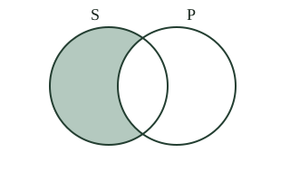
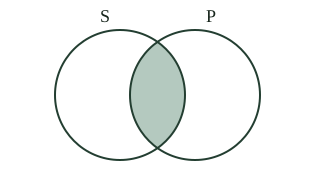

# Logic Form 4, Form Four Logic: drafts for review (Lessons 9 lessons (1–10))

Generated by `npm run review:f4-logic` from `content/form-4/logic/*.json`. Every question and drawing below was built by the engine.
All notes, teach cards, worked examples and paper tasks are **status: draft**. “Authored key” means a person fixed the
right answer (see `AUTHORED.md`); “computed by rule” means code worked it out (a formula, a conversion, a spelling rule).

Teach mode: cards (idea + example + 1 level-1 check) → worked example → practice (levels 1–3) → the note as a summary.

## Sample rendered lesson: Lesson 1 in teach mode

### Lesson 1: Structure of a Proposition

**Card l4-1-c1** (draft)

> Each part has a different job.
>
> _quantifier: All — how much of the subject class is covered._  
> _subject term: club members — the class about which the claim is made._  
> _copula: are — the linking expression joining subject and predicate._  
> _predicate term: badge holders — the class attributed to, or denied of, the subject._  

Check question: `l4-1-parts` · multiple choice, level 1 · **authored key**, reused from practice

> In All club members are badge holders, what is the role of “All”?

- ◻️ copula  
  _↳ feedback if chosen: That role concerns the linking expression joining subject and predicate, rather than the selected expression._
- ◻️ predicate term  
  _↳ feedback if chosen: That role concerns the class attributed to, or denied of, the subject, rather than the selected expression._
- ✅ quantifier
- ◻️ subject term  
  _↳ feedback if chosen: That role concerns the class about which the claim is made, rather than the selected expression._

Full working after a second miss:

> how much of the subject class is covered.  
> So the answer is “quantifier”.  

**Card l4-1-c2** (draft)

> The subject is the whole class being discussed.
>
> _All library books are loanable items: library books is the subject._  

Check question: `l4-1-subject` · multiple choice, level 1 · **authored key**, reused from practice

> Identify the subject term: All reading rooms are quiet places.

- ◻️ are  
  _↳ feedback if chosen: The linking expression is not the subject class._
- ◻️ All  
  _↳ feedback if chosen: That is a quantifier, not the complete subject term._
- ✅ reading rooms
- ◻️ quiet places  
  _↳ feedback if chosen: That is the predicate class; the claim is made about reading rooms._

Full working after a second miss:

> The claim concerns the class reading rooms.  
> So the answer is “reading rooms”.  

**Card l4-1-c3** (draft)

> A logical term can contain several words.
>
> _School gardens and cultivated areas each function as a term._  

Check question: `l4-1-boundaries-card` · multiple choice, level 1 · **authored key**

> In “All library books are loanable items,” which expression is one complete logical term?

- ◻️ are  
  _↳ feedback if chosen: Are is the copula._
- ◻️ All are  
  _↳ feedback if chosen: This combines separate functions and omits the class expression._
- ✅ library books
- ◻️ All  
  _↳ feedback if chosen: All is the quantifier._

Full working after a second miss:

> A logical term may contain several words while naming one class.  
> So the answer is “library books”.  

**Worked example** (draft)

> Parse All library books are loanable items.

1. All states the scope.
2. Library books names the class discussed.
3. Are links that class to loanable items.

**Answer:** Quantifier: All; subject: library books; copula: are; predicate: loanable items.

**Practice** (one generated question per template, easiest first)

Practice 1: `l4-1-parts` · multiple choice, level 1 · **authored key**

> In All club members are badge holders, what is the role of “All”?

- ◻️ subject term  
  _↳ feedback if chosen: That role concerns the class about which the claim is made, rather than the selected expression._
- ◻️ copula  
  _↳ feedback if chosen: That role concerns the linking expression joining subject and predicate, rather than the selected expression._
- ◻️ predicate term  
  _↳ feedback if chosen: That role concerns the class attributed to, or denied of, the subject, rather than the selected expression._
- ✅ quantifier

Full working after a second miss:

> how much of the subject class is covered.  
> So the answer is “quantifier”.  

Practice 2: `l4-1-subject` · multiple choice, level 1 · **authored key**

> Identify the subject term: No club members are badge holders.

- ◻️ No  
  _↳ feedback if chosen: That is a quantifier, not the complete subject term._
- ✅ club members
- ◻️ badge holders  
  _↳ feedback if chosen: That is the predicate class; the claim is made about club members._
- ◻️ are  
  _↳ feedback if chosen: The linking expression is not the subject class._

Full working after a second miss:

> The claim concerns the class club members.  
> So the answer is “club members”.  

Practice 3: `l4-1-predicate` · multiple choice, level 2 · **authored key**

> Identify the complete predicate term: Some library books are not loanable items.

- ◻️ Some library books are not loanable items.  
  _↳ feedback if chosen: The whole proposition includes more than its predicate term._
- ✅ loanable items
- ◻️ library books  
  _↳ feedback if chosen: That is the subject class, not the predicate._
- ◻️ are not  
  _↳ feedback if chosen: The copula links the classes but is not the predicate class._

Full working after a second miss:

> Keep the complete class expression loanable items.  
> So the answer is “loanable items”.  

Practice 4: `l4-1-boundaries` · multiple choice, level 2 · **authored key**

> In “All library books are loanable items,” which expression is one complete logical term?

- ✅ library books
- ◻️ All  
  _↳ feedback if chosen: All is the quantifier._
- ◻️ are  
  _↳ feedback if chosen: Are is the copula._
- ◻️ All are  
  _↳ feedback if chosen: This combines separate functions and omits the class expression._

Full working after a second miss:

> A logical term may contain several words while naming one class.  
> So the answer is “library books”.  

Practice 5: `l4-1-repair` · spot the error, level 3 · **authored key**

> Find the incorrect claim, then read the reason for the correction.

- ✅ A question is a true-or-false assertion merely because it ends with a sign.  
  _↳ explanation: A question asks for information; it does not by itself assert the requested claim._
- ◻️ A quantifier indicates scope over the subject class.  
  _↳ explanation: This is a correct rule: A quantifier indicates scope over the subject class. Look for a claim that breaks a rule taught in Learn._
- ◻️ A logical term can contain several words.  
  _↳ explanation: This is a correct rule: A logical term can contain several words. Look for a claim that breaks a rule taught in Learn._
- ◻️ A proposition makes a claim that can be true or false.  
  _↳ explanation: This is a correct rule: A proposition makes a claim that can be true or false. Look for a claim that breaks a rule taught in Learn._

Full working after a second miss:

> The wrong statement is “A question is a true-or-false assertion merely because it ends with a sign.”.  
> A question asks for information; it does not by itself assert the requested claim.  

**Summary (the note)**

> A proposition asserts something. In standard categorical form, distinguish quantifier, subject term, copula and predicate term. Keep multiword terms intact. Parsing a claim does not verify its truth.

## All drafts

| Lesson | Title (sheet) | Status | Cards | Practice | Paper task |
|---|---|---|---|---|---|
| 1 | Structure of a Proposition | draft | 3 | 5 | — |
| 2 | Categorical Proposition | draft | 3 | 5 | — |
| 3 | Properties of Categorical Proposition | draft | 3 | 5 | — |
| 4 | Types (Classification) of Standard Form Categorical | draft | 3 | 5 | — |
| 5 | Distribution of terms in Categorical Propositions | draft | 3 | 5 | — |
| 6 | Symbolisation and Venn diagramming of categorical propositions | draft | 3 | 5 | — |
| 8 | Hypothetical (Conditional) Proposition | draft | 3 | 5 | — |
| 9 | Disjunctive Proposition | draft | 3 | 5 | — |
| 10 | Other types of propositions and transllation into SF | draft | 3 | 6 | — |

## Lesson 1: Structure of a Proposition

Prerequisites: none · Skill: l4-1 (Structure of a proposition)

**Note** (draft)

> A proposition asserts something. In standard categorical form, distinguish quantifier, subject term, copula and predicate term. Keep multiword terms intact. Parsing a claim does not verify its truth.

**Learn: Your goal and connections** (draft)

> By the end, you should be able to separate quantifier, subject term, copula and predicate term in a standard categorical statement. Builds on: Form Three’s distinction between a term, a judgment and an argument. Leads to: categorical propositions, where these parts express a relation between classes.

**Learn: A claim has a structure** (draft)

> A proposition expresses an assertion that can be true or false. A question or command does not automatically assert a proposition. The standard categorical model makes its parts visible: quantifier + subject term + copula + predicate term. The quantifier sets the scope; the subject names the class discussed; the copula links; the predicate names the class attributed or denied. Other propositions need different analyses, which come later.

**Learn: Follow the parts in a local example** (draft)

> In an invented Buea club rule, All club members are badge holders, All is the quantifier, club members the subject term, are the copula and badge holders the predicate term. Both class expressions contain several words. A term is not restricted to one word, and naming the parts does not prove the club actually follows that rule.

**Learn: Keep whole terms together** (draft)

> First identify what class is discussed. Then locate the relation and the class attributed to it. Finally check the quantifier. In Some library books are not loanable items, library books is the subject, loanable items the predicate and are not the negative copula in this school model. The words not and are do not create a new class name.

**Learn: key words and examples** (draft)

- **quantifier**: how much of the subject class is covered
- **subject term**: the class about which the claim is made
- **copula**: the linking expression joining subject and predicate
- **predicate term**: the class attributed to, or denied of, the subject

Common mistake: “Each word is a separate logical term.” → “Club members is one multiword term.”. Logical function depends on the expression’s role, not its word count.

**Card l4-1-c1** (draft)

> Each part has a different job.
>
> _quantifier: All — how much of the subject class is covered._  
> _subject term: club members — the class about which the claim is made._  
> _copula: are — the linking expression joining subject and predicate._  
> _predicate term: badge holders — the class attributed to, or denied of, the subject._  

Check question: `l4-1-parts` · multiple choice, level 1 · **authored key**, reused from practice

> In All club members are badge holders, what is the role of “badge holders”?

- ◻️ quantifier  
  _↳ feedback if chosen: That role concerns how much of the subject class is covered, rather than the selected expression._
- ◻️ copula  
  _↳ feedback if chosen: That role concerns the linking expression joining subject and predicate, rather than the selected expression._
- ◻️ subject term  
  _↳ feedback if chosen: That role concerns the class about which the claim is made, rather than the selected expression._
- ✅ predicate term

Full working after a second miss:

> the class attributed to, or denied of, the subject.  
> So the answer is “predicate term”.  

**Card l4-1-c2** (draft)

> The subject is the whole class being discussed.
>
> _All library books are loanable items: library books is the subject._  

Check question: `l4-1-subject` · multiple choice, level 1 · **authored key**, reused from practice

> Identify the subject term: No club members are badge holders.

- ◻️ badge holders  
  _↳ feedback if chosen: That is the predicate class; the claim is made about club members._
- ✅ club members
- ◻️ are  
  _↳ feedback if chosen: The linking expression is not the subject class._
- ◻️ No  
  _↳ feedback if chosen: That is a quantifier, not the complete subject term._

Full working after a second miss:

> The claim concerns the class club members.  
> So the answer is “club members”.  

**Card l4-1-c3** (draft)

> A logical term can contain several words.
>
> _School gardens and cultivated areas each function as a term._  

Check question: `l4-1-boundaries-card` · multiple choice, level 1 · **authored key**

> In “All club members are badge holders,” which expression is one complete logical term?

- ◻️ are  
  _↳ feedback if chosen: Are is the copula._
- ◻️ All are  
  _↳ feedback if chosen: This combines separate functions and omits the class expression._
- ✅ club members
- ◻️ All  
  _↳ feedback if chosen: All is the quantifier._

Full working after a second miss:

> A logical term may contain several words while naming one class.  
> So the answer is “club members”.  

**Worked example** (draft)

> Parse All library books are loanable items.

1. All states the scope.
2. Library books names the class discussed.
3. Are links that class to loanable items.

**Answer:** Quantifier: All; subject: library books; copula: are; predicate: loanable items.

**Practice** `l4-1-parts` · multiple choice, level 1 · **authored key**

> In All club members are badge holders, what is the role of “All”?

- ◻️ predicate term  
  _↳ feedback if chosen: That role concerns the class attributed to, or denied of, the subject, rather than the selected expression._
- ◻️ copula  
  _↳ feedback if chosen: That role concerns the linking expression joining subject and predicate, rather than the selected expression._
- ◻️ subject term  
  _↳ feedback if chosen: That role concerns the class about which the claim is made, rather than the selected expression._
- ✅ quantifier

Full working after a second miss:

> how much of the subject class is covered.  
> So the answer is “quantifier”.  

> In All club members are badge holders, what is the role of “are”?

- ◻️ quantifier  
  _↳ feedback if chosen: That role concerns how much of the subject class is covered, rather than the selected expression._
- ◻️ subject term  
  _↳ feedback if chosen: That role concerns the class about which the claim is made, rather than the selected expression._
- ✅ copula
- ◻️ predicate term  
  _↳ feedback if chosen: That role concerns the class attributed to, or denied of, the subject, rather than the selected expression._

Full working after a second miss:

> the linking expression joining subject and predicate.  
> So the answer is “copula”.  

**Practice** `l4-1-subject` · multiple choice, level 1 · **authored key**

> Identify the subject term: Some library books are loanable items.

- ◻️ are  
  _↳ feedback if chosen: The linking expression is not the subject class._
- ✅ library books
- ◻️ Some  
  _↳ feedback if chosen: That is a quantifier, not the complete subject term._
- ◻️ loanable items  
  _↳ feedback if chosen: That is the predicate class; the claim is made about library books._

Full working after a second miss:

> The claim concerns the class library books.  
> So the answer is “library books”.  

> Identify the subject term: All club members are badge holders.

- ◻️ badge holders  
  _↳ feedback if chosen: That is the predicate class; the claim is made about club members._
- ◻️ All  
  _↳ feedback if chosen: That is a quantifier, not the complete subject term._
- ◻️ are  
  _↳ feedback if chosen: The linking expression is not the subject class._
- ✅ club members

Full working after a second miss:

> The claim concerns the class club members.  
> So the answer is “club members”.  

**Practice** `l4-1-predicate` · multiple choice, level 2 · **authored key**

> Identify the complete predicate term: Some club members are badge holders.

- ✅ badge holders
- ◻️ Some club members are badge holders.  
  _↳ feedback if chosen: The whole proposition includes more than its predicate term._
- ◻️ club members  
  _↳ feedback if chosen: That is the subject class, not the predicate._
- ◻️ are  
  _↳ feedback if chosen: The copula links the classes but is not the predicate class._

Full working after a second miss:

> Keep the complete class expression badge holders.  
> So the answer is “badge holders”.  

> Identify the complete predicate term: Some library books are loanable items.

- ◻️ library books  
  _↳ feedback if chosen: That is the subject class, not the predicate._
- ✅ loanable items
- ◻️ Some library books are loanable items.  
  _↳ feedback if chosen: The whole proposition includes more than its predicate term._
- ◻️ are  
  _↳ feedback if chosen: The copula links the classes but is not the predicate class._

Full working after a second miss:

> Keep the complete class expression loanable items.  
> So the answer is “loanable items”.  

**Practice** `l4-1-boundaries` · multiple choice, level 2 · **authored key**

> In “All library books are loanable items,” which expression is one complete logical term?

- ◻️ are  
  _↳ feedback if chosen: Are is the copula._
- ◻️ All  
  _↳ feedback if chosen: All is the quantifier._
- ◻️ All are  
  _↳ feedback if chosen: This combines separate functions and omits the class expression._
- ✅ library books

Full working after a second miss:

> A logical term may contain several words while naming one class.  
> So the answer is “library books”.  

> In “All reading rooms are quiet places,” which expression is one complete logical term?

- ✅ reading rooms
- ◻️ All are  
  _↳ feedback if chosen: This combines separate functions and omits the class expression._
- ◻️ are  
  _↳ feedback if chosen: Are is the copula._
- ◻️ All  
  _↳ feedback if chosen: All is the quantifier._

Full working after a second miss:

> A logical term may contain several words while naming one class.  
> So the answer is “reading rooms”.  

**Practice** `l4-1-repair` · spot the error, level 3 · **authored key**

> Find the incorrect claim, then read the reason for the correction.

- ◻️ A quantifier indicates scope over the subject class.  
  _↳ explanation: This is a correct rule: A quantifier indicates scope over the subject class. Look for a claim that breaks a rule taught in Learn._
- ◻️ A logical term can contain several words.  
  _↳ explanation: This is a correct rule: A logical term can contain several words. Look for a claim that breaks a rule taught in Learn._
- ◻️ A proposition makes a claim that can be true or false.  
  _↳ explanation: This is a correct rule: A proposition makes a claim that can be true or false. Look for a claim that breaks a rule taught in Learn._
- ✅ The predicate is always the person speaking.  
  _↳ explanation: The predicate term names the class attributed to or denied of the subject._

Full working after a second miss:

> The wrong statement is “The predicate is always the person speaking.”.  
> The predicate term names the class attributed to or denied of the subject.  

> Find the incorrect claim, then read the reason for the correction.

- ◻️ A proposition makes a claim that can be true or false.  
  _↳ explanation: This is a correct rule: A proposition makes a claim that can be true or false. Look for a claim that breaks a rule taught in Learn._
- ◻️ A logical term can contain several words.  
  _↳ explanation: This is a correct rule: A logical term can contain several words. Look for a claim that breaks a rule taught in Learn._
- ✅ The predicate is always the person speaking.  
  _↳ explanation: The predicate term names the class attributed to or denied of the subject._
- ◻️ The copula connects the subject and predicate in this model.  
  _↳ explanation: This is a correct rule: The copula connects the subject and predicate in this model. Look for a claim that breaks a rule taught in Learn._

Full working after a second miss:

> The wrong statement is “The predicate is always the person speaking.”.  
> The predicate term names the class attributed to or denied of the subject.  

## Lesson 2: Categorical Proposition

Prerequisites: 1 · Skill: l4-2 (Categorical propositions)

**Note** (draft)

> Categorical claims relate classes. All includes every S in P; no excludes overlap; some asserts existence. Some does not mean not all. An inclusion need not reverse, and a claim’s form does not establish its truth.

**Learn: Your goal and connections** (draft)

> By the end, you should be able to recognise a class-to-class assertion and explain what all, no and some commit it to. Builds on: identifying the subject, predicate, copula and quantifier. Leads to: quantity, quality and the standard categorical forms.

**Learn: Relating classes** (draft)

> A categorical proposition affirms or denies membership relations between classes. All S are P says every S belongs to P. No S are P excludes shared members. Some S are P asserts at least one shared member; Some S are not P asserts at least one S outside P. S and P are class labels, not individual people’s initials in this use.

**Learn: Read only what is asserted** (draft)

> For an invented Douala reading club, All members are badge holders allows badge holders who are not club members. It does not assert the reverse. Some members are readers means at least one, not exactly half and not necessarily fewer than all. No members are visitors excludes overlap; it does not prove that visitors do not exist.

**Learn: Form and truth are separate** (draft)

> Translate the relation clearly before checking whether it is true. A false claim can still have categorical form. Under the modern diagram convention used later, universal claims alone do not assert that S exists; particular claims do. Traditional courses may add an existence assumption. State that assumption when needed rather than inferring a member from all alone.

**Learn: key words and examples** (draft)

- **class**: a collection picked out by a term
- **categorical proposition**: a quantified assertion relating subject and predicate classes
- **some**: at least one
- **overlap**: members belonging to both classes

Common mistake: “Some means some but never all.” → “Some means at least one and is compatible with all.”. Not all is a further restriction absent from some alone.

**Card l4-2-c1** (draft)

> A standard categorical assertion quantifies and relates two classes.
>
> _All school gardens are cultivated areas has explicit class terms and a copula._  

Check question: `l4-2-recognise` · multiple choice, level 1 · **authored key**, reused from practice

> Which option directly relates the named classes in standard categorical form?

- ✅ All club members are badge holders.
- ◻️ If a meeting starts, club members arrive.  
  _↳ feedback if chosen: This is a conditional construction, not the requested standard class form._
- ◻️ Please contact the club members.  
  _↳ feedback if chosen: This is a request, not a categorical assertion._
- ◻️ Are all club members badge holders?  
  _↳ feedback if chosen: This asks a question instead of making the claim._

Full working after a second miss:

> The selected statement explicitly quantifies a subject class and attributes a predicate class.  
> So the answer is “All club members are badge holders.”.  

**Card l4-2-c2** (draft)

> Some means at least one, with no fixed upper limit.
>
> _Some library books are loanable items does not itself say that others are not._  

Check question: `l4-2-some` · multiple choice, level 1 · **authored key**, reused from practice

> In “Some reading rooms are quiet places,” what does Some establish?

- ◻️ Exactly half the subject members belong.  
  _↳ feedback if chosen: Some fixes no such fraction._
- ✅ At least one subject-class member belongs to the predicate class.
- ◻️ Every subject member belongs.  
  _↳ feedback if chosen: Some does not assert a universal claim._
- ◻️ Some but certainly not all belong.  
  _↳ feedback if chosen: Some allows all to belong; it does not itself say not all._

Full working after a second miss:

> In this logical use, some means at least one.  
> So the answer is “At least one subject-class member belongs to the predicate class.”.  

**Card l4-2-c3** (draft)

> No S are P rules out overlap.
>
> _The predicate class can still have members outside S._  

Check question: `l4-2-no-card` · multiple choice, level 1 · **authored key**

> What does “No club members are badge holders” rule out?

- ✅ Any member belonging to both named classes.
- ◻️ The existence of the predicate class everywhere.  
  _↳ feedback if chosen: The predicate class may exist outside the subject class._
- ◻️ Only one selected subject member.  
  _↳ feedback if chosen: No excludes overlap for the whole subject class._
- ◻️ Every object outside both classes.  
  _↳ feedback if chosen: The claim concerns overlap, not everything outside both classes._

Full working after a second miss:

> No S are P denies overlap, rather than denying that P has any members anywhere.  
> So the answer is “Any member belonging to both named classes.”.  

**Worked example** (draft)

> Does All club members are badge holders also say All badge holders are club members?

1. The claim starts with the club-member class.
2. Each of its members must be a badge holder.
3. Other badge holders may exist outside that club.

**Answer:** No. The original inclusion does not automatically reverse.

**Practice** `l4-2-recognise` · multiple choice, level 1 · **authored key**

> Which option directly relates the named classes in standard categorical form?

- ◻️ Please contact the library books.  
  _↳ feedback if chosen: This is a request, not a categorical assertion._
- ✅ All library books are loanable items.
- ◻️ Are all library books loanable items?  
  _↳ feedback if chosen: This asks a question instead of making the claim._
- ◻️ If a meeting starts, library books arrive.  
  _↳ feedback if chosen: This is a conditional construction, not the requested standard class form._

Full working after a second miss:

> The selected statement explicitly quantifies a subject class and attributes a predicate class.  
> So the answer is “All library books are loanable items.”.  

> Which option directly relates the named classes in standard categorical form?

- ◻️ Please contact the school gardens.  
  _↳ feedback if chosen: This is a request, not a categorical assertion._
- ✅ All school gardens are cultivated areas.
- ◻️ Are all school gardens cultivated areas?  
  _↳ feedback if chosen: This asks a question instead of making the claim._
- ◻️ If a meeting starts, school gardens arrive.  
  _↳ feedback if chosen: This is a conditional construction, not the requested standard class form._

Full working after a second miss:

> The selected statement explicitly quantifies a subject class and attributes a predicate class.  
> So the answer is “All school gardens are cultivated areas.”.  

**Practice** `l4-2-some` · multiple choice, level 1 · **authored key**

> In “Some school gardens are cultivated areas,” what does Some establish?

- ◻️ Exactly half the subject members belong.  
  _↳ feedback if chosen: Some fixes no such fraction._
- ✅ At least one subject-class member belongs to the predicate class.
- ◻️ Every subject member belongs.  
  _↳ feedback if chosen: Some does not assert a universal claim._
- ◻️ Some but certainly not all belong.  
  _↳ feedback if chosen: Some allows all to belong; it does not itself say not all._

Full working after a second miss:

> In this logical use, some means at least one.  
> So the answer is “At least one subject-class member belongs to the predicate class.”.  

> In “Some reading rooms are quiet places,” what does Some establish?

- ◻️ Every subject member belongs.  
  _↳ feedback if chosen: Some does not assert a universal claim._
- ◻️ Exactly half the subject members belong.  
  _↳ feedback if chosen: Some fixes no such fraction._
- ✅ At least one subject-class member belongs to the predicate class.
- ◻️ Some but certainly not all belong.  
  _↳ feedback if chosen: Some allows all to belong; it does not itself say not all._

Full working after a second miss:

> In this logical use, some means at least one.  
> So the answer is “At least one subject-class member belongs to the predicate class.”.  

**Practice** `l4-2-no` · multiple choice, level 2 · **authored key**

> What does “No club members are badge holders” rule out?

- ✅ Any member belonging to both named classes.
- ◻️ Only one selected subject member.  
  _↳ feedback if chosen: No excludes overlap for the whole subject class._
- ◻️ The existence of the predicate class everywhere.  
  _↳ feedback if chosen: The predicate class may exist outside the subject class._
- ◻️ Every object outside both classes.  
  _↳ feedback if chosen: The claim concerns overlap, not everything outside both classes._

Full working after a second miss:

> No S are P denies overlap, rather than denying that P has any members anywhere.  
> So the answer is “Any member belonging to both named classes.”.  

> What does “No reading rooms are quiet places” rule out?

- ◻️ The existence of the predicate class everywhere.  
  _↳ feedback if chosen: The predicate class may exist outside the subject class._
- ✅ Any member belonging to both named classes.
- ◻️ Every object outside both classes.  
  _↳ feedback if chosen: The claim concerns overlap, not everything outside both classes._
- ◻️ Only one selected subject member.  
  _↳ feedback if chosen: No excludes overlap for the whole subject class._

Full working after a second miss:

> No S are P denies overlap, rather than denying that P has any members anywhere.  
> So the answer is “Any member belonging to both named classes.”.  

**Practice** `l4-2-direction` · multiple choice, level 2 · **authored key**

> Suppose All reading rooms are quiet places. Which additional situation can still fit that claim?

- ◻️ The claim automatically reverses to All quiet places are reading rooms.  
  _↳ feedback if chosen: Inclusion need not be an equality or a reversible relation._
- ◻️ A subject-class member is outside the predicate class.  
  _↳ feedback if chosen: That is a direct counterexample to All S are P._
- ✅ Some quiet places are outside the class of reading rooms.
- ◻️ No subject member can belong to the predicate class, even if a subject exists.  
  _↳ feedback if chosen: An existing subject must belong to P under the stated universal._

Full working after a second miss:

> All S are P puts S inside P without exhausting P.  
> So the answer is “Some quiet places are outside the class of reading rooms.”.  

> Suppose All school gardens are cultivated areas. Which additional situation can still fit that claim?

- ◻️ A subject-class member is outside the predicate class.  
  _↳ feedback if chosen: That is a direct counterexample to All S are P._
- ◻️ No subject member can belong to the predicate class, even if a subject exists.  
  _↳ feedback if chosen: An existing subject must belong to P under the stated universal._
- ✅ Some cultivated areas are outside the class of school gardens.
- ◻️ The claim automatically reverses to All cultivated areas are school gardens.  
  _↳ feedback if chosen: Inclusion need not be an equality or a reversible relation._

Full working after a second miss:

> All S are P puts S inside P without exhausting P.  
> So the answer is “Some cultivated areas are outside the class of school gardens.”.  

**Practice** `l4-2-repair` · spot the error, level 3 · **authored key**

> Find the incorrect claim, then read the reason for the correction.

- ✅ All S are P is automatically an argument with premises and a conclusion.  
  _↳ explanation: It is one proposition; an argument requires supporting claims and an inference._
- ◻️ Some means at least one in these exercises.  
  _↳ explanation: This is a correct rule: Some means at least one in these exercises. Look for a claim that breaks a rule taught in Learn._
- ◻️ No S are P excludes overlap between the classes.  
  _↳ explanation: This is a correct rule: No S are P excludes overlap between the classes. Look for a claim that breaks a rule taught in Learn._
- ◻️ A categorical proposition relates subject and predicate classes.  
  _↳ explanation: This is a correct rule: A categorical proposition relates subject and predicate classes. Look for a claim that breaks a rule taught in Learn._

Full working after a second miss:

> The wrong statement is “All S are P is automatically an argument with premises and a conclusion.”.  
> It is one proposition; an argument requires supporting claims and an inference.  

> Find the incorrect claim, then read the reason for the correction.

- ◻️ No S are P excludes overlap between the classes.  
  _↳ explanation: This is a correct rule: No S are P excludes overlap between the classes. Look for a claim that breaks a rule taught in Learn._
- ◻️ Some means at least one in these exercises.  
  _↳ explanation: This is a correct rule: Some means at least one in these exercises. Look for a claim that breaks a rule taught in Learn._
- ✅ All S are P is automatically an argument with premises and a conclusion.  
  _↳ explanation: It is one proposition; an argument requires supporting claims and an inference._
- ◻️ A categorical proposition relates subject and predicate classes.  
  _↳ explanation: This is a correct rule: A categorical proposition relates subject and predicate classes. Look for a claim that breaks a rule taught in Learn._

Full working after a second miss:

> The wrong statement is “All S are P is automatically an argument with premises and a conclusion.”.  
> It is one proposition; an argument requires supporting claims and an inference.  

## Lesson 3: Properties of Categorical Proposition

Prerequisites: 2 · Skill: l4-3 (Properties: quantity and quality)

**Note** (draft)

> Quantity asks universal or particular; quality asks affirmative or negative. No S are P is universal negative. Analyse both properties independently, then check what a rewrite preserves or changes.

**Learn: Your goal and connections** (draft)

> By the end, you should be able to identify quantity and quality independently and explain which property changes in a rewrite. Builds on: categorical claims and their quantifiers. Leads to: combining the properties to recognise A, E, I and O.

**Learn: Quantity asks how widely** (draft)

> Universal propositions concern the entire subject class: All S are P and No S are P. Particular propositions assert at least one subject member: Some S are P and Some S are not P. Universal does not mean that every object in the world is included. It concerns the whole class named by the subject.

**Learn: Quality asks whether membership is affirmed** (draft)

> Affirmative propositions attribute membership: All S are P and Some S are P. Negative propositions deny it: No S are P and Some S are not P. Negative does not mean rude, undesirable or false. A negative statement can be polite and true. Notice that No is universal in quantity despite denying overlap.

**Learn: Track a change precisely** (draft)

> In an invented Bamenda club example, changing All members are readers to Some members are readers changes quantity while keeping affirmative quality. Changing Some members are readers to Some members are not readers changes quality while keeping particular quantity. Classify each property separately before combining them; the next lesson names the resulting patterns.

**Learn: key words and examples** (draft)

- **quantity**: universal or particular scope
- **quality**: affirmation or denial of membership
- **universal**: covering the whole subject class
- **particular**: asserting at least one subject member

Common mistake: “No makes a claim particular.” → “No S are P is universal and negative.”. It rules out overlap for the entire subject class.

**Card l4-3-c1** (draft)

> All and no are universal; some is particular.
>
> _No school gardens are cultivated areas is universal in quantity, even if factually false._  

Check question: `l4-3-quantity` · multiple choice, level 1 · **authored key**, reused from practice

> Give the quantity of: Some school gardens are cultivated areas.

- ◻️ universal  
  _↳ feedback if chosen: Check whether the claim covers all S or asserts at least one S._
- ◻️ negative  
  _↳ feedback if chosen: Negative is a quality, not a quantity._
- ✅ particular
- ◻️ affirmative  
  _↳ feedback if chosen: Affirmative is a quality, not a quantity._

Full working after a second miss:

> The quantifier makes this a particular proposition.  
> So the answer is “particular”.  

**Card l4-3-c2** (draft)

> Affirmation and denial determine quality.
>
> _Some S are P affirms; Some S are not P denies membership._  

Check question: `l4-3-quality` · multiple choice, level 1 · **authored key**, reused from practice

> Give the quality of: All club members are badge holders.

- ✅ affirmative
- ◻️ particular  
  _↳ feedback if chosen: Particular is a quantity, not a quality._
- ◻️ universal  
  _↳ feedback if chosen: Universal is a quantity, not a quality._
- ◻️ negative  
  _↳ feedback if chosen: Check whether membership is affirmed or denied._

Full working after a second miss:

> The relation is affirmative; the quantifier alone does not settle quality.  
> So the answer is “affirmative”.  

**Card l4-3-c3** (draft)

> Changing all to some changes scope, not affirmation.
>
> _All S are P and Some S are P remain affirmative._  

Check question: `l4-3-change-card` · multiple choice, level 1 · **authored key**

> Bih changes “All reading rooms are quiet places” to “Some reading rooms are quiet places.” What changes?

- ◻️ Both become negative.  
  _↳ feedback if chosen: Neither sentence denies membership._
- ◻️ Quality changes; quantity stays universal.  
  _↳ feedback if chosen: All becomes some, changing scope rather than affirmation._
- ✅ Quantity changes; quality stays affirmative.
- ◻️ Neither quantity nor quality changes.  
  _↳ feedback if chosen: The universal-to-particular change is significant._

Full working after a second miss:

> All and some differ in quantity, while both sentences affirm membership.  
> So the answer is “Quantity changes; quality stays affirmative.”.  

**Worked example** (draft)

> Analyse Some library books are not loanable items.

1. Some asserts at least one subject member: particular quantity.
2. Are not denies membership: negative quality.
3. Keep these two properties separate before naming the whole form.

**Answer:** Particular quantity and negative quality.

**Practice** `l4-3-quantity` · multiple choice, level 1 · **authored key**

> Give the quantity of: Some school gardens are cultivated areas.

- ◻️ affirmative  
  _↳ feedback if chosen: Affirmative is a quality, not a quantity._
- ◻️ universal  
  _↳ feedback if chosen: Check whether the claim covers all S or asserts at least one S._
- ◻️ negative  
  _↳ feedback if chosen: Negative is a quality, not a quantity._
- ✅ particular

Full working after a second miss:

> The quantifier makes this a particular proposition.  
> So the answer is “particular”.  

> Give the quantity of: No school gardens are cultivated areas.

- ◻️ negative  
  _↳ feedback if chosen: Negative is a quality, not a quantity._
- ✅ universal
- ◻️ particular  
  _↳ feedback if chosen: Check whether the claim covers all S or asserts at least one S._
- ◻️ affirmative  
  _↳ feedback if chosen: Affirmative is a quality, not a quantity._

Full working after a second miss:

> The quantifier makes this a universal proposition.  
> So the answer is “universal”.  

**Practice** `l4-3-quality` · multiple choice, level 1 · **authored key**

> Give the quality of: Some reading rooms are quiet places.

- ◻️ negative  
  _↳ feedback if chosen: Check whether membership is affirmed or denied._
- ◻️ particular  
  _↳ feedback if chosen: Particular is a quantity, not a quality._
- ◻️ universal  
  _↳ feedback if chosen: Universal is a quantity, not a quality._
- ✅ affirmative

Full working after a second miss:

> The relation is affirmative; the quantifier alone does not settle quality.  
> So the answer is “affirmative”.  

> Give the quality of: Some library books are loanable items.

- ◻️ negative  
  _↳ feedback if chosen: Check whether membership is affirmed or denied._
- ✅ affirmative
- ◻️ particular  
  _↳ feedback if chosen: Particular is a quantity, not a quality._
- ◻️ universal  
  _↳ feedback if chosen: Universal is a quantity, not a quality._

Full working after a second miss:

> The relation is affirmative; the quantifier alone does not settle quality.  
> So the answer is “affirmative”.  

**Practice** `l4-3-combine` · multiple choice, level 2 · **authored key**

> Give the quantity and quality of: No reading rooms are quiet places.

- ◻️ particular negative  
  _↳ feedback if chosen: That combination does not match both the quantifier and the affirmation/denial in this sentence._
- ◻️ particular affirmative  
  _↳ feedback if chosen: That combination does not match both the quantifier and the affirmation/denial in this sentence._
- ◻️ universal affirmative  
  _↳ feedback if chosen: That combination does not match both the quantifier and the affirmation/denial in this sentence._
- ✅ universal negative

Full working after a second miss:

> The quantifier makes it universal and the membership relation negative.  
> So the answer is “universal negative”.  

> Give the quantity and quality of: Some library books are loanable items.

- ◻️ universal affirmative  
  _↳ feedback if chosen: That combination does not match both the quantifier and the affirmation/denial in this sentence._
- ◻️ universal negative  
  _↳ feedback if chosen: That combination does not match both the quantifier and the affirmation/denial in this sentence._
- ✅ particular affirmative
- ◻️ particular negative  
  _↳ feedback if chosen: That combination does not match both the quantifier and the affirmation/denial in this sentence._

Full working after a second miss:

> The quantifier makes it particular and the membership relation affirmative.  
> So the answer is “particular affirmative”.  

**Practice** `l4-3-change` · multiple choice, level 2 · **authored key**

> Bih changes “All club members are badge holders” to “Some club members are badge holders.” What changes?

- ◻️ Neither quantity nor quality changes.  
  _↳ feedback if chosen: The universal-to-particular change is significant._
- ◻️ Quality changes; quantity stays universal.  
  _↳ feedback if chosen: All becomes some, changing scope rather than affirmation._
- ✅ Quantity changes; quality stays affirmative.
- ◻️ Both become negative.  
  _↳ feedback if chosen: Neither sentence denies membership._

Full working after a second miss:

> All and some differ in quantity, while both sentences affirm membership.  
> So the answer is “Quantity changes; quality stays affirmative.”.  

> Bih changes “All club members are badge holders” to “Some club members are badge holders.” What changes?

- ◻️ Quality changes; quantity stays universal.  
  _↳ feedback if chosen: All becomes some, changing scope rather than affirmation._
- ◻️ Neither quantity nor quality changes.  
  _↳ feedback if chosen: The universal-to-particular change is significant._
- ✅ Quantity changes; quality stays affirmative.
- ◻️ Both become negative.  
  _↳ feedback if chosen: Neither sentence denies membership._

Full working after a second miss:

> All and some differ in quantity, while both sentences affirm membership.  
> So the answer is “Quantity changes; quality stays affirmative.”.  

**Practice** `l4-3-repair` · spot the error, level 3 · **authored key**

> Find the incorrect claim, then read the reason for the correction.

- ◻️ Some S are P is particular and affirmative.  
  _↳ explanation: This is a correct rule: Some S are P is particular and affirmative. Look for a claim that breaks a rule taught in Learn._
- ✅ All and some differ only in spelling, without a change in scope.  
  _↳ explanation: All concerns the whole subject class; some asserts at least one member._
- ◻️ Quality distinguishes affirmation and denial.  
  _↳ explanation: This is a correct rule: Quality distinguishes affirmation and denial. Look for a claim that breaks a rule taught in Learn._
- ◻️ No S are P is universal and negative.  
  _↳ explanation: This is a correct rule: No S are P is universal and negative. Look for a claim that breaks a rule taught in Learn._

Full working after a second miss:

> The wrong statement is “All and some differ only in spelling, without a change in scope.”.  
> All concerns the whole subject class; some asserts at least one member.  

> Find the incorrect claim, then read the reason for the correction.

- ◻️ Quantity distinguishes universal and particular scope.  
  _↳ explanation: This is a correct rule: Quantity distinguishes universal and particular scope. Look for a claim that breaks a rule taught in Learn._
- ◻️ Quality distinguishes affirmation and denial.  
  _↳ explanation: This is a correct rule: Quality distinguishes affirmation and denial. Look for a claim that breaks a rule taught in Learn._
- ◻️ Some S are P is particular and affirmative.  
  _↳ explanation: This is a correct rule: Some S are P is particular and affirmative. Look for a claim that breaks a rule taught in Learn._
- ✅ A negative proposition must be an insulting remark.  
  _↳ explanation: Negative is a logical denial of membership, not a description of politeness._

Full working after a second miss:

> The wrong statement is “A negative proposition must be an insulting remark.”.  
> Negative is a logical denial of membership, not a description of politeness.  

## Lesson 4: Types (Classification) of Standard Form Categorical

Prerequisites: 3 · Skill: l4-4 (Standard categorical forms: A, E, I and O)

**Note** (draft)

> A, E, I and O name the combinations of quantity and quality. Not all S are P translates as Some S are not P. Universal claims are refuted by appropriate counterexamples; a form label does not establish truth.

**Learn: Your goal and connections** (draft)

> By the end, you should be able to classify and construct the standard forms and identify a counterexample to a universal claim. Builds on: quantity and quality as separate properties. Leads to: distribution and Venn diagrams, which depend on the exact form.

**Learn: Combine the properties** (draft)

> A: All S are P, universal affirmative. E: No S are P, universal negative. I: Some S are P, particular affirmative. O: Some S are not P, particular negative. The letters abbreviate these structures; they do not rank the quality of a pupil’s work or establish truth. Keep the same S and P when comparing forms.

**Learn: Use the form, not a memorised topic** (draft)

> For an invented library, All library books are loanable items is A. No library books are loanable items is E. Some library books are loanable items is I. Some library books are not loanable items is O. The topic is unchanged while quantity and quality vary. A negative form need not contain the separate word not: No signals E.

**Learn: Check what would refute a claim** (draft)

> An S outside P refutes All S are P. An object in both classes refutes No S are P. Not all S are P therefore has O meaning, not E meaning: it leaves open whether other S belong to P. Particular claims need an existing example. Universal-to-particular inferences require an explicit existence assumption under the modern interpretation.

**Learn: key words and examples** (draft)

- **A**: universal affirmative
- **E**: universal negative
- **I**: particular affirmative
- **O**: particular negative

Common mistake: “Not all members are readers means no members are readers.” → “It means some members are not readers.”. A counterexample to all need not exclude every possible reader.

**Card l4-4-c1** (draft)

> The letter records quantity and quality.
>
> _A: All S are P._  
> _E: No S are P._  
> _I: Some S are P._  
> _O: Some S are not P._  

Check question: `l4-4-classify` · multiple choice, level 1 · **authored key**, reused from practice

> Classify the form, without deciding whether the invented claim is true: Some school gardens are not cultivated areas.

- ◻️ I — particular affirmative  
  _↳ feedback if chosen: That form is particular affirmative; this claim is particular and negative._
- ◻️ E — universal negative  
  _↳ feedback if chosen: That form is universal negative; this claim is particular and negative._
- ◻️ A — universal affirmative  
  _↳ feedback if chosen: That form is universal affirmative; this claim is particular and negative._
- ✅ O — particular negative

Full working after a second miss:

> Read the quantifier and whether membership is affirmed or denied: particular negative.  
> So the answer is “O — particular negative”.  

**Card l4-4-c2** (draft)

> Construct the form by keeping the class terms fixed.
>
> _Change the quantifier and copula to change the categorical form._  

Check question: `l4-4-form` · multiple choice, level 1 · **authored key**, reused from practice

> Choose the particular affirmative statement about the named classes.

- ◻️ No reading rooms are quiet places.  
  _↳ feedback if chosen: That is universal negative, rather than particular affirmative._
- ◻️ All reading rooms are quiet places.  
  _↳ feedback if chosen: That is universal affirmative, rather than particular affirmative._
- ◻️ Some reading rooms are not quiet places.  
  _↳ feedback if chosen: That is particular negative, rather than particular affirmative._
- ✅ Some reading rooms are quiet places.

Full working after a second miss:

> The form is I: particular affirmative.  
> So the answer is “Some reading rooms are quiet places.”.  

**Card l4-4-c3** (draft)

> Not all is weaker than no.
>
> _Some S outside P can refute all while other S remain in P._  

Check question: `l4-4-repair-card` · spot the error, level 1 · **authored key**

> Find the incorrect claim, then read the reason for the correction.

- ✅ A form is true merely because it is labelled A.  
  _↳ explanation: The code identifies structure, not factual truth._
- ◻️ O is particular negative.  
  _↳ explanation: This is a correct rule: O is particular negative. Look for a claim that breaks a rule taught in Learn._
- ◻️ A is universal affirmative.  
  _↳ explanation: This is a correct rule: A is universal affirmative. Look for a claim that breaks a rule taught in Learn._
- ◻️ E is universal negative.  
  _↳ explanation: This is a correct rule: E is universal negative. Look for a claim that breaks a rule taught in Learn._

Full working after a second miss:

> The wrong statement is “A form is true merely because it is labelled A.”.  
> The code identifies structure, not factual truth.  

**Worked example** (draft)

> Classify Not all library books are loanable items.

1. Denying all requires at least one library book outside the loanable class.
2. Rewrite: Some library books are not loanable items.
3. This has particular quantity and negative quality.

**Answer:** O — particular negative.

**Practice** `l4-4-classify` · multiple choice, level 1 · **authored key**

> Classify the form, without deciding whether the invented claim is true: Some club members are not badge holders.

- ◻️ A — universal affirmative  
  _↳ feedback if chosen: That form is universal affirmative; this claim is particular and negative._
- ✅ O — particular negative
- ◻️ I — particular affirmative  
  _↳ feedback if chosen: That form is particular affirmative; this claim is particular and negative._
- ◻️ E — universal negative  
  _↳ feedback if chosen: That form is universal negative; this claim is particular and negative._

Full working after a second miss:

> Read the quantifier and whether membership is affirmed or denied: particular negative.  
> So the answer is “O — particular negative”.  

> Classify the form, without deciding whether the invented claim is true: Some school gardens are cultivated areas.

- ◻️ E — universal negative  
  _↳ feedback if chosen: That form is universal negative; this claim is particular and affirmative._
- ✅ I — particular affirmative
- ◻️ O — particular negative  
  _↳ feedback if chosen: That form is particular negative; this claim is particular and affirmative._
- ◻️ A — universal affirmative  
  _↳ feedback if chosen: That form is universal affirmative; this claim is particular and affirmative._

Full working after a second miss:

> Read the quantifier and whether membership is affirmed or denied: particular affirmative.  
> So the answer is “I — particular affirmative”.  

**Practice** `l4-4-form` · multiple choice, level 1 · **authored key**

> Choose the universal negative statement about the named classes.

- ◻️ Some reading rooms are quiet places.  
  _↳ feedback if chosen: That is particular affirmative, rather than universal negative._
- ◻️ Some reading rooms are not quiet places.  
  _↳ feedback if chosen: That is particular negative, rather than universal negative._
- ✅ No reading rooms are quiet places.
- ◻️ All reading rooms are quiet places.  
  _↳ feedback if chosen: That is universal affirmative, rather than universal negative._

Full working after a second miss:

> The form is E: universal negative.  
> So the answer is “No reading rooms are quiet places.”.  

> Choose the universal negative statement about the named classes.

- ◻️ Some reading rooms are quiet places.  
  _↳ feedback if chosen: That is particular affirmative, rather than universal negative._
- ◻️ Some reading rooms are not quiet places.  
  _↳ feedback if chosen: That is particular negative, rather than universal negative._
- ◻️ All reading rooms are quiet places.  
  _↳ feedback if chosen: That is universal affirmative, rather than universal negative._
- ✅ No reading rooms are quiet places.

Full working after a second miss:

> The form is E: universal negative.  
> So the answer is “No reading rooms are quiet places.”.  

**Practice** `l4-4-counterexamples` · number, level 2 · computed by rule

> An invented club has 9 members with badges and 2 without badges. How many counterexamples to All club members are badge holders are shown?

Answer: **2**
- Typed **9** (inside) → “These members satisfy the claim instead of refuting it.”
- Typed **11** (total) → “Not every member is a counterexample; count only those without badges.”

Full working after a second miss:

> A counterexample must be a club member outside the badge-holder class.  
> There are 2 such members, so the answer is 2.  

> An invented club has 4 members with badges and 9 without badges. How many counterexamples to All club members are badge holders are shown?

Answer: **9**
- Typed **4** (inside) → “These members satisfy the claim instead of refuting it.”
- Typed **13** (total) → “Not every member is a counterexample; count only those without badges.”

Full working after a second miss:

> A counterexample must be a club member outside the badge-holder class.  
> There are 9 such members, so the answer is 9.  

**Practice** `l4-4-match` · matching, level 2 · **authored key**

> Match the code to its complete standard form.

Right-hand side (shuffled): Some S are not P. · All S are P. · Some S are P.
- I → **Some S are P.**
- A → **All S are P.**
- O → **Some S are not P.**

Full working after a second miss:

> The right pairs are:  
> I → Some S are P.  
> A → All S are P.  
> O → Some S are not P.  

> Match the code to its complete standard form.

Right-hand side (shuffled): Some S are P. · No S are P. · Some S are not P.
- I → **Some S are P.**
- O → **Some S are not P.**
- E → **No S are P.**

Full working after a second miss:

> The right pairs are:  
> I → Some S are P.  
> O → Some S are not P.  
> E → No S are P.  

**Practice** `l4-4-repair` · spot the error, level 3 · **authored key**

> Find the incorrect claim, then read the reason for the correction.

- ◻️ E is universal negative.  
  _↳ explanation: This is a correct rule: E is universal negative. Look for a claim that breaks a rule taught in Learn._
- ✅ One S outside P cannot affect an All S are P claim.  
  _↳ explanation: A single counterexample defeats the universal affirmative._
- ◻️ I is particular affirmative.  
  _↳ explanation: This is a correct rule: I is particular affirmative. Look for a claim that breaks a rule taught in Learn._
- ◻️ O is particular negative.  
  _↳ explanation: This is a correct rule: O is particular negative. Look for a claim that breaks a rule taught in Learn._

Full working after a second miss:

> The wrong statement is “One S outside P cannot affect an All S are P claim.”.  
> A single counterexample defeats the universal affirmative.  

> Find the incorrect claim, then read the reason for the correction.

- ◻️ E is universal negative.  
  _↳ explanation: This is a correct rule: E is universal negative. Look for a claim that breaks a rule taught in Learn._
- ◻️ A is universal affirmative.  
  _↳ explanation: This is a correct rule: A is universal affirmative. Look for a claim that breaks a rule taught in Learn._
- ◻️ O is particular negative.  
  _↳ explanation: This is a correct rule: O is particular negative. Look for a claim that breaks a rule taught in Learn._
- ✅ A form is true merely because it is labelled A.  
  _↳ explanation: The code identifies structure, not factual truth._

Full working after a second miss:

> The wrong statement is “A form is true merely because it is labelled A.”.  
> The code identifies structure, not factual truth.  

## Lesson 5: Distribution of terms in Categorical Propositions

Prerequisites: 4 · Skill: l4-5 (Distribution of terms)

**Note** (draft)

> Distribution means whole-class coverage. A distributes S; E both; I neither; O P. Explain each using what the proposition covers. Do not confuse distribution with sample size or reverse an A claim without justification.

**Learn: Your goal and connections** (draft)

> By the end, you should be able to state and justify which terms are distributed in each categorical form. Builds on: the A, E, I and O forms. Leads to: interpreting diagrams and avoiding illicit class-wide conclusions in later syllogisms.

**Learn: What distributed means** (draft)

> A term is distributed when the proposition speaks about every member of the class it names. This concerns logical coverage, not how many objects a classroom sample contains. Ask separately about S and P. A: S only. E: both. I: neither. O: P only. Learn the pattern with its reason, rather than treating a quantifier as a signal that both terms are distributed.

**Learn: Why the affirmative forms differ** (draft)

> All club members are badge holders covers every club member. It leaves open whether other badge holders exist, so P is undistributed. Some club members are badge holders covers selected members and does not exhaust either class. Thus A distributes S, while I distributes neither. Reversing an A statement would add a claim about the entire predicate class that the original did not make.

**Learn: Why negative predicates are distributed** (draft)

> No S are P excludes every S from the whole P class, so both terms are distributed. Some S are not P selects at least one S and excludes that member from P as a whole: S is undistributed, P distributed. The claim does not assert that all S are outside P. Distribution will later help test whether a conclusion claims more class coverage than its premises supply.

**Learn: key words and examples** (draft)

- **distributed**: covering every member of the term’s class
- **undistributed**: not covering every member of the term’s class
- **subject coverage**: whether every S is covered
- **predicate coverage**: whether P is covered as a whole

Common mistake: “All S are P distributes both terms.” → “It distributes S only.”. The statement permits P outside S, so it does not exhaust P.

**Card l4-5-c1** (draft)

> Use class coverage for each term.
>
> _A: S only; E: both; I: neither; O: P only._  

Check question: `l4-5-coverage` · multiple choice, level 1 · **authored key**, reused from practice

> Which terms are distributed in: All reading rooms are quiet places.

- ◻️ Both subject and predicate  
  _↳ feedback if chosen: That coverage pattern belongs to E, not the present A form._
- ◻️ Neither term  
  _↳ feedback if chosen: That coverage pattern belongs to I, not the present A form._
- ◻️ Predicate only  
  _↳ feedback if chosen: That coverage pattern belongs to O, not the present A form._
- ✅ Subject only

Full working after a second miss:

> Distribution means speaking about every member of the named class. Use the A pattern.  
> So the answer is “Subject only”.  

**Card l4-5-c2** (draft)

> All covers every subject member, without exhausting the predicate.
>
> _All club members are badge holders still permits badge holders outside the club._  

Check question: `l4-5-why` · multiple choice, level 1 · **authored key**, reused from practice

> Why is the subject distributed in All library books are loanable items?

- ◻️ The subject expression has more letters.  
  _↳ feedback if chosen: Spelling length has no bearing on class coverage._
- ✅ The claim covers every member of the subject class.
- ◻️ The predicate class must have no other members.  
  _↳ feedback if chosen: A does not exhaust P; predicate distribution does not follow._
- ◻️ Every affirmative proposition distributes both terms.  
  _↳ feedback if chosen: I distributes neither and A only the subject._

Full working after a second miss:

> All ranges over the complete subject class; that is the relevant coverage.  
> So the answer is “The claim covers every member of the subject class.”.  

**Card l4-5-c3** (draft)

> In O, the selected S is outside the whole P class.
>
> _Some S are not P: S undistributed, P distributed._  

Check question: `l4-5-negative-card` · multiple choice, level 1 · **authored key**

> In Some reading rooms are not quiet places, why is the predicate distributed?

- ◻️ All subject members have been discussed.  
  _↳ feedback if chosen: Some does not cover the entire subject class._
- ◻️ Some means exactly half the predicate class.  
  _↳ feedback if chosen: Some imposes no such fraction or predicate count._
- ✅ The selected subject member is excluded from the entire predicate class.
- ◻️ The subject member belongs to every predicate member.  
  _↳ feedback if chosen: The claim denies membership in P rather than asserting this relation._

Full working after a second miss:

> The selected S is outside P as a whole, so P is distributed while S is not.  
> So the answer is “The selected subject member is excluded from the entire predicate class.”.  

**Worked example** (draft)

> Find the distributed terms in Some library books are not loanable items.

1. Some selects at least one book, not every library book: S is undistributed.
2. That selected book is excluded from the entire loanable-item class: P is distributed.
3. This is O form.

**Answer:** Predicate only.

**Practice** `l4-5-coverage` · multiple choice, level 1 · **authored key**

> Which terms are distributed in: Some school gardens are not cultivated areas.

- ✅ Predicate only
- ◻️ Neither term  
  _↳ feedback if chosen: That coverage pattern belongs to I, not the present O form._
- ◻️ Subject only  
  _↳ feedback if chosen: That coverage pattern belongs to A, not the present O form._
- ◻️ Both subject and predicate  
  _↳ feedback if chosen: That coverage pattern belongs to E, not the present O form._

Full working after a second miss:

> Distribution means speaking about every member of the named class. Use the O pattern.  
> So the answer is “Predicate only”.  

> Which terms are distributed in: Some club members are badge holders.

- ✅ Neither term
- ◻️ Subject only  
  _↳ feedback if chosen: That coverage pattern belongs to A, not the present I form._
- ◻️ Both subject and predicate  
  _↳ feedback if chosen: That coverage pattern belongs to E, not the present I form._
- ◻️ Predicate only  
  _↳ feedback if chosen: That coverage pattern belongs to O, not the present I form._

Full working after a second miss:

> Distribution means speaking about every member of the named class. Use the I pattern.  
> So the answer is “Neither term”.  

**Practice** `l4-5-why` · multiple choice, level 1 · **authored key**

> Why is the subject distributed in All school gardens are cultivated areas?

- ◻️ The subject expression has more letters.  
  _↳ feedback if chosen: Spelling length has no bearing on class coverage._
- ✅ The claim covers every member of the subject class.
- ◻️ The predicate class must have no other members.  
  _↳ feedback if chosen: A does not exhaust P; predicate distribution does not follow._
- ◻️ Every affirmative proposition distributes both terms.  
  _↳ feedback if chosen: I distributes neither and A only the subject._

Full working after a second miss:

> All ranges over the complete subject class; that is the relevant coverage.  
> So the answer is “The claim covers every member of the subject class.”.  

> Why is the subject distributed in All library books are loanable items?

- ✅ The claim covers every member of the subject class.
- ◻️ The subject expression has more letters.  
  _↳ feedback if chosen: Spelling length has no bearing on class coverage._
- ◻️ Every affirmative proposition distributes both terms.  
  _↳ feedback if chosen: I distributes neither and A only the subject._
- ◻️ The predicate class must have no other members.  
  _↳ feedback if chosen: A does not exhaust P; predicate distribution does not follow._

Full working after a second miss:

> All ranges over the complete subject class; that is the relevant coverage.  
> So the answer is “The claim covers every member of the subject class.”.  

**Practice** `l4-5-negative` · multiple choice, level 2 · **authored key**

> In Some club members are not badge holders, why is the predicate distributed?

- ◻️ All subject members have been discussed.  
  _↳ feedback if chosen: Some does not cover the entire subject class._
- ◻️ The subject member belongs to every predicate member.  
  _↳ feedback if chosen: The claim denies membership in P rather than asserting this relation._
- ◻️ Some means exactly half the predicate class.  
  _↳ feedback if chosen: Some imposes no such fraction or predicate count._
- ✅ The selected subject member is excluded from the entire predicate class.

Full working after a second miss:

> The selected S is outside P as a whole, so P is distributed while S is not.  
> So the answer is “The selected subject member is excluded from the entire predicate class.”.  

> In Some library books are not loanable items, why is the predicate distributed?

- ◻️ Some means exactly half the predicate class.  
  _↳ feedback if chosen: Some imposes no such fraction or predicate count._
- ✅ The selected subject member is excluded from the entire predicate class.
- ◻️ The subject member belongs to every predicate member.  
  _↳ feedback if chosen: The claim denies membership in P rather than asserting this relation._
- ◻️ All subject members have been discussed.  
  _↳ feedback if chosen: Some does not cover the entire subject class._

Full working after a second miss:

> The selected S is outside P as a whole, so P is distributed while S is not.  
> So the answer is “The selected subject member is excluded from the entire predicate class.”.  

**Practice** `l4-5-reverse` · multiple choice, level 2 · **authored key**

> Bih says All school gardens are cultivated areas, so all cultivated areas must be school gardens. What is the error?

- ◻️ The original has no subject class.  
  _↳ feedback if chosen: The subject is explicitly named._
- ◻️ All always means some but not all.  
  _↳ feedback if chosen: All covers the whole subject, not merely a selection._
- ✅ The original A statement does not cover every member of the predicate class.
- ◻️ The original is necessarily an O statement.  
  _↳ feedback if chosen: All S are P is A, not O._

Full working after a second miss:

> The predicate is undistributed in A; other P may lie outside S.  
> So the answer is “The original A statement does not cover every member of the predicate class.”.  

> Bih says All reading rooms are quiet places, so all quiet places must be reading rooms. What is the error?

- ✅ The original A statement does not cover every member of the predicate class.
- ◻️ All always means some but not all.  
  _↳ feedback if chosen: All covers the whole subject, not merely a selection._
- ◻️ The original is necessarily an O statement.  
  _↳ feedback if chosen: All S are P is A, not O._
- ◻️ The original has no subject class.  
  _↳ feedback if chosen: The subject is explicitly named._

Full working after a second miss:

> The predicate is undistributed in A; other P may lie outside S.  
> So the answer is “The original A statement does not cover every member of the predicate class.”.  

**Practice** `l4-5-repair` · spot the error, level 3 · **authored key**

> Find the incorrect claim, then read the reason for the correction.

- ◻️ E distributes both terms.  
  _↳ explanation: This is a correct rule: E distributes both terms. Look for a claim that breaks a rule taught in Learn._
- ◻️ A distributes its subject only.  
  _↳ explanation: This is a correct rule: A distributes its subject only. Look for a claim that breaks a rule taught in Learn._
- ✅ All S are P distributes P because every P must be S.  
  _↳ explanation: A includes every S in P but allows other P._
- ◻️ O distributes its predicate only.  
  _↳ explanation: This is a correct rule: O distributes its predicate only. Look for a claim that breaks a rule taught in Learn._

Full working after a second miss:

> The wrong statement is “All S are P distributes P because every P must be S.”.  
> A includes every S in P but allows other P.  

> Find the incorrect claim, then read the reason for the correction.

- ✅ Distribution is the number of letters in a term.  
  _↳ explanation: It concerns whole-class coverage, not spelling._
- ◻️ E distributes both terms.  
  _↳ explanation: This is a correct rule: E distributes both terms. Look for a claim that breaks a rule taught in Learn._
- ◻️ I distributes neither term.  
  _↳ explanation: This is a correct rule: I distributes neither term. Look for a claim that breaks a rule taught in Learn._
- ◻️ O distributes its predicate only.  
  _↳ explanation: This is a correct rule: O distributes its predicate only. Look for a claim that breaks a rule taught in Learn._

Full working after a second miss:

> The wrong statement is “Distribution is the number of letters in a term.”.  
> It concerns whole-class coverage, not spelling.  

## Lesson 6: Symbolisation and Venn diagramming of categorical propositions

Prerequisites: 4, 5 · Skill: l4-6 (Symbolisation and Venn diagrams)

**Note** (draft)

> A shades S-only; E shades overlap; I puts x in overlap; O puts x in S-only. Shading means empty and x means at least one. Blank is unspecified. Keep the existence convention explicit.

**Learn: Your goal and connections** (draft)

> By the end, you should be able to translate between a categorical statement, its A/E/I/O symbol and a correctly marked Venn diagram. Builds on: categorical forms and whole-class coverage. Leads to: clear symbolisation before combining claims in later arguments.

**Learn: Give the marks a fixed meaning** (draft)

> The overlapping circles represent classes S and P. Their overlap contains shared members; S-only contains S outside P. Shading says a region is empty. An x asserts at least one object in a region. An unmarked region is unspecified, not necessarily occupied. Here we use the modern convention: a universal proposition alone adds no existence mark. An explicit existence assumption must be stated if a traditional treatment is used.

**Learn: Translate each form** (draft)

> A, All S are P: shade S-only, because no S may be outside P. E, No S are P: shade the overlap. I, Some S are P: put x in the overlap. O, Some S are not P: put x in S-only. The example diagram shows A. Its blank overlap is not evidence of existence.

**Learn: Read back to check** (draft)

> For an invented Bamenda club, let S be club members and P badge holders. An x in S-only represents a member without a badge, so it is O. Read your completed diagram back into words before accepting it. Changing shading to x reverses empty into occupied; placing the right kind of mark in the wrong region also changes the assertion.

**Learn: key words and examples** (draft)

- **shading**: an assertion that a region is empty
- **x mark**: an assertion of at least one object
- **S-only**: S members outside P
- **overlap**: members common to S and P

Common mistake: “Unshaded overlap proves shared members exist.” → “Unmarked means unspecified.”. A universal diagram alone does not add the existence asserted by a particular form.

**Card l4-6-c1** (draft)

> Read the quantifier and copula before choosing a code.
>
> _A: all are; E: no are; I: some are; O: some are not._  

Check question: `l4-6-symbol` · multiple choice, level 1 · **authored key**, reused from practice

> Classify the form, without deciding whether the invented claim is true: All reading rooms are quiet places.

- ✅ A — universal affirmative
- ◻️ E — universal negative  
  _↳ feedback if chosen: That form is universal negative; this claim is universal and affirmative._
- ◻️ O — particular negative  
  _↳ feedback if chosen: That form is particular negative; this claim is universal and affirmative._
- ◻️ I — particular affirmative  
  _↳ feedback if chosen: That form is particular affirmative; this claim is universal and affirmative._

Full working after a second miss:

> Read the quantifier and whether membership is affirmed or denied: universal affirmative.  
> So the answer is “A — universal affirmative”.  

**Card l4-6-c2** (draft)

> The region and the kind of mark both matter.
>
> _A: Shade the S-only region._  
> _E: Shade the overlap of S and P._  
> _I: Place x in the overlap._  
> _O: Place x in the S-only region._  

Check question: `l4-6-mark` · multiple choice, level 1 · **authored key**, reused from practice

> Using shading for empty and x for existence, represent Some S are not P.

- ◻️ Shade the overlap of S and P.  
  _↳ feedback if chosen: That marking represents No S are P., not the requested relation._
- ✅ Place x in the S-only region.
- ◻️ Shade the S-only region.  
  _↳ feedback if chosen: That marking represents All S are P., not the requested relation._
- ◻️ Place x in the overlap.  
  _↳ feedback if chosen: That marking represents Some S are P., not the requested relation._

Full working after a second miss:

> The O form requires this region to be empty or inhabited as stated.  
> So the answer is “Place x in the S-only region.”.  

**Card l4-6-c3** (draft)

> Blank regions do not assert existence.
>
> _The A diagram shades S-only without adding x to the overlap._  

Check question: `l4-6-unmarked-card` · multiple choice, level 1 · **authored key**

> An A diagram shades the S-only region for the classes club members and badge holders. What follows about the unshaded overlap?

- ◻️ It contains every object outside both classes.  
  _↳ feedback if chosen: The overlap contains shared S/P members, not objects outside both._
- ✅ No existence is asserted there by the shading alone.
- ◻️ It must be empty because it is white.  
  _↳ feedback if chosen: Unshaded means unspecified, not empty._
- ◻️ It must contain exactly one member.  
  _↳ feedback if chosen: Only an existence mark asserts a member, and x does not mean exactly one._

Full working after a second miss:

> Shading rules out objects in the shaded region; it does not populate any unshaded region.  
> So the answer is “No existence is asserted there by the shading alone.”.  

**Worked example** (draft)

> Represent No library books are loanable items with S for books and P for loanable items.

1. No denies that an object belongs to both classes.
2. The forbidden region is their overlap.
3. Shade the overlap; do not place an existence x.

**Answer:** E: overlap shaded.

**Practice** `l4-6-symbol` · multiple choice, level 1 · **authored key**

> Classify the form, without deciding whether the invented claim is true: No club members are badge holders.

- ◻️ A — universal affirmative  
  _↳ feedback if chosen: That form is universal affirmative; this claim is universal and negative._
- ✅ E — universal negative
- ◻️ O — particular negative  
  _↳ feedback if chosen: That form is particular negative; this claim is universal and negative._
- ◻️ I — particular affirmative  
  _↳ feedback if chosen: That form is particular affirmative; this claim is universal and negative._

Full working after a second miss:

> Read the quantifier and whether membership is affirmed or denied: universal negative.  
> So the answer is “E — universal negative”.  

> Classify the form, without deciding whether the invented claim is true: No reading rooms are quiet places.

- ◻️ I — particular affirmative  
  _↳ feedback if chosen: That form is particular affirmative; this claim is universal and negative._
- ◻️ A — universal affirmative  
  _↳ feedback if chosen: That form is universal affirmative; this claim is universal and negative._
- ◻️ O — particular negative  
  _↳ feedback if chosen: That form is particular negative; this claim is universal and negative._
- ✅ E — universal negative

Full working after a second miss:

> Read the quantifier and whether membership is affirmed or denied: universal negative.  
> So the answer is “E — universal negative”.  

**Practice** `l4-6-mark` · multiple choice, level 1 · **authored key**

> Using shading for empty and x for existence, represent Some S are not P.

- ◻️ Shade the S-only region.  
  _↳ feedback if chosen: That marking represents All S are P., not the requested relation._
- ◻️ Shade the overlap of S and P.  
  _↳ feedback if chosen: That marking represents No S are P., not the requested relation._
- ✅ Place x in the S-only region.
- ◻️ Place x in the overlap.  
  _↳ feedback if chosen: That marking represents Some S are P., not the requested relation._

Full working after a second miss:

> The O form requires this region to be empty or inhabited as stated.  
> So the answer is “Place x in the S-only region.”.  

> Using shading for empty and x for existence, represent All S are P.

- ◻️ Shade the overlap of S and P.  
  _↳ feedback if chosen: That marking represents No S are P., not the requested relation._
- ◻️ Place x in the overlap.  
  _↳ feedback if chosen: That marking represents Some S are P., not the requested relation._
- ✅ Shade the S-only region.
- ◻️ Place x in the S-only region.  
  _↳ feedback if chosen: That marking represents Some S are not P., not the requested relation._

Full working after a second miss:

> The A form requires this region to be empty or inhabited as stated.  
> So the answer is “Shade the S-only region.”.  

**Practice** `l4-6-read-diagram` · multiple choice, level 2 · **authored key**

> Read the marked diagram. S is the left circle; P the right. What does it assert?

- ◻️ No S are P.  
  _↳ feedback if chosen: That statement would use a different region or a different kind of mark. Shading means empty; x means at least one._
- ◻️ Some S are not P.  
  _↳ feedback if chosen: That statement would use a different region or a different kind of mark. Shading means empty; x means at least one._
- ◻️ Some S are P.  
  _↳ feedback if chosen: That statement would use a different region or a different kind of mark. Shading means empty; x means at least one._
- ✅ All S are P.

Full working after a second miss:

> The marks encode shade the s-only region.  
> So the answer is “All S are P.”.  

> Read the marked diagram. S is the left circle; P the right. What does it assert?

- ✅ No S are P.
- ◻️ All S are P.  
  _↳ feedback if chosen: That statement would use a different region or a different kind of mark. Shading means empty; x means at least one._
- ◻️ Some S are not P.  
  _↳ feedback if chosen: That statement would use a different region or a different kind of mark. Shading means empty; x means at least one._
- ◻️ Some S are P.  
  _↳ feedback if chosen: That statement would use a different region or a different kind of mark. Shading means empty; x means at least one._

Full working after a second miss:

> The marks encode shade the overlap of s and p.  
> So the answer is “No S are P.”.  

**Practice** `l4-6-unmarked` · multiple choice, level 2 · **authored key**

> An A diagram shades the S-only region for the classes club members and badge holders. What follows about the unshaded overlap?

- ✅ No existence is asserted there by the shading alone.
- ◻️ It contains every object outside both classes.  
  _↳ feedback if chosen: The overlap contains shared S/P members, not objects outside both._
- ◻️ It must be empty because it is white.  
  _↳ feedback if chosen: Unshaded means unspecified, not empty._
- ◻️ It must contain exactly one member.  
  _↳ feedback if chosen: Only an existence mark asserts a member, and x does not mean exactly one._

Full working after a second miss:

> Shading rules out objects in the shaded region; it does not populate any unshaded region.  
> So the answer is “No existence is asserted there by the shading alone.”.  

> An A diagram shades the S-only region for the classes club members and badge holders. What follows about the unshaded overlap?

- ✅ No existence is asserted there by the shading alone.
- ◻️ It contains every object outside both classes.  
  _↳ feedback if chosen: The overlap contains shared S/P members, not objects outside both._
- ◻️ It must contain exactly one member.  
  _↳ feedback if chosen: Only an existence mark asserts a member, and x does not mean exactly one._
- ◻️ It must be empty because it is white.  
  _↳ feedback if chosen: Unshaded means unspecified, not empty._

Full working after a second miss:

> Shading rules out objects in the shaded region; it does not populate any unshaded region.  
> So the answer is “No existence is asserted there by the shading alone.”.  

**Practice** `l4-6-repair` · spot the error, level 3 · **authored key**

> Find the incorrect claim, then read the reason for the correction.

- ✅ An x proves exactly one object exists in the region.  
  _↳ explanation: It asserts at least one, without an upper bound._
- ◻️ An A diagram shades S outside P.  
  _↳ explanation: This is a correct rule: An A diagram shades S outside P. Look for a claim that breaks a rule taught in Learn._
- ◻️ An x asserts at least one object in its region.  
  _↳ explanation: This is a correct rule: An x asserts at least one object in its region. Look for a claim that breaks a rule taught in Learn._
- ◻️ Shading denotes an empty region.  
  _↳ explanation: This is a correct rule: Shading denotes an empty region. Look for a claim that breaks a rule taught in Learn._

Full working after a second miss:

> The wrong statement is “An x proves exactly one object exists in the region.”.  
> It asserts at least one, without an upper bound.  

> Find the incorrect claim, then read the reason for the correction.

- ◻️ An unmarked region has unspecified occupancy.  
  _↳ explanation: This is a correct rule: An unmarked region has unspecified occupancy. Look for a claim that breaks a rule taught in Learn._
- ✅ All S are P automatically requires an existence x in the overlap under the stated convention.  
  _↳ explanation: The modern convention shades S-only; it adds no x without an existence premise._
- ◻️ An A diagram shades S outside P.  
  _↳ explanation: This is a correct rule: An A diagram shades S outside P. Look for a claim that breaks a rule taught in Learn._
- ◻️ An x asserts at least one object in its region.  
  _↳ explanation: This is a correct rule: An x asserts at least one object in its region. Look for a claim that breaks a rule taught in Learn._

Full working after a second miss:

> The wrong statement is “All S are P automatically requires an existence x in the overlap under the stated convention.”.  
> The modern convention shades S-only; it adds no x without an existence premise.  

## Lesson 8: Hypothetical (Conditional) Proposition

Prerequisites: 2, 4 · Skill: l4-8 (Hypothetical or conditional propositions)

**Note** (draft)

> A conditional links antecedent to consequent without asserting either separately. Material implication is false only for true P and false Q. Preserve direction, distinguish necessary from sufficient, and do not confuse a truth function with causal evidence.

**Learn: Your goal and connections** (draft)

> By the end, you should be able to identify antecedent and consequent, preserve the direction of a condition and recognise its counterexample. Builds on: a proposition as a truth-valued claim; categorical inclusion as a directed relation. Leads to: disjunctions and the later symbolic-logic truth tables.

**Learn: A compound with a direction** (draft)

> If P then Q is a conditional: P is the antecedent and Q the consequent. Under the stated rule, P is sufficient for Q and Q necessary for P. The rule does not assert P, and it does not automatically reverse. If a fictional club meets, then its room is reserved does not say a reserved room guarantees a club meeting.

**Learn: Find the violating case** (draft)

> For the material-conditional convention, the conditional is false only when P is true and Q false. True/true, false/true and false/false do not refute it. A false antecedent does not establish that a real causal explanation is good: truth-functional evaluation and causal evidence are different questions. These exercises state their convention explicitly.

**Learn: Use the relation carefully** (draft)

> A club meeting without the required reservation refutes the invented rule. A reservation without a meeting need not refute it: another group could have booked the room. Do not infer P from Q alone. When translating only if, the condition following only if is necessary: P only if Q becomes If P then Q.

**Learn: key words and examples** (draft)

- **antecedent**: the condition following if
- **consequent**: the clause following then
- **sufficient condition**: one that guarantees the consequent under the stated rule
- **counterexample**: a case fulfilling P without Q

Common mistake: “If P then Q permits inferring P just from Q.” → “The direction is from P to Q; the converse needs support.”. Q can be true for another reason.

**Card l4-8-c1** (draft)

> Identify the if-clause before evaluating the whole claim.
>
> _If the club meets, the room is reserved: club meets is the antecedent._  

Check question: `l4-8-antecedent` · multiple choice, level 1 · **authored key**, reused from practice

> Identify the antecedent: If Bih has an entry pass, then Bih may enter in this model.

- ✅ Bih has an entry pass
- ◻️ The conjunction of both clauses  
  _↳ feedback if chosen: The antecedent is the if-clause, not the whole compound._
- ◻️ The denial of Bih has an entry pass  
  _↳ feedback if chosen: The antecedent is asserted as the condition; do not negate it._
- ◻️ Bih may enter in this model  
  _↳ feedback if chosen: That is the consequent, the clause governed by then._

Full working after a second miss:

> The antecedent is the clause following if.  
> So the answer is “Bih has an entry pass”.  

**Card l4-8-c2** (draft)

> The antecedent is sufficient for the consequent under the rule.
>
> _The reverse direction requires a separate rule._  

Check question: `l4-8-conditions` · multiple choice, level 1 · **authored key**, reused from practice

> In the stated rule If Bih has an entry pass, then Bih may enter in this model, which relation is expressed?

- ◻️ Bih has an entry pass and Bih may enter in this model are asserted to be identical claims.  
  _↳ feedback if chosen: The rule relates distinct claims rather than identifying them._
- ◻️ Bih may enter in this model is sufficient for Bih has an entry pass under the rule.  
  _↳ feedback if chosen: That reverses the stated direction._
- ✅ Bih has an entry pass is sufficient for Bih may enter in this model under the rule.
- ◻️ Neither clause has any role in the condition.  
  _↳ feedback if chosen: The antecedent and consequent play different roles._

Full working after a second miss:

> The rule guarantees the consequent when its antecedent holds; the reverse is not thereby asserted.  
> So the answer is “Bih has an entry pass is sufficient for Bih may enter in this model under the rule.”.  

**Card l4-8-c3** (draft)

> A counterexample needs the condition without the required result.
>
> _True P, false Q is the violating case._  

Check question: `l4-8-counterexample-card` · multiple choice, level 1 · **authored key**

> Which situation refutes If the lamp receives power, then the circuit is closed in this model?

- ◻️ the lamp receives power is true and the circuit is closed in this model is true.  
  _↳ feedback if chosen: This follows the required relation, rather than refuting it._
- ◻️ the lamp receives power is false and the circuit is closed in this model is true.  
  _↳ feedback if chosen: A false antecedent is not the violation specified by the rule._
- ◻️ the lamp receives power is false and the circuit is closed in this model is false.  
  _↳ feedback if chosen: Both false does not violate a material conditional._
- ✅ the lamp receives power is true, but the circuit is closed in this model is false.

Full working after a second miss:

> A counterexample fulfils the stated condition without its required consequent.  
> So the answer is “the lamp receives power is true, but the circuit is closed in this model is false.”.  

**Worked example** (draft)

> A fictional rule says: If the club meets, the room is reserved. The room is reserved. Must the club meet?

1. P is the meeting; Q is the reservation.
2. The rule forbids P without Q.
3. Q without P remains possible: another activity may use the reservation.

**Answer:** No. Inferring P from Q alone reverses the rule.

**Practice** `l4-8-antecedent` · multiple choice, level 1 · **authored key**

> Identify the antecedent: If the club meets, then the room is reserved.

- ◻️ The denial of the club meets  
  _↳ feedback if chosen: The antecedent is asserted as the condition; do not negate it._
- ◻️ the room is reserved  
  _↳ feedback if chosen: That is the consequent, the clause governed by then._
- ✅ the club meets
- ◻️ The conjunction of both clauses  
  _↳ feedback if chosen: The antecedent is the if-clause, not the whole compound._

Full working after a second miss:

> The antecedent is the clause following if.  
> So the answer is “the club meets”.  

> Identify the antecedent: If Bih has an entry pass, then Bih may enter in this model.

- ◻️ The conjunction of both clauses  
  _↳ feedback if chosen: The antecedent is the if-clause, not the whole compound._
- ◻️ The denial of Bih has an entry pass  
  _↳ feedback if chosen: The antecedent is asserted as the condition; do not negate it._
- ✅ Bih has an entry pass
- ◻️ Bih may enter in this model  
  _↳ feedback if chosen: That is the consequent, the clause governed by then._

Full working after a second miss:

> The antecedent is the clause following if.  
> So the answer is “Bih has an entry pass”.  

**Practice** `l4-8-conditions` · multiple choice, level 1 · **authored key**

> In the stated rule If the club meets, then the room is reserved, which relation is expressed?

- ◻️ the club meets and the room is reserved are asserted to be identical claims.  
  _↳ feedback if chosen: The rule relates distinct claims rather than identifying them._
- ◻️ the room is reserved is sufficient for the club meets under the rule.  
  _↳ feedback if chosen: That reverses the stated direction._
- ◻️ Neither clause has any role in the condition.  
  _↳ feedback if chosen: The antecedent and consequent play different roles._
- ✅ the club meets is sufficient for the room is reserved under the rule.

Full working after a second miss:

> The rule guarantees the consequent when its antecedent holds; the reverse is not thereby asserted.  
> So the answer is “the club meets is sufficient for the room is reserved under the rule.”.  

> In the stated rule If the club meets, then the room is reserved, which relation is expressed?

- ◻️ the room is reserved is sufficient for the club meets under the rule.  
  _↳ feedback if chosen: That reverses the stated direction._
- ✅ the club meets is sufficient for the room is reserved under the rule.
- ◻️ Neither clause has any role in the condition.  
  _↳ feedback if chosen: The antecedent and consequent play different roles._
- ◻️ the club meets and the room is reserved are asserted to be identical claims.  
  _↳ feedback if chosen: The rule relates distinct claims rather than identifying them._

Full working after a second miss:

> The rule guarantees the consequent when its antecedent holds; the reverse is not thereby asserted.  
> So the answer is “the club meets is sufficient for the room is reserved under the rule.”.  

**Practice** `l4-8-truth` · number, level 2 · computed by rule

> Use the material-conditional convention. P has value 1 and Q 0; 1 means true and 0 false. Give the value of If P then Q.

Answer: **0**
- Typed **1** (reverse) → “You evaluated the converse If Q then P instead.”
- Typed **1** (negate) → “That reverses the required truth value.”

Full working after a second miss:

> Only a true antecedent with a false consequent makes this conditional false.  
> Here P = 1, Q = 0, so the value is 0.  

> Use the material-conditional convention. P has value 0 and Q 0; 1 means true and 0 false. Give the value of If P then Q.

Answer: **1**
- Typed **0** (and) → “That treats the conditional as AND. A false antecedent does not make the material conditional false.”
- Typed **0** (negate) → “That reverses the required truth value.”

Full working after a second miss:

> Only a true antecedent with a false consequent makes this conditional false.  
> Here P = 0, Q = 0, so the value is 1.  

**Practice** `l4-8-counterexample` · multiple choice, level 2 · **authored key**

> Which situation refutes If the form is accepted, then the required field is complete?

- ◻️ the form is accepted is false and the required field is complete is true.  
  _↳ feedback if chosen: A false antecedent is not the violation specified by the rule._
- ◻️ the form is accepted is true and the required field is complete is true.  
  _↳ feedback if chosen: This follows the required relation, rather than refuting it._
- ✅ the form is accepted is true, but the required field is complete is false.
- ◻️ the form is accepted is false and the required field is complete is false.  
  _↳ feedback if chosen: Both false does not violate a material conditional._

Full working after a second miss:

> A counterexample fulfils the stated condition without its required consequent.  
> So the answer is “the form is accepted is true, but the required field is complete is false.”.  

> Which situation refutes If Bih has an entry pass, then Bih may enter in this model?

- ◻️ Bih has an entry pass is false and Bih may enter in this model is false.  
  _↳ feedback if chosen: Both false does not violate a material conditional._
- ✅ Bih has an entry pass is true, but Bih may enter in this model is false.
- ◻️ Bih has an entry pass is false and Bih may enter in this model is true.  
  _↳ feedback if chosen: A false antecedent is not the violation specified by the rule._
- ◻️ Bih has an entry pass is true and Bih may enter in this model is true.  
  _↳ feedback if chosen: This follows the required relation, rather than refuting it._

Full working after a second miss:

> A counterexample fulfils the stated condition without its required consequent.  
> So the answer is “Bih has an entry pass is true, but Bih may enter in this model is false.”.  

**Practice** `l4-8-repair` · spot the error, level 3 · **authored key**

> Find the incorrect claim, then read the reason for the correction.

- ◻️ The consequent is the then-clause.  
  _↳ explanation: This is a correct rule: The consequent is the then-clause. Look for a claim that breaks a rule taught in Learn._
- ✅ If P then Q always also asserts If Q then P.  
  _↳ explanation: That converse needs separate support; P may not be the only sufficient condition for Q._
- ◻️ A conditional does not by itself assert its antecedent.  
  _↳ explanation: This is a correct rule: A conditional does not by itself assert its antecedent. Look for a claim that breaks a rule taught in Learn._
- ◻️ A true P and false Q refute If P then Q.  
  _↳ explanation: This is a correct rule: A true P and false Q refute If P then Q. Look for a claim that breaks a rule taught in Learn._

Full working after a second miss:

> The wrong statement is “If P then Q always also asserts If Q then P.”.  
> That converse needs separate support; P may not be the only sufficient condition for Q.  

> Find the incorrect claim, then read the reason for the correction.

- ✅ Q alone establishes P whenever If P then Q is accepted.  
  _↳ explanation: That affirms the consequent; Q may hold for another reason._
- ◻️ A conditional does not by itself assert its antecedent.  
  _↳ explanation: This is a correct rule: A conditional does not by itself assert its antecedent. Look for a claim that breaks a rule taught in Learn._
- ◻️ The consequent is the then-clause.  
  _↳ explanation: This is a correct rule: The consequent is the then-clause. Look for a claim that breaks a rule taught in Learn._
- ◻️ The antecedent is the if-clause.  
  _↳ explanation: This is a correct rule: The antecedent is the if-clause. Look for a claim that breaks a rule taught in Learn._

Full working after a second miss:

> The wrong statement is “Q alone establishes P whenever If P then Q is accepted.”.  
> That affirms the consequent; Q may hold for another reason.  

## Lesson 9: Disjunctive Proposition

Prerequisites: 8 · Skill: l4-9 (Disjunctive propositions)

**Note** (draft)

> Inclusive OR permits either or both and fails only when both are false. Exclusive OR requires exactly one true alternative. State the intended reading. Denying one alternative of an accepted OR requires the other; affirming one does not exclude the other under inclusive OR.

**Learn: Your goal and connections** (draft)

> By the end, you should be able to distinguish inclusive from exclusive or, evaluate each and infer the remaining alternative when one is denied. Builds on: compound propositions and truth-value evaluation in the conditional lesson. Leads to: accurate translation and later truth tables for logical connectives.

**Learn: Alternatives joined by or** (draft)

> A disjunction combines propositions as P or Q. In the default formal convention here, or is inclusive: P, Q or both can make it true. Both false makes it false. For an invented Douala club notice, a message can be printed or sent electronically, allowing both methods. Do not silently read an extra not both into that statement.

**Learn: Exactly one is a different rule** (draft)

> An exclusive disjunction requires one true alternative and one false alternative. A task that says choose drawing or poetry, but not both explicitly uses that rule. Both true then fails, as does both false. Ordinary either…or can depend on context, so these exercises always specify the reading instead of asking pupils to guess the speaker’s intention.

**Learn: What follows from denying an alternative** (draft)

> If P or Q is accepted and P is false, Q must be true: otherwise both would be false. But if P is true, inclusive OR leaves Q open. This difference matters when translating everyday rules. Neither P nor Q denies both; it is not another spelling of P or Q.

**Learn: key words and examples** (draft)

- **disjunct**: one component of an or-statement
- **inclusive or**: at least one alternative, permitting both
- **exclusive or**: exactly one true alternative
- **neither…nor**: denial of both alternatives

Common mistake: “P OR Q and P prove that Q is false.” → “Inclusive OR allows P and Q together.”. Only an added exclusive condition rules out both.

**Card l4-9-c1** (draft)

> Inclusive OR permits either or both.
>
> _A printed and electronic notice can satisfy inclusive OR._  

Check question: `l4-9-inclusive` · multiple choice, level 1 · **authored key**, reused from practice

> Read inclusive or: Bih reads or Ayuk writes. Which possibility is allowed?

- ◻️ Neither claim must hold for the disjunction to be true.  
  _↳ feedback if chosen: Both false makes inclusive OR false._
- ✅ Either claim, including the possibility that both hold.
- ◻️ Both claims must hold together.  
  _↳ feedback if chosen: That is AND; inclusive OR needs at least one._
- ◻️ Exactly one claim, with both forbidden.  
  _↳ feedback if chosen: That is exclusive or, not the specified inclusive reading._

Full working after a second miss:

> Inclusive OR permits either or both.  
> So the answer is “Either claim, including the possibility that both hold.”.  

**Card l4-9-c2** (draft)

> Inclusive OR fails only when both claims are false.
>
> _At least one true claim is enough; both true is allowed._  

Check question: `l4-9-truth` · number, level 1 · computed by rule, reused from practice

> Use inclusive OR. P = 0, Q = 1, with 1 true and 0 false. Give the value of P OR Q.

Answer: **1**
- Typed **0** (and) → “AND needs both; OR accepts either true claim.”
- Typed **0** (reverse) → “That reverses the inclusive-OR value.”

Full working after a second miss:

> Inclusive OR is false only when both claims are false.  
> For these inputs the value is 1.  

**Card l4-9-c3** (draft)

> Exclusive OR needs different truth values.
>
> _Exactly one means both true is forbidden as well as both false._  

Check question: `l4-9-exclusive-card` · number, level 1 · computed by rule

> Now use exclusive OR: exactly one claim must be true. P = 0, Q = 0, with 1 true and 0 false. Give its value.

Answer: **0**
- Typed **1** (same) → “You accepted equal truth values, whereas exactly one requires different values.”

Full working after a second miss:

> Exactly one true means the truth values differ.  
> For these values the answer is 0.  

**Worked example** (draft)

> The fictional notice permits printing or electronic delivery, inclusively. Printing was not used. What must hold if the notice was followed?

1. At least one allowed method must have been used.
2. Printing is ruled out by the additional premise.
3. Without electronic delivery both alternatives would be false.

**Answer:** Electronic delivery was used.

**Practice** `l4-9-inclusive` · multiple choice, level 1 · **authored key**

> Read inclusive or: the notice is printed or the notice is sent electronically. Which possibility is allowed?

- ✅ Either claim, including the possibility that both hold.
- ◻️ Neither claim must hold for the disjunction to be true.  
  _↳ feedback if chosen: Both false makes inclusive OR false._
- ◻️ Both claims must hold together.  
  _↳ feedback if chosen: That is AND; inclusive OR needs at least one._
- ◻️ Exactly one claim, with both forbidden.  
  _↳ feedback if chosen: That is exclusive or, not the specified inclusive reading._

Full working after a second miss:

> Inclusive OR permits either or both.  
> So the answer is “Either claim, including the possibility that both hold.”.  

> Read inclusive or: a learner chooses drawing or a learner chooses poetry. Which possibility is allowed?

- ◻️ Exactly one claim, with both forbidden.  
  _↳ feedback if chosen: That is exclusive or, not the specified inclusive reading._
- ✅ Either claim, including the possibility that both hold.
- ◻️ Neither claim must hold for the disjunction to be true.  
  _↳ feedback if chosen: Both false makes inclusive OR false._
- ◻️ Both claims must hold together.  
  _↳ feedback if chosen: That is AND; inclusive OR needs at least one._

Full working after a second miss:

> Inclusive OR permits either or both.  
> So the answer is “Either claim, including the possibility that both hold.”.  

**Practice** `l4-9-truth` · number, level 1 · computed by rule

> Use inclusive OR. P = 1, Q = 1, with 1 true and 0 false. Give the value of P OR Q.

Answer: **1**
- Typed **0** (exclusive) → “That forbids both being true, which is exclusive OR.”
- Typed **0** (reverse) → “That reverses the inclusive-OR value.”

Full working after a second miss:

> Inclusive OR is false only when both claims are false.  
> For these inputs the value is 1.  

> Use inclusive OR. P = 1, Q = 1, with 1 true and 0 false. Give the value of P OR Q.

Answer: **1**
- Typed **0** (exclusive) → “That forbids both being true, which is exclusive OR.”
- Typed **0** (reverse) → “That reverses the inclusive-OR value.”

Full working after a second miss:

> Inclusive OR is false only when both claims are false.  
> For these inputs the value is 1.  

**Practice** `l4-9-exclusive` · number, level 2 · computed by rule

> Now use exclusive OR: exactly one claim must be true. P = 0, Q = 0, with 1 true and 0 false. Give its value.

Answer: **0**
- Typed **1** (same) → “You accepted equal truth values, whereas exactly one requires different values.”

Full working after a second miss:

> Exactly one true means the truth values differ.  
> For these values the answer is 0.  

> Now use exclusive OR: exactly one claim must be true. P = 1, Q = 0, with 1 true and 0 false. Give its value.

Answer: **1**
- Typed **0** (same) → “You accepted equal truth values, whereas exactly one requires different values.”

Full working after a second miss:

> Exactly one true means the truth values differ.  
> For these values the answer is 1.  

**Practice** `l4-9-infer` · multiple choice, level 2 · **authored key**

> Accept “the club meets indoors or the club meets online” inclusively, and also accept that “the club meets indoors” is false. What follows?

- ◻️ the club meets online is false.  
  _↳ feedback if chosen: That would make both alternatives false, contrary to the accepted OR._
- ◻️ the club meets indoors is true.  
  _↳ feedback if chosen: This contradicts the given denial of that alternative._
- ✅ the club meets online is true.
- ◻️ Neither alternative’s truth is constrained.  
  _↳ feedback if chosen: Denying one accepted alternative leaves the other required._

Full working after a second miss:

> The disjunction requires at least one true claim; the remaining claim must hold.  
> So the answer is “the club meets online is true.”.  

> Accept “the club meets indoors or the club meets online” inclusively, and also accept that “the club meets indoors” is false. What follows?

- ◻️ Neither alternative’s truth is constrained.  
  _↳ feedback if chosen: Denying one accepted alternative leaves the other required._
- ✅ the club meets online is true.
- ◻️ the club meets indoors is true.  
  _↳ feedback if chosen: This contradicts the given denial of that alternative._
- ◻️ the club meets online is false.  
  _↳ feedback if chosen: That would make both alternatives false, contrary to the accepted OR._

Full working after a second miss:

> The disjunction requires at least one true claim; the remaining claim must hold.  
> So the answer is “the club meets online is true.”.  

**Practice** `l4-9-repair` · spot the error, level 3 · **authored key**

> Find the incorrect claim, then read the reason for the correction.

- ◻️ Exclusive OR requires exactly one true alternative.  
  _↳ explanation: This is a correct rule: Exclusive OR requires exactly one true alternative. Look for a claim that breaks a rule taught in Learn._
- ◻️ Inclusive OR is false when both alternatives are false.  
  _↳ explanation: This is a correct rule: Inclusive OR is false when both alternatives are false. Look for a claim that breaks a rule taught in Learn._
- ◻️ If an accepted OR has one false alternative, the other must be true.  
  _↳ explanation: This is a correct rule: If an accepted OR has one false alternative, the other must be true. Look for a claim that breaks a rule taught in Learn._
- ✅ Inclusive OR requires both claims to be true.  
  _↳ explanation: That is AND; OR requires at least one._

Full working after a second miss:

> The wrong statement is “Inclusive OR requires both claims to be true.”.  
> That is AND; OR requires at least one.  

> Find the incorrect claim, then read the reason for the correction.

- ◻️ Inclusive OR is false when both alternatives are false.  
  _↳ explanation: This is a correct rule: Inclusive OR is false when both alternatives are false. Look for a claim that breaks a rule taught in Learn._
- ✅ Neither P nor Q means inclusive P OR Q.  
  _↳ explanation: Neither denies both alternatives rather than accepting at least one._
- ◻️ If an accepted OR has one false alternative, the other must be true.  
  _↳ explanation: This is a correct rule: If an accepted OR has one false alternative, the other must be true. Look for a claim that breaks a rule taught in Learn._
- ◻️ Inclusive OR allows both alternatives to be true.  
  _↳ explanation: This is a correct rule: Inclusive OR allows both alternatives to be true. Look for a claim that breaks a rule taught in Learn._

Full working after a second miss:

> The wrong statement is “Neither P nor Q means inclusive P OR Q.”.  
> Neither denies both alternatives rather than accepting at least one.  

## Lesson 10: Other types of propositions and transllation into SF

Prerequisites: 4, 6, 8, 9 · Skill: l4-10 (Other propositions and translation into standard form)

**Note** (draft)

> Translate only by checking the direction of restriction; translate not all as some…not. Treat singular claims under an explicit convention and clarify indefinite scope. Preserve exceptions and both parts of compound claims rather than forcing every sentence into one blanket categorical statement.

**Learn: Your goal and connections** (draft)

> By the end, you should be able to translate only and not all accurately, recognise singular and indefinite cases, and preserve an exception. Builds on: sentence parts, categorical forms, conditionals and disjunctions. Leads to: Term Two’s translation into symbolic logic and later argument analysis.

**Learn: Preserve scope, not word order** (draft)

> Only club members are voters means All voters are club members: being a member is required for voting in the fictional rule. It does not say every member votes. Not all members are voters means Some members are not voters. Identify who is restricted, then choose subject, predicate, quantifier and quality. An accurate rewrite preserves meaning even when it changes word order.

**Learn: Singular and indefinite claims** (draft)

> Bih is a member is singular: it concerns an individual. One explicit standardisation treats S as persons identical with Bih, giving All persons identical with Bih are members; assume the name denotes a person. Teachers should confirm their course’s singular convention. Members are readers, without an explicit quantifier, is indefinite in the traditional classroom sense. Ask whether context means all or some; do not guess from the plural alone.

**Learn: Do not erase an exception** (draft)

> For this explicit rule, every library book except damaged library books is loanable, and none of the damaged books is loanable. Preserve both parts: All undamaged library books are loanable items; No damaged library books are loanable items. One blanket All library books are loanable items would erase the exception. Other compound claims may require more than one categorical statement, or the conditional/disjunctive forms just studied.

**Learn: key words and examples** (draft)

- **exclusive categorical wording**: only restricts one class to another; distinct from exclusive OR
- **singular**: concerning a specified individual
- **indefinite**: lacking an explicit quantifier in this school terminology
- **exceptive**: expressing an exception that must be preserved

Common mistake: “Only members are voters means every member votes.” → “It means every voter is a member.”. Only makes membership necessary for being a voter, without asserting that all members vote.

**Card l4-10-c1** (draft)

> Only S are P translates as All P are S.
>
> _Only members are voters: All voters are members._  

Check question: `l4-10-only` · multiple choice, level 1 · **authored key**, reused from practice

> Translate Only reading rooms are quiet places into standard form.

- ◻️ Some reading rooms are not quiet places.  
  _↳ feedback if chosen: The original does not assert an existing counterexample within S._
- ◻️ All reading rooms are quiet places.  
  _↳ feedback if chosen: That reverses the restriction: only S permits P only within S._
- ✅ All quiet places are reading rooms.
- ◻️ No quiet places are reading rooms.  
  _↳ feedback if chosen: That denies the membership required by only._

Full working after a second miss:

> Only restricts who may belong to the predicate class: every P must be S.  
> So the answer is “All quiet places are reading rooms.”.  

**Card l4-10-c2** (draft)

> A singular claim specifies an individual.
>
> _Bih is a member differs from an explicit all-members claim._  

Check question: `l4-10-singular` · multiple choice, level 1 · **authored key**, reused from practice

> “Ngozi is a participant” is singular. Why?

- ✅ It makes a claim about a named individual.
- ◻️ It asserts at least one exception to membership.  
  _↳ feedback if chosen: The sentence affirms membership and provides no exception._
- ◻️ It explicitly quantifies every person.  
  _↳ feedback if chosen: The sentence concerns the named individual, not everyone._
- ◻️ It is automatically a question.  
  _↳ feedback if chosen: It is written as an assertion._

Full working after a second miss:

> Singular concerns a specified individual; its classroom standardisation convention must be stated.  
> So the answer is “It makes a claim about a named individual.”.  

**Card l4-10-c3** (draft)

> Not all means at least one exception, not no members.
>
> _Not all S are P: Some S are not P._  

Check question: `l4-10-not-all-card` · multiple choice, level 1 · **authored key**

> Preserve the meaning of Not all club members are badge holders.

- ◻️ No club members are badge holders.  
  _↳ feedback if chosen: No excludes every shared member, stronger than not all._
- ◻️ All club members are badge holders.  
  _↳ feedback if chosen: That asserts what the original denies._
- ◻️ Some club members are badge holders.  
  _↳ feedback if chosen: That affirms membership but does not supply the required exception._
- ✅ Some club members are not badge holders.

Full working after a second miss:

> Denying universal inclusion requires an existing S outside P: O.  
> So the answer is “Some club members are not badge holders.”.  

**Worked example** (draft)

> Translate Only badge holders are club voters.

1. The restricted group is club voters.
2. Every club voter must be within the badge-holder class.
3. The claim leaves open whether all badge holders vote.

**Answer:** All club voters are badge holders.

**Practice** `l4-10-only` · multiple choice, level 1 · **authored key**

> Translate Only reading rooms are quiet places into standard form.

- ✅ All quiet places are reading rooms.
- ◻️ No quiet places are reading rooms.  
  _↳ feedback if chosen: That denies the membership required by only._
- ◻️ All reading rooms are quiet places.  
  _↳ feedback if chosen: That reverses the restriction: only S permits P only within S._
- ◻️ Some reading rooms are not quiet places.  
  _↳ feedback if chosen: The original does not assert an existing counterexample within S._

Full working after a second miss:

> Only restricts who may belong to the predicate class: every P must be S.  
> So the answer is “All quiet places are reading rooms.”.  

> Translate Only club members are badge holders into standard form.

- ✅ All badge holders are club members.
- ◻️ No badge holders are club members.  
  _↳ feedback if chosen: That denies the membership required by only._
- ◻️ All club members are badge holders.  
  _↳ feedback if chosen: That reverses the restriction: only S permits P only within S._
- ◻️ Some club members are not badge holders.  
  _↳ feedback if chosen: The original does not assert an existing counterexample within S._

Full working after a second miss:

> Only restricts who may belong to the predicate class: every P must be S.  
> So the answer is “All badge holders are club members.”.  

**Practice** `l4-10-singular` · multiple choice, level 1 · **authored key**

> “Bih is a club member” is singular. Why?

- ◻️ It is automatically a question.  
  _↳ feedback if chosen: It is written as an assertion._
- ◻️ It asserts at least one exception to membership.  
  _↳ feedback if chosen: The sentence affirms membership and provides no exception._
- ✅ It makes a claim about a named individual.
- ◻️ It explicitly quantifies every person.  
  _↳ feedback if chosen: The sentence concerns the named individual, not everyone._

Full working after a second miss:

> Singular concerns a specified individual; its classroom standardisation convention must be stated.  
> So the answer is “It makes a claim about a named individual.”.  

> “Ngozi is a participant” is singular. Why?

- ✅ It makes a claim about a named individual.
- ◻️ It is automatically a question.  
  _↳ feedback if chosen: It is written as an assertion._
- ◻️ It asserts at least one exception to membership.  
  _↳ feedback if chosen: The sentence affirms membership and provides no exception._
- ◻️ It explicitly quantifies every person.  
  _↳ feedback if chosen: The sentence concerns the named individual, not everyone._

Full working after a second miss:

> Singular concerns a specified individual; its classroom standardisation convention must be stated.  
> So the answer is “It makes a claim about a named individual.”.  

**Practice** `l4-10-not-all` · multiple choice, level 2 · **authored key**

> Preserve the meaning of Not all library books are loanable items.

- ◻️ All library books are loanable items.  
  _↳ feedback if chosen: That asserts what the original denies._
- ✅ Some library books are not loanable items.
- ◻️ Some library books are loanable items.  
  _↳ feedback if chosen: That affirms membership but does not supply the required exception._
- ◻️ No library books are loanable items.  
  _↳ feedback if chosen: No excludes every shared member, stronger than not all._

Full working after a second miss:

> Denying universal inclusion requires an existing S outside P: O.  
> So the answer is “Some library books are not loanable items.”.  

> Preserve the meaning of Not all school gardens are cultivated areas.

- ✅ Some school gardens are not cultivated areas.
- ◻️ No school gardens are cultivated areas.  
  _↳ feedback if chosen: No excludes every shared member, stronger than not all._
- ◻️ All school gardens are cultivated areas.  
  _↳ feedback if chosen: That asserts what the original denies._
- ◻️ Some school gardens are cultivated areas.  
  _↳ feedback if chosen: That affirms membership but does not supply the required exception._

Full working after a second miss:

> Denying universal inclusion requires an existing S outside P: O.  
> So the answer is “Some school gardens are not cultivated areas.”.  

**Practice** `l4-10-indefinite` · multiple choice, level 2 · **authored key**

> The isolated sentence “School gardens are cultivated areas” gives no explicit quantifier. What should you do before fixing A or I?

- ◻️ Treat it as E solely because the quantifier is missing.  
  _↳ feedback if chosen: A missing quantifier does not establish universal denial._
- ◻️ Always force I because all indefinite sentences mean some but not all.  
  _↳ feedback if chosen: That invents both a fixed quantifier and a not-all restriction._
- ✅ Ask whether the context intends every subject member or merely some.
- ◻️ Always force A because every plural noun means all.  
  _↳ feedback if chosen: Plural wording alone does not settle universal scope._

Full working after a second miss:

> An indefinite statement needs contextual scope; do not manufacture certainty from missing information.  
> So the answer is “Ask whether the context intends every subject member or merely some.”.  

> The isolated sentence “School gardens are cultivated areas” gives no explicit quantifier. What should you do before fixing A or I?

- ◻️ Always force I because all indefinite sentences mean some but not all.  
  _↳ feedback if chosen: That invents both a fixed quantifier and a not-all restriction._
- ◻️ Treat it as E solely because the quantifier is missing.  
  _↳ feedback if chosen: A missing quantifier does not establish universal denial._
- ◻️ Always force A because every plural noun means all.  
  _↳ feedback if chosen: Plural wording alone does not settle universal scope._
- ✅ Ask whether the context intends every subject member or merely some.

Full working after a second miss:

> An indefinite statement needs contextual scope; do not manufacture certainty from missing information.  
> So the answer is “Ask whether the context intends every subject member or merely some.”.  

**Practice** `l4-10-repair` · spot the error, level 3 · **authored key**

> Find the incorrect claim, then read the reason for the correction.

- ◻️ A singular proposition concerns a specified individual.  
  _↳ explanation: This is a correct rule: A singular proposition concerns a specified individual. Look for a claim that breaks a rule taught in Learn._
- ✅ All S except Q are P is fully preserved by simply writing All S are P.  
  _↳ explanation: That discards the exception. The permitted S and the excluded Q need separate treatment._
- ◻️ Not all S are P has O meaning.  
  _↳ explanation: This is a correct rule: Not all S are P has O meaning. Look for a claim that breaks a rule taught in Learn._
- ◻️ Only S are P restricts every P to S.  
  _↳ explanation: This is a correct rule: Only S are P restricts every P to S. Look for a claim that breaks a rule taught in Learn._

Full working after a second miss:

> The wrong statement is “All S except Q are P is fully preserved by simply writing All S are P.”.  
> That discards the exception. The permitted S and the excluded Q need separate treatment.  

> Find the incorrect claim, then read the reason for the correction.

- ✅ An indefinite plural sentence always explicitly asserts all.  
  _↳ explanation: The intended scope needs context; a plural noun is not an explicit all._
- ◻️ A singular proposition concerns a specified individual.  
  _↳ explanation: This is a correct rule: A singular proposition concerns a specified individual. Look for a claim that breaks a rule taught in Learn._
- ◻️ Not all S are P has O meaning.  
  _↳ explanation: This is a correct rule: Not all S are P has O meaning. Look for a claim that breaks a rule taught in Learn._
- ◻️ Only S are P restricts every P to S.  
  _↳ explanation: This is a correct rule: Only S are P restricts every P to S. Look for a claim that breaks a rule taught in Learn._

Full working after a second miss:

> The wrong statement is “An indefinite plural sentence always explicitly asserts all.”.  
> The intended scope needs context; a plural noun is not an explicit all.  

**Practice** `l4-10-exceptions` · multiple choice, level 3 · **authored key**

> A fictional rule says: All library books outside the excluded group are loanable items, and none of the excluded library books are loanable items. Which rewrite preserves both parts?

- ◻️ All loanable items are library books.  
  _↳ feedback if chosen: This reverses class inclusion and says nothing about the exception._
- ◻️ No library books are loanable items.  
  _↳ feedback if chosen: This erases the permitted non-excluded group._
- ◻️ All library books are loanable items.  
  _↳ feedback if chosen: This erases the stated excluded group._
- ✅ All non-excluded library books are loanable items; no excluded library books are loanable items.

Full working after a second miss:

> Keep both the affirmative rule for the non-excluded class and the negative rule for the excluded class.  
> So the answer is “All non-excluded library books are loanable items; no excluded library books are loanable items.”.  

> A fictional rule says: All school rooms outside the excluded group are available spaces, and none of the excluded school rooms are available spaces. Which rewrite preserves both parts?

- ✅ All non-excluded school rooms are available spaces; no excluded school rooms are available spaces.
- ◻️ All available spaces are school rooms.  
  _↳ feedback if chosen: This reverses class inclusion and says nothing about the exception._
- ◻️ No school rooms are available spaces.  
  _↳ feedback if chosen: This erases the permitted non-excluded group._
- ◻️ All school rooms are available spaces.  
  _↳ feedback if chosen: This erases the stated excluded group._

Full working after a second miss:

> Keep both the affirmative rule for the non-excluded class and the negative rule for the excluded class.  
> So the answer is “All non-excluded school rooms are available spaces; no excluded school rooms are available spaces.”.  

