# Maths Form 4, Form Four Maths: drafts for review (Lessons 24 lessons (2–25))

Generated by `npm run review:f4-maths` from `content/form-4/maths/*.json`. Every question and drawing below was built by the engine.
All notes, teach cards, worked examples and paper tasks are **status: draft**. “Authored key” means a person fixed the
right answer (see `AUTHORED.md`); “computed by rule” means code worked it out (a formula, a conversion, a spelling rule).

Teach mode: cards (idea + example + 1 level-1 check) → worked example → practice (levels 1–3) → the note as a summary.

## Sample rendered lesson: Lesson 2 in teach mode

### Lesson 2: Expansion of expressions

**Card c4m2-1** (draft)

> Every term in one bracket multiplies every term in the other. Two terms times two terms make four products.
>
> _(x + 3)(x + 5) = x² + 5x + 3x + 15 = x² + 8x + 15_  

Check question: `m4-2-xpq` · multiple choice, level 1 · computed by rule, reused from practice

> Expand (x − 2)(x − 7).

- ◻️ x² − 9x − 9  
  _↳ feedback if chosen: The last term is a product: (−2) × (−7) = 14, not a sum._
- ◻️ x² + 14x − 9  
  _↳ feedback if chosen: The x term comes from adding: −2 + (−7) = −9. The number term comes from multiplying: 14._
- ✅ x² − 9x + 14
- ◻️ x² + 14  
  _↳ feedback if chosen: Two products are missing: x × (−7) and (−2) × x. Together they give −9x._

Full working after a second miss:

> x × x = x²; x × (−7) and (−2) × x give −2 + (−7) = −9 lots of x.  
> (−2) × (−7) = 14.  
> So the answer is x² − 9x + 14.  

**Card c4m2-2** (draft)

> A square of a bracket is the bracket times itself, so it has a middle term: twice the product of the two terms.
>
> _(x + 3)(x + 3) = x² + 6x + 9, not x² + 9_  

Check question: `m4-2-square` · number, level 1 · computed by rule, reused from practice

> Expand (x + 4)(x + 4), that is (x + 4)². What is the coefficient of x?

Answer: **8**
- Typed **4** (once) → “There are two middle products, x × 4 and 4 × x: 4 + 4 = 8.”
- Typed **16** (square) → “16 is the number term (4 × 4). The x term is 8x.”

Full working after a second miss:

> (x + 4)² = (x + 4)(x + 4).  
> The two middle products are 4 × x and x × 4: together 8x.  
> So the coefficient of x is 8.  

**Card c4m2-3** (draft)

> When the brackets differ only by a sign, the middle terms cancel: the answer is a difference of two squares.
>
> _(x + 4)(x − 4) = x² + 4x − 4x − 16 = x² − 16_  

Check question: `m4-2-dos-card` · multiple choice, level 1 · computed by rule

> Expand (4x + 3)(4x − 3).

- ◻️ 16x² + 9  
  _↳ feedback if chosen: The last product is 3 × (−3): a positive times a negative is negative, so −9._
- ◻️ 4x² − 9  
  _↳ feedback if chosen: 4x × 4x = 16x²: the 4 is squared too._
- ✅ 16x² − 9
- ◻️ 16x² − 24x − 9  
  _↳ feedback if chosen: The middle products are −12x and 12x: they cancel to zero._

Full working after a second miss:

> The middle products are −12x and 12x: they cancel.  
> First: 4x × 4x = 16x². Last: 3 × (−3) = −9.  
> So the answer is 16x² − 9.  

**Worked example** (draft)

> Expand and simplify (2x + 3)(x − 4).

1. Multiply each term of the first bracket by each term of the second.
2. 2x × x = 2x² and 2x × (−4) = −8x.
3. 3 × x = 3x and 3 × (−4) = −12.
4. Collect the x terms: −8 + 3 = −5.

**Answer:** 2x² − 5x − 12

**Practice** (one generated question per template, easiest first)

Practice 1: `m4-2-xpq` · multiple choice, level 1 · computed by rule

> Expand (x + 6)(x − 7).

- ◻️ x² − x − 1  
  _↳ feedback if chosen: The last term is a product: 6 × (−7) = −42, not a sum._
- ◻️ x² − 42  
  _↳ feedback if chosen: Two products are missing: x × (−7) and 6 × x. Together they give −x._
- ✅ x² − x − 42
- ◻️ x² − 42x − 1  
  _↳ feedback if chosen: The x term comes from adding: 6 + (−7) = −1. The number term comes from multiplying: −42._

Full working after a second miss:

> x × x = x²; x × (−7) and 6 × x give 6 + (−7) = −1 lots of x.  
> 6 × (−7) = −42.  
> So the answer is x² − x − 42.  

Practice 2: `m4-2-square` · number, level 1 · computed by rule

> Expand (x + 9)(x + 9), that is (x + 9)². What is the coefficient of x?

Answer: **18**
- Typed **9** (once) → “There are two middle products, x × 9 and 9 × x: 9 + 9 = 18.”
- Typed **81** (square) → “81 is the number term (9 × 9). The x term is 18x.”

Full working after a second miss:

> (x + 9)² = (x + 9)(x + 9).  
> The two middle products are 9 × x and x × 9: together 18x.  
> So the coefficient of x is 18.  

Practice 3: `m4-2-pair` · multiple choice, level 2 · computed by rule

> Expand and simplify (5x + 6)(4x − 2).

- ◻️ 20x² − 12  
  _↳ feedback if chosen: The two middle products are missing: −10x and 24x._
- ◻️ 9x² + 14x + 4  
  _↳ feedback if chosen: Terms are multiplied, not added: 5x × 4x = 20x² and 6 × (−2) = −12._
- ◻️ 20x² + 22x − 12  
  _↳ feedback if chosen: Multiply a term of the first bracket by a term of the second: 5x × (−2) and 6 × 4x._
- ✅ 20x² + 14x − 12

Full working after a second miss:

> 5x × 4x = 20x².  
> Middle: 5x × (−2) + 6 × 4x = −10x + 24x = 14x.  
> Last: 6 × (−2) = −12.  
> So the answer is 20x² + 14x − 12.  

Practice 4: `m4-2-dos` · multiple choice, level 2 · computed by rule

> Expand (2x + 6)(2x − 6).

- ◻️ 4x² − 24x − 36  
  _↳ feedback if chosen: The middle products are −12x and 12x: they cancel to zero._
- ✅ 4x² − 36
- ◻️ 4x² + 36  
  _↳ feedback if chosen: The last product is 6 × (−6): a positive times a negative is negative, so −36._
- ◻️ 2x² − 36  
  _↳ feedback if chosen: 2x × 2x = 4x²: the 2 is squared too._

Full working after a second miss:

> The middle products are −12x and 12x: they cancel.  
> First: 2x × 2x = 4x². Last: 6 × (−6) = −36.  
> So the answer is 4x² − 36.  

Practice 5: `m4-2-three` · number, level 3 · computed by rule

> Expand (x + 4)(x² + 3x − 9). What is the coefficient of x?

Answer: **3**
- Typed **−9** (onlyc) → “There is a second x term: 4 × 3x = 12x.”
- Typed **12** (onlyab) → “There is a second x term: x × (−9) = −9x.”
- Typed **7** (x2) → “3 + 4 is the coefficient of x². For x add −9 and 4 × 3.”

Full working after a second miss:

> The x terms come from x × (−9) and 4 × 3x.  
> That gives −9x and 12x.  
> So the coefficient of x is −9 + 12 = 3.  

**Summary (the note)**

> To expand a product of brackets, multiply every term in one bracket by every term in the other, then collect like terms.
> • (x + 3)(x + 5) = x² + 5x + 3x + 15 = x² + 8x + 15.
> • (2x + 3)(x − 4) = 2x² − 8x + 3x − 12 = 2x² − 5x − 12.
> Three special products are worth knowing by heart:
> • (a + b)² = a² + 2ab + b²
> • (a − b)² = a² − 2ab + b²
> • (a + b)(a − b) = a² − b²
> A common mistake is (x + 3)² = x² + 9: the middle term 2 × 3 × x = 6x is missing.

## All drafts

| Lesson | Title (sheet) | Status | Cards | Practice | Paper task |
|---|---|---|---|---|---|
| 2 | Expansion of expressions | draft | 3 | 5 | — |
| 3 | Factorisation by grouping and difference of two squares | draft | 3 | 5 | — |
| 4 | Identities for sum and difference of two cubes | draft | 3 | 5 | — |
| 5 | Factorisation of quadratic trinomials | draft | 3 | 5 | — |
| 6 | Factorisation of quadratic trinomials | draft | 3 | 5 | — |
| 7 | Solving quadratic equations by factorisation | draft | 3 | 5 | — |
| 8 | Solving quadratic equations by completing the square | draft | 3 | 5 | — |
| 9 | Developing the quadratic formula | draft | 3 | 5 | — |
| 10 | Solving quadratic equations using the quadratic formula | draft | 3 | 5 | — |
| 11 | Developing quadratic equations from the roots | draft | 3 | 5 | — |
| 12 | Long division with algebraic expressions | draft | 3 | 5 | — |
| 13 | Factor theorem and Remainder theorem | draft | 3 | 5 | — |
| 14 | Factorising polynomials of degree 3 | draft | 3 | 5 | — |
| 15 | Solving cubic equations | draft | 3 | 5 | — |
| 16 | Interval notations, inequality signs and the number line, Linear inequalities in one unknown | draft | 3 | 4 | — |
| 17 | Solutions to absolute inequalities and inequalities | draft | 3 | 5 | — |
| 18 | of the form | draft | 3 | 5 | — |
| 19 | Solutions to quadratic inequalities | draft | 3 | 5 | — |
| 20 | Graphical solutions to linear simultaneous equations | draft | 3 | 5 | — |
| 21 | Graphical solutions to linear inequalities (Half plane) | draft | 3 | 5 | — |
| 22 | Graphical solutions to simultaneous linear inequalities | draft | 3 | 5 | — |
| 23 | Study of graphs of quadratic functions | draft | 3 | 5 | — |
| 24 | The discriminant and the nature of roots of a quadratic equation | draft | 3 | 5 | — |
| 25 | Graphical solutions to quadratic equations | draft | 3 | 5 | — |

## Lesson 2: Expansion of expressions

Prerequisites: none · Skill: m4-2 (Expand products of brackets, including the special products)

**Note** (draft)

> To expand a product of brackets, multiply every term in one bracket by every term in the other, then collect like terms.
> • (x + 3)(x + 5) = x² + 5x + 3x + 15 = x² + 8x + 15.
> • (2x + 3)(x − 4) = 2x² − 8x + 3x − 12 = 2x² − 5x − 12.
> Three special products are worth knowing by heart:
> • (a + b)² = a² + 2ab + b²
> • (a − b)² = a² − 2ab + b²
> • (a + b)(a − b) = a² − b²
> A common mistake is (x + 3)² = x² + 9: the middle term 2 × 3 × x = 6x is missing.

**Learn: Your goal and connections** (draft)

> By the end, you should be able to expand any product of two brackets and spot the three special products on sight.
> Builds on: Form Three expansion of a(b + c) and of (x + a)(x + b); collecting like terms.
> Leads to: factorisation (the next lessons undo expansion) and solving quadratic equations.

**Learn: Every term times every term** (draft)

> To expand (2x + 3)(x − 4), multiply each term of the first bracket by each term of the second.
> • 2x × x = 2x²
> • 2x × (−4) = −8x
> • 3 × x = 3x
> • 3 × (−4) = −12
> Two terms times two terms always make four products. Then collect the like terms: −8x + 3x = −5x, so the answer is 2x² − 5x − 12.

**Learn: Three special products** (draft)

> Some products appear so often that it is worth knowing them by heart.
> • (a + b)² = a² + 2ab + b²: for example (x + 5)² = x² + 10x + 25.
> • (a − b)² = a² − 2ab + b²: for example (x − 3)² = x² − 6x + 9.
> • (a + b)(a − b) = a² − b²: for example (x + 7)(x − 7) = x² − 49.
> In the last one the middle terms cancel. This is called the difference of two squares, and the next lesson uses it backwards.

**Learn: key words and examples** (draft)

- **expand**: remove the brackets by multiplying every term inside
- **product**: the result of a multiplication
- **perfect square**: a bracket times itself, such as (x + 5)²
- **difference of two squares**: an expression a² − b², which equals (a + b)(a − b)

- (x + 2)(x + 6) = x² + 8x + 12
- (3x − 1)² = 9x² − 6x + 1
- (2x + 5)(2x − 5) = 4x² − 25

Common mistake: “(x + 3)² = x² + 9” → “(x + 3)² = x² + 6x + 9”. Squaring a bracket means multiplying it by itself. The two middle products 3x + 3x give 6x.

**Card c4m2-1** (draft)

> Every term in one bracket multiplies every term in the other. Two terms times two terms make four products.
>
> _(x + 3)(x + 5) = x² + 5x + 3x + 15 = x² + 8x + 15_  

Check question: `m4-2-xpq` · multiple choice, level 1 · computed by rule, reused from practice

> Expand (x + 9)(x − 4).

- ✅ x² + 5x − 36
- ◻️ x² + 5x + 5  
  _↳ feedback if chosen: The last term is a product: 9 × (−4) = −36, not a sum._
- ◻️ x² − 36  
  _↳ feedback if chosen: Two products are missing: x × (−4) and 9 × x. Together they give 5x._
- ◻️ x² − 36x + 5  
  _↳ feedback if chosen: The x term comes from adding: 9 + (−4) = 5. The number term comes from multiplying: −36._

Full working after a second miss:

> x × x = x²; x × (−4) and 9 × x give 9 + (−4) = 5 lots of x.  
> 9 × (−4) = −36.  
> So the answer is x² + 5x − 36.  

**Card c4m2-2** (draft)

> A square of a bracket is the bracket times itself, so it has a middle term: twice the product of the two terms.
>
> _(x + 3)(x + 3) = x² + 6x + 9, not x² + 9_  

Check question: `m4-2-square` · number, level 1 · computed by rule, reused from practice

> Expand (x + 1)(x + 1), that is (x + 1)². What is the coefficient of x?

Answer: **2**
- Typed **1** (once) → “There are two middle products, x × 1 and 1 × x: 1 + 1 = 2.”
- Typed **1** (square) → “1 is the number term (1 × 1). The x term is 2x.”

Full working after a second miss:

> (x + 1)² = (x + 1)(x + 1).  
> The two middle products are 1 × x and x × 1: together 2x.  
> So the coefficient of x is 2.  

**Card c4m2-3** (draft)

> When the brackets differ only by a sign, the middle terms cancel: the answer is a difference of two squares.
>
> _(x + 4)(x − 4) = x² + 4x − 4x − 16 = x² − 16_  

Check question: `m4-2-dos-card` · multiple choice, level 1 · computed by rule

> Expand (4x + 5)(4x − 5).

- ◻️ 16x² − 40x − 25  
  _↳ feedback if chosen: The middle products are −20x and 20x: they cancel to zero._
- ◻️ 4x² − 25  
  _↳ feedback if chosen: 4x × 4x = 16x²: the 4 is squared too._
- ◻️ 16x² + 25  
  _↳ feedback if chosen: The last product is 5 × (−5): a positive times a negative is negative, so −25._
- ✅ 16x² − 25

Full working after a second miss:

> The middle products are −20x and 20x: they cancel.  
> First: 4x × 4x = 16x². Last: 5 × (−5) = −25.  
> So the answer is 16x² − 25.  

**Worked example** (draft)

> Expand and simplify (2x + 3)(x − 4).

1. Multiply each term of the first bracket by each term of the second.
2. 2x × x = 2x² and 2x × (−4) = −8x.
3. 3 × x = 3x and 3 × (−4) = −12.
4. Collect the x terms: −8 + 3 = −5.

**Answer:** 2x² − 5x − 12

**Practice** `m4-2-xpq` · multiple choice, level 1 · computed by rule

> Expand (x − 1)(x − 2).

- ◻️ x² + 2x − 3  
  _↳ feedback if chosen: The x term comes from adding: −1 + (−2) = −3. The number term comes from multiplying: 2._
- ✅ x² − 3x + 2
- ◻️ x² + 2  
  _↳ feedback if chosen: Two products are missing: x × (−2) and (−1) × x. Together they give −3x._
- ◻️ x² − 3x − 3  
  _↳ feedback if chosen: The last term is a product: (−1) × (−2) = 2, not a sum._

Full working after a second miss:

> x × x = x²; x × (−2) and (−1) × x give −1 + (−2) = −3 lots of x.  
> (−1) × (−2) = 2.  
> So the answer is x² − 3x + 2.  

> Expand (x − 2)(x + 1).

- ◻️ x² − 2  
  _↳ feedback if chosen: Two products are missing: x × 1 and (−2) × x. Together they give −x._
- ◻️ x² − x − 1  
  _↳ feedback if chosen: The last term is a product: (−2) × 1 = −2, not a sum._
- ◻️ x² − 2x − 1  
  _↳ feedback if chosen: The x term comes from adding: −2 + 1 = −1. The number term comes from multiplying: −2._
- ✅ x² − x − 2

Full working after a second miss:

> x × x = x²; x × 1 and (−2) × x give −2 + 1 = −1 lots of x.  
> (−2) × 1 = −2.  
> So the answer is x² − x − 2.  

**Practice** `m4-2-square` · number, level 1 · computed by rule

> Expand (x − 5)(x − 5), that is (x − 5)². What is the coefficient of x?

Answer: **−10**
- Typed **−5** (once) → “There are two middle products, x × (−5) and (−5) × x: −5 + (−5) = −10.”
- Typed **25** (square) → “25 is the number term ((−5) × (−5)). The x term is −10x.”

Full working after a second miss:

> (x − 5)² = (x − 5)(x − 5).  
> The two middle products are (−5) × x and x × (−5): together −10x.  
> So the coefficient of x is −10.  

> Expand (x + 1)(x + 1), that is (x + 1)². What is the coefficient of x?

Answer: **2**
- Typed **1** (once) → “There are two middle products, x × 1 and 1 × x: 1 + 1 = 2.”
- Typed **1** (square) → “1 is the number term (1 × 1). The x term is 2x.”

Full working after a second miss:

> (x + 1)² = (x + 1)(x + 1).  
> The two middle products are 1 × x and x × 1: together 2x.  
> So the coefficient of x is 2.  

**Practice** `m4-2-pair` · multiple choice, level 2 · computed by rule

> Expand and simplify (2x + 6)(x − 2).

- ◻️ 3x² + 2x + 4  
  _↳ feedback if chosen: Terms are multiplied, not added: 2x × x = 2x² and 6 × (−2) = −12._
- ◻️ 2x² + 10x − 12  
  _↳ feedback if chosen: Multiply a term of the first bracket by a term of the second: 2x × (−2) and 6 × x._
- ✅ 2x² + 2x − 12
- ◻️ 2x² − 12  
  _↳ feedback if chosen: The two middle products are missing: −4x and 6x._

Full working after a second miss:

> 2x × x = 2x².  
> Middle: 2x × (−2) + 6 × x = −4x + 6x = 2x.  
> Last: 6 × (−2) = −12.  
> So the answer is 2x² + 2x − 12.  

> Expand and simplify (2x + 1)(3x + 8).

- ◻️ 5x² + 19x + 9  
  _↳ feedback if chosen: Terms are multiplied, not added: 2x × 3x = 6x² and 1 × 8 = 8._
- ✅ 6x² + 19x + 8
- ◻️ 6x² + 8  
  _↳ feedback if chosen: The two middle products are missing: 16x and 3x._
- ◻️ 6x² + 26x + 8  
  _↳ feedback if chosen: Multiply a term of the first bracket by a term of the second: 2x × 8 and 1 × 3x._

Full working after a second miss:

> 2x × 3x = 6x².  
> Middle: 2x × 8 + 1 × 3x = 16x + 3x = 19x.  
> Last: 1 × 8 = 8.  
> So the answer is 6x² + 19x + 8.  

**Practice** `m4-2-dos` · multiple choice, level 2 · computed by rule

> Expand (2x + 4)(2x − 4).

- ◻️ 2x² − 16  
  _↳ feedback if chosen: 2x × 2x = 4x²: the 2 is squared too._
- ✅ 4x² − 16
- ◻️ 4x² + 16  
  _↳ feedback if chosen: The last product is 4 × (−4): a positive times a negative is negative, so −16._
- ◻️ 4x² − 16x − 16  
  _↳ feedback if chosen: The middle products are −8x and 8x: they cancel to zero._

Full working after a second miss:

> The middle products are −8x and 8x: they cancel.  
> First: 2x × 2x = 4x². Last: 4 × (−4) = −16.  
> So the answer is 4x² − 16.  

> Expand (2x + 2)(2x − 2).

- ◻️ 4x² + 4  
  _↳ feedback if chosen: The last product is 2 × (−2): a positive times a negative is negative, so −4._
- ✅ 4x² − 4
- ◻️ 2x² − 4  
  _↳ feedback if chosen: 2x × 2x = 4x²: the 2 is squared too._
- ◻️ 4x² − 8x − 4  
  _↳ feedback if chosen: The middle products are −4x and 4x: they cancel to zero._

Full working after a second miss:

> The middle products are −4x and 4x: they cancel.  
> First: 2x × 2x = 4x². Last: 2 × (−2) = −4.  
> So the answer is 4x² − 4.  

**Practice** `m4-2-three` · number, level 3 · computed by rule

> Expand (x + 6)(x² − 6x − 8). What is the coefficient of x?

Answer: **−44**
- Typed **−8** (onlyc) → “There is a second x term: 6 × −6x = −36x.”
- Typed **−36** (onlyab) → “There is a second x term: x × (−8) = −8x.”
- Typed **0** (x2) → “−6 + 6 is the coefficient of x². For x add −8 and 6 × (−6).”

Full working after a second miss:

> The x terms come from x × (−8) and 6 × −6x.  
> That gives −8x and −36x.  
> So the coefficient of x is −8 + (−36) = −44.  

> Expand (x + 6)(x² + 6x − 5). What is the coefficient of x?

Answer: **31**
- Typed **−5** (onlyc) → “There is a second x term: 6 × 6x = 36x.”
- Typed **36** (onlyab) → “There is a second x term: x × (−5) = −5x.”
- Typed **12** (x2) → “6 + 6 is the coefficient of x². For x add −5 and 6 × 6.”

Full working after a second miss:

> The x terms come from x × (−5) and 6 × 6x.  
> That gives −5x and 36x.  
> So the coefficient of x is −5 + 36 = 31.  

## Lesson 3: Factorisation by grouping and difference of two squares

Prerequisites: 2 · Skill: m4-3 (Factorise by grouping and as a difference of two squares)

**Note** (draft)

> Factorising is expanding backwards: write an expression as a product.
> • Grouping, for four terms: pair them, take a common factor from each pair, then take out the common bracket. ax + ay + bx + by = a(x + y) + b(x + y) = (a + b)(x + y).
> • Difference of two squares: a² − b² = (a + b)(a − b). For example x² − 49 = (x + 7)(x − 7) and 9x² − 4 = (3x + 2)(3x − 2).
> Always take out a common number factor first: 2x² − 18 = 2(x² − 9) = 2(x + 3)(x − 3).
> A sum of two squares, such as x² + 9, does not factorise this way.
> Check any factorisation by expanding it again.

**Learn: Your goal and connections** (draft)

> By the end, you should be able to factorise four-term expressions by grouping and any difference of two squares, taking out common factors first.
> Builds on: Lesson 2 (expansion and the product (a + b)(a − b)); Form Three common factors.
> Leads to: factorising quadratic trinomials and solving quadratic equations by factorisation.

**Learn: Grouping four terms** (draft)

> Some expressions have four terms and no factor common to all of them, such as xy + 3x + 5y + 15.
> • Pair the terms: (xy + 3x) + (5y + 15).
> • Take a factor out of each pair: x(y + 3) + 5(y + 3).
> • Both parts now share the bracket (y + 3). Take it out: (x + 5)(y + 3).
> If the brackets do not match, try pairing the terms differently. Expand your answer to check it.

**Learn: The difference of two squares** (draft)

> Lesson 2 showed that (a + b)(a − b) = a² − b². Read backwards, this factorises any difference of two squares.
> • x² − 64 = x² − 8² = (x + 8)(x − 8)
> • 9x² − 4 = (3x)² − 2² = (3x + 2)(3x − 2)
> Always look for a common factor first: 5x² − 45 = 5(x² − 9) = 5(x + 3)(x − 3).
> A sum such as x² + 9 has no factors of this kind.

**Learn: key words and examples** (draft)

- **factorise**: write an expression as a product of factors
- **common factor**: a number or letter that divides every term
- **grouping**: pairing terms so that each pair has a common factor and the pairs share a bracket
- **factorise completely**: go on until no factor can be split further

- x² − 100 = (x + 10)(x − 10)
- ab + 4a + 2b + 8 = (a + 2)(b + 4)
- 2x² − 50 = 2(x + 5)(x − 5)

Common mistake: “x² − 25 = (x − 5)²” → “x² − 25 = (x + 5)(x − 5)”. (x − 5)² expands to x² − 10x + 25. A difference of two squares needs one plus and one minus bracket.

**Card c4m3-1** (draft)

> Grouping: pair the four terms, take a common factor out of each pair, then take out the bracket they share.
>
> _ax + ay + 2x + 2y = a(x + y) + 2(x + y) = (a + 2)(x + y)_  

Check question: `m4-3-group` · multiple choice, level 1 · computed by rule, reused from practice

> Factorise ax + 9a + 8x + 72.

- ◻️ (a + 8)(x + 72)  
  _↳ feedback if chosen: Taking 8 out of 8x + 72 leaves x + 9, not x + 72._
- ✅ (a + 8)(x + 9)
- ◻️ (a + 9)(x + 8)  
  _↳ feedback if chosen: Expand it: (a + 9)(x + 8) gives 8a + 9x, not 9a + 8x._
- ◻️ a(x + 9) + 8  
  _↳ feedback if chosen: That is only part way: 8(x + 9) also has the bracket (x + 9), so take it out of both._

Full working after a second miss:

> Group: a(x + 9) + 8(x + 9).  
> Take out the common bracket (x + 9).  
> So the answer is (a + 8)(x + 9).  

**Card c4m3-2** (draft)

> A difference of two squares factorises as (first + second)(first − second), where first and second are the square roots.
>
> _x² − 36 = (x + 6)(x − 6)_  
> _25x² − 1 = (5x + 1)(5x − 1)_  

Check question: `m4-3-dos` · multiple choice, level 1 · computed by rule, reused from practice

> Factorise x² − 144.

- ◻️ (x + 144)(x − 1)  
  _↳ feedback if chosen: Use the square root of 144, which is 12: (x + 12)(x − 12)._
- ✅ (x + 12)(x − 12)
- ◻️ x(x − 144)  
  _↳ feedback if chosen: 144 has no x, so x is not a common factor._
- ◻️ (x − 12)²  
  _↳ feedback if chosen: (x − 12)² = x² − 24x + 144: it has a middle term and a plus sign at the end._

Full working after a second miss:

> 144 = 12², so x² − 144 = x² − 12².  
> a² − b² = (a + b)(a − b).  
> So the answer is (x + 12)(x − 12).  

**Card c4m3-3** (draft)

> Look for a common number factor first. What is left is often a difference of two squares.
>
> _3x² − 12 = 3(x² − 4) = 3(x + 2)(x − 2)_  

Check question: `m4-3-common-card` · multiple choice, level 1 · computed by rule

> Factorise completely 7x² − 112.

- ✅ 7(x + 4)(x − 4)
- ◻️ 7(x − 4)²  
  _↳ feedback if chosen: 7(x − 4)² = 7(x² − 8x + 16): that has a middle term._
- ◻️ 7(x² − 16)  
  _↳ feedback if chosen: 'Completely' means keep going: x² − 16 still factorises as (x + 4)(x − 4)._
- ◻️ (7x + 4)(x − 4)  
  _↳ feedback if chosen: Expand it: (7x + 4)(x − 4) has a middle term. Take 7 out in front instead._

Full working after a second miss:

> Take out the common factor 7: 7(x² − 16).  
> x² − 16 is a difference of two squares: (x + 4)(x − 4).  
> So the answer is 7(x + 4)(x − 4).  

**Worked example** (draft)

> Factorise xy + 3x + 5y + 15.

1. Group the terms in pairs: (xy + 3x) + (5y + 15).
2. Take x out of the first pair and 5 out of the second: x(y + 3) + 5(y + 3).
3. The bracket (y + 3) is common to both: take it out.
4. Check: (x + 5)(y + 3) = xy + 3x + 5y + 15.

**Answer:** (x + 5)(y + 3)

**Practice** `m4-3-dos` · multiple choice, level 1 · computed by rule

> Factorise x² − 81.

- ◻️ (x − 9)²  
  _↳ feedback if chosen: (x − 9)² = x² − 18x + 81: it has a middle term and a plus sign at the end._
- ◻️ (x + 81)(x − 1)  
  _↳ feedback if chosen: Use the square root of 81, which is 9: (x + 9)(x − 9)._
- ✅ (x + 9)(x − 9)
- ◻️ x(x − 81)  
  _↳ feedback if chosen: 81 has no x, so x is not a common factor._

Full working after a second miss:

> 81 = 9², so x² − 81 = x² − 9².  
> a² − b² = (a + b)(a − b).  
> So the answer is (x + 9)(x − 9).  

> Factorise x² − 36.

- ◻️ (x − 6)²  
  _↳ feedback if chosen: (x − 6)² = x² − 12x + 36: it has a middle term and a plus sign at the end._
- ◻️ x(x − 36)  
  _↳ feedback if chosen: 36 has no x, so x is not a common factor._
- ✅ (x + 6)(x − 6)
- ◻️ (x + 36)(x − 1)  
  _↳ feedback if chosen: Use the square root of 36, which is 6: (x + 6)(x − 6)._

Full working after a second miss:

> 36 = 6², so x² − 36 = x² − 6².  
> a² − b² = (a + b)(a − b).  
> So the answer is (x + 6)(x − 6).  

**Practice** `m4-3-group` · multiple choice, level 1 · computed by rule

> Factorise ax + 2a + 7x + 14.

- ◻️ (a + 7)(x + 14)  
  _↳ feedback if chosen: Taking 7 out of 7x + 14 leaves x + 2, not x + 14._
- ✅ (a + 7)(x + 2)
- ◻️ a(x + 2) + 7  
  _↳ feedback if chosen: That is only part way: 7(x + 2) also has the bracket (x + 2), so take it out of both._
- ◻️ (a + 2)(x + 7)  
  _↳ feedback if chosen: Expand it: (a + 2)(x + 7) gives 7a + 2x, not 2a + 7x._

Full working after a second miss:

> Group: a(x + 2) + 7(x + 2).  
> Take out the common bracket (x + 2).  
> So the answer is (a + 7)(x + 2).  

> Factorise ax + 8a + 2x + 16.

- ◻️ a(x + 8) + 2  
  _↳ feedback if chosen: That is only part way: 2(x + 8) also has the bracket (x + 8), so take it out of both._
- ✅ (a + 2)(x + 8)
- ◻️ (a + 8)(x + 2)  
  _↳ feedback if chosen: Expand it: (a + 8)(x + 2) gives 2a + 8x, not 8a + 2x._
- ◻️ (a + 2)(x + 16)  
  _↳ feedback if chosen: Taking 2 out of 2x + 16 leaves x + 8, not x + 16._

Full working after a second miss:

> Group: a(x + 8) + 2(x + 8).  
> Take out the common bracket (x + 8).  
> So the answer is (a + 2)(x + 8).  

**Practice** `m4-3-squares` · multiple choice, level 2 · computed by rule

> Factorise 16x² − 9.

- ◻️ (16x + 3)(x − 3)  
  _↳ feedback if chosen: Take the square root of the whole term 16x²: it is 4x, in both brackets._
- ✅ (4x + 3)(4x − 3)
- ◻️ (4x + 3)(4x + 3)  
  _↳ feedback if chosen: (4x + 3)(4x + 3) = (4x + 3)², which ends with +9. One bracket needs a minus sign._
- ◻️ (4x + 9)(4x − 1)  
  _↳ feedback if chosen: Use 3, the square root of 9, in both brackets._

Full working after a second miss:

> 16x² = (4x)² and 9 = 3².  
> a² − b² = (a + b)(a − b) with a = 4x and b = 3.  
> So the answer is (4x + 3)(4x − 3).  

> Factorise 49x² − 16.

- ◻️ (7x + 4)(7x + 4)  
  _↳ feedback if chosen: (7x + 4)(7x + 4) = (7x + 4)², which ends with +16. One bracket needs a minus sign._
- ◻️ (49x + 4)(x − 4)  
  _↳ feedback if chosen: Take the square root of the whole term 49x²: it is 7x, in both brackets._
- ✅ (7x + 4)(7x − 4)
- ◻️ (7x + 16)(7x − 1)  
  _↳ feedback if chosen: Use 4, the square root of 16, in both brackets._

Full working after a second miss:

> 49x² = (7x)² and 16 = 4².  
> a² − b² = (a + b)(a − b) with a = 7x and b = 4.  
> So the answer is (7x + 4)(7x − 4).  

**Practice** `m4-3-common` · multiple choice, level 2 · computed by rule

> Factorise completely 4x² − 256.

- ◻️ (4x + 8)(x − 8)  
  _↳ feedback if chosen: Expand it: (4x + 8)(x − 8) has a middle term. Take 4 out in front instead._
- ◻️ 4(x − 8)²  
  _↳ feedback if chosen: 4(x − 8)² = 4(x² − 16x + 64): that has a middle term._
- ◻️ 4(x² − 64)  
  _↳ feedback if chosen: 'Completely' means keep going: x² − 64 still factorises as (x + 8)(x − 8)._
- ✅ 4(x + 8)(x − 8)

Full working after a second miss:

> Take out the common factor 4: 4(x² − 64).  
> x² − 64 is a difference of two squares: (x + 8)(x − 8).  
> So the answer is 4(x + 8)(x − 8).  

> Factorise completely 4x² − 144.

- ◻️ 4(x − 6)²  
  _↳ feedback if chosen: 4(x − 6)² = 4(x² − 12x + 36): that has a middle term._
- ◻️ (4x + 6)(x − 6)  
  _↳ feedback if chosen: Expand it: (4x + 6)(x − 6) has a middle term. Take 4 out in front instead._
- ✅ 4(x + 6)(x − 6)
- ◻️ 4(x² − 36)  
  _↳ feedback if chosen: 'Completely' means keep going: x² − 36 still factorises as (x + 6)(x − 6)._

Full working after a second miss:

> Take out the common factor 4: 4(x² − 36).  
> x² − 36 is a difference of two squares: (x + 6)(x − 6).  
> So the answer is 4(x + 6)(x − 6).  

**Practice** `m4-3-calc` · number, level 3 · computed by rule

> Use a difference of two squares to calculate 68² − 61² without squaring the large numbers.

Answer: **903**
- Typed **49** (diffsq) → “a² − b² is not (a − b)². Use (68 + 61)(68 − 61).”
- Typed **7** (sub) → “68² − 61² is not 68 − 61. Multiply the sum by the difference: 129 × 7.”

Full working after a second miss:

> 68² − 61² = (68 + 61)(68 − 61).  
> = 129 × 7.  
> = 903.  

> Use a difference of two squares to calculate 88² − 83² without squaring the large numbers.

Answer: **855**
- Typed **25** (diffsq) → “a² − b² is not (a − b)². Use (88 + 83)(88 − 83).”
- Typed **5** (sub) → “88² − 83² is not 88 − 83. Multiply the sum by the difference: 171 × 5.”

Full working after a second miss:

> 88² − 83² = (88 + 83)(88 − 83).  
> = 171 × 5.  
> = 855.  

## Lesson 4: Identities for sum and difference of two cubes

Prerequisites: 2, 3 · Skill: m4-4 (Use the identities for the sum and the difference of two cubes)

**Note** (draft)

> Two identities factorise a sum or a difference of two cubes:
> • a³ + b³ = (a + b)(a² − ab + b²)
> • a³ − b³ = (a − b)(a² + ab + b²)
> Write each term as a cube first: 8 = 2³, 27x³ = (3x)³.
> For example x³ − 8 = (x − 2)(x² + 2x + 4) and 27x³ + 1 = (3x + 1)(9x² − 3x + 1).
> Sign rule: the small bracket has the same sign as the expression; the middle term of the long bracket has the opposite sign; the last term is always +.
> The long bracket does not factorise further. Check by expanding.

**Learn: Your goal and connections** (draft)

> By the end, you should be able to factorise a sum or a difference of two cubes with the right signs, and check by expanding.
> Builds on: Lesson 3 (difference of two squares); Form Three cubes and cube roots.
> Leads to: factorising cubic polynomials with the factor theorem and solving cubic equations.

**Learn: Two identities** (draft)

> A cube is a number times itself three times: 2³ = 8, (3x)³ = 27x³.
> Expand (a − b)(a² + ab + b²): a³ + a²b + ab² − a²b − ab² − b³. Four terms cancel, leaving a³ − b³.
> So:
> • a³ − b³ = (a − b)(a² + ab + b²)
> • a³ + b³ = (a + b)(a² − ab + b²)
> Sign rule: the small bracket has the same sign as the expression. The middle term of the long bracket has the opposite sign. The last term is always plus.

**Learn: Using them** (draft)

> First write each term as a cube, then read off a and b.
> • x³ − 125: a = x, b = 5, so (x − 5)(x² + 5x + 25).
> • 8x³ + 27: a = 2x, b = 3, so (2x + 3)(4x² − 6x + 9).
> The long bracket never factorises further with whole numbers. Take out a common factor first if there is one: 2x³ − 16 = 2(x³ − 8).

**Learn: key words and examples** (draft)

- **cube**: a number multiplied by itself three times, such as 4³ = 64
- **cube root**: the number whose cube is given: the cube root of 64 is 4
- **identity**: an equation that is true for every value of the letters

- x³ + 1 = (x + 1)(x² − x + 1)
- x³ − 64 = (x − 4)(x² + 4x + 16)

Common mistake: “x³ − 8 = (x − 2)³” → “x³ − 8 = (x − 2)(x² + 2x + 4)”. (x − 2)³ = x³ − 6x² + 12x − 8. A difference of cubes needs the long bracket.

**Card c4m4-1** (draft)

> Before using an identity, write each term as a cube: 8 = 2³, 64 = 4³, 27x³ = (3x)³.
>
> _125 = 5³ and 8x³ = (2x)³_  

Check question: `m4-4-cube` · number, level 1 · computed by rule, reused from practice

> 343 is a cube number. It is the cube of which whole number?

Answer: **7**
- Typed **114.333333333** (third) → “Cubing is not multiplying by 3: 7³ = 7 × 7 × 7.”
- Typed **18** (square) → “That is near the square root. The cube root of 343 is 7, because 7 × 7 × 7 = 343.”

Full working after a second miss:

> Try whole numbers: 7 × 7 × 7 = 343.  
> So 343 = 7³ and the answer is 7.  

**Card c4m4-2** (draft)

> Difference of two cubes: a³ − b³ = (a − b)(a² + ab + b²).
>
> _x³ − 27 = (x − 3)(x² + 3x + 9)_  

Check question: `m4-4-diff` · multiple choice, level 1 · computed by rule, reused from practice

> Factorise x³ − 8.

- ◻️ (x − 2)³  
  _↳ feedback if chosen: (x − 2)³ expands to four terms with x² and x terms. It is not x³ − 8._
- ◻️ (x − 2)(x² − 2x + 4)  
  _↳ feedback if chosen: For a difference of cubes the long bracket is all plus: a² + ab + b²._
- ✅ (x − 2)(x² + 2x + 4)
- ◻️ (x + 2)(x² − 2x + 4)  
  _↳ feedback if chosen: That is the factorisation of x³ + 8, a sum. Here there is a minus sign._

Full working after a second miss:

> 8 = 2³, so use a³ − b³ = (a − b)(a² + ab + b²).  
> a = x, b = 2: a² = x², ab = 2x, b² = 4.  
> So the answer is (x − 2)(x² + 2x + 4).  

**Card c4m4-3** (draft)

> Sum of two cubes: a³ + b³ = (a + b)(a² − ab + b²). Only the small bracket keeps the + sign.
>
> _x³ + 64 = (x + 4)(x² − 4x + 16)_  

Check question: `m4-4-sum-card` · multiple choice, level 1 · computed by rule

> Factorise 125x³ + 1.

- ◻️ (5x + 1)(25x² + 5x + 1)  
  _↳ feedback if chosen: For a sum of cubes the middle term of the long bracket is minus: a² − ab + b²._
- ◻️ (125x + 1)(x² − x + 1)  
  _↳ feedback if chosen: First write 125x³ as a cube: (5x)³. Then a = 5x._
- ◻️ (5x + 1)(5x² − 5x + 1)  
  _↳ feedback if chosen: a² = (5x)² = 25x²: square the 5 too._
- ✅ (5x + 1)(25x² − 5x + 1)

Full working after a second miss:

> 125x³ = (5x)³ and 1 = 1³.  
> a³ + b³ = (a + b)(a² − ab + b²) with a = 5x, b = 1.  
> a² = 25x², ab = 5x, b² = 1.  
> So the answer is (5x + 1)(25x² − 5x + 1).  

**Worked example** (draft)

> Factorise x³ − 8.

1. Write each term as a cube: x³ and 8 = 2³.
2. Use a³ − b³ = (a − b)(a² + ab + b²) with a = x and b = 2.
3. a² = x², ab = 2x, b² = 4.
4. Check: x × (x² + 2x + 4) − 2 × (x² + 2x + 4) = x³ − 8.

**Answer:** (x − 2)(x² + 2x + 4)

**Practice** `m4-4-cube` · number, level 1 · computed by rule

> 1000 is a cube number. It is the cube of which whole number?

Answer: **10**
- Typed **333.333333333** (third) → “Cubing is not multiplying by 3: 10³ = 10 × 10 × 10.”
- Typed **31** (square) → “That is near the square root. The cube root of 1000 is 10, because 10 × 10 × 10 = 1000.”

Full working after a second miss:

> Try whole numbers: 10 × 10 × 10 = 1000.  
> So 1000 = 10³ and the answer is 10.  

> 27 is a cube number. It is the cube of which whole number?

Answer: **3**
- Typed **9** (third) → “Cubing is not multiplying by 3: 3³ = 3 × 3 × 3.”
- Typed **5** (square) → “That is near the square root. The cube root of 27 is 3, because 3 × 3 × 3 = 27.”

Full working after a second miss:

> Try whole numbers: 3 × 3 × 3 = 27.  
> So 27 = 3³ and the answer is 3.  

**Practice** `m4-4-diff` · multiple choice, level 1 · computed by rule

> Factorise x³ − 8.

- ◻️ (x − 2)³  
  _↳ feedback if chosen: (x − 2)³ expands to four terms with x² and x terms. It is not x³ − 8._
- ◻️ (x + 2)(x² − 2x + 4)  
  _↳ feedback if chosen: That is the factorisation of x³ + 8, a sum. Here there is a minus sign._
- ◻️ (x − 2)(x² − 2x + 4)  
  _↳ feedback if chosen: For a difference of cubes the long bracket is all plus: a² + ab + b²._
- ✅ (x − 2)(x² + 2x + 4)

Full working after a second miss:

> 8 = 2³, so use a³ − b³ = (a − b)(a² + ab + b²).  
> a = x, b = 2: a² = x², ab = 2x, b² = 4.  
> So the answer is (x − 2)(x² + 2x + 4).  

> Factorise x³ − 216.

- ✅ (x − 6)(x² + 6x + 36)
- ◻️ (x + 6)(x² − 6x + 36)  
  _↳ feedback if chosen: That is the factorisation of x³ + 216, a sum. Here there is a minus sign._
- ◻️ (x − 6)(x² − 6x + 36)  
  _↳ feedback if chosen: For a difference of cubes the long bracket is all plus: a² + ab + b²._
- ◻️ (x − 6)³  
  _↳ feedback if chosen: (x − 6)³ expands to four terms with x² and x terms. It is not x³ − 216._

Full working after a second miss:

> 216 = 6³, so use a³ − b³ = (a − b)(a² + ab + b²).  
> a = x, b = 6: a² = x², ab = 6x, b² = 36.  
> So the answer is (x − 6)(x² + 6x + 36).  

**Practice** `m4-4-sum` · multiple choice, level 2 · computed by rule

> Factorise 64x³ + 1.

- ◻️ (4x + 1)(16x² + 4x + 1)  
  _↳ feedback if chosen: For a sum of cubes the middle term of the long bracket is minus: a² − ab + b²._
- ◻️ (4x + 1)(4x² − 4x + 1)  
  _↳ feedback if chosen: a² = (4x)² = 16x²: square the 4 too._
- ✅ (4x + 1)(16x² − 4x + 1)
- ◻️ (64x + 1)(x² − x + 1)  
  _↳ feedback if chosen: First write 64x³ as a cube: (4x)³. Then a = 4x._

Full working after a second miss:

> 64x³ = (4x)³ and 1 = 1³.  
> a³ + b³ = (a + b)(a² − ab + b²) with a = 4x, b = 1.  
> a² = 16x², ab = 4x, b² = 1.  
> So the answer is (4x + 1)(16x² − 4x + 1).  

> Factorise 27x³ + 1.

- ◻️ (3x + 1)(3x² − 3x + 1)  
  _↳ feedback if chosen: a² = (3x)² = 9x²: square the 3 too._
- ◻️ (3x + 1)(9x² + 3x + 1)  
  _↳ feedback if chosen: For a sum of cubes the middle term of the long bracket is minus: a² − ab + b²._
- ✅ (3x + 1)(9x² − 3x + 1)
- ◻️ (27x + 1)(x² − x + 1)  
  _↳ feedback if chosen: First write 27x³ as a cube: (3x)³. Then a = 3x._

Full working after a second miss:

> 27x³ = (3x)³ and 1 = 1³.  
> a³ + b³ = (a + b)(a² − ab + b²) with a = 3x, b = 1.  
> a² = 9x², ab = 3x, b² = 1.  
> So the answer is (3x + 1)(9x² − 3x + 1).  

**Practice** `m4-4-which` · multiple choice, level 2 · computed by rule

> Which identity factorises x³ − 125?

- ✅ a³ − b³ = (a − b)(a² + ab + b²)
- ◻️ a³ − b³ = (a − b)(a² − ab + b²)  
  _↳ feedback if chosen: The middle term of the long bracket has the opposite sign to the small bracket._
- ◻️ a² − b² = (a + b)(a − b)  
  _↳ feedback if chosen: That identity is for squares. x³ and 125 = 5³ are cubes._
- ◻️ a³ − b³ = (a − b)³  
  _↳ feedback if chosen: (a ± b)³ expands to four terms. It is not a³ ± b³._

Full working after a second miss:

> 125 = 5³, so the expression is a difference of two cubes.  
> The small bracket keeps the sign; the middle of the long bracket has the opposite sign.  
> So the answer is: a³ − b³ = (a − b)(a² + ab + b²).  

> Which identity factorises x³ − 125?

- ◻️ a² − b² = (a + b)(a − b)  
  _↳ feedback if chosen: That identity is for squares. x³ and 125 = 5³ are cubes._
- ✅ a³ − b³ = (a − b)(a² + ab + b²)
- ◻️ a³ − b³ = (a − b)(a² − ab + b²)  
  _↳ feedback if chosen: The middle term of the long bracket has the opposite sign to the small bracket._
- ◻️ a³ − b³ = (a − b)³  
  _↳ feedback if chosen: (a ± b)³ expands to four terms. It is not a³ ± b³._

Full working after a second miss:

> 125 = 5³, so the expression is a difference of two cubes.  
> The small bracket keeps the sign; the middle of the long bracket has the opposite sign.  
> So the answer is: a³ − b³ = (a − b)(a² + ab + b²).  

**Practice** `m4-4-value` · number, level 3 · computed by rule

> Given that a + b = 8 and ab = 2, use a³ + b³ = (a + b)(a² − ab + b²) to find a³ + b³. (Hint: a² + b² = (a + b)² − 2ab.)

Answer: **464**
- Typed **512** (cube) → “(a + b)³ is not a³ + b³: it also has the terms 3a²b + 3ab².”
- Typed **480** (noab) → “That is (a + b)(a² + b²). The long bracket is a² − ab + b²: subtract ab = 2 once more.”
- Typed **496** (plusab) → “a² + b² is (a + b)² − 2ab, not (a + b)²; then subtract ab.”

Full working after a second miss:

> a² + b² = (a + b)² − 2ab = 64 − 4 = 60.  
> a² − ab + b² = 60 − 2 = 58.  
> a³ + b³ = 8 × 58 = 464.  

> Given that a + b = 6 and ab = 5, use a³ + b³ = (a + b)(a² − ab + b²) to find a³ + b³. (Hint: a² + b² = (a + b)² − 2ab.)

Answer: **126**
- Typed **216** (cube) → “(a + b)³ is not a³ + b³: it also has the terms 3a²b + 3ab².”
- Typed **156** (noab) → “That is (a + b)(a² + b²). The long bracket is a² − ab + b²: subtract ab = 5 once more.”
- Typed **186** (plusab) → “a² + b² is (a + b)² − 2ab, not (a + b)²; then subtract ab.”

Full working after a second miss:

> a² + b² = (a + b)² − 2ab = 36 − 10 = 26.  
> a² − ab + b² = 26 − 5 = 21.  
> a³ + b³ = 6 × 21 = 126.  

## Lesson 5: Factorisation of quadratic trinomials

Prerequisites: 2, 3 · Skill: m4-5 (Factorise quadratic trinomials x² + bx + c)

**Note** (draft)

> To factorise x² + bx + c, find two numbers that multiply to c and add to b. Then x² + bx + c = (x + p)(x + q).
> • x² + 7x + 12: 3 × 4 = 12 and 3 + 4 = 7, so (x + 3)(x + 4).
> • x² − 2x − 15: −5 × 3 = −15 and −5 + 3 = −2, so (x − 5)(x + 3).
> Signs: if c is positive, both numbers have the sign of b. If c is negative, the numbers have opposite signs and the larger one has the sign of b.
> Check by expanding: the middle term must come back.

**Learn: Your goal and connections** (draft)

> By the end, you should be able to factorise any trinomial x² + bx + c with whole numbers, choosing the signs correctly.
> Builds on: Lesson 2 (expanding (x + p)(x + q)) and Lesson 3 (factorising by grouping).
> Leads to: Lesson 6 (trinomials with a number in front of x²) and solving quadratic equations by factorisation.

**Learn: Product and sum** (draft)

> Expand (x + 3)(x + 4): x² + 4x + 3x + 12 = x² + 7x + 12.
> The two numbers 3 and 4 multiply to give 12 and add to give 7. So to factorise x² + 7x + 12, ask: which two numbers multiply to 12 and add to 7?
> List the factor pairs of 12: 1 × 12, 2 × 6, 3 × 4. Only 3 and 4 add to 7.
> Then x² + 7x + 12 = (x + 3)(x + 4).

**Learn: Getting the signs right** (draft)

> • c positive, b positive: both numbers positive. x² + 8x + 15 = (x + 3)(x + 5).
> • c positive, b negative: both negative. x² − 8x + 15 = (x − 3)(x − 5).
> • c negative: one positive, one negative. The larger has the sign of b. x² − 2x − 15 = (x − 5)(x + 3).
> Always expand to check. Common factors come out first: 2x² + 14x + 24 = 2(x² + 7x + 12).

**Learn: key words and examples** (draft)

- **trinomial**: an expression with three terms, such as x² + 5x + 6
- **quadratic**: with x² as the highest power of x
- **factor pair**: two whole numbers that multiply to a given number

- x² + 5x + 6 = (x + 2)(x + 3)
- x² − 9x + 14 = (x − 2)(x − 7)
- x² + 4x − 21 = (x + 7)(x − 3)

Common mistake: “x² − 2x − 15 = (x + 5)(x − 3)” → “x² − 2x − 15 = (x − 5)(x + 3)”. 5 + (−3) = 2, but the middle term is −2x. The larger number takes the sign of b: −5 and 3.

**Card c4m5-1** (draft)

> For x² + bx + c, look for two numbers whose product is c and whose sum is b.
>
> _x² + 9x + 20: 4 × 5 = 20 and 4 + 5 = 9, so (x + 4)(x + 5)_  

Check question: `m4-5-pos` · multiple choice, level 1 · computed by rule, reused from practice

> Factorise x² + 3x + 2.

- ◻️ (x + 3)(x + 2)  
  _↳ feedback if chosen: The numbers in the brackets must multiply to 2 and add to 3. 3 and 2 do not._
- ◻️ (x + 2)(x + 1)  
  _↳ feedback if chosen: 2 × 1 = 2, but 2 + 1 = 3, not 3._
- ◻️ (x − 1)(x − 2)  
  _↳ feedback if chosen: (−1) + (−2) = −3. The middle term is +3x, so both numbers are positive._
- ✅ (x + 1)(x + 2)

Full working after a second miss:

> Two numbers with product 2 and sum 3: 1 and 2.  
> So the answer is (x + 1)(x + 2).  

**Card c4m5-2** (draft)

> If c is positive and b is negative, both numbers are negative.
>
> _x² − 8x + 15: (−3) × (−5) = 15, −3 + (−5) = −8, so (x − 3)(x − 5)_  

Check question: `m4-5-neg` · multiple choice, level 1 · computed by rule, reused from practice

> Factorise x² − 13x + 40.

- ✅ (x − 5)(x − 8)
- ◻️ (x − 40)(x − 1)  
  _↳ feedback if chosen: (−40) + (−1) = −41, not −13._
- ◻️ (x + 5)(x − 8)  
  _↳ feedback if chosen: One plus and one minus give a negative product, −40. Here the product is +40._
- ◻️ (x + 5)(x + 8)  
  _↳ feedback if chosen: (x + 5)(x + 8) expands to x² + 13x + 40: the middle sign is wrong._

Full working after a second miss:

> The product +40 is positive and the sum −13 is negative: both numbers are negative.  
> (−5) × (−8) = 40 and −5 + (−8) = −13.  
> So the answer is (x − 5)(x − 8).  

**Card c4m5-3** (draft)

> If c is negative, the two numbers have opposite signs; the larger one has the sign of b.
>
> _x² + 2x − 24: 6 × (−4) = −24 and 6 + (−4) = 2, so (x + 6)(x − 4)_  

Check question: `m4-5-mixed-card` · multiple choice, level 1 · computed by rule

> Factorise x² + 8x − 33.

- ◻️ (x + 11)(x + 3)  
  _↳ feedback if chosen: 11 × 3 = 33: the product would be positive._
- ✅ (x + 11)(x − 3)
- ◻️ (x − 11)(x + 3)  
  _↳ feedback if chosen: Expand it: the middle term would be −8x. Swap the signs._
- ◻️ (x − 11)(x − 3)  
  _↳ feedback if chosen: (−11) × (−3) = 33: the product would be positive._

Full working after a second miss:

> The product −33 is negative: the numbers have opposite signs.  
> 11 × (−3) = −33 and 11 + (−3) = 8.  
> So the answer is (x + 11)(x − 3).  

**Worked example** (draft)

> Factorise x² − 2x − 15.

1. Look for two numbers with product −15 and sum −2.
2. The product is negative, so the numbers have opposite signs.
3. Pairs with product −15: … −5 and 3 add to −2.
4. Check: (x − 5)(x + 3) = x² − 2x − 15.

**Answer:** (x − 5)(x + 3)

**Practice** `m4-5-pos` · multiple choice, level 1 · computed by rule

> Factorise x² + 11x + 24.

- ✅ (x + 3)(x + 8)
- ◻️ (x + 11)(x + 24)  
  _↳ feedback if chosen: The numbers in the brackets must multiply to 24 and add to 11. 11 and 24 do not._
- ◻️ (x − 3)(x − 8)  
  _↳ feedback if chosen: (−3) + (−8) = −11. The middle term is +11x, so both numbers are positive._
- ◻️ (x + 24)(x + 1)  
  _↳ feedback if chosen: 24 × 1 = 24, but 24 + 1 = 25, not 11._

Full working after a second miss:

> Two numbers with product 24 and sum 11: 3 and 8.  
> So the answer is (x + 3)(x + 8).  

> Factorise x² + 11x + 28.

- ◻️ (x + 28)(x + 1)  
  _↳ feedback if chosen: 28 × 1 = 28, but 28 + 1 = 29, not 11._
- ◻️ (x + 11)(x + 28)  
  _↳ feedback if chosen: The numbers in the brackets must multiply to 28 and add to 11. 11 and 28 do not._
- ✅ (x + 4)(x + 7)
- ◻️ (x − 4)(x − 7)  
  _↳ feedback if chosen: (−4) + (−7) = −11. The middle term is +11x, so both numbers are positive._

Full working after a second miss:

> Two numbers with product 28 and sum 11: 4 and 7.  
> So the answer is (x + 4)(x + 7).  

**Practice** `m4-5-neg` · multiple choice, level 1 · computed by rule

> Factorise x² − 10x + 16.

- ◻️ (x + 2)(x + 8)  
  _↳ feedback if chosen: (x + 2)(x + 8) expands to x² + 10x + 16: the middle sign is wrong._
- ◻️ (x − 16)(x − 1)  
  _↳ feedback if chosen: (−16) + (−1) = −17, not −10._
- ◻️ (x + 2)(x − 8)  
  _↳ feedback if chosen: One plus and one minus give a negative product, −16. Here the product is +16._
- ✅ (x − 2)(x − 8)

Full working after a second miss:

> The product +16 is positive and the sum −10 is negative: both numbers are negative.  
> (−2) × (−8) = 16 and −2 + (−8) = −10.  
> So the answer is (x − 2)(x − 8).  

> Factorise x² − 15x + 54.

- ◻️ (x + 6)(x + 9)  
  _↳ feedback if chosen: (x + 6)(x + 9) expands to x² + 15x + 54: the middle sign is wrong._
- ◻️ (x + 6)(x − 9)  
  _↳ feedback if chosen: One plus and one minus give a negative product, −54. Here the product is +54._
- ◻️ (x − 54)(x − 1)  
  _↳ feedback if chosen: (−54) + (−1) = −55, not −15._
- ✅ (x − 6)(x − 9)

Full working after a second miss:

> The product +54 is positive and the sum −15 is negative: both numbers are negative.  
> (−6) × (−9) = 54 and −6 + (−9) = −15.  
> So the answer is (x − 6)(x − 9).  

**Practice** `m4-5-mixed` · multiple choice, level 2 · computed by rule

> Factorise x² − x − 72.

- ◻️ (x − 8)(x + 9)  
  _↳ feedback if chosen: Expand it: the middle term would be x. Swap the signs._
- ◻️ (x + 8)(x + 9)  
  _↳ feedback if chosen: 8 × 9 = 72: the product would be positive._
- ◻️ (x − 8)(x − 9)  
  _↳ feedback if chosen: (−8) × (−9) = 72: the product would be positive._
- ✅ (x + 8)(x − 9)

Full working after a second miss:

> The product −72 is negative: the numbers have opposite signs.  
> 8 × (−9) = −72 and 8 + (−9) = −1.  
> So the answer is (x + 8)(x − 9).  

> Factorise x² + 5x − 66.

- ◻️ (x + 11)(x + 6)  
  _↳ feedback if chosen: 11 × 6 = 66: the product would be positive._
- ◻️ (x − 11)(x − 6)  
  _↳ feedback if chosen: (−11) × (−6) = 66: the product would be positive._
- ✅ (x + 11)(x − 6)
- ◻️ (x − 11)(x + 6)  
  _↳ feedback if chosen: Expand it: the middle term would be −5x. Swap the signs._

Full working after a second miss:

> The product −66 is negative: the numbers have opposite signs.  
> 11 × (−6) = −66 and 11 + (−6) = 5.  
> So the answer is (x + 11)(x − 6).  

**Practice** `m4-5-find` · number, level 2 · computed by rule

> x² + 3x + 2 = (x + 2)(x + k). What is k?

Answer: **1**
- Typed **3** (sum) → “k is not the middle coefficient. The two numbers multiply to 2: k = 1.”
- Typed **−1** (neg) → “Check: 2 × (−1) = −2, not 2.”

Full working after a second miss:

> The two numbers multiply to 2: 2 × k = 2, so k = 1.  
> Check the sum: 2 + 1 = 3.  

> x² + 7x + 12 = (x + 4)(x + k). What is k?

Answer: **3**
- Typed **7** (sum) → “k is not the middle coefficient. The two numbers multiply to 12: k = 3.”
- Typed **−3** (neg) → “Check: 4 × (−3) = −12, not 12.”

Full working after a second miss:

> The two numbers multiply to 12: 4 × k = 12, so k = 3.  
> Check the sum: 4 + 3 = 7.  

**Practice** `m4-5-spot` · multiple choice, level 3 · computed by rule

> Ayuk factorised x² − 11x + 24 as (x + 8)(x + 3). What went wrong?

- ✅ The signs are swapped: the answer is (x − 8)(x − 3)
- ◻️ Nothing: it is correct  
  _↳ feedback if chosen: Expand it: Ayuk's brackets give 11x, not −11x._
- ◻️ The numbers should be 24 and 1  
  _↳ feedback if chosen: 24 + 1 = 25, not −11._
- ◻️ It cannot be factorised  
  _↳ feedback if chosen: It does factorise: −8 and −3 multiply to 24 and add to −11._

Full working after a second miss:

> Expand Ayuk's answer: (x + 8)(x + 3) = x² + 11x + 24.  
> The middle term has the wrong sign. The right factorisation is (x − 8)(x − 3).  
> So the answer is: The signs are swapped: the answer is (x − 8)(x − 3).  

> Ayuk factorised x² − 8x + 7 as (x + 7)(x + 1). What went wrong?

- ◻️ Nothing: it is correct  
  _↳ feedback if chosen: Expand it: Ayuk's brackets give 8x, not −8x._
- ◻️ The numbers should be 7 and 1  
  _↳ feedback if chosen: 7 + 1 = 8, not −8._
- ◻️ It cannot be factorised  
  _↳ feedback if chosen: It does factorise: −7 and −1 multiply to 7 and add to −8._
- ✅ The signs are swapped: the answer is (x − 7)(x − 1)

Full working after a second miss:

> Expand Ayuk's answer: (x + 7)(x + 1) = x² + 8x + 7.  
> The middle term has the wrong sign. The right factorisation is (x − 7)(x − 1).  
> So the answer is: The signs are swapped: the answer is (x − 7)(x − 1).  

## Lesson 6: Factorisation of quadratic trinomials

Prerequisites: 5 · Skill: m4-6 (Factorise quadratic trinomials ax² + bx + c with a ≠ 1)

**Note** (draft)

> To factorise ax² + bx + c when a is not 1, use the ac method.
> • Multiply a × c.
> • Find two numbers that multiply to ac and add to b.
> • Split the middle term with them, then factorise by grouping.
> Example: 2x² + 7x + 3. ac = 6; 6 and 1 multiply to 6 and add to 7. 2x² + 6x + x + 3 = 2x(x + 3) + 1(x + 3) = (2x + 1)(x + 3).
> Take out any common factor first. Check by expanding.

**Learn: Your goal and connections** (draft)

> By the end, you should be able to factorise trinomials such as 2x² + 7x + 3 and 3x² − 10x − 8 by the ac method, and check by expanding.
> Builds on: Lesson 5 (product and sum for x² + bx + c) and Lesson 3 (grouping).
> Leads to: solving quadratic equations by factorisation (Lesson 7) and the factor theorem.

**Learn: The ac method** (draft)

> When the number in front of x² is not 1, the product-and-sum trick needs one extra step.
> Take 2x² + 7x + 3.
> • Multiply a × c: 2 × 3 = 6.
> • Find two numbers that multiply to 6 and add to 7: 6 and 1.
> • Split 7x into 6x + x: 2x² + 6x + x + 3.
> • Group: 2x(x + 3) + 1(x + 3) = (2x + 1)(x + 3).

**Learn: Negative numbers and checking** (draft)

> The sign rules from Lesson 5 still apply to the two numbers.
> For 3x² − 10x − 8: a × c = −24. The numbers −12 and 2 multiply to −24 and add to −10.
> 3x² − 12x + 2x − 8 = 3x(x − 4) + 2(x − 4) = (3x + 2)(x − 4).
> Check: 3x × (−4) + 2 × x = −10x. The middle term comes back, so the answer is right.

**Learn: key words and examples** (draft)

- **coefficient**: the number multiplying a term, such as 3 in 3x²
- **ac method**: splitting the middle term using two numbers that multiply to a × c and add to b
- **split the middle term**: write bx as the sum of two x terms so that grouping works

- 2x² + 5x + 2 = (2x + 1)(x + 2)
- 3x² + x − 2 = (3x − 2)(x + 1)
- 6x² − 7x + 2 = (2x − 1)(3x − 2)

Common mistake: “2x² + 7x + 3 = (2x + 3)(x + 1)” → “2x² + 7x + 3 = (2x + 1)(x + 3)”. Expand to check: (2x + 3)(x + 1) gives 5x in the middle, not 7x. The position of each number matters.

**Card c4m6-1** (draft)

> The ac method starts by multiplying the first and last coefficients.
>
> _2x² + 7x + 3: a × c = 2 × 3 = 6_  

Check question: `m4-6-ac` · number, level 1 · computed by rule, reused from practice

> To factorise 3x² + x − 4 by the ac method, which number do the two numbers multiply to?

Answer: **−12**
- Typed **−4** (c) → “With a ≠ 1, the numbers multiply to a × c = 3 × (−4), not to c alone.”
- Typed **1** (b) → “1 is what they add to. They multiply to a × c = −12.”

Full working after a second miss:

> Multiply the coefficient of x² by the number term: 3 × (−4) = −12.  

**Card c4m6-2** (draft)

> Find two numbers that multiply to ac and add to b, and use them to split the middle term.
>
> _6 = 6 × 1 and 6 + 1 = 7: 2x² + 7x + 3 = 2x² + 6x + x + 3_  

Check question: `m4-6-split` · multiple choice, level 1 · computed by rule, reused from practice

> To factorise 3x² + 14x + 16, the middle term is split using two numbers with product 48 and sum 14. Which pair?

- ◻️ −6 and −8  
  _↳ feedback if chosen: −6 + (−8) = −14: the sum has the wrong sign._
- ◻️ 3 and 16  
  _↳ feedback if chosen: 3 and 16 multiply to 48, but they add to 19, not 14._
- ◻️ 48 and 1  
  _↳ feedback if chosen: 48 + 1 = 49, not 14._
- ✅ 6 and 8

Full working after a second miss:

> Product: 6 × 8 = 48 = 3 × 16.  
> Sum: 6 + 8 = 14.  
> So the answer is 6 and 8.  

**Card c4m6-3** (draft)

> Group the four terms; the two brackets must match.
>
> _2x(x + 3) + 1(x + 3) = (2x + 1)(x + 3)_  

Check question: `m4-6-full-card` · multiple choice, level 1 · computed by rule

> Factorise 6x² + x − 12.

- ◻️ (2x − 4)(3x + 3)  
  _↳ feedback if chosen: Expand it: (2x − 4)(3x + 3) gives the middle term −6x, not x._
- ◻️ (6x + 3)(x − 4)  
  _↳ feedback if chosen: Expand it: (6x + 3)(x − 4) gives the middle term −21x._
- ✅ (2x + 3)(3x − 4)
- ◻️ (2x − 3)(3x + 4)  
  _↳ feedback if chosen: Expand it: the middle term would be −x._

Full working after a second miss:

> a × c = 6 × (−12) = −72; the numbers −8 and 9 multiply to −72 and add to 1.  
> Split and group, then check: (2x + 3)(3x − 4) = 6x² + x − 12.  
> So the answer is (2x + 3)(3x − 4).  

**Worked example** (draft)

> Factorise 3x² − 10x − 8.

1. Multiply a × c: 3 × (−8) = −24.
2. Find two numbers with product −24 and sum −10: −12 and 2.
3. Split the middle term: 3x² − 12x + 2x − 8.
4. Group: 3x(x − 4) + 2(x − 4) = (3x + 2)(x − 4).

**Answer:** (3x + 2)(x − 4)

**Practice** `m4-6-ac` · number, level 1 · computed by rule

> To factorise 4x² + 11x − 20 by the ac method, which number do the two numbers multiply to?

Answer: **−80**
- Typed **−20** (c) → “With a ≠ 1, the numbers multiply to a × c = 4 × (−20), not to c alone.”
- Typed **11** (b) → “11 is what they add to. They multiply to a × c = −80.”

Full working after a second miss:

> Multiply the coefficient of x² by the number term: 4 × (−20) = −80.  

> To factorise 6x² − x − 2 by the ac method, which number do the two numbers multiply to?

Answer: **−12**
- Typed **−2** (c) → “With a ≠ 1, the numbers multiply to a × c = 6 × (−2), not to c alone.”
- Typed **−1** (b) → “−1 is what they add to. They multiply to a × c = −12.”

Full working after a second miss:

> Multiply the coefficient of x² by the number term: 6 × (−2) = −12.  

**Practice** `m4-6-split` · multiple choice, level 1 · computed by rule

> To factorise 4x² + x − 14, the middle term is split using two numbers with product −56 and sum 1. Which pair?

- ◻️ −56 and 1  
  _↳ feedback if chosen: −56 + 1 = −55, not 1._
- ✅ −7 and 8
- ◻️ 7 and −8  
  _↳ feedback if chosen: 7 + (−8) = −1: the sum has the wrong sign._
- ◻️ 4 and −14  
  _↳ feedback if chosen: 4 and −14 multiply to −56, but they add to −10, not 1._

Full working after a second miss:

> Product: −7 × 8 = −56 = 4 × (−14).  
> Sum: −7 + 8 = 1.  
> So the answer is −7 and 8.  

> To factorise 4x² − x − 14, the middle term is split using two numbers with product −56 and sum −1. Which pair?

- ✅ −8 and 7
- ◻️ 8 and −7  
  _↳ feedback if chosen: 8 + (−7) = 1: the sum has the wrong sign._
- ◻️ 4 and −14  
  _↳ feedback if chosen: 4 and −14 multiply to −56, but they add to −10, not −1._
- ◻️ −56 and 1  
  _↳ feedback if chosen: −56 + 1 = −55, not −1._

Full working after a second miss:

> Product: −8 × 7 = −56 = 4 × (−14).  
> Sum: −8 + 7 = −1.  
> So the answer is −8 and 7.  

**Practice** `m4-6-full` · multiple choice, level 2 · computed by rule

> Factorise 6x² − 13x + 6.

- ◻️ (2x + 3)(3x + 2)  
  _↳ feedback if chosen: Expand it: the middle term would be 13x._
- ✅ (2x − 3)(3x − 2)
- ◻️ (2x − 2)(3x − 3)  
  _↳ feedback if chosen: Expand it: (2x − 2)(3x − 3) gives the middle term −12x, not −13x._
- ◻️ (6x − 3)(x − 2)  
  _↳ feedback if chosen: Expand it: (6x − 3)(x − 2) gives the middle term −15x._

Full working after a second miss:

> a × c = 6 × 6 = 36; the numbers −4 and −9 multiply to 36 and add to −13.  
> Split and group, then check: (2x − 3)(3x − 2) = 6x² − 13x + 6.  
> So the answer is (2x − 3)(3x − 2).  

> Factorise 12x² − 7x − 10.

- ◻️ (12x − 5)(x + 2)  
  _↳ feedback if chosen: Expand it: (12x − 5)(x + 2) gives the middle term 19x._
- ◻️ (4x + 2)(3x − 5)  
  _↳ feedback if chosen: Expand it: (4x + 2)(3x − 5) gives the middle term −14x, not −7x._
- ✅ (4x − 5)(3x + 2)
- ◻️ (4x + 5)(3x − 2)  
  _↳ feedback if chosen: Expand it: the middle term would be 7x._

Full working after a second miss:

> a × c = 12 × (−10) = −120; the numbers 8 and −15 multiply to −120 and add to −7.  
> Split and group, then check: (4x − 5)(3x + 2) = 12x² − 7x − 10.  
> So the answer is (4x − 5)(3x + 2).  

**Practice** `m4-6-find` · number, level 2 · computed by rule

> 4x² + 9x + 5 = (4x + 5)(x + k). What is k?

Answer: **1**
- Typed **5** (prod) → “5 is the whole number term. k is the number that times 5 gives 5: 1.”
- Typed **−1** (neg) → “Check: 5 × (−1) = −5, not 5.”

Full working after a second miss:

> The last terms multiply to 5: 5 × k = 5, so k = 1.  
> Check the middle: 4x × 1 + 5 × x = 9x.  

> 6x² + x − 15 = (2x − 3)(3x + k). What is k?

Answer: **5**
- Typed **−15** (prod) → “−15 is the whole number term. k is the number that times −3 gives −15: 5.”
- Typed **−5** (neg) → “Check: −3 × (−5) = 15, not −15.”

Full working after a second miss:

> The last terms multiply to −15: −3 × k = −15, so k = 5.  
> Check the middle: 2x × 5 + −3 × 3x = x.  

**Practice** `m4-6-common` · multiple choice, level 3 · computed by rule

> Factorise completely 18x² − 21x − 60.

- ◻️ (9x + 4)(2x − 15)  
  _↳ feedback if chosen: 3 was put into both brackets, which multiplies by 9. Put it in front once._
- ◻️ (3x + 4)(2x − 5)  
  _↳ feedback if chosen: Expand it: that gives 6x² − 7x − 20. The common factor 3 is missing._
- ◻️ 3(6x² − 7x − 20)  
  _↳ feedback if chosen: 'Completely' means factorise the trinomial too: 6x² − 7x − 20 = (3x + 4)(2x − 5)._
- ✅ 3(3x + 4)(2x − 5)

Full working after a second miss:

> Every coefficient is a multiple of 3: take 3 out first.  
> Then factorise 6x² − 7x − 20 = (3x + 4)(2x − 5).  
> So the answer is 3(3x + 4)(2x − 5).  

> Factorise completely 6x² − 16x − 32.

- ◻️ 2(3x² − 8x − 16)  
  _↳ feedback if chosen: 'Completely' means factorise the trinomial too: 3x² − 8x − 16 = (3x + 4)(x − 4)._
- ◻️ (3x + 4)(x − 4)  
  _↳ feedback if chosen: Expand it: that gives 3x² − 8x − 16. The common factor 2 is missing._
- ✅ 2(3x + 4)(x − 4)
- ◻️ (6x + 4)(x − 8)  
  _↳ feedback if chosen: 2 was put into both brackets, which multiplies by 4. Put it in front once._

Full working after a second miss:

> Every coefficient is a multiple of 2: take 2 out first.  
> Then factorise 3x² − 8x − 16 = (3x + 4)(x − 4).  
> So the answer is 2(3x + 4)(x − 4).  

## Lesson 7: Solving quadratic equations by factorisation

Prerequisites: 5, 6 · Skill: m4-7 (Solve quadratic equations by factorisation)

**Note** (draft)

> To solve a quadratic equation by factorisation:
> 1. Rearrange so that one side is 0: ax² + bx + c = 0.
> 2. Factorise the left side.
> 3. If a product is 0, one of the factors is 0: set each bracket equal to 0 and solve.
> Example: x² − x − 12 = 0 → (x − 4)(x + 3) = 0 → x = 4 or x = −3.
> Never divide both sides by x: in x² = 5x you would lose the root x = 0. Write x² − 5x = 0, x(x − 5) = 0, so x = 0 or x = 5.
> A quadratic equation has at most two roots. Check each by substituting it back.

**Learn: Your goal and connections** (draft)

> By the end, you should be able to solve any quadratic equation that factorises, including x² = kx, and reject roots that make no sense.
> Builds on: Lessons 5 and 6 (factorising trinomials) and Form Three linear equations.
> Leads to: completing the square and the quadratic formula, for equations that do not factorise.

**Learn: Why a product of 0 helps** (draft)

> If two numbers multiply to give 0, at least one of them must be 0. So once a quadratic is written as a product of two brackets equal to 0, each bracket gives a root.
> Solve x² − x − 12 = 0:
> • Factorise: (x − 4)(x + 3) = 0.
> • Either x − 4 = 0, so x = 4; or x + 3 = 0, so x = −3.
> Check x = 4: 16 − 4 − 12 = 0. Correct.
> The rule works only when one side is 0: (x − 1)(x − 2) = 6 does not mean x − 1 = 6.

**Learn: Rearrange first** (draft)

> Bring every term to one side before factorising.
> • x² + 2x = 15 becomes x² + 2x − 15 = 0, so (x + 5)(x − 3) = 0: x = −5 or x = 3.
> • x² = 7x: do not divide by x. Write x² − 7x = 0, x(x − 7) = 0, so x = 0 or x = 7.
> • 2x² − x − 3 = 0: (2x − 3)(x + 1) = 0, so x = 3/2 or x = −1.
> In a word problem, reject a root that makes no sense, such as a negative length.

**Learn: key words and examples** (draft)

- **root**: a value of x that makes the equation true
- **quadratic equation**: an equation with x² as the highest power, such as x² − x − 12 = 0
- **reject**: leave out a root that does not fit the problem

- x² − 5x + 6 = 0 → x = 2 or x = 3
- x² − 9 = 0 → x = 3 or x = −3
- x² + 4x = 0 → x = 0 or x = −4

Common mistake: “x² = 5x, so x = 5” → “x² − 5x = 0, so x = 0 or x = 5”. Dividing both sides by x throws away the root x = 0. Factorise instead.

**Card c4m7-1** (draft)

> If two factors multiply to give 0, at least one of them is 0.
>
> _(x − 2)(x + 7) = 0 means x − 2 = 0 or x + 7 = 0: x = 2 or x = −7_  

Check question: `m4-7-zero` · number, level 1 · computed by rule, reused from practice

> Solve (x + 5)(x + 4) = 0. Give the larger root.

Answer: **−4**
- Typed **5** (sign) → “x − (−5) = 0 gives x = −5: the root has the opposite sign to the number in the bracket.”
- Typed **−5** (small) → “That is the smaller root. The larger is −4.”

Full working after a second miss:

> Either x − (−5) = 0 or x − (−4) = 0.  
> So x = −5 or x = −4.  
> The larger root is −4.  

**Card c4m7-2** (draft)

> Make one side 0 and factorise before using that rule.
>
> _x² = 6x − 8 → x² − 6x + 8 = 0 → (x − 2)(x − 4) = 0_  

Check question: `m4-7-solve` · multiple choice, level 1 · computed by rule, reused from practice

> Solve x² + 14x + 45 = 0.

- ◻️ x = −9 only  
  _↳ feedback if chosen: A quadratic has two roots here: the other bracket gives x = −5._
- ◻️ x = 9 or x = 5  
  _↳ feedback if chosen: The factors are (x + 9)(x + 5). x − (−9) = 0 gives x = −9, not 9._
- ✅ x = −9 or x = −5
- ◻️ x = 45  
  _↳ feedback if chosen: 45 is the number term, not a root. Factorise and set each bracket to 0._

Full working after a second miss:

> Factorise: (x + 9)(x + 5) = 0.  
> Each bracket can be 0: x = −9 or x = −5.  
> So the answer is x = −9 or x = −5.  

**Card c4m7-3** (draft)

> Never divide by x: you lose the root x = 0. Take x out as a common factor instead.
>
> _x² = 3x → x(x − 3) = 0 → x = 0 or x = 3_  

Check question: `m4-7-commonx-card` · multiple choice, level 1 · computed by rule

> Solve x² = 5x.

- ✅ x = 0 or x = 5
- ◻️ x = 5 only  
  _↳ feedback if chosen: Dividing both sides by x loses the root x = 0. Factorise x(x − 5) = 0 instead._
- ◻️ x = 2  
  _↳ feedback if chosen: x² = 5x is not x² = 5. Bring 5x over and factorise._
- ◻️ x = 0 or x = −5  
  _↳ feedback if chosen: x − 5 = 0 gives x = 5, not −5._

Full working after a second miss:

> Make one side 0: x² − 5x = 0.  
> Factorise: x(x − 5) = 0.  
> So x = 0 or x = 5.  

**Worked example** (draft)

> Solve x² − x − 12 = 0.

1. Factorise: two numbers with product −12 and sum −1 are −4 and 3.
2. So (x − 4)(x + 3) = 0.
3. Either x − 4 = 0, giving x = 4, or x + 3 = 0, giving x = −3.
4. Check x = 4: 4² − 1 × 4 + (−12) = 0.

**Answer:** x = 4 or x = −3

**Practice** `m4-7-zero` · number, level 1 · computed by rule

> Solve (x + 3)(x − 9) = 0. Give the larger root.

Answer: **9**
- Typed **3** (sign) → “x − (−3) = 0 gives x = −3: the root has the opposite sign to the number in the bracket.”
- Typed **−3** (small) → “That is the smaller root. The larger is 9.”

Full working after a second miss:

> Either x − (−3) = 0 or x − 9 = 0.  
> So x = −3 or x = 9.  
> The larger root is 9.  

> Solve (x − 4)(x + 7) = 0. Give the larger root.

Answer: **4**
- Typed **7** (sign) → “x − 4 = 0 gives x = 4: the root has the opposite sign to the number in the bracket.”
- Typed **−7** (small) → “That is the smaller root. The larger is 4.”

Full working after a second miss:

> Either x − 4 = 0 or x − (−7) = 0.  
> So x = 4 or x = −7.  
> The larger root is 4.  

**Practice** `m4-7-solve` · multiple choice, level 1 · computed by rule

> Solve x² − 11x + 30 = 0.

- ◻️ x = 5 only  
  _↳ feedback if chosen: A quadratic has two roots here: the other bracket gives x = 6._
- ◻️ x = 30  
  _↳ feedback if chosen: 30 is the number term, not a root. Factorise and set each bracket to 0._
- ◻️ x = −5 or x = −6  
  _↳ feedback if chosen: The factors are (x − 5)(x − 6). x − 5 = 0 gives x = 5, not −5._
- ✅ x = 5 or x = 6

Full working after a second miss:

> Factorise: (x − 5)(x − 6) = 0.  
> Each bracket can be 0: x = 5 or x = 6.  
> So the answer is x = 5 or x = 6.  

> Solve x² + 3x + 2 = 0.

- ◻️ x = 2  
  _↳ feedback if chosen: 2 is the number term, not a root. Factorise and set each bracket to 0._
- ◻️ x = 2 or x = 1  
  _↳ feedback if chosen: The factors are (x + 2)(x + 1). x − (−2) = 0 gives x = −2, not 2._
- ✅ x = −2 or x = −1
- ◻️ x = −2 only  
  _↳ feedback if chosen: A quadratic has two roots here: the other bracket gives x = −1._

Full working after a second miss:

> Factorise: (x + 2)(x + 1) = 0.  
> Each bracket can be 0: x = −2 or x = −1.  
> So the answer is x = −2 or x = −1.  

**Practice** `m4-7-commonx` · multiple choice, level 2 · computed by rule

> Solve x² = 12x.

- ◻️ x = 3  
  _↳ feedback if chosen: x² = 12x is not x² = 12. Bring 12x over and factorise._
- ◻️ x = 12 only  
  _↳ feedback if chosen: Dividing both sides by x loses the root x = 0. Factorise x(x − 12) = 0 instead._
- ◻️ x = 0 or x = −12  
  _↳ feedback if chosen: x − 12 = 0 gives x = 12, not −12._
- ✅ x = 0 or x = 12

Full working after a second miss:

> Make one side 0: x² − 12x = 0.  
> Factorise: x(x − 12) = 0.  
> So x = 0 or x = 12.  

> Solve x² = 10x.

- ✅ x = 0 or x = 10
- ◻️ x = 0 or x = −10  
  _↳ feedback if chosen: x − 10 = 0 gives x = 10, not −10._
- ◻️ x = 3  
  _↳ feedback if chosen: x² = 10x is not x² = 10. Bring 10x over and factorise._
- ◻️ x = 10 only  
  _↳ feedback if chosen: Dividing both sides by x loses the root x = 0. Factorise x(x − 10) = 0 instead._

Full working after a second miss:

> Make one side 0: x² − 10x = 0.  
> Factorise: x(x − 10) = 0.  
> So x = 0 or x = 10.  

**Practice** `m4-7-ax` · multiple choice, level 2 · computed by rule

> Solve 4x² − 4x − 3 = 0.

- ◻️ x = −3/2 or x = 1/2  
  _↳ feedback if chosen: Moving −3 to the other side changes its sign: 2x = 3._
- ◻️ x = 3 or x = −1  
  _↳ feedback if chosen: After 2x = 3, divide by 2: x = 3/2._
- ◻️ x = 2/3 or x = −2  
  _↳ feedback if chosen: 2x = 3 gives x = 3 ÷ 2 = 3/2, not 2 ÷ 3._
- ✅ x = 3/2 or x = −1/2

Full working after a second miss:

> Factorise: (2x − 3)(2x + 1) = 0.  
> 2x + (−3) = 0 gives x = 3/2; 2x + 1 = 0 gives x = −1/2.  
> So the answer is x = 3/2 or x = −1/2.  

> Solve 9x² − 27x + 20 = 0.

- ◻️ x = −5/3 or x = −4/3  
  _↳ feedback if chosen: Moving −5 to the other side changes its sign: 3x = 5._
- ✅ x = 5/3 or x = 4/3
- ◻️ x = 3/5 or x = 3/4  
  _↳ feedback if chosen: 3x = 5 gives x = 5 ÷ 3 = 5/3, not 3 ÷ 5._
- ◻️ x = 5 or x = 4  
  _↳ feedback if chosen: After 3x = 5, divide by 3: x = 5/3._

Full working after a second miss:

> Factorise: (3x − 5)(3x − 4) = 0.  
> 3x + (−5) = 0 gives x = 5/3; 3x + (−4) = 0 gives x = 4/3.  
> So the answer is x = 5/3 or x = 4/3.  

**Practice** `m4-7-area` · number, level 3 · computed by rule

> A rectangular garden in Bamenda is 3 m longer than it is wide. Its area is 130 m². Write an equation in x, the width in metres, and solve it. What is the width?

Answer: **10 m**
- Typed **13** (length) → “13 m is the length. The width is 3 m less: 10 m.”
- Typed **−13** (neg) → “A length cannot be negative: reject x = −13.”

Full working after a second miss:

> x(x + 3) = 130, so x² + 3x − 130 = 0.  
> Factorise: (x − 10)(x + 13) = 0, so x = 10 or x = −13.  
> A width cannot be negative, so the width is 10 m.  

> A rectangular garden in Bamenda is 6 m longer than it is wide. Its area is 40 m². Write an equation in x, the width in metres, and solve it. What is the width?

Answer: **4 m**
- Typed **10** (length) → “10 m is the length. The width is 6 m less: 4 m.”
- Typed **−10** (neg) → “A length cannot be negative: reject x = −10.”

Full working after a second miss:

> x(x + 6) = 40, so x² + 6x − 40 = 0.  
> Factorise: (x − 4)(x + 10) = 0, so x = 4 or x = −10.  
> A width cannot be negative, so the width is 4 m.  

## Lesson 8: Solving quadratic equations by completing the square

Prerequisites: 2, 7 · Skill: m4-8 (Solve quadratic equations by completing the square)

**Note** (draft)

> Completing the square writes x² + bx + c as (x + b/2)² + something.
> x² + bx = (x + b/2)² − (b/2)². Add (b/2)² to make a perfect square.
> Example: x² + 6x + 2 = 0 → (x + 3)² − 9 + 2 = 0 → (x + 3)² = 7 → x + 3 = ±√7 → x = −3 ± √7.
> Do not forget the ± when you take a square root: both roots count.
> If the coefficient of x² is not 1, divide the whole equation by it first.
> The completed square also gives the minimum value of x² + bx + c: it is c − (b/2)², reached when x = −b/2.

**Learn: Your goal and connections** (draft)

> By the end, you should be able to complete the square for x² + bx + c and use it to solve equations that do not factorise, with exact (surd) answers.
> Builds on: Lesson 2 (the perfect square (a + b)²) and Lesson 7 (solving by factorisation).
> Leads to: Lesson 9, where completing the square on ax² + bx + c gives the quadratic formula.

**Learn: Making a perfect square** (draft)

> From Lesson 2: (x + 3)² = x² + 6x + 9. The 6 is twice 3, and the 9 is 3².
> So to turn x² + 6x into a perfect square, take half of 6, which is 3, and add 3² = 9.
> In general: x² + bx = (x + b/2)² − (b/2)².
> • x² + 6x + 2 = (x + 3)² − 9 + 2 = (x + 3)² − 7.
> • x² − 4x + 1 = (x − 2)² − 4 + 1 = (x − 2)² − 3.

**Learn: Solving with it** (draft)

> Solve x² + 6x + 2 = 0.
> • Complete the square: (x + 3)² − 7 = 0, so (x + 3)² = 7.
> • Take the square root, both signs: x + 3 = ±√7.
> • x = −3 + √7 or x = −3 − √7. As decimals: −0.35 or −5.65.
> If the number in front of x² is not 1, divide every term by it first: 2x² + 8x − 6 = 0 becomes x² + 4x − 3 = 0.

**Learn: key words and examples** (draft)

- **perfect square**: an expression equal to (x + p)²
- **completing the square**: writing x² + bx + c as (x + p)² + q
- **surd**: a root that is not a whole number, such as √7, left exact
- **±**: plus or minus: both signs give a root

- x² + 8x = (x + 4)² − 16
- (x − 1)² = 5 → x = 1 ± √5
- minimum of x² − 6x + 11 = 11 − 9 = 2

Common mistake: “(x + 3)² = 7 → x = −3 + √7” → “x = −3 + √7 or x = −3 − √7”. √7 and −√7 both square to 7. Taking the square root needs ±, or one root is lost.

**Card c4m8-1** (draft)

> To make x² + bx a perfect square, add the square of half of b.
>
> _x² + 10x + 25 = (x + 5)², because half of 10 is 5 and 5² = 25_  

Check question: `m4-8-add` · number, level 1 · computed by rule, reused from practice

> What number must be added to x² − 14x to make a perfect square?

Answer: **49**
- Typed **−7** (half) → “Half of −14 is −7, but you add its square: −7² = 49.”
- Typed **196** (bsq) → “Square half of b, not b itself: (−7)² = 49.”

Full working after a second miss:

> Half of −14 is −7.  
> −7² = 49, and x² − 14x + 49 = (x − 7)².  

**Card c4m8-2** (draft)

> x² + bx + c = (x + b/2)² − (b/2)² + c.
>
> _x² + 8x + 3 = (x + 4)² − 16 + 3 = (x + 4)² − 13_  

Check question: `m4-8-form` · multiple choice, level 1 · computed by rule, reused from practice

> Write x² + 2x + 5 in the form (x + p)² + q.

- ◻️ (x + 1)² + 5  
  _↳ feedback if chosen: (x + 1)² already adds 1. Take it away again: q = 4._
- ◻️ (x + 2)² + 1  
  _↳ feedback if chosen: Use half of 2, which is 1, inside the bracket._
- ◻️ (x + 1)² + 6  
  _↳ feedback if chosen: (x + 1)² is 1 too big, so subtract 1: q = 5 − 1._
- ✅ (x + 1)² + 4

Full working after a second miss:

> Half of 2 is 1: x² + 2x = (x + 1)² − 1.  
> Add 5: q = 5 − 1 = 4.  
> So the answer is (x + 1)² + 4.  

**Card c4m8-3** (draft)

> Taking a square root gives two answers: + and −.
>
> _(x + 2)² = 9 → x + 2 = 3 or x + 2 = −3 → x = 1 or x = −5_  

Check question: `m4-8-root-card` · number, level 1 · computed by rule

> Solve (x + 6)² = 49. Give the larger root.

Answer: **1**
- Typed **13** (plush) → “Subtract 6 from both sides: x = 7 − 6 = 1.”
- Typed **43** (square) → “First take the square root: x + 6 = ±7.”
- Typed **−13** (small) → “That is the smaller root. The larger is 1.”

Full working after a second miss:

> x + 6 = 7 or x + 6 = −7.  
> x = 1 or x = −13.  
> The larger root is 1.  

**Worked example** (draft)

> Solve x² + 6x + 2 = 0 by completing the square. Leave the answer as a surd.

1. Half the coefficient of x is 3, and 3² = 9.
2. x² + 6x = (x + 3)² − 9, so the equation is (x + 3)² − 9 + 2 = 0.
3. (x + 3)² = 7.
4. x + 3 = ±√7, so x = −3 ± √7.

**Answer:** x = −3 + √7 or x = −3 − √7

**Practice** `m4-8-add` · number, level 1 · computed by rule

> What number must be added to x² + 6x to make a perfect square?

Answer: **9**
- Typed **3** (half) → “Half of 6 is 3, but you add its square: 3² = 9.”
- Typed **36** (bsq) → “Square half of b, not b itself: (3)² = 9.”

Full working after a second miss:

> Half of 6 is 3.  
> 3² = 9, and x² + 6x + 9 = (x + 3)².  

> What number must be added to x² − 10x to make a perfect square?

Answer: **25**
- Typed **−5** (half) → “Half of −10 is −5, but you add its square: −5² = 25.”
- Typed **100** (bsq) → “Square half of b, not b itself: (−5)² = 25.”

Full working after a second miss:

> Half of −10 is −5.  
> −5² = 25, and x² − 10x + 25 = (x − 5)².  

**Practice** `m4-8-form` · multiple choice, level 1 · computed by rule

> Write x² + 2x + 9 in the form (x + p)² + q.

- ◻️ (x + 1)² + 10  
  _↳ feedback if chosen: (x + 1)² is 1 too big, so subtract 1: q = 9 − 1._
- ◻️ (x + 1)² + 9  
  _↳ feedback if chosen: (x + 1)² already adds 1. Take it away again: q = 8._
- ◻️ (x + 2)² + 5  
  _↳ feedback if chosen: Use half of 2, which is 1, inside the bracket._
- ✅ (x + 1)² + 8

Full working after a second miss:

> Half of 2 is 1: x² + 2x = (x + 1)² − 1.  
> Add 9: q = 9 − 1 = 8.  
> So the answer is (x + 1)² + 8.  

> Write x² − 8x − 2 in the form (x + p)² + q.

- ◻️ (x − 4)² − 2  
  _↳ feedback if chosen: (x − 4)² already adds 16. Take it away again: q = −18._
- ◻️ (x − 8)² − 66  
  _↳ feedback if chosen: Use half of −8, which is −4, inside the bracket._
- ✅ (x − 4)² − 18
- ◻️ (x − 4)² + 14  
  _↳ feedback if chosen: (x − 4)² is 16 too big, so subtract 16: q = −2 − 16._

Full working after a second miss:

> Half of −8 is −4: x² − 8x = (x − 4)² − 16.  
> Add −2: q = −2 − 16 = −18.  
> So the answer is (x − 4)² − 18.  

**Practice** `m4-8-root` · number, level 2 · computed by rule

> Solve (x + 1)² = 64. Give the larger root.

Answer: **7**
- Typed **9** (plush) → “Subtract 1 from both sides: x = 8 − 1 = 7.”
- Typed **63** (square) → “First take the square root: x + 1 = ±8.”
- Typed **−9** (small) → “That is the smaller root. The larger is 7.”

Full working after a second miss:

> x + 1 = 8 or x + 1 = −8.  
> x = 7 or x = −9.  
> The larger root is 7.  

> Solve (x + 6)² = 81. Give the larger root.

Answer: **3**
- Typed **15** (plush) → “Subtract 6 from both sides: x = 9 − 6 = 3.”
- Typed **75** (square) → “First take the square root: x + 6 = ±9.”
- Typed **−15** (small) → “That is the smaller root. The larger is 3.”

Full working after a second miss:

> x + 6 = 9 or x + 6 = −9.  
> x = 3 or x = −15.  
> The larger root is 3.  

**Practice** `m4-8-surd` · multiple choice, level 2 · computed by rule

> Solve x² + 8x + 1 = 0 by completing the square.

- ✅ x = −4 ± √15
- ◻️ x = −4 ± √17  
  _↳ feedback if chosen: (x + 4)² = 16 − 1 = 15: the 1 moves across with its sign changed._
- ◻️ x = 4 ± √15  
  _↳ feedback if chosen: x + 4 = ±√… gives x = −4 ± √…: move 4 across and its sign changes._
- ◻️ x = −4 + √15 only  
  _↳ feedback if chosen: A square root has two signs: x + 4 = +√15 or −√15._

Full working after a second miss:

> (x + 4)² − 16 + 1 = 0, so (x + 4)² = 15.  
> x + 4 = ±√15.  
> So the answer is x = −4 ± √15.  

> Solve x² + 8x − 8 = 0 by completing the square.

- ◻️ x = −4 + √24 only  
  _↳ feedback if chosen: A square root has two signs: x + 4 = +√24 or −√24._
- ✅ x = −4 ± √24
- ◻️ x = −4 ± √8  
  _↳ feedback if chosen: (x + 4)² = 16 − (−8) = 24: the −8 moves across with its sign changed._
- ◻️ x = 4 ± √24  
  _↳ feedback if chosen: x + 4 = ±√… gives x = −4 ± √…: move 4 across and its sign changes._

Full working after a second miss:

> (x + 4)² − 16 + (−8) = 0, so (x + 4)² = 24.  
> x + 4 = ±√24.  
> So the answer is x = −4 ± √24.  

**Practice** `m4-8-min` · number, level 3 · computed by rule

> By completing the square, find the minimum value of x² + 6x + 9.

Answer: **0**
- Typed **9** (c) → “x = 0 is not where the minimum is. Complete the square: the minimum is 9 − 9.”
- Typed **−3** (x) → “−3 is the value of x at the minimum. The minimum value itself is 0.”
- Typed **18** (plus) → “(x + 3)² is 9 too big: subtract 9, do not add it.”

Full working after a second miss:

> x² + 6x + 9 = (x + 3)² + 0.  
> A square is never negative, so the smallest it can be is 0, when x = −3.  
> The minimum value is 0.  

> By completing the square, find the minimum value of x² + 12x + 4.

Answer: **−32**
- Typed **4** (c) → “x = 0 is not where the minimum is. Complete the square: the minimum is 4 − 36.”
- Typed **−6** (x) → “−6 is the value of x at the minimum. The minimum value itself is −32.”
- Typed **40** (plus) → “(x + 6)² is 36 too big: subtract 36, do not add it.”

Full working after a second miss:

> x² + 12x + 4 = (x + 6)² + (−32).  
> A square is never negative, so the smallest it can be is 0, when x = −6.  
> The minimum value is −32.  

## Lesson 9: Developing the quadratic formula

Prerequisites: 8 · Skill: m4-9 (Develop the quadratic formula by completing the square)

**Note** (draft)

> Completing the square on ax² + bx + c = 0 gives the quadratic formula:
> x = (−b ± √(b² − 4ac)) / 2a.
> Steps: divide by a; move c/a; add (b/2a)² to both sides; write the left side as (x + b/2a)²; take the square root with ±; subtract b/2a.
> Identify a, b and c with their signs: in 3x² − 5x + 2 = 0, a = 3, b = −5, c = 2.
> b² − 4ac is called the discriminant. In 3x² − 5x + 2 = 0 it is 25 − 24 = 1.

**Learn: Your goal and connections** (draft)

> By the end, you should be able to explain each step that turns ax² + bx + c = 0 into the quadratic formula, and put the numbers of an equation into it.
> Builds on: Lesson 8 (completing the square, with the ± root).
> Leads to: Lesson 10 (solving any quadratic with the formula) and later the discriminant and the nature of roots.

**Learn: Completing the square on letters** (draft)

> Do on ax² + bx + c = 0 what Lesson 8 did with numbers.
> • Divide by a: x² + (b/a)x + c/a = 0.
> • Move c/a: x² + (b/a)x = −c/a.
> • Add (b/2a)², the square of half the x coefficient: (x + b/2a)² = b²/4a² − c/a = (b² − 4ac)/4a².
> • Square root with ±: x + b/2a = ±√(b² − 4ac)/2a.
> • Subtract b/2a: x = (−b ± √(b² − 4ac)) / 2a.

**Learn: Reading a, b and c** (draft)

> Write the equation as ax² + bx + c = 0 first, then read each number with its sign.
> • 3x² − 5x + 2 = 0: a = 3, b = −5, c = 2.
> • x² + 4x − 7 = 0: a = 1, b = 4, c = −7.
> • 2x² − 9 = 0: a = 2, b = 0, c = −9.
> The number under the root, b² − 4ac, is the discriminant. For 3x² − 5x + 2 it is 25 − 24 = 1.

**Learn: key words and examples** (draft)

- **quadratic formula**: x = (−b ± √(b² − 4ac)) / 2a
- **discriminant**: b² − 4ac, the number under the square root
- **derive**: show where a formula comes from, step by step

- x² + 3x − 4 = 0: a = 1, b = 3, c = −4, discriminant 9 + 16 = 25
- 2x² − x − 6 = 0: discriminant 1 + 48 = 49

Common mistake: “x² − 5x + 6 = 0: b = 5” → “b = −5”. The sign in front of a term belongs to its coefficient. Here −b = 5 in the formula.

**Card c4m9-1** (draft)

> Read a, b and c with their signs from ax² + bx + c = 0.
>
> _3x² − 5x + 2 = 0: a = 3, b = −5, c = 2_  

Check question: `m4-9-abc` · multiple choice, level 1 · computed by rule, reused from practice

> In 7x² + 7x − 6 = 0, what are a, b and c?

- ◻️ a = 7, b = −7, c = −6  
  _↳ feedback if chosen: The sign in front of the x term belongs to b: b = 7._
- ✅ a = 7, b = 7, c = −6
- ◻️ a = −6, b = 7, c = 7  
  _↳ feedback if chosen: a goes with x² and c is the number term._
- ◻️ a = 7, b = 7, c = 6  
  _↳ feedback if chosen: The sign in front of the number belongs to c: c = −6._

Full working after a second miss:

> a is the coefficient of x², b of x, c is the number term, each with its sign.  
> So the answer is a = 7, b = 7, c = −6.  

**Card c4m9-2** (draft)

> b² − 4ac is the discriminant: the number under the square root in the formula.
>
> _3x² − 5x + 2: b² − 4ac = 25 − 24 = 1_  

Check question: `m4-9-disc` · number, level 1 · computed by rule, reused from practice

> Find the discriminant b² − 4ac of x² + 3x + 4 = 0.

Answer: **−7**
- Typed **25** (plus) → “It is b² minus 4ac: 9 − 16.”
- Typed **−25** (bsign) → “b² is always positive: (3)² = 9.”
- Typed **1** (twoac) → “Use 4ac, not 2ac: 4 × 1 × 4 = 16.”

Full working after a second miss:

> b² = 9.  
> 4ac = 4 × 1 × 4 = 16.  
> b² − 4ac = 9 − 16 = −7.  

**Card c4m9-3** (draft)

> The formula comes from completing the square on ax² + bx + c = 0.
>
> _divide by a → add (b/2a)² → take ± square root → x = (−b ± √(b² − 4ac))/2a_  

Check question: `m4-9-step-card` · multiple choice, level 1 · **authored key**

> Which expression decides how many real roots ax² + bx + c = 0 has?

- ✅ b² − 4ac
- ◻️ b² + 4ac  
  _↳ feedback if chosen: The formula has b² minus 4ac under the root._
- ◻️ 2a  
  _↳ feedback if chosen: 2a is the denominator; it never changes the number of roots._
- ◻️ −b  
  _↳ feedback if chosen: −b only shifts both roots together._

Full working after a second miss:

> b² − 4ac is under the square root: positive gives two roots, zero one, negative none.  
> So the answer is b² − 4ac.  

**Worked example** (draft)

> Write the quadratic formula with the numbers of 2x² + 3x − 5 = 0 put in.

1. Read off a = 2, b = 3, c = −5, with their signs.
2. b² − 4ac = 9 − 4 × 2 × (−5) = 49.
3. 2a = 4 and −b = −3.

**Answer:** x = (−3 ± √49) / 4

**Practice** `m4-9-abc` · multiple choice, level 1 · computed by rule

> In 7x² + 2x + 8 = 0, what are a, b and c?

- ◻️ a = 8, b = 2, c = 7  
  _↳ feedback if chosen: a goes with x² and c is the number term._
- ✅ a = 7, b = 2, c = 8
- ◻️ a = 7, b = −2, c = 8  
  _↳ feedback if chosen: The sign in front of the x term belongs to b: b = 2._
- ◻️ a = 7, b = 2, c = −8  
  _↳ feedback if chosen: The sign in front of the number belongs to c: c = 8._

Full working after a second miss:

> a is the coefficient of x², b of x, c is the number term, each with its sign.  
> So the answer is a = 7, b = 2, c = 8.  

> In 2x² − 5x + 4 = 0, what are a, b and c?

- ◻️ a = 2, b = −5, c = −4  
  _↳ feedback if chosen: The sign in front of the number belongs to c: c = 4._
- ◻️ a = 4, b = −5, c = 2  
  _↳ feedback if chosen: a goes with x² and c is the number term._
- ✅ a = 2, b = −5, c = 4
- ◻️ a = 2, b = 5, c = 4  
  _↳ feedback if chosen: The sign in front of the x term belongs to b: b = −5._

Full working after a second miss:

> a is the coefficient of x², b of x, c is the number term, each with its sign.  
> So the answer is a = 2, b = −5, c = 4.  

**Practice** `m4-9-disc` · number, level 1 · computed by rule

> Find the discriminant b² − 4ac of 3x² − 2x + 3 = 0.

Answer: **−32**
- Typed **40** (plus) → “It is b² minus 4ac: 4 − 36.”
- Typed **−40** (bsign) → “b² is always positive: (−2)² = 4.”
- Typed **−14** (twoac) → “Use 4ac, not 2ac: 4 × 3 × 3 = 36.”

Full working after a second miss:

> b² = 4.  
> 4ac = 4 × 3 × 3 = 36.  
> b² − 4ac = 4 − 36 = −32.  

> Find the discriminant b² − 4ac of 4x² + 6x − 4 = 0.

Answer: **100**
- Typed **−28** (plus) → “It is b² minus 4ac: 36 − (−64).”
- Typed **28** (bsign) → “b² is always positive: (6)² = 36.”
- Typed **68** (twoac) → “Use 4ac, not 2ac: 4 × 4 × (−4) = −64.”

Full working after a second miss:

> b² = 36.  
> 4ac = 4 × 4 × (−4) = −64.  
> b² − 4ac = 36 − (−64) = 100.  

**Practice** `m4-9-step` · multiple choice, level 2 · **authored key**

> After dividing by a and moving c/a, we have x² + (b/a)x = −c/a. What is added to both sides?

- ◻️ b/2a  
  _↳ feedback if chosen: b/2a must be squared to complete the square._
- ◻️ c/a  
  _↳ feedback if chosen: c/a is already used; the added term comes from the x coefficient._
- ◻️ (b/a)²  
  _↳ feedback if chosen: Half of the coefficient b/a is b/2a; square that, not b/a._
- ✅ (b/2a)²

Full working after a second miss:

> Half of b/a is b/2a; adding (b/2a)² makes the left side (x + b/2a)².  
> So the answer is (b/2a)².  

> Which expression decides how many real roots ax² + bx + c = 0 has?

- ◻️ −b  
  _↳ feedback if chosen: −b only shifts both roots together._
- ◻️ 2a  
  _↳ feedback if chosen: 2a is the denominator; it never changes the number of roots._
- ✅ b² − 4ac
- ◻️ b² + 4ac  
  _↳ feedback if chosen: The formula has b² minus 4ac under the root._

Full working after a second miss:

> b² − 4ac is under the square root: positive gives two roots, zero one, negative none.  
> So the answer is b² − 4ac.  

**Practice** `m4-9-sub` · multiple choice, level 2 · computed by rule

> Which is the quadratic formula with the numbers of 3x² − 6x − 7 = 0 put in?

- ◻️ x = (6 ± √120) / 3  
  _↳ feedback if chosen: Divide by 2a = 6, not by a._
- ✅ x = (6 ± √120) / 6
- ◻️ x = (−6 ± √120) / 6  
  _↳ feedback if chosen: The formula starts with −b: −(−6) = 6._
- ◻️ x = (6 ± √−48) / 6  
  _↳ feedback if chosen: Under the root it is b² minus 4ac: 36 − (−84) = 120._

Full working after a second miss:

> a = 3, b = −6, c = −7.  
> −b = 6; b² − 4ac = 120; 2a = 6.  
> So the answer is x = (6 ± √120) / 6.  

> Which is the quadratic formula with the numbers of 3x² + 2x − 8 = 0 put in?

- ◻️ x = (−2 ± √100) / 3  
  _↳ feedback if chosen: Divide by 2a = 6, not by a._
- ◻️ x = (−2 ± √−92) / 6  
  _↳ feedback if chosen: Under the root it is b² minus 4ac: 4 − (−96) = 100._
- ✅ x = (−2 ± √100) / 6
- ◻️ x = (2 ± √100) / 6  
  _↳ feedback if chosen: The formula starts with −b: −(2) = −2._

Full working after a second miss:

> a = 3, b = 2, c = −8.  
> −b = −2; b² − 4ac = 100; 2a = 6.  
> So the answer is x = (−2 ± √100) / 6.  

**Practice** `m4-9-nature` · number, level 3 · computed by rule

> For x² + 8x − 6 = 0, the discriminant is 88. How many real roots does the equation have? (Type 0, 1 or 2.)

Answer: **2**
- Typed **1** (always2) → “Look at the sign of 88: positive gives 2, zero 1, negative 0.”

Full working after a second miss:

> Under the square root is b² − 4ac = 88.  
> Positive: two roots (±). Zero: one repeated root. Negative: no real square root, so no real roots.  
> So the answer is 2.  

> For 4x² − 6x + 3 = 0, the discriminant is −12. How many real roots does the equation have? (Type 0, 1 or 2.)

Answer: **0**
- Typed **2** (always2) → “Look at the sign of −12: positive gives 2, zero 1, negative 0.”

Full working after a second miss:

> Under the square root is b² − 4ac = −12.  
> Positive: two roots (±). Zero: one repeated root. Negative: no real square root, so no real roots.  
> So the answer is 0.  

## Lesson 10: Solving quadratic equations using the quadratic formula

Prerequisites: 9 · Skill: m4-10 (Solve quadratic equations using the quadratic formula)

**Note** (draft)

> The quadratic formula solves any quadratic equation ax² + bx + c = 0:
> x = (−b ± √(b² − 4ac)) / 2a.
> Steps: rearrange to ax² + bx + c = 0; write down a, b, c with signs; work out b² − 4ac; take its square root; work out the two roots, one with + and one with −; round at the end.
> Example: 2x² + 3x − 4 = 0: b² − 4ac = 9 + 32 = 41, so x = (−3 ± √41)/4, x ≈ 0.85 or x ≈ −2.35.
> Divide the whole top by 2a, not just the square root.

**Learn: Your goal and connections** (draft)

> By the end, you should be able to solve any quadratic equation with the formula, giving exact roots or roots to 2 decimal places.
> Builds on: Lesson 9 (where the formula comes from) and Lesson 7 (rearranging and rejecting roots).
> Leads to: the discriminant and the nature of roots, and solving word problems in physics and business.

**Learn: The method** (draft)

> Solve 2x² + 3x − 4 = 0.
> • a = 2, b = 3, c = −4.
> • b² − 4ac = 9 − 4 × 2 × (−4) = 9 + 32 = 41.
> • x = (−3 ± √41) / 4.
> • √41 ≈ 6.4031, so x ≈ (−3 + 6.4031)/4 ≈ 0.85 or x ≈ (−3 − 6.4031)/4 ≈ −2.35.
> Keep all the calculator digits until the last step, then round.

**Learn: Traps to avoid** (draft)

> • −b changes the sign of b: if b = −6, then −b = 6.
> • −4ac with a negative c becomes a plus: c = −4 gives −4 × 2 × (−4) = +32.
> • The whole top is divided by 2a: (−3 + √41)/4, not −3 + √41/4.
> • Rearrange first: x(x + 3) = 5 is x² + 3x − 5 = 0, so c = −5.
> If b² − 4ac is negative there are no real roots: the calculator gives an error for the square root.

**Learn: key words and examples** (draft)

- **quadratic formula**: x = (−b ± √(b² − 4ac)) / 2a
- **decimal places**: digits after the decimal point; 2 d.p. means hundredths
- **exact**: left as a surd or fraction, not rounded

- x² − 6x + 4 = 0 → x = 3 ± √5 ≈ 5.24 or 0.76
- x² − x − 6 = 0 → x = (1 ± 5)/2 = 3 or −2

Common mistake: “x = −3 + √41/4” → “x = (−3 + √41)/4”. The fraction line goes under the whole top. Work out −3 + √41 first, then divide by 4.

**Card c4m10-1** (draft)

> When b² − 4ac is a square number, the roots are exact.
>
> _x² − 2x − 15 = 0: b² − 4ac = 64, √64 = 8, x = (2 ± 8)/2 = 5 or −3_  

Check question: `m4-10-exact` · number, level 1 · computed by rule, reused from practice

> Use the quadratic formula to solve x² − 8x + 7 = 0. Give the larger root.

Answer: **7**
- Typed **14** (nohalf) → “Divide the whole top by 2a = 2: (8 + 6) / 2.”
- Typed **−1** (minusb) → “−b = 8, not −8: the sign of b changes.”

Full working after a second miss:

> b² − 4ac = 64 − 28 = 36, and its square root is 6.  
> x = (8 ± 6) / 2.  
> The larger root is (8 + 6) / 2 = 7.  

**Card c4m10-2** (draft)

> Otherwise use a calculator for the square root and round only at the end.
>
> _x² + 4x + 1 = 0: x = (−4 ± √12)/2 ≈ −0.27 or −3.73_  

Check question: `m4-10-dp` · number, level 1 · computed by rule, reused from practice

> Solve 3x² − x − 8 = 0. Give the larger root to 2 decimal places.

Answer: **1.81**
- Typed **1.47** (plusb) → “The formula starts with −b = 1.”
- Typed **2.64** (rootonly) → “Divide the whole top, (1 + √97), by 6.”
- Typed **3.62** (ona) → “Divide by 2a = 6, not by a.”

Full working after a second miss:

> b² − 4ac = 97.  
> x = (1 + √97) / 6.  
> x ≈ 1.81.  

**Card c4m10-3** (draft)

> Divide the whole top by 2a, not only the square root.
>
> _(−4 + √12)/2 = −2 + √3, not −4 + √12/2_  

Check question: `m4-10-small-card` · number, level 1 · computed by rule

> Solve x² − 4x − 3 = 0. Give the smaller root to 2 decimal places.

Answer: **−0.65**
- Typed **4.65** (big) → “That is the larger root (with +). The smaller one uses −.”
- Typed **−4.65** (plusb) → “The formula starts with −b = 4.”
- Typed **−1.29** (ona) → “Divide by 2a = 2, not by a.”

Full working after a second miss:

> b² − 4ac = 28.  
> The smaller root uses −: x = (4 − √28) / 2.  
> x ≈ −0.65.  

**Worked example** (draft)

> Solve 2x² + 3x − 4 = 0, giving the roots to 2 decimal places.

1. a = 2, b = 3, c = −4.
2. b² − 4ac = 9 − 4 × 2 × (−4) = 41; √41 ≈ 6.4031.
3. x = (−3 + 6.4031) / 4 ≈ 0.85.
4. x = (−3 − 6.4031) / 4 ≈ −2.35.

**Answer:** x ≈ 0.85 or x ≈ −2.35

**Practice** `m4-10-exact` · number, level 1 · computed by rule

> Use the quadratic formula to solve x² + 2x − 35 = 0. Give the larger root.

Answer: **5**
- Typed **10** (nohalf) → “Divide the whole top by 2a = 2: (−2 + 12) / 2.”
- Typed **7** (minusb) → “−b = −2, not 2: the sign of b changes.”

Full working after a second miss:

> b² − 4ac = 4 − −140 = 144, and its square root is 12.  
> x = (−2 ± 12) / 2.  
> The larger root is (−2 + 12) / 2 = 5.  

> Use the quadratic formula to solve x² − x − 56 = 0. Give the larger root.

Answer: **8**
- Typed **16** (nohalf) → “Divide the whole top by 2a = 2: (1 + 15) / 2.”
- Typed **7** (minusb) → “−b = 1, not −1: the sign of b changes.”

Full working after a second miss:

> b² − 4ac = 1 − −224 = 225, and its square root is 15.  
> x = (1 ± 15) / 2.  
> The larger root is (1 + 15) / 2 = 8.  

**Practice** `m4-10-dp` · number, level 1 · computed by rule

> Solve 3x² − 7x − 3 = 0. Give the larger root to 2 decimal places.

Answer: **2.7**
- Typed **0.37** (plusb) → “The formula starts with −b = 7.”
- Typed **8.54** (rootonly) → “Divide the whole top, (7 + √85), by 6.”
- Typed **5.41** (ona) → “Divide by 2a = 6, not by a.”

Full working after a second miss:

> b² − 4ac = 85.  
> x = (7 + √85) / 6.  
> x ≈ 2.7.  

> Solve 3x² − 5x + 1 = 0. Give the larger root to 2 decimal places.

Answer: **1.43**
- Typed **−0.23** (plusb) → “The formula starts with −b = 5.”
- Typed **5.6** (rootonly) → “Divide the whole top, (5 + √13), by 6.”
- Typed **2.87** (ona) → “Divide by 2a = 6, not by a.”

Full working after a second miss:

> b² − 4ac = 13.  
> x = (5 + √13) / 6.  
> x ≈ 1.43.  

**Practice** `m4-10-small` · number, level 2 · computed by rule

> Solve x² − 9x + 3 = 0. Give the smaller root to 2 decimal places.

Answer: **0.35**
- Typed **8.65** (big) → “That is the larger root (with +). The smaller one uses −.”
- Typed **−8.65** (plusb) → “The formula starts with −b = 9.”
- Typed **0.69** (ona) → “Divide by 2a = 2, not by a.”

Full working after a second miss:

> b² − 4ac = 69.  
> The smaller root uses −: x = (9 − √69) / 2.  
> x ≈ 0.35.  

> Solve 3x² − 5x − 5 = 0. Give the smaller root to 2 decimal places.

Answer: **−0.7**
- Typed **2.37** (big) → “That is the larger root (with +). The smaller one uses −.”
- Typed **−2.37** (plusb) → “The formula starts with −b = 5.”
- Typed **−1.41** (ona) → “Divide by 2a = 6, not by a.”

Full working after a second miss:

> b² − 4ac = 85.  
> The smaller root uses −: x = (5 − √85) / 6.  
> x ≈ −0.7.  

**Practice** `m4-10-rearrange` · number, level 2 · computed by rule

> Solve x(x + 3) = 14. Give the positive root to 2 decimal places.

Answer: **2.53**

Full working after a second miss:

> Expand and make one side 0: x² + 3x − 14 = 0.  
> a = 1, b = 3, c = −14: b² − 4ac = 65.  
> x = (−3 + √65) / 2 ≈ 2.53.  

> Solve x(x + 4) = 7. Give the positive root to 2 decimal places.

Answer: **1.32**

Full working after a second miss:

> Expand and make one side 0: x² + 4x − 7 = 0.  
> a = 1, b = 4, c = −7: b² − 4ac = 44.  
> x = (−4 + √44) / 2 ≈ 1.32.  

**Practice** `m4-10-word` · number, level 3 · computed by rule

> A ball is thrown up from a cliff. After t seconds its height above the sea is h = 9t − 5t² + 30 metres. Use the quadratic formula to find when it reaches the sea (h = 0). Give t to 2 decimal places.

Answer: **3.51 s**
- Typed **−1.71** (neg) → “That root is negative: the ball cannot reach the sea before it is thrown.”
- Typed **7.02** (five) → “Divide by 2a = 10, not by 5.”

Full working after a second miss:

> Set h = 0: −5t² + 9t + 30 = 0, or 5t² − 9t − 30 = 0.  
> a = 5, b = −9, c = −30: b² − 4ac = 81 + 600 = 681.  
> t = (9 ± √681) / 10. Time cannot be negative, so take +.  
> t ≈ 3.51 s.  

> A ball is thrown up from a cliff. After t seconds its height above the sea is h = 6t − 5t² + 28 metres. Use the quadratic formula to find when it reaches the sea (h = 0). Give t to 2 decimal places.

Answer: **3.04 s**
- Typed **−1.84** (neg) → “That root is negative: the ball cannot reach the sea before it is thrown.”
- Typed **6.08** (five) → “Divide by 2a = 10, not by 5.”

Full working after a second miss:

> Set h = 0: −5t² + 6t + 28 = 0, or 5t² − 6t − 28 = 0.  
> a = 5, b = −6, c = −28: b² − 4ac = 36 + 560 = 596.  
> t = (6 ± √596) / 10. Time cannot be negative, so take +.  
> t ≈ 3.04 s.  

## Lesson 11: Developing quadratic equations from the roots

Prerequisites: 7, 10 · Skill: m4-11 (Form a quadratic equation from its roots; sum and product of roots)

**Note** (draft)

> If the roots are p and q, the equation is (x − p)(x − q) = 0, that is x² − (p + q)x + pq = 0.
> In words: x² − (sum of roots)x + (product of roots) = 0.
> Example: roots 3 and −5: sum −2, product −15, so x² + 2x − 15 = 0.
> Fractions: roots ½ and 3 give (2x − 1)(x − 3) = 0, that is 2x² − 7x + 3 = 0.
> For ax² + bx + c = 0, the sum of the roots is −b/a and the product is c/a. Then α² + β² = (α + β)² − 2αβ, without finding the roots.

**Learn: Your goal and connections** (draft)

> By the end, you should be able to write the equation that has two given roots, and find the sum, the product and expressions such as α² + β² without solving.
> Builds on: Lesson 7 (roots from factors) and Lesson 10 (the formula).
> Leads to: checking answers to quadratic equations quickly and, in Form Five, harder problems on roots.

**Learn: From roots back to the equation** (draft)

> Solving goes from the equation to the roots. Here we go backwards.
> If x = 3 is a root, then x − 3 is a factor. If x = −5 is a root, then x + 5 is a factor.
> So the equation with roots 3 and −5 is (x − 3)(x + 5) = 0, that is x² + 2x − 15 = 0.
> Pattern: x² − (sum of roots)x + (product of roots) = 0. Sum −2, product −15: x² − (−2)x + (−15) = x² + 2x − 15.
> For a fractional root such as 1/2, use the factor 2x − 1 to keep whole numbers.

**Learn: Sum and product for any quadratic** (draft)

> Divide ax² + bx + c = 0 by a: x² + (b/a)x + c/a = 0. Compare with x² − (sum)x + product:
> • sum of roots α + β = −b/a
> • product αβ = c/a
> Example: 2x² − 7x + 3 = 0 has α + β = 7/2 and αβ = 3/2.
> Use these to find other expressions without solving: α² + β² = (α + β)² − 2αβ = 49/4 − 3 = 37/4.

**Learn: key words and examples** (draft)

- **sum of roots**: α + β = −b/a
- **product of roots**: αβ = c/a
- **α, β**: Greek letters alpha and beta, often used for the two roots

- roots 2 and 7: x² − 9x + 14 = 0
- roots −1 and −4: x² + 5x + 4 = 0
- x² − 3x − 10 = 0: sum 3, product −10

Common mistake: “roots 2 and 7: x² + 9x + 14 = 0” → “x² − 9x + 14 = 0”. Check by putting x = 2 in: 4 + 18 + 14 is not 0. The x term is minus the sum.

**Card c4m11-1** (draft)

> Roots p and q come from the brackets (x − p)(x − q): the sign inside each bracket is opposite to the root.
>
> _roots 4 and −2: (x − 4)(x + 2) = 0_  

Check question: `m4-11-form` · multiple choice, level 1 · computed by rule, reused from practice

> Which equation has roots −7 and 8?

- ◻️ x² + 56x + 1 = 0  
  _↳ feedback if chosen: The x coefficient comes from the sum and the number from the product, not the other way round._
- ✅ x² − x − 56 = 0
- ◻️ x² − x + 56 = 0  
  _↳ feedback if chosen: The number term is the product −7 × 8 = −56._
- ◻️ x² + x − 56 = 0  
  _↳ feedback if chosen: The x term is minus the sum: −(1)x. Check: x = −7 must make it 0._

Full working after a second miss:

> Sum = 1, product = −56.  
> x² − (sum)x + (product) = 0.  
> So the answer is x² − x − 56 = 0.  

**Card c4m11-2** (draft)

> x² − (sum of roots)x + (product of roots) = 0.
>
> _roots 4 and −2: sum 2, product −8: x² − 2x − 8 = 0_  

Check question: `m4-11-sum` · number, level 1 · computed by rule, reused from practice

> What is the sum of the roots of x² + 6x − 4 = 0?

Answer: **−6**
- Typed **6** (b) → “The equation is x² − (sum)x + product, so sum = −b = −6.”
- Typed **−4** (c) → “−4 is the product of the roots. The sum is −b = −6.”

Full working after a second miss:

> For x² + bx + c = 0 the sum of the roots is −b.  
> Here b = 6, so the sum is −6.  

**Card c4m11-3** (draft)

> For ax² + bx + c = 0: sum of roots = −b/a, product = c/a.
>
> _2x² − 6x + 4 = 0: sum = 6/2 = 3, product = 4/2 = 2_  

Check question: `m4-11-prod-card` · number, level 1 · computed by rule

> What is the product of the roots of 5x² − 2x + 10 = 0?

Answer: **2**
- Typed **10** (c) → “Divide c by a: 10 ÷ 5 = 2.”
- Typed **−2** (neg) → “The product is +c/a = 2; only the sum has the minus sign.”
- Typed **0.4** (sum) → “That is the sum of the roots. The product is c/a.”

Full working after a second miss:

> Divide by a = 5: product = c/a = 10/5.  
> So the product is 2.  

**Worked example** (draft)

> Form the quadratic equation whose roots are 3 and −5.

1. Sum of the roots: 3 + (−5) = −2.
2. Product of the roots: 3 × (−5) = −15.
3. x² − (sum)x + (product) = 0.
4. Check: (x − 3)(x + 5) = x² + 2x − 15.

**Answer:** x² + 2x − 15 = 0

**Practice** `m4-11-form` · multiple choice, level 1 · computed by rule

> Which equation has roots 4 and −7?

- ◻️ x² + 3x + 28 = 0  
  _↳ feedback if chosen: The number term is the product 4 × (−7) = −28._
- ◻️ x² − 3x − 28 = 0  
  _↳ feedback if chosen: The x term is minus the sum: −(−3)x. Check: x = 4 must make it 0._
- ◻️ x² + 28x − 3 = 0  
  _↳ feedback if chosen: The x coefficient comes from the sum and the number from the product, not the other way round._
- ✅ x² + 3x − 28 = 0

Full working after a second miss:

> Sum = −3, product = −28.  
> x² − (sum)x + (product) = 0.  
> So the answer is x² + 3x − 28 = 0.  

> Which equation has roots −9 and 5?

- ◻️ x² − 4x − 45 = 0  
  _↳ feedback if chosen: The x term is minus the sum: −(−4)x. Check: x = −9 must make it 0._
- ◻️ x² + 4x + 45 = 0  
  _↳ feedback if chosen: The number term is the product −9 × 5 = −45._
- ◻️ x² + 45x − 4 = 0  
  _↳ feedback if chosen: The x coefficient comes from the sum and the number from the product, not the other way round._
- ✅ x² + 4x − 45 = 0

Full working after a second miss:

> Sum = −4, product = −45.  
> x² − (sum)x + (product) = 0.  
> So the answer is x² + 4x − 45 = 0.  

**Practice** `m4-11-sum` · number, level 1 · computed by rule

> What is the sum of the roots of x² − 11x + 6 = 0?

Answer: **11**
- Typed **−11** (b) → “The equation is x² − (sum)x + product, so sum = −b = 11.”
- Typed **6** (c) → “6 is the product of the roots. The sum is −b = 11.”

Full working after a second miss:

> For x² + bx + c = 0 the sum of the roots is −b.  
> Here b = −11, so the sum is 11.  

> What is the sum of the roots of x² − 7x + 1 = 0?

Answer: **7**
- Typed **−7** (b) → “The equation is x² − (sum)x + product, so sum = −b = 7.”
- Typed **1** (c) → “1 is the product of the roots. The sum is −b = 7.”

Full working after a second miss:

> For x² + bx + c = 0 the sum of the roots is −b.  
> Here b = −7, so the sum is 7.  

**Practice** `m4-11-prod` · number, level 2 · computed by rule

> What is the product of the roots of 2x² − 3x + 2 = 0?

Answer: **1**
- Typed **2** (c) → “Divide c by a: 2 ÷ 2 = 1.”
- Typed **−1** (neg) → “The product is +c/a = 1; only the sum has the minus sign.”
- Typed **1.5** (sum) → “That is the sum of the roots. The product is c/a.”

Full working after a second miss:

> Divide by a = 2: product = c/a = 2/2.  
> So the product is 1.  

> What is the product of the roots of 3x² + 3x + 9 = 0?

Answer: **3**
- Typed **9** (c) → “Divide c by a: 9 ÷ 3 = 3.”
- Typed **−3** (neg) → “The product is +c/a = 3; only the sum has the minus sign.”
- Typed **−1** (sum) → “That is the sum of the roots. The product is c/a.”

Full working after a second miss:

> Divide by a = 3: product = c/a = 9/3.  
> So the product is 3.  

**Practice** `m4-11-frac` · multiple choice, level 2 · computed by rule

> Which equation with whole-number coefficients has roots 1/2 and 5?

- ◻️ x² − 11x + 5 = 0  
  _↳ feedback if chosen: Expand (2x − 1)(x − 5): the x² term is 2x²._
- ◻️ 2x² + 11x + 5 = 0  
  _↳ feedback if chosen: Put x = 5 in: the equation must give 0. The middle term needs a minus sign._
- ✅ 2x² − 11x + 5 = 0
- ◻️ 2x² − 6x + 5 = 0  
  _↳ feedback if chosen: The middle term is 2x × (−5) + (−1) × x = −11x._

Full working after a second miss:

> x = 1/2 comes from 2x − 1 = 0; x = 5 from x − 5 = 0.  
> (2x − 1)(x − 5) = 2x² − 11x + 5.  
> So the answer is 2x² − 11x + 5 = 0.  

> Which equation with whole-number coefficients has roots 1/4 and −3?

- ◻️ 4x² − 11x − 3 = 0  
  _↳ feedback if chosen: Put x = −3 in: the equation must give 0. The middle term needs a minus sign._
- ◻️ 4x² + 2x − 3 = 0  
  _↳ feedback if chosen: The middle term is 4x × 3 + (−1) × x = 11x._
- ◻️ x² + 11x − 3 = 0  
  _↳ feedback if chosen: Expand (4x − 1)(x + 3): the x² term is 4x²._
- ✅ 4x² + 11x − 3 = 0

Full working after a second miss:

> x = 1/4 comes from 4x − 1 = 0; x = −3 from x − (−3) = 0.  
> (4x − 1)(x + 3) = 4x² + 11x − 3.  
> So the answer is 4x² + 11x − 3 = 0.  

**Practice** `m4-11-sym` · number, level 3 · computed by rule

> α and β are the roots of x² + x − 1 = 0. Without solving, find α² + β².

Answer: **3**
- Typed **1** (sq) → “(α + β)² also contains 2αβ: subtract it. α² + β² = 1 − −2.”
- Typed **−1** (plus) → “(α + β)² = α² + 2αβ + β², so α² + β² = (α + β)² minus 2αβ.”
- Typed **2** (once) → “Subtract 2αβ = −2, not just αβ.”

Full working after a second miss:

> α + β = −b = −1 and αβ = c = −1.  
> α² + β² = (α + β)² − 2αβ = 1 − 2 × (−1).  
> = 3.  

> α and β are the roots of x² − 3x + 9 = 0. Without solving, find α² + β².

Answer: **−9**
- Typed **9** (sq) → “(α + β)² also contains 2αβ: subtract it. α² + β² = 9 − 18.”
- Typed **27** (plus) → “(α + β)² = α² + 2αβ + β², so α² + β² = (α + β)² minus 2αβ.”
- Typed **0** (once) → “Subtract 2αβ = 18, not just αβ.”

Full working after a second miss:

> α + β = −b = 3 and αβ = c = 9.  
> α² + β² = (α + β)² − 2αβ = 9 − 2 × 9.  
> = −9.  

## Lesson 12: Long division with algebraic expressions

Prerequisites: 2 · Skill: m4-12 (Divide a polynomial by x − k using long division)

**Note** (draft)

> Long division of polynomials works like long division of numbers.
> 1. Divide the first term of what is left by x: that gives the next term of the quotient.
> 2. Multiply the whole divisor by that term and write it underneath.
> 3. Subtract, and bring down the next term.
> Repeat until the degree of what is left is less than the divisor's. What is left is the remainder.
> Example: (x² + 5x + 7) ÷ (x + 2) = x + 3, remainder 1, because (x + 2)(x + 3) + 1 = x² + 5x + 7.
> Write missing powers with 0: x³ − 8 is x³ + 0x² + 0x − 8.

**Learn: Your goal and connections** (draft)

> By the end, you should be able to divide a polynomial by x − k or x + k by long division and state the quotient and the remainder.
> Builds on: Form One long division of numbers and Lesson 2 (expanding brackets).
> Leads to: Lesson 13 (the remainder and factor theorems) and factorising cubics.

**Learn: The same steps as with numbers** (draft)

> Divide x² + 5x + 7 by x + 2.
> • Divide the first term by x: x² ÷ x = x. Write x in the quotient.
> • Multiply the divisor by it: x(x + 2) = x² + 2x. Write it underneath.
> • Subtract: (x² + 5x + 7) − (x² + 2x) = 3x + 7.
> • Again: 3x ÷ x = 3; 3(x + 2) = 3x + 6; subtract: 1.
> So the quotient is x + 3 and the remainder is 1. Check: (x + 2)(x + 3) + 1 = x² + 5x + 7.

**Learn: Zero terms and checking** (draft)

> If a power is missing, write it with 0 so that like terms stay in the same column: x³ − 8 becomes x³ + 0x² + 0x − 8.
> Dividing it by x − 2 gives x² + 2x + 4 with remainder 0, which matches the difference of cubes from Lesson 4.
> Always check: divisor × quotient + remainder must give back the original polynomial.

**Learn: key words and examples** (draft)

- **polynomial**: a sum of terms in powers of x, such as x³ − 2x² + 5
- **quotient**: the result of the division
- **remainder**: what is left at the end; zero if the divisor goes exactly
- **degree**: the highest power of x

- (x² + 7x + 10) ÷ (x + 2) = x + 5
- (x² + x − 4) ÷ (x − 2) = x + 3, remainder 2

Common mistake: “x² × (x − 2) = x³ − 2” → “x² × (x − 2) = x³ − 2x²”. Multiply the whole divisor by the new term: x² × x and x² × (−2). Each term gets a power of x.

**Card c4m12-1** (draft)

> Each step: divide the first term by x, multiply the whole divisor by the result, subtract.
>
> _x² + 5x + 6 ÷ (x + 2): x² ÷ x = x; x(x + 2) = x² + 2x; subtract: 3x + 6_  

Check question: `m4-12-exact` · multiple choice, level 1 · computed by rule, reused from practice

> Divide x² + 2x − 24 by (x − 4).

- ✅ x + 6
- ◻️ x − 4  
  _↳ feedback if chosen: The quotient times the divisor must give the expression; (x − 4)² does not._
- ◻️ x − 6  
  _↳ feedback if chosen: Check: (x − 4)(x − 6) has number term 24, not −24._
- ◻️ x + 2  
  _↳ feedback if chosen: Subtract x(x − 4) first: what is left starts 6x, so the quotient is x + 6._

Full working after a second miss:

> x² ÷ x = x; x(x − 4) = x² − 4x; subtract: 6x − 24 is left.  
> 6x ÷ x = 6; 6(x − 4) = 6x − 24; nothing is left.  
> So the answer is x + 6.  

**Card c4m12-2** (draft)

> What is left at the end, with a lower power than the divisor, is the remainder.
>
> _x² + 5x + 7 ÷ (x + 2) = x + 3, remainder 1_  

Check question: `m4-12-rem` · number, level 1 · computed by rule, reused from practice

> Divide x² − x − 8 by (x − 4). What is the remainder?

Answer: **4**
- Typed **−8** (c) → “−8 is not the remainder: after both subtractions −8 + 12 is left.”
- Typed **12** (negk) → “Divide by (x − 4): the remainder is the value at x = 4, not −4.”

Full working after a second miss:

> x² ÷ x = x; subtract x(x − 4): 3x − 8 is left.  
> 3x ÷ x = 3; subtract 3(x − 4): −8 + 12 is left.  
> The remainder is 4.  

**Card c4m12-3** (draft)

> Fill missing powers with zero terms so that the columns line up.
>
> _x³ − 8 = x³ + 0x² + 0x − 8_  

Check question: `m4-12-gap-card` · multiple choice, level 1 · computed by rule

> Divide x³ − 28 by (x − 2).

- ✅ x² + 2x + 4, remainder −20
- ◻️ x² − 2x + 4, remainder −20  
  _↳ feedback if chosen: x² × (x − 2) = x³ − 2x²; subtracting it from x³ + 0x² leaves +2x²._
- ◻️ x² + 2x + 4, remainder −28  
  _↳ feedback if chosen: The 0x² and 0x terms still get filled: the last subtraction leaves 8 − 28 = −20._
- ◻️ x², remainder −28  
  _↳ feedback if chosen: Without zero terms the columns slip. Write x³ + 0x² + 0x − 28 first._

Full working after a second miss:

> Write x³ − 28 as x³ + 0x² + 0x − 28.  
> x³ ÷ x = x²: subtract x²(x − 2) to leave 2x²; then 2x: leave 4x; then 4: leave 8 − 28.  
> So the answer is x² + 2x + 4, remainder −20.  

**Worked example** (draft)

> Divide x³ − x² − 5x + 11 by (x − 2).

1. x³ ÷ x = x². Multiply: x²(x − 2) = x³ − 2x². Subtract: x² − 5x is left.
2. x² ÷ x = x. Multiply: x(x − 2) = x² − 2x. Subtract: −3x + 11 is left.
3. −3x ÷ x = −3. Multiply: −3(x − 2) = −3x + 6. Subtract: 5 is left.
4. The quotient is x² + x − 3 and the remainder is 5.

**Answer:** x² + x − 3, remainder 5

**Practice** `m4-12-exact` · multiple choice, level 1 · computed by rule

> Divide x² + 3x − 54 by (x − 6).

- ✅ x + 9
- ◻️ x + 3  
  _↳ feedback if chosen: Subtract x(x − 6) first: what is left starts 9x, so the quotient is x + 9._
- ◻️ x − 9  
  _↳ feedback if chosen: Check: (x − 6)(x − 9) has number term 54, not −54._
- ◻️ x − 6  
  _↳ feedback if chosen: The quotient times the divisor must give the expression; (x − 6)² does not._

Full working after a second miss:

> x² ÷ x = x; x(x − 6) = x² − 6x; subtract: 9x − 54 is left.  
> 9x ÷ x = 9; 9(x − 6) = 9x − 54; nothing is left.  
> So the answer is x + 9.  

> Divide x² − 7x + 12 by (x − 4).

- ◻️ x − 7  
  _↳ feedback if chosen: Subtract x(x − 4) first: what is left starts −3x, so the quotient is x + (−3)._
- ◻️ x − 4  
  _↳ feedback if chosen: The quotient times the divisor must give the expression; (x − 4)² does not._
- ◻️ x + 3  
  _↳ feedback if chosen: Check: (x − 4)(x + 3) has number term −12, not 12._
- ✅ x − 3

Full working after a second miss:

> x² ÷ x = x; x(x − 4) = x² − 4x; subtract: −3x + 12 is left.  
> −3x ÷ x = −3; −3(x − 4) = −3x + 12; nothing is left.  
> So the answer is x − 3.  

**Practice** `m4-12-rem` · number, level 1 · computed by rule

> Divide x² − 2x + 5 by (x + 5). What is the remainder?

Answer: **40**
- Typed **5** (c) → “5 is not the remainder: after both subtractions 5 + 35 is left.”
- Typed **20** (negk) → “Divide by (x + 5): the remainder is the value at x = −5, not 5.”

Full working after a second miss:

> x² ÷ x = x; subtract x(x + 5): −7x + 5 is left.  
> −7x ÷ x = −7; subtract −7(x + 5): 5 + 35 is left.  
> The remainder is 40.  

> Divide x² − 2x + 6 by (x + 5). What is the remainder?

Answer: **41**
- Typed **6** (c) → “6 is not the remainder: after both subtractions 6 + 35 is left.”
- Typed **21** (negk) → “Divide by (x + 5): the remainder is the value at x = −5, not 5.”

Full working after a second miss:

> x² ÷ x = x; subtract x(x + 5): −7x + 6 is left.  
> −7x ÷ x = −7; subtract −7(x + 5): 6 + 35 is left.  
> The remainder is 41.  

**Practice** `m4-12-cubic` · multiple choice, level 2 · computed by rule

> Divide x³ + 2x² − 13x − 6 by (x − 3).

- ✅ x² + 5x + 2
- ◻️ x² + 5x − 6  
  _↳ feedback if chosen: The last term of the quotient is 2x ÷ x = 2, not the whole number term._
- ◻️ x² + 2x + 2  
  _↳ feedback if chosen: Subtract x²(x − 3) before dividing again: 2x² + 3x² = 5x²._
- ◻️ x² − 5x + 2  
  _↳ feedback if chosen: Multiply back: (x − 3)(x² − 5x + 2) does not give 2x²._

Full working after a second miss:

> x³ ÷ x = x²; subtract x²(x − 3): 5x² − 13x is left.  
> 5x² ÷ x = 5x; subtract: 2x − 6 is left; ÷ x gives 2, remainder 0.  
> So the answer is x² + 5x + 2.  

> Divide x³ + 7x² + 3x − 36 by (x + 4).

- ◻️ x² + 3x − 36  
  _↳ feedback if chosen: The last term of the quotient is −9x ÷ x = −9, not the whole number term._
- ◻️ x² − 3x − 9  
  _↳ feedback if chosen: Multiply back: (x + 4)(x² − 3x − 9) does not give 7x²._
- ◻️ x² + 7x − 9  
  _↳ feedback if chosen: Subtract x²(x + 4) before dividing again: 7x² + −4x² = 3x²._
- ✅ x² + 3x − 9

Full working after a second miss:

> x³ ÷ x = x²; subtract x²(x + 4): 3x² + 3x is left.  
> 3x² ÷ x = 3x; subtract: −9x − 36 is left; ÷ x gives −9, remainder 0.  
> So the answer is x² + 3x − 9.  

**Practice** `m4-12-plus` · number, level 2 · computed by rule

> Find the remainder when x³ + 4x² − 2x + 9 is divided by (x + 3).

Answer: **24**
- Typed **66** (plusk) → “Dividing by (x + 3) matches x = −3, not x = 3.”
- Typed **9** (d) → “9 is the last term, not the remainder: subtract 3 × the last quotient term from it.”

Full working after a second miss:

> Long division by (x + 3) ends with what is left after the x term.  
> Quotient: x² + x − 5.  
> Remainder: 9 − 3 × (−5) = 24.  

> Find the remainder when x³ − 2x² − 4x − 8 is divided by (x + 3).

Answer: **−41**
- Typed **−11** (plusk) → “Dividing by (x + 3) matches x = −3, not x = 3.”
- Typed **−8** (d) → “−8 is the last term, not the remainder: subtract 3 × the last quotient term from it.”

Full working after a second miss:

> Long division by (x + 3) ends with what is left after the x term.  
> Quotient: x² − 5x + 11.  
> Remainder: −8 − 3 × 11 = −41.  

**Practice** `m4-12-gap` · multiple choice, level 3 · computed by rule

> Divide x³ − 26 by (x − 4).

- ✅ x² + 4x + 16, remainder 38
- ◻️ x², remainder −26  
  _↳ feedback if chosen: Without zero terms the columns slip. Write x³ + 0x² + 0x − 26 first._
- ◻️ x² − 4x + 16, remainder 38  
  _↳ feedback if chosen: x² × (x − 4) = x³ − 4x²; subtracting it from x³ + 0x² leaves +4x²._
- ◻️ x² + 4x + 16, remainder −26  
  _↳ feedback if chosen: The 0x² and 0x terms still get filled: the last subtraction leaves 64 − 26 = 38._

Full working after a second miss:

> Write x³ − 26 as x³ + 0x² + 0x − 26.  
> x³ ÷ x = x²: subtract x²(x − 4) to leave 4x²; then 4x: leave 16x; then 16: leave 64 − 26.  
> So the answer is x² + 4x + 16, remainder 38.  

> Divide x³ − 48 by (x − 4).

- ✅ x² + 4x + 16, remainder 16
- ◻️ x² − 4x + 16, remainder 16  
  _↳ feedback if chosen: x² × (x − 4) = x³ − 4x²; subtracting it from x³ + 0x² leaves +4x²._
- ◻️ x², remainder −48  
  _↳ feedback if chosen: Without zero terms the columns slip. Write x³ + 0x² + 0x − 48 first._
- ◻️ x² + 4x + 16, remainder −48  
  _↳ feedback if chosen: The 0x² and 0x terms still get filled: the last subtraction leaves 64 − 48 = 16._

Full working after a second miss:

> Write x³ − 48 as x³ + 0x² + 0x − 48.  
> x³ ÷ x = x²: subtract x²(x − 4) to leave 4x²; then 4x: leave 16x; then 16: leave 64 − 48.  
> So the answer is x² + 4x + 16, remainder 16.  

## Lesson 13: Factor theorem and Remainder theorem

Prerequisites: 12 · Skill: m4-13 (Use the remainder theorem and the factor theorem)

**Note** (draft)

> Remainder theorem: when f(x) is divided by (x − k), the remainder is f(k).
> Dividing by (x + k) means x − (−k), so the remainder is f(−k).
> Factor theorem: (x − k) is a factor of f(x) exactly when f(k) = 0.
> Example: f(x) = x³ − 7x + 6. f(1) = 1 − 7 + 6 = 0, so (x − 1) is a factor. f(3) = 27 − 21 + 6 = 12, so dividing by (x − 3) leaves 12.
> Unknown coefficients: if (x − 2) is a factor, put f(2) = 0 and solve for the unknown.

**Learn: Your goal and connections** (draft)

> By the end, you should be able to find a remainder without dividing, decide whether (x − k) is a factor, and find an unknown coefficient.
> Builds on: Lesson 12 (dividing a polynomial by x − k).
> Leads to: Lesson 14 (factorising cubics) and Lesson 15 (solving cubic equations).

**Learn: Why the remainder is f(k)** (draft)

> Long division gives f(x) = (x − k) × quotient + remainder.
> Put x = k: the bracket (x − k) becomes 0, so f(k) = 0 × quotient + remainder = remainder.
> So to find the remainder when f(x) = x³ − 7x + 6 is divided by x − 3, just work out f(3) = 27 − 21 + 6 = 12.
> For a divisor x + 2, think of it as x − (−2): the remainder is f(−2).

**Learn: The factor theorem** (draft)

> If the remainder is 0, the divisor goes exactly: it is a factor.
> • f(x) = x³ − 7x + 6: f(1) = 1 − 7 + 6 = 0, so x − 1 is a factor.
> • f(2) = 8 − 14 + 6 = 0, so x − 2 is a factor too.
> Finding an unknown: if x − 2 is a factor of x³ + ax − 6, then f(2) = 8 + 2a − 6 = 0, so a = −1.

**Learn: key words and examples** (draft)

- **remainder theorem**: the remainder on dividing f(x) by (x − k) is f(k)
- **factor theorem**: (x − k) is a factor of f(x) exactly when f(k) = 0
- **f(k)**: the value of f(x) when x = k

- f(x) = x² − 4x + 7: remainder on ÷ (x − 1) is f(1) = 4
- f(x) = x³ − 27: f(3) = 0, so (x − 3) is a factor

Common mistake: “remainder on ÷ (x + 2) is f(2)” → “remainder on ÷ (x + 2) is f(−2)”. x + 2 = 0 when x = −2. Use the value that makes the divisor zero.

**Card c4m13-1** (draft)

> The remainder on dividing f(x) by (x − k) is f(k): no long division needed.
>
> _f(x) = x² + 3x − 1, divisor (x − 2): remainder f(2) = 4 + 6 − 1 = 9_  

Check question: `m4-13-rem` · number, level 1 · computed by rule, reused from practice

> Find the remainder when f(x) = x³ − 2x² + 4x + 4 is divided by (x − 1).

Answer: **7**
- Typed **−3** (neg) → “For (x − 1) put x = 1, not −1.”
- Typed **4** (d) → “Substitute x = 1 into every term, not just the last.”

Full working after a second miss:

> Remainder theorem: the remainder is f(1).  
> f(1) = 1 + (−2) + 4 + 4.  
> = 7.  

**Card c4m13-2** (draft)

> If f(k) = 0, then (x − k) is a factor of f(x).
>
> _f(x) = x³ − 7x + 6: f(1) = 0, so (x − 1) is a factor_  

Check question: `m4-13-factor` · multiple choice, level 1 · computed by rule, reused from practice

> f(x) = x³ − 8x² + 17x − 10. Is (x − 2) a factor of f(x)?

- ✅ Yes, because f(2) = 0
- ◻️ You cannot tell without long division  
  _↳ feedback if chosen: The factor theorem tells you at once: work out f(2) and see whether it is 0._
- ◻️ No, because f(2) = 0  
  _↳ feedback if chosen: The rule is: a factor exactly when the value is 0. Here f(2) = 0._
- ◻️ Yes, because f(−2) = −84  
  _↳ feedback if chosen: For (x − 2) substitute x = 2, not −2._

Full working after a second miss:

> Factor theorem: (x − 2) is a factor exactly when f(2) = 0.  
> f(2) = 0.  
> So the answer is: Yes, because f(2) = 0.  

**Card c4m13-3** (draft)

> For a divisor (x + k), put x = −k.
>
> _f(x) = x² + 3x − 1, divisor (x + 2): remainder f(−2) = 4 − 6 − 1 = −3_  

Check question: `m4-13-plus-card` · number, level 1 · computed by rule

> Find the remainder when f(x) = x³ − 2x² − 3x − 1 is divided by (x + 1).

Answer: **−1**
- Typed **−5** (plusk) → “For (x + 1) put x = −1: x + 1 = 0 when x = −1.”
- Typed **1** (cube) → “(−1)³ = −1: an odd power of a negative number is negative.”

Full working after a second miss:

> (x + 1) = (x − (−1)), so the remainder is f(−1).  
> f(−1) = −1 + (−2) + 3 + (−1).  
> = −1.  

**Worked example** (draft)

> Find the remainder when f(x) = x³ − 7x + 6 is divided by (x − 3).

1. By the remainder theorem the remainder is f(3).
2. f(3) = 3³ + (−7) × 3 + 6.
3. = 27 + (−21) + 6.

**Answer:** 12

**Practice** `m4-13-rem` · number, level 1 · computed by rule

> Find the remainder when f(x) = x³ − 5x² + 7x − 3 is divided by (x − 2).

Answer: **−1**
- Typed **−45** (neg) → “For (x − 2) put x = 2, not −2.”
- Typed **−3** (d) → “Substitute x = 2 into every term, not just the last.”

Full working after a second miss:

> Remainder theorem: the remainder is f(2).  
> f(2) = 8 + (−20) + 14 + (−3).  
> = −1.  

> Find the remainder when f(x) = x³ + 4x² − 5x + 6 is divided by (x − 2).

Answer: **20**
- Typed **24** (neg) → “For (x − 2) put x = 2, not −2.”
- Typed **6** (d) → “Substitute x = 2 into every term, not just the last.”

Full working after a second miss:

> Remainder theorem: the remainder is f(2).  
> f(2) = 8 + 16 + (−10) + 6.  
> = 20.  

**Practice** `m4-13-factor` · multiple choice, level 1 · computed by rule

> f(x) = x³ − 3x² − 4x + 4. Is (x − 2) a factor of f(x)?

- ◻️ Yes, because f(2) = −8  
  _↳ feedback if chosen: The rule is: a factor exactly when the value is 0. Here f(2) = −8._
- ◻️ You cannot tell without long division  
  _↳ feedback if chosen: The factor theorem tells you at once: work out f(2) and see whether it is 0._
- ✅ No, because f(2) = −8
- ◻️ Yes, because f(−2) = −8  
  _↳ feedback if chosen: For (x − 2) substitute x = 2, not −2._

Full working after a second miss:

> Factor theorem: (x − 2) is a factor exactly when f(2) = 0.  
> f(2) = −8.  
> So the answer is: No, because f(2) = −8.  

> f(x) = x³ + x² − 12x + 3. Is (x − 1) a factor of f(x)?

- ◻️ Yes, because f(1) = −7  
  _↳ feedback if chosen: The rule is: a factor exactly when the value is 0. Here f(1) = −7._
- ◻️ You cannot tell without long division  
  _↳ feedback if chosen: The factor theorem tells you at once: work out f(1) and see whether it is 0._
- ◻️ Yes, because f(−1) = 15  
  _↳ feedback if chosen: For (x − 1) substitute x = 1, not −1._
- ✅ No, because f(1) = −7

Full working after a second miss:

> Factor theorem: (x − 1) is a factor exactly when f(1) = 0.  
> f(1) = −7.  
> So the answer is: No, because f(1) = −7.  

**Practice** `m4-13-plus` · number, level 2 · computed by rule

> Find the remainder when f(x) = x³ − x² + 5x − 4 is divided by (x + 3).

Answer: **−55**
- Typed **29** (plusk) → “For (x + 3) put x = −3: x + 3 = 0 when x = −3.”
- Typed **−1** (cube) → “(−3)³ = −27: an odd power of a negative number is negative.”

Full working after a second miss:

> (x + 3) = (x − (−3)), so the remainder is f(−3).  
> f(−3) = −27 + (−9) + (−15) + (−4).  
> = −55.  

> Find the remainder when f(x) = x³ − 4x² − 9x − 5 is divided by (x + 2).

Answer: **−11**
- Typed **−31** (plusk) → “For (x + 2) put x = −2: x + 2 = 0 when x = −2.”
- Typed **5** (cube) → “(−2)³ = −8: an odd power of a negative number is negative.”

Full working after a second miss:

> (x + 2) = (x − (−2)), so the remainder is f(−2).  
> f(−2) = −8 + (−16) + 18 + (−5).  
> = −11.  

**Practice** `m4-13-unknown` · number, level 2 · computed by rule

> (x − 2) is a factor of x³ + ax² + 13x − 10. Find a.

Answer: **−6**
- Typed **11** (negk) → “Substitute x = 2, not −2.”
- Typed **−24** (noa) → “Divide by 4, the coefficient of a.”

Full working after a second miss:

> Factor theorem: f(2) = 0.  
> 8 + a × 4 + 26 + (−10) = 0.  
> 4a = −24, so a = −6.  

> (x − 3) is a factor of x³ + ax² + 10x + 6. Find a.

Answer: **−7**
- Typed **−63** (noa) → “Divide by 9, the coefficient of a.”

Full working after a second miss:

> Factor theorem: f(3) = 0.  
> 27 + a × 9 + 30 + 6 = 0.  
> 9a = −63, so a = −7.  

**Practice** `m4-13-two` · number, level 3 · computed by rule

> f(x) = x³ + ax + b. (x + 2) is a factor of f(x), and the remainder on dividing f(x) by (x − 1) is −9. Find a.

Answer: **−6**
- Typed **−4** (b) → “−4 is b. The question asks for a.”
- Typed **6** (sign) → “f(−2) uses x = −2: (−2)³ = −8 and a × (−2) = −2a.”

Full working after a second miss:

> f(−2) = 0: −8 − 2a + b = 0, so b = 8 + 2a.  
> f(1) = −9: 1 + a + b = −9.  
> Substitute b: 1 + a + 8 + 2a = −9, so 3a = −18 and a = −6.  

> f(x) = x³ + ax + b. (x + 2) is a factor of f(x), and the remainder on dividing f(x) by (x − 1) is 24. Find a.

Answer: **5**
- Typed **18** (b) → “18 is b. The question asks for a.”
- Typed **−5** (sign) → “f(−2) uses x = −2: (−2)³ = −8 and a × (−2) = −2a.”

Full working after a second miss:

> f(−2) = 0: −8 − 2a + b = 0, so b = 8 + 2a.  
> f(1) = 24: 1 + a + b = 24.  
> Substitute b: 1 + a + 8 + 2a = 24, so 3a = 15 and a = 5.  

## Lesson 14: Factorising polynomials of degree 3

Prerequisites: 13, 5 · Skill: m4-14 (Factorise cubic polynomials using the factor theorem)

**Note** (draft)

> To factorise a cubic f(x):
> 1. Find one root k by trial: try the factors of the number term (±1, ±2, …) until f(k) = 0.
> 2. Then (x − k) is a factor. Divide f(x) by (x − k) to get a quadratic.
> 3. Factorise the quadratic.
> Example: x³ − 2x² − 5x + 6. f(1) = 0, so (x − 1) is a factor; x³ − 2x² − 5x + 6 = (x − 1)(x² − x − 6) = (x − 1)(x − 3)(x + 2).
> Check by expanding, or by checking that f(3) = 0 and f(−2) = 0.

**Learn: Your goal and connections** (draft)

> By the end, you should be able to factorise a cubic completely by finding one root with the factor theorem, dividing, and factorising the quadratic.
> Builds on: Lesson 13 (factor theorem), Lesson 12 (division) and Lesson 5 (trinomials).
> Leads to: Lesson 15 (solving cubic equations) and sketching cubic graphs.

**Learn: Finding the first factor** (draft)

> A cubic such as f(x) = x³ − 2x² − 5x + 6 has no common factor and no grouping. Use the factor theorem.
> If (x − k) is a factor with whole numbers, then k divides the number term 6. So try 1, −1, 2, −2, 3, −3, …
> • f(1) = 1 − 2 − 5 + 6 = 0. Found: (x − 1) is a factor.
> Stop at the first value that gives 0.

**Learn: Dividing and finishing** (draft)

> Divide f(x) by (x − 1) (long division or by matching terms): x³ − 2x² − 5x + 6 = (x − 1)(x² − x − 6).
> Now factorise the quadratic as in Lesson 5: x² − x − 6 = (x − 3)(x + 2).
> So f(x) = (x − 1)(x − 3)(x + 2).
> Check with the factor theorem: f(3) = 27 − 18 − 15 + 6 = 0 and f(−2) = −8 − 8 + 10 + 6 = 0.

**Learn: key words and examples** (draft)

- **cubic**: a polynomial of degree 3, such as x³ − 2x² − 5x + 6
- **trial**: trying values one by one until one works
- **factorise completely**: go on until every factor is linear or cannot be split

- x³ − 6x² + 11x − 6 = (x − 1)(x − 2)(x − 3)
- x³ − 7x + 6 = (x − 1)(x − 2)(x + 3)

Common mistake: “f(2) = 0, so (x + 2) is a factor” → “f(2) = 0, so (x − 2) is a factor”. x − 2 is zero when x = 2. The factor has the opposite sign to the root.

**Card c4m14-1** (draft)

> Try the factors of the number term until f(k) = 0: that gives a first factor (x − k).
>
> _f(x) = x³ − 2x² − 5x + 6: f(1) = 1 − 2 − 5 + 6 = 0_  

Check question: `m4-14-try` · multiple choice, level 1 · computed by rule, reused from practice

> f(x) = x³ + 3x² − x − 3. Which of these makes f(x) = 0?

- ◻️ x = −5  
  _↳ feedback if chosen: f(−5) = −48, not 0._
- ◻️ x = −2  
  _↳ feedback if chosen: f(−2) = 3, not 0._
- ✅ x = −3
- ◻️ x = 3  
  _↳ feedback if chosen: f(3) = 48, not 0._

Full working after a second miss:

> f(−3) = 0.  
> So the answer is x = −3.  

**Card c4m14-2** (draft)

> Divide by (x − k) to reduce the cubic to a quadratic.
>
> _x³ − 2x² − 5x + 6 = (x − 1)(x² − x − 6)_  

Check question: `m4-14-quot` · number, level 1 · computed by rule, reused from practice

> (x − 4) is a factor of x³ − 2x² − 11x + 12. Then the cubic = (x − 4)(x² + Bx + C). Find C.

Answer: **−3**
- Typed **12** (const) → “C times (−4) gives 12: divide by (−4).”
- Typed **3** (sign) → “(−4) × C = 12, so C = −3. Check the signs.”

Full working after a second miss:

> Compare number terms: (−4) × C = 12.  
> So C = 12 ÷ (−4) = −3.  

**Card c4m14-3** (draft)

> Factorise the quadratic to finish.
>
> _(x − 1)(x² − x − 6) = (x − 1)(x − 3)(x + 2)_  

Check question: `m4-14-full-card` · multiple choice, level 1 · computed by rule

> Factorise completely x³ − 3x² − 10x + 24.

- ◻️ (x + 3)(x + 2)(x + 4)  
  _↳ feedback if chosen: Expand the last two brackets: their product has the wrong middle sign._
- ◻️ (x − 3)(x + 2)(x + 4)  
  _↳ feedback if chosen: A root k gives the factor (x − k): the signs in the brackets are opposite to the roots._
- ◻️ (x + 3)(x² − 6x + 8)  
  _↳ feedback if chosen: 'Completely': the quadratic x² − 6x + 8 still factorises._
- ✅ (x + 3)(x − 2)(x − 4)

Full working after a second miss:

> f(−3) = 0, so (x + 3) is a factor; dividing gives x² − 6x + 8.  
> x² − 6x + 8 = (x − 2)(x − 4).  
> So the answer is (x + 3)(x − 2)(x − 4).  

**Worked example** (draft)

> Factorise f(x) = x³ − 2x² − 5x + 6.

1. Try factors of 6: f(1) = 0, so (x − 1) is a factor.
2. Divide by (x − 1): the quotient is x² − x − 6.
3. Factorise the quadratic: x² − x − 6 = (x − 3)(x + 2).

**Answer:** (x − 1)(x − 3)(x + 2)

**Practice** `m4-14-try` · multiple choice, level 1 · computed by rule

> f(x) = x³ − 7x² + 14x − 8. Which of these makes f(x) = 0?

- ✅ x = 4
- ◻️ x = 3  
  _↳ feedback if chosen: f(3) = −2, not 0._
- ◻️ x = 0  
  _↳ feedback if chosen: f(0) = −8, not 0._
- ◻️ x = −4  
  _↳ feedback if chosen: f(−4) = −240, not 0._

Full working after a second miss:

> f(4) = 0.  
> So the answer is x = 4.  

> f(x) = x³ + 6x² + 5x − 12. Which of these makes f(x) = 0?

- ◻️ x = 0  
  _↳ feedback if chosen: f(0) = −12, not 0._
- ◻️ x = −1  
  _↳ feedback if chosen: f(−1) = −12, not 0._
- ◻️ x = −5  
  _↳ feedback if chosen: f(−5) = −12, not 0._
- ✅ x = 1

Full working after a second miss:

> f(1) = 0.  
> So the answer is x = 1.  

**Practice** `m4-14-quot` · number, level 1 · computed by rule

> (x − 4) is a factor of x³ − 6x² + 5x + 12. Then the cubic = (x − 4)(x² + Bx + C). Find C.

Answer: **−3**
- Typed **12** (const) → “C times (−4) gives 12: divide by (−4).”
- Typed **3** (sign) → “(−4) × C = 12, so C = −3. Check the signs.”

Full working after a second miss:

> Compare number terms: (−4) × C = 12.  
> So C = 12 ÷ (−4) = −3.  

> (x − 4) is a factor of x³ − 3x² − 16x + 48. Then the cubic = (x − 4)(x² + Bx + C). Find C.

Answer: **−12**
- Typed **48** (const) → “C times (−4) gives 48: divide by (−4).”
- Typed **12** (sign) → “(−4) × C = 48, so C = −12. Check the signs.”

Full working after a second miss:

> Compare number terms: (−4) × C = 48.  
> So C = 48 ÷ (−4) = −12.  

**Practice** `m4-14-full` · multiple choice, level 2 · computed by rule

> Factorise completely x³ − x² − 16x + 16.

- ◻️ (x + 4)(x + 1)(x + 4)  
  _↳ feedback if chosen: Expand the last two brackets: their product has the wrong middle sign._
- ◻️ (x − 4)(x + 1)(x + 4)  
  _↳ feedback if chosen: A root k gives the factor (x − k): the signs in the brackets are opposite to the roots._
- ✅ (x + 4)(x − 1)(x − 4)
- ◻️ (x + 4)(x² − 5x + 4)  
  _↳ feedback if chosen: 'Completely': the quadratic x² − 5x + 4 still factorises._

Full working after a second miss:

> f(−4) = 0, so (x + 4) is a factor; dividing gives x² − 5x + 4.  
> x² − 5x + 4 = (x − 1)(x − 4).  
> So the answer is (x + 4)(x − 1)(x − 4).  

> Factorise completely x³ − 6x² + 5x + 12.

- ◻️ (x − 1)(x + 3)(x + 4)  
  _↳ feedback if chosen: A root k gives the factor (x − k): the signs in the brackets are opposite to the roots._
- ◻️ (x + 1)(x + 3)(x + 4)  
  _↳ feedback if chosen: Expand the last two brackets: their product has the wrong middle sign._
- ◻️ (x + 1)(x² − 7x + 12)  
  _↳ feedback if chosen: 'Completely': the quadratic x² − 7x + 12 still factorises._
- ✅ (x + 1)(x − 3)(x − 4)

Full working after a second miss:

> f(−1) = 0, so (x + 1) is a factor; dividing gives x² − 7x + 12.  
> x² − 7x + 12 = (x − 3)(x − 4).  
> So the answer is (x + 1)(x − 3)(x − 4).  

**Practice** `m4-14-largest` · number, level 2 · computed by rule

> Factorise x³ + 8x² + 17x + 10 and give the largest value of x that makes it zero.

Answer: **−1**
- Typed **5** (sign) → “(x − k) is zero when x = k: the signs of the roots are opposite to the numbers in the brackets.”

Full working after a second miss:

> Find a root by trial, divide, and factorise the quadratic: (x + 5)(x + 2)(x + 1).  
> The values that make it zero are −5, −2 and −1.  
> The largest is −1.  

> Factorise x³ + 2x² − 5x − 6 and give the largest value of x that makes it zero.

Answer: **2**
- Typed **3** (sign) → “(x − k) is zero when x = k: the signs of the roots are opposite to the numbers in the brackets.”

Full working after a second miss:

> Find a root by trial, divide, and factorise the quadratic: (x + 3)(x − 2)(x + 1).  
> The values that make it zero are −3, 2 and −1.  
> The largest is 2.  

**Practice** `m4-14-two` · multiple choice, level 3 · computed by rule

> Factorise completely 2x³ + x² − 25x + 12.

- ◻️ (2x + 1)(x + 4)(x − 3)  
  _↳ feedback if chosen: (2x + 1) is zero at x = −1/2, but f(−1/2) is not 0._
- ✅ (2x − 1)(x + 4)(x − 3)
- ◻️ (x + 4)(2x² − 7x + 3)  
  _↳ feedback if chosen: 'Completely': 2x² − 7x + 3 = (2x − 1)(x − 3)._
- ◻️ (x − 2)(x + 4)(x − 3)  
  _↳ feedback if chosen: Check x = 2: f(2) = −18, not 0. The root is 1/2._

Full working after a second miss:

> Try factors: f(−4) = 0, so (x + 4) is a factor; f(3) = 0 too.  
> Dividing by both leaves a linear factor with 2x: f(1/2) = 0, so (2x − 1) is a factor.  
> So the answer is (2x − 1)(x + 4)(x − 3).  

> Factorise completely 2x³ + 7x² + 2x − 3.

- ◻️ (x + 3)(2x² + x − 1)  
  _↳ feedback if chosen: 'Completely': 2x² + x − 1 = (2x − 1)(x + 1)._
- ◻️ (x − 2)(x + 3)(x + 1)  
  _↳ feedback if chosen: Check x = 2: f(2) = 45, not 0. The root is 1/2._
- ✅ (2x − 1)(x + 3)(x + 1)
- ◻️ (2x + 1)(x + 3)(x + 1)  
  _↳ feedback if chosen: (2x + 1) is zero at x = −1/2, but f(−1/2) is not 0._

Full working after a second miss:

> Try factors: f(−3) = 0, so (x + 3) is a factor; f(−1) = 0 too.  
> Dividing by both leaves a linear factor with 2x: f(1/2) = 0, so (2x − 1) is a factor.  
> So the answer is (2x − 1)(x + 3)(x + 1).  

## Lesson 15: Solving cubic equations

Prerequisites: 14, 7 · Skill: m4-15 (Solve cubic equations)

**Note** (draft)

> To solve a cubic equation f(x) = 0:
> 1. Make one side 0.
> 2. Factorise f(x) completely (Lesson 14).
> 3. Set each factor equal to 0.
> A cubic equation has at most three real roots.
> Example: x³ − 2x² − 5x + 6 = 0 → (x − 1)(x − 3)(x + 2) = 0 → x = 1, 3 or −2.
> If x is a common factor, take it out; never divide by x: x³ = 4x → x(x − 2)(x + 2) = 0 → x = 0, 2 or −2.
> If the quadratic factor has a negative discriminant, it gives no real roots, and the cubic has only one.

**Learn: Your goal and connections** (draft)

> By the end, you should be able to solve a cubic equation by factorising, find all its real roots, and say when there is only one.
> Builds on: Lesson 14 (factorising cubics) and Lesson 7 (solving by factorisation).
> Leads to: drawing cubic graphs, where the roots are the points on the x-axis.

**Learn: Three factors, three roots** (draft)

> Once a cubic equation is factorised, the rule from Lesson 7 still works: if a product is 0, a factor is 0.
> Solve x³ − 2x² − 5x + 6 = 0.
> • f(1) = 0, so (x − 1) is a factor; dividing gives x² − x − 6 = (x − 3)(x + 2).
> • (x − 1)(x − 3)(x + 2) = 0, so x = 1, x = 3 or x = −2.
> Take x out first if every term has an x: x³ − 9x = x(x − 3)(x + 3) = 0 gives x = 0, 3, −3.

**Learn: Fewer than three roots** (draft)

> Sometimes the quadratic factor does not factorise. Check its discriminant.
> • (x − 2)(x² + x + 3) = 0: for the quadratic, b² − 4ac = 1 − 12 = −11, negative.
> • So it has no real roots, and the only solution is x = 2.
> If the discriminant is positive but not a square number, use the formula (Lesson 10) for the last two roots.

**Learn: key words and examples** (draft)

- **cubic equation**: an equation whose highest power is x³
- **real root**: a root that is an ordinary number on the number line
- **discriminant**: b² − 4ac; negative means no real roots

- x(x − 4)(x + 1) = 0 → x = 0, 4 or −1
- x³ − 4x = 0 → x = 0, 2 or −2

Common mistake: “x³ = 9x → x² = 9 → x = ±3” → “x(x² − 9) = 0 → x = 0, 3 or −3”. Dividing by x throws away x = 0. Take x out as a common factor instead.

**Card c4m15-1** (draft)

> When a cubic is written as three factors equal to 0, each factor gives a root.
>
> _(x − 1)(x − 3)(x + 2) = 0 → x = 1, 3 or −2_  

Check question: `m4-15-roots` · number, level 1 · computed by rule, reused from practice

> Solve (x − 6)(x − 3)(x − 1) = 0. Give the smallest root.

Answer: **1**
- Typed **−6** (sign) → “x − 6 = 0 gives x = 6: the root has the opposite sign to the number in the bracket.”
- Typed **6** (large) → “That is the largest root. The smallest is 1.”

Full working after a second miss:

> Each bracket can be 0: x = 6, x = 3 or x = 1.  
> The smallest is 1.  

**Card c4m15-2** (draft)

> Take out x as a common factor instead of dividing by x.
>
> _x³ = 4x → x(x² − 4) = 0 → x = 0, 2 or −2_  

Check question: `m4-15-x` · multiple choice, level 1 · computed by rule, reused from practice

> Solve x³ = 81x.

- ◻️ x = 0 or 81  
  _↳ feedback if chosen: x² = 81 gives x = ±9: take the square root._
- ✅ x = 0, 9 or −9
- ◻️ x = 9 or −9  
  _↳ feedback if chosen: Dividing by x loses the root x = 0. Take x out as a factor instead._
- ◻️ x = 9  
  _↳ feedback if chosen: x² = 81 has two roots, 9 and −9, and x = 0 is a root too._

Full working after a second miss:

> Make one side 0: x³ − 81x = 0.  
> Factorise: x(x² − 81) = x(x − 9)(x + 9) = 0.  
> So the answer is x = 0, 9 or −9.  

**Card c4m15-3** (draft)

> If the quadratic factor has b² − 4ac < 0, it has no real roots.
>
> _(x − 2)(x² + x + 3) = 0: 1 − 12 < 0, so only x = 2_  

Check question: `m4-15-one-card` · multiple choice, level 1 · computed by rule

> Solve (x − 1)(x² + x + 6) = 0.

- ◻️ x = −1 only  
  _↳ feedback if chosen: x − 1 = 0 gives x = 1, not −1._
- ✅ x = 1 only
- ◻️ There are no real roots  
  _↳ feedback if chosen: The bracket x − 1 still gives the root x = 1._
- ◻️ x = 1, and two more roots from the quadratic  
  _↳ feedback if chosen: Check the quadratic: b² − 4ac = −23 is negative, so it has no real roots._

Full working after a second miss:

> x − 1 = 0 gives x = 1.  
> For x² + x + 6: b² − 4ac = 1 − 24 = −23 < 0, so it has no real roots.  
> So the answer is x = 1 only.  

**Worked example** (draft)

> Solve x³ − 2x² − 5x + 6 = 0.

1. f(1) = 0, so (x − 1) is a factor.
2. Divide: f(x) = (x − 1)(x² − x − 6) = (x − 1)(x − 3)(x + 2).
3. Each factor can be 0: x − 1 = 0, x − 3 = 0 or x + 2 = 0.

**Answer:** x = 1, x = 3 or x = −2

**Practice** `m4-15-roots` · number, level 1 · computed by rule

> Solve (x + 2)(x − 5)(x − 4) = 0. Give the smallest root.

Answer: **−2**
- Typed **−5** (sign) → “x − (−2) = 0 gives x = −2: the root has the opposite sign to the number in the bracket.”
- Typed **5** (large) → “That is the largest root. The smallest is −2.”

Full working after a second miss:

> Each bracket can be 0: x = −2, x = 5 or x = 4.  
> The smallest is −2.  

> Solve (x + 2)(x + 5)(x + 1) = 0. Give the smallest root.

Answer: **−5**
- Typed **1** (sign) → “x − (−2) = 0 gives x = −2: the root has the opposite sign to the number in the bracket.”
- Typed **−1** (large) → “That is the largest root. The smallest is −5.”

Full working after a second miss:

> Each bracket can be 0: x = −2, x = −5 or x = −1.  
> The smallest is −5.  

**Practice** `m4-15-x` · multiple choice, level 1 · computed by rule

> Solve x³ = 16x.

- ✅ x = 0, 4 or −4
- ◻️ x = 4 or −4  
  _↳ feedback if chosen: Dividing by x loses the root x = 0. Take x out as a factor instead._
- ◻️ x = 4  
  _↳ feedback if chosen: x² = 16 has two roots, 4 and −4, and x = 0 is a root too._
- ◻️ x = 0 or 16  
  _↳ feedback if chosen: x² = 16 gives x = ±4: take the square root._

Full working after a second miss:

> Make one side 0: x³ − 16x = 0.  
> Factorise: x(x² − 16) = x(x − 4)(x + 4) = 0.  
> So the answer is x = 0, 4 or −4.  

> Solve x³ = 49x.

- ✅ x = 0, 7 or −7
- ◻️ x = 7 or −7  
  _↳ feedback if chosen: Dividing by x loses the root x = 0. Take x out as a factor instead._
- ◻️ x = 0 or 49  
  _↳ feedback if chosen: x² = 49 gives x = ±7: take the square root._
- ◻️ x = 7  
  _↳ feedback if chosen: x² = 49 has two roots, 7 and −7, and x = 0 is a root too._

Full working after a second miss:

> Make one side 0: x³ − 49x = 0.  
> Factorise: x(x² − 49) = x(x − 7)(x + 7) = 0.  
> So the answer is x = 0, 7 or −7.  

**Practice** `m4-15-solve` · number, level 2 · computed by rule

> Solve x³ + 2x² − 13x + 10 = 0. Give the largest root.

Answer: **2**
- Typed **5** (sign) → “The roots have the opposite signs to the numbers in the brackets.”

Full working after a second miss:

> Try factors of 10 to find one root, divide, and factorise the quadratic.  
> (x − 1)(x + 5)(x − 2) = 0.  
> The roots are 1, −5, 2; the largest is 2.  

> Solve x³ − 8x² + 19x − 12 = 0. Give the largest root.

Answer: **4**
- Typed **−1** (sign) → “The roots have the opposite signs to the numbers in the brackets.”

Full working after a second miss:

> Try factors of −12 to find one root, divide, and factorise the quadratic.  
> (x − 3)(x − 1)(x − 4) = 0.  
> The roots are 3, 1, 4; the largest is 4.  

**Practice** `m4-15-other` · number, level 2 · computed by rule

> x = 2 is a root of x³ + x² − 4x − 4 = 0. Find the other two roots and give the smaller one.

Answer: **−2**
- Typed **1** (sign) → “The roots are opposite in sign to the numbers in the brackets.”
- Typed **2** (p) → “x = 2 is the root you were given. The question asks for one of the other two.”

Full working after a second miss:

> (x − 2) is a factor. Dividing gives x² + 3x + 2.  
> x² + 3x + 2 = (x + 2)(x + 1) = 0.  
> The other roots are −2 and −1; the smaller is −2.  

> x = 4 is a root of x³ − 3x² − 16x + 48 = 0. Find the other two roots and give the smaller one.

Answer: **−4**
- Typed **−3** (sign) → “The roots are opposite in sign to the numbers in the brackets.”
- Typed **4** (p) → “x = 4 is the root you were given. The question asks for one of the other two.”

Full working after a second miss:

> (x − 4) is a factor. Dividing gives x² + x − 12.  
> x² + x − 12 = (x − 3)(x + 4) = 0.  
> The other roots are 3 and −4; the smaller is −4.  

**Practice** `m4-15-one` · multiple choice, level 3 · computed by rule

> Solve (x − 1)(x² − 2x + 7) = 0.

- ◻️ There are no real roots  
  _↳ feedback if chosen: The bracket x − 1 still gives the root x = 1._
- ◻️ x = −1 only  
  _↳ feedback if chosen: x − 1 = 0 gives x = 1, not −1._
- ◻️ x = 1, and two more roots from the quadratic  
  _↳ feedback if chosen: Check the quadratic: b² − 4ac = −24 is negative, so it has no real roots._
- ✅ x = 1 only

Full working after a second miss:

> x − 1 = 0 gives x = 1.  
> For x² − 2x + 7: b² − 4ac = 4 − 28 = −24 < 0, so it has no real roots.  
> So the answer is x = 1 only.  

> Solve (x + 4)(x² − 2x + 7) = 0.

- ◻️ There are no real roots  
  _↳ feedback if chosen: The bracket x − (−4) still gives the root x = −4._
- ◻️ x = 4 only  
  _↳ feedback if chosen: x − (−4) = 0 gives x = −4, not 4._
- ✅ x = −4 only
- ◻️ x = −4, and two more roots from the quadratic  
  _↳ feedback if chosen: Check the quadratic: b² − 4ac = −24 is negative, so it has no real roots._

Full working after a second miss:

> x − (−4) = 0 gives x = −4.  
> For x² − 2x + 7: b² − 4ac = 4 − 28 = −24 < 0, so it has no real roots.  
> So the answer is x = −4 only.  

## Lesson 16: Interval notations, inequality signs and the number line, Linear inequalities in one unknown

Prerequisites: none · Skill: m4-16 (Use interval notation and solve linear inequalities in one unknown)

**Note** (draft)

> Interval notation writes a set of numbers by its ends.
> • Square bracket: the end is included (≤ or ≥). Round bracket: the end is left out (< or >).
> • −2 ≤ x < 5 is [−2, 5). x > 3 is (3, +∞). x ≤ 1 is (−∞, 1]. The symbol ∞ always has a round bracket.
> On a number line, a filled circle means included and an open circle means left out.
> Solve a linear inequality like an equation, with one extra rule: multiplying or dividing both sides by a negative number turns the sign round.
> Example: −3x + 4 ≥ 10 → −3x ≥ 6 → x ≤ −2, that is (−∞, −2].

**Learn: Your goal and connections** (draft)

> By the end, you should be able to write sets of numbers in interval notation and solve linear inequalities, turning the sign when you multiply or divide by a negative number.
> Builds on: Form Three inequalities and the number line.
> Leads to: absolute values (Lessons 17 and 18), quadratic inequalities (Lesson 19) and regions on graphs.

**Learn: Interval notation** (draft)

> A set of numbers between two ends can be written with brackets.
> • [a, b]: a ≤ x ≤ b, both ends included.
> • (a, b): a < x < b, both ends left out.
> • [a, b): a ≤ x < b.
> • (a, +∞): x > a. (−∞, b]: x ≤ b. The symbol ∞ is never reached, so it always takes a round bracket.
> Example: the ages of pupils in a class, at least 13 and under 16, form [13, 16).
> On a number line: a filled circle for an included end, an open circle for one left out.

**Learn: Solving and the negative rule** (draft)

> Treat an inequality like an equation: add, subtract, multiply or divide both sides by the same number.
> • 3x − 5 < x + 7 → 2x < 12 → x < 6.
> One extra rule: multiplying or dividing by a negative number turns the sign round. Check with numbers: 2 < 5, but −2 > −5.
> • −3x + 4 ≥ 10 → −3x ≥ 6 → x ≤ −2, that is (−∞, −2].

**Learn: key words and examples** (draft)

- **interval**: all the numbers between two ends, such as [−1, 4)
- **inequality**: a statement with <, >, ≤ or ≥
- **infinity (∞)**: without end; it is never included

- x ≥ −3 is [−3, +∞)
- 1 < x ≤ 6 is (1, 6]
- −2x < 8 → x > −4

Common mistake: “−2x < 8 → x < −4” → “−2x < 8 → x > −4”. Dividing by −2 turns the sign round. Check: x = 0 makes −2x = 0 < 8, and 0 > −4.

**Card c4m16-1** (draft)

> Square brackets include the end; round brackets leave it out. ∞ always takes a round bracket.
>
> _−2 ≤ x < 5 is [−2, 5)_  
> _x > 3 is (3, +∞)_  

Check question: `m4-16-interval` · multiple choice, level 1 · computed by rule, reused from practice

> Write 1 < x ≤ 8 in interval notation.

- ◻️ [1, 8]  
  _↳ feedback if chosen: Only an end with ≤ gets a square bracket._
- ◻️ (1, 8)  
  _↳ feedback if chosen: An end with ≤ is included, so it gets a square bracket._
- ◻️ [1, 8)  
  _↳ feedback if chosen: A square bracket means 'included' (≤); a round bracket means 'left out' (<)._
- ✅ (1, 8]

Full working after a second miss:

> < means the end 1 is left out: (.  
> ≤ means 8 is included: ].  
> So the answer is (1, 8].  

**Card c4m16-2** (draft)

> Solve an inequality like an equation: do the same to both sides.
>
> _2x + 3 < 11 → 2x < 8 → x < 4_  

Check question: `m4-16-solve` · number, level 1 · computed by rule, reused from practice

> Solve 4x + 9 < x + 3. What is the largest whole number x can be?

Answer: **−3**
- Typed **−2** (equal) → “x < −2 leaves out −2 itself: the sign is <, not ≤.”
- Typed **−7** (nodiv) → “Divide by 3 as well: 3x < −6 gives x < −2.”

Full working after a second miss:

> Collect x on the left: 3x < −6.  
> Divide by 3: x < −2.  
> x must be less than −2, so the largest whole number is −3.  

**Card c4m16-3** (draft)

> Multiplying or dividing by a negative number turns the inequality sign round.
>
> _−3x + 4 ≥ 10 → −3x ≥ 6 → x ≤ −2_  

Check question: `m4-16-neg-card` · multiple choice, level 1 · computed by rule

> Solve −6x + 3 ≥ −21.

- ✅ (−∞, 4]
- ◻️ (−∞, 4)  
  _↳ feedback if chosen: The sign ≥ includes the end, so it stays included: x ≤ 4 uses a square bracket._
- ◻️ [4, +∞)  
  _↳ feedback if chosen: Dividing by the negative number −6 turns ≥ into ≤._
- ◻️ (−∞, −4]  
  _↳ feedback if chosen: −24 ÷ (−6) = 4, not −4._

Full working after a second miss:

> Subtract 3: −6x ≥ −24.  
> Divide by −6, a negative number, so the sign turns round: x ≤ 4.  
> So the answer is (−∞, 4].  

**Worked example** (draft)

> Solve 3x − 5 < x + 7 and write the answer in interval notation.

1. Subtract x from both sides: 2x − 5 < 7.
2. Add 5 to both sides: 2x < 12.
3. Divide by 2, a positive number, so the sign stays: x < 6.

**Answer:** x < 6, that is (−∞, 6)

**Practice** `m4-16-interval` · multiple choice, level 1 · computed by rule

> Write −3 < x ≤ 5 in interval notation.

- ◻️ (−3, 5)  
  _↳ feedback if chosen: An end with ≤ is included, so it gets a square bracket._
- ✅ (−3, 5]
- ◻️ [−3, 5)  
  _↳ feedback if chosen: A square bracket means 'included' (≤); a round bracket means 'left out' (<)._
- ◻️ [−3, 5]  
  _↳ feedback if chosen: Only an end with ≤ gets a square bracket._

Full working after a second miss:

> < means the end −3 is left out: (.  
> ≤ means 5 is included: ].  
> So the answer is (−3, 5].  

> Write −4 < x ≤ −1 in interval notation.

- ◻️ [−4, −1]  
  _↳ feedback if chosen: Only an end with ≤ gets a square bracket._
- ◻️ [−4, −1)  
  _↳ feedback if chosen: A square bracket means 'included' (≤); a round bracket means 'left out' (<)._
- ✅ (−4, −1]
- ◻️ (−4, −1)  
  _↳ feedback if chosen: An end with ≤ is included, so it gets a square bracket._

Full working after a second miss:

> < means the end −4 is left out: (.  
> ≤ means −1 is included: ].  
> So the answer is (−4, −1].  

**Practice** `m4-16-solve` · number, level 1 · computed by rule

> Solve 5x − 7 < 2x + 2. What is the largest whole number x can be?

Answer: **2**
- Typed **3** (equal) → “x < 3 leaves out 3 itself: the sign is <, not ≤.”
- Typed **8** (nodiv) → “Divide by 3 as well: 3x < 9 gives x < 3.”

Full working after a second miss:

> Collect x on the left: 3x < 9.  
> Divide by 3: x < 3.  
> x must be less than 3, so the largest whole number is 2.  

> Solve 4x − 6 < 2x + 4. What is the largest whole number x can be?

Answer: **4**
- Typed **5** (equal) → “x < 5 leaves out 5 itself: the sign is <, not ≤.”
- Typed **9** (nodiv) → “Divide by 2 as well: 2x < 10 gives x < 5.”

Full working after a second miss:

> Collect x on the left: 2x < 10.  
> Divide by 2: x < 5.  
> x must be less than 5, so the largest whole number is 4.  

**Practice** `m4-16-neg` · multiple choice, level 2 · computed by rule

> Solve −6x + 8 ≥ 32.

- ◻️ (−∞, −4)  
  _↳ feedback if chosen: The sign ≥ includes the end, so it stays included: x ≤ −4 uses a square bracket._
- ◻️ (−∞, 4]  
  _↳ feedback if chosen: 24 ÷ (−6) = −4, not 4._
- ✅ (−∞, −4]
- ◻️ [−4, +∞)  
  _↳ feedback if chosen: Dividing by the negative number −6 turns ≥ into ≤._

Full working after a second miss:

> Subtract 8: −6x ≥ 24.  
> Divide by −6, a negative number, so the sign turns round: x ≤ −4.  
> So the answer is (−∞, −4].  

> Solve −2x + 1 ≥ 11.

- ◻️ (−∞, 5]  
  _↳ feedback if chosen: 10 ÷ (−2) = −5, not 5._
- ◻️ [−5, +∞)  
  _↳ feedback if chosen: Dividing by the negative number −2 turns ≥ into ≤._
- ✅ (−∞, −5]
- ◻️ (−∞, −5)  
  _↳ feedback if chosen: The sign ≥ includes the end, so it stays included: x ≤ −5 uses a square bracket._

Full working after a second miss:

> Subtract 1: −2x ≥ 10.  
> Divide by −2, a negative number, so the sign turns round: x ≤ −5.  
> So the answer is (−∞, −5].  

**Practice** `m4-16-double` · number, level 3 · computed by rule

> How many whole numbers x satisfy 1 < 2x − 4 ≤ 10?

Answer: **5**
- Typed **9** (nohalf) → “Divide every part by 2 before counting.”

Full working after a second miss:

> Subtract −4 from all three parts: 5 < 2x ≤ 14.  
> Divide by 2: 2.5 < x ≤ 7.  
> The whole numbers are 3, 4, 5, 6, 7: there are 5.  

> How many whole numbers x satisfy −7 < 2x − 2 ≤ 4?

Answer: **6**
- Typed **11** (nohalf) → “Divide every part by 2 before counting.”

Full working after a second miss:

> Subtract −2 from all three parts: −5 < 2x ≤ 6.  
> Divide by 2: −2.5 < x ≤ 3.  
> The whole numbers are −2, −1, 0, 1, 2, 3: there are 6.  

## Lesson 17: Solutions to absolute inequalities and inequalities

Prerequisites: 16 · Skill: m4-17 (Understand absolute value and solve absolute value equations)

**Note** (draft)

> The absolute value |x| is the distance of x from 0 on the number line, so it is never negative: |5| = 5 and |−5| = 5.
> |x − a| is the distance between x and a.
> • |x| = k (k > 0) has two solutions: x = k or x = −k.
> • |x − a| = k: x − a = k or x − a = −k, so x = a + k or x = a − k.
> • |ax + b| = c: solve ax + b = c and ax + b = −c.
> If k is negative there is no solution; if k = 0 there is one solution.

**Learn: Your goal and connections** (draft)

> By the end, you should be able to explain |x − a| as a distance and solve absolute value equations, finding both solutions or none.
> Builds on: Lesson 16 (inequalities and the number line).
> Leads to: Lesson 18 (absolute value inequalities) and errors and tolerances in measurement.

**Learn: Absolute value as distance** (draft)

> |x| is how far x is from 0, without caring about direction. So |7| = 7 and |−7| = 7.
> |x − a| is the distance between x and a.
> • |5 − 2| = 3: 5 is 3 units from 2.
> • |−1 − 2| = 3: −1 is also 3 units from 2.
> A distance is never negative, so |anything| ≥ 0.

**Learn: Solving the equations** (draft)

> |x − 2| = 3 asks: which numbers are 3 units from 2? Going right: 5. Going left: −1.
> In algebra: x − 2 = 3 or x − 2 = −3, so x = 5 or x = −1.
> With a coefficient: |2x − 3| = 7 → 2x − 3 = 7 or −7 → x = 5 or x = −2.
> Special cases: |x − 2| = 0 has one solution (x = 2); |x − 2| = −1 has none.

**Learn: key words and examples** (draft)

- **absolute value**: the size of a number without its sign: |−4| = 4
- **distance**: how far apart two numbers are on the number line
- **modulus**: another name for absolute value

- |x| = 9 → x = 9 or −9
- |x + 4| = 1 → x = −3 or −5
- |x − 6| = −2 → no solution

Common mistake: “|x − 2| = 3 → x = 5” → “|x − 2| = 3 → x = 5 or x = −1”. There are two numbers 3 units from 2, one on each side.

**Card c4m17-1** (draft)

> |x| is the distance from 0: it is never negative.
>
> _|−6| = 6 and |6| = 6_  

Check question: `m4-17-value` · number, level 1 · computed by rule, reused from practice

> Work out |−9| − |4|.

Answer: **5**
- Typed **−13** (plain) → “Take the absolute values first: |−9| = 9, |4| = 4.”
- Typed **13** (absdiff) → “Work out each absolute value first, then subtract.”

Full working after a second miss:

> |−9| = 9 and |4| = 4: absolute values are never negative.  
> 9 − 4 = 5.  

**Card c4m17-2** (draft)

> |x − a| = k means x is k units from a: x = a + k or x = a − k.
>
> _|x − 3| = 5 → x = 8 or x = −2_  

Check question: `m4-17-two` · number, level 1 · computed by rule, reused from practice

> Solve |x − (−4)| = 3. Give the larger solution.

Answer: **−1**
- Typed **−7** (small) → “That is the smaller solution. The larger is −4 + 3 = −1.”
- Typed **3** (onlyk) → “x is 3 units from −4, not from 0: x = −4 + 3.”
- Typed **7** (signa) → “|x − (−4)| is the distance from −4, so x = −4 ± 3.”

Full working after a second miss:

> x − (−4) = 3 or x − (−4) = −3.  
> x = −1 or x = −7.  
> The larger solution is −1.  

**Card c4m17-3** (draft)

> For |ax + b| = c, solve two equations: ax + b = c and ax + b = −c.
>
> _|2x + 1| = 7 → 2x + 1 = 7 or −7 → x = 3 or −4_  

Check question: `m4-17-ax-card` · multiple choice, level 1 · computed by rule

> Solve |2x − 8| = 12.

- ◻️ x = 20 or x = −4  
  _↳ feedback if chosen: After 2x = …, divide by 2._
- ◻️ x = 10 only  
  _↳ feedback if chosen: The expression inside can also equal −12: that gives a second solution._
- ✅ x = 10 or x = −2
- ◻️ x = 10 or x = 2  
  _↳ feedback if chosen: In the second equation, 2x − 8 = −12: subtract −8 from −12._

Full working after a second miss:

> 2x − 8 = 12 gives x = 10.  
> 2x − 8 = −12 gives x = −2.  
> So the answer is x = 10 or x = −2.  

**Worked example** (draft)

> Solve |2x − 3| = 7.

1. Either 2x − 3 = 7 or 2x − 3 = −7.
2. First: 2x = 10, so x = 5.
3. Second: 2x = −4, so x = −2.

**Answer:** x = 5 or x = −2

**Practice** `m4-17-value` · number, level 1 · computed by rule

> Work out |−1| − |7|.

Answer: **−6**
- Typed **−8** (plain) → “Take the absolute values first: |−1| = 1, |7| = 7.”
- Typed **8** (absdiff) → “Work out each absolute value first, then subtract.”

Full working after a second miss:

> |−1| = 1 and |7| = 7: absolute values are never negative.  
> 1 − 7 = −6.  

> Work out |6| − |−9|.

Answer: **−3**
- Typed **15** (plain) → “Take the absolute values first: |6| = 6, |−9| = 9.”
- Typed **15** (absdiff) → “Work out each absolute value first, then subtract.”

Full working after a second miss:

> |6| = 6 and |−9| = 9: absolute values are never negative.  
> 6 − 9 = −3.  

**Practice** `m4-17-two` · number, level 1 · computed by rule

> Solve |x − 8| = 4. Give the larger solution.

Answer: **12**
- Typed **4** (small) → “That is the smaller solution. The larger is 8 + 4 = 12.”
- Typed **4** (onlyk) → “x is 4 units from 8, not from 0: x = 8 + 4.”
- Typed **−4** (signa) → “|x − 8| is the distance from 8, so x = 8 ± 4.”

Full working after a second miss:

> x − 8 = 4 or x − 8 = −4.  
> x = 12 or x = 4.  
> The larger solution is 12.  

> Solve |x − (−4)| = 2. Give the larger solution.

Answer: **−2**
- Typed **−6** (small) → “That is the smaller solution. The larger is −4 + 2 = −2.”
- Typed **2** (onlyk) → “x is 2 units from −4, not from 0: x = −4 + 2.”
- Typed **6** (signa) → “|x − (−4)| is the distance from −4, so x = −4 ± 2.”

Full working after a second miss:

> x − (−4) = 2 or x − (−4) = −2.  
> x = −2 or x = −6.  
> The larger solution is −2.  

**Practice** `m4-17-ax` · multiple choice, level 2 · computed by rule

> Solve |2x + 2| = 4.

- ◻️ x = 1 or x = 3  
  _↳ feedback if chosen: In the second equation, 2x + 2 = −4: subtract 2 from −4._
- ✅ x = 1 or x = −3
- ◻️ x = 2 or x = −6  
  _↳ feedback if chosen: After 2x = …, divide by 2._
- ◻️ x = 1 only  
  _↳ feedback if chosen: The expression inside can also equal −4: that gives a second solution._

Full working after a second miss:

> 2x + 2 = 4 gives x = 1.  
> 2x + 2 = −4 gives x = −3.  
> So the answer is x = 1 or x = −3.  

> Solve |3x + 3| = 12.

- ◻️ x = 3 or x = 5  
  _↳ feedback if chosen: In the second equation, 3x + 3 = −12: subtract 3 from −12._
- ✅ x = 3 or x = −5
- ◻️ x = 3 only  
  _↳ feedback if chosen: The expression inside can also equal −12: that gives a second solution._
- ◻️ x = 9 or x = −15  
  _↳ feedback if chosen: After 3x = …, divide by 3._

Full working after a second miss:

> 3x + 3 = 12 gives x = 3.  
> 3x + 3 = −12 gives x = −5.  
> So the answer is x = 3 or x = −5.  

**Practice** `m4-17-count` · number, level 2 · computed by rule

> How many solutions does |x − 8| = 4 have? (Type 0, 1 or 2.)

Answer: **2**
- Typed **1** (two) → “Check the sign of 4: positive gives two solutions, 0 gives one, negative gives none.”

Full working after a second miss:

> An absolute value is a distance, so it is never negative.  
> The distance 4 is positive: x can be on either side of 8, so two solutions.  
> So the answer is 2.  

> How many solutions does |x − 3| = 6 have? (Type 0, 1 or 2.)

Answer: **2**
- Typed **1** (two) → “Check the sign of 6: positive gives two solutions, 0 gives one, negative gives none.”

Full working after a second miss:

> An absolute value is a distance, so it is never negative.  
> The distance 6 is positive: x can be on either side of 3, so two solutions.  
> So the answer is 2.  

**Practice** `m4-17-both` · number, level 3 · computed by rule

> Solve |2x − 6| = |x − 6|. Give the larger solution.

Answer: **4**
- Typed **0** (one) → “That is the smaller solution. Work out both cases and compare.”

Full working after a second miss:

> Either 2x − 6 = x − 6, giving x = 0,  
> or 2x − 6 = −(x − 6), giving 3x = 12, x = 4.  
> The larger solution is 4.  

> Solve |2x + 5| = |x − 2|. Give the larger solution.

Answer: **−1**
- Typed **−7** (one) → “That is the smaller solution. Work out both cases and compare.”

Full working after a second miss:

> Either 2x + 5 = x − 2, giving x = −7,  
> or 2x + 5 = −(x − 2), giving 3x = −3, x = −1.  
> The larger solution is −1.  

## Lesson 18: of the form

Prerequisites: 17 · Skill: m4-18 (Solve absolute value inequalities |x − a| < b and |x − a| > b)

**Note** (draft)

> Think of |x − a| as the distance from x to a.
> • |x − a| < b: x is closer than b to a, so a − b < x < a + b. One interval: (a − b, a + b).
> • |x − a| > b: x is further than b from a, so x < a − b or x > a + b. Two pieces.
> With ≤ or ≥ the ends are included.
> Example: |x − 3| ≤ 2 → 1 ≤ x ≤ 5, that is [1, 5]. |x + 1| > 4 → x < −5 or x > 3.
> For |ax + b| < c write −c < ax + b < c and solve all three parts.

**Learn: Your goal and connections** (draft)

> By the end, you should be able to turn an absolute value inequality into an interval (or two pieces) and show it on a number line.
> Builds on: Lesson 17 (absolute value as distance) and Lesson 16 (interval notation).
> Leads to: Lesson 19 (quadratic inequalities) and tolerances such as 50 cm ± 2 cm.

**Learn: Close to a: one interval** (draft)

> |x − 3| ≤ 2 asks for the numbers at most 2 away from 3.
> Start at 3 and go 2 each way: from 1 to 5. So 1 ≤ x ≤ 5, that is [1, 5].
> In general |x − a| < b gives a − b < x < a + b: one interval, centre a, half-width b.
> With a coefficient, write it as a double inequality: |2x + 1| < 7 → −7 < 2x + 1 < 7 → −4 < x < 3.

**Learn: Far from a: two pieces** (draft)

> |x + 1| > 4 means x − (−1) is more than 4 from 0: x is more than 4 away from −1.
> On the left: x < −1 − 4 = −5. On the right: x > −1 + 4 = 3.
> So x < −5 or x > 3. On a number line this is two arrows pointing away from each other.
> A tolerance works the same way: a length of 50 cm ± 2 cm means |L − 50| ≤ 2, so 48 ≤ L ≤ 52.

**Learn: key words and examples** (draft)

- **absolute value inequality**: an inequality with |…|, such as |x − 3| ≤ 2
- **centre**: the number a in |x − a|
- **tolerance**: the largest allowed difference from a target value

- |x| ≤ 3 → [−3, 3]
- |x − 1| < 4 → (−3, 5)
- |x| ≥ 2 → x ≤ −2 or x ≥ 2

Common mistake: “|x − 1| > 3 → −2 < x < 4” → “|x − 1| > 3 → x < −2 or x > 4”. > means far from the centre: the solutions lie outside the interval, on both sides.

**Card c4m18-1** (draft)

> |x| < k means x lies between −k and k.
>
> _|x| < 4 → −4 < x < 4_  

Check question: `m4-18-zero` · multiple choice, level 1 · computed by rule, reused from practice

> Solve |x| < 7.

- ◻️ x < −7 or x > 7  
  _↳ feedback if chosen: That describes |x| > 7: the numbers far from 0._
- ✅ −7 < x < 7
- ◻️ x < 7  
  _↳ feedback if chosen: x = −10 is less than 7, but |−10| = 10 is not less than 7._
- ◻️ −7 ≤ x ≤ 7  
  _↳ feedback if chosen: The sign is <, so ±7 themselves are left out._

Full working after a second miss:

> |x| < 7 means x is less than 7 away from 0.  
> So x lies between −7 and 7, ends left out.  
> So the answer is −7 < x < 7.  

**Card c4m18-2** (draft)

> |x − a| ≤ b: the numbers at most b away from a form one interval [a − b, a + b].
>
> _|x − 3| ≤ 2 → [1, 5]_  

Check question: `m4-18-in` · multiple choice, level 1 · computed by rule, reused from practice

> Solve |x − 3| ≤ 5.

- ◻️ [2, 8]  
  _↳ feedback if chosen: The ends are 3 − 5 and 3 + 5._
- ◻️ [−5, 5]  
  _↳ feedback if chosen: The centre is 3, not 0: start from 3 and go 5 each way._
- ◻️ (−2, 8)  
  _↳ feedback if chosen: ≤ includes the ends, so use square brackets._
- ✅ [−2, 8]

Full working after a second miss:

> The numbers at most 5 away from 3.  
> 3 − 5 ≤ x ≤ 3 + 5.  
> So the answer is [−2, 8].  

**Card c4m18-3** (draft)

> |x − a| > b: the numbers more than b away from a lie on both sides, outside the interval.
>
> _|x + 1| > 4 → x < −5 or x > 3_  

Check question: `m4-18-out-card` · multiple choice, level 1 · computed by rule

> Solve |x − 2| > 3.

- ✅ x < −1 or x > 5
- ◻️ x > 5  
  _↳ feedback if chosen: Numbers far away on the left count too: x < −1._
- ◻️ −1 < x < 5  
  _↳ feedback if chosen: That is |x − 2| < 3: the numbers close to 2._
- ◻️ x < −3 or x > 3  
  _↳ feedback if chosen: The distance is measured from 2, not from 0._

Full working after a second miss:

> The numbers more than 3 away from 2: on the left below −1, on the right above 5.  
> So the answer is x < −1 or x > 5.  

**Worked example** (draft)

> Solve |x − 3| ≤ 2 and write the answer in interval notation.

1. |x − 3| ≤ 2 means x is at most 2 away from 3.
2. So 3 − 2 ≤ x ≤ 3 + 2.
3. That is 1 ≤ x ≤ 5.

**Answer:** [1, 5]

**Practice** `m4-18-zero` · multiple choice, level 1 · computed by rule

> Solve |x| < 4.

- ◻️ −4 ≤ x ≤ 4  
  _↳ feedback if chosen: The sign is <, so ±4 themselves are left out._
- ◻️ x < 4  
  _↳ feedback if chosen: x = −7 is less than 4, but |−7| = 7 is not less than 4._
- ✅ −4 < x < 4
- ◻️ x < −4 or x > 4  
  _↳ feedback if chosen: That describes |x| > 4: the numbers far from 0._

Full working after a second miss:

> |x| < 4 means x is less than 4 away from 0.  
> So x lies between −4 and 4, ends left out.  
> So the answer is −4 < x < 4.  

> Solve |x| < 3.

- ✅ −3 < x < 3
- ◻️ x < 3  
  _↳ feedback if chosen: x = −6 is less than 3, but |−6| = 6 is not less than 3._
- ◻️ x < −3 or x > 3  
  _↳ feedback if chosen: That describes |x| > 3: the numbers far from 0._
- ◻️ −3 ≤ x ≤ 3  
  _↳ feedback if chosen: The sign is <, so ±3 themselves are left out._

Full working after a second miss:

> |x| < 3 means x is less than 3 away from 0.  
> So x lies between −3 and 3, ends left out.  
> So the answer is −3 < x < 3.  

**Practice** `m4-18-in` · multiple choice, level 1 · computed by rule

> Solve |x − (−6)| ≤ 3.

- ✅ [−9, −3]
- ◻️ [9, −3]  
  _↳ feedback if chosen: The ends are −6 − 3 and −6 + 3._
- ◻️ (−9, −3)  
  _↳ feedback if chosen: ≤ includes the ends, so use square brackets._
- ◻️ [−3, 3]  
  _↳ feedback if chosen: The centre is −6, not 0: start from −6 and go 3 each way._

Full working after a second miss:

> The numbers at most 3 away from −6.  
> −6 − 3 ≤ x ≤ −6 + 3.  
> So the answer is [−9, −3].  

> Solve |x − 3| ≤ 2.

- ◻️ [−2, 2]  
  _↳ feedback if chosen: The centre is 3, not 0: start from 3 and go 2 each way._
- ◻️ [−1, 5]  
  _↳ feedback if chosen: The ends are 3 − 2 and 3 + 2._
- ◻️ (1, 5)  
  _↳ feedback if chosen: ≤ includes the ends, so use square brackets._
- ✅ [1, 5]

Full working after a second miss:

> The numbers at most 2 away from 3.  
> 3 − 2 ≤ x ≤ 3 + 2.  
> So the answer is [1, 5].  

**Practice** `m4-18-out` · multiple choice, level 2 · computed by rule

> Solve |x − (−2)| > 2.

- ◻️ −4 < x < 0  
  _↳ feedback if chosen: That is |x − (−2)| < 2: the numbers close to −2._
- ◻️ x > 0  
  _↳ feedback if chosen: Numbers far away on the left count too: x < −4._
- ◻️ x < −2 or x > 2  
  _↳ feedback if chosen: The distance is measured from −2, not from 0._
- ✅ x < −4 or x > 0

Full working after a second miss:

> The numbers more than 2 away from −2: on the left below −4, on the right above 0.  
> So the answer is x < −4 or x > 0.  

> Solve |x − 3| > 6.

- ◻️ −3 < x < 9  
  _↳ feedback if chosen: That is |x − 3| < 6: the numbers close to 3._
- ◻️ x > 9  
  _↳ feedback if chosen: Numbers far away on the left count too: x < −3._
- ◻️ x < −6 or x > 6  
  _↳ feedback if chosen: The distance is measured from 3, not from 0._
- ✅ x < −3 or x > 9

Full working after a second miss:

> The numbers more than 6 away from 3: on the left below −3, on the right above 9.  
> So the answer is x < −3 or x > 9.  

**Practice** `m4-18-count` · number, level 2 · computed by rule

> How many whole numbers satisfy |x − 3| < 6?

Answer: **11**
- Typed **13** (ends) → “The sign is <, so −3 and 9 are left out.”
- Typed **6** (onehalf) → “Count both sides of 3: 5 below, 5 above, and 3 itself.”

Full working after a second miss:

> −3 < x < 9.  
> The whole numbers from −2 to 8.  
> There are 11.  

> How many whole numbers satisfy |x − (−6)| < 6?

Answer: **11**
- Typed **13** (ends) → “The sign is <, so −12 and 0 are left out.”
- Typed **6** (onehalf) → “Count both sides of −6: 5 below, 5 above, and −6 itself.”

Full working after a second miss:

> −12 < x < 0.  
> The whole numbers from −11 to −1.  
> There are 11.  

**Practice** `m4-18-ax` · multiple choice, level 3 · computed by rule

> Solve |2x − 3| ≤ 7.

- ◻️ x ≤ −2 or x ≥ 5  
  _↳ feedback if chosen: ≤ means close to the centre: one interval, not two pieces._
- ✅ [−2, 5]
- ◻️ [−5, 2]  
  _↳ feedback if chosen: Take −3 away from every part: −7 − (−3) = −4 and 7 − (−3) = 10._
- ◻️ [−4, 10]  
  _↳ feedback if chosen: Divide every part by 2._

Full working after a second miss:

> Write −7 ≤ 2x − 3 ≤ 7.  
> Subtract −3: −4 ≤ 2x ≤ 10.  
> Divide by 2: −2 ≤ x ≤ 5.  
> So the answer is [−2, 5].  

> Solve |2x + 2| ≤ 6.

- ◻️ [−2, 4]  
  _↳ feedback if chosen: Take 2 away from every part: −6 − 2 = −8 and 6 − 2 = 4._
- ✅ [−4, 2]
- ◻️ x ≤ −4 or x ≥ 2  
  _↳ feedback if chosen: ≤ means close to the centre: one interval, not two pieces._
- ◻️ [−8, 4]  
  _↳ feedback if chosen: Divide every part by 2._

Full working after a second miss:

> Write −6 ≤ 2x + 2 ≤ 6.  
> Subtract 2: −8 ≤ 2x ≤ 4.  
> Divide by 2: −4 ≤ x ≤ 2.  
> So the answer is [−4, 2].  

## Lesson 19: Solutions to quadratic inequalities

Prerequisites: 7, 16 · Skill: m4-19 (Solve quadratic inequalities)

**Note** (draft)

> To solve a quadratic inequality:
> 1. Make one side 0 and factorise: (x − p)(x − q), with p < q.
> 2. The roots p and q split the number line into three parts. Test the sign of the product in each part.
> 3. (x − p)(x − q) < 0 between the roots: p < x < q. (x − p)(x − q) > 0 outside: x < p or x > q.
> Example: x² − x − 6 ≤ 0 → (x + 2)(x − 3) ≤ 0 → −2 ≤ x ≤ 3.
> Do not take square roots of an inequality: x² < 9 means −3 < x < 3, not just x < 3.

**Learn: Your goal and connections** (draft)

> By the end, you should be able to solve quadratic inequalities by factorising and testing the sign between and outside the roots.
> Builds on: Lesson 7 (roots of quadratics) and Lesson 16 (inequalities and intervals).
> Leads to: graphs of quadratic functions (Lesson 23), where the same answer is read from the curve.

**Learn: Signs between and outside the roots** (draft)

> Take (x + 2)(x − 3). It is 0 at x = −2 and x = 3. These roots split the number line into three parts.
> • x = −5 (left): (−3)(−8) = 24, positive.
> • x = 0 (middle): (2)(−3) = −6, negative.
> • x = 5 (right): (7)(2) = 14, positive.
> So (x + 2)(x − 3) < 0 for −2 < x < 3, and > 0 for x < −2 or x > 3.
> For a positive x² term the pattern is always + − +.

**Learn: The method** (draft)

> • Make one side 0: x² − x > 6 becomes x² − x − 6 > 0.
> • Factorise: (x + 2)(x − 3) > 0. Roots −2 and 3.
> • > 0: outside the roots. Answer: x < −2 or x > 3.
> Use ≤ or ≥ to include the roots.
> Careful with squares: x² < 9 means −3 < x < 3. Taking the square root alone would lose the negative side.

**Learn: key words and examples** (draft)

- **quadratic inequality**: an inequality with an x² term, such as x² − x − 6 > 0
- **critical values**: the roots, where the sign can change
- **sign test**: trying one number in each part to see whether the expression is positive or negative

- (x − 1)(x − 4) < 0 → 1 < x < 4
- x² − 16 ≥ 0 → x ≤ −4 or x ≥ 4

Common mistake: “x² < 9 → x < 3” → “x² < 9 → −3 < x < 3”. x = −5 is less than 3, but (−5)² = 25 is not less than 9. Both ends are needed.

**Card c4m19-1** (draft)

> The roots split the number line; the sign of (x − p)(x − q) changes only at the roots.
>
> _(x + 2)(x − 3): negative for −2 < x < 3, positive outside_  

Check question: `m4-19-inside` · multiple choice, level 1 · computed by rule, reused from practice

> Solve (x + 1)(x − 5) < 0.

- ◻️ −5 < x < 1  
  _↳ feedback if chosen: x − (−1) = 0 at x = −1: the roots have the opposite signs to the numbers in the brackets._
- ◻️ −1 ≤ x ≤ 5  
  _↳ feedback if chosen: < 0 leaves out the roots, where the product is 0._
- ◻️ x < −1 or x > 5  
  _↳ feedback if chosen: That is where the product is positive (> 0). Test a number between the roots._
- ✅ −1 < x < 5

Full working after a second miss:

> The roots are −1 and 5.  
> Test x = 2 between them: the brackets have opposite signs, so the product is negative.  
> So the answer is −1 < x < 5.  

**Card c4m19-2** (draft)

> < 0: between the roots. > 0: outside the roots.
>
> _(x − 1)(x − 5) > 0 → x < 1 or x > 5_  

Check question: `m4-19-outside` · multiple choice, level 1 · computed by rule, reused from practice

> Solve (x + 4)(x + 1) ≥ 0.

- ◻️ x < −4 or x > −1  
  _↳ feedback if chosen: ≥ includes the roots, where the product equals 0._
- ✅ x ≤ −4 or x ≥ −1
- ◻️ −4 ≤ x ≤ −1  
  _↳ feedback if chosen: Between the roots the product is negative. ≥ 0 needs positive or zero._
- ◻️ x ≥ −1  
  _↳ feedback if chosen: Numbers below −4 also give a positive product: both brackets are negative._

Full working after a second miss:

> The roots are −4 and −1; the product is positive outside them and 0 at them.  
> So the answer is x ≤ −4 or x ≥ −1.  

**Card c4m19-3** (draft)

> x² < k² has two ends: −k < x < k.
>
> _x² < 9 → −3 < x < 3_  

Check question: `m4-19-square-card` · multiple choice, level 1 · computed by rule

> Solve x² > 9.

- ✅ x < −3 or x > 3
- ◻️ x > 3  
  _↳ feedback if chosen: x = −4 also works: (−4)² = 16 > 9. Do not just take the square root._
- ◻️ −3 < x < 3  
  _↳ feedback if chosen: Between −3 and 3, x² is less than 9._
- ◻️ x > 9  
  _↳ feedback if chosen: Compare x² with 9, so the ends are ±3._

Full working after a second miss:

> x² − 9 > 0: (x + 3)(x − 3) > 0.  
> Positive outside the roots −3 and 3.  
> So the answer is x < −3 or x > 3.  

**Worked example** (draft)

> Solve x² − x − 6 ≤ 0.

1. Factorise: (x + 2)(x − 3) ≤ 0. The roots are −2 and 3.
2. Test x = 0, between the roots: (0 + 2)(0 − 3) = 2 × (−3) = −6, negative. So the product is negative between the roots.
3. ≤ 0 means negative or zero: between the roots, ends included.

**Answer:** −2 ≤ x ≤ 3

**Practice** `m4-19-inside` · multiple choice, level 1 · computed by rule

> Solve (x − 5)(x − 9) < 0.

- ◻️ −9 < x < −5  
  _↳ feedback if chosen: x − 5 = 0 at x = 5: the roots have the opposite signs to the numbers in the brackets._
- ◻️ 5 ≤ x ≤ 9  
  _↳ feedback if chosen: < 0 leaves out the roots, where the product is 0._
- ◻️ x < 5 or x > 9  
  _↳ feedback if chosen: That is where the product is positive (> 0). Test a number between the roots._
- ✅ 5 < x < 9

Full working after a second miss:

> The roots are 5 and 9.  
> Test x = 7 between them: the brackets have opposite signs, so the product is negative.  
> So the answer is 5 < x < 9.  

> Solve (x − 5)(x − 9) < 0.

- ◻️ 5 ≤ x ≤ 9  
  _↳ feedback if chosen: < 0 leaves out the roots, where the product is 0._
- ◻️ x < 5 or x > 9  
  _↳ feedback if chosen: That is where the product is positive (> 0). Test a number between the roots._
- ✅ 5 < x < 9
- ◻️ −9 < x < −5  
  _↳ feedback if chosen: x − 5 = 0 at x = 5: the roots have the opposite signs to the numbers in the brackets._

Full working after a second miss:

> The roots are 5 and 9.  
> Test x = 7 between them: the brackets have opposite signs, so the product is negative.  
> So the answer is 5 < x < 9.  

**Practice** `m4-19-outside` · multiple choice, level 1 · computed by rule

> Solve (x + 5)(x − 3) ≥ 0.

- ◻️ x ≥ 3  
  _↳ feedback if chosen: Numbers below −5 also give a positive product: both brackets are negative._
- ◻️ −5 ≤ x ≤ 3  
  _↳ feedback if chosen: Between the roots the product is negative. ≥ 0 needs positive or zero._
- ◻️ x < −5 or x > 3  
  _↳ feedback if chosen: ≥ includes the roots, where the product equals 0._
- ✅ x ≤ −5 or x ≥ 3

Full working after a second miss:

> The roots are −5 and 3; the product is positive outside them and 0 at them.  
> So the answer is x ≤ −5 or x ≥ 3.  

> Solve (x − 2)(x − 9) ≥ 0.

- ✅ x ≤ 2 or x ≥ 9
- ◻️ x < 2 or x > 9  
  _↳ feedback if chosen: ≥ includes the roots, where the product equals 0._
- ◻️ x ≥ 9  
  _↳ feedback if chosen: Numbers below 2 also give a positive product: both brackets are negative._
- ◻️ 2 ≤ x ≤ 9  
  _↳ feedback if chosen: Between the roots the product is negative. ≥ 0 needs positive or zero._

Full working after a second miss:

> The roots are 2 and 9; the product is positive outside them and 0 at them.  
> So the answer is x ≤ 2 or x ≥ 9.  

**Practice** `m4-19-solve` · multiple choice, level 2 · computed by rule

> Solve x² + 12x + 32 < 0.

- ✅ −8 < x < −4
- ◻️ 4 < x < 8  
  _↳ feedback if chosen: Check: x = 6 does not make the expression negative. Factorise and read the roots carefully._
- ◻️ x < −8 or x > −4  
  _↳ feedback if chosen: Outside the roots the product is positive. < 0 needs negative._
- ◻️ x < −4  
  _↳ feedback if chosen: Numbers below −8 make both brackets negative, so the product is positive: they are not solutions._

Full working after a second miss:

> Factorise: (x + 8)(x + 4) < 0.  
> Negative between the roots −8 and −4.  
> So the answer is −8 < x < −4.  

> Solve x² + 4x − 12 < 0.

- ◻️ x < 2  
  _↳ feedback if chosen: Numbers below −6 make both brackets negative, so the product is positive: they are not solutions._
- ◻️ x < −6 or x > 2  
  _↳ feedback if chosen: Outside the roots the product is positive. < 0 needs negative._
- ◻️ −2 < x < 6  
  _↳ feedback if chosen: Check: x = 2 does not make the expression negative. Factorise and read the roots carefully._
- ✅ −6 < x < 2

Full working after a second miss:

> Factorise: (x + 6)(x − 2) < 0.  
> Negative between the roots −6 and 2.  
> So the answer is −6 < x < 2.  

**Practice** `m4-19-count` · number, level 2 · computed by rule

> How many whole numbers x satisfy x² − 12x + 20 ≤ 0?

Answer: **9**
- Typed **7** (strict) → “≤ includes the roots 2 and 10.”
- Typed **8** (noone) → “Count both ends: from 2 to 10 there are 10 − 2 + 1 numbers.”

Full working after a second miss:

> Factorise: (x − 2)(x − 10) ≤ 0, so 2 ≤ x ≤ 10.  
> Whole numbers from 2 to 10: 10 − 2 + 1 = 9.  

> How many whole numbers x satisfy x² + 13x + 40 ≤ 0?

Answer: **4**
- Typed **2** (strict) → “≤ includes the roots −8 and −5.”
- Typed **3** (noone) → “Count both ends: from −8 to −5 there are −5 − (−8) + 1 numbers.”

Full working after a second miss:

> Factorise: (x + 8)(x + 5) ≤ 0, so −8 ≤ x ≤ −5.  
> Whole numbers from −8 to −5: −5 − (−8) + 1 = 4.  

**Practice** `m4-19-square` · multiple choice, level 3 · computed by rule

> Solve x² > 64.

- ✅ x < −8 or x > 8
- ◻️ −8 < x < 8  
  _↳ feedback if chosen: Between −8 and 8, x² is less than 64._
- ◻️ x > 64  
  _↳ feedback if chosen: Compare x² with 64, so the ends are ±8._
- ◻️ x > 8  
  _↳ feedback if chosen: x = −9 also works: (−9)² = 81 > 64. Do not just take the square root._

Full working after a second miss:

> x² − 64 > 0: (x + 8)(x − 8) > 0.  
> Positive outside the roots −8 and 8.  
> So the answer is x < −8 or x > 8.  

> Solve x² > 9.

- ◻️ −3 < x < 3  
  _↳ feedback if chosen: Between −3 and 3, x² is less than 9._
- ◻️ x > 3  
  _↳ feedback if chosen: x = −4 also works: (−4)² = 16 > 9. Do not just take the square root._
- ✅ x < −3 or x > 3
- ◻️ x > 9  
  _↳ feedback if chosen: Compare x² with 9, so the ends are ±3._

Full working after a second miss:

> x² − 9 > 0: (x + 3)(x − 3) > 0.  
> Positive outside the roots −3 and 3.  
> So the answer is x < −3 or x > 3.  

## Lesson 20: Graphical solutions to linear simultaneous equations

Prerequisites: 16 · Skill: m4-20 (Solve simultaneous linear equations by drawing graphs)

**Note** (draft)

> To solve two linear equations with graphs:
> 1. Make a table of values for each line (three points are enough; the third is a check).
> 2. Draw both lines on the same axes.
> 3. The point where they cross gives the solution: its x-coordinate and its y-coordinate.
> Example: y = x + 1 and y = −x + 5 cross at (2, 3), so x = 2 and y = 3.
> Check by substituting into both equations. Parallel lines (same gradient) never cross: no solution.

**Learn: Your goal and connections** (draft)

> By the end, you should be able to draw two straight lines from tables of values and read the solution of the simultaneous equations from where they cross.
> Builds on: Form Three straight-line graphs (y = mx + c) and Lesson 16.
> Leads to: Lessons 21 and 22 (regions), where lines become the edges of a solution set.

**Learn: From equation to line** (draft)

> Each linear equation, such as y = x + 1, has many solutions: (0, 1), (1, 2), (2, 3) … On a graph they make a straight line.
> To draw it, make a table with three values of x, work out y, plot the points and join them with a ruler. The third point is a check: if it is not in line, a value is wrong.
> For y = −x + 5: x = 0 gives 5, x = 2 gives 3, x = 4 gives 1.

**Learn: Reading the solution** (draft)

> Draw y = x + 1 and y = −x + 5 on the same axes. They cross at (2, 3).
> That point is on both lines, so it satisfies both equations: x = 2, y = 3.
> Check: 2 + 1 = 3 and −2 + 5 = 3.
> Read the x-coordinate first (across), then y (up). If the crossing is between grid lines, give the closest reading and check algebraically. Lines with the same gradient are parallel: no solution.

**Learn: key words and examples** (draft)

- **simultaneous equations**: two equations that must both be true at once
- **table of values**: chosen x values with the y values worked out
- **point of intersection**: where two lines cross
- **gradient**: the steepness m in y = mx + c

- y = 2x and y = x + 3 cross at (3, 6)
- y = x − 1 and y = −2x + 5 cross at (2, 1)

Common mistake: “crossing at (2, 3) → x = 3, y = 2” → “crossing at (2, 3) → x = 2, y = 3”. Coordinates are written (x, y): across first, then up.

**Card c4m20-1** (draft)

> Each line is the picture of all the solutions of one equation.
>
> _Every point on y = x + 1 satisfies the equation: (0, 1), (1, 2), (2, 3) …_  

Check question: `m4-20-table` · number, level 1 · computed by rule, reused from practice

> Complete the table of values for y = x + 3. What is y when x = 2?

Answer: **5**
- Typed **2** (noc) → “Add the 3 after multiplying: 2 + 3.”
- Typed **6** (add) → “x means 1 × x: multiply by 2.”

Full working after a second miss:

> y = 1 × 2 + 3.  
> = 2 + 3 = 5.  

**Card c4m20-2** (draft)

> The crossing point satisfies both equations at once: it is the solution.
>
> _y = x + 1 and y = −x + 5 cross at (2, 3): x = 2, y = 3_  

Check question: `m4-20-read` · multiple choice, level 1 · computed by rule, reused from practice

> The graph shows lines A and B. Use it to solve their two equations.

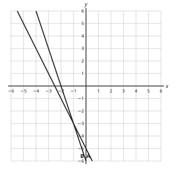

- ◻️ x = 0, y = −5  
  _↳ feedback if chosen: (0, −5) is where line A meets the y-axis. Line B does not pass through it._
- ◻️ x = −1, y = 0  
  _↳ feedback if chosen: The crossing is at height y = −3, not on the x-axis._
- ◻️ x = −3, y = −1  
  _↳ feedback if chosen: Read x across (horizontal) first, then y up: the point is (−1, −3)._
- ✅ x = −1, y = −3

Full working after a second miss:

> The solution is where the lines cross.  
> They cross at (−1, −3): x = −1, y = −3.  
> So the answer is x = −1, y = −3.  

**Card c4m20-3** (draft)

> Parallel lines never cross, so the equations have no solution.
>
> _y = 2x + 1 and y = 2x − 3: same gradient, no crossing_  

Check question: `m4-20-parallel-card` · multiple choice, level 1 · computed by rule

> How many solutions do y = −2x − 4 and y = −2x have?

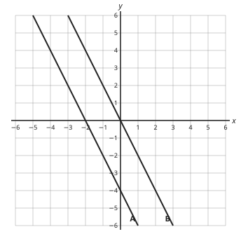

- ◻️ Infinitely many: the lines are the same  
  _↳ feedback if chosen: The lines cross the y-axis at −4 and 0: different lines._
- ◻️ Two  
  _↳ feedback if chosen: Two straight lines can cross at most once._
- ✅ None: the lines are parallel
- ◻️ One: the lines cross once  
  _↳ feedback if chosen: Lines with the same gradient never meet._

Full working after a second miss:

> Both lines have gradient −2, so they are parallel.  
> The y-intercepts −4 and 0 are different, so they are not the same line.  
> So the answer is: None: the lines are parallel.  

**Worked example** (draft)

> Solve y = x + 1 and y = −x + 5 graphically.

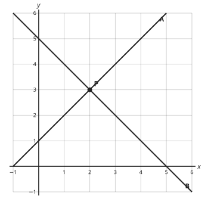

1. Table for y = x + 1: x = 0, y = 1; x = 2, y = 3; x = 4, y = 5.
2. Table for y = −x + 5: x = 0, y = 5; x = 2, y = 3; x = 4, y = 1.
3. Draw both lines. They cross at (2, 3).
4. Check: 3 = 3 and 3 = 3.

**Answer:** x = 2, y = 3

**Practice** `m4-20-table` · number, level 1 · computed by rule

> Complete the table of values for y = −x − 2. What is y when x = −2?

Answer: **0**
- Typed **2** (noc) → “Add the −2 after multiplying: 2 + (−2).”
- Typed **−5** (add) → “−x means −1 × x: multiply by −2.”

Full working after a second miss:

> y = −1 × (−2) + (−2).  
> = 2 + (−2) = 0.  

> Complete the table of values for y = −3x − 5. What is y when x = 2?

Answer: **−11**
- Typed **−6** (noc) → “Add the −5 after multiplying: −6 + (−5).”
- Typed **−6** (add) → “−3x means −3 × x: multiply by 2.”

Full working after a second miss:

> y = −3 × 2 + (−5).  
> = −6 + (−5) = −11.  

**Practice** `m4-20-read` · multiple choice, level 1 · computed by rule

> The graph shows lines A and B. Use it to solve their two equations.

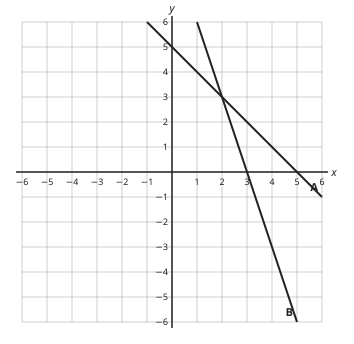

- ◻️ x = 2, y = 0  
  _↳ feedback if chosen: The crossing is at height y = 3, not on the x-axis._
- ✅ x = 2, y = 3
- ◻️ x = 3, y = 2  
  _↳ feedback if chosen: Read x across (horizontal) first, then y up: the point is (2, 3)._
- ◻️ x = 0, y = 5  
  _↳ feedback if chosen: (0, 5) is where line A meets the y-axis. Line B does not pass through it._

Full working after a second miss:

> The solution is where the lines cross.  
> They cross at (2, 3): x = 2, y = 3.  
> So the answer is x = 2, y = 3.  

> The graph shows lines A and B. Use it to solve their two equations.

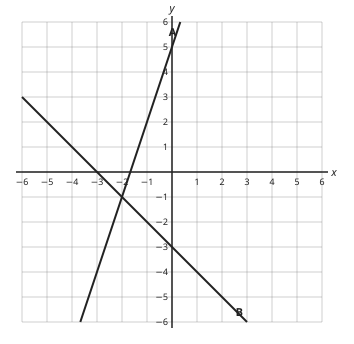

- ◻️ x = 0, y = 5  
  _↳ feedback if chosen: (0, 5) is where line A meets the y-axis. Line B does not pass through it._
- ✅ x = −2, y = −1
- ◻️ x = −2, y = 0  
  _↳ feedback if chosen: The crossing is at height y = −1, not on the x-axis._
- ◻️ x = −1, y = −2  
  _↳ feedback if chosen: Read x across (horizontal) first, then y up: the point is (−2, −1)._

Full working after a second miss:

> The solution is where the lines cross.  
> They cross at (−2, −1): x = −2, y = −1.  
> So the answer is x = −2, y = −1.  

**Practice** `m4-20-meet` · number, level 2 · computed by rule

> The lines y = −2x + 2 and y = x − 4 are drawn. At what value of x do they cross?

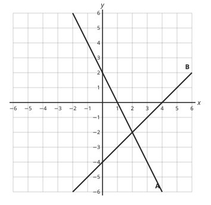

Answer: **2**
- Typed **−2** (y) → “−2 is the y-coordinate of the crossing. The question asks for x.”
- Typed **−6** (c) → “Divide by −3: x = −6 ÷ (−3) = 2.”

Full working after a second miss:

> At the crossing both y values are equal: −2x + 2 = x − 4.  
> −3x = −6, so x = 2.  
> Check on the graph: at x = 2 both lines have y = −2.  

> The lines y = 2x + 2 and y = −3x + 7 are drawn. At what value of x do they cross?

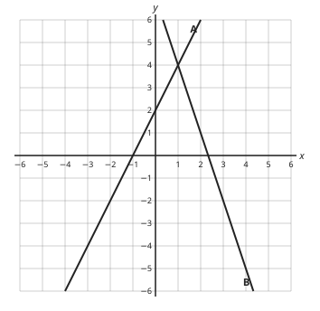

Answer: **1**
- Typed **4** (y) → “4 is the y-coordinate of the crossing. The question asks for x.”
- Typed **5** (c) → “Divide by 5: x = 5 ÷ 5 = 1.”

Full working after a second miss:

> At the crossing both y values are equal: 2x + 2 = −3x + 7.  
> 5x = 5, so x = 1.  
> Check on the graph: at x = 1 both lines have y = 4.  

**Practice** `m4-20-check` · multiple choice, level 2 · computed by rule

> Asong drew y = −2x + 4 and y = −x + 3 and read off the crossing as (2, 2). Is that right?

- ◻️ No: the lines are parallel and never cross  
  _↳ feedback if chosen: The gradients −2 and −1 are different, so the lines do cross._
- ✅ No: x = 2 gives y = 0 on the first line and 1 on the second. The lines cross at (1, 2)
- ◻️ No: the crossing is at (2, 1)  
  _↳ feedback if chosen: (2, 1) has x and y swapped. Check: it does not satisfy y = −2x + 4._
- ◻️ Yes: the point is on both lines  
  _↳ feedback if chosen: Substitute x = 2: y = 0 and y = 1 are different._

Full working after a second miss:

> Substitute x = 2: the two lines give different y values, so it is not on both.  
> At x = 1 both give y = 2.  
> So the answer is: No: x = 2 gives y = 0 on the first line and 1 on the second. The lines cross at (1, 2).  

> Asong drew y = −2x − 1 and y = x − 4 and read off the crossing as (2, −3). Is that right?

- ✅ No: x = 2 gives y = −5 on the first line and −2 on the second. The lines cross at (1, −3)
- ◻️ No: the crossing is at (−3, 1)  
  _↳ feedback if chosen: (−3, 1) has x and y swapped. Check: it does not satisfy y = −2x − 1._
- ◻️ Yes: the point is on both lines  
  _↳ feedback if chosen: Substitute x = 2: y = −5 and y = −2 are different._
- ◻️ No: the lines are parallel and never cross  
  _↳ feedback if chosen: The gradients −2 and 1 are different, so the lines do cross._

Full working after a second miss:

> Substitute x = 2: the two lines give different y values, so it is not on both.  
> At x = 1 both give y = −3.  
> So the answer is: No: x = 2 gives y = −5 on the first line and −2 on the second. The lines cross at (1, −3).  

**Practice** `m4-20-parallel` · multiple choice, level 3 · computed by rule

> How many solutions do y = x − 1 and y = x + 6 have?

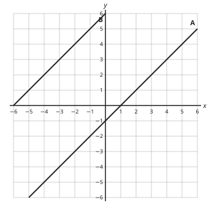

- ◻️ One: the lines cross once  
  _↳ feedback if chosen: Lines with the same gradient never meet._
- ◻️ Two  
  _↳ feedback if chosen: Two straight lines can cross at most once._
- ✅ None: the lines are parallel
- ◻️ Infinitely many: the lines are the same  
  _↳ feedback if chosen: The lines cross the y-axis at −1 and 6: different lines._

Full working after a second miss:

> Both lines have gradient 1, so they are parallel.  
> The y-intercepts −1 and 6 are different, so they are not the same line.  
> So the answer is: None: the lines are parallel.  

> How many solutions do y = −x − 2 and y = −x + 1 have?

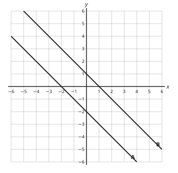

- ◻️ Infinitely many: the lines are the same  
  _↳ feedback if chosen: The lines cross the y-axis at −2 and 1: different lines._
- ◻️ One: the lines cross once  
  _↳ feedback if chosen: Lines with the same gradient never meet._
- ◻️ Two  
  _↳ feedback if chosen: Two straight lines can cross at most once._
- ✅ None: the lines are parallel

Full working after a second miss:

> Both lines have gradient −1, so they are parallel.  
> The y-intercepts −2 and 1 are different, so they are not the same line.  
> So the answer is: None: the lines are parallel.  

## Lesson 21: Graphical solutions to linear inequalities (Half plane)

Prerequisites: 20 · Skill: m4-21 (Show a linear inequality as a region (half plane) on a graph)

**Note** (draft)

> A line divides the plane into two half planes. An inequality such as y ≤ 2x + 1 describes one of them.
> 1. Draw the boundary line y = 2x + 1: solid if the line is included (≤, ≥), broken if not (<, >).
> 2. Test a point not on the line, usually O(0, 0): 0 ≤ 1 is true, so O is in the wanted region.
> 3. Shade the unwanted side (the convention in GCE answers), leaving the wanted region clear.
> x ≥ 3 is the region to the right of the vertical line x = 3; y < −1 is below the horizontal line y = −1.

**Learn: Your goal and connections** (draft)

> By the end, you should be able to draw the region for a linear inequality: the right boundary (solid or broken) and the right side, tested with a point.
> Builds on: Lesson 20 (drawing lines) and Lesson 16 (inequalities).
> Leads to: Lesson 22 (regions for several inequalities) and linear programming in Form Five.

**Learn: Boundary and side** (draft)

> The inequality y ≤ 2x + 1 is true for the points on the line y = 2x + 1 and for every point on one side of it.
> • Boundary: draw the line. With ≤ or ≥ it is included, so draw it solid. With < or > draw it broken.
> • Side: test a point that is not on the line. O(0, 0): 0 ≤ 2x + 1 becomes 0 ≤ 1, true. So O's side is wanted.
> • Shade the unwanted side. The clear region shows all the solutions.

**Learn: Vertical and horizontal boundaries** (draft)

> x ≥ 3: the boundary is the vertical line x = 3; the wanted region is to the right of it.
> y < −1: the boundary is the horizontal line y = −1, broken; the wanted region is below it.
> If the line passes through O, test another point such as (1, 0).
> Some books shade the wanted region instead. Always say which convention you use; here the shaded part is unwanted.

**Learn: key words and examples** (draft)

- **half plane**: all the points on one side of a line
- **boundary**: the line that separates the two sides
- **unwanted region**: the part shaded because it does not satisfy the inequality

- x + y < 4: broken line x + y = 4; O is wanted
- y ≥ −2: solid horizontal line; wanted above

Common mistake: “y < x + 2: draw the line solid” → “y < x + 2: draw the line broken”. < leaves out the equals case, so the points on the line are not solutions.

**Card c4m21-1** (draft)

> ≤ and ≥ include the line: draw it solid. < and > leave it out: draw it broken.
>
> _y < x + 2: broken line; y ≥ x + 2: solid line_  

Check question: `m4-21-line` · multiple choice, level 1 · computed by rule, reused from practice

> When you draw the boundary of 3x + 4y ≤ 5 on a graph, how should the line be drawn?

- ◻️ Solid, because every boundary is drawn solid  
  _↳ feedback if chosen: A boundary that is not part of the solution is drawn broken._
- ✅ Solid, because the line itself is included
- ◻️ Broken, because the line itself is not included  
  _↳ feedback if chosen: ≤ and ≥ include the line (solid); < and > do not (broken)._
- ◻️ Solid, because the region is above the line  
  _↳ feedback if chosen: Solid or broken depends on whether the line is included, not on which side the region is._

Full working after a second miss:

> ≤ includes the equals case.  
> So the answer is: Solid, because the line itself is included.  

**Card c4m21-2** (draft)

> Test a point such as O(0, 0): if it makes the inequality true, it is in the wanted region.
>
> _y ≤ 2x + 1: 0 ≤ 1 is true, so O is wanted_  

Check question: `m4-21-point` · multiple choice, level 1 · computed by rule, reused from practice

> Is the point (3, −1) in the region y < 2x + 2?

- ◻️ Yes: every point with a positive x is in it  
  _↳ feedback if chosen: Whether a point is in the region depends on the inequality, not just on x._
- ◻️ No: points on the boundary are never included  
  _↳ feedback if chosen: With ≤ or ≥ the boundary is included. Substitute and compare._
- ✅ Yes: −1 < 8 is true
- ◻️ No: −1 < 8 is false  
  _↳ feedback if chosen: Substitute and compare: −1 < 8 is true._

Full working after a second miss:

> Substitute x = 3: 2x + 2 = 8.  
> Compare with y = −1: is −1 < 8? Yes.  
> So the answer is: Yes: −1 < 8 is true.  

**Card c4m21-3** (draft)

> Shade the unwanted side; the clear region is the solution.
>
> _for y ≤ 2x + 1, shade above the line_  

Check question: `m4-21-read-card` · multiple choice, level 1 · computed by rule

> The graph shows a line and a shaded (unwanted) region. Which inequality describes the unshaded region?

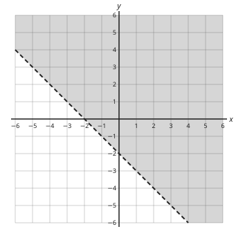

- ✅ y < −x − 2
- ◻️ y > −x − 2  
  _↳ feedback if chosen: The shading is the unwanted side. The clear region is below the line._
- ◻️ y < x − 2  
  _↳ feedback if chosen: The line slopes down to the right, so its gradient is −1._
- ◻️ y ≤ −x − 2  
  _↳ feedback if chosen: Look at the line: broken, so it is not included._

Full working after a second miss:

> The boundary is y = −x − 2, drawn broken (not included).  
> The clear region is below the line.  
> So the answer is y < −x − 2.  

**Worked example** (draft)

> Show y ≤ 2x + 1 on a graph.

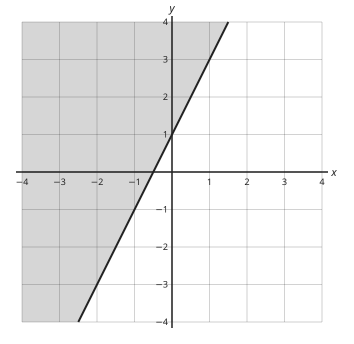

1. Boundary y = 2x + 1: x = 0, y = 1; x = 1, y = 3. ≤ includes the line, so draw it solid.
2. Test O(0, 0): 0 ≤ 1 is true, so O is in the wanted region.
3. Shade the other side, above the line: that is the unwanted region.

**Answer:** the unshaded region below the solid line y = 2x + 1

**Practice** `m4-21-line` · multiple choice, level 1 · computed by rule

> When you draw the boundary of 4x + y ≥ 6 on a graph, how should the line be drawn?

- ◻️ Solid, because every boundary is drawn solid  
  _↳ feedback if chosen: A boundary that is not part of the solution is drawn broken._
- ✅ Solid, because the line itself is included
- ◻️ Solid, because the region is above the line  
  _↳ feedback if chosen: Solid or broken depends on whether the line is included, not on which side the region is._
- ◻️ Broken, because the line itself is not included  
  _↳ feedback if chosen: ≤ and ≥ include the line (solid); < and > do not (broken)._

Full working after a second miss:

> ≥ includes the equals case.  
> So the answer is: Solid, because the line itself is included.  

> When you draw the boundary of 3x + 4y ≥ 10 on a graph, how should the line be drawn?

- ◻️ Solid, because the region is above the line  
  _↳ feedback if chosen: Solid or broken depends on whether the line is included, not on which side the region is._
- ◻️ Solid, because every boundary is drawn solid  
  _↳ feedback if chosen: A boundary that is not part of the solution is drawn broken._
- ◻️ Broken, because the line itself is not included  
  _↳ feedback if chosen: ≤ and ≥ include the line (solid); < and > do not (broken)._
- ✅ Solid, because the line itself is included

Full working after a second miss:

> ≥ includes the equals case.  
> So the answer is: Solid, because the line itself is included.  

**Practice** `m4-21-point` · multiple choice, level 1 · computed by rule

> Is the point (−3, −2) in the region y ≤ 2x − 3?

- ◻️ No: points on the boundary are never included  
  _↳ feedback if chosen: With ≤ or ≥ the boundary is included. Substitute and compare._
- ◻️ Yes: −2 ≤ −9 is true  
  _↳ feedback if chosen: Substitute and compare: −2 ≤ −9 is false._
- ◻️ Yes: every point with a positive x is in it  
  _↳ feedback if chosen: Whether a point is in the region depends on the inequality, not just on x._
- ✅ No: −2 ≤ −9 is false

Full working after a second miss:

> Substitute x = −3: 2x − 3 = −9.  
> Compare with y = −2: is −2 ≤ −9? No.  
> So the answer is: No: −2 ≤ −9 is false.  

> Is the point (−2, 1) in the region y > −x − 2?

- ◻️ No: points on the boundary are never included  
  _↳ feedback if chosen: With ≤ or ≥ the boundary is included. Substitute and compare._
- ◻️ No: 1 > 0 is false  
  _↳ feedback if chosen: Substitute and compare: 1 > 0 is true._
- ◻️ Yes: every point with a positive x is in it  
  _↳ feedback if chosen: Whether a point is in the region depends on the inequality, not just on x._
- ✅ Yes: 1 > 0 is true

Full working after a second miss:

> Substitute x = −2: −x − 2 = 0.  
> Compare with y = 1: is 1 > 0? Yes.  
> So the answer is: Yes: 1 > 0 is true.  

**Practice** `m4-21-read` · multiple choice, level 2 · computed by rule

> The graph shows a line and a shaded (unwanted) region. Which inequality describes the unshaded region?

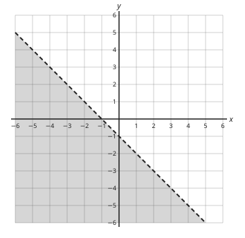

- ◻️ y ≥ −x − 1  
  _↳ feedback if chosen: Look at the line: broken, so it is not included._
- ◻️ y > x − 1  
  _↳ feedback if chosen: The line slopes down to the right, so its gradient is −1._
- ✅ y > −x − 1
- ◻️ y < −x − 1  
  _↳ feedback if chosen: The shading is the unwanted side. The clear region is above the line._

Full working after a second miss:

> The boundary is y = −x − 1, drawn broken (not included).  
> The clear region is above the line.  
> So the answer is y > −x − 1.  

> The graph shows a line and a shaded (unwanted) region. Which inequality describes the unshaded region?

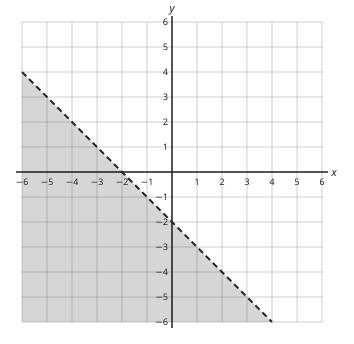

- ◻️ y ≥ −x − 2  
  _↳ feedback if chosen: Look at the line: broken, so it is not included._
- ✅ y > −x − 2
- ◻️ y < −x − 2  
  _↳ feedback if chosen: The shading is the unwanted side. The clear region is above the line._
- ◻️ y > x − 2  
  _↳ feedback if chosen: The line slopes down to the right, so its gradient is −1._

Full working after a second miss:

> The boundary is y = −x − 2, drawn broken (not included).  
> The clear region is above the line.  
> So the answer is y > −x − 2.  

**Practice** `m4-21-vert` · multiple choice, level 2 · computed by rule

> The graph shows the region beside a horizontal line. The unshaded part is wanted. Which inequality describes it?

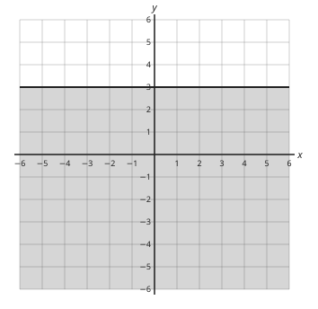

- ◻️ y ≤ 3  
  _↳ feedback if chosen: The shaded side is unwanted; the wanted side is where y is larger than 3._
- ◻️ y > 3  
  _↳ feedback if chosen: The line is solid: included._
- ✅ y ≥ 3
- ◻️ x ≥ 3  
  _↳ feedback if chosen: A horizontal line has the equation y = 3._

Full working after a second miss:

> The boundary is the horizontal line y = 3, drawn solid.  
> The clear side is where y is larger.  
> So the answer is y ≥ 3.  

> The graph shows the region beside a horizontal line. The unshaded part is wanted. Which inequality describes it?

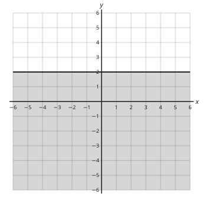

- ◻️ x ≥ 2  
  _↳ feedback if chosen: A horizontal line has the equation y = 2._
- ◻️ y ≤ 2  
  _↳ feedback if chosen: The shaded side is unwanted; the wanted side is where y is larger than 2._
- ✅ y ≥ 2
- ◻️ y > 2  
  _↳ feedback if chosen: The line is solid: included._

Full working after a second miss:

> The boundary is the horizontal line y = 2, drawn solid.  
> The clear side is where y is larger.  
> So the answer is y ≥ 2.  

**Practice** `m4-21-origin` · multiple choice, level 3 · computed by rule

> To show 2x + 2y < 7 you draw the line 2x + 2y = 7. Which side do you shade (unwanted)?

- ◻️ The side that contains O(0, 0), because O satisfies the inequality  
  _↳ feedback if chosen: If O satisfies the inequality, O's side is wanted and stays clear._
- ◻️ Always the side containing O(0, 0)  
  _↳ feedback if chosen: O's side is shaded only if O does not satisfy the inequality._
- ✅ The side that does not contain O(0, 0), because O satisfies the inequality
- ◻️ Always the side above the line  
  _↳ feedback if chosen: 'Above' depends on the inequality. Test a point such as O._

Full working after a second miss:

> Test O: 2 × 0 + 2 × 0 = 0, and 0 < 7 is true.  
> O is wanted, so shade the other side.  
> So the answer is: The side that does not contain O(0, 0), because O satisfies the inequality.  

> To show 2x + y ≤ −9 you draw the line 2x + y = −9. Which side do you shade (unwanted)?

- ✅ The side that contains O(0, 0), because O does not satisfy the inequality
- ◻️ The side that does not contain O(0, 0), because O does not satisfy the inequality  
  _↳ feedback if chosen: If O satisfies the inequality, O's side is wanted and stays clear._
- ◻️ Always the side containing O(0, 0)  
  _↳ feedback if chosen: O's side is shaded only if O does not satisfy the inequality._
- ◻️ Always the side above the line  
  _↳ feedback if chosen: 'Above' depends on the inequality. Test a point such as O._

Full working after a second miss:

> Test O: 2 × 0 + 1 × 0 = 0, and 0 ≤ −9 is false.  
> O is unwanted, so shade its side.  
> So the answer is: The side that contains O(0, 0), because O does not satisfy the inequality.  

## Lesson 22: Graphical solutions to simultaneous linear inequalities

Prerequisites: 21 · Skill: m4-22 (Find the region that satisfies several linear inequalities)

**Note** (draft)

> For several inequalities at once, draw each boundary and shade the unwanted side of each. The region left clear satisfies all of them; it is often labelled R.
> Example: x ≥ 0, y ≥ 0, x + y ≤ 4. The clear region is the triangle with corners (0, 0), (4, 0), (0, 4).
> A point is in R only if it satisfies every inequality.
> To find the whole-number points in R, check each grid point inside or on the boundary (if the boundary is included).
> The greatest value of an expression such as 2x + y over R is found at a corner of R.

**Learn: Your goal and connections** (draft)

> By the end, you should be able to find and describe the region R that satisfies several inequalities, count its whole-number points and find the greatest value of an expression in it.
> Builds on: Lesson 21 (one inequality as a half plane).
> Leads to: linear programming (best buys, greatest profit) in Form Five.

**Learn: Several boundaries** (draft)

> Show x ≥ 0, y ≥ 0, x + y ≤ 4.
> • x ≥ 0: boundary the y-axis; shade the left side.
> • y ≥ 0: boundary the x-axis; shade below.
> • x + y ≤ 4: draw the solid line through (4, 0) and (0, 4); O gives 0 ≤ 4, true, so shade the far side.
> What stays clear is the triangle with corners (0, 0), (4, 0), (0, 4). Label it R.
> A point is in R only if it passes every test.

**Learn: Points in R and best values** (draft)

> Count whole-number points row by row. For the triangle above: y = 0 gives 5 points, y = 1 gives 4, … y = 4 gives 1: 15 in all.
> In a real problem, x and y are often numbers of items, so only whole-number points count.
> To find the greatest value of 2x + y in R, try the corners: (0, 0) gives 0, (4, 0) gives 8, (0, 4) gives 4. The greatest is 8.
> Words: 'at least' means ≥, 'at most' and 'not more than' mean ≤.

**Learn: key words and examples** (draft)

- **region R**: the set of points that satisfy all the inequalities
- **vertex (corner)**: a point where two boundaries meet
- **at least / at most**: ≥ / ≤

- x ≥ 1, y ≥ 1, x + y ≤ 5: corners (1, 1), (4, 1), (1, 4)
- at most 20 pupils: x ≤ 20

Common mistake: “'at least 3 bags' → x ≤ 3” → “'at least 3 bags' → x ≥ 3”. At least 3 means 3 or more.

**Card c4m22-1** (draft)

> R is the clear region left when the unwanted side of every boundary is shaded.
>
> _x ≥ 0, y ≥ 0, x + y ≤ 4: R is the triangle (0, 0), (4, 0), (0, 4)_  

Check question: `m4-22-in` · multiple choice, level 1 · computed by rule, reused from practice

> R is the region where x ≥ 0, y ≥ 0 and x + y ≤ 4. Which point is in R?

- ✅ (2, 1)
- ◻️ (2, −1)  
  _↳ feedback if chosen: y = −1 breaks y ≥ 0._
- ◻️ (4, 6)  
  _↳ feedback if chosen: x + y = 10, which is more than 4._
- ◻️ (−1, 1)  
  _↳ feedback if chosen: x = −1 breaks x ≥ 0._

Full working after a second miss:

> Check each inequality for (2, 1): 2 ≥ 0, 1 ≥ 0, 3 ≤ 4.  
> All three hold, so the answer is (2, 1).  

**Card c4m22-2** (draft)

> A point is in R only if it satisfies every inequality.
>
> _(1, 2): 1 ≥ 0, 2 ≥ 0, 1 + 2 ≤ 4: in R. (3, 2): 3 + 2 > 4: not in R_  

Check question: `m4-22-count` · number, level 1 · computed by rule, reused from practice

> The unshaded region R satisfies x ≥ 0, y ≥ 0 and 2x + y ≤ 6. How many points with whole-number coordinates are in R (edges included)?

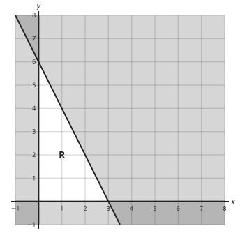

Answer: **16**
- Typed **4** (strict) → “The edges are solid lines: points on them are in R.”
- Typed **6** (noaxes) → “x ≥ 0 and y ≥ 0 include the axes: count the points on them too.”

Full working after a second miss:

> Go along each row: for y = 0, x can be 0 up to 3; then y = 1, and so on.  
> Check each point with 2x + y ≤ 6.  
> There are 16 points.  

**Card c4m22-3** (draft)

> The greatest value of an expression like 2x + y over R is at a corner of R.
>
> _corners (0, 0), (4, 0), (0, 4): 2x + y = 0, 8, 4; greatest 8_  

Check question: `m4-22-max-card` · number, level 1 · computed by rule

> R is given by x ≥ 0, y ≥ 0 and x + y ≤ 5. Find the greatest value of x + 3y for points (x, y) in R with whole-number coordinates.

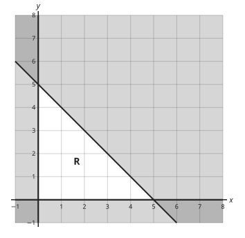

Answer: **15**
- Typed **0** (origin) → “(0, 0) gives the smallest value, not the greatest.”
- Typed **5** (sum) → “5 is the limit for x + y, not the value of x + 3y.”

Full working after a second miss:

> The greatest value is at a corner of R: (0, 0), (5, 0) or (0, 5) (or a whole-number point next to the slanted edge).  
> Work out x + 3y at each and compare.  
> The greatest value is 15.  

**Worked example** (draft)

> Show the region R given by x ≥ 0, y ≥ 0 and x + y ≤ 4, and count the whole-number points in R.

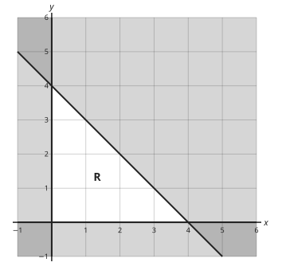

1. x ≥ 0: shade the left of the y-axis. y ≥ 0: shade below the x-axis.
2. Boundary x + y = 4 through (4, 0) and (0, 4), solid; O satisfies it, so shade the side away from O.
3. R is the clear triangle. Count the grid points in it, edges included: 5 + 4 + … + 1.

**Answer:** 15 points

**Practice** `m4-22-in` · multiple choice, level 1 · computed by rule

> R is the region where x ≥ 0, y ≥ 0 and x + y ≤ 6. Which point is in R?

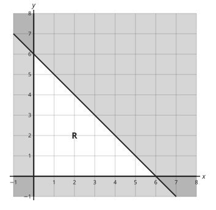

- ✅ (3, 2)
- ◻️ (3, −1)  
  _↳ feedback if chosen: y = −1 breaks y ≥ 0._
- ◻️ (6, 6)  
  _↳ feedback if chosen: x + y = 12, which is more than 6._
- ◻️ (−1, 2)  
  _↳ feedback if chosen: x = −1 breaks x ≥ 0._

Full working after a second miss:

> Check each inequality for (3, 2): 3 ≥ 0, 2 ≥ 0, 5 ≤ 6.  
> All three hold, so the answer is (3, 2).  

> R is the region where x ≥ 0, y ≥ 0 and x + 2y ≤ 8. Which point is in R?

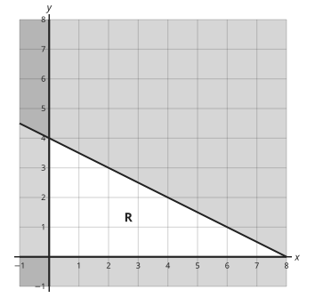

- ✅ (2, 2)
- ◻️ (−1, 2)  
  _↳ feedback if chosen: x = −1 breaks x ≥ 0._
- ◻️ (5, 5)  
  _↳ feedback if chosen: x + 2y = 15, which is more than 8._
- ◻️ (2, −1)  
  _↳ feedback if chosen: y = −1 breaks y ≥ 0._

Full working after a second miss:

> Check each inequality for (2, 2): 2 ≥ 0, 2 ≥ 0, 6 ≤ 8.  
> All three hold, so the answer is (2, 2).  

**Practice** `m4-22-count` · number, level 1 · computed by rule

> The unshaded region R satisfies x ≥ 0, y ≥ 0 and x + y ≤ 8. How many points with whole-number coordinates are in R (edges included)?

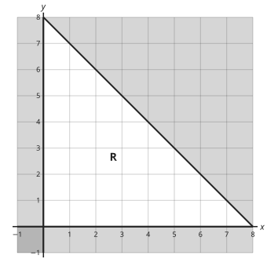

Answer: **45**
- Typed **21** (strict) → “The edges are solid lines: points on them are in R.”
- Typed **28** (noaxes) → “x ≥ 0 and y ≥ 0 include the axes: count the points on them too.”

Full working after a second miss:

> Go along each row: for y = 0, x can be 0 up to 8; then y = 1, and so on.  
> Check each point with x + y ≤ 8.  
> There are 45 points.  

> The unshaded region R satisfies x ≥ 0, y ≥ 0 and 2x + 2y ≤ 6. How many points with whole-number coordinates are in R (edges included)?

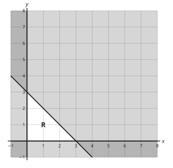

Answer: **10**
- Typed **1** (strict) → “The edges are solid lines: points on them are in R.”
- Typed **3** (noaxes) → “x ≥ 0 and y ≥ 0 include the axes: count the points on them too.”

Full working after a second miss:

> Go along each row: for y = 0, x can be 0 up to 3; then y = 1, and so on.  
> Check each point with 2x + 2y ≤ 6.  
> There are 10 points.  

**Practice** `m4-22-which` · multiple choice, level 2 · computed by rule

> Which three inequalities define the unshaded region R in the graph?

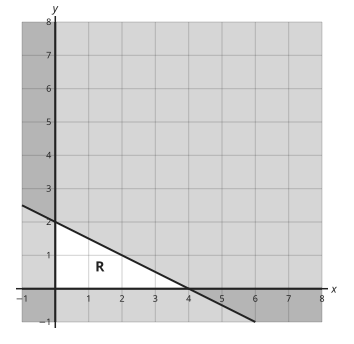

- ◻️ x ≤ 0, y ≤ 0, x + 2y ≤ 4  
  _↳ feedback if chosen: R lies to the right of the y-axis and above the x-axis: x ≥ 0, y ≥ 0._
- ✅ x ≥ 0, y ≥ 0, x + 2y ≤ 4
- ◻️ x ≥ 0, y ≥ 0, 2x + y ≤ 4  
  _↳ feedback if chosen: Check the intercepts: the line meets the x-axis at x = 4, so the x coefficient is 1._
- ◻️ x ≥ 0, y ≥ 0, x + 2y ≥ 4  
  _↳ feedback if chosen: R contains points near O, and O gives 0 ≤ 4: the sign is ≤._

Full working after a second miss:

> R is to the right of the y-axis (x ≥ 0) and above the x-axis (y ≥ 0).  
> The slanted line meets the axes at (4, 0) and (0, 2): it is x + 2y = 4, and R is on O's side.  
> So the answer is: x ≥ 0, y ≥ 0, x + 2y ≤ 4.  

> Which three inequalities define the unshaded region R in the graph?

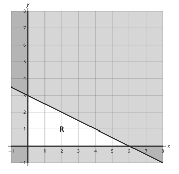

- ◻️ x ≥ 0, y ≥ 0, 2x + y ≤ 6  
  _↳ feedback if chosen: Check the intercepts: the line meets the x-axis at x = 6, so the x coefficient is 1._
- ◻️ x ≥ 0, y ≥ 0, x + 2y ≥ 6  
  _↳ feedback if chosen: R contains points near O, and O gives 0 ≤ 6: the sign is ≤._
- ✅ x ≥ 0, y ≥ 0, x + 2y ≤ 6
- ◻️ x ≤ 0, y ≤ 0, x + 2y ≤ 6  
  _↳ feedback if chosen: R lies to the right of the y-axis and above the x-axis: x ≥ 0, y ≥ 0._

Full working after a second miss:

> R is to the right of the y-axis (x ≥ 0) and above the x-axis (y ≥ 0).  
> The slanted line meets the axes at (6, 0) and (0, 3): it is x + 2y = 6, and R is on O's side.  
> So the answer is: x ≥ 0, y ≥ 0, x + 2y ≤ 6.  

**Practice** `m4-22-max` · number, level 2 · computed by rule

> R is given by x ≥ 0, y ≥ 0 and 2x + 2y ≤ 8. Find the greatest value of 3x + 2y for points (x, y) in R with whole-number coordinates.

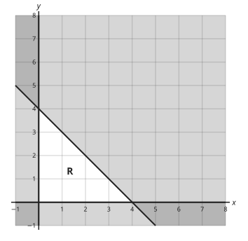

Answer: **12**
- Typed **0** (origin) → “(0, 0) gives the smallest value, not the greatest.”
- Typed **8** (sum) → “8 is the limit for 2x + 2y, not the value of 3x + 2y.”

Full working after a second miss:

> The greatest value is at a corner of R: (0, 0), (4, 0) or (0, 4) (or a whole-number point next to the slanted edge).  
> Work out 3x + 2y at each and compare.  
> The greatest value is 12.  

> R is given by x ≥ 0, y ≥ 0 and 2x + 2y ≤ 7. Find the greatest value of 3x + y for points (x, y) in R with whole-number coordinates.

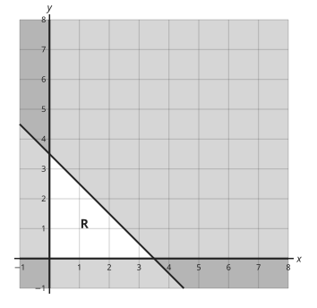

Answer: **9**
- Typed **0** (origin) → “(0, 0) gives the smallest value, not the greatest.”
- Typed **7** (sum) → “7 is the limit for 2x + 2y, not the value of 3x + y.”

Full working after a second miss:

> The greatest value is at a corner of R: (0, 0), (3, 0) or (0, 3) (or a whole-number point next to the slanted edge).  
> Work out 3x + y at each and compare.  
> The greatest value is 9.  

**Practice** `m4-22-word` · multiple choice, level 3 · computed by rule

> A trader in Kumba buys x bags of rice and y bags of beans. She buys at least 4 bags of rice, at least 5 bags of beans, and at most 14 bags in all. Which inequalities describe this?

- ◻️ x ≥ 4, y ≥ 5, x + y ≥ 14  
  _↳ feedback if chosen: 'At most' means 'this many or fewer': ≤._
- ✅ x ≥ 4, y ≥ 5, x + y ≤ 14
- ◻️ x ≤ 4, y ≤ 5, x + y ≤ 14  
  _↳ feedback if chosen: 'At least' means 'this many or more': ≥._
- ◻️ x ≥ 5, y ≥ 4, x + y ≤ 14  
  _↳ feedback if chosen: x counts rice (at least 4) and y counts beans (at least 5)._

Full working after a second miss:

> 'At least 4' means 4 or more: x ≥ 4. Likewise y ≥ 5.  
> 'At most 14 in all' means x + y ≤ 14.  
> So the answer is: x ≥ 4, y ≥ 5, x + y ≤ 14.  

> A trader in Kumba buys x bags of rice and y bags of beans. She buys at least 5 bags of rice, at least 4 bags of beans, and at most 14 bags in all. Which inequalities describe this?

- ✅ x ≥ 5, y ≥ 4, x + y ≤ 14
- ◻️ x ≥ 4, y ≥ 5, x + y ≤ 14  
  _↳ feedback if chosen: x counts rice (at least 5) and y counts beans (at least 4)._
- ◻️ x ≥ 5, y ≥ 4, x + y ≥ 14  
  _↳ feedback if chosen: 'At most' means 'this many or fewer': ≤._
- ◻️ x ≤ 5, y ≤ 4, x + y ≤ 14  
  _↳ feedback if chosen: 'At least' means 'this many or more': ≥._

Full working after a second miss:

> 'At least 5' means 5 or more: x ≥ 5. Likewise y ≥ 4.  
> 'At most 14 in all' means x + y ≤ 14.  
> So the answer is: x ≥ 5, y ≥ 4, x + y ≤ 14.  

## Lesson 23: Study of graphs of quadratic functions

Prerequisites: 20, 8 · Skill: m4-23 (Study the graph of a quadratic function y = ax² + bx + c)

**Note** (draft)

> The graph of y = ax² + bx + c is a parabola.
> • If a > 0 it is ∪-shaped and has a lowest point (minimum). If a < 0 it is ∩-shaped with a highest point (maximum).
> • It crosses the y-axis at (0, c).
> • It is symmetrical about the vertical line x = −b/2a, the axis of symmetry. The turning point is on this line.
> • Completing the square gives the turning point: y = (x − h)² + k turns at (h, k).
> To draw it: make a table of values, plot the points and join them with a smooth curve, not with straight lines.

**Learn: Your goal and connections** (draft)

> By the end, you should be able to describe the parabola y = ax² + bx + c: its shape, y-intercept, axis of symmetry and turning point, and draw it from a table.
> Builds on: Lesson 8 (completing the square) and Lesson 20 (drawing graphs from tables).
> Leads to: Lessons 24 and 25 (the discriminant and solving quadratics with graphs).

**Learn: The shape of a parabola** (draft)

> Plot y = x² − 2x − 3 from a table:
> x: −2, −1, 0, 1, 2, 3, 4
> y: 5, 0, −3, −4, −3, 0, 5
> Joined with a smooth curve, the points make a ∪ shape. The y values repeat on each side of x = 1: the curve is symmetrical about the line x = 1.
> The lowest point (1, −4) is the turning point. When a is negative, the curve is ∩-shaped and the turning point is a maximum.

**Learn: Reading the features** (draft)

> For y = ax² + bx + c:
> • y-intercept: (0, c).
> • axis of symmetry: x = −b/2a.
> • turning point: put that x into the equation.
> For y = x² − 2x − 3: c = −3; x = 2/2 = 1; y = 1 − 2 − 3 = −4. So the minimum is (1, −4).
> Completing the square gives the same answer: x² − 2x − 3 = (x − 1)² − 4.

**Learn: key words and examples** (draft)

- **parabola**: the curve of a quadratic function
- **turning point (vertex)**: the lowest or highest point of the parabola
- **axis of symmetry**: the vertical line through the turning point
- **minimum / maximum**: smallest / greatest value of y

- y = x² − 4: minimum (0, −4), axis x = 0
- y = −x² + 6x − 5: maximum (3, 4), axis x = 3

Common mistake: “y = x² − 2x − 3: axis x = −1” → “axis x = 1”. x = −b/2a with b = −2: −(−2)/2 = 1. The minus sign in the formula matters.

**Card c4m23-1** (draft)

> The y-intercept of y = ax² + bx + c is c: put x = 0.
>
> _y = x² − 2x − 3 meets the y-axis at (0, −3)_  

Check question: `m4-23-icept` · number, level 1 · computed by rule, reused from practice

> Where does y = 3x² − 6x − 4 cross the y-axis? Give the y-coordinate.

Answer: **−4**
- Typed **3** (a) → “Put x = 0: the x² and x terms vanish, leaving c = −4.”
- Typed **−6** (b) → “Put x = 0: only the number term c = −4 is left.”

Full working after a second miss:

> On the y-axis x = 0.  
> y = 3 × 0 + −6 × 0 + (−4) = −4.  

**Card c4m23-2** (draft)

> The axis of symmetry is x = −b/2a; the turning point lies on it.
>
> _y = x² − 2x − 3: x = 2/2 = 1; turning point (1, −4)_  

Check question: `m4-23-axis-card` · number, level 1 · computed by rule

> What is the equation of the axis of symmetry of y = x² − 6x + 15? Give x = ? as a number.

Answer: **3**
- Typed **−3** (sign) → “x = −b/2a: the minus sign changes the sign of b = −6.”
- Typed **6** (nohalf) → “Divide by 2a = 2, not by a.”

Full working after a second miss:

> x = −b/2a = −(−6) ÷ (2 × 1).  
> = 6 ÷ 2 = 3.  

**Card c4m23-3** (draft)

> a > 0: ∪ shape with a minimum. a < 0: ∩ shape with a maximum.
>
> _y = −x² + 4x is ∩-shaped: it has a maximum_  

Check question: `m4-23-turn-card` · multiple choice, level 1 · computed by rule

> What is the turning point of y = x² + 4x + 2, and is it a maximum or a minimum?

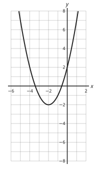

- ◻️ (−2, −2), maximum  
  _↳ feedback if chosen: a = 1 is positive, so the curve opens upwards: a minimum._
- ✅ (−2, −2), minimum
- ◻️ (2, −2), minimum  
  _↳ feedback if chosen: x = −b/2a = −2, not 2._
- ◻️ (−2, 2), minimum  
  _↳ feedback if chosen: The turning point is not the y-intercept. Put x = −2 into the equation._

Full working after a second miss:

> Axis of symmetry: x = −b/2a = −2.  
> y at x = −2: 4 + (−8) + 2 = −2.  
> a = 1 is positive: ∪ shape, minimum.  
> So the answer is (−2, −2), minimum.  

**Worked example** (draft)

> For y = x² − 2x − 3, find the y-intercept, the axis of symmetry and the turning point.

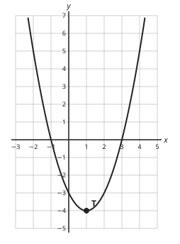

1. y-intercept: put x = 0: y = −3, so (0, −3).
2. Axis of symmetry: x = −b/2a = 2 ÷ 2 = 1.
3. Turning point: y at x = 1 is −4. a = 1 > 0, so it is a minimum.

**Answer:** y-intercept (0, −3); axis x = 1; minimum (1, −4)

**Practice** `m4-23-icept` · number, level 1 · computed by rule

> Where does y = x² + 3x − 6 cross the y-axis? Give the y-coordinate.

Answer: **−6**
- Typed **1** (a) → “Put x = 0: the x² and x terms vanish, leaving c = −6.”
- Typed **3** (b) → “Put x = 0: only the number term c = −6 is left.”

Full working after a second miss:

> On the y-axis x = 0.  
> y = 1 × 0 + 3 × 0 + (−6) = −6.  

> Where does y = x² + x − 5 cross the y-axis? Give the y-coordinate.

Answer: **−5**
- Typed **1** (a) → “Put x = 0: the x² and x terms vanish, leaving c = −5.”
- Typed **1** (b) → “Put x = 0: only the number term c = −5 is left.”

Full working after a second miss:

> On the y-axis x = 0.  
> y = 1 × 0 + 1 × 0 + (−5) = −5.  

**Practice** `m4-23-table` · number, level 1 · computed by rule

> Complete the table of values for y = −x² + 4x + 6. What is y when x = −1?

Answer: **1**
- Typed **3** (negsq) → “(−1)² = 1 is positive: squaring a negative number gives a positive one.”
- Typed **4** (double) → “x² means x × x = 1, not 2 × (−1).”

Full working after a second miss:

> x² = (−1)² = 1, so −1 × 1 = −1.  
> 4 × (−1) = −4.  
> y = −1 + (−4) + 6 = 1.  

> Complete the table of values for y = −x² + 3x + 5. What is y when x = 3?

Answer: **5**
- Typed **8** (double) → “x² means x × x = 9, not 2 × 3.”

Full working after a second miss:

> x² = (3)² = 9, so −1 × 9 = −9.  
> 3 × 3 = 9.  
> y = −9 + 9 + 5 = 5.  

**Practice** `m4-23-axis` · number, level 2 · computed by rule

> What is the equation of the axis of symmetry of y = 2x² + 4x + 7? Give x = ? as a number.

Answer: **−1**
- Typed **1** (sign) → “x = −b/2a: the minus sign changes the sign of b = 4.”
- Typed **−2** (nohalf) → “Divide by 2a = 4, not by a.”

Full working after a second miss:

> x = −b/2a = −(4) ÷ (2 × 2).  
> = −4 ÷ 4 = −1.  

> What is the equation of the axis of symmetry of y = −x² − 6x − 10? Give x = ? as a number.

Answer: **−3**
- Typed **3** (sign) → “x = −b/2a: the minus sign changes the sign of b = −6.”
- Typed **−6** (nohalf) → “Divide by 2a = −2, not by a.”

Full working after a second miss:

> x = −b/2a = −(−6) ÷ (2 × (−1)).  
> = 6 ÷ −2 = −3.  

**Practice** `m4-23-turn` · multiple choice, level 2 · computed by rule

> What is the turning point of y = x² − 2x + 2, and is it a maximum or a minimum?

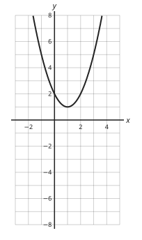

- ◻️ (1, 1), maximum  
  _↳ feedback if chosen: a = 1 is positive, so the curve opens upwards: a minimum._
- ◻️ (−1, 1), minimum  
  _↳ feedback if chosen: x = −b/2a = 1, not −1._
- ◻️ (1, 2), minimum  
  _↳ feedback if chosen: The turning point is not the y-intercept. Put x = 1 into the equation._
- ✅ (1, 1), minimum

Full working after a second miss:

> Axis of symmetry: x = −b/2a = 1.  
> y at x = 1: 1 + (−2) + 2 = 1.  
> a = 1 is positive: ∪ shape, minimum.  
> So the answer is (1, 1), minimum.  

> What is the turning point of y = −x² − 6x − 7, and is it a maximum or a minimum?

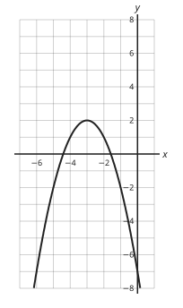

- ◻️ (3, 2), maximum  
  _↳ feedback if chosen: x = −b/2a = −3, not 3._
- ✅ (−3, 2), maximum
- ◻️ (−3, −7), maximum  
  _↳ feedback if chosen: The turning point is not the y-intercept. Put x = −3 into the equation._
- ◻️ (−3, 2), minimum  
  _↳ feedback if chosen: a = −1 is negative, so the curve opens downwards: a maximum._

Full working after a second miss:

> Axis of symmetry: x = −b/2a = −3.  
> y at x = −3: −9 + 18 + (−7) = 2.  
> a = −1 is negative: ∩ shape, maximum.  
> So the answer is (−3, 2), maximum.  

**Practice** `m4-23-match` · multiple choice, level 3 · computed by rule

> Which equation could the graph show?

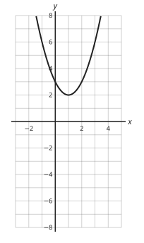

- ✅ y = x² − 2x + 3
- ◻️ y = x² − 2x − 1  
  _↳ feedback if chosen: That parabola turns at y = −2, not 2._
- ◻️ y = x² + 2x + 3  
  _↳ feedback if chosen: That parabola turns at x = −1, the mirror image._
- ◻️ y = −x² + 2x + 1  
  _↳ feedback if chosen: That parabola opens the other way: the sign of a decides ∪ or ∩._

Full working after a second miss:

> The curve is ∪-shaped, so a > 0.  
> It turns at x = 1 and y = 2; y = x² − 2x + 3 = (x − 1)² + 2 fits.  
> So the answer is y = x² − 2x + 3.  

> Which equation could the graph show?

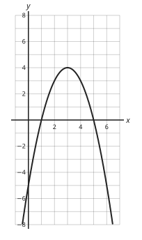

- ◻️ y = x² − 6x + 13  
  _↳ feedback if chosen: That parabola opens the other way: the sign of a decides ∪ or ∩._
- ✅ y = −x² + 6x − 5
- ◻️ y = −x² − 6x − 5  
  _↳ feedback if chosen: That parabola turns at x = −3, the mirror image._
- ◻️ y = −x² + 6x − 13  
  _↳ feedback if chosen: That parabola turns at y = −4, not 4._

Full working after a second miss:

> The curve is ∩-shaped, so a < 0.  
> It turns at x = 3 and y = 4; y = −x² + 6x − 5 = −(x − 3)² + 4 fits.  
> So the answer is y = −x² + 6x − 5.  

## Lesson 24: The discriminant and the nature of roots of a quadratic equation

Prerequisites: 9, 23 · Skill: m4-24 (Use the discriminant to decide the nature of the roots)

**Note** (draft)

> For ax² + bx + c = 0 the discriminant is D = b² − 4ac.
> • D > 0: two different real roots; the parabola crosses the x-axis twice.
> • D = 0: one repeated (equal) root; the parabola touches the x-axis at its turning point.
> • D < 0: no real roots; the parabola does not meet the x-axis.
> If D is a perfect square, the roots are rational and the quadratic factorises.
> Unknown coefficients: equal roots means D = 0; real roots means D ≥ 0.

**Learn: Your goal and connections** (draft)

> By the end, you should be able to use D = b² − 4ac to say whether a quadratic equation has two, one or no real roots, and find unknown coefficients from that.
> Builds on: Lesson 9 (the quadratic formula) and Lesson 23 (parabolas).
> Leads to: Lesson 25 (solving with graphs) and, in Form Five, intersections of lines and curves.

**Learn: Why the discriminant decides** (draft)

> In x = (−b ± √D)/2a, the number D = b² − 4ac sits under the square root.
> • D positive: √D is a real number, and ± gives two different roots.
> • D = 0: ±0 changes nothing: one repeated root.
> • D negative: there is no real square root: no real roots.
> On the graph of y = ax² + bx + c these are: crosses the x-axis twice, touches it, misses it.
> Example: x² − 6x + 9: D = 36 − 36 = 0, one root x = 3.

**Learn: Finding unknowns** (draft)

> • Equal roots: x² + kx + 9 = 0: D = k² − 36 = 0, so k = 6 or −6.
> • Real roots: x² + 4x + k = 0: D = 16 − 4k ≥ 0, so k ≤ 4.
> • No real roots: use D < 0.
> When D is a perfect square (1, 4, 9, …), the roots are rational and the quadratic factorises.

**Learn: key words and examples** (draft)

- **discriminant (D)**: b² − 4ac
- **real roots**: roots that are ordinary numbers
- **equal (repeated) roots**: both roots the same; D = 0

- x² + x − 6: D = 25 > 0, two roots
- x² + 2x + 5: D = −16 < 0, no real roots

Common mistake: “D = 0 means no roots” → “D = 0 means one repeated root”. √0 = 0, so the formula gives x = −b/2a: one root, counted twice.

**Card c4m24-1** (draft)

> The sign of D = b² − 4ac decides how many real roots there are.
>
> _D > 0: two; D = 0: one (equal); D < 0: none_  

Check question: `m4-24-nature` · multiple choice, level 1 · computed by rule, reused from practice

> Describe the roots of 3x² − 4x − 6 = 0.

- ◻️ Three real roots  
  _↳ feedback if chosen: A quadratic has at most two roots._
- ◻️ No real roots  
  _↳ feedback if chosen: Work out D = 88 and look at its sign._
- ◻️ Two equal real roots (one repeated root)  
  _↳ feedback if chosen: D = 88: equal roots need D = 0 exactly._
- ✅ Two different real roots

Full working after a second miss:

> D = b² − 4ac = 16 − −72 = 88.  
> So the answer is: Two different real roots.  

**Card c4m24-2** (draft)

> On the graph: D > 0 crosses the x-axis twice, D = 0 touches it, D < 0 misses it.
>
> _y = x² + 4: D = −16 < 0, the curve stays above the x-axis_  

Check question: `m4-24-graph` · multiple choice, level 1 · computed by rule, reused from practice

> How many times does the graph of y = 2x² − 12x + 22 meet the x-axis?

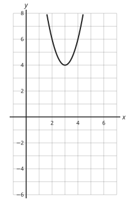

- ◻️ Twice  
  _↳ feedback if chosen: Look at the sign of D = −32._
- ✅ Never
- ◻️ Once (it touches the axis)  
  _↳ feedback if chosen: Touching needs D = 0; here D = −32._
- ◻️ Three times  
  _↳ feedback if chosen: A parabola meets a straight line at most twice._

Full working after a second miss:

> D = −32.  
> The number of crossings is the number of real roots of 2x² − 12x + 22 = 0.  
> So the answer is: Never.  

**Card c4m24-3** (draft)

> Equal roots: set D = 0 and solve for the unknown.
>
> _x² + kx + 9 = 0 has equal roots when k² = 36: k = 6 or −6_  

Check question: `m4-24-equal-card` · number, level 1 · computed by rule

> Find the positive value of k for which x² + kx + 1 = 0 has equal roots.

Answer: **2**
- Typed **1** (sq) → “k² = 4 × 1 = 4, so k = 2, not 1.”
- Typed **4** (four) → “That is k². Take the square root: k = 2.”

Full working after a second miss:

> Equal roots: D = k² − 4 × 1 × 1 = 0.  
> k² = 4, so k = ±2.  
> The positive value is 2.  

**Worked example** (draft)

> Find the positive value of k for which x² + kx + 9 = 0 has equal roots.

1. Equal roots means D = 0: a = 1, b = k, c = 9.
2. k² − 4 × 1 × 9 = 0, so k² = 36.
3. k = 6 or k = −6. Check: x² + 6x + 9 = (x + 3)², one repeated root.

**Answer:** k = 6

**Practice** `m4-24-nature` · multiple choice, level 1 · computed by rule

> Describe the roots of x² − 8x − 3 = 0.

- ◻️ No real roots  
  _↳ feedback if chosen: Work out D = 76 and look at its sign._
- ✅ Two different real roots
- ◻️ Three real roots  
  _↳ feedback if chosen: A quadratic has at most two roots._
- ◻️ Two equal real roots (one repeated root)  
  _↳ feedback if chosen: D = 76: equal roots need D = 0 exactly._

Full working after a second miss:

> D = b² − 4ac = 64 − −12 = 76.  
> So the answer is: Two different real roots.  

> Describe the roots of 2x² + 6x − 5 = 0.

- ✅ Two different real roots
- ◻️ No real roots  
  _↳ feedback if chosen: Work out D = 76 and look at its sign._
- ◻️ Two equal real roots (one repeated root)  
  _↳ feedback if chosen: D = 76: equal roots need D = 0 exactly._
- ◻️ Three real roots  
  _↳ feedback if chosen: A quadratic has at most two roots._

Full working after a second miss:

> D = b² − 4ac = 36 − −40 = 76.  
> So the answer is: Two different real roots.  

**Practice** `m4-24-graph` · multiple choice, level 1 · computed by rule

> How many times does the graph of y = 2x² + 12x + 22 meet the x-axis?

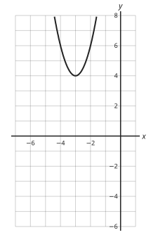

- ◻️ Three times  
  _↳ feedback if chosen: A parabola meets a straight line at most twice._
- ✅ Never
- ◻️ Once (it touches the axis)  
  _↳ feedback if chosen: Touching needs D = 0; here D = −32._
- ◻️ Twice  
  _↳ feedback if chosen: Look at the sign of D = −32._

Full working after a second miss:

> D = −32.  
> The number of crossings is the number of real roots of 2x² + 12x + 22 = 0.  
> So the answer is: Never.  

> How many times does the graph of y = x² − 6x + 5 meet the x-axis?

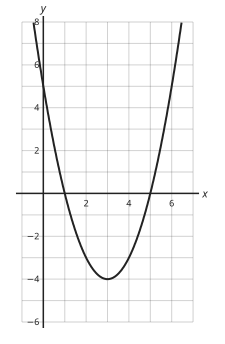

- ◻️ Never  
  _↳ feedback if chosen: Look at the sign of D = 16._
- ◻️ Once (it touches the axis)  
  _↳ feedback if chosen: Touching needs D = 0; here D = 16._
- ✅ Twice
- ◻️ Three times  
  _↳ feedback if chosen: A parabola meets a straight line at most twice._

Full working after a second miss:

> D = 16.  
> The number of crossings is the number of real roots of x² − 6x + 5 = 0.  
> So the answer is: Twice.  

**Practice** `m4-24-equal` · number, level 2 · computed by rule

> Find the positive value of k for which x² + kx + 36 = 0 has equal roots.

Answer: **12**
- Typed **6** (sq) → “k² = 4 × 36 = 144, so k = 12, not 6.”
- Typed **144** (four) → “That is k². Take the square root: k = 12.”

Full working after a second miss:

> Equal roots: D = k² − 4 × 1 × 36 = 0.  
> k² = 144, so k = ±12.  
> The positive value is 12.  

> Find the positive value of k for which x² + kx + 25 = 0 has equal roots.

Answer: **10**
- Typed **5** (sq) → “k² = 4 × 25 = 100, so k = 10, not 5.”
- Typed **100** (four) → “That is k². Take the square root: k = 10.”

Full working after a second miss:

> Equal roots: D = k² − 4 × 1 × 25 = 0.  
> k² = 100, so k = ±10.  
> The positive value is 10.  

**Practice** `m4-24-real` · multiple choice, level 2 · computed by rule

> For which values of k does x² + 6x + k = 0 have real roots?

- ✅ k ≤ 9
- ◻️ k ≤ 6  
  _↳ feedback if chosen: Square the coefficient of x: (6)² = 36._
- ◻️ k ≥ 9  
  _↳ feedback if chosen: D = 36 − 4k ≥ 0 gives k ≤ 9: larger k makes D negative._
- ◻️ k < 9  
  _↳ feedback if chosen: Equal roots (D = 0) are real too, so k = 9 is allowed._

Full working after a second miss:

> Real roots: D ≥ 0.  
> D = (6)² − 4k = 36 − 4k ≥ 0.  
> So 4k ≤ 36: k ≤ 9.  

> For which values of k does x² + −8x + k = 0 have real roots?

- ◻️ k ≥ 16  
  _↳ feedback if chosen: D = 64 − 4k ≥ 0 gives k ≤ 16: larger k makes D negative._
- ◻️ k ≤ −8  
  _↳ feedback if chosen: Square the coefficient of x: (−8)² = 64._
- ◻️ k < 16  
  _↳ feedback if chosen: Equal roots (D = 0) are real too, so k = 16 is allowed._
- ✅ k ≤ 16

Full working after a second miss:

> Real roots: D ≥ 0.  
> D = (−8)² − 4k = 64 − 4k ≥ 0.  
> So 4k ≤ 64: k ≤ 16.  

**Practice** `m4-24-kx` · number, level 3 · computed by rule

> Find k if kx² + 10x + 1 = 0 has equal roots.

Answer: **25**
- Typed **5** (b) → “D = b² − 4ac with a = k: 100 − 4k = 0, so k = 25.”
- Typed **100** (four) → “Divide by 4: 4k = 100.”

Full working after a second miss:

> Equal roots: D = 0.  
> D = 100 − 4 × k × 1 = 0.  
> So k = 100 ÷ 4 = 25.  

> Find k if kx² + −10x + 1 = 0 has equal roots.

Answer: **25**
- Typed **5** (b) → “D = b² − 4ac with a = k: 100 − 4k = 0, so k = 25.”
- Typed **100** (four) → “Divide by 4: 4k = 100.”

Full working after a second miss:

> Equal roots: D = 0.  
> D = 100 − 4 × k × 1 = 0.  
> So k = 100 ÷ 4 = 25.  

## Lesson 25: Graphical solutions to quadratic equations

Prerequisites: 23, 20 · Skill: m4-25 (Solve quadratic equations using graphs)

**Note** (draft)

> On the graph of y = ax² + bx + c, the roots of ax² + bx + c = 0 are the x-coordinates where the curve crosses the x-axis (y = 0).
> To solve ax² + bx + c = k with the same graph, draw the horizontal line y = k and read the x-coordinates where it meets the curve.
> To solve a different quadratic, rearrange it as (the graphed expression) = (a straight line), draw that line, and read the crossings.
> Example: with y = x² − 2x − 3 drawn, x² − 3x − 1 = 0 becomes x² − 2x − 3 = x − 2: draw y = x − 2.
> Graph readings are approximate; give them to the nearest grid line or as the question asks.

**Learn: Your goal and connections** (draft)

> By the end, you should be able to read the roots of a quadratic equation from its graph and solve related equations by drawing a straight line.
> Builds on: Lesson 23 (drawing parabolas) and Lesson 20 (crossings of graphs).
> Leads to: intersections of curves and lines in Form Five, and solving equations that algebra cannot.

**Learn: Roots on the x-axis** (draft)

> The graph of y = x² − 2x − 3 crosses the x-axis at x = −1 and x = 3.
> On the x-axis y = 0, so these x values make x² − 2x − 3 = 0: they are the roots.
> Check: (−1)² − 2 × (−1) − 3 = 1 + 2 − 3 = 0.
> If the curve crosses between grid lines, estimate: x ≈ 2.6, for example.

**Learn: Other equations with the same graph** (draft)

> To solve x² − 2x − 3 = 5, draw the horizontal line y = 5. It meets the curve at x = −2 and x = 4.
> To solve x² − 3x − 1 = 0, make the left side match the graph:
> x² − 3x − 1 = 0 is the same as x² − 2x − 3 = x − 2 (add x − 2 to both sides).
> So draw y = x − 2 and read the x values where it crosses the curve.

**Learn: key words and examples** (draft)

- **graphical solution**: an answer read from a graph
- **intersection**: where two graphs meet
- **estimate**: read as closely as the grid allows

- y = x² − 4: roots x = −2, 2
- x² − 4 = 5: draw y = 5, x = −3 or 3

Common mistake: “to solve x² − 2x − 3 = 5, read where the curve crosses the x-axis” → “draw y = 5 and read where it meets the curve”. The x-axis is y = 0. For = 5, use the line y = 5.

**Card c4m25-1** (draft)

> The roots of ax² + bx + c = 0 are where the graph crosses the x-axis.
>
> _y = x² − 2x − 3 crosses at x = −1 and x = 3_  

Check question: `m4-25-roots` · multiple choice, level 1 · computed by rule, reused from practice

> The graph shows y = x² + 4x. What are the roots of x² + 4x = 0?

- ◻️ x = 4 or x = 0  
  _↳ feedback if chosen: Read the crossings off the x-axis: they are at −4 and 0._
- ◻️ x = −2  
  _↳ feedback if chosen: That is the axis of symmetry, halfway between the roots._
- ✅ x = −4 or x = 0
- ◻️ x = 0  
  _↳ feedback if chosen: 0 is where the curve meets the y-axis, not the x-axis._

Full working after a second miss:

> The roots are where the curve crosses the x-axis.  
> It crosses at x = −4 and x = 0.  
> So the answer is x = −4 or x = 0.  

**Card c4m25-2** (draft)

> To solve ax² + bx + c = k, draw the line y = k and read where it meets the curve.
>
> _x² − 2x − 3 = 5: y = 5 meets the curve at x = −2 and x = 4_  

Check question: `m4-25-k-card` · multiple choice, level 1 · computed by rule

> The graph of y = x² − x − 6 is drawn. Which line do you draw to solve x² − x − 6 = 5?

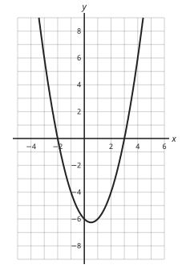

- ✅ y = 5
- ◻️ y = −5  
  _↳ feedback if chosen: The equation says the expression equals 5: draw y = 5._
- ◻️ x = 5  
  _↳ feedback if chosen: x = 5 is a vertical line: it gives only one point on the curve, not the solutions._
- ◻️ y = x + 5  
  _↳ feedback if chosen: The right side is just the number 5, so the line is horizontal._

Full working after a second miss:

> The left side is the graphed expression y. So y = 5.  
> Draw the horizontal line y = 5 and read where it meets the curve.  
> So the answer is y = 5.  

**Card c4m25-3** (draft)

> For another equation, rearrange it as (the graphed expression) = (a line), and draw the line.
>
> _x² − 3x − 1 = 0 ↔ x² − 2x − 3 = x − 2: draw y = x − 2_  

Check question: `m4-25-line-card` · multiple choice, level 1 · computed by rule

> The graph of y = x² + 4x − 6 is drawn. Which straight line must you draw to solve x² − 3x + 6 = 0?

- ◻️ y = 0  
  _↳ feedback if chosen: y = 0 solves x² + 4x − 6 = 0, a different equation._
- ✅ y = 7x − 12
- ◻️ y = −3x + 6  
  _↳ feedback if chosen: Subtract the two quadratics: the line is the difference, not the new x and number terms._
- ◻️ y = −7x + 12  
  _↳ feedback if chosen: Move the terms the right way: x² + 4x + −6 − (7x − 12) must give x² − 3x + 6._

Full working after a second miss:

> Rearrange so that the left side is the graphed expression: x² − 3x + 6 = 0.  
> Add 7x − 12 to both sides: x² + 4x − 6 = 7x − 12.  
> So draw y = 7x − 12.  

**Worked example** (draft)

> The graph of y = x² − 2x − 3 is drawn. Use it to solve x² − 2x − 3 = 5.

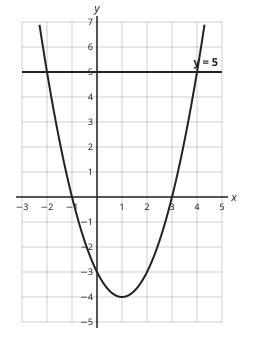

1. Draw the horizontal line y = 5.
2. Read the x-coordinates where it meets the curve: x = −2 and x = 4.
3. Check x = 4: 16 − 8 − 3 = 5. Correct.

**Answer:** x = −2 or x = 4

**Practice** `m4-25-roots` · multiple choice, level 1 · computed by rule

> The graph shows y = x² + 2x − 3. What are the roots of x² + 2x − 3 = 0?

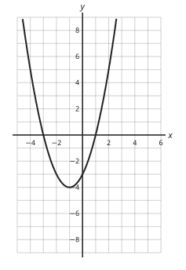

- ◻️ x = −1  
  _↳ feedback if chosen: That is the axis of symmetry, halfway between the roots._
- ◻️ x = 3 or x = −1  
  _↳ feedback if chosen: Read the crossings off the x-axis: they are at −3 and 1._
- ◻️ x = −3  
  _↳ feedback if chosen: −3 is where the curve meets the y-axis, not the x-axis._
- ✅ x = −3 or x = 1

Full working after a second miss:

> The roots are where the curve crosses the x-axis.  
> It crosses at x = −3 and x = 1.  
> So the answer is x = −3 or x = 1.  

> The graph shows y = x² + 6x + 8. What are the roots of x² + 6x + 8 = 0?

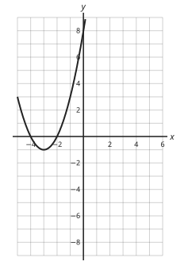

- ◻️ x = 8  
  _↳ feedback if chosen: 8 is where the curve meets the y-axis, not the x-axis._
- ◻️ x = −3  
  _↳ feedback if chosen: That is the axis of symmetry, halfway between the roots._
- ✅ x = −4 or x = −2
- ◻️ x = 4 or x = 2  
  _↳ feedback if chosen: Read the crossings off the x-axis: they are at −4 and −2._

Full working after a second miss:

> The roots are where the curve crosses the x-axis.  
> It crosses at x = −4 and x = −2.  
> So the answer is x = −4 or x = −2.  

**Practice** `m4-25-large` · number, level 1 · computed by rule

> The graph shows y = x² + 3x − 4. Use it to find the larger root of x² + 3x − 4 = 0.

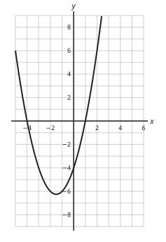

Answer: **1**
- Typed **−4** (small) → “That is the smaller root.”
- Typed **−4** (icept) → “−4 is the y-intercept. The roots are on the x-axis.”

Full working after a second miss:

> Look for where the curve crosses the x-axis.  
> The crossings are at x = −4 and x = 1.  
> The larger root is 1.  

> The graph shows y = x² + 3x − 4. Use it to find the larger root of x² + 3x − 4 = 0.

Answer: **1**
- Typed **−4** (small) → “That is the smaller root.”
- Typed **−4** (icept) → “−4 is the y-intercept. The roots are on the x-axis.”

Full working after a second miss:

> Look for where the curve crosses the x-axis.  
> The crossings are at x = −4 and x = 1.  
> The larger root is 1.  

**Practice** `m4-25-k` · multiple choice, level 2 · computed by rule

> The graph of y = x² + 2x − 3 is drawn. Which line do you draw to solve x² + 2x − 3 = 4?

- ◻️ x = 4  
  _↳ feedback if chosen: x = 4 is a vertical line: it gives only one point on the curve, not the solutions._
- ✅ y = 4
- ◻️ y = x + 4  
  _↳ feedback if chosen: The right side is just the number 4, so the line is horizontal._
- ◻️ y = −4  
  _↳ feedback if chosen: The equation says the expression equals 4: draw y = 4._

Full working after a second miss:

> The left side is the graphed expression y. So y = 4.  
> Draw the horizontal line y = 4 and read where it meets the curve.  
> So the answer is y = 4.  

> The graph of y = x² + 4x is drawn. Which line do you draw to solve x² + 4x = 1?

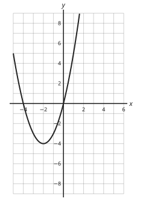

- ◻️ y = x + 1  
  _↳ feedback if chosen: The right side is just the number 1, so the line is horizontal._
- ✅ y = 1
- ◻️ x = 1  
  _↳ feedback if chosen: x = 1 is a vertical line: it gives only one point on the curve, not the solutions._
- ◻️ y = −1  
  _↳ feedback if chosen: The equation says the expression equals 1: draw y = 1._

Full working after a second miss:

> The left side is the graphed expression y. So y = 1.  
> Draw the horizontal line y = 1 and read where it meets the curve.  
> So the answer is y = 1.  

**Practice** `m4-25-solvek` · number, level 2 · computed by rule

> The graph of y = x² + 3x − 4 is drawn. Draw y = −4 and use it to solve x² + 3x − 4 = −4. Give the larger solution.

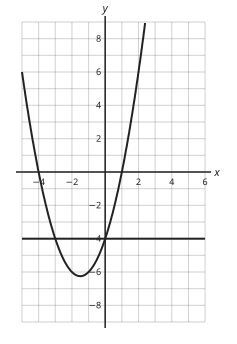

Answer: **0**
- Typed **−3** (small) → “That is the smaller solution.”
- Typed **1** (roots) → “1 is a root of the curve = 0. Here the curve equals −4.”

Full working after a second miss:

> The line y = −4 meets the curve at x = 0 and x = −3 (symmetric about x = −1.5).  
> Check x = 0: 0 − 0 + (−4) = −4.  
> The larger solution is 0.  

> The graph of y = x² + 2x − 8 is drawn. Draw y = 7 and use it to solve x² + 2x − 8 = 7. Give the larger solution.

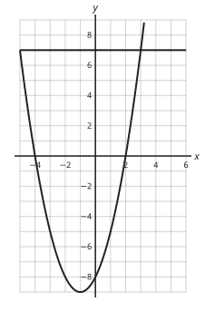

Answer: **3**
- Typed **−5** (small) → “That is the smaller solution.”
- Typed **2** (roots) → “2 is a root of the curve = 0. Here the curve equals 7.”

Full working after a second miss:

> The line y = 7 meets the curve at x = 3 and x = −5 (symmetric about x = −1).  
> Check x = 3: 9 − −6 + (−8) = 7.  
> The larger solution is 3.  

**Practice** `m4-25-line` · multiple choice, level 3 · computed by rule

> The graph of y = x² + 2x + 2 is drawn. Which straight line must you draw to solve x² − 4x − 6 = 0?

- ◻️ y = 0  
  _↳ feedback if chosen: y = 0 solves x² + 2x + 2 = 0, a different equation._
- ◻️ y = −6x − 8  
  _↳ feedback if chosen: Move the terms the right way: x² + 2x + 2 − (6x + 8) must give x² − 4x − 6._
- ◻️ y = −4x − 6  
  _↳ feedback if chosen: Subtract the two quadratics: the line is the difference, not the new x and number terms._
- ✅ y = 6x + 8

Full working after a second miss:

> Rearrange so that the left side is the graphed expression: x² − 4x − 6 = 0.  
> Add 6x + 8 to both sides: x² + 2x + 2 = 6x + 8.  
> So draw y = 6x + 8.  

> The graph of y = x² − 3x + 1 is drawn. Which straight line must you draw to solve x² + 3x + 6 = 0?

- ◻️ y = 6x + 5  
  _↳ feedback if chosen: Move the terms the right way: x² + −3x + 1 − (−6x − 5) must give x² + 3x + 6._
- ◻️ y = 0  
  _↳ feedback if chosen: y = 0 solves x² − 3x + 1 = 0, a different equation._
- ✅ y = −6x − 5
- ◻️ y = 3x + 6  
  _↳ feedback if chosen: Subtract the two quadratics: the line is the difference, not the new x and number terms._

Full working after a second miss:

> Rearrange so that the left side is the graphed expression: x² + 3x + 6 = 0.  
> Add −6x − 5 to both sides: x² − 3x + 1 = −6x − 5.  
> So draw y = −6x − 5.  

