# Physics Form 4, Form Four Physics: drafts for review (Lessons 15 lessons (1–15))

Generated by `npm run review:f4-physics` from `content/form-4/physics/*.json`. Every question and drawing below was built by the engine.
All notes, teach cards, worked examples and paper tasks are **status: draft**. “Authored key” means a person fixed the
right answer (see `AUTHORED.md`); “computed by rule” means code worked it out (a formula, a conversion, a spelling rule).

Teach mode: cards (idea + example + 1 level-1 check) → worked example → practice (levels 1–3) → the note as a summary.

## Sample rendered lesson: Lesson 1 in teach mode

### Lesson 1: Concept of heat and temperature. Measurement of temperature

**Card c4p1-1** (draft)

> Heat is energy in transit, measured in joules. Temperature is the degree of hotness, in °C or K.
>
> _A bucket and a cup of water at 40 °C are equally hot, but the bucket holds more heat energy_  

Check question: `p4-1-which` · multiple choice, level 1 · **authored key**, reused from practice

> Which temperature scale starts at absolute zero?

- ◻️ Every scale starts at absolute zero  
  _↳ feedback if chosen: Only the kelvin scale has its zero at absolute zero._
- ◻️ The Celsius scale  
  _↳ feedback if chosen: Celsius starts at the melting point of ice, which is 273 K._
- ◻️ The Fahrenheit scale  
  _↳ feedback if chosen: Fahrenheit has its own fixed points; it does not start at absolute zero._
- ✅ The kelvin scale

Full working after a second miss:

> 0 K is absolute zero, the lowest possible temperature; T(K) = θ(°C) + 273.  
> So the answer is The kelvin scale.  

**Card c4p1-2** (draft)

> Heat flows from hot to cold until the temperatures are equal (thermal equilibrium).
>
> _A hot spoon in cold water cools; the water warms; they meet at one temperature_  

Check question: `p4-1-flow-card` · multiple choice, level 1 · computed by rule

> A metal spoon at 78 °C is put into water at 19 °C. What happens?

- ◻️ Both stay at their own temperature  
  _↳ feedback if chosen: A temperature difference always causes a flow of heat._
- ✅ Heat flows from the spoon to the water until both are at the same temperature
- ◻️ Heat flows from the water to the spoon  
  _↳ feedback if chosen: The water is cooler, so it takes in heat; it does not give heat to the hotter spoon._
- ◻️ Nothing happens until the spoon melts  
  _↳ feedback if chosen: Heat flows as soon as two bodies at different temperatures touch._

Full working after a second miss:

> Heat always flows from the hotter body to the cooler one.  
> The spoon at 78 °C is hotter than the water at 19 °C.  
> They stop exchanging heat when they reach the same temperature.  
> So the answer is: Heat flows from the spoon to the water until both are at the same temperature.  

**Card c4p1-3** (draft)

> T(K) = θ(°C) + 273; a change of 1 °C is a change of 1 K.
>
> _27 °C = 300 K; −273 °C = 0 K, absolute zero_  

Check question: `p4-1-kelvin` · number, level 1 · computed by rule, reused from practice

> Change 32 °C into kelvin.

Answer: **305 K**
- Typed **−241** (minus) → “Add 273 to the Celsius temperature; do not subtract it.”
- Typed **241** (swap) → “T(K) = θ + 273, not 273 − θ.”

Full working after a second miss:

> T(K) = θ(°C) + 273.  
> T = 32 + 273 = 305 K.  

**Worked example** (draft)

> A patient's temperature is 37 °C. Give this temperature in kelvin, and find the rise from 35 °C.

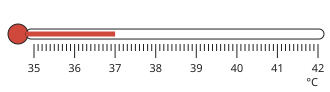

1. T(K) = θ(°C) + 273.
2. T = 37 + 273 = 310 K.
3. The rise is 37 − 35 = 2 °C.
4. A change of 1 °C is a change of 1 K, so the rise is also 2 K.

**Answer:** 310 K; a rise of 2 K

**Practice** (one generated question per template, easiest first)

Practice 1: `p4-1-which` · multiple choice, level 1 · **authored key**

> Two objects touch. Which way does heat flow?

- ◻️ Heat does not flow between touching objects  
  _↳ feedback if chosen: Touching bodies at different temperatures always exchange heat._
- ◻️ From the bigger one to the smaller one  
  _↳ feedback if chosen: Size does not decide the direction; the temperature difference does._
- ◻️ From the cooler one to the hotter one  
  _↳ feedback if chosen: Heat always flows the other way, from hot to cold, until the temperatures are equal._
- ✅ From the hotter one to the cooler one

Full working after a second miss:

> Heat flows from high to low temperature until both reach the same temperature (thermal equilibrium).  
> So the answer is From the hotter one to the cooler one.  

Practice 2: `p4-1-kelvin` · number, level 1 · computed by rule

> Change 31 °C into kelvin.

Answer: **304 K**
- Typed **−242** (minus) → “Add 273 to the Celsius temperature; do not subtract it.”
- Typed **242** (swap) → “T(K) = θ + 273, not 273 − θ.”

Full working after a second miss:

> T(K) = θ(°C) + 273.  
> T = 31 + 273 = 304 K.  

Practice 3: `p4-1-back` · number, level 1 · computed by rule

> A gas is at 379 K. What is its temperature in degrees Celsius?

Answer: **106 °C**
- Typed **652** (add) → “Going from kelvin to Celsius, subtract 273.”
- Typed **−106** (swap) → “θ = T − 273, not 273 − T.”

Full working after a second miss:

> θ(°C) = T(K) − 273.  
> θ = 379 − 273 = 106 °C.  

Practice 4: `p4-1-flow` · multiple choice, level 2 · computed by rule

> A metal spoon at 72 °C is put into water at 20 °C. What happens?

- ✅ Heat flows from the spoon to the water until both are at the same temperature
- ◻️ Heat flows from the water to the spoon  
  _↳ feedback if chosen: The water is cooler, so it takes in heat; it does not give heat to the hotter spoon._
- ◻️ Nothing happens until the spoon melts  
  _↳ feedback if chosen: Heat flows as soon as two bodies at different temperatures touch._
- ◻️ Both stay at their own temperature  
  _↳ feedback if chosen: A temperature difference always causes a flow of heat._

Full working after a second miss:

> Heat always flows from the hotter body to the cooler one.  
> The spoon at 72 °C is hotter than the water at 20 °C.  
> They stop exchanging heat when they reach the same temperature.  
> So the answer is: Heat flows from the spoon to the water until both are at the same temperature.  

Practice 5: `p4-1-rise` · number, level 2 · computed by rule

> Water in a kettle is heated from 30 °C to 100 °C. What is the rise in temperature, in kelvin?

Answer: **70 K**
- Typed **343** (kelvin) → “A temperature CHANGE is the same number in °C and K: do not add 273 to a difference.”
- Typed **343** (both) → “Change both to kelvin and the 273 cancels: (100 + 273) − (30 + 273) = 70.”

Full working after a second miss:

> The rise is 100 − 30 = 70 °C.  
> A change of 1 °C is a change of 1 K, so the rise is 70 K.  

Practice 6: `p4-1-energy` · multiple choice, level 3 · computed by rule

> A cup holding 150 g of water and a pot holding 800 g of water are both at 40 °C. Which statement is true?

- ✅ The pot holds more heat energy, because it has more water at the same temperature
- ◻️ They hold the same heat energy, because the temperature is equal  
  _↳ feedback if chosen: Equal temperature means equal average energy per particle, not equal total energy._
- ◻️ The cup holds more heat energy, because it is hotter  
  _↳ feedback if chosen: Both are at 40 °C: neither is hotter._
- ◻️ Neither holds heat energy at 40 °C  
  _↳ feedback if chosen: Any body above absolute zero (−273 °C) has internal energy._

Full working after a second miss:

> Both are at 40 °C, so their particles have the same average energy.  
> The pot has 5.333333333 times as much water, so many more particles.  
> So the pot holds more energy in all.  
> So the answer is: The pot holds more heat energy, because it has more water at the same temperature.  

**Summary (the note)**

> Heat is energy that flows from a hotter body to a cooler one, measured in joules (J).
> Temperature is the degree of hotness of a body, measured in degrees Celsius (°C) or kelvin (K). It decides which way heat flows.
> Two bodies at the same temperature can hold very different amounts of heat energy: a bucket of water at 40 °C holds much more than a cup at 40 °C.
> When two bodies are in contact, heat flows from the hotter to the cooler until both reach the same temperature: thermal equilibrium.
> Kelvin scale: T(K) = θ(°C) + 273. Absolute zero is 0 K = −273 °C. A change of 1 °C equals a change of 1 K.

## All drafts

| Lesson | Title (sheet) | Status | Cards | Practice | Paper task |
|---|---|---|---|---|---|
| 1 | Concept of heat and temperature. Measurement of temperature | draft | 3 | 6 | — |
| 2 | Thermometry: Liquid-in-glass thermometer, Calibration of a thermometer using fixed points. Clinical and laboratory thermometers | draft | 3 | 5 | — |
| 3 | Calorimetry: Definition of heat capacity and specific heat capacity. Measurement of specific heat capacity, c for a solid using Q = mc∆θ | draft | 3 | 5 | — |
| 4 | Measurement of specific heat capacity, c for a liquid using Q = mc∆θ and calculations using Q = mc∆θ | draft | 3 | 5 | — |
| 5 | Latent Heat and specific Latent heat: Definitions and calculations using Q = ml. Cooling effect of evaporation | draft | 3 | 5 | — |
| 6 | Heat Transfer by Conduction, Convection and Radiation and their applications | draft | 3 | 5 | — |
| 7 | Thermal Expansion The bimetallic strip and its principles Radiant energy converters | draft | 3 | 5 | — |
| 8 | Waves: Classifications using medium of propagation and mode of propagation with examples | draft | 3 | 5 | — |
| 9 | Wave characteristics: Energy transfer, period, frequency, amplitude (using displacement- time graph) | draft | 3 | 5 | — |
| 10 | Wave Characteristics: Wavelength, and wave speed (using displacement-distance and wave profile), generation of wavefronts using the ripple tank. Calculations using the equation v=fλ | draft | 3 | 5 | — |
| 11 | Wave phenomena: Reflection, Refraction, Diffraction and Interference (with diagrams) | draft | 3 | 5 | — |
| 12 | Stationary waves: Harmonics and Overtones. Relationship between inter-node distance and wavelength | draft | 3 | 5 | — |
| 13 | Production and transmission of sound. Characteristics of sound (Amplitude, frequency, and pitch, quality and overtones) | draft | 3 | 5 | — |
| 14 | Measurement of the speed of sound (echo method and gun firing method) Application of echo in sea bed; Calculation of speed of sound in air | draft | 3 | 5 | — |
| 15 | Vibrating strings Relationship between frequency and length, frequency and mass per unit length, frequency and tension | draft | 3 | 5 | — |

## Lesson 1: Concept of heat and temperature. Measurement of temperature

Prerequisites: none · Skill: p4-1 (Distinguish heat from temperature and measure temperature)

**Note** (draft)

> Heat is energy that flows from a hotter body to a cooler one, measured in joules (J).
> Temperature is the degree of hotness of a body, measured in degrees Celsius (°C) or kelvin (K). It decides which way heat flows.
> Two bodies at the same temperature can hold very different amounts of heat energy: a bucket of water at 40 °C holds much more than a cup at 40 °C.
> When two bodies are in contact, heat flows from the hotter to the cooler until both reach the same temperature: thermal equilibrium.
> Kelvin scale: T(K) = θ(°C) + 273. Absolute zero is 0 K = −273 °C. A change of 1 °C equals a change of 1 K.

**Learn: Your goal and connections** (draft)

> By the end, you should be able to tell heat from temperature, say which way heat flows, and change between °C and K.
> Builds on: Form Three measurement of temperature and the kelvin conversion.
> Leads to: Lesson 2 (thermometers) and Lesson 3, where heat energy is calculated from a temperature change.

**Learn: Two different ideas** (draft)

> Heat is energy on the move. It flows from a hotter body to a cooler one and is measured in joules.
> Temperature is the degree of hotness. It is measured in °C or K, and it decides which way heat flows.
> A cup of water at 40 °C and a bucket of water at 40 °C are equally hot, but the bucket holds far more heat energy, because it has many more particles each carrying energy.
> Put a hot spoon in cool water: the spoon cools, the water warms, and they meet at one temperature. That is thermal equilibrium: no temperature difference, so no net flow of heat.

**Learn: The kelvin scale** (draft)

> The Celsius scale takes the melting point of ice as 0 °C and the boiling point of water as 100 °C.
> The kelvin scale starts at absolute zero, the lowest temperature possible: 0 K = −273 °C.
> • T(K) = θ(°C) + 273: 27 °C = 300 K.
> • θ(°C) = T(K) − 273: 350 K = 77 °C.
> The two scales have the same size of degree, so a temperature CHANGE is the same number in both: a rise of 20 °C is a rise of 20 K. Do not add 273 to a difference.

**Learn: key words and examples** (draft)

- **heat**: energy that flows because of a temperature difference, measured in joules
- **temperature**: the degree of hotness of a body, in °C or K
- **thermal equilibrium**: the state when two bodies in contact are at the same temperature
- **absolute zero**: 0 K = −273 °C, the lowest possible temperature

- 100 °C = 373 K
- 0 K = −273 °C
- a rise from 20 °C to 50 °C is a rise of 30 K

Common mistake: “a rise of 30 °C is a rise of 303 K” → “a rise of 30 °C is a rise of 30 K”. The 273 is added to a temperature, not to a change. It cancels when you subtract two temperatures.

**Card c4p1-1** (draft)

> Heat is energy in transit, measured in joules. Temperature is the degree of hotness, in °C or K.
>
> _A bucket and a cup of water at 40 °C are equally hot, but the bucket holds more heat energy_  

Check question: `p4-1-which` · multiple choice, level 1 · **authored key**, reused from practice

> A cup of tea and a bucket of water are both at 40 °C. Which holds more heat energy?

- ◻️ They hold the same, because the temperature is the same  
  _↳ feedback if chosen: Equal temperature does not mean equal energy: the bucket has far more particles, each with energy._
- ✅ The bucket, because it has more particles
- ◻️ Neither holds heat energy  
  _↳ feedback if chosen: Any body above absolute zero has internal energy._
- ◻️ The cup, because it feels hotter  
  _↳ feedback if chosen: They are at the same temperature, so neither feels hotter; the bucket simply holds more energy._

Full working after a second miss:

> At the same temperature each particle has the same average energy, so more particles means more energy in all.  
> So the answer is The bucket, because it has more particles.  

**Card c4p1-2** (draft)

> Heat flows from hot to cold until the temperatures are equal (thermal equilibrium).
>
> _A hot spoon in cold water cools; the water warms; they meet at one temperature_  

Check question: `p4-1-flow-card` · multiple choice, level 1 · computed by rule

> A metal spoon at 86 °C is put into water at 10 °C. What happens?

- ◻️ Heat flows from the water to the spoon  
  _↳ feedback if chosen: The water is cooler, so it takes in heat; it does not give heat to the hotter spoon._
- ◻️ Nothing happens until the spoon melts  
  _↳ feedback if chosen: Heat flows as soon as two bodies at different temperatures touch._
- ✅ Heat flows from the spoon to the water until both are at the same temperature
- ◻️ Both stay at their own temperature  
  _↳ feedback if chosen: A temperature difference always causes a flow of heat._

Full working after a second miss:

> Heat always flows from the hotter body to the cooler one.  
> The spoon at 86 °C is hotter than the water at 10 °C.  
> They stop exchanging heat when they reach the same temperature.  
> So the answer is: Heat flows from the spoon to the water until both are at the same temperature.  

**Card c4p1-3** (draft)

> T(K) = θ(°C) + 273; a change of 1 °C is a change of 1 K.
>
> _27 °C = 300 K; −273 °C = 0 K, absolute zero_  

Check question: `p4-1-kelvin` · number, level 1 · computed by rule, reused from practice

> Change 18 °C into kelvin.

Answer: **291 K**
- Typed **−255** (minus) → “Add 273 to the Celsius temperature; do not subtract it.”
- Typed **255** (swap) → “T(K) = θ + 273, not 273 − θ.”

Full working after a second miss:

> T(K) = θ(°C) + 273.  
> T = 18 + 273 = 291 K.  

**Worked example** (draft)

> A patient's temperature is 37 °C. Give this temperature in kelvin, and find the rise from 35 °C.

1. T(K) = θ(°C) + 273.
2. T = 37 + 273 = 310 K.
3. The rise is 37 − 35 = 2 °C.
4. A change of 1 °C is a change of 1 K, so the rise is also 2 K.

**Answer:** 310 K; a rise of 2 K

**Practice** `p4-1-which` · multiple choice, level 1 · **authored key**

> A cup of tea and a bucket of water are both at 40 °C. Which holds more heat energy?

- ◻️ The cup, because it feels hotter  
  _↳ feedback if chosen: They are at the same temperature, so neither feels hotter; the bucket simply holds more energy._
- ◻️ They hold the same, because the temperature is the same  
  _↳ feedback if chosen: Equal temperature does not mean equal energy: the bucket has far more particles, each with energy._
- ✅ The bucket, because it has more particles
- ◻️ Neither holds heat energy  
  _↳ feedback if chosen: Any body above absolute zero has internal energy._

Full working after a second miss:

> At the same temperature each particle has the same average energy, so more particles means more energy in all.  
> So the answer is The bucket, because it has more particles.  

> Two objects touch. Which way does heat flow?

- ◻️ Heat does not flow between touching objects  
  _↳ feedback if chosen: Touching bodies at different temperatures always exchange heat._
- ✅ From the hotter one to the cooler one
- ◻️ From the cooler one to the hotter one  
  _↳ feedback if chosen: Heat always flows the other way, from hot to cold, until the temperatures are equal._
- ◻️ From the bigger one to the smaller one  
  _↳ feedback if chosen: Size does not decide the direction; the temperature difference does._

Full working after a second miss:

> Heat flows from high to low temperature until both reach the same temperature (thermal equilibrium).  
> So the answer is From the hotter one to the cooler one.  

**Practice** `p4-1-kelvin` · number, level 1 · computed by rule

> Change 106 °C into kelvin.

Answer: **379 K**
- Typed **−167** (minus) → “Add 273 to the Celsius temperature; do not subtract it.”
- Typed **167** (swap) → “T(K) = θ + 273, not 273 − θ.”

Full working after a second miss:

> T(K) = θ(°C) + 273.  
> T = 106 + 273 = 379 K.  

> Change 14 °C into kelvin.

Answer: **287 K**
- Typed **−259** (minus) → “Add 273 to the Celsius temperature; do not subtract it.”
- Typed **259** (swap) → “T(K) = θ + 273, not 273 − θ.”

Full working after a second miss:

> T(K) = θ(°C) + 273.  
> T = 14 + 273 = 287 K.  

**Practice** `p4-1-back` · number, level 1 · computed by rule

> A gas is at 300 K. What is its temperature in degrees Celsius?

Answer: **27 °C**
- Typed **573** (add) → “Going from kelvin to Celsius, subtract 273.”
- Typed **−27** (swap) → “θ = T − 273, not 273 − T.”

Full working after a second miss:

> θ(°C) = T(K) − 273.  
> θ = 300 − 273 = 27 °C.  

> A gas is at 214 K. What is its temperature in degrees Celsius?

Answer: **−59 °C**
- Typed **487** (add) → “Going from kelvin to Celsius, subtract 273.”
- Typed **59** (swap) → “θ = T − 273, not 273 − T.”

Full working after a second miss:

> θ(°C) = T(K) − 273.  
> θ = 214 − 273 = −59 °C.  

**Practice** `p4-1-flow` · multiple choice, level 2 · computed by rule

> A metal spoon at 69 °C is put into water at 10 °C. What happens?

- ◻️ Nothing happens until the spoon melts  
  _↳ feedback if chosen: Heat flows as soon as two bodies at different temperatures touch._
- ✅ Heat flows from the spoon to the water until both are at the same temperature
- ◻️ Both stay at their own temperature  
  _↳ feedback if chosen: A temperature difference always causes a flow of heat._
- ◻️ Heat flows from the water to the spoon  
  _↳ feedback if chosen: The water is cooler, so it takes in heat; it does not give heat to the hotter spoon._

Full working after a second miss:

> Heat always flows from the hotter body to the cooler one.  
> The spoon at 69 °C is hotter than the water at 10 °C.  
> They stop exchanging heat when they reach the same temperature.  
> So the answer is: Heat flows from the spoon to the water until both are at the same temperature.  

> A metal spoon at 78 °C is put into water at 26 °C. What happens?

- ◻️ Nothing happens until the spoon melts  
  _↳ feedback if chosen: Heat flows as soon as two bodies at different temperatures touch._
- ✅ Heat flows from the spoon to the water until both are at the same temperature
- ◻️ Heat flows from the water to the spoon  
  _↳ feedback if chosen: The water is cooler, so it takes in heat; it does not give heat to the hotter spoon._
- ◻️ Both stay at their own temperature  
  _↳ feedback if chosen: A temperature difference always causes a flow of heat._

Full working after a second miss:

> Heat always flows from the hotter body to the cooler one.  
> The spoon at 78 °C is hotter than the water at 26 °C.  
> They stop exchanging heat when they reach the same temperature.  
> So the answer is: Heat flows from the spoon to the water until both are at the same temperature.  

**Practice** `p4-1-rise` · number, level 2 · computed by rule

> Water in a kettle is heated from 25 °C to 82 °C. What is the rise in temperature, in kelvin?

Answer: **57 K**
- Typed **330** (kelvin) → “A temperature CHANGE is the same number in °C and K: do not add 273 to a difference.”
- Typed **330** (both) → “Change both to kelvin and the 273 cancels: (82 + 273) − (25 + 273) = 57.”

Full working after a second miss:

> The rise is 82 − 25 = 57 °C.  
> A change of 1 °C is a change of 1 K, so the rise is 57 K.  

> Water in a kettle is heated from 26 °C to 76 °C. What is the rise in temperature, in kelvin?

Answer: **50 K**
- Typed **323** (kelvin) → “A temperature CHANGE is the same number in °C and K: do not add 273 to a difference.”
- Typed **323** (both) → “Change both to kelvin and the 273 cancels: (76 + 273) − (26 + 273) = 50.”

Full working after a second miss:

> The rise is 76 − 26 = 50 °C.  
> A change of 1 °C is a change of 1 K, so the rise is 50 K.  

**Practice** `p4-1-energy` · multiple choice, level 3 · computed by rule

> A cup holding 200 g of water and a pot holding 800 g of water are both at 46 °C. Which statement is true?

- ◻️ They hold the same heat energy, because the temperature is equal  
  _↳ feedback if chosen: Equal temperature means equal average energy per particle, not equal total energy._
- ◻️ The cup holds more heat energy, because it is hotter  
  _↳ feedback if chosen: Both are at 46 °C: neither is hotter._
- ◻️ Neither holds heat energy at 46 °C  
  _↳ feedback if chosen: Any body above absolute zero (−273 °C) has internal energy._
- ✅ The pot holds more heat energy, because it has more water at the same temperature

Full working after a second miss:

> Both are at 46 °C, so their particles have the same average energy.  
> The pot has 4 times as much water, so many more particles.  
> So the pot holds more energy in all.  
> So the answer is: The pot holds more heat energy, because it has more water at the same temperature.  

> A cup holding 200 g of water and a pot holding 600 g of water are both at 45 °C. Which statement is true?

- ◻️ Neither holds heat energy at 45 °C  
  _↳ feedback if chosen: Any body above absolute zero (−273 °C) has internal energy._
- ◻️ The cup holds more heat energy, because it is hotter  
  _↳ feedback if chosen: Both are at 45 °C: neither is hotter._
- ✅ The pot holds more heat energy, because it has more water at the same temperature
- ◻️ They hold the same heat energy, because the temperature is equal  
  _↳ feedback if chosen: Equal temperature means equal average energy per particle, not equal total energy._

Full working after a second miss:

> Both are at 45 °C, so their particles have the same average energy.  
> The pot has 3 times as much water, so many more particles.  
> So the pot holds more energy in all.  
> So the answer is: The pot holds more heat energy, because it has more water at the same temperature.  

## Lesson 2: Thermometry: Liquid-in-glass thermometer, Calibration of a thermometer using fixed points. Clinical and laboratory thermometers

Prerequisites: 1 · Skill: p4-2 (Explain how a liquid-in-glass thermometer works and how it is calibrated)

**Note** (draft)

> A liquid-in-glass thermometer has a bulb holding a thermometric liquid (mercury or coloured alcohol), a narrow bore in a glass stem and a scale.
> When the bulb is warmed the liquid expands and the thread moves up the bore.
> A good thermometric liquid expands evenly, is easy to see, and does not stick to the glass.
> Calibration uses two fixed points: pure melting ice (0 °C) and steam above boiling water at normal pressure (100 °C). The distance between them is divided into 100 equal parts.
> A clinical thermometer reads about 35 °C to 42 °C with a constriction that holds the reading; a laboratory thermometer reads about −10 °C to 110 °C with no constriction.

**Learn: Your goal and connections** (draft)

> By the end, you should be able to explain how a liquid-in-glass thermometer works, calibrate one from its two fixed points, and choose between a clinical and a laboratory thermometer.
> Builds on: Lesson 1 (temperature scales) and Form Three measurement of temperature.
> Leads to: Lesson 3, where a thermometer measures the temperature change in a calorimetry experiment.

**Learn: How it works** (draft)

> A liquid-in-glass thermometer has a thin-walled bulb holding mercury or coloured alcohol, joined to a very narrow bore in thick glass.
> When the bulb is warmed, the liquid expands. Because the bore is narrow, a small expansion pushes the thread a long way, so the change is easy to see.
> A good thermometric liquid expands evenly with temperature (so the degrees are equally spaced), is easy to see, and does not wet the glass.
> A thin bulb lets heat reach the liquid quickly, so the thermometer responds fast.

**Learn: Fixed points, clinical and laboratory** (draft)

> Two temperatures that can always be repeated are used as fixed points:
> • lower: pure melting ice, 0 °C;  • upper: steam just above water boiling at normal atmospheric pressure, 100 °C.
> Steam is used because water touching a hot container can be overheated, while the steam stays at the boiling point.
> The length between the marks is divided into 100 equal degrees.
> A clinical thermometer reads only about 35 °C to 42 °C, so each degree is long on the scale and 0.1 °C can be read. Its constriction breaks the thread as it cools, holding the highest reading until it is shaken down. A laboratory thermometer reads about −10 °C to 110 °C and has no constriction.

**Learn: key words and examples** (draft)

- **thermometric liquid**: a liquid that expands evenly with temperature
- **fixed point**: a temperature that can always be reproduced, used to mark a scale
- **calibration**: marking a scale using the fixed points
- **constriction**: a narrow part of the bore that stops the thread running back

- ice point 0 °C, steam point 100 °C
- a clinical thermometer reads 37 °C for a healthy adult

Common mistake: “the upper fixed point is boiling water” → “the upper fixed point is the steam above boiling water”. Water next to a hot surface can go above 100 °C; the steam above it stays at the boiling point.

**Card c4p2-1** (draft)

> The liquid expands when the bulb is warmed, pushing the thread along the narrow bore.
>
> _A thin bulb and a narrow bore make the thermometer quick and sensitive_  

Check question: `p4-2-how` · multiple choice, level 1 · **authored key**, reused from practice

> What are the two fixed points used to calibrate a Celsius thermometer?

- ◻️ Ice from a freezer and warm tap water  
  _↳ feedback if chosen: Freezer ice can be below 0 °C, and tap water has no fixed temperature._
- ✅ Pure melting ice (0 °C) and steam above boiling water (100 °C)
- ◻️ Any two temperatures that are easy to find  
  _↳ feedback if chosen: Fixed points must be temperatures that are always the same under stated conditions._
- ◻️ Room temperature and body temperature  
  _↳ feedback if chosen: These vary from place to place and day to day, so they cannot be fixed points._

Full working after a second miss:

> Pure melting ice and steam at normal atmospheric pressure always give the same two temperatures.  
> So the answer is Pure melting ice (0 °C) and steam above boiling water (100 °C).  

**Card c4p2-2** (draft)

> The fixed points are melting ice (0 °C) and steam above boiling water (100 °C).
>
> _The length between them is divided into 100 equal degrees_  

Check question: `p4-2-points-card` · number, level 1 · computed by rule

> On an uncalibrated thermometer the thread is 3 cm in melting ice and 28 cm in steam. What temperature does a thread of 10.5 cm show, in °C?

Answer: **30 °C**
- Typed **37.5** (nolo) → “Measure both lengths from the ice point: subtract 3 from each.”
- Typed **7.5** (length) → “7.5 cm is a length, not a temperature: compare it with the whole range.”

Full working after a second miss:

> The whole range 28 − 3 = 25 cm stands for 100 °C.  
> The thread has risen 10.5 − 3 = 7.5 cm above the ice point.  
> θ = (7.5 ÷ 25) × 100 = 30 °C.  

**Card c4p2-3** (draft)

> A clinical thermometer has a short range and a constriction that holds the reading.
>
> _range about 35 °C to 42 °C, read to 0.1 °C_  

Check question: `p4-2-clinical` · number, level 1 · computed by rule, reused from practice

> What temperature does this clinical thermometer read, in °C?

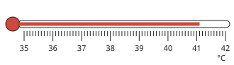

Answer: **41.1 °C**
- Typed **41** (whole) → “Read the small marks too: each is 0.1 °C.”
- Typed **41.01** (tenth) → “Each small mark is 0.1 °C, not 0.01 °C.”

Full working after a second miss:

> Each small mark on a clinical thermometer is 0.1 °C.  
> The end of the thread is at 41.1 °C.  

**Worked example** (draft)

> On an uncalibrated thermometer the thread is 2 cm long in melting ice and 22 cm long in steam. In a liquid it is 12 cm long. Find the temperature of the liquid.

1. The thread grows 22 − 2 = 20 cm for 100 °C.
2. In the liquid it has grown 12 − 2 = 10 cm above the ice point.
3. θ = ((12 − 2) ÷ (22 − 2)) × 100.

**Answer:** 50 °C

**Practice** `p4-2-how` · multiple choice, level 1 · **authored key**

> What is the constriction in a clinical thermometer for?

- ✅ It stops the mercury running back, so the reading can be taken after removal
- ◻️ It shows where normal body temperature is  
  _↳ feedback if chosen: Normal body temperature is shown by a mark on the scale, not by the constriction._
- ◻️ It makes the thermometer more sensitive  
  _↳ feedback if chosen: Sensitivity comes from the narrow bore and thin bulb, not the constriction._
- ◻️ It stops the mercury from escaping  
  _↳ feedback if chosen: The tube is sealed; the mercury cannot escape._

Full working after a second miss:

> The thread breaks at the constriction as the thermometer cools, so the highest reading stays.  
> So the answer is It stops the mercury running back, so the reading can be taken after removal.  

> Why is mercury or coloured alcohol used in a liquid-in-glass thermometer?

- ◻️ It turns to a gas as the temperature rises  
  _↳ feedback if chosen: The liquid must stay liquid over the whole range of the scale._
- ✅ It expands evenly when heated and is easy to see
- ◻️ It is the cheapest liquid available  
  _↳ feedback if chosen: Cost is not the reason; the liquid must expand evenly and be easy to see._
- ◻️ It never changes temperature  
  _↳ feedback if chosen: The liquid takes the temperature of its surroundings; that is how the thermometer works._

Full working after a second miss:

> A thermometric liquid expands by a steady amount for each degree, so the scale is evenly spaced.  
> So the answer is It expands evenly when heated and is easy to see.  

**Practice** `p4-2-clinical` · number, level 1 · computed by rule

> What temperature does this clinical thermometer read, in °C?

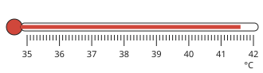

Answer: **41.6 °C**
- Typed **41** (whole) → “Read the small marks too: each is 0.1 °C.”
- Typed **41.06** (tenth) → “Each small mark is 0.1 °C, not 0.01 °C.”

Full working after a second miss:

> Each small mark on a clinical thermometer is 0.1 °C.  
> The end of the thread is at 41.6 °C.  

> What temperature does this clinical thermometer read, in °C?

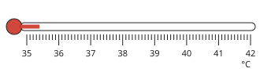

Answer: **35.4 °C**
- Typed **35** (whole) → “Read the small marks too: each is 0.1 °C.”
- Typed **35.04** (tenth) → “Each small mark is 0.1 °C, not 0.01 °C.”

Full working after a second miss:

> Each small mark on a clinical thermometer is 0.1 °C.  
> The end of the thread is at 35.4 °C.  

**Practice** `p4-2-points` · number, level 2 · computed by rule

> On an uncalibrated thermometer the thread is 5 cm in melting ice and 15 cm in steam. What temperature does a thread of 13 cm show, in °C?

Answer: **80 °C**
- Typed **86.666666667** (nolo) → “Measure both lengths from the ice point: subtract 5 from each.”
- Typed **8** (length) → “8 cm is a length, not a temperature: compare it with the whole range.”

Full working after a second miss:

> The whole range 15 − 5 = 10 cm stands for 100 °C.  
> The thread has risen 13 − 5 = 8 cm above the ice point.  
> θ = (8 ÷ 10) × 100 = 80 °C.  

> On an uncalibrated thermometer the thread is 4 cm in melting ice and 29 cm in steam. What temperature does a thread of 21.5 cm show, in °C?

Answer: **70 °C**
- Typed **74.137931034** (nolo) → “Measure both lengths from the ice point: subtract 4 from each.”
- Typed **17.5** (length) → “17.5 cm is a length, not a temperature: compare it with the whole range.”

Full working after a second miss:

> The whole range 29 − 4 = 25 cm stands for 100 °C.  
> The thread has risen 21.5 − 4 = 17.5 cm above the ice point.  
> θ = (17.5 ÷ 25) × 100 = 70 °C.  

**Practice** `p4-2-compare` · multiple choice, level 2 · computed by rule

> Which thermometer would you choose to measure the temperature of melting ice in the laboratory?

- ◻️ Either one works equally well  
  _↳ feedback if chosen: The two have different ranges and accuracies, so the choice matters._
- ◻️ A clinical thermometer  
  _↳ feedback if chosen: A clinical thermometer only reads 35 °C to 42 °C._
- ✅ A laboratory thermometer
- ◻️ Neither: use your hand  
  _↳ feedback if chosen: A hand cannot give a number, and it is unreliable._

Full working after a second miss:

> 0 °C is far below the range of a clinical thermometer, which starts at 35 °C.  
> So the answer is: A laboratory thermometer.  

> Which thermometer would you choose to take the temperature of a sick child?

- ◻️ Neither: use your hand  
  _↳ feedback if chosen: A hand cannot give a number, and it is unreliable._
- ◻️ Either one works equally well  
  _↳ feedback if chosen: The two have different ranges and accuracies, so the choice matters._
- ◻️ A laboratory thermometer  
  _↳ feedback if chosen: A laboratory thermometer cannot be read to 0.1 °C and does not hold its reading._
- ✅ A clinical thermometer

Full working after a second miss:

> Body temperature changes by very little, so a short range read to 0.1 °C is needed, and the reading must stay after the thermometer is taken out.  
> So the answer is: A clinical thermometer.  

**Practice** `p4-2-steps` · ordering, level 3 · computed by rule

> Put the steps of calibrating a thermometer in order.

Shown as: Put the bulb in pure melting ice and mark the thread when it is steady · Divide the distance between the two marks into 100 equal parts · Label that mark 0 °C · Label that mark 100 °C · Hold the bulb in steam above boiling water and mark the thread when it is steady
Correct order: Put the bulb in pure melting ice and mark the thread when it is steady → Label that mark 0 °C → Hold the bulb in steam above boiling water and mark the thread when it is steady → Label that mark 100 °C → Divide the distance between the two marks into 100 equal parts

Full working after a second miss:

> The correct order is: Put the bulb in pure melting ice and mark the thread when it is steady → Label that mark 0 °C → Hold the bulb in steam above boiling water and mark the thread when it is steady → Label that mark 100 °C → Divide the distance between the two marks into 100 equal parts.  

> Put the steps of reading a laboratory thermometer correctly in order.

Shown as: Put your eye level with the end of the thread, to avoid a parallax error · Read the scale to the nearest mark · Put the bulb well into the liquid, not touching the bottom or the sides · Wait until the thread stops moving · Stir the liquid gently so that it is at one temperature throughout
Correct order: Put the bulb well into the liquid, not touching the bottom or the sides → Stir the liquid gently so that it is at one temperature throughout → Wait until the thread stops moving → Put your eye level with the end of the thread, to avoid a parallax error → Read the scale to the nearest mark

Full working after a second miss:

> The correct order is: Put the bulb well into the liquid, not touching the bottom or the sides → Stir the liquid gently so that it is at one temperature throughout → Wait until the thread stops moving → Put your eye level with the end of the thread, to avoid a parallax error → Read the scale to the nearest mark.  

## Lesson 3: Calorimetry: Definition of heat capacity and specific heat capacity. Measurement of specific heat capacity, c for a solid using Q = mc∆θ

Prerequisites: 1 · Skill: p4-3 (Define heat capacity and specific heat capacity; measure c for a solid)

**Note** (draft)

> Heat capacity C of a body is the heat needed to raise its temperature by 1 K: C = Q/Δθ, in J/K.
> Specific heat capacity c of a material is the heat needed to raise 1 kg of it by 1 K: c = Q/(mΔθ), in J/(kg·K).
> So Q = mcΔθ.
> Water has a high specific heat capacity, 4200 J/(kg·K): it warms and cools slowly and makes a good coolant.
> Method of mixtures for a solid: heat the solid in boiling water, move it quickly to a known mass of water in a calorimeter, stir, and take the highest temperature. Then heat lost by the solid = heat gained by the water and calorimeter.

**Learn: Your goal and connections** (draft)

> By the end, you should be able to use Q = mcΔθ to find heat, mass, temperature change or specific heat capacity, and describe how c is measured for a solid.
> Builds on: Lesson 1 (heat and temperature) and Form Three energy calculations.
> Leads to: Lesson 4 (c for a liquid) and Lesson 5, where heat changes the state instead of the temperature.

**Learn: Two capacities** (draft)

> Heat capacity C is for a whole body: the heat needed to raise its temperature by 1 K. C = Q ÷ Δθ, measured in J/K. A big kettle of water has a larger heat capacity than a small cup.
> Specific heat capacity c is per kilogram: the heat needed to raise 1 kg of a material by 1 K. c = Q ÷ (mΔθ), in J/(kg·K). It depends only on the material.
> Rearranged: Q = mcΔθ.
> Water has c = 4200 J/(kg·K), much higher than most materials (900 for aluminium, 400 for copper). So water warms slowly, cools slowly, and carries away a lot of heat as a coolant in a car engine.

**Learn: Measuring c for a solid** (draft)

> • Find the mass of the metal block, and of the water and the calorimeter.
> • Heat the block in boiling water until it is at 100 °C.
> • Transfer it quickly into the cool water in the calorimeter, and stir.
> • Take the highest temperature reached.
> Then heat lost by the block = heat gained by the water (and the calorimeter):
> m_block × c × (θ_hot − θ_final) = m_water × 4200 × (θ_final − θ_cold).
> Working quickly and lagging the calorimeter reduce heat lost to the room, which is the main source of error.

**Learn: key words and examples** (draft)

- **heat capacity**: heat for a rise of 1 K in a body, in J/K
- **specific heat capacity**: heat for a rise of 1 K in 1 kg, in J/(kg·K)
- **calorimeter**: a metal can used to hold liquid in a heat experiment
- **method of mixtures**: finding c by mixing a hot body with a cold one

- 1 kg of water, rise 10 K: Q = 42 000 J
- 0.5 kg of aluminium, rise 20 K: Q = 9000 J

Common mistake: “Q = mcΔθ with Δθ in kelvin needs the temperatures changed to K first” → “a temperature CHANGE is the same in °C and K”. 80 °C − 20 °C = 60 °C, and in kelvin 353 − 293 = 60 K. Use the difference as it is.

**Card c4p3-1** (draft)

> Heat capacity C = Q/Δθ is for a whole body, in J/K; specific heat capacity c = Q/(mΔθ) is per kilogram, in J/(kg·K).
>
> _2 kg of water: c = 4200 J/(kg·K), so C = 8400 J/K_  

Check question: `p4-3-define` · multiple choice, level 1 · **authored key**, reused from practice

> Why is water used as the coolant in a car engine?

- ✅ It has a high specific heat capacity, so it carries away a lot of heat for a small rise in temperature
- ◻️ It has a low specific heat capacity, so it heats up quickly  
  _↳ feedback if chosen: A low value would mean it heated quickly and carried away little heat._
- ◻️ It never boils inside an engine  
  _↳ feedback if chosen: Water can boil in an engine, which is why the system is kept under pressure._
- ◻️ It conducts heat better than any metal  
  _↳ feedback if chosen: Metals conduct far better than water; what matters here is the heat water can carry away._

Full working after a second miss:

> With c = 4200 J/(kg·K), each kilogram takes in 4200 J for every degree it rises.  
> So the answer is It has a high specific heat capacity, so it carries away a lot of heat for a small rise in temperature.  

**Card c4p3-2** (draft)

> Q = mcΔθ: heat = mass × specific heat capacity × temperature change.
>
> _0.5 kg of water warmed by 20 K: Q = 0.5 × 4200 × 20 = 42 000 J_  

Check question: `p4-3-q` · number, level 1 · computed by rule, reused from practice

> Find the heat needed to raise 1 kg of water, c = 4200 J/(kg·K), by 10 K.

Answer: **42 000 J**
- Typed **4200** (nodt) → “Multiply by the temperature change 10 K as well.”

Full working after a second miss:

> Q = mcΔθ.  
> Q = 1 × 4200 × 10 = 42 000 J.  

**Card c4p3-3** (draft)

> In the method of mixtures, heat lost by the hot body = heat gained by the cold one.
>
> _hot metal into cool water: m₁c₁(θ₁ − θ) = m₂c₂(θ − θ₂)_  

Check question: `p4-3-mix-card` · number, level 1 · computed by rule

> A 0.2 kg metal block at 100 °C is dropped into 0.4 kg of water at 26 °C. The final temperature is 37 °C. Taking c for water as 4200 J/(kg·K) and ignoring the calorimeter, find c for the metal, in J/(kg·K).

Answer: **1467 J/(kg·K)**
- Typed **12 027** (swap) → “The water GAINS heat (its temperature rises) and the metal LOSES it.”

Full working after a second miss:

> Heat gained by the water = 0.4 × 4200 × (37 − 26) = 18 480 J.  
> Heat lost by the metal = 0.2 × c × (100 − 37) = 12.6c.  
> Heat lost = heat gained, so c = 18 480 ÷ 12.6 = 1467 J/(kg·K).  

**Worked example** (draft)

> How much heat is needed to raise the temperature of 2 kg of copper, c = 400 J/(kg·K), by 15 K?

1. Q = mcΔθ.
2. Q = 2 × 400 × 15.
3. = 12 000 J.

**Answer:** 12 000 J

**Practice** `p4-3-define` · multiple choice, level 1 · **authored key**

> What is the heat capacity of a body?

- ◻️ The highest temperature the body can reach  
  _↳ feedback if chosen: A body has no highest temperature of this kind; heat capacity is an energy per kelvin._
- ◻️ The total heat energy stored in the body  
  _↳ feedback if chosen: Heat capacity is about the heat needed for a rise of 1 K, not the energy already stored._
- ◻️ The heat needed to raise 1 kg of it by 1 K  
  _↳ feedback if chosen: That is specific heat capacity, which is per kilogram and depends only on the material._
- ✅ The heat needed to raise the temperature of that whole body by 1 K

Full working after a second miss:

> C = Q ÷ Δθ, in J/K. A bigger body of the same material has a bigger heat capacity.  
> So the answer is The heat needed to raise the temperature of that whole body by 1 K.  

> Why is water used as the coolant in a car engine?

- ◻️ It never boils inside an engine  
  _↳ feedback if chosen: Water can boil in an engine, which is why the system is kept under pressure._
- ✅ It has a high specific heat capacity, so it carries away a lot of heat for a small rise in temperature
- ◻️ It conducts heat better than any metal  
  _↳ feedback if chosen: Metals conduct far better than water; what matters here is the heat water can carry away._
- ◻️ It has a low specific heat capacity, so it heats up quickly  
  _↳ feedback if chosen: A low value would mean it heated quickly and carried away little heat._

Full working after a second miss:

> With c = 4200 J/(kg·K), each kilogram takes in 4200 J for every degree it rises.  
> So the answer is It has a high specific heat capacity, so it carries away a lot of heat for a small rise in temperature.  

**Practice** `p4-3-q` · number, level 1 · computed by rule

> Find the heat needed to raise 2 kg of iron, c = 460 J/(kg·K), by 58 K.

Answer: **53 360 J**
- Typed **26 680** (nom) → “Multiply by the mass 2 kg as well.”
- Typed **920** (nodt) → “Multiply by the temperature change 58 K as well.”

Full working after a second miss:

> Q = mcΔθ.  
> Q = 2 × 460 × 58 = 53 360 J.  

> Find the heat needed to raise 2 kg of aluminium, c = 900 J/(kg·K), by 11 K.

Answer: **19 800 J**
- Typed **9900** (nom) → “Multiply by the mass 2 kg as well.”
- Typed **1800** (nodt) → “Multiply by the temperature change 11 K as well.”

Full working after a second miss:

> Q = mcΔθ.  
> Q = 2 × 900 × 11 = 19 800 J.  

**Practice** `p4-3-capacity` · number, level 2 · computed by rule

> A block has a heat capacity of 200 J/K. How much heat raises its temperature by 40 K?

Answer: **8000 J**
- Typed **5** (div) → “Multiply: more degrees need more heat.”
- Typed **200** (same) → “200 J raises it by only 1 K.”

Full working after a second miss:

> Heat capacity is the heat for a rise of 1 K.  
> For 40 K: Q = 200 × 40 = 8000 J.  

> A block has a heat capacity of 200 J/K. How much heat raises its temperature by 22 K?

Answer: **4400 J**
- Typed **9.090909091** (div) → “Multiply: more degrees need more heat.”
- Typed **200** (same) → “200 J raises it by only 1 K.”

Full working after a second miss:

> Heat capacity is the heat for a rise of 1 K.  
> For 22 K: Q = 200 × 22 = 4400 J.  

**Practice** `p4-3-c` · number, level 2 · computed by rule

> A 5 kg metal block takes in 64 000 J and its temperature rises by 32 K. Find its specific heat capacity, in J/(kg·K).

Answer: **400 J/(kg·K)**
- Typed **2000** (nom) → “Divide by the mass as well: c is per kilogram.”
- Typed **12 800** (nodt) → “Divide by the temperature change as well: c is per kelvin.”

Full working after a second miss:

> Q = mcΔθ, so c = Q ÷ (mΔθ).  
> c = 64 000 ÷ (5 × 32) = 64 000 ÷ 160.  
> c = 400 J/(kg·K).  

> A 4 kg metal block takes in 14 400 J and its temperature rises by 4 K. Find its specific heat capacity, in J/(kg·K).

Answer: **900 J/(kg·K)**
- Typed **3600** (nom) → “Divide by the mass as well: c is per kilogram.”
- Typed **3600** (nodt) → “Divide by the temperature change as well: c is per kelvin.”

Full working after a second miss:

> Q = mcΔθ, so c = Q ÷ (mΔθ).  
> c = 14 400 ÷ (4 × 4) = 14 400 ÷ 16.  
> c = 900 J/(kg·K).  

**Practice** `p4-3-mix` · number, level 3 · computed by rule

> A 0.2 kg metal block at 100 °C is dropped into 0.2 kg of water at 26 °C. The final temperature is 30 °C. Taking c for water as 4200 J/(kg·K) and ignoring the calorimeter, find c for the metal, in J/(kg·K).

Answer: **240 J/(kg·K)**
- Typed **73 500** (swap) → “The water GAINS heat (its temperature rises) and the metal LOSES it.”

Full working after a second miss:

> Heat gained by the water = 0.2 × 4200 × (30 − 26) = 3360 J.  
> Heat lost by the metal = 0.2 × c × (100 − 30) = 14c.  
> Heat lost = heat gained, so c = 3360 ÷ 14 = 240 J/(kg·K).  

> A 0.2 kg metal block at 90 °C is dropped into 0.5 kg of water at 25 °C. The final temperature is 42 °C. Taking c for water as 4200 J/(kg·K) and ignoring the calorimeter, find c for the metal, in J/(kg·K).

Answer: **3719 J/(kg·K)**
- Typed **4744** (swap) → “The water GAINS heat (its temperature rises) and the metal LOSES it.”

Full working after a second miss:

> Heat gained by the water = 0.5 × 4200 × (42 − 25) = 35 700 J.  
> Heat lost by the metal = 0.2 × c × (90 − 42) = 9.6c.  
> Heat lost = heat gained, so c = 35 700 ÷ 9.6 = 3719 J/(kg·K).  

## Lesson 4: Measurement of specific heat capacity, c for a liquid using Q = mc∆θ and calculations using Q = mc∆θ

Prerequisites: 3 · Skill: p4-4 (Measure the specific heat capacity of a liquid and calculate with Q = mcΔθ)

**Note** (draft)

> Electrical method for a liquid: a known mass of liquid in a lagged calorimeter is heated by an immersion heater.
> Electrical energy supplied = VIt (or power × time). If heat losses are ignored, VIt = (m_liquid c_liquid + m_cal c_cal)Δθ.
> Ignoring the calorimeter, c = VIt / (mΔθ).
> Reduce errors by lagging the calorimeter, stirring, and starting a few degrees below room temperature so that the gain and loss of heat roughly cancel.
> In any mixture problem: heat lost by the hot body = heat gained by the cold bodies.

**Learn: Your goal and connections** (draft)

> By the end, you should be able to find the specific heat capacity of a liquid by the electrical method and calculate heat, time or temperature change with Q = mcΔθ.
> Builds on: Lesson 3 (Q = mcΔθ and c for a solid) and Form Three electrical energy.
> Leads to: Lesson 5, where heat changes the state of a substance without changing its temperature.

**Learn: The electrical method** (draft)

> • Weigh the empty calorimeter, then weigh it again with the liquid: the difference is the mass of liquid.
> • Put in an immersion heater, a stirrer and a thermometer, and lag the calorimeter.
> • Take the starting temperature, switch on, and record the voltage V and current I.
> • After a measured time t, stir and take the highest temperature.
> Electrical energy supplied = VIt. If losses are ignored, VIt = mcΔθ, so c = VIt ÷ (mΔθ).
> A more careful answer includes the calorimeter: VIt = (m_liq c_liq + m_cal c_cal)Δθ.

**Learn: Errors and calculations** (draft)

> Heat escaping to the room is the main error. It makes Δθ smaller than it should be, so the calculated c comes out too large. Lagging, stirring, a lid and a short heating time all reduce it. Starting a few degrees below room temperature lets the heat gained at the start cancel the heat lost at the end.
> Typical calculations with Q = mcΔθ:
> • Heat needed: 1 kg of water by 50 K is 1 × 4200 × 50 = 210 000 J.
> • Time on a 2000 W heater: 210 000 ÷ 2000 = 105 s.
> • Rise given the heat: Δθ = Q ÷ (mc).

**Learn: key words and examples** (draft)

- **immersion heater**: an electric heater placed in the liquid
- **lagging**: insulation around a calorimeter to reduce heat loss
- **VIt**: electrical energy: voltage × current × time, in joules

- a 1000 W heater for 84 s gives 84 000 J
- 84 000 J into 1 kg of water raises it 20 K

Common mistake: “heat lost to the room makes the measured c too small” → “it makes the measured c too large”. The energy supplied is still counted in full, but the temperature rise is smaller, and c = VIt ÷ (mΔθ).

**Card c4p4-1** (draft)

> Electrical energy supplied = VIt, or power × time.
>
> _a 500 W heater for 60 s supplies 30 000 J_  

Check question: `p4-4-energy` · number, level 1 · computed by rule, reused from practice

> A heater of power 500 W runs for 562 s. How much energy does it supply, in joules?

Answer: **281 000 J**
- Typed **0.889679715** (div) → “Multiply power by time.”

Full working after a second miss:

> Energy = power × time.  
> = 500 × 562 = 281 000 J.  

**Card c4p4-2** (draft)

> Ignoring losses: VIt = mcΔθ, so c = VIt ÷ (mΔθ).
>
> _30 000 J into 0.5 kg raising it 20 K: c = 3000 J/(kg·K)_  

Check question: `p4-4-c-card` · number, level 1 · computed by rule

> A 250 W heater warms 1 kg of a liquid for 170 s; the temperature rises by 15 K. Find c for the liquid, in J/(kg·K).

Answer: **2833 J/(kg·K)**
- Typed **42 500** (nodt) → “Divide by the temperature change as well.”

Full working after a second miss:

> Energy supplied = 250 × 170 = 42 500 J.  
> c = Q ÷ (mΔθ) = 42 500 ÷ (1 × 15).  
> c = 2833 J/(kg·K).  

**Card c4p4-3** (draft)

> Lagging, stirring and a short heating time reduce heat lost to the room.
>
> _without lagging, the measured c comes out too large_  

Check question: `p4-4-error-card` · multiple choice, level 1 · **authored key**

> Why is the liquid stirred during the electrical method?

- ◻️ To stop the liquid from boiling  
  _↳ feedback if chosen: The liquid is not heated to its boiling point in this experiment._
- ✅ So that the whole liquid is at one temperature when the thermometer is read
- ◻️ To make the liquid heat up faster  
  _↳ feedback if chosen: Stirring moves heat about but does not add energy, so it does not speed up the heating._
- ◻️ To spread the electrical current through the liquid  
  _↳ feedback if chosen: The current stays in the heater; it does not pass through the liquid._

Full working after a second miss:

> Without stirring, the liquid near the heater is hotter than the rest and the reading is too high.  
> So the answer is So that the whole liquid is at one temperature when the thermometer is read.  

**Worked example** (draft)

> A 500 W heater warms 0.5 kg of a liquid for 120 s and the temperature rises by 28 K. Find the specific heat capacity of the liquid.

1. Energy supplied = power × time = 500 × 120 = 60 000 J.
2. Q = mcΔθ, so c = Q ÷ (mΔθ).
3. c = 60 000 ÷ (0.5 × 28) = 60 000 ÷ 14.

**Answer:** 4286 J/(kg·K)

**Practice** `p4-4-energy` · number, level 1 · computed by rule

> A heater of power 1500 W runs for 341 s. How much energy does it supply, in joules?

Answer: **511 500 J**
- Typed **4.398826979** (div) → “Multiply power by time.”

Full working after a second miss:

> Energy = power × time.  
> = 1500 × 341 = 511 500 J.  

> A heater of power 1000 W runs for 261 s. How much energy does it supply, in joules?

Answer: **261 000 J**
- Typed **3.831417625** (div) → “Multiply power by time.”

Full working after a second miss:

> Energy = power × time.  
> = 1000 × 261 = 261 000 J.  

**Practice** `p4-4-vit` · number, level 1 · computed by rule

> An immersion heater takes 3 A from a 12 V supply for 110 s. Find the electrical energy supplied, in joules.

Answer: **3960 J**
- Typed **36** (vi) → “Multiply by the time 110 s as well.”
- Typed **1320** (vt) → “Multiply by the current 3 A as well.”

Full working after a second miss:

> Energy = VIt.  
> = 12 × 3 × 110 = 3960 J.  

> An immersion heater takes 5 A from a 240 V supply for 299 s. Find the electrical energy supplied, in joules.

Answer: **358 800 J**
- Typed **1200** (vi) → “Multiply by the time 299 s as well.”
- Typed **71 760** (vt) → “Multiply by the current 5 A as well.”

Full working after a second miss:

> Energy = VIt.  
> = 240 × 5 × 299 = 358 800 J.  

**Practice** `p4-4-c` · number, level 2 · computed by rule

> A 500 W heater warms 1 kg of a liquid for 117 s; the temperature rises by 35 K. Find c for the liquid, in J/(kg·K).

Answer: **1671 J/(kg·K)**
- Typed **58 500** (nodt) → “Divide by the temperature change as well.”

Full working after a second miss:

> Energy supplied = 500 × 117 = 58 500 J.  
> c = Q ÷ (mΔθ) = 58 500 ÷ (1 × 35).  
> c = 1671 J/(kg·K).  

> A 100 W heater warms 0.5 kg of a liquid for 291 s; the temperature rises by 39 K. Find c for the liquid, in J/(kg·K).

Answer: **1492 J/(kg·K)**
- Typed **746** (nom) → “Divide by the mass as well.”
- Typed **58 200** (nodt) → “Divide by the temperature change as well.”

Full working after a second miss:

> Energy supplied = 100 × 291 = 29 100 J.  
> c = Q ÷ (mΔθ) = 29 100 ÷ (0.5 × 39).  
> c = 1492 J/(kg·K).  

**Practice** `p4-4-rise` · number, level 2 · computed by rule

> How long must a 1400 W heater run to raise 2 kg of water (c = 4200 J/(kg·K)) by 38 K, if no heat is lost?

Answer: **228 s**
- Typed **446 880 000** (mult) → “Divide the energy by the power to get the time.”
- Typed **0.054285714** (noc) → “Include the specific heat capacity 4200 J/(kg·K).”

Full working after a second miss:

> Heat needed Q = mcΔθ = 2 × 4200 × 38 = 319 200 J.  
> Time = Q ÷ power = 319 200 ÷ 1400 = 228 s.  

> How long must a 700 W heater run to raise 0.5 kg of water (c = 4200 J/(kg·K)) by 41 K, if no heat is lost?

Answer: **123 s**
- Typed **60 270 000** (mult) → “Divide the energy by the power to get the time.”
- Typed **0.029285714** (noc) → “Include the specific heat capacity 4200 J/(kg·K).”

Full working after a second miss:

> Heat needed Q = mcΔθ = 0.5 × 4200 × 41 = 86 100 J.  
> Time = Q ÷ power = 86 100 ÷ 700 = 123 s.  

**Practice** `p4-4-error` · multiple choice, level 3 · **authored key**

> Why is the experiment often started a few degrees below room temperature?

- ◻️ Cold liquid has a larger specific heat capacity  
  _↳ feedback if chosen: Specific heat capacity hardly changes over such a small range of temperature._
- ◻️ It makes the temperature rise larger  
  _↳ feedback if chosen: The rise measured is the same; what changes is how the losses cancel._
- ✅ Heat gained from the room at the start then roughly cancels the heat lost to it at the end
- ◻️ The heater works better in a cold liquid  
  _↳ feedback if chosen: The heater supplies the same power whatever the temperature of the liquid._

Full working after a second miss:

> Below room temperature heat flows in; above it heat flows out. Starting below makes the two roughly cancel.  
> So the answer is Heat gained from the room at the start then roughly cancels the heat lost to it at the end.  

> Why is the liquid stirred during the electrical method?

- ◻️ To stop the liquid from boiling  
  _↳ feedback if chosen: The liquid is not heated to its boiling point in this experiment._
- ◻️ To make the liquid heat up faster  
  _↳ feedback if chosen: Stirring moves heat about but does not add energy, so it does not speed up the heating._
- ◻️ To spread the electrical current through the liquid  
  _↳ feedback if chosen: The current stays in the heater; it does not pass through the liquid._
- ✅ So that the whole liquid is at one temperature when the thermometer is read

Full working after a second miss:

> Without stirring, the liquid near the heater is hotter than the rest and the reading is too high.  
> So the answer is So that the whole liquid is at one temperature when the thermometer is read.  

## Lesson 5: Latent Heat and specific Latent heat: Definitions and calculations using Q = ml. Cooling effect of evaporation

Prerequisites: 3 · Skill: p4-5 (Use specific latent heat; explain the cooling effect of evaporation)

**Note** (draft)

> Latent heat is the heat taken in or given out when a substance changes state, with no change of temperature. The energy goes into separating the particles, not into speeding them up.
> Specific latent heat of fusion l_f: the heat needed to change 1 kg of a solid into liquid at its melting point. For ice, 336 000 J/kg.
> Specific latent heat of vaporisation l_v: the heat needed to change 1 kg of a liquid into gas at its boiling point. For water, 2 260 000 J/kg.
> Q = ml.
> Evaporation cools: the fastest particles escape from the surface, so the average energy of those left falls. This is why sweating cools the body and why water in a clay pot stays cool.

**Learn: Your goal and connections** (draft)

> By the end, you should be able to calculate heat with Q = ml, combine it with Q = mcΔθ, and explain why evaporation cools.
> Builds on: Lesson 3 (Q = mcΔθ) and Form One changes of state.
> Leads to: Lesson 6 (how heat moves) and the cooling methods used in food storage.

**Learn: Heat with no temperature change** (draft)

> Heat ice steadily and its temperature rises to 0 °C. Then it stops rising, even though heating continues, until all the ice has melted.
> That heat is latent (hidden) heat: it separates the particles instead of speeding them up.
> • Specific latent heat of fusion, l_f: heat to melt 1 kg at the melting point. Ice: 336 000 J/kg.
> • Specific latent heat of vaporisation, l_v: heat to boil 1 kg at the boiling point. Water: 2 260 000 J/kg.
> Q = ml. Changing 0.5 kg of ice to water needs 0.5 × 336 000 = 168 000 J.
> A problem with both stages adds them: melt first with ml, then warm with mcΔθ.

**Learn: Evaporation and cooling** (draft)

> In a liquid some particles move faster than others. At the surface, the fastest can escape. Those left behind have a lower average energy, so the liquid cools. This happens at any temperature, not only at the boiling point.
> Everyday examples:
> • Sweat evaporating from the skin takes latent heat from the body and cools it.
> • Water in a porous clay pot seeps out and evaporates, keeping the water inside cool.
> • Spirit on the skin feels cold because it evaporates quickly.
> Evaporation is faster when it is hotter, windier, drier, or the surface area is larger.

**Learn: key words and examples** (draft)

- **latent heat**: heat taken in or given out at constant temperature during a change of state
- **fusion**: melting: solid to liquid
- **vaporisation**: boiling or evaporating: liquid to gas
- **evaporation**: escape of the fastest particles from a liquid surface, at any temperature

- melting 1 kg of ice: 336 000 J
- boiling 0.1 kg of water: 226 000 J

Common mistake: “melting 2 kg of ice: Q = mcΔθ = 2 × 4200 × 0” → “Q = ml = 2 × 336 000 = 672 000 J”. There is no temperature change during melting, so mcΔθ gives zero. A change of state uses Q = ml.

**Card c4p5-1** (draft)

> During a change of state the temperature does not change: the heat separates the particles.
>
> _ice at 0 °C melting to water at 0 °C_  

Check question: `p4-5-flat` · multiple choice, level 1 · **authored key**, reused from practice

> Where does the energy go while ice is melting at 0 °C?

- ✅ It separates the particles from their fixed positions
- ◻️ It is stored as temperature  
  _↳ feedback if chosen: Temperature is not a store of energy; it is the degree of hotness._
- ◻️ It makes the particles move faster  
  _↳ feedback if chosen: Faster particles would mean a higher temperature, but the temperature stays the same._
- ◻️ It is destroyed  
  _↳ feedback if chosen: Energy is never destroyed; it changes form or place._

Full working after a second miss:

> Latent heat does the work of breaking the forces holding the particles in place.  
> So the answer is It separates the particles from their fixed positions.  

**Card c4p5-2** (draft)

> Q = ml, with l the specific latent heat in J/kg.
>
> _melting 2 kg of ice: Q = 2 × 336 000 = 672 000 J_  

Check question: `p4-5-q` · number, level 1 · computed by rule, reused from practice

> Find the heat needed to melt 0.2 kg of ice at its melting point. (l_f = 336 000 J/kg.)

Answer: **67 200 J**
- Typed **1 680 000** (div) → “Multiply the mass by the specific latent heat.”
- Typed **84 000** (mc) → “Melting is a change of state: use Q = ml, not Q = mcΔθ.”

Full working after a second miss:

> Q = ml.  
> Q = 0.2 × 336 000 = 67 200 J.  

**Card c4p5-3** (draft)

> Evaporation cools because the fastest particles leave the surface.
>
> _sweat evaporating takes latent heat from the skin_  

Check question: `p4-5-evap-card` · multiple choice, level 1 · **authored key**

> Why does sweating cool the body?

- ◻️ Sweat carries heat away as a liquid running off  
  _↳ feedback if chosen: Sweat that runs off without evaporating cools very little; that is why a humid day feels worse._
- ◻️ Sweat is colder than the body  
  _↳ feedback if chosen: Sweat leaves the body at body temperature; it is not cold._
- ◻️ Sweating uses up energy in the muscles  
  _↳ feedback if chosen: The cooling happens at the skin surface, not in the muscles._
- ✅ The sweat evaporates and takes latent heat from the skin

Full working after a second miss:

> The fastest particles escape from the sweat, so the skin loses energy and cools.  
> So the answer is The sweat evaporates and takes latent heat from the skin.  

**Worked example** (draft)

> How much heat is needed to melt 0.5 kg of ice at 0 °C? (l_f = 336 000 J/kg.)

1. The ice is already at its melting point, so all the heat goes into melting it.
2. Q = ml.
3. Q = 0.5 × 336 000 = 168 000 J.

**Answer:** 168 000 J

**Practice** `p4-5-flat` · multiple choice, level 1 · **authored key**

> Where does the energy go while ice is melting at 0 °C?

- ◻️ It makes the particles move faster  
  _↳ feedback if chosen: Faster particles would mean a higher temperature, but the temperature stays the same._
- ✅ It separates the particles from their fixed positions
- ◻️ It is stored as temperature  
  _↳ feedback if chosen: Temperature is not a store of energy; it is the degree of hotness._
- ◻️ It is destroyed  
  _↳ feedback if chosen: Energy is never destroyed; it changes form or place._

Full working after a second miss:

> Latent heat does the work of breaking the forces holding the particles in place.  
> So the answer is It separates the particles from their fixed positions.  

> Where does the energy go while ice is melting at 0 °C?

- ◻️ It makes the particles move faster  
  _↳ feedback if chosen: Faster particles would mean a higher temperature, but the temperature stays the same._
- ✅ It separates the particles from their fixed positions
- ◻️ It is stored as temperature  
  _↳ feedback if chosen: Temperature is not a store of energy; it is the degree of hotness._
- ◻️ It is destroyed  
  _↳ feedback if chosen: Energy is never destroyed; it changes form or place._

Full working after a second miss:

> Latent heat does the work of breaking the forces holding the particles in place.  
> So the answer is It separates the particles from their fixed positions.  

**Practice** `p4-5-q` · number, level 1 · computed by rule

> Find the heat needed to melt 0.2 kg of ice at its melting point. (l_f = 336 000 J/kg.)

Answer: **67 200 J**
- Typed **1 680 000** (div) → “Multiply the mass by the specific latent heat.”
- Typed **84 000** (mc) → “Melting is a change of state: use Q = ml, not Q = mcΔθ.”

Full working after a second miss:

> Q = ml.  
> Q = 0.2 × 336 000 = 67 200 J.  

> Find the heat needed to melt 0.1 kg of ice at its melting point. (l_f = 336 000 J/kg.)

Answer: **33 600 J**
- Typed **3 360 000** (div) → “Multiply the mass by the specific latent heat.”
- Typed **42 000** (mc) → “Melting is a change of state: use Q = ml, not Q = mcΔθ.”

Full working after a second miss:

> Q = ml.  
> Q = 0.1 × 336 000 = 33 600 J.  

**Practice** `p4-5-vap` · number, level 2 · computed by rule

> Find the heat needed to turn 1 kg of water at 100 °C into steam at 100 °C. (l_v = 2 260 000 J/kg.)

Answer: **2 260 000 J**
- Typed **336 000** (fusion) → “336 000 J/kg is for melting ice. Boiling water uses l_v = 2 260 000 J/kg.”
- Typed **420 000** (mc) → “Boiling at a constant 100 °C is a change of state: Q = ml.”

Full working after a second miss:

> The water is already at the boiling point, so Q = ml.  
> Q = 1 × 2 260 000 = 2 260 000 J.  

> Find the heat needed to turn 0.1 kg of water at 100 °C into steam at 100 °C. (l_v = 2 260 000 J/kg.)

Answer: **226 000 J**
- Typed **33 600** (fusion) → “336 000 J/kg is for melting ice. Boiling water uses l_v = 2 260 000 J/kg.”
- Typed **42 000** (mc) → “Boiling at a constant 100 °C is a change of state: Q = ml.”

Full working after a second miss:

> The water is already at the boiling point, so Q = ml.  
> Q = 0.1 × 2 260 000 = 226 000 J.  

**Practice** `p4-5-both` · number, level 2 · computed by rule

> How much heat changes 0.5 kg of ice at 0 °C into water at 64 °C? (l_f = 336 000 J/kg, c = 4200 J/(kg·K).)

Answer: **302 400 J**
- Typed **168 000** (melt) → “The water must also be warmed from 0 °C to 64 °C.”
- Typed **134 400** (warm) → “The ice must first be melted at 0 °C.”

Full working after a second miss:

> First melt the ice: Q₁ = ml = 0.5 × 336 000 = 168 000 J.  
> Then warm the water: Q₂ = mcΔθ = 0.5 × 4200 × 64 = 134 400 J.  
> Total = 168 000 + 134 400 = 302 400 J.  

> How much heat changes 0.2 kg of ice at 0 °C into water at 75 °C? (l_f = 336 000 J/kg, c = 4200 J/(kg·K).)

Answer: **130 200 J**
- Typed **67 200** (melt) → “The water must also be warmed from 0 °C to 75 °C.”
- Typed **63 000** (warm) → “The ice must first be melted at 0 °C.”

Full working after a second miss:

> First melt the ice: Q₁ = ml = 0.2 × 336 000 = 67 200 J.  
> Then warm the water: Q₂ = mcΔθ = 0.2 × 4200 × 75 = 63 000 J.  
> Total = 67 200 + 63 000 = 130 200 J.  

**Practice** `p4-5-evap` · multiple choice, level 3 · **authored key**

> Why does sweating cool the body?

- ◻️ Sweat is colder than the body  
  _↳ feedback if chosen: Sweat leaves the body at body temperature; it is not cold._
- ◻️ Sweating uses up energy in the muscles  
  _↳ feedback if chosen: The cooling happens at the skin surface, not in the muscles._
- ✅ The sweat evaporates and takes latent heat from the skin
- ◻️ Sweat carries heat away as a liquid running off  
  _↳ feedback if chosen: Sweat that runs off without evaporating cools very little; that is why a humid day feels worse._

Full working after a second miss:

> The fastest particles escape from the sweat, so the skin loses energy and cools.  
> So the answer is The sweat evaporates and takes latent heat from the skin.  

> Why does methylated spirit on the back of the hand feel colder than water does?

- ◻️ It is stored at a lower temperature  
  _↳ feedback if chosen: Both liquids are at room temperature before they are used._
- ◻️ It conducts heat better than water  
  _↳ feedback if chosen: Conduction is not the main effect here; the rate of evaporation is._
- ◻️ It is a better insulator than water  
  _↳ feedback if chosen: An insulator would slow the loss of heat, not speed it up._
- ✅ It evaporates faster, so it takes latent heat from the skin more quickly

Full working after a second miss:

> A liquid that evaporates quickly takes its latent heat from the skin quickly, so the skin cools fast.  
> So the answer is It evaporates faster, so it takes latent heat from the skin more quickly.  

## Lesson 6: Heat Transfer by Conduction, Convection and Radiation and their applications

Prerequisites: 1 · Skill: p4-6 (Explain conduction, convection and radiation and their applications)

**Note** (draft)

> Conduction: heat passes through a material from particle to particle, without the material moving as a whole. Metals conduct best because they have free electrons; air, wood, plastic and water are poor conductors (insulators).
> Convection: heat is carried by a moving fluid. Warmed fluid expands, becomes less dense and rises; cooler fluid sinks to take its place, making a convection current. It happens only in liquids and gases.
> Radiation: heat travels as electromagnetic waves and needs no material medium, so it crosses a vacuum. Dull black surfaces absorb and emit best; shiny light surfaces reflect.
> Applications: cooking pots (conduction), heating water from below and ventilation (convection), the Sun's energy and a vacuum flask (radiation).

**Learn: Your goal and connections** (draft)

> By the end, you should be able to name and explain the three ways heat moves and use them to explain everyday devices.
> Builds on: Lesson 1 (heat flows from hot to cold) and Form Two particles and density.
> Leads to: Lesson 7 (expansion) and the design of cooking, cooling and solar devices.

**Learn: Conduction and convection** (draft)

> Conduction: heat passes along a material from particle to particle, while the material itself stays put. The hot particles vibrate more and pass the energy on. In a metal, free electrons carry it much faster, so metals are good conductors. Air, wood, plastic, cloth and water are poor conductors, or insulators.
> Convection: in a liquid or a gas, the warmed fluid expands, becomes less dense and rises; cooler, denser fluid sinks to replace it. The circulation is a convection current, and it carries the heat with the moving fluid.
> That is why a water heater is placed at the bottom of the tank and the freezer at the top of a refrigerator.

**Learn: Radiation and applications** (draft)

> Radiation is heat travelling as electromagnetic waves. It needs no material medium, so it crosses the vacuum of space: that is how the Sun's energy reaches us.
> • Dull black surfaces are the best absorbers and the best emitters.
> • Shiny, light surfaces reflect radiation and are poor emitters.
> Uses: solar water-heater pipes are painted dull black to absorb; light clothes are worn in the sun to reflect; a vacuum flask is silvered to reflect radiation, with a vacuum to stop conduction and convection and a stopper to stop evaporation.

**Learn: key words and examples** (draft)

- **conduction**: heat passed from particle to particle in a material
- **convection**: heat carried by a moving fluid
- **radiation**: heat travelling as waves, needing no medium
- **insulator**: a poor conductor of heat

- a metal spoon in soup: conduction
- a heater at the bottom of a tank: convection
- the Sun warming your face: radiation

Common mistake: “heat from the Sun reaches us by conduction through the air” → “it reaches us by radiation”. Space between the Sun and the atmosphere is almost empty: only radiation can cross a vacuum.

**Card c4p6-1** (draft)

> Conduction passes heat from particle to particle in a solid; metals are best because of their free electrons.
>
> _a metal spoon in hot soup soon feels hot at the handle; a wooden one does not_  

Check question: `p4-6-which` · multiple choice, level 1 · **authored key**, reused from practice

> A metal spoon left in hot soup becomes hot at the handle. Which method of heat transfer is this?

- ◻️ Radiation  
  _↳ feedback if chosen: Radiation needs no contact, but here the heat travels through the metal itself._
- ✅ Conduction
- ◻️ Evaporation  
  _↳ feedback if chosen: Evaporation is a change of state at a liquid surface, not a way of carrying heat along a spoon._
- ◻️ Convection  
  _↳ feedback if chosen: Convection needs a fluid to move; the spoon is solid and stays still._

Full working after a second miss:

> In a solid, heat passes from particle to particle and, in a metal, by free electrons: that is conduction.  
> So the answer is Conduction.  

**Card c4p6-2** (draft)

> Convection carries heat in a moving fluid: warm fluid rises because it is less dense.
>
> _a heater at the bottom of a tank warms all the water; one at the top does not_  

Check question: `p4-6-convect` · multiple choice, level 1 · **authored key**, reused from practice

> Smoke is held over one chimney of a box with two chimneys and a candle under the other. What is seen, and why?

- ◻️ The smoke rises straight up from both chimneys  
  _↳ feedback if chosen: Air leaves above the candle, so smoke cannot rise from that chimney._
- ◻️ The smoke stays still above the box  
  _↳ feedback if chosen: The candle sets the air moving, so the smoke does move._
- ✅ The smoke is drawn down one chimney and out of the other, showing a convection current
- ◻️ The smoke is blown away from the box  
  _↳ feedback if chosen: Nothing blows the smoke away; the current pulls it in._

Full working after a second miss:

> Warm air above the candle rises and leaves, so cooler air (with the smoke) is drawn down the other chimney.  
> So the answer is The smoke is drawn down one chimney and out of the other, showing a convection current.  

**Card c4p6-3** (draft)

> Radiation needs no medium and crosses a vacuum; dull black absorbs and emits best.
>
> _heat from the Sun reaches us through empty space_  

Check question: `p4-6-radiate-card` · multiple choice, level 1 · **authored key**

> Two cans of hot water are alike except that one is dull black and the other shiny silver. Which cools faster?

- ◻️ The shiny one, because shiny metal conducts heat away  
  _↳ feedback if chosen: The cans are the same metal; the paint changes how well they emit, not how they conduct._
- ✅ The dull black one, because a dull black surface is a better emitter of radiation
- ◻️ Both cool at the same rate  
  _↳ feedback if chosen: The surfaces differ, so they radiate at different rates._
- ◻️ The dull black one, because black absorbs more heat  
  _↳ feedback if chosen: These cans are hotter than the room, so they are emitting. The answer is right but the reason is not._

Full working after a second miss:

> Both lose heat by conduction and convection alike; the dull black surface emits radiation best.  
> So the answer is The dull black one, because a dull black surface is a better emitter of radiation.  

**Worked example** (draft)

> Explain how a vacuum flask keeps a hot drink hot.

1. The vacuum between the double walls has no particles, so conduction and convection cannot cross it.
2. Both glass surfaces are silvered: shiny surfaces are poor emitters and reflect radiation back.
3. The stopper closes the top, stopping convection and evaporation.
4. The thin glass walls and the plastic case reduce the little conduction that is left.

**Answer:** the vacuum stops conduction and convection; the silvering reflects radiation; the stopper stops evaporation

**Practice** `p4-6-which` · multiple choice, level 1 · **authored key**

> How does heat from the Sun reach the Earth?

- ◻️ By all three methods equally  
  _↳ feedback if chosen: Only one of the three can cross a vacuum, so they are not equal here._
- ✅ By radiation, which needs no material medium
- ◻️ By conduction through the air  
  _↳ feedback if chosen: There is almost no matter between the Sun and the atmosphere to conduct through._
- ◻️ By convection currents in space  
  _↳ feedback if chosen: Convection needs a fluid to move; space is very nearly empty._

Full working after a second miss:

> Radiation is electromagnetic waves, so it can cross a vacuum. Conduction and convection cannot.  
> So the answer is By radiation, which needs no material medium.  

> Why is the heating element of a water heater placed near the bottom of the tank?

- ◻️ To keep the element away from the steam  
  _↳ feedback if chosen: Keeping it away from steam is not the reason for heating from below._
- ◻️ Because heat cannot travel downwards at all  
  _↳ feedback if chosen: Heat can travel downwards by conduction and radiation; the point is that warm water rises._
- ✅ So that the warm water rises and sets up a convection current
- ◻️ So that the heat can radiate upwards  
  _↳ feedback if chosen: Radiation travels in all directions and is not the main effect in water._

Full working after a second miss:

> Warm water expands, becomes less dense and rises, while cooler water sinks to take its place: a convection current heats the whole tank.  
> So the answer is So that the warm water rises and sets up a convection current.  

**Practice** `p4-6-convect` · multiple choice, level 1 · **authored key**

> Why does warm water rise in a convection current?

- ◻️ Heat always travels upwards  
  _↳ feedback if chosen: Heat travels in all directions; here it is the moving fluid that carries it upwards._
- ◻️ Warm water is heavier than cold water  
  _↳ feedback if chosen: Warming expands water, so it becomes LESS dense, not heavier._
- ◻️ The water is pushed up by the heater  
  _↳ feedback if chosen: The heater does not push the water; the difference in density does._
- ✅ It expands, so the same mass fills a larger volume and its density falls

Full working after a second miss:

> Density = mass ÷ volume, and less dense fluid floats above denser fluid.  
> So the answer is It expands, so the same mass fills a larger volume and its density falls.  

> Smoke is held over one chimney of a box with two chimneys and a candle under the other. What is seen, and why?

- ◻️ The smoke stays still above the box  
  _↳ feedback if chosen: The candle sets the air moving, so the smoke does move._
- ◻️ The smoke is blown away from the box  
  _↳ feedback if chosen: Nothing blows the smoke away; the current pulls it in._
- ✅ The smoke is drawn down one chimney and out of the other, showing a convection current
- ◻️ The smoke rises straight up from both chimneys  
  _↳ feedback if chosen: Air leaves above the candle, so smoke cannot rise from that chimney._

Full working after a second miss:

> Warm air above the candle rises and leaves, so cooler air (with the smoke) is drawn down the other chimney.  
> So the answer is The smoke is drawn down one chimney and out of the other, showing a convection current.  

**Practice** `p4-6-radiate` · multiple choice, level 2 · **authored key**

> Why can radiation reach the Earth from the Sun?

- ◻️ Space is full of particles that pass it along  
  _↳ feedback if chosen: Space is nearly empty, so there is nothing to pass heat along._
- ◻️ The air between carries it by conduction  
  _↳ feedback if chosen: There is almost no matter between the Sun and the atmosphere to conduct through._
- ◻️ Convection currents cross space  
  _↳ feedback if chosen: Convection needs a fluid to flow; space is very nearly empty._
- ✅ Radiation is electromagnetic waves, which need no material medium

Full working after a second miss:

> Only radiation can cross a vacuum; conduction and convection both need particles.  
> So the answer is Radiation is electromagnetic waves, which need no material medium.  

> A roof is painted shiny white instead of dull black. What is the effect inside the building?

- ◻️ It stays cooler, because white conducts heat away faster  
  _↳ feedback if chosen: The colour changes how much radiation is absorbed, not how well the roof conducts._
- ◻️ It becomes hotter, because white absorbs more radiation  
  _↳ feedback if chosen: Dull dark surfaces absorb best; white reflects._
- ✅ It stays cooler, because the roof reflects more of the Sun's radiation
- ◻️ There is no change, because the roof is the same material  
  _↳ feedback if chosen: The surface decides how much radiation is absorbed, whatever the material beneath._

Full working after a second miss:

> Shiny light surfaces reflect radiation, so less of the Sun's energy enters the building.  
> So the answer is It stays cooler, because the roof reflects more of the Sun's radiation.  

**Practice** `p4-6-apply` · multiple choice, level 2 · computed by rule

> Why do people wear light-coloured clothes in hot sunshine?

- ✅ Light surfaces reflect much of the radiation instead of absorbing it
- ◻️ Dark colours stop sweat evaporating  
  _↳ feedback if chosen: A dull dark surface absorbs radiation best, so light colours keep the wearer cooler._
- ◻️ Light cloth is always thinner  
  _↳ feedback if chosen: A dull dark surface absorbs radiation best, so light colours keep the wearer cooler._
- ◻️ Light colours conduct heat away faster  
  _↳ feedback if chosen: A dull dark surface absorbs radiation best, so light colours keep the wearer cooler._

Full working after a second miss:

> A dull dark surface absorbs radiation best, so light colours keep the wearer cooler.  
> So the answer is: Light surfaces reflect much of the radiation instead of absorbing it.  

> Why does a room need vents near the ceiling and near the floor?

- ◻️ Radiation can only pass through high openings  
  _↳ feedback if chosen: Warm air rises and leaves through the upper vent, drawing cooler air in at the bottom._
- ◻️ Heat is conducted out through the vents  
  _↳ feedback if chosen: Warm air rises and leaves through the upper vent, drawing cooler air in at the bottom._
- ◻️ Two vents simply make the room brighter  
  _↳ feedback if chosen: Warm air rises and leaves through the upper vent, drawing cooler air in at the bottom._
- ✅ Warm stale air leaves at the top while cool fresh air enters at the bottom: a convection current

Full working after a second miss:

> Warm air rises and leaves through the upper vent, drawing cooler air in at the bottom.  
> So the answer is: Warm stale air leaves at the top while cool fresh air enters at the bottom: a convection current.  

**Practice** `p4-6-flask` · ordering, level 3 · computed by rule

> Put the parts of a vacuum flask in order, from the inside outwards.

Shown as: The liquid is held in a double-walled glass vessel · A plastic or metal case protects the glass · A stopper closes the top to stop convection and evaporation · The space between the walls is a vacuum, so there are no particles to conduct or convect · Both glass surfaces facing the gap are silvered, so radiation is reflected back
Correct order: The liquid is held in a double-walled glass vessel → Both glass surfaces facing the gap are silvered, so radiation is reflected back → The space between the walls is a vacuum, so there are no particles to conduct or convect → A stopper closes the top to stop convection and evaporation → A plastic or metal case protects the glass

Full working after a second miss:

> The correct order is: The liquid is held in a double-walled glass vessel → Both glass surfaces facing the gap are silvered, so radiation is reflected back → The space between the walls is a vacuum, so there are no particles to conduct or convect → A stopper closes the top to stop convection and evaporation → A plastic or metal case protects the glass.  

> Put the parts of a vacuum flask in order, from the inside outwards.

Shown as: The liquid is held in a double-walled glass vessel · A stopper closes the top to stop convection and evaporation · A plastic or metal case protects the glass · The space between the walls is a vacuum, so there are no particles to conduct or convect · Both glass surfaces facing the gap are silvered, so radiation is reflected back
Correct order: The liquid is held in a double-walled glass vessel → Both glass surfaces facing the gap are silvered, so radiation is reflected back → The space between the walls is a vacuum, so there are no particles to conduct or convect → A stopper closes the top to stop convection and evaporation → A plastic or metal case protects the glass

Full working after a second miss:

> The correct order is: The liquid is held in a double-walled glass vessel → Both glass surfaces facing the gap are silvered, so radiation is reflected back → The space between the walls is a vacuum, so there are no particles to conduct or convect → A stopper closes the top to stop convection and evaporation → A plastic or metal case protects the glass.  

## Lesson 7: Thermal Expansion The bimetallic strip and its principles Radiant energy converters

Prerequisites: 6 · Skill: p4-7 (Describe thermal expansion, the bimetallic strip and radiant energy converters)

**Note** (draft)

> Most substances expand when heated and contract when cooled: the particles vibrate more and take up more room. Gases expand most, then liquids, then solids.
> Expansion is useful (a bimetallic strip, fitting a metal tyre on a wheel) and a nuisance (buckled rails, cracked pipes), so gaps are left in railway lines and rollers are put under bridges.
> A bimetallic strip is two metals with different expansion joined together, usually brass and invar. When heated it bends, with the metal that expands more on the outside of the curve. It is used in fire alarms, thermostats and flashing indicators.
> A radiant energy converter changes radiant energy into another form: a solar panel into electricity, a solar water heater into internal energy of water.
> Unusual case: water contracts from 0 °C to 4 °C and expands again above 4 °C, so ice floats and lakes freeze from the top.

**Learn: Your goal and connections** (draft)

> By the end, you should be able to explain thermal expansion, say which way a bimetallic strip bends and why, and name radiant energy converters.
> Builds on: Lesson 6 (how heat moves) and Form Two particles and density.
> Leads to: Lesson 8, which begins waves; and the thermostats and solar devices used at home.

**Learn: Expansion and its uses** (draft)

> Heating gives particles more energy, so they vibrate more strongly and need more room: the body expands. Cooling contracts it. For the same rise in temperature, gases expand most, then liquids, then solids.
> Allowed for: gaps between railway lines, rollers under one end of a bridge, loops in overhead cables.
> Put to use: a hot metal rim slips onto a wheel and grips as it cools; a tight lid is loosened by warming it.
> Water is unusual: from 0 °C to 4 °C it contracts, and above 4 °C it expands. It is densest at 4 °C, so ice floats and a lake freezes from the top.

**Learn: Bimetallic strips and converters** (draft)

> A bimetallic strip is two different metals, such as brass and invar, riveted together along their length. Brass expands much more than invar for the same rise.
> When the strip is heated, the brass gets longer but cannot slide, so the strip bends with the brass on the outside of the curve. On cooling it bends the other way.
> Uses: a fire alarm, where the strip bends and closes a circuit; a thermostat in an iron or a refrigerator, where it bends and breaks the circuit when hot.
> A radiant energy converter changes the Sun's radiation into another form: a solar panel gives electricity, a solar water heater gives hot water.

**Learn: key words and examples** (draft)

- **thermal expansion**: the increase in size of a body when it is heated
- **bimetallic strip**: two metals with different expansion joined together, which bends when heated
- **invar**: an alloy that expands very little when heated
- **radiant energy converter**: a device that changes radiation into another form of energy

- gaps between railway lines
- a thermostat in an electric iron
- a dull black solar water heater

Common mistake: “on heating, a brass and invar strip bends with the invar on the outside” → “the brass goes on the outside”. Brass expands more, so it must take the longer path, which is the outside of the curve.

**Card c4p7-1** (draft)

> Heating makes particles vibrate more, so a solid expands; cooling contracts it.
>
> _a gap is left between railway lines so they can expand without buckling_  

Check question: `p4-7-why` · multiple choice, level 1 · **authored key**, reused from practice

> A tight metal lid will not turn on a glass jar. Why does holding it under hot water help?

- ◻️ The hot water makes the glass contract  
  _↳ feedback if chosen: The glass is warmed too, and it expands as well, only by less._
- ◻️ Hot metal becomes softer and bends  
  _↳ feedback if chosen: The lid does not get hot enough to soften._
- ✅ The metal lid expands more than the glass, so it becomes a little looser
- ◻️ The water washes away the dirt holding it  
  _↳ feedback if chosen: Dirt is not usually what holds a lid; the tight fit is._

Full working after a second miss:

> Metal expands more than glass for the same rise, so the fit between them loosens.  
> So the answer is The metal lid expands more than the glass, so it becomes a little looser.  

**Card c4p7-2** (draft)

> A bimetallic strip bends with the metal that expands more on the outside of the curve.
>
> _brass and invar: on heating, the brass is on the outside_  

Check question: `p4-7-bimetal` · multiple choice, level 1 · **authored key**, reused from practice

> A bimetallic strip of brass and invar is heated. Which way does it bend?

- ✅ Towards the invar, with the brass on the outside of the curve
- ◻️ It bends one way, then the other  
  _↳ feedback if chosen: It bends one way on heating and the other way on cooling, not both at once._
- ◻️ It stays straight and just gets longer  
  _↳ feedback if chosen: The two sides grow by different amounts, so the strip must bend._
- ◻️ Towards the brass, with the invar on the outside  
  _↳ feedback if chosen: Invar expands very little; the side that expands more must take the outside._

Full working after a second miss:

> Brass expands more, and the two are joined, so the brass takes the longer path round the outside.  
> So the answer is Towards the invar, with the brass on the outside of the curve.  

**Card c4p7-3** (draft)

> A radiant energy converter turns the Sun's radiation into another useful form.
>
> _a solar panel gives electricity; a solar heater gives hot water_  

Check question: `p4-7-converter-card` · multiple choice, level 1 · computed by rule

> Which device is a radiant energy converter, and what change does it make?

- ◻️ A solar water heater: internal energy to radiant energy  
  _↳ feedback if chosen: The dull black pipes absorb the Sun's radiation, and the water inside becomes hotter._
- ◻️ A kettle: radiant energy to internal energy  
  _↳ feedback if chosen: The dull black pipes absorb the Sun's radiation, and the water inside becomes hotter._
- ◻️ A solar water heater: electrical energy to radiant energy  
  _↳ feedback if chosen: The dull black pipes absorb the Sun's radiation, and the water inside becomes hotter._
- ✅ A solar water heater: radiant energy to internal energy of water

Full working after a second miss:

> The dull black pipes absorb the Sun's radiation, and the water inside becomes hotter.  
> So the answer is: A solar water heater: radiant energy to internal energy of water.  

**Worked example** (draft)

> A bimetallic strip of brass and invar is heated. Which way does it bend, and why?

1. Brass expands much more than invar for the same rise in temperature.
2. The two metals are joined, so the brass cannot stretch away from the invar.
3. The longer side must take the outside of the curve.

**Answer:** it bends with the brass on the outside, that is towards the invar side

**Practice** `p4-7-why` · multiple choice, level 1 · **authored key**

> Why is a small gap left between lengths of railway line?

- ◻️ To make the ride quieter  
  _↳ feedback if chosen: The gaps make the familiar knocking sound; they do not make the ride quieter._
- ◻️ To let rain drain away from the track  
  _↳ feedback if chosen: Drainage is handled by the bed under the track, not by the gaps._
- ✅ So that the rails can get longer on a hot day without pushing on each other
- ◻️ To save the cost of steel  
  _↳ feedback if chosen: The saving in steel is tiny; the reason is expansion._

Full working after a second miss:

> Without the gap, expanding rails would push against each other and buckle.  
> So the answer is So that the rails can get longer on a hot day without pushing on each other.  

> Why does a metal bar get longer when it is heated?

- ◻️ The particles themselves get bigger  
  _↳ feedback if chosen: A particle does not change size; the spacing between particles grows._
- ◻️ New particles are made inside the metal  
  _↳ feedback if chosen: The number of particles does not change: the same particles take up more room._
- ✅ Its particles vibrate more strongly, so they push each other a little further apart
- ◻️ The metal takes in air as it warms  
  _↳ feedback if chosen: A solid metal bar does not take in air._

Full working after a second miss:

> Heating gives the particles more energy, so they vibrate more and need more room.  
> So the answer is Its particles vibrate more strongly, so they push each other a little further apart.  

**Practice** `p4-7-bimetal` · multiple choice, level 1 · **authored key**

> How does a bimetallic strip control the temperature of an electric iron?

- ◻️ It bends and closes the circuit when the iron is hot  
  _↳ feedback if chosen: Closing the circuit when hot would make the iron hotter still._
- ◻️ It measures the temperature on a dial only  
  _↳ feedback if chosen: It does more than show a temperature: it switches the heater off and on._
- ◻️ It melts at the chosen temperature  
  _↳ feedback if chosen: The strip stays solid; it bends instead of melting._
- ✅ When the iron gets too hot the strip bends and breaks the circuit, and it closes again as the iron cools

Full working after a second miss:

> A thermostat uses the bending to switch the heater off when hot and on again when cool.  
> So the answer is When the iron gets too hot the strip bends and breaks the circuit, and it closes again as the iron cools.  

> How does a bimetallic strip control the temperature of an electric iron?

- ◻️ It melts at the chosen temperature  
  _↳ feedback if chosen: The strip stays solid; it bends instead of melting._
- ✅ When the iron gets too hot the strip bends and breaks the circuit, and it closes again as the iron cools
- ◻️ It measures the temperature on a dial only  
  _↳ feedback if chosen: It does more than show a temperature: it switches the heater off and on._
- ◻️ It bends and closes the circuit when the iron is hot  
  _↳ feedback if chosen: Closing the circuit when hot would make the iron hotter still._

Full working after a second miss:

> A thermostat uses the bending to switch the heater off when hot and on again when cool.  
> So the answer is When the iron gets too hot the strip bends and breaks the circuit, and it closes again as the iron cools.  

**Practice** `p4-7-use` · multiple choice, level 2 · computed by rule

> Which use depends on thermal expansion?

- ◻️ Paint on the steel of a bridge  
  _↳ feedback if chosen: The rollers let the bridge get longer and shorter as the temperature changes, without cracking its supports._
- ✅ Rollers placed under one end of a steel bridge
- ◻️ Lights fixed along a bridge  
  _↳ feedback if chosen: The rollers let the bridge get longer and shorter as the temperature changes, without cracking its supports._
- ◻️ A weight limit sign on a bridge  
  _↳ feedback if chosen: The rollers let the bridge get longer and shorter as the temperature changes, without cracking its supports._

Full working after a second miss:

> The rollers let the bridge get longer and shorter as the temperature changes, without cracking its supports.  
> So the answer is: Rollers placed under one end of a steel bridge.  

> Which use depends on thermal expansion?

- ◻️ A fuse in an electric circuit  
  _↳ feedback if chosen: On a hot day the rails get longer; without a gap they would push against each other and buckle._
- ◻️ A rubber mat under a machine  
  _↳ feedback if chosen: On a hot day the rails get longer; without a gap they would push against each other and buckle._
- ✅ A gap left between lengths of railway line
- ◻️ A lens in a pair of spectacles  
  _↳ feedback if chosen: On a hot day the rails get longer; without a gap they would push against each other and buckle._

Full working after a second miss:

> On a hot day the rails get longer; without a gap they would push against each other and buckle.  
> So the answer is: A gap left between lengths of railway line.  

**Practice** `p4-7-water` · multiple choice, level 2 · **authored key**

> Why does ice float on water?

- ◻️ Ice is a solid, and solids always float on their liquids  
  _↳ feedback if chosen: Most solids sink in their own liquid; water is the unusual one._
- ✅ Water expands as it freezes, so ice is less dense than water
- ◻️ Ice traps air bubbles that lift it  
  _↳ feedback if chosen: Even clear ice with no bubbles floats._
- ◻️ Ice is colder, and cold things float  
  _↳ feedback if chosen: Temperature alone does not decide floating; density does._

Full working after a second miss:

> The particles take up more room in ice than in water, so ice has the lower density.  
> So the answer is Water expands as it freezes, so ice is less dense than water.  

> At what temperature is water at its densest?

- ◻️ 0 °C  
  _↳ feedback if chosen: At 0 °C water has already expanded again and is less dense than at 4 °C._
- ◻️ 100 °C  
  _↳ feedback if chosen: Water is least dense as a liquid near its boiling point._
- ✅ 4 °C
- ◻️ −4 °C  
  _↳ feedback if chosen: Water is ice below 0 °C, and ice is less dense than water._

Full working after a second miss:

> Between 0 °C and 4 °C water behaves unusually; at 4 °C its volume is smallest.  
> So the answer is 4 °C.  

**Practice** `p4-7-converter` · multiple choice, level 3 · computed by rule

> Which device is a radiant energy converter, and what change does it make?

- ◻️ A solar panel: electrical energy to radiant energy  
  _↳ feedback if chosen: A solar panel takes in the Sun's radiation and gives out electricity._
- ✅ A solar panel: radiant energy to electrical energy
- ◻️ A torch bulb: radiant energy to electrical energy  
  _↳ feedback if chosen: A solar panel takes in the Sun's radiation and gives out electricity._
- ◻️ A solar panel: chemical energy to radiant energy  
  _↳ feedback if chosen: A solar panel takes in the Sun's radiation and gives out electricity._

Full working after a second miss:

> A solar panel takes in the Sun's radiation and gives out electricity.  
> So the answer is: A solar panel: radiant energy to electrical energy.  

> Which device is a radiant energy converter, and what change does it make?

- ◻️ A solar water heater: internal energy to radiant energy  
  _↳ feedback if chosen: The dull black pipes absorb the Sun's radiation, and the water inside becomes hotter._
- ◻️ A solar water heater: electrical energy to radiant energy  
  _↳ feedback if chosen: The dull black pipes absorb the Sun's radiation, and the water inside becomes hotter._
- ◻️ A kettle: radiant energy to internal energy  
  _↳ feedback if chosen: The dull black pipes absorb the Sun's radiation, and the water inside becomes hotter._
- ✅ A solar water heater: radiant energy to internal energy of water

Full working after a second miss:

> The dull black pipes absorb the Sun's radiation, and the water inside becomes hotter.  
> So the answer is: A solar water heater: radiant energy to internal energy of water.  

## Lesson 8: Waves: Classifications using medium of propagation and mode of propagation with examples

Prerequisites: none · Skill: p4-8 (Classify waves by the medium they need and by how the particles move)

**Note** (draft)

> A wave is a travelling disturbance that carries energy from place to place without carrying the material along. Each particle vibrates about its own position and passes the energy on.
> By medium:
> • Mechanical waves need a material medium: sound, water ripples, waves on a rope or a spring.
> • Electromagnetic waves need no medium and cross a vacuum: light, radio, microwaves, X-rays.
> By the direction of vibration:
> • Transverse: particles vibrate at right angles to the direction of travel. Water ripples, light, a wave on a rope.
> • Longitudinal: particles vibrate along the direction of travel, making compressions and rarefactions. Sound, a wave along a spring.

**Learn: Your goal and connections** (draft)

> By the end, you should be able to say what a wave carries, and classify any wave as mechanical or electromagnetic and as transverse or longitudinal.
> Builds on: Form Three energy and the idea of vibration.
> Leads to: Lesson 9 (the quantities that describe a wave) and Lesson 13 (sound as a longitudinal wave).

**Learn: Energy, not matter** (draft)

> Drop a stone in a pond and ripples spread out. A cork floating on the water bobs up and down but stays where it is: the water is not carried to the edge. What travels is the disturbance, and with it the energy.
> In every wave, each particle vibrates about its own position and passes the energy to the next particle.
> Waves need a source that vibrates, and most need something to travel through.

**Learn: Two ways to sort waves** (draft)

> By the medium:
> • Mechanical waves need a material medium. Sound, water ripples and waves on a rope or spring are mechanical. A bell ringing in a jar goes silent as the air is pumped out.
> • Electromagnetic waves need no medium and cross a vacuum: light, radio, microwaves, X-rays. That is how sunlight reaches the Earth.
> By the direction of the vibration:
> • Transverse: the particles vibrate at right angles to the direction of travel. Ripples, rope waves and light.
> • Longitudinal: the particles vibrate along the direction of travel, making compressions (particles close together) and rarefactions (particles far apart). Sound in air, and a wave pushed along a spring.

**Learn: key words and examples** (draft)

- **wave**: a travelling disturbance that carries energy without carrying matter
- **mechanical wave**: a wave that needs a material medium
- **transverse**: vibration at right angles to the direction of travel
- **longitudinal**: vibration along the direction of travel
- **compression**: a region where particles are pushed close together

- sound: mechanical, longitudinal
- light: electromagnetic, transverse
- a ripple: mechanical, transverse

Common mistake: “sound can travel through space from a satellite” → “sound needs a medium, so it cannot cross a vacuum”. Radio waves carry the message through space; a loudspeaker makes the sound in the air at the other end.

**Card c4p8-1** (draft)

> A wave carries energy, not matter: each particle vibrates about its own place.
>
> _a cork on a pond bobs up and down as the ripple passes; it is not carried to the shore_  

Check question: `p4-8-kind` · multiple choice, level 1 · **authored key**, reused from practice

> A sound wave travels through air. What is a compression?

- ◻️ A point where the wave stops  
  _↳ feedback if chosen: The wave does not stop; compressions travel along with it._
- ◻️ A region where the particles are further apart than usual  
  _↳ feedback if chosen: That is a rarefaction, the opposite of a compression._
- ✅ A region where the air particles are pushed closer together
- ◻️ The highest point of the wave  
  _↳ feedback if chosen: Highest and lowest points belong to a transverse wave, not to sound in air._

Full working after a second miss:

> A longitudinal wave is a series of compressions and rarefactions passing through the medium.  
> So the answer is A region where the air particles are pushed closer together.  

**Card c4p8-2** (draft)

> Mechanical waves need a medium; electromagnetic waves cross a vacuum.
>
> _sound dies in a vacuum jar; light still passes through it_  

Check question: `p4-8-medium` · multiple choice, level 1 · **authored key**, reused from practice

> Which of these could NOT reach us from a distant star?

- ✅ The sound of the star
- ◻️ X-rays from the star  
  _↳ feedback if chosen: X-rays are electromagnetic and are detected by satellites._
- ◻️ Light from the star  
  _↳ feedback if chosen: Light is electromagnetic and crosses the near-vacuum of space._
- ◻️ Radio waves from the star  
  _↳ feedback if chosen: Radio waves are electromagnetic and are received by radio telescopes._

Full working after a second miss:

> Only electromagnetic waves cross space; sound needs a material medium.  
> So the answer is The sound of the star.  

**Card c4p8-3** (draft)

> Transverse: vibration across the travel. Longitudinal: vibration along it.
>
> _a rope wave is transverse; a sound wave is longitudinal_  

Check question: `p4-8-direction-card` · multiple choice, level 1 · computed by rule

> Classify a light wave by the direction in which its particles vibrate.

- ◻️ Both at the same time  
  _↳ feedback if chosen: A wave is one or the other, not both._
- ◻️ Neither: the particles travel with the wave  
  _↳ feedback if chosen: The particles vibrate about fixed positions; only the energy travels on._
- ◻️ Longitudinal: the vibration is along the direction of travel  
  _↳ feedback if chosen: Light is an electromagnetic wave, and its fields vibrate across the direction of travel._
- ✅ Transverse: the vibration is at right angles to the direction of travel

Full working after a second miss:

> Light is an electromagnetic wave, and its fields vibrate across the direction of travel.  
> So the answer is: Transverse: the vibration is at right angles to the direction of travel.  

**Worked example** (draft)

> Classify a sound wave travelling through air in two ways, and give a reason for each.

1. By medium: sound needs particles to pass the vibration on, so it cannot cross a vacuum. It is mechanical.
2. By the direction of vibration: the air is squeezed and stretched along the direction the sound travels.
3. That makes compressions (particles close together) and rarefactions (particles far apart).

**Answer:** a mechanical, longitudinal wave

**Practice** `p4-8-kind` · multiple choice, level 1 · **authored key**

> Which list contains only mechanical waves?

- ◻️ Radio, microwaves and sound  
  _↳ feedback if chosen: Radio and microwaves are electromagnetic._
- ◻️ Light, radio and X-rays  
  _↳ feedback if chosen: Those three are electromagnetic: they need no medium._
- ✅ Sound, water ripples and waves on a spring
- ◻️ Sound, light and water ripples  
  _↳ feedback if chosen: Light is electromagnetic, not mechanical._

Full working after a second miss:

> A mechanical wave needs a medium; sound, water ripples and spring waves all do.  
> So the answer is Sound, water ripples and waves on a spring.  

> What is a wave?

- ✅ A travelling disturbance that carries energy without carrying the material along
- ◻️ A kind of force  
  _↳ feedback if chosen: A wave carries energy; a force is a push or a pull._
- ◻️ A store of energy that stays in one place  
  _↳ feedback if chosen: A wave travels; it does not stay in one place._
- ◻️ A flow of matter from one place to another  
  _↳ feedback if chosen: A cork on water bobs up and down and stays in place, so the water is not carried along._

Full working after a second miss:

> Each particle vibrates about its own position and passes the energy on to the next.  
> So the answer is A travelling disturbance that carries energy without carrying the material along.  

**Practice** `p4-8-medium` · multiple choice, level 1 · **authored key**

> A ringing electric bell is inside a glass jar and the air is slowly pumped out. What happens?

- ◻️ Both the sound and the light disappear  
  _↳ feedback if chosen: Light needs no medium: it still passes through the vacuum._
- ✅ The sound fades away, but the bell can still be seen ringing
- ◻️ The sound gets louder as the air is removed  
  _↳ feedback if chosen: Fewer particles carry less sound, so it gets quieter, not louder._
- ◻️ Nothing changes  
  _↳ feedback if chosen: Removing the air removes the medium that the sound needs._

Full working after a second miss:

> Sound needs particles to pass the vibration on; light is electromagnetic and crosses a vacuum.  
> So the answer is The sound fades away, but the bell can still be seen ringing.  

> Which of these could NOT reach us from a distant star?

- ✅ The sound of the star
- ◻️ X-rays from the star  
  _↳ feedback if chosen: X-rays are electromagnetic and are detected by satellites._
- ◻️ Radio waves from the star  
  _↳ feedback if chosen: Radio waves are electromagnetic and are received by radio telescopes._
- ◻️ Light from the star  
  _↳ feedback if chosen: Light is electromagnetic and crosses the near-vacuum of space._

Full working after a second miss:

> Only electromagnetic waves cross space; sound needs a material medium.  
> So the answer is The sound of the star.  

**Practice** `p4-8-direction` · multiple choice, level 2 · computed by rule

> Classify a ripple on the surface of a pond by the direction in which its particles vibrate.

- ✅ Transverse: the vibration is at right angles to the direction of travel
- ◻️ Neither: the particles travel with the wave  
  _↳ feedback if chosen: The particles vibrate about fixed positions; only the energy travels on._
- ◻️ Longitudinal: the vibration is along the direction of travel  
  _↳ feedback if chosen: A floating leaf moves up and down while the ripple moves outwards._
- ◻️ Both at the same time  
  _↳ feedback if chosen: A wave is one or the other, not both._

Full working after a second miss:

> A floating leaf moves up and down while the ripple moves outwards.  
> So the answer is: Transverse: the vibration is at right angles to the direction of travel.  

> Classify a wave sent along a spring by pushing one end in and out by the direction in which its particles vibrate.

- ✅ Longitudinal: the vibration is along the direction of travel
- ◻️ Neither: the particles travel with the wave  
  _↳ feedback if chosen: The particles vibrate about fixed positions; only the energy travels on._
- ◻️ Transverse: the vibration is at right angles to the direction of travel  
  _↳ feedback if chosen: The coils bunch together and spread apart along the spring._
- ◻️ Both at the same time  
  _↳ feedback if chosen: A wave is one or the other, not both._

Full working after a second miss:

> The coils bunch together and spread apart along the spring.  
> So the answer is: Longitudinal: the vibration is along the direction of travel.  

**Practice** `p4-8-match` · matching, level 2 · **authored key**

> Match each wave to the kind it is.

Right-hand side (shuffled): Electromagnetic and transverse · Mechanical and longitudinal · Mechanical and transverse
- A ripple on water → **Mechanical and transverse**
- Radio waves from a mast → **Electromagnetic and transverse**
- Sound in air → **Mechanical and longitudinal**

Full working after a second miss:

> The right pairs are:  
> A ripple on water → Mechanical and transverse  
> Radio waves from a mast → Electromagnetic and transverse  
> Sound in air → Mechanical and longitudinal  

> Match each wave to the kind it is.

Right-hand side (shuffled): Mechanical and longitudinal · Mechanical and transverse · Electromagnetic and transverse
- Sound in air → **Mechanical and longitudinal**
- Radio waves from a mast → **Electromagnetic and transverse**
- A wave along a stretched rope → **Mechanical and transverse**

Full working after a second miss:

> The right pairs are:  
> Sound in air → Mechanical and longitudinal  
> Radio waves from a mast → Electromagnetic and transverse  
> A wave along a stretched rope → Mechanical and transverse  

**Practice** `p4-8-energy` · multiple choice, level 3 · **authored key**

> A loud sound shakes a window pane across the room. What has crossed the room?

- ◻️ Nothing: the window shakes by itself  
  _↳ feedback if chosen: The window shakes only when the sound is made, so something reaches it._
- ✅ Energy, carried by the sound wave through the air
- ◻️ Particles shot out by the source  
  _↳ feedback if chosen: No particles leave the source; the air already there passes the vibration on._
- ◻️ Air blown from the source to the window  
  _↳ feedback if chosen: The air vibrates in place; it does not blow across the room._

Full working after a second miss:

> A wave carries energy without carrying the medium along with it.  
> So the answer is Energy, carried by the sound wave through the air.  

> A boat rocks as waves pass under it, but it does not travel towards the shore. What does this show?

- ◻️ The boat is too heavy to be moved by waves  
  _↳ feedback if chosen: A light cork behaves in the same way: it bobs without travelling._
- ✅ A wave carries energy along, while the water itself only vibrates about one place
- ◻️ The water travels to the shore but the boat does not  
  _↳ feedback if chosen: If the water flowed to the shore, the boat would be carried with it._
- ◻️ The waves have no energy  
  _↳ feedback if chosen: The rocking of the boat shows that energy is arriving._

Full working after a second miss:

> Each part of the water moves up and down and passes the energy to the next part.  
> So the answer is A wave carries energy along, while the water itself only vibrates about one place.  

## Lesson 9: Wave characteristics: Energy transfer, period, frequency, amplitude (using displacement- time graph)

Prerequisites: 8 · Skill: p4-9 (Use a displacement-time graph to find period, frequency and amplitude)

**Note** (draft)

> A displacement-time graph shows how one particle moves as time passes.
> • Amplitude a: the greatest displacement from the rest position, in metres (or cm). It is measured from the middle line to a crest, not from crest to trough.
> • Period T: the time for one complete vibration, in seconds. On the graph it is the time from one crest to the next.
> • Frequency f: the number of complete vibrations each second, in hertz (Hz).
> f = 1/T and T = 1/f.
> The energy a wave carries grows with its amplitude; a louder sound or a brighter light has a larger amplitude.

**Learn: Your goal and connections** (draft)

> By the end, you should be able to read amplitude and period from a displacement-time graph and change between period and frequency.
> Builds on: Lesson 8 (what a wave is) and Form Three measurement of time.
> Leads to: Lesson 10, where wavelength and the equation v = fλ are added.

**Learn: Reading the graph** (draft)

> A displacement-time graph follows one particle as time passes. Time runs across; displacement from the rest position runs up and down.
> • Amplitude a is the greatest displacement from the middle line. If the curve reaches 4 cm above and 4 cm below, the amplitude is 4 cm, not 8 cm.
> • Period T is the time for one complete vibration: from one crest to the next crest, or from one trough to the next. If 2 complete waves take 0.4 s, then T = 0.2 s.
> A bigger amplitude means the wave carries more energy: a louder sound, a brighter light, a taller sea wave.

**Learn: Period and frequency** (draft)

> Frequency f is the number of complete vibrations each second, measured in hertz (Hz). One hertz is one vibration per second.
> Period and frequency are reciprocals:
> • f = 1 ÷ T  • T = 1 ÷ f
> Examples:
> • T = 0.2 s gives f = 1 ÷ 0.2 = 5 Hz.
> • f = 50 Hz gives T = 1 ÷ 50 = 0.02 s.
> If a particle makes 60 vibrations in 4 s, then f = 60 ÷ 4 = 15 Hz, and T = 1 ÷ 15 s.

**Learn: key words and examples** (draft)

- **amplitude**: the greatest displacement from the rest position
- **period (T)**: the time for one complete vibration, in seconds
- **frequency (f)**: vibrations per second, in hertz
- **displacement**: how far a particle is from its rest position, and in which direction

- T = 0.5 s → f = 2 Hz
- f = 25 Hz → T = 0.04 s
- crest 3 cm above the line → amplitude 3 cm

Common mistake: “amplitude = the height from a crest to a trough” → “amplitude = from the middle line to a crest”. Crest to trough is twice the amplitude.

**Card c4p9-1** (draft)

> Amplitude is measured from the middle line to a crest, not from crest to trough.
>
> _a graph reaching 4 cm above and 4 cm below the line has amplitude 4 cm_  

Check question: `p4-9-amp` · number, level 1 · computed by rule, reused from practice

> From the displacement-time graph, what is the amplitude of the vibration, in cm?

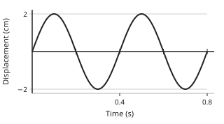

Answer: **2 cm**
- Typed **4** (peak2peak) → “That is the distance from a crest to a trough: the amplitude is half of it.”
- Typed **0.4** (period) → “0.4 s is the period, read along the time axis.”

Full working after a second miss:

> Amplitude is the greatest displacement from the middle line.  
> The graph reaches 2 cm above the line, so the amplitude is 2 cm.  

**Card c4p9-2** (draft)

> The period is the time for one complete vibration; read it from crest to crest.
>
> _two complete waves in 0.4 s means T = 0.2 s_  

Check question: `p4-9-period` · number, level 1 · computed by rule, reused from practice

> From the graph, what is the period of the vibration, in seconds?

Answer: **2 s**
- Typed **4** (two) → “4 s is the time for TWO complete waves; one takes half of it.”
- Typed **7** (amp) → “7 cm is the amplitude, read up the displacement axis.”

Full working after a second miss:

> The period is the time for one complete wave.  
> The graph shows 2 complete waves in 4 s, so T = 2 s.  

**Card c4p9-3** (draft)

> f = 1/T and T = 1/f; frequency is in hertz.
>
> _T = 0.2 s gives f = 5 Hz_  

Check question: `p4-9-freq` · number, level 1 · computed by rule, reused from practice

> A vibration has a period of 0.25 s. Find its frequency, in hertz.

Answer: **4 Hz**
- Typed **0.25** (same) → “Frequency is the reciprocal of the period, not the period itself.”
- Typed **25** (times) → “Divide 1 by the period; do not multiply.”

Full working after a second miss:

> f = 1 ÷ T.  
> f = 1 ÷ 0.25 = 4 Hz.  

**Worked example** (draft)

> A displacement-time graph of a vibrating particle is shown. Find its amplitude, period and frequency.

1. Amplitude: the greatest displacement from the middle line is 4 cm.
2. Period: one complete wave takes 0.2 s, read from one crest to the next.
3. Frequency: f = 1 ÷ T = 1 ÷ 0.2.

**Answer:** amplitude 4 cm, period 0.2 s, frequency 5 Hz

**Practice** `p4-9-amp` · number, level 1 · computed by rule

> From the displacement-time graph, what is the amplitude of the vibration, in cm?

Answer: **3 cm**
- Typed **6** (peak2peak) → “That is the distance from a crest to a trough: the amplitude is half of it.”
- Typed **2** (period) → “2 s is the period, read along the time axis.”

Full working after a second miss:

> Amplitude is the greatest displacement from the middle line.  
> The graph reaches 3 cm above the line, so the amplitude is 3 cm.  

> From the displacement-time graph, what is the amplitude of the vibration, in cm?

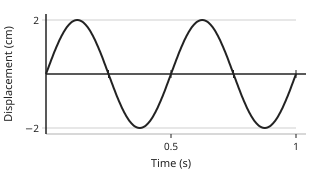

Answer: **2 cm**
- Typed **4** (peak2peak) → “That is the distance from a crest to a trough: the amplitude is half of it.”
- Typed **0.5** (period) → “0.5 s is the period, read along the time axis.”

Full working after a second miss:

> Amplitude is the greatest displacement from the middle line.  
> The graph reaches 2 cm above the line, so the amplitude is 2 cm.  

**Practice** `p4-9-period` · number, level 1 · computed by rule

> From the graph, what is the period of the vibration, in seconds?

Answer: **2 s**
- Typed **4** (two) → “4 s is the time for TWO complete waves; one takes half of it.”
- Typed **3** (amp) → “3 cm is the amplitude, read up the displacement axis.”

Full working after a second miss:

> The period is the time for one complete wave.  
> The graph shows 2 complete waves in 4 s, so T = 2 s.  

> From the graph, what is the period of the vibration, in seconds?

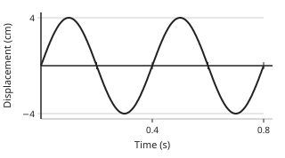

Answer: **0.4 s**
- Typed **0.8** (two) → “0.8 s is the time for TWO complete waves; one takes half of it.”
- Typed **4** (amp) → “4 cm is the amplitude, read up the displacement axis.”

Full working after a second miss:

> The period is the time for one complete wave.  
> The graph shows 2 complete waves in 0.8 s, so T = 0.4 s.  

**Practice** `p4-9-freq` · number, level 1 · computed by rule

> A vibration has a period of 4 s. Find its frequency, in hertz.

Answer: **0.25 Hz**
- Typed **4** (same) → “Frequency is the reciprocal of the period, not the period itself.”
- Typed **400** (times) → “Divide 1 by the period; do not multiply.”

Full working after a second miss:

> f = 1 ÷ T.  
> f = 1 ÷ 4 = 0.25 Hz.  

> A vibration has a period of 0.25 s. Find its frequency, in hertz.

Answer: **4 Hz**
- Typed **0.25** (same) → “Frequency is the reciprocal of the period, not the period itself.”
- Typed **25** (times) → “Divide 1 by the period; do not multiply.”

Full working after a second miss:

> f = 1 ÷ T.  
> f = 1 ÷ 0.25 = 4 Hz.  

**Practice** `p4-9-period2` · number, level 2 · computed by rule

> A tuning fork vibrates at 500 Hz. Find its period, in seconds.

Answer: **0.002 s**
- Typed **500** (same) → “The period is the reciprocal of the frequency.”
- Typed **0.12** (sixty) → “Frequency is counted per second, so divide 1 by it, not 60.”

Full working after a second miss:

> T = 1 ÷ f.  
> T = 1 ÷ 500 = 0.002 s.  

> A tuning fork vibrates at 200 Hz. Find its period, in seconds.

Answer: **0.005 s**
- Typed **200** (same) → “The period is the reciprocal of the frequency.”
- Typed **0.3** (sixty) → “Frequency is counted per second, so divide 1 by it, not 60.”

Full working after a second miss:

> T = 1 ÷ f.  
> T = 1 ÷ 200 = 0.005 s.  

**Practice** `p4-9-count` · number, level 3 · computed by rule

> A particle makes 50 complete vibrations in 2 seconds. Find its frequency, in hertz.

Answer: **25 Hz**
- Typed **0.04** (swap) → “Divide the number of vibrations by the time, not the other way round.”
- Typed **0.04** (period) → “That is the period, the time for ONE vibration.”

Full working after a second miss:

> Frequency is the number of complete vibrations each second.  
> f = 50 ÷ 2 = 25 Hz.  

> A particle makes 16 complete vibrations in 4 seconds. Find its frequency, in hertz.

Answer: **4 Hz**
- Typed **0.25** (swap) → “Divide the number of vibrations by the time, not the other way round.”
- Typed **0.25** (period) → “That is the period, the time for ONE vibration.”

Full working after a second miss:

> Frequency is the number of complete vibrations each second.  
> f = 16 ÷ 4 = 4 Hz.  

## Lesson 10: Wave Characteristics: Wavelength, and wave speed (using displacement-distance and wave profile), generation of wavefronts using the ripple tank. Calculations using the equation v=fλ

Prerequisites: 9 · Skill: p4-10 (Find wavelength and wave speed; use v = fλ)

**Note** (draft)

> A displacement-distance graph (a wave profile) is a snapshot of the whole wave at one instant: distance runs across.
> Wavelength λ is the distance between two successive points in step, for example crest to crest, in metres.
> Wave speed v is how fast the wave travels, in m/s.
> In one period the wave moves one wavelength, so v = λ/T, that is v = fλ.
> Rearranged: f = v/λ and λ = v/f.
> In a ripple tank a vibrating bar makes straight wavefronts and a dipper makes circular ones. A wavefront joins points in step, and the distance between two neighbouring wavefronts is one wavelength.

**Learn: Your goal and connections** (draft)

> By the end, you should be able to read a wavelength from a wave profile and use v = fλ to find speed, frequency or wavelength.
> Builds on: Lesson 9 (period, frequency and amplitude).
> Leads to: Lesson 11 (what happens when waves meet an obstacle) and Lesson 14 (the speed of sound).

**Learn: Wavelength and wave profile** (draft)

> A displacement-time graph follows one particle. A displacement-distance graph, or wave profile, is a photograph of the whole wave at one instant, with distance running across.
> Wavelength λ is the distance between two successive points that are in step: crest to crest, or trough to trough. It is measured in metres.
> In a ripple tank, a vibrating bar makes straight wavefronts and a vibrating dipper makes circular ones. A wavefront joins points that are in step, such as the tops of the ripples, and neighbouring wavefronts are one wavelength apart.

**Learn: The wave equation** (draft)

> In one period T the wave moves forward exactly one wavelength λ.
> speed = distance ÷ time = λ ÷ T, and since f = 1 ÷ T:
> v = fλ.
> Rearranged: f = v ÷ λ and λ = v ÷ f.
> Examples:
> • f = 50 Hz, λ = 0.4 m: v = 50 × 0.4 = 20 m/s.
> • Sound at 340 m/s with f = 170 Hz: λ = 340 ÷ 170 = 2 m.
> Keep the units together: metres with hertz give metres per second.

**Learn: key words and examples** (draft)

- **wavelength (λ)**: the distance between two successive points in step, such as crest to crest
- **wave speed (v)**: how fast the wave travels, in m/s
- **wavefront**: a line joining points of a wave that are in step
- **ripple tank**: a shallow tank of water used to show wave behaviour

- v = 2 × 3 = 6 m/s
- λ = 340 ÷ 85 = 4 m
- f = 20 ÷ 0.5 = 40 Hz

Common mistake: “v = f + λ” → “v = fλ”. Speed is the frequency MULTIPLIED by the wavelength: one wavelength for every vibration each second.

**Card c4p10-1** (draft)

> Wavelength is the distance from one crest to the next, read off a displacement-distance graph.
>
> _crests 2 m apart means λ = 2 m_  

Check question: `p4-10-lambda` · number, level 1 · computed by rule, reused from practice

> From the displacement-distance graph, what is the wavelength, in metres?

Answer: **0.4 m**
- Typed **0.8** (two) → “0.8 m covers TWO complete waves.”
- Typed **4** (amp) → “4 cm is the amplitude, measured up the displacement axis.”

Full working after a second miss:

> Wavelength is the distance from one crest to the next.  
> The graph shows 2 complete waves in 0.8 m, so λ = 0.4 m.  

**Card c4p10-2** (draft)

> v = fλ: speed = frequency × wavelength.
>
> _f = 50 Hz and λ = 0.4 m give v = 20 m/s_  

Check question: `p4-10-v` · number, level 1 · computed by rule, reused from practice

> A wave of frequency 100 Hz has wavelength 1 m. Find its speed, in m/s.

Answer: **100 m/s**
- Typed **101** (add) → “v = fλ is a product, not a sum.”

Full working after a second miss:

> v = fλ.  
> v = 100 × 1 = 100 m/s.  

**Card c4p10-3** (draft)

> Rearranged: f = v/λ and λ = v/f.
>
> _v = 340 m/s and f = 170 Hz give λ = 2 m_  

Check question: `p4-10-lam-card` · number, level 1 · computed by rule

> A sound of frequency 125 Hz travels through sea water at 1500 m/s. Find its wavelength, in metres.

Answer: **12 m**
- Typed **187 500** (mult) → “Divide the speed by the frequency.”
- Typed **0.0833** (swap) → “λ = v ÷ f, not f ÷ v.”

Full working after a second miss:

> v = fλ, so λ = v ÷ f.  
> λ = 1500 ÷ 125 = 12 m.  

**Worked example** (draft)

> A wave has a frequency of 50 Hz and a wavelength of 0.4 m. Find its speed.

1. v = fλ.
2. v = 50 × 0.4.
3. = 20 m/s.

**Answer:** 20 m/s

**Practice** `p4-10-lambda` · number, level 1 · computed by rule

> From the displacement-distance graph, what is the wavelength, in metres?

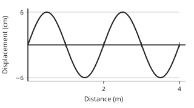

Answer: **2 m**
- Typed **4** (two) → “4 m covers TWO complete waves.”
- Typed **6** (amp) → “6 cm is the amplitude, measured up the displacement axis.”

Full working after a second miss:

> Wavelength is the distance from one crest to the next.  
> The graph shows 2 complete waves in 4 m, so λ = 2 m.  

> From the displacement-distance graph, what is the wavelength, in metres?

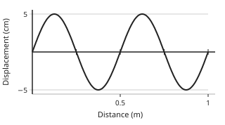

Answer: **0.5 m**
- Typed **1** (two) → “1 m covers TWO complete waves.”
- Typed **5** (amp) → “5 cm is the amplitude, measured up the displacement axis.”

Full working after a second miss:

> Wavelength is the distance from one crest to the next.  
> The graph shows 2 complete waves in 1 m, so λ = 0.5 m.  

**Practice** `p4-10-v` · number, level 1 · computed by rule

> A wave of frequency 25 Hz has wavelength 0.2 m. Find its speed, in m/s.

Answer: **5 m/s**
- Typed **125** (div) → “Multiply the frequency by the wavelength.”
- Typed **25.2** (add) → “v = fλ is a product, not a sum.”

Full working after a second miss:

> v = fλ.  
> v = 25 × 0.2 = 5 m/s.  

> A wave of frequency 500 Hz has wavelength 1.5 m. Find its speed, in m/s.

Answer: **750 m/s**
- Typed **333.333** (div) → “Multiply the frequency by the wavelength.”
- Typed **501.5** (add) → “v = fλ is a product, not a sum.”

Full working after a second miss:

> v = fλ.  
> v = 500 × 1.5 = 750 m/s.  

**Practice** `p4-10-lam` · number, level 2 · computed by rule

> A sound of frequency 125 Hz travels through sea water at 1500 m/s. Find its wavelength, in metres.

Answer: **12 m**
- Typed **187 500** (mult) → “Divide the speed by the frequency.”
- Typed **0.0833** (swap) → “λ = v ÷ f, not f ÷ v.”

Full working after a second miss:

> v = fλ, so λ = v ÷ f.  
> λ = 1500 ÷ 125 = 12 m.  

> A sound of frequency 60 Hz travels through sea water at 1500 m/s. Find its wavelength, in metres.

Answer: **25 m**
- Typed **90 000** (mult) → “Divide the speed by the frequency.”
- Typed **0.04** (swap) → “λ = v ÷ f, not f ÷ v.”

Full working after a second miss:

> v = fλ, so λ = v ÷ f.  
> λ = 1500 ÷ 60 = 25 m.  

**Practice** `p4-10-f` · number, level 2 · computed by rule

> A wave travels at 12.5 m/s with a wavelength of 2.5 m. Find its frequency, in hertz.

Answer: **5 Hz**
- Typed **31.25** (mult) → “Divide the speed by the wavelength.”
- Typed **0.2** (swap) → “f = v ÷ λ, not λ ÷ v.”

Full working after a second miss:

> v = fλ, so f = v ÷ λ.  
> f = 12.5 ÷ 2.5 = 5 Hz.  

> A wave travels at 40 m/s with a wavelength of 1 m. Find its frequency, in hertz.

Answer: **40 Hz**
- Typed **0.025** (swap) → “f = v ÷ λ, not λ ÷ v.”

Full working after a second miss:

> v = fλ, so f = v ÷ λ.  
> f = 40 ÷ 1 = 40 Hz.  

**Practice** `p4-10-tank` · number, level 3 · computed by rule

> In a ripple tank a bar vibrates 120 times in 10 s and the wavefronts are 2.5 cm apart. Find the speed of the ripples, in cm/s.

Answer: **30 cm/s**
- Typed **300** (nof) → “120 is the number of vibrations in 10 s: divide by the time to get the frequency.”
- Typed **4.8** (div) → “v = fλ is a product.”

Full working after a second miss:

> Frequency f = 120 ÷ 10 = 12 Hz.  
> The distance between neighbouring wavefronts is the wavelength, 2.5 cm.  
> v = fλ = 12 × 2.5 = 30 cm/s.  

> In a ripple tank a bar vibrates 120 times in 10 s and the wavefronts are 4 cm apart. Find the speed of the ripples, in cm/s.

Answer: **48 cm/s**
- Typed **480** (nof) → “120 is the number of vibrations in 10 s: divide by the time to get the frequency.”
- Typed **3** (div) → “v = fλ is a product.”

Full working after a second miss:

> Frequency f = 120 ÷ 10 = 12 Hz.  
> The distance between neighbouring wavefronts is the wavelength, 4 cm.  
> v = fλ = 12 × 4 = 48 cm/s.  

## Lesson 11: Wave phenomena: Reflection, Refraction, Diffraction and Interference (with diagrams)

Prerequisites: 10 · Skill: p4-11 (Describe reflection, refraction, diffraction and interference of waves)

**Note** (draft)

> Reflection: a wave meets a barrier and is turned back. The angle of reflection equals the angle of incidence; the speed, frequency and wavelength do not change.
> Refraction: a wave crosses into a medium where it travels at a different speed. The frequency stays the same, so the wavelength changes (λ = v/f) and the wave bends, unless it meets the boundary along the normal. Water waves slow down in shallow water and bend towards the normal.
> Diffraction: a wave spreads out as it passes through a gap or round an obstacle. It is greatest when the gap is about the same width as the wavelength. Sound diffracts round a doorway; light hardly does, because its wavelength is tiny.
> Interference: two waves meeting add their displacements. Crest on crest gives a larger wave (constructive); crest on trough cancels (destructive).

**Learn: Your goal and connections** (draft)

> By the end, you should be able to describe what reflection, refraction, diffraction and interference do to a wave, and say which quantities change.
> Builds on: Lesson 10 (v = fλ) and Form Three reflection of light.
> Leads to: Lesson 12 (stationary waves, made by interference) and Lesson 13 (sound).

**Learn: Reflection and refraction** (draft)

> Reflection: the wave meets a barrier and is turned back. The angle of reflection equals the angle of incidence. Nothing else changes: the speed, frequency and wavelength are the same as before.
> Refraction: the wave crosses into a medium where its speed is different. In a ripple tank, deep water to shallow water slows the ripples down.
> The frequency is fixed by the source and never changes at a boundary. So from v = fλ, if v falls then λ falls too: the wavefronts come closer together. If the wave meets the boundary at an angle, one end of each wavefront slows first and the wave bends, towards the normal when it slows down.

**Learn: Diffraction and interference** (draft)

> Diffraction: a wave spreads out as it passes through a gap or round the edge of an obstacle. The spreading is greatest when the gap is about the same width as the wavelength.
> Sound has wavelengths of about a metre, so it spreads round a doorway and you hear someone round a corner. Light has a wavelength of less than a thousandth of a millimetre, so it spreads far too little to see.
> Interference: where two waves meet, their displacements add.
> • Crest on crest, or trough on trough: constructive interference, a bigger wave. A loud sound or a bright fringe.
> • Crest on trough: destructive interference, and if the waves are equal they cancel. A quiet place or a dark fringe.

**Learn: key words and examples** (draft)

- **reflection**: a wave turned back at a barrier
- **refraction**: a wave bending because its speed changes
- **diffraction**: spreading through a gap or round an obstacle
- **interference**: two waves meeting and adding their displacements
- **normal**: the line at right angles to a surface

- shallow water: v and λ fall, f stays
- sound round a doorway: diffraction
- two speakers: loud and quiet places

Common mistake: “when a wave is refracted its frequency changes” → “the frequency stays the same; the speed and wavelength change”. The source sets the frequency. At the boundary, v and λ change together so that v = fλ still holds.

**Card c4p11-1** (draft)

> Reflection turns a wave back: angle of reflection = angle of incidence, and λ and f are unchanged.
>
> _straight water waves hitting a straight barrier come back at the same angle_  

Check question: `p4-11-which` · multiple choice, level 1 · **authored key**, reused from practice

> Straight water waves hit a straight barrier at an angle. What happens?

- ◻️ They pass straight through the barrier  
  _↳ feedback if chosen: A solid barrier does not let the waves through._
- ✅ They are reflected, with the angle of reflection equal to the angle of incidence
- ◻️ They stop at the barrier and disappear  
  _↳ feedback if chosen: The energy is turned back, not destroyed._
- ◻️ They bend around the barrier and carry on  
  _↳ feedback if chosen: Bending round an obstacle is diffraction, which needs a gap or an edge, not a long straight barrier._

Full working after a second miss:

> At a reflection the wavelength and frequency stay the same; only the direction changes.  
> So the answer is They are reflected, with the angle of reflection equal to the angle of incidence.  

**Card c4p11-2** (draft)

> Refraction: f stays the same, v and λ change, and the wave bends.
>
> _in shallow water the ripples slow down and the wavefronts come closer together_  

Check question: `p4-11-refract-card` · number, level 1 · computed by rule

> Water waves of frequency 5 Hz travel at 50 m/s in deep water. In shallow water the speed falls to 24 m/s. Find the wavelength in the shallow water, in metres.

Answer: **4.8 m**
- Typed **10** (deep) → “50 m/s is the speed in the DEEP water; use the shallow-water speed 24 m/s.”

Full working after a second miss:

> The frequency does not change at a boundary: it is still 5 Hz.  
> λ = v ÷ f = 24 ÷ 5.  
> λ = 4.8 m.  

**Card c4p11-3** (draft)

> Diffraction spreads a wave through a gap; it is greatest when the gap ≈ the wavelength.
>
> _sound bends round a doorway; light does not, because its wavelength is far smaller_  

Check question: `p4-11-diffract-card` · multiple choice, level 1 · **authored key**

> The gap in a ripple tank barrier is narrowed until it is about one wavelength wide. What happens to the ripples beyond it?

- ✅ They spread out in almost semicircular wavefronts
- ◻️ They keep their straight shape  
  _↳ feedback if chosen: Straight wavefronts pass a wide gap; a narrow gap spreads them._
- ◻️ They are reflected back  
  _↳ feedback if chosen: The part that hits the barrier is reflected, but what goes through the gap spreads out._
- ◻️ They travel faster  
  _↳ feedback if chosen: The depth is unchanged, so the speed is unchanged._

Full working after a second miss:

> Gap ≈ wavelength gives the widest diffraction, and the gap acts almost like a new source.  
> So the answer is They spread out in almost semicircular wavefronts.  

**Worked example** (draft)

> Water waves travel from deep water into shallow water. Say what happens to the speed, the frequency, the wavelength and the direction.

1. The frequency is set by the source, so it does not change.
2. Waves travel more slowly in shallow water, so the speed falls.
3. From v = fλ, with f fixed and v smaller, the wavelength must get shorter.
4. The part of each wavefront that reaches the shallow water first slows first, so the wavefront swings round towards the normal.

**Answer:** f unchanged, v smaller, λ shorter, and the waves bend towards the normal

**Practice** `p4-11-which` · multiple choice, level 1 · **authored key**

> What is diffraction?

- ◻️ The bending of waves when their speed changes  
  _↳ feedback if chosen: That is refraction._
- ◻️ The joining of two waves to make a bigger one  
  _↳ feedback if chosen: That is interference._
- ◻️ The bouncing of waves off a barrier  
  _↳ feedback if chosen: That is reflection._
- ✅ The spreading of waves as they pass through a gap or around an obstacle

Full working after a second miss:

> Diffraction spreads the wave; it is greatest when the gap is about the same size as the wavelength.  
> So the answer is The spreading of waves as they pass through a gap or around an obstacle.  

> Two identical waves meet crest to trough. What is heard or seen at that point?

- ✅ Destructive interference: they cancel, giving a quiet or dark point
- ◻️ The waves change frequency  
  _↳ feedback if chosen: Interference does not change the frequency of either wave._
- ◻️ A louder sound or a brighter light  
  _↳ feedback if chosen: Louder or brighter is constructive interference, where crest meets crest._
- ◻️ No change at all  
  _↳ feedback if chosen: A crest meeting an equal trough gives zero displacement, which is a definite change._

Full working after a second miss:

> Equal and opposite displacements add to zero: a quiet point in sound, a dark fringe in light.  
> So the answer is Destructive interference: they cancel, giving a quiet or dark point.  

**Practice** `p4-11-refract` · number, level 2 · computed by rule

> Water waves of frequency 10 Hz travel at 60 m/s in deep water. In shallow water the speed falls to 15 m/s. Find the wavelength in the shallow water, in metres.

Answer: **1.5 m**
- Typed **6** (deep) → “60 m/s is the speed in the DEEP water; use the shallow-water speed 15 m/s.”

Full working after a second miss:

> The frequency does not change at a boundary: it is still 10 Hz.  
> λ = v ÷ f = 15 ÷ 10.  
> λ = 1.5 m.  

> Water waves of frequency 20 Hz travel at 20 m/s in deep water. In shallow water the speed falls to 12 m/s. Find the wavelength in the shallow water, in metres.

Answer: **0.6 m**
- Typed **1** (deep) → “20 m/s is the speed in the DEEP water; use the shallow-water speed 12 m/s.”

Full working after a second miss:

> The frequency does not change at a boundary: it is still 20 Hz.  
> λ = v ÷ f = 12 ÷ 20.  
> λ = 0.6 m.  

**Practice** `p4-11-diffract` · multiple choice, level 2 · **authored key**

> Why does a radio with long waves work better than a television behind a hill?

- ◻️ Radio waves travel faster than television waves  
  _↳ feedback if chosen: All electromagnetic waves travel at the same speed in air._
- ◻️ Radio waves are stronger than television waves  
  _↳ feedback if chosen: Strength is not what decides it; the wavelength compared with the obstacle is._
- ✅ The longer radio waves diffract round the hill, while the shorter television waves do not
- ◻️ Television waves are absorbed by soil  
  _↳ feedback if chosen: Both are reflected and absorbed at a hill; it is the diffraction that differs._

Full working after a second miss:

> An obstacle diffracts a wave most when the wavelength is comparable with its size.  
> So the answer is The longer radio waves diffract round the hill, while the shorter television waves do not.  

> Why does a radio with long waves work better than a television behind a hill?

- ✅ The longer radio waves diffract round the hill, while the shorter television waves do not
- ◻️ Radio waves travel faster than television waves  
  _↳ feedback if chosen: All electromagnetic waves travel at the same speed in air._
- ◻️ Radio waves are stronger than television waves  
  _↳ feedback if chosen: Strength is not what decides it; the wavelength compared with the obstacle is._
- ◻️ Television waves are absorbed by soil  
  _↳ feedback if chosen: Both are reflected and absorbed at a hill; it is the diffraction that differs._

Full working after a second miss:

> An obstacle diffracts a wave most when the wavelength is comparable with its size.  
> So the answer is The longer radio waves diffract round the hill, while the shorter television waves do not.  

**Practice** `p4-11-interfere` · multiple choice, level 2 · **authored key**

> Two loudspeakers play the same steady note. Walking in front of them, a pupil hears loud and quiet places. Why?

- ✅ The two sound waves interfere: crest on crest gives a loud place, crest on trough a quiet one
- ◻️ The speakers change frequency as the pupil walks  
  _↳ feedback if chosen: The note is steady; it is the difference in path length that changes as the pupil moves._
- ◻️ One speaker is louder than the other  
  _↳ feedback if chosen: A louder speaker would make one side louder everywhere, not give a pattern of places._
- ◻️ The sound is reflected off the walls only  
  _↳ feedback if chosen: The pattern is heard outdoors too, where there is little echo._

Full working after a second miss:

> Sound from the two speakers travels different distances to each point, so it arrives in step or out of step.  
> So the answer is The two sound waves interfere: crest on crest gives a loud place, crest on trough a quiet one.  

> At a point, a crest from one wave arrives together with a crest from another. What happens there?

- ◻️ The waves bounce off each other  
  _↳ feedback if chosen: Waves pass through each other; they do not bounce off each other._
- ◻️ Destructive interference: they cancel out  
  _↳ feedback if chosen: Cancelling happens when a crest meets a trough._
- ◻️ The waves stop  
  _↳ feedback if chosen: After meeting, each wave carries on as before._
- ✅ Constructive interference: the displacements add, giving a bigger disturbance

Full working after a second miss:

> Where two waves arrive in step, their displacements add.  
> So the answer is Constructive interference: the displacements add, giving a bigger disturbance.  

**Practice** `p4-11-match` · matching, level 3 · **authored key**

> Match each effect to what happens to the wave.

Right-hand side (shuffled): A crest meets a trough and they cancel · The speed changes, so λ changes and the wave bends · The wave is turned back; λ, f and v stay the same
- Refraction → **The speed changes, so λ changes and the wave bends**
- Reflection → **The wave is turned back; λ, f and v stay the same**
- Destructive interference → **A crest meets a trough and they cancel**

Full working after a second miss:

> The right pairs are:  
> Refraction → The speed changes, so λ changes and the wave bends  
> Reflection → The wave is turned back; λ, f and v stay the same  
> Destructive interference → A crest meets a trough and they cancel  

> Match each effect to what happens to the wave.

Right-hand side (shuffled): The wave is turned back; λ, f and v stay the same · The wave spreads out through a gap or round an obstacle · A crest meets a trough and they cancel
- Destructive interference → **A crest meets a trough and they cancel**
- Reflection → **The wave is turned back; λ, f and v stay the same**
- Diffraction → **The wave spreads out through a gap or round an obstacle**

Full working after a second miss:

> The right pairs are:  
> Destructive interference → A crest meets a trough and they cancel  
> Reflection → The wave is turned back; λ, f and v stay the same  
> Diffraction → The wave spreads out through a gap or round an obstacle  

## Lesson 12: Stationary waves: Harmonics and Overtones. Relationship between inter-node distance and wavelength

Prerequisites: 11 · Skill: p4-12 (Describe stationary waves, harmonics and overtones)

**Note** (draft)

> A stationary (standing) wave is made when two waves of the same frequency and amplitude travel in opposite directions and interfere, usually a wave and its own reflection.
> Nodes are points that never move (destructive interference). Antinodes are points that vibrate most (constructive interference).
> The distance between two neighbouring nodes is half a wavelength: λ = 2 × (node-to-node distance).
> On a string of length L fixed at both ends there must be a node at each end, so L = nλ/2, that is λ = 2L/n with n = 1, 2, 3, …
> n = 1 is the fundamental or first harmonic, with frequency f₁. n = 2 is the second harmonic (first overtone), with frequency 2f₁, and so on.
> Unlike a progressive wave, a stationary wave carries no energy along the string.

**Learn: Your goal and connections** (draft)

> By the end, you should be able to explain how a stationary wave is formed, find λ from the node spacing or the number of loops, and name the harmonics.
> Builds on: Lesson 11 (interference and reflection) and Lesson 10 (v = fλ).
> Leads to: Lesson 15 (vibrating strings) and the notes made by musical instruments.

**Learn: Nodes, antinodes and loops** (draft)

> Send a wave along a string fixed at the far end. The reflected wave meets the wave still going forward. Where they are always out of step, the string never moves: a node. Where they are always in step, it vibrates most: an antinode.
> The pattern stays in one place, so it is a stationary wave. Unlike a progressive wave, it carries no energy along the string.
> Each loop between two nodes is half a wavelength long, so:
> λ = 2 × (distance from one node to the next).
> A string fixed at both ends must have a node at each end, so a whole number of loops must fit: L = nλ ÷ 2, that is λ = 2L ÷ n.

**Learn: Harmonics and overtones** (draft)

> With n = 1, the string vibrates as one loop. This is the fundamental, or first harmonic: λ₁ = 2L and f₁ = v ÷ (2L).
> • n = 2: two loops, λ = L, frequency 2f₁. Second harmonic, also called the first overtone.
> • n = 3: three loops, λ = 2L ÷ 3, frequency 3f₁. Third harmonic, second overtone.
> So the nth harmonic has n loops, n + 1 nodes, n antinodes and frequency n × f₁.
> A plucked guitar string vibrates in several of these at once; the mixture gives the instrument its quality.

**Learn: key words and examples** (draft)

- **stationary wave**: a wave pattern that stays in place, made by two waves meeting
- **node**: a point that never moves
- **antinode**: a point that vibrates most
- **fundamental**: the lowest frequency, with one loop
- **harmonic**: a frequency that is a whole number times the fundamental

- nodes 15 cm apart → λ = 30 cm
- L = 1 m, 4 loops → λ = 0.5 m
- f₁ = 120 Hz → third harmonic 360 Hz

Common mistake: “the distance between neighbouring nodes is one wavelength” → “it is half a wavelength”. A full wave has two loops: one above the line and one below.

**Card c4p12-1** (draft)

> A node never moves; an antinode vibrates most. Neighbouring nodes are half a wavelength apart.
>
> _nodes 0.2 m apart means λ = 0.4 m_  

Check question: `p4-12-nodes` · number, level 1 · computed by rule, reused from practice

> On a stationary wave, two neighbouring nodes are 25 cm apart. Find the wavelength, in cm.

Answer: **50 cm**
- Typed **25** (same) → “25 cm is only half a wavelength.”
- Typed **12.5** (half) → “Multiply by 2: node to node is HALF a wavelength.”

Full working after a second miss:

> The distance between neighbouring nodes is half a wavelength.  
> λ = 2 × 25 = 50 cm.  

**Card c4p12-2** (draft)

> On a string fixed at both ends, λ = 2L/n, where n is the number of loops.
>
> _L = 0.6 m with 3 loops: λ = 0.4 m_  

Check question: `p4-12-lambda` · number, level 1 · computed by rule, reused from practice

> A string of length 1 m fixed at both ends vibrates in 2 loops. Find the wavelength, in metres.

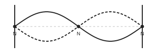

Answer: **1 m**
- Typed **0.5** (nohalf) → “Each loop is HALF a wavelength, so λ = 2L ÷ n.”
- Typed **2** (whole) → “That is the wavelength of the fundamental, with one loop. Here there are 2.”

Full working after a second miss:

> Each loop is half a wavelength, and 2 loops fill the string.  
> λ = 2L ÷ n = 2 × 1 ÷ 2 = 1 m.  

**Card c4p12-3** (draft)

> The nth harmonic has frequency n × the fundamental.
>
> _f₁ = 100 Hz gives a third harmonic of 300 Hz_  

Check question: `p4-12-harm-card` · number, level 1 · computed by rule

> A string has a fundamental frequency of 80 Hz. Find the frequency of its 6th harmonic, in hertz.

Answer: **480 Hz**
- Typed **13.33** (div) → “A higher harmonic has a HIGHER frequency: multiply.”
- Typed **560** (over) → “The 6th harmonic is 6 × f₁. (6 × f₁ is also called the 5th overtone.)”

Full working after a second miss:

> The nth harmonic has n times the fundamental frequency.  
> f = 6 × 80 = 480 Hz.  

**Worked example** (draft)

> A string of length 0.6 m fixed at both ends vibrates in 3 loops. Find the wavelength.

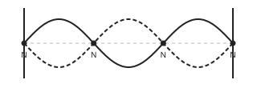

1. Each loop is half a wavelength long.
2. 3 loops fill the length, so 3 × (λ ÷ 2) = 0.6.
3. λ = 2 × 0.6 ÷ 3.

**Answer:** 0.4 m

**Practice** `p4-12-nodes` · number, level 1 · computed by rule

> On a stationary wave, two neighbouring nodes are 15 cm apart. Find the wavelength, in cm.

Answer: **30 cm**
- Typed **15** (same) → “15 cm is only half a wavelength.”
- Typed **7.5** (half) → “Multiply by 2: node to node is HALF a wavelength.”

Full working after a second miss:

> The distance between neighbouring nodes is half a wavelength.  
> λ = 2 × 15 = 30 cm.  

> On a stationary wave, two neighbouring nodes are 12 cm apart. Find the wavelength, in cm.

Answer: **24 cm**
- Typed **12** (same) → “12 cm is only half a wavelength.”
- Typed **6** (half) → “Multiply by 2: node to node is HALF a wavelength.”

Full working after a second miss:

> The distance between neighbouring nodes is half a wavelength.  
> λ = 2 × 12 = 24 cm.  

**Practice** `p4-12-lambda` · number, level 1 · computed by rule

> A string of length 0.4 m fixed at both ends vibrates in 2 loops. Find the wavelength, in metres.

Answer: **0.4 m**
- Typed **0.2** (nohalf) → “Each loop is HALF a wavelength, so λ = 2L ÷ n.”
- Typed **0.8** (whole) → “That is the wavelength of the fundamental, with one loop. Here there are 2.”

Full working after a second miss:

> Each loop is half a wavelength, and 2 loops fill the string.  
> λ = 2L ÷ n = 2 × 0.4 ÷ 2 = 0.4 m.  

> A string of length 0.3 m fixed at both ends vibrates in 5 loops. Find the wavelength, in metres.

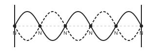

Answer: **0.12 m**
- Typed **0.06** (nohalf) → “Each loop is HALF a wavelength, so λ = 2L ÷ n.”
- Typed **0.6** (whole) → “That is the wavelength of the fundamental, with one loop. Here there are 5.”

Full working after a second miss:

> Each loop is half a wavelength, and 5 loops fill the string.  
> λ = 2L ÷ n = 2 × 0.3 ÷ 5 = 0.12 m.  

**Practice** `p4-12-harm` · number, level 2 · computed by rule

> A string has a fundamental frequency of 200 Hz. Find the frequency of its 3rd harmonic, in hertz.

Answer: **600 Hz**
- Typed **66.67** (div) → “A higher harmonic has a HIGHER frequency: multiply.”
- Typed **800** (over) → “The 3th harmonic is 3 × f₁. (3 × f₁ is also called the 2nd overtone.)”

Full working after a second miss:

> The nth harmonic has n times the fundamental frequency.  
> f = 3 × 200 = 600 Hz.  

> A string has a fundamental frequency of 100 Hz. Find the frequency of its 4th harmonic, in hertz.

Answer: **400 Hz**
- Typed **25** (div) → “A higher harmonic has a HIGHER frequency: multiply.”
- Typed **500** (over) → “The 4th harmonic is 4 × f₁. (4 × f₁ is also called the 3rd overtone.)”

Full working after a second miss:

> The nth harmonic has n times the fundamental frequency.  
> f = 4 × 100 = 400 Hz.  

**Practice** `p4-12-count` · multiple choice, level 2 · computed by rule

> The diagram shows a string fixed at both ends vibrating as a stationary wave. How many nodes and antinodes are there?

- ◻️ 2 nodes and 3 antinodes  
  _↳ feedback if chosen: The ends are fixed, so they are nodes: there is always one node more than the number of loops._
- ◻️ 2 nodes and 2 antinodes  
  _↳ feedback if chosen: Count the ends: a string fixed at both ends has a node at each end._
- ✅ 3 nodes and 2 antinodes
- ◻️ 4 nodes and 2 antinodes  
  _↳ feedback if chosen: Neighbouring loops share a node, so they are not counted twice._

Full working after a second miss:

> Each loop has one antinode in the middle, so there are 2 antinodes.  
> There is a node at each end and one between each pair of loops: 2 + 1 = 3.  
> So the answer is: 3 nodes and 2 antinodes.  

> The diagram shows a string fixed at both ends vibrating as a stationary wave. How many nodes and antinodes are there?

- ◻️ 4 nodes and 2 antinodes  
  _↳ feedback if chosen: Neighbouring loops share a node, so they are not counted twice._
- ✅ 3 nodes and 2 antinodes
- ◻️ 2 nodes and 3 antinodes  
  _↳ feedback if chosen: The ends are fixed, so they are nodes: there is always one node more than the number of loops._
- ◻️ 2 nodes and 2 antinodes  
  _↳ feedback if chosen: Count the ends: a string fixed at both ends has a node at each end._

Full working after a second miss:

> Each loop has one antinode in the middle, so there are 2 antinodes.  
> There is a node at each end and one between each pair of loops: 2 + 1 = 3.  
> So the answer is: 3 nodes and 2 antinodes.  

**Practice** `p4-12-compare` · multiple choice, level 3 · **authored key**

> In a stationary wave, how does the amplitude vary along the string?

- ✅ It is zero at the nodes and greatest at the antinodes
- ◻️ It is greatest at the nodes  
  _↳ feedback if chosen: A node is a point that never moves, so its amplitude is zero._
- ◻️ It falls steadily from one end to the other  
  _↳ feedback if chosen: The amplitude rises and falls repeatedly along the string._
- ◻️ It is the same everywhere, as in a progressive wave  
  _↳ feedback if chosen: Equal amplitude everywhere is what happens in a progressive wave._

Full working after a second miss:

> Nodes are points of destructive interference and antinodes points of constructive interference.  
> So the answer is It is zero at the nodes and greatest at the antinodes.  

> How does a stationary wave differ from a progressive wave?

- ◻️ A stationary wave has a higher frequency  
  _↳ feedback if chosen: The two waves that make a stationary wave have the same frequency as it does._
- ◻️ There is no difference; the names mean the same thing  
  _↳ feedback if chosen: They behave quite differently: one carries energy away, the other does not._
- ✅ A stationary wave has fixed nodes and carries no energy along; a progressive wave carries energy forward
- ◻️ A stationary wave has no amplitude  
  _↳ feedback if chosen: The antinodes have a large amplitude; only the nodes do not move._

Full working after a second miss:

> In a stationary wave the pattern stays where it is, with the energy stored in the vibration.  
> So the answer is A stationary wave has fixed nodes and carries no energy along; a progressive wave carries energy forward.  

## Lesson 13: Production and transmission of sound. Characteristics of sound (Amplitude, frequency, and pitch, quality and overtones)

Prerequisites: 8 · Skill: p4-13 (Explain how sound is produced and transmitted, and its characteristics)

**Note** (draft)

> Sound is produced by a vibrating object: a drum skin, a guitar string, vocal cords, a loudspeaker cone.
> It travels as a longitudinal wave: the source pushes the air into compressions (particles close together) with rarefactions (particles spread out) between them. The vibration is passed from particle to particle, so sound needs a medium and cannot cross a vacuum.
> Sound travels fastest in solids, slower in liquids and slowest in gases, because the particles are closer together in a solid. In air it is about 340 m/s.
> Characteristics:
> • Loudness depends on amplitude.
> • Pitch depends on frequency.
> • Quality (timbre) depends on the mixture of overtones, and is why the same note sounds different on different instruments.
> A healthy young person hears about 20 Hz to 20 000 Hz.

**Learn: Your goal and connections** (draft)

> By the end, you should be able to explain how sound is produced and carried, and link loudness, pitch and quality to amplitude, frequency and overtones.
> Builds on: Lesson 8 (longitudinal waves) and Lesson 9 (amplitude and frequency).
> Leads to: Lesson 14 (measuring the speed of sound) and Lesson 15 (notes from vibrating strings).

**Learn: Production and transmission** (draft)

> Every sound starts with something vibrating: a drum skin, a string, the vocal cords, a loudspeaker cone.
> As the surface moves outwards it pushes the air particles together, making a compression. As it moves back it leaves them spread out, making a rarefaction. These pass from particle to particle through the air, so sound is a longitudinal wave.
> Because particles must pass the vibration on, sound needs a medium: a bell in a vacuum jar cannot be heard.
> The closer the particles, the faster the vibration is passed on: sound travels fastest in solids, slower in liquids and slowest in gases. In air it is about 340 m/s; in water about 1500 m/s; in steel about 5000 m/s.

**Learn: Loudness, pitch and quality** (draft)

> • Loudness depends on the amplitude. Hitting a drum harder gives a bigger amplitude and a louder sound, at the same pitch.
> • Pitch depends on the frequency. More vibrations each second gives a higher note. Tightening a drum skin or shortening a guitar string raises the frequency and so the pitch.
> • Quality, or timbre, depends on the mixture of overtones present with the fundamental. It is why the same note on a flute and on a guitar sounds different.
> A healthy young person hears from about 20 Hz to about 20 000 Hz. Above that is ultrasound, used to look inside the body and to find the depth of the sea.

**Learn: key words and examples** (draft)

- **compression**: a region where the particles are pushed together
- **rarefaction**: a region where the particles are spread apart
- **pitch**: how high or low a note sounds; it depends on frequency
- **loudness**: how loud a sound is; it depends on amplitude
- **quality (timbre)**: what makes the same note sound different on different instruments

- hit harder: louder, same pitch
- tighter string: higher pitch
- 340 ÷ 170 = 2 m wavelength

Common mistake: “a higher note travels faster through the air” → “all sounds travel at the same speed in the same air”. A higher frequency goes with a shorter wavelength, because v = fλ and v is fixed.

**Card c4p13-1** (draft)

> Sound is made by something vibrating, and travels as compressions and rarefactions.
>
> _a drum skin pushes the air into compressions as it moves out_  

Check question: `p4-13-which` · multiple choice, level 1 · **authored key**, reused from practice

> Through which does sound travel fastest?

- ✅ A steel rail
- ◻️ Water  
  _↳ feedback if chosen: Sound travels faster in water than in air, but faster still in a solid._
- ◻️ Air  
  _↳ feedback if chosen: Sound travels slowest of these in air, about 340 m/s._
- ◻️ A vacuum  
  _↳ feedback if chosen: Sound cannot travel through a vacuum at all._

Full working after a second miss:

> The particles of a solid are closest together, so they pass the vibration on fastest.  
> So the answer is A steel rail.  

**Card c4p13-2** (draft)

> Loudness depends on amplitude; pitch depends on frequency.
>
> _hitting a drum harder: louder, same pitch. A tighter skin: higher pitch_  

Check question: `p4-13-pitch` · multiple choice, level 1 · computed by rule, reused from practice

> A drum is hit after its skin has been tightened. What happens to the sound?

- ◻️ It is louder, because the skin is tighter  
  _↳ feedback if chosen: A tighter skin vibrates at a higher frequency, and frequency decides pitch._
- ✅ It is higher in pitch, because the skin vibrates more often each second
- ◻️ Nothing changes  
  _↳ feedback if chosen: A tighter skin vibrates at a higher frequency, and frequency decides pitch._
- ◻️ It is lower in pitch, because the skin is stiffer  
  _↳ feedback if chosen: A tighter skin vibrates at a higher frequency, and frequency decides pitch._

Full working after a second miss:

> A tighter skin vibrates at a higher frequency, and frequency decides pitch.  
> So the answer is: It is higher in pitch, because the skin vibrates more often each second.  

**Card c4p13-3** (draft)

> Quality (timbre) comes from the mixture of overtones.
>
> _the same note on a flute and a guitar sounds different_  

Check question: `p4-13-quality-card` · multiple choice, level 1 · **authored key**

> A tuning fork and a violin both sound a note of 256 Hz. Why does the fork sound plainer?

- ◻️ A tuning fork is quieter  
  _↳ feedback if chosen: A fork can be struck hard and still sound plain._
- ◻️ A tuning fork makes a longitudinal wave and the violin a transverse one  
  _↳ feedback if chosen: Both make longitudinal sound waves in the air._
- ✅ A tuning fork gives almost only the fundamental, with few overtones
- ◻️ A tuning fork gives a higher pitch  
  _↳ feedback if chosen: Both sound 256 Hz, so the pitch is the same._

Full working after a second miss:

> A nearly pure note has little beyond the fundamental; the extra overtones of a violin give it a richer quality.  
> So the answer is A tuning fork gives almost only the fundamental, with few overtones.  

**Worked example** (draft)

> A tuning fork of 256 Hz and one of 512 Hz are struck equally hard. Compare the two sounds.

1. Both are struck equally hard, so the amplitudes are about the same: the sounds are about equally loud.
2. 512 Hz is 2 times 256 Hz, so the second fork vibrates more often each second.
3. Pitch depends on frequency, so the 512 Hz fork sounds higher.
4. In the same air both travel at the same speed, so the higher note has the shorter wavelength.

**Answer:** about equally loud, but the 512 Hz fork sounds higher

**Practice** `p4-13-which` · multiple choice, level 1 · **authored key**

> Two notes have the same pitch but one is louder. What differs?

- ◻️ The quality only  
  _↳ feedback if chosen: Quality is about the mixture of overtones, not about loudness._
- ◻️ The frequency  
  _↳ feedback if chosen: Equal pitch means equal frequency._
- ✅ The amplitude: the louder note has the greater amplitude
- ◻️ The speed in air  
  _↳ feedback if chosen: The speed in the same air is the same for both._

Full working after a second miss:

> Loudness depends on amplitude, which is the energy the wave carries.  
> So the answer is The amplitude: the louder note has the greater amplitude.  

> Two notes have the same pitch but one is louder. What differs?

- ◻️ The quality only  
  _↳ feedback if chosen: Quality is about the mixture of overtones, not about loudness._
- ◻️ The speed in air  
  _↳ feedback if chosen: The speed in the same air is the same for both._
- ◻️ The frequency  
  _↳ feedback if chosen: Equal pitch means equal frequency._
- ✅ The amplitude: the louder note has the greater amplitude

Full working after a second miss:

> Loudness depends on amplitude, which is the energy the wave carries.  
> So the answer is The amplitude: the louder note has the greater amplitude.  

**Practice** `p4-13-pitch` · multiple choice, level 1 · computed by rule

> A drum is hit after its skin has been tightened. What happens to the sound?

- ◻️ It is louder, because the skin is tighter  
  _↳ feedback if chosen: A tighter skin vibrates at a higher frequency, and frequency decides pitch._
- ◻️ Nothing changes  
  _↳ feedback if chosen: A tighter skin vibrates at a higher frequency, and frequency decides pitch._
- ◻️ It is lower in pitch, because the skin is stiffer  
  _↳ feedback if chosen: A tighter skin vibrates at a higher frequency, and frequency decides pitch._
- ✅ It is higher in pitch, because the skin vibrates more often each second

Full working after a second miss:

> A tighter skin vibrates at a higher frequency, and frequency decides pitch.  
> So the answer is: It is higher in pitch, because the skin vibrates more often each second.  

> A drum is hit after its skin has been tightened. What happens to the sound?

- ◻️ It is louder, because the skin is tighter  
  _↳ feedback if chosen: A tighter skin vibrates at a higher frequency, and frequency decides pitch._
- ◻️ Nothing changes  
  _↳ feedback if chosen: A tighter skin vibrates at a higher frequency, and frequency decides pitch._
- ✅ It is higher in pitch, because the skin vibrates more often each second
- ◻️ It is lower in pitch, because the skin is stiffer  
  _↳ feedback if chosen: A tighter skin vibrates at a higher frequency, and frequency decides pitch._

Full working after a second miss:

> A tighter skin vibrates at a higher frequency, and frequency decides pitch.  
> So the answer is: It is higher in pitch, because the skin vibrates more often each second.  

**Practice** `p4-13-lam` · number, level 2 · computed by rule

> A note of frequency 85 Hz travels through air at 340 m/s. Find its wavelength, in metres.

Answer: **4 m**
- Typed **28 900** (mult) → “Divide the speed by the frequency.”
- Typed **0.25** (swap) → “λ = v ÷ f, not f ÷ v.”

Full working after a second miss:

> λ = v ÷ f.  
> λ = 340 ÷ 85 = 4 m.  

> A note of frequency 40 Hz travels through air at 340 m/s. Find its wavelength, in metres.

Answer: **8.5 m**
- Typed **13 600** (mult) → “Divide the speed by the frequency.”
- Typed **0.1176** (swap) → “λ = v ÷ f, not f ÷ v.”

Full working after a second miss:

> λ = v ÷ f.  
> λ = 340 ÷ 40 = 8.5 m.  

**Practice** `p4-13-quality` · multiple choice, level 2 · **authored key**

> Which characteristic of a sound depends on the amplitude of the wave?

- ◻️ Its pitch  
  _↳ feedback if chosen: Pitch depends on the frequency._
- ◻️ Its quality  
  _↳ feedback if chosen: Quality depends on the mixture of overtones._
- ◻️ Its speed  
  _↳ feedback if chosen: The speed depends on the medium, not on the wave's amplitude._
- ✅ Its loudness

Full working after a second miss:

> A larger amplitude carries more energy, and the sound is louder.  
> So the answer is Its loudness.  

> The same note is played on a guitar and on a flute, equally loudly. Which statement is true?

- ◻️ They have different pitches  
  _↳ feedback if chosen: Playing 'the same note' means the same fundamental frequency, so the pitch is the same._
- ◻️ They are identical sounds  
  _↳ feedback if chosen: They are easy to tell apart, which is why quality is a separate characteristic._
- ✅ They have the same pitch and loudness but different quality, because of their different overtones
- ◻️ The flute sound travels faster  
  _↳ feedback if chosen: All sounds travel at the same speed in the same air._

Full working after a second miss:

> Each instrument adds its own mixture of overtones to the fundamental, and that mixture is its quality.  
> So the answer is They have the same pitch and loudness but different quality, because of their different overtones.  

**Practice** `p4-13-medium` · multiple choice, level 3 · **authored key**

> In which does sound travel fastest?

- ◻️ In water  
  _↳ feedback if chosen: Sound is faster in water than in air, but faster still in a solid._
- ✅ In a steel bar
- ◻️ In air  
  _↳ feedback if chosen: Sound is slowest of these in air, about 340 m/s._
- ◻️ In a vacuum  
  _↳ feedback if chosen: Sound cannot travel through a vacuum at all._

Full working after a second miss:

> The closer the particles, the faster the vibration is passed on: solids, then liquids, then gases.  
> So the answer is In a steel bar.  

> Why does sound travel faster in water than in air?

- ◻️ Water is colder than air  
  _↳ feedback if chosen: Temperature changes the speed a little, but the spacing of the particles matters far more._
- ◻️ Water is a transverse medium  
  _↳ feedback if chosen: Sound is longitudinal in water as it is in air._
- ✅ The particles of water are much closer together, so the vibration is passed on more quickly
- ◻️ Sound is louder under water  
  _↳ feedback if chosen: How loud a sound is does not change how fast it travels._

Full working after a second miss:

> Sound travels at about 340 m/s in air and about 1500 m/s in water.  
> So the answer is The particles of water are much closer together, so the vibration is passed on more quickly.  

## Lesson 14: Measurement of the speed of sound (echo method and gun firing method) Application of echo in sea bed; Calculation of speed of sound in air

Prerequisites: 13 · Skill: p4-14 (Measure the speed of sound and use echoes)

**Note** (draft)

> An echo is a sound reflected from a large surface such as a cliff or a wall.
> Echo method: stand a measured distance d from a wall, clap, and time the echo. The sound travels to the wall and back, a distance of 2d, in time t, so v = 2d/t.
> Gun-firing method: an observer a measured distance d away starts a stopwatch when the flash is seen and stops it when the bang is heard. Light arrives almost instantly, so v = d/t.
> Echo sounding (sonar) finds the depth of the sea: a pulse is sent down and the time for its return is measured, so depth = vt/2. It is also used to find shoals of fish and, as ultrasound, to look inside the body.
> In air, sound travels at about 340 m/s; it goes faster in warmer air.

**Learn: Your goal and connections** (draft)

> By the end, you should be able to measure the speed of sound by the echo and gun-firing methods, and use echoes to find a distance or a depth.
> Builds on: Lesson 13 (how sound travels) and Form Three speed, distance and time.
> Leads to: ultrasound scanning and sonar, and the wave calculations of Form Five.

**Learn: Two ways to measure the speed** (draft)

> Echo method: measure the distance d from a large wall or cliff. Clap, and time the gap until the echo returns. The sound travels to the wall and back, a distance of 2d, so
> v = 2d ÷ t.
> Clapping in a steady rhythm so that each clap falls with the echo, and timing many claps, makes the result more reliable.
> Gun-firing method: an observer stands a measured distance away, starts a stopwatch on seeing the flash and stops it on hearing the bang. Light travels so fast that its own travel time can be ignored, so
> v = d ÷ t.
> Both give about 340 m/s in air, and sound travels a little faster in warmer air.

**Learn: Using echoes** (draft)

> If the speed is known, the same idea gives a distance:
> • A shout returns from a cliff after 2 s, with v = 340 m/s. The sound covered 680 m there and back, so the cliff is 340 m away.
> • Echo sounding on a ship: a pulse is sent to the sea bed and the echo timed. depth = v × t ÷ 2. At 1500 m/s, an echo after 0.4 s means a depth of 300 m.
> The same method finds shoals of fish, and as ultrasound it is used to look inside the body.
> Always remember to halve: the sound covers the distance twice.

**Learn: key words and examples** (draft)

- **echo**: a sound reflected back from a surface
- **echo sounding**: finding a depth or distance by timing a reflected pulse
- **ultrasound**: sound above about 20 000 Hz, too high to hear

- 170 m from a wall, echo after 1 s: v = 340 m/s
- echo after 0.5 s at 1500 m/s: depth 375 m

Common mistake: “echo 2 s after a clap 340 m away gives v = 340 ÷ 2 = 170 m/s” → “v = 2 × 340 ÷ 2 = 340 m/s”. The sound travels to the wall and back, so the distance is 2d.

**Card c4p14-1** (draft)

> An echo is a reflected sound; the sound covers twice the distance to the surface.
>
> _a clap 170 m from a cliff returns after 1 s: v = 340 ÷ 1 = 340 m/s_  

Check question: `p4-14-echo` · number, level 1 · computed by rule, reused from practice

> A pupil claps 320 m from a wall and hears the echo after 2 s. Find the speed of sound, in m/s.

Answer: **320 m/s**
- Typed **160** (oneway) → “The sound covers the distance TWICE: there and back.”
- Typed **640** (double) → “The total path is 2d, not 4d.”

Full working after a second miss:

> The sound goes to the wall and back: 2 × 320 = 640 m.  
> v = 640 ÷ 2 = 320 m/s.  

**Card c4p14-2** (draft)

> Echo method: v = 2d ÷ t. Gun method: v = d ÷ t, because the flash arrives almost at once.
>
> _flash seen, bang heard 2 s later, 680 m away: v = 340 m/s_  

Check question: `p4-14-gun` · number, level 1 · computed by rule, reused from practice

> A gun is fired 320 m away. The flash is seen, and the bang is heard 1 s later. Find the speed of sound, in m/s.

Answer: **320 m/s**
- Typed **640** (echo) → “There is no echo here: the sound travels one way only.”
- Typed **0.0031** (swap) → “Speed = distance ÷ time.”

Full working after a second miss:

> Light reaches the observer almost at once, so the time measured is the time for the sound.  
> The sound travels 320 m one way.  
> v = 320 ÷ 1 = 320 m/s.  

**Card c4p14-3** (draft)

> Echo sounding: depth = v × t ÷ 2.
>
> _a pulse at 1500 m/s returning after 0.4 s: depth 300 m_  

Check question: `p4-14-depth-card` · number, level 1 · computed by rule

> A ship sends a sound pulse to the sea bed and receives the echo 0.5 s later. Sound travels at 1400 m/s in sea water. Find the depth, in metres.

Answer: **350 m**
- Typed **700** (full) → “That is the whole path down and back; the depth is half.”
- Typed **0.0007** (swap) → “distance = speed × time.”

Full working after a second miss:

> The pulse travels down and back, so the total path is 1400 × 0.5 = 700 m.  
> The depth is half of that: 350 m.  

**Worked example** (draft)

> A pupil claps 170 m from a cliff and hears the echo 1 s later. Find the speed of sound in air.

1. The sound travels to the cliff and back, so the distance is 2 × 170 = 340 m.
2. speed = distance ÷ time.
3. v = 340 ÷ 1.

**Answer:** 340 m/s

**Practice** `p4-14-echo` · number, level 1 · computed by rule

> A pupil claps 350 m from a wall and hears the echo after 2 s. Find the speed of sound, in m/s.

Answer: **350 m/s**
- Typed **175** (oneway) → “The sound covers the distance TWICE: there and back.”
- Typed **700** (double) → “The total path is 2d, not 4d.”

Full working after a second miss:

> The sound goes to the wall and back: 2 × 350 = 700 m.  
> v = 700 ÷ 2 = 350 m/s.  

> A pupil claps 82.5 m from a wall and hears the echo after 0.5 s. Find the speed of sound, in m/s.

Answer: **330 m/s**
- Typed **165** (oneway) → “The sound covers the distance TWICE: there and back.”
- Typed **660** (double) → “The total path is 2d, not 4d.”

Full working after a second miss:

> The sound goes to the wall and back: 2 × 82.5 = 165 m.  
> v = 165 ÷ 0.5 = 330 m/s.  

**Practice** `p4-14-gun` · number, level 1 · computed by rule

> A gun is fired 875 m away. The flash is seen, and the bang is heard 2.5 s later. Find the speed of sound, in m/s.

Answer: **350 m/s**
- Typed **700** (echo) → “There is no echo here: the sound travels one way only.”
- Typed **0.0029** (swap) → “Speed = distance ÷ time.”

Full working after a second miss:

> Light reaches the observer almost at once, so the time measured is the time for the sound.  
> The sound travels 875 m one way.  
> v = 875 ÷ 2.5 = 350 m/s.  

> A gun is fired 495 m away. The flash is seen, and the bang is heard 1.5 s later. Find the speed of sound, in m/s.

Answer: **330 m/s**
- Typed **660** (echo) → “There is no echo here: the sound travels one way only.”
- Typed **0.003** (swap) → “Speed = distance ÷ time.”

Full working after a second miss:

> Light reaches the observer almost at once, so the time measured is the time for the sound.  
> The sound travels 495 m one way.  
> v = 495 ÷ 1.5 = 330 m/s.  

**Practice** `p4-14-dist` · number, level 2 · computed by rule

> A clap is heard as an echo 1.2 s after it is made. Taking the speed of sound as 330 m/s, how far away is the reflecting wall, in metres?

Answer: **198 m**
- Typed **396** (full) → “396 m is the whole path there and back: halve it.”
- Typed **99** (quarter) → “The path is twice the distance to the wall, so halve it once only.”

Full working after a second miss:

> In 1.2 s the sound covers 330 × 1.2 = 396 m.  
> That is to the wall and back, so the wall is half as far.  
> d = 396 ÷ 2 = 198 m.  

> A clap is heard as an echo 0.4 s after it is made. Taking the speed of sound as 340 m/s, how far away is the reflecting wall, in metres?

Answer: **68 m**
- Typed **136** (full) → “136 m is the whole path there and back: halve it.”
- Typed **34** (quarter) → “The path is twice the distance to the wall, so halve it once only.”

Full working after a second miss:

> In 0.4 s the sound covers 340 × 0.4 = 136 m.  
> That is to the wall and back, so the wall is half as far.  
> d = 136 ÷ 2 = 68 m.  

**Practice** `p4-14-depth` · number, level 2 · computed by rule

> A ship sends a sound pulse to the sea bed and receives the echo 0.4 s later. Sound travels at 1400 m/s in sea water. Find the depth, in metres.

Answer: **280 m**
- Typed **560** (full) → “That is the whole path down and back; the depth is half.”
- Typed **0.0006** (swap) → “distance = speed × time.”

Full working after a second miss:

> The pulse travels down and back, so the total path is 1400 × 0.4 = 560 m.  
> The depth is half of that: 280 m.  

> A ship sends a sound pulse to the sea bed and receives the echo 0.4 s later. Sound travels at 1400 m/s in sea water. Find the depth, in metres.

Answer: **280 m**
- Typed **560** (full) → “That is the whole path down and back; the depth is half.”
- Typed **0.0006** (swap) → “distance = speed × time.”

Full working after a second miss:

> The pulse travels down and back, so the total path is 1400 × 0.4 = 560 m.  
> The depth is half of that: 280 m.  

**Practice** `p4-14-delay` · number, level 3 · computed by rule

> A man stands 95 m from a cliff. Taking the speed of sound as 330 m/s, how long after his shout does he hear the echo, in seconds?

Answer: **0.58 s**
- Typed **0.29** (oneway) → “The echo has to come back as well: use 2d.”
- Typed **1.74** (swap) → “time = distance ÷ speed.”

Full working after a second miss:

> The sound travels to the cliff and back: 2 × 95 = 190 m.  
> time = distance ÷ speed = 190 ÷ 330 = 0.58 s.  

> A man stands 526 m from a cliff. Taking the speed of sound as 350 m/s, how long after his shout does he hear the echo, in seconds?

Answer: **3.01 s**
- Typed **1.5** (oneway) → “The echo has to come back as well: use 2d.”
- Typed **0.33** (swap) → “time = distance ÷ speed.”

Full working after a second miss:

> The sound travels to the cliff and back: 2 × 526 = 1052 m.  
> time = distance ÷ speed = 1052 ÷ 350 = 3.01 s.  

## Lesson 15: Vibrating strings Relationship between frequency and length, frequency and mass per unit length, frequency and tension

Prerequisites: 12 · Skill: p4-15 (Relate the frequency of a vibrating string to its length, mass per unit length and tension)

**Note** (draft)

> The fundamental frequency of a stretched string depends on three things:
> • Length L: f is inversely proportional to L. Halving the length doubles the frequency.
> • Mass per unit length µ: f is inversely proportional to √µ. A thicker, heavier string gives a lower note.
> • Tension T: f is proportional to √T. Tightening the string raises the note.
> Together: f = (1/2L)√(T/µ).
> This is why a guitarist presses a string against a fret (shorter L, higher note), why the low strings are thick, and why a string is tuned by turning a peg to change the tension.
> The sonometer is the laboratory instrument used to check these relations.

**Learn: Your goal and connections** (draft)

> By the end, you should be able to say how the frequency of a vibrating string depends on its length, tension and mass per unit length, and use the formula for its fundamental frequency.
> Builds on: Lesson 12 (stationary waves on a string) and Lesson 13 (pitch and frequency).
> Leads to: the tuning of musical instruments, and resonance in Form Five.

**Learn: Three things that change the note** (draft)

> A stretched string sounds its fundamental, with one loop and λ = 2L.
> • Length L: f is inversely proportional to L. Halve the vibrating length and the frequency doubles, so the note rises by an octave. That is what a guitarist does by pressing a string against a fret.
> • Tension T: f is proportional to √T. To double the frequency, the tension must be made 4 times as great. A string is tuned by turning a peg to change T.
> • Mass per unit length µ: f is inversely proportional to √µ. A thick, heavy string vibrates more slowly, which is why the low strings of a guitar are the thickest.

**Learn: The formula and the sonometer** (draft)

> Putting the three together:
> f = (1 ÷ 2L) × √(T ÷ µ).
> The same result follows from v = fλ: for the fundamental λ = 2L, so f = v ÷ (2L), and the speed of the wave on the string depends on T and µ.
> A sonometer is used to check these relations in the laboratory: a wire is stretched over two bridges by a known weight, and the bridges are moved to change the vibrating length. Keeping two of the three quantities fixed and changing the third shows each relation in turn.

**Learn: key words and examples** (draft)

- **fundamental frequency**: the lowest frequency of a vibrating string, with one loop
- **tension**: the stretching force in the string, in newtons
- **mass per unit length (µ)**: the mass of one metre of the string, in kg/m
- **sonometer**: an instrument for studying the vibration of a stretched wire

- half the length → double the frequency
- 4 times the tension → double the frequency
- 4 times µ → half the frequency

Common mistake: “doubling the tension doubles the frequency” → “the tension must be 4 times as great”. f is proportional to the SQUARE ROOT of the tension, and √4 = 2.

**Card c4p15-1** (draft)

> f is inversely proportional to the length: halve the length and the frequency doubles.
>
> _200 Hz on a full string becomes 400 Hz on half of it_  

Check question: `p4-15-length` · number, level 1 · computed by rule, reused from practice

> A string 100 cm long gives a note of 200 Hz. The vibrating length is changed to 50 cm, with everything else the same. Find the new frequency, in hertz.

Answer: **400 Hz**
- Typed **100** (direct) → “A SHORTER string gives a HIGHER note: f is inversely proportional to L.”
- Typed **200** (same) → “Changing the vibrating length changes the frequency.”

Full working after a second miss:

> f is inversely proportional to L, so f₁L₁ = f₂L₂.  
> f₂ = 200 × 100 ÷ 50 = 400 Hz.  

**Card c4p15-2** (draft)

> f is proportional to √T: to double the frequency the tension must be 4 times as great.
>
> _tension × 4 gives frequency × 2_  

Check question: `p4-15-tension-card` · number, level 1 · computed by rule

> A string vibrates at 200 Hz. The tension is increased to 9 times its old value, with the length and the string unchanged. Find the new frequency, in hertz.

Answer: **600 Hz**
- Typed **1800** (direct) → “The frequency goes with the SQUARE ROOT of the tension: × 3, not × 9.”
- Typed **66.7** (down) → “A tighter string gives a HIGHER note.”

Full working after a second miss:

> f is proportional to √T.  
> √9 = 3, so the frequency is multiplied by 3.  
> f = 3 × 200 = 600 Hz.  

**Card c4p15-3** (draft)

> f is inversely proportional to õ: a thicker, heavier string gives a lower note.
>
> _µ × 4 gives frequency ÷ 2_  

Check question: `p4-15-mass-card` · number, level 1 · computed by rule

> A string vibrates at 120 Hz. It is replaced by one of the same length and tension but with 16 times the mass per unit length. Find the new frequency, in hertz.

Answer: **30 Hz**
- Typed **480** (up) → “A heavier string gives a LOWER note.”
- Typed **7.5** (square) → “Use the square root of the mass per unit length: ÷ 4, not ÷ 16.”

Full working after a second miss:

> f is inversely proportional to õ.  
> √16 = 4, so the frequency is divided by 4.  
> f = 120 ÷ 4 = 30 Hz.  

**Worked example** (draft)

> A string of length L vibrates at 200 Hz. It is pressed down so that only 1/2 of its length can vibrate, with the tension unchanged. Find the new frequency.

1. Frequency is inversely proportional to the vibrating length: f ∝ 1/L.
2. The length is divided by 2, so the frequency is multiplied by 2.
3. f = 2 × 200.

**Answer:** 400 Hz

**Practice** `p4-15-length` · number, level 1 · computed by rule

> A string 60 cm long gives a note of 240 Hz. The vibrating length is changed to 20 cm, with everything else the same. Find the new frequency, in hertz.

Answer: **720 Hz**
- Typed **80** (direct) → “A SHORTER string gives a HIGHER note: f is inversely proportional to L.”
- Typed **240** (same) → “Changing the vibrating length changes the frequency.”

Full working after a second miss:

> f is inversely proportional to L, so f₁L₁ = f₂L₂.  
> f₂ = 240 × 60 ÷ 20 = 720 Hz.  

> A string 120 cm long gives a note of 120 Hz. The vibrating length is changed to 30 cm, with everything else the same. Find the new frequency, in hertz.

Answer: **480 Hz**
- Typed **30** (direct) → “A SHORTER string gives a HIGHER note: f is inversely proportional to L.”
- Typed **120** (same) → “Changing the vibrating length changes the frequency.”

Full working after a second miss:

> f is inversely proportional to L, so f₁L₁ = f₂L₂.  
> f₂ = 120 × 120 ÷ 30 = 480 Hz.  

**Practice** `p4-15-tension` · number, level 2 · computed by rule

> A string vibrates at 200 Hz. The tension is increased to 9 times its old value, with the length and the string unchanged. Find the new frequency, in hertz.

Answer: **600 Hz**
- Typed **1800** (direct) → “The frequency goes with the SQUARE ROOT of the tension: × 3, not × 9.”
- Typed **66.7** (down) → “A tighter string gives a HIGHER note.”

Full working after a second miss:

> f is proportional to √T.  
> √9 = 3, so the frequency is multiplied by 3.  
> f = 3 × 200 = 600 Hz.  

> A string vibrates at 100 Hz. The tension is increased to 4 times its old value, with the length and the string unchanged. Find the new frequency, in hertz.

Answer: **200 Hz**
- Typed **400** (direct) → “The frequency goes with the SQUARE ROOT of the tension: × 2, not × 4.”
- Typed **50** (down) → “A tighter string gives a HIGHER note.”

Full working after a second miss:

> f is proportional to √T.  
> √4 = 2, so the frequency is multiplied by 2.  
> f = 2 × 100 = 200 Hz.  

**Practice** `p4-15-mass` · number, level 2 · computed by rule

> A string vibrates at 200 Hz. It is replaced by one of the same length and tension but with 16 times the mass per unit length. Find the new frequency, in hertz.

Answer: **50 Hz**
- Typed **800** (up) → “A heavier string gives a LOWER note.”
- Typed **12.5** (square) → “Use the square root of the mass per unit length: ÷ 4, not ÷ 16.”

Full working after a second miss:

> f is inversely proportional to õ.  
> √16 = 4, so the frequency is divided by 4.  
> f = 200 ÷ 4 = 50 Hz.  

> A string vibrates at 400 Hz. It is replaced by one of the same length and tension but with 16 times the mass per unit length. Find the new frequency, in hertz.

Answer: **100 Hz**
- Typed **1600** (up) → “A heavier string gives a LOWER note.”
- Typed **25** (square) → “Use the square root of the mass per unit length: ÷ 4, not ÷ 16.”

Full working after a second miss:

> f is inversely proportional to õ.  
> √16 = 4, so the frequency is divided by 4.  
> f = 400 ÷ 4 = 100 Hz.  

**Practice** `p4-15-which` · multiple choice, level 2 · computed by rule

> A guitarist plucks the same string harder, changing nothing else. What happens to the note?

- ◻️ It is higher in pitch  
  _↳ feedback if chosen: Plucking harder increases the amplitude, which changes the loudness; the frequency is set by L, T and µ._
- ◻️ Nothing changes  
  _↳ feedback if chosen: Plucking harder increases the amplitude, which changes the loudness; the frequency is set by L, T and µ._
- ◻️ It is lower in pitch  
  _↳ feedback if chosen: Plucking harder increases the amplitude, which changes the loudness; the frequency is set by L, T and µ._
- ✅ It is louder, with the same pitch

Full working after a second miss:

> Plucking harder increases the amplitude, which changes the loudness; the frequency is set by L, T and µ.  
> So the answer is: It is louder, with the same pitch.  

> A guitarist presses a string against a fret nearer the middle of the neck. What happens to the note?

- ◻️ It becomes lower, because the string is shorter  
  _↳ feedback if chosen: f is inversely proportional to the vibrating length, so a shorter length gives a higher frequency._
- ◻️ It becomes louder but keeps its pitch  
  _↳ feedback if chosen: f is inversely proportional to the vibrating length, so a shorter length gives a higher frequency._
- ✅ It becomes higher, because the vibrating length is shorter
- ◻️ Nothing changes  
  _↳ feedback if chosen: f is inversely proportional to the vibrating length, so a shorter length gives a higher frequency._

Full working after a second miss:

> f is inversely proportional to the vibrating length, so a shorter length gives a higher frequency.  
> So the answer is: It becomes higher, because the vibrating length is shorter.  

**Practice** `p4-15-formula` · number, level 3 · computed by rule

> A string of vibrating length 0.8 m carries a wave of speed 120 m/s. Find its fundamental frequency, in hertz.

Answer: **75 Hz**
- Typed **150** (nohalf) → “For the fundamental the wavelength is 2L, not L.”
- Typed **0.0133** (swap) → “f = v ÷ λ.”

Full working after a second miss:

> For the fundamental, λ = 2L = 2 × 0.8 = 1.6 m.  
> f = v ÷ λ = 120 ÷ 1.6.  
> f = 75 Hz.  

> A string of vibrating length 0.25 m carries a wave of speed 300 m/s. Find its fundamental frequency, in hertz.

Answer: **600 Hz**
- Typed **1200** (nohalf) → “For the fundamental the wavelength is 2L, not L.”
- Typed **0.0017** (swap) → “f = v ÷ λ.”

Full working after a second miss:

> For the fundamental, λ = 2L = 2 × 0.25 = 0.5 m.  
> f = v ÷ λ = 300 ÷ 0.5.  
> f = 600 Hz.  

