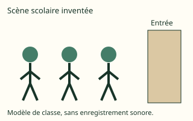
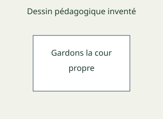

# Français intensif Form 5, Form Five Français intensif: authored answers for review

Every answer fixed by a person, not computed. Part 1: the tables, conventions and rules that computed answers come from.
Part 2: every authored question template, with all its data (keys, statements, pairs, choices and feedback) and sources.
Regenerate with `npm run review:f5-francais-intensif`. Item IDs (TR-…) match `docs/teacher-review.md`.

## Part 1

Rules the computed answers use are listed in the subject’s library tests; every authored answer is in Part 2.

## Part 2: authored question templates

| # | Template | Lesson | Type, level | Sources |
|---|---|---|---|---|
| 1 | `fi5-1-notions` | 1 | multiple choice, 1 | francais |
| 2 | `fi5-1-cas` | 1 | multiple choice, 1 | francais |
| 3 | `fi5-1-appliquer` | 1 | multiple choice, 2 | francais |
| 4 | `fi5-1-relier` | 1 | matching, 2 | francais |
| 5 | `fi5-1-corriger` | 1 | spot the error, 3 | francais |
| 6 | `fi5-1-corriger-card` (card fi5-1-c3) | 1 | spot the error, 1 | francais |
| 7 | `fi5-2-notions` | 2 | multiple choice, 1 | francais |
| 8 | `fi5-2-cas` | 2 | multiple choice, 1 | francais |
| 9 | `fi5-2-appliquer` | 2 | multiple choice, 2 | francais |
| 10 | `fi5-2-relier` | 2 | matching, 2 | francais |
| 11 | `fi5-2-corriger` | 2 | spot the error, 3 | francais |
| 12 | `fi5-2-corriger-card` (card fi5-2-c3) | 2 | spot the error, 1 | francais |
| 13 | `fi5-3-notions` | 3 | multiple choice, 1 | francais |
| 14 | `fi5-3-cas` | 3 | multiple choice, 1 | francais |
| 15 | `fi5-3-appliquer` | 3 | multiple choice, 2 | francais |
| 16 | `fi5-3-relier` | 3 | matching, 2 | francais |
| 17 | `fi5-3-corriger` | 3 | spot the error, 3 | francais |
| 18 | `fi5-3-corriger-card` (card fi5-3-c3) | 3 | spot the error, 1 | francais |
| 19 | `fi5-6-notions` | 6 | multiple choice, 1 | francais |
| 20 | `fi5-6-cas` | 6 | multiple choice, 1 | francais |
| 21 | `fi5-6-appliquer` | 6 | multiple choice, 2 | francais |
| 22 | `fi5-6-relier` | 6 | matching, 2 | francais |
| 23 | `fi5-6-corriger` | 6 | spot the error, 3 | francais |
| 24 | `fi5-6-corriger-card` (card fi5-6-c3) | 6 | spot the error, 1 | francais |
| 25 | `fi5-7-notions` | 7 | multiple choice, 1 | francais |
| 26 | `fi5-7-cas` | 7 | multiple choice, 1 | francais |
| 27 | `fi5-7-relier` | 7 | matching, 2 | francais |
| 28 | `fi5-7-corriger` | 7 | spot the error, 3 | francais |
| 29 | `fi5-7-corriger-card` (card fi5-7-c3) | 7 | spot the error, 1 | francais |
| 30 | `fi5-9-notions` | 9 | multiple choice, 1 | francais |
| 31 | `fi5-9-cas` | 9 | multiple choice, 1 | francais |
| 32 | `fi5-9-contexte` | 9 | multiple choice, 2 | francais |
| 33 | `fi5-9-relier` | 9 | matching, 2 | francais |
| 34 | `fi5-9-corriger` | 9 | spot the error, 3 | francais |
| 35 | `fi5-9-corriger-card` (card fi5-9-c3) | 9 | spot the error, 1 | francais |
| 36 | `fi5-11-notions` | 11 | multiple choice, 1 | francais |
| 37 | `fi5-11-cas` | 11 | multiple choice, 1 | francais |
| 38 | `fi5-11-relier` | 11 | matching, 2 | francais |
| 39 | `fi5-11-corriger` | 11 | spot the error, 3 | francais |
| 40 | `fi5-11-corriger-card` (card fi5-11-c3) | 11 | spot the error, 1 | francais |
| 41 | `fi5-13-notions` | 13 | multiple choice, 1 | francais |
| 42 | `fi5-13-cas` | 13 | multiple choice, 1 | francais |
| 43 | `fi5-13-relier` | 13 | matching, 2 | francais |
| 44 | `fi5-13-corriger` | 13 | spot the error, 3 | francais |
| 45 | `fi5-13-corriger-card` (card fi5-13-c3) | 13 | spot the error, 1 | francais |
| 46 | `fi5-15-notions` | 15 | multiple choice, 1 | francais |
| 47 | `fi5-15-cas` | 15 | multiple choice, 1 | francais |
| 48 | `fi5-15-construire` | 15 | word order, 2 | francais |
| 49 | `fi5-15-relier` | 15 | matching, 2 | francais |
| 50 | `fi5-15-corriger` | 15 | spot the error, 3 | francais |
| 51 | `fi5-15-corriger-card` (card fi5-15-c3) | 15 | spot the error, 1 | francais |
| 52 | `fi5-16-notions` | 16 | multiple choice, 1 | francais |
| 53 | `fi5-16-cas` | 16 | multiple choice, 1 | francais |
| 54 | `fi5-16-contexte` | 16 | multiple choice, 2 | francais |
| 55 | `fi5-16-relier` | 16 | matching, 2 | francais |
| 56 | `fi5-16-corriger` | 16 | spot the error, 3 | francais |
| 57 | `fi5-16-corriger-card` (card fi5-16-c3) | 16 | spot the error, 1 | francais |
| 58 | `fi5-17-notions` | 17 | multiple choice, 1 | francais |
| 59 | `fi5-17-cas` | 17 | multiple choice, 1 | francais |
| 60 | `fi5-17-traduire` | 17 | multiple choice, 2 | francais |
| 61 | `fi5-17-relier` | 17 | matching, 2 | francais |
| 62 | `fi5-17-corriger` | 17 | spot the error, 3 | francais |
| 63 | `fi5-17-corriger-card` (card fi5-17-c3) | 17 | spot the error, 1 | francais |
| 64 | `fi5-19-notions` | 19 | multiple choice, 1 | francais |
| 65 | `fi5-19-cas` | 19 | multiple choice, 1 | francais |
| 66 | `fi5-19-relier` | 19 | matching, 2 | francais |
| 67 | `fi5-19-corriger` | 19 | spot the error, 3 | francais |
| 68 | `fi5-19-corriger-card` (card fi5-19-c3) | 19 | spot the error, 1 | francais |
| 69 | `fi5-21-notions` | 21 | multiple choice, 1 | francais |
| 70 | `fi5-21-cas` | 21 | multiple choice, 1 | francais |
| 71 | `fi5-21-appliquer` | 21 | multiple choice, 2 | francais |
| 72 | `fi5-21-relier` | 21 | matching, 2 | francais |
| 73 | `fi5-21-corriger` | 21 | spot the error, 3 | francais |
| 74 | `fi5-21-corriger-card` (card fi5-21-c3) | 21 | spot the error, 1 | francais |
| 75 | `fi5-23-notions` | 23 | multiple choice, 1 | francais |
| 76 | `fi5-23-cas` | 23 | multiple choice, 1 | francais |
| 77 | `fi5-23-image` | 23 | multiple choice, 2 | francais |
| 78 | `fi5-23-relier` | 23 | matching, 2 | francais |
| 79 | `fi5-23-corriger` | 23 | spot the error, 3 | francais |
| 80 | `fi5-23-corriger-card` (card fi5-23-c3) | 23 | spot the error, 1 | francais |
| 81 | `fi5-24-notions` | 24 | multiple choice, 1 | francais |
| 82 | `fi5-24-cas` | 24 | multiple choice, 1 | francais |
| 83 | `fi5-24-construire` | 24 | word order, 2 | francais |
| 84 | `fi5-24-relier` | 24 | matching, 2 | francais |
| 85 | `fi5-24-corriger` | 24 | spot the error, 3 | francais |
| 86 | `fi5-24-corriger-card` (card fi5-24-c3) | 24 | spot the error, 1 | francais |
| 87 | `fi5-28-notions` | 28 | multiple choice, 1 | francais |
| 88 | `fi5-28-cas` | 28 | multiple choice, 1 | francais |
| 89 | `fi5-28-contexte` | 28 | multiple choice, 2 | francais |
| 90 | `fi5-28-relier` | 28 | matching, 2 | francais |
| 91 | `fi5-28-corriger` | 28 | spot the error, 3 | francais |
| 92 | `fi5-28-corriger-card` (card fi5-28-c3) | 28 | spot the error, 1 | francais |
| 93 | `fi5-29-notions` | 29 | multiple choice, 1 | francais |
| 94 | `fi5-29-cas` | 29 | multiple choice, 1 | francais |
| 95 | `fi5-29-appliquer` | 29 | multiple choice, 2 | francais |
| 96 | `fi5-29-relier` | 29 | matching, 2 | francais |
| 97 | `fi5-29-corriger` | 29 | spot the error, 3 | francais |
| 98 | `fi5-29-corriger-card` (card fi5-29-c3) | 29 | spot the error, 1 | francais |
| 99 | `fi5-31-notions` | 31 | multiple choice, 1 | francais |
| 100 | `fi5-31-cas` | 31 | multiple choice, 1 | francais |
| 101 | `fi5-31-relier` | 31 | matching, 2 | francais |
| 102 | `fi5-31-corriger` | 31 | spot the error, 3 | francais |
| 103 | `fi5-31-corriger-card` (card fi5-31-c3) | 31 | spot the error, 1 | francais |
| 104 | `fi5-33-notions` | 33 | multiple choice, 1 | francais |
| 105 | `fi5-33-cas` | 33 | multiple choice, 1 | francais |
| 106 | `fi5-33-appliquer` | 33 | multiple choice, 2 | francais |
| 107 | `fi5-33-relier` | 33 | matching, 2 | francais |
| 108 | `fi5-33-corriger` | 33 | spot the error, 3 | francais |
| 109 | `fi5-33-corriger-card` (card fi5-33-c3) | 33 | spot the error, 1 | francais |
| 110 | `fi5-34-notions` | 34 | multiple choice, 1 | francais |
| 111 | `fi5-34-cas` | 34 | multiple choice, 1 | francais |
| 112 | `fi5-34-contexte` | 34 | multiple choice, 2 | francais |
| 113 | `fi5-34-relier` | 34 | matching, 2 | francais |
| 114 | `fi5-34-corriger` | 34 | spot the error, 3 | francais |
| 115 | `fi5-34-corriger-card` (card fi5-34-c3) | 34 | spot the error, 1 | francais |
| 116 | `fi5-36-notions` | 36 | multiple choice, 1 | francais |
| 117 | `fi5-36-cas` | 36 | multiple choice, 1 | francais |
| 118 | `fi5-36-relier` | 36 | matching, 2 | francais |
| 119 | `fi5-36-corriger` | 36 | spot the error, 3 | francais |
| 120 | `fi5-36-corriger-card` (card fi5-36-c3) | 36 | spot the error, 1 | francais |
| 121 | `fi5-38-notions` | 38 | multiple choice, 1 | francais |
| 122 | `fi5-38-cas` | 38 | multiple choice, 1 | francais |
| 123 | `fi5-38-appliquer` | 38 | multiple choice, 2 | francais |
| 124 | `fi5-38-relier` | 38 | matching, 2 | francais |
| 125 | `fi5-38-corriger` | 38 | spot the error, 3 | francais |
| 126 | `fi5-38-corriger-card` (card fi5-38-c3) | 38 | spot the error, 1 | francais |
| 127 | `fi5-39-notions` | 39 | multiple choice, 1 | francais |
| 128 | `fi5-39-cas` | 39 | multiple choice, 1 | francais |
| 129 | `fi5-39-image` | 39 | multiple choice, 2 | francais |
| 130 | `fi5-39-relier` | 39 | matching, 2 | francais |
| 131 | `fi5-39-corriger` | 39 | spot the error, 3 | francais |
| 132 | `fi5-39-corriger-card` (card fi5-39-c3) | 39 | spot the error, 1 | francais |
| 133 | `fi5-41-notions` | 41 | multiple choice, 1 | francais |
| 134 | `fi5-41-cas` | 41 | multiple choice, 1 | francais |
| 135 | `fi5-41-relier` | 41 | matching, 2 | francais |
| 136 | `fi5-41-corriger` | 41 | spot the error, 3 | francais |
| 137 | `fi5-41-corriger-card` (card fi5-41-c3) | 41 | spot the error, 1 | francais |
| 138 | `fi5-43-notions` | 43 | multiple choice, 1 | francais |
| 139 | `fi5-43-cas` | 43 | multiple choice, 1 | francais |
| 140 | `fi5-43-construire` | 43 | word order, 2 | francais |
| 141 | `fi5-43-relier` | 43 | matching, 2 | francais |
| 142 | `fi5-43-corriger` | 43 | spot the error, 3 | francais |
| 143 | `fi5-43-corriger-card` (card fi5-43-c3) | 43 | spot the error, 1 | francais |
| 144 | `fi5-45-notions` | 45 | multiple choice, 1 | francais |
| 145 | `fi5-45-cas` | 45 | multiple choice, 1 | francais |
| 146 | `fi5-45-appliquer` | 45 | multiple choice, 2 | francais |
| 147 | `fi5-45-relier` | 45 | matching, 2 | francais |
| 148 | `fi5-45-corriger` | 45 | spot the error, 3 | francais |
| 149 | `fi5-45-corriger-card` (card fi5-45-c3) | 45 | spot the error, 1 | francais |
| 150 | `fi5-46-notions` | 46 | multiple choice, 1 | francais |
| 151 | `fi5-46-cas` | 46 | multiple choice, 1 | francais |
| 152 | `fi5-46-appliquer` | 46 | multiple choice, 2 | francais |
| 153 | `fi5-46-relier` | 46 | matching, 2 | francais |
| 154 | `fi5-46-corriger` | 46 | spot the error, 3 | francais |
| 155 | `fi5-46-corriger-card` (card fi5-46-c3) | 46 | spot the error, 1 | francais |
| 156 | `fi5-49-notions` | 49 | multiple choice, 1 | francais |
| 157 | `fi5-49-cas` | 49 | multiple choice, 1 | francais |
| 158 | `fi5-49-traduire` | 49 | multiple choice, 2 | francais |
| 159 | `fi5-49-relier` | 49 | matching, 2 | francais |
| 160 | `fi5-49-corriger` | 49 | spot the error, 3 | francais |
| 161 | `fi5-49-corriger-card` (card fi5-49-c3) | 49 | spot the error, 1 | francais |
| 162 | `fi5-50-notions` | 50 | multiple choice, 1 | francais |
| 163 | `fi5-50-cas` | 50 | multiple choice, 1 | francais |
| 164 | `fi5-50-appliquer` | 50 | multiple choice, 2 | francais |
| 165 | `fi5-50-relier` | 50 | matching, 2 | francais |
| 166 | `fi5-50-corriger` | 50 | spot the error, 3 | francais |
| 167 | `fi5-50-corriger-card` (card fi5-50-c3) | 50 | spot the error, 1 | francais |
| 168 | `fi5-51-notions` | 51 | multiple choice, 1 | francais |
| 169 | `fi5-51-cas` | 51 | multiple choice, 1 | francais |
| 170 | `fi5-51-construire` | 51 | word order, 2 | francais |
| 171 | `fi5-51-relier` | 51 | matching, 2 | francais |
| 172 | `fi5-51-corriger` | 51 | spot the error, 3 | francais |
| 173 | `fi5-51-corriger-card` (card fi5-51-c3) | 51 | spot the error, 1 | francais |

### `fi5-1-notions` · Lesson 1 · multiple choice, level 1

Prompt: {X.q}

Table `X` (one row is picked each time):

| q | r | w | e | y |
|---|---|---|---|---|
| Quel terme désigne l’ajout d’un affixe devant la base ? | préfixation | suffixation · composition · analyse contextuelle | Cela désigne l’ajout d’un affixe après la base, plutôt que la notion demandée. · Cela désigne l’association d’éléments en une unité lexicale, plutôt que la notion demandée. · Cela désigne la vérification du sens et de la classe dans une phrase, plutôt que la notion demandée. | Un préfixe précède la base. |
| Quel terme désigne l’ajout d’un affixe après la base ? | suffixation | préfixation · composition · analyse contextuelle | Cela désigne l’ajout d’un affixe devant la base, plutôt que la notion demandée. · Cela désigne l’association d’éléments en une unité lexicale, plutôt que la notion demandée. · Cela désigne la vérification du sens et de la classe dans une phrase, plutôt que la notion demandée. | Des suffixes forment des noms à partir d’autres bases. |
| Quel terme désigne l’association d’éléments en une unité lexicale ? | composition | préfixation · suffixation · analyse contextuelle | Cela désigne l’ajout d’un affixe devant la base, plutôt que la notion demandée. · Cela désigne l’ajout d’un affixe après la base, plutôt que la notion demandée. · Cela désigne la vérification du sens et de la classe dans une phrase, plutôt que la notion demandée. | Le sens de l’ensemble doit être vérifié. |
| Quel terme désigne la vérification du sens et de la classe dans une phrase ? | analyse contextuelle | préfixation · suffixation · composition | Cela désigne l’ajout d’un affixe devant la base, plutôt que la notion demandée. · Cela désigne l’ajout d’un affixe après la base, plutôt que la notion demandée. · Cela désigne l’association d’éléments en une unité lexicale, plutôt que la notion demandée. | La structure lexicale et le contexte doivent être examinés. |

Right answer: `{X.r}`; wrong choices: `{X.w[0]}`, `{X.w[1]}`, `{X.w[2]}`

- Feedback `w0`: “{X.e[0]}”
- Feedback `w1`: “{X.e[1]}”
- Feedback `w2`: “{X.e[2]}”

Three generated variants:

> Quel terme désigne l’ajout d’un affixe après la base ?

- ◻️ composition  
  _↳ feedback if chosen: Cela désigne l’association d’éléments en une unité lexicale, plutôt que la notion demandée._
- ✅ suffixation
- ◻️ préfixation  
  _↳ feedback if chosen: Cela désigne l’ajout d’un affixe devant la base, plutôt que la notion demandée._
- ◻️ analyse contextuelle  
  _↳ feedback if chosen: Cela désigne la vérification du sens et de la classe dans une phrase, plutôt que la notion demandée._

Full working after a second miss:

> Des suffixes forment des noms à partir d’autres bases.  
> Donc la réponse est « suffixation ».  

> Quel terme désigne la vérification du sens et de la classe dans une phrase ?

- ◻️ composition  
  _↳ feedback if chosen: Cela désigne l’association d’éléments en une unité lexicale, plutôt que la notion demandée._
- ✅ analyse contextuelle
- ◻️ préfixation  
  _↳ feedback if chosen: Cela désigne l’ajout d’un affixe devant la base, plutôt que la notion demandée._
- ◻️ suffixation  
  _↳ feedback if chosen: Cela désigne l’ajout d’un affixe après la base, plutôt que la notion demandée._

Full working after a second miss:

> La structure lexicale et le contexte doivent être examinés.  
> Donc la réponse est « analyse contextuelle ».  

> Quel terme désigne l’ajout d’un affixe après la base ?

- ◻️ préfixation  
  _↳ feedback if chosen: Cela désigne l’ajout d’un affixe devant la base, plutôt que la notion demandée._
- ◻️ composition  
  _↳ feedback if chosen: Cela désigne l’association d’éléments en une unité lexicale, plutôt que la notion demandée._
- ◻️ analyse contextuelle  
  _↳ feedback if chosen: Cela désigne la vérification du sens et de la classe dans une phrase, plutôt que la notion demandée._
- ✅ suffixation

Full working after a second miss:

> Des suffixes forment des noms à partir d’autres bases.  
> Donc la réponse est « suffixation ».  

Sources: francais (Supports et traductions originaux ; adaptations explicites de fondations Form Four et French Form Five ; OQLF, dictionnaires d’éditeurs, Portail linguistique et références thématiques conservées)

### `fi5-1-cas` · Lesson 1 · multiple choice, level 1

Prompt: {X.q}

Table `X` (one row is picked each time):

| q | r | w | e | y |
|---|---|---|---|---|
| Relire associe re- à lire.
Quelle notion convient ? | préfixation | suffixation · composition · analyse contextuelle | Cela concerne l’ajout d’un affixe après la base. Compare cette définition avec le cas présenté. · Cela concerne l’association d’éléments en une unité lexicale. Compare cette définition avec le cas présenté. · Cela concerne la vérification du sens et de la classe dans une phrase. Compare cette définition avec le cas présenté. | Un préfixe précède la base. |
| Rangement emploie un suffixe nominal.
Quelle notion convient ? | suffixation | préfixation · composition · analyse contextuelle | Cela concerne l’ajout d’un affixe devant la base. Compare cette définition avec le cas présenté. · Cela concerne l’association d’éléments en une unité lexicale. Compare cette définition avec le cas présenté. · Cela concerne la vérification du sens et de la classe dans une phrase. Compare cette définition avec le cas présenté. | Des suffixes forment des noms à partir d’autres bases. |
| Chou-fleur est un composé.
Quelle notion convient ? | composition | préfixation · suffixation · analyse contextuelle | Cela concerne l’ajout d’un affixe devant la base. Compare cette définition avec le cas présenté. · Cela concerne l’ajout d’un affixe après la base. Compare cette définition avec le cas présenté. · Cela concerne la vérification du sens et de la classe dans une phrase. Compare cette définition avec le cas présenté. | Le sens de l’ensemble doit être vérifié. |
| Cahier bleu est ici un groupe descriptif ordinaire.
Quelle notion convient ? | analyse contextuelle | préfixation · suffixation · composition | Cela concerne l’ajout d’un affixe devant la base. Compare cette définition avec le cas présenté. · Cela concerne l’ajout d’un affixe après la base. Compare cette définition avec le cas présenté. · Cela concerne l’association d’éléments en une unité lexicale. Compare cette définition avec le cas présenté. | La structure lexicale et le contexte doivent être examinés. |

Right answer: `{X.r}`; wrong choices: `{X.w[0]}`, `{X.w[1]}`, `{X.w[2]}`

- Feedback `w0`: “{X.e[0]}”
- Feedback `w1`: “{X.e[1]}”
- Feedback `w2`: “{X.e[2]}”

Three generated variants:

> Chou-fleur est un composé.
> Quelle notion convient ?

- ◻️ suffixation  
  _↳ feedback if chosen: Cela concerne l’ajout d’un affixe après la base. Compare cette définition avec le cas présenté._
- ◻️ analyse contextuelle  
  _↳ feedback if chosen: Cela concerne la vérification du sens et de la classe dans une phrase. Compare cette définition avec le cas présenté._
- ✅ composition
- ◻️ préfixation  
  _↳ feedback if chosen: Cela concerne l’ajout d’un affixe devant la base. Compare cette définition avec le cas présenté._

Full working after a second miss:

> Le sens de l’ensemble doit être vérifié.  
> Donc la réponse est « composition ».  

> Relire associe re- à lire.
> Quelle notion convient ?

- ◻️ suffixation  
  _↳ feedback if chosen: Cela concerne l’ajout d’un affixe après la base. Compare cette définition avec le cas présenté._
- ✅ préfixation
- ◻️ analyse contextuelle  
  _↳ feedback if chosen: Cela concerne la vérification du sens et de la classe dans une phrase. Compare cette définition avec le cas présenté._
- ◻️ composition  
  _↳ feedback if chosen: Cela concerne l’association d’éléments en une unité lexicale. Compare cette définition avec le cas présenté._

Full working after a second miss:

> Un préfixe précède la base.  
> Donc la réponse est « préfixation ».  

> Chou-fleur est un composé.
> Quelle notion convient ?

- ◻️ analyse contextuelle  
  _↳ feedback if chosen: Cela concerne la vérification du sens et de la classe dans une phrase. Compare cette définition avec le cas présenté._
- ◻️ suffixation  
  _↳ feedback if chosen: Cela concerne l’ajout d’un affixe après la base. Compare cette définition avec le cas présenté._
- ✅ composition
- ◻️ préfixation  
  _↳ feedback if chosen: Cela concerne l’ajout d’un affixe devant la base. Compare cette définition avec le cas présenté._

Full working after a second miss:

> Le sens de l’ensemble doit être vérifié.  
> Donc la réponse est « composition ».  

Sources: francais (Supports et traductions originaux ; adaptations explicites de fondations Form Four et French Form Five ; OQLF, dictionnaires d’éditeurs, Portail linguistique et références thématiques conservées)

### `fi5-1-appliquer` · Lesson 1 · multiple choice, level 2

Prompt: {X.q}

Table `X` (one row is picked each time):

| q | r | w | e | y |
|---|---|---|---|---|
| Dans relire, quelle analyse est pertinente ? | Re- est placé avant la base lire. | Re- est obligatoirement un suffixe final. · Lire est une marque de pluriel. · Le mot contient nécessairement deux noms complets. | Il précède la base. · Lire fournit la base verbale. · Ce modèle est dérivé. | Identifie position et rôle. |
| Dans rangement, que fait le suffixe étudié ? | Il contribue à former un nom sur une base verbale. | Il indique toujours un futur. · Il remplace toute la phrase par une ponctuation. · Il prouve qu’aucun lien de sens n’existe. | Ce n’est pas une terminaison de futur. · Le mot formé est lexical. · La dérivation entretient un lien à analyser. | La classe du mot obtenu compte. |
| Pourquoi pomme de terre peut-il être un composé sans trait d’union ? | Une unité lexicale peut comprendre plusieurs éléments non reliés par des traits. | Le trait est obligatoire dans tous les composés. · Terre doit toujours être conjugué. · Tous les groupes libres deviennent composés. | L’exemple montre une autre structure. · Terre est un nom ici. · L’unité lexicale doit être établie. | Le signe graphique n’est pas le seul critère. |
| Quel contrôle évite une famille de mots inventée ? | Vérifier le lien de formation et de sens. | Choisir seulement les mots de même longueur. · Compter uniquement les voyelles. · Ignorer le contexte de tous les mots. | La longueur ne prouve pas la parenté. · Le nombre de voyelles ne prouve pas la formation. · Le sens en contexte aide à analyser. | Une ressemblance seule ne suffit pas. |

Right answer: `{X.r}`; wrong choices: `{X.w[0]}`, `{X.w[1]}`, `{X.w[2]}`

- Feedback `w0`: “{X.e[0]}”
- Feedback `w1`: “{X.e[1]}”
- Feedback `w2`: “{X.e[2]}”

Three generated variants:

> Dans relire, quelle analyse est pertinente ?

- ✅ Re- est placé avant la base lire.
- ◻️ Lire est une marque de pluriel.  
  _↳ feedback if chosen: Lire fournit la base verbale._
- ◻️ Re- est obligatoirement un suffixe final.  
  _↳ feedback if chosen: Il précède la base._
- ◻️ Le mot contient nécessairement deux noms complets.  
  _↳ feedback if chosen: Ce modèle est dérivé._

Full working after a second miss:

> Identifie position et rôle.  
> Donc la réponse est « Re- est placé avant la base lire. ».  

> Dans rangement, que fait le suffixe étudié ?

- ◻️ Il remplace toute la phrase par une ponctuation.  
  _↳ feedback if chosen: Le mot formé est lexical._
- ✅ Il contribue à former un nom sur une base verbale.
- ◻️ Il indique toujours un futur.  
  _↳ feedback if chosen: Ce n’est pas une terminaison de futur._
- ◻️ Il prouve qu’aucun lien de sens n’existe.  
  _↳ feedback if chosen: La dérivation entretient un lien à analyser._

Full working after a second miss:

> La classe du mot obtenu compte.  
> Donc la réponse est « Il contribue à former un nom sur une base verbale. ».  

> Pourquoi pomme de terre peut-il être un composé sans trait d’union ?

- ◻️ Le trait est obligatoire dans tous les composés.  
  _↳ feedback if chosen: L’exemple montre une autre structure._
- ◻️ Tous les groupes libres deviennent composés.  
  _↳ feedback if chosen: L’unité lexicale doit être établie._
- ✅ Une unité lexicale peut comprendre plusieurs éléments non reliés par des traits.
- ◻️ Terre doit toujours être conjugué.  
  _↳ feedback if chosen: Terre est un nom ici._

Full working after a second miss:

> Le signe graphique n’est pas le seul critère.  
> Donc la réponse est « Une unité lexicale peut comprendre plusieurs éléments non reliés par des traits. ».  

Sources: francais (Supports et traductions originaux ; adaptations explicites de fondations Form Four et French Form Five ; OQLF, dictionnaires d’éditeurs, Portail linguistique et références thématiques conservées)

### `fi5-1-relier` · Lesson 1 · matching, level 2

Prompt: Relie chaque notion à son exemple.

Pairs (3 shown each time):

- préfixation → **Relire associe re- à lire.**
- suffixation → **Rangement emploie un suffixe nominal.**
- composition → **Chou-fleur est un composé.**
- analyse contextuelle → **Cahier bleu est ici un groupe descriptif ordinaire.**

Three generated variants:

> Relie chaque notion à son exemple.

Right-hand side (shuffled): Cahier bleu est ici un groupe descriptif ordinaire. · Relire associe re- à lire. · Chou-fleur est un composé.
- analyse contextuelle → **Cahier bleu est ici un groupe descriptif ordinaire.**
- composition → **Chou-fleur est un composé.**
- préfixation → **Relire associe re- à lire.**

Full working after a second miss:

> Les bonnes paires sont :  
> analyse contextuelle → Cahier bleu est ici un groupe descriptif ordinaire.  
> composition → Chou-fleur est un composé.  
> préfixation → Relire associe re- à lire.  

> Relie chaque notion à son exemple.

Right-hand side (shuffled): Rangement emploie un suffixe nominal. · Cahier bleu est ici un groupe descriptif ordinaire. · Relire associe re- à lire.
- analyse contextuelle → **Cahier bleu est ici un groupe descriptif ordinaire.**
- préfixation → **Relire associe re- à lire.**
- suffixation → **Rangement emploie un suffixe nominal.**

Full working after a second miss:

> Les bonnes paires sont :  
> analyse contextuelle → Cahier bleu est ici un groupe descriptif ordinaire.  
> préfixation → Relire associe re- à lire.  
> suffixation → Rangement emploie un suffixe nominal.  

> Relie chaque notion à son exemple.

Right-hand side (shuffled): Cahier bleu est ici un groupe descriptif ordinaire. · Chou-fleur est un composé. · Relire associe re- à lire.
- préfixation → **Relire associe re- à lire.**
- analyse contextuelle → **Cahier bleu est ici un groupe descriptif ordinaire.**
- composition → **Chou-fleur est un composé.**

Full working after a second miss:

> Les bonnes paires sont :  
> préfixation → Relire associe re- à lire.  
> analyse contextuelle → Cahier bleu est ici un groupe descriptif ordinaire.  
> composition → Chou-fleur est un composé.  

Sources: francais (Supports et traductions originaux ; adaptations explicites de fondations Form Four et French Form Five ; OQLF, dictionnaires d’éditeurs, Portail linguistique et références thématiques conservées)

### `fi5-1-corriger` · Lesson 1 · spot the error, level 3

Prompt: Repère la formulation ou l’affirmation incorrecte.

Shows 3 correct and 1 wrong statement(s), drawn from:

- ✅ préfixation : l’ajout d’un affixe devant la base.
- ✅ suffixation : l’ajout d’un affixe après la base.
- ✅ composition : l’association d’éléments en une unité lexicale.
- ✅ analyse contextuelle : la vérification du sens et de la classe dans une phrase.
- ❌ Tout préfixe se place après la base.  
  _↳ Un préfixe précède la base._
- ❌ Un suffixe ne peut jamais changer la classe d’un mot.  
  _↳ Des suffixes forment des noms à partir d’autres bases._
- ❌ Tous les composés doivent avoir exactement le même sens que chaque élément isolé.  
  _↳ Le sens de l’ensemble doit être vérifié._
- ❌ Tout groupe contenant un adjectif est automatiquement un nom composé.  
  _↳ La structure lexicale et le contexte doivent être examinés._

Three generated variants:

> Repère la formulation ou l’affirmation incorrecte.

- ◻️ composition : l’association d’éléments en une unité lexicale.  
  _↳ explanation: Cette distinction est correcte : Le sens de l’ensemble doit être vérifié. Cherche plutôt une phrase qui contredit le sens ou la règle._
- ◻️ analyse contextuelle : la vérification du sens et de la classe dans une phrase.  
  _↳ explanation: Cette distinction est correcte : La structure lexicale et le contexte doivent être examinés. Cherche plutôt une phrase qui contredit le sens ou la règle._
- ◻️ préfixation : l’ajout d’un affixe devant la base.  
  _↳ explanation: Cette distinction est correcte : Un préfixe précède la base. Cherche plutôt une phrase qui contredit le sens ou la règle._
- ✅ Tous les composés doivent avoir exactement le même sens que chaque élément isolé.  
  _↳ explanation: Le sens de l’ensemble doit être vérifié._

Full working after a second miss:

> La phrase fausse est « Tous les composés doivent avoir exactement le même sens que chaque élément isolé. ».  
> Le sens de l’ensemble doit être vérifié.  

> Repère la formulation ou l’affirmation incorrecte.

- ◻️ préfixation : l’ajout d’un affixe devant la base.  
  _↳ explanation: Cette distinction est correcte : Un préfixe précède la base. Cherche plutôt une phrase qui contredit le sens ou la règle._
- ◻️ suffixation : l’ajout d’un affixe après la base.  
  _↳ explanation: Cette distinction est correcte : Des suffixes forment des noms à partir d’autres bases. Cherche plutôt une phrase qui contredit le sens ou la règle._
- ✅ Tout préfixe se place après la base.  
  _↳ explanation: Un préfixe précède la base._
- ◻️ composition : l’association d’éléments en une unité lexicale.  
  _↳ explanation: Cette distinction est correcte : Le sens de l’ensemble doit être vérifié. Cherche plutôt une phrase qui contredit le sens ou la règle._

Full working after a second miss:

> La phrase fausse est « Tout préfixe se place après la base. ».  
> Un préfixe précède la base.  

> Repère la formulation ou l’affirmation incorrecte.

- ◻️ suffixation : l’ajout d’un affixe après la base.  
  _↳ explanation: Cette distinction est correcte : Des suffixes forment des noms à partir d’autres bases. Cherche plutôt une phrase qui contredit le sens ou la règle._
- ◻️ composition : l’association d’éléments en une unité lexicale.  
  _↳ explanation: Cette distinction est correcte : Le sens de l’ensemble doit être vérifié. Cherche plutôt une phrase qui contredit le sens ou la règle._
- ◻️ préfixation : l’ajout d’un affixe devant la base.  
  _↳ explanation: Cette distinction est correcte : Un préfixe précède la base. Cherche plutôt une phrase qui contredit le sens ou la règle._
- ✅ Tout groupe contenant un adjectif est automatiquement un nom composé.  
  _↳ explanation: La structure lexicale et le contexte doivent être examinés._

Full working after a second miss:

> La phrase fausse est « Tout groupe contenant un adjectif est automatiquement un nom composé. ».  
> La structure lexicale et le contexte doivent être examinés.  

Sources: francais (Supports et traductions originaux ; adaptations explicites de fondations Form Four et French Form Five ; OQLF, dictionnaires d’éditeurs, Portail linguistique et références thématiques conservées)

### `fi5-1-corriger-card` · Lesson 1 · spot the error, level 1

Prompt: Repère la formulation ou l’affirmation incorrecte.

Shows 3 correct and 1 wrong statement(s), drawn from:

- ✅ préfixation : l’ajout d’un affixe devant la base.
- ✅ suffixation : l’ajout d’un affixe après la base.
- ✅ composition : l’association d’éléments en une unité lexicale.
- ✅ analyse contextuelle : la vérification du sens et de la classe dans une phrase.
- ❌ Tout préfixe se place après la base.  
  _↳ Un préfixe précède la base._
- ❌ Un suffixe ne peut jamais changer la classe d’un mot.  
  _↳ Des suffixes forment des noms à partir d’autres bases._
- ❌ Tous les composés doivent avoir exactement le même sens que chaque élément isolé.  
  _↳ Le sens de l’ensemble doit être vérifié._
- ❌ Tout groupe contenant un adjectif est automatiquement un nom composé.  
  _↳ La structure lexicale et le contexte doivent être examinés._

Three generated variants:

> Repère la formulation ou l’affirmation incorrecte.

- ◻️ préfixation : l’ajout d’un affixe devant la base.  
  _↳ explanation: Cette distinction est correcte : Un préfixe précède la base. Cherche plutôt une phrase qui contredit le sens ou la règle._
- ◻️ composition : l’association d’éléments en une unité lexicale.  
  _↳ explanation: Cette distinction est correcte : Le sens de l’ensemble doit être vérifié. Cherche plutôt une phrase qui contredit le sens ou la règle._
- ✅ Un suffixe ne peut jamais changer la classe d’un mot.  
  _↳ explanation: Des suffixes forment des noms à partir d’autres bases._
- ◻️ analyse contextuelle : la vérification du sens et de la classe dans une phrase.  
  _↳ explanation: Cette distinction est correcte : La structure lexicale et le contexte doivent être examinés. Cherche plutôt une phrase qui contredit le sens ou la règle._

Full working after a second miss:

> La phrase fausse est « Un suffixe ne peut jamais changer la classe d’un mot. ».  
> Des suffixes forment des noms à partir d’autres bases.  

> Repère la formulation ou l’affirmation incorrecte.

- ◻️ préfixation : l’ajout d’un affixe devant la base.  
  _↳ explanation: Cette distinction est correcte : Un préfixe précède la base. Cherche plutôt une phrase qui contredit le sens ou la règle._
- ◻️ analyse contextuelle : la vérification du sens et de la classe dans une phrase.  
  _↳ explanation: Cette distinction est correcte : La structure lexicale et le contexte doivent être examinés. Cherche plutôt une phrase qui contredit le sens ou la règle._
- ✅ Tous les composés doivent avoir exactement le même sens que chaque élément isolé.  
  _↳ explanation: Le sens de l’ensemble doit être vérifié._
- ◻️ composition : l’association d’éléments en une unité lexicale.  
  _↳ explanation: Cette distinction est correcte : Le sens de l’ensemble doit être vérifié. Cherche plutôt une phrase qui contredit le sens ou la règle._

Full working after a second miss:

> La phrase fausse est « Tous les composés doivent avoir exactement le même sens que chaque élément isolé. ».  
> Le sens de l’ensemble doit être vérifié.  

> Repère la formulation ou l’affirmation incorrecte.

- ✅ Tout groupe contenant un adjectif est automatiquement un nom composé.  
  _↳ explanation: La structure lexicale et le contexte doivent être examinés._
- ◻️ composition : l’association d’éléments en une unité lexicale.  
  _↳ explanation: Cette distinction est correcte : Le sens de l’ensemble doit être vérifié. Cherche plutôt une phrase qui contredit le sens ou la règle._
- ◻️ suffixation : l’ajout d’un affixe après la base.  
  _↳ explanation: Cette distinction est correcte : Des suffixes forment des noms à partir d’autres bases. Cherche plutôt une phrase qui contredit le sens ou la règle._
- ◻️ analyse contextuelle : la vérification du sens et de la classe dans une phrase.  
  _↳ explanation: Cette distinction est correcte : La structure lexicale et le contexte doivent être examinés. Cherche plutôt une phrase qui contredit le sens ou la règle._

Full working after a second miss:

> La phrase fausse est « Tout groupe contenant un adjectif est automatiquement un nom composé. ».  
> La structure lexicale et le contexte doivent être examinés.  

Sources: francais (Supports et traductions originaux ; adaptations explicites de fondations Form Four et French Form Five ; OQLF, dictionnaires d’éditeurs, Portail linguistique et références thématiques conservées)

### `fi5-2-notions` · Lesson 2 · multiple choice, level 1

Prompt: {X.q}

Table `X` (one row is picked each time):

| q | r | w | e | y |
|---|---|---|---|---|
| Quel terme désigne une reprise liée au complément en de dans le modèle ? | dont relatif | donc connecteur · don nominal · contrôle syntaxique | Cela désigne une marque de conséquence ou conclusion dans le modèle, plutôt que la notion demandée. · Cela désigne ce qui est donné dans le sens étudié, plutôt que la notion demandée. · Cela désigne la vérification du rôle dans la phrase, plutôt que la notion demandée. | La reprise d’un complément diffère du lien logique. |
| Quel terme désigne une marque de conséquence ou conclusion dans le modèle ? | donc connecteur | dont relatif · don nominal · contrôle syntaxique | Cela désigne une reprise liée au complément en de dans le modèle, plutôt que la notion demandée. · Cela désigne ce qui est donné dans le sens étudié, plutôt que la notion demandée. · Cela désigne la vérification du rôle dans la phrase, plutôt que la notion demandée. | Le nom de la chose donnée est don. |
| Quel terme désigne ce qui est donné dans le sens étudié ? | don nominal | dont relatif · donc connecteur · contrôle syntaxique | Cela désigne une reprise liée au complément en de dans le modèle, plutôt que la notion demandée. · Cela désigne une marque de conséquence ou conclusion dans le modèle, plutôt que la notion demandée. · Cela désigne la vérification du rôle dans la phrase, plutôt que la notion demandée. | Le nom désigne ici la chose donnée. |
| Quel terme désigne la vérification du rôle dans la phrase ? | contrôle syntaxique | dont relatif · donc connecteur · don nominal | Cela désigne une reprise liée au complément en de dans le modèle, plutôt que la notion demandée. · Cela désigne une marque de conséquence ou conclusion dans le modèle, plutôt que la notion demandée. · Cela désigne ce qui est donné dans le sens étudié, plutôt que la notion demandée. | La réalisation sonore peut varier ; le rôle écrit reste analysable. |

Right answer: `{X.r}`; wrong choices: `{X.w[0]}`, `{X.w[1]}`, `{X.w[2]}`

- Feedback `w0`: “{X.e[0]}”
- Feedback `w1`: “{X.e[1]}”
- Feedback `w2`: “{X.e[2]}”

Three generated variants:

> Quel terme désigne ce qui est donné dans le sens étudié ?

- ◻️ contrôle syntaxique  
  _↳ feedback if chosen: Cela désigne la vérification du rôle dans la phrase, plutôt que la notion demandée._
- ◻️ donc connecteur  
  _↳ feedback if chosen: Cela désigne une marque de conséquence ou conclusion dans le modèle, plutôt que la notion demandée._
- ◻️ dont relatif  
  _↳ feedback if chosen: Cela désigne une reprise liée au complément en de dans le modèle, plutôt que la notion demandée._
- ✅ don nominal

Full working after a second miss:

> Le nom désigne ici la chose donnée.  
> Donc la réponse est « don nominal ».  

> Quel terme désigne ce qui est donné dans le sens étudié ?

- ◻️ contrôle syntaxique  
  _↳ feedback if chosen: Cela désigne la vérification du rôle dans la phrase, plutôt que la notion demandée._
- ✅ don nominal
- ◻️ dont relatif  
  _↳ feedback if chosen: Cela désigne une reprise liée au complément en de dans le modèle, plutôt que la notion demandée._
- ◻️ donc connecteur  
  _↳ feedback if chosen: Cela désigne une marque de conséquence ou conclusion dans le modèle, plutôt que la notion demandée._

Full working after a second miss:

> Le nom désigne ici la chose donnée.  
> Donc la réponse est « don nominal ».  

> Quel terme désigne ce qui est donné dans le sens étudié ?

- ◻️ dont relatif  
  _↳ feedback if chosen: Cela désigne une reprise liée au complément en de dans le modèle, plutôt que la notion demandée._
- ◻️ contrôle syntaxique  
  _↳ feedback if chosen: Cela désigne la vérification du rôle dans la phrase, plutôt que la notion demandée._
- ◻️ donc connecteur  
  _↳ feedback if chosen: Cela désigne une marque de conséquence ou conclusion dans le modèle, plutôt que la notion demandée._
- ✅ don nominal

Full working after a second miss:

> Le nom désigne ici la chose donnée.  
> Donc la réponse est « don nominal ».  

Sources: francais (Supports et traductions originaux ; adaptations explicites de fondations Form Four et French Form Five ; OQLF, dictionnaires d’éditeurs, Portail linguistique et références thématiques conservées)

### `fi5-2-cas` · Lesson 2 · multiple choice, level 1

Prompt: {X.q}

Table `X` (one row is picked each time):

| q | r | w | e | y |
|---|---|---|---|---|
| Le projet dont Bih parle reprend parler du projet.
Quelle notion convient ? | dont relatif | donc connecteur · don nominal · contrôle syntaxique | Cela concerne une marque de conséquence ou conclusion dans le modèle. Compare cette définition avec le cas présenté. · Cela concerne ce qui est donné dans le sens étudié. Compare cette définition avec le cas présenté. · Cela concerne la vérification du rôle dans la phrase. Compare cette définition avec le cas présenté. | La reprise d’un complément diffère du lien logique. |
| Le lieu est provisoire, donc il faut vérifier.
Quelle notion convient ? | donc connecteur | dont relatif · don nominal · contrôle syntaxique | Cela concerne une reprise liée au complément en de dans le modèle. Compare cette définition avec le cas présenté. · Cela concerne ce qui est donné dans le sens étudié. Compare cette définition avec le cas présenté. · Cela concerne la vérification du rôle dans la phrase. Compare cette définition avec le cas présenté. | Le nom de la chose donnée est don. |
| Le club reçoit un don de livres.
Quelle notion convient ? | don nominal | dont relatif · donc connecteur · contrôle syntaxique | Cela concerne une reprise liée au complément en de dans le modèle. Compare cette définition avec le cas présenté. · Cela concerne une marque de conséquence ou conclusion dans le modèle. Compare cette définition avec le cas présenté. · Cela concerne la vérification du rôle dans la phrase. Compare cette définition avec le cas présenté. | Le nom désigne ici la chose donnée. |
| La paraphrase aide à choisir sans s’appuyer seulement sur le son.
Quelle notion convient ? | contrôle syntaxique | dont relatif · donc connecteur · don nominal | Cela concerne une reprise liée au complément en de dans le modèle. Compare cette définition avec le cas présenté. · Cela concerne une marque de conséquence ou conclusion dans le modèle. Compare cette définition avec le cas présenté. · Cela concerne ce qui est donné dans le sens étudié. Compare cette définition avec le cas présenté. | La réalisation sonore peut varier ; le rôle écrit reste analysable. |

Right answer: `{X.r}`; wrong choices: `{X.w[0]}`, `{X.w[1]}`, `{X.w[2]}`

- Feedback `w0`: “{X.e[0]}”
- Feedback `w1`: “{X.e[1]}”
- Feedback `w2`: “{X.e[2]}”

Three generated variants:

> Le lieu est provisoire, donc il faut vérifier.
> Quelle notion convient ?

- ✅ donc connecteur
- ◻️ contrôle syntaxique  
  _↳ feedback if chosen: Cela concerne la vérification du rôle dans la phrase. Compare cette définition avec le cas présenté._
- ◻️ don nominal  
  _↳ feedback if chosen: Cela concerne ce qui est donné dans le sens étudié. Compare cette définition avec le cas présenté._
- ◻️ dont relatif  
  _↳ feedback if chosen: Cela concerne une reprise liée au complément en de dans le modèle. Compare cette définition avec le cas présenté._

Full working after a second miss:

> Le nom de la chose donnée est don.  
> Donc la réponse est « donc connecteur ».  

> Le projet dont Bih parle reprend parler du projet.
> Quelle notion convient ?

- ◻️ don nominal  
  _↳ feedback if chosen: Cela concerne ce qui est donné dans le sens étudié. Compare cette définition avec le cas présenté._
- ✅ dont relatif
- ◻️ donc connecteur  
  _↳ feedback if chosen: Cela concerne une marque de conséquence ou conclusion dans le modèle. Compare cette définition avec le cas présenté._
- ◻️ contrôle syntaxique  
  _↳ feedback if chosen: Cela concerne la vérification du rôle dans la phrase. Compare cette définition avec le cas présenté._

Full working after a second miss:

> La reprise d’un complément diffère du lien logique.  
> Donc la réponse est « dont relatif ».  

> Le projet dont Bih parle reprend parler du projet.
> Quelle notion convient ?

- ✅ dont relatif
- ◻️ don nominal  
  _↳ feedback if chosen: Cela concerne ce qui est donné dans le sens étudié. Compare cette définition avec le cas présenté._
- ◻️ contrôle syntaxique  
  _↳ feedback if chosen: Cela concerne la vérification du rôle dans la phrase. Compare cette définition avec le cas présenté._
- ◻️ donc connecteur  
  _↳ feedback if chosen: Cela concerne une marque de conséquence ou conclusion dans le modèle. Compare cette définition avec le cas présenté._

Full working after a second miss:

> La reprise d’un complément diffère du lien logique.  
> Donc la réponse est « dont relatif ».  

Sources: francais (Supports et traductions originaux ; adaptations explicites de fondations Form Four et French Form Five ; OQLF, dictionnaires d’éditeurs, Portail linguistique et références thématiques conservées)

### `fi5-2-appliquer` · Lesson 2 · multiple choice, level 2

Prompt: {X.q}

Table `X` (one row is picked each time):

| q | r | w | e | y |
|---|---|---|---|---|
| Le projet ___ elle parle est affiché. | dont | donc · don · dans | Une conséquence ne reprend pas parler de. · Le nom ne fournit pas le relatif. · La préposition change la relation demandée. | Parler du projet appelle cette reprise. |
| La salle est fermée ; ___ nous attendons. | donc | dont · don · dans | Le relatif n’exprime pas ici la conséquence. · Un nom de cadeau ne relie pas les propositions. · Dans demanderait un autre complément. | Le connecteur porte le lien logique. |
| Le club reçoit un ___ de livres. | don | dont · donc · dans | Le relatif ne remplit pas ce nom après un. · Le connecteur n’est pas ce nom. · La préposition ne donne pas la chose reçue. | Le contexte demande le nom de ce qui est donné. |
| Quelle démarche est correcte pour ce groupe de mots ? | Vérifier rôle et sens, sans promettre une homophonie universelle. | Choisir au hasard si les sons semblent proches. · Toujours supprimer le c de donc à l’écrit. · Transformer chaque don en une conséquence. | La ressemblance ne décide pas de la graphie. · Le mot écrit conserve son c. · Don est un nom dans le sens étudié. | La construction guide le choix. |

Right answer: `{X.r}`; wrong choices: `{X.w[0]}`, `{X.w[1]}`, `{X.w[2]}`

- Feedback `w0`: “{X.e[0]}”
- Feedback `w1`: “{X.e[1]}”
- Feedback `w2`: “{X.e[2]}”

Three generated variants:

> Le projet ___ elle parle est affiché.

- ✅ dont
- ◻️ donc  
  _↳ feedback if chosen: Une conséquence ne reprend pas parler de._
- ◻️ dans  
  _↳ feedback if chosen: La préposition change la relation demandée._
- ◻️ don  
  _↳ feedback if chosen: Le nom ne fournit pas le relatif._

Full working after a second miss:

> Parler du projet appelle cette reprise.  
> Donc la réponse est « dont ».  

> La salle est fermée ; ___ nous attendons.

- ◻️ dont  
  _↳ feedback if chosen: Le relatif n’exprime pas ici la conséquence._
- ◻️ dans  
  _↳ feedback if chosen: Dans demanderait un autre complément._
- ✅ donc
- ◻️ don  
  _↳ feedback if chosen: Un nom de cadeau ne relie pas les propositions._

Full working after a second miss:

> Le connecteur porte le lien logique.  
> Donc la réponse est « donc ».  

> Le projet ___ elle parle est affiché.

- ◻️ don  
  _↳ feedback if chosen: Le nom ne fournit pas le relatif._
- ✅ dont
- ◻️ donc  
  _↳ feedback if chosen: Une conséquence ne reprend pas parler de._
- ◻️ dans  
  _↳ feedback if chosen: La préposition change la relation demandée._

Full working after a second miss:

> Parler du projet appelle cette reprise.  
> Donc la réponse est « dont ».  

Sources: francais (Supports et traductions originaux ; adaptations explicites de fondations Form Four et French Form Five ; OQLF, dictionnaires d’éditeurs, Portail linguistique et références thématiques conservées)

### `fi5-2-relier` · Lesson 2 · matching, level 2

Prompt: Relie chaque notion à son exemple.

Pairs (3 shown each time):

- dont relatif → **Le projet dont Bih parle reprend parler du projet.**
- donc connecteur → **Le lieu est provisoire, donc il faut vérifier.**
- don nominal → **Le club reçoit un don de livres.**
- contrôle syntaxique → **La paraphrase aide à choisir sans s’appuyer seulement sur le son.**

Three generated variants:

> Relie chaque notion à son exemple.

Right-hand side (shuffled): La paraphrase aide à choisir sans s’appuyer seulement sur le son. · Le club reçoit un don de livres. · Le lieu est provisoire, donc il faut vérifier.
- donc connecteur → **Le lieu est provisoire, donc il faut vérifier.**
- contrôle syntaxique → **La paraphrase aide à choisir sans s’appuyer seulement sur le son.**
- don nominal → **Le club reçoit un don de livres.**

Full working after a second miss:

> Les bonnes paires sont :  
> donc connecteur → Le lieu est provisoire, donc il faut vérifier.  
> contrôle syntaxique → La paraphrase aide à choisir sans s’appuyer seulement sur le son.  
> don nominal → Le club reçoit un don de livres.  

> Relie chaque notion à son exemple.

Right-hand side (shuffled): La paraphrase aide à choisir sans s’appuyer seulement sur le son. · Le projet dont Bih parle reprend parler du projet. · Le lieu est provisoire, donc il faut vérifier.
- dont relatif → **Le projet dont Bih parle reprend parler du projet.**
- contrôle syntaxique → **La paraphrase aide à choisir sans s’appuyer seulement sur le son.**
- donc connecteur → **Le lieu est provisoire, donc il faut vérifier.**

Full working after a second miss:

> Les bonnes paires sont :  
> dont relatif → Le projet dont Bih parle reprend parler du projet.  
> contrôle syntaxique → La paraphrase aide à choisir sans s’appuyer seulement sur le son.  
> donc connecteur → Le lieu est provisoire, donc il faut vérifier.  

> Relie chaque notion à son exemple.

Right-hand side (shuffled): La paraphrase aide à choisir sans s’appuyer seulement sur le son. · Le club reçoit un don de livres. · Le projet dont Bih parle reprend parler du projet.
- contrôle syntaxique → **La paraphrase aide à choisir sans s’appuyer seulement sur le son.**
- dont relatif → **Le projet dont Bih parle reprend parler du projet.**
- don nominal → **Le club reçoit un don de livres.**

Full working after a second miss:

> Les bonnes paires sont :  
> contrôle syntaxique → La paraphrase aide à choisir sans s’appuyer seulement sur le son.  
> dont relatif → Le projet dont Bih parle reprend parler du projet.  
> don nominal → Le club reçoit un don de livres.  

Sources: francais (Supports et traductions originaux ; adaptations explicites de fondations Form Four et French Form Five ; OQLF, dictionnaires d’éditeurs, Portail linguistique et références thématiques conservées)

### `fi5-2-corriger` · Lesson 2 · spot the error, level 3

Prompt: Repère la formulation ou l’affirmation incorrecte.

Shows 3 correct and 1 wrong statement(s), drawn from:

- ✅ dont relatif : une reprise liée au complément en de dans le modèle.
- ✅ donc connecteur : une marque de conséquence ou conclusion dans le modèle.
- ✅ don nominal : ce qui est donné dans le sens étudié.
- ✅ contrôle syntaxique : la vérification du rôle dans la phrase.
- ❌ Dont signifie toujours par conséquent.  
  _↳ La reprise d’un complément diffère du lien logique._
- ❌ Donc nomme le livre reçu en cadeau.  
  _↳ Le nom de la chose donnée est don._
- ❌ Don remplace toujours le relatif de parler de.  
  _↳ Le nom désigne ici la chose donnée._
- ❌ Le c de donc est obligatoirement silencieux dans tous les usages.  
  _↳ La réalisation sonore peut varier ; le rôle écrit reste analysable._

Three generated variants:

> Repère la formulation ou l’affirmation incorrecte.

- ◻️ donc connecteur : une marque de conséquence ou conclusion dans le modèle.  
  _↳ explanation: Cette distinction est correcte : Le nom de la chose donnée est don. Cherche plutôt une phrase qui contredit le sens ou la règle._
- ◻️ contrôle syntaxique : la vérification du rôle dans la phrase.  
  _↳ explanation: Cette distinction est correcte : La réalisation sonore peut varier ; le rôle écrit reste analysable. Cherche plutôt une phrase qui contredit le sens ou la règle._
- ◻️ dont relatif : une reprise liée au complément en de dans le modèle.  
  _↳ explanation: Cette distinction est correcte : La reprise d’un complément diffère du lien logique. Cherche plutôt une phrase qui contredit le sens ou la règle._
- ✅ Donc nomme le livre reçu en cadeau.  
  _↳ explanation: Le nom de la chose donnée est don._

Full working after a second miss:

> La phrase fausse est « Donc nomme le livre reçu en cadeau. ».  
> Le nom de la chose donnée est don.  

> Repère la formulation ou l’affirmation incorrecte.

- ◻️ don nominal : ce qui est donné dans le sens étudié.  
  _↳ explanation: Cette distinction est correcte : Le nom désigne ici la chose donnée. Cherche plutôt une phrase qui contredit le sens ou la règle._
- ✅ Le c de donc est obligatoirement silencieux dans tous les usages.  
  _↳ explanation: La réalisation sonore peut varier ; le rôle écrit reste analysable._
- ◻️ donc connecteur : une marque de conséquence ou conclusion dans le modèle.  
  _↳ explanation: Cette distinction est correcte : Le nom de la chose donnée est don. Cherche plutôt une phrase qui contredit le sens ou la règle._
- ◻️ contrôle syntaxique : la vérification du rôle dans la phrase.  
  _↳ explanation: Cette distinction est correcte : La réalisation sonore peut varier ; le rôle écrit reste analysable. Cherche plutôt une phrase qui contredit le sens ou la règle._

Full working after a second miss:

> La phrase fausse est « Le c de donc est obligatoirement silencieux dans tous les usages. ».  
> La réalisation sonore peut varier ; le rôle écrit reste analysable.  

> Repère la formulation ou l’affirmation incorrecte.

- ◻️ dont relatif : une reprise liée au complément en de dans le modèle.  
  _↳ explanation: Cette distinction est correcte : La reprise d’un complément diffère du lien logique. Cherche plutôt une phrase qui contredit le sens ou la règle._
- ✅ Le c de donc est obligatoirement silencieux dans tous les usages.  
  _↳ explanation: La réalisation sonore peut varier ; le rôle écrit reste analysable._
- ◻️ don nominal : ce qui est donné dans le sens étudié.  
  _↳ explanation: Cette distinction est correcte : Le nom désigne ici la chose donnée. Cherche plutôt une phrase qui contredit le sens ou la règle._
- ◻️ donc connecteur : une marque de conséquence ou conclusion dans le modèle.  
  _↳ explanation: Cette distinction est correcte : Le nom de la chose donnée est don. Cherche plutôt une phrase qui contredit le sens ou la règle._

Full working after a second miss:

> La phrase fausse est « Le c de donc est obligatoirement silencieux dans tous les usages. ».  
> La réalisation sonore peut varier ; le rôle écrit reste analysable.  

Sources: francais (Supports et traductions originaux ; adaptations explicites de fondations Form Four et French Form Five ; OQLF, dictionnaires d’éditeurs, Portail linguistique et références thématiques conservées)

### `fi5-2-corriger-card` · Lesson 2 · spot the error, level 1

Prompt: Repère la formulation ou l’affirmation incorrecte.

Shows 3 correct and 1 wrong statement(s), drawn from:

- ✅ dont relatif : une reprise liée au complément en de dans le modèle.
- ✅ donc connecteur : une marque de conséquence ou conclusion dans le modèle.
- ✅ don nominal : ce qui est donné dans le sens étudié.
- ✅ contrôle syntaxique : la vérification du rôle dans la phrase.
- ❌ Dont signifie toujours par conséquent.  
  _↳ La reprise d’un complément diffère du lien logique._
- ❌ Donc nomme le livre reçu en cadeau.  
  _↳ Le nom de la chose donnée est don._
- ❌ Don remplace toujours le relatif de parler de.  
  _↳ Le nom désigne ici la chose donnée._
- ❌ Le c de donc est obligatoirement silencieux dans tous les usages.  
  _↳ La réalisation sonore peut varier ; le rôle écrit reste analysable._

Three generated variants:

> Repère la formulation ou l’affirmation incorrecte.

- ◻️ donc connecteur : une marque de conséquence ou conclusion dans le modèle.  
  _↳ explanation: Cette distinction est correcte : Le nom de la chose donnée est don. Cherche plutôt une phrase qui contredit le sens ou la règle._
- ◻️ dont relatif : une reprise liée au complément en de dans le modèle.  
  _↳ explanation: Cette distinction est correcte : La reprise d’un complément diffère du lien logique. Cherche plutôt une phrase qui contredit le sens ou la règle._
- ✅ Le c de donc est obligatoirement silencieux dans tous les usages.  
  _↳ explanation: La réalisation sonore peut varier ; le rôle écrit reste analysable._
- ◻️ contrôle syntaxique : la vérification du rôle dans la phrase.  
  _↳ explanation: Cette distinction est correcte : La réalisation sonore peut varier ; le rôle écrit reste analysable. Cherche plutôt une phrase qui contredit le sens ou la règle._

Full working after a second miss:

> La phrase fausse est « Le c de donc est obligatoirement silencieux dans tous les usages. ».  
> La réalisation sonore peut varier ; le rôle écrit reste analysable.  

> Repère la formulation ou l’affirmation incorrecte.

- ◻️ donc connecteur : une marque de conséquence ou conclusion dans le modèle.  
  _↳ explanation: Cette distinction est correcte : Le nom de la chose donnée est don. Cherche plutôt une phrase qui contredit le sens ou la règle._
- ◻️ contrôle syntaxique : la vérification du rôle dans la phrase.  
  _↳ explanation: Cette distinction est correcte : La réalisation sonore peut varier ; le rôle écrit reste analysable. Cherche plutôt une phrase qui contredit le sens ou la règle._
- ✅ Dont signifie toujours par conséquent.  
  _↳ explanation: La reprise d’un complément diffère du lien logique._
- ◻️ dont relatif : une reprise liée au complément en de dans le modèle.  
  _↳ explanation: Cette distinction est correcte : La reprise d’un complément diffère du lien logique. Cherche plutôt une phrase qui contredit le sens ou la règle._

Full working after a second miss:

> La phrase fausse est « Dont signifie toujours par conséquent. ».  
> La reprise d’un complément diffère du lien logique.  

> Repère la formulation ou l’affirmation incorrecte.

- ◻️ contrôle syntaxique : la vérification du rôle dans la phrase.  
  _↳ explanation: Cette distinction est correcte : La réalisation sonore peut varier ; le rôle écrit reste analysable. Cherche plutôt une phrase qui contredit le sens ou la règle._
- ◻️ dont relatif : une reprise liée au complément en de dans le modèle.  
  _↳ explanation: Cette distinction est correcte : La reprise d’un complément diffère du lien logique. Cherche plutôt une phrase qui contredit le sens ou la règle._
- ✅ Don remplace toujours le relatif de parler de.  
  _↳ explanation: Le nom désigne ici la chose donnée._
- ◻️ don nominal : ce qui est donné dans le sens étudié.  
  _↳ explanation: Cette distinction est correcte : Le nom désigne ici la chose donnée. Cherche plutôt une phrase qui contredit le sens ou la règle._

Full working after a second miss:

> La phrase fausse est « Don remplace toujours le relatif de parler de. ».  
> Le nom désigne ici la chose donnée.  

Sources: francais (Supports et traductions originaux ; adaptations explicites de fondations Form Four et French Form Five ; OQLF, dictionnaires d’éditeurs, Portail linguistique et références thématiques conservées)

### `fi5-3-notions` · Lesson 3 · multiple choice, level 1

Prompt: {X.q}

Table `X` (one row is picked each time):

| q | r | w | e | y |
|---|---|---|---|---|
| Quel terme désigne la raison présentée dans la relation étudiée ? | cause | conséquence · construction conjonctive · prudence causale | Cela désigne le résultat présenté comme suivant la raison, plutôt que la notion demandée. · Cela désigne une proposition introduite ici par parce que, plutôt que la notion demandée. · Cela désigne la distinction entre un lien présenté et une preuve suffisante, plutôt que la notion demandée. | Le rôle dépend du lien exprimé, pas de la position. |
| Quel terme désigne le résultat présenté comme suivant la raison ? | conséquence | cause · construction conjonctive · prudence causale | Cela désigne la raison présentée dans la relation étudiée, plutôt que la notion demandée. · Cela désigne une proposition introduite ici par parce que, plutôt que la notion demandée. · Cela désigne la distinction entre un lien présenté et une preuve suffisante, plutôt que la notion demandée. | Elle est présentée comme issue de la cause. |
| Quel terme désigne une proposition introduite ici par parce que ? | construction conjonctive | cause · conséquence · prudence causale | Cela désigne la raison présentée dans la relation étudiée, plutôt que la notion demandée. · Cela désigne le résultat présenté comme suivant la raison, plutôt que la notion demandée. · Cela désigne la distinction entre un lien présenté et une preuve suffisante, plutôt que la notion demandée. | Ce groupe nominal diffère d’une proposition. |
| Quel terme désigne la distinction entre un lien présenté et une preuve suffisante ? | prudence causale | cause · conséquence · construction conjonctive | Cela désigne la raison présentée dans la relation étudiée, plutôt que la notion demandée. · Cela désigne le résultat présenté comme suivant la raison, plutôt que la notion demandée. · Cela désigne une proposition introduite ici par parce que, plutôt que la notion demandée. | Le lien doit aussi être justifié par le contexte. |

Right answer: `{X.r}`; wrong choices: `{X.w[0]}`, `{X.w[1]}`, `{X.w[2]}`

- Feedback `w0`: “{X.e[0]}”
- Feedback `w1`: “{X.e[1]}”
- Feedback `w2`: “{X.e[2]}”

Three generated variants:

> Quel terme désigne la raison présentée dans la relation étudiée ?

- ◻️ construction conjonctive  
  _↳ feedback if chosen: Cela désigne une proposition introduite ici par parce que, plutôt que la notion demandée._
- ✅ cause
- ◻️ prudence causale  
  _↳ feedback if chosen: Cela désigne la distinction entre un lien présenté et une preuve suffisante, plutôt que la notion demandée._
- ◻️ conséquence  
  _↳ feedback if chosen: Cela désigne le résultat présenté comme suivant la raison, plutôt que la notion demandée._

Full working after a second miss:

> Le rôle dépend du lien exprimé, pas de la position.  
> Donc la réponse est « cause ».  

> Quel terme désigne la distinction entre un lien présenté et une preuve suffisante ?

- ◻️ cause  
  _↳ feedback if chosen: Cela désigne la raison présentée dans la relation étudiée, plutôt que la notion demandée._
- ◻️ conséquence  
  _↳ feedback if chosen: Cela désigne le résultat présenté comme suivant la raison, plutôt que la notion demandée._
- ◻️ construction conjonctive  
  _↳ feedback if chosen: Cela désigne une proposition introduite ici par parce que, plutôt que la notion demandée._
- ✅ prudence causale

Full working after a second miss:

> Le lien doit aussi être justifié par le contexte.  
> Donc la réponse est « prudence causale ».  

> Quel terme désigne la distinction entre un lien présenté et une preuve suffisante ?

- ◻️ construction conjonctive  
  _↳ feedback if chosen: Cela désigne une proposition introduite ici par parce que, plutôt que la notion demandée._
- ◻️ cause  
  _↳ feedback if chosen: Cela désigne la raison présentée dans la relation étudiée, plutôt que la notion demandée._
- ✅ prudence causale
- ◻️ conséquence  
  _↳ feedback if chosen: Cela désigne le résultat présenté comme suivant la raison, plutôt que la notion demandée._

Full working after a second miss:

> Le lien doit aussi être justifié par le contexte.  
> Donc la réponse est « prudence causale ».  

Sources: francais (Supports et traductions originaux ; adaptations explicites de fondations Form Four et French Form Five ; OQLF, dictionnaires d’éditeurs, Portail linguistique et références thématiques conservées)

### `fi5-3-cas` · Lesson 3 · multiple choice, level 1

Prompt: {X.q}

Table `X` (one row is picked each time):

| q | r | w | e | y |
|---|---|---|---|---|
| Le lieu non confirmé explique l’attente.
Quelle notion convient ? | cause | conséquence · construction conjonctive · prudence causale | Cela concerne le résultat présenté comme suivant la raison. Compare cette définition avec le cas présenté. · Cela concerne une proposition introduite ici par parce que. Compare cette définition avec le cas présenté. · Cela concerne la distinction entre un lien présenté et une preuve suffisante. Compare cette définition avec le cas présenté. | Le rôle dépend du lien exprimé, pas de la position. |
| Le club attend avant d’imprimer.
Quelle notion convient ? | conséquence | cause · construction conjonctive · prudence causale | Cela concerne la raison présentée dans la relation étudiée. Compare cette définition avec le cas présenté. · Cela concerne une proposition introduite ici par parce que. Compare cette définition avec le cas présenté. · Cela concerne la distinction entre un lien présenté et une preuve suffisante. Compare cette définition avec le cas présenté. | Elle est présentée comme issue de la cause. |
| Parce que le lieu est provisoire contient son groupe verbal.
Quelle notion convient ? | construction conjonctive | cause · conséquence · prudence causale | Cela concerne la raison présentée dans la relation étudiée. Compare cette définition avec le cas présenté. · Cela concerne le résultat présenté comme suivant la raison. Compare cette définition avec le cas présenté. · Cela concerne la distinction entre un lien présenté et une preuve suffisante. Compare cette définition avec le cas présenté. | Ce groupe nominal diffère d’une proposition. |
| Un connecteur annonce la relation voulue sans la démontrer seul.
Quelle notion convient ? | prudence causale | cause · conséquence · construction conjonctive | Cela concerne la raison présentée dans la relation étudiée. Compare cette définition avec le cas présenté. · Cela concerne le résultat présenté comme suivant la raison. Compare cette définition avec le cas présenté. · Cela concerne une proposition introduite ici par parce que. Compare cette définition avec le cas présenté. | Le lien doit aussi être justifié par le contexte. |

Right answer: `{X.r}`; wrong choices: `{X.w[0]}`, `{X.w[1]}`, `{X.w[2]}`

- Feedback `w0`: “{X.e[0]}”
- Feedback `w1`: “{X.e[1]}”
- Feedback `w2`: “{X.e[2]}”

Three generated variants:

> Parce que le lieu est provisoire contient son groupe verbal.
> Quelle notion convient ?

- ✅ construction conjonctive
- ◻️ conséquence  
  _↳ feedback if chosen: Cela concerne le résultat présenté comme suivant la raison. Compare cette définition avec le cas présenté._
- ◻️ cause  
  _↳ feedback if chosen: Cela concerne la raison présentée dans la relation étudiée. Compare cette définition avec le cas présenté._
- ◻️ prudence causale  
  _↳ feedback if chosen: Cela concerne la distinction entre un lien présenté et une preuve suffisante. Compare cette définition avec le cas présenté._

Full working after a second miss:

> Ce groupe nominal diffère d’une proposition.  
> Donc la réponse est « construction conjonctive ».  

> Parce que le lieu est provisoire contient son groupe verbal.
> Quelle notion convient ?

- ◻️ prudence causale  
  _↳ feedback if chosen: Cela concerne la distinction entre un lien présenté et une preuve suffisante. Compare cette définition avec le cas présenté._
- ✅ construction conjonctive
- ◻️ cause  
  _↳ feedback if chosen: Cela concerne la raison présentée dans la relation étudiée. Compare cette définition avec le cas présenté._
- ◻️ conséquence  
  _↳ feedback if chosen: Cela concerne le résultat présenté comme suivant la raison. Compare cette définition avec le cas présenté._

Full working after a second miss:

> Ce groupe nominal diffère d’une proposition.  
> Donc la réponse est « construction conjonctive ».  

> Le club attend avant d’imprimer.
> Quelle notion convient ?

- ✅ conséquence
- ◻️ cause  
  _↳ feedback if chosen: Cela concerne la raison présentée dans la relation étudiée. Compare cette définition avec le cas présenté._
- ◻️ prudence causale  
  _↳ feedback if chosen: Cela concerne la distinction entre un lien présenté et une preuve suffisante. Compare cette définition avec le cas présenté._
- ◻️ construction conjonctive  
  _↳ feedback if chosen: Cela concerne une proposition introduite ici par parce que. Compare cette définition avec le cas présenté._

Full working after a second miss:

> Elle est présentée comme issue de la cause.  
> Donc la réponse est « conséquence ».  

Sources: francais (Supports et traductions originaux ; adaptations explicites de fondations Form Four et French Form Five ; OQLF, dictionnaires d’éditeurs, Portail linguistique et références thématiques conservées)

### `fi5-3-appliquer` · Lesson 3 · multiple choice, level 2

Prompt: {X.q}

Table `X` (one row is picked each time):

| q | r | w | e | y |
|---|---|---|---|---|
| Le club attend parce que le lieu est provisoire. Quelle est la cause présentée ? | Le caractère provisoire du lieu. | L’attente du club. · Le seul mot club. · La fin de la ponctuation. | L’attente est la conséquence présentée. · Le nom seul ne donne pas la raison. · Un signe n’est pas ici la cause. | La proposition introduite par parce que fournit la raison. |
| Le lieu est provisoire, donc le club attend. Quelle est la conséquence ? | Le club attend. | Le lieu est provisoire. · Tout lieu est confirmé. · Le mot lieu est un verbe. | C’est la raison présentée. · Cela contredit le cas. · Lieu est ici un nom. | Donc introduit le résultat présenté. |
| Quel remplacement préserve la relation et une construction correcte ? | Le club attend à cause de cette incertitude. | Le club attend parce que cette incertitude, sans verbe. · La cause est toujours tout résultat. · À cause de le lieu est provisoire, sans adaptation. | Parce que appelle ici une proposition avec verbe. · Les rôles ne sont pas identiques. · À cause de demande un groupe adapté. | Le groupe nominal conserve la raison avec sa propre construction. |
| Le texte dit après, sans autre appui causal. Quelle prudence convient ? | La succession seule ne prouve pas que le premier fait cause le second. | Toute succession prouve une cause unique. · Aucun lien temporel n’existe jamais. · Tous les connecteurs sont interchangeables. | Il faut un appui supplémentaire. · Après exprime bien un ordre temporel. · Ils expriment des relations différentes. | Ne renforce pas le texte sans preuve. |

Right answer: `{X.r}`; wrong choices: `{X.w[0]}`, `{X.w[1]}`, `{X.w[2]}`

- Feedback `w0`: “{X.e[0]}”
- Feedback `w1`: “{X.e[1]}”
- Feedback `w2`: “{X.e[2]}”

Three generated variants:

> Quel remplacement préserve la relation et une construction correcte ?

- ◻️ À cause de le lieu est provisoire, sans adaptation.  
  _↳ feedback if chosen: À cause de demande un groupe adapté._
- ✅ Le club attend à cause de cette incertitude.
- ◻️ Le club attend parce que cette incertitude, sans verbe.  
  _↳ feedback if chosen: Parce que appelle ici une proposition avec verbe._
- ◻️ La cause est toujours tout résultat.  
  _↳ feedback if chosen: Les rôles ne sont pas identiques._

Full working after a second miss:

> Le groupe nominal conserve la raison avec sa propre construction.  
> Donc la réponse est « Le club attend à cause de cette incertitude. ».  

> Le lieu est provisoire, donc le club attend. Quelle est la conséquence ?

- ◻️ Le lieu est provisoire.  
  _↳ feedback if chosen: C’est la raison présentée._
- ◻️ Tout lieu est confirmé.  
  _↳ feedback if chosen: Cela contredit le cas._
- ✅ Le club attend.
- ◻️ Le mot lieu est un verbe.  
  _↳ feedback if chosen: Lieu est ici un nom._

Full working after a second miss:

> Donc introduit le résultat présenté.  
> Donc la réponse est « Le club attend. ».  

> Le lieu est provisoire, donc le club attend. Quelle est la conséquence ?

- ✅ Le club attend.
- ◻️ Le mot lieu est un verbe.  
  _↳ feedback if chosen: Lieu est ici un nom._
- ◻️ Le lieu est provisoire.  
  _↳ feedback if chosen: C’est la raison présentée._
- ◻️ Tout lieu est confirmé.  
  _↳ feedback if chosen: Cela contredit le cas._

Full working after a second miss:

> Donc introduit le résultat présenté.  
> Donc la réponse est « Le club attend. ».  

Sources: francais (Supports et traductions originaux ; adaptations explicites de fondations Form Four et French Form Five ; OQLF, dictionnaires d’éditeurs, Portail linguistique et références thématiques conservées)

### `fi5-3-relier` · Lesson 3 · matching, level 2

Prompt: Relie chaque notion à son exemple.

Pairs (3 shown each time):

- cause → **Le lieu non confirmé explique l’attente.**
- conséquence → **Le club attend avant d’imprimer.**
- construction conjonctive → **Parce que le lieu est provisoire contient son groupe verbal.**
- prudence causale → **Un connecteur annonce la relation voulue sans la démontrer seul.**

Three generated variants:

> Relie chaque notion à son exemple.

Right-hand side (shuffled): Le lieu non confirmé explique l’attente. · Parce que le lieu est provisoire contient son groupe verbal. · Le club attend avant d’imprimer.
- construction conjonctive → **Parce que le lieu est provisoire contient son groupe verbal.**
- conséquence → **Le club attend avant d’imprimer.**
- cause → **Le lieu non confirmé explique l’attente.**

Full working after a second miss:

> Les bonnes paires sont :  
> construction conjonctive → Parce que le lieu est provisoire contient son groupe verbal.  
> conséquence → Le club attend avant d’imprimer.  
> cause → Le lieu non confirmé explique l’attente.  

> Relie chaque notion à son exemple.

Right-hand side (shuffled): Le lieu non confirmé explique l’attente. · Un connecteur annonce la relation voulue sans la démontrer seul. · Le club attend avant d’imprimer.
- cause → **Le lieu non confirmé explique l’attente.**
- conséquence → **Le club attend avant d’imprimer.**
- prudence causale → **Un connecteur annonce la relation voulue sans la démontrer seul.**

Full working after a second miss:

> Les bonnes paires sont :  
> cause → Le lieu non confirmé explique l’attente.  
> conséquence → Le club attend avant d’imprimer.  
> prudence causale → Un connecteur annonce la relation voulue sans la démontrer seul.  

> Relie chaque notion à son exemple.

Right-hand side (shuffled): Un connecteur annonce la relation voulue sans la démontrer seul. · Parce que le lieu est provisoire contient son groupe verbal. · Le lieu non confirmé explique l’attente.
- construction conjonctive → **Parce que le lieu est provisoire contient son groupe verbal.**
- cause → **Le lieu non confirmé explique l’attente.**
- prudence causale → **Un connecteur annonce la relation voulue sans la démontrer seul.**

Full working after a second miss:

> Les bonnes paires sont :  
> construction conjonctive → Parce que le lieu est provisoire contient son groupe verbal.  
> cause → Le lieu non confirmé explique l’attente.  
> prudence causale → Un connecteur annonce la relation voulue sans la démontrer seul.  

Sources: francais (Supports et traductions originaux ; adaptations explicites de fondations Form Four et French Form Five ; OQLF, dictionnaires d’éditeurs, Portail linguistique et références thématiques conservées)

### `fi5-3-corriger` · Lesson 3 · spot the error, level 3

Prompt: Repère la formulation ou l’affirmation incorrecte.

Shows 3 correct and 1 wrong statement(s), drawn from:

- ✅ cause : la raison présentée dans la relation étudiée.
- ✅ conséquence : le résultat présenté comme suivant la raison.
- ✅ construction conjonctive : une proposition introduite ici par parce que.
- ✅ prudence causale : la distinction entre un lien présenté et une preuve suffisante.
- ❌ La cause est toujours le dernier mot de la phrase.  
  _↳ Le rôle dépend du lien exprimé, pas de la position._
- ❌ La conséquence doit précéder tout événement dans le temps.  
  _↳ Elle est présentée comme issue de la cause._
- ❌ À cause de cette incertitude est exactement la même structure verbale.  
  _↳ Ce groupe nominal diffère d’une proposition._
- ❌ Écrire donc suffit à rendre toute causalité vraie.  
  _↳ Le lien doit aussi être justifié par le contexte._

Three generated variants:

> Repère la formulation ou l’affirmation incorrecte.

- ◻️ construction conjonctive : une proposition introduite ici par parce que.  
  _↳ explanation: Cette distinction est correcte : Ce groupe nominal diffère d’une proposition. Cherche plutôt une phrase qui contredit le sens ou la règle._
- ✅ La cause est toujours le dernier mot de la phrase.  
  _↳ explanation: Le rôle dépend du lien exprimé, pas de la position._
- ◻️ cause : la raison présentée dans la relation étudiée.  
  _↳ explanation: Cette distinction est correcte : Le rôle dépend du lien exprimé, pas de la position. Cherche plutôt une phrase qui contredit le sens ou la règle._
- ◻️ conséquence : le résultat présenté comme suivant la raison.  
  _↳ explanation: Cette distinction est correcte : Elle est présentée comme issue de la cause. Cherche plutôt une phrase qui contredit le sens ou la règle._

Full working after a second miss:

> La phrase fausse est « La cause est toujours le dernier mot de la phrase. ».  
> Le rôle dépend du lien exprimé, pas de la position.  

> Repère la formulation ou l’affirmation incorrecte.

- ◻️ prudence causale : la distinction entre un lien présenté et une preuve suffisante.  
  _↳ explanation: Cette distinction est correcte : Le lien doit aussi être justifié par le contexte. Cherche plutôt une phrase qui contredit le sens ou la règle._
- ◻️ conséquence : le résultat présenté comme suivant la raison.  
  _↳ explanation: Cette distinction est correcte : Elle est présentée comme issue de la cause. Cherche plutôt une phrase qui contredit le sens ou la règle._
- ◻️ construction conjonctive : une proposition introduite ici par parce que.  
  _↳ explanation: Cette distinction est correcte : Ce groupe nominal diffère d’une proposition. Cherche plutôt une phrase qui contredit le sens ou la règle._
- ✅ Écrire donc suffit à rendre toute causalité vraie.  
  _↳ explanation: Le lien doit aussi être justifié par le contexte._

Full working after a second miss:

> La phrase fausse est « Écrire donc suffit à rendre toute causalité vraie. ».  
> Le lien doit aussi être justifié par le contexte.  

> Repère la formulation ou l’affirmation incorrecte.

- ✅ La conséquence doit précéder tout événement dans le temps.  
  _↳ explanation: Elle est présentée comme issue de la cause._
- ◻️ construction conjonctive : une proposition introduite ici par parce que.  
  _↳ explanation: Cette distinction est correcte : Ce groupe nominal diffère d’une proposition. Cherche plutôt une phrase qui contredit le sens ou la règle._
- ◻️ prudence causale : la distinction entre un lien présenté et une preuve suffisante.  
  _↳ explanation: Cette distinction est correcte : Le lien doit aussi être justifié par le contexte. Cherche plutôt une phrase qui contredit le sens ou la règle._
- ◻️ cause : la raison présentée dans la relation étudiée.  
  _↳ explanation: Cette distinction est correcte : Le rôle dépend du lien exprimé, pas de la position. Cherche plutôt une phrase qui contredit le sens ou la règle._

Full working after a second miss:

> La phrase fausse est « La conséquence doit précéder tout événement dans le temps. ».  
> Elle est présentée comme issue de la cause.  

Sources: francais (Supports et traductions originaux ; adaptations explicites de fondations Form Four et French Form Five ; OQLF, dictionnaires d’éditeurs, Portail linguistique et références thématiques conservées)

### `fi5-3-corriger-card` · Lesson 3 · spot the error, level 1

Prompt: Repère la formulation ou l’affirmation incorrecte.

Shows 3 correct and 1 wrong statement(s), drawn from:

- ✅ cause : la raison présentée dans la relation étudiée.
- ✅ conséquence : le résultat présenté comme suivant la raison.
- ✅ construction conjonctive : une proposition introduite ici par parce que.
- ✅ prudence causale : la distinction entre un lien présenté et une preuve suffisante.
- ❌ La cause est toujours le dernier mot de la phrase.  
  _↳ Le rôle dépend du lien exprimé, pas de la position._
- ❌ La conséquence doit précéder tout événement dans le temps.  
  _↳ Elle est présentée comme issue de la cause._
- ❌ À cause de cette incertitude est exactement la même structure verbale.  
  _↳ Ce groupe nominal diffère d’une proposition._
- ❌ Écrire donc suffit à rendre toute causalité vraie.  
  _↳ Le lien doit aussi être justifié par le contexte._

Three generated variants:

> Repère la formulation ou l’affirmation incorrecte.

- ◻️ cause : la raison présentée dans la relation étudiée.  
  _↳ explanation: Cette distinction est correcte : Le rôle dépend du lien exprimé, pas de la position. Cherche plutôt une phrase qui contredit le sens ou la règle._
- ◻️ prudence causale : la distinction entre un lien présenté et une preuve suffisante.  
  _↳ explanation: Cette distinction est correcte : Le lien doit aussi être justifié par le contexte. Cherche plutôt une phrase qui contredit le sens ou la règle._
- ◻️ conséquence : le résultat présenté comme suivant la raison.  
  _↳ explanation: Cette distinction est correcte : Elle est présentée comme issue de la cause. Cherche plutôt une phrase qui contredit le sens ou la règle._
- ✅ La conséquence doit précéder tout événement dans le temps.  
  _↳ explanation: Elle est présentée comme issue de la cause._

Full working after a second miss:

> La phrase fausse est « La conséquence doit précéder tout événement dans le temps. ».  
> Elle est présentée comme issue de la cause.  

> Repère la formulation ou l’affirmation incorrecte.

- ◻️ construction conjonctive : une proposition introduite ici par parce que.  
  _↳ explanation: Cette distinction est correcte : Ce groupe nominal diffère d’une proposition. Cherche plutôt une phrase qui contredit le sens ou la règle._
- ◻️ conséquence : le résultat présenté comme suivant la raison.  
  _↳ explanation: Cette distinction est correcte : Elle est présentée comme issue de la cause. Cherche plutôt une phrase qui contredit le sens ou la règle._
- ✅ Écrire donc suffit à rendre toute causalité vraie.  
  _↳ explanation: Le lien doit aussi être justifié par le contexte._
- ◻️ prudence causale : la distinction entre un lien présenté et une preuve suffisante.  
  _↳ explanation: Cette distinction est correcte : Le lien doit aussi être justifié par le contexte. Cherche plutôt une phrase qui contredit le sens ou la règle._

Full working after a second miss:

> La phrase fausse est « Écrire donc suffit à rendre toute causalité vraie. ».  
> Le lien doit aussi être justifié par le contexte.  

> Repère la formulation ou l’affirmation incorrecte.

- ◻️ construction conjonctive : une proposition introduite ici par parce que.  
  _↳ explanation: Cette distinction est correcte : Ce groupe nominal diffère d’une proposition. Cherche plutôt une phrase qui contredit le sens ou la règle._
- ◻️ cause : la raison présentée dans la relation étudiée.  
  _↳ explanation: Cette distinction est correcte : Le rôle dépend du lien exprimé, pas de la position. Cherche plutôt une phrase qui contredit le sens ou la règle._
- ✅ Écrire donc suffit à rendre toute causalité vraie.  
  _↳ explanation: Le lien doit aussi être justifié par le contexte._
- ◻️ conséquence : le résultat présenté comme suivant la raison.  
  _↳ explanation: Cette distinction est correcte : Elle est présentée comme issue de la cause. Cherche plutôt une phrase qui contredit le sens ou la règle._

Full working after a second miss:

> La phrase fausse est « Écrire donc suffit à rendre toute causalité vraie. ».  
> Le lien doit aussi être justifié par le contexte.  

Sources: francais (Supports et traductions originaux ; adaptations explicites de fondations Form Four et French Form Five ; OQLF, dictionnaires d’éditeurs, Portail linguistique et références thématiques conservées)

### `fi5-6-notions` · Lesson 6 · multiple choice, level 1

Prompt: {X.q}

Table `X` (one row is picked each time):

| q | r | w | e | y |
|---|---|---|---|---|
| Quel terme désigne une parole attribuée à un personnage ? | réplique | didascalie · difficulté de scène · issue | Cela désigne une indication écrite de jeu ou d’action, plutôt que la notion demandée. · Cela désigne le problème donnant un enjeu au dialogue, plutôt que la notion demandée. · Cela désigne la situation obtenue à la fin de l’échange, plutôt que la notion demandée. | Elle appartient ici à un tour de parole. |
| Quel terme désigne une indication écrite de jeu ou d’action ? | didascalie | réplique · difficulté de scène · issue | Cela désigne une parole attribuée à un personnage, plutôt que la notion demandée. · Cela désigne le problème donnant un enjeu au dialogue, plutôt que la notion demandée. · Cela désigne la situation obtenue à la fin de l’échange, plutôt que la notion demandée. | Elle peut guider le jeu sans être dite. |
| Quel terme désigne le problème donnant un enjeu au dialogue ? | difficulté de scène | réplique · didascalie · issue | Cela désigne une parole attribuée à un personnage, plutôt que la notion demandée. · Cela désigne une indication écrite de jeu ou d’action, plutôt que la notion demandée. · Cela désigne la situation obtenue à la fin de l’échange, plutôt que la notion demandée. | La difficulté rend les propositions pertinentes. |
| Quel terme désigne la situation obtenue à la fin de l’échange ? | issue | réplique · didascalie · difficulté de scène | Cela désigne une parole attribuée à un personnage, plutôt que la notion demandée. · Cela désigne une indication écrite de jeu ou d’action, plutôt que la notion demandée. · Cela désigne le problème donnant un enjeu au dialogue, plutôt que la notion demandée. | Une résolution peut organiser les actions sans attaque. |

Right answer: `{X.r}`; wrong choices: `{X.w[0]}`, `{X.w[1]}`, `{X.w[2]}`

- Feedback `w0`: “{X.e[0]}”
- Feedback `w1`: “{X.e[1]}”
- Feedback `w2`: “{X.e[2]}”

Three generated variants:

> Quel terme désigne une parole attribuée à un personnage ?

- ◻️ didascalie  
  _↳ feedback if chosen: Cela désigne une indication écrite de jeu ou d’action, plutôt que la notion demandée._
- ◻️ issue  
  _↳ feedback if chosen: Cela désigne la situation obtenue à la fin de l’échange, plutôt que la notion demandée._
- ◻️ difficulté de scène  
  _↳ feedback if chosen: Cela désigne le problème donnant un enjeu au dialogue, plutôt que la notion demandée._
- ✅ réplique

Full working after a second miss:

> Elle appartient ici à un tour de parole.  
> Donc la réponse est « réplique ».  

> Quel terme désigne la situation obtenue à la fin de l’échange ?

- ◻️ difficulté de scène  
  _↳ feedback if chosen: Cela désigne le problème donnant un enjeu au dialogue, plutôt que la notion demandée._
- ◻️ didascalie  
  _↳ feedback if chosen: Cela désigne une indication écrite de jeu ou d’action, plutôt que la notion demandée._
- ✅ issue
- ◻️ réplique  
  _↳ feedback if chosen: Cela désigne une parole attribuée à un personnage, plutôt que la notion demandée._

Full working after a second miss:

> Une résolution peut organiser les actions sans attaque.  
> Donc la réponse est « issue ».  

> Quel terme désigne le problème donnant un enjeu au dialogue ?

- ◻️ didascalie  
  _↳ feedback if chosen: Cela désigne une indication écrite de jeu ou d’action, plutôt que la notion demandée._
- ✅ difficulté de scène
- ◻️ issue  
  _↳ feedback if chosen: Cela désigne la situation obtenue à la fin de l’échange, plutôt que la notion demandée._
- ◻️ réplique  
  _↳ feedback if chosen: Cela désigne une parole attribuée à un personnage, plutôt que la notion demandée._

Full working after a second miss:

> La difficulté rend les propositions pertinentes.  
> Donc la réponse est « difficulté de scène ».  

Sources: francais (Supports et traductions originaux ; adaptations explicites de fondations Form Four et French Form Five ; OQLF, dictionnaires d’éditeurs, Portail linguistique et références thématiques conservées)

### `fi5-6-cas` · Lesson 6 · multiple choice, level 1

Prompt: {X.q}

Table `X` (one row is picked each time):

| q | r | w | e | y |
|---|---|---|---|---|
| La question de Bih constitue une réplique.
Quelle notion convient ? | réplique | didascalie · difficulté de scène · issue | Cela concerne une indication écrite de jeu ou d’action. Compare cette définition avec le cas présenté. · Cela concerne le problème donnant un enjeu au dialogue. Compare cette définition avec le cas présenté. · Cela concerne la situation obtenue à la fin de l’échange. Compare cette définition avec le cas présenté. | Elle appartient ici à un tour de parole. |
| Regardant les fiches indique une action d’Ayuk.
Quelle notion convient ? | didascalie | réplique · difficulté de scène · issue | Cela concerne une parole attribuée à un personnage. Compare cette définition avec le cas présenté. · Cela concerne le problème donnant un enjeu au dialogue. Compare cette définition avec le cas présenté. · Cela concerne la situation obtenue à la fin de l’échange. Compare cette définition avec le cas présenté. | Elle peut guider le jeu sans être dite. |
| Les livres ne sont pas encore rangés.
Quelle notion convient ? | difficulté de scène | réplique · didascalie · issue | Cela concerne une parole attribuée à un personnage. Compare cette définition avec le cas présenté. · Cela concerne une indication écrite de jeu ou d’action. Compare cette définition avec le cas présenté. · Cela concerne la situation obtenue à la fin de l’échange. Compare cette définition avec le cas présenté. | La difficulté rend les propositions pertinentes. |
| Les personnages conviennent d’un partage des tâches.
Quelle notion convient ? | issue | réplique · didascalie · difficulté de scène | Cela concerne une parole attribuée à un personnage. Compare cette définition avec le cas présenté. · Cela concerne une indication écrite de jeu ou d’action. Compare cette définition avec le cas présenté. · Cela concerne le problème donnant un enjeu au dialogue. Compare cette définition avec le cas présenté. | Une résolution peut organiser les actions sans attaque. |

Right answer: `{X.r}`; wrong choices: `{X.w[0]}`, `{X.w[1]}`, `{X.w[2]}`

- Feedback `w0`: “{X.e[0]}”
- Feedback `w1`: “{X.e[1]}”
- Feedback `w2`: “{X.e[2]}”

Three generated variants:

> Les personnages conviennent d’un partage des tâches.
> Quelle notion convient ?

- ✅ issue
- ◻️ difficulté de scène  
  _↳ feedback if chosen: Cela concerne le problème donnant un enjeu au dialogue. Compare cette définition avec le cas présenté._
- ◻️ didascalie  
  _↳ feedback if chosen: Cela concerne une indication écrite de jeu ou d’action. Compare cette définition avec le cas présenté._
- ◻️ réplique  
  _↳ feedback if chosen: Cela concerne une parole attribuée à un personnage. Compare cette définition avec le cas présenté._

Full working after a second miss:

> Une résolution peut organiser les actions sans attaque.  
> Donc la réponse est « issue ».  

> Les livres ne sont pas encore rangés.
> Quelle notion convient ?

- ◻️ issue  
  _↳ feedback if chosen: Cela concerne la situation obtenue à la fin de l’échange. Compare cette définition avec le cas présenté._
- ◻️ réplique  
  _↳ feedback if chosen: Cela concerne une parole attribuée à un personnage. Compare cette définition avec le cas présenté._
- ◻️ didascalie  
  _↳ feedback if chosen: Cela concerne une indication écrite de jeu ou d’action. Compare cette définition avec le cas présenté._
- ✅ difficulté de scène

Full working after a second miss:

> La difficulté rend les propositions pertinentes.  
> Donc la réponse est « difficulté de scène ».  

> La question de Bih constitue une réplique.
> Quelle notion convient ?

- ◻️ difficulté de scène  
  _↳ feedback if chosen: Cela concerne le problème donnant un enjeu au dialogue. Compare cette définition avec le cas présenté._
- ◻️ didascalie  
  _↳ feedback if chosen: Cela concerne une indication écrite de jeu ou d’action. Compare cette définition avec le cas présenté._
- ✅ réplique
- ◻️ issue  
  _↳ feedback if chosen: Cela concerne la situation obtenue à la fin de l’échange. Compare cette définition avec le cas présenté._

Full working after a second miss:

> Elle appartient ici à un tour de parole.  
> Donc la réponse est « réplique ».  

Sources: francais (Supports et traductions originaux ; adaptations explicites de fondations Form Four et French Form Five ; OQLF, dictionnaires d’éditeurs, Portail linguistique et références thématiques conservées)

### `fi5-6-appliquer` · Lesson 6 · multiple choice, level 2

Prompt: {X.q}

Table `X` (one row is picked each time):

| q | r | w | e | y |
|---|---|---|---|---|
| Quel passage est une didascalie dans le modèle ? | regardant les fiches | Qui peut les ranger ? · Partageons les tâches. · Je classe les livres. | Cette question est prononcée. · Cette proposition est une réplique. · Cette phrase appartient aux paroles de Bih. | Distingue indication de jeu et parole. |
| Quelle réplique répond au problème des livres à ranger ? | Répartissons le rangement et la vérification. | Le ciel est parfois nuageux. · Personne ne doit comprendre la scène. · Ton nom prouve que tu dois tout faire. | La phrase ne répond pas au problème. · La clarté est nécessaire. · Le nom ne justifie pas cette attribution. | Fais avancer la scène. |
| Pourquoi nommer le locuteur avant chaque réplique ? | Pour que le lecteur sache qui parle. | Pour remplacer toute action par un numéro secret. · Pour prouver que le dialogue a réellement eu lieu. · Pour interdire les échanges. | Le nom sert à identifier le locuteur. · Le dialogue est original et fictif. · L’alternance reste possible. | Le repérage soutient la compréhension. |
| Que prouve une bonne réponse écrite sur cette scène ? | La compréhension des éléments écrits étudiés. | La qualité réelle de la voix. · La mémorisation orale complète. · L’écoute d’un enregistrement fourni. | Aucune voix n’est analysée. · La récitation n’a pas eu lieu à l’écran. · Aucun enregistrement n’est fourni. | Une pratique jouée reste distincte. |

Right answer: `{X.r}`; wrong choices: `{X.w[0]}`, `{X.w[1]}`, `{X.w[2]}`

- Feedback `w0`: “{X.e[0]}”
- Feedback `w1`: “{X.e[1]}”
- Feedback `w2`: “{X.e[2]}”

Three generated variants:

> Quel passage est une didascalie dans le modèle ?

- ◻️ Partageons les tâches.  
  _↳ feedback if chosen: Cette proposition est une réplique._
- ✅ regardant les fiches
- ◻️ Qui peut les ranger ?  
  _↳ feedback if chosen: Cette question est prononcée._
- ◻️ Je classe les livres.  
  _↳ feedback if chosen: Cette phrase appartient aux paroles de Bih._

Full working after a second miss:

> Distingue indication de jeu et parole.  
> Donc la réponse est « regardant les fiches ».  

> Quelle réplique répond au problème des livres à ranger ?

- ◻️ Le ciel est parfois nuageux.  
  _↳ feedback if chosen: La phrase ne répond pas au problème._
- ◻️ Ton nom prouve que tu dois tout faire.  
  _↳ feedback if chosen: Le nom ne justifie pas cette attribution._
- ◻️ Personne ne doit comprendre la scène.  
  _↳ feedback if chosen: La clarté est nécessaire._
- ✅ Répartissons le rangement et la vérification.

Full working after a second miss:

> Fais avancer la scène.  
> Donc la réponse est « Répartissons le rangement et la vérification. ».  

> Pourquoi nommer le locuteur avant chaque réplique ?

- ◻️ Pour prouver que le dialogue a réellement eu lieu.  
  _↳ feedback if chosen: Le dialogue est original et fictif._
- ✅ Pour que le lecteur sache qui parle.
- ◻️ Pour remplacer toute action par un numéro secret.  
  _↳ feedback if chosen: Le nom sert à identifier le locuteur._
- ◻️ Pour interdire les échanges.  
  _↳ feedback if chosen: L’alternance reste possible._

Full working after a second miss:

> Le repérage soutient la compréhension.  
> Donc la réponse est « Pour que le lecteur sache qui parle. ».  

Sources: francais (Supports et traductions originaux ; adaptations explicites de fondations Form Four et French Form Five ; OQLF, dictionnaires d’éditeurs, Portail linguistique et références thématiques conservées)

### `fi5-6-relier` · Lesson 6 · matching, level 2

Prompt: Relie chaque notion à son exemple.

Pairs (3 shown each time):

- réplique → **La question de Bih constitue une réplique.**
- didascalie → **Regardant les fiches indique une action d’Ayuk.**
- difficulté de scène → **Les livres ne sont pas encore rangés.**
- issue → **Les personnages conviennent d’un partage des tâches.**

Three generated variants:

> Relie chaque notion à son exemple.

Right-hand side (shuffled): Les livres ne sont pas encore rangés. · La question de Bih constitue une réplique. · Les personnages conviennent d’un partage des tâches.
- difficulté de scène → **Les livres ne sont pas encore rangés.**
- issue → **Les personnages conviennent d’un partage des tâches.**
- réplique → **La question de Bih constitue une réplique.**

Full working after a second miss:

> Les bonnes paires sont :  
> difficulté de scène → Les livres ne sont pas encore rangés.  
> issue → Les personnages conviennent d’un partage des tâches.  
> réplique → La question de Bih constitue une réplique.  

> Relie chaque notion à son exemple.

Right-hand side (shuffled): La question de Bih constitue une réplique. · Regardant les fiches indique une action d’Ayuk. · Les livres ne sont pas encore rangés.
- didascalie → **Regardant les fiches indique une action d’Ayuk.**
- réplique → **La question de Bih constitue une réplique.**
- difficulté de scène → **Les livres ne sont pas encore rangés.**

Full working after a second miss:

> Les bonnes paires sont :  
> didascalie → Regardant les fiches indique une action d’Ayuk.  
> réplique → La question de Bih constitue une réplique.  
> difficulté de scène → Les livres ne sont pas encore rangés.  

> Relie chaque notion à son exemple.

Right-hand side (shuffled): Les personnages conviennent d’un partage des tâches. · Les livres ne sont pas encore rangés. · Regardant les fiches indique une action d’Ayuk.
- difficulté de scène → **Les livres ne sont pas encore rangés.**
- didascalie → **Regardant les fiches indique une action d’Ayuk.**
- issue → **Les personnages conviennent d’un partage des tâches.**

Full working after a second miss:

> Les bonnes paires sont :  
> difficulté de scène → Les livres ne sont pas encore rangés.  
> didascalie → Regardant les fiches indique une action d’Ayuk.  
> issue → Les personnages conviennent d’un partage des tâches.  

Sources: francais (Supports et traductions originaux ; adaptations explicites de fondations Form Four et French Form Five ; OQLF, dictionnaires d’éditeurs, Portail linguistique et références thématiques conservées)

### `fi5-6-corriger` · Lesson 6 · spot the error, level 3

Prompt: Repère la formulation ou l’affirmation incorrecte.

Shows 3 correct and 1 wrong statement(s), drawn from:

- ✅ réplique : une parole attribuée à un personnage.
- ✅ didascalie : une indication écrite de jeu ou d’action.
- ✅ difficulté de scène : le problème donnant un enjeu au dialogue.
- ✅ issue : la situation obtenue à la fin de l’échange.
- ❌ Une réplique est toujours le titre général du livre.  
  _↳ Elle appartient ici à un tour de parole._
- ❌ Chaque didascalie doit être prononcée comme parole du personnage.  
  _↳ Elle peut guider le jeu sans être dite._
- ❌ Une scène ne doit permettre de comprendre aucun enjeu.  
  _↳ La difficulté rend les propositions pertinentes._
- ❌ L’issue est forcément une insulte au public.  
  _↳ Une résolution peut organiser les actions sans attaque._

Three generated variants:

> Repère la formulation ou l’affirmation incorrecte.

- ◻️ didascalie : une indication écrite de jeu ou d’action.  
  _↳ explanation: Cette distinction est correcte : Elle peut guider le jeu sans être dite. Cherche plutôt une phrase qui contredit le sens ou la règle._
- ◻️ issue : la situation obtenue à la fin de l’échange.  
  _↳ explanation: Cette distinction est correcte : Une résolution peut organiser les actions sans attaque. Cherche plutôt une phrase qui contredit le sens ou la règle._
- ✅ Une réplique est toujours le titre général du livre.  
  _↳ explanation: Elle appartient ici à un tour de parole._
- ◻️ réplique : une parole attribuée à un personnage.  
  _↳ explanation: Cette distinction est correcte : Elle appartient ici à un tour de parole. Cherche plutôt une phrase qui contredit le sens ou la règle._

Full working after a second miss:

> La phrase fausse est « Une réplique est toujours le titre général du livre. ».  
> Elle appartient ici à un tour de parole.  

> Repère la formulation ou l’affirmation incorrecte.

- ◻️ réplique : une parole attribuée à un personnage.  
  _↳ explanation: Cette distinction est correcte : Elle appartient ici à un tour de parole. Cherche plutôt une phrase qui contredit le sens ou la règle._
- ◻️ didascalie : une indication écrite de jeu ou d’action.  
  _↳ explanation: Cette distinction est correcte : Elle peut guider le jeu sans être dite. Cherche plutôt une phrase qui contredit le sens ou la règle._
- ◻️ difficulté de scène : le problème donnant un enjeu au dialogue.  
  _↳ explanation: Cette distinction est correcte : La difficulté rend les propositions pertinentes. Cherche plutôt une phrase qui contredit le sens ou la règle._
- ✅ Une réplique est toujours le titre général du livre.  
  _↳ explanation: Elle appartient ici à un tour de parole._

Full working after a second miss:

> La phrase fausse est « Une réplique est toujours le titre général du livre. ».  
> Elle appartient ici à un tour de parole.  

> Repère la formulation ou l’affirmation incorrecte.

- ◻️ difficulté de scène : le problème donnant un enjeu au dialogue.  
  _↳ explanation: Cette distinction est correcte : La difficulté rend les propositions pertinentes. Cherche plutôt une phrase qui contredit le sens ou la règle._
- ◻️ issue : la situation obtenue à la fin de l’échange.  
  _↳ explanation: Cette distinction est correcte : Une résolution peut organiser les actions sans attaque. Cherche plutôt une phrase qui contredit le sens ou la règle._
- ◻️ réplique : une parole attribuée à un personnage.  
  _↳ explanation: Cette distinction est correcte : Elle appartient ici à un tour de parole. Cherche plutôt une phrase qui contredit le sens ou la règle._
- ✅ Une scène ne doit permettre de comprendre aucun enjeu.  
  _↳ explanation: La difficulté rend les propositions pertinentes._

Full working after a second miss:

> La phrase fausse est « Une scène ne doit permettre de comprendre aucun enjeu. ».  
> La difficulté rend les propositions pertinentes.  

Sources: francais (Supports et traductions originaux ; adaptations explicites de fondations Form Four et French Form Five ; OQLF, dictionnaires d’éditeurs, Portail linguistique et références thématiques conservées)

### `fi5-6-corriger-card` · Lesson 6 · spot the error, level 1

Prompt: Repère la formulation ou l’affirmation incorrecte.

Shows 3 correct and 1 wrong statement(s), drawn from:

- ✅ réplique : une parole attribuée à un personnage.
- ✅ didascalie : une indication écrite de jeu ou d’action.
- ✅ difficulté de scène : le problème donnant un enjeu au dialogue.
- ✅ issue : la situation obtenue à la fin de l’échange.
- ❌ Une réplique est toujours le titre général du livre.  
  _↳ Elle appartient ici à un tour de parole._
- ❌ Chaque didascalie doit être prononcée comme parole du personnage.  
  _↳ Elle peut guider le jeu sans être dite._
- ❌ Une scène ne doit permettre de comprendre aucun enjeu.  
  _↳ La difficulté rend les propositions pertinentes._
- ❌ L’issue est forcément une insulte au public.  
  _↳ Une résolution peut organiser les actions sans attaque._

Three generated variants:

> Repère la formulation ou l’affirmation incorrecte.

- ◻️ didascalie : une indication écrite de jeu ou d’action.  
  _↳ explanation: Cette distinction est correcte : Elle peut guider le jeu sans être dite. Cherche plutôt une phrase qui contredit le sens ou la règle._
- ✅ Une scène ne doit permettre de comprendre aucun enjeu.  
  _↳ explanation: La difficulté rend les propositions pertinentes._
- ◻️ réplique : une parole attribuée à un personnage.  
  _↳ explanation: Cette distinction est correcte : Elle appartient ici à un tour de parole. Cherche plutôt une phrase qui contredit le sens ou la règle._
- ◻️ difficulté de scène : le problème donnant un enjeu au dialogue.  
  _↳ explanation: Cette distinction est correcte : La difficulté rend les propositions pertinentes. Cherche plutôt une phrase qui contredit le sens ou la règle._

Full working after a second miss:

> La phrase fausse est « Une scène ne doit permettre de comprendre aucun enjeu. ».  
> La difficulté rend les propositions pertinentes.  

> Repère la formulation ou l’affirmation incorrecte.

- ◻️ didascalie : une indication écrite de jeu ou d’action.  
  _↳ explanation: Cette distinction est correcte : Elle peut guider le jeu sans être dite. Cherche plutôt une phrase qui contredit le sens ou la règle._
- ◻️ difficulté de scène : le problème donnant un enjeu au dialogue.  
  _↳ explanation: Cette distinction est correcte : La difficulté rend les propositions pertinentes. Cherche plutôt une phrase qui contredit le sens ou la règle._
- ✅ Chaque didascalie doit être prononcée comme parole du personnage.  
  _↳ explanation: Elle peut guider le jeu sans être dite._
- ◻️ issue : la situation obtenue à la fin de l’échange.  
  _↳ explanation: Cette distinction est correcte : Une résolution peut organiser les actions sans attaque. Cherche plutôt une phrase qui contredit le sens ou la règle._

Full working after a second miss:

> La phrase fausse est « Chaque didascalie doit être prononcée comme parole du personnage. ».  
> Elle peut guider le jeu sans être dite.  

> Repère la formulation ou l’affirmation incorrecte.

- ◻️ difficulté de scène : le problème donnant un enjeu au dialogue.  
  _↳ explanation: Cette distinction est correcte : La difficulté rend les propositions pertinentes. Cherche plutôt une phrase qui contredit le sens ou la règle._
- ◻️ réplique : une parole attribuée à un personnage.  
  _↳ explanation: Cette distinction est correcte : Elle appartient ici à un tour de parole. Cherche plutôt une phrase qui contredit le sens ou la règle._
- ✅ Une réplique est toujours le titre général du livre.  
  _↳ explanation: Elle appartient ici à un tour de parole._
- ◻️ didascalie : une indication écrite de jeu ou d’action.  
  _↳ explanation: Cette distinction est correcte : Elle peut guider le jeu sans être dite. Cherche plutôt une phrase qui contredit le sens ou la règle._

Full working after a second miss:

> La phrase fausse est « Une réplique est toujours le titre général du livre. ».  
> Elle appartient ici à un tour de parole.  

Sources: francais (Supports et traductions originaux ; adaptations explicites de fondations Form Four et French Form Five ; OQLF, dictionnaires d’éditeurs, Portail linguistique et références thématiques conservées)

### `fi5-7-notions` · Lesson 7 · multiple choice, level 1

Prompt: {X.q}

Table `X` (one row is picked each time):

| q | r | w | e | y |
|---|---|---|---|---|
| Quel terme désigne une forme en -ant invariable dans le modèle verbal ? | participe présent verbal | gérondif · sujet partagé · forme particulière | Cela désigne la construction en suivie du participe présent, plutôt que la notion demandée. · Cela désigne le sujet commun attendu dans le gérondif étudié, plutôt que la notion demandée. · Cela désigne un participe présent dont le modèle doit être appris, plutôt que la notion demandée. | Il est invariable dans cet emploi. |
| Quel terme désigne la construction en suivie du participe présent ? | gérondif | participe présent verbal · sujet partagé · forme particulière | Cela désigne une forme en -ant invariable dans le modèle verbal, plutôt que la notion demandée. · Cela désigne le sujet commun attendu dans le gérondif étudié, plutôt que la notion demandée. · Cela désigne un participe présent dont le modèle doit être appris, plutôt que la notion demandée. | Le gérondif du modèle exige en. |
| Quel terme désigne le sujet commun attendu dans le gérondif étudié ? | sujet partagé | participe présent verbal · gérondif · forme particulière | Cela désigne une forme en -ant invariable dans le modèle verbal, plutôt que la notion demandée. · Cela désigne la construction en suivie du participe présent, plutôt que la notion demandée. · Cela désigne un participe présent dont le modèle doit être appris, plutôt que la notion demandée. | Le rattachement doit rester cohérent. |
| Quel terme désigne un participe présent dont le modèle doit être appris ? | forme particulière | participe présent verbal · gérondif · sujet partagé | Cela désigne une forme en -ant invariable dans le modèle verbal, plutôt que la notion demandée. · Cela désigne la construction en suivie du participe présent, plutôt que la notion demandée. · Cela désigne le sujet commun attendu dans le gérondif étudié, plutôt que la notion demandée. | La forme particulière est ayant. |

Right answer: `{X.r}`; wrong choices: `{X.w[0]}`, `{X.w[1]}`, `{X.w[2]}`

- Feedback `w0`: “{X.e[0]}”
- Feedback `w1`: “{X.e[1]}”
- Feedback `w2`: “{X.e[2]}”

Three generated variants:

> Quel terme désigne la construction en suivie du participe présent ?

- ✅ gérondif
- ◻️ forme particulière  
  _↳ feedback if chosen: Cela désigne un participe présent dont le modèle doit être appris, plutôt que la notion demandée._
- ◻️ participe présent verbal  
  _↳ feedback if chosen: Cela désigne une forme en -ant invariable dans le modèle verbal, plutôt que la notion demandée._
- ◻️ sujet partagé  
  _↳ feedback if chosen: Cela désigne le sujet commun attendu dans le gérondif étudié, plutôt que la notion demandée._

Full working after a second miss:

> Le gérondif du modèle exige en.  
> Donc la réponse est « gérondif ».  

> Quel terme désigne la construction en suivie du participe présent ?

- ◻️ participe présent verbal  
  _↳ feedback if chosen: Cela désigne une forme en -ant invariable dans le modèle verbal, plutôt que la notion demandée._
- ◻️ forme particulière  
  _↳ feedback if chosen: Cela désigne un participe présent dont le modèle doit être appris, plutôt que la notion demandée._
- ✅ gérondif
- ◻️ sujet partagé  
  _↳ feedback if chosen: Cela désigne le sujet commun attendu dans le gérondif étudié, plutôt que la notion demandée._

Full working after a second miss:

> Le gérondif du modèle exige en.  
> Donc la réponse est « gérondif ».  

> Quel terme désigne un participe présent dont le modèle doit être appris ?

- ✅ forme particulière
- ◻️ participe présent verbal  
  _↳ feedback if chosen: Cela désigne une forme en -ant invariable dans le modèle verbal, plutôt que la notion demandée._
- ◻️ sujet partagé  
  _↳ feedback if chosen: Cela désigne le sujet commun attendu dans le gérondif étudié, plutôt que la notion demandée._
- ◻️ gérondif  
  _↳ feedback if chosen: Cela désigne la construction en suivie du participe présent, plutôt que la notion demandée._

Full working after a second miss:

> La forme particulière est ayant.  
> Donc la réponse est « forme particulière ».  

Sources: francais (Supports et traductions originaux ; adaptations explicites de fondations Form Four et French Form Five ; OQLF, dictionnaires d’éditeurs, Portail linguistique et références thématiques conservées)

### `fi5-7-cas` · Lesson 7 · multiple choice, level 1

Prompt: {X.q}

Table `X` (one row is picked each time):

| q | r | w | e | y |
|---|---|---|---|---|
| Les membres parlant au groupe gardent parlant sans s.
Quelle notion convient ? | participe présent verbal | gérondif · sujet partagé · forme particulière | Cela concerne la construction en suivie du participe présent. Compare cette définition avec le cas présenté. · Cela concerne le sujet commun attendu dans le gérondif étudié. Compare cette définition avec le cas présenté. · Cela concerne un participe présent dont le modèle doit être appris. Compare cette définition avec le cas présenté. | Il est invariable dans cet emploi. |
| En finissant emploie le marqueur en.
Quelle notion convient ? | gérondif | participe présent verbal · sujet partagé · forme particulière | Cela concerne une forme en -ant invariable dans le modèle verbal. Compare cette définition avec le cas présenté. · Cela concerne le sujet commun attendu dans le gérondif étudié. Compare cette définition avec le cas présenté. · Cela concerne un participe présent dont le modèle doit être appris. Compare cette définition avec le cas présenté. | Le gérondif du modèle exige en. |
| Bih lit en prenant des notes attribue les actions à Bih.
Quelle notion convient ? | sujet partagé | participe présent verbal · gérondif · forme particulière | Cela concerne une forme en -ant invariable dans le modèle verbal. Compare cette définition avec le cas présenté. · Cela concerne la construction en suivie du participe présent. Compare cette définition avec le cas présenté. · Cela concerne un participe présent dont le modèle doit être appris. Compare cette définition avec le cas présenté. | Le rattachement doit rester cohérent. |
| Avoir donne ayant et être donne étant.
Quelle notion convient ? | forme particulière | participe présent verbal · gérondif · sujet partagé | Cela concerne une forme en -ant invariable dans le modèle verbal. Compare cette définition avec le cas présenté. · Cela concerne la construction en suivie du participe présent. Compare cette définition avec le cas présenté. · Cela concerne le sujet commun attendu dans le gérondif étudié. Compare cette définition avec le cas présenté. | La forme particulière est ayant. |

Right answer: `{X.r}`; wrong choices: `{X.w[0]}`, `{X.w[1]}`, `{X.w[2]}`

- Feedback `w0`: “{X.e[0]}”
- Feedback `w1`: “{X.e[1]}”
- Feedback `w2`: “{X.e[2]}”

Three generated variants:

> Bih lit en prenant des notes attribue les actions à Bih.
> Quelle notion convient ?

- ◻️ gérondif  
  _↳ feedback if chosen: Cela concerne la construction en suivie du participe présent. Compare cette définition avec le cas présenté._
- ◻️ participe présent verbal  
  _↳ feedback if chosen: Cela concerne une forme en -ant invariable dans le modèle verbal. Compare cette définition avec le cas présenté._
- ◻️ forme particulière  
  _↳ feedback if chosen: Cela concerne un participe présent dont le modèle doit être appris. Compare cette définition avec le cas présenté._
- ✅ sujet partagé

Full working after a second miss:

> Le rattachement doit rester cohérent.  
> Donc la réponse est « sujet partagé ».  

> Les membres parlant au groupe gardent parlant sans s.
> Quelle notion convient ?

- ◻️ gérondif  
  _↳ feedback if chosen: Cela concerne la construction en suivie du participe présent. Compare cette définition avec le cas présenté._
- ◻️ forme particulière  
  _↳ feedback if chosen: Cela concerne un participe présent dont le modèle doit être appris. Compare cette définition avec le cas présenté._
- ◻️ sujet partagé  
  _↳ feedback if chosen: Cela concerne le sujet commun attendu dans le gérondif étudié. Compare cette définition avec le cas présenté._
- ✅ participe présent verbal

Full working after a second miss:

> Il est invariable dans cet emploi.  
> Donc la réponse est « participe présent verbal ».  

> En finissant emploie le marqueur en.
> Quelle notion convient ?

- ◻️ sujet partagé  
  _↳ feedback if chosen: Cela concerne le sujet commun attendu dans le gérondif étudié. Compare cette définition avec le cas présenté._
- ◻️ forme particulière  
  _↳ feedback if chosen: Cela concerne un participe présent dont le modèle doit être appris. Compare cette définition avec le cas présenté._
- ◻️ participe présent verbal  
  _↳ feedback if chosen: Cela concerne une forme en -ant invariable dans le modèle verbal. Compare cette définition avec le cas présenté._
- ✅ gérondif

Full working after a second miss:

> Le gérondif du modèle exige en.  
> Donc la réponse est « gérondif ».  

Sources: francais (Supports et traductions originaux ; adaptations explicites de fondations Form Four et French Form Five ; OQLF, dictionnaires d’éditeurs, Portail linguistique et références thématiques conservées)

### `fi5-7-relier` · Lesson 7 · matching, level 2

Prompt: Relie chaque notion à son exemple.

Pairs (3 shown each time):

- participe présent verbal → **Les membres parlant au groupe gardent parlant sans s.**
- gérondif → **En finissant emploie le marqueur en.**
- sujet partagé → **Bih lit en prenant des notes attribue les actions à Bih.**
- forme particulière → **Avoir donne ayant et être donne étant.**

Three generated variants:

> Relie chaque notion à son exemple.

Right-hand side (shuffled): Bih lit en prenant des notes attribue les actions à Bih. · Les membres parlant au groupe gardent parlant sans s. · Avoir donne ayant et être donne étant.
- forme particulière → **Avoir donne ayant et être donne étant.**
- participe présent verbal → **Les membres parlant au groupe gardent parlant sans s.**
- sujet partagé → **Bih lit en prenant des notes attribue les actions à Bih.**

Full working after a second miss:

> Les bonnes paires sont :  
> forme particulière → Avoir donne ayant et être donne étant.  
> participe présent verbal → Les membres parlant au groupe gardent parlant sans s.  
> sujet partagé → Bih lit en prenant des notes attribue les actions à Bih.  

> Relie chaque notion à son exemple.

Right-hand side (shuffled): Bih lit en prenant des notes attribue les actions à Bih. · Les membres parlant au groupe gardent parlant sans s. · En finissant emploie le marqueur en.
- gérondif → **En finissant emploie le marqueur en.**
- participe présent verbal → **Les membres parlant au groupe gardent parlant sans s.**
- sujet partagé → **Bih lit en prenant des notes attribue les actions à Bih.**

Full working after a second miss:

> Les bonnes paires sont :  
> gérondif → En finissant emploie le marqueur en.  
> participe présent verbal → Les membres parlant au groupe gardent parlant sans s.  
> sujet partagé → Bih lit en prenant des notes attribue les actions à Bih.  

> Relie chaque notion à son exemple.

Right-hand side (shuffled): Bih lit en prenant des notes attribue les actions à Bih. · Les membres parlant au groupe gardent parlant sans s. · Avoir donne ayant et être donne étant.
- forme particulière → **Avoir donne ayant et être donne étant.**
- sujet partagé → **Bih lit en prenant des notes attribue les actions à Bih.**
- participe présent verbal → **Les membres parlant au groupe gardent parlant sans s.**

Full working after a second miss:

> Les bonnes paires sont :  
> forme particulière → Avoir donne ayant et être donne étant.  
> sujet partagé → Bih lit en prenant des notes attribue les actions à Bih.  
> participe présent verbal → Les membres parlant au groupe gardent parlant sans s.  

Sources: francais (Supports et traductions originaux ; adaptations explicites de fondations Form Four et French Form Five ; OQLF, dictionnaires d’éditeurs, Portail linguistique et références thématiques conservées)

### `fi5-7-corriger` · Lesson 7 · spot the error, level 3

Prompt: Repère la formulation ou l’affirmation incorrecte.

Shows 3 correct and 1 wrong statement(s), drawn from:

- ✅ participe présent verbal : une forme en -ant invariable dans le modèle verbal.
- ✅ gérondif : la construction en suivie du participe présent.
- ✅ sujet partagé : le sujet commun attendu dans le gérondif étudié.
- ✅ forme particulière : un participe présent dont le modèle doit être appris.
- ❌ Le participe verbal prend toujours le pluriel du sujet.  
  _↳ Il est invariable dans cet emploi._
- ❌ Finissant seul contient déjà le marqueur en.  
  _↳ Le gérondif du modèle exige en._
- ❌ Le gérondif peut changer secrètement de sujet sans effet.  
  _↳ Le rattachement doit rester cohérent._
- ❌ Avoirant est le modèle étudié.  
  _↳ La forme particulière est ayant._

Three generated variants:

> Repère la formulation ou l’affirmation incorrecte.

- ◻️ gérondif : la construction en suivie du participe présent.  
  _↳ explanation: Cette distinction est correcte : Le gérondif du modèle exige en. Cherche plutôt une phrase qui contredit le sens ou la règle._
- ✅ Finissant seul contient déjà le marqueur en.  
  _↳ explanation: Le gérondif du modèle exige en._
- ◻️ forme particulière : un participe présent dont le modèle doit être appris.  
  _↳ explanation: Cette distinction est correcte : La forme particulière est ayant. Cherche plutôt une phrase qui contredit le sens ou la règle._
- ◻️ participe présent verbal : une forme en -ant invariable dans le modèle verbal.  
  _↳ explanation: Cette distinction est correcte : Il est invariable dans cet emploi. Cherche plutôt une phrase qui contredit le sens ou la règle._

Full working after a second miss:

> La phrase fausse est « Finissant seul contient déjà le marqueur en. ».  
> Le gérondif du modèle exige en.  

> Repère la formulation ou l’affirmation incorrecte.

- ◻️ sujet partagé : le sujet commun attendu dans le gérondif étudié.  
  _↳ explanation: Cette distinction est correcte : Le rattachement doit rester cohérent. Cherche plutôt une phrase qui contredit le sens ou la règle._
- ◻️ gérondif : la construction en suivie du participe présent.  
  _↳ explanation: Cette distinction est correcte : Le gérondif du modèle exige en. Cherche plutôt une phrase qui contredit le sens ou la règle._
- ◻️ forme particulière : un participe présent dont le modèle doit être appris.  
  _↳ explanation: Cette distinction est correcte : La forme particulière est ayant. Cherche plutôt une phrase qui contredit le sens ou la règle._
- ✅ Le participe verbal prend toujours le pluriel du sujet.  
  _↳ explanation: Il est invariable dans cet emploi._

Full working after a second miss:

> La phrase fausse est « Le participe verbal prend toujours le pluriel du sujet. ».  
> Il est invariable dans cet emploi.  

> Repère la formulation ou l’affirmation incorrecte.

- ◻️ participe présent verbal : une forme en -ant invariable dans le modèle verbal.  
  _↳ explanation: Cette distinction est correcte : Il est invariable dans cet emploi. Cherche plutôt une phrase qui contredit le sens ou la règle._
- ✅ Avoirant est le modèle étudié.  
  _↳ explanation: La forme particulière est ayant._
- ◻️ sujet partagé : le sujet commun attendu dans le gérondif étudié.  
  _↳ explanation: Cette distinction est correcte : Le rattachement doit rester cohérent. Cherche plutôt une phrase qui contredit le sens ou la règle._
- ◻️ gérondif : la construction en suivie du participe présent.  
  _↳ explanation: Cette distinction est correcte : Le gérondif du modèle exige en. Cherche plutôt une phrase qui contredit le sens ou la règle._

Full working after a second miss:

> La phrase fausse est « Avoirant est le modèle étudié. ».  
> La forme particulière est ayant.  

Sources: francais (Supports et traductions originaux ; adaptations explicites de fondations Form Four et French Form Five ; OQLF, dictionnaires d’éditeurs, Portail linguistique et références thématiques conservées)

### `fi5-7-corriger-card` · Lesson 7 · spot the error, level 1

Prompt: Repère la formulation ou l’affirmation incorrecte.

Shows 3 correct and 1 wrong statement(s), drawn from:

- ✅ participe présent verbal : une forme en -ant invariable dans le modèle verbal.
- ✅ gérondif : la construction en suivie du participe présent.
- ✅ sujet partagé : le sujet commun attendu dans le gérondif étudié.
- ✅ forme particulière : un participe présent dont le modèle doit être appris.
- ❌ Le participe verbal prend toujours le pluriel du sujet.  
  _↳ Il est invariable dans cet emploi._
- ❌ Finissant seul contient déjà le marqueur en.  
  _↳ Le gérondif du modèle exige en._
- ❌ Le gérondif peut changer secrètement de sujet sans effet.  
  _↳ Le rattachement doit rester cohérent._
- ❌ Avoirant est le modèle étudié.  
  _↳ La forme particulière est ayant._

Three generated variants:

> Repère la formulation ou l’affirmation incorrecte.

- ✅ Le gérondif peut changer secrètement de sujet sans effet.  
  _↳ explanation: Le rattachement doit rester cohérent._
- ◻️ forme particulière : un participe présent dont le modèle doit être appris.  
  _↳ explanation: Cette distinction est correcte : La forme particulière est ayant. Cherche plutôt une phrase qui contredit le sens ou la règle._
- ◻️ sujet partagé : le sujet commun attendu dans le gérondif étudié.  
  _↳ explanation: Cette distinction est correcte : Le rattachement doit rester cohérent. Cherche plutôt une phrase qui contredit le sens ou la règle._
- ◻️ gérondif : la construction en suivie du participe présent.  
  _↳ explanation: Cette distinction est correcte : Le gérondif du modèle exige en. Cherche plutôt une phrase qui contredit le sens ou la règle._

Full working after a second miss:

> La phrase fausse est « Le gérondif peut changer secrètement de sujet sans effet. ».  
> Le rattachement doit rester cohérent.  

> Repère la formulation ou l’affirmation incorrecte.

- ◻️ sujet partagé : le sujet commun attendu dans le gérondif étudié.  
  _↳ explanation: Cette distinction est correcte : Le rattachement doit rester cohérent. Cherche plutôt une phrase qui contredit le sens ou la règle._
- ◻️ gérondif : la construction en suivie du participe présent.  
  _↳ explanation: Cette distinction est correcte : Le gérondif du modèle exige en. Cherche plutôt une phrase qui contredit le sens ou la règle._
- ✅ Finissant seul contient déjà le marqueur en.  
  _↳ explanation: Le gérondif du modèle exige en._
- ◻️ forme particulière : un participe présent dont le modèle doit être appris.  
  _↳ explanation: Cette distinction est correcte : La forme particulière est ayant. Cherche plutôt une phrase qui contredit le sens ou la règle._

Full working after a second miss:

> La phrase fausse est « Finissant seul contient déjà le marqueur en. ».  
> Le gérondif du modèle exige en.  

> Repère la formulation ou l’affirmation incorrecte.

- ◻️ sujet partagé : le sujet commun attendu dans le gérondif étudié.  
  _↳ explanation: Cette distinction est correcte : Le rattachement doit rester cohérent. Cherche plutôt une phrase qui contredit le sens ou la règle._
- ◻️ participe présent verbal : une forme en -ant invariable dans le modèle verbal.  
  _↳ explanation: Cette distinction est correcte : Il est invariable dans cet emploi. Cherche plutôt une phrase qui contredit le sens ou la règle._
- ✅ Le gérondif peut changer secrètement de sujet sans effet.  
  _↳ explanation: Le rattachement doit rester cohérent._
- ◻️ forme particulière : un participe présent dont le modèle doit être appris.  
  _↳ explanation: Cette distinction est correcte : La forme particulière est ayant. Cherche plutôt une phrase qui contredit le sens ou la règle._

Full working after a second miss:

> La phrase fausse est « Le gérondif peut changer secrètement de sujet sans effet. ».  
> Le rattachement doit rester cohérent.  

Sources: francais (Supports et traductions originaux ; adaptations explicites de fondations Form Four et French Form Five ; OQLF, dictionnaires d’éditeurs, Portail linguistique et références thématiques conservées)

### `fi5-9-notions` · Lesson 9 · multiple choice, level 1

Prompt: {X.q}

Table `X` (one row is picked each time):

| q | r | w | e | y |
|---|---|---|---|---|
| Quel terme désigne une union reconnue dans le cadre évoqué ? | mariage | divorce · litige · violence | Cela désigne la dissolution légale d’un mariage, plutôt que la notion demandée. · Cela désigne un désaccord nécessitant une résolution entre parties, plutôt que la notion demandée. · Cela désigne une atteinte ou une contrainte qui ne se confond pas avec tout désaccord calme, plutôt que la notion demandée. | Le vocabulaire ne remplace pas l’étude des règles locales. |
| Quel terme désigne la dissolution légale d’un mariage ? | divorce | mariage · litige · violence | Cela désigne une union reconnue dans le cadre évoqué, plutôt que la notion demandée. · Cela désigne un désaccord nécessitant une résolution entre parties, plutôt que la notion demandée. · Cela désigne une atteinte ou une contrainte qui ne se confond pas avec tout désaccord calme, plutôt que la notion demandée. | Le sens renvoie à la dissolution du mariage, pas à tout désaccord. |
| Quel terme désigne un désaccord nécessitant une résolution entre parties ? | litige | mariage · divorce · violence | Cela désigne une union reconnue dans le cadre évoqué, plutôt que la notion demandée. · Cela désigne la dissolution légale d’un mariage, plutôt que la notion demandée. · Cela désigne une atteinte ou une contrainte qui ne se confond pas avec tout désaccord calme, plutôt que la notion demandée. | Nommer un désaccord ne permet pas d’attribuer une responsabilité sans faits. |
| Quel terme désigne une atteinte ou une contrainte qui ne se confond pas avec tout désaccord calme ? | violence | mariage · divorce · litige | Cela désigne une union reconnue dans le cadre évoqué, plutôt que la notion demandée. · Cela désigne la dissolution légale d’un mariage, plutôt que la notion demandée. · Cela désigne un désaccord nécessitant une résolution entre parties, plutôt que la notion demandée. | La précision évite de banaliser une atteinte ou de confondre des situations. |
| Quel terme désigne une rupture ou un éloignement du parcours scolaire ? | décrochage scolaire | mariage · divorce · litige | Cela désigne une union reconnue dans le cadre évoqué, plutôt que la notion demandée. · Cela désigne la dissolution légale d’un mariage, plutôt que la notion demandée. · Cela désigne un désaccord nécessitant une résolution entre parties, plutôt que la notion demandée. | Les causes sont multiples et n’autorisent pas un jugement sur la personne. |
| Quel terme désigne une institution accueillant des enfants orphelins ? | orphelinat | mariage · divorce · litige | Cela désigne une union reconnue dans le cadre évoqué, plutôt que la notion demandée. · Cela désigne la dissolution légale d’un mariage, plutôt que la notion demandée. · Cela désigne un désaccord nécessitant une résolution entre parties, plutôt que la notion demandée. | Une catégorie générale ne décrit pas chaque parcours individuel. |

Right answer: `{X.r}`; wrong choices: `{X.w[0]}`, `{X.w[1]}`, `{X.w[2]}`

- Feedback `w0`: “{X.e[0]}”
- Feedback `w1`: “{X.e[1]}”
- Feedback `w2`: “{X.e[2]}”

Three generated variants:

> Quel terme désigne une atteinte ou une contrainte qui ne se confond pas avec tout désaccord calme ?

- ✅ violence
- ◻️ divorce  
  _↳ feedback if chosen: Cela désigne la dissolution légale d’un mariage, plutôt que la notion demandée._
- ◻️ litige  
  _↳ feedback if chosen: Cela désigne un désaccord nécessitant une résolution entre parties, plutôt que la notion demandée._
- ◻️ mariage  
  _↳ feedback if chosen: Cela désigne une union reconnue dans le cadre évoqué, plutôt que la notion demandée._

Full working after a second miss:

> La précision évite de banaliser une atteinte ou de confondre des situations.  
> Donc la réponse est « violence ».  

> Quel terme désigne une institution accueillant des enfants orphelins ?

- ◻️ mariage  
  _↳ feedback if chosen: Cela désigne une union reconnue dans le cadre évoqué, plutôt que la notion demandée._
- ✅ orphelinat
- ◻️ divorce  
  _↳ feedback if chosen: Cela désigne la dissolution légale d’un mariage, plutôt que la notion demandée._
- ◻️ litige  
  _↳ feedback if chosen: Cela désigne un désaccord nécessitant une résolution entre parties, plutôt que la notion demandée._

Full working after a second miss:

> Une catégorie générale ne décrit pas chaque parcours individuel.  
> Donc la réponse est « orphelinat ».  

> Quel terme désigne une rupture ou un éloignement du parcours scolaire ?

- ◻️ divorce  
  _↳ feedback if chosen: Cela désigne la dissolution légale d’un mariage, plutôt que la notion demandée._
- ◻️ litige  
  _↳ feedback if chosen: Cela désigne un désaccord nécessitant une résolution entre parties, plutôt que la notion demandée._
- ✅ décrochage scolaire
- ◻️ mariage  
  _↳ feedback if chosen: Cela désigne une union reconnue dans le cadre évoqué, plutôt que la notion demandée._

Full working after a second miss:

> Les causes sont multiples et n’autorisent pas un jugement sur la personne.  
> Donc la réponse est « décrochage scolaire ».  

Sources: francais (Supports et traductions originaux ; adaptations explicites de fondations Form Four et French Form Five ; OQLF, dictionnaires d’éditeurs, Portail linguistique et références thématiques conservées)

### `fi5-9-cas` · Lesson 9 · multiple choice, level 1

Prompt: {X.q}

Table `X` (one row is picked each time):

| q | r | w | e | y |
|---|---|---|---|---|
| Le récit mentionne une union sans expliquer une procédure juridique.
Quelle notion convient ? | mariage | divorce · litige · violence | Cela concerne la dissolution légale d’un mariage. Compare cette définition avec le cas présenté. · Cela concerne un désaccord nécessitant une résolution entre parties. Compare cette définition avec le cas présenté. · Cela concerne une atteinte ou une contrainte qui ne se confond pas avec tout désaccord calme. Compare cette définition avec le cas présenté. | Le vocabulaire ne remplace pas l’étude des règles locales. |
| Un personnage fictif évoque la fin légale de son mariage.
Quelle notion convient ? | divorce | mariage · litige · violence | Cela concerne une union reconnue dans le cadre évoqué. Compare cette définition avec le cas présenté. · Cela concerne un désaccord nécessitant une résolution entre parties. Compare cette définition avec le cas présenté. · Cela concerne une atteinte ou une contrainte qui ne se confond pas avec tout désaccord calme. Compare cette définition avec le cas présenté. | Le sens renvoie à la dissolution du mariage, pas à tout désaccord. |
| Des personnages ne s’accordent pas sur l’usage d’un bien.
Quelle notion convient ? | litige | mariage · divorce · violence | Cela concerne une union reconnue dans le cadre évoqué. Compare cette définition avec le cas présenté. · Cela concerne la dissolution légale d’un mariage. Compare cette définition avec le cas présenté. · Cela concerne une atteinte ou une contrainte qui ne se confond pas avec tout désaccord calme. Compare cette définition avec le cas présenté. | Nommer un désaccord ne permet pas d’attribuer une responsabilité sans faits. |
| Le récit distingue une menace d’une discussion respectueuse.
Quelle notion convient ? | violence | mariage · divorce · litige | Cela concerne une union reconnue dans le cadre évoqué. Compare cette définition avec le cas présenté. · Cela concerne la dissolution légale d’un mariage. Compare cette définition avec le cas présenté. · Cela concerne un désaccord nécessitant une résolution entre parties. Compare cette définition avec le cas présenté. | La précision évite de banaliser une atteinte ou de confondre des situations. |
| Le récit s’interroge sur une interruption de scolarité.
Quelle notion convient ? | décrochage scolaire | mariage · divorce · litige | Cela concerne une union reconnue dans le cadre évoqué. Compare cette définition avec le cas présenté. · Cela concerne la dissolution légale d’un mariage. Compare cette définition avec le cas présenté. · Cela concerne un désaccord nécessitant une résolution entre parties. Compare cette définition avec le cas présenté. | Les causes sont multiples et n’autorisent pas un jugement sur la personne. |
| Le club écrit une annonce destinée à une institution d’accueil.
Quelle notion convient ? | orphelinat | mariage · divorce · litige | Cela concerne une union reconnue dans le cadre évoqué. Compare cette définition avec le cas présenté. · Cela concerne la dissolution légale d’un mariage. Compare cette définition avec le cas présenté. · Cela concerne un désaccord nécessitant une résolution entre parties. Compare cette définition avec le cas présenté. | Une catégorie générale ne décrit pas chaque parcours individuel. |

Right answer: `{X.r}`; wrong choices: `{X.w[0]}`, `{X.w[1]}`, `{X.w[2]}`

- Feedback `w0`: “{X.e[0]}”
- Feedback `w1`: “{X.e[1]}”
- Feedback `w2`: “{X.e[2]}”

Three generated variants:

> Un personnage fictif évoque la fin légale de son mariage.
> Quelle notion convient ?

- ✅ divorce
- ◻️ violence  
  _↳ feedback if chosen: Cela concerne une atteinte ou une contrainte qui ne se confond pas avec tout désaccord calme. Compare cette définition avec le cas présenté._
- ◻️ litige  
  _↳ feedback if chosen: Cela concerne un désaccord nécessitant une résolution entre parties. Compare cette définition avec le cas présenté._
- ◻️ mariage  
  _↳ feedback if chosen: Cela concerne une union reconnue dans le cadre évoqué. Compare cette définition avec le cas présenté._

Full working after a second miss:

> Le sens renvoie à la dissolution du mariage, pas à tout désaccord.  
> Donc la réponse est « divorce ».  

> Un personnage fictif évoque la fin légale de son mariage.
> Quelle notion convient ?

- ◻️ litige  
  _↳ feedback if chosen: Cela concerne un désaccord nécessitant une résolution entre parties. Compare cette définition avec le cas présenté._
- ◻️ violence  
  _↳ feedback if chosen: Cela concerne une atteinte ou une contrainte qui ne se confond pas avec tout désaccord calme. Compare cette définition avec le cas présenté._
- ◻️ mariage  
  _↳ feedback if chosen: Cela concerne une union reconnue dans le cadre évoqué. Compare cette définition avec le cas présenté._
- ✅ divorce

Full working after a second miss:

> Le sens renvoie à la dissolution du mariage, pas à tout désaccord.  
> Donc la réponse est « divorce ».  

> Des personnages ne s’accordent pas sur l’usage d’un bien.
> Quelle notion convient ?

- ✅ litige
- ◻️ divorce  
  _↳ feedback if chosen: Cela concerne la dissolution légale d’un mariage. Compare cette définition avec le cas présenté._
- ◻️ mariage  
  _↳ feedback if chosen: Cela concerne une union reconnue dans le cadre évoqué. Compare cette définition avec le cas présenté._
- ◻️ violence  
  _↳ feedback if chosen: Cela concerne une atteinte ou une contrainte qui ne se confond pas avec tout désaccord calme. Compare cette définition avec le cas présenté._

Full working after a second miss:

> Nommer un désaccord ne permet pas d’attribuer une responsabilité sans faits.  
> Donc la réponse est « litige ».  

Sources: francais (Supports et traductions originaux ; adaptations explicites de fondations Form Four et French Form Five ; OQLF, dictionnaires d’éditeurs, Portail linguistique et références thématiques conservées)

### `fi5-9-contexte` · Lesson 9 · multiple choice, level 2

Prompt: {X.q}

Table `X` (one row is picked each time):

| q | r | w | e | y |
|---|---|---|---|---|
| Le récit désigne la dissolution légale d’une union : le ___.
Quel mot ou groupe de la leçon convient ? | divorce | mariage · litige · violence | Ce mot désigne une union reconnue dans le cadre évoqué. La phrase demande plutôt la dissolution légale d’un mariage. · Ce mot désigne un désaccord nécessitant une résolution entre parties. La phrase demande plutôt la dissolution légale d’un mariage. · Ce mot désigne une atteinte ou une contrainte qui ne se confond pas avec tout désaccord calme. La phrase demande plutôt la dissolution légale d’un mariage. | Le sens renvoie à la dissolution du mariage, pas à tout désaccord. |
| Des parties cherchent une solution à leur désaccord : un ___.
Quel mot ou groupe de la leçon convient ? | litige | mariage · divorce · violence | Ce mot désigne une union reconnue dans le cadre évoqué. La phrase demande plutôt un désaccord nécessitant une résolution entre parties. · Ce mot désigne la dissolution légale d’un mariage. La phrase demande plutôt un désaccord nécessitant une résolution entre parties. · Ce mot désigne une atteinte ou une contrainte qui ne se confond pas avec tout désaccord calme. La phrase demande plutôt un désaccord nécessitant une résolution entre parties. | Nommer un désaccord ne permet pas d’attribuer une responsabilité sans faits. |
| L’annonce concerne une institution d’accueil pour enfants orphelins : un ___.
Quel mot ou groupe de la leçon convient ? | orphelinat | mariage · divorce · litige | Ce mot désigne une union reconnue dans le cadre évoqué. La phrase demande plutôt une institution accueillant des enfants orphelins. · Ce mot désigne la dissolution légale d’un mariage. La phrase demande plutôt une institution accueillant des enfants orphelins. · Ce mot désigne un désaccord nécessitant une résolution entre parties. La phrase demande plutôt une institution accueillant des enfants orphelins. | Une catégorie générale ne décrit pas chaque parcours individuel. |
| Le texte examine une rupture du parcours scolaire : le ___.
Quel mot ou groupe de la leçon convient ? | décrochage scolaire | mariage · divorce · litige | Ce mot désigne une union reconnue dans le cadre évoqué. La phrase demande plutôt une rupture ou un éloignement du parcours scolaire. · Ce mot désigne la dissolution légale d’un mariage. La phrase demande plutôt une rupture ou un éloignement du parcours scolaire. · Ce mot désigne un désaccord nécessitant une résolution entre parties. La phrase demande plutôt une rupture ou un éloignement du parcours scolaire. | Les causes sont multiples et n’autorisent pas un jugement sur la personne. |

Right answer: `{X.r}`; wrong choices: `{X.w[0]}`, `{X.w[1]}`, `{X.w[2]}`

- Feedback `w0`: “{X.e[0]}”
- Feedback `w1`: “{X.e[1]}”
- Feedback `w2`: “{X.e[2]}”

Three generated variants:

> Le récit désigne la dissolution légale d’une union : le ___.
> Quel mot ou groupe de la leçon convient ?

- ◻️ violence  
  _↳ feedback if chosen: Ce mot désigne une atteinte ou une contrainte qui ne se confond pas avec tout désaccord calme. La phrase demande plutôt la dissolution légale d’un mariage._
- ✅ divorce
- ◻️ mariage  
  _↳ feedback if chosen: Ce mot désigne une union reconnue dans le cadre évoqué. La phrase demande plutôt la dissolution légale d’un mariage._
- ◻️ litige  
  _↳ feedback if chosen: Ce mot désigne un désaccord nécessitant une résolution entre parties. La phrase demande plutôt la dissolution légale d’un mariage._

Full working after a second miss:

> Le sens renvoie à la dissolution du mariage, pas à tout désaccord.  
> Donc la réponse est « divorce ».  

> Des parties cherchent une solution à leur désaccord : un ___.
> Quel mot ou groupe de la leçon convient ?

- ◻️ mariage  
  _↳ feedback if chosen: Ce mot désigne une union reconnue dans le cadre évoqué. La phrase demande plutôt un désaccord nécessitant une résolution entre parties._
- ◻️ divorce  
  _↳ feedback if chosen: Ce mot désigne la dissolution légale d’un mariage. La phrase demande plutôt un désaccord nécessitant une résolution entre parties._
- ◻️ violence  
  _↳ feedback if chosen: Ce mot désigne une atteinte ou une contrainte qui ne se confond pas avec tout désaccord calme. La phrase demande plutôt un désaccord nécessitant une résolution entre parties._
- ✅ litige

Full working after a second miss:

> Nommer un désaccord ne permet pas d’attribuer une responsabilité sans faits.  
> Donc la réponse est « litige ».  

> L’annonce concerne une institution d’accueil pour enfants orphelins : un ___.
> Quel mot ou groupe de la leçon convient ?

- ✅ orphelinat
- ◻️ litige  
  _↳ feedback if chosen: Ce mot désigne un désaccord nécessitant une résolution entre parties. La phrase demande plutôt une institution accueillant des enfants orphelins._
- ◻️ mariage  
  _↳ feedback if chosen: Ce mot désigne une union reconnue dans le cadre évoqué. La phrase demande plutôt une institution accueillant des enfants orphelins._
- ◻️ divorce  
  _↳ feedback if chosen: Ce mot désigne la dissolution légale d’un mariage. La phrase demande plutôt une institution accueillant des enfants orphelins._

Full working after a second miss:

> Une catégorie générale ne décrit pas chaque parcours individuel.  
> Donc la réponse est « orphelinat ».  

Sources: francais (Supports et traductions originaux ; adaptations explicites de fondations Form Four et French Form Five ; OQLF, dictionnaires d’éditeurs, Portail linguistique et références thématiques conservées)

### `fi5-9-relier` · Lesson 9 · matching, level 2

Prompt: Relie chaque notion à son exemple.

Pairs (3 shown each time):

- mariage → **Le récit mentionne une union sans expliquer une procédure juridique.**
- divorce → **Un personnage fictif évoque la fin légale de son mariage.**
- litige → **Des personnages ne s’accordent pas sur l’usage d’un bien.**
- violence → **Le récit distingue une menace d’une discussion respectueuse.**
- décrochage scolaire → **Le récit s’interroge sur une interruption de scolarité.**
- orphelinat → **Le club écrit une annonce destinée à une institution d’accueil.**

Three generated variants:

> Relie chaque notion à son exemple.

Right-hand side (shuffled): Des personnages ne s’accordent pas sur l’usage d’un bien. · Le récit distingue une menace d’une discussion respectueuse. · Un personnage fictif évoque la fin légale de son mariage.
- violence → **Le récit distingue une menace d’une discussion respectueuse.**
- litige → **Des personnages ne s’accordent pas sur l’usage d’un bien.**
- divorce → **Un personnage fictif évoque la fin légale de son mariage.**

Full working after a second miss:

> Les bonnes paires sont :  
> violence → Le récit distingue une menace d’une discussion respectueuse.  
> litige → Des personnages ne s’accordent pas sur l’usage d’un bien.  
> divorce → Un personnage fictif évoque la fin légale de son mariage.  

> Relie chaque notion à son exemple.

Right-hand side (shuffled): Le récit mentionne une union sans expliquer une procédure juridique. · Le club écrit une annonce destinée à une institution d’accueil. · Des personnages ne s’accordent pas sur l’usage d’un bien.
- litige → **Des personnages ne s’accordent pas sur l’usage d’un bien.**
- orphelinat → **Le club écrit une annonce destinée à une institution d’accueil.**
- mariage → **Le récit mentionne une union sans expliquer une procédure juridique.**

Full working after a second miss:

> Les bonnes paires sont :  
> litige → Des personnages ne s’accordent pas sur l’usage d’un bien.  
> orphelinat → Le club écrit une annonce destinée à une institution d’accueil.  
> mariage → Le récit mentionne une union sans expliquer une procédure juridique.  

> Relie chaque notion à son exemple.

Right-hand side (shuffled): Le récit distingue une menace d’une discussion respectueuse. · Un personnage fictif évoque la fin légale de son mariage. · Des personnages ne s’accordent pas sur l’usage d’un bien.
- litige → **Des personnages ne s’accordent pas sur l’usage d’un bien.**
- violence → **Le récit distingue une menace d’une discussion respectueuse.**
- divorce → **Un personnage fictif évoque la fin légale de son mariage.**

Full working after a second miss:

> Les bonnes paires sont :  
> litige → Des personnages ne s’accordent pas sur l’usage d’un bien.  
> violence → Le récit distingue une menace d’une discussion respectueuse.  
> divorce → Un personnage fictif évoque la fin légale de son mariage.  

Sources: francais (Supports et traductions originaux ; adaptations explicites de fondations Form Four et French Form Five ; OQLF, dictionnaires d’éditeurs, Portail linguistique et références thématiques conservées)

### `fi5-9-corriger` · Lesson 9 · spot the error, level 3

Prompt: Repère la formulation ou l’affirmation incorrecte.

Shows 3 correct and 1 wrong statement(s), drawn from:

- ✅ mariage : une union reconnue dans le cadre évoqué.
- ✅ divorce : la dissolution légale d’un mariage.
- ✅ litige : un désaccord nécessitant une résolution entre parties.
- ✅ violence : une atteinte ou une contrainte qui ne se confond pas avec tout désaccord calme.
- ✅ décrochage scolaire : une rupture ou un éloignement du parcours scolaire.
- ✅ orphelinat : une institution accueillant des enfants orphelins.
- ❌ Le mot mariage fournit à lui seul toutes les règles applicables dans chaque pays.  
  _↳ Le vocabulaire ne remplace pas l’étude des règles locales._
- ❌ Divorce signifie seulement une discussion sans rapport avec une union.  
  _↳ Le sens renvoie à la dissolution du mariage, pas à tout désaccord._
- ❌ Tout litige signifie que toutes les personnes sont identiques et coupables.  
  _↳ Nommer un désaccord ne permet pas d’attribuer une responsabilité sans faits._
- ❌ Une menace est simplement un synonyme de discussion calme.  
  _↳ La précision évite de banaliser une atteinte ou de confondre des situations._
- ❌ Une interruption de scolarité prouve que la personne n’a aucune valeur.  
  _↳ Les causes sont multiples et n’autorisent pas un jugement sur la personne._
- ❌ Le nom d’une institution raconte toute l’histoire de chaque enfant.  
  _↳ Une catégorie générale ne décrit pas chaque parcours individuel._

Three generated variants:

> Repère la formulation ou l’affirmation incorrecte.

- ◻️ divorce : la dissolution légale d’un mariage.  
  _↳ explanation: Cette distinction est correcte : Le sens renvoie à la dissolution du mariage, pas à tout désaccord. Cherche plutôt une phrase qui contredit le sens ou la règle._
- ◻️ violence : une atteinte ou une contrainte qui ne se confond pas avec tout désaccord calme.  
  _↳ explanation: Cette distinction est correcte : La précision évite de banaliser une atteinte ou de confondre des situations. Cherche plutôt une phrase qui contredit le sens ou la règle._
- ✅ Une interruption de scolarité prouve que la personne n’a aucune valeur.  
  _↳ explanation: Les causes sont multiples et n’autorisent pas un jugement sur la personne._
- ◻️ litige : un désaccord nécessitant une résolution entre parties.  
  _↳ explanation: Cette distinction est correcte : Nommer un désaccord ne permet pas d’attribuer une responsabilité sans faits. Cherche plutôt une phrase qui contredit le sens ou la règle._

Full working after a second miss:

> La phrase fausse est « Une interruption de scolarité prouve que la personne n’a aucune valeur. ».  
> Les causes sont multiples et n’autorisent pas un jugement sur la personne.  

> Repère la formulation ou l’affirmation incorrecte.

- ✅ Le nom d’une institution raconte toute l’histoire de chaque enfant.  
  _↳ explanation: Une catégorie générale ne décrit pas chaque parcours individuel._
- ◻️ décrochage scolaire : une rupture ou un éloignement du parcours scolaire.  
  _↳ explanation: Cette distinction est correcte : Les causes sont multiples et n’autorisent pas un jugement sur la personne. Cherche plutôt une phrase qui contredit le sens ou la règle._
- ◻️ violence : une atteinte ou une contrainte qui ne se confond pas avec tout désaccord calme.  
  _↳ explanation: Cette distinction est correcte : La précision évite de banaliser une atteinte ou de confondre des situations. Cherche plutôt une phrase qui contredit le sens ou la règle._
- ◻️ mariage : une union reconnue dans le cadre évoqué.  
  _↳ explanation: Cette distinction est correcte : Le vocabulaire ne remplace pas l’étude des règles locales. Cherche plutôt une phrase qui contredit le sens ou la règle._

Full working after a second miss:

> La phrase fausse est « Le nom d’une institution raconte toute l’histoire de chaque enfant. ».  
> Une catégorie générale ne décrit pas chaque parcours individuel.  

> Repère la formulation ou l’affirmation incorrecte.

- ◻️ orphelinat : une institution accueillant des enfants orphelins.  
  _↳ explanation: Cette distinction est correcte : Une catégorie générale ne décrit pas chaque parcours individuel. Cherche plutôt une phrase qui contredit le sens ou la règle._
- ◻️ litige : un désaccord nécessitant une résolution entre parties.  
  _↳ explanation: Cette distinction est correcte : Nommer un désaccord ne permet pas d’attribuer une responsabilité sans faits. Cherche plutôt une phrase qui contredit le sens ou la règle._
- ◻️ mariage : une union reconnue dans le cadre évoqué.  
  _↳ explanation: Cette distinction est correcte : Le vocabulaire ne remplace pas l’étude des règles locales. Cherche plutôt une phrase qui contredit le sens ou la règle._
- ✅ Le nom d’une institution raconte toute l’histoire de chaque enfant.  
  _↳ explanation: Une catégorie générale ne décrit pas chaque parcours individuel._

Full working after a second miss:

> La phrase fausse est « Le nom d’une institution raconte toute l’histoire de chaque enfant. ».  
> Une catégorie générale ne décrit pas chaque parcours individuel.  

Sources: francais (Supports et traductions originaux ; adaptations explicites de fondations Form Four et French Form Five ; OQLF, dictionnaires d’éditeurs, Portail linguistique et références thématiques conservées)

### `fi5-9-corriger-card` · Lesson 9 · spot the error, level 1

Prompt: Repère la formulation ou l’affirmation incorrecte.

Shows 3 correct and 1 wrong statement(s), drawn from:

- ✅ mariage : une union reconnue dans le cadre évoqué.
- ✅ divorce : la dissolution légale d’un mariage.
- ✅ litige : un désaccord nécessitant une résolution entre parties.
- ✅ violence : une atteinte ou une contrainte qui ne se confond pas avec tout désaccord calme.
- ✅ décrochage scolaire : une rupture ou un éloignement du parcours scolaire.
- ✅ orphelinat : une institution accueillant des enfants orphelins.
- ❌ Le mot mariage fournit à lui seul toutes les règles applicables dans chaque pays.  
  _↳ Le vocabulaire ne remplace pas l’étude des règles locales._
- ❌ Divorce signifie seulement une discussion sans rapport avec une union.  
  _↳ Le sens renvoie à la dissolution du mariage, pas à tout désaccord._
- ❌ Tout litige signifie que toutes les personnes sont identiques et coupables.  
  _↳ Nommer un désaccord ne permet pas d’attribuer une responsabilité sans faits._
- ❌ Une menace est simplement un synonyme de discussion calme.  
  _↳ La précision évite de banaliser une atteinte ou de confondre des situations._
- ❌ Une interruption de scolarité prouve que la personne n’a aucune valeur.  
  _↳ Les causes sont multiples et n’autorisent pas un jugement sur la personne._
- ❌ Le nom d’une institution raconte toute l’histoire de chaque enfant.  
  _↳ Une catégorie générale ne décrit pas chaque parcours individuel._

Three generated variants:

> Repère la formulation ou l’affirmation incorrecte.

- ◻️ violence : une atteinte ou une contrainte qui ne se confond pas avec tout désaccord calme.  
  _↳ explanation: Cette distinction est correcte : La précision évite de banaliser une atteinte ou de confondre des situations. Cherche plutôt une phrase qui contredit le sens ou la règle._
- ✅ Le mot mariage fournit à lui seul toutes les règles applicables dans chaque pays.  
  _↳ explanation: Le vocabulaire ne remplace pas l’étude des règles locales._
- ◻️ divorce : la dissolution légale d’un mariage.  
  _↳ explanation: Cette distinction est correcte : Le sens renvoie à la dissolution du mariage, pas à tout désaccord. Cherche plutôt une phrase qui contredit le sens ou la règle._
- ◻️ litige : un désaccord nécessitant une résolution entre parties.  
  _↳ explanation: Cette distinction est correcte : Nommer un désaccord ne permet pas d’attribuer une responsabilité sans faits. Cherche plutôt une phrase qui contredit le sens ou la règle._

Full working after a second miss:

> La phrase fausse est « Le mot mariage fournit à lui seul toutes les règles applicables dans chaque pays. ».  
> Le vocabulaire ne remplace pas l’étude des règles locales.  

> Repère la formulation ou l’affirmation incorrecte.

- ◻️ violence : une atteinte ou une contrainte qui ne se confond pas avec tout désaccord calme.  
  _↳ explanation: Cette distinction est correcte : La précision évite de banaliser une atteinte ou de confondre des situations. Cherche plutôt une phrase qui contredit le sens ou la règle._
- ◻️ orphelinat : une institution accueillant des enfants orphelins.  
  _↳ explanation: Cette distinction est correcte : Une catégorie générale ne décrit pas chaque parcours individuel. Cherche plutôt une phrase qui contredit le sens ou la règle._
- ✅ Tout litige signifie que toutes les personnes sont identiques et coupables.  
  _↳ explanation: Nommer un désaccord ne permet pas d’attribuer une responsabilité sans faits._
- ◻️ mariage : une union reconnue dans le cadre évoqué.  
  _↳ explanation: Cette distinction est correcte : Le vocabulaire ne remplace pas l’étude des règles locales. Cherche plutôt une phrase qui contredit le sens ou la règle._

Full working after a second miss:

> La phrase fausse est « Tout litige signifie que toutes les personnes sont identiques et coupables. ».  
> Nommer un désaccord ne permet pas d’attribuer une responsabilité sans faits.  

> Repère la formulation ou l’affirmation incorrecte.

- ◻️ décrochage scolaire : une rupture ou un éloignement du parcours scolaire.  
  _↳ explanation: Cette distinction est correcte : Les causes sont multiples et n’autorisent pas un jugement sur la personne. Cherche plutôt une phrase qui contredit le sens ou la règle._
- ◻️ orphelinat : une institution accueillant des enfants orphelins.  
  _↳ explanation: Cette distinction est correcte : Une catégorie générale ne décrit pas chaque parcours individuel. Cherche plutôt une phrase qui contredit le sens ou la règle._
- ✅ Tout litige signifie que toutes les personnes sont identiques et coupables.  
  _↳ explanation: Nommer un désaccord ne permet pas d’attribuer une responsabilité sans faits._
- ◻️ litige : un désaccord nécessitant une résolution entre parties.  
  _↳ explanation: Cette distinction est correcte : Nommer un désaccord ne permet pas d’attribuer une responsabilité sans faits. Cherche plutôt une phrase qui contredit le sens ou la règle._

Full working after a second miss:

> La phrase fausse est « Tout litige signifie que toutes les personnes sont identiques et coupables. ».  
> Nommer un désaccord ne permet pas d’attribuer une responsabilité sans faits.  

Sources: francais (Supports et traductions originaux ; adaptations explicites de fondations Form Four et French Form Five ; OQLF, dictionnaires d’éditeurs, Portail linguistique et références thématiques conservées)

### `fi5-11-notions` · Lesson 11 · multiple choice, level 1

Prompt: {X.q}

Table `X` (one row is picked each time):

| q | r | w | e | y |
|---|---|---|---|---|
| Quel terme désigne une comparaison exprimée notamment par plus et que ? | supériorité | égalité · infériorité · superlatif relatif | Cela désigne une comparaison exprimée notamment par aussi et que, plutôt que la notion demandée. · Cela désigne une comparaison exprimée notamment par moins et que, plutôt que la notion demandée. · Cela désigne un degré maximal ou minimal rapporté à un ensemble, plutôt que la notion demandée. | Le degré et l’accord remplissent des fonctions différentes. |
| Quel terme désigne une comparaison exprimée notamment par aussi et que ? | égalité | supériorité · infériorité · superlatif relatif | Cela désigne une comparaison exprimée notamment par plus et que, plutôt que la notion demandée. · Cela désigne une comparaison exprimée notamment par moins et que, plutôt que la notion demandée. · Cela désigne un degré maximal ou minimal rapporté à un ensemble, plutôt que la notion demandée. | Aussi marque ici une égalité de la qualité comparée. |
| Quel terme désigne une comparaison exprimée notamment par moins et que ? | infériorité | supériorité · égalité · superlatif relatif | Cela désigne une comparaison exprimée notamment par plus et que, plutôt que la notion demandée. · Cela désigne une comparaison exprimée notamment par aussi et que, plutôt que la notion demandée. · Cela désigne un degré maximal ou minimal rapporté à un ensemble, plutôt que la notion demandée. | La relation de comparaison doit être conservée. |
| Quel terme désigne un degré maximal ou minimal rapporté à un ensemble ? | superlatif relatif | supériorité · égalité · infériorité | Cela désigne une comparaison exprimée notamment par plus et que, plutôt que la notion demandée. · Cela désigne une comparaison exprimée notamment par aussi et que, plutôt que la notion demandée. · Cela désigne une comparaison exprimée notamment par moins et que, plutôt que la notion demandée. | Le classement dépend de l’ensemble comparé. |

Right answer: `{X.r}`; wrong choices: `{X.w[0]}`, `{X.w[1]}`, `{X.w[2]}`

- Feedback `w0`: “{X.e[0]}”
- Feedback `w1`: “{X.e[1]}”
- Feedback `w2`: “{X.e[2]}”

Three generated variants:

> Quel terme désigne un degré maximal ou minimal rapporté à un ensemble ?

- ◻️ supériorité  
  _↳ feedback if chosen: Cela désigne une comparaison exprimée notamment par plus et que, plutôt que la notion demandée._
- ◻️ infériorité  
  _↳ feedback if chosen: Cela désigne une comparaison exprimée notamment par moins et que, plutôt que la notion demandée._
- ✅ superlatif relatif
- ◻️ égalité  
  _↳ feedback if chosen: Cela désigne une comparaison exprimée notamment par aussi et que, plutôt que la notion demandée._

Full working after a second miss:

> Le classement dépend de l’ensemble comparé.  
> Donc la réponse est « superlatif relatif ».  

> Quel terme désigne une comparaison exprimée notamment par aussi et que ?

- ◻️ supériorité  
  _↳ feedback if chosen: Cela désigne une comparaison exprimée notamment par plus et que, plutôt que la notion demandée._
- ◻️ infériorité  
  _↳ feedback if chosen: Cela désigne une comparaison exprimée notamment par moins et que, plutôt que la notion demandée._
- ✅ égalité
- ◻️ superlatif relatif  
  _↳ feedback if chosen: Cela désigne un degré maximal ou minimal rapporté à un ensemble, plutôt que la notion demandée._

Full working after a second miss:

> Aussi marque ici une égalité de la qualité comparée.  
> Donc la réponse est « égalité ».  

> Quel terme désigne une comparaison exprimée notamment par aussi et que ?

- ◻️ superlatif relatif  
  _↳ feedback if chosen: Cela désigne un degré maximal ou minimal rapporté à un ensemble, plutôt que la notion demandée._
- ◻️ infériorité  
  _↳ feedback if chosen: Cela désigne une comparaison exprimée notamment par moins et que, plutôt que la notion demandée._
- ✅ égalité
- ◻️ supériorité  
  _↳ feedback if chosen: Cela désigne une comparaison exprimée notamment par plus et que, plutôt que la notion demandée._

Full working after a second miss:

> Aussi marque ici une égalité de la qualité comparée.  
> Donc la réponse est « égalité ».  

Sources: francais (Supports et traductions originaux ; adaptations explicites de fondations Form Four et French Form Five ; OQLF, dictionnaires d’éditeurs, Portail linguistique et références thématiques conservées)

### `fi5-11-cas` · Lesson 11 · multiple choice, level 1

Prompt: {X.q}

Table `X` (one row is picked each time):

| q | r | w | e | y |
|---|---|---|---|---|
| Une cour est plus grande qu’une autre dans le modèle.
Quelle notion convient ? | supériorité | égalité · infériorité · superlatif relatif | Cela concerne une comparaison exprimée notamment par aussi et que. Compare cette définition avec le cas présenté. · Cela concerne une comparaison exprimée notamment par moins et que. Compare cette définition avec le cas présenté. · Cela concerne un degré maximal ou minimal rapporté à un ensemble. Compare cette définition avec le cas présenté. | Le degré et l’accord remplissent des fonctions différentes. |
| Les salles sont aussi propres que le modèle.
Quelle notion convient ? | égalité | supériorité · infériorité · superlatif relatif | Cela concerne une comparaison exprimée notamment par plus et que. Compare cette définition avec le cas présenté. · Cela concerne une comparaison exprimée notamment par moins et que. Compare cette définition avec le cas présenté. · Cela concerne un degré maximal ou minimal rapporté à un ensemble. Compare cette définition avec le cas présenté. | Aussi marque ici une égalité de la qualité comparée. |
| Un chemin est moins large que l’autre.
Quelle notion convient ? | infériorité | supériorité · égalité · superlatif relatif | Cela concerne une comparaison exprimée notamment par plus et que. Compare cette définition avec le cas présenté. · Cela concerne une comparaison exprimée notamment par aussi et que. Compare cette définition avec le cas présenté. · Cela concerne un degré maximal ou minimal rapporté à un ensemble. Compare cette définition avec le cas présenté. | La relation de comparaison doit être conservée. |
| La plus grande salle du groupe est distinguée.
Quelle notion convient ? | superlatif relatif | supériorité · égalité · infériorité | Cela concerne une comparaison exprimée notamment par plus et que. Compare cette définition avec le cas présenté. · Cela concerne une comparaison exprimée notamment par aussi et que. Compare cette définition avec le cas présenté. · Cela concerne une comparaison exprimée notamment par moins et que. Compare cette définition avec le cas présenté. | Le classement dépend de l’ensemble comparé. |

Right answer: `{X.r}`; wrong choices: `{X.w[0]}`, `{X.w[1]}`, `{X.w[2]}`

- Feedback `w0`: “{X.e[0]}”
- Feedback `w1`: “{X.e[1]}”
- Feedback `w2`: “{X.e[2]}”

Three generated variants:

> La plus grande salle du groupe est distinguée.
> Quelle notion convient ?

- ◻️ infériorité  
  _↳ feedback if chosen: Cela concerne une comparaison exprimée notamment par moins et que. Compare cette définition avec le cas présenté._
- ◻️ égalité  
  _↳ feedback if chosen: Cela concerne une comparaison exprimée notamment par aussi et que. Compare cette définition avec le cas présenté._
- ◻️ supériorité  
  _↳ feedback if chosen: Cela concerne une comparaison exprimée notamment par plus et que. Compare cette définition avec le cas présenté._
- ✅ superlatif relatif

Full working after a second miss:

> Le classement dépend de l’ensemble comparé.  
> Donc la réponse est « superlatif relatif ».  

> Une cour est plus grande qu’une autre dans le modèle.
> Quelle notion convient ?

- ✅ supériorité
- ◻️ superlatif relatif  
  _↳ feedback if chosen: Cela concerne un degré maximal ou minimal rapporté à un ensemble. Compare cette définition avec le cas présenté._
- ◻️ égalité  
  _↳ feedback if chosen: Cela concerne une comparaison exprimée notamment par aussi et que. Compare cette définition avec le cas présenté._
- ◻️ infériorité  
  _↳ feedback if chosen: Cela concerne une comparaison exprimée notamment par moins et que. Compare cette définition avec le cas présenté._

Full working after a second miss:

> Le degré et l’accord remplissent des fonctions différentes.  
> Donc la réponse est « supériorité ».  

> Une cour est plus grande qu’une autre dans le modèle.
> Quelle notion convient ?

- ✅ supériorité
- ◻️ égalité  
  _↳ feedback if chosen: Cela concerne une comparaison exprimée notamment par aussi et que. Compare cette définition avec le cas présenté._
- ◻️ superlatif relatif  
  _↳ feedback if chosen: Cela concerne un degré maximal ou minimal rapporté à un ensemble. Compare cette définition avec le cas présenté._
- ◻️ infériorité  
  _↳ feedback if chosen: Cela concerne une comparaison exprimée notamment par moins et que. Compare cette définition avec le cas présenté._

Full working after a second miss:

> Le degré et l’accord remplissent des fonctions différentes.  
> Donc la réponse est « supériorité ».  

Sources: francais (Supports et traductions originaux ; adaptations explicites de fondations Form Four et French Form Five ; OQLF, dictionnaires d’éditeurs, Portail linguistique et références thématiques conservées)

### `fi5-11-relier` · Lesson 11 · matching, level 2

Prompt: Relie chaque notion à son exemple.

Pairs (3 shown each time):

- supériorité → **Une cour est plus grande qu’une autre dans le modèle.**
- égalité → **Les salles sont aussi propres que le modèle.**
- infériorité → **Un chemin est moins large que l’autre.**
- superlatif relatif → **La plus grande salle du groupe est distinguée.**

Three generated variants:

> Relie chaque notion à son exemple.

Right-hand side (shuffled): Un chemin est moins large que l’autre. · La plus grande salle du groupe est distinguée. · Une cour est plus grande qu’une autre dans le modèle.
- superlatif relatif → **La plus grande salle du groupe est distinguée.**
- infériorité → **Un chemin est moins large que l’autre.**
- supériorité → **Une cour est plus grande qu’une autre dans le modèle.**

Full working after a second miss:

> Les bonnes paires sont :  
> superlatif relatif → La plus grande salle du groupe est distinguée.  
> infériorité → Un chemin est moins large que l’autre.  
> supériorité → Une cour est plus grande qu’une autre dans le modèle.  

> Relie chaque notion à son exemple.

Right-hand side (shuffled): La plus grande salle du groupe est distinguée. · Une cour est plus grande qu’une autre dans le modèle. · Un chemin est moins large que l’autre.
- supériorité → **Une cour est plus grande qu’une autre dans le modèle.**
- infériorité → **Un chemin est moins large que l’autre.**
- superlatif relatif → **La plus grande salle du groupe est distinguée.**

Full working after a second miss:

> Les bonnes paires sont :  
> supériorité → Une cour est plus grande qu’une autre dans le modèle.  
> infériorité → Un chemin est moins large que l’autre.  
> superlatif relatif → La plus grande salle du groupe est distinguée.  

> Relie chaque notion à son exemple.

Right-hand side (shuffled): Un chemin est moins large que l’autre. · Une cour est plus grande qu’une autre dans le modèle. · La plus grande salle du groupe est distinguée.
- supériorité → **Une cour est plus grande qu’une autre dans le modèle.**
- infériorité → **Un chemin est moins large que l’autre.**
- superlatif relatif → **La plus grande salle du groupe est distinguée.**

Full working after a second miss:

> Les bonnes paires sont :  
> supériorité → Une cour est plus grande qu’une autre dans le modèle.  
> infériorité → Un chemin est moins large que l’autre.  
> superlatif relatif → La plus grande salle du groupe est distinguée.  

Sources: francais (Supports et traductions originaux ; adaptations explicites de fondations Form Four et French Form Five ; OQLF, dictionnaires d’éditeurs, Portail linguistique et références thématiques conservées)

### `fi5-11-corriger` · Lesson 11 · spot the error, level 3

Prompt: Repère la formulation ou l’affirmation incorrecte.

Shows 3 correct and 1 wrong statement(s), drawn from:

- ✅ supériorité : une comparaison exprimée notamment par plus et que.
- ✅ égalité : une comparaison exprimée notamment par aussi et que.
- ✅ infériorité : une comparaison exprimée notamment par moins et que.
- ✅ superlatif relatif : un degré maximal ou minimal rapporté à un ensemble.
- ❌ Plus supprime toujours l’accord de l’adjectif.  
  _↳ Le degré et l’accord remplissent des fonctions différentes._
- ❌ Aussi signifie nécessairement moins.  
  _↳ Aussi marque ici une égalité de la qualité comparée._
- ❌ Moins large signifie toujours plus large.  
  _↳ La relation de comparaison doit être conservée._
- ❌ Tout superlatif relatif se comprend sans aucun ensemble de référence.  
  _↳ Le classement dépend de l’ensemble comparé._

Three generated variants:

> Repère la formulation ou l’affirmation incorrecte.

- ◻️ infériorité : une comparaison exprimée notamment par moins et que.  
  _↳ explanation: Cette distinction est correcte : La relation de comparaison doit être conservée. Cherche plutôt une phrase qui contredit le sens ou la règle._
- ✅ Plus supprime toujours l’accord de l’adjectif.  
  _↳ explanation: Le degré et l’accord remplissent des fonctions différentes._
- ◻️ superlatif relatif : un degré maximal ou minimal rapporté à un ensemble.  
  _↳ explanation: Cette distinction est correcte : Le classement dépend de l’ensemble comparé. Cherche plutôt une phrase qui contredit le sens ou la règle._
- ◻️ supériorité : une comparaison exprimée notamment par plus et que.  
  _↳ explanation: Cette distinction est correcte : Le degré et l’accord remplissent des fonctions différentes. Cherche plutôt une phrase qui contredit le sens ou la règle._

Full working after a second miss:

> La phrase fausse est « Plus supprime toujours l’accord de l’adjectif. ».  
> Le degré et l’accord remplissent des fonctions différentes.  

> Repère la formulation ou l’affirmation incorrecte.

- ◻️ supériorité : une comparaison exprimée notamment par plus et que.  
  _↳ explanation: Cette distinction est correcte : Le degré et l’accord remplissent des fonctions différentes. Cherche plutôt une phrase qui contredit le sens ou la règle._
- ✅ Tout superlatif relatif se comprend sans aucun ensemble de référence.  
  _↳ explanation: Le classement dépend de l’ensemble comparé._
- ◻️ infériorité : une comparaison exprimée notamment par moins et que.  
  _↳ explanation: Cette distinction est correcte : La relation de comparaison doit être conservée. Cherche plutôt une phrase qui contredit le sens ou la règle._
- ◻️ égalité : une comparaison exprimée notamment par aussi et que.  
  _↳ explanation: Cette distinction est correcte : Aussi marque ici une égalité de la qualité comparée. Cherche plutôt une phrase qui contredit le sens ou la règle._

Full working after a second miss:

> La phrase fausse est « Tout superlatif relatif se comprend sans aucun ensemble de référence. ».  
> Le classement dépend de l’ensemble comparé.  

> Repère la formulation ou l’affirmation incorrecte.

- ◻️ infériorité : une comparaison exprimée notamment par moins et que.  
  _↳ explanation: Cette distinction est correcte : La relation de comparaison doit être conservée. Cherche plutôt une phrase qui contredit le sens ou la règle._
- ✅ Aussi signifie nécessairement moins.  
  _↳ explanation: Aussi marque ici une égalité de la qualité comparée._
- ◻️ égalité : une comparaison exprimée notamment par aussi et que.  
  _↳ explanation: Cette distinction est correcte : Aussi marque ici une égalité de la qualité comparée. Cherche plutôt une phrase qui contredit le sens ou la règle._
- ◻️ supériorité : une comparaison exprimée notamment par plus et que.  
  _↳ explanation: Cette distinction est correcte : Le degré et l’accord remplissent des fonctions différentes. Cherche plutôt une phrase qui contredit le sens ou la règle._

Full working after a second miss:

> La phrase fausse est « Aussi signifie nécessairement moins. ».  
> Aussi marque ici une égalité de la qualité comparée.  

Sources: francais (Supports et traductions originaux ; adaptations explicites de fondations Form Four et French Form Five ; OQLF, dictionnaires d’éditeurs, Portail linguistique et références thématiques conservées)

### `fi5-11-corriger-card` · Lesson 11 · spot the error, level 1

Prompt: Repère la formulation ou l’affirmation incorrecte.

Shows 3 correct and 1 wrong statement(s), drawn from:

- ✅ supériorité : une comparaison exprimée notamment par plus et que.
- ✅ égalité : une comparaison exprimée notamment par aussi et que.
- ✅ infériorité : une comparaison exprimée notamment par moins et que.
- ✅ superlatif relatif : un degré maximal ou minimal rapporté à un ensemble.
- ❌ Plus supprime toujours l’accord de l’adjectif.  
  _↳ Le degré et l’accord remplissent des fonctions différentes._
- ❌ Aussi signifie nécessairement moins.  
  _↳ Aussi marque ici une égalité de la qualité comparée._
- ❌ Moins large signifie toujours plus large.  
  _↳ La relation de comparaison doit être conservée._
- ❌ Tout superlatif relatif se comprend sans aucun ensemble de référence.  
  _↳ Le classement dépend de l’ensemble comparé._

Three generated variants:

> Repère la formulation ou l’affirmation incorrecte.

- ◻️ infériorité : une comparaison exprimée notamment par moins et que.  
  _↳ explanation: Cette distinction est correcte : La relation de comparaison doit être conservée. Cherche plutôt une phrase qui contredit le sens ou la règle._
- ◻️ égalité : une comparaison exprimée notamment par aussi et que.  
  _↳ explanation: Cette distinction est correcte : Aussi marque ici une égalité de la qualité comparée. Cherche plutôt une phrase qui contredit le sens ou la règle._
- ◻️ supériorité : une comparaison exprimée notamment par plus et que.  
  _↳ explanation: Cette distinction est correcte : Le degré et l’accord remplissent des fonctions différentes. Cherche plutôt une phrase qui contredit le sens ou la règle._
- ✅ Plus supprime toujours l’accord de l’adjectif.  
  _↳ explanation: Le degré et l’accord remplissent des fonctions différentes._

Full working after a second miss:

> La phrase fausse est « Plus supprime toujours l’accord de l’adjectif. ».  
> Le degré et l’accord remplissent des fonctions différentes.  

> Repère la formulation ou l’affirmation incorrecte.

- ◻️ infériorité : une comparaison exprimée notamment par moins et que.  
  _↳ explanation: Cette distinction est correcte : La relation de comparaison doit être conservée. Cherche plutôt une phrase qui contredit le sens ou la règle._
- ◻️ superlatif relatif : un degré maximal ou minimal rapporté à un ensemble.  
  _↳ explanation: Cette distinction est correcte : Le classement dépend de l’ensemble comparé. Cherche plutôt une phrase qui contredit le sens ou la règle._
- ✅ Moins large signifie toujours plus large.  
  _↳ explanation: La relation de comparaison doit être conservée._
- ◻️ supériorité : une comparaison exprimée notamment par plus et que.  
  _↳ explanation: Cette distinction est correcte : Le degré et l’accord remplissent des fonctions différentes. Cherche plutôt une phrase qui contredit le sens ou la règle._

Full working after a second miss:

> La phrase fausse est « Moins large signifie toujours plus large. ».  
> La relation de comparaison doit être conservée.  

> Repère la formulation ou l’affirmation incorrecte.

- ✅ Aussi signifie nécessairement moins.  
  _↳ explanation: Aussi marque ici une égalité de la qualité comparée._
- ◻️ supériorité : une comparaison exprimée notamment par plus et que.  
  _↳ explanation: Cette distinction est correcte : Le degré et l’accord remplissent des fonctions différentes. Cherche plutôt une phrase qui contredit le sens ou la règle._
- ◻️ égalité : une comparaison exprimée notamment par aussi et que.  
  _↳ explanation: Cette distinction est correcte : Aussi marque ici une égalité de la qualité comparée. Cherche plutôt une phrase qui contredit le sens ou la règle._
- ◻️ superlatif relatif : un degré maximal ou minimal rapporté à un ensemble.  
  _↳ explanation: Cette distinction est correcte : Le classement dépend de l’ensemble comparé. Cherche plutôt une phrase qui contredit le sens ou la règle._

Full working after a second miss:

> La phrase fausse est « Aussi signifie nécessairement moins. ».  
> Aussi marque ici une égalité de la qualité comparée.  

Sources: francais (Supports et traductions originaux ; adaptations explicites de fondations Form Four et French Form Five ; OQLF, dictionnaires d’éditeurs, Portail linguistique et références thématiques conservées)

### `fi5-13-notions` · Lesson 13 · multiple choice, level 1

Prompt: {X.q}

Table `X` (one row is picked each time):

| q | r | w | e | y |
|---|---|---|---|---|
| Quel terme désigne ce que la construction il faut que présente comme nécessaire ? | nécessité | volonté ou souhait · forme irrégulière · choix du mode | Cela désigne une attitude pouvant commander une subordonnée au subjonctif, plutôt que la notion demandée. · Cela désigne une forme ne suivant pas simplement le radical régulier attendu, plutôt que la notion demandée. · Cela désigne la sélection dépendant de la construction et du sens, plutôt que la notion demandée. | Dans le modèle étudié, cette construction commande le subjonctif. |
| Quel terme désigne une attitude pouvant commander une subordonnée au subjonctif ? | volonté ou souhait | nécessité · forme irrégulière · choix du mode | Cela désigne ce que la construction il faut que présente comme nécessaire, plutôt que la notion demandée. · Cela désigne une forme ne suivant pas simplement le radical régulier attendu, plutôt que la notion demandée. · Cela désigne la sélection dépendant de la construction et du sens, plutôt que la notion demandée. | Un sujet propre dans la subordonnée demande la construction adaptée. |
| Quel terme désigne une forme ne suivant pas simplement le radical régulier attendu ? | forme irrégulière | nécessité · volonté ou souhait · choix du mode | Cela désigne ce que la construction il faut que présente comme nécessaire, plutôt que la notion demandée. · Cela désigne une attitude pouvant commander une subordonnée au subjonctif, plutôt que la notion demandée. · Cela désigne la sélection dépendant de la construction et du sens, plutôt que la notion demandée. | Certains verbes exigent un apprentissage spécifique. |
| Quel terme désigne la sélection dépendant de la construction et du sens ? | choix du mode | nécessité · volonté ou souhait · forme irrégulière | Cela désigne ce que la construction il faut que présente comme nécessaire, plutôt que la notion demandée. · Cela désigne une attitude pouvant commander une subordonnée au subjonctif, plutôt que la notion demandée. · Cela désigne une forme ne suivant pas simplement le radical régulier attendu, plutôt que la notion demandée. | Le mot introducteur seul ne décide pas de tous les emplois. |

Right answer: `{X.r}`; wrong choices: `{X.w[0]}`, `{X.w[1]}`, `{X.w[2]}`

- Feedback `w0`: “{X.e[0]}”
- Feedback `w1`: “{X.e[1]}”
- Feedback `w2`: “{X.e[2]}”

Three generated variants:

> Quel terme désigne une forme ne suivant pas simplement le radical régulier attendu ?

- ◻️ nécessité  
  _↳ feedback if chosen: Cela désigne ce que la construction il faut que présente comme nécessaire, plutôt que la notion demandée._
- ✅ forme irrégulière
- ◻️ choix du mode  
  _↳ feedback if chosen: Cela désigne la sélection dépendant de la construction et du sens, plutôt que la notion demandée._
- ◻️ volonté ou souhait  
  _↳ feedback if chosen: Cela désigne une attitude pouvant commander une subordonnée au subjonctif, plutôt que la notion demandée._

Full working after a second miss:

> Certains verbes exigent un apprentissage spécifique.  
> Donc la réponse est « forme irrégulière ».  

> Quel terme désigne une attitude pouvant commander une subordonnée au subjonctif ?

- ✅ volonté ou souhait
- ◻️ forme irrégulière  
  _↳ feedback if chosen: Cela désigne une forme ne suivant pas simplement le radical régulier attendu, plutôt que la notion demandée._
- ◻️ choix du mode  
  _↳ feedback if chosen: Cela désigne la sélection dépendant de la construction et du sens, plutôt que la notion demandée._
- ◻️ nécessité  
  _↳ feedback if chosen: Cela désigne ce que la construction il faut que présente comme nécessaire, plutôt que la notion demandée._

Full working after a second miss:

> Un sujet propre dans la subordonnée demande la construction adaptée.  
> Donc la réponse est « volonté ou souhait ».  

> Quel terme désigne la sélection dépendant de la construction et du sens ?

- ◻️ nécessité  
  _↳ feedback if chosen: Cela désigne ce que la construction il faut que présente comme nécessaire, plutôt que la notion demandée._
- ◻️ forme irrégulière  
  _↳ feedback if chosen: Cela désigne une forme ne suivant pas simplement le radical régulier attendu, plutôt que la notion demandée._
- ◻️ volonté ou souhait  
  _↳ feedback if chosen: Cela désigne une attitude pouvant commander une subordonnée au subjonctif, plutôt que la notion demandée._
- ✅ choix du mode

Full working after a second miss:

> Le mot introducteur seul ne décide pas de tous les emplois.  
> Donc la réponse est « choix du mode ».  

Sources: francais (Supports et traductions originaux ; adaptations explicites de fondations Form Four et French Form Five ; OQLF, dictionnaires d’éditeurs, Portail linguistique et références thématiques conservées)

### `fi5-13-cas` · Lesson 13 · multiple choice, level 1

Prompt: {X.q}

Table `X` (one row is picked each time):

| q | r | w | e | y |
|---|---|---|---|---|
| Il faut {fr2Que(4,fr2Subjonctif("faire",4))} attention.
Quelle notion convient ? | nécessité | volonté ou souhait · forme irrégulière · choix du mode | Cela concerne une attitude pouvant commander une subordonnée au subjonctif. Compare cette définition avec le cas présenté. · Cela concerne une forme ne suivant pas simplement le radical régulier attendu. Compare cette définition avec le cas présenté. · Cela concerne la sélection dépendant de la construction et du sens. Compare cette définition avec le cas présenté. | Dans le modèle étudié, cette construction commande le subjonctif. |
| Je souhaite {fr2Que(3,fr2Subjonctif("aller",3))} au club.
Quelle notion convient ? | volonté ou souhait | nécessité · forme irrégulière · choix du mode | Cela concerne ce que la construction il faut que présente comme nécessaire. Compare cette définition avec le cas présenté. · Cela concerne une forme ne suivant pas simplement le radical régulier attendu. Compare cette définition avec le cas présenté. · Cela concerne la sélection dépendant de la construction et du sens. Compare cette définition avec le cas présenté. | Un sujet propre dans la subordonnée demande la construction adaptée. |
| {fr2Que(6,fr2Subjonctif("être",6))} comporte une forme particulière de être.
Quelle notion convient ? | forme irrégulière | nécessité · volonté ou souhait · choix du mode | Cela concerne ce que la construction il faut que présente comme nécessaire. Compare cette définition avec le cas présenté. · Cela concerne une attitude pouvant commander une subordonnée au subjonctif. Compare cette définition avec le cas présenté. · Cela concerne la sélection dépendant de la construction et du sens. Compare cette définition avec le cas présenté. | Certains verbes exigent un apprentissage spécifique. |
| Je constate qu’elle est prête présente un constat.
Quelle notion convient ? | choix du mode | nécessité · volonté ou souhait · forme irrégulière | Cela concerne ce que la construction il faut que présente comme nécessaire. Compare cette définition avec le cas présenté. · Cela concerne une attitude pouvant commander une subordonnée au subjonctif. Compare cette définition avec le cas présenté. · Cela concerne une forme ne suivant pas simplement le radical régulier attendu. Compare cette définition avec le cas présenté. | Le mot introducteur seul ne décide pas de tous les emplois. |

Right answer: `{X.r}`; wrong choices: `{X.w[0]}`, `{X.w[1]}`, `{X.w[2]}`

- Feedback `w0`: “{X.e[0]}”
- Feedback `w1`: “{X.e[1]}”
- Feedback `w2`: “{X.e[2]}”

Three generated variants:

> Il faut que nous fassions attention.
> Quelle notion convient ?

- ◻️ volonté ou souhait  
  _↳ feedback if chosen: Cela concerne une attitude pouvant commander une subordonnée au subjonctif. Compare cette définition avec le cas présenté._
- ✅ nécessité
- ◻️ choix du mode  
  _↳ feedback if chosen: Cela concerne la sélection dépendant de la construction et du sens. Compare cette définition avec le cas présenté._
- ◻️ forme irrégulière  
  _↳ feedback if chosen: Cela concerne une forme ne suivant pas simplement le radical régulier attendu. Compare cette définition avec le cas présenté._

Full working after a second miss:

> Dans le modèle étudié, cette construction commande le subjonctif.  
> Donc la réponse est « nécessité ».  

> Il faut que nous fassions attention.
> Quelle notion convient ?

- ◻️ volonté ou souhait  
  _↳ feedback if chosen: Cela concerne une attitude pouvant commander une subordonnée au subjonctif. Compare cette définition avec le cas présenté._
- ✅ nécessité
- ◻️ choix du mode  
  _↳ feedback if chosen: Cela concerne la sélection dépendant de la construction et du sens. Compare cette définition avec le cas présenté._
- ◻️ forme irrégulière  
  _↳ feedback if chosen: Cela concerne une forme ne suivant pas simplement le radical régulier attendu. Compare cette définition avec le cas présenté._

Full working after a second miss:

> Dans le modèle étudié, cette construction commande le subjonctif.  
> Donc la réponse est « nécessité ».  

> Je souhaite qu’elle aille au club.
> Quelle notion convient ?

- ◻️ nécessité  
  _↳ feedback if chosen: Cela concerne ce que la construction il faut que présente comme nécessaire. Compare cette définition avec le cas présenté._
- ✅ volonté ou souhait
- ◻️ forme irrégulière  
  _↳ feedback if chosen: Cela concerne une forme ne suivant pas simplement le radical régulier attendu. Compare cette définition avec le cas présenté._
- ◻️ choix du mode  
  _↳ feedback if chosen: Cela concerne la sélection dépendant de la construction et du sens. Compare cette définition avec le cas présenté._

Full working after a second miss:

> Un sujet propre dans la subordonnée demande la construction adaptée.  
> Donc la réponse est « volonté ou souhait ».  

Sources: francais (Supports et traductions originaux ; adaptations explicites de fondations Form Four et French Form Five ; OQLF, dictionnaires d’éditeurs, Portail linguistique et références thématiques conservées)

### `fi5-13-relier` · Lesson 13 · matching, level 2

Prompt: Relie chaque notion à son exemple.

Pairs (3 shown each time):

- nécessité → **Il faut que nous fassions attention.**
- volonté ou souhait → **Je souhaite qu’elle aille au club.**
- forme irrégulière → **qu’ils soient comporte une forme particulière de être.**
- choix du mode → **Je constate qu’elle est prête présente un constat.**

Three generated variants:

> Relie chaque notion à son exemple.

Right-hand side (shuffled): Je constate qu’elle est prête présente un constat. · qu’ils soient comporte une forme particulière de être. · Je souhaite qu’elle aille au club.
- forme irrégulière → **qu’ils soient comporte une forme particulière de être.**
- volonté ou souhait → **Je souhaite qu’elle aille au club.**
- choix du mode → **Je constate qu’elle est prête présente un constat.**

Full working after a second miss:

> Les bonnes paires sont :  
> forme irrégulière → qu’ils soient comporte une forme particulière de être.  
> volonté ou souhait → Je souhaite qu’elle aille au club.  
> choix du mode → Je constate qu’elle est prête présente un constat.  

> Relie chaque notion à son exemple.

Right-hand side (shuffled): Je constate qu’elle est prête présente un constat. · Il faut que nous fassions attention. · Je souhaite qu’elle aille au club.
- volonté ou souhait → **Je souhaite qu’elle aille au club.**
- choix du mode → **Je constate qu’elle est prête présente un constat.**
- nécessité → **Il faut que nous fassions attention.**

Full working after a second miss:

> Les bonnes paires sont :  
> volonté ou souhait → Je souhaite qu’elle aille au club.  
> choix du mode → Je constate qu’elle est prête présente un constat.  
> nécessité → Il faut que nous fassions attention.  

> Relie chaque notion à son exemple.

Right-hand side (shuffled): Il faut que nous fassions attention. · Je constate qu’elle est prête présente un constat. · Je souhaite qu’elle aille au club.
- volonté ou souhait → **Je souhaite qu’elle aille au club.**
- choix du mode → **Je constate qu’elle est prête présente un constat.**
- nécessité → **Il faut que nous fassions attention.**

Full working after a second miss:

> Les bonnes paires sont :  
> volonté ou souhait → Je souhaite qu’elle aille au club.  
> choix du mode → Je constate qu’elle est prête présente un constat.  
> nécessité → Il faut que nous fassions attention.  

Sources: francais (Supports et traductions originaux ; adaptations explicites de fondations Form Four et French Form Five ; OQLF, dictionnaires d’éditeurs, Portail linguistique et références thématiques conservées)

### `fi5-13-corriger` · Lesson 13 · spot the error, level 3

Prompt: Repère la formulation ou l’affirmation incorrecte.

Shows 3 correct and 1 wrong statement(s), drawn from:

- ✅ nécessité : ce que la construction il faut que présente comme nécessaire.
- ✅ volonté ou souhait : une attitude pouvant commander une subordonnée au subjonctif.
- ✅ forme irrégulière : une forme ne suivant pas simplement le radical régulier attendu.
- ✅ choix du mode : la sélection dépendant de la construction et du sens.
- ❌ Il faut que est toujours suivi d’un futur simple.  
  _↳ Dans le modèle étudié, cette construction commande le subjonctif._
- ❌ Tout souhait après que se forme seulement avec un infinitif non conjugué.  
  _↳ Un sujet propre dans la subordonnée demande la construction adaptée._
- ❌ Tous les verbes gardent exactement le radical de parler.  
  _↳ Certains verbes exigent un apprentissage spécifique._
- ❌ Chaque que impose automatiquement le subjonctif.  
  _↳ Le mot introducteur seul ne décide pas de tous les emplois._

Three generated variants:

> Repère la formulation ou l’affirmation incorrecte.

- ✅ Il faut que est toujours suivi d’un futur simple.  
  _↳ explanation: Dans le modèle étudié, cette construction commande le subjonctif._
- ◻️ nécessité : ce que la construction il faut que présente comme nécessaire.  
  _↳ explanation: Cette distinction est correcte : Dans le modèle étudié, cette construction commande le subjonctif. Cherche plutôt une phrase qui contredit le sens ou la règle._
- ◻️ forme irrégulière : une forme ne suivant pas simplement le radical régulier attendu.  
  _↳ explanation: Cette distinction est correcte : Certains verbes exigent un apprentissage spécifique. Cherche plutôt une phrase qui contredit le sens ou la règle._
- ◻️ choix du mode : la sélection dépendant de la construction et du sens.  
  _↳ explanation: Cette distinction est correcte : Le mot introducteur seul ne décide pas de tous les emplois. Cherche plutôt une phrase qui contredit le sens ou la règle._

Full working after a second miss:

> La phrase fausse est « Il faut que est toujours suivi d’un futur simple. ».  
> Dans le modèle étudié, cette construction commande le subjonctif.  

> Repère la formulation ou l’affirmation incorrecte.

- ✅ Chaque que impose automatiquement le subjonctif.  
  _↳ explanation: Le mot introducteur seul ne décide pas de tous les emplois._
- ◻️ nécessité : ce que la construction il faut que présente comme nécessaire.  
  _↳ explanation: Cette distinction est correcte : Dans le modèle étudié, cette construction commande le subjonctif. Cherche plutôt une phrase qui contredit le sens ou la règle._
- ◻️ choix du mode : la sélection dépendant de la construction et du sens.  
  _↳ explanation: Cette distinction est correcte : Le mot introducteur seul ne décide pas de tous les emplois. Cherche plutôt une phrase qui contredit le sens ou la règle._
- ◻️ forme irrégulière : une forme ne suivant pas simplement le radical régulier attendu.  
  _↳ explanation: Cette distinction est correcte : Certains verbes exigent un apprentissage spécifique. Cherche plutôt une phrase qui contredit le sens ou la règle._

Full working after a second miss:

> La phrase fausse est « Chaque que impose automatiquement le subjonctif. ».  
> Le mot introducteur seul ne décide pas de tous les emplois.  

> Repère la formulation ou l’affirmation incorrecte.

- ◻️ volonté ou souhait : une attitude pouvant commander une subordonnée au subjonctif.  
  _↳ explanation: Cette distinction est correcte : Un sujet propre dans la subordonnée demande la construction adaptée. Cherche plutôt une phrase qui contredit le sens ou la règle._
- ◻️ nécessité : ce que la construction il faut que présente comme nécessaire.  
  _↳ explanation: Cette distinction est correcte : Dans le modèle étudié, cette construction commande le subjonctif. Cherche plutôt une phrase qui contredit le sens ou la règle._
- ✅ Chaque que impose automatiquement le subjonctif.  
  _↳ explanation: Le mot introducteur seul ne décide pas de tous les emplois._
- ◻️ choix du mode : la sélection dépendant de la construction et du sens.  
  _↳ explanation: Cette distinction est correcte : Le mot introducteur seul ne décide pas de tous les emplois. Cherche plutôt une phrase qui contredit le sens ou la règle._

Full working after a second miss:

> La phrase fausse est « Chaque que impose automatiquement le subjonctif. ».  
> Le mot introducteur seul ne décide pas de tous les emplois.  

Sources: francais (Supports et traductions originaux ; adaptations explicites de fondations Form Four et French Form Five ; OQLF, dictionnaires d’éditeurs, Portail linguistique et références thématiques conservées)

### `fi5-13-corriger-card` · Lesson 13 · spot the error, level 1

Prompt: Repère la formulation ou l’affirmation incorrecte.

Shows 3 correct and 1 wrong statement(s), drawn from:

- ✅ nécessité : ce que la construction il faut que présente comme nécessaire.
- ✅ volonté ou souhait : une attitude pouvant commander une subordonnée au subjonctif.
- ✅ forme irrégulière : une forme ne suivant pas simplement le radical régulier attendu.
- ✅ choix du mode : la sélection dépendant de la construction et du sens.
- ❌ Il faut que est toujours suivi d’un futur simple.  
  _↳ Dans le modèle étudié, cette construction commande le subjonctif._
- ❌ Tout souhait après que se forme seulement avec un infinitif non conjugué.  
  _↳ Un sujet propre dans la subordonnée demande la construction adaptée._
- ❌ Tous les verbes gardent exactement le radical de parler.  
  _↳ Certains verbes exigent un apprentissage spécifique._
- ❌ Chaque que impose automatiquement le subjonctif.  
  _↳ Le mot introducteur seul ne décide pas de tous les emplois._

Three generated variants:

> Repère la formulation ou l’affirmation incorrecte.

- ◻️ volonté ou souhait : une attitude pouvant commander une subordonnée au subjonctif.  
  _↳ explanation: Cette distinction est correcte : Un sujet propre dans la subordonnée demande la construction adaptée. Cherche plutôt une phrase qui contredit le sens ou la règle._
- ◻️ nécessité : ce que la construction il faut que présente comme nécessaire.  
  _↳ explanation: Cette distinction est correcte : Dans le modèle étudié, cette construction commande le subjonctif. Cherche plutôt une phrase qui contredit le sens ou la règle._
- ◻️ forme irrégulière : une forme ne suivant pas simplement le radical régulier attendu.  
  _↳ explanation: Cette distinction est correcte : Certains verbes exigent un apprentissage spécifique. Cherche plutôt une phrase qui contredit le sens ou la règle._
- ✅ Il faut que est toujours suivi d’un futur simple.  
  _↳ explanation: Dans le modèle étudié, cette construction commande le subjonctif._

Full working after a second miss:

> La phrase fausse est « Il faut que est toujours suivi d’un futur simple. ».  
> Dans le modèle étudié, cette construction commande le subjonctif.  

> Repère la formulation ou l’affirmation incorrecte.

- ◻️ nécessité : ce que la construction il faut que présente comme nécessaire.  
  _↳ explanation: Cette distinction est correcte : Dans le modèle étudié, cette construction commande le subjonctif. Cherche plutôt une phrase qui contredit le sens ou la règle._
- ◻️ forme irrégulière : une forme ne suivant pas simplement le radical régulier attendu.  
  _↳ explanation: Cette distinction est correcte : Certains verbes exigent un apprentissage spécifique. Cherche plutôt une phrase qui contredit le sens ou la règle._
- ✅ Chaque que impose automatiquement le subjonctif.  
  _↳ explanation: Le mot introducteur seul ne décide pas de tous les emplois._
- ◻️ choix du mode : la sélection dépendant de la construction et du sens.  
  _↳ explanation: Cette distinction est correcte : Le mot introducteur seul ne décide pas de tous les emplois. Cherche plutôt une phrase qui contredit le sens ou la règle._

Full working after a second miss:

> La phrase fausse est « Chaque que impose automatiquement le subjonctif. ».  
> Le mot introducteur seul ne décide pas de tous les emplois.  

> Repère la formulation ou l’affirmation incorrecte.

- ◻️ choix du mode : la sélection dépendant de la construction et du sens.  
  _↳ explanation: Cette distinction est correcte : Le mot introducteur seul ne décide pas de tous les emplois. Cherche plutôt une phrase qui contredit le sens ou la règle._
- ◻️ volonté ou souhait : une attitude pouvant commander une subordonnée au subjonctif.  
  _↳ explanation: Cette distinction est correcte : Un sujet propre dans la subordonnée demande la construction adaptée. Cherche plutôt une phrase qui contredit le sens ou la règle._
- ✅ Tout souhait après que se forme seulement avec un infinitif non conjugué.  
  _↳ explanation: Un sujet propre dans la subordonnée demande la construction adaptée._
- ◻️ forme irrégulière : une forme ne suivant pas simplement le radical régulier attendu.  
  _↳ explanation: Cette distinction est correcte : Certains verbes exigent un apprentissage spécifique. Cherche plutôt une phrase qui contredit le sens ou la règle._

Full working after a second miss:

> La phrase fausse est « Tout souhait après que se forme seulement avec un infinitif non conjugué. ».  
> Un sujet propre dans la subordonnée demande la construction adaptée.  

Sources: francais (Supports et traductions originaux ; adaptations explicites de fondations Form Four et French Form Five ; OQLF, dictionnaires d’éditeurs, Portail linguistique et références thématiques conservées)

### `fi5-15-notions` · Lesson 15 · multiple choice, level 1

Prompt: {X.q}

Table `X` (one row is picked each time):

| q | r | w | e | y |
|---|---|---|---|---|
| Quel terme désigne un élément directement représenté par le support ? | indice dessiné | ajout fictif annoncé · enchaînement narratif · fin proportionnée | Cela désigne un détail inventé explicitement pour construire le scénario, plutôt que la notion demandée. · Cela désigne des événements reliés de manière compréhensible, plutôt que la notion demandée. · Cela désigne une clôture ne dépassant pas ce que le récit établit, plutôt que la notion demandée. | Il représente des activités, pas une connaissance de tous les états intérieurs. |
| Quel terme désigne un détail inventé explicitement pour construire le scénario ? | ajout fictif annoncé | indice dessiné · enchaînement narratif · fin proportionnée | Cela désigne un élément directement représenté par le support, plutôt que la notion demandée. · Cela désigne des événements reliés de manière compréhensible, plutôt que la notion demandée. · Cela désigne une clôture ne dépassant pas ce que le récit établit, plutôt que la notion demandée. | L’ajout reste une invention annoncée. |
| Quel terme désigne des événements reliés de manière compréhensible ? | enchaînement narratif | indice dessiné · ajout fictif annoncé · fin proportionnée | Cela désigne un élément directement représenté par le support, plutôt que la notion demandée. · Cela désigne un détail inventé explicitement pour construire le scénario, plutôt que la notion demandée. · Cela désigne une clôture ne dépassant pas ce que le récit établit, plutôt que la notion demandée. | L’écriture développe une suite cohérente. |
| Quel terme désigne une clôture ne dépassant pas ce que le récit établit ? | fin proportionnée | indice dessiné · ajout fictif annoncé · enchaînement narratif | Cela désigne un élément directement représenté par le support, plutôt que la notion demandée. · Cela désigne un détail inventé explicitement pour construire le scénario, plutôt que la notion demandée. · Cela désigne des événements reliés de manière compréhensible, plutôt que la notion demandée. | Proposition et résultat doivent rester distincts. |

Right answer: `{X.r}`; wrong choices: `{X.w[0]}`, `{X.w[1]}`, `{X.w[2]}`

- Feedback `w0`: “{X.e[0]}”
- Feedback `w1`: “{X.e[1]}”
- Feedback `w2`: “{X.e[2]}”

Three generated variants:

> Quel terme désigne un détail inventé explicitement pour construire le scénario ?

- ◻️ indice dessiné  
  _↳ feedback if chosen: Cela désigne un élément directement représenté par le support, plutôt que la notion demandée._
- ◻️ enchaînement narratif  
  _↳ feedback if chosen: Cela désigne des événements reliés de manière compréhensible, plutôt que la notion demandée._
- ◻️ fin proportionnée  
  _↳ feedback if chosen: Cela désigne une clôture ne dépassant pas ce que le récit établit, plutôt que la notion demandée._
- ✅ ajout fictif annoncé

Full working after a second miss:

> L’ajout reste une invention annoncée.  
> Donc la réponse est « ajout fictif annoncé ».  

> Quel terme désigne une clôture ne dépassant pas ce que le récit établit ?

- ◻️ indice dessiné  
  _↳ feedback if chosen: Cela désigne un élément directement représenté par le support, plutôt que la notion demandée._
- ◻️ enchaînement narratif  
  _↳ feedback if chosen: Cela désigne des événements reliés de manière compréhensible, plutôt que la notion demandée._
- ◻️ ajout fictif annoncé  
  _↳ feedback if chosen: Cela désigne un détail inventé explicitement pour construire le scénario, plutôt que la notion demandée._
- ✅ fin proportionnée

Full working after a second miss:

> Proposition et résultat doivent rester distincts.  
> Donc la réponse est « fin proportionnée ».  

> Quel terme désigne un détail inventé explicitement pour construire le scénario ?

- ◻️ fin proportionnée  
  _↳ feedback if chosen: Cela désigne une clôture ne dépassant pas ce que le récit établit, plutôt que la notion demandée._
- ✅ ajout fictif annoncé
- ◻️ enchaînement narratif  
  _↳ feedback if chosen: Cela désigne des événements reliés de manière compréhensible, plutôt que la notion demandée._
- ◻️ indice dessiné  
  _↳ feedback if chosen: Cela désigne un élément directement représenté par le support, plutôt que la notion demandée._

Full working after a second miss:

> L’ajout reste une invention annoncée.  
> Donc la réponse est « ajout fictif annoncé ».  

Sources: francais (Supports et traductions originaux ; adaptations explicites de fondations Form Four et French Form Five ; OQLF, dictionnaires d’éditeurs, Portail linguistique et références thématiques conservées)

### `fi5-15-cas` · Lesson 15 · multiple choice, level 1

Prompt: {X.q}

Table `X` (one row is picked each time):

| q | r | w | e | y |
|---|---|---|---|---|
| Le dessin indique une révision et une lecture à voix haute.
Quelle notion convient ? | indice dessiné | ajout fictif annoncé · enchaînement narratif · fin proportionnée | Cela concerne un détail inventé explicitement pour construire le scénario. Compare cette définition avec le cas présenté. · Cela concerne des événements reliés de manière compréhensible. Compare cette définition avec le cas présenté. · Cela concerne une clôture ne dépassant pas ce que le récit établit. Compare cette définition avec le cas présenté. | Il représente des activités, pas une connaissance de tous les états intérieurs. |
| J’imagine Bih et son cousin dans cette maison fictive.
Quelle notion convient ? | ajout fictif annoncé | indice dessiné · enchaînement narratif · fin proportionnée | Cela concerne un élément directement représenté par le support. Compare cette définition avec le cas présenté. · Cela concerne des événements reliés de manière compréhensible. Compare cette définition avec le cas présenté. · Cela concerne une clôture ne dépassant pas ce que le récit établit. Compare cette définition avec le cas présenté. | L’ajout reste une invention annoncée. |
| Les activités se gênent, alors les personnages discutent.
Quelle notion convient ? | enchaînement narratif | indice dessiné · ajout fictif annoncé · fin proportionnée | Cela concerne un élément directement représenté par le support. Compare cette définition avec le cas présenté. · Cela concerne un détail inventé explicitement pour construire le scénario. Compare cette définition avec le cas présenté. · Cela concerne une clôture ne dépassant pas ce que le récit établit. Compare cette définition avec le cas présenté. | L’écriture développe une suite cohérente. |
| Le programme sera essayé sans résultat garanti.
Quelle notion convient ? | fin proportionnée | indice dessiné · ajout fictif annoncé · enchaînement narratif | Cela concerne un élément directement représenté par le support. Compare cette définition avec le cas présenté. · Cela concerne un détail inventé explicitement pour construire le scénario. Compare cette définition avec le cas présenté. · Cela concerne des événements reliés de manière compréhensible. Compare cette définition avec le cas présenté. | Proposition et résultat doivent rester distincts. |

Right answer: `{X.r}`; wrong choices: `{X.w[0]}`, `{X.w[1]}`, `{X.w[2]}`

- Feedback `w0`: “{X.e[0]}”
- Feedback `w1`: “{X.e[1]}”
- Feedback `w2`: “{X.e[2]}”

Three generated variants:

> Les activités se gênent, alors les personnages discutent.
> Quelle notion convient ?

- ✅ enchaînement narratif
- ◻️ fin proportionnée  
  _↳ feedback if chosen: Cela concerne une clôture ne dépassant pas ce que le récit établit. Compare cette définition avec le cas présenté._
- ◻️ ajout fictif annoncé  
  _↳ feedback if chosen: Cela concerne un détail inventé explicitement pour construire le scénario. Compare cette définition avec le cas présenté._
- ◻️ indice dessiné  
  _↳ feedback if chosen: Cela concerne un élément directement représenté par le support. Compare cette définition avec le cas présenté._

Full working after a second miss:

> L’écriture développe une suite cohérente.  
> Donc la réponse est « enchaînement narratif ».  

> Le programme sera essayé sans résultat garanti.
> Quelle notion convient ?

- ◻️ ajout fictif annoncé  
  _↳ feedback if chosen: Cela concerne un détail inventé explicitement pour construire le scénario. Compare cette définition avec le cas présenté._
- ◻️ enchaînement narratif  
  _↳ feedback if chosen: Cela concerne des événements reliés de manière compréhensible. Compare cette définition avec le cas présenté._
- ◻️ indice dessiné  
  _↳ feedback if chosen: Cela concerne un élément directement représenté par le support. Compare cette définition avec le cas présenté._
- ✅ fin proportionnée

Full working after a second miss:

> Proposition et résultat doivent rester distincts.  
> Donc la réponse est « fin proportionnée ».  

> Le programme sera essayé sans résultat garanti.
> Quelle notion convient ?

- ◻️ enchaînement narratif  
  _↳ feedback if chosen: Cela concerne des événements reliés de manière compréhensible. Compare cette définition avec le cas présenté._
- ◻️ ajout fictif annoncé  
  _↳ feedback if chosen: Cela concerne un détail inventé explicitement pour construire le scénario. Compare cette définition avec le cas présenté._
- ◻️ indice dessiné  
  _↳ feedback if chosen: Cela concerne un élément directement représenté par le support. Compare cette définition avec le cas présenté._
- ✅ fin proportionnée

Full working after a second miss:

> Proposition et résultat doivent rester distincts.  
> Donc la réponse est « fin proportionnée ».  

Sources: francais (Supports et traductions originaux ; adaptations explicites de fondations Form Four et French Form Five ; OQLF, dictionnaires d’éditeurs, Portail linguistique et références thématiques conservées)

### `fi5-15-construire` · Lesson 15 · word order, level 2

Prompt: Touche les mots dans le bon ordre.

Table `X` (one row is picked each time):

| a | b |
|---|---|
| Le dessin indique une révision et une lecture à voix haute. | Le dessin indique une révision et une lecture à voix haute. |
| J’imagine Bih et son cousin dans cette maison fictive. | J’imagine Bih et son cousin dans cette maison fictive. |
| Les activités se gênent, alors les personnages discutent. | Les activités se gênent, alors les personnages discutent. |
| Le programme sera essayé sans résultat garanti. | Le programme sera essayé sans résultat garanti. |

Sentence(s): {X.a} (also accepted: {X.b})

Three generated variants:

> Touche les mots dans le bon ordre.

Tiles: Le · sera · essayé · résultat · programme · garanti · sans (then “.”)
Answer: **Le programme sera essayé sans résultat garanti.**

Full working after a second miss:

> La phrase est : Le programme sera essayé sans résultat garanti.  

> Touche les mots dans le bon ordre.

Tiles: dessin · voix · une · révision · Le · à · indique · haute · une · lecture · et (then “.”)
Answer: **Le dessin indique une révision et une lecture à voix haute.**

Full working after a second miss:

> La phrase est : Le dessin indique une révision et une lecture à voix haute.  

> Touche les mots dans le bon ordre.

Tiles: personnages · activités · se · Les · alors · les · discutent · gênent, (then “.”)
Answer: **Les activités se gênent, alors les personnages discutent.**

Full working after a second miss:

> La phrase est : Les activités se gênent, alors les personnages discutent.  

Sources: francais (Supports et traductions originaux ; adaptations explicites de fondations Form Four et French Form Five ; OQLF, dictionnaires d’éditeurs, Portail linguistique et références thématiques conservées)

### `fi5-15-relier` · Lesson 15 · matching, level 2

Prompt: Relie chaque notion à son exemple.

Pairs (3 shown each time):

- indice dessiné → **Le dessin indique une révision et une lecture à voix haute.**
- ajout fictif annoncé → **J’imagine Bih et son cousin dans cette maison fictive.**
- enchaînement narratif → **Les activités se gênent, alors les personnages discutent.**
- fin proportionnée → **Le programme sera essayé sans résultat garanti.**

Three generated variants:

> Relie chaque notion à son exemple.

Right-hand side (shuffled): J’imagine Bih et son cousin dans cette maison fictive. · Le programme sera essayé sans résultat garanti. · Le dessin indique une révision et une lecture à voix haute.
- indice dessiné → **Le dessin indique une révision et une lecture à voix haute.**
- ajout fictif annoncé → **J’imagine Bih et son cousin dans cette maison fictive.**
- fin proportionnée → **Le programme sera essayé sans résultat garanti.**

Full working after a second miss:

> Les bonnes paires sont :  
> indice dessiné → Le dessin indique une révision et une lecture à voix haute.  
> ajout fictif annoncé → J’imagine Bih et son cousin dans cette maison fictive.  
> fin proportionnée → Le programme sera essayé sans résultat garanti.  

> Relie chaque notion à son exemple.

Right-hand side (shuffled): Le programme sera essayé sans résultat garanti. · J’imagine Bih et son cousin dans cette maison fictive. · Les activités se gênent, alors les personnages discutent.
- ajout fictif annoncé → **J’imagine Bih et son cousin dans cette maison fictive.**
- enchaînement narratif → **Les activités se gênent, alors les personnages discutent.**
- fin proportionnée → **Le programme sera essayé sans résultat garanti.**

Full working after a second miss:

> Les bonnes paires sont :  
> ajout fictif annoncé → J’imagine Bih et son cousin dans cette maison fictive.  
> enchaînement narratif → Les activités se gênent, alors les personnages discutent.  
> fin proportionnée → Le programme sera essayé sans résultat garanti.  

> Relie chaque notion à son exemple.

Right-hand side (shuffled): Le programme sera essayé sans résultat garanti. · Le dessin indique une révision et une lecture à voix haute. · J’imagine Bih et son cousin dans cette maison fictive.
- indice dessiné → **Le dessin indique une révision et une lecture à voix haute.**
- fin proportionnée → **Le programme sera essayé sans résultat garanti.**
- ajout fictif annoncé → **J’imagine Bih et son cousin dans cette maison fictive.**

Full working after a second miss:

> Les bonnes paires sont :  
> indice dessiné → Le dessin indique une révision et une lecture à voix haute.  
> fin proportionnée → Le programme sera essayé sans résultat garanti.  
> ajout fictif annoncé → J’imagine Bih et son cousin dans cette maison fictive.  

Sources: francais (Supports et traductions originaux ; adaptations explicites de fondations Form Four et French Form Five ; OQLF, dictionnaires d’éditeurs, Portail linguistique et références thématiques conservées)

### `fi5-15-corriger` · Lesson 15 · spot the error, level 3

Prompt: Repère la formulation ou l’affirmation incorrecte.

Shows 3 correct and 1 wrong statement(s), drawn from:

- ✅ indice dessiné : un élément directement représenté par le support.
- ✅ ajout fictif annoncé : un détail inventé explicitement pour construire le scénario.
- ✅ enchaînement narratif : des événements reliés de manière compréhensible.
- ✅ fin proportionnée : une clôture ne dépassant pas ce que le récit établit.
- ❌ Le support révèle toutes les pensées privées des personnages.  
  _↳ Il représente des activités, pas une connaissance de tous les états intérieurs._
- ❌ Tout nom inventé devient une identité documentaire.  
  _↳ L’ajout reste une invention annoncée._
- ❌ Un récit doit accumuler uniquement des objets sans relation.  
  _↳ L’écriture développe une suite cohérente._
- ❌ Un horaire proposé garantit toutes les réussites futures.  
  _↳ Proposition et résultat doivent rester distincts._

Three generated variants:

> Repère la formulation ou l’affirmation incorrecte.

- ◻️ indice dessiné : un élément directement représenté par le support.  
  _↳ explanation: Cette distinction est correcte : Il représente des activités, pas une connaissance de tous les états intérieurs. Cherche plutôt une phrase qui contredit le sens ou la règle._
- ✅ Tout nom inventé devient une identité documentaire.  
  _↳ explanation: L’ajout reste une invention annoncée._
- ◻️ ajout fictif annoncé : un détail inventé explicitement pour construire le scénario.  
  _↳ explanation: Cette distinction est correcte : L’ajout reste une invention annoncée. Cherche plutôt une phrase qui contredit le sens ou la règle._
- ◻️ fin proportionnée : une clôture ne dépassant pas ce que le récit établit.  
  _↳ explanation: Cette distinction est correcte : Proposition et résultat doivent rester distincts. Cherche plutôt une phrase qui contredit le sens ou la règle._

Full working after a second miss:

> La phrase fausse est « Tout nom inventé devient une identité documentaire. ».  
> L’ajout reste une invention annoncée.  

> Repère la formulation ou l’affirmation incorrecte.

- ◻️ ajout fictif annoncé : un détail inventé explicitement pour construire le scénario.  
  _↳ explanation: Cette distinction est correcte : L’ajout reste une invention annoncée. Cherche plutôt une phrase qui contredit le sens ou la règle._
- ✅ Le support révèle toutes les pensées privées des personnages.  
  _↳ explanation: Il représente des activités, pas une connaissance de tous les états intérieurs._
- ◻️ indice dessiné : un élément directement représenté par le support.  
  _↳ explanation: Cette distinction est correcte : Il représente des activités, pas une connaissance de tous les états intérieurs. Cherche plutôt une phrase qui contredit le sens ou la règle._
- ◻️ fin proportionnée : une clôture ne dépassant pas ce que le récit établit.  
  _↳ explanation: Cette distinction est correcte : Proposition et résultat doivent rester distincts. Cherche plutôt une phrase qui contredit le sens ou la règle._

Full working after a second miss:

> La phrase fausse est « Le support révèle toutes les pensées privées des personnages. ».  
> Il représente des activités, pas une connaissance de tous les états intérieurs.  

> Repère la formulation ou l’affirmation incorrecte.

- ◻️ enchaînement narratif : des événements reliés de manière compréhensible.  
  _↳ explanation: Cette distinction est correcte : L’écriture développe une suite cohérente. Cherche plutôt une phrase qui contredit le sens ou la règle._
- ◻️ indice dessiné : un élément directement représenté par le support.  
  _↳ explanation: Cette distinction est correcte : Il représente des activités, pas une connaissance de tous les états intérieurs. Cherche plutôt une phrase qui contredit le sens ou la règle._
- ◻️ fin proportionnée : une clôture ne dépassant pas ce que le récit établit.  
  _↳ explanation: Cette distinction est correcte : Proposition et résultat doivent rester distincts. Cherche plutôt une phrase qui contredit le sens ou la règle._
- ✅ Tout nom inventé devient une identité documentaire.  
  _↳ explanation: L’ajout reste une invention annoncée._

Full working after a second miss:

> La phrase fausse est « Tout nom inventé devient une identité documentaire. ».  
> L’ajout reste une invention annoncée.  

Sources: francais (Supports et traductions originaux ; adaptations explicites de fondations Form Four et French Form Five ; OQLF, dictionnaires d’éditeurs, Portail linguistique et références thématiques conservées)

### `fi5-15-corriger-card` · Lesson 15 · spot the error, level 1

Prompt: Repère la formulation ou l’affirmation incorrecte.

Shows 3 correct and 1 wrong statement(s), drawn from:

- ✅ indice dessiné : un élément directement représenté par le support.
- ✅ ajout fictif annoncé : un détail inventé explicitement pour construire le scénario.
- ✅ enchaînement narratif : des événements reliés de manière compréhensible.
- ✅ fin proportionnée : une clôture ne dépassant pas ce que le récit établit.
- ❌ Le support révèle toutes les pensées privées des personnages.  
  _↳ Il représente des activités, pas une connaissance de tous les états intérieurs._
- ❌ Tout nom inventé devient une identité documentaire.  
  _↳ L’ajout reste une invention annoncée._
- ❌ Un récit doit accumuler uniquement des objets sans relation.  
  _↳ L’écriture développe une suite cohérente._
- ❌ Un horaire proposé garantit toutes les réussites futures.  
  _↳ Proposition et résultat doivent rester distincts._

Three generated variants:

> Repère la formulation ou l’affirmation incorrecte.

- ✅ Un horaire proposé garantit toutes les réussites futures.  
  _↳ explanation: Proposition et résultat doivent rester distincts._
- ◻️ indice dessiné : un élément directement représenté par le support.  
  _↳ explanation: Cette distinction est correcte : Il représente des activités, pas une connaissance de tous les états intérieurs. Cherche plutôt une phrase qui contredit le sens ou la règle._
- ◻️ ajout fictif annoncé : un détail inventé explicitement pour construire le scénario.  
  _↳ explanation: Cette distinction est correcte : L’ajout reste une invention annoncée. Cherche plutôt une phrase qui contredit le sens ou la règle._
- ◻️ fin proportionnée : une clôture ne dépassant pas ce que le récit établit.  
  _↳ explanation: Cette distinction est correcte : Proposition et résultat doivent rester distincts. Cherche plutôt une phrase qui contredit le sens ou la règle._

Full working after a second miss:

> La phrase fausse est « Un horaire proposé garantit toutes les réussites futures. ».  
> Proposition et résultat doivent rester distincts.  

> Repère la formulation ou l’affirmation incorrecte.

- ◻️ fin proportionnée : une clôture ne dépassant pas ce que le récit établit.  
  _↳ explanation: Cette distinction est correcte : Proposition et résultat doivent rester distincts. Cherche plutôt une phrase qui contredit le sens ou la règle._
- ◻️ ajout fictif annoncé : un détail inventé explicitement pour construire le scénario.  
  _↳ explanation: Cette distinction est correcte : L’ajout reste une invention annoncée. Cherche plutôt une phrase qui contredit le sens ou la règle._
- ◻️ indice dessiné : un élément directement représenté par le support.  
  _↳ explanation: Cette distinction est correcte : Il représente des activités, pas une connaissance de tous les états intérieurs. Cherche plutôt une phrase qui contredit le sens ou la règle._
- ✅ Un horaire proposé garantit toutes les réussites futures.  
  _↳ explanation: Proposition et résultat doivent rester distincts._

Full working after a second miss:

> La phrase fausse est « Un horaire proposé garantit toutes les réussites futures. ».  
> Proposition et résultat doivent rester distincts.  

> Repère la formulation ou l’affirmation incorrecte.

- ◻️ indice dessiné : un élément directement représenté par le support.  
  _↳ explanation: Cette distinction est correcte : Il représente des activités, pas une connaissance de tous les états intérieurs. Cherche plutôt une phrase qui contredit le sens ou la règle._
- ◻️ enchaînement narratif : des événements reliés de manière compréhensible.  
  _↳ explanation: Cette distinction est correcte : L’écriture développe une suite cohérente. Cherche plutôt une phrase qui contredit le sens ou la règle._
- ✅ Un horaire proposé garantit toutes les réussites futures.  
  _↳ explanation: Proposition et résultat doivent rester distincts._
- ◻️ fin proportionnée : une clôture ne dépassant pas ce que le récit établit.  
  _↳ explanation: Cette distinction est correcte : Proposition et résultat doivent rester distincts. Cherche plutôt une phrase qui contredit le sens ou la règle._

Full working after a second miss:

> La phrase fausse est « Un horaire proposé garantit toutes les réussites futures. ».  
> Proposition et résultat doivent rester distincts.  

Sources: francais (Supports et traductions originaux ; adaptations explicites de fondations Form Four et French Form Five ; OQLF, dictionnaires d’éditeurs, Portail linguistique et références thématiques conservées)

### `fi5-16-notions` · Lesson 16 · multiple choice, level 1

Prompt: {X.q}

Table `X` (one row is picked each time):

| q | r | w | e | y |
|---|---|---|---|---|
| Quel terme désigne un élément reçu d’une autre langue et employé dans la langue d’accueil ? | emprunt lexical | intégration · sens actuel · vérification étymologique | Cela désigne l’insertion d’un mot reçu dans les usages de la langue d’accueil, plutôt que la notion demandée. · Cela désigne la valeur du mot dans son emploi présent et son contexte, plutôt que la notion demandée. · Cela désigne la recherche d’une origine attestée plutôt que devinée, plutôt que la notion demandée. | Les langues peuvent recevoir des éléments d’autres langues. |
| Quel terme désigne l’insertion d’un mot reçu dans les usages de la langue d’accueil ? | intégration | emprunt lexical · sens actuel · vérification étymologique | Cela désigne un élément reçu d’une autre langue et employé dans la langue d’accueil, plutôt que la notion demandée. · Cela désigne la valeur du mot dans son emploi présent et son contexte, plutôt que la notion demandée. · Cela désigne la recherche d’une origine attestée plutôt que devinée, plutôt que la notion demandée. | Son emploi peut suivre la syntaxe française. |
| Quel terme désigne la valeur du mot dans son emploi présent et son contexte ? | sens actuel | emprunt lexical · intégration · vérification étymologique | Cela désigne un élément reçu d’une autre langue et employé dans la langue d’accueil, plutôt que la notion demandée. · Cela désigne l’insertion d’un mot reçu dans les usages de la langue d’accueil, plutôt que la notion demandée. · Cela désigne la recherche d’une origine attestée plutôt que devinée, plutôt que la notion demandée. | L’évolution et le contexte comptent aussi. |
| Quel terme désigne la recherche d’une origine attestée plutôt que devinée ? | vérification étymologique | emprunt lexical · intégration · sens actuel | Cela désigne un élément reçu d’une autre langue et employé dans la langue d’accueil, plutôt que la notion demandée. · Cela désigne l’insertion d’un mot reçu dans les usages de la langue d’accueil, plutôt que la notion demandée. · Cela désigne la valeur du mot dans son emploi présent et son contexte, plutôt que la notion demandée. | La ressemblance ne remplace pas une attestation. |

Right answer: `{X.r}`; wrong choices: `{X.w[0]}`, `{X.w[1]}`, `{X.w[2]}`

- Feedback `w0`: “{X.e[0]}”
- Feedback `w1`: “{X.e[1]}”
- Feedback `w2`: “{X.e[2]}”

Three generated variants:

> Quel terme désigne l’insertion d’un mot reçu dans les usages de la langue d’accueil ?

- ◻️ sens actuel  
  _↳ feedback if chosen: Cela désigne la valeur du mot dans son emploi présent et son contexte, plutôt que la notion demandée._
- ◻️ vérification étymologique  
  _↳ feedback if chosen: Cela désigne la recherche d’une origine attestée plutôt que devinée, plutôt que la notion demandée._
- ◻️ emprunt lexical  
  _↳ feedback if chosen: Cela désigne un élément reçu d’une autre langue et employé dans la langue d’accueil, plutôt que la notion demandée._
- ✅ intégration

Full working after a second miss:

> Son emploi peut suivre la syntaxe française.  
> Donc la réponse est « intégration ».  

> Quel terme désigne la valeur du mot dans son emploi présent et son contexte ?

- ◻️ emprunt lexical  
  _↳ feedback if chosen: Cela désigne un élément reçu d’une autre langue et employé dans la langue d’accueil, plutôt que la notion demandée._
- ◻️ intégration  
  _↳ feedback if chosen: Cela désigne l’insertion d’un mot reçu dans les usages de la langue d’accueil, plutôt que la notion demandée._
- ✅ sens actuel
- ◻️ vérification étymologique  
  _↳ feedback if chosen: Cela désigne la recherche d’une origine attestée plutôt que devinée, plutôt que la notion demandée._

Full working after a second miss:

> L’évolution et le contexte comptent aussi.  
> Donc la réponse est « sens actuel ».  

> Quel terme désigne un élément reçu d’une autre langue et employé dans la langue d’accueil ?

- ◻️ sens actuel  
  _↳ feedback if chosen: Cela désigne la valeur du mot dans son emploi présent et son contexte, plutôt que la notion demandée._
- ◻️ vérification étymologique  
  _↳ feedback if chosen: Cela désigne la recherche d’une origine attestée plutôt que devinée, plutôt que la notion demandée._
- ✅ emprunt lexical
- ◻️ intégration  
  _↳ feedback if chosen: Cela désigne l’insertion d’un mot reçu dans les usages de la langue d’accueil, plutôt que la notion demandée._

Full working after a second miss:

> Les langues peuvent recevoir des éléments d’autres langues.  
> Donc la réponse est « emprunt lexical ».  

Sources: francais (Supports et traductions originaux ; adaptations explicites de fondations Form Four et French Form Five ; OQLF, dictionnaires d’éditeurs, Portail linguistique et références thématiques conservées)

### `fi5-16-cas` · Lesson 16 · multiple choice, level 1

Prompt: {X.q}

Table `X` (one row is picked each time):

| q | r | w | e | y |
|---|---|---|---|---|
| Football est employé dans une phrase française.
Quelle notion convient ? | emprunt lexical | intégration · sens actuel · vérification étymologique | Cela concerne l’insertion d’un mot reçu dans les usages de la langue d’accueil. Compare cette définition avec le cas présenté. · Cela concerne la valeur du mot dans son emploi présent et son contexte. Compare cette définition avec le cas présenté. · Cela concerne la recherche d’une origine attestée plutôt que devinée. Compare cette définition avec le cas présenté. | Les langues peuvent recevoir des éléments d’autres langues. |
| Le nom football reçoit ici un déterminant français.
Quelle notion convient ? | intégration | emprunt lexical · sens actuel · vérification étymologique | Cela concerne un élément reçu d’une autre langue et employé dans la langue d’accueil. Compare cette définition avec le cas présenté. · Cela concerne la valeur du mot dans son emploi présent et son contexte. Compare cette définition avec le cas présenté. · Cela concerne la recherche d’une origine attestée plutôt que devinée. Compare cette définition avec le cas présenté. | Son emploi peut suivre la syntaxe française. |
| Le dictionnaire aide à choisir le sens pertinent.
Quelle notion convient ? | sens actuel | emprunt lexical · intégration · vérification étymologique | Cela concerne un élément reçu d’une autre langue et employé dans la langue d’accueil. Compare cette définition avec le cas présenté. · Cela concerne l’insertion d’un mot reçu dans les usages de la langue d’accueil. Compare cette définition avec le cas présenté. · Cela concerne la recherche d’une origine attestée plutôt que devinée. Compare cette définition avec le cas présenté. | L’évolution et le contexte comptent aussi. |
| Bih consulte une entrée de dictionnaire pour l’origine.
Quelle notion convient ? | vérification étymologique | emprunt lexical · intégration · sens actuel | Cela concerne un élément reçu d’une autre langue et employé dans la langue d’accueil. Compare cette définition avec le cas présenté. · Cela concerne l’insertion d’un mot reçu dans les usages de la langue d’accueil. Compare cette définition avec le cas présenté. · Cela concerne la valeur du mot dans son emploi présent et son contexte. Compare cette définition avec le cas présenté. | La ressemblance ne remplace pas une attestation. |

Right answer: `{X.r}`; wrong choices: `{X.w[0]}`, `{X.w[1]}`, `{X.w[2]}`

- Feedback `w0`: “{X.e[0]}”
- Feedback `w1`: “{X.e[1]}”
- Feedback `w2`: “{X.e[2]}”

Three generated variants:

> Football est employé dans une phrase française.
> Quelle notion convient ?

- ◻️ sens actuel  
  _↳ feedback if chosen: Cela concerne la valeur du mot dans son emploi présent et son contexte. Compare cette définition avec le cas présenté._
- ✅ emprunt lexical
- ◻️ intégration  
  _↳ feedback if chosen: Cela concerne l’insertion d’un mot reçu dans les usages de la langue d’accueil. Compare cette définition avec le cas présenté._
- ◻️ vérification étymologique  
  _↳ feedback if chosen: Cela concerne la recherche d’une origine attestée plutôt que devinée. Compare cette définition avec le cas présenté._

Full working after a second miss:

> Les langues peuvent recevoir des éléments d’autres langues.  
> Donc la réponse est « emprunt lexical ».  

> Bih consulte une entrée de dictionnaire pour l’origine.
> Quelle notion convient ?

- ◻️ intégration  
  _↳ feedback if chosen: Cela concerne l’insertion d’un mot reçu dans les usages de la langue d’accueil. Compare cette définition avec le cas présenté._
- ◻️ emprunt lexical  
  _↳ feedback if chosen: Cela concerne un élément reçu d’une autre langue et employé dans la langue d’accueil. Compare cette définition avec le cas présenté._
- ✅ vérification étymologique
- ◻️ sens actuel  
  _↳ feedback if chosen: Cela concerne la valeur du mot dans son emploi présent et son contexte. Compare cette définition avec le cas présenté._

Full working after a second miss:

> La ressemblance ne remplace pas une attestation.  
> Donc la réponse est « vérification étymologique ».  

> Bih consulte une entrée de dictionnaire pour l’origine.
> Quelle notion convient ?

- ◻️ intégration  
  _↳ feedback if chosen: Cela concerne l’insertion d’un mot reçu dans les usages de la langue d’accueil. Compare cette définition avec le cas présenté._
- ✅ vérification étymologique
- ◻️ emprunt lexical  
  _↳ feedback if chosen: Cela concerne un élément reçu d’une autre langue et employé dans la langue d’accueil. Compare cette définition avec le cas présenté._
- ◻️ sens actuel  
  _↳ feedback if chosen: Cela concerne la valeur du mot dans son emploi présent et son contexte. Compare cette définition avec le cas présenté._

Full working after a second miss:

> La ressemblance ne remplace pas une attestation.  
> Donc la réponse est « vérification étymologique ».  

Sources: francais (Supports et traductions originaux ; adaptations explicites de fondations Form Four et French Form Five ; OQLF, dictionnaires d’éditeurs, Portail linguistique et références thématiques conservées)

### `fi5-16-contexte` · Lesson 16 · multiple choice, level 2

Prompt: {X.q}

Table `X` (one row is picked each time):

| q | r | w | e | y |
|---|---|---|---|---|
| Quel terme nomme un élément reçu d’une autre langue ?
Quel mot ou groupe de la leçon convient ? | emprunt lexical | intégration · sens actuel · vérification étymologique | Ce mot désigne l’insertion d’un mot reçu dans les usages de la langue d’accueil. La phrase demande plutôt un élément reçu d’une autre langue et employé dans la langue d’accueil. · Ce mot désigne la valeur du mot dans son emploi présent et son contexte. La phrase demande plutôt un élément reçu d’une autre langue et employé dans la langue d’accueil. · Ce mot désigne la recherche d’une origine attestée plutôt que devinée. La phrase demande plutôt un élément reçu d’une autre langue et employé dans la langue d’accueil. | Les langues peuvent recevoir des éléments d’autres langues. |
| Quel terme décrit l’insertion dans les usages français ?
Quel mot ou groupe de la leçon convient ? | intégration | emprunt lexical · sens actuel · vérification étymologique | Ce mot désigne un élément reçu d’une autre langue et employé dans la langue d’accueil. La phrase demande plutôt l’insertion d’un mot reçu dans les usages de la langue d’accueil. · Ce mot désigne la valeur du mot dans son emploi présent et son contexte. La phrase demande plutôt l’insertion d’un mot reçu dans les usages de la langue d’accueil. · Ce mot désigne la recherche d’une origine attestée plutôt que devinée. La phrase demande plutôt l’insertion d’un mot reçu dans les usages de la langue d’accueil. | Son emploi peut suivre la syntaxe française. |
| Quel terme concerne la valeur du mot dans la phrase d’aujourd’hui ?
Quel mot ou groupe de la leçon convient ? | sens actuel | emprunt lexical · intégration · vérification étymologique | Ce mot désigne un élément reçu d’une autre langue et employé dans la langue d’accueil. La phrase demande plutôt la valeur du mot dans son emploi présent et son contexte. · Ce mot désigne l’insertion d’un mot reçu dans les usages de la langue d’accueil. La phrase demande plutôt la valeur du mot dans son emploi présent et son contexte. · Ce mot désigne la recherche d’une origine attestée plutôt que devinée. La phrase demande plutôt la valeur du mot dans son emploi présent et son contexte. | L’évolution et le contexte comptent aussi. |
| Quelle démarche évite d’inventer l’origine ?
Quel mot ou groupe de la leçon convient ? | vérification étymologique | emprunt lexical · intégration · sens actuel | Ce mot désigne un élément reçu d’une autre langue et employé dans la langue d’accueil. La phrase demande plutôt la recherche d’une origine attestée plutôt que devinée. · Ce mot désigne l’insertion d’un mot reçu dans les usages de la langue d’accueil. La phrase demande plutôt la recherche d’une origine attestée plutôt que devinée. · Ce mot désigne la valeur du mot dans son emploi présent et son contexte. La phrase demande plutôt la recherche d’une origine attestée plutôt que devinée. | La ressemblance ne remplace pas une attestation. |

Right answer: `{X.r}`; wrong choices: `{X.w[0]}`, `{X.w[1]}`, `{X.w[2]}`

- Feedback `w0`: “{X.e[0]}”
- Feedback `w1`: “{X.e[1]}”
- Feedback `w2`: “{X.e[2]}”

Three generated variants:

> Quel terme concerne la valeur du mot dans la phrase d’aujourd’hui ?
> Quel mot ou groupe de la leçon convient ?

- ◻️ intégration  
  _↳ feedback if chosen: Ce mot désigne l’insertion d’un mot reçu dans les usages de la langue d’accueil. La phrase demande plutôt la valeur du mot dans son emploi présent et son contexte._
- ✅ sens actuel
- ◻️ emprunt lexical  
  _↳ feedback if chosen: Ce mot désigne un élément reçu d’une autre langue et employé dans la langue d’accueil. La phrase demande plutôt la valeur du mot dans son emploi présent et son contexte._
- ◻️ vérification étymologique  
  _↳ feedback if chosen: Ce mot désigne la recherche d’une origine attestée plutôt que devinée. La phrase demande plutôt la valeur du mot dans son emploi présent et son contexte._

Full working after a second miss:

> L’évolution et le contexte comptent aussi.  
> Donc la réponse est « sens actuel ».  

> Quelle démarche évite d’inventer l’origine ?
> Quel mot ou groupe de la leçon convient ?

- ◻️ sens actuel  
  _↳ feedback if chosen: Ce mot désigne la valeur du mot dans son emploi présent et son contexte. La phrase demande plutôt la recherche d’une origine attestée plutôt que devinée._
- ◻️ intégration  
  _↳ feedback if chosen: Ce mot désigne l’insertion d’un mot reçu dans les usages de la langue d’accueil. La phrase demande plutôt la recherche d’une origine attestée plutôt que devinée._
- ◻️ emprunt lexical  
  _↳ feedback if chosen: Ce mot désigne un élément reçu d’une autre langue et employé dans la langue d’accueil. La phrase demande plutôt la recherche d’une origine attestée plutôt que devinée._
- ✅ vérification étymologique

Full working after a second miss:

> La ressemblance ne remplace pas une attestation.  
> Donc la réponse est « vérification étymologique ».  

> Quel terme décrit l’insertion dans les usages français ?
> Quel mot ou groupe de la leçon convient ?

- ◻️ sens actuel  
  _↳ feedback if chosen: Ce mot désigne la valeur du mot dans son emploi présent et son contexte. La phrase demande plutôt l’insertion d’un mot reçu dans les usages de la langue d’accueil._
- ◻️ emprunt lexical  
  _↳ feedback if chosen: Ce mot désigne un élément reçu d’une autre langue et employé dans la langue d’accueil. La phrase demande plutôt l’insertion d’un mot reçu dans les usages de la langue d’accueil._
- ◻️ vérification étymologique  
  _↳ feedback if chosen: Ce mot désigne la recherche d’une origine attestée plutôt que devinée. La phrase demande plutôt l’insertion d’un mot reçu dans les usages de la langue d’accueil._
- ✅ intégration

Full working after a second miss:

> Son emploi peut suivre la syntaxe française.  
> Donc la réponse est « intégration ».  

Sources: francais (Supports et traductions originaux ; adaptations explicites de fondations Form Four et French Form Five ; OQLF, dictionnaires d’éditeurs, Portail linguistique et références thématiques conservées)

### `fi5-16-relier` · Lesson 16 · matching, level 2

Prompt: Relie chaque notion à son exemple.

Pairs (3 shown each time):

- emprunt lexical → **Football est employé dans une phrase française.**
- intégration → **Le nom football reçoit ici un déterminant français.**
- sens actuel → **Le dictionnaire aide à choisir le sens pertinent.**
- vérification étymologique → **Bih consulte une entrée de dictionnaire pour l’origine.**

Three generated variants:

> Relie chaque notion à son exemple.

Right-hand side (shuffled): Bih consulte une entrée de dictionnaire pour l’origine. · Football est employé dans une phrase française. · Le dictionnaire aide à choisir le sens pertinent.
- sens actuel → **Le dictionnaire aide à choisir le sens pertinent.**
- vérification étymologique → **Bih consulte une entrée de dictionnaire pour l’origine.**
- emprunt lexical → **Football est employé dans une phrase française.**

Full working after a second miss:

> Les bonnes paires sont :  
> sens actuel → Le dictionnaire aide à choisir le sens pertinent.  
> vérification étymologique → Bih consulte une entrée de dictionnaire pour l’origine.  
> emprunt lexical → Football est employé dans une phrase française.  

> Relie chaque notion à son exemple.

Right-hand side (shuffled): Le nom football reçoit ici un déterminant français. · Football est employé dans une phrase française. · Le dictionnaire aide à choisir le sens pertinent.
- emprunt lexical → **Football est employé dans une phrase française.**
- sens actuel → **Le dictionnaire aide à choisir le sens pertinent.**
- intégration → **Le nom football reçoit ici un déterminant français.**

Full working after a second miss:

> Les bonnes paires sont :  
> emprunt lexical → Football est employé dans une phrase française.  
> sens actuel → Le dictionnaire aide à choisir le sens pertinent.  
> intégration → Le nom football reçoit ici un déterminant français.  

> Relie chaque notion à son exemple.

Right-hand side (shuffled): Bih consulte une entrée de dictionnaire pour l’origine. · Football est employé dans une phrase française. · Le nom football reçoit ici un déterminant français.
- emprunt lexical → **Football est employé dans une phrase française.**
- vérification étymologique → **Bih consulte une entrée de dictionnaire pour l’origine.**
- intégration → **Le nom football reçoit ici un déterminant français.**

Full working after a second miss:

> Les bonnes paires sont :  
> emprunt lexical → Football est employé dans une phrase française.  
> vérification étymologique → Bih consulte une entrée de dictionnaire pour l’origine.  
> intégration → Le nom football reçoit ici un déterminant français.  

Sources: francais (Supports et traductions originaux ; adaptations explicites de fondations Form Four et French Form Five ; OQLF, dictionnaires d’éditeurs, Portail linguistique et références thématiques conservées)

### `fi5-16-corriger` · Lesson 16 · spot the error, level 3

Prompt: Repère la formulation ou l’affirmation incorrecte.

Shows 3 correct and 1 wrong statement(s), drawn from:

- ✅ emprunt lexical : un élément reçu d’une autre langue et employé dans la langue d’accueil.
- ✅ intégration : l’insertion d’un mot reçu dans les usages de la langue d’accueil.
- ✅ sens actuel : la valeur du mot dans son emploi présent et son contexte.
- ✅ vérification étymologique : la recherche d’une origine attestée plutôt que devinée.
- ❌ Tout mot de français a été inventé isolément sans contact linguistique.  
  _↳ Les langues peuvent recevoir des éléments d’autres langues._
- ❌ Un mot emprunté ne peut jamais entrer dans un groupe nominal français.  
  _↳ Son emploi peut suivre la syntaxe française._
- ❌ L’origine suffit à imposer tous les sens actuels possibles.  
  _↳ L’évolution et le contexte comptent aussi._
- ❌ Une apparence étrangère prouve une langue d’origine précise.  
  _↳ La ressemblance ne remplace pas une attestation._

Three generated variants:

> Repère la formulation ou l’affirmation incorrecte.

- ◻️ intégration : l’insertion d’un mot reçu dans les usages de la langue d’accueil.  
  _↳ explanation: Cette distinction est correcte : Son emploi peut suivre la syntaxe française. Cherche plutôt une phrase qui contredit le sens ou la règle._
- ◻️ emprunt lexical : un élément reçu d’une autre langue et employé dans la langue d’accueil.  
  _↳ explanation: Cette distinction est correcte : Les langues peuvent recevoir des éléments d’autres langues. Cherche plutôt une phrase qui contredit le sens ou la règle._
- ◻️ vérification étymologique : la recherche d’une origine attestée plutôt que devinée.  
  _↳ explanation: Cette distinction est correcte : La ressemblance ne remplace pas une attestation. Cherche plutôt une phrase qui contredit le sens ou la règle._
- ✅ L’origine suffit à imposer tous les sens actuels possibles.  
  _↳ explanation: L’évolution et le contexte comptent aussi._

Full working after a second miss:

> La phrase fausse est « L’origine suffit à imposer tous les sens actuels possibles. ».  
> L’évolution et le contexte comptent aussi.  

> Repère la formulation ou l’affirmation incorrecte.

- ◻️ emprunt lexical : un élément reçu d’une autre langue et employé dans la langue d’accueil.  
  _↳ explanation: Cette distinction est correcte : Les langues peuvent recevoir des éléments d’autres langues. Cherche plutôt une phrase qui contredit le sens ou la règle._
- ✅ Tout mot de français a été inventé isolément sans contact linguistique.  
  _↳ explanation: Les langues peuvent recevoir des éléments d’autres langues._
- ◻️ vérification étymologique : la recherche d’une origine attestée plutôt que devinée.  
  _↳ explanation: Cette distinction est correcte : La ressemblance ne remplace pas une attestation. Cherche plutôt une phrase qui contredit le sens ou la règle._
- ◻️ intégration : l’insertion d’un mot reçu dans les usages de la langue d’accueil.  
  _↳ explanation: Cette distinction est correcte : Son emploi peut suivre la syntaxe française. Cherche plutôt une phrase qui contredit le sens ou la règle._

Full working after a second miss:

> La phrase fausse est « Tout mot de français a été inventé isolément sans contact linguistique. ».  
> Les langues peuvent recevoir des éléments d’autres langues.  

> Repère la formulation ou l’affirmation incorrecte.

- ◻️ sens actuel : la valeur du mot dans son emploi présent et son contexte.  
  _↳ explanation: Cette distinction est correcte : L’évolution et le contexte comptent aussi. Cherche plutôt une phrase qui contredit le sens ou la règle._
- ✅ Un mot emprunté ne peut jamais entrer dans un groupe nominal français.  
  _↳ explanation: Son emploi peut suivre la syntaxe française._
- ◻️ emprunt lexical : un élément reçu d’une autre langue et employé dans la langue d’accueil.  
  _↳ explanation: Cette distinction est correcte : Les langues peuvent recevoir des éléments d’autres langues. Cherche plutôt une phrase qui contredit le sens ou la règle._
- ◻️ intégration : l’insertion d’un mot reçu dans les usages de la langue d’accueil.  
  _↳ explanation: Cette distinction est correcte : Son emploi peut suivre la syntaxe française. Cherche plutôt une phrase qui contredit le sens ou la règle._

Full working after a second miss:

> La phrase fausse est « Un mot emprunté ne peut jamais entrer dans un groupe nominal français. ».  
> Son emploi peut suivre la syntaxe française.  

Sources: francais (Supports et traductions originaux ; adaptations explicites de fondations Form Four et French Form Five ; OQLF, dictionnaires d’éditeurs, Portail linguistique et références thématiques conservées)

### `fi5-16-corriger-card` · Lesson 16 · spot the error, level 1

Prompt: Repère la formulation ou l’affirmation incorrecte.

Shows 3 correct and 1 wrong statement(s), drawn from:

- ✅ emprunt lexical : un élément reçu d’une autre langue et employé dans la langue d’accueil.
- ✅ intégration : l’insertion d’un mot reçu dans les usages de la langue d’accueil.
- ✅ sens actuel : la valeur du mot dans son emploi présent et son contexte.
- ✅ vérification étymologique : la recherche d’une origine attestée plutôt que devinée.
- ❌ Tout mot de français a été inventé isolément sans contact linguistique.  
  _↳ Les langues peuvent recevoir des éléments d’autres langues._
- ❌ Un mot emprunté ne peut jamais entrer dans un groupe nominal français.  
  _↳ Son emploi peut suivre la syntaxe française._
- ❌ L’origine suffit à imposer tous les sens actuels possibles.  
  _↳ L’évolution et le contexte comptent aussi._
- ❌ Une apparence étrangère prouve une langue d’origine précise.  
  _↳ La ressemblance ne remplace pas une attestation._

Three generated variants:

> Repère la formulation ou l’affirmation incorrecte.

- ✅ Tout mot de français a été inventé isolément sans contact linguistique.  
  _↳ explanation: Les langues peuvent recevoir des éléments d’autres langues._
- ◻️ emprunt lexical : un élément reçu d’une autre langue et employé dans la langue d’accueil.  
  _↳ explanation: Cette distinction est correcte : Les langues peuvent recevoir des éléments d’autres langues. Cherche plutôt une phrase qui contredit le sens ou la règle._
- ◻️ vérification étymologique : la recherche d’une origine attestée plutôt que devinée.  
  _↳ explanation: Cette distinction est correcte : La ressemblance ne remplace pas une attestation. Cherche plutôt une phrase qui contredit le sens ou la règle._
- ◻️ intégration : l’insertion d’un mot reçu dans les usages de la langue d’accueil.  
  _↳ explanation: Cette distinction est correcte : Son emploi peut suivre la syntaxe française. Cherche plutôt une phrase qui contredit le sens ou la règle._

Full working after a second miss:

> La phrase fausse est « Tout mot de français a été inventé isolément sans contact linguistique. ».  
> Les langues peuvent recevoir des éléments d’autres langues.  

> Repère la formulation ou l’affirmation incorrecte.

- ◻️ sens actuel : la valeur du mot dans son emploi présent et son contexte.  
  _↳ explanation: Cette distinction est correcte : L’évolution et le contexte comptent aussi. Cherche plutôt une phrase qui contredit le sens ou la règle._
- ◻️ emprunt lexical : un élément reçu d’une autre langue et employé dans la langue d’accueil.  
  _↳ explanation: Cette distinction est correcte : Les langues peuvent recevoir des éléments d’autres langues. Cherche plutôt une phrase qui contredit le sens ou la règle._
- ◻️ vérification étymologique : la recherche d’une origine attestée plutôt que devinée.  
  _↳ explanation: Cette distinction est correcte : La ressemblance ne remplace pas une attestation. Cherche plutôt une phrase qui contredit le sens ou la règle._
- ✅ Un mot emprunté ne peut jamais entrer dans un groupe nominal français.  
  _↳ explanation: Son emploi peut suivre la syntaxe française._

Full working after a second miss:

> La phrase fausse est « Un mot emprunté ne peut jamais entrer dans un groupe nominal français. ».  
> Son emploi peut suivre la syntaxe française.  

> Repère la formulation ou l’affirmation incorrecte.

- ◻️ sens actuel : la valeur du mot dans son emploi présent et son contexte.  
  _↳ explanation: Cette distinction est correcte : L’évolution et le contexte comptent aussi. Cherche plutôt une phrase qui contredit le sens ou la règle._
- ◻️ intégration : l’insertion d’un mot reçu dans les usages de la langue d’accueil.  
  _↳ explanation: Cette distinction est correcte : Son emploi peut suivre la syntaxe française. Cherche plutôt une phrase qui contredit le sens ou la règle._
- ✅ Un mot emprunté ne peut jamais entrer dans un groupe nominal français.  
  _↳ explanation: Son emploi peut suivre la syntaxe française._
- ◻️ emprunt lexical : un élément reçu d’une autre langue et employé dans la langue d’accueil.  
  _↳ explanation: Cette distinction est correcte : Les langues peuvent recevoir des éléments d’autres langues. Cherche plutôt une phrase qui contredit le sens ou la règle._

Full working after a second miss:

> La phrase fausse est « Un mot emprunté ne peut jamais entrer dans un groupe nominal français. ».  
> Son emploi peut suivre la syntaxe française.  

Sources: francais (Supports et traductions originaux ; adaptations explicites de fondations Form Four et French Form Five ; OQLF, dictionnaires d’éditeurs, Portail linguistique et références thématiques conservées)

### `fi5-17-notions` · Lesson 17 · multiple choice, level 1

Prompt: {X.q}

Table `X` (one row is picked each time):

| q | r | w | e | y |
|---|---|---|---|---|
| Quel terme désigne la conservation des informations et relations du texte source ? | fidélité | personne grammaticale · temps et aspect · formulation naturelle | Cela désigne le sujet ou destinataire à conserver dans la traduction, plutôt que la notion demandée. · Cela désigne la manière de situer et présenter l’action à conserver selon le contexte, plutôt que la notion demandée. · Cela désigne une construction française correcte plutôt qu’un calque mécanique, plutôt que la notion demandée. | Les informations ajoutées sans source changent le message. |
| Quel terme désigne le sujet ou destinataire à conserver dans la traduction ? | personne grammaticale | fidélité · temps et aspect · formulation naturelle | Cela désigne la conservation des informations et relations du texte source, plutôt que la notion demandée. · Cela désigne la manière de situer et présenter l’action à conserver selon le contexte, plutôt que la notion demandée. · Cela désigne une construction française correcte plutôt qu’un calque mécanique, plutôt que la notion demandée. | Les référents font partie du sens à préserver. |
| Quel terme désigne la manière de situer et présenter l’action à conserver selon le contexte ? | temps et aspect | fidélité · personne grammaticale · formulation naturelle | Cela désigne la conservation des informations et relations du texte source, plutôt que la notion demandée. · Cela désigne le sujet ou destinataire à conserver dans la traduction, plutôt que la notion demandée. · Cela désigne une construction française correcte plutôt qu’un calque mécanique, plutôt que la notion demandée. | La situation temporelle contribue à l’information. |
| Quel terme désigne une construction française correcte plutôt qu’un calque mécanique ? | formulation naturelle | fidélité · personne grammaticale · temps et aspect | Cela désigne la conservation des informations et relations du texte source, plutôt que la notion demandée. · Cela désigne le sujet ou destinataire à conserver dans la traduction, plutôt que la notion demandée. · Cela désigne la manière de situer et présenter l’action à conserver selon le contexte, plutôt que la notion demandée. | Les langues peuvent organiser différemment un même sens. |

Right answer: `{X.r}`; wrong choices: `{X.w[0]}`, `{X.w[1]}`, `{X.w[2]}`

- Feedback `w0`: “{X.e[0]}”
- Feedback `w1`: “{X.e[1]}”
- Feedback `w2`: “{X.e[2]}”

Three generated variants:

> Quel terme désigne la manière de situer et présenter l’action à conserver selon le contexte ?

- ◻️ fidélité  
  _↳ feedback if chosen: Cela désigne la conservation des informations et relations du texte source, plutôt que la notion demandée._
- ✅ temps et aspect
- ◻️ personne grammaticale  
  _↳ feedback if chosen: Cela désigne le sujet ou destinataire à conserver dans la traduction, plutôt que la notion demandée._
- ◻️ formulation naturelle  
  _↳ feedback if chosen: Cela désigne une construction française correcte plutôt qu’un calque mécanique, plutôt que la notion demandée._

Full working after a second miss:

> La situation temporelle contribue à l’information.  
> Donc la réponse est « temps et aspect ».  

> Quel terme désigne une construction française correcte plutôt qu’un calque mécanique ?

- ◻️ personne grammaticale  
  _↳ feedback if chosen: Cela désigne le sujet ou destinataire à conserver dans la traduction, plutôt que la notion demandée._
- ✅ formulation naturelle
- ◻️ temps et aspect  
  _↳ feedback if chosen: Cela désigne la manière de situer et présenter l’action à conserver selon le contexte, plutôt que la notion demandée._
- ◻️ fidélité  
  _↳ feedback if chosen: Cela désigne la conservation des informations et relations du texte source, plutôt que la notion demandée._

Full working after a second miss:

> Les langues peuvent organiser différemment un même sens.  
> Donc la réponse est « formulation naturelle ».  

> Quel terme désigne la conservation des informations et relations du texte source ?

- ◻️ formulation naturelle  
  _↳ feedback if chosen: Cela désigne une construction française correcte plutôt qu’un calque mécanique, plutôt que la notion demandée._
- ◻️ personne grammaticale  
  _↳ feedback if chosen: Cela désigne le sujet ou destinataire à conserver dans la traduction, plutôt que la notion demandée._
- ◻️ temps et aspect  
  _↳ feedback if chosen: Cela désigne la manière de situer et présenter l’action à conserver selon le contexte, plutôt que la notion demandée._
- ✅ fidélité

Full working after a second miss:

> Les informations ajoutées sans source changent le message.  
> Donc la réponse est « fidélité ».  

Sources: francais (Supports et traductions originaux ; adaptations explicites de fondations Form Four et French Form Five ; OQLF, dictionnaires d’éditeurs, Portail linguistique et références thématiques conservées)

### `fi5-17-cas` · Lesson 17 · multiple choice, level 1

Prompt: {X.q}

Table `X` (one row is picked each time):

| q | r | w | e | y |
|---|---|---|---|---|
| Une traduction garde qui aide qui dans le modèle.
Quelle notion convient ? | fidélité | personne grammaticale · temps et aspect · formulation naturelle | Cela concerne le sujet ou destinataire à conserver dans la traduction. Compare cette définition avec le cas présenté. · Cela concerne la manière de situer et présenter l’action à conserver selon le contexte. Compare cette définition avec le cas présenté. · Cela concerne une construction française correcte plutôt qu’un calque mécanique. Compare cette définition avec le cas présenté. | Les informations ajoutées sans source changent le message. |
| We ne devient pas automatiquement elle.
Quelle notion convient ? | personne grammaticale | fidélité · temps et aspect · formulation naturelle | Cela concerne la conservation des informations et relations du texte source. Compare cette définition avec le cas présenté. · Cela concerne la manière de situer et présenter l’action à conserver selon le contexte. Compare cette définition avec le cas présenté. · Cela concerne une construction française correcte plutôt qu’un calque mécanique. Compare cette définition avec le cas présenté. | Les référents font partie du sens à préserver. |
| Un événement accompli n’est pas remplacé sans raison par une habitude actuelle.
Quelle notion convient ? | temps et aspect | fidélité · personne grammaticale · formulation naturelle | Cela concerne la conservation des informations et relations du texte source. Compare cette définition avec le cas présenté. · Cela concerne le sujet ou destinataire à conserver dans la traduction. Compare cette définition avec le cas présenté. · Cela concerne une construction française correcte plutôt qu’un calque mécanique. Compare cette définition avec le cas présenté. | La situation temporelle contribue à l’information. |
| Une phrase est reformulée avec l’ordre attendu en français.
Quelle notion convient ? | formulation naturelle | fidélité · personne grammaticale · temps et aspect | Cela concerne la conservation des informations et relations du texte source. Compare cette définition avec le cas présenté. · Cela concerne le sujet ou destinataire à conserver dans la traduction. Compare cette définition avec le cas présenté. · Cela concerne la manière de situer et présenter l’action à conserver selon le contexte. Compare cette définition avec le cas présenté. | Les langues peuvent organiser différemment un même sens. |

Right answer: `{X.r}`; wrong choices: `{X.w[0]}`, `{X.w[1]}`, `{X.w[2]}`

- Feedback `w0`: “{X.e[0]}”
- Feedback `w1`: “{X.e[1]}”
- Feedback `w2`: “{X.e[2]}”

Three generated variants:

> Une traduction garde qui aide qui dans le modèle.
> Quelle notion convient ?

- ◻️ temps et aspect  
  _↳ feedback if chosen: Cela concerne la manière de situer et présenter l’action à conserver selon le contexte. Compare cette définition avec le cas présenté._
- ◻️ personne grammaticale  
  _↳ feedback if chosen: Cela concerne le sujet ou destinataire à conserver dans la traduction. Compare cette définition avec le cas présenté._
- ◻️ formulation naturelle  
  _↳ feedback if chosen: Cela concerne une construction française correcte plutôt qu’un calque mécanique. Compare cette définition avec le cas présenté._
- ✅ fidélité

Full working after a second miss:

> Les informations ajoutées sans source changent le message.  
> Donc la réponse est « fidélité ».  

> We ne devient pas automatiquement elle.
> Quelle notion convient ?

- ◻️ fidélité  
  _↳ feedback if chosen: Cela concerne la conservation des informations et relations du texte source. Compare cette définition avec le cas présenté._
- ◻️ temps et aspect  
  _↳ feedback if chosen: Cela concerne la manière de situer et présenter l’action à conserver selon le contexte. Compare cette définition avec le cas présenté._
- ◻️ formulation naturelle  
  _↳ feedback if chosen: Cela concerne une construction française correcte plutôt qu’un calque mécanique. Compare cette définition avec le cas présenté._
- ✅ personne grammaticale

Full working after a second miss:

> Les référents font partie du sens à préserver.  
> Donc la réponse est « personne grammaticale ».  

> We ne devient pas automatiquement elle.
> Quelle notion convient ?

- ◻️ formulation naturelle  
  _↳ feedback if chosen: Cela concerne une construction française correcte plutôt qu’un calque mécanique. Compare cette définition avec le cas présenté._
- ✅ personne grammaticale
- ◻️ fidélité  
  _↳ feedback if chosen: Cela concerne la conservation des informations et relations du texte source. Compare cette définition avec le cas présenté._
- ◻️ temps et aspect  
  _↳ feedback if chosen: Cela concerne la manière de situer et présenter l’action à conserver selon le contexte. Compare cette définition avec le cas présenté._

Full working after a second miss:

> Les référents font partie du sens à préserver.  
> Donc la réponse est « personne grammaticale ».  

Sources: francais (Supports et traductions originaux ; adaptations explicites de fondations Form Four et French Form Five ; OQLF, dictionnaires d’éditeurs, Portail linguistique et références thématiques conservées)

### `fi5-17-traduire` · Lesson 17 · multiple choice, level 2

Prompt: {X.q}

Table `X` (one row is picked each time):

| q | r | w | e | y |
|---|---|---|---|---|
| Traduis : “We help our neighbour.” | {cap(fr2With(4,fr2Present("aider",4)))} notre voisin. | {cap(fr2With(3,fr2Present("aider",3)))} notre voisin. · {cap(fr2With(4,fr2Present("aider",4)))} notre école. · {cap(fr2PasseCompose("aider",4))} notre voisin. | We correspond à nous. · La source nomme un voisin, non une école. · La source donne ici un présent, non cet accompli. | Conserve le sujet, l’action et le complément. |
| Traduis : “She has finished her letter.” | {cap(fr2PasseCompose("finir",3))} sa lettre. | {cap(fr2PasseCompose("finir",6))} sa lettre. · {cap(fr2With(3,fr2Present("finir",3)))} sa lettre. · {cap(fr2PasseCompose("finir",3))} sa maison. | She désigne ici elle. · La forme proposée perd le fait accompli du modèle. · Letter signifie ici lettre. | Le passé composé convient au modèle accompli. |
| Traduis : “They have arrived.” Le contexte précise un groupe féminin. | {cap(fr2PasseCompose("arriver",7))}. | {cap(fr2PcNoAgree("arriver",7))}. · {cap(fr2PasseCompose("partir",7))}. · {cap(fr2PasseCompose("arriver",3))}. | Avec être, le modèle féminin pluriel exige l’accord. · Arrive n’est pas partir. · Le sujet source est pluriel. | Conserve le sujet et l’accord demandé. |
| Traduis : “He speaks to the neighbours.” | Il {fr2Present("parler",2)} aux voisins. | Il {fr2Present("parler",2)} des voisins. · Nous {fr2Present("parler",4)} aux voisins. · Il {fr2Present("parler",2)} aux livres. | To nomme ici les destinataires, non le sujet de la conversation. · He n’est pas nous. · La source nomme des personnes voisines. | La préposition conserve la relation de destinataire. |

Right answer: `{X.r}`; wrong choices: `{X.w[0]}`, `{X.w[1]}`, `{X.w[2]}`

- Feedback `w0`: “{X.e[0]}”
- Feedback `w1`: “{X.e[1]}”
- Feedback `w2`: “{X.e[2]}”

Three generated variants:

> Traduis : “He speaks to the neighbours.”

- ◻️ Il parle des voisins.  
  _↳ feedback if chosen: To nomme ici les destinataires, non le sujet de la conversation._
- ◻️ Nous parlons aux voisins.  
  _↳ feedback if chosen: He n’est pas nous._
- ◻️ Il parle aux livres.  
  _↳ feedback if chosen: La source nomme des personnes voisines._
- ✅ Il parle aux voisins.

Full working after a second miss:

> La préposition conserve la relation de destinataire.  
> Donc la réponse est « Il parle aux voisins. ».  

> Traduis : “We help our neighbour.”

- ✅ Nous aidons notre voisin.
- ◻️ Elle aide notre voisin.  
  _↳ feedback if chosen: We correspond à nous._
- ◻️ Nous avons aidé notre voisin.  
  _↳ feedback if chosen: La source donne ici un présent, non cet accompli._
- ◻️ Nous aidons notre école.  
  _↳ feedback if chosen: La source nomme un voisin, non une école._

Full working after a second miss:

> Conserve le sujet, l’action et le complément.  
> Donc la réponse est « Nous aidons notre voisin. ».  

> Traduis : “We help our neighbour.”

- ◻️ Nous aidons notre école.  
  _↳ feedback if chosen: La source nomme un voisin, non une école._
- ◻️ Nous avons aidé notre voisin.  
  _↳ feedback if chosen: La source donne ici un présent, non cet accompli._
- ◻️ Elle aide notre voisin.  
  _↳ feedback if chosen: We correspond à nous._
- ✅ Nous aidons notre voisin.

Full working after a second miss:

> Conserve le sujet, l’action et le complément.  
> Donc la réponse est « Nous aidons notre voisin. ».  

Sources: francais (Supports et traductions originaux ; adaptations explicites de fondations Form Four et French Form Five ; OQLF, dictionnaires d’éditeurs, Portail linguistique et références thématiques conservées)

### `fi5-17-relier` · Lesson 17 · matching, level 2

Prompt: Relie chaque notion à son exemple.

Pairs (3 shown each time):

- fidélité → **Une traduction garde qui aide qui dans le modèle.**
- personne grammaticale → **We ne devient pas automatiquement elle.**
- temps et aspect → **Un événement accompli n’est pas remplacé sans raison par une habitude actuelle.**
- formulation naturelle → **Une phrase est reformulée avec l’ordre attendu en français.**

Three generated variants:

> Relie chaque notion à son exemple.

Right-hand side (shuffled): Un événement accompli n’est pas remplacé sans raison par une habitude actuelle. · We ne devient pas automatiquement elle. · Une traduction garde qui aide qui dans le modèle.
- fidélité → **Une traduction garde qui aide qui dans le modèle.**
- personne grammaticale → **We ne devient pas automatiquement elle.**
- temps et aspect → **Un événement accompli n’est pas remplacé sans raison par une habitude actuelle.**

Full working after a second miss:

> Les bonnes paires sont :  
> fidélité → Une traduction garde qui aide qui dans le modèle.  
> personne grammaticale → We ne devient pas automatiquement elle.  
> temps et aspect → Un événement accompli n’est pas remplacé sans raison par une habitude actuelle.  

> Relie chaque notion à son exemple.

Right-hand side (shuffled): We ne devient pas automatiquement elle. · Un événement accompli n’est pas remplacé sans raison par une habitude actuelle. · Une traduction garde qui aide qui dans le modèle.
- personne grammaticale → **We ne devient pas automatiquement elle.**
- fidélité → **Une traduction garde qui aide qui dans le modèle.**
- temps et aspect → **Un événement accompli n’est pas remplacé sans raison par une habitude actuelle.**

Full working after a second miss:

> Les bonnes paires sont :  
> personne grammaticale → We ne devient pas automatiquement elle.  
> fidélité → Une traduction garde qui aide qui dans le modèle.  
> temps et aspect → Un événement accompli n’est pas remplacé sans raison par une habitude actuelle.  

> Relie chaque notion à son exemple.

Right-hand side (shuffled): We ne devient pas automatiquement elle. · Un événement accompli n’est pas remplacé sans raison par une habitude actuelle. · Une phrase est reformulée avec l’ordre attendu en français.
- personne grammaticale → **We ne devient pas automatiquement elle.**
- formulation naturelle → **Une phrase est reformulée avec l’ordre attendu en français.**
- temps et aspect → **Un événement accompli n’est pas remplacé sans raison par une habitude actuelle.**

Full working after a second miss:

> Les bonnes paires sont :  
> personne grammaticale → We ne devient pas automatiquement elle.  
> formulation naturelle → Une phrase est reformulée avec l’ordre attendu en français.  
> temps et aspect → Un événement accompli n’est pas remplacé sans raison par une habitude actuelle.  

Sources: francais (Supports et traductions originaux ; adaptations explicites de fondations Form Four et French Form Five ; OQLF, dictionnaires d’éditeurs, Portail linguistique et références thématiques conservées)

### `fi5-17-corriger` · Lesson 17 · spot the error, level 3

Prompt: Repère la formulation ou l’affirmation incorrecte.

Shows 3 correct and 1 wrong statement(s), drawn from:

- ✅ fidélité : la conservation des informations et relations du texte source.
- ✅ personne grammaticale : le sujet ou destinataire à conserver dans la traduction.
- ✅ temps et aspect : la manière de situer et présenter l’action à conserver selon le contexte.
- ✅ formulation naturelle : une construction française correcte plutôt qu’un calque mécanique.
- ❌ Traduire autorise à inventer les faits qui plaisent.  
  _↳ Les informations ajoutées sans source changent le message._
- ❌ Chaque pronom anglais peut être remplacé par un sujet français au hasard.  
  _↳ Les référents font partie du sens à préserver._
- ❌ Le temps du verbe n’a aucune incidence sur le message.  
  _↳ La situation temporelle contribue à l’information._
- ❌ Une traduction fidèle doit toujours copier chaque ordre de mots anglais.  
  _↳ Les langues peuvent organiser différemment un même sens._

Three generated variants:

> Repère la formulation ou l’affirmation incorrecte.

- ✅ Le temps du verbe n’a aucune incidence sur le message.  
  _↳ explanation: La situation temporelle contribue à l’information._
- ◻️ formulation naturelle : une construction française correcte plutôt qu’un calque mécanique.  
  _↳ explanation: Cette distinction est correcte : Les langues peuvent organiser différemment un même sens. Cherche plutôt une phrase qui contredit le sens ou la règle._
- ◻️ temps et aspect : la manière de situer et présenter l’action à conserver selon le contexte.  
  _↳ explanation: Cette distinction est correcte : La situation temporelle contribue à l’information. Cherche plutôt une phrase qui contredit le sens ou la règle._
- ◻️ personne grammaticale : le sujet ou destinataire à conserver dans la traduction.  
  _↳ explanation: Cette distinction est correcte : Les référents font partie du sens à préserver. Cherche plutôt une phrase qui contredit le sens ou la règle._

Full working after a second miss:

> La phrase fausse est « Le temps du verbe n’a aucune incidence sur le message. ».  
> La situation temporelle contribue à l’information.  

> Repère la formulation ou l’affirmation incorrecte.

- ◻️ temps et aspect : la manière de situer et présenter l’action à conserver selon le contexte.  
  _↳ explanation: Cette distinction est correcte : La situation temporelle contribue à l’information. Cherche plutôt une phrase qui contredit le sens ou la règle._
- ◻️ formulation naturelle : une construction française correcte plutôt qu’un calque mécanique.  
  _↳ explanation: Cette distinction est correcte : Les langues peuvent organiser différemment un même sens. Cherche plutôt une phrase qui contredit le sens ou la règle._
- ✅ Le temps du verbe n’a aucune incidence sur le message.  
  _↳ explanation: La situation temporelle contribue à l’information._
- ◻️ personne grammaticale : le sujet ou destinataire à conserver dans la traduction.  
  _↳ explanation: Cette distinction est correcte : Les référents font partie du sens à préserver. Cherche plutôt une phrase qui contredit le sens ou la règle._

Full working after a second miss:

> La phrase fausse est « Le temps du verbe n’a aucune incidence sur le message. ».  
> La situation temporelle contribue à l’information.  

> Repère la formulation ou l’affirmation incorrecte.

- ◻️ temps et aspect : la manière de situer et présenter l’action à conserver selon le contexte.  
  _↳ explanation: Cette distinction est correcte : La situation temporelle contribue à l’information. Cherche plutôt une phrase qui contredit le sens ou la règle._
- ◻️ personne grammaticale : le sujet ou destinataire à conserver dans la traduction.  
  _↳ explanation: Cette distinction est correcte : Les référents font partie du sens à préserver. Cherche plutôt une phrase qui contredit le sens ou la règle._
- ✅ Chaque pronom anglais peut être remplacé par un sujet français au hasard.  
  _↳ explanation: Les référents font partie du sens à préserver._
- ◻️ formulation naturelle : une construction française correcte plutôt qu’un calque mécanique.  
  _↳ explanation: Cette distinction est correcte : Les langues peuvent organiser différemment un même sens. Cherche plutôt une phrase qui contredit le sens ou la règle._

Full working after a second miss:

> La phrase fausse est « Chaque pronom anglais peut être remplacé par un sujet français au hasard. ».  
> Les référents font partie du sens à préserver.  

Sources: francais (Supports et traductions originaux ; adaptations explicites de fondations Form Four et French Form Five ; OQLF, dictionnaires d’éditeurs, Portail linguistique et références thématiques conservées)

### `fi5-17-corriger-card` · Lesson 17 · spot the error, level 1

Prompt: Repère la formulation ou l’affirmation incorrecte.

Shows 3 correct and 1 wrong statement(s), drawn from:

- ✅ fidélité : la conservation des informations et relations du texte source.
- ✅ personne grammaticale : le sujet ou destinataire à conserver dans la traduction.
- ✅ temps et aspect : la manière de situer et présenter l’action à conserver selon le contexte.
- ✅ formulation naturelle : une construction française correcte plutôt qu’un calque mécanique.
- ❌ Traduire autorise à inventer les faits qui plaisent.  
  _↳ Les informations ajoutées sans source changent le message._
- ❌ Chaque pronom anglais peut être remplacé par un sujet français au hasard.  
  _↳ Les référents font partie du sens à préserver._
- ❌ Le temps du verbe n’a aucune incidence sur le message.  
  _↳ La situation temporelle contribue à l’information._
- ❌ Une traduction fidèle doit toujours copier chaque ordre de mots anglais.  
  _↳ Les langues peuvent organiser différemment un même sens._

Three generated variants:

> Repère la formulation ou l’affirmation incorrecte.

- ◻️ temps et aspect : la manière de situer et présenter l’action à conserver selon le contexte.  
  _↳ explanation: Cette distinction est correcte : La situation temporelle contribue à l’information. Cherche plutôt une phrase qui contredit le sens ou la règle._
- ◻️ formulation naturelle : une construction française correcte plutôt qu’un calque mécanique.  
  _↳ explanation: Cette distinction est correcte : Les langues peuvent organiser différemment un même sens. Cherche plutôt une phrase qui contredit le sens ou la règle._
- ✅ Chaque pronom anglais peut être remplacé par un sujet français au hasard.  
  _↳ explanation: Les référents font partie du sens à préserver._
- ◻️ personne grammaticale : le sujet ou destinataire à conserver dans la traduction.  
  _↳ explanation: Cette distinction est correcte : Les référents font partie du sens à préserver. Cherche plutôt une phrase qui contredit le sens ou la règle._

Full working after a second miss:

> La phrase fausse est « Chaque pronom anglais peut être remplacé par un sujet français au hasard. ».  
> Les référents font partie du sens à préserver.  

> Repère la formulation ou l’affirmation incorrecte.

- ✅ Une traduction fidèle doit toujours copier chaque ordre de mots anglais.  
  _↳ explanation: Les langues peuvent organiser différemment un même sens._
- ◻️ personne grammaticale : le sujet ou destinataire à conserver dans la traduction.  
  _↳ explanation: Cette distinction est correcte : Les référents font partie du sens à préserver. Cherche plutôt une phrase qui contredit le sens ou la règle._
- ◻️ formulation naturelle : une construction française correcte plutôt qu’un calque mécanique.  
  _↳ explanation: Cette distinction est correcte : Les langues peuvent organiser différemment un même sens. Cherche plutôt une phrase qui contredit le sens ou la règle._
- ◻️ temps et aspect : la manière de situer et présenter l’action à conserver selon le contexte.  
  _↳ explanation: Cette distinction est correcte : La situation temporelle contribue à l’information. Cherche plutôt une phrase qui contredit le sens ou la règle._

Full working after a second miss:

> La phrase fausse est « Une traduction fidèle doit toujours copier chaque ordre de mots anglais. ».  
> Les langues peuvent organiser différemment un même sens.  

> Repère la formulation ou l’affirmation incorrecte.

- ✅ Traduire autorise à inventer les faits qui plaisent.  
  _↳ explanation: Les informations ajoutées sans source changent le message._
- ◻️ formulation naturelle : une construction française correcte plutôt qu’un calque mécanique.  
  _↳ explanation: Cette distinction est correcte : Les langues peuvent organiser différemment un même sens. Cherche plutôt une phrase qui contredit le sens ou la règle._
- ◻️ fidélité : la conservation des informations et relations du texte source.  
  _↳ explanation: Cette distinction est correcte : Les informations ajoutées sans source changent le message. Cherche plutôt une phrase qui contredit le sens ou la règle._
- ◻️ personne grammaticale : le sujet ou destinataire à conserver dans la traduction.  
  _↳ explanation: Cette distinction est correcte : Les référents font partie du sens à préserver. Cherche plutôt une phrase qui contredit le sens ou la règle._

Full working after a second miss:

> La phrase fausse est « Traduire autorise à inventer les faits qui plaisent. ».  
> Les informations ajoutées sans source changent le message.  

Sources: francais (Supports et traductions originaux ; adaptations explicites de fondations Form Four et French Form Five ; OQLF, dictionnaires d’éditeurs, Portail linguistique et références thématiques conservées)

### `fi5-19-notions` · Lesson 19 · multiple choice, level 1

Prompt: {X.q}

Table `X` (one row is picked each time):

| q | r | w | e | y |
|---|---|---|---|---|
| Quel terme désigne une forme conjuguée sans auxiliaire dans le modèle ? | temps simple | temps composé · registre narratif · cadre cohérent | Cela désigne un auxiliaire conjugué associé au participe, plutôt que la notion demandée. · Cela désigne le contexte d’écriture contribuant au choix du temps, plutôt que la notion demandée. · Cela désigne une perspective verbale maintenue ou changée pour une raison, plutôt que la notion demandée. | Aida est une forme simple. |
| Quel terme désigne un auxiliaire conjugué associé au participe ? | temps composé | temps simple · registre narratif · cadre cohérent | Cela désigne une forme conjuguée sans auxiliaire dans le modèle, plutôt que la notion demandée. · Cela désigne le contexte d’écriture contribuant au choix du temps, plutôt que la notion demandée. · Cela désigne une perspective verbale maintenue ou changée pour une raison, plutôt que la notion demandée. | L’infinitif est remplacé par le participe aidé. |
| Quel terme désigne le contexte d’écriture contribuant au choix du temps ? | registre narratif | temps simple · temps composé · cadre cohérent | Cela désigne une forme conjuguée sans auxiliaire dans le modèle, plutôt que la notion demandée. · Cela désigne un auxiliaire conjugué associé au participe, plutôt que la notion demandée. · Cela désigne une perspective verbale maintenue ou changée pour une raison, plutôt que la notion demandée. | Le registre et la perspective comptent aussi. |
| Quel terme désigne une perspective verbale maintenue ou changée pour une raison ? | cadre cohérent | temps simple · temps composé · registre narratif | Cela désigne une forme conjuguée sans auxiliaire dans le modèle, plutôt que la notion demandée. · Cela désigne un auxiliaire conjugué associé au participe, plutôt que la notion demandée. · Cela désigne le contexte d’écriture contribuant au choix du temps, plutôt que la notion demandée. | Les relations temporelles peuvent changer. |

Right answer: `{X.r}`; wrong choices: `{X.w[0]}`, `{X.w[1]}`, `{X.w[2]}`

- Feedback `w0`: “{X.e[0]}”
- Feedback `w1`: “{X.e[1]}”
- Feedback `w2`: “{X.e[2]}”

Three generated variants:

> Quel terme désigne le contexte d’écriture contribuant au choix du temps ?

- ◻️ temps simple  
  _↳ feedback if chosen: Cela désigne une forme conjuguée sans auxiliaire dans le modèle, plutôt que la notion demandée._
- ✅ registre narratif
- ◻️ cadre cohérent  
  _↳ feedback if chosen: Cela désigne une perspective verbale maintenue ou changée pour une raison, plutôt que la notion demandée._
- ◻️ temps composé  
  _↳ feedback if chosen: Cela désigne un auxiliaire conjugué associé au participe, plutôt que la notion demandée._

Full working after a second miss:

> Le registre et la perspective comptent aussi.  
> Donc la réponse est « registre narratif ».  

> Quel terme désigne un auxiliaire conjugué associé au participe ?

- ◻️ temps simple  
  _↳ feedback if chosen: Cela désigne une forme conjuguée sans auxiliaire dans le modèle, plutôt que la notion demandée._
- ✅ temps composé
- ◻️ cadre cohérent  
  _↳ feedback if chosen: Cela désigne une perspective verbale maintenue ou changée pour une raison, plutôt que la notion demandée._
- ◻️ registre narratif  
  _↳ feedback if chosen: Cela désigne le contexte d’écriture contribuant au choix du temps, plutôt que la notion demandée._

Full working after a second miss:

> L’infinitif est remplacé par le participe aidé.  
> Donc la réponse est « temps composé ».  

> Quel terme désigne le contexte d’écriture contribuant au choix du temps ?

- ◻️ cadre cohérent  
  _↳ feedback if chosen: Cela désigne une perspective verbale maintenue ou changée pour une raison, plutôt que la notion demandée._
- ◻️ temps composé  
  _↳ feedback if chosen: Cela désigne un auxiliaire conjugué associé au participe, plutôt que la notion demandée._
- ◻️ temps simple  
  _↳ feedback if chosen: Cela désigne une forme conjuguée sans auxiliaire dans le modèle, plutôt que la notion demandée._
- ✅ registre narratif

Full working after a second miss:

> Le registre et la perspective comptent aussi.  
> Donc la réponse est « registre narratif ».  

Sources: francais (Supports et traductions originaux ; adaptations explicites de fondations Form Four et French Form Five ; OQLF, dictionnaires d’éditeurs, Portail linguistique et références thématiques conservées)

### `fi5-19-cas` · Lesson 19 · multiple choice, level 1

Prompt: {X.q}

Table `X` (one row is picked each time):

| q | r | w | e | y |
|---|---|---|---|---|
| Elle aida est au passé simple.
Quelle notion convient ? | temps simple | temps composé · registre narratif · cadre cohérent | Cela concerne un auxiliaire conjugué associé au participe. Compare cette définition avec le cas présenté. · Cela concerne le contexte d’écriture contribuant au choix du temps. Compare cette définition avec le cas présenté. · Cela concerne une perspective verbale maintenue ou changée pour une raison. Compare cette définition avec le cas présenté. | Aida est une forme simple. |
| Elle a aidé emploie auxiliaire et participe.
Quelle notion convient ? | temps composé | temps simple · registre narratif · cadre cohérent | Cela concerne une forme conjuguée sans auxiliaire dans le modèle. Compare cette définition avec le cas présenté. · Cela concerne le contexte d’écriture contribuant au choix du temps. Compare cette définition avec le cas présenté. · Cela concerne une perspective verbale maintenue ou changée pour une raison. Compare cette définition avec le cas présenté. | L’infinitif est remplacé par le participe aidé. |
| Le passé simple apparaît surtout dans un récit écrit littéraire.
Quelle notion convient ? | registre narratif | temps simple · temps composé · cadre cohérent | Cela concerne une forme conjuguée sans auxiliaire dans le modèle. Compare cette définition avec le cas présenté. · Cela concerne un auxiliaire conjugué associé au participe. Compare cette définition avec le cas présenté. · Cela concerne une perspective verbale maintenue ou changée pour une raison. Compare cette définition avec le cas présenté. | Le registre et la perspective comptent aussi. |
| Le narrateur choisit un cadre et justifie ses changements.
Quelle notion convient ? | cadre cohérent | temps simple · temps composé · registre narratif | Cela concerne une forme conjuguée sans auxiliaire dans le modèle. Compare cette définition avec le cas présenté. · Cela concerne un auxiliaire conjugué associé au participe. Compare cette définition avec le cas présenté. · Cela concerne le contexte d’écriture contribuant au choix du temps. Compare cette définition avec le cas présenté. | Les relations temporelles peuvent changer. |

Right answer: `{X.r}`; wrong choices: `{X.w[0]}`, `{X.w[1]}`, `{X.w[2]}`

- Feedback `w0`: “{X.e[0]}”
- Feedback `w1`: “{X.e[1]}”
- Feedback `w2`: “{X.e[2]}”

Three generated variants:

> Elle a aidé emploie auxiliaire et participe.
> Quelle notion convient ?

- ◻️ registre narratif  
  _↳ feedback if chosen: Cela concerne le contexte d’écriture contribuant au choix du temps. Compare cette définition avec le cas présenté._
- ◻️ cadre cohérent  
  _↳ feedback if chosen: Cela concerne une perspective verbale maintenue ou changée pour une raison. Compare cette définition avec le cas présenté._
- ✅ temps composé
- ◻️ temps simple  
  _↳ feedback if chosen: Cela concerne une forme conjuguée sans auxiliaire dans le modèle. Compare cette définition avec le cas présenté._

Full working after a second miss:

> L’infinitif est remplacé par le participe aidé.  
> Donc la réponse est « temps composé ».  

> Le narrateur choisit un cadre et justifie ses changements.
> Quelle notion convient ?

- ✅ cadre cohérent
- ◻️ temps composé  
  _↳ feedback if chosen: Cela concerne un auxiliaire conjugué associé au participe. Compare cette définition avec le cas présenté._
- ◻️ temps simple  
  _↳ feedback if chosen: Cela concerne une forme conjuguée sans auxiliaire dans le modèle. Compare cette définition avec le cas présenté._
- ◻️ registre narratif  
  _↳ feedback if chosen: Cela concerne le contexte d’écriture contribuant au choix du temps. Compare cette définition avec le cas présenté._

Full working after a second miss:

> Les relations temporelles peuvent changer.  
> Donc la réponse est « cadre cohérent ».  

> Le passé simple apparaît surtout dans un récit écrit littéraire.
> Quelle notion convient ?

- ◻️ temps composé  
  _↳ feedback if chosen: Cela concerne un auxiliaire conjugué associé au participe. Compare cette définition avec le cas présenté._
- ◻️ temps simple  
  _↳ feedback if chosen: Cela concerne une forme conjuguée sans auxiliaire dans le modèle. Compare cette définition avec le cas présenté._
- ✅ registre narratif
- ◻️ cadre cohérent  
  _↳ feedback if chosen: Cela concerne une perspective verbale maintenue ou changée pour une raison. Compare cette définition avec le cas présenté._

Full working after a second miss:

> Le registre et la perspective comptent aussi.  
> Donc la réponse est « registre narratif ».  

Sources: francais (Supports et traductions originaux ; adaptations explicites de fondations Form Four et French Form Five ; OQLF, dictionnaires d’éditeurs, Portail linguistique et références thématiques conservées)

### `fi5-19-relier` · Lesson 19 · matching, level 2

Prompt: Relie chaque notion à son exemple.

Pairs (3 shown each time):

- temps simple → **Elle aida est au passé simple.**
- temps composé → **Elle a aidé emploie auxiliaire et participe.**
- registre narratif → **Le passé simple apparaît surtout dans un récit écrit littéraire.**
- cadre cohérent → **Le narrateur choisit un cadre et justifie ses changements.**

Three generated variants:

> Relie chaque notion à son exemple.

Right-hand side (shuffled): Elle a aidé emploie auxiliaire et participe. · Le passé simple apparaît surtout dans un récit écrit littéraire. · Le narrateur choisit un cadre et justifie ses changements.
- registre narratif → **Le passé simple apparaît surtout dans un récit écrit littéraire.**
- temps composé → **Elle a aidé emploie auxiliaire et participe.**
- cadre cohérent → **Le narrateur choisit un cadre et justifie ses changements.**

Full working after a second miss:

> Les bonnes paires sont :  
> registre narratif → Le passé simple apparaît surtout dans un récit écrit littéraire.  
> temps composé → Elle a aidé emploie auxiliaire et participe.  
> cadre cohérent → Le narrateur choisit un cadre et justifie ses changements.  

> Relie chaque notion à son exemple.

Right-hand side (shuffled): Elle aida est au passé simple. · Le narrateur choisit un cadre et justifie ses changements. · Elle a aidé emploie auxiliaire et participe.
- temps composé → **Elle a aidé emploie auxiliaire et participe.**
- temps simple → **Elle aida est au passé simple.**
- cadre cohérent → **Le narrateur choisit un cadre et justifie ses changements.**

Full working after a second miss:

> Les bonnes paires sont :  
> temps composé → Elle a aidé emploie auxiliaire et participe.  
> temps simple → Elle aida est au passé simple.  
> cadre cohérent → Le narrateur choisit un cadre et justifie ses changements.  

> Relie chaque notion à son exemple.

Right-hand side (shuffled): Elle aida est au passé simple. · Le narrateur choisit un cadre et justifie ses changements. · Elle a aidé emploie auxiliaire et participe.
- cadre cohérent → **Le narrateur choisit un cadre et justifie ses changements.**
- temps simple → **Elle aida est au passé simple.**
- temps composé → **Elle a aidé emploie auxiliaire et participe.**

Full working after a second miss:

> Les bonnes paires sont :  
> cadre cohérent → Le narrateur choisit un cadre et justifie ses changements.  
> temps simple → Elle aida est au passé simple.  
> temps composé → Elle a aidé emploie auxiliaire et participe.  

Sources: francais (Supports et traductions originaux ; adaptations explicites de fondations Form Four et French Form Five ; OQLF, dictionnaires d’éditeurs, Portail linguistique et références thématiques conservées)

### `fi5-19-corriger` · Lesson 19 · spot the error, level 3

Prompt: Repère la formulation ou l’affirmation incorrecte.

Shows 3 correct and 1 wrong statement(s), drawn from:

- ✅ temps simple : une forme conjuguée sans auxiliaire dans le modèle.
- ✅ temps composé : un auxiliaire conjugué associé au participe.
- ✅ registre narratif : le contexte d’écriture contribuant au choix du temps.
- ✅ cadre cohérent : une perspective verbale maintenue ou changée pour une raison.
- ❌ Le passé simple contient toujours avoir au présent.  
  _↳ Aida est une forme simple._
- ❌ Elle a aider fournit le passé composé correct.  
  _↳ L’infinitif est remplacé par le participe aidé._
- ❌ Toute action brève exige toujours le passé simple.  
  _↳ Le registre et la perspective comptent aussi._
- ❌ Des temps choisis au hasard conservent toujours le même récit.  
  _↳ Les relations temporelles peuvent changer._

Three generated variants:

> Repère la formulation ou l’affirmation incorrecte.

- ◻️ cadre cohérent : une perspective verbale maintenue ou changée pour une raison.  
  _↳ explanation: Cette distinction est correcte : Les relations temporelles peuvent changer. Cherche plutôt une phrase qui contredit le sens ou la règle._
- ◻️ temps simple : une forme conjuguée sans auxiliaire dans le modèle.  
  _↳ explanation: Cette distinction est correcte : Aida est une forme simple. Cherche plutôt une phrase qui contredit le sens ou la règle._
- ◻️ registre narratif : le contexte d’écriture contribuant au choix du temps.  
  _↳ explanation: Cette distinction est correcte : Le registre et la perspective comptent aussi. Cherche plutôt une phrase qui contredit le sens ou la règle._
- ✅ Elle a aider fournit le passé composé correct.  
  _↳ explanation: L’infinitif est remplacé par le participe aidé._

Full working after a second miss:

> La phrase fausse est « Elle a aider fournit le passé composé correct. ».  
> L’infinitif est remplacé par le participe aidé.  

> Repère la formulation ou l’affirmation incorrecte.

- ◻️ cadre cohérent : une perspective verbale maintenue ou changée pour une raison.  
  _↳ explanation: Cette distinction est correcte : Les relations temporelles peuvent changer. Cherche plutôt une phrase qui contredit le sens ou la règle._
- ✅ Le passé simple contient toujours avoir au présent.  
  _↳ explanation: Aida est une forme simple._
- ◻️ temps composé : un auxiliaire conjugué associé au participe.  
  _↳ explanation: Cette distinction est correcte : L’infinitif est remplacé par le participe aidé. Cherche plutôt une phrase qui contredit le sens ou la règle._
- ◻️ temps simple : une forme conjuguée sans auxiliaire dans le modèle.  
  _↳ explanation: Cette distinction est correcte : Aida est une forme simple. Cherche plutôt une phrase qui contredit le sens ou la règle._

Full working after a second miss:

> La phrase fausse est « Le passé simple contient toujours avoir au présent. ».  
> Aida est une forme simple.  

> Repère la formulation ou l’affirmation incorrecte.

- ◻️ registre narratif : le contexte d’écriture contribuant au choix du temps.  
  _↳ explanation: Cette distinction est correcte : Le registre et la perspective comptent aussi. Cherche plutôt une phrase qui contredit le sens ou la règle._
- ✅ Toute action brève exige toujours le passé simple.  
  _↳ explanation: Le registre et la perspective comptent aussi._
- ◻️ cadre cohérent : une perspective verbale maintenue ou changée pour une raison.  
  _↳ explanation: Cette distinction est correcte : Les relations temporelles peuvent changer. Cherche plutôt une phrase qui contredit le sens ou la règle._
- ◻️ temps composé : un auxiliaire conjugué associé au participe.  
  _↳ explanation: Cette distinction est correcte : L’infinitif est remplacé par le participe aidé. Cherche plutôt une phrase qui contredit le sens ou la règle._

Full working after a second miss:

> La phrase fausse est « Toute action brève exige toujours le passé simple. ».  
> Le registre et la perspective comptent aussi.  

Sources: francais (Supports et traductions originaux ; adaptations explicites de fondations Form Four et French Form Five ; OQLF, dictionnaires d’éditeurs, Portail linguistique et références thématiques conservées)

### `fi5-19-corriger-card` · Lesson 19 · spot the error, level 1

Prompt: Repère la formulation ou l’affirmation incorrecte.

Shows 3 correct and 1 wrong statement(s), drawn from:

- ✅ temps simple : une forme conjuguée sans auxiliaire dans le modèle.
- ✅ temps composé : un auxiliaire conjugué associé au participe.
- ✅ registre narratif : le contexte d’écriture contribuant au choix du temps.
- ✅ cadre cohérent : une perspective verbale maintenue ou changée pour une raison.
- ❌ Le passé simple contient toujours avoir au présent.  
  _↳ Aida est une forme simple._
- ❌ Elle a aider fournit le passé composé correct.  
  _↳ L’infinitif est remplacé par le participe aidé._
- ❌ Toute action brève exige toujours le passé simple.  
  _↳ Le registre et la perspective comptent aussi._
- ❌ Des temps choisis au hasard conservent toujours le même récit.  
  _↳ Les relations temporelles peuvent changer._

Three generated variants:

> Repère la formulation ou l’affirmation incorrecte.

- ◻️ cadre cohérent : une perspective verbale maintenue ou changée pour une raison.  
  _↳ explanation: Cette distinction est correcte : Les relations temporelles peuvent changer. Cherche plutôt une phrase qui contredit le sens ou la règle._
- ✅ Des temps choisis au hasard conservent toujours le même récit.  
  _↳ explanation: Les relations temporelles peuvent changer._
- ◻️ registre narratif : le contexte d’écriture contribuant au choix du temps.  
  _↳ explanation: Cette distinction est correcte : Le registre et la perspective comptent aussi. Cherche plutôt une phrase qui contredit le sens ou la règle._
- ◻️ temps simple : une forme conjuguée sans auxiliaire dans le modèle.  
  _↳ explanation: Cette distinction est correcte : Aida est une forme simple. Cherche plutôt une phrase qui contredit le sens ou la règle._

Full working after a second miss:

> La phrase fausse est « Des temps choisis au hasard conservent toujours le même récit. ».  
> Les relations temporelles peuvent changer.  

> Repère la formulation ou l’affirmation incorrecte.

- ◻️ cadre cohérent : une perspective verbale maintenue ou changée pour une raison.  
  _↳ explanation: Cette distinction est correcte : Les relations temporelles peuvent changer. Cherche plutôt une phrase qui contredit le sens ou la règle._
- ◻️ temps simple : une forme conjuguée sans auxiliaire dans le modèle.  
  _↳ explanation: Cette distinction est correcte : Aida est une forme simple. Cherche plutôt une phrase qui contredit le sens ou la règle._
- ✅ Elle a aider fournit le passé composé correct.  
  _↳ explanation: L’infinitif est remplacé par le participe aidé._
- ◻️ registre narratif : le contexte d’écriture contribuant au choix du temps.  
  _↳ explanation: Cette distinction est correcte : Le registre et la perspective comptent aussi. Cherche plutôt une phrase qui contredit le sens ou la règle._

Full working after a second miss:

> La phrase fausse est « Elle a aider fournit le passé composé correct. ».  
> L’infinitif est remplacé par le participe aidé.  

> Repère la formulation ou l’affirmation incorrecte.

- ◻️ registre narratif : le contexte d’écriture contribuant au choix du temps.  
  _↳ explanation: Cette distinction est correcte : Le registre et la perspective comptent aussi. Cherche plutôt une phrase qui contredit le sens ou la règle._
- ◻️ temps composé : un auxiliaire conjugué associé au participe.  
  _↳ explanation: Cette distinction est correcte : L’infinitif est remplacé par le participe aidé. Cherche plutôt une phrase qui contredit le sens ou la règle._
- ✅ Le passé simple contient toujours avoir au présent.  
  _↳ explanation: Aida est une forme simple._
- ◻️ temps simple : une forme conjuguée sans auxiliaire dans le modèle.  
  _↳ explanation: Cette distinction est correcte : Aida est une forme simple. Cherche plutôt une phrase qui contredit le sens ou la règle._

Full working after a second miss:

> La phrase fausse est « Le passé simple contient toujours avoir au présent. ».  
> Aida est une forme simple.  

Sources: francais (Supports et traductions originaux ; adaptations explicites de fondations Form Four et French Form Five ; OQLF, dictionnaires d’éditeurs, Portail linguistique et références thématiques conservées)

### `fi5-21-notions` · Lesson 21 · multiple choice, level 1

Prompt: {X.q}

Table `X` (one row is picked each time):

| q | r | w | e | y |
|---|---|---|---|---|
| Quel terme désigne l’infinitif exprimant ici percevoir ou examiner ? | voir | voire · voix · voie | Cela désigne le renforcement au sens de et même, plutôt que la notion demandée. · Cela désigne le nom désignant ici le son de la parole, plutôt que la notion demandée. · Cela désigne le nom désignant ici un passage, plutôt que la notion demandée. | Le verbe s’écrit voir sans e final. |
| Quel terme désigne le renforcement au sens de et même ? | voire | voir · voix · voie | Cela désigne l’infinitif exprimant ici percevoir ou examiner, plutôt que la notion demandée. · Cela désigne le nom désignant ici le son de la parole, plutôt que la notion demandée. · Cela désigne le nom désignant ici un passage, plutôt que la notion demandée. | L’adverbe de renforcement prend un e. |
| Quel terme désigne le nom désignant ici le son de la parole ? | voix | voir · voire · voie | Cela désigne l’infinitif exprimant ici percevoir ou examiner, plutôt que la notion demandée. · Cela désigne le renforcement au sens de et même, plutôt que la notion demandée. · Cela désigne le nom désignant ici un passage, plutôt que la notion demandée. | Voix porte le sens vocal demandé. |
| Quel terme désigne le nom désignant ici un passage ? | voie | voir · voire · voix | Cela désigne l’infinitif exprimant ici percevoir ou examiner, plutôt que la notion demandée. · Cela désigne le renforcement au sens de et même, plutôt que la notion demandée. · Cela désigne le nom désignant ici le son de la parole, plutôt que la notion demandée. | Le nom de passage s’écrit voie. |

Right answer: `{X.r}`; wrong choices: `{X.w[0]}`, `{X.w[1]}`, `{X.w[2]}`

- Feedback `w0`: “{X.e[0]}”
- Feedback `w1`: “{X.e[1]}”
- Feedback `w2`: “{X.e[2]}”

Three generated variants:

> Quel terme désigne l’infinitif exprimant ici percevoir ou examiner ?

- ◻️ voire  
  _↳ feedback if chosen: Cela désigne le renforcement au sens de et même, plutôt que la notion demandée._
- ◻️ voix  
  _↳ feedback if chosen: Cela désigne le nom désignant ici le son de la parole, plutôt que la notion demandée._
- ✅ voir
- ◻️ voie  
  _↳ feedback if chosen: Cela désigne le nom désignant ici un passage, plutôt que la notion demandée._

Full working after a second miss:

> Le verbe s’écrit voir sans e final.  
> Donc la réponse est « voir ».  

> Quel terme désigne l’infinitif exprimant ici percevoir ou examiner ?

- ◻️ voie  
  _↳ feedback if chosen: Cela désigne le nom désignant ici un passage, plutôt que la notion demandée._
- ◻️ voire  
  _↳ feedback if chosen: Cela désigne le renforcement au sens de et même, plutôt que la notion demandée._
- ◻️ voix  
  _↳ feedback if chosen: Cela désigne le nom désignant ici le son de la parole, plutôt que la notion demandée._
- ✅ voir

Full working after a second miss:

> Le verbe s’écrit voir sans e final.  
> Donc la réponse est « voir ».  

> Quel terme désigne l’infinitif exprimant ici percevoir ou examiner ?

- ◻️ voix  
  _↳ feedback if chosen: Cela désigne le nom désignant ici le son de la parole, plutôt que la notion demandée._
- ◻️ voire  
  _↳ feedback if chosen: Cela désigne le renforcement au sens de et même, plutôt que la notion demandée._
- ✅ voir
- ◻️ voie  
  _↳ feedback if chosen: Cela désigne le nom désignant ici un passage, plutôt que la notion demandée._

Full working after a second miss:

> Le verbe s’écrit voir sans e final.  
> Donc la réponse est « voir ».  

Sources: francais (Supports et traductions originaux ; adaptations explicites de fondations Form Four et French Form Five ; OQLF, dictionnaires d’éditeurs, Portail linguistique et références thématiques conservées)

### `fi5-21-cas` · Lesson 21 · multiple choice, level 1

Prompt: {X.q}

Table `X` (one row is picked each time):

| q | r | w | e | y |
|---|---|---|---|---|
| Je voudrais voir le plan contient l’infinitif.
Quelle notion convient ? | voir | voire · voix · voie | Cela concerne le renforcement au sens de et même. Compare cette définition avec le cas présenté. · Cela concerne le nom désignant ici le son de la parole. Compare cette définition avec le cas présenté. · Cela concerne le nom désignant ici un passage. Compare cette définition avec le cas présenté. | Le verbe s’écrit voir sans e final. |
| Utile, voire indispensable renforce utile.
Quelle notion convient ? | voire | voir · voix · voie | Cela concerne l’infinitif exprimant ici percevoir ou examiner. Compare cette définition avec le cas présenté. · Cela concerne le nom désignant ici le son de la parole. Compare cette définition avec le cas présenté. · Cela concerne le nom désignant ici un passage. Compare cette définition avec le cas présenté. | L’adverbe de renforcement prend un e. |
| Sa voix est audible dans la salle.
Quelle notion convient ? | voix | voir · voire · voie | Cela concerne l’infinitif exprimant ici percevoir ou examiner. Compare cette définition avec le cas présenté. · Cela concerne le renforcement au sens de et même. Compare cette définition avec le cas présenté. · Cela concerne le nom désignant ici un passage. Compare cette définition avec le cas présenté. | Voix porte le sens vocal demandé. |
| Cette voie mène à la cour.
Quelle notion convient ? | voie | voir · voire · voix | Cela concerne l’infinitif exprimant ici percevoir ou examiner. Compare cette définition avec le cas présenté. · Cela concerne le renforcement au sens de et même. Compare cette définition avec le cas présenté. · Cela concerne le nom désignant ici le son de la parole. Compare cette définition avec le cas présenté. | Le nom de passage s’écrit voie. |

Right answer: `{X.r}`; wrong choices: `{X.w[0]}`, `{X.w[1]}`, `{X.w[2]}`

- Feedback `w0`: “{X.e[0]}”
- Feedback `w1`: “{X.e[1]}”
- Feedback `w2`: “{X.e[2]}”

Three generated variants:

> Utile, voire indispensable renforce utile.
> Quelle notion convient ?

- ◻️ voie  
  _↳ feedback if chosen: Cela concerne le nom désignant ici un passage. Compare cette définition avec le cas présenté._
- ◻️ voix  
  _↳ feedback if chosen: Cela concerne le nom désignant ici le son de la parole. Compare cette définition avec le cas présenté._
- ◻️ voir  
  _↳ feedback if chosen: Cela concerne l’infinitif exprimant ici percevoir ou examiner. Compare cette définition avec le cas présenté._
- ✅ voire

Full working after a second miss:

> L’adverbe de renforcement prend un e.  
> Donc la réponse est « voire ».  

> Cette voie mène à la cour.
> Quelle notion convient ?

- ◻️ voir  
  _↳ feedback if chosen: Cela concerne l’infinitif exprimant ici percevoir ou examiner. Compare cette définition avec le cas présenté._
- ◻️ voix  
  _↳ feedback if chosen: Cela concerne le nom désignant ici le son de la parole. Compare cette définition avec le cas présenté._
- ✅ voie
- ◻️ voire  
  _↳ feedback if chosen: Cela concerne le renforcement au sens de et même. Compare cette définition avec le cas présenté._

Full working after a second miss:

> Le nom de passage s’écrit voie.  
> Donc la réponse est « voie ».  

> Cette voie mène à la cour.
> Quelle notion convient ?

- ◻️ voir  
  _↳ feedback if chosen: Cela concerne l’infinitif exprimant ici percevoir ou examiner. Compare cette définition avec le cas présenté._
- ◻️ voire  
  _↳ feedback if chosen: Cela concerne le renforcement au sens de et même. Compare cette définition avec le cas présenté._
- ✅ voie
- ◻️ voix  
  _↳ feedback if chosen: Cela concerne le nom désignant ici le son de la parole. Compare cette définition avec le cas présenté._

Full working after a second miss:

> Le nom de passage s’écrit voie.  
> Donc la réponse est « voie ».  

Sources: francais (Supports et traductions originaux ; adaptations explicites de fondations Form Four et French Form Five ; OQLF, dictionnaires d’éditeurs, Portail linguistique et références thématiques conservées)

### `fi5-21-appliquer` · Lesson 21 · multiple choice, level 2

Prompt: {X.q}

Table `X` (one row is picked each time):

| q | r | w | e | y |
|---|---|---|---|---|
| Je voudrais ___ le plan. Choisis la graphie adaptée. | voir | voire · voix · voie | voire désigne ou exprime renforcer une idée au sens de et même, plutôt que le sens demandé. · voix désigne ou exprime le son produit pour parler ou chanter dans le modèle, plutôt que le sens demandé. · voie désigne ou exprime un passage ou chemin dans le modèle, plutôt que le sens demandé. | Le sens et la construction demandent voir. |
| Le texte est utile, ___ indispensable. Choisis la graphie adaptée. | voire | voir · voix · voie | voir désigne ou exprime percevoir ou examiner dans le modèle, plutôt que le sens demandé. · voix désigne ou exprime le son produit pour parler ou chanter dans le modèle, plutôt que le sens demandé. · voie désigne ou exprime un passage ou chemin dans le modèle, plutôt que le sens demandé. | Le sens et la construction demandent voire. |
| Sa ___ est audible au fond de la salle. Choisis la graphie adaptée. | voix | voir · voire · voie | voir désigne ou exprime percevoir ou examiner dans le modèle, plutôt que le sens demandé. · voire désigne ou exprime renforcer une idée au sens de et même, plutôt que le sens demandé. · voie désigne ou exprime un passage ou chemin dans le modèle, plutôt que le sens demandé. | Le sens et la construction demandent voix. |
| Cette ___ mène à la cour. Choisis la graphie adaptée. | voie | voir · voire · voix | voir désigne ou exprime percevoir ou examiner dans le modèle, plutôt que le sens demandé. · voire désigne ou exprime renforcer une idée au sens de et même, plutôt que le sens demandé. · voix désigne ou exprime le son produit pour parler ou chanter dans le modèle, plutôt que le sens demandé. | Le sens et la construction demandent voie. |

Right answer: `{X.r}`; wrong choices: `{X.w[0]}`, `{X.w[1]}`, `{X.w[2]}`

- Feedback `w0`: “{X.e[0]}”
- Feedback `w1`: “{X.e[1]}”
- Feedback `w2`: “{X.e[2]}”

Three generated variants:

> Le texte est utile, ___ indispensable. Choisis la graphie adaptée.

- ✅ voire
- ◻️ voie  
  _↳ feedback if chosen: voie désigne ou exprime un passage ou chemin dans le modèle, plutôt que le sens demandé._
- ◻️ voir  
  _↳ feedback if chosen: voir désigne ou exprime percevoir ou examiner dans le modèle, plutôt que le sens demandé._
- ◻️ voix  
  _↳ feedback if chosen: voix désigne ou exprime le son produit pour parler ou chanter dans le modèle, plutôt que le sens demandé._

Full working after a second miss:

> Le sens et la construction demandent voire.  
> Donc la réponse est « voire ».  

> Je voudrais ___ le plan. Choisis la graphie adaptée.

- ✅ voir
- ◻️ voix  
  _↳ feedback if chosen: voix désigne ou exprime le son produit pour parler ou chanter dans le modèle, plutôt que le sens demandé._
- ◻️ voire  
  _↳ feedback if chosen: voire désigne ou exprime renforcer une idée au sens de et même, plutôt que le sens demandé._
- ◻️ voie  
  _↳ feedback if chosen: voie désigne ou exprime un passage ou chemin dans le modèle, plutôt que le sens demandé._

Full working after a second miss:

> Le sens et la construction demandent voir.  
> Donc la réponse est « voir ».  

> Je voudrais ___ le plan. Choisis la graphie adaptée.

- ◻️ voire  
  _↳ feedback if chosen: voire désigne ou exprime renforcer une idée au sens de et même, plutôt que le sens demandé._
- ◻️ voie  
  _↳ feedback if chosen: voie désigne ou exprime un passage ou chemin dans le modèle, plutôt que le sens demandé._
- ✅ voir
- ◻️ voix  
  _↳ feedback if chosen: voix désigne ou exprime le son produit pour parler ou chanter dans le modèle, plutôt que le sens demandé._

Full working after a second miss:

> Le sens et la construction demandent voir.  
> Donc la réponse est « voir ».  

Sources: francais (Supports et traductions originaux ; adaptations explicites de fondations Form Four et French Form Five ; OQLF, dictionnaires d’éditeurs, Portail linguistique et références thématiques conservées)

### `fi5-21-relier` · Lesson 21 · matching, level 2

Prompt: Relie chaque notion à son exemple.

Pairs (3 shown each time):

- voir → **Je voudrais voir le plan contient l’infinitif.**
- voire → **Utile, voire indispensable renforce utile.**
- voix → **Sa voix est audible dans la salle.**
- voie → **Cette voie mène à la cour.**

Three generated variants:

> Relie chaque notion à son exemple.

Right-hand side (shuffled): Sa voix est audible dans la salle. · Cette voie mène à la cour. · Utile, voire indispensable renforce utile.
- voire → **Utile, voire indispensable renforce utile.**
- voix → **Sa voix est audible dans la salle.**
- voie → **Cette voie mène à la cour.**

Full working after a second miss:

> Les bonnes paires sont :  
> voire → Utile, voire indispensable renforce utile.  
> voix → Sa voix est audible dans la salle.  
> voie → Cette voie mène à la cour.  

> Relie chaque notion à son exemple.

Right-hand side (shuffled): Cette voie mène à la cour. · Sa voix est audible dans la salle. · Utile, voire indispensable renforce utile.
- voix → **Sa voix est audible dans la salle.**
- voire → **Utile, voire indispensable renforce utile.**
- voie → **Cette voie mène à la cour.**

Full working after a second miss:

> Les bonnes paires sont :  
> voix → Sa voix est audible dans la salle.  
> voire → Utile, voire indispensable renforce utile.  
> voie → Cette voie mène à la cour.  

> Relie chaque notion à son exemple.

Right-hand side (shuffled): Cette voie mène à la cour. · Je voudrais voir le plan contient l’infinitif. · Utile, voire indispensable renforce utile.
- voir → **Je voudrais voir le plan contient l’infinitif.**
- voie → **Cette voie mène à la cour.**
- voire → **Utile, voire indispensable renforce utile.**

Full working after a second miss:

> Les bonnes paires sont :  
> voir → Je voudrais voir le plan contient l’infinitif.  
> voie → Cette voie mène à la cour.  
> voire → Utile, voire indispensable renforce utile.  

Sources: francais (Supports et traductions originaux ; adaptations explicites de fondations Form Four et French Form Five ; OQLF, dictionnaires d’éditeurs, Portail linguistique et références thématiques conservées)

### `fi5-21-corriger` · Lesson 21 · spot the error, level 3

Prompt: Repère la formulation ou l’affirmation incorrecte.

Shows 3 correct and 1 wrong statement(s), drawn from:

- ✅ voir : l’infinitif exprimant ici percevoir ou examiner.
- ✅ voire : le renforcement au sens de et même.
- ✅ voix : le nom désignant ici le son de la parole.
- ✅ voie : le nom désignant ici un passage.
- ❌ Voire est l’infinitif de perception.  
  _↳ Le verbe s’écrit voir sans e final._
- ❌ Voir remplace et même dans cet emploi.  
  _↳ L’adverbe de renforcement prend un e._
- ❌ Voie désigne le son de sa parole dans ce modèle.  
  _↳ Voix porte le sens vocal demandé._
- ❌ Voix est le chemin représenté dans ce modèle.  
  _↳ Le nom de passage s’écrit voie._

Three generated variants:

> Repère la formulation ou l’affirmation incorrecte.

- ◻️ voir : l’infinitif exprimant ici percevoir ou examiner.  
  _↳ explanation: Cette distinction est correcte : Le verbe s’écrit voir sans e final. Cherche plutôt une phrase qui contredit le sens ou la règle._
- ◻️ voix : le nom désignant ici le son de la parole.  
  _↳ explanation: Cette distinction est correcte : Voix porte le sens vocal demandé. Cherche plutôt une phrase qui contredit le sens ou la règle._
- ◻️ voire : le renforcement au sens de et même.  
  _↳ explanation: Cette distinction est correcte : L’adverbe de renforcement prend un e. Cherche plutôt une phrase qui contredit le sens ou la règle._
- ✅ Voie désigne le son de sa parole dans ce modèle.  
  _↳ explanation: Voix porte le sens vocal demandé._

Full working after a second miss:

> La phrase fausse est « Voie désigne le son de sa parole dans ce modèle. ».  
> Voix porte le sens vocal demandé.  

> Repère la formulation ou l’affirmation incorrecte.

- ◻️ voie : le nom désignant ici un passage.  
  _↳ explanation: Cette distinction est correcte : Le nom de passage s’écrit voie. Cherche plutôt une phrase qui contredit le sens ou la règle._
- ◻️ voix : le nom désignant ici le son de la parole.  
  _↳ explanation: Cette distinction est correcte : Voix porte le sens vocal demandé. Cherche plutôt une phrase qui contredit le sens ou la règle._
- ◻️ voire : le renforcement au sens de et même.  
  _↳ explanation: Cette distinction est correcte : L’adverbe de renforcement prend un e. Cherche plutôt une phrase qui contredit le sens ou la règle._
- ✅ Voir remplace et même dans cet emploi.  
  _↳ explanation: L’adverbe de renforcement prend un e._

Full working after a second miss:

> La phrase fausse est « Voir remplace et même dans cet emploi. ».  
> L’adverbe de renforcement prend un e.  

> Repère la formulation ou l’affirmation incorrecte.

- ◻️ voire : le renforcement au sens de et même.  
  _↳ explanation: Cette distinction est correcte : L’adverbe de renforcement prend un e. Cherche plutôt une phrase qui contredit le sens ou la règle._
- ◻️ voir : l’infinitif exprimant ici percevoir ou examiner.  
  _↳ explanation: Cette distinction est correcte : Le verbe s’écrit voir sans e final. Cherche plutôt une phrase qui contredit le sens ou la règle._
- ◻️ voie : le nom désignant ici un passage.  
  _↳ explanation: Cette distinction est correcte : Le nom de passage s’écrit voie. Cherche plutôt une phrase qui contredit le sens ou la règle._
- ✅ Voie désigne le son de sa parole dans ce modèle.  
  _↳ explanation: Voix porte le sens vocal demandé._

Full working after a second miss:

> La phrase fausse est « Voie désigne le son de sa parole dans ce modèle. ».  
> Voix porte le sens vocal demandé.  

Sources: francais (Supports et traductions originaux ; adaptations explicites de fondations Form Four et French Form Five ; OQLF, dictionnaires d’éditeurs, Portail linguistique et références thématiques conservées)

### `fi5-21-corriger-card` · Lesson 21 · spot the error, level 1

Prompt: Repère la formulation ou l’affirmation incorrecte.

Shows 3 correct and 1 wrong statement(s), drawn from:

- ✅ voir : l’infinitif exprimant ici percevoir ou examiner.
- ✅ voire : le renforcement au sens de et même.
- ✅ voix : le nom désignant ici le son de la parole.
- ✅ voie : le nom désignant ici un passage.
- ❌ Voire est l’infinitif de perception.  
  _↳ Le verbe s’écrit voir sans e final._
- ❌ Voir remplace et même dans cet emploi.  
  _↳ L’adverbe de renforcement prend un e._
- ❌ Voie désigne le son de sa parole dans ce modèle.  
  _↳ Voix porte le sens vocal demandé._
- ❌ Voix est le chemin représenté dans ce modèle.  
  _↳ Le nom de passage s’écrit voie._

Three generated variants:

> Repère la formulation ou l’affirmation incorrecte.

- ◻️ voire : le renforcement au sens de et même.  
  _↳ explanation: Cette distinction est correcte : L’adverbe de renforcement prend un e. Cherche plutôt une phrase qui contredit le sens ou la règle._
- ◻️ voir : l’infinitif exprimant ici percevoir ou examiner.  
  _↳ explanation: Cette distinction est correcte : Le verbe s’écrit voir sans e final. Cherche plutôt une phrase qui contredit le sens ou la règle._
- ✅ Voie désigne le son de sa parole dans ce modèle.  
  _↳ explanation: Voix porte le sens vocal demandé._
- ◻️ voix : le nom désignant ici le son de la parole.  
  _↳ explanation: Cette distinction est correcte : Voix porte le sens vocal demandé. Cherche plutôt une phrase qui contredit le sens ou la règle._

Full working after a second miss:

> La phrase fausse est « Voie désigne le son de sa parole dans ce modèle. ».  
> Voix porte le sens vocal demandé.  

> Repère la formulation ou l’affirmation incorrecte.

- ◻️ voire : le renforcement au sens de et même.  
  _↳ explanation: Cette distinction est correcte : L’adverbe de renforcement prend un e. Cherche plutôt une phrase qui contredit le sens ou la règle._
- ◻️ voix : le nom désignant ici le son de la parole.  
  _↳ explanation: Cette distinction est correcte : Voix porte le sens vocal demandé. Cherche plutôt une phrase qui contredit le sens ou la règle._
- ✅ Voire est l’infinitif de perception.  
  _↳ explanation: Le verbe s’écrit voir sans e final._
- ◻️ voir : l’infinitif exprimant ici percevoir ou examiner.  
  _↳ explanation: Cette distinction est correcte : Le verbe s’écrit voir sans e final. Cherche plutôt une phrase qui contredit le sens ou la règle._

Full working after a second miss:

> La phrase fausse est « Voire est l’infinitif de perception. ».  
> Le verbe s’écrit voir sans e final.  

> Repère la formulation ou l’affirmation incorrecte.

- ◻️ voir : l’infinitif exprimant ici percevoir ou examiner.  
  _↳ explanation: Cette distinction est correcte : Le verbe s’écrit voir sans e final. Cherche plutôt une phrase qui contredit le sens ou la règle._
- ◻️ voix : le nom désignant ici le son de la parole.  
  _↳ explanation: Cette distinction est correcte : Voix porte le sens vocal demandé. Cherche plutôt une phrase qui contredit le sens ou la règle._
- ◻️ voie : le nom désignant ici un passage.  
  _↳ explanation: Cette distinction est correcte : Le nom de passage s’écrit voie. Cherche plutôt une phrase qui contredit le sens ou la règle._
- ✅ Voir remplace et même dans cet emploi.  
  _↳ explanation: L’adverbe de renforcement prend un e._

Full working after a second miss:

> La phrase fausse est « Voir remplace et même dans cet emploi. ».  
> L’adverbe de renforcement prend un e.  

Sources: francais (Supports et traductions originaux ; adaptations explicites de fondations Form Four et French Form Five ; OQLF, dictionnaires d’éditeurs, Portail linguistique et références thématiques conservées)

### `fi5-23-notions` · Lesson 23 · multiple choice, level 1

Prompt: {X.q}

Table `X` (one row is picked each time):

| q | r | w | e | y |
|---|---|---|---|---|
| Quel terme désigne un élément effectivement visible dans le dessin ? | observation | interprétation · consigne · limite du support | Cela désigne un sens proposé à partir des indices, plutôt que la notion demandée. · Cela désigne une formulation orientant une action, plutôt que la notion demandée. · Cela désigne ce qu’une image écrite ne permet pas d’établir, plutôt que la notion demandée. | Le visible ne fournit pas automatiquement leur identité. |
| Quel terme désigne un sens proposé à partir des indices ? | interprétation | observation · consigne · limite du support | Cela désigne un élément effectivement visible dans le dessin, plutôt que la notion demandée. · Cela désigne une formulation orientant une action, plutôt que la notion demandée. · Cela désigne ce qu’une image écrite ne permet pas d’établir, plutôt que la notion demandée. | Il faut relier l’interprétation aux éléments visibles. |
| Quel terme désigne une formulation orientant une action ? | consigne | observation · interprétation · limite du support | Cela désigne un élément effectivement visible dans le dessin, plutôt que la notion demandée. · Cela désigne un sens proposé à partir des indices, plutôt que la notion demandée. · Cela désigne ce qu’une image écrite ne permet pas d’établir, plutôt que la notion demandée. | Elle doit répondre à la situation et rester compréhensible. |
| Quel terme désigne ce qu’une image écrite ne permet pas d’établir ? | limite du support | observation · interprétation · consigne | Cela désigne un élément effectivement visible dans le dessin, plutôt que la notion demandée. · Cela désigne un sens proposé à partir des indices, plutôt que la notion demandée. · Cela désigne une formulation orientant une action, plutôt que la notion demandée. | Description écrite et performance orale ne sont pas la même évaluation. |

Right answer: `{X.r}`; wrong choices: `{X.w[0]}`, `{X.w[1]}`, `{X.w[2]}`

- Feedback `w0`: “{X.e[0]}”
- Feedback `w1`: “{X.e[1]}”
- Feedback `w2`: “{X.e[2]}”

Three generated variants:

> Quel terme désigne un sens proposé à partir des indices ?

- ◻️ limite du support  
  _↳ feedback if chosen: Cela désigne ce qu’une image écrite ne permet pas d’établir, plutôt que la notion demandée._
- ◻️ observation  
  _↳ feedback if chosen: Cela désigne un élément effectivement visible dans le dessin, plutôt que la notion demandée._
- ◻️ consigne  
  _↳ feedback if chosen: Cela désigne une formulation orientant une action, plutôt que la notion demandée._
- ✅ interprétation

Full working after a second miss:

> Il faut relier l’interprétation aux éléments visibles.  
> Donc la réponse est « interprétation ».  

> Quel terme désigne un élément effectivement visible dans le dessin ?

- ✅ observation
- ◻️ interprétation  
  _↳ feedback if chosen: Cela désigne un sens proposé à partir des indices, plutôt que la notion demandée._
- ◻️ consigne  
  _↳ feedback if chosen: Cela désigne une formulation orientant une action, plutôt que la notion demandée._
- ◻️ limite du support  
  _↳ feedback if chosen: Cela désigne ce qu’une image écrite ne permet pas d’établir, plutôt que la notion demandée._

Full working after a second miss:

> Le visible ne fournit pas automatiquement leur identité.  
> Donc la réponse est « observation ».  

> Quel terme désigne ce qu’une image écrite ne permet pas d’établir ?

- ◻️ interprétation  
  _↳ feedback if chosen: Cela désigne un sens proposé à partir des indices, plutôt que la notion demandée._
- ✅ limite du support
- ◻️ consigne  
  _↳ feedback if chosen: Cela désigne une formulation orientant une action, plutôt que la notion demandée._
- ◻️ observation  
  _↳ feedback if chosen: Cela désigne un élément effectivement visible dans le dessin, plutôt que la notion demandée._

Full working after a second miss:

> Description écrite et performance orale ne sont pas la même évaluation.  
> Donc la réponse est « limite du support ».  

Sources: francais (Supports et traductions originaux ; adaptations explicites de fondations Form Four et French Form Five ; OQLF, dictionnaires d’éditeurs, Portail linguistique et références thématiques conservées)

### `fi5-23-cas` · Lesson 23 · multiple choice, level 1

Prompt: {X.q}

Table `X` (one row is picked each time):

| q | r | w | e | y |
|---|---|---|---|---|
| Des personnes alignées près d’une porte sont décrites.
Quelle notion convient ? | observation | interprétation · consigne · limite du support | Cela concerne un sens proposé à partir des indices. Compare cette définition avec le cas présenté. · Cela concerne une formulation orientant une action. Compare cette définition avec le cas présenté. · Cela concerne ce qu’une image écrite ne permet pas d’établir. Compare cette définition avec le cas présenté. | Le visible ne fournit pas automatiquement leur identité. |
| Un symbole barré près d’un livre suggère une consigne de bibliothèque.
Quelle notion convient ? | interprétation | observation · consigne · limite du support | Cela concerne un élément effectivement visible dans le dessin. Compare cette définition avec le cas présenté. · Cela concerne une formulation orientant une action. Compare cette définition avec le cas présenté. · Cela concerne ce qu’une image écrite ne permet pas d’établir. Compare cette définition avec le cas présenté. | Il faut relier l’interprétation aux éléments visibles. |
| Attendons notre tour propose un comportement adapté à la file.
Quelle notion convient ? | consigne | observation · interprétation · limite du support | Cela concerne un élément effectivement visible dans le dessin. Compare cette définition avec le cas présenté. · Cela concerne un sens proposé à partir des indices. Compare cette définition avec le cas présenté. · Cela concerne ce qu’une image écrite ne permet pas d’établir. Compare cette définition avec le cas présenté. | Elle doit répondre à la situation et rester compréhensible. |
| Le dessin ne fait pas entendre une conversation.
Quelle notion convient ? | limite du support | observation · interprétation · consigne | Cela concerne un élément effectivement visible dans le dessin. Compare cette définition avec le cas présenté. · Cela concerne un sens proposé à partir des indices. Compare cette définition avec le cas présenté. · Cela concerne une formulation orientant une action. Compare cette définition avec le cas présenté. | Description écrite et performance orale ne sont pas la même évaluation. |

Right answer: `{X.r}`; wrong choices: `{X.w[0]}`, `{X.w[1]}`, `{X.w[2]}`

- Feedback `w0`: “{X.e[0]}”
- Feedback `w1`: “{X.e[1]}”
- Feedback `w2`: “{X.e[2]}”

Three generated variants:

> Un symbole barré près d’un livre suggère une consigne de bibliothèque.
> Quelle notion convient ?

- ◻️ limite du support  
  _↳ feedback if chosen: Cela concerne ce qu’une image écrite ne permet pas d’établir. Compare cette définition avec le cas présenté._
- ◻️ consigne  
  _↳ feedback if chosen: Cela concerne une formulation orientant une action. Compare cette définition avec le cas présenté._
- ◻️ observation  
  _↳ feedback if chosen: Cela concerne un élément effectivement visible dans le dessin. Compare cette définition avec le cas présenté._
- ✅ interprétation

Full working after a second miss:

> Il faut relier l’interprétation aux éléments visibles.  
> Donc la réponse est « interprétation ».  

> Le dessin ne fait pas entendre une conversation.
> Quelle notion convient ?

- ◻️ observation  
  _↳ feedback if chosen: Cela concerne un élément effectivement visible dans le dessin. Compare cette définition avec le cas présenté._
- ◻️ consigne  
  _↳ feedback if chosen: Cela concerne une formulation orientant une action. Compare cette définition avec le cas présenté._
- ✅ limite du support
- ◻️ interprétation  
  _↳ feedback if chosen: Cela concerne un sens proposé à partir des indices. Compare cette définition avec le cas présenté._

Full working after a second miss:

> Description écrite et performance orale ne sont pas la même évaluation.  
> Donc la réponse est « limite du support ».  

> Des personnes alignées près d’une porte sont décrites.
> Quelle notion convient ?

- ◻️ limite du support  
  _↳ feedback if chosen: Cela concerne ce qu’une image écrite ne permet pas d’établir. Compare cette définition avec le cas présenté._
- ◻️ interprétation  
  _↳ feedback if chosen: Cela concerne un sens proposé à partir des indices. Compare cette définition avec le cas présenté._
- ✅ observation
- ◻️ consigne  
  _↳ feedback if chosen: Cela concerne une formulation orientant une action. Compare cette définition avec le cas présenté._

Full working after a second miss:

> Le visible ne fournit pas automatiquement leur identité.  
> Donc la réponse est « observation ».  

Sources: francais (Supports et traductions originaux ; adaptations explicites de fondations Form Four et French Form Five ; OQLF, dictionnaires d’éditeurs, Portail linguistique et références thématiques conservées)

### `fi5-23-image` · Lesson 23 · multiple choice, level 2

Prompt: {X.q}

Table `X` (one row is picked each time):

| q | r | w | e | y | svg |
|---|---|---|---|---|---|
| Quelle description et consigne sont compatibles avec la scène ? | On voit des personnes alignées près d’une entrée ; on peut proposer d’attendre son tour. | On connaît déjà leurs noms et leurs dossiers. · On voit une course et il faut doubler tout le monde. · Le dessin permet d’entendre exactement une conversation. | Aucun dossier ni nom n’est fourni. · La file ne justifie pas ce dépassement. · Une image ne fournit pas cet enregistrement. | Distingue ce qui est visible de la consigne proposée. | <svg xmlns="http://www.w3.org/2000/svg" viewBox="0 0 320 200" role="img" aria-label="Scène scolaire inventée pour préparer une description orale" font-family="sans-serif" fill="#183428"><rect width="320" height="200" fill="#fffdf5"/><text x="12" y="22" font-size="13">Scène scolaire inventée</text><rect x="245" y="50" width="55" height="120" fill="#dbc8a3" stroke="#183428"/><text x="250" y="42" font-size="12">Entrée</text><circle cx="50" cy="90" r="13" fill="#447d68"/><path d="M50 104v34m0-20-16 13m16-13 16 13m-16 7-12 28m12-28 12 28" fill="none" stroke="#183428" stroke-width="4"/><circle cx="115" cy="90" r="13" fill="#447d68"/><path d="M115 104v34m0-20-16 13m16-13 16 13m-16 7-12 28m12-28 12 28" fill="none" stroke="#183428" stroke-width="4"/><circle cx="180" cy="90" r="13" fill="#447d68"/><path d="M180 104v34m0-20-16 13m16-13 16 13m-16 7-12 28m12-28 12 28" fill="none" stroke="#183428" stroke-width="4"/><text x="12" y="190" font-size="11">Modèle de classe, sans enregistrement sonore.</text></svg> |
| Quelle lecture de l’image est justifiée ? | Le livre et le symbole barré près de la bibliothèque suggèrent de parler discrètement. | L’image prouve que tous les élèves ont échoué. · Le livre signifie qu’il faut jeter les cahiers. · Le symbole prouve le nom de chaque lecteur. | Aucun résultat scolaire n’est montré. · Le dessin ne montre pas cette consigne. · Les identités ne sont pas données. | Les indices orientent une consigne sans inventer une histoire. | <svg xmlns="http://www.w3.org/2000/svg" viewBox="0 0 320 200" role="img" aria-label="Scène scolaire inventée pour préparer une description orale" font-family="sans-serif" fill="#183428"><rect width="320" height="200" fill="#fffdf5"/><text x="12" y="22" font-size="13">Scène scolaire inventée</text><text x="70" y="50" font-size="15">Bibliothèque</text><path d="M40 85q50-20 100 0v80q-50-20-100 0zm100 0q50-20 100 0v80q-50-20-100 0z" fill="#e0e9d2" stroke="#183428"/><path d="M210 65h76v45h-42l-15 12v-12h-19z" fill="white" stroke="#183428"/><path d="M220 78h55m-55 12h42" stroke="#183428"/><path d="M205 117l85-60" stroke="#a34732" stroke-width="7"/><text x="12" y="190" font-size="11">Modèle de classe, sans enregistrement sonore.</text></svg> |
| Quelle proposition suit les indices visibles ? | Des boîtes portent des catégories ; on peut demander de suivre le tri prévu. | Les boîtes prouvent que toute matière est déjà recyclée. · Les étiquettes ordonnent de mélanger les catégories. · Le dessin impose de manipuler tout déchet inconnu. | Le tri n’est pas la preuve d’une transformation déjà faite. · Les catégories indiquent une séparation. · Une image de classe ne donne pas cette permission. | Décris les catégories puis formule une consigne limitée. | <svg xmlns="http://www.w3.org/2000/svg" viewBox="0 0 320 200" role="img" aria-label="Scène scolaire inventée pour préparer une description orale" font-family="sans-serif" fill="#183428"><rect width="320" height="200" fill="#fffdf5"/><text x="12" y="22" font-size="13">Scène scolaire inventée</text><rect x="38" y="77" width="104" height="95" fill="#e0e9d2" stroke="#183428"/><rect x="178" y="77" width="104" height="95" fill="#e0e9d2" stroke="#183428"/><text x="62" y="108" font-size="14">Papier</text><text x="195" y="108" font-size="14">Autres</text><path d="M51 60h75v10H51zm140 0h75v10h-75z" fill="#447d68"/><path d="M90 35v16m-5-5 5 5 5-5" stroke="#183428" fill="none"/><text x="12" y="190" font-size="11">Modèle de classe, sans enregistrement sonore.</text></svg> |
| Quelle interprétation respecte la scène ? | Le robinet et l’indication après lavage suggèrent de le fermer après usage. | Le dessin donne le diagnostic médical d’un élève. · Le robinet prouve que chaque goutte est potable. · L’image permet de connaître toute la consommation annuelle. | Aucun diagnostic n’apparaît. · La potabilité demande d’autres informations. · Aucun relevé annuel n’est donné. | La consigne concerne l’usage montré, pas des données absentes. | <svg xmlns="http://www.w3.org/2000/svg" viewBox="0 0 320 200" role="img" aria-label="Scène scolaire inventée pour préparer une description orale" font-family="sans-serif" fill="#183428"><rect width="320" height="200" fill="#fffdf5"/><text x="12" y="22" font-size="13">Scène scolaire inventée</text><text x="30" y="48" font-size="15">Après le lavage des mains</text><path d="M80 90h75v25h45v25h-65v-25H80z" fill="#b4c8cc" stroke="#183428"/><path d="M145 90V70m-20 0h40" stroke="#183428" stroke-width="5"/><path d="M188 148q-14 19 0 23q14-4 0-23z" fill="#4c8eac"/><path d="M225 72l-29-12 7 9-7 6z" fill="#a34732"/><text x="230" y="98" font-size="12">Fermer</text><text x="12" y="190" font-size="11">Modèle de classe, sans enregistrement sonore.</text></svg> |

Right answer: `{X.r}`; wrong choices: `{X.w[0]}`, `{X.w[1]}`, `{X.w[2]}`

- Feedback `w0`: “{X.e[0]}”
- Feedback `w1`: “{X.e[1]}”
- Feedback `w2`: “{X.e[2]}”

Three generated variants:

> Quelle lecture de l’image est justifiée ?

- ◻️ Le symbole prouve le nom de chaque lecteur.  
  _↳ feedback if chosen: Les identités ne sont pas données._
- ◻️ L’image prouve que tous les élèves ont échoué.  
  _↳ feedback if chosen: Aucun résultat scolaire n’est montré._
- ◻️ Le livre signifie qu’il faut jeter les cahiers.  
  _↳ feedback if chosen: Le dessin ne montre pas cette consigne._
- ✅ Le livre et le symbole barré près de la bibliothèque suggèrent de parler discrètement.

Full working after a second miss:

> Les indices orientent une consigne sans inventer une histoire.  
> Donc la réponse est « Le livre et le symbole barré près de la bibliothèque suggèrent de parler discrètement. ».  

> Quelle description et consigne sont compatibles avec la scène ?

- ✅ On voit des personnes alignées près d’une entrée ; on peut proposer d’attendre son tour.
- ◻️ On voit une course et il faut doubler tout le monde.  
  _↳ feedback if chosen: La file ne justifie pas ce dépassement._
- ◻️ Le dessin permet d’entendre exactement une conversation.  
  _↳ feedback if chosen: Une image ne fournit pas cet enregistrement._
- ◻️ On connaît déjà leurs noms et leurs dossiers.  
  _↳ feedback if chosen: Aucun dossier ni nom n’est fourni._

Full working after a second miss:

> Distingue ce qui est visible de la consigne proposée.  
> Donc la réponse est « On voit des personnes alignées près d’une entrée ; on peut proposer d’attendre son tour. ».  

> Quelle description et consigne sont compatibles avec la scène ?

- ◻️ On voit une course et il faut doubler tout le monde.  
  _↳ feedback if chosen: La file ne justifie pas ce dépassement._
- ◻️ Le dessin permet d’entendre exactement une conversation.  
  _↳ feedback if chosen: Une image ne fournit pas cet enregistrement._
- ◻️ On connaît déjà leurs noms et leurs dossiers.  
  _↳ feedback if chosen: Aucun dossier ni nom n’est fourni._
- ✅ On voit des personnes alignées près d’une entrée ; on peut proposer d’attendre son tour.

Full working after a second miss:

> Distingue ce qui est visible de la consigne proposée.  
> Donc la réponse est « On voit des personnes alignées près d’une entrée ; on peut proposer d’attendre son tour. ».  

Sources: francais (Supports et traductions originaux ; adaptations explicites de fondations Form Four et French Form Five ; OQLF, dictionnaires d’éditeurs, Portail linguistique et références thématiques conservées)

### `fi5-23-relier` · Lesson 23 · matching, level 2

Prompt: Relie chaque notion à son exemple.

Pairs (3 shown each time):

- observation → **Des personnes alignées près d’une porte sont décrites.**
- interprétation → **Un symbole barré près d’un livre suggère une consigne de bibliothèque.**
- consigne → **Attendons notre tour propose un comportement adapté à la file.**
- limite du support → **Le dessin ne fait pas entendre une conversation.**

Three generated variants:

> Relie chaque notion à son exemple.

Right-hand side (shuffled): Un symbole barré près d’un livre suggère une consigne de bibliothèque. · Des personnes alignées près d’une porte sont décrites. · Attendons notre tour propose un comportement adapté à la file.
- observation → **Des personnes alignées près d’une porte sont décrites.**
- interprétation → **Un symbole barré près d’un livre suggère une consigne de bibliothèque.**
- consigne → **Attendons notre tour propose un comportement adapté à la file.**

Full working after a second miss:

> Les bonnes paires sont :  
> observation → Des personnes alignées près d’une porte sont décrites.  
> interprétation → Un symbole barré près d’un livre suggère une consigne de bibliothèque.  
> consigne → Attendons notre tour propose un comportement adapté à la file.  

> Relie chaque notion à son exemple.

Right-hand side (shuffled): Attendons notre tour propose un comportement adapté à la file. · Le dessin ne fait pas entendre une conversation. · Des personnes alignées près d’une porte sont décrites.
- consigne → **Attendons notre tour propose un comportement adapté à la file.**
- observation → **Des personnes alignées près d’une porte sont décrites.**
- limite du support → **Le dessin ne fait pas entendre une conversation.**

Full working after a second miss:

> Les bonnes paires sont :  
> consigne → Attendons notre tour propose un comportement adapté à la file.  
> observation → Des personnes alignées près d’une porte sont décrites.  
> limite du support → Le dessin ne fait pas entendre une conversation.  

> Relie chaque notion à son exemple.

Right-hand side (shuffled): Attendons notre tour propose un comportement adapté à la file. · Des personnes alignées près d’une porte sont décrites. · Le dessin ne fait pas entendre une conversation.
- observation → **Des personnes alignées près d’une porte sont décrites.**
- consigne → **Attendons notre tour propose un comportement adapté à la file.**
- limite du support → **Le dessin ne fait pas entendre une conversation.**

Full working after a second miss:

> Les bonnes paires sont :  
> observation → Des personnes alignées près d’une porte sont décrites.  
> consigne → Attendons notre tour propose un comportement adapté à la file.  
> limite du support → Le dessin ne fait pas entendre une conversation.  

Sources: francais (Supports et traductions originaux ; adaptations explicites de fondations Form Four et French Form Five ; OQLF, dictionnaires d’éditeurs, Portail linguistique et références thématiques conservées)

### `fi5-23-corriger` · Lesson 23 · spot the error, level 3

Prompt: Repère la formulation ou l’affirmation incorrecte.

Shows 3 correct and 1 wrong statement(s), drawn from:

- ✅ observation : un élément effectivement visible dans le dessin.
- ✅ interprétation : un sens proposé à partir des indices.
- ✅ consigne : une formulation orientant une action.
- ✅ limite du support : ce qu’une image écrite ne permet pas d’établir.
- ❌ Une image donne forcément les noms complets de tous les personnages.  
  _↳ Le visible ne fournit pas automatiquement leur identité._
- ❌ Toute interprétation est une certitude sans besoin d’indice.  
  _↳ Il faut relier l’interprétation aux éléments visibles._
- ❌ Une consigne doit toujours porter sur une donnée absente du dessin.  
  _↳ Elle doit répondre à la situation et rester compréhensible._
- ❌ Répondre à l’écrit prouve une maîtrise orale complète.  
  _↳ Description écrite et performance orale ne sont pas la même évaluation._

Three generated variants:

> Repère la formulation ou l’affirmation incorrecte.

- ✅ Toute interprétation est une certitude sans besoin d’indice.  
  _↳ explanation: Il faut relier l’interprétation aux éléments visibles._
- ◻️ consigne : une formulation orientant une action.  
  _↳ explanation: Cette distinction est correcte : Elle doit répondre à la situation et rester compréhensible. Cherche plutôt une phrase qui contredit le sens ou la règle._
- ◻️ limite du support : ce qu’une image écrite ne permet pas d’établir.  
  _↳ explanation: Cette distinction est correcte : Description écrite et performance orale ne sont pas la même évaluation. Cherche plutôt une phrase qui contredit le sens ou la règle._
- ◻️ interprétation : un sens proposé à partir des indices.  
  _↳ explanation: Cette distinction est correcte : Il faut relier l’interprétation aux éléments visibles. Cherche plutôt une phrase qui contredit le sens ou la règle._

Full working after a second miss:

> La phrase fausse est « Toute interprétation est une certitude sans besoin d’indice. ».  
> Il faut relier l’interprétation aux éléments visibles.  

> Repère la formulation ou l’affirmation incorrecte.

- ◻️ consigne : une formulation orientant une action.  
  _↳ explanation: Cette distinction est correcte : Elle doit répondre à la situation et rester compréhensible. Cherche plutôt une phrase qui contredit le sens ou la règle._
- ◻️ interprétation : un sens proposé à partir des indices.  
  _↳ explanation: Cette distinction est correcte : Il faut relier l’interprétation aux éléments visibles. Cherche plutôt une phrase qui contredit le sens ou la règle._
- ✅ Toute interprétation est une certitude sans besoin d’indice.  
  _↳ explanation: Il faut relier l’interprétation aux éléments visibles._
- ◻️ observation : un élément effectivement visible dans le dessin.  
  _↳ explanation: Cette distinction est correcte : Le visible ne fournit pas automatiquement leur identité. Cherche plutôt une phrase qui contredit le sens ou la règle._

Full working after a second miss:

> La phrase fausse est « Toute interprétation est une certitude sans besoin d’indice. ».  
> Il faut relier l’interprétation aux éléments visibles.  

> Repère la formulation ou l’affirmation incorrecte.

- ✅ Toute interprétation est une certitude sans besoin d’indice.  
  _↳ explanation: Il faut relier l’interprétation aux éléments visibles._
- ◻️ interprétation : un sens proposé à partir des indices.  
  _↳ explanation: Cette distinction est correcte : Il faut relier l’interprétation aux éléments visibles. Cherche plutôt une phrase qui contredit le sens ou la règle._
- ◻️ limite du support : ce qu’une image écrite ne permet pas d’établir.  
  _↳ explanation: Cette distinction est correcte : Description écrite et performance orale ne sont pas la même évaluation. Cherche plutôt une phrase qui contredit le sens ou la règle._
- ◻️ observation : un élément effectivement visible dans le dessin.  
  _↳ explanation: Cette distinction est correcte : Le visible ne fournit pas automatiquement leur identité. Cherche plutôt une phrase qui contredit le sens ou la règle._

Full working after a second miss:

> La phrase fausse est « Toute interprétation est une certitude sans besoin d’indice. ».  
> Il faut relier l’interprétation aux éléments visibles.  

Sources: francais (Supports et traductions originaux ; adaptations explicites de fondations Form Four et French Form Five ; OQLF, dictionnaires d’éditeurs, Portail linguistique et références thématiques conservées)

### `fi5-23-corriger-card` · Lesson 23 · spot the error, level 1

Prompt: Repère la formulation ou l’affirmation incorrecte.

Shows 3 correct and 1 wrong statement(s), drawn from:

- ✅ observation : un élément effectivement visible dans le dessin.
- ✅ interprétation : un sens proposé à partir des indices.
- ✅ consigne : une formulation orientant une action.
- ✅ limite du support : ce qu’une image écrite ne permet pas d’établir.
- ❌ Une image donne forcément les noms complets de tous les personnages.  
  _↳ Le visible ne fournit pas automatiquement leur identité._
- ❌ Toute interprétation est une certitude sans besoin d’indice.  
  _↳ Il faut relier l’interprétation aux éléments visibles._
- ❌ Une consigne doit toujours porter sur une donnée absente du dessin.  
  _↳ Elle doit répondre à la situation et rester compréhensible._
- ❌ Répondre à l’écrit prouve une maîtrise orale complète.  
  _↳ Description écrite et performance orale ne sont pas la même évaluation._

Three generated variants:

> Repère la formulation ou l’affirmation incorrecte.

- ◻️ interprétation : un sens proposé à partir des indices.  
  _↳ explanation: Cette distinction est correcte : Il faut relier l’interprétation aux éléments visibles. Cherche plutôt une phrase qui contredit le sens ou la règle._
- ◻️ observation : un élément effectivement visible dans le dessin.  
  _↳ explanation: Cette distinction est correcte : Le visible ne fournit pas automatiquement leur identité. Cherche plutôt une phrase qui contredit le sens ou la règle._
- ✅ Une consigne doit toujours porter sur une donnée absente du dessin.  
  _↳ explanation: Elle doit répondre à la situation et rester compréhensible._
- ◻️ consigne : une formulation orientant une action.  
  _↳ explanation: Cette distinction est correcte : Elle doit répondre à la situation et rester compréhensible. Cherche plutôt une phrase qui contredit le sens ou la règle._

Full working after a second miss:

> La phrase fausse est « Une consigne doit toujours porter sur une donnée absente du dessin. ».  
> Elle doit répondre à la situation et rester compréhensible.  

> Repère la formulation ou l’affirmation incorrecte.

- ◻️ limite du support : ce qu’une image écrite ne permet pas d’établir.  
  _↳ explanation: Cette distinction est correcte : Description écrite et performance orale ne sont pas la même évaluation. Cherche plutôt une phrase qui contredit le sens ou la règle._
- ✅ Toute interprétation est une certitude sans besoin d’indice.  
  _↳ explanation: Il faut relier l’interprétation aux éléments visibles._
- ◻️ interprétation : un sens proposé à partir des indices.  
  _↳ explanation: Cette distinction est correcte : Il faut relier l’interprétation aux éléments visibles. Cherche plutôt une phrase qui contredit le sens ou la règle._
- ◻️ observation : un élément effectivement visible dans le dessin.  
  _↳ explanation: Cette distinction est correcte : Le visible ne fournit pas automatiquement leur identité. Cherche plutôt une phrase qui contredit le sens ou la règle._

Full working after a second miss:

> La phrase fausse est « Toute interprétation est une certitude sans besoin d’indice. ».  
> Il faut relier l’interprétation aux éléments visibles.  

> Repère la formulation ou l’affirmation incorrecte.

- ◻️ limite du support : ce qu’une image écrite ne permet pas d’établir.  
  _↳ explanation: Cette distinction est correcte : Description écrite et performance orale ne sont pas la même évaluation. Cherche plutôt une phrase qui contredit le sens ou la règle._
- ◻️ interprétation : un sens proposé à partir des indices.  
  _↳ explanation: Cette distinction est correcte : Il faut relier l’interprétation aux éléments visibles. Cherche plutôt une phrase qui contredit le sens ou la règle._
- ✅ Toute interprétation est une certitude sans besoin d’indice.  
  _↳ explanation: Il faut relier l’interprétation aux éléments visibles._
- ◻️ observation : un élément effectivement visible dans le dessin.  
  _↳ explanation: Cette distinction est correcte : Le visible ne fournit pas automatiquement leur identité. Cherche plutôt une phrase qui contredit le sens ou la règle._

Full working after a second miss:

> La phrase fausse est « Toute interprétation est une certitude sans besoin d’indice. ».  
> Il faut relier l’interprétation aux éléments visibles.  

Sources: francais (Supports et traductions originaux ; adaptations explicites de fondations Form Four et French Form Five ; OQLF, dictionnaires d’éditeurs, Portail linguistique et références thématiques conservées)

### `fi5-24-notions` · Lesson 24 · multiple choice, level 1

Prompt: {X.q}

Table `X` (one row is picked each time):

| q | r | w | e | y |
|---|---|---|---|---|
| Quel terme désigne les repères précisant à qui et pourquoi la lettre est adressée ? | destinataire et objet | demande justifiée · statut des détails · formules cohérentes | Cela désigne une action sollicitée avec des informations pertinentes, plutôt que la notion demandée. · Cela désigne l’indication honnête des informations provisoires, plutôt que la notion demandée. · Cela désigne un appel et une clôture adaptés au cadre formel, plutôt que la notion demandée. | Le destinataire doit comprendre le but. |
| Quel terme désigne une action sollicitée avec des informations pertinentes ? | demande justifiée | destinataire et objet · statut des détails · formules cohérentes | Cela désigne les repères précisant à qui et pourquoi la lettre est adressée, plutôt que la notion demandée. · Cela désigne l’indication honnête des informations provisoires, plutôt que la notion demandée. · Cela désigne un appel et une clôture adaptés au cadre formel, plutôt que la notion demandée. | Solliciter et recevoir l’accord sont différents. |
| Quel terme désigne l’indication honnête des informations provisoires ? | statut des détails | destinataire et objet · demande justifiée · formules cohérentes | Cela désigne les repères précisant à qui et pourquoi la lettre est adressée, plutôt que la notion demandée. · Cela désigne une action sollicitée avec des informations pertinentes, plutôt que la notion demandée. · Cela désigne un appel et une clôture adaptés au cadre formel, plutôt que la notion demandée. | La politesse ne remplace pas la confirmation. |
| Quel terme désigne un appel et une clôture adaptés au cadre formel ? | formules cohérentes | destinataire et objet · demande justifiée · statut des détails | Cela désigne les repères précisant à qui et pourquoi la lettre est adressée, plutôt que la notion demandée. · Cela désigne une action sollicitée avec des informations pertinentes, plutôt que la notion demandée. · Cela désigne l’indication honnête des informations provisoires, plutôt que la notion demandée. | Le registre doit correspondre au destinataire. |

Right answer: `{X.r}`; wrong choices: `{X.w[0]}`, `{X.w[1]}`, `{X.w[2]}`

- Feedback `w0`: “{X.e[0]}”
- Feedback `w1`: “{X.e[1]}”
- Feedback `w2`: “{X.e[2]}”

Three generated variants:

> Quel terme désigne un appel et une clôture adaptés au cadre formel ?

- ✅ formules cohérentes
- ◻️ statut des détails  
  _↳ feedback if chosen: Cela désigne l’indication honnête des informations provisoires, plutôt que la notion demandée._
- ◻️ demande justifiée  
  _↳ feedback if chosen: Cela désigne une action sollicitée avec des informations pertinentes, plutôt que la notion demandée._
- ◻️ destinataire et objet  
  _↳ feedback if chosen: Cela désigne les repères précisant à qui et pourquoi la lettre est adressée, plutôt que la notion demandée._

Full working after a second miss:

> Le registre doit correspondre au destinataire.  
> Donc la réponse est « formules cohérentes ».  

> Quel terme désigne une action sollicitée avec des informations pertinentes ?

- ◻️ formules cohérentes  
  _↳ feedback if chosen: Cela désigne un appel et une clôture adaptés au cadre formel, plutôt que la notion demandée._
- ◻️ statut des détails  
  _↳ feedback if chosen: Cela désigne l’indication honnête des informations provisoires, plutôt que la notion demandée._
- ◻️ destinataire et objet  
  _↳ feedback if chosen: Cela désigne les repères précisant à qui et pourquoi la lettre est adressée, plutôt que la notion demandée._
- ✅ demande justifiée

Full working after a second miss:

> Solliciter et recevoir l’accord sont différents.  
> Donc la réponse est « demande justifiée ».  

> Quel terme désigne un appel et une clôture adaptés au cadre formel ?

- ◻️ demande justifiée  
  _↳ feedback if chosen: Cela désigne une action sollicitée avec des informations pertinentes, plutôt que la notion demandée._
- ◻️ destinataire et objet  
  _↳ feedback if chosen: Cela désigne les repères précisant à qui et pourquoi la lettre est adressée, plutôt que la notion demandée._
- ✅ formules cohérentes
- ◻️ statut des détails  
  _↳ feedback if chosen: Cela désigne l’indication honnête des informations provisoires, plutôt que la notion demandée._

Full working after a second miss:

> Le registre doit correspondre au destinataire.  
> Donc la réponse est « formules cohérentes ».  

Sources: francais (Supports et traductions originaux ; adaptations explicites de fondations Form Four et French Form Five ; OQLF, dictionnaires d’éditeurs, Portail linguistique et références thématiques conservées)

### `fi5-24-cas` · Lesson 24 · multiple choice, level 1

Prompt: {X.q}

Table `X` (one row is picked each time):

| q | r | w | e | y |
|---|---|---|---|---|
| L’objet annonce une demande d’autorisation.
Quelle notion convient ? | destinataire et objet | demande justifiée · statut des détails · formules cohérentes | Cela concerne une action sollicitée avec des informations pertinentes. Compare cette définition avec le cas présenté. · Cela concerne l’indication honnête des informations provisoires. Compare cette définition avec le cas présenté. · Cela concerne un appel et une clôture adaptés au cadre formel. Compare cette définition avec le cas présenté. | Le destinataire doit comprendre le but. |
| La rencontre et son encadrement sont expliqués.
Quelle notion convient ? | demande justifiée | destinataire et objet · statut des détails · formules cohérentes | Cela concerne les repères précisant à qui et pourquoi la lettre est adressée. Compare cette définition avec le cas présenté. · Cela concerne l’indication honnête des informations provisoires. Compare cette définition avec le cas présenté. · Cela concerne un appel et une clôture adaptés au cadre formel. Compare cette définition avec le cas présenté. | Solliciter et recevoir l’accord sont différents. |
| Le lieu et l’horaire restent à confirmer.
Quelle notion convient ? | statut des détails | destinataire et objet · demande justifiée · formules cohérentes | Cela concerne les repères précisant à qui et pourquoi la lettre est adressée. Compare cette définition avec le cas présenté. · Cela concerne une action sollicitée avec des informations pertinentes. Compare cette définition avec le cas présenté. · Cela concerne un appel et une clôture adaptés au cadre formel. Compare cette définition avec le cas présenté. | La politesse ne remplace pas la confirmation. |
| Madame, Monsieur est repris dans la clôture du modèle.
Quelle notion convient ? | formules cohérentes | destinataire et objet · demande justifiée · statut des détails | Cela concerne les repères précisant à qui et pourquoi la lettre est adressée. Compare cette définition avec le cas présenté. · Cela concerne une action sollicitée avec des informations pertinentes. Compare cette définition avec le cas présenté. · Cela concerne l’indication honnête des informations provisoires. Compare cette définition avec le cas présenté. | Le registre doit correspondre au destinataire. |

Right answer: `{X.r}`; wrong choices: `{X.w[0]}`, `{X.w[1]}`, `{X.w[2]}`

- Feedback `w0`: “{X.e[0]}”
- Feedback `w1`: “{X.e[1]}”
- Feedback `w2`: “{X.e[2]}”

Three generated variants:

> Le lieu et l’horaire restent à confirmer.
> Quelle notion convient ?

- ◻️ demande justifiée  
  _↳ feedback if chosen: Cela concerne une action sollicitée avec des informations pertinentes. Compare cette définition avec le cas présenté._
- ◻️ destinataire et objet  
  _↳ feedback if chosen: Cela concerne les repères précisant à qui et pourquoi la lettre est adressée. Compare cette définition avec le cas présenté._
- ✅ statut des détails
- ◻️ formules cohérentes  
  _↳ feedback if chosen: Cela concerne un appel et une clôture adaptés au cadre formel. Compare cette définition avec le cas présenté._

Full working after a second miss:

> La politesse ne remplace pas la confirmation.  
> Donc la réponse est « statut des détails ».  

> Le lieu et l’horaire restent à confirmer.
> Quelle notion convient ?

- ✅ statut des détails
- ◻️ destinataire et objet  
  _↳ feedback if chosen: Cela concerne les repères précisant à qui et pourquoi la lettre est adressée. Compare cette définition avec le cas présenté._
- ◻️ formules cohérentes  
  _↳ feedback if chosen: Cela concerne un appel et une clôture adaptés au cadre formel. Compare cette définition avec le cas présenté._
- ◻️ demande justifiée  
  _↳ feedback if chosen: Cela concerne une action sollicitée avec des informations pertinentes. Compare cette définition avec le cas présenté._

Full working after a second miss:

> La politesse ne remplace pas la confirmation.  
> Donc la réponse est « statut des détails ».  

> Le lieu et l’horaire restent à confirmer.
> Quelle notion convient ?

- ◻️ formules cohérentes  
  _↳ feedback if chosen: Cela concerne un appel et une clôture adaptés au cadre formel. Compare cette définition avec le cas présenté._
- ◻️ demande justifiée  
  _↳ feedback if chosen: Cela concerne une action sollicitée avec des informations pertinentes. Compare cette définition avec le cas présenté._
- ✅ statut des détails
- ◻️ destinataire et objet  
  _↳ feedback if chosen: Cela concerne les repères précisant à qui et pourquoi la lettre est adressée. Compare cette définition avec le cas présenté._

Full working after a second miss:

> La politesse ne remplace pas la confirmation.  
> Donc la réponse est « statut des détails ».  

Sources: francais (Supports et traductions originaux ; adaptations explicites de fondations Form Four et French Form Five ; OQLF, dictionnaires d’éditeurs, Portail linguistique et références thématiques conservées)

### `fi5-24-construire` · Lesson 24 · word order, level 2

Prompt: Touche les mots dans le bon ordre.

Table `X` (one row is picked each time):

| a | b |
|---|---|
| L’objet annonce une demande d’autorisation. | L’objet annonce une demande d’autorisation. |
| La rencontre et son encadrement sont expliqués. | La rencontre et son encadrement sont expliqués. |
| Le lieu et l’horaire restent à confirmer. | Le lieu et l’horaire restent à confirmer. |
| Madame, Monsieur est repris dans la clôture du modèle. | Madame, Monsieur est repris dans la clôture du modèle. |

Sentence(s): {X.a} (also accepted: {X.b})

Three generated variants:

> Touche les mots dans le bon ordre.

Tiles: rencontre · sont · son · encadrement · La · et · expliqués (then “.”)
Answer: **La rencontre et son encadrement sont expliqués.**

Full working after a second miss:

> La phrase est : La rencontre et son encadrement sont expliqués.  

> Touche les mots dans le bon ordre.

Tiles: rencontre · encadrement · et · son · sont · expliqués · La (then “.”)
Answer: **La rencontre et son encadrement sont expliqués.**

Full working after a second miss:

> La phrase est : La rencontre et son encadrement sont expliqués.  

> Touche les mots dans le bon ordre.

Tiles: lieu · confirmer · l’horaire · restent · et · à · Le (then “.”)
Answer: **Le lieu et l’horaire restent à confirmer.**

Full working after a second miss:

> La phrase est : Le lieu et l’horaire restent à confirmer.  

Sources: francais (Supports et traductions originaux ; adaptations explicites de fondations Form Four et French Form Five ; OQLF, dictionnaires d’éditeurs, Portail linguistique et références thématiques conservées)

### `fi5-24-relier` · Lesson 24 · matching, level 2

Prompt: Relie chaque notion à son exemple.

Pairs (3 shown each time):

- destinataire et objet → **L’objet annonce une demande d’autorisation.**
- demande justifiée → **La rencontre et son encadrement sont expliqués.**
- statut des détails → **Le lieu et l’horaire restent à confirmer.**
- formules cohérentes → **Madame, Monsieur est repris dans la clôture du modèle.**

Three generated variants:

> Relie chaque notion à son exemple.

Right-hand side (shuffled): Le lieu et l’horaire restent à confirmer. · Madame, Monsieur est repris dans la clôture du modèle. · L’objet annonce une demande d’autorisation.
- destinataire et objet → **L’objet annonce une demande d’autorisation.**
- formules cohérentes → **Madame, Monsieur est repris dans la clôture du modèle.**
- statut des détails → **Le lieu et l’horaire restent à confirmer.**

Full working after a second miss:

> Les bonnes paires sont :  
> destinataire et objet → L’objet annonce une demande d’autorisation.  
> formules cohérentes → Madame, Monsieur est repris dans la clôture du modèle.  
> statut des détails → Le lieu et l’horaire restent à confirmer.  

> Relie chaque notion à son exemple.

Right-hand side (shuffled): La rencontre et son encadrement sont expliqués. · L’objet annonce une demande d’autorisation. · Le lieu et l’horaire restent à confirmer.
- destinataire et objet → **L’objet annonce une demande d’autorisation.**
- demande justifiée → **La rencontre et son encadrement sont expliqués.**
- statut des détails → **Le lieu et l’horaire restent à confirmer.**

Full working after a second miss:

> Les bonnes paires sont :  
> destinataire et objet → L’objet annonce une demande d’autorisation.  
> demande justifiée → La rencontre et son encadrement sont expliqués.  
> statut des détails → Le lieu et l’horaire restent à confirmer.  

> Relie chaque notion à son exemple.

Right-hand side (shuffled): La rencontre et son encadrement sont expliqués. · Madame, Monsieur est repris dans la clôture du modèle. · Le lieu et l’horaire restent à confirmer.
- demande justifiée → **La rencontre et son encadrement sont expliqués.**
- statut des détails → **Le lieu et l’horaire restent à confirmer.**
- formules cohérentes → **Madame, Monsieur est repris dans la clôture du modèle.**

Full working after a second miss:

> Les bonnes paires sont :  
> demande justifiée → La rencontre et son encadrement sont expliqués.  
> statut des détails → Le lieu et l’horaire restent à confirmer.  
> formules cohérentes → Madame, Monsieur est repris dans la clôture du modèle.  

Sources: francais (Supports et traductions originaux ; adaptations explicites de fondations Form Four et French Form Five ; OQLF, dictionnaires d’éditeurs, Portail linguistique et références thématiques conservées)

### `fi5-24-corriger` · Lesson 24 · spot the error, level 3

Prompt: Repère la formulation ou l’affirmation incorrecte.

Shows 3 correct and 1 wrong statement(s), drawn from:

- ✅ destinataire et objet : les repères précisant à qui et pourquoi la lettre est adressée.
- ✅ demande justifiée : une action sollicitée avec des informations pertinentes.
- ✅ statut des détails : l’indication honnête des informations provisoires.
- ✅ formules cohérentes : un appel et une clôture adaptés au cadre formel.
- ❌ Une lettre formelle doit cacher sa demande.  
  _↳ Le destinataire doit comprendre le but._
- ❌ Une demande prouve que l’autorisation est accordée.  
  _↳ Solliciter et recevoir l’accord sont différents._
- ❌ Un détail provisoire peut devenir certain par une formule polie.  
  _↳ La politesse ne remplace pas la confirmation._
- ❌ Toute lettre officielle doit se terminer comme un message à un ami intime.  
  _↳ Le registre doit correspondre au destinataire._

Three generated variants:

> Repère la formulation ou l’affirmation incorrecte.

- ✅ Un détail provisoire peut devenir certain par une formule polie.  
  _↳ explanation: La politesse ne remplace pas la confirmation._
- ◻️ statut des détails : l’indication honnête des informations provisoires.  
  _↳ explanation: Cette distinction est correcte : La politesse ne remplace pas la confirmation. Cherche plutôt une phrase qui contredit le sens ou la règle._
- ◻️ demande justifiée : une action sollicitée avec des informations pertinentes.  
  _↳ explanation: Cette distinction est correcte : Solliciter et recevoir l’accord sont différents. Cherche plutôt une phrase qui contredit le sens ou la règle._
- ◻️ destinataire et objet : les repères précisant à qui et pourquoi la lettre est adressée.  
  _↳ explanation: Cette distinction est correcte : Le destinataire doit comprendre le but. Cherche plutôt une phrase qui contredit le sens ou la règle._

Full working after a second miss:

> La phrase fausse est « Un détail provisoire peut devenir certain par une formule polie. ».  
> La politesse ne remplace pas la confirmation.  

> Repère la formulation ou l’affirmation incorrecte.

- ◻️ formules cohérentes : un appel et une clôture adaptés au cadre formel.  
  _↳ explanation: Cette distinction est correcte : Le registre doit correspondre au destinataire. Cherche plutôt une phrase qui contredit le sens ou la règle._
- ◻️ destinataire et objet : les repères précisant à qui et pourquoi la lettre est adressée.  
  _↳ explanation: Cette distinction est correcte : Le destinataire doit comprendre le but. Cherche plutôt une phrase qui contredit le sens ou la règle._
- ◻️ demande justifiée : une action sollicitée avec des informations pertinentes.  
  _↳ explanation: Cette distinction est correcte : Solliciter et recevoir l’accord sont différents. Cherche plutôt une phrase qui contredit le sens ou la règle._
- ✅ Une lettre formelle doit cacher sa demande.  
  _↳ explanation: Le destinataire doit comprendre le but._

Full working after a second miss:

> La phrase fausse est « Une lettre formelle doit cacher sa demande. ».  
> Le destinataire doit comprendre le but.  

> Repère la formulation ou l’affirmation incorrecte.

- ◻️ formules cohérentes : un appel et une clôture adaptés au cadre formel.  
  _↳ explanation: Cette distinction est correcte : Le registre doit correspondre au destinataire. Cherche plutôt une phrase qui contredit le sens ou la règle._
- ◻️ demande justifiée : une action sollicitée avec des informations pertinentes.  
  _↳ explanation: Cette distinction est correcte : Solliciter et recevoir l’accord sont différents. Cherche plutôt une phrase qui contredit le sens ou la règle._
- ◻️ statut des détails : l’indication honnête des informations provisoires.  
  _↳ explanation: Cette distinction est correcte : La politesse ne remplace pas la confirmation. Cherche plutôt une phrase qui contredit le sens ou la règle._
- ✅ Une lettre formelle doit cacher sa demande.  
  _↳ explanation: Le destinataire doit comprendre le but._

Full working after a second miss:

> La phrase fausse est « Une lettre formelle doit cacher sa demande. ».  
> Le destinataire doit comprendre le but.  

Sources: francais (Supports et traductions originaux ; adaptations explicites de fondations Form Four et French Form Five ; OQLF, dictionnaires d’éditeurs, Portail linguistique et références thématiques conservées)

### `fi5-24-corriger-card` · Lesson 24 · spot the error, level 1

Prompt: Repère la formulation ou l’affirmation incorrecte.

Shows 3 correct and 1 wrong statement(s), drawn from:

- ✅ destinataire et objet : les repères précisant à qui et pourquoi la lettre est adressée.
- ✅ demande justifiée : une action sollicitée avec des informations pertinentes.
- ✅ statut des détails : l’indication honnête des informations provisoires.
- ✅ formules cohérentes : un appel et une clôture adaptés au cadre formel.
- ❌ Une lettre formelle doit cacher sa demande.  
  _↳ Le destinataire doit comprendre le but._
- ❌ Une demande prouve que l’autorisation est accordée.  
  _↳ Solliciter et recevoir l’accord sont différents._
- ❌ Un détail provisoire peut devenir certain par une formule polie.  
  _↳ La politesse ne remplace pas la confirmation._
- ❌ Toute lettre officielle doit se terminer comme un message à un ami intime.  
  _↳ Le registre doit correspondre au destinataire._

Three generated variants:

> Repère la formulation ou l’affirmation incorrecte.

- ✅ Une lettre formelle doit cacher sa demande.  
  _↳ explanation: Le destinataire doit comprendre le but._
- ◻️ demande justifiée : une action sollicitée avec des informations pertinentes.  
  _↳ explanation: Cette distinction est correcte : Solliciter et recevoir l’accord sont différents. Cherche plutôt une phrase qui contredit le sens ou la règle._
- ◻️ destinataire et objet : les repères précisant à qui et pourquoi la lettre est adressée.  
  _↳ explanation: Cette distinction est correcte : Le destinataire doit comprendre le but. Cherche plutôt une phrase qui contredit le sens ou la règle._
- ◻️ formules cohérentes : un appel et une clôture adaptés au cadre formel.  
  _↳ explanation: Cette distinction est correcte : Le registre doit correspondre au destinataire. Cherche plutôt une phrase qui contredit le sens ou la règle._

Full working after a second miss:

> La phrase fausse est « Une lettre formelle doit cacher sa demande. ».  
> Le destinataire doit comprendre le but.  

> Repère la formulation ou l’affirmation incorrecte.

- ◻️ demande justifiée : une action sollicitée avec des informations pertinentes.  
  _↳ explanation: Cette distinction est correcte : Solliciter et recevoir l’accord sont différents. Cherche plutôt une phrase qui contredit le sens ou la règle._
- ◻️ statut des détails : l’indication honnête des informations provisoires.  
  _↳ explanation: Cette distinction est correcte : La politesse ne remplace pas la confirmation. Cherche plutôt une phrase qui contredit le sens ou la règle._
- ◻️ formules cohérentes : un appel et une clôture adaptés au cadre formel.  
  _↳ explanation: Cette distinction est correcte : Le registre doit correspondre au destinataire. Cherche plutôt une phrase qui contredit le sens ou la règle._
- ✅ Une demande prouve que l’autorisation est accordée.  
  _↳ explanation: Solliciter et recevoir l’accord sont différents._

Full working after a second miss:

> La phrase fausse est « Une demande prouve que l’autorisation est accordée. ».  
> Solliciter et recevoir l’accord sont différents.  

> Repère la formulation ou l’affirmation incorrecte.

- ◻️ demande justifiée : une action sollicitée avec des informations pertinentes.  
  _↳ explanation: Cette distinction est correcte : Solliciter et recevoir l’accord sont différents. Cherche plutôt une phrase qui contredit le sens ou la règle._
- ✅ Une lettre formelle doit cacher sa demande.  
  _↳ explanation: Le destinataire doit comprendre le but._
- ◻️ destinataire et objet : les repères précisant à qui et pourquoi la lettre est adressée.  
  _↳ explanation: Cette distinction est correcte : Le destinataire doit comprendre le but. Cherche plutôt une phrase qui contredit le sens ou la règle._
- ◻️ statut des détails : l’indication honnête des informations provisoires.  
  _↳ explanation: Cette distinction est correcte : La politesse ne remplace pas la confirmation. Cherche plutôt une phrase qui contredit le sens ou la règle._

Full working after a second miss:

> La phrase fausse est « Une lettre formelle doit cacher sa demande. ».  
> Le destinataire doit comprendre le but.  

Sources: francais (Supports et traductions originaux ; adaptations explicites de fondations Form Four et French Form Five ; OQLF, dictionnaires d’éditeurs, Portail linguistique et références thématiques conservées)

### `fi5-28-notions` · Lesson 28 · multiple choice, level 1

Prompt: {X.q}

Table `X` (one row is picked each time):

| q | r | w | e | y |
|---|---|---|---|---|
| Quel terme désigne la prévention d’une partie de la consommation ou des déchets ? | réduction | réemploi · tri · recyclage | Cela désigne une nouvelle utilisation appropriée d’un objet, plutôt que la notion demandée. · Cela désigne la séparation selon des catégories prévues, plutôt que la notion demandée. · Cela désigne la transformation d’une matière par une filière adaptée, plutôt que la notion demandée. | La réduction agit en amont d’une partie des déchets. |
| Quel terme désigne une nouvelle utilisation appropriée d’un objet ? | réemploi | réduction · tri · recyclage | Cela désigne la prévention d’une partie de la consommation ou des déchets, plutôt que la notion demandée. · Cela désigne la séparation selon des catégories prévues, plutôt que la notion demandée. · Cela désigne la transformation d’une matière par une filière adaptée, plutôt que la notion demandée. | L’objet peut rester intact en étant utilisé de nouveau. |
| Quel terme désigne la séparation selon des catégories prévues ? | tri | réduction · réemploi · recyclage | Cela désigne la prévention d’une partie de la consommation ou des déchets, plutôt que la notion demandée. · Cela désigne une nouvelle utilisation appropriée d’un objet, plutôt que la notion demandée. · Cela désigne la transformation d’une matière par une filière adaptée, plutôt que la notion demandée. | Séparation, collecte et transformation sont des étapes différentes. |
| Quel terme désigne la transformation d’une matière par une filière adaptée ? | recyclage | réduction · réemploi · tri | Cela désigne la prévention d’une partie de la consommation ou des déchets, plutôt que la notion demandée. · Cela désigne une nouvelle utilisation appropriée d’un objet, plutôt que la notion demandée. · Cela désigne la séparation selon des catégories prévues, plutôt que la notion demandée. | Le recyclage dépend du matériau, de sa qualité et de la filière. |
| Quel terme désigne une dégradation du milieu par des substances ou nuisances ? | pollution | réduction · réemploi · tri | Cela désigne la prévention d’une partie de la consommation ou des déchets, plutôt que la notion demandée. · Cela désigne une nouvelle utilisation appropriée d’un objet, plutôt que la notion demandée. · Cela désigne la séparation selon des catégories prévues, plutôt que la notion demandée. | Une explication précise doit identifier ce qui dégrade le milieu. |

Right answer: `{X.r}`; wrong choices: `{X.w[0]}`, `{X.w[1]}`, `{X.w[2]}`

- Feedback `w0`: “{X.e[0]}”
- Feedback `w1`: “{X.e[1]}”
- Feedback `w2`: “{X.e[2]}”

Three generated variants:

> Quel terme désigne la transformation d’une matière par une filière adaptée ?

- ◻️ tri  
  _↳ feedback if chosen: Cela désigne la séparation selon des catégories prévues, plutôt que la notion demandée._
- ◻️ réemploi  
  _↳ feedback if chosen: Cela désigne une nouvelle utilisation appropriée d’un objet, plutôt que la notion demandée._
- ◻️ réduction  
  _↳ feedback if chosen: Cela désigne la prévention d’une partie de la consommation ou des déchets, plutôt que la notion demandée._
- ✅ recyclage

Full working after a second miss:

> Le recyclage dépend du matériau, de sa qualité et de la filière.  
> Donc la réponse est « recyclage ».  

> Quel terme désigne une dégradation du milieu par des substances ou nuisances ?

- ◻️ réemploi  
  _↳ feedback if chosen: Cela désigne une nouvelle utilisation appropriée d’un objet, plutôt que la notion demandée._
- ◻️ réduction  
  _↳ feedback if chosen: Cela désigne la prévention d’une partie de la consommation ou des déchets, plutôt que la notion demandée._
- ◻️ tri  
  _↳ feedback if chosen: Cela désigne la séparation selon des catégories prévues, plutôt que la notion demandée._
- ✅ pollution

Full working after a second miss:

> Une explication précise doit identifier ce qui dégrade le milieu.  
> Donc la réponse est « pollution ».  

> Quel terme désigne la séparation selon des catégories prévues ?

- ◻️ recyclage  
  _↳ feedback if chosen: Cela désigne la transformation d’une matière par une filière adaptée, plutôt que la notion demandée._
- ◻️ réemploi  
  _↳ feedback if chosen: Cela désigne une nouvelle utilisation appropriée d’un objet, plutôt que la notion demandée._
- ◻️ réduction  
  _↳ feedback if chosen: Cela désigne la prévention d’une partie de la consommation ou des déchets, plutôt que la notion demandée._
- ✅ tri

Full working after a second miss:

> Séparation, collecte et transformation sont des étapes différentes.  
> Donc la réponse est « tri ».  

Sources: francais (Supports et traductions originaux ; adaptations explicites de fondations Form Four et French Form Five ; OQLF, dictionnaires d’éditeurs, Portail linguistique et références thématiques conservées)

### `fi5-28-cas` · Lesson 28 · multiple choice, level 1

Prompt: {X.q}

Table `X` (one row is picked each time):

| q | r | w | e | y |
|---|---|---|---|---|
| Le club évite des impressions inutiles.
Quelle notion convient ? | réduction | réemploi · tri · recyclage | Cela concerne une nouvelle utilisation appropriée d’un objet. Compare cette définition avec le cas présenté. · Cela concerne la séparation selon des catégories prévues. Compare cette définition avec le cas présenté. · Cela concerne la transformation d’une matière par une filière adaptée. Compare cette définition avec le cas présenté. | La réduction agit en amont d’une partie des déchets. |
| Une boîte propre sert de nouveau au rangement.
Quelle notion convient ? | réemploi | réduction · tri · recyclage | Cela concerne la prévention d’une partie de la consommation ou des déchets. Compare cette définition avec le cas présenté. · Cela concerne la séparation selon des catégories prévues. Compare cette définition avec le cas présenté. · Cela concerne la transformation d’une matière par une filière adaptée. Compare cette définition avec le cas présenté. | L’objet peut rester intact en étant utilisé de nouveau. |
| Les matières sont séparées selon les consignes de la collecte.
Quelle notion convient ? | tri | réduction · réemploi · recyclage | Cela concerne la prévention d’une partie de la consommation ou des déchets. Compare cette définition avec le cas présenté. · Cela concerne une nouvelle utilisation appropriée d’un objet. Compare cette définition avec le cas présenté. · Cela concerne la transformation d’une matière par une filière adaptée. Compare cette définition avec le cas présenté. | Séparation, collecte et transformation sont des étapes différentes. |
| La matière collectée entre dans un procédé permettant une nouvelle utilisation.
Quelle notion convient ? | recyclage | réduction · réemploi · tri | Cela concerne la prévention d’une partie de la consommation ou des déchets. Compare cette définition avec le cas présenté. · Cela concerne une nouvelle utilisation appropriée d’un objet. Compare cette définition avec le cas présenté. · Cela concerne la séparation selon des catégories prévues. Compare cette définition avec le cas présenté. | Le recyclage dépend du matériau, de sa qualité et de la filière. |
| Un rejet dégrade la qualité d’un milieu dans le récit.
Quelle notion convient ? | pollution | réduction · réemploi · tri | Cela concerne la prévention d’une partie de la consommation ou des déchets. Compare cette définition avec le cas présenté. · Cela concerne une nouvelle utilisation appropriée d’un objet. Compare cette définition avec le cas présenté. · Cela concerne la séparation selon des catégories prévues. Compare cette définition avec le cas présenté. | Une explication précise doit identifier ce qui dégrade le milieu. |

Right answer: `{X.r}`; wrong choices: `{X.w[0]}`, `{X.w[1]}`, `{X.w[2]}`

- Feedback `w0`: “{X.e[0]}”
- Feedback `w1`: “{X.e[1]}”
- Feedback `w2`: “{X.e[2]}”

Three generated variants:

> Une boîte propre sert de nouveau au rangement.
> Quelle notion convient ?

- ✅ réemploi
- ◻️ réduction  
  _↳ feedback if chosen: Cela concerne la prévention d’une partie de la consommation ou des déchets. Compare cette définition avec le cas présenté._
- ◻️ recyclage  
  _↳ feedback if chosen: Cela concerne la transformation d’une matière par une filière adaptée. Compare cette définition avec le cas présenté._
- ◻️ tri  
  _↳ feedback if chosen: Cela concerne la séparation selon des catégories prévues. Compare cette définition avec le cas présenté._

Full working after a second miss:

> L’objet peut rester intact en étant utilisé de nouveau.  
> Donc la réponse est « réemploi ».  

> Une boîte propre sert de nouveau au rangement.
> Quelle notion convient ?

- ◻️ tri  
  _↳ feedback if chosen: Cela concerne la séparation selon des catégories prévues. Compare cette définition avec le cas présenté._
- ◻️ recyclage  
  _↳ feedback if chosen: Cela concerne la transformation d’une matière par une filière adaptée. Compare cette définition avec le cas présenté._
- ✅ réemploi
- ◻️ réduction  
  _↳ feedback if chosen: Cela concerne la prévention d’une partie de la consommation ou des déchets. Compare cette définition avec le cas présenté._

Full working after a second miss:

> L’objet peut rester intact en étant utilisé de nouveau.  
> Donc la réponse est « réemploi ».  

> Un rejet dégrade la qualité d’un milieu dans le récit.
> Quelle notion convient ?

- ◻️ tri  
  _↳ feedback if chosen: Cela concerne la séparation selon des catégories prévues. Compare cette définition avec le cas présenté._
- ◻️ réemploi  
  _↳ feedback if chosen: Cela concerne une nouvelle utilisation appropriée d’un objet. Compare cette définition avec le cas présenté._
- ◻️ réduction  
  _↳ feedback if chosen: Cela concerne la prévention d’une partie de la consommation ou des déchets. Compare cette définition avec le cas présenté._
- ✅ pollution

Full working after a second miss:

> Une explication précise doit identifier ce qui dégrade le milieu.  
> Donc la réponse est « pollution ».  

Sources: francais (Supports et traductions originaux ; adaptations explicites de fondations Form Four et French Form Five ; OQLF, dictionnaires d’éditeurs, Portail linguistique et références thématiques conservées)

### `fi5-28-contexte` · Lesson 28 · multiple choice, level 2

Prompt: {X.q}

Table `X` (one row is picked each time):

| q | r | w | e | y |
|---|---|---|---|---|
| Éviter une impression inutile illustre la ___.
Quel mot ou groupe de la leçon convient ? | réduction | réemploi · tri · recyclage | Ce mot désigne une nouvelle utilisation appropriée d’un objet. La phrase demande plutôt la prévention d’une partie de la consommation ou des déchets. · Ce mot désigne la séparation selon des catégories prévues. La phrase demande plutôt la prévention d’une partie de la consommation ou des déchets. · Ce mot désigne la transformation d’une matière par une filière adaptée. La phrase demande plutôt la prévention d’une partie de la consommation ou des déchets. | La réduction agit en amont d’une partie des déchets. |
| Utiliser de nouveau une boîte propre illustre le ___.
Quel mot ou groupe de la leçon convient ? | réemploi | réduction · tri · recyclage | Ce mot désigne la prévention d’une partie de la consommation ou des déchets. La phrase demande plutôt une nouvelle utilisation appropriée d’un objet. · Ce mot désigne la séparation selon des catégories prévues. La phrase demande plutôt une nouvelle utilisation appropriée d’un objet. · Ce mot désigne la transformation d’une matière par une filière adaptée. La phrase demande plutôt une nouvelle utilisation appropriée d’un objet. | L’objet peut rester intact en étant utilisé de nouveau. |
| Séparer selon les catégories de collecte correspond au ___.
Quel mot ou groupe de la leçon convient ? | tri | réduction · réemploi · recyclage | Ce mot désigne la prévention d’une partie de la consommation ou des déchets. La phrase demande plutôt la séparation selon des catégories prévues. · Ce mot désigne une nouvelle utilisation appropriée d’un objet. La phrase demande plutôt la séparation selon des catégories prévues. · Ce mot désigne la transformation d’une matière par une filière adaptée. La phrase demande plutôt la séparation selon des catégories prévues. | Séparation, collecte et transformation sont des étapes différentes. |
| Transformer une matière dans une filière adaptée correspond au ___.
Quel mot ou groupe de la leçon convient ? | recyclage | réduction · réemploi · tri | Ce mot désigne la prévention d’une partie de la consommation ou des déchets. La phrase demande plutôt la transformation d’une matière par une filière adaptée. · Ce mot désigne une nouvelle utilisation appropriée d’un objet. La phrase demande plutôt la transformation d’une matière par une filière adaptée. · Ce mot désigne la séparation selon des catégories prévues. La phrase demande plutôt la transformation d’une matière par une filière adaptée. | Le recyclage dépend du matériau, de sa qualité et de la filière. |

Right answer: `{X.r}`; wrong choices: `{X.w[0]}`, `{X.w[1]}`, `{X.w[2]}`

- Feedback `w0`: “{X.e[0]}”
- Feedback `w1`: “{X.e[1]}”
- Feedback `w2`: “{X.e[2]}”

Three generated variants:

> Utiliser de nouveau une boîte propre illustre le ___.
> Quel mot ou groupe de la leçon convient ?

- ◻️ réduction  
  _↳ feedback if chosen: Ce mot désigne la prévention d’une partie de la consommation ou des déchets. La phrase demande plutôt une nouvelle utilisation appropriée d’un objet._
- ◻️ tri  
  _↳ feedback if chosen: Ce mot désigne la séparation selon des catégories prévues. La phrase demande plutôt une nouvelle utilisation appropriée d’un objet._
- ✅ réemploi
- ◻️ recyclage  
  _↳ feedback if chosen: Ce mot désigne la transformation d’une matière par une filière adaptée. La phrase demande plutôt une nouvelle utilisation appropriée d’un objet._

Full working after a second miss:

> L’objet peut rester intact en étant utilisé de nouveau.  
> Donc la réponse est « réemploi ».  

> Transformer une matière dans une filière adaptée correspond au ___.
> Quel mot ou groupe de la leçon convient ?

- ◻️ tri  
  _↳ feedback if chosen: Ce mot désigne la séparation selon des catégories prévues. La phrase demande plutôt la transformation d’une matière par une filière adaptée._
- ◻️ réduction  
  _↳ feedback if chosen: Ce mot désigne la prévention d’une partie de la consommation ou des déchets. La phrase demande plutôt la transformation d’une matière par une filière adaptée._
- ◻️ réemploi  
  _↳ feedback if chosen: Ce mot désigne une nouvelle utilisation appropriée d’un objet. La phrase demande plutôt la transformation d’une matière par une filière adaptée._
- ✅ recyclage

Full working after a second miss:

> Le recyclage dépend du matériau, de sa qualité et de la filière.  
> Donc la réponse est « recyclage ».  

> Transformer une matière dans une filière adaptée correspond au ___.
> Quel mot ou groupe de la leçon convient ?

- ◻️ réduction  
  _↳ feedback if chosen: Ce mot désigne la prévention d’une partie de la consommation ou des déchets. La phrase demande plutôt la transformation d’une matière par une filière adaptée._
- ◻️ réemploi  
  _↳ feedback if chosen: Ce mot désigne une nouvelle utilisation appropriée d’un objet. La phrase demande plutôt la transformation d’une matière par une filière adaptée._
- ◻️ tri  
  _↳ feedback if chosen: Ce mot désigne la séparation selon des catégories prévues. La phrase demande plutôt la transformation d’une matière par une filière adaptée._
- ✅ recyclage

Full working after a second miss:

> Le recyclage dépend du matériau, de sa qualité et de la filière.  
> Donc la réponse est « recyclage ».  

Sources: francais (Supports et traductions originaux ; adaptations explicites de fondations Form Four et French Form Five ; OQLF, dictionnaires d’éditeurs, Portail linguistique et références thématiques conservées)

### `fi5-28-relier` · Lesson 28 · matching, level 2

Prompt: Relie chaque notion à son exemple.

Pairs (3 shown each time):

- réduction → **Le club évite des impressions inutiles.**
- réemploi → **Une boîte propre sert de nouveau au rangement.**
- tri → **Les matières sont séparées selon les consignes de la collecte.**
- recyclage → **La matière collectée entre dans un procédé permettant une nouvelle utilisation.**
- pollution → **Un rejet dégrade la qualité d’un milieu dans le récit.**

Three generated variants:

> Relie chaque notion à son exemple.

Right-hand side (shuffled): Le club évite des impressions inutiles. · Les matières sont séparées selon les consignes de la collecte. · Une boîte propre sert de nouveau au rangement.
- réemploi → **Une boîte propre sert de nouveau au rangement.**
- réduction → **Le club évite des impressions inutiles.**
- tri → **Les matières sont séparées selon les consignes de la collecte.**

Full working after a second miss:

> Les bonnes paires sont :  
> réemploi → Une boîte propre sert de nouveau au rangement.  
> réduction → Le club évite des impressions inutiles.  
> tri → Les matières sont séparées selon les consignes de la collecte.  

> Relie chaque notion à son exemple.

Right-hand side (shuffled): Le club évite des impressions inutiles. · Les matières sont séparées selon les consignes de la collecte. · La matière collectée entre dans un procédé permettant une nouvelle utilisation.
- recyclage → **La matière collectée entre dans un procédé permettant une nouvelle utilisation.**
- tri → **Les matières sont séparées selon les consignes de la collecte.**
- réduction → **Le club évite des impressions inutiles.**

Full working after a second miss:

> Les bonnes paires sont :  
> recyclage → La matière collectée entre dans un procédé permettant une nouvelle utilisation.  
> tri → Les matières sont séparées selon les consignes de la collecte.  
> réduction → Le club évite des impressions inutiles.  

> Relie chaque notion à son exemple.

Right-hand side (shuffled): Une boîte propre sert de nouveau au rangement. · Le club évite des impressions inutiles. · Les matières sont séparées selon les consignes de la collecte.
- réduction → **Le club évite des impressions inutiles.**
- tri → **Les matières sont séparées selon les consignes de la collecte.**
- réemploi → **Une boîte propre sert de nouveau au rangement.**

Full working after a second miss:

> Les bonnes paires sont :  
> réduction → Le club évite des impressions inutiles.  
> tri → Les matières sont séparées selon les consignes de la collecte.  
> réemploi → Une boîte propre sert de nouveau au rangement.  

Sources: francais (Supports et traductions originaux ; adaptations explicites de fondations Form Four et French Form Five ; OQLF, dictionnaires d’éditeurs, Portail linguistique et références thématiques conservées)

### `fi5-28-corriger` · Lesson 28 · spot the error, level 3

Prompt: Repère la formulation ou l’affirmation incorrecte.

Shows 3 correct and 1 wrong statement(s), drawn from:

- ✅ réduction : la prévention d’une partie de la consommation ou des déchets.
- ✅ réemploi : une nouvelle utilisation appropriée d’un objet.
- ✅ tri : la séparation selon des catégories prévues.
- ✅ recyclage : la transformation d’une matière par une filière adaptée.
- ✅ pollution : une dégradation du milieu par des substances ou nuisances.
- ❌ Réduire signifie toujours produire davantage de déchets.  
  _↳ La réduction agit en amont d’une partie des déchets._
- ❌ Tout réemploi exige de transformer industriellement la matière.  
  _↳ L’objet peut rester intact en étant utilisé de nouveau._
- ❌ Trier prouve que toute la matière est déjà recyclée.  
  _↳ Séparation, collecte et transformation sont des étapes différentes._
- ❌ Chaque déchet a automatiquement une filière accessible.  
  _↳ Le recyclage dépend du matériau, de sa qualité et de la filière._
- ❌ Nommer pollution dispense d’examiner sa source et ses effets.  
  _↳ Une explication précise doit identifier ce qui dégrade le milieu._

Three generated variants:

> Repère la formulation ou l’affirmation incorrecte.

- ◻️ réduction : la prévention d’une partie de la consommation ou des déchets.  
  _↳ explanation: Cette distinction est correcte : La réduction agit en amont d’une partie des déchets. Cherche plutôt une phrase qui contredit le sens ou la règle._
- ◻️ tri : la séparation selon des catégories prévues.  
  _↳ explanation: Cette distinction est correcte : Séparation, collecte et transformation sont des étapes différentes. Cherche plutôt une phrase qui contredit le sens ou la règle._
- ✅ Trier prouve que toute la matière est déjà recyclée.  
  _↳ explanation: Séparation, collecte et transformation sont des étapes différentes._
- ◻️ pollution : une dégradation du milieu par des substances ou nuisances.  
  _↳ explanation: Cette distinction est correcte : Une explication précise doit identifier ce qui dégrade le milieu. Cherche plutôt une phrase qui contredit le sens ou la règle._

Full working after a second miss:

> La phrase fausse est « Trier prouve que toute la matière est déjà recyclée. ».  
> Séparation, collecte et transformation sont des étapes différentes.  

> Repère la formulation ou l’affirmation incorrecte.

- ◻️ réemploi : une nouvelle utilisation appropriée d’un objet.  
  _↳ explanation: Cette distinction est correcte : L’objet peut rester intact en étant utilisé de nouveau. Cherche plutôt une phrase qui contredit le sens ou la règle._
- ◻️ recyclage : la transformation d’une matière par une filière adaptée.  
  _↳ explanation: Cette distinction est correcte : Le recyclage dépend du matériau, de sa qualité et de la filière. Cherche plutôt une phrase qui contredit le sens ou la règle._
- ✅ Réduire signifie toujours produire davantage de déchets.  
  _↳ explanation: La réduction agit en amont d’une partie des déchets._
- ◻️ tri : la séparation selon des catégories prévues.  
  _↳ explanation: Cette distinction est correcte : Séparation, collecte et transformation sont des étapes différentes. Cherche plutôt une phrase qui contredit le sens ou la règle._

Full working after a second miss:

> La phrase fausse est « Réduire signifie toujours produire davantage de déchets. ».  
> La réduction agit en amont d’une partie des déchets.  

> Repère la formulation ou l’affirmation incorrecte.

- ◻️ réduction : la prévention d’une partie de la consommation ou des déchets.  
  _↳ explanation: Cette distinction est correcte : La réduction agit en amont d’une partie des déchets. Cherche plutôt une phrase qui contredit le sens ou la règle._
- ✅ Trier prouve que toute la matière est déjà recyclée.  
  _↳ explanation: Séparation, collecte et transformation sont des étapes différentes._
- ◻️ tri : la séparation selon des catégories prévues.  
  _↳ explanation: Cette distinction est correcte : Séparation, collecte et transformation sont des étapes différentes. Cherche plutôt une phrase qui contredit le sens ou la règle._
- ◻️ recyclage : la transformation d’une matière par une filière adaptée.  
  _↳ explanation: Cette distinction est correcte : Le recyclage dépend du matériau, de sa qualité et de la filière. Cherche plutôt une phrase qui contredit le sens ou la règle._

Full working after a second miss:

> La phrase fausse est « Trier prouve que toute la matière est déjà recyclée. ».  
> Séparation, collecte et transformation sont des étapes différentes.  

Sources: francais (Supports et traductions originaux ; adaptations explicites de fondations Form Four et French Form Five ; OQLF, dictionnaires d’éditeurs, Portail linguistique et références thématiques conservées)

### `fi5-28-corriger-card` · Lesson 28 · spot the error, level 1

Prompt: Repère la formulation ou l’affirmation incorrecte.

Shows 3 correct and 1 wrong statement(s), drawn from:

- ✅ réduction : la prévention d’une partie de la consommation ou des déchets.
- ✅ réemploi : une nouvelle utilisation appropriée d’un objet.
- ✅ tri : la séparation selon des catégories prévues.
- ✅ recyclage : la transformation d’une matière par une filière adaptée.
- ✅ pollution : une dégradation du milieu par des substances ou nuisances.
- ❌ Réduire signifie toujours produire davantage de déchets.  
  _↳ La réduction agit en amont d’une partie des déchets._
- ❌ Tout réemploi exige de transformer industriellement la matière.  
  _↳ L’objet peut rester intact en étant utilisé de nouveau._
- ❌ Trier prouve que toute la matière est déjà recyclée.  
  _↳ Séparation, collecte et transformation sont des étapes différentes._
- ❌ Chaque déchet a automatiquement une filière accessible.  
  _↳ Le recyclage dépend du matériau, de sa qualité et de la filière._
- ❌ Nommer pollution dispense d’examiner sa source et ses effets.  
  _↳ Une explication précise doit identifier ce qui dégrade le milieu._

Three generated variants:

> Repère la formulation ou l’affirmation incorrecte.

- ✅ Chaque déchet a automatiquement une filière accessible.  
  _↳ explanation: Le recyclage dépend du matériau, de sa qualité et de la filière._
- ◻️ réemploi : une nouvelle utilisation appropriée d’un objet.  
  _↳ explanation: Cette distinction est correcte : L’objet peut rester intact en étant utilisé de nouveau. Cherche plutôt une phrase qui contredit le sens ou la règle._
- ◻️ recyclage : la transformation d’une matière par une filière adaptée.  
  _↳ explanation: Cette distinction est correcte : Le recyclage dépend du matériau, de sa qualité et de la filière. Cherche plutôt une phrase qui contredit le sens ou la règle._
- ◻️ réduction : la prévention d’une partie de la consommation ou des déchets.  
  _↳ explanation: Cette distinction est correcte : La réduction agit en amont d’une partie des déchets. Cherche plutôt une phrase qui contredit le sens ou la règle._

Full working after a second miss:

> La phrase fausse est « Chaque déchet a automatiquement une filière accessible. ».  
> Le recyclage dépend du matériau, de sa qualité et de la filière.  

> Repère la formulation ou l’affirmation incorrecte.

- ◻️ réemploi : une nouvelle utilisation appropriée d’un objet.  
  _↳ explanation: Cette distinction est correcte : L’objet peut rester intact en étant utilisé de nouveau. Cherche plutôt une phrase qui contredit le sens ou la règle._
- ◻️ tri : la séparation selon des catégories prévues.  
  _↳ explanation: Cette distinction est correcte : Séparation, collecte et transformation sont des étapes différentes. Cherche plutôt une phrase qui contredit le sens ou la règle._
- ✅ Tout réemploi exige de transformer industriellement la matière.  
  _↳ explanation: L’objet peut rester intact en étant utilisé de nouveau._
- ◻️ recyclage : la transformation d’une matière par une filière adaptée.  
  _↳ explanation: Cette distinction est correcte : Le recyclage dépend du matériau, de sa qualité et de la filière. Cherche plutôt une phrase qui contredit le sens ou la règle._

Full working after a second miss:

> La phrase fausse est « Tout réemploi exige de transformer industriellement la matière. ».  
> L’objet peut rester intact en étant utilisé de nouveau.  

> Repère la formulation ou l’affirmation incorrecte.

- ◻️ réduction : la prévention d’une partie de la consommation ou des déchets.  
  _↳ explanation: Cette distinction est correcte : La réduction agit en amont d’une partie des déchets. Cherche plutôt une phrase qui contredit le sens ou la règle._
- ◻️ pollution : une dégradation du milieu par des substances ou nuisances.  
  _↳ explanation: Cette distinction est correcte : Une explication précise doit identifier ce qui dégrade le milieu. Cherche plutôt une phrase qui contredit le sens ou la règle._
- ◻️ réemploi : une nouvelle utilisation appropriée d’un objet.  
  _↳ explanation: Cette distinction est correcte : L’objet peut rester intact en étant utilisé de nouveau. Cherche plutôt une phrase qui contredit le sens ou la règle._
- ✅ Nommer pollution dispense d’examiner sa source et ses effets.  
  _↳ explanation: Une explication précise doit identifier ce qui dégrade le milieu._

Full working after a second miss:

> La phrase fausse est « Nommer pollution dispense d’examiner sa source et ses effets. ».  
> Une explication précise doit identifier ce qui dégrade le milieu.  

Sources: francais (Supports et traductions originaux ; adaptations explicites de fondations Form Four et French Form Five ; OQLF, dictionnaires d’éditeurs, Portail linguistique et références thématiques conservées)

### `fi5-29-notions` · Lesson 29 · multiple choice, level 1

Prompt: {X.q}

Table `X` (one row is picked each time):

| q | r | w | e | y |
|---|---|---|---|---|
| Quel terme désigne la façon dont se déroule l’action ? | manière | quantité ou intensité · lieu · temps | Cela désigne un degré ou une quantité dans le modèle, plutôt que la notion demandée. · Cela désigne une localisation dans le modèle, plutôt que la notion demandée. · Cela désigne un repère temporel dans le modèle, plutôt que la notion demandée. | Il précise ici la manière. |
| Quel terme désigne un degré ou une quantité dans le modèle ? | quantité ou intensité | manière · lieu · temps | Cela désigne la façon dont se déroule l’action, plutôt que la notion demandée. · Cela désigne une localisation dans le modèle, plutôt que la notion demandée. · Cela désigne un repère temporel dans le modèle, plutôt que la notion demandée. | Un degré ne donne pas nécessairement une quantité numérique. |
| Quel terme désigne une localisation dans le modèle ? | lieu | manière · quantité ou intensité · temps | Cela désigne la façon dont se déroule l’action, plutôt que la notion demandée. · Cela désigne un degré ou une quantité dans le modèle, plutôt que la notion demandée. · Cela désigne un repère temporel dans le modèle, plutôt que la notion demandée. | Ici localise, tandis que demain situe dans le temps. |
| Quel terme désigne un repère temporel dans le modèle ? | temps | manière · quantité ou intensité · lieu | Cela désigne la façon dont se déroule l’action, plutôt que la notion demandée. · Cela désigne un degré ou une quantité dans le modèle, plutôt que la notion demandée. · Cela désigne une localisation dans le modèle, plutôt que la notion demandée. | Il situe le retour dans le temps. |

Right answer: `{X.r}`; wrong choices: `{X.w[0]}`, `{X.w[1]}`, `{X.w[2]}`

- Feedback `w0`: “{X.e[0]}”
- Feedback `w1`: “{X.e[1]}”
- Feedback `w2`: “{X.e[2]}”

Three generated variants:

> Quel terme désigne la façon dont se déroule l’action ?

- ◻️ temps  
  _↳ feedback if chosen: Cela désigne un repère temporel dans le modèle, plutôt que la notion demandée._
- ◻️ quantité ou intensité  
  _↳ feedback if chosen: Cela désigne un degré ou une quantité dans le modèle, plutôt que la notion demandée._
- ✅ manière
- ◻️ lieu  
  _↳ feedback if chosen: Cela désigne une localisation dans le modèle, plutôt que la notion demandée._

Full working after a second miss:

> Il précise ici la manière.  
> Donc la réponse est « manière ».  

> Quel terme désigne la façon dont se déroule l’action ?

- ◻️ quantité ou intensité  
  _↳ feedback if chosen: Cela désigne un degré ou une quantité dans le modèle, plutôt que la notion demandée._
- ◻️ lieu  
  _↳ feedback if chosen: Cela désigne une localisation dans le modèle, plutôt que la notion demandée._
- ✅ manière
- ◻️ temps  
  _↳ feedback if chosen: Cela désigne un repère temporel dans le modèle, plutôt que la notion demandée._

Full working after a second miss:

> Il précise ici la manière.  
> Donc la réponse est « manière ».  

> Quel terme désigne un repère temporel dans le modèle ?

- ✅ temps
- ◻️ lieu  
  _↳ feedback if chosen: Cela désigne une localisation dans le modèle, plutôt que la notion demandée._
- ◻️ quantité ou intensité  
  _↳ feedback if chosen: Cela désigne un degré ou une quantité dans le modèle, plutôt que la notion demandée._
- ◻️ manière  
  _↳ feedback if chosen: Cela désigne la façon dont se déroule l’action, plutôt que la notion demandée._

Full working after a second miss:

> Il situe le retour dans le temps.  
> Donc la réponse est « temps ».  

Sources: francais (Supports et traductions originaux ; adaptations explicites de fondations Form Four et French Form Five ; OQLF, dictionnaires d’éditeurs, Portail linguistique et références thématiques conservées)

### `fi5-29-cas` · Lesson 29 · multiple choice, level 1

Prompt: {X.q}

Table `X` (one row is picked each time):

| q | r | w | e | y |
|---|---|---|---|---|
| Elle explique calmement.
Quelle notion convient ? | manière | quantité ou intensité · lieu · temps | Cela concerne un degré ou une quantité dans le modèle. Compare cette définition avec le cas présenté. · Cela concerne une localisation dans le modèle. Compare cette définition avec le cas présenté. · Cela concerne un repère temporel dans le modèle. Compare cette définition avec le cas présenté. | Il précise ici la manière. |
| Elle travaille beaucoup.
Quelle notion convient ? | quantité ou intensité | manière · lieu · temps | Cela concerne la façon dont se déroule l’action. Compare cette définition avec le cas présenté. · Cela concerne une localisation dans le modèle. Compare cette définition avec le cas présenté. · Cela concerne un repère temporel dans le modèle. Compare cette définition avec le cas présenté. | Un degré ne donne pas nécessairement une quantité numérique. |
| Le groupe attend ici.
Quelle notion convient ? | lieu | manière · quantité ou intensité · temps | Cela concerne la façon dont se déroule l’action. Compare cette définition avec le cas présenté. · Cela concerne un degré ou une quantité dans le modèle. Compare cette définition avec le cas présenté. · Cela concerne un repère temporel dans le modèle. Compare cette définition avec le cas présenté. | Ici localise, tandis que demain situe dans le temps. |
| Le groupe revient demain.
Quelle notion convient ? | temps | manière · quantité ou intensité · lieu | Cela concerne la façon dont se déroule l’action. Compare cette définition avec le cas présenté. · Cela concerne un degré ou une quantité dans le modèle. Compare cette définition avec le cas présenté. · Cela concerne une localisation dans le modèle. Compare cette définition avec le cas présenté. | Il situe le retour dans le temps. |

Right answer: `{X.r}`; wrong choices: `{X.w[0]}`, `{X.w[1]}`, `{X.w[2]}`

- Feedback `w0`: “{X.e[0]}”
- Feedback `w1`: “{X.e[1]}”
- Feedback `w2`: “{X.e[2]}”

Three generated variants:

> Le groupe attend ici.
> Quelle notion convient ?

- ◻️ manière  
  _↳ feedback if chosen: Cela concerne la façon dont se déroule l’action. Compare cette définition avec le cas présenté._
- ✅ lieu
- ◻️ quantité ou intensité  
  _↳ feedback if chosen: Cela concerne un degré ou une quantité dans le modèle. Compare cette définition avec le cas présenté._
- ◻️ temps  
  _↳ feedback if chosen: Cela concerne un repère temporel dans le modèle. Compare cette définition avec le cas présenté._

Full working after a second miss:

> Ici localise, tandis que demain situe dans le temps.  
> Donc la réponse est « lieu ».  

> Elle travaille beaucoup.
> Quelle notion convient ?

- ◻️ lieu  
  _↳ feedback if chosen: Cela concerne une localisation dans le modèle. Compare cette définition avec le cas présenté._
- ✅ quantité ou intensité
- ◻️ manière  
  _↳ feedback if chosen: Cela concerne la façon dont se déroule l’action. Compare cette définition avec le cas présenté._
- ◻️ temps  
  _↳ feedback if chosen: Cela concerne un repère temporel dans le modèle. Compare cette définition avec le cas présenté._

Full working after a second miss:

> Un degré ne donne pas nécessairement une quantité numérique.  
> Donc la réponse est « quantité ou intensité ».  

> Elle explique calmement.
> Quelle notion convient ?

- ✅ manière
- ◻️ quantité ou intensité  
  _↳ feedback if chosen: Cela concerne un degré ou une quantité dans le modèle. Compare cette définition avec le cas présenté._
- ◻️ temps  
  _↳ feedback if chosen: Cela concerne un repère temporel dans le modèle. Compare cette définition avec le cas présenté._
- ◻️ lieu  
  _↳ feedback if chosen: Cela concerne une localisation dans le modèle. Compare cette définition avec le cas présenté._

Full working after a second miss:

> Il précise ici la manière.  
> Donc la réponse est « manière ».  

Sources: francais (Supports et traductions originaux ; adaptations explicites de fondations Form Four et French Form Five ; OQLF, dictionnaires d’éditeurs, Portail linguistique et références thématiques conservées)

### `fi5-29-appliquer` · Lesson 29 · multiple choice, level 2

Prompt: {X.q}

Table `X` (one row is picked each time):

| q | r | w | e | y |
|---|---|---|---|---|
| Elle explique calmement. Quelle valeur a l’adverbe sélectionné ? | manière | quantité ou intensité · lieu · temps | Cette catégorie concerne un degré ou une quantité dans le modèle, plutôt que la valeur du modèle. · Cette catégorie concerne une localisation dans le modèle, plutôt que la valeur du modèle. · Cette catégorie concerne un repère temporel dans le modèle, plutôt que la valeur du modèle. | Il précise ici la manière. |
| Elle travaille beaucoup. Quelle valeur a l’adverbe sélectionné ? | quantité ou intensité | manière · lieu · temps | Cette catégorie concerne la façon dont se déroule l’action, plutôt que la valeur du modèle. · Cette catégorie concerne une localisation dans le modèle, plutôt que la valeur du modèle. · Cette catégorie concerne un repère temporel dans le modèle, plutôt que la valeur du modèle. | Un degré ne donne pas nécessairement une quantité numérique. |
| Le groupe attend ici. Quelle valeur a l’adverbe sélectionné ? | lieu | manière · quantité ou intensité · temps | Cette catégorie concerne la façon dont se déroule l’action, plutôt que la valeur du modèle. · Cette catégorie concerne un degré ou une quantité dans le modèle, plutôt que la valeur du modèle. · Cette catégorie concerne un repère temporel dans le modèle, plutôt que la valeur du modèle. | Ici localise, tandis que demain situe dans le temps. |
| Le groupe revient demain. Quelle valeur a l’adverbe sélectionné ? | temps | manière · quantité ou intensité · lieu | Cette catégorie concerne la façon dont se déroule l’action, plutôt que la valeur du modèle. · Cette catégorie concerne un degré ou une quantité dans le modèle, plutôt que la valeur du modèle. · Cette catégorie concerne une localisation dans le modèle, plutôt que la valeur du modèle. | Il situe le retour dans le temps. |

Right answer: `{X.r}`; wrong choices: `{X.w[0]}`, `{X.w[1]}`, `{X.w[2]}`

- Feedback `w0`: “{X.e[0]}”
- Feedback `w1`: “{X.e[1]}”
- Feedback `w2`: “{X.e[2]}”

Three generated variants:

> Elle travaille beaucoup. Quelle valeur a l’adverbe sélectionné ?

- ✅ quantité ou intensité
- ◻️ temps  
  _↳ feedback if chosen: Cette catégorie concerne un repère temporel dans le modèle, plutôt que la valeur du modèle._
- ◻️ lieu  
  _↳ feedback if chosen: Cette catégorie concerne une localisation dans le modèle, plutôt que la valeur du modèle._
- ◻️ manière  
  _↳ feedback if chosen: Cette catégorie concerne la façon dont se déroule l’action, plutôt que la valeur du modèle._

Full working after a second miss:

> Un degré ne donne pas nécessairement une quantité numérique.  
> Donc la réponse est « quantité ou intensité ».  

> Elle travaille beaucoup. Quelle valeur a l’adverbe sélectionné ?

- ◻️ temps  
  _↳ feedback if chosen: Cette catégorie concerne un repère temporel dans le modèle, plutôt que la valeur du modèle._
- ◻️ manière  
  _↳ feedback if chosen: Cette catégorie concerne la façon dont se déroule l’action, plutôt que la valeur du modèle._
- ◻️ lieu  
  _↳ feedback if chosen: Cette catégorie concerne une localisation dans le modèle, plutôt que la valeur du modèle._
- ✅ quantité ou intensité

Full working after a second miss:

> Un degré ne donne pas nécessairement une quantité numérique.  
> Donc la réponse est « quantité ou intensité ».  

> Le groupe revient demain. Quelle valeur a l’adverbe sélectionné ?

- ◻️ lieu  
  _↳ feedback if chosen: Cette catégorie concerne une localisation dans le modèle, plutôt que la valeur du modèle._
- ✅ temps
- ◻️ quantité ou intensité  
  _↳ feedback if chosen: Cette catégorie concerne un degré ou une quantité dans le modèle, plutôt que la valeur du modèle._
- ◻️ manière  
  _↳ feedback if chosen: Cette catégorie concerne la façon dont se déroule l’action, plutôt que la valeur du modèle._

Full working after a second miss:

> Il situe le retour dans le temps.  
> Donc la réponse est « temps ».  

Sources: francais (Supports et traductions originaux ; adaptations explicites de fondations Form Four et French Form Five ; OQLF, dictionnaires d’éditeurs, Portail linguistique et références thématiques conservées)

### `fi5-29-relier` · Lesson 29 · matching, level 2

Prompt: Relie chaque notion à son exemple.

Pairs (3 shown each time):

- manière → **Elle explique calmement.**
- quantité ou intensité → **Elle travaille beaucoup.**
- lieu → **Le groupe attend ici.**
- temps → **Le groupe revient demain.**

Three generated variants:

> Relie chaque notion à son exemple.

Right-hand side (shuffled): Elle travaille beaucoup. · Le groupe revient demain. · Le groupe attend ici.
- temps → **Le groupe revient demain.**
- quantité ou intensité → **Elle travaille beaucoup.**
- lieu → **Le groupe attend ici.**

Full working after a second miss:

> Les bonnes paires sont :  
> temps → Le groupe revient demain.  
> quantité ou intensité → Elle travaille beaucoup.  
> lieu → Le groupe attend ici.  

> Relie chaque notion à son exemple.

Right-hand side (shuffled): Le groupe attend ici. · Elle explique calmement. · Le groupe revient demain.
- temps → **Le groupe revient demain.**
- manière → **Elle explique calmement.**
- lieu → **Le groupe attend ici.**

Full working after a second miss:

> Les bonnes paires sont :  
> temps → Le groupe revient demain.  
> manière → Elle explique calmement.  
> lieu → Le groupe attend ici.  

> Relie chaque notion à son exemple.

Right-hand side (shuffled): Le groupe revient demain. · Elle explique calmement. · Elle travaille beaucoup.
- manière → **Elle explique calmement.**
- quantité ou intensité → **Elle travaille beaucoup.**
- temps → **Le groupe revient demain.**

Full working after a second miss:

> Les bonnes paires sont :  
> manière → Elle explique calmement.  
> quantité ou intensité → Elle travaille beaucoup.  
> temps → Le groupe revient demain.  

Sources: francais (Supports et traductions originaux ; adaptations explicites de fondations Form Four et French Form Five ; OQLF, dictionnaires d’éditeurs, Portail linguistique et références thématiques conservées)

### `fi5-29-corriger` · Lesson 29 · spot the error, level 3

Prompt: Repère la formulation ou l’affirmation incorrecte.

Shows 3 correct and 1 wrong statement(s), drawn from:

- ✅ manière : la façon dont se déroule l’action.
- ✅ quantité ou intensité : un degré ou une quantité dans le modèle.
- ✅ lieu : une localisation dans le modèle.
- ✅ temps : un repère temporel dans le modèle.
- ❌ Calmement donne le nom du lieu.  
  _↳ Il précise ici la manière._
- ❌ Beaucoup fournit toujours une mesure exacte.  
  _↳ Un degré ne donne pas nécessairement une quantité numérique._
- ❌ Ici signifie obligatoirement demain.  
  _↳ Ici localise, tandis que demain situe dans le temps._
- ❌ Demain indique la manière de revenir.  
  _↳ Il situe le retour dans le temps._

Three generated variants:

> Repère la formulation ou l’affirmation incorrecte.

- ◻️ lieu : une localisation dans le modèle.  
  _↳ explanation: Cette distinction est correcte : Ici localise, tandis que demain situe dans le temps. Cherche plutôt une phrase qui contredit le sens ou la règle._
- ✅ Beaucoup fournit toujours une mesure exacte.  
  _↳ explanation: Un degré ne donne pas nécessairement une quantité numérique._
- ◻️ temps : un repère temporel dans le modèle.  
  _↳ explanation: Cette distinction est correcte : Il situe le retour dans le temps. Cherche plutôt une phrase qui contredit le sens ou la règle._
- ◻️ manière : la façon dont se déroule l’action.  
  _↳ explanation: Cette distinction est correcte : Il précise ici la manière. Cherche plutôt une phrase qui contredit le sens ou la règle._

Full working after a second miss:

> La phrase fausse est « Beaucoup fournit toujours une mesure exacte. ».  
> Un degré ne donne pas nécessairement une quantité numérique.  

> Repère la formulation ou l’affirmation incorrecte.

- ◻️ manière : la façon dont se déroule l’action.  
  _↳ explanation: Cette distinction est correcte : Il précise ici la manière. Cherche plutôt une phrase qui contredit le sens ou la règle._
- ◻️ temps : un repère temporel dans le modèle.  
  _↳ explanation: Cette distinction est correcte : Il situe le retour dans le temps. Cherche plutôt une phrase qui contredit le sens ou la règle._
- ◻️ lieu : une localisation dans le modèle.  
  _↳ explanation: Cette distinction est correcte : Ici localise, tandis que demain situe dans le temps. Cherche plutôt une phrase qui contredit le sens ou la règle._
- ✅ Beaucoup fournit toujours une mesure exacte.  
  _↳ explanation: Un degré ne donne pas nécessairement une quantité numérique._

Full working after a second miss:

> La phrase fausse est « Beaucoup fournit toujours une mesure exacte. ».  
> Un degré ne donne pas nécessairement une quantité numérique.  

> Repère la formulation ou l’affirmation incorrecte.

- ◻️ quantité ou intensité : un degré ou une quantité dans le modèle.  
  _↳ explanation: Cette distinction est correcte : Un degré ne donne pas nécessairement une quantité numérique. Cherche plutôt une phrase qui contredit le sens ou la règle._
- ◻️ temps : un repère temporel dans le modèle.  
  _↳ explanation: Cette distinction est correcte : Il situe le retour dans le temps. Cherche plutôt une phrase qui contredit le sens ou la règle._
- ◻️ manière : la façon dont se déroule l’action.  
  _↳ explanation: Cette distinction est correcte : Il précise ici la manière. Cherche plutôt une phrase qui contredit le sens ou la règle._
- ✅ Beaucoup fournit toujours une mesure exacte.  
  _↳ explanation: Un degré ne donne pas nécessairement une quantité numérique._

Full working after a second miss:

> La phrase fausse est « Beaucoup fournit toujours une mesure exacte. ».  
> Un degré ne donne pas nécessairement une quantité numérique.  

Sources: francais (Supports et traductions originaux ; adaptations explicites de fondations Form Four et French Form Five ; OQLF, dictionnaires d’éditeurs, Portail linguistique et références thématiques conservées)

### `fi5-29-corriger-card` · Lesson 29 · spot the error, level 1

Prompt: Repère la formulation ou l’affirmation incorrecte.

Shows 3 correct and 1 wrong statement(s), drawn from:

- ✅ manière : la façon dont se déroule l’action.
- ✅ quantité ou intensité : un degré ou une quantité dans le modèle.
- ✅ lieu : une localisation dans le modèle.
- ✅ temps : un repère temporel dans le modèle.
- ❌ Calmement donne le nom du lieu.  
  _↳ Il précise ici la manière._
- ❌ Beaucoup fournit toujours une mesure exacte.  
  _↳ Un degré ne donne pas nécessairement une quantité numérique._
- ❌ Ici signifie obligatoirement demain.  
  _↳ Ici localise, tandis que demain situe dans le temps._
- ❌ Demain indique la manière de revenir.  
  _↳ Il situe le retour dans le temps._

Three generated variants:

> Repère la formulation ou l’affirmation incorrecte.

- ◻️ manière : la façon dont se déroule l’action.  
  _↳ explanation: Cette distinction est correcte : Il précise ici la manière. Cherche plutôt une phrase qui contredit le sens ou la règle._
- ◻️ temps : un repère temporel dans le modèle.  
  _↳ explanation: Cette distinction est correcte : Il situe le retour dans le temps. Cherche plutôt une phrase qui contredit le sens ou la règle._
- ✅ Calmement donne le nom du lieu.  
  _↳ explanation: Il précise ici la manière._
- ◻️ lieu : une localisation dans le modèle.  
  _↳ explanation: Cette distinction est correcte : Ici localise, tandis que demain situe dans le temps. Cherche plutôt une phrase qui contredit le sens ou la règle._

Full working after a second miss:

> La phrase fausse est « Calmement donne le nom du lieu. ».  
> Il précise ici la manière.  

> Repère la formulation ou l’affirmation incorrecte.

- ◻️ manière : la façon dont se déroule l’action.  
  _↳ explanation: Cette distinction est correcte : Il précise ici la manière. Cherche plutôt une phrase qui contredit le sens ou la règle._
- ✅ Ici signifie obligatoirement demain.  
  _↳ explanation: Ici localise, tandis que demain situe dans le temps._
- ◻️ lieu : une localisation dans le modèle.  
  _↳ explanation: Cette distinction est correcte : Ici localise, tandis que demain situe dans le temps. Cherche plutôt une phrase qui contredit le sens ou la règle._
- ◻️ quantité ou intensité : un degré ou une quantité dans le modèle.  
  _↳ explanation: Cette distinction est correcte : Un degré ne donne pas nécessairement une quantité numérique. Cherche plutôt une phrase qui contredit le sens ou la règle._

Full working after a second miss:

> La phrase fausse est « Ici signifie obligatoirement demain. ».  
> Ici localise, tandis que demain situe dans le temps.  

> Repère la formulation ou l’affirmation incorrecte.

- ◻️ lieu : une localisation dans le modèle.  
  _↳ explanation: Cette distinction est correcte : Ici localise, tandis que demain situe dans le temps. Cherche plutôt une phrase qui contredit le sens ou la règle._
- ✅ Beaucoup fournit toujours une mesure exacte.  
  _↳ explanation: Un degré ne donne pas nécessairement une quantité numérique._
- ◻️ manière : la façon dont se déroule l’action.  
  _↳ explanation: Cette distinction est correcte : Il précise ici la manière. Cherche plutôt une phrase qui contredit le sens ou la règle._
- ◻️ quantité ou intensité : un degré ou une quantité dans le modèle.  
  _↳ explanation: Cette distinction est correcte : Un degré ne donne pas nécessairement une quantité numérique. Cherche plutôt une phrase qui contredit le sens ou la règle._

Full working after a second miss:

> La phrase fausse est « Beaucoup fournit toujours une mesure exacte. ».  
> Un degré ne donne pas nécessairement une quantité numérique.  

Sources: francais (Supports et traductions originaux ; adaptations explicites de fondations Form Four et French Form Five ; OQLF, dictionnaires d’éditeurs, Portail linguistique et références thématiques conservées)

### `fi5-31-notions` · Lesson 31 · multiple choice, level 1

Prompt: {X.q}

Table `X` (one row is picked each time):

| q | r | w | e | y |
|---|---|---|---|---|
| Quel terme désigne la base commune aux temps étudiés pour le même verbe ? | radical du futur | terminaison du futur · terminaison du conditionnel · valeur contextualisée | Cela désigne la marque personnelle du futur simple, plutôt que la notion demandée. · Cela désigne les marques de l’imparfait ajoutées au radical du futur, plutôt que la notion demandée. · Cela désigne un sens interprété avec le cadre de la phrase, plutôt que la notion demandée. | Le radical particulier est ir-. |
| Quel terme désigne la marque personnelle du futur simple ? | terminaison du futur | radical du futur · terminaison du conditionnel · valeur contextualisée | Cela désigne la base commune aux temps étudiés pour le même verbe, plutôt que la notion demandée. · Cela désigne les marques de l’imparfait ajoutées au radical du futur, plutôt que la notion demandée. · Cela désigne un sens interprété avec le cadre de la phrase, plutôt que la notion demandée. | Le s distingue les formes écrites. |
| Quel terme désigne les marques de l’imparfait ajoutées au radical du futur ? | terminaison du conditionnel | radical du futur · terminaison du futur · valeur contextualisée | Cela désigne la base commune aux temps étudiés pour le même verbe, plutôt que la notion demandée. · Cela désigne la marque personnelle du futur simple, plutôt que la notion demandée. · Cela désigne un sens interprété avec le cadre de la phrase, plutôt que la notion demandée. | La base est celle du futur dans ces modèles. |
| Quel terme désigne un sens interprété avec le cadre de la phrase ? | valeur contextualisée | radical du futur · terminaison du futur · terminaison du conditionnel | Cela désigne la base commune aux temps étudiés pour le même verbe, plutôt que la notion demandée. · Cela désigne la marque personnelle du futur simple, plutôt que la notion demandée. · Cela désigne les marques de l’imparfait ajoutées au radical du futur, plutôt que la notion demandée. | La forme ne garantit pas l’événement. |

Right answer: `{X.r}`; wrong choices: `{X.w[0]}`, `{X.w[1]}`, `{X.w[2]}`

- Feedback `w0`: “{X.e[0]}”
- Feedback `w1`: “{X.e[1]}”
- Feedback `w2`: “{X.e[2]}”

Three generated variants:

> Quel terme désigne un sens interprété avec le cadre de la phrase ?

- ◻️ terminaison du conditionnel  
  _↳ feedback if chosen: Cela désigne les marques de l’imparfait ajoutées au radical du futur, plutôt que la notion demandée._
- ◻️ terminaison du futur  
  _↳ feedback if chosen: Cela désigne la marque personnelle du futur simple, plutôt que la notion demandée._
- ◻️ radical du futur  
  _↳ feedback if chosen: Cela désigne la base commune aux temps étudiés pour le même verbe, plutôt que la notion demandée._
- ✅ valeur contextualisée

Full working after a second miss:

> La forme ne garantit pas l’événement.  
> Donc la réponse est « valeur contextualisée ».  

> Quel terme désigne les marques de l’imparfait ajoutées au radical du futur ?

- ◻️ radical du futur  
  _↳ feedback if chosen: Cela désigne la base commune aux temps étudiés pour le même verbe, plutôt que la notion demandée._
- ◻️ terminaison du futur  
  _↳ feedback if chosen: Cela désigne la marque personnelle du futur simple, plutôt que la notion demandée._
- ✅ terminaison du conditionnel
- ◻️ valeur contextualisée  
  _↳ feedback if chosen: Cela désigne un sens interprété avec le cadre de la phrase, plutôt que la notion demandée._

Full working after a second miss:

> La base est celle du futur dans ces modèles.  
> Donc la réponse est « terminaison du conditionnel ».  

> Quel terme désigne la base commune aux temps étudiés pour le même verbe ?

- ✅ radical du futur
- ◻️ terminaison du conditionnel  
  _↳ feedback if chosen: Cela désigne les marques de l’imparfait ajoutées au radical du futur, plutôt que la notion demandée._
- ◻️ terminaison du futur  
  _↳ feedback if chosen: Cela désigne la marque personnelle du futur simple, plutôt que la notion demandée._
- ◻️ valeur contextualisée  
  _↳ feedback if chosen: Cela désigne un sens interprété avec le cadre de la phrase, plutôt que la notion demandée._

Full working after a second miss:

> Le radical particulier est ir-.  
> Donc la réponse est « radical du futur ».  

Sources: francais (Supports et traductions originaux ; adaptations explicites de fondations Form Four et French Form Five ; OQLF, dictionnaires d’éditeurs, Portail linguistique et références thématiques conservées)

### `fi5-31-cas` · Lesson 31 · multiple choice, level 1

Prompt: {X.q}

Table `X` (one row is picked each time):

| q | r | w | e | y |
|---|---|---|---|---|
| Aller utilise ir- dans le futur et le conditionnel étudiés.
Quelle notion convient ? | radical du futur | terminaison du futur · terminaison du conditionnel · valeur contextualisée | Cela concerne la marque personnelle du futur simple. Compare cette définition avec le cas présenté. · Cela concerne les marques de l’imparfait ajoutées au radical du futur. Compare cette définition avec le cas présenté. · Cela concerne un sens interprété avec le cadre de la phrase. Compare cette définition avec le cas présenté. | Le radical particulier est ir-. |
| Je partirai porte ici -ai.
Quelle notion convient ? | terminaison du futur | radical du futur · terminaison du conditionnel · valeur contextualisée | Cela concerne la base commune aux temps étudiés pour le même verbe. Compare cette définition avec le cas présenté. · Cela concerne les marques de l’imparfait ajoutées au radical du futur. Compare cette définition avec le cas présenté. · Cela concerne un sens interprété avec le cadre de la phrase. Compare cette définition avec le cas présenté. | Le s distingue les formes écrites. |
| Je partirais porte la terminaison du conditionnel.
Quelle notion convient ? | terminaison du conditionnel | radical du futur · terminaison du futur · valeur contextualisée | Cela concerne la base commune aux temps étudiés pour le même verbe. Compare cette définition avec le cas présenté. · Cela concerne la marque personnelle du futur simple. Compare cette définition avec le cas présenté. · Cela concerne un sens interprété avec le cadre de la phrase. Compare cette définition avec le cas présenté. | La base est celle du futur dans ces modèles. |
| Une demande au conditionnel peut être atténuée.
Quelle notion convient ? | valeur contextualisée | radical du futur · terminaison du futur · terminaison du conditionnel | Cela concerne la base commune aux temps étudiés pour le même verbe. Compare cette définition avec le cas présenté. · Cela concerne la marque personnelle du futur simple. Compare cette définition avec le cas présenté. · Cela concerne les marques de l’imparfait ajoutées au radical du futur. Compare cette définition avec le cas présenté. | La forme ne garantit pas l’événement. |

Right answer: `{X.r}`; wrong choices: `{X.w[0]}`, `{X.w[1]}`, `{X.w[2]}`

- Feedback `w0`: “{X.e[0]}”
- Feedback `w1`: “{X.e[1]}”
- Feedback `w2`: “{X.e[2]}”

Three generated variants:

> Aller utilise ir- dans le futur et le conditionnel étudiés.
> Quelle notion convient ?

- ◻️ valeur contextualisée  
  _↳ feedback if chosen: Cela concerne un sens interprété avec le cadre de la phrase. Compare cette définition avec le cas présenté._
- ✅ radical du futur
- ◻️ terminaison du futur  
  _↳ feedback if chosen: Cela concerne la marque personnelle du futur simple. Compare cette définition avec le cas présenté._
- ◻️ terminaison du conditionnel  
  _↳ feedback if chosen: Cela concerne les marques de l’imparfait ajoutées au radical du futur. Compare cette définition avec le cas présenté._

Full working after a second miss:

> Le radical particulier est ir-.  
> Donc la réponse est « radical du futur ».  

> Une demande au conditionnel peut être atténuée.
> Quelle notion convient ?

- ◻️ radical du futur  
  _↳ feedback if chosen: Cela concerne la base commune aux temps étudiés pour le même verbe. Compare cette définition avec le cas présenté._
- ◻️ terminaison du conditionnel  
  _↳ feedback if chosen: Cela concerne les marques de l’imparfait ajoutées au radical du futur. Compare cette définition avec le cas présenté._
- ✅ valeur contextualisée
- ◻️ terminaison du futur  
  _↳ feedback if chosen: Cela concerne la marque personnelle du futur simple. Compare cette définition avec le cas présenté._

Full working after a second miss:

> La forme ne garantit pas l’événement.  
> Donc la réponse est « valeur contextualisée ».  

> Aller utilise ir- dans le futur et le conditionnel étudiés.
> Quelle notion convient ?

- ◻️ valeur contextualisée  
  _↳ feedback if chosen: Cela concerne un sens interprété avec le cadre de la phrase. Compare cette définition avec le cas présenté._
- ◻️ terminaison du futur  
  _↳ feedback if chosen: Cela concerne la marque personnelle du futur simple. Compare cette définition avec le cas présenté._
- ◻️ terminaison du conditionnel  
  _↳ feedback if chosen: Cela concerne les marques de l’imparfait ajoutées au radical du futur. Compare cette définition avec le cas présenté._
- ✅ radical du futur

Full working after a second miss:

> Le radical particulier est ir-.  
> Donc la réponse est « radical du futur ».  

Sources: francais (Supports et traductions originaux ; adaptations explicites de fondations Form Four et French Form Five ; OQLF, dictionnaires d’éditeurs, Portail linguistique et références thématiques conservées)

### `fi5-31-relier` · Lesson 31 · matching, level 2

Prompt: Relie chaque notion à son exemple.

Pairs (3 shown each time):

- radical du futur → **Aller utilise ir- dans le futur et le conditionnel étudiés.**
- terminaison du futur → **Je partirai porte ici -ai.**
- terminaison du conditionnel → **Je partirais porte la terminaison du conditionnel.**
- valeur contextualisée → **Une demande au conditionnel peut être atténuée.**

Three generated variants:

> Relie chaque notion à son exemple.

Right-hand side (shuffled): Une demande au conditionnel peut être atténuée. · Je partirais porte la terminaison du conditionnel. · Je partirai porte ici -ai.
- valeur contextualisée → **Une demande au conditionnel peut être atténuée.**
- terminaison du futur → **Je partirai porte ici -ai.**
- terminaison du conditionnel → **Je partirais porte la terminaison du conditionnel.**

Full working after a second miss:

> Les bonnes paires sont :  
> valeur contextualisée → Une demande au conditionnel peut être atténuée.  
> terminaison du futur → Je partirai porte ici -ai.  
> terminaison du conditionnel → Je partirais porte la terminaison du conditionnel.  

> Relie chaque notion à son exemple.

Right-hand side (shuffled): Je partirai porte ici -ai. · Je partirais porte la terminaison du conditionnel. · Aller utilise ir- dans le futur et le conditionnel étudiés.
- radical du futur → **Aller utilise ir- dans le futur et le conditionnel étudiés.**
- terminaison du futur → **Je partirai porte ici -ai.**
- terminaison du conditionnel → **Je partirais porte la terminaison du conditionnel.**

Full working after a second miss:

> Les bonnes paires sont :  
> radical du futur → Aller utilise ir- dans le futur et le conditionnel étudiés.  
> terminaison du futur → Je partirai porte ici -ai.  
> terminaison du conditionnel → Je partirais porte la terminaison du conditionnel.  

> Relie chaque notion à son exemple.

Right-hand side (shuffled): Une demande au conditionnel peut être atténuée. · Je partirai porte ici -ai. · Aller utilise ir- dans le futur et le conditionnel étudiés.
- valeur contextualisée → **Une demande au conditionnel peut être atténuée.**
- radical du futur → **Aller utilise ir- dans le futur et le conditionnel étudiés.**
- terminaison du futur → **Je partirai porte ici -ai.**

Full working after a second miss:

> Les bonnes paires sont :  
> valeur contextualisée → Une demande au conditionnel peut être atténuée.  
> radical du futur → Aller utilise ir- dans le futur et le conditionnel étudiés.  
> terminaison du futur → Je partirai porte ici -ai.  

Sources: francais (Supports et traductions originaux ; adaptations explicites de fondations Form Four et French Form Five ; OQLF, dictionnaires d’éditeurs, Portail linguistique et références thématiques conservées)

### `fi5-31-corriger` · Lesson 31 · spot the error, level 3

Prompt: Repère la formulation ou l’affirmation incorrecte.

Shows 3 correct and 1 wrong statement(s), drawn from:

- ✅ radical du futur : la base commune aux temps étudiés pour le même verbe.
- ✅ terminaison du futur : la marque personnelle du futur simple.
- ✅ terminaison du conditionnel : les marques de l’imparfait ajoutées au radical du futur.
- ✅ valeur contextualisée : un sens interprété avec le cadre de la phrase.
- ❌ Le futur de aller doit conserver aller comme radical sans changement.  
  _↳ Le radical particulier est ir-._
- ❌ Je partirais et je partirai sont la même graphie.  
  _↳ Le s distingue les formes écrites._
- ❌ Le conditionnel emploie toujours le radical de l’imparfait sans autre distinction.  
  _↳ La base est celle du futur dans ces modèles._
- ❌ Le futur prouve nécessairement la réalisation de toute prédiction.  
  _↳ La forme ne garantit pas l’événement._

Three generated variants:

> Repère la formulation ou l’affirmation incorrecte.

- ◻️ terminaison du conditionnel : les marques de l’imparfait ajoutées au radical du futur.  
  _↳ explanation: Cette distinction est correcte : La base est celle du futur dans ces modèles. Cherche plutôt une phrase qui contredit le sens ou la règle._
- ◻️ valeur contextualisée : un sens interprété avec le cadre de la phrase.  
  _↳ explanation: Cette distinction est correcte : La forme ne garantit pas l’événement. Cherche plutôt une phrase qui contredit le sens ou la règle._
- ✅ Le futur de aller doit conserver aller comme radical sans changement.  
  _↳ explanation: Le radical particulier est ir-._
- ◻️ terminaison du futur : la marque personnelle du futur simple.  
  _↳ explanation: Cette distinction est correcte : Le s distingue les formes écrites. Cherche plutôt une phrase qui contredit le sens ou la règle._

Full working after a second miss:

> La phrase fausse est « Le futur de aller doit conserver aller comme radical sans changement. ».  
> Le radical particulier est ir-.  

> Repère la formulation ou l’affirmation incorrecte.

- ◻️ terminaison du futur : la marque personnelle du futur simple.  
  _↳ explanation: Cette distinction est correcte : Le s distingue les formes écrites. Cherche plutôt une phrase qui contredit le sens ou la règle._
- ◻️ terminaison du conditionnel : les marques de l’imparfait ajoutées au radical du futur.  
  _↳ explanation: Cette distinction est correcte : La base est celle du futur dans ces modèles. Cherche plutôt une phrase qui contredit le sens ou la règle._
- ◻️ valeur contextualisée : un sens interprété avec le cadre de la phrase.  
  _↳ explanation: Cette distinction est correcte : La forme ne garantit pas l’événement. Cherche plutôt une phrase qui contredit le sens ou la règle._
- ✅ Le futur prouve nécessairement la réalisation de toute prédiction.  
  _↳ explanation: La forme ne garantit pas l’événement._

Full working after a second miss:

> La phrase fausse est « Le futur prouve nécessairement la réalisation de toute prédiction. ».  
> La forme ne garantit pas l’événement.  

> Repère la formulation ou l’affirmation incorrecte.

- ◻️ radical du futur : la base commune aux temps étudiés pour le même verbe.  
  _↳ explanation: Cette distinction est correcte : Le radical particulier est ir-. Cherche plutôt une phrase qui contredit le sens ou la règle._
- ◻️ terminaison du conditionnel : les marques de l’imparfait ajoutées au radical du futur.  
  _↳ explanation: Cette distinction est correcte : La base est celle du futur dans ces modèles. Cherche plutôt une phrase qui contredit le sens ou la règle._
- ◻️ terminaison du futur : la marque personnelle du futur simple.  
  _↳ explanation: Cette distinction est correcte : Le s distingue les formes écrites. Cherche plutôt une phrase qui contredit le sens ou la règle._
- ✅ Je partirais et je partirai sont la même graphie.  
  _↳ explanation: Le s distingue les formes écrites._

Full working after a second miss:

> La phrase fausse est « Je partirais et je partirai sont la même graphie. ».  
> Le s distingue les formes écrites.  

Sources: francais (Supports et traductions originaux ; adaptations explicites de fondations Form Four et French Form Five ; OQLF, dictionnaires d’éditeurs, Portail linguistique et références thématiques conservées)

### `fi5-31-corriger-card` · Lesson 31 · spot the error, level 1

Prompt: Repère la formulation ou l’affirmation incorrecte.

Shows 3 correct and 1 wrong statement(s), drawn from:

- ✅ radical du futur : la base commune aux temps étudiés pour le même verbe.
- ✅ terminaison du futur : la marque personnelle du futur simple.
- ✅ terminaison du conditionnel : les marques de l’imparfait ajoutées au radical du futur.
- ✅ valeur contextualisée : un sens interprété avec le cadre de la phrase.
- ❌ Le futur de aller doit conserver aller comme radical sans changement.  
  _↳ Le radical particulier est ir-._
- ❌ Je partirais et je partirai sont la même graphie.  
  _↳ Le s distingue les formes écrites._
- ❌ Le conditionnel emploie toujours le radical de l’imparfait sans autre distinction.  
  _↳ La base est celle du futur dans ces modèles._
- ❌ Le futur prouve nécessairement la réalisation de toute prédiction.  
  _↳ La forme ne garantit pas l’événement._

Three generated variants:

> Repère la formulation ou l’affirmation incorrecte.

- ◻️ radical du futur : la base commune aux temps étudiés pour le même verbe.  
  _↳ explanation: Cette distinction est correcte : Le radical particulier est ir-. Cherche plutôt une phrase qui contredit le sens ou la règle._
- ✅ Le futur de aller doit conserver aller comme radical sans changement.  
  _↳ explanation: Le radical particulier est ir-._
- ◻️ terminaison du conditionnel : les marques de l’imparfait ajoutées au radical du futur.  
  _↳ explanation: Cette distinction est correcte : La base est celle du futur dans ces modèles. Cherche plutôt une phrase qui contredit le sens ou la règle._
- ◻️ terminaison du futur : la marque personnelle du futur simple.  
  _↳ explanation: Cette distinction est correcte : Le s distingue les formes écrites. Cherche plutôt une phrase qui contredit le sens ou la règle._

Full working after a second miss:

> La phrase fausse est « Le futur de aller doit conserver aller comme radical sans changement. ».  
> Le radical particulier est ir-.  

> Repère la formulation ou l’affirmation incorrecte.

- ✅ Le conditionnel emploie toujours le radical de l’imparfait sans autre distinction.  
  _↳ explanation: La base est celle du futur dans ces modèles._
- ◻️ terminaison du futur : la marque personnelle du futur simple.  
  _↳ explanation: Cette distinction est correcte : Le s distingue les formes écrites. Cherche plutôt une phrase qui contredit le sens ou la règle._
- ◻️ terminaison du conditionnel : les marques de l’imparfait ajoutées au radical du futur.  
  _↳ explanation: Cette distinction est correcte : La base est celle du futur dans ces modèles. Cherche plutôt une phrase qui contredit le sens ou la règle._
- ◻️ radical du futur : la base commune aux temps étudiés pour le même verbe.  
  _↳ explanation: Cette distinction est correcte : Le radical particulier est ir-. Cherche plutôt une phrase qui contredit le sens ou la règle._

Full working after a second miss:

> La phrase fausse est « Le conditionnel emploie toujours le radical de l’imparfait sans autre distinction. ».  
> La base est celle du futur dans ces modèles.  

> Repère la formulation ou l’affirmation incorrecte.

- ◻️ radical du futur : la base commune aux temps étudiés pour le même verbe.  
  _↳ explanation: Cette distinction est correcte : Le radical particulier est ir-. Cherche plutôt une phrase qui contredit le sens ou la règle._
- ◻️ terminaison du conditionnel : les marques de l’imparfait ajoutées au radical du futur.  
  _↳ explanation: Cette distinction est correcte : La base est celle du futur dans ces modèles. Cherche plutôt une phrase qui contredit le sens ou la règle._
- ✅ Le futur prouve nécessairement la réalisation de toute prédiction.  
  _↳ explanation: La forme ne garantit pas l’événement._
- ◻️ valeur contextualisée : un sens interprété avec le cadre de la phrase.  
  _↳ explanation: Cette distinction est correcte : La forme ne garantit pas l’événement. Cherche plutôt une phrase qui contredit le sens ou la règle._

Full working after a second miss:

> La phrase fausse est « Le futur prouve nécessairement la réalisation de toute prédiction. ».  
> La forme ne garantit pas l’événement.  

Sources: francais (Supports et traductions originaux ; adaptations explicites de fondations Form Four et French Form Five ; OQLF, dictionnaires d’éditeurs, Portail linguistique et références thématiques conservées)

### `fi5-33-notions` · Lesson 33 · multiple choice, level 1

Prompt: {X.q}

Table `X` (one row is picked each time):

| q | r | w | e | y |
|---|---|---|---|---|
| Quel terme désigne un espace découvert près d’un bâtiment dans le modèle ? | cour | cours · court · courre | Cela désigne un enseignement suivi sur une matière dans le modèle, plutôt que la notion demandée. · Cela désigne un adjectif de faible longueur ou durée dans le modèle, plutôt que la notion demandée. · Cela désigne la forme conservée dans l’expression chasse à courre, plutôt que la notion demandée. | cour correspond ici à un espace découvert près d’un bâtiment dans le modèle ; le remplacement doit conserver ce sens. |
| Quel terme désigne un enseignement suivi sur une matière dans le modèle ? | cours | cour · court · courre | Cela désigne un espace découvert près d’un bâtiment dans le modèle, plutôt que la notion demandée. · Cela désigne un adjectif de faible longueur ou durée dans le modèle, plutôt que la notion demandée. · Cela désigne la forme conservée dans l’expression chasse à courre, plutôt que la notion demandée. | cours correspond ici à un enseignement suivi sur une matière dans le modèle ; le remplacement doit conserver ce sens. |
| Quel terme désigne un adjectif de faible longueur ou durée dans le modèle ? | court | cour · cours · courre | Cela désigne un espace découvert près d’un bâtiment dans le modèle, plutôt que la notion demandée. · Cela désigne un enseignement suivi sur une matière dans le modèle, plutôt que la notion demandée. · Cela désigne la forme conservée dans l’expression chasse à courre, plutôt que la notion demandée. | court correspond ici à un adjectif de faible longueur ou durée dans le modèle ; le remplacement doit conserver ce sens. |
| Quel terme désigne la forme conservée dans l’expression chasse à courre ? | courre | cour · cours · court | Cela désigne un espace découvert près d’un bâtiment dans le modèle, plutôt que la notion demandée. · Cela désigne un enseignement suivi sur une matière dans le modèle, plutôt que la notion demandée. · Cela désigne un adjectif de faible longueur ou durée dans le modèle, plutôt que la notion demandée. | courre correspond ici à la forme conservée dans l’expression chasse à courre ; le remplacement doit conserver ce sens. |

Right answer: `{X.r}`; wrong choices: `{X.w[0]}`, `{X.w[1]}`, `{X.w[2]}`

- Feedback `w0`: “{X.e[0]}”
- Feedback `w1`: “{X.e[1]}”
- Feedback `w2`: “{X.e[2]}”

Three generated variants:

> Quel terme désigne la forme conservée dans l’expression chasse à courre ?

- ◻️ court  
  _↳ feedback if chosen: Cela désigne un adjectif de faible longueur ou durée dans le modèle, plutôt que la notion demandée._
- ◻️ cours  
  _↳ feedback if chosen: Cela désigne un enseignement suivi sur une matière dans le modèle, plutôt que la notion demandée._
- ◻️ cour  
  _↳ feedback if chosen: Cela désigne un espace découvert près d’un bâtiment dans le modèle, plutôt que la notion demandée._
- ✅ courre

Full working after a second miss:

> courre correspond ici à la forme conservée dans l’expression chasse à courre ; le remplacement doit conserver ce sens.  
> Donc la réponse est « courre ».  

> Quel terme désigne un enseignement suivi sur une matière dans le modèle ?

- ◻️ courre  
  _↳ feedback if chosen: Cela désigne la forme conservée dans l’expression chasse à courre, plutôt que la notion demandée._
- ✅ cours
- ◻️ court  
  _↳ feedback if chosen: Cela désigne un adjectif de faible longueur ou durée dans le modèle, plutôt que la notion demandée._
- ◻️ cour  
  _↳ feedback if chosen: Cela désigne un espace découvert près d’un bâtiment dans le modèle, plutôt que la notion demandée._

Full working after a second miss:

> cours correspond ici à un enseignement suivi sur une matière dans le modèle ; le remplacement doit conserver ce sens.  
> Donc la réponse est « cours ».  

> Quel terme désigne un espace découvert près d’un bâtiment dans le modèle ?

- ◻️ court  
  _↳ feedback if chosen: Cela désigne un adjectif de faible longueur ou durée dans le modèle, plutôt que la notion demandée._
- ◻️ cours  
  _↳ feedback if chosen: Cela désigne un enseignement suivi sur une matière dans le modèle, plutôt que la notion demandée._
- ✅ cour
- ◻️ courre  
  _↳ feedback if chosen: Cela désigne la forme conservée dans l’expression chasse à courre, plutôt que la notion demandée._

Full working after a second miss:

> cour correspond ici à un espace découvert près d’un bâtiment dans le modèle ; le remplacement doit conserver ce sens.  
> Donc la réponse est « cour ».  

Sources: francais (Supports et traductions originaux ; adaptations explicites de fondations Form Four et French Form Five ; OQLF, dictionnaires d’éditeurs, Portail linguistique et références thématiques conservées)

### `fi5-33-cas` · Lesson 33 · multiple choice, level 1

Prompt: {X.q}

Table `X` (one row is picked each time):

| q | r | w | e | y |
|---|---|---|---|---|
| La classe traverse la cour de l’école.
Quelle notion convient ? | cour | cours · court · courre | Cela concerne un enseignement suivi sur une matière dans le modèle. Compare cette définition avec le cas présenté. · Cela concerne un adjectif de faible longueur ou durée dans le modèle. Compare cette définition avec le cas présenté. · Cela concerne la forme conservée dans l’expression chasse à courre. Compare cette définition avec le cas présenté. | cour correspond ici à un espace découvert près d’un bâtiment dans le modèle ; le remplacement doit conserver ce sens. |
| Le cours de français commence.
Quelle notion convient ? | cours | cour · court · courre | Cela concerne un espace découvert près d’un bâtiment dans le modèle. Compare cette définition avec le cas présenté. · Cela concerne un adjectif de faible longueur ou durée dans le modèle. Compare cette définition avec le cas présenté. · Cela concerne la forme conservée dans l’expression chasse à courre. Compare cette définition avec le cas présenté. | cours correspond ici à un enseignement suivi sur une matière dans le modèle ; le remplacement doit conserver ce sens. |
| Le message est bref : il est court.
Quelle notion convient ? | court | cour · cours · courre | Cela concerne un espace découvert près d’un bâtiment dans le modèle. Compare cette définition avec le cas présenté. · Cela concerne un enseignement suivi sur une matière dans le modèle. Compare cette définition avec le cas présenté. · Cela concerne la forme conservée dans l’expression chasse à courre. Compare cette définition avec le cas présenté. | court correspond ici à un adjectif de faible longueur ou durée dans le modèle ; le remplacement doit conserver ce sens. |
| Le texte ancien emploie chasse à courre.
Quelle notion convient ? | courre | cour · cours · court | Cela concerne un espace découvert près d’un bâtiment dans le modèle. Compare cette définition avec le cas présenté. · Cela concerne un enseignement suivi sur une matière dans le modèle. Compare cette définition avec le cas présenté. · Cela concerne un adjectif de faible longueur ou durée dans le modèle. Compare cette définition avec le cas présenté. | courre correspond ici à la forme conservée dans l’expression chasse à courre ; le remplacement doit conserver ce sens. |

Right answer: `{X.r}`; wrong choices: `{X.w[0]}`, `{X.w[1]}`, `{X.w[2]}`

- Feedback `w0`: “{X.e[0]}”
- Feedback `w1`: “{X.e[1]}”
- Feedback `w2`: “{X.e[2]}”

Three generated variants:

> Le cours de français commence.
> Quelle notion convient ?

- ◻️ court  
  _↳ feedback if chosen: Cela concerne un adjectif de faible longueur ou durée dans le modèle. Compare cette définition avec le cas présenté._
- ◻️ cour  
  _↳ feedback if chosen: Cela concerne un espace découvert près d’un bâtiment dans le modèle. Compare cette définition avec le cas présenté._
- ◻️ courre  
  _↳ feedback if chosen: Cela concerne la forme conservée dans l’expression chasse à courre. Compare cette définition avec le cas présenté._
- ✅ cours

Full working after a second miss:

> cours correspond ici à un enseignement suivi sur une matière dans le modèle ; le remplacement doit conserver ce sens.  
> Donc la réponse est « cours ».  

> Le message est bref : il est court.
> Quelle notion convient ?

- ✅ court
- ◻️ cour  
  _↳ feedback if chosen: Cela concerne un espace découvert près d’un bâtiment dans le modèle. Compare cette définition avec le cas présenté._
- ◻️ courre  
  _↳ feedback if chosen: Cela concerne la forme conservée dans l’expression chasse à courre. Compare cette définition avec le cas présenté._
- ◻️ cours  
  _↳ feedback if chosen: Cela concerne un enseignement suivi sur une matière dans le modèle. Compare cette définition avec le cas présenté._

Full working after a second miss:

> court correspond ici à un adjectif de faible longueur ou durée dans le modèle ; le remplacement doit conserver ce sens.  
> Donc la réponse est « court ».  

> Le texte ancien emploie chasse à courre.
> Quelle notion convient ?

- ✅ courre
- ◻️ court  
  _↳ feedback if chosen: Cela concerne un adjectif de faible longueur ou durée dans le modèle. Compare cette définition avec le cas présenté._
- ◻️ cours  
  _↳ feedback if chosen: Cela concerne un enseignement suivi sur une matière dans le modèle. Compare cette définition avec le cas présenté._
- ◻️ cour  
  _↳ feedback if chosen: Cela concerne un espace découvert près d’un bâtiment dans le modèle. Compare cette définition avec le cas présenté._

Full working after a second miss:

> courre correspond ici à la forme conservée dans l’expression chasse à courre ; le remplacement doit conserver ce sens.  
> Donc la réponse est « courre ».  

Sources: francais (Supports et traductions originaux ; adaptations explicites de fondations Form Four et French Form Five ; OQLF, dictionnaires d’éditeurs, Portail linguistique et références thématiques conservées)

### `fi5-33-appliquer` · Lesson 33 · multiple choice, level 2

Prompt: {X.q}

Table `X` (one row is picked each time):

| q | r | w | e | y |
|---|---|---|---|---|
| La classe traverse la ___ de l’école. Choisis la graphie. | cour | cours · court · courre | cours correspond ici à un enseignement suivi sur une matière dans le modèle, pas au sens demandé. · court correspond ici à un adjectif de faible longueur ou durée dans le modèle, pas au sens demandé. · courre correspond ici à la forme conservée dans l’expression chasse à courre, pas au sens demandé. | Le contexte demande cour. |
| Le ___ de français commence. Choisis la graphie. | cours | cour · court · courre | cour correspond ici à un espace découvert près d’un bâtiment dans le modèle, pas au sens demandé. · court correspond ici à un adjectif de faible longueur ou durée dans le modèle, pas au sens demandé. · courre correspond ici à la forme conservée dans l’expression chasse à courre, pas au sens demandé. | Le contexte demande cours. |
| Le message est bref : il est ___. Choisis la graphie. | court | cour · cours · courre | cour correspond ici à un espace découvert près d’un bâtiment dans le modèle, pas au sens demandé. · cours correspond ici à un enseignement suivi sur une matière dans le modèle, pas au sens demandé. · courre correspond ici à la forme conservée dans l’expression chasse à courre, pas au sens demandé. | Le contexte demande court. |
| Le texte ancien emploie chasse à ___. Choisis la graphie. | courre | cour · cours · court | cour correspond ici à un espace découvert près d’un bâtiment dans le modèle, pas au sens demandé. · cours correspond ici à un enseignement suivi sur une matière dans le modèle, pas au sens demandé. · court correspond ici à un adjectif de faible longueur ou durée dans le modèle, pas au sens demandé. | Le contexte demande courre. |

Right answer: `{X.r}`; wrong choices: `{X.w[0]}`, `{X.w[1]}`, `{X.w[2]}`

- Feedback `w0`: “{X.e[0]}”
- Feedback `w1`: “{X.e[1]}”
- Feedback `w2`: “{X.e[2]}”

Three generated variants:

> Le texte ancien emploie chasse à ___. Choisis la graphie.

- ◻️ cour  
  _↳ feedback if chosen: cour correspond ici à un espace découvert près d’un bâtiment dans le modèle, pas au sens demandé._
- ◻️ court  
  _↳ feedback if chosen: court correspond ici à un adjectif de faible longueur ou durée dans le modèle, pas au sens demandé._
- ✅ courre
- ◻️ cours  
  _↳ feedback if chosen: cours correspond ici à un enseignement suivi sur une matière dans le modèle, pas au sens demandé._

Full working after a second miss:

> Le contexte demande courre.  
> Donc la réponse est « courre ».  

> Le message est bref : il est ___. Choisis la graphie.

- ◻️ cours  
  _↳ feedback if chosen: cours correspond ici à un enseignement suivi sur une matière dans le modèle, pas au sens demandé._
- ✅ court
- ◻️ courre  
  _↳ feedback if chosen: courre correspond ici à la forme conservée dans l’expression chasse à courre, pas au sens demandé._
- ◻️ cour  
  _↳ feedback if chosen: cour correspond ici à un espace découvert près d’un bâtiment dans le modèle, pas au sens demandé._

Full working after a second miss:

> Le contexte demande court.  
> Donc la réponse est « court ».  

> Le message est bref : il est ___. Choisis la graphie.

- ◻️ courre  
  _↳ feedback if chosen: courre correspond ici à la forme conservée dans l’expression chasse à courre, pas au sens demandé._
- ◻️ cours  
  _↳ feedback if chosen: cours correspond ici à un enseignement suivi sur une matière dans le modèle, pas au sens demandé._
- ✅ court
- ◻️ cour  
  _↳ feedback if chosen: cour correspond ici à un espace découvert près d’un bâtiment dans le modèle, pas au sens demandé._

Full working after a second miss:

> Le contexte demande court.  
> Donc la réponse est « court ».  

Sources: francais (Supports et traductions originaux ; adaptations explicites de fondations Form Four et French Form Five ; OQLF, dictionnaires d’éditeurs, Portail linguistique et références thématiques conservées)

### `fi5-33-relier` · Lesson 33 · matching, level 2

Prompt: Relie chaque notion à son exemple.

Pairs (3 shown each time):

- cour → **La classe traverse la cour de l’école.**
- cours → **Le cours de français commence.**
- court → **Le message est bref : il est court.**
- courre → **Le texte ancien emploie chasse à courre.**

Three generated variants:

> Relie chaque notion à son exemple.

Right-hand side (shuffled): Le cours de français commence. · Le message est bref : il est court. · La classe traverse la cour de l’école.
- court → **Le message est bref : il est court.**
- cours → **Le cours de français commence.**
- cour → **La classe traverse la cour de l’école.**

Full working after a second miss:

> Les bonnes paires sont :  
> court → Le message est bref : il est court.  
> cours → Le cours de français commence.  
> cour → La classe traverse la cour de l’école.  

> Relie chaque notion à son exemple.

Right-hand side (shuffled): La classe traverse la cour de l’école. · Le message est bref : il est court. · Le cours de français commence.
- court → **Le message est bref : il est court.**
- cour → **La classe traverse la cour de l’école.**
- cours → **Le cours de français commence.**

Full working after a second miss:

> Les bonnes paires sont :  
> court → Le message est bref : il est court.  
> cour → La classe traverse la cour de l’école.  
> cours → Le cours de français commence.  

> Relie chaque notion à son exemple.

Right-hand side (shuffled): La classe traverse la cour de l’école. · Le message est bref : il est court. · Le cours de français commence.
- court → **Le message est bref : il est court.**
- cours → **Le cours de français commence.**
- cour → **La classe traverse la cour de l’école.**

Full working after a second miss:

> Les bonnes paires sont :  
> court → Le message est bref : il est court.  
> cours → Le cours de français commence.  
> cour → La classe traverse la cour de l’école.  

Sources: francais (Supports et traductions originaux ; adaptations explicites de fondations Form Four et French Form Five ; OQLF, dictionnaires d’éditeurs, Portail linguistique et références thématiques conservées)

### `fi5-33-corriger` · Lesson 33 · spot the error, level 3

Prompt: Repère la formulation ou l’affirmation incorrecte.

Shows 3 correct and 1 wrong statement(s), drawn from:

- ✅ cour : un espace découvert près d’un bâtiment dans le modèle.
- ✅ cours : un enseignement suivi sur une matière dans le modèle.
- ✅ court : un adjectif de faible longueur ou durée dans le modèle.
- ✅ courre : la forme conservée dans l’expression chasse à courre.
- ❌ Tous les emplois de cour peuvent être remplacés sans changement par une autre graphie du groupe.  
  _↳ cour correspond ici à un espace découvert près d’un bâtiment dans le modèle ; le remplacement doit conserver ce sens._
- ❌ Tous les emplois de cours peuvent être remplacés sans changement par une autre graphie du groupe.  
  _↳ cours correspond ici à un enseignement suivi sur une matière dans le modèle ; le remplacement doit conserver ce sens._
- ❌ Tous les emplois de court peuvent être remplacés sans changement par une autre graphie du groupe.  
  _↳ court correspond ici à un adjectif de faible longueur ou durée dans le modèle ; le remplacement doit conserver ce sens._
- ❌ Tous les emplois de courre peuvent être remplacés sans changement par une autre graphie du groupe.  
  _↳ courre correspond ici à la forme conservée dans l’expression chasse à courre ; le remplacement doit conserver ce sens._

Three generated variants:

> Repère la formulation ou l’affirmation incorrecte.

- ◻️ cour : un espace découvert près d’un bâtiment dans le modèle.  
  _↳ explanation: Cette distinction est correcte : cour correspond ici à un espace découvert près d’un bâtiment dans le modèle ; le remplacement doit conserver ce sens. Cherche plutôt une phrase qui contredit le sens ou la règle._
- ✅ Tous les emplois de cour peuvent être remplacés sans changement par une autre graphie du groupe.  
  _↳ explanation: cour correspond ici à un espace découvert près d’un bâtiment dans le modèle ; le remplacement doit conserver ce sens._
- ◻️ court : un adjectif de faible longueur ou durée dans le modèle.  
  _↳ explanation: Cette distinction est correcte : court correspond ici à un adjectif de faible longueur ou durée dans le modèle ; le remplacement doit conserver ce sens. Cherche plutôt une phrase qui contredit le sens ou la règle._
- ◻️ cours : un enseignement suivi sur une matière dans le modèle.  
  _↳ explanation: Cette distinction est correcte : cours correspond ici à un enseignement suivi sur une matière dans le modèle ; le remplacement doit conserver ce sens. Cherche plutôt une phrase qui contredit le sens ou la règle._

Full working after a second miss:

> La phrase fausse est « Tous les emplois de cour peuvent être remplacés sans changement par une autre graphie du groupe. ».  
> cour correspond ici à un espace découvert près d’un bâtiment dans le modèle ; le remplacement doit conserver ce sens.  

> Repère la formulation ou l’affirmation incorrecte.

- ◻️ court : un adjectif de faible longueur ou durée dans le modèle.  
  _↳ explanation: Cette distinction est correcte : court correspond ici à un adjectif de faible longueur ou durée dans le modèle ; le remplacement doit conserver ce sens. Cherche plutôt une phrase qui contredit le sens ou la règle._
- ◻️ cours : un enseignement suivi sur une matière dans le modèle.  
  _↳ explanation: Cette distinction est correcte : cours correspond ici à un enseignement suivi sur une matière dans le modèle ; le remplacement doit conserver ce sens. Cherche plutôt une phrase qui contredit le sens ou la règle._
- ✅ Tous les emplois de courre peuvent être remplacés sans changement par une autre graphie du groupe.  
  _↳ explanation: courre correspond ici à la forme conservée dans l’expression chasse à courre ; le remplacement doit conserver ce sens._
- ◻️ courre : la forme conservée dans l’expression chasse à courre.  
  _↳ explanation: Cette distinction est correcte : courre correspond ici à la forme conservée dans l’expression chasse à courre ; le remplacement doit conserver ce sens. Cherche plutôt une phrase qui contredit le sens ou la règle._

Full working after a second miss:

> La phrase fausse est « Tous les emplois de courre peuvent être remplacés sans changement par une autre graphie du groupe. ».  
> courre correspond ici à la forme conservée dans l’expression chasse à courre ; le remplacement doit conserver ce sens.  

> Repère la formulation ou l’affirmation incorrecte.

- ✅ Tous les emplois de cours peuvent être remplacés sans changement par une autre graphie du groupe.  
  _↳ explanation: cours correspond ici à un enseignement suivi sur une matière dans le modèle ; le remplacement doit conserver ce sens._
- ◻️ courre : la forme conservée dans l’expression chasse à courre.  
  _↳ explanation: Cette distinction est correcte : courre correspond ici à la forme conservée dans l’expression chasse à courre ; le remplacement doit conserver ce sens. Cherche plutôt une phrase qui contredit le sens ou la règle._
- ◻️ cour : un espace découvert près d’un bâtiment dans le modèle.  
  _↳ explanation: Cette distinction est correcte : cour correspond ici à un espace découvert près d’un bâtiment dans le modèle ; le remplacement doit conserver ce sens. Cherche plutôt une phrase qui contredit le sens ou la règle._
- ◻️ court : un adjectif de faible longueur ou durée dans le modèle.  
  _↳ explanation: Cette distinction est correcte : court correspond ici à un adjectif de faible longueur ou durée dans le modèle ; le remplacement doit conserver ce sens. Cherche plutôt une phrase qui contredit le sens ou la règle._

Full working after a second miss:

> La phrase fausse est « Tous les emplois de cours peuvent être remplacés sans changement par une autre graphie du groupe. ».  
> cours correspond ici à un enseignement suivi sur une matière dans le modèle ; le remplacement doit conserver ce sens.  

Sources: francais (Supports et traductions originaux ; adaptations explicites de fondations Form Four et French Form Five ; OQLF, dictionnaires d’éditeurs, Portail linguistique et références thématiques conservées)

### `fi5-33-corriger-card` · Lesson 33 · spot the error, level 1

Prompt: Repère la formulation ou l’affirmation incorrecte.

Shows 3 correct and 1 wrong statement(s), drawn from:

- ✅ cour : un espace découvert près d’un bâtiment dans le modèle.
- ✅ cours : un enseignement suivi sur une matière dans le modèle.
- ✅ court : un adjectif de faible longueur ou durée dans le modèle.
- ✅ courre : la forme conservée dans l’expression chasse à courre.
- ❌ Tous les emplois de cour peuvent être remplacés sans changement par une autre graphie du groupe.  
  _↳ cour correspond ici à un espace découvert près d’un bâtiment dans le modèle ; le remplacement doit conserver ce sens._
- ❌ Tous les emplois de cours peuvent être remplacés sans changement par une autre graphie du groupe.  
  _↳ cours correspond ici à un enseignement suivi sur une matière dans le modèle ; le remplacement doit conserver ce sens._
- ❌ Tous les emplois de court peuvent être remplacés sans changement par une autre graphie du groupe.  
  _↳ court correspond ici à un adjectif de faible longueur ou durée dans le modèle ; le remplacement doit conserver ce sens._
- ❌ Tous les emplois de courre peuvent être remplacés sans changement par une autre graphie du groupe.  
  _↳ courre correspond ici à la forme conservée dans l’expression chasse à courre ; le remplacement doit conserver ce sens._

Three generated variants:

> Repère la formulation ou l’affirmation incorrecte.

- ✅ Tous les emplois de courre peuvent être remplacés sans changement par une autre graphie du groupe.  
  _↳ explanation: courre correspond ici à la forme conservée dans l’expression chasse à courre ; le remplacement doit conserver ce sens._
- ◻️ cour : un espace découvert près d’un bâtiment dans le modèle.  
  _↳ explanation: Cette distinction est correcte : cour correspond ici à un espace découvert près d’un bâtiment dans le modèle ; le remplacement doit conserver ce sens. Cherche plutôt une phrase qui contredit le sens ou la règle._
- ◻️ courre : la forme conservée dans l’expression chasse à courre.  
  _↳ explanation: Cette distinction est correcte : courre correspond ici à la forme conservée dans l’expression chasse à courre ; le remplacement doit conserver ce sens. Cherche plutôt une phrase qui contredit le sens ou la règle._
- ◻️ cours : un enseignement suivi sur une matière dans le modèle.  
  _↳ explanation: Cette distinction est correcte : cours correspond ici à un enseignement suivi sur une matière dans le modèle ; le remplacement doit conserver ce sens. Cherche plutôt une phrase qui contredit le sens ou la règle._

Full working after a second miss:

> La phrase fausse est « Tous les emplois de courre peuvent être remplacés sans changement par une autre graphie du groupe. ».  
> courre correspond ici à la forme conservée dans l’expression chasse à courre ; le remplacement doit conserver ce sens.  

> Repère la formulation ou l’affirmation incorrecte.

- ◻️ courre : la forme conservée dans l’expression chasse à courre.  
  _↳ explanation: Cette distinction est correcte : courre correspond ici à la forme conservée dans l’expression chasse à courre ; le remplacement doit conserver ce sens. Cherche plutôt une phrase qui contredit le sens ou la règle._
- ◻️ cours : un enseignement suivi sur une matière dans le modèle.  
  _↳ explanation: Cette distinction est correcte : cours correspond ici à un enseignement suivi sur une matière dans le modèle ; le remplacement doit conserver ce sens. Cherche plutôt une phrase qui contredit le sens ou la règle._
- ◻️ cour : un espace découvert près d’un bâtiment dans le modèle.  
  _↳ explanation: Cette distinction est correcte : cour correspond ici à un espace découvert près d’un bâtiment dans le modèle ; le remplacement doit conserver ce sens. Cherche plutôt une phrase qui contredit le sens ou la règle._
- ✅ Tous les emplois de cour peuvent être remplacés sans changement par une autre graphie du groupe.  
  _↳ explanation: cour correspond ici à un espace découvert près d’un bâtiment dans le modèle ; le remplacement doit conserver ce sens._

Full working after a second miss:

> La phrase fausse est « Tous les emplois de cour peuvent être remplacés sans changement par une autre graphie du groupe. ».  
> cour correspond ici à un espace découvert près d’un bâtiment dans le modèle ; le remplacement doit conserver ce sens.  

> Repère la formulation ou l’affirmation incorrecte.

- ✅ Tous les emplois de cours peuvent être remplacés sans changement par une autre graphie du groupe.  
  _↳ explanation: cours correspond ici à un enseignement suivi sur une matière dans le modèle ; le remplacement doit conserver ce sens._
- ◻️ courre : la forme conservée dans l’expression chasse à courre.  
  _↳ explanation: Cette distinction est correcte : courre correspond ici à la forme conservée dans l’expression chasse à courre ; le remplacement doit conserver ce sens. Cherche plutôt une phrase qui contredit le sens ou la règle._
- ◻️ cour : un espace découvert près d’un bâtiment dans le modèle.  
  _↳ explanation: Cette distinction est correcte : cour correspond ici à un espace découvert près d’un bâtiment dans le modèle ; le remplacement doit conserver ce sens. Cherche plutôt une phrase qui contredit le sens ou la règle._
- ◻️ cours : un enseignement suivi sur une matière dans le modèle.  
  _↳ explanation: Cette distinction est correcte : cours correspond ici à un enseignement suivi sur une matière dans le modèle ; le remplacement doit conserver ce sens. Cherche plutôt une phrase qui contredit le sens ou la règle._

Full working after a second miss:

> La phrase fausse est « Tous les emplois de cours peuvent être remplacés sans changement par une autre graphie du groupe. ».  
> cours correspond ici à un enseignement suivi sur une matière dans le modèle ; le remplacement doit conserver ce sens.  

Sources: francais (Supports et traductions originaux ; adaptations explicites de fondations Form Four et French Form Five ; OQLF, dictionnaires d’éditeurs, Portail linguistique et références thématiques conservées)

### `fi5-34-notions` · Lesson 34 · multiple choice, level 1

Prompt: {X.q}

Table `X` (one row is picked each time):

| q | r | w | e | y |
|---|---|---|---|---|
| Quel terme désigne un professionnel évaluant et prenant en charge des problèmes de santé dans son champ ? | médecin | infirmier ou infirmière · pharmacien ou pharmacienne · sage-femme | Cela désigne un professionnel assurant des soins selon ses compétences, plutôt que la notion demandée. · Cela désigne un professionnel spécialiste du médicament, plutôt que la notion demandée. · Cela désigne un professionnel intervenant notamment en santé reproductive grossesse et naissance, plutôt que la notion demandée. | Un mot de vocabulaire n’est ni une formation clinique ni une autorisation. |
| Quel terme désigne un professionnel assurant des soins selon ses compétences ? | infirmier ou infirmière | médecin · pharmacien ou pharmacienne · sage-femme | Cela désigne un professionnel évaluant et prenant en charge des problèmes de santé dans son champ, plutôt que la notion demandée. · Cela désigne un professionnel spécialiste du médicament, plutôt que la notion demandée. · Cela désigne un professionnel intervenant notamment en santé reproductive grossesse et naissance, plutôt que la notion demandée. | Les métiers ont des compétences distinctes et des collaborations. |
| Quel terme désigne un professionnel spécialiste du médicament ? | pharmacien ou pharmacienne | médecin · infirmier ou infirmière · sage-femme | Cela désigne un professionnel évaluant et prenant en charge des problèmes de santé dans son champ, plutôt que la notion demandée. · Cela désigne un professionnel assurant des soins selon ses compétences, plutôt que la notion demandée. · Cela désigne un professionnel intervenant notamment en santé reproductive grossesse et naissance, plutôt que la notion demandée. | Le terme désigne une profession de santé liée au médicament. |
| Quel terme désigne un professionnel intervenant notamment en santé reproductive grossesse et naissance ? | sage-femme | médecin · infirmier ou infirmière · pharmacien ou pharmacienne | Cela désigne un professionnel évaluant et prenant en charge des problèmes de santé dans son champ, plutôt que la notion demandée. · Cela désigne un professionnel assurant des soins selon ses compétences, plutôt que la notion demandée. · Cela désigne un professionnel spécialiste du médicament, plutôt que la notion demandée. | Il désigne un métier et ses compétences, non un simple trait personnel. |
| Quel terme désigne une rencontre professionnelle destinée à examiner une situation de santé ? | consultation | médecin · infirmier ou infirmière · pharmacien ou pharmacienne | Cela désigne un professionnel évaluant et prenant en charge des problèmes de santé dans son champ, plutôt que la notion demandée. · Cela désigne un professionnel assurant des soins selon ses compétences, plutôt que la notion demandée. · Cela désigne un professionnel spécialiste du médicament, plutôt que la notion demandée. | Elle ne se confond pas avec une décision clinique prise par un élève. |

Right answer: `{X.r}`; wrong choices: `{X.w[0]}`, `{X.w[1]}`, `{X.w[2]}`

- Feedback `w0`: “{X.e[0]}”
- Feedback `w1`: “{X.e[1]}”
- Feedback `w2`: “{X.e[2]}”

Three generated variants:

> Quel terme désigne un professionnel spécialiste du médicament ?

- ✅ pharmacien ou pharmacienne
- ◻️ médecin  
  _↳ feedback if chosen: Cela désigne un professionnel évaluant et prenant en charge des problèmes de santé dans son champ, plutôt que la notion demandée._
- ◻️ infirmier ou infirmière  
  _↳ feedback if chosen: Cela désigne un professionnel assurant des soins selon ses compétences, plutôt que la notion demandée._
- ◻️ sage-femme  
  _↳ feedback if chosen: Cela désigne un professionnel intervenant notamment en santé reproductive grossesse et naissance, plutôt que la notion demandée._

Full working after a second miss:

> Le terme désigne une profession de santé liée au médicament.  
> Donc la réponse est « pharmacien ou pharmacienne ».  

> Quel terme désigne un professionnel spécialiste du médicament ?

- ◻️ sage-femme  
  _↳ feedback if chosen: Cela désigne un professionnel intervenant notamment en santé reproductive grossesse et naissance, plutôt que la notion demandée._
- ◻️ médecin  
  _↳ feedback if chosen: Cela désigne un professionnel évaluant et prenant en charge des problèmes de santé dans son champ, plutôt que la notion demandée._
- ◻️ infirmier ou infirmière  
  _↳ feedback if chosen: Cela désigne un professionnel assurant des soins selon ses compétences, plutôt que la notion demandée._
- ✅ pharmacien ou pharmacienne

Full working after a second miss:

> Le terme désigne une profession de santé liée au médicament.  
> Donc la réponse est « pharmacien ou pharmacienne ».  

> Quel terme désigne un professionnel spécialiste du médicament ?

- ◻️ sage-femme  
  _↳ feedback if chosen: Cela désigne un professionnel intervenant notamment en santé reproductive grossesse et naissance, plutôt que la notion demandée._
- ◻️ médecin  
  _↳ feedback if chosen: Cela désigne un professionnel évaluant et prenant en charge des problèmes de santé dans son champ, plutôt que la notion demandée._
- ◻️ infirmier ou infirmière  
  _↳ feedback if chosen: Cela désigne un professionnel assurant des soins selon ses compétences, plutôt que la notion demandée._
- ✅ pharmacien ou pharmacienne

Full working after a second miss:

> Le terme désigne une profession de santé liée au médicament.  
> Donc la réponse est « pharmacien ou pharmacienne ».  

Sources: francais (Supports et traductions originaux ; adaptations explicites de fondations Form Four et French Form Five ; OQLF, dictionnaires d’éditeurs, Portail linguistique et références thématiques conservées)

### `fi5-34-cas` · Lesson 34 · multiple choice, level 1

Prompt: {X.q}

Table `X` (one row is picked each time):

| q | r | w | e | y |
|---|---|---|---|---|
| Le récit présente un médecin lors d’une consultation.
Quelle notion convient ? | médecin | infirmier ou infirmière · pharmacien ou pharmacienne · sage-femme | Cela concerne un professionnel assurant des soins selon ses compétences. Compare cette définition avec le cas présenté. · Cela concerne un professionnel spécialiste du médicament. Compare cette définition avec le cas présenté. · Cela concerne un professionnel intervenant notamment en santé reproductive grossesse et naissance. Compare cette définition avec le cas présenté. | Un mot de vocabulaire n’est ni une formation clinique ni une autorisation. |
| Une infirmière intervient dans la situation fictive.
Quelle notion convient ? | infirmier ou infirmière | médecin · pharmacien ou pharmacienne · sage-femme | Cela concerne un professionnel évaluant et prenant en charge des problèmes de santé dans son champ. Compare cette définition avec le cas présenté. · Cela concerne un professionnel spécialiste du médicament. Compare cette définition avec le cas présenté. · Cela concerne un professionnel intervenant notamment en santé reproductive grossesse et naissance. Compare cette définition avec le cas présenté. | Les métiers ont des compétences distinctes et des collaborations. |
| Le texte distingue la pharmacie d’un rôle de classe.
Quelle notion convient ? | pharmacien ou pharmacienne | médecin · infirmier ou infirmière · sage-femme | Cela concerne un professionnel évaluant et prenant en charge des problèmes de santé dans son champ. Compare cette définition avec le cas présenté. · Cela concerne un professionnel assurant des soins selon ses compétences. Compare cette définition avec le cas présenté. · Cela concerne un professionnel intervenant notamment en santé reproductive grossesse et naissance. Compare cette définition avec le cas présenté. | Le terme désigne une profession de santé liée au médicament. |
| Le récit mentionne le suivi de la grossesse par une sage-femme.
Quelle notion convient ? | sage-femme | médecin · infirmier ou infirmière · pharmacien ou pharmacienne | Cela concerne un professionnel évaluant et prenant en charge des problèmes de santé dans son champ. Compare cette définition avec le cas présenté. · Cela concerne un professionnel assurant des soins selon ses compétences. Compare cette définition avec le cas présenté. · Cela concerne un professionnel spécialiste du médicament. Compare cette définition avec le cas présenté. | Il désigne un métier et ses compétences, non un simple trait personnel. |
| Un personnage prend rendez-vous pour une consultation fictive.
Quelle notion convient ? | consultation | médecin · infirmier ou infirmière · pharmacien ou pharmacienne | Cela concerne un professionnel évaluant et prenant en charge des problèmes de santé dans son champ. Compare cette définition avec le cas présenté. · Cela concerne un professionnel assurant des soins selon ses compétences. Compare cette définition avec le cas présenté. · Cela concerne un professionnel spécialiste du médicament. Compare cette définition avec le cas présenté. | Elle ne se confond pas avec une décision clinique prise par un élève. |

Right answer: `{X.r}`; wrong choices: `{X.w[0]}`, `{X.w[1]}`, `{X.w[2]}`

- Feedback `w0`: “{X.e[0]}”
- Feedback `w1`: “{X.e[1]}”
- Feedback `w2`: “{X.e[2]}”

Three generated variants:

> Le texte distingue la pharmacie d’un rôle de classe.
> Quelle notion convient ?

- ◻️ infirmier ou infirmière  
  _↳ feedback if chosen: Cela concerne un professionnel assurant des soins selon ses compétences. Compare cette définition avec le cas présenté._
- ✅ pharmacien ou pharmacienne
- ◻️ médecin  
  _↳ feedback if chosen: Cela concerne un professionnel évaluant et prenant en charge des problèmes de santé dans son champ. Compare cette définition avec le cas présenté._
- ◻️ sage-femme  
  _↳ feedback if chosen: Cela concerne un professionnel intervenant notamment en santé reproductive grossesse et naissance. Compare cette définition avec le cas présenté._

Full working after a second miss:

> Le terme désigne une profession de santé liée au médicament.  
> Donc la réponse est « pharmacien ou pharmacienne ».  

> Le récit mentionne le suivi de la grossesse par une sage-femme.
> Quelle notion convient ?

- ◻️ médecin  
  _↳ feedback if chosen: Cela concerne un professionnel évaluant et prenant en charge des problèmes de santé dans son champ. Compare cette définition avec le cas présenté._
- ✅ sage-femme
- ◻️ infirmier ou infirmière  
  _↳ feedback if chosen: Cela concerne un professionnel assurant des soins selon ses compétences. Compare cette définition avec le cas présenté._
- ◻️ pharmacien ou pharmacienne  
  _↳ feedback if chosen: Cela concerne un professionnel spécialiste du médicament. Compare cette définition avec le cas présenté._

Full working after a second miss:

> Il désigne un métier et ses compétences, non un simple trait personnel.  
> Donc la réponse est « sage-femme ».  

> Le récit présente un médecin lors d’une consultation.
> Quelle notion convient ?

- ✅ médecin
- ◻️ infirmier ou infirmière  
  _↳ feedback if chosen: Cela concerne un professionnel assurant des soins selon ses compétences. Compare cette définition avec le cas présenté._
- ◻️ pharmacien ou pharmacienne  
  _↳ feedback if chosen: Cela concerne un professionnel spécialiste du médicament. Compare cette définition avec le cas présenté._
- ◻️ sage-femme  
  _↳ feedback if chosen: Cela concerne un professionnel intervenant notamment en santé reproductive grossesse et naissance. Compare cette définition avec le cas présenté._

Full working after a second miss:

> Un mot de vocabulaire n’est ni une formation clinique ni une autorisation.  
> Donc la réponse est « médecin ».  

Sources: francais (Supports et traductions originaux ; adaptations explicites de fondations Form Four et French Form Five ; OQLF, dictionnaires d’éditeurs, Portail linguistique et références thématiques conservées)

### `fi5-34-contexte` · Lesson 34 · multiple choice, level 2

Prompt: {X.q}

Table `X` (one row is picked each time):

| q | r | w | e | y |
|---|---|---|---|---|
| La rencontre professionnelle décrite s’appelle une ___.
Quel mot ou groupe de la leçon convient ? | consultation | médecin · infirmier ou infirmière · pharmacien ou pharmacienne | Ce mot désigne un professionnel évaluant et prenant en charge des problèmes de santé dans son champ. La phrase demande plutôt une rencontre professionnelle destinée à examiner une situation de santé. · Ce mot désigne un professionnel assurant des soins selon ses compétences. La phrase demande plutôt une rencontre professionnelle destinée à examiner une situation de santé. · Ce mot désigne un professionnel spécialiste du médicament. La phrase demande plutôt une rencontre professionnelle destinée à examiner une situation de santé. | Elle ne se confond pas avec une décision clinique prise par un élève. |
| Le texte nomme le spécialiste du médicament : le ou la ___.
Quel mot ou groupe de la leçon convient ? | pharmacien ou pharmacienne | médecin · infirmier ou infirmière · sage-femme | Ce mot désigne un professionnel évaluant et prenant en charge des problèmes de santé dans son champ. La phrase demande plutôt un professionnel spécialiste du médicament. · Ce mot désigne un professionnel assurant des soins selon ses compétences. La phrase demande plutôt un professionnel spécialiste du médicament. · Ce mot désigne un professionnel intervenant notamment en santé reproductive grossesse et naissance. La phrase demande plutôt un professionnel spécialiste du médicament. | Le terme désigne une profession de santé liée au médicament. |
| Le récit présente le professionnel de soins infirmiers : ___.
Quel mot ou groupe de la leçon convient ? | infirmier ou infirmière | médecin · pharmacien ou pharmacienne · sage-femme | Ce mot désigne un professionnel évaluant et prenant en charge des problèmes de santé dans son champ. La phrase demande plutôt un professionnel assurant des soins selon ses compétences. · Ce mot désigne un professionnel spécialiste du médicament. La phrase demande plutôt un professionnel assurant des soins selon ses compétences. · Ce mot désigne un professionnel intervenant notamment en santé reproductive grossesse et naissance. La phrase demande plutôt un professionnel assurant des soins selon ses compétences. | Les métiers ont des compétences distinctes et des collaborations. |
| Le texte nomme la profession liée notamment à la grossesse et à la naissance : ___.
Quel mot ou groupe de la leçon convient ? | sage-femme | médecin · infirmier ou infirmière · pharmacien ou pharmacienne | Ce mot désigne un professionnel évaluant et prenant en charge des problèmes de santé dans son champ. La phrase demande plutôt un professionnel intervenant notamment en santé reproductive grossesse et naissance. · Ce mot désigne un professionnel assurant des soins selon ses compétences. La phrase demande plutôt un professionnel intervenant notamment en santé reproductive grossesse et naissance. · Ce mot désigne un professionnel spécialiste du médicament. La phrase demande plutôt un professionnel intervenant notamment en santé reproductive grossesse et naissance. | Il désigne un métier et ses compétences, non un simple trait personnel. |

Right answer: `{X.r}`; wrong choices: `{X.w[0]}`, `{X.w[1]}`, `{X.w[2]}`

- Feedback `w0`: “{X.e[0]}”
- Feedback `w1`: “{X.e[1]}”
- Feedback `w2`: “{X.e[2]}”

Three generated variants:

> Le récit présente le professionnel de soins infirmiers : ___.
> Quel mot ou groupe de la leçon convient ?

- ✅ infirmier ou infirmière
- ◻️ sage-femme  
  _↳ feedback if chosen: Ce mot désigne un professionnel intervenant notamment en santé reproductive grossesse et naissance. La phrase demande plutôt un professionnel assurant des soins selon ses compétences._
- ◻️ pharmacien ou pharmacienne  
  _↳ feedback if chosen: Ce mot désigne un professionnel spécialiste du médicament. La phrase demande plutôt un professionnel assurant des soins selon ses compétences._
- ◻️ médecin  
  _↳ feedback if chosen: Ce mot désigne un professionnel évaluant et prenant en charge des problèmes de santé dans son champ. La phrase demande plutôt un professionnel assurant des soins selon ses compétences._

Full working after a second miss:

> Les métiers ont des compétences distinctes et des collaborations.  
> Donc la réponse est « infirmier ou infirmière ».  

> Le texte nomme la profession liée notamment à la grossesse et à la naissance : ___.
> Quel mot ou groupe de la leçon convient ?

- ◻️ médecin  
  _↳ feedback if chosen: Ce mot désigne un professionnel évaluant et prenant en charge des problèmes de santé dans son champ. La phrase demande plutôt un professionnel intervenant notamment en santé reproductive grossesse et naissance._
- ◻️ infirmier ou infirmière  
  _↳ feedback if chosen: Ce mot désigne un professionnel assurant des soins selon ses compétences. La phrase demande plutôt un professionnel intervenant notamment en santé reproductive grossesse et naissance._
- ✅ sage-femme
- ◻️ pharmacien ou pharmacienne  
  _↳ feedback if chosen: Ce mot désigne un professionnel spécialiste du médicament. La phrase demande plutôt un professionnel intervenant notamment en santé reproductive grossesse et naissance._

Full working after a second miss:

> Il désigne un métier et ses compétences, non un simple trait personnel.  
> Donc la réponse est « sage-femme ».  

> Le récit présente le professionnel de soins infirmiers : ___.
> Quel mot ou groupe de la leçon convient ?

- ◻️ pharmacien ou pharmacienne  
  _↳ feedback if chosen: Ce mot désigne un professionnel spécialiste du médicament. La phrase demande plutôt un professionnel assurant des soins selon ses compétences._
- ◻️ sage-femme  
  _↳ feedback if chosen: Ce mot désigne un professionnel intervenant notamment en santé reproductive grossesse et naissance. La phrase demande plutôt un professionnel assurant des soins selon ses compétences._
- ✅ infirmier ou infirmière
- ◻️ médecin  
  _↳ feedback if chosen: Ce mot désigne un professionnel évaluant et prenant en charge des problèmes de santé dans son champ. La phrase demande plutôt un professionnel assurant des soins selon ses compétences._

Full working after a second miss:

> Les métiers ont des compétences distinctes et des collaborations.  
> Donc la réponse est « infirmier ou infirmière ».  

Sources: francais (Supports et traductions originaux ; adaptations explicites de fondations Form Four et French Form Five ; OQLF, dictionnaires d’éditeurs, Portail linguistique et références thématiques conservées)

### `fi5-34-relier` · Lesson 34 · matching, level 2

Prompt: Relie chaque notion à son exemple.

Pairs (3 shown each time):

- médecin → **Le récit présente un médecin lors d’une consultation.**
- infirmier ou infirmière → **Une infirmière intervient dans la situation fictive.**
- pharmacien ou pharmacienne → **Le texte distingue la pharmacie d’un rôle de classe.**
- sage-femme → **Le récit mentionne le suivi de la grossesse par une sage-femme.**
- consultation → **Un personnage prend rendez-vous pour une consultation fictive.**

Three generated variants:

> Relie chaque notion à son exemple.

Right-hand side (shuffled): Le récit mentionne le suivi de la grossesse par une sage-femme. · Le texte distingue la pharmacie d’un rôle de classe. · Un personnage prend rendez-vous pour une consultation fictive.
- pharmacien ou pharmacienne → **Le texte distingue la pharmacie d’un rôle de classe.**
- sage-femme → **Le récit mentionne le suivi de la grossesse par une sage-femme.**
- consultation → **Un personnage prend rendez-vous pour une consultation fictive.**

Full working after a second miss:

> Les bonnes paires sont :  
> pharmacien ou pharmacienne → Le texte distingue la pharmacie d’un rôle de classe.  
> sage-femme → Le récit mentionne le suivi de la grossesse par une sage-femme.  
> consultation → Un personnage prend rendez-vous pour une consultation fictive.  

> Relie chaque notion à son exemple.

Right-hand side (shuffled): Le récit présente un médecin lors d’une consultation. · Une infirmière intervient dans la situation fictive. · Un personnage prend rendez-vous pour une consultation fictive.
- consultation → **Un personnage prend rendez-vous pour une consultation fictive.**
- infirmier ou infirmière → **Une infirmière intervient dans la situation fictive.**
- médecin → **Le récit présente un médecin lors d’une consultation.**

Full working after a second miss:

> Les bonnes paires sont :  
> consultation → Un personnage prend rendez-vous pour une consultation fictive.  
> infirmier ou infirmière → Une infirmière intervient dans la situation fictive.  
> médecin → Le récit présente un médecin lors d’une consultation.  

> Relie chaque notion à son exemple.

Right-hand side (shuffled): Un personnage prend rendez-vous pour une consultation fictive. · Une infirmière intervient dans la situation fictive. · Le récit mentionne le suivi de la grossesse par une sage-femme.
- infirmier ou infirmière → **Une infirmière intervient dans la situation fictive.**
- consultation → **Un personnage prend rendez-vous pour une consultation fictive.**
- sage-femme → **Le récit mentionne le suivi de la grossesse par une sage-femme.**

Full working after a second miss:

> Les bonnes paires sont :  
> infirmier ou infirmière → Une infirmière intervient dans la situation fictive.  
> consultation → Un personnage prend rendez-vous pour une consultation fictive.  
> sage-femme → Le récit mentionne le suivi de la grossesse par une sage-femme.  

Sources: francais (Supports et traductions originaux ; adaptations explicites de fondations Form Four et French Form Five ; OQLF, dictionnaires d’éditeurs, Portail linguistique et références thématiques conservées)

### `fi5-34-corriger` · Lesson 34 · spot the error, level 3

Prompt: Repère la formulation ou l’affirmation incorrecte.

Shows 3 correct and 1 wrong statement(s), drawn from:

- ✅ médecin : un professionnel évaluant et prenant en charge des problèmes de santé dans son champ.
- ✅ infirmier ou infirmière : un professionnel assurant des soins selon ses compétences.
- ✅ pharmacien ou pharmacienne : un professionnel spécialiste du médicament.
- ✅ sage-femme : un professionnel intervenant notamment en santé reproductive grossesse et naissance.
- ✅ consultation : une rencontre professionnelle destinée à examiner une situation de santé.
- ❌ Connaître le mot médecin donne une qualification médicale.  
  _↳ Un mot de vocabulaire n’est ni une formation clinique ni une autorisation._
- ❌ Toutes les professions de santé ont exactement les mêmes responsabilités.  
  _↳ Les métiers ont des compétences distinctes et des collaborations._
- ❌ Pharmacien signifie vendeur de n’importe quel produit sans compétence spécifique.  
  _↳ Le terme désigne une profession de santé liée au médicament._
- ❌ Le nom de cette profession décrit uniquement l’âge ou la personnalité.  
  _↳ Il désigne un métier et ses compétences, non un simple trait personnel._
- ❌ Une consultation est toujours un traitement choisi par un camarade.  
  _↳ Elle ne se confond pas avec une décision clinique prise par un élève._

Three generated variants:

> Repère la formulation ou l’affirmation incorrecte.

- ✅ Pharmacien signifie vendeur de n’importe quel produit sans compétence spécifique.  
  _↳ explanation: Le terme désigne une profession de santé liée au médicament._
- ◻️ sage-femme : un professionnel intervenant notamment en santé reproductive grossesse et naissance.  
  _↳ explanation: Cette distinction est correcte : Il désigne un métier et ses compétences, non un simple trait personnel. Cherche plutôt une phrase qui contredit le sens ou la règle._
- ◻️ médecin : un professionnel évaluant et prenant en charge des problèmes de santé dans son champ.  
  _↳ explanation: Cette distinction est correcte : Un mot de vocabulaire n’est ni une formation clinique ni une autorisation. Cherche plutôt une phrase qui contredit le sens ou la règle._
- ◻️ pharmacien ou pharmacienne : un professionnel spécialiste du médicament.  
  _↳ explanation: Cette distinction est correcte : Le terme désigne une profession de santé liée au médicament. Cherche plutôt une phrase qui contredit le sens ou la règle._

Full working after a second miss:

> La phrase fausse est « Pharmacien signifie vendeur de n’importe quel produit sans compétence spécifique. ».  
> Le terme désigne une profession de santé liée au médicament.  

> Repère la formulation ou l’affirmation incorrecte.

- ◻️ médecin : un professionnel évaluant et prenant en charge des problèmes de santé dans son champ.  
  _↳ explanation: Cette distinction est correcte : Un mot de vocabulaire n’est ni une formation clinique ni une autorisation. Cherche plutôt une phrase qui contredit le sens ou la règle._
- ◻️ pharmacien ou pharmacienne : un professionnel spécialiste du médicament.  
  _↳ explanation: Cette distinction est correcte : Le terme désigne une profession de santé liée au médicament. Cherche plutôt une phrase qui contredit le sens ou la règle._
- ◻️ consultation : une rencontre professionnelle destinée à examiner une situation de santé.  
  _↳ explanation: Cette distinction est correcte : Elle ne se confond pas avec une décision clinique prise par un élève. Cherche plutôt une phrase qui contredit le sens ou la règle._
- ✅ Le nom de cette profession décrit uniquement l’âge ou la personnalité.  
  _↳ explanation: Il désigne un métier et ses compétences, non un simple trait personnel._

Full working after a second miss:

> La phrase fausse est « Le nom de cette profession décrit uniquement l’âge ou la personnalité. ».  
> Il désigne un métier et ses compétences, non un simple trait personnel.  

> Repère la formulation ou l’affirmation incorrecte.

- ◻️ pharmacien ou pharmacienne : un professionnel spécialiste du médicament.  
  _↳ explanation: Cette distinction est correcte : Le terme désigne une profession de santé liée au médicament. Cherche plutôt une phrase qui contredit le sens ou la règle._
- ◻️ sage-femme : un professionnel intervenant notamment en santé reproductive grossesse et naissance.  
  _↳ explanation: Cette distinction est correcte : Il désigne un métier et ses compétences, non un simple trait personnel. Cherche plutôt une phrase qui contredit le sens ou la règle._
- ◻️ médecin : un professionnel évaluant et prenant en charge des problèmes de santé dans son champ.  
  _↳ explanation: Cette distinction est correcte : Un mot de vocabulaire n’est ni une formation clinique ni une autorisation. Cherche plutôt une phrase qui contredit le sens ou la règle._
- ✅ Connaître le mot médecin donne une qualification médicale.  
  _↳ explanation: Un mot de vocabulaire n’est ni une formation clinique ni une autorisation._

Full working after a second miss:

> La phrase fausse est « Connaître le mot médecin donne une qualification médicale. ».  
> Un mot de vocabulaire n’est ni une formation clinique ni une autorisation.  

Sources: francais (Supports et traductions originaux ; adaptations explicites de fondations Form Four et French Form Five ; OQLF, dictionnaires d’éditeurs, Portail linguistique et références thématiques conservées)

### `fi5-34-corriger-card` · Lesson 34 · spot the error, level 1

Prompt: Repère la formulation ou l’affirmation incorrecte.

Shows 3 correct and 1 wrong statement(s), drawn from:

- ✅ médecin : un professionnel évaluant et prenant en charge des problèmes de santé dans son champ.
- ✅ infirmier ou infirmière : un professionnel assurant des soins selon ses compétences.
- ✅ pharmacien ou pharmacienne : un professionnel spécialiste du médicament.
- ✅ sage-femme : un professionnel intervenant notamment en santé reproductive grossesse et naissance.
- ✅ consultation : une rencontre professionnelle destinée à examiner une situation de santé.
- ❌ Connaître le mot médecin donne une qualification médicale.  
  _↳ Un mot de vocabulaire n’est ni une formation clinique ni une autorisation._
- ❌ Toutes les professions de santé ont exactement les mêmes responsabilités.  
  _↳ Les métiers ont des compétences distinctes et des collaborations._
- ❌ Pharmacien signifie vendeur de n’importe quel produit sans compétence spécifique.  
  _↳ Le terme désigne une profession de santé liée au médicament._
- ❌ Le nom de cette profession décrit uniquement l’âge ou la personnalité.  
  _↳ Il désigne un métier et ses compétences, non un simple trait personnel._
- ❌ Une consultation est toujours un traitement choisi par un camarade.  
  _↳ Elle ne se confond pas avec une décision clinique prise par un élève._

Three generated variants:

> Repère la formulation ou l’affirmation incorrecte.

- ✅ Le nom de cette profession décrit uniquement l’âge ou la personnalité.  
  _↳ explanation: Il désigne un métier et ses compétences, non un simple trait personnel._
- ◻️ pharmacien ou pharmacienne : un professionnel spécialiste du médicament.  
  _↳ explanation: Cette distinction est correcte : Le terme désigne une profession de santé liée au médicament. Cherche plutôt une phrase qui contredit le sens ou la règle._
- ◻️ consultation : une rencontre professionnelle destinée à examiner une situation de santé.  
  _↳ explanation: Cette distinction est correcte : Elle ne se confond pas avec une décision clinique prise par un élève. Cherche plutôt une phrase qui contredit le sens ou la règle._
- ◻️ médecin : un professionnel évaluant et prenant en charge des problèmes de santé dans son champ.  
  _↳ explanation: Cette distinction est correcte : Un mot de vocabulaire n’est ni une formation clinique ni une autorisation. Cherche plutôt une phrase qui contredit le sens ou la règle._

Full working after a second miss:

> La phrase fausse est « Le nom de cette profession décrit uniquement l’âge ou la personnalité. ».  
> Il désigne un métier et ses compétences, non un simple trait personnel.  

> Repère la formulation ou l’affirmation incorrecte.

- ◻️ médecin : un professionnel évaluant et prenant en charge des problèmes de santé dans son champ.  
  _↳ explanation: Cette distinction est correcte : Un mot de vocabulaire n’est ni une formation clinique ni une autorisation. Cherche plutôt une phrase qui contredit le sens ou la règle._
- ◻️ pharmacien ou pharmacienne : un professionnel spécialiste du médicament.  
  _↳ explanation: Cette distinction est correcte : Le terme désigne une profession de santé liée au médicament. Cherche plutôt une phrase qui contredit le sens ou la règle._
- ◻️ infirmier ou infirmière : un professionnel assurant des soins selon ses compétences.  
  _↳ explanation: Cette distinction est correcte : Les métiers ont des compétences distinctes et des collaborations. Cherche plutôt une phrase qui contredit le sens ou la règle._
- ✅ Connaître le mot médecin donne une qualification médicale.  
  _↳ explanation: Un mot de vocabulaire n’est ni une formation clinique ni une autorisation._

Full working after a second miss:

> La phrase fausse est « Connaître le mot médecin donne une qualification médicale. ».  
> Un mot de vocabulaire n’est ni une formation clinique ni une autorisation.  

> Repère la formulation ou l’affirmation incorrecte.

- ✅ Connaître le mot médecin donne une qualification médicale.  
  _↳ explanation: Un mot de vocabulaire n’est ni une formation clinique ni une autorisation._
- ◻️ sage-femme : un professionnel intervenant notamment en santé reproductive grossesse et naissance.  
  _↳ explanation: Cette distinction est correcte : Il désigne un métier et ses compétences, non un simple trait personnel. Cherche plutôt une phrase qui contredit le sens ou la règle._
- ◻️ consultation : une rencontre professionnelle destinée à examiner une situation de santé.  
  _↳ explanation: Cette distinction est correcte : Elle ne se confond pas avec une décision clinique prise par un élève. Cherche plutôt une phrase qui contredit le sens ou la règle._
- ◻️ médecin : un professionnel évaluant et prenant en charge des problèmes de santé dans son champ.  
  _↳ explanation: Cette distinction est correcte : Un mot de vocabulaire n’est ni une formation clinique ni une autorisation. Cherche plutôt une phrase qui contredit le sens ou la règle._

Full working after a second miss:

> La phrase fausse est « Connaître le mot médecin donne une qualification médicale. ».  
> Un mot de vocabulaire n’est ni une formation clinique ni une autorisation.  

Sources: francais (Supports et traductions originaux ; adaptations explicites de fondations Form Four et French Form Five ; OQLF, dictionnaires d’éditeurs, Portail linguistique et références thématiques conservées)

### `fi5-36-notions` · Lesson 36 · multiple choice, level 1

Prompt: {X.q}

Table `X` (one row is picked each time):

| q | r | w | e | y |
|---|---|---|---|---|
| Quel terme désigne le passage à -aux pour les noms étudiés comme cheval ? | modèle en -al | exception en -al · cas en -ail · cas en -ou ou -eu | Cela désigne le maintien de -s pour festival dans le modèle, plutôt que la notion demandée. · Cela désigne la distinction entre travail et détail dans les modèles, plutôt que la notion demandée. · Cela désigne le choix attesté entre x et s pour les noms étudiés, plutôt que la notion demandée. | Le pluriel étudié est chevaux. |
| Quel terme désigne le maintien de -s pour festival dans le modèle ? | exception en -al | modèle en -al · cas en -ail · cas en -ou ou -eu | Cela désigne le passage à -aux pour les noms étudiés comme cheval, plutôt que la notion demandée. · Cela désigne la distinction entre travail et détail dans les modèles, plutôt que la notion demandée. · Cela désigne le choix attesté entre x et s pour les noms étudiés, plutôt que la notion demandée. | Festival fournit une exception. |
| Quel terme désigne la distinction entre travail et détail dans les modèles ? | cas en -ail | modèle en -al · exception en -al · cas en -ou ou -eu | Cela désigne le passage à -aux pour les noms étudiés comme cheval, plutôt que la notion demandée. · Cela désigne le maintien de -s pour festival dans le modèle, plutôt que la notion demandée. · Cela désigne le choix attesté entre x et s pour les noms étudiés, plutôt que la notion demandée. | Les noms précis doivent être distingués. |
| Quel terme désigne le choix attesté entre x et s pour les noms étudiés ? | cas en -ou ou -eu | modèle en -al · exception en -al · cas en -ail | Cela désigne le passage à -aux pour les noms étudiés comme cheval, plutôt que la notion demandée. · Cela désigne le maintien de -s pour festival dans le modèle, plutôt que la notion demandée. · Cela désigne la distinction entre travail et détail dans les modèles, plutôt que la notion demandée. | Les modèles et exceptions diffèrent. |

Right answer: `{X.r}`; wrong choices: `{X.w[0]}`, `{X.w[1]}`, `{X.w[2]}`

- Feedback `w0`: “{X.e[0]}”
- Feedback `w1`: “{X.e[1]}”
- Feedback `w2`: “{X.e[2]}”

Three generated variants:

> Quel terme désigne le choix attesté entre x et s pour les noms étudiés ?

- ✅ cas en -ou ou -eu
- ◻️ modèle en -al  
  _↳ feedback if chosen: Cela désigne le passage à -aux pour les noms étudiés comme cheval, plutôt que la notion demandée._
- ◻️ exception en -al  
  _↳ feedback if chosen: Cela désigne le maintien de -s pour festival dans le modèle, plutôt que la notion demandée._
- ◻️ cas en -ail  
  _↳ feedback if chosen: Cela désigne la distinction entre travail et détail dans les modèles, plutôt que la notion demandée._

Full working after a second miss:

> Les modèles et exceptions diffèrent.  
> Donc la réponse est « cas en -ou ou -eu ».  

> Quel terme désigne le choix attesté entre x et s pour les noms étudiés ?

- ◻️ modèle en -al  
  _↳ feedback if chosen: Cela désigne le passage à -aux pour les noms étudiés comme cheval, plutôt que la notion demandée._
- ◻️ exception en -al  
  _↳ feedback if chosen: Cela désigne le maintien de -s pour festival dans le modèle, plutôt que la notion demandée._
- ✅ cas en -ou ou -eu
- ◻️ cas en -ail  
  _↳ feedback if chosen: Cela désigne la distinction entre travail et détail dans les modèles, plutôt que la notion demandée._

Full working after a second miss:

> Les modèles et exceptions diffèrent.  
> Donc la réponse est « cas en -ou ou -eu ».  

> Quel terme désigne la distinction entre travail et détail dans les modèles ?

- ◻️ modèle en -al  
  _↳ feedback if chosen: Cela désigne le passage à -aux pour les noms étudiés comme cheval, plutôt que la notion demandée._
- ◻️ cas en -ou ou -eu  
  _↳ feedback if chosen: Cela désigne le choix attesté entre x et s pour les noms étudiés, plutôt que la notion demandée._
- ◻️ exception en -al  
  _↳ feedback if chosen: Cela désigne le maintien de -s pour festival dans le modèle, plutôt que la notion demandée._
- ✅ cas en -ail

Full working after a second miss:

> Les noms précis doivent être distingués.  
> Donc la réponse est « cas en -ail ».  

Sources: francais (Supports et traductions originaux ; adaptations explicites de fondations Form Four et French Form Five ; OQLF, dictionnaires d’éditeurs, Portail linguistique et références thématiques conservées)

### `fi5-36-cas` · Lesson 36 · multiple choice, level 1

Prompt: {X.q}

Table `X` (one row is picked each time):

| q | r | w | e | y |
|---|---|---|---|---|
| Cheval donne {fr2NounPlural("cheval")}.
Quelle notion convient ? | modèle en -al | exception en -al · cas en -ail · cas en -ou ou -eu | Cela concerne le maintien de -s pour festival dans le modèle. Compare cette définition avec le cas présenté. · Cela concerne la distinction entre travail et détail dans les modèles. Compare cette définition avec le cas présenté. · Cela concerne le choix attesté entre x et s pour les noms étudiés. Compare cette définition avec le cas présenté. | Le pluriel étudié est chevaux. |
| Festival donne {fr2NounPlural("festival")}.
Quelle notion convient ? | exception en -al | modèle en -al · cas en -ail · cas en -ou ou -eu | Cela concerne le passage à -aux pour les noms étudiés comme cheval. Compare cette définition avec le cas présenté. · Cela concerne la distinction entre travail et détail dans les modèles. Compare cette définition avec le cas présenté. · Cela concerne le choix attesté entre x et s pour les noms étudiés. Compare cette définition avec le cas présenté. | Festival fournit une exception. |
| Travail donne travaux, détail donne détails.
Quelle notion convient ? | cas en -ail | modèle en -al · exception en -al · cas en -ou ou -eu | Cela concerne le passage à -aux pour les noms étudiés comme cheval. Compare cette définition avec le cas présenté. · Cela concerne le maintien de -s pour festival dans le modèle. Compare cette définition avec le cas présenté. · Cela concerne le choix attesté entre x et s pour les noms étudiés. Compare cette définition avec le cas présenté. | Les noms précis doivent être distingués. |
| Genou donne genoux, pneu donne pneus.
Quelle notion convient ? | cas en -ou ou -eu | modèle en -al · exception en -al · cas en -ail | Cela concerne le passage à -aux pour les noms étudiés comme cheval. Compare cette définition avec le cas présenté. · Cela concerne le maintien de -s pour festival dans le modèle. Compare cette définition avec le cas présenté. · Cela concerne la distinction entre travail et détail dans les modèles. Compare cette définition avec le cas présenté. | Les modèles et exceptions diffèrent. |

Right answer: `{X.r}`; wrong choices: `{X.w[0]}`, `{X.w[1]}`, `{X.w[2]}`

- Feedback `w0`: “{X.e[0]}”
- Feedback `w1`: “{X.e[1]}”
- Feedback `w2`: “{X.e[2]}”

Three generated variants:

> Travail donne travaux, détail donne détails.
> Quelle notion convient ?

- ◻️ modèle en -al  
  _↳ feedback if chosen: Cela concerne le passage à -aux pour les noms étudiés comme cheval. Compare cette définition avec le cas présenté._
- ◻️ exception en -al  
  _↳ feedback if chosen: Cela concerne le maintien de -s pour festival dans le modèle. Compare cette définition avec le cas présenté._
- ✅ cas en -ail
- ◻️ cas en -ou ou -eu  
  _↳ feedback if chosen: Cela concerne le choix attesté entre x et s pour les noms étudiés. Compare cette définition avec le cas présenté._

Full working after a second miss:

> Les noms précis doivent être distingués.  
> Donc la réponse est « cas en -ail ».  

> Cheval donne chevaux.
> Quelle notion convient ?

- ◻️ exception en -al  
  _↳ feedback if chosen: Cela concerne le maintien de -s pour festival dans le modèle. Compare cette définition avec le cas présenté._
- ◻️ cas en -ail  
  _↳ feedback if chosen: Cela concerne la distinction entre travail et détail dans les modèles. Compare cette définition avec le cas présenté._
- ◻️ cas en -ou ou -eu  
  _↳ feedback if chosen: Cela concerne le choix attesté entre x et s pour les noms étudiés. Compare cette définition avec le cas présenté._
- ✅ modèle en -al

Full working after a second miss:

> Le pluriel étudié est chevaux.  
> Donc la réponse est « modèle en -al ».  

> Travail donne travaux, détail donne détails.
> Quelle notion convient ?

- ◻️ modèle en -al  
  _↳ feedback if chosen: Cela concerne le passage à -aux pour les noms étudiés comme cheval. Compare cette définition avec le cas présenté._
- ✅ cas en -ail
- ◻️ exception en -al  
  _↳ feedback if chosen: Cela concerne le maintien de -s pour festival dans le modèle. Compare cette définition avec le cas présenté._
- ◻️ cas en -ou ou -eu  
  _↳ feedback if chosen: Cela concerne le choix attesté entre x et s pour les noms étudiés. Compare cette définition avec le cas présenté._

Full working after a second miss:

> Les noms précis doivent être distingués.  
> Donc la réponse est « cas en -ail ».  

Sources: francais (Supports et traductions originaux ; adaptations explicites de fondations Form Four et French Form Five ; OQLF, dictionnaires d’éditeurs, Portail linguistique et références thématiques conservées)

### `fi5-36-relier` · Lesson 36 · matching, level 2

Prompt: Relie chaque notion à son exemple.

Pairs (3 shown each time):

- modèle en -al → **Cheval donne chevaux.**
- exception en -al → **Festival donne festivals.**
- cas en -ail → **Travail donne travaux, détail donne détails.**
- cas en -ou ou -eu → **Genou donne genoux, pneu donne pneus.**

Three generated variants:

> Relie chaque notion à son exemple.

Right-hand side (shuffled): Genou donne genoux, pneu donne pneus. · Travail donne travaux, détail donne détails. · Cheval donne chevaux.
- cas en -ail → **Travail donne travaux, détail donne détails.**
- modèle en -al → **Cheval donne chevaux.**
- cas en -ou ou -eu → **Genou donne genoux, pneu donne pneus.**

Full working after a second miss:

> Les bonnes paires sont :  
> cas en -ail → Travail donne travaux, détail donne détails.  
> modèle en -al → Cheval donne chevaux.  
> cas en -ou ou -eu → Genou donne genoux, pneu donne pneus.  

> Relie chaque notion à son exemple.

Right-hand side (shuffled): Festival donne festivals. · Travail donne travaux, détail donne détails. · Cheval donne chevaux.
- cas en -ail → **Travail donne travaux, détail donne détails.**
- modèle en -al → **Cheval donne chevaux.**
- exception en -al → **Festival donne festivals.**

Full working after a second miss:

> Les bonnes paires sont :  
> cas en -ail → Travail donne travaux, détail donne détails.  
> modèle en -al → Cheval donne chevaux.  
> exception en -al → Festival donne festivals.  

> Relie chaque notion à son exemple.

Right-hand side (shuffled): Travail donne travaux, détail donne détails. · Cheval donne chevaux. · Genou donne genoux, pneu donne pneus.
- cas en -ou ou -eu → **Genou donne genoux, pneu donne pneus.**
- cas en -ail → **Travail donne travaux, détail donne détails.**
- modèle en -al → **Cheval donne chevaux.**

Full working after a second miss:

> Les bonnes paires sont :  
> cas en -ou ou -eu → Genou donne genoux, pneu donne pneus.  
> cas en -ail → Travail donne travaux, détail donne détails.  
> modèle en -al → Cheval donne chevaux.  

Sources: francais (Supports et traductions originaux ; adaptations explicites de fondations Form Four et French Form Five ; OQLF, dictionnaires d’éditeurs, Portail linguistique et références thématiques conservées)

### `fi5-36-corriger` · Lesson 36 · spot the error, level 3

Prompt: Repère la formulation ou l’affirmation incorrecte.

Shows 3 correct and 1 wrong statement(s), drawn from:

- ✅ modèle en -al : le passage à -aux pour les noms étudiés comme cheval.
- ✅ exception en -al : le maintien de -s pour festival dans le modèle.
- ✅ cas en -ail : la distinction entre travail et détail dans les modèles.
- ✅ cas en -ou ou -eu : le choix attesté entre x et s pour les noms étudiés.
- ❌ Cheval doit donner chevals dans ce modèle.  
  _↳ Le pluriel étudié est chevaux._
- ❌ Tout nom en -al exige -aux sans exception.  
  _↳ Festival fournit une exception._
- ❌ Tous les noms en -ail suivent forcément travail.  
  _↳ Les noms précis doivent être distingués._
- ❌ Tous les noms de ces finales prennent le même x final.  
  _↳ Les modèles et exceptions diffèrent._

Three generated variants:

> Repère la formulation ou l’affirmation incorrecte.

- ◻️ cas en -ou ou -eu : le choix attesté entre x et s pour les noms étudiés.  
  _↳ explanation: Cette distinction est correcte : Les modèles et exceptions diffèrent. Cherche plutôt une phrase qui contredit le sens ou la règle._
- ◻️ exception en -al : le maintien de -s pour festival dans le modèle.  
  _↳ explanation: Cette distinction est correcte : Festival fournit une exception. Cherche plutôt une phrase qui contredit le sens ou la règle._
- ◻️ modèle en -al : le passage à -aux pour les noms étudiés comme cheval.  
  _↳ explanation: Cette distinction est correcte : Le pluriel étudié est chevaux. Cherche plutôt une phrase qui contredit le sens ou la règle._
- ✅ Tous les noms de ces finales prennent le même x final.  
  _↳ explanation: Les modèles et exceptions diffèrent._

Full working after a second miss:

> La phrase fausse est « Tous les noms de ces finales prennent le même x final. ».  
> Les modèles et exceptions diffèrent.  

> Repère la formulation ou l’affirmation incorrecte.

- ◻️ cas en -ou ou -eu : le choix attesté entre x et s pour les noms étudiés.  
  _↳ explanation: Cette distinction est correcte : Les modèles et exceptions diffèrent. Cherche plutôt une phrase qui contredit le sens ou la règle._
- ◻️ cas en -ail : la distinction entre travail et détail dans les modèles.  
  _↳ explanation: Cette distinction est correcte : Les noms précis doivent être distingués. Cherche plutôt une phrase qui contredit le sens ou la règle._
- ✅ Tous les noms en -ail suivent forcément travail.  
  _↳ explanation: Les noms précis doivent être distingués._
- ◻️ exception en -al : le maintien de -s pour festival dans le modèle.  
  _↳ explanation: Cette distinction est correcte : Festival fournit une exception. Cherche plutôt une phrase qui contredit le sens ou la règle._

Full working after a second miss:

> La phrase fausse est « Tous les noms en -ail suivent forcément travail. ».  
> Les noms précis doivent être distingués.  

> Repère la formulation ou l’affirmation incorrecte.

- ◻️ exception en -al : le maintien de -s pour festival dans le modèle.  
  _↳ explanation: Cette distinction est correcte : Festival fournit une exception. Cherche plutôt une phrase qui contredit le sens ou la règle._
- ◻️ cas en -ou ou -eu : le choix attesté entre x et s pour les noms étudiés.  
  _↳ explanation: Cette distinction est correcte : Les modèles et exceptions diffèrent. Cherche plutôt une phrase qui contredit le sens ou la règle._
- ✅ Tout nom en -al exige -aux sans exception.  
  _↳ explanation: Festival fournit une exception._
- ◻️ cas en -ail : la distinction entre travail et détail dans les modèles.  
  _↳ explanation: Cette distinction est correcte : Les noms précis doivent être distingués. Cherche plutôt une phrase qui contredit le sens ou la règle._

Full working after a second miss:

> La phrase fausse est « Tout nom en -al exige -aux sans exception. ».  
> Festival fournit une exception.  

Sources: francais (Supports et traductions originaux ; adaptations explicites de fondations Form Four et French Form Five ; OQLF, dictionnaires d’éditeurs, Portail linguistique et références thématiques conservées)

### `fi5-36-corriger-card` · Lesson 36 · spot the error, level 1

Prompt: Repère la formulation ou l’affirmation incorrecte.

Shows 3 correct and 1 wrong statement(s), drawn from:

- ✅ modèle en -al : le passage à -aux pour les noms étudiés comme cheval.
- ✅ exception en -al : le maintien de -s pour festival dans le modèle.
- ✅ cas en -ail : la distinction entre travail et détail dans les modèles.
- ✅ cas en -ou ou -eu : le choix attesté entre x et s pour les noms étudiés.
- ❌ Cheval doit donner chevals dans ce modèle.  
  _↳ Le pluriel étudié est chevaux._
- ❌ Tout nom en -al exige -aux sans exception.  
  _↳ Festival fournit une exception._
- ❌ Tous les noms en -ail suivent forcément travail.  
  _↳ Les noms précis doivent être distingués._
- ❌ Tous les noms de ces finales prennent le même x final.  
  _↳ Les modèles et exceptions diffèrent._

Three generated variants:

> Repère la formulation ou l’affirmation incorrecte.

- ✅ Tous les noms en -ail suivent forcément travail.  
  _↳ explanation: Les noms précis doivent être distingués._
- ◻️ cas en -ail : la distinction entre travail et détail dans les modèles.  
  _↳ explanation: Cette distinction est correcte : Les noms précis doivent être distingués. Cherche plutôt une phrase qui contredit le sens ou la règle._
- ◻️ exception en -al : le maintien de -s pour festival dans le modèle.  
  _↳ explanation: Cette distinction est correcte : Festival fournit une exception. Cherche plutôt une phrase qui contredit le sens ou la règle._
- ◻️ cas en -ou ou -eu : le choix attesté entre x et s pour les noms étudiés.  
  _↳ explanation: Cette distinction est correcte : Les modèles et exceptions diffèrent. Cherche plutôt une phrase qui contredit le sens ou la règle._

Full working after a second miss:

> La phrase fausse est « Tous les noms en -ail suivent forcément travail. ».  
> Les noms précis doivent être distingués.  

> Repère la formulation ou l’affirmation incorrecte.

- ◻️ modèle en -al : le passage à -aux pour les noms étudiés comme cheval.  
  _↳ explanation: Cette distinction est correcte : Le pluriel étudié est chevaux. Cherche plutôt une phrase qui contredit le sens ou la règle._
- ◻️ cas en -ail : la distinction entre travail et détail dans les modèles.  
  _↳ explanation: Cette distinction est correcte : Les noms précis doivent être distingués. Cherche plutôt une phrase qui contredit le sens ou la règle._
- ✅ Tous les noms en -ail suivent forcément travail.  
  _↳ explanation: Les noms précis doivent être distingués._
- ◻️ exception en -al : le maintien de -s pour festival dans le modèle.  
  _↳ explanation: Cette distinction est correcte : Festival fournit une exception. Cherche plutôt une phrase qui contredit le sens ou la règle._

Full working after a second miss:

> La phrase fausse est « Tous les noms en -ail suivent forcément travail. ».  
> Les noms précis doivent être distingués.  

> Repère la formulation ou l’affirmation incorrecte.

- ✅ Tous les noms en -ail suivent forcément travail.  
  _↳ explanation: Les noms précis doivent être distingués._
- ◻️ cas en -ou ou -eu : le choix attesté entre x et s pour les noms étudiés.  
  _↳ explanation: Cette distinction est correcte : Les modèles et exceptions diffèrent. Cherche plutôt une phrase qui contredit le sens ou la règle._
- ◻️ exception en -al : le maintien de -s pour festival dans le modèle.  
  _↳ explanation: Cette distinction est correcte : Festival fournit une exception. Cherche plutôt une phrase qui contredit le sens ou la règle._
- ◻️ modèle en -al : le passage à -aux pour les noms étudiés comme cheval.  
  _↳ explanation: Cette distinction est correcte : Le pluriel étudié est chevaux. Cherche plutôt une phrase qui contredit le sens ou la règle._

Full working after a second miss:

> La phrase fausse est « Tous les noms en -ail suivent forcément travail. ».  
> Les noms précis doivent être distingués.  

Sources: francais (Supports et traductions originaux ; adaptations explicites de fondations Form Four et French Form Five ; OQLF, dictionnaires d’éditeurs, Portail linguistique et références thématiques conservées)

### `fi5-38-notions` · Lesson 38 · multiple choice, level 1

Prompt: {X.q}

Table `X` (one row is picked each time):

| q | r | w | e | y |
|---|---|---|---|---|
| Quel terme désigne un détail réellement donné par le texte ? | information explicite | indice de sens · projet · limite du texte | Cela désigne un élément du contexte éclairant une interprétation, plutôt que la notion demandée. · Cela désigne une action envisagée sans résultat nécessairement acquis, plutôt que la notion demandée. · Cela désigne ce que les informations fournies ne permettent pas de conclure, plutôt que la notion demandée. | Il faut retrouver le détail dans le support. |
| Quel terme désigne un élément du contexte éclairant une interprétation ? | indice de sens | information explicite · projet · limite du texte | Cela désigne un détail réellement donné par le texte, plutôt que la notion demandée. · Cela désigne une action envisagée sans résultat nécessairement acquis, plutôt que la notion demandée. · Cela désigne ce que les informations fournies ne permettent pas de conclure, plutôt que la notion demandée. | Le contexte aide à sélectionner un sens. |
| Quel terme désigne une action envisagée sans résultat nécessairement acquis ? | projet | information explicite · indice de sens · limite du texte | Cela désigne un détail réellement donné par le texte, plutôt que la notion demandée. · Cela désigne un élément du contexte éclairant une interprétation, plutôt que la notion demandée. · Cela désigne ce que les informations fournies ne permettent pas de conclure, plutôt que la notion demandée. | Intention et résultat sont distincts. |
| Quel terme désigne ce que les informations fournies ne permettent pas de conclure ? | limite du texte | information explicite · indice de sens · projet | Cela désigne un détail réellement donné par le texte, plutôt que la notion demandée. · Cela désigne un élément du contexte éclairant une interprétation, plutôt que la notion demandée. · Cela désigne une action envisagée sans résultat nécessairement acquis, plutôt que la notion demandée. | Le cas ne permet pas cette généralisation. |

Right answer: `{X.r}`; wrong choices: `{X.w[0]}`, `{X.w[1]}`, `{X.w[2]}`

- Feedback `w0`: “{X.e[0]}”
- Feedback `w1`: “{X.e[1]}”
- Feedback `w2`: “{X.e[2]}”

Three generated variants:

> Quel terme désigne une action envisagée sans résultat nécessairement acquis ?

- ◻️ indice de sens  
  _↳ feedback if chosen: Cela désigne un élément du contexte éclairant une interprétation, plutôt que la notion demandée._
- ◻️ limite du texte  
  _↳ feedback if chosen: Cela désigne ce que les informations fournies ne permettent pas de conclure, plutôt que la notion demandée._
- ◻️ information explicite  
  _↳ feedback if chosen: Cela désigne un détail réellement donné par le texte, plutôt que la notion demandée._
- ✅ projet

Full working after a second miss:

> Intention et résultat sont distincts.  
> Donc la réponse est « projet ».  

> Quel terme désigne une action envisagée sans résultat nécessairement acquis ?

- ◻️ indice de sens  
  _↳ feedback if chosen: Cela désigne un élément du contexte éclairant une interprétation, plutôt que la notion demandée._
- ◻️ limite du texte  
  _↳ feedback if chosen: Cela désigne ce que les informations fournies ne permettent pas de conclure, plutôt que la notion demandée._
- ✅ projet
- ◻️ information explicite  
  _↳ feedback if chosen: Cela désigne un détail réellement donné par le texte, plutôt que la notion demandée._

Full working after a second miss:

> Intention et résultat sont distincts.  
> Donc la réponse est « projet ».  

> Quel terme désigne ce que les informations fournies ne permettent pas de conclure ?

- ◻️ indice de sens  
  _↳ feedback if chosen: Cela désigne un élément du contexte éclairant une interprétation, plutôt que la notion demandée._
- ◻️ projet  
  _↳ feedback if chosen: Cela désigne une action envisagée sans résultat nécessairement acquis, plutôt que la notion demandée._
- ◻️ information explicite  
  _↳ feedback if chosen: Cela désigne un détail réellement donné par le texte, plutôt que la notion demandée._
- ✅ limite du texte

Full working after a second miss:

> Le cas ne permet pas cette généralisation.  
> Donc la réponse est « limite du texte ».  

Sources: francais (Supports et traductions originaux ; adaptations explicites de fondations Form Four et French Form Five ; OQLF, dictionnaires d’éditeurs, Portail linguistique et références thématiques conservées)

### `fi5-38-cas` · Lesson 38 · multiple choice, level 1

Prompt: {X.q}

Table `X` (one row is picked each time):

| q | r | w | e | y |
|---|---|---|---|---|
| Une action annoncée dans le passage peut être citée.
Quelle notion convient ? | information explicite | indice de sens · projet · limite du texte | Cela concerne un élément du contexte éclairant une interprétation. Compare cette définition avec le cas présenté. · Cela concerne une action envisagée sans résultat nécessairement acquis. Compare cette définition avec le cas présenté. · Cela concerne ce que les informations fournies ne permettent pas de conclure. Compare cette définition avec le cas présenté. | Il faut retrouver le détail dans le support. |
| Une demande de confirmation indique une incertitude.
Quelle notion convient ? | indice de sens | information explicite · projet · limite du texte | Cela concerne un détail réellement donné par le texte. Compare cette définition avec le cas présenté. · Cela concerne une action envisagée sans résultat nécessairement acquis. Compare cette définition avec le cas présenté. · Cela concerne ce que les informations fournies ne permettent pas de conclure. Compare cette définition avec le cas présenté. | Le contexte aide à sélectionner un sens. |
| Une rencontre prévue n’est pas encore un bilan de participation.
Quelle notion convient ? | projet | information explicite · indice de sens · limite du texte | Cela concerne un détail réellement donné par le texte. Compare cette définition avec le cas présenté. · Cela concerne un élément du contexte éclairant une interprétation. Compare cette définition avec le cas présenté. · Cela concerne ce que les informations fournies ne permettent pas de conclure. Compare cette définition avec le cas présenté. | Intention et résultat sont distincts. |
| L’absence de résultat oblige à laisser une question ouverte.
Quelle notion convient ? | limite du texte | information explicite · indice de sens · projet | Cela concerne un détail réellement donné par le texte. Compare cette définition avec le cas présenté. · Cela concerne un élément du contexte éclairant une interprétation. Compare cette définition avec le cas présenté. · Cela concerne une action envisagée sans résultat nécessairement acquis. Compare cette définition avec le cas présenté. | Le cas ne permet pas cette généralisation. |

Right answer: `{X.r}`; wrong choices: `{X.w[0]}`, `{X.w[1]}`, `{X.w[2]}`

- Feedback `w0`: “{X.e[0]}”
- Feedback `w1`: “{X.e[1]}”
- Feedback `w2`: “{X.e[2]}”

Three generated variants:

> L’absence de résultat oblige à laisser une question ouverte.
> Quelle notion convient ?

- ✅ limite du texte
- ◻️ indice de sens  
  _↳ feedback if chosen: Cela concerne un élément du contexte éclairant une interprétation. Compare cette définition avec le cas présenté._
- ◻️ information explicite  
  _↳ feedback if chosen: Cela concerne un détail réellement donné par le texte. Compare cette définition avec le cas présenté._
- ◻️ projet  
  _↳ feedback if chosen: Cela concerne une action envisagée sans résultat nécessairement acquis. Compare cette définition avec le cas présenté._

Full working after a second miss:

> Le cas ne permet pas cette généralisation.  
> Donc la réponse est « limite du texte ».  

> Une demande de confirmation indique une incertitude.
> Quelle notion convient ?

- ◻️ projet  
  _↳ feedback if chosen: Cela concerne une action envisagée sans résultat nécessairement acquis. Compare cette définition avec le cas présenté._
- ◻️ limite du texte  
  _↳ feedback if chosen: Cela concerne ce que les informations fournies ne permettent pas de conclure. Compare cette définition avec le cas présenté._
- ✅ indice de sens
- ◻️ information explicite  
  _↳ feedback if chosen: Cela concerne un détail réellement donné par le texte. Compare cette définition avec le cas présenté._

Full working after a second miss:

> Le contexte aide à sélectionner un sens.  
> Donc la réponse est « indice de sens ».  

> Une rencontre prévue n’est pas encore un bilan de participation.
> Quelle notion convient ?

- ✅ projet
- ◻️ information explicite  
  _↳ feedback if chosen: Cela concerne un détail réellement donné par le texte. Compare cette définition avec le cas présenté._
- ◻️ indice de sens  
  _↳ feedback if chosen: Cela concerne un élément du contexte éclairant une interprétation. Compare cette définition avec le cas présenté._
- ◻️ limite du texte  
  _↳ feedback if chosen: Cela concerne ce que les informations fournies ne permettent pas de conclure. Compare cette définition avec le cas présenté._

Full working after a second miss:

> Intention et résultat sont distincts.  
> Donc la réponse est « projet ».  

Sources: francais (Supports et traductions originaux ; adaptations explicites de fondations Form Four et French Form Five ; OQLF, dictionnaires d’éditeurs, Portail linguistique et références thématiques conservées)

### `fi5-38-appliquer` · Lesson 38 · multiple choice, level 2

Prompt: {X.q}

Table `X` (one row is picked each time):

| q | r | w | e | y |
|---|---|---|---|---|
| Que contient la fiche apportée ? | Des définitions de contamination et transmission. | Une analyse de chaque point d’eau. · Un diagnostic de chaque élève. · La preuve d’une publication déjà achevée. | Aucune analyse n’est jointe. · Aucun patient n’est décrit. · La publication reste à venir. | Le début donne le contenu de la fiche. |
| Pourquoi la proposition d’Ayuk pose-t-elle un problème ? | Elle annonce une analyse qui n’est pas fournie. | Elle contient toute preuve locale nécessaire. · Elle remplace simplement un pluriel par un singulier. · Elle établit le nom d’un personnage absent. | La preuve manque explicitement. · L’enjeu est la portée factuelle. · Ayuk est déjà nommé. | Ne présente pas une analyse absente comme acquise. |
| Que propose Manka ? | Garder l’explication et demander l’information locale disponible. | Inventer un résultat rassurant. · Publier un dossier privé. · Supprimer toute distinction entre mot et mesure. | Elle demande une vérification. · Aucun dossier privé n’est demandé. · Elle préserve cette distinction. | Sa proposition ajuste le texte à ses preuves. |
| Quelle conclusion est fidèle ? | Le groupe prépare une affiche et reconnaît une information encore manquante. | L’eau locale est déclarée analysée et sûre. · L’affiche est déjà diffusée partout. · La fiche établit toutes les maladies du quartier. | Aucun résultat d’analyse n’est donné. · La publication n’a pas eu lieu. · Une définition n’est pas une enquête sanitaire. | Respecte les limites du passage. |

Right answer: `{X.r}`; wrong choices: `{X.w[0]}`, `{X.w[1]}`, `{X.w[2]}`

- Feedback `w0`: “{X.e[0]}”
- Feedback `w1`: “{X.e[1]}”
- Feedback `w2`: “{X.e[2]}”

Three generated variants:

> Quelle conclusion est fidèle ?

- ◻️ La fiche établit toutes les maladies du quartier.  
  _↳ feedback if chosen: Une définition n’est pas une enquête sanitaire._
- ✅ Le groupe prépare une affiche et reconnaît une information encore manquante.
- ◻️ L’affiche est déjà diffusée partout.  
  _↳ feedback if chosen: La publication n’a pas eu lieu._
- ◻️ L’eau locale est déclarée analysée et sûre.  
  _↳ feedback if chosen: Aucun résultat d’analyse n’est donné._

Full working after a second miss:

> Respecte les limites du passage.  
> Donc la réponse est « Le groupe prépare une affiche et reconnaît une information encore manquante. ».  

> Pourquoi la proposition d’Ayuk pose-t-elle un problème ?

- ◻️ Elle contient toute preuve locale nécessaire.  
  _↳ feedback if chosen: La preuve manque explicitement._
- ◻️ Elle remplace simplement un pluriel par un singulier.  
  _↳ feedback if chosen: L’enjeu est la portée factuelle._
- ◻️ Elle établit le nom d’un personnage absent.  
  _↳ feedback if chosen: Ayuk est déjà nommé._
- ✅ Elle annonce une analyse qui n’est pas fournie.

Full working after a second miss:

> Ne présente pas une analyse absente comme acquise.  
> Donc la réponse est « Elle annonce une analyse qui n’est pas fournie. ».  

> Pourquoi la proposition d’Ayuk pose-t-elle un problème ?

- ◻️ Elle établit le nom d’un personnage absent.  
  _↳ feedback if chosen: Ayuk est déjà nommé._
- ✅ Elle annonce une analyse qui n’est pas fournie.
- ◻️ Elle contient toute preuve locale nécessaire.  
  _↳ feedback if chosen: La preuve manque explicitement._
- ◻️ Elle remplace simplement un pluriel par un singulier.  
  _↳ feedback if chosen: L’enjeu est la portée factuelle._

Full working after a second miss:

> Ne présente pas une analyse absente comme acquise.  
> Donc la réponse est « Elle annonce une analyse qui n’est pas fournie. ».  

Sources: francais (Supports et traductions originaux ; adaptations explicites de fondations Form Four et French Form Five ; OQLF, dictionnaires d’éditeurs, Portail linguistique et références thématiques conservées)

### `fi5-38-relier` · Lesson 38 · matching, level 2

Prompt: Relie chaque notion à son exemple.

Pairs (3 shown each time):

- information explicite → **Une action annoncée dans le passage peut être citée.**
- indice de sens → **Une demande de confirmation indique une incertitude.**
- projet → **Une rencontre prévue n’est pas encore un bilan de participation.**
- limite du texte → **L’absence de résultat oblige à laisser une question ouverte.**

Three generated variants:

> Relie chaque notion à son exemple.

Right-hand side (shuffled): Une rencontre prévue n’est pas encore un bilan de participation. · Une action annoncée dans le passage peut être citée. · L’absence de résultat oblige à laisser une question ouverte.
- limite du texte → **L’absence de résultat oblige à laisser une question ouverte.**
- information explicite → **Une action annoncée dans le passage peut être citée.**
- projet → **Une rencontre prévue n’est pas encore un bilan de participation.**

Full working after a second miss:

> Les bonnes paires sont :  
> limite du texte → L’absence de résultat oblige à laisser une question ouverte.  
> information explicite → Une action annoncée dans le passage peut être citée.  
> projet → Une rencontre prévue n’est pas encore un bilan de participation.  

> Relie chaque notion à son exemple.

Right-hand side (shuffled): Une rencontre prévue n’est pas encore un bilan de participation. · Une demande de confirmation indique une incertitude. · Une action annoncée dans le passage peut être citée.
- indice de sens → **Une demande de confirmation indique une incertitude.**
- projet → **Une rencontre prévue n’est pas encore un bilan de participation.**
- information explicite → **Une action annoncée dans le passage peut être citée.**

Full working after a second miss:

> Les bonnes paires sont :  
> indice de sens → Une demande de confirmation indique une incertitude.  
> projet → Une rencontre prévue n’est pas encore un bilan de participation.  
> information explicite → Une action annoncée dans le passage peut être citée.  

> Relie chaque notion à son exemple.

Right-hand side (shuffled): Une demande de confirmation indique une incertitude. · Une rencontre prévue n’est pas encore un bilan de participation. · L’absence de résultat oblige à laisser une question ouverte.
- projet → **Une rencontre prévue n’est pas encore un bilan de participation.**
- limite du texte → **L’absence de résultat oblige à laisser une question ouverte.**
- indice de sens → **Une demande de confirmation indique une incertitude.**

Full working after a second miss:

> Les bonnes paires sont :  
> projet → Une rencontre prévue n’est pas encore un bilan de participation.  
> limite du texte → L’absence de résultat oblige à laisser une question ouverte.  
> indice de sens → Une demande de confirmation indique une incertitude.  

Sources: francais (Supports et traductions originaux ; adaptations explicites de fondations Form Four et French Form Five ; OQLF, dictionnaires d’éditeurs, Portail linguistique et références thématiques conservées)

### `fi5-38-corriger` · Lesson 38 · spot the error, level 3

Prompt: Repère la formulation ou l’affirmation incorrecte.

Shows 3 correct and 1 wrong statement(s), drawn from:

- ✅ information explicite : un détail réellement donné par le texte.
- ✅ indice de sens : un élément du contexte éclairant une interprétation.
- ✅ projet : une action envisagée sans résultat nécessairement acquis.
- ✅ limite du texte : ce que les informations fournies ne permettent pas de conclure.
- ❌ Une invention plausible est automatiquement une information du texte.  
  _↳ Il faut retrouver le détail dans le support._
- ❌ Tous les sens d’un mot conviennent également dans chaque phrase.  
  _↳ Le contexte aide à sélectionner un sens._
- ❌ Chaque projet annoncé est un succès mesuré.  
  _↳ Intention et résultat sont distincts._
- ❌ Un récit inventé décrit obligatoirement toutes les familles.  
  _↳ Le cas ne permet pas cette généralisation._

Three generated variants:

> Repère la formulation ou l’affirmation incorrecte.

- ◻️ information explicite : un détail réellement donné par le texte.  
  _↳ explanation: Cette distinction est correcte : Il faut retrouver le détail dans le support. Cherche plutôt une phrase qui contredit le sens ou la règle._
- ◻️ projet : une action envisagée sans résultat nécessairement acquis.  
  _↳ explanation: Cette distinction est correcte : Intention et résultat sont distincts. Cherche plutôt une phrase qui contredit le sens ou la règle._
- ◻️ limite du texte : ce que les informations fournies ne permettent pas de conclure.  
  _↳ explanation: Cette distinction est correcte : Le cas ne permet pas cette généralisation. Cherche plutôt une phrase qui contredit le sens ou la règle._
- ✅ Chaque projet annoncé est un succès mesuré.  
  _↳ explanation: Intention et résultat sont distincts._

Full working after a second miss:

> La phrase fausse est « Chaque projet annoncé est un succès mesuré. ».  
> Intention et résultat sont distincts.  

> Repère la formulation ou l’affirmation incorrecte.

- ◻️ indice de sens : un élément du contexte éclairant une interprétation.  
  _↳ explanation: Cette distinction est correcte : Le contexte aide à sélectionner un sens. Cherche plutôt une phrase qui contredit le sens ou la règle._
- ✅ Une invention plausible est automatiquement une information du texte.  
  _↳ explanation: Il faut retrouver le détail dans le support._
- ◻️ projet : une action envisagée sans résultat nécessairement acquis.  
  _↳ explanation: Cette distinction est correcte : Intention et résultat sont distincts. Cherche plutôt une phrase qui contredit le sens ou la règle._
- ◻️ information explicite : un détail réellement donné par le texte.  
  _↳ explanation: Cette distinction est correcte : Il faut retrouver le détail dans le support. Cherche plutôt une phrase qui contredit le sens ou la règle._

Full working after a second miss:

> La phrase fausse est « Une invention plausible est automatiquement une information du texte. ».  
> Il faut retrouver le détail dans le support.  

> Repère la formulation ou l’affirmation incorrecte.

- ✅ Une invention plausible est automatiquement une information du texte.  
  _↳ explanation: Il faut retrouver le détail dans le support._
- ◻️ limite du texte : ce que les informations fournies ne permettent pas de conclure.  
  _↳ explanation: Cette distinction est correcte : Le cas ne permet pas cette généralisation. Cherche plutôt une phrase qui contredit le sens ou la règle._
- ◻️ information explicite : un détail réellement donné par le texte.  
  _↳ explanation: Cette distinction est correcte : Il faut retrouver le détail dans le support. Cherche plutôt une phrase qui contredit le sens ou la règle._
- ◻️ projet : une action envisagée sans résultat nécessairement acquis.  
  _↳ explanation: Cette distinction est correcte : Intention et résultat sont distincts. Cherche plutôt une phrase qui contredit le sens ou la règle._

Full working after a second miss:

> La phrase fausse est « Une invention plausible est automatiquement une information du texte. ».  
> Il faut retrouver le détail dans le support.  

Sources: francais (Supports et traductions originaux ; adaptations explicites de fondations Form Four et French Form Five ; OQLF, dictionnaires d’éditeurs, Portail linguistique et références thématiques conservées)

### `fi5-38-corriger-card` · Lesson 38 · spot the error, level 1

Prompt: Repère la formulation ou l’affirmation incorrecte.

Shows 3 correct and 1 wrong statement(s), drawn from:

- ✅ information explicite : un détail réellement donné par le texte.
- ✅ indice de sens : un élément du contexte éclairant une interprétation.
- ✅ projet : une action envisagée sans résultat nécessairement acquis.
- ✅ limite du texte : ce que les informations fournies ne permettent pas de conclure.
- ❌ Une invention plausible est automatiquement une information du texte.  
  _↳ Il faut retrouver le détail dans le support._
- ❌ Tous les sens d’un mot conviennent également dans chaque phrase.  
  _↳ Le contexte aide à sélectionner un sens._
- ❌ Chaque projet annoncé est un succès mesuré.  
  _↳ Intention et résultat sont distincts._
- ❌ Un récit inventé décrit obligatoirement toutes les familles.  
  _↳ Le cas ne permet pas cette généralisation._

Three generated variants:

> Repère la formulation ou l’affirmation incorrecte.

- ◻️ limite du texte : ce que les informations fournies ne permettent pas de conclure.  
  _↳ explanation: Cette distinction est correcte : Le cas ne permet pas cette généralisation. Cherche plutôt une phrase qui contredit le sens ou la règle._
- ◻️ indice de sens : un élément du contexte éclairant une interprétation.  
  _↳ explanation: Cette distinction est correcte : Le contexte aide à sélectionner un sens. Cherche plutôt une phrase qui contredit le sens ou la règle._
- ◻️ information explicite : un détail réellement donné par le texte.  
  _↳ explanation: Cette distinction est correcte : Il faut retrouver le détail dans le support. Cherche plutôt une phrase qui contredit le sens ou la règle._
- ✅ Tous les sens d’un mot conviennent également dans chaque phrase.  
  _↳ explanation: Le contexte aide à sélectionner un sens._

Full working after a second miss:

> La phrase fausse est « Tous les sens d’un mot conviennent également dans chaque phrase. ».  
> Le contexte aide à sélectionner un sens.  

> Repère la formulation ou l’affirmation incorrecte.

- ◻️ information explicite : un détail réellement donné par le texte.  
  _↳ explanation: Cette distinction est correcte : Il faut retrouver le détail dans le support. Cherche plutôt une phrase qui contredit le sens ou la règle._
- ✅ Chaque projet annoncé est un succès mesuré.  
  _↳ explanation: Intention et résultat sont distincts._
- ◻️ indice de sens : un élément du contexte éclairant une interprétation.  
  _↳ explanation: Cette distinction est correcte : Le contexte aide à sélectionner un sens. Cherche plutôt une phrase qui contredit le sens ou la règle._
- ◻️ limite du texte : ce que les informations fournies ne permettent pas de conclure.  
  _↳ explanation: Cette distinction est correcte : Le cas ne permet pas cette généralisation. Cherche plutôt une phrase qui contredit le sens ou la règle._

Full working after a second miss:

> La phrase fausse est « Chaque projet annoncé est un succès mesuré. ».  
> Intention et résultat sont distincts.  

> Repère la formulation ou l’affirmation incorrecte.

- ◻️ indice de sens : un élément du contexte éclairant une interprétation.  
  _↳ explanation: Cette distinction est correcte : Le contexte aide à sélectionner un sens. Cherche plutôt une phrase qui contredit le sens ou la règle._
- ✅ Chaque projet annoncé est un succès mesuré.  
  _↳ explanation: Intention et résultat sont distincts._
- ◻️ information explicite : un détail réellement donné par le texte.  
  _↳ explanation: Cette distinction est correcte : Il faut retrouver le détail dans le support. Cherche plutôt une phrase qui contredit le sens ou la règle._
- ◻️ limite du texte : ce que les informations fournies ne permettent pas de conclure.  
  _↳ explanation: Cette distinction est correcte : Le cas ne permet pas cette généralisation. Cherche plutôt une phrase qui contredit le sens ou la règle._

Full working after a second miss:

> La phrase fausse est « Chaque projet annoncé est un succès mesuré. ».  
> Intention et résultat sont distincts.  

Sources: francais (Supports et traductions originaux ; adaptations explicites de fondations Form Four et French Form Five ; OQLF, dictionnaires d’éditeurs, Portail linguistique et références thématiques conservées)

### `fi5-39-notions` · Lesson 39 · multiple choice, level 1

Prompt: {X.q}

Table `X` (one row is picked each time):

| q | r | w | e | y |
|---|---|---|---|---|
| Quel terme désigne un élément directement représenté ? | observation | position · interprétation prudente · limite du support | Cela désigne la relation spatiale entre les éléments visibles, plutôt que la notion demandée. · Cela désigne un sens proposé avec un appui et une limite, plutôt que la notion demandée. · Cela désigne une information que l’image ne donne pas, plutôt que la notion demandée. | Aucune identité n’est représentée. |
| Quel terme désigne la relation spatiale entre les éléments visibles ? | position | observation · interprétation prudente · limite du support | Cela désigne un élément directement représenté, plutôt que la notion demandée. · Cela désigne un sens proposé avec un appui et une limite, plutôt que la notion demandée. · Cela désigne une information que l’image ne donne pas, plutôt que la notion demandée. | Les positions ne sont pas interchangeables. |
| Quel terme désigne un sens proposé avec un appui et une limite ? | interprétation prudente | observation · position · limite du support | Cela désigne un élément directement représenté, plutôt que la notion demandée. · Cela désigne la relation spatiale entre les éléments visibles, plutôt que la notion demandée. · Cela désigne une information que l’image ne donne pas, plutôt que la notion demandée. | Le dessin ne mesure pas cette conclusion. |
| Quel terme désigne une information que l’image ne donne pas ? | limite du support | observation · position · interprétation prudente | Cela désigne un élément directement représenté, plutôt que la notion demandée. · Cela désigne la relation spatiale entre les éléments visibles, plutôt que la notion demandée. · Cela désigne un sens proposé avec un appui et une limite, plutôt que la notion demandée. | Une mesure exige des données absentes ici. |

Right answer: `{X.r}`; wrong choices: `{X.w[0]}`, `{X.w[1]}`, `{X.w[2]}`

- Feedback `w0`: “{X.e[0]}”
- Feedback `w1`: “{X.e[1]}”
- Feedback `w2`: “{X.e[2]}”

Three generated variants:

> Quel terme désigne une information que l’image ne donne pas ?

- ◻️ interprétation prudente  
  _↳ feedback if chosen: Cela désigne un sens proposé avec un appui et une limite, plutôt que la notion demandée._
- ◻️ position  
  _↳ feedback if chosen: Cela désigne la relation spatiale entre les éléments visibles, plutôt que la notion demandée._
- ◻️ observation  
  _↳ feedback if chosen: Cela désigne un élément directement représenté, plutôt que la notion demandée._
- ✅ limite du support

Full working after a second miss:

> Une mesure exige des données absentes ici.  
> Donc la réponse est « limite du support ».  

> Quel terme désigne la relation spatiale entre les éléments visibles ?

- ✅ position
- ◻️ limite du support  
  _↳ feedback if chosen: Cela désigne une information que l’image ne donne pas, plutôt que la notion demandée._
- ◻️ interprétation prudente  
  _↳ feedback if chosen: Cela désigne un sens proposé avec un appui et une limite, plutôt que la notion demandée._
- ◻️ observation  
  _↳ feedback if chosen: Cela désigne un élément directement représenté, plutôt que la notion demandée._

Full working after a second miss:

> Les positions ne sont pas interchangeables.  
> Donc la réponse est « position ».  

> Quel terme désigne une information que l’image ne donne pas ?

- ✅ limite du support
- ◻️ interprétation prudente  
  _↳ feedback if chosen: Cela désigne un sens proposé avec un appui et une limite, plutôt que la notion demandée._
- ◻️ position  
  _↳ feedback if chosen: Cela désigne la relation spatiale entre les éléments visibles, plutôt que la notion demandée._
- ◻️ observation  
  _↳ feedback if chosen: Cela désigne un élément directement représenté, plutôt que la notion demandée._

Full working after a second miss:

> Une mesure exige des données absentes ici.  
> Donc la réponse est « limite du support ».  

Sources: francais (Supports et traductions originaux ; adaptations explicites de fondations Form Four et French Form Five ; OQLF, dictionnaires d’éditeurs, Portail linguistique et références thématiques conservées)

### `fi5-39-cas` · Lesson 39 · multiple choice, level 1

Prompt: {X.q}

Table `X` (one row is picked each time):

| q | r | w | e | y |
|---|---|---|---|---|
| Un papier apparaît près du bac.
Quelle notion convient ? | observation | position · interprétation prudente · limite du support | Cela concerne la relation spatiale entre les éléments visibles. Compare cette définition avec le cas présenté. · Cela concerne un sens proposé avec un appui et une limite. Compare cette définition avec le cas présenté. · Cela concerne une information que l’image ne donne pas. Compare cette définition avec le cas présenté. | Aucune identité n’est représentée. |
| Le papier est près du bac.
Quelle notion convient ? | position | observation · interprétation prudente · limite du support | Cela concerne un élément directement représenté. Compare cette définition avec le cas présenté. · Cela concerne un sens proposé avec un appui et une limite. Compare cette définition avec le cas présenté. · Cela concerne une information que l’image ne donne pas. Compare cette définition avec le cas présenté. | Les positions ne sont pas interchangeables. |
| La scène peut évoquer la propreté sans prouver un comportement réel.
Quelle notion convient ? | interprétation prudente | observation · position · limite du support | Cela concerne un élément directement représenté. Compare cette définition avec le cas présenté. · Cela concerne la relation spatiale entre les éléments visibles. Compare cette définition avec le cas présenté. · Cela concerne une information que l’image ne donne pas. Compare cette définition avec le cas présenté. | Le dessin ne mesure pas cette conclusion. |
| Le volume réel de déchets reste inconnu.
Quelle notion convient ? | limite du support | observation · position · interprétation prudente | Cela concerne un élément directement représenté. Compare cette définition avec le cas présenté. · Cela concerne la relation spatiale entre les éléments visibles. Compare cette définition avec le cas présenté. · Cela concerne un sens proposé avec un appui et une limite. Compare cette définition avec le cas présenté. | Une mesure exige des données absentes ici. |

Right answer: `{X.r}`; wrong choices: `{X.w[0]}`, `{X.w[1]}`, `{X.w[2]}`

- Feedback `w0`: “{X.e[0]}”
- Feedback `w1`: “{X.e[1]}”
- Feedback `w2`: “{X.e[2]}”

Three generated variants:

> La scène peut évoquer la propreté sans prouver un comportement réel.
> Quelle notion convient ?

- ✅ interprétation prudente
- ◻️ position  
  _↳ feedback if chosen: Cela concerne la relation spatiale entre les éléments visibles. Compare cette définition avec le cas présenté._
- ◻️ limite du support  
  _↳ feedback if chosen: Cela concerne une information que l’image ne donne pas. Compare cette définition avec le cas présenté._
- ◻️ observation  
  _↳ feedback if chosen: Cela concerne un élément directement représenté. Compare cette définition avec le cas présenté._

Full working after a second miss:

> Le dessin ne mesure pas cette conclusion.  
> Donc la réponse est « interprétation prudente ».  

> Un papier apparaît près du bac.
> Quelle notion convient ?

- ◻️ position  
  _↳ feedback if chosen: Cela concerne la relation spatiale entre les éléments visibles. Compare cette définition avec le cas présenté._
- ✅ observation
- ◻️ limite du support  
  _↳ feedback if chosen: Cela concerne une information que l’image ne donne pas. Compare cette définition avec le cas présenté._
- ◻️ interprétation prudente  
  _↳ feedback if chosen: Cela concerne un sens proposé avec un appui et une limite. Compare cette définition avec le cas présenté._

Full working after a second miss:

> Aucune identité n’est représentée.  
> Donc la réponse est « observation ».  

> Un papier apparaît près du bac.
> Quelle notion convient ?

- ◻️ interprétation prudente  
  _↳ feedback if chosen: Cela concerne un sens proposé avec un appui et une limite. Compare cette définition avec le cas présenté._
- ◻️ position  
  _↳ feedback if chosen: Cela concerne la relation spatiale entre les éléments visibles. Compare cette définition avec le cas présenté._
- ◻️ limite du support  
  _↳ feedback if chosen: Cela concerne une information que l’image ne donne pas. Compare cette définition avec le cas présenté._
- ✅ observation

Full working after a second miss:

> Aucune identité n’est représentée.  
> Donc la réponse est « observation ».  

Sources: francais (Supports et traductions originaux ; adaptations explicites de fondations Form Four et French Form Five ; OQLF, dictionnaires d’éditeurs, Portail linguistique et références thématiques conservées)

### `fi5-39-image` · Lesson 39 · multiple choice, level 2

Prompt: {X.q}

Table `X` (one row is picked each time):

| q | r | w | e | y | svg |
|---|---|---|---|---|---|
| Que montre ce dessin ? | Un papier au sol près d’un bac. | Le nom certain de la personne qui l’a jeté. · La preuve que toute la ville est sale. · Un bilan national de déchets. | Aucune personne responsable n’est identifiée. · La portée du dessin est locale et fictive. · Aucune mesure nationale n’est fournie. | Décris l’indice visible sans ajouter une cause, une mesure ou un résultat absent. | <svg xmlns="http://www.w3.org/2000/svg" viewBox="0 0 320 235" role="img" aria-label="Scène environnementale inventée pour décrire des indices"><rect width="320" height="235" fill="#f1f3eb"/><g font-family="sans-serif" font-size="16" fill="#213c2d"><text x="160" y="28" text-anchor="middle">Dessin pédagogique inventé</text><rect x="220" y="80" width="55" height="75" fill="#6e9f7b"/><text x="247" y="70" text-anchor="middle">Bac</text><path d="M80 145l45 -5 5 20 -45 5z" fill="white" stroke="#444"/><text x="100" y="190" text-anchor="middle">Papier au sol</text></g></svg> |
| Quelle observation est soutenue par le dessin ? | Une goutte est représentée sous le robinet. | Un volume exact d’eau perdu chaque jour. · Le prix réel d’une réparation. · Le nom du propriétaire du robinet. | Le dessin ne mesure aucun volume. · Aucun prix n’est indiqué. · Aucun propriétaire n’est nommé. | Décris l’indice visible sans ajouter une cause, une mesure ou un résultat absent. | <svg xmlns="http://www.w3.org/2000/svg" viewBox="0 0 320 235" role="img" aria-label="Scène environnementale inventée pour décrire des indices"><rect width="320" height="235" fill="#f1f3eb"/><g font-family="sans-serif" font-size="16" fill="#213c2d"><text x="160" y="28" text-anchor="middle">Dessin pédagogique inventé</text><path d="M55 80h100v25h-50v45H80v-70" fill="#a4b7c7" stroke="#334"/><path d="M95 165q-15 20 0 20t0 -20" fill="#387ca1"/><text x="225" y="110" text-anchor="middle">Goutte</text></g></svg> |
| Quelle observation est visible ? | Une plante est représentée dans un pot. | Elle survivra nécessairement toujours. · Sa date de plantation est certaine. · Elle a supprimé tout changement climatique. | Le futur n’est pas établi par le dessin. · Aucune date n’est donnée. · Une représentation ne prouve pas cet effet universel. | Décris l’indice visible sans ajouter une cause, une mesure ou un résultat absent. | <svg xmlns="http://www.w3.org/2000/svg" viewBox="0 0 320 235" role="img" aria-label="Scène environnementale inventée pour décrire des indices"><rect width="320" height="235" fill="#f1f3eb"/><g font-family="sans-serif" font-size="16" fill="#213c2d"><text x="160" y="28" text-anchor="middle">Dessin pédagogique inventé</text><path d="M120 140h80l-10 40h-60z" fill="#b37b50"/><path d="M160 140V70M160 100q-45 0 -40 -30 35 0 40 30M160 120q45 0 40 -30 -35 0 -40 30" fill="#5c9d62" stroke="#35673c"/><text x="160" y="205" text-anchor="middle">Plante en pot</text></g></svg> |
| Que fait le texte de l’affiche ? | Il invite à garder la cour propre. | Il prouve que tous les élèves ont déjà obéi. · Il donne une mesure de pollution de l’air. · Il nomme chaque auteur d’un déchet. | Une invitation ne mesure pas son respect. · Aucun relevé n’est fourni. · Aucune identité n’est affichée. | Décris l’indice visible sans ajouter une cause, une mesure ou un résultat absent. | <svg xmlns="http://www.w3.org/2000/svg" viewBox="0 0 320 235" role="img" aria-label="Scène environnementale inventée pour décrire des indices"><rect width="320" height="235" fill="#f1f3eb"/><g font-family="sans-serif" font-size="16" fill="#213c2d"><text x="160" y="28" text-anchor="middle">Dessin pédagogique inventé</text><rect x="65" y="70" width="190" height="110" fill="#fff" stroke="#345"/><text x="160" y="110" text-anchor="middle">Gardons la cour</text><text x="160" y="140" text-anchor="middle">propre</text></g></svg> |

Right answer: `{X.r}`; wrong choices: `{X.w[0]}`, `{X.w[1]}`, `{X.w[2]}`

- Feedback `w0`: “{X.e[0]}”
- Feedback `w1`: “{X.e[1]}”
- Feedback `w2`: “{X.e[2]}”

Three generated variants:

> Quelle observation est soutenue par le dessin ?

- ◻️ Le nom du propriétaire du robinet.  
  _↳ feedback if chosen: Aucun propriétaire n’est nommé._
- ✅ Une goutte est représentée sous le robinet.
- ◻️ Le prix réel d’une réparation.  
  _↳ feedback if chosen: Aucun prix n’est indiqué._
- ◻️ Un volume exact d’eau perdu chaque jour.  
  _↳ feedback if chosen: Le dessin ne mesure aucun volume._

Full working after a second miss:

> Décris l’indice visible sans ajouter une cause, une mesure ou un résultat absent.  
> Donc la réponse est « Une goutte est représentée sous le robinet. ».  

> Que fait le texte de l’affiche ?

- ◻️ Il prouve que tous les élèves ont déjà obéi.  
  _↳ feedback if chosen: Une invitation ne mesure pas son respect._
- ◻️ Il donne une mesure de pollution de l’air.  
  _↳ feedback if chosen: Aucun relevé n’est fourni._
- ✅ Il invite à garder la cour propre.
- ◻️ Il nomme chaque auteur d’un déchet.  
  _↳ feedback if chosen: Aucune identité n’est affichée._

Full working after a second miss:

> Décris l’indice visible sans ajouter une cause, une mesure ou un résultat absent.  
> Donc la réponse est « Il invite à garder la cour propre. ».  

> Quelle observation est visible ?

- ✅ Une plante est représentée dans un pot.
- ◻️ Elle a supprimé tout changement climatique.  
  _↳ feedback if chosen: Une représentation ne prouve pas cet effet universel._
- ◻️ Elle survivra nécessairement toujours.  
  _↳ feedback if chosen: Le futur n’est pas établi par le dessin._
- ◻️ Sa date de plantation est certaine.  
  _↳ feedback if chosen: Aucune date n’est donnée._

Full working after a second miss:

> Décris l’indice visible sans ajouter une cause, une mesure ou un résultat absent.  
> Donc la réponse est « Une plante est représentée dans un pot. ».  

Sources: francais (Supports et traductions originaux ; adaptations explicites de fondations Form Four et French Form Five ; OQLF, dictionnaires d’éditeurs, Portail linguistique et références thématiques conservées)

### `fi5-39-relier` · Lesson 39 · matching, level 2

Prompt: Relie chaque notion à son exemple.

Pairs (3 shown each time):

- observation → **Un papier apparaît près du bac.**
- position → **Le papier est près du bac.**
- interprétation prudente → **La scène peut évoquer la propreté sans prouver un comportement réel.**
- limite du support → **Le volume réel de déchets reste inconnu.**

Three generated variants:

> Relie chaque notion à son exemple.

Right-hand side (shuffled): Le papier est près du bac. · Un papier apparaît près du bac. · La scène peut évoquer la propreté sans prouver un comportement réel.
- observation → **Un papier apparaît près du bac.**
- position → **Le papier est près du bac.**
- interprétation prudente → **La scène peut évoquer la propreté sans prouver un comportement réel.**

Full working after a second miss:

> Les bonnes paires sont :  
> observation → Un papier apparaît près du bac.  
> position → Le papier est près du bac.  
> interprétation prudente → La scène peut évoquer la propreté sans prouver un comportement réel.  

> Relie chaque notion à son exemple.

Right-hand side (shuffled): La scène peut évoquer la propreté sans prouver un comportement réel. · Le papier est près du bac. · Un papier apparaît près du bac.
- observation → **Un papier apparaît près du bac.**
- interprétation prudente → **La scène peut évoquer la propreté sans prouver un comportement réel.**
- position → **Le papier est près du bac.**

Full working after a second miss:

> Les bonnes paires sont :  
> observation → Un papier apparaît près du bac.  
> interprétation prudente → La scène peut évoquer la propreté sans prouver un comportement réel.  
> position → Le papier est près du bac.  

> Relie chaque notion à son exemple.

Right-hand side (shuffled): La scène peut évoquer la propreté sans prouver un comportement réel. · Un papier apparaît près du bac. · Le volume réel de déchets reste inconnu.
- interprétation prudente → **La scène peut évoquer la propreté sans prouver un comportement réel.**
- limite du support → **Le volume réel de déchets reste inconnu.**
- observation → **Un papier apparaît près du bac.**

Full working after a second miss:

> Les bonnes paires sont :  
> interprétation prudente → La scène peut évoquer la propreté sans prouver un comportement réel.  
> limite du support → Le volume réel de déchets reste inconnu.  
> observation → Un papier apparaît près du bac.  

Sources: francais (Supports et traductions originaux ; adaptations explicites de fondations Form Four et French Form Five ; OQLF, dictionnaires d’éditeurs, Portail linguistique et références thématiques conservées)

### `fi5-39-corriger` · Lesson 39 · spot the error, level 3

Prompt: Repère la formulation ou l’affirmation incorrecte.

Shows 3 correct and 1 wrong statement(s), drawn from:

- ✅ observation : un élément directement représenté.
- ✅ position : la relation spatiale entre les éléments visibles.
- ✅ interprétation prudente : un sens proposé avec un appui et une limite.
- ✅ limite du support : une information que l’image ne donne pas.
- ❌ Le dessin donne automatiquement le nom de son auteur.  
  _↳ Aucune identité n’est représentée._
- ❌ Près de signifie exactement dans le bac.  
  _↳ Les positions ne sont pas interchangeables._
- ❌ Toute interprétation plausible devient un fait mesuré.  
  _↳ Le dessin ne mesure pas cette conclusion._
- ❌ Un dessin sans quantité fournit quand même un total exact.  
  _↳ Une mesure exige des données absentes ici._

Three generated variants:

> Repère la formulation ou l’affirmation incorrecte.

- ◻️ position : la relation spatiale entre les éléments visibles.  
  _↳ explanation: Cette distinction est correcte : Les positions ne sont pas interchangeables. Cherche plutôt une phrase qui contredit le sens ou la règle._
- ◻️ observation : un élément directement représenté.  
  _↳ explanation: Cette distinction est correcte : Aucune identité n’est représentée. Cherche plutôt une phrase qui contredit le sens ou la règle._
- ◻️ limite du support : une information que l’image ne donne pas.  
  _↳ explanation: Cette distinction est correcte : Une mesure exige des données absentes ici. Cherche plutôt une phrase qui contredit le sens ou la règle._
- ✅ Près de signifie exactement dans le bac.  
  _↳ explanation: Les positions ne sont pas interchangeables._

Full working after a second miss:

> La phrase fausse est « Près de signifie exactement dans le bac. ».  
> Les positions ne sont pas interchangeables.  

> Repère la formulation ou l’affirmation incorrecte.

- ◻️ limite du support : une information que l’image ne donne pas.  
  _↳ explanation: Cette distinction est correcte : Une mesure exige des données absentes ici. Cherche plutôt une phrase qui contredit le sens ou la règle._
- ◻️ observation : un élément directement représenté.  
  _↳ explanation: Cette distinction est correcte : Aucune identité n’est représentée. Cherche plutôt une phrase qui contredit le sens ou la règle._
- ✅ Un dessin sans quantité fournit quand même un total exact.  
  _↳ explanation: Une mesure exige des données absentes ici._
- ◻️ interprétation prudente : un sens proposé avec un appui et une limite.  
  _↳ explanation: Cette distinction est correcte : Le dessin ne mesure pas cette conclusion. Cherche plutôt une phrase qui contredit le sens ou la règle._

Full working after a second miss:

> La phrase fausse est « Un dessin sans quantité fournit quand même un total exact. ».  
> Une mesure exige des données absentes ici.  

> Repère la formulation ou l’affirmation incorrecte.

- ◻️ limite du support : une information que l’image ne donne pas.  
  _↳ explanation: Cette distinction est correcte : Une mesure exige des données absentes ici. Cherche plutôt une phrase qui contredit le sens ou la règle._
- ◻️ observation : un élément directement représenté.  
  _↳ explanation: Cette distinction est correcte : Aucune identité n’est représentée. Cherche plutôt une phrase qui contredit le sens ou la règle._
- ✅ Toute interprétation plausible devient un fait mesuré.  
  _↳ explanation: Le dessin ne mesure pas cette conclusion._
- ◻️ interprétation prudente : un sens proposé avec un appui et une limite.  
  _↳ explanation: Cette distinction est correcte : Le dessin ne mesure pas cette conclusion. Cherche plutôt une phrase qui contredit le sens ou la règle._

Full working after a second miss:

> La phrase fausse est « Toute interprétation plausible devient un fait mesuré. ».  
> Le dessin ne mesure pas cette conclusion.  

Sources: francais (Supports et traductions originaux ; adaptations explicites de fondations Form Four et French Form Five ; OQLF, dictionnaires d’éditeurs, Portail linguistique et références thématiques conservées)

### `fi5-39-corriger-card` · Lesson 39 · spot the error, level 1

Prompt: Repère la formulation ou l’affirmation incorrecte.

Shows 3 correct and 1 wrong statement(s), drawn from:

- ✅ observation : un élément directement représenté.
- ✅ position : la relation spatiale entre les éléments visibles.
- ✅ interprétation prudente : un sens proposé avec un appui et une limite.
- ✅ limite du support : une information que l’image ne donne pas.
- ❌ Le dessin donne automatiquement le nom de son auteur.  
  _↳ Aucune identité n’est représentée._
- ❌ Près de signifie exactement dans le bac.  
  _↳ Les positions ne sont pas interchangeables._
- ❌ Toute interprétation plausible devient un fait mesuré.  
  _↳ Le dessin ne mesure pas cette conclusion._
- ❌ Un dessin sans quantité fournit quand même un total exact.  
  _↳ Une mesure exige des données absentes ici._

Three generated variants:

> Repère la formulation ou l’affirmation incorrecte.

- ◻️ limite du support : une information que l’image ne donne pas.  
  _↳ explanation: Cette distinction est correcte : Une mesure exige des données absentes ici. Cherche plutôt une phrase qui contredit le sens ou la règle._
- ✅ Toute interprétation plausible devient un fait mesuré.  
  _↳ explanation: Le dessin ne mesure pas cette conclusion._
- ◻️ interprétation prudente : un sens proposé avec un appui et une limite.  
  _↳ explanation: Cette distinction est correcte : Le dessin ne mesure pas cette conclusion. Cherche plutôt une phrase qui contredit le sens ou la règle._
- ◻️ position : la relation spatiale entre les éléments visibles.  
  _↳ explanation: Cette distinction est correcte : Les positions ne sont pas interchangeables. Cherche plutôt une phrase qui contredit le sens ou la règle._

Full working after a second miss:

> La phrase fausse est « Toute interprétation plausible devient un fait mesuré. ».  
> Le dessin ne mesure pas cette conclusion.  

> Repère la formulation ou l’affirmation incorrecte.

- ◻️ observation : un élément directement représenté.  
  _↳ explanation: Cette distinction est correcte : Aucune identité n’est représentée. Cherche plutôt une phrase qui contredit le sens ou la règle._
- ✅ Toute interprétation plausible devient un fait mesuré.  
  _↳ explanation: Le dessin ne mesure pas cette conclusion._
- ◻️ position : la relation spatiale entre les éléments visibles.  
  _↳ explanation: Cette distinction est correcte : Les positions ne sont pas interchangeables. Cherche plutôt une phrase qui contredit le sens ou la règle._
- ◻️ limite du support : une information que l’image ne donne pas.  
  _↳ explanation: Cette distinction est correcte : Une mesure exige des données absentes ici. Cherche plutôt une phrase qui contredit le sens ou la règle._

Full working after a second miss:

> La phrase fausse est « Toute interprétation plausible devient un fait mesuré. ».  
> Le dessin ne mesure pas cette conclusion.  

> Repère la formulation ou l’affirmation incorrecte.

- ◻️ position : la relation spatiale entre les éléments visibles.  
  _↳ explanation: Cette distinction est correcte : Les positions ne sont pas interchangeables. Cherche plutôt une phrase qui contredit le sens ou la règle._
- ◻️ interprétation prudente : un sens proposé avec un appui et une limite.  
  _↳ explanation: Cette distinction est correcte : Le dessin ne mesure pas cette conclusion. Cherche plutôt une phrase qui contredit le sens ou la règle._
- ✅ Toute interprétation plausible devient un fait mesuré.  
  _↳ explanation: Le dessin ne mesure pas cette conclusion._
- ◻️ limite du support : une information que l’image ne donne pas.  
  _↳ explanation: Cette distinction est correcte : Une mesure exige des données absentes ici. Cherche plutôt une phrase qui contredit le sens ou la règle._

Full working after a second miss:

> La phrase fausse est « Toute interprétation plausible devient un fait mesuré. ».  
> Le dessin ne mesure pas cette conclusion.  

Sources: francais (Supports et traductions originaux ; adaptations explicites de fondations Form Four et French Form Five ; OQLF, dictionnaires d’éditeurs, Portail linguistique et références thématiques conservées)

### `fi5-41-notions` · Lesson 41 · multiple choice, level 1

Prompt: {X.q}

Table `X` (one row is picked each time):

| q | r | w | e | y |
|---|---|---|---|---|
| Quel terme désigne une répétition présentée dans un cadre passé ? | habitude passée | arrière-plan · événement accompli · point de vue narratif | Cela désigne le cadre dans lequel l’événement est raconté, plutôt que la notion demandée. · Cela désigne un fait présenté comme achevé dans le récit, plutôt que la notion demandée. · Cela désigne la manière de présenter les faits plutôt que leur seule durée, plutôt que la notion demandée. | Il présente ici une activité répétée. |
| Quel terme désigne le cadre dans lequel l’événement est raconté ? | arrière-plan | habitude passée · événement accompli · point de vue narratif | Cela désigne une répétition présentée dans un cadre passé, plutôt que la notion demandée. · Cela désigne un fait présenté comme achevé dans le récit, plutôt que la notion demandée. · Cela désigne la manière de présenter les faits plutôt que leur seule durée, plutôt que la notion demandée. | Le cadre fournit ici les circonstances. |
| Quel terme désigne un fait présenté comme achevé dans le récit ? | événement accompli | habitude passée · arrière-plan · point de vue narratif | Cela désigne une répétition présentée dans un cadre passé, plutôt que la notion demandée. · Cela désigne le cadre dans lequel l’événement est raconté, plutôt que la notion demandée. · Cela désigne la manière de présenter les faits plutôt que leur seule durée, plutôt que la notion demandée. | Le modèle choisit ici un événement accompli. |
| Quel terme désigne la manière de présenter les faits plutôt que leur seule durée ? | point de vue narratif | habitude passée · arrière-plan · événement accompli | Cela désigne une répétition présentée dans un cadre passé, plutôt que la notion demandée. · Cela désigne le cadre dans lequel l’événement est raconté, plutôt que la notion demandée. · Cela désigne un fait présenté comme achevé dans le récit, plutôt que la notion demandée. | Le rôle narratif et le contexte comptent. |

Right answer: `{X.r}`; wrong choices: `{X.w[0]}`, `{X.w[1]}`, `{X.w[2]}`

- Feedback `w0`: “{X.e[0]}”
- Feedback `w1`: “{X.e[1]}”
- Feedback `w2`: “{X.e[2]}”

Three generated variants:

> Quel terme désigne le cadre dans lequel l’événement est raconté ?

- ◻️ point de vue narratif  
  _↳ feedback if chosen: Cela désigne la manière de présenter les faits plutôt que leur seule durée, plutôt que la notion demandée._
- ◻️ habitude passée  
  _↳ feedback if chosen: Cela désigne une répétition présentée dans un cadre passé, plutôt que la notion demandée._
- ✅ arrière-plan
- ◻️ événement accompli  
  _↳ feedback if chosen: Cela désigne un fait présenté comme achevé dans le récit, plutôt que la notion demandée._

Full working after a second miss:

> Le cadre fournit ici les circonstances.  
> Donc la réponse est « arrière-plan ».  

> Quel terme désigne une répétition présentée dans un cadre passé ?

- ✅ habitude passée
- ◻️ arrière-plan  
  _↳ feedback if chosen: Cela désigne le cadre dans lequel l’événement est raconté, plutôt que la notion demandée._
- ◻️ événement accompli  
  _↳ feedback if chosen: Cela désigne un fait présenté comme achevé dans le récit, plutôt que la notion demandée._
- ◻️ point de vue narratif  
  _↳ feedback if chosen: Cela désigne la manière de présenter les faits plutôt que leur seule durée, plutôt que la notion demandée._

Full working after a second miss:

> Il présente ici une activité répétée.  
> Donc la réponse est « habitude passée ».  

> Quel terme désigne le cadre dans lequel l’événement est raconté ?

- ◻️ habitude passée  
  _↳ feedback if chosen: Cela désigne une répétition présentée dans un cadre passé, plutôt que la notion demandée._
- ◻️ point de vue narratif  
  _↳ feedback if chosen: Cela désigne la manière de présenter les faits plutôt que leur seule durée, plutôt que la notion demandée._
- ✅ arrière-plan
- ◻️ événement accompli  
  _↳ feedback if chosen: Cela désigne un fait présenté comme achevé dans le récit, plutôt que la notion demandée._

Full working after a second miss:

> Le cadre fournit ici les circonstances.  
> Donc la réponse est « arrière-plan ».  

Sources: francais (Supports et traductions originaux ; adaptations explicites de fondations Form Four et French Form Five ; OQLF, dictionnaires d’éditeurs, Portail linguistique et références thématiques conservées)

### `fi5-41-cas` · Lesson 41 · multiple choice, level 1

Prompt: {X.q}

Table `X` (one row is picked each time):

| q | r | w | e | y |
|---|---|---|---|---|
| Chaque soir, Bih travaillait au club.
Quelle notion convient ? | habitude passée | arrière-plan · événement accompli · point de vue narratif | Cela concerne le cadre dans lequel l’événement est raconté. Compare cette définition avec le cas présenté. · Cela concerne un fait présenté comme achevé dans le récit. Compare cette définition avec le cas présenté. · Cela concerne la manière de présenter les faits plutôt que leur seule durée. Compare cette définition avec le cas présenté. | Il présente ici une activité répétée. |
| La cour était calme avant le changement.
Quelle notion convient ? | arrière-plan | habitude passée · événement accompli · point de vue narratif | Cela concerne une répétition présentée dans un cadre passé. Compare cette définition avec le cas présenté. · Cela concerne un fait présenté comme achevé dans le récit. Compare cette définition avec le cas présenté. · Cela concerne la manière de présenter les faits plutôt que leur seule durée. Compare cette définition avec le cas présenté. | Le cadre fournit ici les circonstances. |
| Elle a fini plus tôt ce soir-là.
Quelle notion convient ? | événement accompli | habitude passée · arrière-plan · point de vue narratif | Cela concerne une répétition présentée dans un cadre passé. Compare cette définition avec le cas présenté. · Cela concerne le cadre dans lequel l’événement est raconté. Compare cette définition avec le cas présenté. · Cela concerne la manière de présenter les faits plutôt que leur seule durée. Compare cette définition avec le cas présenté. | Le modèle choisit ici un événement accompli. |
| Un même récit distingue cadre et changement.
Quelle notion convient ? | point de vue narratif | habitude passée · arrière-plan · événement accompli | Cela concerne une répétition présentée dans un cadre passé. Compare cette définition avec le cas présenté. · Cela concerne le cadre dans lequel l’événement est raconté. Compare cette définition avec le cas présenté. · Cela concerne un fait présenté comme achevé dans le récit. Compare cette définition avec le cas présenté. | Le rôle narratif et le contexte comptent. |

Right answer: `{X.r}`; wrong choices: `{X.w[0]}`, `{X.w[1]}`, `{X.w[2]}`

- Feedback `w0`: “{X.e[0]}”
- Feedback `w1`: “{X.e[1]}”
- Feedback `w2`: “{X.e[2]}”

Three generated variants:

> Un même récit distingue cadre et changement.
> Quelle notion convient ?

- ◻️ arrière-plan  
  _↳ feedback if chosen: Cela concerne le cadre dans lequel l’événement est raconté. Compare cette définition avec le cas présenté._
- ✅ point de vue narratif
- ◻️ événement accompli  
  _↳ feedback if chosen: Cela concerne un fait présenté comme achevé dans le récit. Compare cette définition avec le cas présenté._
- ◻️ habitude passée  
  _↳ feedback if chosen: Cela concerne une répétition présentée dans un cadre passé. Compare cette définition avec le cas présenté._

Full working after a second miss:

> Le rôle narratif et le contexte comptent.  
> Donc la réponse est « point de vue narratif ».  

> La cour était calme avant le changement.
> Quelle notion convient ?

- ◻️ événement accompli  
  _↳ feedback if chosen: Cela concerne un fait présenté comme achevé dans le récit. Compare cette définition avec le cas présenté._
- ◻️ point de vue narratif  
  _↳ feedback if chosen: Cela concerne la manière de présenter les faits plutôt que leur seule durée. Compare cette définition avec le cas présenté._
- ✅ arrière-plan
- ◻️ habitude passée  
  _↳ feedback if chosen: Cela concerne une répétition présentée dans un cadre passé. Compare cette définition avec le cas présenté._

Full working after a second miss:

> Le cadre fournit ici les circonstances.  
> Donc la réponse est « arrière-plan ».  

> Chaque soir, Bih travaillait au club.
> Quelle notion convient ?

- ◻️ point de vue narratif  
  _↳ feedback if chosen: Cela concerne la manière de présenter les faits plutôt que leur seule durée. Compare cette définition avec le cas présenté._
- ◻️ événement accompli  
  _↳ feedback if chosen: Cela concerne un fait présenté comme achevé dans le récit. Compare cette définition avec le cas présenté._
- ✅ habitude passée
- ◻️ arrière-plan  
  _↳ feedback if chosen: Cela concerne le cadre dans lequel l’événement est raconté. Compare cette définition avec le cas présenté._

Full working after a second miss:

> Il présente ici une activité répétée.  
> Donc la réponse est « habitude passée ».  

Sources: francais (Supports et traductions originaux ; adaptations explicites de fondations Form Four et French Form Five ; OQLF, dictionnaires d’éditeurs, Portail linguistique et références thématiques conservées)

### `fi5-41-relier` · Lesson 41 · matching, level 2

Prompt: Relie chaque notion à son exemple.

Pairs (3 shown each time):

- habitude passée → **Chaque soir, Bih travaillait au club.**
- arrière-plan → **La cour était calme avant le changement.**
- événement accompli → **Elle a fini plus tôt ce soir-là.**
- point de vue narratif → **Un même récit distingue cadre et changement.**

Three generated variants:

> Relie chaque notion à son exemple.

Right-hand side (shuffled): Elle a fini plus tôt ce soir-là. · La cour était calme avant le changement. · Chaque soir, Bih travaillait au club.
- habitude passée → **Chaque soir, Bih travaillait au club.**
- événement accompli → **Elle a fini plus tôt ce soir-là.**
- arrière-plan → **La cour était calme avant le changement.**

Full working after a second miss:

> Les bonnes paires sont :  
> habitude passée → Chaque soir, Bih travaillait au club.  
> événement accompli → Elle a fini plus tôt ce soir-là.  
> arrière-plan → La cour était calme avant le changement.  

> Relie chaque notion à son exemple.

Right-hand side (shuffled): Un même récit distingue cadre et changement. · Elle a fini plus tôt ce soir-là. · La cour était calme avant le changement.
- arrière-plan → **La cour était calme avant le changement.**
- point de vue narratif → **Un même récit distingue cadre et changement.**
- événement accompli → **Elle a fini plus tôt ce soir-là.**

Full working after a second miss:

> Les bonnes paires sont :  
> arrière-plan → La cour était calme avant le changement.  
> point de vue narratif → Un même récit distingue cadre et changement.  
> événement accompli → Elle a fini plus tôt ce soir-là.  

> Relie chaque notion à son exemple.

Right-hand side (shuffled): Elle a fini plus tôt ce soir-là. · Chaque soir, Bih travaillait au club. · Un même récit distingue cadre et changement.
- habitude passée → **Chaque soir, Bih travaillait au club.**
- événement accompli → **Elle a fini plus tôt ce soir-là.**
- point de vue narratif → **Un même récit distingue cadre et changement.**

Full working after a second miss:

> Les bonnes paires sont :  
> habitude passée → Chaque soir, Bih travaillait au club.  
> événement accompli → Elle a fini plus tôt ce soir-là.  
> point de vue narratif → Un même récit distingue cadre et changement.  

Sources: francais (Supports et traductions originaux ; adaptations explicites de fondations Form Four et French Form Five ; OQLF, dictionnaires d’éditeurs, Portail linguistique et références thématiques conservées)

### `fi5-41-corriger` · Lesson 41 · spot the error, level 3

Prompt: Repère la formulation ou l’affirmation incorrecte.

Shows 3 correct and 1 wrong statement(s), drawn from:

- ✅ habitude passée : une répétition présentée dans un cadre passé.
- ✅ arrière-plan : le cadre dans lequel l’événement est raconté.
- ✅ événement accompli : un fait présenté comme achevé dans le récit.
- ✅ point de vue narratif : la manière de présenter les faits plutôt que leur seule durée.
- ❌ L’imparfait ne peut jamais présenter une habitude.  
  _↳ Il présente ici une activité répétée._
- ❌ Le décor est toujours le seul événement accompli du récit.  
  _↳ Le cadre fournit ici les circonstances._
- ❌ Le passé composé signifie obligatoirement une action encore habituelle.  
  _↳ Le modèle choisit ici un événement accompli._
- ❌ La longueur réelle suffit toujours à choisir le temps.  
  _↳ Le rôle narratif et le contexte comptent._

Three generated variants:

> Repère la formulation ou l’affirmation incorrecte.

- ◻️ arrière-plan : le cadre dans lequel l’événement est raconté.  
  _↳ explanation: Cette distinction est correcte : Le cadre fournit ici les circonstances. Cherche plutôt une phrase qui contredit le sens ou la règle._
- ◻️ événement accompli : un fait présenté comme achevé dans le récit.  
  _↳ explanation: Cette distinction est correcte : Le modèle choisit ici un événement accompli. Cherche plutôt une phrase qui contredit le sens ou la règle._
- ✅ La longueur réelle suffit toujours à choisir le temps.  
  _↳ explanation: Le rôle narratif et le contexte comptent._
- ◻️ habitude passée : une répétition présentée dans un cadre passé.  
  _↳ explanation: Cette distinction est correcte : Il présente ici une activité répétée. Cherche plutôt une phrase qui contredit le sens ou la règle._

Full working after a second miss:

> La phrase fausse est « La longueur réelle suffit toujours à choisir le temps. ».  
> Le rôle narratif et le contexte comptent.  

> Repère la formulation ou l’affirmation incorrecte.

- ◻️ événement accompli : un fait présenté comme achevé dans le récit.  
  _↳ explanation: Cette distinction est correcte : Le modèle choisit ici un événement accompli. Cherche plutôt une phrase qui contredit le sens ou la règle._
- ◻️ arrière-plan : le cadre dans lequel l’événement est raconté.  
  _↳ explanation: Cette distinction est correcte : Le cadre fournit ici les circonstances. Cherche plutôt une phrase qui contredit le sens ou la règle._
- ◻️ point de vue narratif : la manière de présenter les faits plutôt que leur seule durée.  
  _↳ explanation: Cette distinction est correcte : Le rôle narratif et le contexte comptent. Cherche plutôt une phrase qui contredit le sens ou la règle._
- ✅ L’imparfait ne peut jamais présenter une habitude.  
  _↳ explanation: Il présente ici une activité répétée._

Full working after a second miss:

> La phrase fausse est « L’imparfait ne peut jamais présenter une habitude. ».  
> Il présente ici une activité répétée.  

> Repère la formulation ou l’affirmation incorrecte.

- ◻️ événement accompli : un fait présenté comme achevé dans le récit.  
  _↳ explanation: Cette distinction est correcte : Le modèle choisit ici un événement accompli. Cherche plutôt une phrase qui contredit le sens ou la règle._
- ◻️ point de vue narratif : la manière de présenter les faits plutôt que leur seule durée.  
  _↳ explanation: Cette distinction est correcte : Le rôle narratif et le contexte comptent. Cherche plutôt une phrase qui contredit le sens ou la règle._
- ✅ L’imparfait ne peut jamais présenter une habitude.  
  _↳ explanation: Il présente ici une activité répétée._
- ◻️ arrière-plan : le cadre dans lequel l’événement est raconté.  
  _↳ explanation: Cette distinction est correcte : Le cadre fournit ici les circonstances. Cherche plutôt une phrase qui contredit le sens ou la règle._

Full working after a second miss:

> La phrase fausse est « L’imparfait ne peut jamais présenter une habitude. ».  
> Il présente ici une activité répétée.  

Sources: francais (Supports et traductions originaux ; adaptations explicites de fondations Form Four et French Form Five ; OQLF, dictionnaires d’éditeurs, Portail linguistique et références thématiques conservées)

### `fi5-41-corriger-card` · Lesson 41 · spot the error, level 1

Prompt: Repère la formulation ou l’affirmation incorrecte.

Shows 3 correct and 1 wrong statement(s), drawn from:

- ✅ habitude passée : une répétition présentée dans un cadre passé.
- ✅ arrière-plan : le cadre dans lequel l’événement est raconté.
- ✅ événement accompli : un fait présenté comme achevé dans le récit.
- ✅ point de vue narratif : la manière de présenter les faits plutôt que leur seule durée.
- ❌ L’imparfait ne peut jamais présenter une habitude.  
  _↳ Il présente ici une activité répétée._
- ❌ Le décor est toujours le seul événement accompli du récit.  
  _↳ Le cadre fournit ici les circonstances._
- ❌ Le passé composé signifie obligatoirement une action encore habituelle.  
  _↳ Le modèle choisit ici un événement accompli._
- ❌ La longueur réelle suffit toujours à choisir le temps.  
  _↳ Le rôle narratif et le contexte comptent._

Three generated variants:

> Repère la formulation ou l’affirmation incorrecte.

- ◻️ point de vue narratif : la manière de présenter les faits plutôt que leur seule durée.  
  _↳ explanation: Cette distinction est correcte : Le rôle narratif et le contexte comptent. Cherche plutôt une phrase qui contredit le sens ou la règle._
- ✅ L’imparfait ne peut jamais présenter une habitude.  
  _↳ explanation: Il présente ici une activité répétée._
- ◻️ arrière-plan : le cadre dans lequel l’événement est raconté.  
  _↳ explanation: Cette distinction est correcte : Le cadre fournit ici les circonstances. Cherche plutôt une phrase qui contredit le sens ou la règle._
- ◻️ habitude passée : une répétition présentée dans un cadre passé.  
  _↳ explanation: Cette distinction est correcte : Il présente ici une activité répétée. Cherche plutôt une phrase qui contredit le sens ou la règle._

Full working after a second miss:

> La phrase fausse est « L’imparfait ne peut jamais présenter une habitude. ».  
> Il présente ici une activité répétée.  

> Repère la formulation ou l’affirmation incorrecte.

- ◻️ habitude passée : une répétition présentée dans un cadre passé.  
  _↳ explanation: Cette distinction est correcte : Il présente ici une activité répétée. Cherche plutôt une phrase qui contredit le sens ou la règle._
- ◻️ point de vue narratif : la manière de présenter les faits plutôt que leur seule durée.  
  _↳ explanation: Cette distinction est correcte : Le rôle narratif et le contexte comptent. Cherche plutôt une phrase qui contredit le sens ou la règle._
- ◻️ événement accompli : un fait présenté comme achevé dans le récit.  
  _↳ explanation: Cette distinction est correcte : Le modèle choisit ici un événement accompli. Cherche plutôt une phrase qui contredit le sens ou la règle._
- ✅ Le décor est toujours le seul événement accompli du récit.  
  _↳ explanation: Le cadre fournit ici les circonstances._

Full working after a second miss:

> La phrase fausse est « Le décor est toujours le seul événement accompli du récit. ».  
> Le cadre fournit ici les circonstances.  

> Repère la formulation ou l’affirmation incorrecte.

- ◻️ point de vue narratif : la manière de présenter les faits plutôt que leur seule durée.  
  _↳ explanation: Cette distinction est correcte : Le rôle narratif et le contexte comptent. Cherche plutôt une phrase qui contredit le sens ou la règle._
- ◻️ événement accompli : un fait présenté comme achevé dans le récit.  
  _↳ explanation: Cette distinction est correcte : Le modèle choisit ici un événement accompli. Cherche plutôt une phrase qui contredit le sens ou la règle._
- ✅ Le passé composé signifie obligatoirement une action encore habituelle.  
  _↳ explanation: Le modèle choisit ici un événement accompli._
- ◻️ arrière-plan : le cadre dans lequel l’événement est raconté.  
  _↳ explanation: Cette distinction est correcte : Le cadre fournit ici les circonstances. Cherche plutôt une phrase qui contredit le sens ou la règle._

Full working after a second miss:

> La phrase fausse est « Le passé composé signifie obligatoirement une action encore habituelle. ».  
> Le modèle choisit ici un événement accompli.  

Sources: francais (Supports et traductions originaux ; adaptations explicites de fondations Form Four et French Form Five ; OQLF, dictionnaires d’éditeurs, Portail linguistique et références thématiques conservées)

### `fi5-43-notions` · Lesson 43 · multiple choice, level 1

Prompt: {X.q}

Table `X` (one row is picked each time):

| q | r | w | e | y |
|---|---|---|---|---|
| Quel terme désigne le repère depuis lequel les positions sont décrites ? | point d’observation | ordre spatial · élément représenté · impression annoncée | Cela désigne une progression cohérente entre positions, plutôt que la notion demandée. · Cela désigne un détail effectivement donné par le plan, plutôt que la notion demandée. · Cela désigne une interprétation personnelle distinguée d’un fait fourni, plutôt que la notion demandée. | Le repère choisi influence ces positions. |
| Quel terme désigne une progression cohérente entre positions ? | ordre spatial | point d’observation · élément représenté · impression annoncée | Cela désigne le repère depuis lequel les positions sont décrites, plutôt que la notion demandée. · Cela désigne un détail effectivement donné par le plan, plutôt que la notion demandée. · Cela désigne une interprétation personnelle distinguée d’un fait fourni, plutôt que la notion demandée. | La progression doit rester lisible. |
| Quel terme désigne un détail effectivement donné par le plan ? | élément représenté | point d’observation · ordre spatial · impression annoncée | Cela désigne le repère depuis lequel les positions sont décrites, plutôt que la notion demandée. · Cela désigne une progression cohérente entre positions, plutôt que la notion demandée. · Cela désigne une interprétation personnelle distinguée d’un fait fourni, plutôt que la notion demandée. | Aucun relevé de fréquentation n’est fourni. |
| Quel terme désigne une interprétation personnelle distinguée d’un fait fourni ? | impression annoncée | point d’observation · ordre spatial · élément représenté | Cela désigne le repère depuis lequel les positions sont décrites, plutôt que la notion demandée. · Cela désigne une progression cohérente entre positions, plutôt que la notion demandée. · Cela désigne un détail effectivement donné par le plan, plutôt que la notion demandée. | Le lecteur doit reconnaître son statut. |

Right answer: `{X.r}`; wrong choices: `{X.w[0]}`, `{X.w[1]}`, `{X.w[2]}`

- Feedback `w0`: “{X.e[0]}”
- Feedback `w1`: “{X.e[1]}”
- Feedback `w2`: “{X.e[2]}”

Three generated variants:

> Quel terme désigne un détail effectivement donné par le plan ?

- ◻️ point d’observation  
  _↳ feedback if chosen: Cela désigne le repère depuis lequel les positions sont décrites, plutôt que la notion demandée._
- ◻️ ordre spatial  
  _↳ feedback if chosen: Cela désigne une progression cohérente entre positions, plutôt que la notion demandée._
- ✅ élément représenté
- ◻️ impression annoncée  
  _↳ feedback if chosen: Cela désigne une interprétation personnelle distinguée d’un fait fourni, plutôt que la notion demandée._

Full working after a second miss:

> Aucun relevé de fréquentation n’est fourni.  
> Donc la réponse est « élément représenté ».  

> Quel terme désigne un détail effectivement donné par le plan ?

- ◻️ point d’observation  
  _↳ feedback if chosen: Cela désigne le repère depuis lequel les positions sont décrites, plutôt que la notion demandée._
- ◻️ ordre spatial  
  _↳ feedback if chosen: Cela désigne une progression cohérente entre positions, plutôt que la notion demandée._
- ✅ élément représenté
- ◻️ impression annoncée  
  _↳ feedback if chosen: Cela désigne une interprétation personnelle distinguée d’un fait fourni, plutôt que la notion demandée._

Full working after a second miss:

> Aucun relevé de fréquentation n’est fourni.  
> Donc la réponse est « élément représenté ».  

> Quel terme désigne une progression cohérente entre positions ?

- ◻️ point d’observation  
  _↳ feedback if chosen: Cela désigne le repère depuis lequel les positions sont décrites, plutôt que la notion demandée._
- ◻️ élément représenté  
  _↳ feedback if chosen: Cela désigne un détail effectivement donné par le plan, plutôt que la notion demandée._
- ◻️ impression annoncée  
  _↳ feedback if chosen: Cela désigne une interprétation personnelle distinguée d’un fait fourni, plutôt que la notion demandée._
- ✅ ordre spatial

Full working after a second miss:

> La progression doit rester lisible.  
> Donc la réponse est « ordre spatial ».  

Sources: francais (Supports et traductions originaux ; adaptations explicites de fondations Form Four et French Form Five ; OQLF, dictionnaires d’éditeurs, Portail linguistique et références thématiques conservées)

### `fi5-43-cas` · Lesson 43 · multiple choice, level 1

Prompt: {X.q}

Table `X` (one row is picked each time):

| q | r | w | e | y |
|---|---|---|---|---|
| La description commence depuis l’entrée en bas du dessin.
Quelle notion convient ? | point d’observation | ordre spatial · élément représenté · impression annoncée | Cela concerne une progression cohérente entre positions. Compare cette définition avec le cas présenté. · Cela concerne un détail effectivement donné par le plan. Compare cette définition avec le cas présenté. · Cela concerne une interprétation personnelle distinguée d’un fait fourni. Compare cette définition avec le cas présenté. | Le repère choisi influence ces positions. |
| Le texte décrit l’entrée, le fond puis les côtés.
Quelle notion convient ? | ordre spatial | point d’observation · élément représenté · impression annoncée | Cela concerne le repère depuis lequel les positions sont décrites. Compare cette définition avec le cas présenté. · Cela concerne un détail effectivement donné par le plan. Compare cette définition avec le cas présenté. · Cela concerne une interprétation personnelle distinguée d’un fait fourni. Compare cette définition avec le cas présenté. | La progression doit rester lisible. |
| Le bac est à gauche depuis le point de vue annoncé.
Quelle notion convient ? | élément représenté | point d’observation · ordre spatial · impression annoncée | Cela concerne le repère depuis lequel les positions sont décrites. Compare cette définition avec le cas présenté. · Cela concerne une progression cohérente entre positions. Compare cette définition avec le cas présenté. · Cela concerne une interprétation personnelle distinguée d’un fait fourni. Compare cette définition avec le cas présenté. | Aucun relevé de fréquentation n’est fourni. |
| J’imagine une cour accueillante annonce une impression.
Quelle notion convient ? | impression annoncée | point d’observation · ordre spatial · élément représenté | Cela concerne le repère depuis lequel les positions sont décrites. Compare cette définition avec le cas présenté. · Cela concerne une progression cohérente entre positions. Compare cette définition avec le cas présenté. · Cela concerne un détail effectivement donné par le plan. Compare cette définition avec le cas présenté. | Le lecteur doit reconnaître son statut. |

Right answer: `{X.r}`; wrong choices: `{X.w[0]}`, `{X.w[1]}`, `{X.w[2]}`

- Feedback `w0`: “{X.e[0]}”
- Feedback `w1`: “{X.e[1]}”
- Feedback `w2`: “{X.e[2]}”

Three generated variants:

> La description commence depuis l’entrée en bas du dessin.
> Quelle notion convient ?

- ◻️ élément représenté  
  _↳ feedback if chosen: Cela concerne un détail effectivement donné par le plan. Compare cette définition avec le cas présenté._
- ✅ point d’observation
- ◻️ impression annoncée  
  _↳ feedback if chosen: Cela concerne une interprétation personnelle distinguée d’un fait fourni. Compare cette définition avec le cas présenté._
- ◻️ ordre spatial  
  _↳ feedback if chosen: Cela concerne une progression cohérente entre positions. Compare cette définition avec le cas présenté._

Full working after a second miss:

> Le repère choisi influence ces positions.  
> Donc la réponse est « point d’observation ».  

> Le bac est à gauche depuis le point de vue annoncé.
> Quelle notion convient ?

- ◻️ point d’observation  
  _↳ feedback if chosen: Cela concerne le repère depuis lequel les positions sont décrites. Compare cette définition avec le cas présenté._
- ◻️ ordre spatial  
  _↳ feedback if chosen: Cela concerne une progression cohérente entre positions. Compare cette définition avec le cas présenté._
- ✅ élément représenté
- ◻️ impression annoncée  
  _↳ feedback if chosen: Cela concerne une interprétation personnelle distinguée d’un fait fourni. Compare cette définition avec le cas présenté._

Full working after a second miss:

> Aucun relevé de fréquentation n’est fourni.  
> Donc la réponse est « élément représenté ».  

> Le texte décrit l’entrée, le fond puis les côtés.
> Quelle notion convient ?

- ◻️ point d’observation  
  _↳ feedback if chosen: Cela concerne le repère depuis lequel les positions sont décrites. Compare cette définition avec le cas présenté._
- ◻️ élément représenté  
  _↳ feedback if chosen: Cela concerne un détail effectivement donné par le plan. Compare cette définition avec le cas présenté._
- ✅ ordre spatial
- ◻️ impression annoncée  
  _↳ feedback if chosen: Cela concerne une interprétation personnelle distinguée d’un fait fourni. Compare cette définition avec le cas présenté._

Full working after a second miss:

> La progression doit rester lisible.  
> Donc la réponse est « ordre spatial ».  

Sources: francais (Supports et traductions originaux ; adaptations explicites de fondations Form Four et French Form Five ; OQLF, dictionnaires d’éditeurs, Portail linguistique et références thématiques conservées)

### `fi5-43-construire` · Lesson 43 · word order, level 2

Prompt: Touche les mots dans le bon ordre.

Table `X` (one row is picked each time):

| a | b |
|---|---|
| La description commence depuis l’entrée en bas du dessin. | La description commence depuis l’entrée en bas du dessin. |
| Le texte décrit l’entrée, le fond puis les côtés. | Le texte décrit l’entrée, le fond puis les côtés. |
| Le bac est à gauche depuis le point de vue annoncé. | Le bac est à gauche depuis le point de vue annoncé. |
| J’imagine une cour accueillante annonce une impression. | J’imagine une cour accueillante annonce une impression. |

Sentence(s): {X.a} (also accepted: {X.b})

Three generated variants:

> Touche les mots dans le bon ordre.

Tiles: J’imagine · impression · une · accueillante · une · annonce · cour (then “.”)
Answer: **J’imagine une cour accueillante annonce une impression.**

Full working after a second miss:

> La phrase est : J’imagine une cour accueillante annonce une impression.  

> Touche les mots dans le bon ordre.

Tiles: accueillante · cour · une · une · J’imagine · impression · annonce (then “.”)
Answer: **J’imagine une cour accueillante annonce une impression.**

Full working after a second miss:

> La phrase est : J’imagine une cour accueillante annonce une impression.  

> Touche les mots dans le bon ordre.

Tiles: accueillante · cour · une · une · annonce · impression · J’imagine (then “.”)
Answer: **J’imagine une cour accueillante annonce une impression.**

Full working after a second miss:

> La phrase est : J’imagine une cour accueillante annonce une impression.  

Sources: francais (Supports et traductions originaux ; adaptations explicites de fondations Form Four et French Form Five ; OQLF, dictionnaires d’éditeurs, Portail linguistique et références thématiques conservées)

### `fi5-43-relier` · Lesson 43 · matching, level 2

Prompt: Relie chaque notion à son exemple.

Pairs (3 shown each time):

- point d’observation → **La description commence depuis l’entrée en bas du dessin.**
- ordre spatial → **Le texte décrit l’entrée, le fond puis les côtés.**
- élément représenté → **Le bac est à gauche depuis le point de vue annoncé.**
- impression annoncée → **J’imagine une cour accueillante annonce une impression.**

Three generated variants:

> Relie chaque notion à son exemple.

Right-hand side (shuffled): Le bac est à gauche depuis le point de vue annoncé. · Le texte décrit l’entrée, le fond puis les côtés. · La description commence depuis l’entrée en bas du dessin.
- point d’observation → **La description commence depuis l’entrée en bas du dessin.**
- élément représenté → **Le bac est à gauche depuis le point de vue annoncé.**
- ordre spatial → **Le texte décrit l’entrée, le fond puis les côtés.**

Full working after a second miss:

> Les bonnes paires sont :  
> point d’observation → La description commence depuis l’entrée en bas du dessin.  
> élément représenté → Le bac est à gauche depuis le point de vue annoncé.  
> ordre spatial → Le texte décrit l’entrée, le fond puis les côtés.  

> Relie chaque notion à son exemple.

Right-hand side (shuffled): La description commence depuis l’entrée en bas du dessin. · Le texte décrit l’entrée, le fond puis les côtés. · Le bac est à gauche depuis le point de vue annoncé.
- ordre spatial → **Le texte décrit l’entrée, le fond puis les côtés.**
- point d’observation → **La description commence depuis l’entrée en bas du dessin.**
- élément représenté → **Le bac est à gauche depuis le point de vue annoncé.**

Full working after a second miss:

> Les bonnes paires sont :  
> ordre spatial → Le texte décrit l’entrée, le fond puis les côtés.  
> point d’observation → La description commence depuis l’entrée en bas du dessin.  
> élément représenté → Le bac est à gauche depuis le point de vue annoncé.  

> Relie chaque notion à son exemple.

Right-hand side (shuffled): J’imagine une cour accueillante annonce une impression. · Le bac est à gauche depuis le point de vue annoncé. · Le texte décrit l’entrée, le fond puis les côtés.
- ordre spatial → **Le texte décrit l’entrée, le fond puis les côtés.**
- impression annoncée → **J’imagine une cour accueillante annonce une impression.**
- élément représenté → **Le bac est à gauche depuis le point de vue annoncé.**

Full working after a second miss:

> Les bonnes paires sont :  
> ordre spatial → Le texte décrit l’entrée, le fond puis les côtés.  
> impression annoncée → J’imagine une cour accueillante annonce une impression.  
> élément représenté → Le bac est à gauche depuis le point de vue annoncé.  

Sources: francais (Supports et traductions originaux ; adaptations explicites de fondations Form Four et French Form Five ; OQLF, dictionnaires d’éditeurs, Portail linguistique et références thématiques conservées)

### `fi5-43-corriger` · Lesson 43 · spot the error, level 3

Prompt: Repère la formulation ou l’affirmation incorrecte.

Shows 3 correct and 1 wrong statement(s), drawn from:

- ✅ point d’observation : le repère depuis lequel les positions sont décrites.
- ✅ ordre spatial : une progression cohérente entre positions.
- ✅ élément représenté : un détail effectivement donné par le plan.
- ✅ impression annoncée : une interprétation personnelle distinguée d’un fait fourni.
- ❌ Gauche et droite gardent le même sens malgré tout changement de point de vue.  
  _↳ Le repère choisi influence ces positions._
- ❌ Une description doit changer de repère à chaque mot sans le signaler.  
  _↳ La progression doit rester lisible._
- ❌ Le dessin mesure la fréquentation quotidienne.  
  _↳ Aucun relevé de fréquentation n’est fourni._
- ❌ Toute impression est automatiquement une mesure certaine.  
  _↳ Le lecteur doit reconnaître son statut._

Three generated variants:

> Repère la formulation ou l’affirmation incorrecte.

- ◻️ impression annoncée : une interprétation personnelle distinguée d’un fait fourni.  
  _↳ explanation: Cette distinction est correcte : Le lecteur doit reconnaître son statut. Cherche plutôt une phrase qui contredit le sens ou la règle._
- ✅ Le dessin mesure la fréquentation quotidienne.  
  _↳ explanation: Aucun relevé de fréquentation n’est fourni._
- ◻️ ordre spatial : une progression cohérente entre positions.  
  _↳ explanation: Cette distinction est correcte : La progression doit rester lisible. Cherche plutôt une phrase qui contredit le sens ou la règle._
- ◻️ élément représenté : un détail effectivement donné par le plan.  
  _↳ explanation: Cette distinction est correcte : Aucun relevé de fréquentation n’est fourni. Cherche plutôt une phrase qui contredit le sens ou la règle._

Full working after a second miss:

> La phrase fausse est « Le dessin mesure la fréquentation quotidienne. ».  
> Aucun relevé de fréquentation n’est fourni.  

> Repère la formulation ou l’affirmation incorrecte.

- ◻️ impression annoncée : une interprétation personnelle distinguée d’un fait fourni.  
  _↳ explanation: Cette distinction est correcte : Le lecteur doit reconnaître son statut. Cherche plutôt une phrase qui contredit le sens ou la règle._
- ◻️ ordre spatial : une progression cohérente entre positions.  
  _↳ explanation: Cette distinction est correcte : La progression doit rester lisible. Cherche plutôt une phrase qui contredit le sens ou la règle._
- ✅ Gauche et droite gardent le même sens malgré tout changement de point de vue.  
  _↳ explanation: Le repère choisi influence ces positions._
- ◻️ point d’observation : le repère depuis lequel les positions sont décrites.  
  _↳ explanation: Cette distinction est correcte : Le repère choisi influence ces positions. Cherche plutôt une phrase qui contredit le sens ou la règle._

Full working after a second miss:

> La phrase fausse est « Gauche et droite gardent le même sens malgré tout changement de point de vue. ».  
> Le repère choisi influence ces positions.  

> Repère la formulation ou l’affirmation incorrecte.

- ✅ Le dessin mesure la fréquentation quotidienne.  
  _↳ explanation: Aucun relevé de fréquentation n’est fourni._
- ◻️ ordre spatial : une progression cohérente entre positions.  
  _↳ explanation: Cette distinction est correcte : La progression doit rester lisible. Cherche plutôt une phrase qui contredit le sens ou la règle._
- ◻️ impression annoncée : une interprétation personnelle distinguée d’un fait fourni.  
  _↳ explanation: Cette distinction est correcte : Le lecteur doit reconnaître son statut. Cherche plutôt une phrase qui contredit le sens ou la règle._
- ◻️ point d’observation : le repère depuis lequel les positions sont décrites.  
  _↳ explanation: Cette distinction est correcte : Le repère choisi influence ces positions. Cherche plutôt une phrase qui contredit le sens ou la règle._

Full working after a second miss:

> La phrase fausse est « Le dessin mesure la fréquentation quotidienne. ».  
> Aucun relevé de fréquentation n’est fourni.  

Sources: francais (Supports et traductions originaux ; adaptations explicites de fondations Form Four et French Form Five ; OQLF, dictionnaires d’éditeurs, Portail linguistique et références thématiques conservées)

### `fi5-43-corriger-card` · Lesson 43 · spot the error, level 1

Prompt: Repère la formulation ou l’affirmation incorrecte.

Shows 3 correct and 1 wrong statement(s), drawn from:

- ✅ point d’observation : le repère depuis lequel les positions sont décrites.
- ✅ ordre spatial : une progression cohérente entre positions.
- ✅ élément représenté : un détail effectivement donné par le plan.
- ✅ impression annoncée : une interprétation personnelle distinguée d’un fait fourni.
- ❌ Gauche et droite gardent le même sens malgré tout changement de point de vue.  
  _↳ Le repère choisi influence ces positions._
- ❌ Une description doit changer de repère à chaque mot sans le signaler.  
  _↳ La progression doit rester lisible._
- ❌ Le dessin mesure la fréquentation quotidienne.  
  _↳ Aucun relevé de fréquentation n’est fourni._
- ❌ Toute impression est automatiquement une mesure certaine.  
  _↳ Le lecteur doit reconnaître son statut._

Three generated variants:

> Repère la formulation ou l’affirmation incorrecte.

- ◻️ ordre spatial : une progression cohérente entre positions.  
  _↳ explanation: Cette distinction est correcte : La progression doit rester lisible. Cherche plutôt une phrase qui contredit le sens ou la règle._
- ✅ Gauche et droite gardent le même sens malgré tout changement de point de vue.  
  _↳ explanation: Le repère choisi influence ces positions._
- ◻️ élément représenté : un détail effectivement donné par le plan.  
  _↳ explanation: Cette distinction est correcte : Aucun relevé de fréquentation n’est fourni. Cherche plutôt une phrase qui contredit le sens ou la règle._
- ◻️ impression annoncée : une interprétation personnelle distinguée d’un fait fourni.  
  _↳ explanation: Cette distinction est correcte : Le lecteur doit reconnaître son statut. Cherche plutôt une phrase qui contredit le sens ou la règle._

Full working after a second miss:

> La phrase fausse est « Gauche et droite gardent le même sens malgré tout changement de point de vue. ».  
> Le repère choisi influence ces positions.  

> Repère la formulation ou l’affirmation incorrecte.

- ✅ Le dessin mesure la fréquentation quotidienne.  
  _↳ explanation: Aucun relevé de fréquentation n’est fourni._
- ◻️ impression annoncée : une interprétation personnelle distinguée d’un fait fourni.  
  _↳ explanation: Cette distinction est correcte : Le lecteur doit reconnaître son statut. Cherche plutôt une phrase qui contredit le sens ou la règle._
- ◻️ point d’observation : le repère depuis lequel les positions sont décrites.  
  _↳ explanation: Cette distinction est correcte : Le repère choisi influence ces positions. Cherche plutôt une phrase qui contredit le sens ou la règle._
- ◻️ ordre spatial : une progression cohérente entre positions.  
  _↳ explanation: Cette distinction est correcte : La progression doit rester lisible. Cherche plutôt une phrase qui contredit le sens ou la règle._

Full working after a second miss:

> La phrase fausse est « Le dessin mesure la fréquentation quotidienne. ».  
> Aucun relevé de fréquentation n’est fourni.  

> Repère la formulation ou l’affirmation incorrecte.

- ◻️ impression annoncée : une interprétation personnelle distinguée d’un fait fourni.  
  _↳ explanation: Cette distinction est correcte : Le lecteur doit reconnaître son statut. Cherche plutôt une phrase qui contredit le sens ou la règle._
- ◻️ élément représenté : un détail effectivement donné par le plan.  
  _↳ explanation: Cette distinction est correcte : Aucun relevé de fréquentation n’est fourni. Cherche plutôt une phrase qui contredit le sens ou la règle._
- ◻️ ordre spatial : une progression cohérente entre positions.  
  _↳ explanation: Cette distinction est correcte : La progression doit rester lisible. Cherche plutôt une phrase qui contredit le sens ou la règle._
- ✅ Une description doit changer de repère à chaque mot sans le signaler.  
  _↳ explanation: La progression doit rester lisible._

Full working after a second miss:

> La phrase fausse est « Une description doit changer de repère à chaque mot sans le signaler. ».  
> La progression doit rester lisible.  

Sources: francais (Supports et traductions originaux ; adaptations explicites de fondations Form Four et French Form Five ; OQLF, dictionnaires d’éditeurs, Portail linguistique et références thématiques conservées)

### `fi5-45-notions` · Lesson 45 · multiple choice, level 1

Prompt: {X.q}

Table `X` (one row is picked each time):

| q | r | w | e | y |
|---|---|---|---|---|
| Quel terme désigne une forme plurielle normalement retenue pour le sens du nom ? | pluriel lexical | accord du déterminant · accord de l’adjectif · limite du comptage | Cela désigne la forme du déterminant adaptée au groupe pluriel, plutôt que la notion demandée. · Cela désigne les marques adaptées au genre et nombre du groupe, plutôt que la notion demandée. · Cela désigne l’absence de total événementiel fourni par le seul pluriel lexical, plutôt que la notion demandée. | Certains emplois lexicaux n’ont pas ce singulier ordinaire. |
| Quel terme désigne la forme du déterminant adaptée au groupe pluriel ? | accord du déterminant | pluriel lexical · accord de l’adjectif · limite du comptage | Cela désigne une forme plurielle normalement retenue pour le sens du nom, plutôt que la notion demandée. · Cela désigne les marques adaptées au genre et nombre du groupe, plutôt que la notion demandée. · Cela désigne l’absence de total événementiel fourni par le seul pluriel lexical, plutôt que la notion demandée. | Le déterminant doit correspondre au pluriel. |
| Quel terme désigne les marques adaptées au genre et nombre du groupe ? | accord de l’adjectif | pluriel lexical · accord du déterminant · limite du comptage | Cela désigne une forme plurielle normalement retenue pour le sens du nom, plutôt que la notion demandée. · Cela désigne la forme du déterminant adaptée au groupe pluriel, plutôt que la notion demandée. · Cela désigne l’absence de total événementiel fourni par le seul pluriel lexical, plutôt que la notion demandée. | Il manque la marque de pluriel. |
| Quel terme désigne l’absence de total événementiel fourni par le seul pluriel lexical ? | limite du comptage | pluriel lexical · accord du déterminant · accord de l’adjectif | Cela désigne une forme plurielle normalement retenue pour le sens du nom, plutôt que la notion demandée. · Cela désigne la forme du déterminant adaptée au groupe pluriel, plutôt que la notion demandée. · Cela désigne les marques adaptées au genre et nombre du groupe, plutôt que la notion demandée. | La forme lexicale ne donne pas seule ce comptage. |

Right answer: `{X.r}`; wrong choices: `{X.w[0]}`, `{X.w[1]}`, `{X.w[2]}`

- Feedback `w0`: “{X.e[0]}”
- Feedback `w1`: “{X.e[1]}”
- Feedback `w2`: “{X.e[2]}”

Three generated variants:

> Quel terme désigne les marques adaptées au genre et nombre du groupe ?

- ◻️ accord du déterminant  
  _↳ feedback if chosen: Cela désigne la forme du déterminant adaptée au groupe pluriel, plutôt que la notion demandée._
- ✅ accord de l’adjectif
- ◻️ limite du comptage  
  _↳ feedback if chosen: Cela désigne l’absence de total événementiel fourni par le seul pluriel lexical, plutôt que la notion demandée._
- ◻️ pluriel lexical  
  _↳ feedback if chosen: Cela désigne une forme plurielle normalement retenue pour le sens du nom, plutôt que la notion demandée._

Full working after a second miss:

> Il manque la marque de pluriel.  
> Donc la réponse est « accord de l’adjectif ».  

> Quel terme désigne les marques adaptées au genre et nombre du groupe ?

- ◻️ accord du déterminant  
  _↳ feedback if chosen: Cela désigne la forme du déterminant adaptée au groupe pluriel, plutôt que la notion demandée._
- ✅ accord de l’adjectif
- ◻️ pluriel lexical  
  _↳ feedback if chosen: Cela désigne une forme plurielle normalement retenue pour le sens du nom, plutôt que la notion demandée._
- ◻️ limite du comptage  
  _↳ feedback if chosen: Cela désigne l’absence de total événementiel fourni par le seul pluriel lexical, plutôt que la notion demandée._

Full working after a second miss:

> Il manque la marque de pluriel.  
> Donc la réponse est « accord de l’adjectif ».  

> Quel terme désigne l’absence de total événementiel fourni par le seul pluriel lexical ?

- ◻️ pluriel lexical  
  _↳ feedback if chosen: Cela désigne une forme plurielle normalement retenue pour le sens du nom, plutôt que la notion demandée._
- ◻️ accord de l’adjectif  
  _↳ feedback if chosen: Cela désigne les marques adaptées au genre et nombre du groupe, plutôt que la notion demandée._
- ◻️ accord du déterminant  
  _↳ feedback if chosen: Cela désigne la forme du déterminant adaptée au groupe pluriel, plutôt que la notion demandée._
- ✅ limite du comptage

Full working after a second miss:

> La forme lexicale ne donne pas seule ce comptage.  
> Donc la réponse est « limite du comptage ».  

Sources: francais (Supports et traductions originaux ; adaptations explicites de fondations Form Four et French Form Five ; OQLF, dictionnaires d’éditeurs, Portail linguistique et références thématiques conservées)

### `fi5-45-cas` · Lesson 45 · multiple choice, level 1

Prompt: {X.q}

Table `X` (one row is picked each time):

| q | r | w | e | y |
|---|---|---|---|---|
| Fiançailles est pluriel dans le sens étudié.
Quelle notion convient ? | pluriel lexical | accord du déterminant · accord de l’adjectif · limite du comptage | Cela concerne la forme du déterminant adaptée au groupe pluriel. Compare cette définition avec le cas présenté. · Cela concerne les marques adaptées au genre et nombre du groupe. Compare cette définition avec le cas présenté. · Cela concerne l’absence de total événementiel fourni par le seul pluriel lexical. Compare cette définition avec le cas présenté. | Certains emplois lexicaux n’ont pas ce singulier ordinaire. |
| Les accompagne funérailles.
Quelle notion convient ? | accord du déterminant | pluriel lexical · accord de l’adjectif · limite du comptage | Cela concerne une forme plurielle normalement retenue pour le sens du nom. Compare cette définition avec le cas présenté. · Cela concerne les marques adaptées au genre et nombre du groupe. Compare cette définition avec le cas présenté. · Cela concerne l’absence de total événementiel fourni par le seul pluriel lexical. Compare cette définition avec le cas présenté. | Le déterminant doit correspondre au pluriel. |
| Ténèbres profondes garde le féminin pluriel.
Quelle notion convient ? | accord de l’adjectif | pluriel lexical · accord du déterminant · limite du comptage | Cela concerne une forme plurielle normalement retenue pour le sens du nom. Compare cette définition avec le cas présenté. · Cela concerne la forme du déterminant adaptée au groupe pluriel. Compare cette définition avec le cas présenté. · Cela concerne l’absence de total événementiel fourni par le seul pluriel lexical. Compare cette définition avec le cas présenté. | Il manque la marque de pluriel. |
| Fiançailles ne prouve pas plusieurs couples.
Quelle notion convient ? | limite du comptage | pluriel lexical · accord du déterminant · accord de l’adjectif | Cela concerne une forme plurielle normalement retenue pour le sens du nom. Compare cette définition avec le cas présenté. · Cela concerne la forme du déterminant adaptée au groupe pluriel. Compare cette définition avec le cas présenté. · Cela concerne les marques adaptées au genre et nombre du groupe. Compare cette définition avec le cas présenté. | La forme lexicale ne donne pas seule ce comptage. |

Right answer: `{X.r}`; wrong choices: `{X.w[0]}`, `{X.w[1]}`, `{X.w[2]}`

- Feedback `w0`: “{X.e[0]}”
- Feedback `w1`: “{X.e[1]}”
- Feedback `w2`: “{X.e[2]}”

Three generated variants:

> Fiançailles est pluriel dans le sens étudié.
> Quelle notion convient ?

- ◻️ accord de l’adjectif  
  _↳ feedback if chosen: Cela concerne les marques adaptées au genre et nombre du groupe. Compare cette définition avec le cas présenté._
- ◻️ limite du comptage  
  _↳ feedback if chosen: Cela concerne l’absence de total événementiel fourni par le seul pluriel lexical. Compare cette définition avec le cas présenté._
- ✅ pluriel lexical
- ◻️ accord du déterminant  
  _↳ feedback if chosen: Cela concerne la forme du déterminant adaptée au groupe pluriel. Compare cette définition avec le cas présenté._

Full working after a second miss:

> Certains emplois lexicaux n’ont pas ce singulier ordinaire.  
> Donc la réponse est « pluriel lexical ».  

> Ténèbres profondes garde le féminin pluriel.
> Quelle notion convient ?

- ◻️ accord du déterminant  
  _↳ feedback if chosen: Cela concerne la forme du déterminant adaptée au groupe pluriel. Compare cette définition avec le cas présenté._
- ◻️ limite du comptage  
  _↳ feedback if chosen: Cela concerne l’absence de total événementiel fourni par le seul pluriel lexical. Compare cette définition avec le cas présenté._
- ◻️ pluriel lexical  
  _↳ feedback if chosen: Cela concerne une forme plurielle normalement retenue pour le sens du nom. Compare cette définition avec le cas présenté._
- ✅ accord de l’adjectif

Full working after a second miss:

> Il manque la marque de pluriel.  
> Donc la réponse est « accord de l’adjectif ».  

> Ténèbres profondes garde le féminin pluriel.
> Quelle notion convient ?

- ◻️ limite du comptage  
  _↳ feedback if chosen: Cela concerne l’absence de total événementiel fourni par le seul pluriel lexical. Compare cette définition avec le cas présenté._
- ◻️ accord du déterminant  
  _↳ feedback if chosen: Cela concerne la forme du déterminant adaptée au groupe pluriel. Compare cette définition avec le cas présenté._
- ✅ accord de l’adjectif
- ◻️ pluriel lexical  
  _↳ feedback if chosen: Cela concerne une forme plurielle normalement retenue pour le sens du nom. Compare cette définition avec le cas présenté._

Full working after a second miss:

> Il manque la marque de pluriel.  
> Donc la réponse est « accord de l’adjectif ».  

Sources: francais (Supports et traductions originaux ; adaptations explicites de fondations Form Four et French Form Five ; OQLF, dictionnaires d’éditeurs, Portail linguistique et références thématiques conservées)

### `fi5-45-appliquer` · Lesson 45 · multiple choice, level 2

Prompt: {X.q}

Table `X` (one row is picked each time):

| q | r | w | e | y |
|---|---|---|---|---|
| Les funérailles ___ annoncées. | {fr2Present("être",6)} | {fr2Present("être",2)} · être · étant | Le sujet nominal est pluriel dans ce modèle. · L’infinitif ne porte pas la personne. · Le participe ne fournit pas le présent fini. | Le verbe s’accorde au pluriel. |
| Choisis le déterminant du nom lexicalement pluriel : ___ fiançailles. | Les | Le · La · Un | Le déterminant singulier masculin ne convient pas. · Le déterminant singulier ne convient pas. · Le déterminant singulier ne convient pas au nom pluriel. | La forme nominale est plurielle dans ce sens. |
| Complète l’adjectif : des ténèbres ___. | profondes | profond · profonde · profonds | Il manque genre et nombre. · Il manque le pluriel. · Le nom est féminin dans le modèle. | Le groupe demande le féminin pluriel. |
| Le mot fiançailles est pluriel dans ce sens. Que prouve ce pluriel lexical ? | La forme du nom, pas à lui seul plusieurs événements distincts. | Que chaque récit parle de plusieurs couples obligatoirement. · Que tout adjectif doit rester singulier. · Que le nom est un verbe conjugué. | Le pluriel lexical ne fournit pas ce comptage. · L’accord se fait au pluriel dans le modèle. · Il s’agit d’un nom. | Distingue forme lexicale et nombre d’événements. |

Right answer: `{X.r}`; wrong choices: `{X.w[0]}`, `{X.w[1]}`, `{X.w[2]}`

- Feedback `w0`: “{X.e[0]}”
- Feedback `w1`: “{X.e[1]}”
- Feedback `w2`: “{X.e[2]}”

Three generated variants:

> Complète l’adjectif : des ténèbres ___.

- ◻️ profonds  
  _↳ feedback if chosen: Le nom est féminin dans le modèle._
- ✅ profondes
- ◻️ profond  
  _↳ feedback if chosen: Il manque genre et nombre._
- ◻️ profonde  
  _↳ feedback if chosen: Il manque le pluriel._

Full working after a second miss:

> Le groupe demande le féminin pluriel.  
> Donc la réponse est « profondes ».  

> Le mot fiançailles est pluriel dans ce sens. Que prouve ce pluriel lexical ?

- ◻️ Que chaque récit parle de plusieurs couples obligatoirement.  
  _↳ feedback if chosen: Le pluriel lexical ne fournit pas ce comptage._
- ◻️ Que le nom est un verbe conjugué.  
  _↳ feedback if chosen: Il s’agit d’un nom._
- ◻️ Que tout adjectif doit rester singulier.  
  _↳ feedback if chosen: L’accord se fait au pluriel dans le modèle._
- ✅ La forme du nom, pas à lui seul plusieurs événements distincts.

Full working after a second miss:

> Distingue forme lexicale et nombre d’événements.  
> Donc la réponse est « La forme du nom, pas à lui seul plusieurs événements distincts. ».  

> Les funérailles ___ annoncées.

- ◻️ est  
  _↳ feedback if chosen: Le sujet nominal est pluriel dans ce modèle._
- ✅ sont
- ◻️ étant  
  _↳ feedback if chosen: Le participe ne fournit pas le présent fini._
- ◻️ être  
  _↳ feedback if chosen: L’infinitif ne porte pas la personne._

Full working after a second miss:

> Le verbe s’accorde au pluriel.  
> Donc la réponse est « sont ».  

Sources: francais (Supports et traductions originaux ; adaptations explicites de fondations Form Four et French Form Five ; OQLF, dictionnaires d’éditeurs, Portail linguistique et références thématiques conservées)

### `fi5-45-relier` · Lesson 45 · matching, level 2

Prompt: Relie chaque notion à son exemple.

Pairs (3 shown each time):

- pluriel lexical → **Fiançailles est pluriel dans le sens étudié.**
- accord du déterminant → **Les accompagne funérailles.**
- accord de l’adjectif → **Ténèbres profondes garde le féminin pluriel.**
- limite du comptage → **Fiançailles ne prouve pas plusieurs couples.**

Three generated variants:

> Relie chaque notion à son exemple.

Right-hand side (shuffled): Fiançailles est pluriel dans le sens étudié. · Ténèbres profondes garde le féminin pluriel. · Fiançailles ne prouve pas plusieurs couples.
- pluriel lexical → **Fiançailles est pluriel dans le sens étudié.**
- limite du comptage → **Fiançailles ne prouve pas plusieurs couples.**
- accord de l’adjectif → **Ténèbres profondes garde le féminin pluriel.**

Full working after a second miss:

> Les bonnes paires sont :  
> pluriel lexical → Fiançailles est pluriel dans le sens étudié.  
> limite du comptage → Fiançailles ne prouve pas plusieurs couples.  
> accord de l’adjectif → Ténèbres profondes garde le féminin pluriel.  

> Relie chaque notion à son exemple.

Right-hand side (shuffled): Les accompagne funérailles. · Fiançailles est pluriel dans le sens étudié. · Fiançailles ne prouve pas plusieurs couples.
- pluriel lexical → **Fiançailles est pluriel dans le sens étudié.**
- limite du comptage → **Fiançailles ne prouve pas plusieurs couples.**
- accord du déterminant → **Les accompagne funérailles.**

Full working after a second miss:

> Les bonnes paires sont :  
> pluriel lexical → Fiançailles est pluriel dans le sens étudié.  
> limite du comptage → Fiançailles ne prouve pas plusieurs couples.  
> accord du déterminant → Les accompagne funérailles.  

> Relie chaque notion à son exemple.

Right-hand side (shuffled): Ténèbres profondes garde le féminin pluriel. · Les accompagne funérailles. · Fiançailles ne prouve pas plusieurs couples.
- accord du déterminant → **Les accompagne funérailles.**
- accord de l’adjectif → **Ténèbres profondes garde le féminin pluriel.**
- limite du comptage → **Fiançailles ne prouve pas plusieurs couples.**

Full working after a second miss:

> Les bonnes paires sont :  
> accord du déterminant → Les accompagne funérailles.  
> accord de l’adjectif → Ténèbres profondes garde le féminin pluriel.  
> limite du comptage → Fiançailles ne prouve pas plusieurs couples.  

Sources: francais (Supports et traductions originaux ; adaptations explicites de fondations Form Four et French Form Five ; OQLF, dictionnaires d’éditeurs, Portail linguistique et références thématiques conservées)

### `fi5-45-corriger` · Lesson 45 · spot the error, level 3

Prompt: Repère la formulation ou l’affirmation incorrecte.

Shows 3 correct and 1 wrong statement(s), drawn from:

- ✅ pluriel lexical : une forme plurielle normalement retenue pour le sens du nom.
- ✅ accord du déterminant : la forme du déterminant adaptée au groupe pluriel.
- ✅ accord de l’adjectif : les marques adaptées au genre et nombre du groupe.
- ✅ limite du comptage : l’absence de total événementiel fourni par le seul pluriel lexical.
- ❌ Il suffit de retirer le s pour obtenir un singulier courant de tout nom.  
  _↳ Certains emplois lexicaux n’ont pas ce singulier ordinaire._
- ❌ La funérailles forme le groupe courant étudié.  
  _↳ Le déterminant doit correspondre au pluriel._
- ❌ Ténèbres profonde respecte le nombre du modèle.  
  _↳ Il manque la marque de pluriel._
- ❌ Toute terminaison plurielle prouve plusieurs événements indépendants.  
  _↳ La forme lexicale ne donne pas seule ce comptage._

Three generated variants:

> Repère la formulation ou l’affirmation incorrecte.

- ◻️ accord de l’adjectif : les marques adaptées au genre et nombre du groupe.  
  _↳ explanation: Cette distinction est correcte : Il manque la marque de pluriel. Cherche plutôt une phrase qui contredit le sens ou la règle._
- ◻️ limite du comptage : l’absence de total événementiel fourni par le seul pluriel lexical.  
  _↳ explanation: Cette distinction est correcte : La forme lexicale ne donne pas seule ce comptage. Cherche plutôt une phrase qui contredit le sens ou la règle._
- ✅ Ténèbres profonde respecte le nombre du modèle.  
  _↳ explanation: Il manque la marque de pluriel._
- ◻️ accord du déterminant : la forme du déterminant adaptée au groupe pluriel.  
  _↳ explanation: Cette distinction est correcte : Le déterminant doit correspondre au pluriel. Cherche plutôt une phrase qui contredit le sens ou la règle._

Full working after a second miss:

> La phrase fausse est « Ténèbres profonde respecte le nombre du modèle. ».  
> Il manque la marque de pluriel.  

> Repère la formulation ou l’affirmation incorrecte.

- ◻️ pluriel lexical : une forme plurielle normalement retenue pour le sens du nom.  
  _↳ explanation: Cette distinction est correcte : Certains emplois lexicaux n’ont pas ce singulier ordinaire. Cherche plutôt une phrase qui contredit le sens ou la règle._
- ✅ Ténèbres profonde respecte le nombre du modèle.  
  _↳ explanation: Il manque la marque de pluriel._
- ◻️ accord du déterminant : la forme du déterminant adaptée au groupe pluriel.  
  _↳ explanation: Cette distinction est correcte : Le déterminant doit correspondre au pluriel. Cherche plutôt une phrase qui contredit le sens ou la règle._
- ◻️ limite du comptage : l’absence de total événementiel fourni par le seul pluriel lexical.  
  _↳ explanation: Cette distinction est correcte : La forme lexicale ne donne pas seule ce comptage. Cherche plutôt une phrase qui contredit le sens ou la règle._

Full working after a second miss:

> La phrase fausse est « Ténèbres profonde respecte le nombre du modèle. ».  
> Il manque la marque de pluriel.  

> Repère la formulation ou l’affirmation incorrecte.

- ✅ La funérailles forme le groupe courant étudié.  
  _↳ explanation: Le déterminant doit correspondre au pluriel._
- ◻️ pluriel lexical : une forme plurielle normalement retenue pour le sens du nom.  
  _↳ explanation: Cette distinction est correcte : Certains emplois lexicaux n’ont pas ce singulier ordinaire. Cherche plutôt une phrase qui contredit le sens ou la règle._
- ◻️ accord du déterminant : la forme du déterminant adaptée au groupe pluriel.  
  _↳ explanation: Cette distinction est correcte : Le déterminant doit correspondre au pluriel. Cherche plutôt une phrase qui contredit le sens ou la règle._
- ◻️ limite du comptage : l’absence de total événementiel fourni par le seul pluriel lexical.  
  _↳ explanation: Cette distinction est correcte : La forme lexicale ne donne pas seule ce comptage. Cherche plutôt une phrase qui contredit le sens ou la règle._

Full working after a second miss:

> La phrase fausse est « La funérailles forme le groupe courant étudié. ».  
> Le déterminant doit correspondre au pluriel.  

Sources: francais (Supports et traductions originaux ; adaptations explicites de fondations Form Four et French Form Five ; OQLF, dictionnaires d’éditeurs, Portail linguistique et références thématiques conservées)

### `fi5-45-corriger-card` · Lesson 45 · spot the error, level 1

Prompt: Repère la formulation ou l’affirmation incorrecte.

Shows 3 correct and 1 wrong statement(s), drawn from:

- ✅ pluriel lexical : une forme plurielle normalement retenue pour le sens du nom.
- ✅ accord du déterminant : la forme du déterminant adaptée au groupe pluriel.
- ✅ accord de l’adjectif : les marques adaptées au genre et nombre du groupe.
- ✅ limite du comptage : l’absence de total événementiel fourni par le seul pluriel lexical.
- ❌ Il suffit de retirer le s pour obtenir un singulier courant de tout nom.  
  _↳ Certains emplois lexicaux n’ont pas ce singulier ordinaire._
- ❌ La funérailles forme le groupe courant étudié.  
  _↳ Le déterminant doit correspondre au pluriel._
- ❌ Ténèbres profonde respecte le nombre du modèle.  
  _↳ Il manque la marque de pluriel._
- ❌ Toute terminaison plurielle prouve plusieurs événements indépendants.  
  _↳ La forme lexicale ne donne pas seule ce comptage._

Three generated variants:

> Repère la formulation ou l’affirmation incorrecte.

- ✅ Il suffit de retirer le s pour obtenir un singulier courant de tout nom.  
  _↳ explanation: Certains emplois lexicaux n’ont pas ce singulier ordinaire._
- ◻️ pluriel lexical : une forme plurielle normalement retenue pour le sens du nom.  
  _↳ explanation: Cette distinction est correcte : Certains emplois lexicaux n’ont pas ce singulier ordinaire. Cherche plutôt une phrase qui contredit le sens ou la règle._
- ◻️ limite du comptage : l’absence de total événementiel fourni par le seul pluriel lexical.  
  _↳ explanation: Cette distinction est correcte : La forme lexicale ne donne pas seule ce comptage. Cherche plutôt une phrase qui contredit le sens ou la règle._
- ◻️ accord de l’adjectif : les marques adaptées au genre et nombre du groupe.  
  _↳ explanation: Cette distinction est correcte : Il manque la marque de pluriel. Cherche plutôt une phrase qui contredit le sens ou la règle._

Full working after a second miss:

> La phrase fausse est « Il suffit de retirer le s pour obtenir un singulier courant de tout nom. ».  
> Certains emplois lexicaux n’ont pas ce singulier ordinaire.  

> Repère la formulation ou l’affirmation incorrecte.

- ✅ Ténèbres profonde respecte le nombre du modèle.  
  _↳ explanation: Il manque la marque de pluriel._
- ◻️ accord du déterminant : la forme du déterminant adaptée au groupe pluriel.  
  _↳ explanation: Cette distinction est correcte : Le déterminant doit correspondre au pluriel. Cherche plutôt une phrase qui contredit le sens ou la règle._
- ◻️ pluriel lexical : une forme plurielle normalement retenue pour le sens du nom.  
  _↳ explanation: Cette distinction est correcte : Certains emplois lexicaux n’ont pas ce singulier ordinaire. Cherche plutôt une phrase qui contredit le sens ou la règle._
- ◻️ limite du comptage : l’absence de total événementiel fourni par le seul pluriel lexical.  
  _↳ explanation: Cette distinction est correcte : La forme lexicale ne donne pas seule ce comptage. Cherche plutôt une phrase qui contredit le sens ou la règle._

Full working after a second miss:

> La phrase fausse est « Ténèbres profonde respecte le nombre du modèle. ».  
> Il manque la marque de pluriel.  

> Repère la formulation ou l’affirmation incorrecte.

- ◻️ accord du déterminant : la forme du déterminant adaptée au groupe pluriel.  
  _↳ explanation: Cette distinction est correcte : Le déterminant doit correspondre au pluriel. Cherche plutôt une phrase qui contredit le sens ou la règle._
- ◻️ accord de l’adjectif : les marques adaptées au genre et nombre du groupe.  
  _↳ explanation: Cette distinction est correcte : Il manque la marque de pluriel. Cherche plutôt une phrase qui contredit le sens ou la règle._
- ◻️ pluriel lexical : une forme plurielle normalement retenue pour le sens du nom.  
  _↳ explanation: Cette distinction est correcte : Certains emplois lexicaux n’ont pas ce singulier ordinaire. Cherche plutôt une phrase qui contredit le sens ou la règle._
- ✅ Ténèbres profonde respecte le nombre du modèle.  
  _↳ explanation: Il manque la marque de pluriel._

Full working after a second miss:

> La phrase fausse est « Ténèbres profonde respecte le nombre du modèle. ».  
> Il manque la marque de pluriel.  

Sources: francais (Supports et traductions originaux ; adaptations explicites de fondations Form Four et French Form Five ; OQLF, dictionnaires d’éditeurs, Portail linguistique et références thématiques conservées)

### `fi5-46-notions` · Lesson 46 · multiple choice, level 1

Prompt: {X.q}

Table `X` (one row is picked each time):

| q | r | w | e | y |
|---|---|---|---|---|
| Quel terme désigne le nom anatomique de la région entre tête et tronc ? | cou | coût · coup de crayon · après coup | Cela désigne la dépense évoquée dans le modèle, plutôt que la notion demandée. · Cela désigne la locution nommant le geste du modèle, plutôt que la notion demandée. · Cela désigne la locution signifiant après l’événement dans le modèle, plutôt que la notion demandée. | Cou porte ici le sens anatomique. |
| Quel terme désigne la dépense évoquée dans le modèle ? | coût | cou · coup de crayon · après coup | Cela désigne le nom anatomique de la région entre tête et tronc, plutôt que la notion demandée. · Cela désigne la locution nommant le geste du modèle, plutôt que la notion demandée. · Cela désigne la locution signifiant après l’événement dans le modèle, plutôt que la notion demandée. | Le sens de dépense demande coût. |
| Quel terme désigne la locution nommant le geste du modèle ? | coup de crayon | cou · coût · après coup | Cela désigne le nom anatomique de la région entre tête et tronc, plutôt que la notion demandée. · Cela désigne la dépense évoquée dans le modèle, plutôt que la notion demandée. · Cela désigne la locution signifiant après l’événement dans le modèle, plutôt que la notion demandée. | Ses sens dépendent de la construction. |
| Quel terme désigne la locution signifiant après l’événement dans le modèle ? | après coup | cou · coût · coup de crayon | Cela désigne le nom anatomique de la région entre tête et tronc, plutôt que la notion demandée. · Cela désigne la dépense évoquée dans le modèle, plutôt que la notion demandée. · Cela désigne la locution nommant le geste du modèle, plutôt que la notion demandée. | La locution conserve coup. |

Right answer: `{X.r}`; wrong choices: `{X.w[0]}`, `{X.w[1]}`, `{X.w[2]}`

- Feedback `w0`: “{X.e[0]}”
- Feedback `w1`: “{X.e[1]}”
- Feedback `w2`: “{X.e[2]}”

Three generated variants:

> Quel terme désigne le nom anatomique de la région entre tête et tronc ?

- ◻️ après coup  
  _↳ feedback if chosen: Cela désigne la locution signifiant après l’événement dans le modèle, plutôt que la notion demandée._
- ◻️ coût  
  _↳ feedback if chosen: Cela désigne la dépense évoquée dans le modèle, plutôt que la notion demandée._
- ◻️ coup de crayon  
  _↳ feedback if chosen: Cela désigne la locution nommant le geste du modèle, plutôt que la notion demandée._
- ✅ cou

Full working after a second miss:

> Cou porte ici le sens anatomique.  
> Donc la réponse est « cou ».  

> Quel terme désigne la locution signifiant après l’événement dans le modèle ?

- ✅ après coup
- ◻️ coût  
  _↳ feedback if chosen: Cela désigne la dépense évoquée dans le modèle, plutôt que la notion demandée._
- ◻️ coup de crayon  
  _↳ feedback if chosen: Cela désigne la locution nommant le geste du modèle, plutôt que la notion demandée._
- ◻️ cou  
  _↳ feedback if chosen: Cela désigne le nom anatomique de la région entre tête et tronc, plutôt que la notion demandée._

Full working after a second miss:

> La locution conserve coup.  
> Donc la réponse est « après coup ».  

> Quel terme désigne la locution signifiant après l’événement dans le modèle ?

- ◻️ coût  
  _↳ feedback if chosen: Cela désigne la dépense évoquée dans le modèle, plutôt que la notion demandée._
- ✅ après coup
- ◻️ coup de crayon  
  _↳ feedback if chosen: Cela désigne la locution nommant le geste du modèle, plutôt que la notion demandée._
- ◻️ cou  
  _↳ feedback if chosen: Cela désigne le nom anatomique de la région entre tête et tronc, plutôt que la notion demandée._

Full working after a second miss:

> La locution conserve coup.  
> Donc la réponse est « après coup ».  

Sources: francais (Supports et traductions originaux ; adaptations explicites de fondations Form Four et French Form Five ; OQLF, dictionnaires d’éditeurs, Portail linguistique et références thématiques conservées)

### `fi5-46-cas` · Lesson 46 · multiple choice, level 1

Prompt: {X.q}

Table `X` (one row is picked each time):

| q | r | w | e | y |
|---|---|---|---|---|
| Le foulard entoure le cou.
Quelle notion convient ? | cou | coût · coup de crayon · après coup | Cela concerne la dépense évoquée dans le modèle. Compare cette définition avec le cas présenté. · Cela concerne la locution nommant le geste du modèle. Compare cette définition avec le cas présenté. · Cela concerne la locution signifiant après l’événement dans le modèle. Compare cette définition avec le cas présenté. | Cou porte ici le sens anatomique. |
| Le coût du matériel reste à comparer.
Quelle notion convient ? | coût | cou · coup de crayon · après coup | Cela concerne le nom anatomique de la région entre tête et tronc. Compare cette définition avec le cas présenté. · Cela concerne la locution nommant le geste du modèle. Compare cette définition avec le cas présenté. · Cela concerne la locution signifiant après l’événement dans le modèle. Compare cette définition avec le cas présenté. | Le sens de dépense demande coût. |
| Un coup de crayon ajoute une marque au dessin.
Quelle notion convient ? | coup de crayon | cou · coût · après coup | Cela concerne le nom anatomique de la région entre tête et tronc. Compare cette définition avec le cas présenté. · Cela concerne la dépense évoquée dans le modèle. Compare cette définition avec le cas présenté. · Cela concerne la locution signifiant après l’événement dans le modèle. Compare cette définition avec le cas présenté. | Ses sens dépendent de la construction. |
| Après coup, elle relit son texte.
Quelle notion convient ? | après coup | cou · coût · coup de crayon | Cela concerne le nom anatomique de la région entre tête et tronc. Compare cette définition avec le cas présenté. · Cela concerne la dépense évoquée dans le modèle. Compare cette définition avec le cas présenté. · Cela concerne la locution nommant le geste du modèle. Compare cette définition avec le cas présenté. | La locution conserve coup. |

Right answer: `{X.r}`; wrong choices: `{X.w[0]}`, `{X.w[1]}`, `{X.w[2]}`

- Feedback `w0`: “{X.e[0]}”
- Feedback `w1`: “{X.e[1]}”
- Feedback `w2`: “{X.e[2]}”

Three generated variants:

> Le foulard entoure le cou.
> Quelle notion convient ?

- ✅ cou
- ◻️ après coup  
  _↳ feedback if chosen: Cela concerne la locution signifiant après l’événement dans le modèle. Compare cette définition avec le cas présenté._
- ◻️ coup de crayon  
  _↳ feedback if chosen: Cela concerne la locution nommant le geste du modèle. Compare cette définition avec le cas présenté._
- ◻️ coût  
  _↳ feedback if chosen: Cela concerne la dépense évoquée dans le modèle. Compare cette définition avec le cas présenté._

Full working after a second miss:

> Cou porte ici le sens anatomique.  
> Donc la réponse est « cou ».  

> Le coût du matériel reste à comparer.
> Quelle notion convient ?

- ◻️ cou  
  _↳ feedback if chosen: Cela concerne le nom anatomique de la région entre tête et tronc. Compare cette définition avec le cas présenté._
- ✅ coût
- ◻️ coup de crayon  
  _↳ feedback if chosen: Cela concerne la locution nommant le geste du modèle. Compare cette définition avec le cas présenté._
- ◻️ après coup  
  _↳ feedback if chosen: Cela concerne la locution signifiant après l’événement dans le modèle. Compare cette définition avec le cas présenté._

Full working after a second miss:

> Le sens de dépense demande coût.  
> Donc la réponse est « coût ».  

> Un coup de crayon ajoute une marque au dessin.
> Quelle notion convient ?

- ◻️ coût  
  _↳ feedback if chosen: Cela concerne la dépense évoquée dans le modèle. Compare cette définition avec le cas présenté._
- ◻️ cou  
  _↳ feedback if chosen: Cela concerne le nom anatomique de la région entre tête et tronc. Compare cette définition avec le cas présenté._
- ✅ coup de crayon
- ◻️ après coup  
  _↳ feedback if chosen: Cela concerne la locution signifiant après l’événement dans le modèle. Compare cette définition avec le cas présenté._

Full working after a second miss:

> Ses sens dépendent de la construction.  
> Donc la réponse est « coup de crayon ».  

Sources: francais (Supports et traductions originaux ; adaptations explicites de fondations Form Four et French Form Five ; OQLF, dictionnaires d’éditeurs, Portail linguistique et références thématiques conservées)

### `fi5-46-appliquer` · Lesson 46 · multiple choice, level 2

Prompt: {X.q}

Table `X` (one row is picked each time):

| q | r | w | e | y |
|---|---|---|---|---|
| Le foulard entoure le ___. Choisis la graphie. | cou | coût · coup · cours | Coût nomme une dépense dans le modèle. · Coup désigne le geste ou la locution étudiés. · Cours concerne un enseignement ou un déroulement selon le contexte, pas ce sens. | Le sens de la phrase demande cou. |
| Le texte compare le ___ du matériel. Choisis la graphie. | coût | cou · coup · cours | Cou désigne la région du corps. · Coup désigne le geste ou la locution étudiés. · Cours concerne un enseignement ou un déroulement selon le contexte, pas ce sens. | Le sens de la phrase demande coût. |
| Elle ajoute un ___ de crayon. Choisis la graphie. | coup | cou · coût · cours | Cou désigne la région du corps. · Coût nomme une dépense dans le modèle. · Cours concerne un enseignement ou un déroulement selon le contexte, pas ce sens. | Le sens de la phrase demande coup. |
| Après ___, elle relit son texte. Choisis la graphie. | coup | cou · coût · cours | Cou désigne la région du corps. · Coût nomme une dépense dans le modèle. · Cours concerne un enseignement ou un déroulement selon le contexte, pas ce sens. | Le sens de la phrase demande coup. |

Right answer: `{X.r}`; wrong choices: `{X.w[0]}`, `{X.w[1]}`, `{X.w[2]}`

- Feedback `w0`: “{X.e[0]}”
- Feedback `w1`: “{X.e[1]}”
- Feedback `w2`: “{X.e[2]}”

Three generated variants:

> Après ___, elle relit son texte. Choisis la graphie.

- ◻️ cou  
  _↳ feedback if chosen: Cou désigne la région du corps._
- ◻️ coût  
  _↳ feedback if chosen: Coût nomme une dépense dans le modèle._
- ✅ coup
- ◻️ cours  
  _↳ feedback if chosen: Cours concerne un enseignement ou un déroulement selon le contexte, pas ce sens._

Full working after a second miss:

> Le sens de la phrase demande coup.  
> Donc la réponse est « coup ».  

> Elle ajoute un ___ de crayon. Choisis la graphie.

- ✅ coup
- ◻️ cours  
  _↳ feedback if chosen: Cours concerne un enseignement ou un déroulement selon le contexte, pas ce sens._
- ◻️ coût  
  _↳ feedback if chosen: Coût nomme une dépense dans le modèle._
- ◻️ cou  
  _↳ feedback if chosen: Cou désigne la région du corps._

Full working after a second miss:

> Le sens de la phrase demande coup.  
> Donc la réponse est « coup ».  

> Le texte compare le ___ du matériel. Choisis la graphie.

- ◻️ cours  
  _↳ feedback if chosen: Cours concerne un enseignement ou un déroulement selon le contexte, pas ce sens._
- ◻️ coup  
  _↳ feedback if chosen: Coup désigne le geste ou la locution étudiés._
- ◻️ cou  
  _↳ feedback if chosen: Cou désigne la région du corps._
- ✅ coût

Full working after a second miss:

> Le sens de la phrase demande coût.  
> Donc la réponse est « coût ».  

Sources: francais (Supports et traductions originaux ; adaptations explicites de fondations Form Four et French Form Five ; OQLF, dictionnaires d’éditeurs, Portail linguistique et références thématiques conservées)

### `fi5-46-relier` · Lesson 46 · matching, level 2

Prompt: Relie chaque notion à son exemple.

Pairs (3 shown each time):

- cou → **Le foulard entoure le cou.**
- coût → **Le coût du matériel reste à comparer.**
- coup de crayon → **Un coup de crayon ajoute une marque au dessin.**
- après coup → **Après coup, elle relit son texte.**

Three generated variants:

> Relie chaque notion à son exemple.

Right-hand side (shuffled): Le coût du matériel reste à comparer. · Le foulard entoure le cou. · Un coup de crayon ajoute une marque au dessin.
- cou → **Le foulard entoure le cou.**
- coût → **Le coût du matériel reste à comparer.**
- coup de crayon → **Un coup de crayon ajoute une marque au dessin.**

Full working after a second miss:

> Les bonnes paires sont :  
> cou → Le foulard entoure le cou.  
> coût → Le coût du matériel reste à comparer.  
> coup de crayon → Un coup de crayon ajoute une marque au dessin.  

> Relie chaque notion à son exemple.

Right-hand side (shuffled): Après coup, elle relit son texte. · Le foulard entoure le cou. · Un coup de crayon ajoute une marque au dessin.
- coup de crayon → **Un coup de crayon ajoute une marque au dessin.**
- après coup → **Après coup, elle relit son texte.**
- cou → **Le foulard entoure le cou.**

Full working after a second miss:

> Les bonnes paires sont :  
> coup de crayon → Un coup de crayon ajoute une marque au dessin.  
> après coup → Après coup, elle relit son texte.  
> cou → Le foulard entoure le cou.  

> Relie chaque notion à son exemple.

Right-hand side (shuffled): Le coût du matériel reste à comparer. · Le foulard entoure le cou. · Un coup de crayon ajoute une marque au dessin.
- coup de crayon → **Un coup de crayon ajoute une marque au dessin.**
- cou → **Le foulard entoure le cou.**
- coût → **Le coût du matériel reste à comparer.**

Full working after a second miss:

> Les bonnes paires sont :  
> coup de crayon → Un coup de crayon ajoute une marque au dessin.  
> cou → Le foulard entoure le cou.  
> coût → Le coût du matériel reste à comparer.  

Sources: francais (Supports et traductions originaux ; adaptations explicites de fondations Form Four et French Form Five ; OQLF, dictionnaires d’éditeurs, Portail linguistique et références thématiques conservées)

### `fi5-46-corriger` · Lesson 46 · spot the error, level 3

Prompt: Repère la formulation ou l’affirmation incorrecte.

Shows 3 correct and 1 wrong statement(s), drawn from:

- ✅ cou : le nom anatomique de la région entre tête et tronc.
- ✅ coût : la dépense évoquée dans le modèle.
- ✅ coup de crayon : la locution nommant le geste du modèle.
- ✅ après coup : la locution signifiant après l’événement dans le modèle.
- ❌ Coût nomme cette région du corps.  
  _↳ Cou porte ici le sens anatomique._
- ❌ Cou fournit la graphie de la dépense.  
  _↳ Le sens de dépense demande coût._
- ❌ Coup doit toujours désigner une dépense financière.  
  _↳ Ses sens dépendent de la construction._
- ❌ Après coût signifie après l’événement dans cette locution.  
  _↳ La locution conserve coup._

Three generated variants:

> Repère la formulation ou l’affirmation incorrecte.

- ◻️ coup de crayon : la locution nommant le geste du modèle.  
  _↳ explanation: Cette distinction est correcte : Ses sens dépendent de la construction. Cherche plutôt une phrase qui contredit le sens ou la règle._
- ◻️ après coup : la locution signifiant après l’événement dans le modèle.  
  _↳ explanation: Cette distinction est correcte : La locution conserve coup. Cherche plutôt une phrase qui contredit le sens ou la règle._
- ✅ Après coût signifie après l’événement dans cette locution.  
  _↳ explanation: La locution conserve coup._
- ◻️ coût : la dépense évoquée dans le modèle.  
  _↳ explanation: Cette distinction est correcte : Le sens de dépense demande coût. Cherche plutôt une phrase qui contredit le sens ou la règle._

Full working after a second miss:

> La phrase fausse est « Après coût signifie après l’événement dans cette locution. ».  
> La locution conserve coup.  

> Repère la formulation ou l’affirmation incorrecte.

- ✅ Cou fournit la graphie de la dépense.  
  _↳ explanation: Le sens de dépense demande coût._
- ◻️ coût : la dépense évoquée dans le modèle.  
  _↳ explanation: Cette distinction est correcte : Le sens de dépense demande coût. Cherche plutôt une phrase qui contredit le sens ou la règle._
- ◻️ coup de crayon : la locution nommant le geste du modèle.  
  _↳ explanation: Cette distinction est correcte : Ses sens dépendent de la construction. Cherche plutôt une phrase qui contredit le sens ou la règle._
- ◻️ après coup : la locution signifiant après l’événement dans le modèle.  
  _↳ explanation: Cette distinction est correcte : La locution conserve coup. Cherche plutôt une phrase qui contredit le sens ou la règle._

Full working after a second miss:

> La phrase fausse est « Cou fournit la graphie de la dépense. ».  
> Le sens de dépense demande coût.  

> Repère la formulation ou l’affirmation incorrecte.

- ◻️ coup de crayon : la locution nommant le geste du modèle.  
  _↳ explanation: Cette distinction est correcte : Ses sens dépendent de la construction. Cherche plutôt une phrase qui contredit le sens ou la règle._
- ◻️ cou : le nom anatomique de la région entre tête et tronc.  
  _↳ explanation: Cette distinction est correcte : Cou porte ici le sens anatomique. Cherche plutôt une phrase qui contredit le sens ou la règle._
- ✅ Coup doit toujours désigner une dépense financière.  
  _↳ explanation: Ses sens dépendent de la construction._
- ◻️ coût : la dépense évoquée dans le modèle.  
  _↳ explanation: Cette distinction est correcte : Le sens de dépense demande coût. Cherche plutôt une phrase qui contredit le sens ou la règle._

Full working after a second miss:

> La phrase fausse est « Coup doit toujours désigner une dépense financière. ».  
> Ses sens dépendent de la construction.  

Sources: francais (Supports et traductions originaux ; adaptations explicites de fondations Form Four et French Form Five ; OQLF, dictionnaires d’éditeurs, Portail linguistique et références thématiques conservées)

### `fi5-46-corriger-card` · Lesson 46 · spot the error, level 1

Prompt: Repère la formulation ou l’affirmation incorrecte.

Shows 3 correct and 1 wrong statement(s), drawn from:

- ✅ cou : le nom anatomique de la région entre tête et tronc.
- ✅ coût : la dépense évoquée dans le modèle.
- ✅ coup de crayon : la locution nommant le geste du modèle.
- ✅ après coup : la locution signifiant après l’événement dans le modèle.
- ❌ Coût nomme cette région du corps.  
  _↳ Cou porte ici le sens anatomique._
- ❌ Cou fournit la graphie de la dépense.  
  _↳ Le sens de dépense demande coût._
- ❌ Coup doit toujours désigner une dépense financière.  
  _↳ Ses sens dépendent de la construction._
- ❌ Après coût signifie après l’événement dans cette locution.  
  _↳ La locution conserve coup._

Three generated variants:

> Repère la formulation ou l’affirmation incorrecte.

- ✅ Cou fournit la graphie de la dépense.  
  _↳ explanation: Le sens de dépense demande coût._
- ◻️ après coup : la locution signifiant après l’événement dans le modèle.  
  _↳ explanation: Cette distinction est correcte : La locution conserve coup. Cherche plutôt une phrase qui contredit le sens ou la règle._
- ◻️ coût : la dépense évoquée dans le modèle.  
  _↳ explanation: Cette distinction est correcte : Le sens de dépense demande coût. Cherche plutôt une phrase qui contredit le sens ou la règle._
- ◻️ cou : le nom anatomique de la région entre tête et tronc.  
  _↳ explanation: Cette distinction est correcte : Cou porte ici le sens anatomique. Cherche plutôt une phrase qui contredit le sens ou la règle._

Full working after a second miss:

> La phrase fausse est « Cou fournit la graphie de la dépense. ».  
> Le sens de dépense demande coût.  

> Repère la formulation ou l’affirmation incorrecte.

- ◻️ après coup : la locution signifiant après l’événement dans le modèle.  
  _↳ explanation: Cette distinction est correcte : La locution conserve coup. Cherche plutôt une phrase qui contredit le sens ou la règle._
- ◻️ coût : la dépense évoquée dans le modèle.  
  _↳ explanation: Cette distinction est correcte : Le sens de dépense demande coût. Cherche plutôt une phrase qui contredit le sens ou la règle._
- ✅ Cou fournit la graphie de la dépense.  
  _↳ explanation: Le sens de dépense demande coût._
- ◻️ cou : le nom anatomique de la région entre tête et tronc.  
  _↳ explanation: Cette distinction est correcte : Cou porte ici le sens anatomique. Cherche plutôt une phrase qui contredit le sens ou la règle._

Full working after a second miss:

> La phrase fausse est « Cou fournit la graphie de la dépense. ».  
> Le sens de dépense demande coût.  

> Repère la formulation ou l’affirmation incorrecte.

- ◻️ coût : la dépense évoquée dans le modèle.  
  _↳ explanation: Cette distinction est correcte : Le sens de dépense demande coût. Cherche plutôt une phrase qui contredit le sens ou la règle._
- ✅ Cou fournit la graphie de la dépense.  
  _↳ explanation: Le sens de dépense demande coût._
- ◻️ coup de crayon : la locution nommant le geste du modèle.  
  _↳ explanation: Cette distinction est correcte : Ses sens dépendent de la construction. Cherche plutôt une phrase qui contredit le sens ou la règle._
- ◻️ cou : le nom anatomique de la région entre tête et tronc.  
  _↳ explanation: Cette distinction est correcte : Cou porte ici le sens anatomique. Cherche plutôt une phrase qui contredit le sens ou la règle._

Full working after a second miss:

> La phrase fausse est « Cou fournit la graphie de la dépense. ».  
> Le sens de dépense demande coût.  

Sources: francais (Supports et traductions originaux ; adaptations explicites de fondations Form Four et French Form Five ; OQLF, dictionnaires d’éditeurs, Portail linguistique et références thématiques conservées)

### `fi5-49-notions` · Lesson 49 · multiple choice, level 1

Prompt: {X.q}

Table `X` (one row is picked each time):

| q | r | w | e | y |
|---|---|---|---|---|
| Quel terme désigne la conservation des informations et relations du texte source ? | fidélité | personne grammaticale · temps et aspect · formulation naturelle | Cela désigne le sujet ou destinataire à conserver dans la traduction, plutôt que la notion demandée. · Cela désigne la manière de situer et présenter l’action à conserver selon le contexte, plutôt que la notion demandée. · Cela désigne une construction française correcte plutôt qu’un calque mécanique, plutôt que la notion demandée. | Les informations ajoutées sans source changent le message. |
| Quel terme désigne le sujet ou destinataire à conserver dans la traduction ? | personne grammaticale | fidélité · temps et aspect · formulation naturelle | Cela désigne la conservation des informations et relations du texte source, plutôt que la notion demandée. · Cela désigne la manière de situer et présenter l’action à conserver selon le contexte, plutôt que la notion demandée. · Cela désigne une construction française correcte plutôt qu’un calque mécanique, plutôt que la notion demandée. | Les référents font partie du sens à préserver. |
| Quel terme désigne la manière de situer et présenter l’action à conserver selon le contexte ? | temps et aspect | fidélité · personne grammaticale · formulation naturelle | Cela désigne la conservation des informations et relations du texte source, plutôt que la notion demandée. · Cela désigne le sujet ou destinataire à conserver dans la traduction, plutôt que la notion demandée. · Cela désigne une construction française correcte plutôt qu’un calque mécanique, plutôt que la notion demandée. | La situation temporelle contribue à l’information. |
| Quel terme désigne une construction française correcte plutôt qu’un calque mécanique ? | formulation naturelle | fidélité · personne grammaticale · temps et aspect | Cela désigne la conservation des informations et relations du texte source, plutôt que la notion demandée. · Cela désigne le sujet ou destinataire à conserver dans la traduction, plutôt que la notion demandée. · Cela désigne la manière de situer et présenter l’action à conserver selon le contexte, plutôt que la notion demandée. | Les langues peuvent organiser différemment un même sens. |

Right answer: `{X.r}`; wrong choices: `{X.w[0]}`, `{X.w[1]}`, `{X.w[2]}`

- Feedback `w0`: “{X.e[0]}”
- Feedback `w1`: “{X.e[1]}”
- Feedback `w2`: “{X.e[2]}”

Three generated variants:

> Quel terme désigne la conservation des informations et relations du texte source ?

- ✅ fidélité
- ◻️ personne grammaticale  
  _↳ feedback if chosen: Cela désigne le sujet ou destinataire à conserver dans la traduction, plutôt que la notion demandée._
- ◻️ temps et aspect  
  _↳ feedback if chosen: Cela désigne la manière de situer et présenter l’action à conserver selon le contexte, plutôt que la notion demandée._
- ◻️ formulation naturelle  
  _↳ feedback if chosen: Cela désigne une construction française correcte plutôt qu’un calque mécanique, plutôt que la notion demandée._

Full working after a second miss:

> Les informations ajoutées sans source changent le message.  
> Donc la réponse est « fidélité ».  

> Quel terme désigne la conservation des informations et relations du texte source ?

- ◻️ formulation naturelle  
  _↳ feedback if chosen: Cela désigne une construction française correcte plutôt qu’un calque mécanique, plutôt que la notion demandée._
- ◻️ personne grammaticale  
  _↳ feedback if chosen: Cela désigne le sujet ou destinataire à conserver dans la traduction, plutôt que la notion demandée._
- ✅ fidélité
- ◻️ temps et aspect  
  _↳ feedback if chosen: Cela désigne la manière de situer et présenter l’action à conserver selon le contexte, plutôt que la notion demandée._

Full working after a second miss:

> Les informations ajoutées sans source changent le message.  
> Donc la réponse est « fidélité ».  

> Quel terme désigne le sujet ou destinataire à conserver dans la traduction ?

- ◻️ fidélité  
  _↳ feedback if chosen: Cela désigne la conservation des informations et relations du texte source, plutôt que la notion demandée._
- ✅ personne grammaticale
- ◻️ temps et aspect  
  _↳ feedback if chosen: Cela désigne la manière de situer et présenter l’action à conserver selon le contexte, plutôt que la notion demandée._
- ◻️ formulation naturelle  
  _↳ feedback if chosen: Cela désigne une construction française correcte plutôt qu’un calque mécanique, plutôt que la notion demandée._

Full working after a second miss:

> Les référents font partie du sens à préserver.  
> Donc la réponse est « personne grammaticale ».  

Sources: francais (Supports et traductions originaux ; adaptations explicites de fondations Form Four et French Form Five ; OQLF, dictionnaires d’éditeurs, Portail linguistique et références thématiques conservées)

### `fi5-49-cas` · Lesson 49 · multiple choice, level 1

Prompt: {X.q}

Table `X` (one row is picked each time):

| q | r | w | e | y |
|---|---|---|---|---|
| Une traduction garde qui aide qui dans le modèle.
Quelle notion convient ? | fidélité | personne grammaticale · temps et aspect · formulation naturelle | Cela concerne le sujet ou destinataire à conserver dans la traduction. Compare cette définition avec le cas présenté. · Cela concerne la manière de situer et présenter l’action à conserver selon le contexte. Compare cette définition avec le cas présenté. · Cela concerne une construction française correcte plutôt qu’un calque mécanique. Compare cette définition avec le cas présenté. | Les informations ajoutées sans source changent le message. |
| We ne devient pas automatiquement elle.
Quelle notion convient ? | personne grammaticale | fidélité · temps et aspect · formulation naturelle | Cela concerne la conservation des informations et relations du texte source. Compare cette définition avec le cas présenté. · Cela concerne la manière de situer et présenter l’action à conserver selon le contexte. Compare cette définition avec le cas présenté. · Cela concerne une construction française correcte plutôt qu’un calque mécanique. Compare cette définition avec le cas présenté. | Les référents font partie du sens à préserver. |
| Un événement accompli n’est pas remplacé sans raison par une habitude actuelle.
Quelle notion convient ? | temps et aspect | fidélité · personne grammaticale · formulation naturelle | Cela concerne la conservation des informations et relations du texte source. Compare cette définition avec le cas présenté. · Cela concerne le sujet ou destinataire à conserver dans la traduction. Compare cette définition avec le cas présenté. · Cela concerne une construction française correcte plutôt qu’un calque mécanique. Compare cette définition avec le cas présenté. | La situation temporelle contribue à l’information. |
| Une phrase est reformulée avec l’ordre attendu en français.
Quelle notion convient ? | formulation naturelle | fidélité · personne grammaticale · temps et aspect | Cela concerne la conservation des informations et relations du texte source. Compare cette définition avec le cas présenté. · Cela concerne le sujet ou destinataire à conserver dans la traduction. Compare cette définition avec le cas présenté. · Cela concerne la manière de situer et présenter l’action à conserver selon le contexte. Compare cette définition avec le cas présenté. | Les langues peuvent organiser différemment un même sens. |

Right answer: `{X.r}`; wrong choices: `{X.w[0]}`, `{X.w[1]}`, `{X.w[2]}`

- Feedback `w0`: “{X.e[0]}”
- Feedback `w1`: “{X.e[1]}”
- Feedback `w2`: “{X.e[2]}”

Three generated variants:

> Une traduction garde qui aide qui dans le modèle.
> Quelle notion convient ?

- ◻️ personne grammaticale  
  _↳ feedback if chosen: Cela concerne le sujet ou destinataire à conserver dans la traduction. Compare cette définition avec le cas présenté._
- ✅ fidélité
- ◻️ formulation naturelle  
  _↳ feedback if chosen: Cela concerne une construction française correcte plutôt qu’un calque mécanique. Compare cette définition avec le cas présenté._
- ◻️ temps et aspect  
  _↳ feedback if chosen: Cela concerne la manière de situer et présenter l’action à conserver selon le contexte. Compare cette définition avec le cas présenté._

Full working after a second miss:

> Les informations ajoutées sans source changent le message.  
> Donc la réponse est « fidélité ».  

> Un événement accompli n’est pas remplacé sans raison par une habitude actuelle.
> Quelle notion convient ?

- ◻️ fidélité  
  _↳ feedback if chosen: Cela concerne la conservation des informations et relations du texte source. Compare cette définition avec le cas présenté._
- ◻️ personne grammaticale  
  _↳ feedback if chosen: Cela concerne le sujet ou destinataire à conserver dans la traduction. Compare cette définition avec le cas présenté._
- ✅ temps et aspect
- ◻️ formulation naturelle  
  _↳ feedback if chosen: Cela concerne une construction française correcte plutôt qu’un calque mécanique. Compare cette définition avec le cas présenté._

Full working after a second miss:

> La situation temporelle contribue à l’information.  
> Donc la réponse est « temps et aspect ».  

> Un événement accompli n’est pas remplacé sans raison par une habitude actuelle.
> Quelle notion convient ?

- ◻️ fidélité  
  _↳ feedback if chosen: Cela concerne la conservation des informations et relations du texte source. Compare cette définition avec le cas présenté._
- ◻️ formulation naturelle  
  _↳ feedback if chosen: Cela concerne une construction française correcte plutôt qu’un calque mécanique. Compare cette définition avec le cas présenté._
- ✅ temps et aspect
- ◻️ personne grammaticale  
  _↳ feedback if chosen: Cela concerne le sujet ou destinataire à conserver dans la traduction. Compare cette définition avec le cas présenté._

Full working after a second miss:

> La situation temporelle contribue à l’information.  
> Donc la réponse est « temps et aspect ».  

Sources: francais (Supports et traductions originaux ; adaptations explicites de fondations Form Four et French Form Five ; OQLF, dictionnaires d’éditeurs, Portail linguistique et références thématiques conservées)

### `fi5-49-traduire` · Lesson 49 · multiple choice, level 2

Prompt: {X.q}

Table `X` (one row is picked each time):

| q | r | w | e | y |
|---|---|---|---|---|
| Traduis : “We have read the poster.” | {cap(fr2PasseCompose("lire",4))} l’affiche. | {cap(fr2With(4,fr2Present("lire",4)))} l’affiche. · {cap(fr2PasseCompose("écrire",4))} l’affiche. · {cap(fr2PasseCompose("lire",3))} l’affiche. | Le modèle demande un accompli, non cette habitude présente. · Read ne signifie pas write. · We est pluriel et renvoie à nous. | Préserve personne, action et accompli. |
| Traduis : “She would help the group.” Le contexte est hypothétique. | {cap(fr2With(3,fr2Conditionnel("aider",3)))} le groupe. | {cap(fr2With(3,fr2FuturSimple("aider",3)))} le groupe. · {cap(fr2With(6,fr2Conditionnel("aider",6)))} le groupe. · {cap(fr2With(3,fr2Conditionnel("aider",3)))} un autre lieu sans rapport. | Le futur change la perspective hypothétique demandée. · She est singulier dans ce contexte. · Le complément source est le groupe. | Le conditionnel garde la modalité du contexte. |
| Traduis : “They are here.” Le contexte précise un groupe féminin. | Elles {fr2Present("être",7)} ici. | Elle {fr2Present("être",3)} ici. · Elles {fr2Present("être",7)} ailleurs. · Elles {fr2Imparfait("être",7)} ici. | Le groupe est pluriel. · Here signifie ici. · La source donne ici un présent. | Conserve genre contextuel, nombre, lieu et temps. |
| Traduis le sens de “The text explains a word, not a diagnosis.” | Le texte explique un mot, pas un diagnostic. | Le texte établit chaque diagnostic du quartier. · Le texte prescrit un traitement. · Le texte fournit les résultats d’une analyse absente. | La portée est volontairement limitée. · Aucune prescription n’est donnée. · Les résultats ne figurent pas dans la source. | Ne transforme pas un message de langue en preuve médicale. |

Right answer: `{X.r}`; wrong choices: `{X.w[0]}`, `{X.w[1]}`, `{X.w[2]}`

- Feedback `w0`: “{X.e[0]}”
- Feedback `w1`: “{X.e[1]}”
- Feedback `w2`: “{X.e[2]}”

Three generated variants:

> Traduis : “We have read the poster.”

- ◻️ Nous lisons l’affiche.  
  _↳ feedback if chosen: Le modèle demande un accompli, non cette habitude présente._
- ✅ Nous avons lu l’affiche.
- ◻️ Elle a lu l’affiche.  
  _↳ feedback if chosen: We est pluriel et renvoie à nous._
- ◻️ Nous avons écrit l’affiche.  
  _↳ feedback if chosen: Read ne signifie pas write._

Full working after a second miss:

> Préserve personne, action et accompli.  
> Donc la réponse est « Nous avons lu l’affiche. ».  

> Traduis : “We have read the poster.”

- ◻️ Nous avons écrit l’affiche.  
  _↳ feedback if chosen: Read ne signifie pas write._
- ◻️ Elle a lu l’affiche.  
  _↳ feedback if chosen: We est pluriel et renvoie à nous._
- ✅ Nous avons lu l’affiche.
- ◻️ Nous lisons l’affiche.  
  _↳ feedback if chosen: Le modèle demande un accompli, non cette habitude présente._

Full working after a second miss:

> Préserve personne, action et accompli.  
> Donc la réponse est « Nous avons lu l’affiche. ».  

> Traduis le sens de “The text explains a word, not a diagnosis.”

- ◻️ Le texte fournit les résultats d’une analyse absente.  
  _↳ feedback if chosen: Les résultats ne figurent pas dans la source._
- ◻️ Le texte prescrit un traitement.  
  _↳ feedback if chosen: Aucune prescription n’est donnée._
- ◻️ Le texte établit chaque diagnostic du quartier.  
  _↳ feedback if chosen: La portée est volontairement limitée._
- ✅ Le texte explique un mot, pas un diagnostic.

Full working after a second miss:

> Ne transforme pas un message de langue en preuve médicale.  
> Donc la réponse est « Le texte explique un mot, pas un diagnostic. ».  

Sources: francais (Supports et traductions originaux ; adaptations explicites de fondations Form Four et French Form Five ; OQLF, dictionnaires d’éditeurs, Portail linguistique et références thématiques conservées)

### `fi5-49-relier` · Lesson 49 · matching, level 2

Prompt: Relie chaque notion à son exemple.

Pairs (3 shown each time):

- fidélité → **Une traduction garde qui aide qui dans le modèle.**
- personne grammaticale → **We ne devient pas automatiquement elle.**
- temps et aspect → **Un événement accompli n’est pas remplacé sans raison par une habitude actuelle.**
- formulation naturelle → **Une phrase est reformulée avec l’ordre attendu en français.**

Three generated variants:

> Relie chaque notion à son exemple.

Right-hand side (shuffled): Une phrase est reformulée avec l’ordre attendu en français. · Un événement accompli n’est pas remplacé sans raison par une habitude actuelle. · Une traduction garde qui aide qui dans le modèle.
- fidélité → **Une traduction garde qui aide qui dans le modèle.**
- formulation naturelle → **Une phrase est reformulée avec l’ordre attendu en français.**
- temps et aspect → **Un événement accompli n’est pas remplacé sans raison par une habitude actuelle.**

Full working after a second miss:

> Les bonnes paires sont :  
> fidélité → Une traduction garde qui aide qui dans le modèle.  
> formulation naturelle → Une phrase est reformulée avec l’ordre attendu en français.  
> temps et aspect → Un événement accompli n’est pas remplacé sans raison par une habitude actuelle.  

> Relie chaque notion à son exemple.

Right-hand side (shuffled): We ne devient pas automatiquement elle. · Une phrase est reformulée avec l’ordre attendu en français. · Une traduction garde qui aide qui dans le modèle.
- fidélité → **Une traduction garde qui aide qui dans le modèle.**
- personne grammaticale → **We ne devient pas automatiquement elle.**
- formulation naturelle → **Une phrase est reformulée avec l’ordre attendu en français.**

Full working after a second miss:

> Les bonnes paires sont :  
> fidélité → Une traduction garde qui aide qui dans le modèle.  
> personne grammaticale → We ne devient pas automatiquement elle.  
> formulation naturelle → Une phrase est reformulée avec l’ordre attendu en français.  

> Relie chaque notion à son exemple.

Right-hand side (shuffled): We ne devient pas automatiquement elle. · Une traduction garde qui aide qui dans le modèle. · Une phrase est reformulée avec l’ordre attendu en français.
- fidélité → **Une traduction garde qui aide qui dans le modèle.**
- personne grammaticale → **We ne devient pas automatiquement elle.**
- formulation naturelle → **Une phrase est reformulée avec l’ordre attendu en français.**

Full working after a second miss:

> Les bonnes paires sont :  
> fidélité → Une traduction garde qui aide qui dans le modèle.  
> personne grammaticale → We ne devient pas automatiquement elle.  
> formulation naturelle → Une phrase est reformulée avec l’ordre attendu en français.  

Sources: francais (Supports et traductions originaux ; adaptations explicites de fondations Form Four et French Form Five ; OQLF, dictionnaires d’éditeurs, Portail linguistique et références thématiques conservées)

### `fi5-49-corriger` · Lesson 49 · spot the error, level 3

Prompt: Repère la formulation ou l’affirmation incorrecte.

Shows 3 correct and 1 wrong statement(s), drawn from:

- ✅ fidélité : la conservation des informations et relations du texte source.
- ✅ personne grammaticale : le sujet ou destinataire à conserver dans la traduction.
- ✅ temps et aspect : la manière de situer et présenter l’action à conserver selon le contexte.
- ✅ formulation naturelle : une construction française correcte plutôt qu’un calque mécanique.
- ❌ Traduire autorise à inventer les faits qui plaisent.  
  _↳ Les informations ajoutées sans source changent le message._
- ❌ Chaque pronom anglais peut être remplacé par un sujet français au hasard.  
  _↳ Les référents font partie du sens à préserver._
- ❌ Le temps du verbe n’a aucune incidence sur le message.  
  _↳ La situation temporelle contribue à l’information._
- ❌ Une traduction fidèle doit toujours copier chaque ordre de mots anglais.  
  _↳ Les langues peuvent organiser différemment un même sens._

Three generated variants:

> Repère la formulation ou l’affirmation incorrecte.

- ◻️ personne grammaticale : le sujet ou destinataire à conserver dans la traduction.  
  _↳ explanation: Cette distinction est correcte : Les référents font partie du sens à préserver. Cherche plutôt une phrase qui contredit le sens ou la règle._
- ✅ Traduire autorise à inventer les faits qui plaisent.  
  _↳ explanation: Les informations ajoutées sans source changent le message._
- ◻️ temps et aspect : la manière de situer et présenter l’action à conserver selon le contexte.  
  _↳ explanation: Cette distinction est correcte : La situation temporelle contribue à l’information. Cherche plutôt une phrase qui contredit le sens ou la règle._
- ◻️ fidélité : la conservation des informations et relations du texte source.  
  _↳ explanation: Cette distinction est correcte : Les informations ajoutées sans source changent le message. Cherche plutôt une phrase qui contredit le sens ou la règle._

Full working after a second miss:

> La phrase fausse est « Traduire autorise à inventer les faits qui plaisent. ».  
> Les informations ajoutées sans source changent le message.  

> Repère la formulation ou l’affirmation incorrecte.

- ◻️ temps et aspect : la manière de situer et présenter l’action à conserver selon le contexte.  
  _↳ explanation: Cette distinction est correcte : La situation temporelle contribue à l’information. Cherche plutôt une phrase qui contredit le sens ou la règle._
- ◻️ fidélité : la conservation des informations et relations du texte source.  
  _↳ explanation: Cette distinction est correcte : Les informations ajoutées sans source changent le message. Cherche plutôt une phrase qui contredit le sens ou la règle._
- ◻️ personne grammaticale : le sujet ou destinataire à conserver dans la traduction.  
  _↳ explanation: Cette distinction est correcte : Les référents font partie du sens à préserver. Cherche plutôt une phrase qui contredit le sens ou la règle._
- ✅ Chaque pronom anglais peut être remplacé par un sujet français au hasard.  
  _↳ explanation: Les référents font partie du sens à préserver._

Full working after a second miss:

> La phrase fausse est « Chaque pronom anglais peut être remplacé par un sujet français au hasard. ».  
> Les référents font partie du sens à préserver.  

> Repère la formulation ou l’affirmation incorrecte.

- ✅ Traduire autorise à inventer les faits qui plaisent.  
  _↳ explanation: Les informations ajoutées sans source changent le message._
- ◻️ temps et aspect : la manière de situer et présenter l’action à conserver selon le contexte.  
  _↳ explanation: Cette distinction est correcte : La situation temporelle contribue à l’information. Cherche plutôt une phrase qui contredit le sens ou la règle._
- ◻️ fidélité : la conservation des informations et relations du texte source.  
  _↳ explanation: Cette distinction est correcte : Les informations ajoutées sans source changent le message. Cherche plutôt une phrase qui contredit le sens ou la règle._
- ◻️ formulation naturelle : une construction française correcte plutôt qu’un calque mécanique.  
  _↳ explanation: Cette distinction est correcte : Les langues peuvent organiser différemment un même sens. Cherche plutôt une phrase qui contredit le sens ou la règle._

Full working after a second miss:

> La phrase fausse est « Traduire autorise à inventer les faits qui plaisent. ».  
> Les informations ajoutées sans source changent le message.  

Sources: francais (Supports et traductions originaux ; adaptations explicites de fondations Form Four et French Form Five ; OQLF, dictionnaires d’éditeurs, Portail linguistique et références thématiques conservées)

### `fi5-49-corriger-card` · Lesson 49 · spot the error, level 1

Prompt: Repère la formulation ou l’affirmation incorrecte.

Shows 3 correct and 1 wrong statement(s), drawn from:

- ✅ fidélité : la conservation des informations et relations du texte source.
- ✅ personne grammaticale : le sujet ou destinataire à conserver dans la traduction.
- ✅ temps et aspect : la manière de situer et présenter l’action à conserver selon le contexte.
- ✅ formulation naturelle : une construction française correcte plutôt qu’un calque mécanique.
- ❌ Traduire autorise à inventer les faits qui plaisent.  
  _↳ Les informations ajoutées sans source changent le message._
- ❌ Chaque pronom anglais peut être remplacé par un sujet français au hasard.  
  _↳ Les référents font partie du sens à préserver._
- ❌ Le temps du verbe n’a aucune incidence sur le message.  
  _↳ La situation temporelle contribue à l’information._
- ❌ Une traduction fidèle doit toujours copier chaque ordre de mots anglais.  
  _↳ Les langues peuvent organiser différemment un même sens._

Three generated variants:

> Repère la formulation ou l’affirmation incorrecte.

- ◻️ personne grammaticale : le sujet ou destinataire à conserver dans la traduction.  
  _↳ explanation: Cette distinction est correcte : Les référents font partie du sens à préserver. Cherche plutôt une phrase qui contredit le sens ou la règle._
- ◻️ fidélité : la conservation des informations et relations du texte source.  
  _↳ explanation: Cette distinction est correcte : Les informations ajoutées sans source changent le message. Cherche plutôt une phrase qui contredit le sens ou la règle._
- ◻️ temps et aspect : la manière de situer et présenter l’action à conserver selon le contexte.  
  _↳ explanation: Cette distinction est correcte : La situation temporelle contribue à l’information. Cherche plutôt une phrase qui contredit le sens ou la règle._
- ✅ Le temps du verbe n’a aucune incidence sur le message.  
  _↳ explanation: La situation temporelle contribue à l’information._

Full working after a second miss:

> La phrase fausse est « Le temps du verbe n’a aucune incidence sur le message. ».  
> La situation temporelle contribue à l’information.  

> Repère la formulation ou l’affirmation incorrecte.

- ◻️ personne grammaticale : le sujet ou destinataire à conserver dans la traduction.  
  _↳ explanation: Cette distinction est correcte : Les référents font partie du sens à préserver. Cherche plutôt une phrase qui contredit le sens ou la règle._
- ✅ Le temps du verbe n’a aucune incidence sur le message.  
  _↳ explanation: La situation temporelle contribue à l’information._
- ◻️ temps et aspect : la manière de situer et présenter l’action à conserver selon le contexte.  
  _↳ explanation: Cette distinction est correcte : La situation temporelle contribue à l’information. Cherche plutôt une phrase qui contredit le sens ou la règle._
- ◻️ fidélité : la conservation des informations et relations du texte source.  
  _↳ explanation: Cette distinction est correcte : Les informations ajoutées sans source changent le message. Cherche plutôt une phrase qui contredit le sens ou la règle._

Full working after a second miss:

> La phrase fausse est « Le temps du verbe n’a aucune incidence sur le message. ».  
> La situation temporelle contribue à l’information.  

> Repère la formulation ou l’affirmation incorrecte.

- ✅ Chaque pronom anglais peut être remplacé par un sujet français au hasard.  
  _↳ explanation: Les référents font partie du sens à préserver._
- ◻️ formulation naturelle : une construction française correcte plutôt qu’un calque mécanique.  
  _↳ explanation: Cette distinction est correcte : Les langues peuvent organiser différemment un même sens. Cherche plutôt une phrase qui contredit le sens ou la règle._
- ◻️ personne grammaticale : le sujet ou destinataire à conserver dans la traduction.  
  _↳ explanation: Cette distinction est correcte : Les référents font partie du sens à préserver. Cherche plutôt une phrase qui contredit le sens ou la règle._
- ◻️ temps et aspect : la manière de situer et présenter l’action à conserver selon le contexte.  
  _↳ explanation: Cette distinction est correcte : La situation temporelle contribue à l’information. Cherche plutôt une phrase qui contredit le sens ou la règle._

Full working after a second miss:

> La phrase fausse est « Chaque pronom anglais peut être remplacé par un sujet français au hasard. ».  
> Les référents font partie du sens à préserver.  

Sources: francais (Supports et traductions originaux ; adaptations explicites de fondations Form Four et French Form Five ; OQLF, dictionnaires d’éditeurs, Portail linguistique et références thématiques conservées)

### `fi5-50-notions` · Lesson 50 · multiple choice, level 1

Prompt: {X.q}

Table `X` (one row is picked each time):

| q | r | w | e | y |
|---|---|---|---|---|
| Quel terme désigne un choix ou une disjonction exprimés dans le modèle ? | alternative | interrogation de lieu · reprise de lieu · reprise de temps | Cela désigne une demande de localisation, plutôt que la notion demandée. · Cela désigne une relative rattachée à un antécédent spatial, plutôt que la notion demandée. · Cela désigne une relative rattachée à un repère temporel, plutôt que la notion demandée. | Il relie ici des choix. |
| Quel terme désigne une demande de localisation ? | interrogation de lieu | alternative · reprise de lieu · reprise de temps | Cela désigne un choix ou une disjonction exprimés dans le modèle, plutôt que la notion demandée. · Cela désigne une relative rattachée à un antécédent spatial, plutôt que la notion demandée. · Cela désigne une relative rattachée à un repère temporel, plutôt que la notion demandée. | Ou et où ont des constructions distinctes. |
| Quel terme désigne une relative rattachée à un antécédent spatial ? | reprise de lieu | alternative · interrogation de lieu · reprise de temps | Cela désigne un choix ou une disjonction exprimés dans le modèle, plutôt que la notion demandée. · Cela désigne une demande de localisation, plutôt que la notion demandée. · Cela désigne une relative rattachée à un repère temporel, plutôt que la notion demandée. | Elle précise ici un lieu. |
| Quel terme désigne une relative rattachée à un repère temporel ? | reprise de temps | alternative · interrogation de lieu · reprise de lieu | Cela désigne un choix ou une disjonction exprimés dans le modèle, plutôt que la notion demandée. · Cela désigne une demande de localisation, plutôt que la notion demandée. · Cela désigne une relative rattachée à un antécédent spatial, plutôt que la notion demandée. | Le modèle le jour où fournit cet emploi. |

Right answer: `{X.r}`; wrong choices: `{X.w[0]}`, `{X.w[1]}`, `{X.w[2]}`

- Feedback `w0`: “{X.e[0]}”
- Feedback `w1`: “{X.e[1]}”
- Feedback `w2`: “{X.e[2]}”

Three generated variants:

> Quel terme désigne une demande de localisation ?

- ✅ interrogation de lieu
- ◻️ alternative  
  _↳ feedback if chosen: Cela désigne un choix ou une disjonction exprimés dans le modèle, plutôt que la notion demandée._
- ◻️ reprise de lieu  
  _↳ feedback if chosen: Cela désigne une relative rattachée à un antécédent spatial, plutôt que la notion demandée._
- ◻️ reprise de temps  
  _↳ feedback if chosen: Cela désigne une relative rattachée à un repère temporel, plutôt que la notion demandée._

Full working after a second miss:

> Ou et où ont des constructions distinctes.  
> Donc la réponse est « interrogation de lieu ».  

> Quel terme désigne un choix ou une disjonction exprimés dans le modèle ?

- ◻️ reprise de lieu  
  _↳ feedback if chosen: Cela désigne une relative rattachée à un antécédent spatial, plutôt que la notion demandée._
- ✅ alternative
- ◻️ reprise de temps  
  _↳ feedback if chosen: Cela désigne une relative rattachée à un repère temporel, plutôt que la notion demandée._
- ◻️ interrogation de lieu  
  _↳ feedback if chosen: Cela désigne une demande de localisation, plutôt que la notion demandée._

Full working after a second miss:

> Il relie ici des choix.  
> Donc la réponse est « alternative ».  

> Quel terme désigne une relative rattachée à un antécédent spatial ?

- ◻️ interrogation de lieu  
  _↳ feedback if chosen: Cela désigne une demande de localisation, plutôt que la notion demandée._
- ✅ reprise de lieu
- ◻️ reprise de temps  
  _↳ feedback if chosen: Cela désigne une relative rattachée à un repère temporel, plutôt que la notion demandée._
- ◻️ alternative  
  _↳ feedback if chosen: Cela désigne un choix ou une disjonction exprimés dans le modèle, plutôt que la notion demandée._

Full working after a second miss:

> Elle précise ici un lieu.  
> Donc la réponse est « reprise de lieu ».  

Sources: francais (Supports et traductions originaux ; adaptations explicites de fondations Form Four et French Form Five ; OQLF, dictionnaires d’éditeurs, Portail linguistique et références thématiques conservées)

### `fi5-50-cas` · Lesson 50 · multiple choice, level 1

Prompt: {X.q}

Table `X` (one row is picked each time):

| q | r | w | e | y |
|---|---|---|---|---|
| Une lecture ou une discussion propose des possibilités.
Quelle notion convient ? | alternative | interrogation de lieu · reprise de lieu · reprise de temps | Cela concerne une demande de localisation. Compare cette définition avec le cas présenté. · Cela concerne une relative rattachée à un antécédent spatial. Compare cette définition avec le cas présenté. · Cela concerne une relative rattachée à un repère temporel. Compare cette définition avec le cas présenté. | Il relie ici des choix. |
| Où se trouve la salle demande un lieu.
Quelle notion convient ? | interrogation de lieu | alternative · reprise de lieu · reprise de temps | Cela concerne un choix ou une disjonction exprimés dans le modèle. Compare cette définition avec le cas présenté. · Cela concerne une relative rattachée à un antécédent spatial. Compare cette définition avec le cas présenté. · Cela concerne une relative rattachée à un repère temporel. Compare cette définition avec le cas présenté. | Ou et où ont des constructions distinctes. |
| La cour où le groupe se réunit reprend cour.
Quelle notion convient ? | reprise de lieu | alternative · interrogation de lieu · reprise de temps | Cela concerne un choix ou une disjonction exprimés dans le modèle. Compare cette définition avec le cas présenté. · Cela concerne une demande de localisation. Compare cette définition avec le cas présenté. · Cela concerne une relative rattachée à un repère temporel. Compare cette définition avec le cas présenté. | Elle précise ici un lieu. |
| Le jour où il arrive reprend jour.
Quelle notion convient ? | reprise de temps | alternative · interrogation de lieu · reprise de lieu | Cela concerne un choix ou une disjonction exprimés dans le modèle. Compare cette définition avec le cas présenté. · Cela concerne une demande de localisation. Compare cette définition avec le cas présenté. · Cela concerne une relative rattachée à un antécédent spatial. Compare cette définition avec le cas présenté. | Le modèle le jour où fournit cet emploi. |

Right answer: `{X.r}`; wrong choices: `{X.w[0]}`, `{X.w[1]}`, `{X.w[2]}`

- Feedback `w0`: “{X.e[0]}”
- Feedback `w1`: “{X.e[1]}”
- Feedback `w2`: “{X.e[2]}”

Three generated variants:

> Le jour où il arrive reprend jour.
> Quelle notion convient ?

- ◻️ reprise de lieu  
  _↳ feedback if chosen: Cela concerne une relative rattachée à un antécédent spatial. Compare cette définition avec le cas présenté._
- ◻️ alternative  
  _↳ feedback if chosen: Cela concerne un choix ou une disjonction exprimés dans le modèle. Compare cette définition avec le cas présenté._
- ✅ reprise de temps
- ◻️ interrogation de lieu  
  _↳ feedback if chosen: Cela concerne une demande de localisation. Compare cette définition avec le cas présenté._

Full working after a second miss:

> Le modèle le jour où fournit cet emploi.  
> Donc la réponse est « reprise de temps ».  

> Le jour où il arrive reprend jour.
> Quelle notion convient ?

- ✅ reprise de temps
- ◻️ interrogation de lieu  
  _↳ feedback if chosen: Cela concerne une demande de localisation. Compare cette définition avec le cas présenté._
- ◻️ reprise de lieu  
  _↳ feedback if chosen: Cela concerne une relative rattachée à un antécédent spatial. Compare cette définition avec le cas présenté._
- ◻️ alternative  
  _↳ feedback if chosen: Cela concerne un choix ou une disjonction exprimés dans le modèle. Compare cette définition avec le cas présenté._

Full working after a second miss:

> Le modèle le jour où fournit cet emploi.  
> Donc la réponse est « reprise de temps ».  

> Où se trouve la salle demande un lieu.
> Quelle notion convient ?

- ◻️ reprise de temps  
  _↳ feedback if chosen: Cela concerne une relative rattachée à un repère temporel. Compare cette définition avec le cas présenté._
- ✅ interrogation de lieu
- ◻️ alternative  
  _↳ feedback if chosen: Cela concerne un choix ou une disjonction exprimés dans le modèle. Compare cette définition avec le cas présenté._
- ◻️ reprise de lieu  
  _↳ feedback if chosen: Cela concerne une relative rattachée à un antécédent spatial. Compare cette définition avec le cas présenté._

Full working after a second miss:

> Ou et où ont des constructions distinctes.  
> Donc la réponse est « interrogation de lieu ».  

Sources: francais (Supports et traductions originaux ; adaptations explicites de fondations Form Four et French Form Five ; OQLF, dictionnaires d’éditeurs, Portail linguistique et références thématiques conservées)

### `fi5-50-appliquer` · Lesson 50 · multiple choice, level 2

Prompt: {X.q}

Table `X` (one row is picked each time):

| q | r | w | e | y |
|---|---|---|---|---|
| Tu proposes une lecture ___ une discussion ? | ou | où · au · houx | La phrase offre une alternative, pas un lieu. · Au ne relie pas ces deux choix. · Houx nomme une plante et ne convient pas à cette relation. | Ou peut être remplacé ici par ou bien. |
| ___ se trouve la salle ? | Où | Ou · Au · Houx | La question demande un lieu, pas une alternative. · Au ne forme pas cette question. · Le nom de plante n’est pas le mot interrogatif demandé. | Où interroge sur le lieu. |
| Voici la cour ___ le groupe se réunit. | où | ou · au · houx | La phrase reprend un lieu plutôt que deux choix. · Cette forme ne construit pas la relative demandée. · Le nom de plante ne reprend pas cour ici. | Où reprend le lieu antécédent. |
| Le jour ___ le club arrive est indiqué. | où | ou · au · houx | Il ne s’agit pas d’une alternative entre jours. · Cette préposition ne forme pas la reprise temporelle. · Le nom ne fournit pas le relatif temporel. | Où peut reprendre un repère de temps dans ce modèle. |

Right answer: `{X.r}`; wrong choices: `{X.w[0]}`, `{X.w[1]}`, `{X.w[2]}`

- Feedback `w0`: “{X.e[0]}”
- Feedback `w1`: “{X.e[1]}”
- Feedback `w2`: “{X.e[2]}”

Three generated variants:

> Le jour ___ le club arrive est indiqué.

- ◻️ houx  
  _↳ feedback if chosen: Le nom ne fournit pas le relatif temporel._
- ◻️ ou  
  _↳ feedback if chosen: Il ne s’agit pas d’une alternative entre jours._
- ◻️ au  
  _↳ feedback if chosen: Cette préposition ne forme pas la reprise temporelle._
- ✅ où

Full working after a second miss:

> Où peut reprendre un repère de temps dans ce modèle.  
> Donc la réponse est « où ».  

> Tu proposes une lecture ___ une discussion ?

- ◻️ au  
  _↳ feedback if chosen: Au ne relie pas ces deux choix._
- ◻️ où  
  _↳ feedback if chosen: La phrase offre une alternative, pas un lieu._
- ✅ ou
- ◻️ houx  
  _↳ feedback if chosen: Houx nomme une plante et ne convient pas à cette relation._

Full working after a second miss:

> Ou peut être remplacé ici par ou bien.  
> Donc la réponse est « ou ».  

> Tu proposes une lecture ___ une discussion ?

- ◻️ au  
  _↳ feedback if chosen: Au ne relie pas ces deux choix._
- ◻️ où  
  _↳ feedback if chosen: La phrase offre une alternative, pas un lieu._
- ✅ ou
- ◻️ houx  
  _↳ feedback if chosen: Houx nomme une plante et ne convient pas à cette relation._

Full working after a second miss:

> Ou peut être remplacé ici par ou bien.  
> Donc la réponse est « ou ».  

Sources: francais (Supports et traductions originaux ; adaptations explicites de fondations Form Four et French Form Five ; OQLF, dictionnaires d’éditeurs, Portail linguistique et références thématiques conservées)

### `fi5-50-relier` · Lesson 50 · matching, level 2

Prompt: Relie chaque notion à son exemple.

Pairs (3 shown each time):

- alternative → **Une lecture ou une discussion propose des possibilités.**
- interrogation de lieu → **Où se trouve la salle demande un lieu.**
- reprise de lieu → **La cour où le groupe se réunit reprend cour.**
- reprise de temps → **Le jour où il arrive reprend jour.**

Three generated variants:

> Relie chaque notion à son exemple.

Right-hand side (shuffled): Où se trouve la salle demande un lieu. · Une lecture ou une discussion propose des possibilités. · La cour où le groupe se réunit reprend cour.
- reprise de lieu → **La cour où le groupe se réunit reprend cour.**
- interrogation de lieu → **Où se trouve la salle demande un lieu.**
- alternative → **Une lecture ou une discussion propose des possibilités.**

Full working after a second miss:

> Les bonnes paires sont :  
> reprise de lieu → La cour où le groupe se réunit reprend cour.  
> interrogation de lieu → Où se trouve la salle demande un lieu.  
> alternative → Une lecture ou une discussion propose des possibilités.  

> Relie chaque notion à son exemple.

Right-hand side (shuffled): La cour où le groupe se réunit reprend cour. · Où se trouve la salle demande un lieu. · Une lecture ou une discussion propose des possibilités.
- alternative → **Une lecture ou une discussion propose des possibilités.**
- interrogation de lieu → **Où se trouve la salle demande un lieu.**
- reprise de lieu → **La cour où le groupe se réunit reprend cour.**

Full working after a second miss:

> Les bonnes paires sont :  
> alternative → Une lecture ou une discussion propose des possibilités.  
> interrogation de lieu → Où se trouve la salle demande un lieu.  
> reprise de lieu → La cour où le groupe se réunit reprend cour.  

> Relie chaque notion à son exemple.

Right-hand side (shuffled): Où se trouve la salle demande un lieu. · Le jour où il arrive reprend jour. · Une lecture ou une discussion propose des possibilités.
- interrogation de lieu → **Où se trouve la salle demande un lieu.**
- alternative → **Une lecture ou une discussion propose des possibilités.**
- reprise de temps → **Le jour où il arrive reprend jour.**

Full working after a second miss:

> Les bonnes paires sont :  
> interrogation de lieu → Où se trouve la salle demande un lieu.  
> alternative → Une lecture ou une discussion propose des possibilités.  
> reprise de temps → Le jour où il arrive reprend jour.  

Sources: francais (Supports et traductions originaux ; adaptations explicites de fondations Form Four et French Form Five ; OQLF, dictionnaires d’éditeurs, Portail linguistique et références thématiques conservées)

### `fi5-50-corriger` · Lesson 50 · spot the error, level 3

Prompt: Repère la formulation ou l’affirmation incorrecte.

Shows 3 correct and 1 wrong statement(s), drawn from:

- ✅ alternative : un choix ou une disjonction exprimés dans le modèle.
- ✅ interrogation de lieu : une demande de localisation.
- ✅ reprise de lieu : une relative rattachée à un antécédent spatial.
- ✅ reprise de temps : une relative rattachée à un repère temporel.
- ❌ Ou sans accent est toujours une question de lieu.  
  _↳ Il relie ici des choix._
- ❌ L’accent ne change jamais le rôle du mot dans ces exemples.  
  _↳ Ou et où ont des constructions distinctes._
- ❌ La relative donne nécessairement deux choix à sélectionner.  
  _↳ Elle précise ici un lieu._
- ❌ Où ne peut jamais reprendre un repère temporel.  
  _↳ Le modèle le jour où fournit cet emploi._

Three generated variants:

> Repère la formulation ou l’affirmation incorrecte.

- ◻️ alternative : un choix ou une disjonction exprimés dans le modèle.  
  _↳ explanation: Cette distinction est correcte : Il relie ici des choix. Cherche plutôt une phrase qui contredit le sens ou la règle._
- ◻️ interrogation de lieu : une demande de localisation.  
  _↳ explanation: Cette distinction est correcte : Ou et où ont des constructions distinctes. Cherche plutôt une phrase qui contredit le sens ou la règle._
- ◻️ reprise de temps : une relative rattachée à un repère temporel.  
  _↳ explanation: Cette distinction est correcte : Le modèle le jour où fournit cet emploi. Cherche plutôt une phrase qui contredit le sens ou la règle._
- ✅ La relative donne nécessairement deux choix à sélectionner.  
  _↳ explanation: Elle précise ici un lieu._

Full working after a second miss:

> La phrase fausse est « La relative donne nécessairement deux choix à sélectionner. ».  
> Elle précise ici un lieu.  

> Repère la formulation ou l’affirmation incorrecte.

- ✅ Ou sans accent est toujours une question de lieu.  
  _↳ explanation: Il relie ici des choix._
- ◻️ reprise de lieu : une relative rattachée à un antécédent spatial.  
  _↳ explanation: Cette distinction est correcte : Elle précise ici un lieu. Cherche plutôt une phrase qui contredit le sens ou la règle._
- ◻️ reprise de temps : une relative rattachée à un repère temporel.  
  _↳ explanation: Cette distinction est correcte : Le modèle le jour où fournit cet emploi. Cherche plutôt une phrase qui contredit le sens ou la règle._
- ◻️ alternative : un choix ou une disjonction exprimés dans le modèle.  
  _↳ explanation: Cette distinction est correcte : Il relie ici des choix. Cherche plutôt une phrase qui contredit le sens ou la règle._

Full working after a second miss:

> La phrase fausse est « Ou sans accent est toujours une question de lieu. ».  
> Il relie ici des choix.  

> Repère la formulation ou l’affirmation incorrecte.

- ◻️ interrogation de lieu : une demande de localisation.  
  _↳ explanation: Cette distinction est correcte : Ou et où ont des constructions distinctes. Cherche plutôt une phrase qui contredit le sens ou la règle._
- ✅ Où ne peut jamais reprendre un repère temporel.  
  _↳ explanation: Le modèle le jour où fournit cet emploi._
- ◻️ alternative : un choix ou une disjonction exprimés dans le modèle.  
  _↳ explanation: Cette distinction est correcte : Il relie ici des choix. Cherche plutôt une phrase qui contredit le sens ou la règle._
- ◻️ reprise de lieu : une relative rattachée à un antécédent spatial.  
  _↳ explanation: Cette distinction est correcte : Elle précise ici un lieu. Cherche plutôt une phrase qui contredit le sens ou la règle._

Full working after a second miss:

> La phrase fausse est « Où ne peut jamais reprendre un repère temporel. ».  
> Le modèle le jour où fournit cet emploi.  

Sources: francais (Supports et traductions originaux ; adaptations explicites de fondations Form Four et French Form Five ; OQLF, dictionnaires d’éditeurs, Portail linguistique et références thématiques conservées)

### `fi5-50-corriger-card` · Lesson 50 · spot the error, level 1

Prompt: Repère la formulation ou l’affirmation incorrecte.

Shows 3 correct and 1 wrong statement(s), drawn from:

- ✅ alternative : un choix ou une disjonction exprimés dans le modèle.
- ✅ interrogation de lieu : une demande de localisation.
- ✅ reprise de lieu : une relative rattachée à un antécédent spatial.
- ✅ reprise de temps : une relative rattachée à un repère temporel.
- ❌ Ou sans accent est toujours une question de lieu.  
  _↳ Il relie ici des choix._
- ❌ L’accent ne change jamais le rôle du mot dans ces exemples.  
  _↳ Ou et où ont des constructions distinctes._
- ❌ La relative donne nécessairement deux choix à sélectionner.  
  _↳ Elle précise ici un lieu._
- ❌ Où ne peut jamais reprendre un repère temporel.  
  _↳ Le modèle le jour où fournit cet emploi._

Three generated variants:

> Repère la formulation ou l’affirmation incorrecte.

- ✅ Où ne peut jamais reprendre un repère temporel.  
  _↳ explanation: Le modèle le jour où fournit cet emploi._
- ◻️ interrogation de lieu : une demande de localisation.  
  _↳ explanation: Cette distinction est correcte : Ou et où ont des constructions distinctes. Cherche plutôt une phrase qui contredit le sens ou la règle._
- ◻️ alternative : un choix ou une disjonction exprimés dans le modèle.  
  _↳ explanation: Cette distinction est correcte : Il relie ici des choix. Cherche plutôt une phrase qui contredit le sens ou la règle._
- ◻️ reprise de temps : une relative rattachée à un repère temporel.  
  _↳ explanation: Cette distinction est correcte : Le modèle le jour où fournit cet emploi. Cherche plutôt une phrase qui contredit le sens ou la règle._

Full working after a second miss:

> La phrase fausse est « Où ne peut jamais reprendre un repère temporel. ».  
> Le modèle le jour où fournit cet emploi.  

> Repère la formulation ou l’affirmation incorrecte.

- ◻️ interrogation de lieu : une demande de localisation.  
  _↳ explanation: Cette distinction est correcte : Ou et où ont des constructions distinctes. Cherche plutôt une phrase qui contredit le sens ou la règle._
- ◻️ reprise de lieu : une relative rattachée à un antécédent spatial.  
  _↳ explanation: Cette distinction est correcte : Elle précise ici un lieu. Cherche plutôt une phrase qui contredit le sens ou la règle._
- ◻️ alternative : un choix ou une disjonction exprimés dans le modèle.  
  _↳ explanation: Cette distinction est correcte : Il relie ici des choix. Cherche plutôt une phrase qui contredit le sens ou la règle._
- ✅ Où ne peut jamais reprendre un repère temporel.  
  _↳ explanation: Le modèle le jour où fournit cet emploi._

Full working after a second miss:

> La phrase fausse est « Où ne peut jamais reprendre un repère temporel. ».  
> Le modèle le jour où fournit cet emploi.  

> Repère la formulation ou l’affirmation incorrecte.

- ◻️ reprise de temps : une relative rattachée à un repère temporel.  
  _↳ explanation: Cette distinction est correcte : Le modèle le jour où fournit cet emploi. Cherche plutôt une phrase qui contredit le sens ou la règle._
- ◻️ alternative : un choix ou une disjonction exprimés dans le modèle.  
  _↳ explanation: Cette distinction est correcte : Il relie ici des choix. Cherche plutôt une phrase qui contredit le sens ou la règle._
- ✅ La relative donne nécessairement deux choix à sélectionner.  
  _↳ explanation: Elle précise ici un lieu._
- ◻️ interrogation de lieu : une demande de localisation.  
  _↳ explanation: Cette distinction est correcte : Ou et où ont des constructions distinctes. Cherche plutôt une phrase qui contredit le sens ou la règle._

Full working after a second miss:

> La phrase fausse est « La relative donne nécessairement deux choix à sélectionner. ».  
> Elle précise ici un lieu.  

Sources: francais (Supports et traductions originaux ; adaptations explicites de fondations Form Four et French Form Five ; OQLF, dictionnaires d’éditeurs, Portail linguistique et références thématiques conservées)

### `fi5-51-notions` · Lesson 51 · multiple choice, level 1

Prompt: {X.q}

Table `X` (one row is picked each time):

| q | r | w | e | y |
|---|---|---|---|---|
| Quel terme désigne un relevé de ce que l’image représente réellement ? | observation délimitée | interprétation appuyée · proposition annoncée · texte organisé | Cela désigne un sens proposé à partir d’un indice, plutôt que la notion demandée. · Cela désigne une action envisagée plutôt que déjà accomplie, plutôt que la notion demandée. · Cela désigne une progression reliant observation, sens et projet, plutôt que la notion demandée. | Aucune identité n’est donnée. |
| Quel terme désigne un sens proposé à partir d’un indice ? | interprétation appuyée | observation délimitée · proposition annoncée · texte organisé | Cela désigne un relevé de ce que l’image représente réellement, plutôt que la notion demandée. · Cela désigne une action envisagée plutôt que déjà accomplie, plutôt que la notion demandée. · Cela désigne une progression reliant observation, sens et projet, plutôt que la notion demandée. | Interpréter ne fournit pas cette mesure. |
| Quel terme désigne une action envisagée plutôt que déjà accomplie ? | proposition annoncée | observation délimitée · interprétation appuyée · texte organisé | Cela désigne un relevé de ce que l’image représente réellement, plutôt que la notion demandée. · Cela désigne un sens proposé à partir d’un indice, plutôt que la notion demandée. · Cela désigne une progression reliant observation, sens et projet, plutôt que la notion demandée. | La modalité marque une possibilité ou proposition. |
| Quel terme désigne une progression reliant observation, sens et projet ? | texte organisé | observation délimitée · interprétation appuyée · proposition annoncée | Cela désigne un relevé de ce que l’image représente réellement, plutôt que la notion demandée. · Cela désigne un sens proposé à partir d’un indice, plutôt que la notion demandée. · Cela désigne une action envisagée plutôt que déjà accomplie, plutôt que la notion demandée. | La clarté repose sur leurs relations et distinctions. |

Right answer: `{X.r}`; wrong choices: `{X.w[0]}`, `{X.w[1]}`, `{X.w[2]}`

- Feedback `w0`: “{X.e[0]}”
- Feedback `w1`: “{X.e[1]}”
- Feedback `w2`: “{X.e[2]}”

Three generated variants:

> Quel terme désigne un sens proposé à partir d’un indice ?

- ✅ interprétation appuyée
- ◻️ texte organisé  
  _↳ feedback if chosen: Cela désigne une progression reliant observation, sens et projet, plutôt que la notion demandée._
- ◻️ proposition annoncée  
  _↳ feedback if chosen: Cela désigne une action envisagée plutôt que déjà accomplie, plutôt que la notion demandée._
- ◻️ observation délimitée  
  _↳ feedback if chosen: Cela désigne un relevé de ce que l’image représente réellement, plutôt que la notion demandée._

Full working after a second miss:

> Interpréter ne fournit pas cette mesure.  
> Donc la réponse est « interprétation appuyée ».  

> Quel terme désigne une action envisagée plutôt que déjà accomplie ?

- ◻️ observation délimitée  
  _↳ feedback if chosen: Cela désigne un relevé de ce que l’image représente réellement, plutôt que la notion demandée._
- ◻️ interprétation appuyée  
  _↳ feedback if chosen: Cela désigne un sens proposé à partir d’un indice, plutôt que la notion demandée._
- ✅ proposition annoncée
- ◻️ texte organisé  
  _↳ feedback if chosen: Cela désigne une progression reliant observation, sens et projet, plutôt que la notion demandée._

Full working after a second miss:

> La modalité marque une possibilité ou proposition.  
> Donc la réponse est « proposition annoncée ».  

> Quel terme désigne une progression reliant observation, sens et projet ?

- ◻️ interprétation appuyée  
  _↳ feedback if chosen: Cela désigne un sens proposé à partir d’un indice, plutôt que la notion demandée._
- ◻️ observation délimitée  
  _↳ feedback if chosen: Cela désigne un relevé de ce que l’image représente réellement, plutôt que la notion demandée._
- ◻️ proposition annoncée  
  _↳ feedback if chosen: Cela désigne une action envisagée plutôt que déjà accomplie, plutôt que la notion demandée._
- ✅ texte organisé

Full working after a second miss:

> La clarté repose sur leurs relations et distinctions.  
> Donc la réponse est « texte organisé ».  

Sources: francais (Supports et traductions originaux ; adaptations explicites de fondations Form Four et French Form Five ; OQLF, dictionnaires d’éditeurs, Portail linguistique et références thématiques conservées)

### `fi5-51-cas` · Lesson 51 · multiple choice, level 1

Prompt: {X.q}

Table `X` (one row is picked each time):

| q | r | w | e | y |
|---|---|---|---|---|
| Un papier est au sol près du bac.
Quelle notion convient ? | observation délimitée | interprétation appuyée · proposition annoncée · texte organisé | Cela concerne un sens proposé à partir d’un indice. Compare cette définition avec le cas présenté. · Cela concerne une action envisagée plutôt que déjà accomplie. Compare cette définition avec le cas présenté. · Cela concerne une progression reliant observation, sens et projet. Compare cette définition avec le cas présenté. | Aucune identité n’est donnée. |
| La proximité peut évoquer la propreté du lieu.
Quelle notion convient ? | interprétation appuyée | observation délimitée · proposition annoncée · texte organisé | Cela concerne un relevé de ce que l’image représente réellement. Compare cette définition avec le cas présenté. · Cela concerne une action envisagée plutôt que déjà accomplie. Compare cette définition avec le cas présenté. · Cela concerne une progression reliant observation, sens et projet. Compare cette définition avec le cas présenté. | Interpréter ne fournit pas cette mesure. |
| Le club pourrait préparer une affiche à discuter.
Quelle notion convient ? | proposition annoncée | observation délimitée · interprétation appuyée · texte organisé | Cela concerne un relevé de ce que l’image représente réellement. Compare cette définition avec le cas présenté. · Cela concerne un sens proposé à partir d’un indice. Compare cette définition avec le cas présenté. · Cela concerne une progression reliant observation, sens et projet. Compare cette définition avec le cas présenté. | La modalité marque une possibilité ou proposition. |
| Le texte décrit, interprète puis propose.
Quelle notion convient ? | texte organisé | observation délimitée · interprétation appuyée · proposition annoncée | Cela concerne un relevé de ce que l’image représente réellement. Compare cette définition avec le cas présenté. · Cela concerne un sens proposé à partir d’un indice. Compare cette définition avec le cas présenté. · Cela concerne une action envisagée plutôt que déjà accomplie. Compare cette définition avec le cas présenté. | La clarté repose sur leurs relations et distinctions. |

Right answer: `{X.r}`; wrong choices: `{X.w[0]}`, `{X.w[1]}`, `{X.w[2]}`

- Feedback `w0`: “{X.e[0]}”
- Feedback `w1`: “{X.e[1]}”
- Feedback `w2`: “{X.e[2]}”

Three generated variants:

> Le texte décrit, interprète puis propose.
> Quelle notion convient ?

- ◻️ observation délimitée  
  _↳ feedback if chosen: Cela concerne un relevé de ce que l’image représente réellement. Compare cette définition avec le cas présenté._
- ◻️ proposition annoncée  
  _↳ feedback if chosen: Cela concerne une action envisagée plutôt que déjà accomplie. Compare cette définition avec le cas présenté._
- ✅ texte organisé
- ◻️ interprétation appuyée  
  _↳ feedback if chosen: Cela concerne un sens proposé à partir d’un indice. Compare cette définition avec le cas présenté._

Full working after a second miss:

> La clarté repose sur leurs relations et distinctions.  
> Donc la réponse est « texte organisé ».  

> Un papier est au sol près du bac.
> Quelle notion convient ?

- ◻️ texte organisé  
  _↳ feedback if chosen: Cela concerne une progression reliant observation, sens et projet. Compare cette définition avec le cas présenté._
- ✅ observation délimitée
- ◻️ interprétation appuyée  
  _↳ feedback if chosen: Cela concerne un sens proposé à partir d’un indice. Compare cette définition avec le cas présenté._
- ◻️ proposition annoncée  
  _↳ feedback if chosen: Cela concerne une action envisagée plutôt que déjà accomplie. Compare cette définition avec le cas présenté._

Full working after a second miss:

> Aucune identité n’est donnée.  
> Donc la réponse est « observation délimitée ».  

> Le texte décrit, interprète puis propose.
> Quelle notion convient ?

- ✅ texte organisé
- ◻️ observation délimitée  
  _↳ feedback if chosen: Cela concerne un relevé de ce que l’image représente réellement. Compare cette définition avec le cas présenté._
- ◻️ interprétation appuyée  
  _↳ feedback if chosen: Cela concerne un sens proposé à partir d’un indice. Compare cette définition avec le cas présenté._
- ◻️ proposition annoncée  
  _↳ feedback if chosen: Cela concerne une action envisagée plutôt que déjà accomplie. Compare cette définition avec le cas présenté._

Full working after a second miss:

> La clarté repose sur leurs relations et distinctions.  
> Donc la réponse est « texte organisé ».  

Sources: francais (Supports et traductions originaux ; adaptations explicites de fondations Form Four et French Form Five ; OQLF, dictionnaires d’éditeurs, Portail linguistique et références thématiques conservées)

### `fi5-51-construire` · Lesson 51 · word order, level 2

Prompt: Touche les mots dans le bon ordre.

Table `X` (one row is picked each time):

| a | b |
|---|---|
| Un papier est au sol près du bac. | Un papier est au sol près du bac. |
| La proximité peut évoquer la propreté du lieu. | La proximité peut évoquer la propreté du lieu. |
| Le club pourrait préparer une affiche à discuter. | Le club pourrait préparer une affiche à discuter. |
| Le texte décrit, interprète puis propose. | Le texte décrit, interprète puis propose. |

Sentence(s): {X.a} (also accepted: {X.b})

Three generated variants:

> Touche les mots dans le bon ordre.

Tiles: pourrait · une · préparer · club · Le · à · affiche · discuter (then “.”)
Answer: **Le club pourrait préparer une affiche à discuter.**

Full working after a second miss:

> La phrase est : Le club pourrait préparer une affiche à discuter.  

> Touche les mots dans le bon ordre.

Tiles: décrit, · puis · propose · Le · interprète · texte (then “.”)
Answer: **Le texte décrit, interprète puis propose.**

Full working after a second miss:

> La phrase est : Le texte décrit, interprète puis propose.  

> Touche les mots dans le bon ordre.

Tiles: peut · La · propreté · proximité · évoquer · la · lieu · du (then “.”)
Answer: **La proximité peut évoquer la propreté du lieu.**

Full working after a second miss:

> La phrase est : La proximité peut évoquer la propreté du lieu.  

Sources: francais (Supports et traductions originaux ; adaptations explicites de fondations Form Four et French Form Five ; OQLF, dictionnaires d’éditeurs, Portail linguistique et références thématiques conservées)

### `fi5-51-relier` · Lesson 51 · matching, level 2

Prompt: Relie chaque notion à son exemple.

Pairs (3 shown each time):

- observation délimitée → **Un papier est au sol près du bac.**
- interprétation appuyée → **La proximité peut évoquer la propreté du lieu.**
- proposition annoncée → **Le club pourrait préparer une affiche à discuter.**
- texte organisé → **Le texte décrit, interprète puis propose.**

Three generated variants:

> Relie chaque notion à son exemple.

Right-hand side (shuffled): Un papier est au sol près du bac. · Le texte décrit, interprète puis propose. · Le club pourrait préparer une affiche à discuter.
- texte organisé → **Le texte décrit, interprète puis propose.**
- proposition annoncée → **Le club pourrait préparer une affiche à discuter.**
- observation délimitée → **Un papier est au sol près du bac.**

Full working after a second miss:

> Les bonnes paires sont :  
> texte organisé → Le texte décrit, interprète puis propose.  
> proposition annoncée → Le club pourrait préparer une affiche à discuter.  
> observation délimitée → Un papier est au sol près du bac.  

> Relie chaque notion à son exemple.

Right-hand side (shuffled): Le texte décrit, interprète puis propose. · Le club pourrait préparer une affiche à discuter. · Un papier est au sol près du bac.
- proposition annoncée → **Le club pourrait préparer une affiche à discuter.**
- texte organisé → **Le texte décrit, interprète puis propose.**
- observation délimitée → **Un papier est au sol près du bac.**

Full working after a second miss:

> Les bonnes paires sont :  
> proposition annoncée → Le club pourrait préparer une affiche à discuter.  
> texte organisé → Le texte décrit, interprète puis propose.  
> observation délimitée → Un papier est au sol près du bac.  

> Relie chaque notion à son exemple.

Right-hand side (shuffled): Un papier est au sol près du bac. · Le club pourrait préparer une affiche à discuter. · Le texte décrit, interprète puis propose.
- texte organisé → **Le texte décrit, interprète puis propose.**
- proposition annoncée → **Le club pourrait préparer une affiche à discuter.**
- observation délimitée → **Un papier est au sol près du bac.**

Full working after a second miss:

> Les bonnes paires sont :  
> texte organisé → Le texte décrit, interprète puis propose.  
> proposition annoncée → Le club pourrait préparer une affiche à discuter.  
> observation délimitée → Un papier est au sol près du bac.  

Sources: francais (Supports et traductions originaux ; adaptations explicites de fondations Form Four et French Form Five ; OQLF, dictionnaires d’éditeurs, Portail linguistique et références thématiques conservées)

### `fi5-51-corriger` · Lesson 51 · spot the error, level 3

Prompt: Repère la formulation ou l’affirmation incorrecte.

Shows 3 correct and 1 wrong statement(s), drawn from:

- ✅ observation délimitée : un relevé de ce que l’image représente réellement.
- ✅ interprétation appuyée : un sens proposé à partir d’un indice.
- ✅ proposition annoncée : une action envisagée plutôt que déjà accomplie.
- ✅ texte organisé : une progression reliant observation, sens et projet.
- ❌ Le dessin nomme tous les responsables de déchets.  
  _↳ Aucune identité n’est donnée._
- ❌ Une lecture possible devient automatiquement une mesure nationale.  
  _↳ Interpréter ne fournit pas cette mesure._
- ❌ Pourrait signifie que le résultat est déjà prouvé.  
  _↳ La modalité marque une possibilité ou proposition._
- ❌ L’organisation exige de confondre tous les statuts des idées.  
  _↳ La clarté repose sur leurs relations et distinctions._

Three generated variants:

> Repère la formulation ou l’affirmation incorrecte.

- ✅ Le dessin nomme tous les responsables de déchets.  
  _↳ explanation: Aucune identité n’est donnée._
- ◻️ texte organisé : une progression reliant observation, sens et projet.  
  _↳ explanation: Cette distinction est correcte : La clarté repose sur leurs relations et distinctions. Cherche plutôt une phrase qui contredit le sens ou la règle._
- ◻️ proposition annoncée : une action envisagée plutôt que déjà accomplie.  
  _↳ explanation: Cette distinction est correcte : La modalité marque une possibilité ou proposition. Cherche plutôt une phrase qui contredit le sens ou la règle._
- ◻️ observation délimitée : un relevé de ce que l’image représente réellement.  
  _↳ explanation: Cette distinction est correcte : Aucune identité n’est donnée. Cherche plutôt une phrase qui contredit le sens ou la règle._

Full working after a second miss:

> La phrase fausse est « Le dessin nomme tous les responsables de déchets. ».  
> Aucune identité n’est donnée.  

> Repère la formulation ou l’affirmation incorrecte.

- ◻️ interprétation appuyée : un sens proposé à partir d’un indice.  
  _↳ explanation: Cette distinction est correcte : Interpréter ne fournit pas cette mesure. Cherche plutôt une phrase qui contredit le sens ou la règle._
- ✅ Pourrait signifie que le résultat est déjà prouvé.  
  _↳ explanation: La modalité marque une possibilité ou proposition._
- ◻️ texte organisé : une progression reliant observation, sens et projet.  
  _↳ explanation: Cette distinction est correcte : La clarté repose sur leurs relations et distinctions. Cherche plutôt une phrase qui contredit le sens ou la règle._
- ◻️ proposition annoncée : une action envisagée plutôt que déjà accomplie.  
  _↳ explanation: Cette distinction est correcte : La modalité marque une possibilité ou proposition. Cherche plutôt une phrase qui contredit le sens ou la règle._

Full working after a second miss:

> La phrase fausse est « Pourrait signifie que le résultat est déjà prouvé. ».  
> La modalité marque une possibilité ou proposition.  

> Repère la formulation ou l’affirmation incorrecte.

- ◻️ observation délimitée : un relevé de ce que l’image représente réellement.  
  _↳ explanation: Cette distinction est correcte : Aucune identité n’est donnée. Cherche plutôt une phrase qui contredit le sens ou la règle._
- ◻️ interprétation appuyée : un sens proposé à partir d’un indice.  
  _↳ explanation: Cette distinction est correcte : Interpréter ne fournit pas cette mesure. Cherche plutôt une phrase qui contredit le sens ou la règle._
- ◻️ texte organisé : une progression reliant observation, sens et projet.  
  _↳ explanation: Cette distinction est correcte : La clarté repose sur leurs relations et distinctions. Cherche plutôt une phrase qui contredit le sens ou la règle._
- ✅ Pourrait signifie que le résultat est déjà prouvé.  
  _↳ explanation: La modalité marque une possibilité ou proposition._

Full working after a second miss:

> La phrase fausse est « Pourrait signifie que le résultat est déjà prouvé. ».  
> La modalité marque une possibilité ou proposition.  

Sources: francais (Supports et traductions originaux ; adaptations explicites de fondations Form Four et French Form Five ; OQLF, dictionnaires d’éditeurs, Portail linguistique et références thématiques conservées)

### `fi5-51-corriger-card` · Lesson 51 · spot the error, level 1

Prompt: Repère la formulation ou l’affirmation incorrecte.

Shows 3 correct and 1 wrong statement(s), drawn from:

- ✅ observation délimitée : un relevé de ce que l’image représente réellement.
- ✅ interprétation appuyée : un sens proposé à partir d’un indice.
- ✅ proposition annoncée : une action envisagée plutôt que déjà accomplie.
- ✅ texte organisé : une progression reliant observation, sens et projet.
- ❌ Le dessin nomme tous les responsables de déchets.  
  _↳ Aucune identité n’est donnée._
- ❌ Une lecture possible devient automatiquement une mesure nationale.  
  _↳ Interpréter ne fournit pas cette mesure._
- ❌ Pourrait signifie que le résultat est déjà prouvé.  
  _↳ La modalité marque une possibilité ou proposition._
- ❌ L’organisation exige de confondre tous les statuts des idées.  
  _↳ La clarté repose sur leurs relations et distinctions._

Three generated variants:

> Repère la formulation ou l’affirmation incorrecte.

- ◻️ proposition annoncée : une action envisagée plutôt que déjà accomplie.  
  _↳ explanation: Cette distinction est correcte : La modalité marque une possibilité ou proposition. Cherche plutôt une phrase qui contredit le sens ou la règle._
- ◻️ interprétation appuyée : un sens proposé à partir d’un indice.  
  _↳ explanation: Cette distinction est correcte : Interpréter ne fournit pas cette mesure. Cherche plutôt une phrase qui contredit le sens ou la règle._
- ◻️ texte organisé : une progression reliant observation, sens et projet.  
  _↳ explanation: Cette distinction est correcte : La clarté repose sur leurs relations et distinctions. Cherche plutôt une phrase qui contredit le sens ou la règle._
- ✅ Le dessin nomme tous les responsables de déchets.  
  _↳ explanation: Aucune identité n’est donnée._

Full working after a second miss:

> La phrase fausse est « Le dessin nomme tous les responsables de déchets. ».  
> Aucune identité n’est donnée.  

> Repère la formulation ou l’affirmation incorrecte.

- ◻️ texte organisé : une progression reliant observation, sens et projet.  
  _↳ explanation: Cette distinction est correcte : La clarté repose sur leurs relations et distinctions. Cherche plutôt une phrase qui contredit le sens ou la règle._
- ◻️ proposition annoncée : une action envisagée plutôt que déjà accomplie.  
  _↳ explanation: Cette distinction est correcte : La modalité marque une possibilité ou proposition. Cherche plutôt une phrase qui contredit le sens ou la règle._
- ◻️ observation délimitée : un relevé de ce que l’image représente réellement.  
  _↳ explanation: Cette distinction est correcte : Aucune identité n’est donnée. Cherche plutôt une phrase qui contredit le sens ou la règle._
- ✅ Le dessin nomme tous les responsables de déchets.  
  _↳ explanation: Aucune identité n’est donnée._

Full working after a second miss:

> La phrase fausse est « Le dessin nomme tous les responsables de déchets. ».  
> Aucune identité n’est donnée.  

> Repère la formulation ou l’affirmation incorrecte.

- ◻️ observation délimitée : un relevé de ce que l’image représente réellement.  
  _↳ explanation: Cette distinction est correcte : Aucune identité n’est donnée. Cherche plutôt une phrase qui contredit le sens ou la règle._
- ◻️ interprétation appuyée : un sens proposé à partir d’un indice.  
  _↳ explanation: Cette distinction est correcte : Interpréter ne fournit pas cette mesure. Cherche plutôt une phrase qui contredit le sens ou la règle._
- ◻️ texte organisé : une progression reliant observation, sens et projet.  
  _↳ explanation: Cette distinction est correcte : La clarté repose sur leurs relations et distinctions. Cherche plutôt une phrase qui contredit le sens ou la règle._
- ✅ L’organisation exige de confondre tous les statuts des idées.  
  _↳ explanation: La clarté repose sur leurs relations et distinctions._

Full working after a second miss:

> La phrase fausse est « L’organisation exige de confondre tous les statuts des idées. ».  
> La clarté repose sur leurs relations et distinctions.  

Sources: francais (Supports et traductions originaux ; adaptations explicites de fondations Form Four et French Form Five ; OQLF, dictionnaires d’éditeurs, Portail linguistique et références thématiques conservées)

