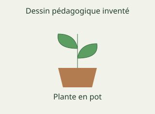

# French Form 5, Form Five French: authored answers for review

Every answer fixed by a person, not computed. Part 1: the tables, conventions and rules that computed answers come from.
Part 2: every authored question template, with all its data (keys, statements, pairs, choices and feedback) and sources.
Regenerate with `npm run review:f5-french`. Item IDs (TR-…) match `docs/teacher-review.md`.

## Part 1

Rules the computed answers use are listed in the subject’s library tests; every authored answer is in Part 2.

## Part 2: authored question templates

| # | Template | Lesson | Type, level | Sources |
|---|---|---|---|---|
| 1 | `fr5-1-notions` | 1 | multiple choice, 1 | francais |
| 2 | `fr5-1-cas` | 1 | multiple choice, 1 | francais |
| 3 | `fr5-1-appliquer` | 1 | multiple choice, 2 | francais |
| 4 | `fr5-1-relier` | 1 | matching, 2 | francais |
| 5 | `fr5-1-corriger` | 1 | spot the error, 3 | francais |
| 6 | `fr5-1-corriger-card` (card fr5-1-c3) | 1 | spot the error, 1 | francais |
| 7 | `fr5-2-notions` | 2 | multiple choice, 1 | francais |
| 8 | `fr5-2-cas` | 2 | multiple choice, 1 | francais |
| 9 | `fr5-2-appliquer` | 2 | multiple choice, 2 | francais |
| 10 | `fr5-2-relier` | 2 | matching, 2 | francais |
| 11 | `fr5-2-corriger` | 2 | spot the error, 3 | francais |
| 12 | `fr5-2-corriger-card` (card fr5-2-c3) | 2 | spot the error, 1 | francais |
| 13 | `fr5-4-notions` | 4 | multiple choice, 1 | francais |
| 14 | `fr5-4-cas` | 4 | multiple choice, 1 | francais |
| 15 | `fr5-4-relier` | 4 | matching, 2 | francais |
| 16 | `fr5-4-corriger` | 4 | spot the error, 3 | francais |
| 17 | `fr5-4-corriger-card` (card fr5-4-c3) | 4 | spot the error, 1 | francais |
| 18 | `fr5-5-notions` | 5 | multiple choice, 1 | francais |
| 19 | `fr5-5-cas` | 5 | multiple choice, 1 | francais |
| 20 | `fr5-5-appliquer` | 5 | multiple choice, 2 | francais |
| 21 | `fr5-5-relier` | 5 | matching, 2 | francais |
| 22 | `fr5-5-corriger` | 5 | spot the error, 3 | francais |
| 23 | `fr5-5-corriger-card` (card fr5-5-c3) | 5 | spot the error, 1 | francais |
| 24 | `fr5-6-notions` | 6 | multiple choice, 1 | francais |
| 25 | `fr5-6-cas` | 6 | multiple choice, 1 | francais |
| 26 | `fr5-6-appliquer` | 6 | multiple choice, 2 | francais |
| 27 | `fr5-6-relier` | 6 | matching, 2 | francais |
| 28 | `fr5-6-corriger` | 6 | spot the error, 3 | francais |
| 29 | `fr5-6-corriger-card` (card fr5-6-c3) | 6 | spot the error, 1 | francais |
| 30 | `fr5-7-notions` | 7 | multiple choice, 1 | francais |
| 31 | `fr5-7-cas` | 7 | multiple choice, 1 | francais |
| 32 | `fr5-7-appliquer` | 7 | multiple choice, 2 | francais |
| 33 | `fr5-7-relier` | 7 | matching, 2 | francais |
| 34 | `fr5-7-corriger` | 7 | spot the error, 3 | francais |
| 35 | `fr5-7-corriger-card` (card fr5-7-c3) | 7 | spot the error, 1 | francais |
| 36 | `fr5-8-notions` | 8 | multiple choice, 1 | francais |
| 37 | `fr5-8-cas` | 8 | multiple choice, 1 | francais |
| 38 | `fr5-8-contexte` | 8 | multiple choice, 2 | francais |
| 39 | `fr5-8-relier` | 8 | matching, 2 | francais |
| 40 | `fr5-8-corriger` | 8 | spot the error, 3 | francais |
| 41 | `fr5-8-corriger-card` (card fr5-8-c3) | 8 | spot the error, 1 | francais |
| 42 | `fr5-9-notions` | 9 | multiple choice, 1 | francais |
| 43 | `fr5-9-cas` | 9 | multiple choice, 1 | francais |
| 44 | `fr5-9-construire` | 9 | word order, 2 | francais |
| 45 | `fr5-9-relier` | 9 | matching, 2 | francais |
| 46 | `fr5-9-corriger` | 9 | spot the error, 3 | francais |
| 47 | `fr5-9-corriger-card` (card fr5-9-c3) | 9 | spot the error, 1 | francais |
| 48 | `fr5-10-notions` | 10 | multiple choice, 1 | francais |
| 49 | `fr5-10-cas` | 10 | multiple choice, 1 | francais |
| 50 | `fr5-10-relier` | 10 | matching, 2 | francais |
| 51 | `fr5-10-corriger` | 10 | spot the error, 3 | francais |
| 52 | `fr5-10-corriger-card` (card fr5-10-c3) | 10 | spot the error, 1 | francais |
| 53 | `fr5-11-notions` | 11 | multiple choice, 1 | francais |
| 54 | `fr5-11-cas` | 11 | multiple choice, 1 | francais |
| 55 | `fr5-11-traduire` | 11 | multiple choice, 2 | francais |
| 56 | `fr5-11-relier` | 11 | matching, 2 | francais |
| 57 | `fr5-11-corriger` | 11 | spot the error, 3 | francais |
| 58 | `fr5-11-corriger-card` (card fr5-11-c3) | 11 | spot the error, 1 | francais |
| 59 | `fr5-12-notions` | 12 | multiple choice, 1 | francais |
| 60 | `fr5-12-cas` | 12 | multiple choice, 1 | francais |
| 61 | `fr5-12-appliquer` | 12 | multiple choice, 2 | francais |
| 62 | `fr5-12-relier` | 12 | matching, 2 | francais |
| 63 | `fr5-12-corriger` | 12 | spot the error, 3 | francais |
| 64 | `fr5-12-corriger-card` (card fr5-12-c3) | 12 | spot the error, 1 | francais |
| 65 | `fr5-13-notions` | 13 | multiple choice, 1 | francais |
| 66 | `fr5-13-cas` | 13 | multiple choice, 1 | francais |
| 67 | `fr5-13-appliquer` | 13 | multiple choice, 2 | francais |
| 68 | `fr5-13-relier` | 13 | matching, 2 | francais |
| 69 | `fr5-13-corriger` | 13 | spot the error, 3 | francais |
| 70 | `fr5-13-corriger-card` (card fr5-13-c3) | 13 | spot the error, 1 | francais |
| 71 | `fr5-14-notions` | 14 | multiple choice, 1 | francais |
| 72 | `fr5-14-cas` | 14 | multiple choice, 1 | francais |
| 73 | `fr5-14-appliquer` | 14 | multiple choice, 2 | francais |
| 74 | `fr5-14-relier` | 14 | matching, 2 | francais |
| 75 | `fr5-14-corriger` | 14 | spot the error, 3 | francais |
| 76 | `fr5-14-corriger-card` (card fr5-14-c3) | 14 | spot the error, 1 | francais |
| 77 | `fr5-15-notions` | 15 | multiple choice, 1 | francais |
| 78 | `fr5-15-cas` | 15 | multiple choice, 1 | francais |
| 79 | `fr5-15-contexte` | 15 | multiple choice, 2 | francais |
| 80 | `fr5-15-relier` | 15 | matching, 2 | francais |
| 81 | `fr5-15-corriger` | 15 | spot the error, 3 | francais |
| 82 | `fr5-15-corriger-card` (card fr5-15-c3) | 15 | spot the error, 1 | francais |
| 83 | `fr5-17-notions` | 17 | multiple choice, 1 | francais |
| 84 | `fr5-17-cas` | 17 | multiple choice, 1 | francais |
| 85 | `fr5-17-contexte` | 17 | multiple choice, 2 | francais |
| 86 | `fr5-17-relier` | 17 | matching, 2 | francais |
| 87 | `fr5-17-corriger` | 17 | spot the error, 3 | francais |
| 88 | `fr5-17-corriger-card` (card fr5-17-c3) | 17 | spot the error, 1 | francais |
| 89 | `fr5-18-notions` | 18 | multiple choice, 1 | francais |
| 90 | `fr5-18-cas` | 18 | multiple choice, 1 | francais |
| 91 | `fr5-18-relier` | 18 | matching, 2 | francais |
| 92 | `fr5-18-corriger` | 18 | spot the error, 3 | francais |
| 93 | `fr5-18-corriger-card` (card fr5-18-c3) | 18 | spot the error, 1 | francais |
| 94 | `fr5-19-notions` | 19 | multiple choice, 1 | francais |
| 95 | `fr5-19-cas` | 19 | multiple choice, 1 | francais |
| 96 | `fr5-19-image` | 19 | multiple choice, 2 | francais |
| 97 | `fr5-19-relier` | 19 | matching, 2 | francais |
| 98 | `fr5-19-corriger` | 19 | spot the error, 3 | francais |
| 99 | `fr5-19-corriger-card` (card fr5-19-c3) | 19 | spot the error, 1 | francais |
| 100 | `fr5-20-notions` | 20 | multiple choice, 1 | francais |
| 101 | `fr5-20-cas` | 20 | multiple choice, 1 | francais |
| 102 | `fr5-20-appliquer` | 20 | multiple choice, 2 | francais |
| 103 | `fr5-20-relier` | 20 | matching, 2 | francais |
| 104 | `fr5-20-corriger` | 20 | spot the error, 3 | francais |
| 105 | `fr5-20-corriger-card` (card fr5-20-c3) | 20 | spot the error, 1 | francais |
| 106 | `fr5-21-notions` | 21 | multiple choice, 1 | francais |
| 107 | `fr5-21-cas` | 21 | multiple choice, 1 | francais |
| 108 | `fr5-21-contexte` | 21 | multiple choice, 2 | francais |
| 109 | `fr5-21-relier` | 21 | matching, 2 | francais |
| 110 | `fr5-21-corriger` | 21 | spot the error, 3 | francais |
| 111 | `fr5-21-corriger-card` (card fr5-21-c3) | 21 | spot the error, 1 | francais |
| 112 | `fr5-22-notions` | 22 | multiple choice, 1 | francais |
| 113 | `fr5-22-cas` | 22 | multiple choice, 1 | francais |
| 114 | `fr5-22-relier` | 22 | matching, 2 | francais |
| 115 | `fr5-22-corriger` | 22 | spot the error, 3 | francais |
| 116 | `fr5-22-corriger-card` (card fr5-22-c3) | 22 | spot the error, 1 | francais |
| 117 | `fr5-23-notions` | 23 | multiple choice, 1 | francais |
| 118 | `fr5-23-cas` | 23 | multiple choice, 1 | francais |
| 119 | `fr5-23-sens` | 23 | multiple choice, 2 | francais |
| 120 | `fr5-23-corriger` | 23 | spot the error, 3 | francais |
| 121 | `fr5-23-corriger-card` (card fr5-23-c3) | 23 | spot the error, 1 | francais |
| 122 | `fr5-24-notions` | 24 | multiple choice, 1 | francais |
| 123 | `fr5-24-cas` | 24 | multiple choice, 1 | francais |
| 124 | `fr5-24-contexte` | 24 | multiple choice, 2 | francais |
| 125 | `fr5-24-relier` | 24 | matching, 2 | francais |
| 126 | `fr5-24-corriger` | 24 | spot the error, 3 | francais |
| 127 | `fr5-24-corriger-card` (card fr5-24-c3) | 24 | spot the error, 1 | francais |
| 128 | `fr5-25-notions` | 25 | multiple choice, 1 | francais |
| 129 | `fr5-25-cas` | 25 | multiple choice, 1 | francais |
| 130 | `fr5-25-appliquer` | 25 | multiple choice, 2 | francais |
| 131 | `fr5-25-relier` | 25 | matching, 2 | francais |
| 132 | `fr5-25-corriger` | 25 | spot the error, 3 | francais |
| 133 | `fr5-25-corriger-card` (card fr5-25-c3) | 25 | spot the error, 1 | francais |
| 134 | `fr5-26-notions` | 26 | multiple choice, 1 | francais |
| 135 | `fr5-26-cas` | 26 | multiple choice, 1 | francais |
| 136 | `fr5-26-graphie` | 26 | multiple choice, 2 | francais |
| 137 | `fr5-26-relier` | 26 | matching, 2 | francais |
| 138 | `fr5-26-corriger` | 26 | spot the error, 3 | francais |
| 139 | `fr5-26-corriger-card` (card fr5-26-c3) | 26 | spot the error, 1 | francais |
| 140 | `fr5-27-notions` | 27 | multiple choice, 1 | francais |
| 141 | `fr5-27-cas` | 27 | multiple choice, 1 | francais |
| 142 | `fr5-27-traduire` | 27 | multiple choice, 2 | francais |
| 143 | `fr5-27-relier` | 27 | matching, 2 | francais |
| 144 | `fr5-27-corriger` | 27 | spot the error, 3 | francais |
| 145 | `fr5-27-corriger-card` (card fr5-27-c3) | 27 | spot the error, 1 | francais |
| 146 | `fr5-28-notions` | 28 | multiple choice, 1 | francais |
| 147 | `fr5-28-cas` | 28 | multiple choice, 1 | francais |
| 148 | `fr5-28-appliquer` | 28 | multiple choice, 2 | francais |
| 149 | `fr5-28-relier` | 28 | matching, 2 | francais |
| 150 | `fr5-28-corriger` | 28 | spot the error, 3 | francais |
| 151 | `fr5-28-corriger-card` (card fr5-28-c3) | 28 | spot the error, 1 | francais |
| 152 | `fr5-29-notions` | 29 | multiple choice, 1 | francais |
| 153 | `fr5-29-cas` | 29 | multiple choice, 1 | francais |
| 154 | `fr5-29-appliquer` | 29 | multiple choice, 2 | francais |
| 155 | `fr5-29-relier` | 29 | matching, 2 | francais |
| 156 | `fr5-29-corriger` | 29 | spot the error, 3 | francais |
| 157 | `fr5-29-corriger-card` (card fr5-29-c3) | 29 | spot the error, 1 | francais |
| 158 | `fr5-30-notions` | 30 | multiple choice, 1 | francais |
| 159 | `fr5-30-cas` | 30 | multiple choice, 1 | francais |
| 160 | `fr5-30-appliquer` | 30 | multiple choice, 2 | francais |
| 161 | `fr5-30-relier` | 30 | matching, 2 | francais |
| 162 | `fr5-30-corriger` | 30 | spot the error, 3 | francais |
| 163 | `fr5-30-corriger-card` (card fr5-30-c3) | 30 | spot the error, 1 | francais |
| 164 | `fr5-31-notions` | 31 | multiple choice, 1 | francais |
| 165 | `fr5-31-cas` | 31 | multiple choice, 1 | francais |
| 166 | `fr5-31-construire` | 31 | word order, 2 | francais |
| 167 | `fr5-31-relier` | 31 | matching, 2 | francais |
| 168 | `fr5-31-corriger` | 31 | spot the error, 3 | francais |
| 169 | `fr5-31-corriger-card` (card fr5-31-c3) | 31 | spot the error, 1 | francais |

### `fr5-1-notions` · Lesson 1 · multiple choice, level 1

Prompt: {X.q}

Table `X` (one row is picked each time):

| q | r | w | e | y |
|---|---|---|---|---|
| Quel terme désigne un détail réellement donné par le texte ? | information explicite | indice de sens · projet · limite du texte | Cela désigne un élément du contexte éclairant une interprétation, plutôt que la notion demandée. · Cela désigne une action envisagée sans résultat nécessairement acquis, plutôt que la notion demandée. · Cela désigne ce que les informations fournies ne permettent pas de conclure, plutôt que la notion demandée. | Il faut retrouver le détail dans le support. |
| Quel terme désigne un élément du contexte éclairant une interprétation ? | indice de sens | information explicite · projet · limite du texte | Cela désigne un détail réellement donné par le texte, plutôt que la notion demandée. · Cela désigne une action envisagée sans résultat nécessairement acquis, plutôt que la notion demandée. · Cela désigne ce que les informations fournies ne permettent pas de conclure, plutôt que la notion demandée. | Le contexte aide à sélectionner un sens. |
| Quel terme désigne une action envisagée sans résultat nécessairement acquis ? | projet | information explicite · indice de sens · limite du texte | Cela désigne un détail réellement donné par le texte, plutôt que la notion demandée. · Cela désigne un élément du contexte éclairant une interprétation, plutôt que la notion demandée. · Cela désigne ce que les informations fournies ne permettent pas de conclure, plutôt que la notion demandée. | Intention et résultat sont distincts. |
| Quel terme désigne ce que les informations fournies ne permettent pas de conclure ? | limite du texte | information explicite · indice de sens · projet | Cela désigne un détail réellement donné par le texte, plutôt que la notion demandée. · Cela désigne un élément du contexte éclairant une interprétation, plutôt que la notion demandée. · Cela désigne une action envisagée sans résultat nécessairement acquis, plutôt que la notion demandée. | Le cas ne permet pas cette généralisation. |

Right answer: `{X.r}`; wrong choices: `{X.w[0]}`, `{X.w[1]}`, `{X.w[2]}`

- Feedback `w0`: “{X.e[0]}”
- Feedback `w1`: “{X.e[1]}”
- Feedback `w2`: “{X.e[2]}”

Three generated variants:

> Quel terme désigne un élément du contexte éclairant une interprétation ?

- ◻️ limite du texte  
  _↳ feedback if chosen: Cela désigne ce que les informations fournies ne permettent pas de conclure, plutôt que la notion demandée._
- ✅ indice de sens
- ◻️ projet  
  _↳ feedback if chosen: Cela désigne une action envisagée sans résultat nécessairement acquis, plutôt que la notion demandée._
- ◻️ information explicite  
  _↳ feedback if chosen: Cela désigne un détail réellement donné par le texte, plutôt que la notion demandée._

Full working after a second miss:

> Le contexte aide à sélectionner un sens.  
> Donc la réponse est « indice de sens ».  

> Quel terme désigne un élément du contexte éclairant une interprétation ?

- ✅ indice de sens
- ◻️ limite du texte  
  _↳ feedback if chosen: Cela désigne ce que les informations fournies ne permettent pas de conclure, plutôt que la notion demandée._
- ◻️ information explicite  
  _↳ feedback if chosen: Cela désigne un détail réellement donné par le texte, plutôt que la notion demandée._
- ◻️ projet  
  _↳ feedback if chosen: Cela désigne une action envisagée sans résultat nécessairement acquis, plutôt que la notion demandée._

Full working after a second miss:

> Le contexte aide à sélectionner un sens.  
> Donc la réponse est « indice de sens ».  

> Quel terme désigne une action envisagée sans résultat nécessairement acquis ?

- ◻️ information explicite  
  _↳ feedback if chosen: Cela désigne un détail réellement donné par le texte, plutôt que la notion demandée._
- ◻️ indice de sens  
  _↳ feedback if chosen: Cela désigne un élément du contexte éclairant une interprétation, plutôt que la notion demandée._
- ◻️ limite du texte  
  _↳ feedback if chosen: Cela désigne ce que les informations fournies ne permettent pas de conclure, plutôt que la notion demandée._
- ✅ projet

Full working after a second miss:

> Intention et résultat sont distincts.  
> Donc la réponse est « projet ».  

Sources: francais (Dialogues, lectures, scènes et portrait originaux ; adaptations explicites de fondations de classe précédente ; OQLF, Portail linguistique du Canada, CCDMD, Éduscol, GIEC et OMS ; proverbes traditionnels et traductions de sens)

### `fr5-1-cas` · Lesson 1 · multiple choice, level 1

Prompt: {X.q}

Table `X` (one row is picked each time):

| q | r | w | e | y |
|---|---|---|---|---|
| Une action annoncée dans le passage peut être citée.
Quelle notion convient ? | information explicite | indice de sens · projet · limite du texte | Cela concerne un élément du contexte éclairant une interprétation. Compare cette définition avec le cas présenté. · Cela concerne une action envisagée sans résultat nécessairement acquis. Compare cette définition avec le cas présenté. · Cela concerne ce que les informations fournies ne permettent pas de conclure. Compare cette définition avec le cas présenté. | Il faut retrouver le détail dans le support. |
| Une demande de confirmation indique une incertitude.
Quelle notion convient ? | indice de sens | information explicite · projet · limite du texte | Cela concerne un détail réellement donné par le texte. Compare cette définition avec le cas présenté. · Cela concerne une action envisagée sans résultat nécessairement acquis. Compare cette définition avec le cas présenté. · Cela concerne ce que les informations fournies ne permettent pas de conclure. Compare cette définition avec le cas présenté. | Le contexte aide à sélectionner un sens. |
| Une rencontre prévue n’est pas encore un bilan de participation.
Quelle notion convient ? | projet | information explicite · indice de sens · limite du texte | Cela concerne un détail réellement donné par le texte. Compare cette définition avec le cas présenté. · Cela concerne un élément du contexte éclairant une interprétation. Compare cette définition avec le cas présenté. · Cela concerne ce que les informations fournies ne permettent pas de conclure. Compare cette définition avec le cas présenté. | Intention et résultat sont distincts. |
| L’absence de résultat oblige à laisser une question ouverte.
Quelle notion convient ? | limite du texte | information explicite · indice de sens · projet | Cela concerne un détail réellement donné par le texte. Compare cette définition avec le cas présenté. · Cela concerne un élément du contexte éclairant une interprétation. Compare cette définition avec le cas présenté. · Cela concerne une action envisagée sans résultat nécessairement acquis. Compare cette définition avec le cas présenté. | Le cas ne permet pas cette généralisation. |

Right answer: `{X.r}`; wrong choices: `{X.w[0]}`, `{X.w[1]}`, `{X.w[2]}`

- Feedback `w0`: “{X.e[0]}”
- Feedback `w1`: “{X.e[1]}”
- Feedback `w2`: “{X.e[2]}”

Three generated variants:

> Une rencontre prévue n’est pas encore un bilan de participation.
> Quelle notion convient ?

- ◻️ information explicite  
  _↳ feedback if chosen: Cela concerne un détail réellement donné par le texte. Compare cette définition avec le cas présenté._
- ✅ projet
- ◻️ indice de sens  
  _↳ feedback if chosen: Cela concerne un élément du contexte éclairant une interprétation. Compare cette définition avec le cas présenté._
- ◻️ limite du texte  
  _↳ feedback if chosen: Cela concerne ce que les informations fournies ne permettent pas de conclure. Compare cette définition avec le cas présenté._

Full working after a second miss:

> Intention et résultat sont distincts.  
> Donc la réponse est « projet ».  

> Une rencontre prévue n’est pas encore un bilan de participation.
> Quelle notion convient ?

- ◻️ indice de sens  
  _↳ feedback if chosen: Cela concerne un élément du contexte éclairant une interprétation. Compare cette définition avec le cas présenté._
- ◻️ limite du texte  
  _↳ feedback if chosen: Cela concerne ce que les informations fournies ne permettent pas de conclure. Compare cette définition avec le cas présenté._
- ✅ projet
- ◻️ information explicite  
  _↳ feedback if chosen: Cela concerne un détail réellement donné par le texte. Compare cette définition avec le cas présenté._

Full working after a second miss:

> Intention et résultat sont distincts.  
> Donc la réponse est « projet ».  

> Une action annoncée dans le passage peut être citée.
> Quelle notion convient ?

- ✅ information explicite
- ◻️ limite du texte  
  _↳ feedback if chosen: Cela concerne ce que les informations fournies ne permettent pas de conclure. Compare cette définition avec le cas présenté._
- ◻️ projet  
  _↳ feedback if chosen: Cela concerne une action envisagée sans résultat nécessairement acquis. Compare cette définition avec le cas présenté._
- ◻️ indice de sens  
  _↳ feedback if chosen: Cela concerne un élément du contexte éclairant une interprétation. Compare cette définition avec le cas présenté._

Full working after a second miss:

> Il faut retrouver le détail dans le support.  
> Donc la réponse est « information explicite ».  

Sources: francais (Dialogues, lectures, scènes et portrait originaux ; adaptations explicites de fondations de classe précédente ; OQLF, Portail linguistique du Canada, CCDMD, Éduscol, GIEC et OMS ; proverbes traditionnels et traductions de sens)

### `fr5-1-appliquer` · Lesson 1 · multiple choice, level 2

Prompt: {X.q}

Table `X` (one row is picked each time):

| q | r | w | e | y |
|---|---|---|---|---|
| Quelle difficulté est donnée ? | Les activités de révision et de lecture se gênent. | Personne ne veut jamais travailler. · La famille n’a aucun livre. · Le programme a déjà tout résolu. | Cette intention n’est pas établie. · Aucun manque de livres n’est annoncé. · Le programme reste à essayer. | Le début décrit un chevauchement d’activités. |
| Que propose Bih avant de juger son cousin ? | Noter les contraintes de chacun. | Inventer ses intentions. · Déclarer toute lecture inutile. · Annoncer un résultat définitif. | Elle évite ce jugement. · La lecture reste une activité du récit. · Le résultat n’est pas donné. | La proposition aide à comprendre la situation. |
| Quel rôle joue l’adulte ? | Aider à envisager un autre horaire. | Supprimer définitivement les études. · Garantir un résultat à chaque famille. · Remplacer tous les livres. | Ce n’est pas annoncé. · Le cas ne garantit rien de général. · Aucun remplacement n’est décrit. | Le passage précise cette aide. |
| Que peut-on conclure ? | Une adaptation est envisagée, mais son efficacité reste inconnue. | Chaque problème a disparu. · Toutes les familles ont les mêmes horaires. · Le cousin refuse forcément tout effort. | Le résultat reste à observer. · Le cas ne porte pas cette généralité. · L’intention n’est pas établie. | Respecte la limite finale du texte. |

Right answer: `{X.r}`; wrong choices: `{X.w[0]}`, `{X.w[1]}`, `{X.w[2]}`

- Feedback `w0`: “{X.e[0]}”
- Feedback `w1`: “{X.e[1]}”
- Feedback `w2`: “{X.e[2]}”

Three generated variants:

> Que propose Bih avant de juger son cousin ?

- ◻️ Déclarer toute lecture inutile.  
  _↳ feedback if chosen: La lecture reste une activité du récit._
- ◻️ Annoncer un résultat définitif.  
  _↳ feedback if chosen: Le résultat n’est pas donné._
- ◻️ Inventer ses intentions.  
  _↳ feedback if chosen: Elle évite ce jugement._
- ✅ Noter les contraintes de chacun.

Full working after a second miss:

> La proposition aide à comprendre la situation.  
> Donc la réponse est « Noter les contraintes de chacun. ».  

> Quel rôle joue l’adulte ?

- ✅ Aider à envisager un autre horaire.
- ◻️ Supprimer définitivement les études.  
  _↳ feedback if chosen: Ce n’est pas annoncé._
- ◻️ Garantir un résultat à chaque famille.  
  _↳ feedback if chosen: Le cas ne garantit rien de général._
- ◻️ Remplacer tous les livres.  
  _↳ feedback if chosen: Aucun remplacement n’est décrit._

Full working after a second miss:

> Le passage précise cette aide.  
> Donc la réponse est « Aider à envisager un autre horaire. ».  

> Quel rôle joue l’adulte ?

- ◻️ Supprimer définitivement les études.  
  _↳ feedback if chosen: Ce n’est pas annoncé._
- ◻️ Remplacer tous les livres.  
  _↳ feedback if chosen: Aucun remplacement n’est décrit._
- ◻️ Garantir un résultat à chaque famille.  
  _↳ feedback if chosen: Le cas ne garantit rien de général._
- ✅ Aider à envisager un autre horaire.

Full working after a second miss:

> Le passage précise cette aide.  
> Donc la réponse est « Aider à envisager un autre horaire. ».  

Sources: francais (Dialogues, lectures, scènes et portrait originaux ; adaptations explicites de fondations de classe précédente ; OQLF, Portail linguistique du Canada, CCDMD, Éduscol, GIEC et OMS ; proverbes traditionnels et traductions de sens)

### `fr5-1-relier` · Lesson 1 · matching, level 2

Prompt: Relie chaque notion à son exemple.

Pairs (3 shown each time):

- information explicite → **Une action annoncée dans le passage peut être citée.**
- indice de sens → **Une demande de confirmation indique une incertitude.**
- projet → **Une rencontre prévue n’est pas encore un bilan de participation.**
- limite du texte → **L’absence de résultat oblige à laisser une question ouverte.**

Three generated variants:

> Relie chaque notion à son exemple.

Right-hand side (shuffled): Une rencontre prévue n’est pas encore un bilan de participation. · Une demande de confirmation indique une incertitude. · Une action annoncée dans le passage peut être citée.
- projet → **Une rencontre prévue n’est pas encore un bilan de participation.**
- information explicite → **Une action annoncée dans le passage peut être citée.**
- indice de sens → **Une demande de confirmation indique une incertitude.**

Full working after a second miss:

> Les bonnes paires sont :  
> projet → Une rencontre prévue n’est pas encore un bilan de participation.  
> information explicite → Une action annoncée dans le passage peut être citée.  
> indice de sens → Une demande de confirmation indique une incertitude.  

> Relie chaque notion à son exemple.

Right-hand side (shuffled): Une rencontre prévue n’est pas encore un bilan de participation. · Une action annoncée dans le passage peut être citée. · Une demande de confirmation indique une incertitude.
- indice de sens → **Une demande de confirmation indique une incertitude.**
- projet → **Une rencontre prévue n’est pas encore un bilan de participation.**
- information explicite → **Une action annoncée dans le passage peut être citée.**

Full working after a second miss:

> Les bonnes paires sont :  
> indice de sens → Une demande de confirmation indique une incertitude.  
> projet → Une rencontre prévue n’est pas encore un bilan de participation.  
> information explicite → Une action annoncée dans le passage peut être citée.  

> Relie chaque notion à son exemple.

Right-hand side (shuffled): L’absence de résultat oblige à laisser une question ouverte. · Une demande de confirmation indique une incertitude. · Une rencontre prévue n’est pas encore un bilan de participation.
- indice de sens → **Une demande de confirmation indique une incertitude.**
- limite du texte → **L’absence de résultat oblige à laisser une question ouverte.**
- projet → **Une rencontre prévue n’est pas encore un bilan de participation.**

Full working after a second miss:

> Les bonnes paires sont :  
> indice de sens → Une demande de confirmation indique une incertitude.  
> limite du texte → L’absence de résultat oblige à laisser une question ouverte.  
> projet → Une rencontre prévue n’est pas encore un bilan de participation.  

Sources: francais (Dialogues, lectures, scènes et portrait originaux ; adaptations explicites de fondations de classe précédente ; OQLF, Portail linguistique du Canada, CCDMD, Éduscol, GIEC et OMS ; proverbes traditionnels et traductions de sens)

### `fr5-1-corriger` · Lesson 1 · spot the error, level 3

Prompt: Repère la formulation ou l’affirmation incorrecte.

Shows 3 correct and 1 wrong statement(s), drawn from:

- ✅ information explicite : un détail réellement donné par le texte.
- ✅ indice de sens : un élément du contexte éclairant une interprétation.
- ✅ projet : une action envisagée sans résultat nécessairement acquis.
- ✅ limite du texte : ce que les informations fournies ne permettent pas de conclure.
- ❌ Une invention plausible est automatiquement une information du texte.  
  _↳ Il faut retrouver le détail dans le support._
- ❌ Tous les sens d’un mot conviennent également dans chaque phrase.  
  _↳ Le contexte aide à sélectionner un sens._
- ❌ Chaque projet annoncé est un succès mesuré.  
  _↳ Intention et résultat sont distincts._
- ❌ Un récit inventé décrit obligatoirement toutes les familles.  
  _↳ Le cas ne permet pas cette généralisation._

Three generated variants:

> Repère la formulation ou l’affirmation incorrecte.

- ✅ Un récit inventé décrit obligatoirement toutes les familles.  
  _↳ explanation: Le cas ne permet pas cette généralisation._
- ◻️ information explicite : un détail réellement donné par le texte.  
  _↳ explanation: Cette distinction est correcte : Il faut retrouver le détail dans le support. Cherche plutôt une phrase qui contredit le sens ou la règle._
- ◻️ indice de sens : un élément du contexte éclairant une interprétation.  
  _↳ explanation: Cette distinction est correcte : Le contexte aide à sélectionner un sens. Cherche plutôt une phrase qui contredit le sens ou la règle._
- ◻️ projet : une action envisagée sans résultat nécessairement acquis.  
  _↳ explanation: Cette distinction est correcte : Intention et résultat sont distincts. Cherche plutôt une phrase qui contredit le sens ou la règle._

Full working after a second miss:

> La phrase fausse est « Un récit inventé décrit obligatoirement toutes les familles. ».  
> Le cas ne permet pas cette généralisation.  

> Repère la formulation ou l’affirmation incorrecte.

- ◻️ limite du texte : ce que les informations fournies ne permettent pas de conclure.  
  _↳ explanation: Cette distinction est correcte : Le cas ne permet pas cette généralisation. Cherche plutôt une phrase qui contredit le sens ou la règle._
- ✅ Un récit inventé décrit obligatoirement toutes les familles.  
  _↳ explanation: Le cas ne permet pas cette généralisation._
- ◻️ projet : une action envisagée sans résultat nécessairement acquis.  
  _↳ explanation: Cette distinction est correcte : Intention et résultat sont distincts. Cherche plutôt une phrase qui contredit le sens ou la règle._
- ◻️ indice de sens : un élément du contexte éclairant une interprétation.  
  _↳ explanation: Cette distinction est correcte : Le contexte aide à sélectionner un sens. Cherche plutôt une phrase qui contredit le sens ou la règle._

Full working after a second miss:

> La phrase fausse est « Un récit inventé décrit obligatoirement toutes les familles. ».  
> Le cas ne permet pas cette généralisation.  

> Repère la formulation ou l’affirmation incorrecte.

- ◻️ projet : une action envisagée sans résultat nécessairement acquis.  
  _↳ explanation: Cette distinction est correcte : Intention et résultat sont distincts. Cherche plutôt une phrase qui contredit le sens ou la règle._
- ✅ Chaque projet annoncé est un succès mesuré.  
  _↳ explanation: Intention et résultat sont distincts._
- ◻️ indice de sens : un élément du contexte éclairant une interprétation.  
  _↳ explanation: Cette distinction est correcte : Le contexte aide à sélectionner un sens. Cherche plutôt une phrase qui contredit le sens ou la règle._
- ◻️ information explicite : un détail réellement donné par le texte.  
  _↳ explanation: Cette distinction est correcte : Il faut retrouver le détail dans le support. Cherche plutôt une phrase qui contredit le sens ou la règle._

Full working after a second miss:

> La phrase fausse est « Chaque projet annoncé est un succès mesuré. ».  
> Intention et résultat sont distincts.  

Sources: francais (Dialogues, lectures, scènes et portrait originaux ; adaptations explicites de fondations de classe précédente ; OQLF, Portail linguistique du Canada, CCDMD, Éduscol, GIEC et OMS ; proverbes traditionnels et traductions de sens)

### `fr5-1-corriger-card` · Lesson 1 · spot the error, level 1

Prompt: Repère la formulation ou l’affirmation incorrecte.

Shows 3 correct and 1 wrong statement(s), drawn from:

- ✅ information explicite : un détail réellement donné par le texte.
- ✅ indice de sens : un élément du contexte éclairant une interprétation.
- ✅ projet : une action envisagée sans résultat nécessairement acquis.
- ✅ limite du texte : ce que les informations fournies ne permettent pas de conclure.
- ❌ Une invention plausible est automatiquement une information du texte.  
  _↳ Il faut retrouver le détail dans le support._
- ❌ Tous les sens d’un mot conviennent également dans chaque phrase.  
  _↳ Le contexte aide à sélectionner un sens._
- ❌ Chaque projet annoncé est un succès mesuré.  
  _↳ Intention et résultat sont distincts._
- ❌ Un récit inventé décrit obligatoirement toutes les familles.  
  _↳ Le cas ne permet pas cette généralisation._

Three generated variants:

> Repère la formulation ou l’affirmation incorrecte.

- ◻️ indice de sens : un élément du contexte éclairant une interprétation.  
  _↳ explanation: Cette distinction est correcte : Le contexte aide à sélectionner un sens. Cherche plutôt une phrase qui contredit le sens ou la règle._
- ✅ Un récit inventé décrit obligatoirement toutes les familles.  
  _↳ explanation: Le cas ne permet pas cette généralisation._
- ◻️ projet : une action envisagée sans résultat nécessairement acquis.  
  _↳ explanation: Cette distinction est correcte : Intention et résultat sont distincts. Cherche plutôt une phrase qui contredit le sens ou la règle._
- ◻️ information explicite : un détail réellement donné par le texte.  
  _↳ explanation: Cette distinction est correcte : Il faut retrouver le détail dans le support. Cherche plutôt une phrase qui contredit le sens ou la règle._

Full working after a second miss:

> La phrase fausse est « Un récit inventé décrit obligatoirement toutes les familles. ».  
> Le cas ne permet pas cette généralisation.  

> Repère la formulation ou l’affirmation incorrecte.

- ◻️ projet : une action envisagée sans résultat nécessairement acquis.  
  _↳ explanation: Cette distinction est correcte : Intention et résultat sont distincts. Cherche plutôt une phrase qui contredit le sens ou la règle._
- ◻️ limite du texte : ce que les informations fournies ne permettent pas de conclure.  
  _↳ explanation: Cette distinction est correcte : Le cas ne permet pas cette généralisation. Cherche plutôt une phrase qui contredit le sens ou la règle._
- ◻️ information explicite : un détail réellement donné par le texte.  
  _↳ explanation: Cette distinction est correcte : Il faut retrouver le détail dans le support. Cherche plutôt une phrase qui contredit le sens ou la règle._
- ✅ Une invention plausible est automatiquement une information du texte.  
  _↳ explanation: Il faut retrouver le détail dans le support._

Full working after a second miss:

> La phrase fausse est « Une invention plausible est automatiquement une information du texte. ».  
> Il faut retrouver le détail dans le support.  

> Repère la formulation ou l’affirmation incorrecte.

- ◻️ indice de sens : un élément du contexte éclairant une interprétation.  
  _↳ explanation: Cette distinction est correcte : Le contexte aide à sélectionner un sens. Cherche plutôt une phrase qui contredit le sens ou la règle._
- ◻️ information explicite : un détail réellement donné par le texte.  
  _↳ explanation: Cette distinction est correcte : Il faut retrouver le détail dans le support. Cherche plutôt une phrase qui contredit le sens ou la règle._
- ◻️ projet : une action envisagée sans résultat nécessairement acquis.  
  _↳ explanation: Cette distinction est correcte : Intention et résultat sont distincts. Cherche plutôt une phrase qui contredit le sens ou la règle._
- ✅ Tous les sens d’un mot conviennent également dans chaque phrase.  
  _↳ explanation: Le contexte aide à sélectionner un sens._

Full working after a second miss:

> La phrase fausse est « Tous les sens d’un mot conviennent également dans chaque phrase. ».  
> Le contexte aide à sélectionner un sens.  

Sources: francais (Dialogues, lectures, scènes et portrait originaux ; adaptations explicites de fondations de classe précédente ; OQLF, Portail linguistique du Canada, CCDMD, Éduscol, GIEC et OMS ; proverbes traditionnels et traductions de sens)

### `fr5-2-notions` · Lesson 2 · multiple choice, level 1

Prompt: {X.q}

Table `X` (one row is picked each time):

| q | r | w | e | y |
|---|---|---|---|---|
| Quel terme désigne des informations pertinentes que le locuteur donne sur lui-même ? | présentation de soi | présentation d’autrui · clarification · référence stable | Cela désigne une introduction fidèle de la personne présentée, plutôt que la notion demandée. · Cela désigne une demande destinée à vérifier une information, plutôt que la notion demandée. · Cela désigne le maintien de la même personne dans le dialogue, plutôt que la notion demandée. | On peut utiliser des informations fictives adaptées. |
| Quel terme désigne une introduction fidèle de la personne présentée ? | présentation d’autrui | présentation de soi · clarification · référence stable | Cela désigne des informations pertinentes que le locuteur donne sur lui-même, plutôt que la notion demandée. · Cela désigne une demande destinée à vérifier une information, plutôt que la notion demandée. · Cela désigne le maintien de la même personne dans le dialogue, plutôt que la notion demandée. | Il faut préserver les informations données. |
| Quel terme désigne une demande destinée à vérifier une information ? | clarification | présentation de soi · présentation d’autrui · référence stable | Cela désigne des informations pertinentes que le locuteur donne sur lui-même, plutôt que la notion demandée. · Cela désigne une introduction fidèle de la personne présentée, plutôt que la notion demandée. · Cela désigne le maintien de la même personne dans le dialogue, plutôt que la notion demandée. | La question signale un renseignement encore nécessaire. |
| Quel terme désigne le maintien de la même personne dans le dialogue ? | référence stable | présentation de soi · présentation d’autrui · clarification | Cela désigne des informations pertinentes que le locuteur donne sur lui-même, plutôt que la notion demandée. · Cela désigne une introduction fidèle de la personne présentée, plutôt que la notion demandée. · Cela désigne une demande destinée à vérifier une information, plutôt que la notion demandée. | Les pronoms doivent garder une référence claire. |

Right answer: `{X.r}`; wrong choices: `{X.w[0]}`, `{X.w[1]}`, `{X.w[2]}`

- Feedback `w0`: “{X.e[0]}”
- Feedback `w1`: “{X.e[1]}”
- Feedback `w2`: “{X.e[2]}”

Three generated variants:

> Quel terme désigne une demande destinée à vérifier une information ?

- ✅ clarification
- ◻️ référence stable  
  _↳ feedback if chosen: Cela désigne le maintien de la même personne dans le dialogue, plutôt que la notion demandée._
- ◻️ présentation d’autrui  
  _↳ feedback if chosen: Cela désigne une introduction fidèle de la personne présentée, plutôt que la notion demandée._
- ◻️ présentation de soi  
  _↳ feedback if chosen: Cela désigne des informations pertinentes que le locuteur donne sur lui-même, plutôt que la notion demandée._

Full working after a second miss:

> La question signale un renseignement encore nécessaire.  
> Donc la réponse est « clarification ».  

> Quel terme désigne une demande destinée à vérifier une information ?

- ◻️ référence stable  
  _↳ feedback if chosen: Cela désigne le maintien de la même personne dans le dialogue, plutôt que la notion demandée._
- ✅ clarification
- ◻️ présentation d’autrui  
  _↳ feedback if chosen: Cela désigne une introduction fidèle de la personne présentée, plutôt que la notion demandée._
- ◻️ présentation de soi  
  _↳ feedback if chosen: Cela désigne des informations pertinentes que le locuteur donne sur lui-même, plutôt que la notion demandée._

Full working after a second miss:

> La question signale un renseignement encore nécessaire.  
> Donc la réponse est « clarification ».  

> Quel terme désigne des informations pertinentes que le locuteur donne sur lui-même ?

- ◻️ clarification  
  _↳ feedback if chosen: Cela désigne une demande destinée à vérifier une information, plutôt que la notion demandée._
- ◻️ référence stable  
  _↳ feedback if chosen: Cela désigne le maintien de la même personne dans le dialogue, plutôt que la notion demandée._
- ◻️ présentation d’autrui  
  _↳ feedback if chosen: Cela désigne une introduction fidèle de la personne présentée, plutôt que la notion demandée._
- ✅ présentation de soi

Full working after a second miss:

> On peut utiliser des informations fictives adaptées.  
> Donc la réponse est « présentation de soi ».  

Sources: francais (Dialogues, lectures, scènes et portrait originaux ; adaptations explicites de fondations de classe précédente ; OQLF, Portail linguistique du Canada, CCDMD, Éduscol, GIEC et OMS ; proverbes traditionnels et traductions de sens)

### `fr5-2-cas` · Lesson 2 · multiple choice, level 1

Prompt: {X.q}

Table `X` (one row is picked each time):

| q | r | w | e | y |
|---|---|---|---|---|
| Je participe au club de lecture présente mon rôle.
Quelle notion convient ? | présentation de soi | présentation d’autrui · clarification · référence stable | Cela concerne une introduction fidèle de la personne présentée. Compare cette définition avec le cas présenté. · Cela concerne une demande destinée à vérifier une information. Compare cette définition avec le cas présenté. · Cela concerne le maintien de la même personne dans le dialogue. Compare cette définition avec le cas présenté. | On peut utiliser des informations fictives adaptées. |
| Voici Ayuk ; il aime préparer les affiches.
Quelle notion convient ? | présentation d’autrui | présentation de soi · clarification · référence stable | Cela concerne des informations pertinentes que le locuteur donne sur lui-même. Compare cette définition avec le cas présenté. · Cela concerne une demande destinée à vérifier une information. Compare cette définition avec le cas présenté. · Cela concerne le maintien de la même personne dans le dialogue. Compare cette définition avec le cas présenté. | Il faut préserver les informations données. |
| Peux-tu préciser l’heure prévue ?
Quelle notion convient ? | clarification | présentation de soi · présentation d’autrui · référence stable | Cela concerne des informations pertinentes que le locuteur donne sur lui-même. Compare cette définition avec le cas présenté. · Cela concerne une introduction fidèle de la personne présentée. Compare cette définition avec le cas présenté. · Cela concerne le maintien de la même personne dans le dialogue. Compare cette définition avec le cas présenté. | La question signale un renseignement encore nécessaire. |
| Il renvoie à Ayuk dans le modèle.
Quelle notion convient ? | référence stable | présentation de soi · présentation d’autrui · clarification | Cela concerne des informations pertinentes que le locuteur donne sur lui-même. Compare cette définition avec le cas présenté. · Cela concerne une introduction fidèle de la personne présentée. Compare cette définition avec le cas présenté. · Cela concerne une demande destinée à vérifier une information. Compare cette définition avec le cas présenté. | Les pronoms doivent garder une référence claire. |

Right answer: `{X.r}`; wrong choices: `{X.w[0]}`, `{X.w[1]}`, `{X.w[2]}`

- Feedback `w0`: “{X.e[0]}”
- Feedback `w1`: “{X.e[1]}”
- Feedback `w2`: “{X.e[2]}”

Three generated variants:

> Voici Ayuk ; il aime préparer les affiches.
> Quelle notion convient ?

- ◻️ clarification  
  _↳ feedback if chosen: Cela concerne une demande destinée à vérifier une information. Compare cette définition avec le cas présenté._
- ✅ présentation d’autrui
- ◻️ référence stable  
  _↳ feedback if chosen: Cela concerne le maintien de la même personne dans le dialogue. Compare cette définition avec le cas présenté._
- ◻️ présentation de soi  
  _↳ feedback if chosen: Cela concerne des informations pertinentes que le locuteur donne sur lui-même. Compare cette définition avec le cas présenté._

Full working after a second miss:

> Il faut préserver les informations données.  
> Donc la réponse est « présentation d’autrui ».  

> Je participe au club de lecture présente mon rôle.
> Quelle notion convient ?

- ◻️ référence stable  
  _↳ feedback if chosen: Cela concerne le maintien de la même personne dans le dialogue. Compare cette définition avec le cas présenté._
- ◻️ présentation d’autrui  
  _↳ feedback if chosen: Cela concerne une introduction fidèle de la personne présentée. Compare cette définition avec le cas présenté._
- ✅ présentation de soi
- ◻️ clarification  
  _↳ feedback if chosen: Cela concerne une demande destinée à vérifier une information. Compare cette définition avec le cas présenté._

Full working after a second miss:

> On peut utiliser des informations fictives adaptées.  
> Donc la réponse est « présentation de soi ».  

> Voici Ayuk ; il aime préparer les affiches.
> Quelle notion convient ?

- ◻️ présentation de soi  
  _↳ feedback if chosen: Cela concerne des informations pertinentes que le locuteur donne sur lui-même. Compare cette définition avec le cas présenté._
- ◻️ clarification  
  _↳ feedback if chosen: Cela concerne une demande destinée à vérifier une information. Compare cette définition avec le cas présenté._
- ✅ présentation d’autrui
- ◻️ référence stable  
  _↳ feedback if chosen: Cela concerne le maintien de la même personne dans le dialogue. Compare cette définition avec le cas présenté._

Full working after a second miss:

> Il faut préserver les informations données.  
> Donc la réponse est « présentation d’autrui ».  

Sources: francais (Dialogues, lectures, scènes et portrait originaux ; adaptations explicites de fondations de classe précédente ; OQLF, Portail linguistique du Canada, CCDMD, Éduscol, GIEC et OMS ; proverbes traditionnels et traductions de sens)

### `fr5-2-appliquer` · Lesson 2 · multiple choice, level 2

Prompt: {X.q}

Table `X` (one row is picked each time):

| q | r | w | e | y |
|---|---|---|---|---|
| Tu veux te présenter au club avec des renseignements fictifs pertinents. Quelle phrase convient ? | Je m’appelle Bih et je participe au club de lecture. | Voici le mot de passe réel de mon voisin. · Je sais toutes les pensées privées d’Ayuk. · Toute question prouve que l’horaire est fixé. | Ce détail privé n’est pas nécessaire. · Cette connaissance n’est pas donnée. · Une question peut signaler une incertitude. | Donne une identité fictive et un rôle utile. |
| Ayuk a déclaré aimer les affiches. Quelle présentation garde cette information ? | Voici Ayuk ; il aime préparer les affiches. | Voici Ayuk ; il déteste forcément les affiches. · Voici Bih ; elle a donné toutes les informations d’Ayuk. · Ayuk est le nom de l’horaire confirmé. | La préférence est inversée. · La personne et le rôle sont modifiés. · Le nom désigne une personne. | Préserve personne et préférence. |
| L’heure reste inconnue. Quelle demande convient ? | Peux-tu préciser l’heure prévue ? | L’heure est certaine puisque je l’invente. · Il n’existe aucune différence entre question et réponse. · Je connais déjà tout horaire possible. | Une invention ne confirme rien. · La question demande une information. · Ce savoir n’est pas établi. | Demande la précision manquante. |
| Que vérifie cette activité à l’écran ? | La préparation écrite du dialogue. | La qualité réelle de la voix. · L’écoute d’un enregistrement fourni. · Toutes les réactions spontanées du partenaire. | Aucune voix n’est évaluée. · Aucun enregistrement n’est fourni. · Ces échanges demandent une pratique distincte. | La portée écrite est explicite. |

Right answer: `{X.r}`; wrong choices: `{X.w[0]}`, `{X.w[1]}`, `{X.w[2]}`

- Feedback `w0`: “{X.e[0]}”
- Feedback `w1`: “{X.e[1]}”
- Feedback `w2`: “{X.e[2]}”

Three generated variants:

> Tu veux te présenter au club avec des renseignements fictifs pertinents. Quelle phrase convient ?

- ✅ Je m’appelle Bih et je participe au club de lecture.
- ◻️ Voici le mot de passe réel de mon voisin.  
  _↳ feedback if chosen: Ce détail privé n’est pas nécessaire._
- ◻️ Je sais toutes les pensées privées d’Ayuk.  
  _↳ feedback if chosen: Cette connaissance n’est pas donnée._
- ◻️ Toute question prouve que l’horaire est fixé.  
  _↳ feedback if chosen: Une question peut signaler une incertitude._

Full working after a second miss:

> Donne une identité fictive et un rôle utile.  
> Donc la réponse est « Je m’appelle Bih et je participe au club de lecture. ».  

> Tu veux te présenter au club avec des renseignements fictifs pertinents. Quelle phrase convient ?

- ◻️ Voici le mot de passe réel de mon voisin.  
  _↳ feedback if chosen: Ce détail privé n’est pas nécessaire._
- ✅ Je m’appelle Bih et je participe au club de lecture.
- ◻️ Je sais toutes les pensées privées d’Ayuk.  
  _↳ feedback if chosen: Cette connaissance n’est pas donnée._
- ◻️ Toute question prouve que l’horaire est fixé.  
  _↳ feedback if chosen: Une question peut signaler une incertitude._

Full working after a second miss:

> Donne une identité fictive et un rôle utile.  
> Donc la réponse est « Je m’appelle Bih et je participe au club de lecture. ».  

> Ayuk a déclaré aimer les affiches. Quelle présentation garde cette information ?

- ◻️ Voici Bih ; elle a donné toutes les informations d’Ayuk.  
  _↳ feedback if chosen: La personne et le rôle sont modifiés._
- ✅ Voici Ayuk ; il aime préparer les affiches.
- ◻️ Voici Ayuk ; il déteste forcément les affiches.  
  _↳ feedback if chosen: La préférence est inversée._
- ◻️ Ayuk est le nom de l’horaire confirmé.  
  _↳ feedback if chosen: Le nom désigne une personne._

Full working after a second miss:

> Préserve personne et préférence.  
> Donc la réponse est « Voici Ayuk ; il aime préparer les affiches. ».  

Sources: francais (Dialogues, lectures, scènes et portrait originaux ; adaptations explicites de fondations de classe précédente ; OQLF, Portail linguistique du Canada, CCDMD, Éduscol, GIEC et OMS ; proverbes traditionnels et traductions de sens)

### `fr5-2-relier` · Lesson 2 · matching, level 2

Prompt: Relie chaque notion à son exemple.

Pairs (3 shown each time):

- présentation de soi → **Je participe au club de lecture présente mon rôle.**
- présentation d’autrui → **Voici Ayuk ; il aime préparer les affiches.**
- clarification → **Peux-tu préciser l’heure prévue ?**
- référence stable → **Il renvoie à Ayuk dans le modèle.**

Three generated variants:

> Relie chaque notion à son exemple.

Right-hand side (shuffled): Je participe au club de lecture présente mon rôle. · Voici Ayuk ; il aime préparer les affiches. · Peux-tu préciser l’heure prévue ?
- présentation d’autrui → **Voici Ayuk ; il aime préparer les affiches.**
- clarification → **Peux-tu préciser l’heure prévue ?**
- présentation de soi → **Je participe au club de lecture présente mon rôle.**

Full working after a second miss:

> Les bonnes paires sont :  
> présentation d’autrui → Voici Ayuk ; il aime préparer les affiches.  
> clarification → Peux-tu préciser l’heure prévue ?  
> présentation de soi → Je participe au club de lecture présente mon rôle.  

> Relie chaque notion à son exemple.

Right-hand side (shuffled): Peux-tu préciser l’heure prévue ? · Je participe au club de lecture présente mon rôle. · Voici Ayuk ; il aime préparer les affiches.
- présentation de soi → **Je participe au club de lecture présente mon rôle.**
- clarification → **Peux-tu préciser l’heure prévue ?**
- présentation d’autrui → **Voici Ayuk ; il aime préparer les affiches.**

Full working after a second miss:

> Les bonnes paires sont :  
> présentation de soi → Je participe au club de lecture présente mon rôle.  
> clarification → Peux-tu préciser l’heure prévue ?  
> présentation d’autrui → Voici Ayuk ; il aime préparer les affiches.  

> Relie chaque notion à son exemple.

Right-hand side (shuffled): Il renvoie à Ayuk dans le modèle. · Peux-tu préciser l’heure prévue ? · Je participe au club de lecture présente mon rôle.
- présentation de soi → **Je participe au club de lecture présente mon rôle.**
- référence stable → **Il renvoie à Ayuk dans le modèle.**
- clarification → **Peux-tu préciser l’heure prévue ?**

Full working after a second miss:

> Les bonnes paires sont :  
> présentation de soi → Je participe au club de lecture présente mon rôle.  
> référence stable → Il renvoie à Ayuk dans le modèle.  
> clarification → Peux-tu préciser l’heure prévue ?  

Sources: francais (Dialogues, lectures, scènes et portrait originaux ; adaptations explicites de fondations de classe précédente ; OQLF, Portail linguistique du Canada, CCDMD, Éduscol, GIEC et OMS ; proverbes traditionnels et traductions de sens)

### `fr5-2-corriger` · Lesson 2 · spot the error, level 3

Prompt: Repère la formulation ou l’affirmation incorrecte.

Shows 3 correct and 1 wrong statement(s), drawn from:

- ✅ présentation de soi : des informations pertinentes que le locuteur donne sur lui-même.
- ✅ présentation d’autrui : une introduction fidèle de la personne présentée.
- ✅ clarification : une demande destinée à vérifier une information.
- ✅ référence stable : le maintien de la même personne dans le dialogue.
- ❌ Se présenter exige de publier son adresse privée.  
  _↳ On peut utiliser des informations fictives adaptées._
- ❌ Présenter une personne autorise à inventer ses préférences.  
  _↳ Il faut préserver les informations données._
- ❌ Demander une heure prouve qu’elle est déjà confirmée.  
  _↳ La question signale un renseignement encore nécessaire._
- ❌ On peut changer les référents des pronoms sans changer le sens.  
  _↳ Les pronoms doivent garder une référence claire._

Three generated variants:

> Repère la formulation ou l’affirmation incorrecte.

- ✅ Demander une heure prouve qu’elle est déjà confirmée.  
  _↳ explanation: La question signale un renseignement encore nécessaire._
- ◻️ présentation de soi : des informations pertinentes que le locuteur donne sur lui-même.  
  _↳ explanation: Cette distinction est correcte : On peut utiliser des informations fictives adaptées. Cherche plutôt une phrase qui contredit le sens ou la règle._
- ◻️ référence stable : le maintien de la même personne dans le dialogue.  
  _↳ explanation: Cette distinction est correcte : Les pronoms doivent garder une référence claire. Cherche plutôt une phrase qui contredit le sens ou la règle._
- ◻️ clarification : une demande destinée à vérifier une information.  
  _↳ explanation: Cette distinction est correcte : La question signale un renseignement encore nécessaire. Cherche plutôt une phrase qui contredit le sens ou la règle._

Full working after a second miss:

> La phrase fausse est « Demander une heure prouve qu’elle est déjà confirmée. ».  
> La question signale un renseignement encore nécessaire.  

> Repère la formulation ou l’affirmation incorrecte.

- ◻️ présentation d’autrui : une introduction fidèle de la personne présentée.  
  _↳ explanation: Cette distinction est correcte : Il faut préserver les informations données. Cherche plutôt une phrase qui contredit le sens ou la règle._
- ◻️ clarification : une demande destinée à vérifier une information.  
  _↳ explanation: Cette distinction est correcte : La question signale un renseignement encore nécessaire. Cherche plutôt une phrase qui contredit le sens ou la règle._
- ◻️ référence stable : le maintien de la même personne dans le dialogue.  
  _↳ explanation: Cette distinction est correcte : Les pronoms doivent garder une référence claire. Cherche plutôt une phrase qui contredit le sens ou la règle._
- ✅ Présenter une personne autorise à inventer ses préférences.  
  _↳ explanation: Il faut préserver les informations données._

Full working after a second miss:

> La phrase fausse est « Présenter une personne autorise à inventer ses préférences. ».  
> Il faut préserver les informations données.  

> Repère la formulation ou l’affirmation incorrecte.

- ◻️ clarification : une demande destinée à vérifier une information.  
  _↳ explanation: Cette distinction est correcte : La question signale un renseignement encore nécessaire. Cherche plutôt une phrase qui contredit le sens ou la règle._
- ◻️ référence stable : le maintien de la même personne dans le dialogue.  
  _↳ explanation: Cette distinction est correcte : Les pronoms doivent garder une référence claire. Cherche plutôt une phrase qui contredit le sens ou la règle._
- ✅ Présenter une personne autorise à inventer ses préférences.  
  _↳ explanation: Il faut préserver les informations données._
- ◻️ présentation d’autrui : une introduction fidèle de la personne présentée.  
  _↳ explanation: Cette distinction est correcte : Il faut préserver les informations données. Cherche plutôt une phrase qui contredit le sens ou la règle._

Full working after a second miss:

> La phrase fausse est « Présenter une personne autorise à inventer ses préférences. ».  
> Il faut préserver les informations données.  

Sources: francais (Dialogues, lectures, scènes et portrait originaux ; adaptations explicites de fondations de classe précédente ; OQLF, Portail linguistique du Canada, CCDMD, Éduscol, GIEC et OMS ; proverbes traditionnels et traductions de sens)

### `fr5-2-corriger-card` · Lesson 2 · spot the error, level 1

Prompt: Repère la formulation ou l’affirmation incorrecte.

Shows 3 correct and 1 wrong statement(s), drawn from:

- ✅ présentation de soi : des informations pertinentes que le locuteur donne sur lui-même.
- ✅ présentation d’autrui : une introduction fidèle de la personne présentée.
- ✅ clarification : une demande destinée à vérifier une information.
- ✅ référence stable : le maintien de la même personne dans le dialogue.
- ❌ Se présenter exige de publier son adresse privée.  
  _↳ On peut utiliser des informations fictives adaptées._
- ❌ Présenter une personne autorise à inventer ses préférences.  
  _↳ Il faut préserver les informations données._
- ❌ Demander une heure prouve qu’elle est déjà confirmée.  
  _↳ La question signale un renseignement encore nécessaire._
- ❌ On peut changer les référents des pronoms sans changer le sens.  
  _↳ Les pronoms doivent garder une référence claire._

Three generated variants:

> Repère la formulation ou l’affirmation incorrecte.

- ◻️ clarification : une demande destinée à vérifier une information.  
  _↳ explanation: Cette distinction est correcte : La question signale un renseignement encore nécessaire. Cherche plutôt une phrase qui contredit le sens ou la règle._
- ◻️ présentation de soi : des informations pertinentes que le locuteur donne sur lui-même.  
  _↳ explanation: Cette distinction est correcte : On peut utiliser des informations fictives adaptées. Cherche plutôt une phrase qui contredit le sens ou la règle._
- ✅ Se présenter exige de publier son adresse privée.  
  _↳ explanation: On peut utiliser des informations fictives adaptées._
- ◻️ présentation d’autrui : une introduction fidèle de la personne présentée.  
  _↳ explanation: Cette distinction est correcte : Il faut préserver les informations données. Cherche plutôt une phrase qui contredit le sens ou la règle._

Full working after a second miss:

> La phrase fausse est « Se présenter exige de publier son adresse privée. ».  
> On peut utiliser des informations fictives adaptées.  

> Repère la formulation ou l’affirmation incorrecte.

- ◻️ présentation d’autrui : une introduction fidèle de la personne présentée.  
  _↳ explanation: Cette distinction est correcte : Il faut préserver les informations données. Cherche plutôt une phrase qui contredit le sens ou la règle._
- ◻️ référence stable : le maintien de la même personne dans le dialogue.  
  _↳ explanation: Cette distinction est correcte : Les pronoms doivent garder une référence claire. Cherche plutôt une phrase qui contredit le sens ou la règle._
- ◻️ clarification : une demande destinée à vérifier une information.  
  _↳ explanation: Cette distinction est correcte : La question signale un renseignement encore nécessaire. Cherche plutôt une phrase qui contredit le sens ou la règle._
- ✅ On peut changer les référents des pronoms sans changer le sens.  
  _↳ explanation: Les pronoms doivent garder une référence claire._

Full working after a second miss:

> La phrase fausse est « On peut changer les référents des pronoms sans changer le sens. ».  
> Les pronoms doivent garder une référence claire.  

> Repère la formulation ou l’affirmation incorrecte.

- ◻️ référence stable : le maintien de la même personne dans le dialogue.  
  _↳ explanation: Cette distinction est correcte : Les pronoms doivent garder une référence claire. Cherche plutôt une phrase qui contredit le sens ou la règle._
- ◻️ présentation de soi : des informations pertinentes que le locuteur donne sur lui-même.  
  _↳ explanation: Cette distinction est correcte : On peut utiliser des informations fictives adaptées. Cherche plutôt une phrase qui contredit le sens ou la règle._
- ◻️ clarification : une demande destinée à vérifier une information.  
  _↳ explanation: Cette distinction est correcte : La question signale un renseignement encore nécessaire. Cherche plutôt une phrase qui contredit le sens ou la règle._
- ✅ Demander une heure prouve qu’elle est déjà confirmée.  
  _↳ explanation: La question signale un renseignement encore nécessaire._

Full working after a second miss:

> La phrase fausse est « Demander une heure prouve qu’elle est déjà confirmée. ».  
> La question signale un renseignement encore nécessaire.  

Sources: francais (Dialogues, lectures, scènes et portrait originaux ; adaptations explicites de fondations de classe précédente ; OQLF, Portail linguistique du Canada, CCDMD, Éduscol, GIEC et OMS ; proverbes traditionnels et traductions de sens)

### `fr5-4-notions` · Lesson 4 · multiple choice, level 1

Prompt: {X.q}

Table `X` (one row is picked each time):

| q | r | w | e | y |
|---|---|---|---|---|
| Quel terme désigne l’association du verbe et d’un pronom reprenant le sujet dans le modèle ? | construction pronominale | correspondance de personne · élision · conjugaison du verbe | Cela désigne le choix du pronom réfléchi selon le sujet, plutôt que la notion demandée. · Cela désigne la réduction de me, te ou se devant une voyelle, plutôt que la notion demandée. · Cela désigne la forme personnelle conservant les règles du verbe, plutôt que la notion demandée. | La présence et le rôle du pronom changent la construction. |
| Quel terme désigne le choix du pronom réfléchi selon le sujet ? | correspondance de personne | construction pronominale · élision · conjugaison du verbe | Cela désigne l’association du verbe et d’un pronom reprenant le sujet dans le modèle, plutôt que la notion demandée. · Cela désigne la réduction de me, te ou se devant une voyelle, plutôt que la notion demandée. · Cela désigne la forme personnelle conservant les règles du verbe, plutôt que la notion demandée. | Avec nous, le modèle demande nous, non se. |
| Quel terme désigne la réduction de me, te ou se devant une voyelle ? | élision | construction pronominale · correspondance de personne · conjugaison du verbe | Cela désigne l’association du verbe et d’un pronom reprenant le sujet dans le modèle, plutôt que la notion demandée. · Cela désigne le choix du pronom réfléchi selon le sujet, plutôt que la notion demandée. · Cela désigne la forme personnelle conservant les règles du verbe, plutôt que la notion demandée. | Me s’élide devant la voyelle initiale. |
| Quel terme désigne la forme personnelle conservant les règles du verbe ? | conjugaison du verbe | construction pronominale · correspondance de personne · élision | Cela désigne l’association du verbe et d’un pronom reprenant le sujet dans le modèle, plutôt que la notion demandée. · Cela désigne le choix du pronom réfléchi selon le sujet, plutôt que la notion demandée. · Cela désigne la réduction de me, te ou se devant une voyelle, plutôt que la notion demandée. | La construction au présent demande un verbe conjugué. |

Right answer: `{X.r}`; wrong choices: `{X.w[0]}`, `{X.w[1]}`, `{X.w[2]}`

- Feedback `w0`: “{X.e[0]}”
- Feedback `w1`: “{X.e[1]}”
- Feedback `w2`: “{X.e[2]}”

Three generated variants:

> Quel terme désigne le choix du pronom réfléchi selon le sujet ?

- ◻️ construction pronominale  
  _↳ feedback if chosen: Cela désigne l’association du verbe et d’un pronom reprenant le sujet dans le modèle, plutôt que la notion demandée._
- ◻️ élision  
  _↳ feedback if chosen: Cela désigne la réduction de me, te ou se devant une voyelle, plutôt que la notion demandée._
- ◻️ conjugaison du verbe  
  _↳ feedback if chosen: Cela désigne la forme personnelle conservant les règles du verbe, plutôt que la notion demandée._
- ✅ correspondance de personne

Full working after a second miss:

> Avec nous, le modèle demande nous, non se.  
> Donc la réponse est « correspondance de personne ».  

> Quel terme désigne le choix du pronom réfléchi selon le sujet ?

- ◻️ élision  
  _↳ feedback if chosen: Cela désigne la réduction de me, te ou se devant une voyelle, plutôt que la notion demandée._
- ◻️ construction pronominale  
  _↳ feedback if chosen: Cela désigne l’association du verbe et d’un pronom reprenant le sujet dans le modèle, plutôt que la notion demandée._
- ✅ correspondance de personne
- ◻️ conjugaison du verbe  
  _↳ feedback if chosen: Cela désigne la forme personnelle conservant les règles du verbe, plutôt que la notion demandée._

Full working after a second miss:

> Avec nous, le modèle demande nous, non se.  
> Donc la réponse est « correspondance de personne ».  

> Quel terme désigne la réduction de me, te ou se devant une voyelle ?

- ✅ élision
- ◻️ correspondance de personne  
  _↳ feedback if chosen: Cela désigne le choix du pronom réfléchi selon le sujet, plutôt que la notion demandée._
- ◻️ construction pronominale  
  _↳ feedback if chosen: Cela désigne l’association du verbe et d’un pronom reprenant le sujet dans le modèle, plutôt que la notion demandée._
- ◻️ conjugaison du verbe  
  _↳ feedback if chosen: Cela désigne la forme personnelle conservant les règles du verbe, plutôt que la notion demandée._

Full working after a second miss:

> Me s’élide devant la voyelle initiale.  
> Donc la réponse est « élision ».  

Sources: francais (Dialogues, lectures, scènes et portrait originaux ; adaptations explicites de fondations de classe précédente ; OQLF, Portail linguistique du Canada, CCDMD, Éduscol, GIEC et OMS ; proverbes traditionnels et traductions de sens)

### `fr5-4-cas` · Lesson 4 · multiple choice, level 1

Prompt: {X.q}

Table `X` (one row is picked each time):

| q | r | w | e | y |
|---|---|---|---|---|
| Je me lave contient le pronom réfléchi demandé.
Quelle notion convient ? | construction pronominale | correspondance de personne · élision · conjugaison du verbe | Cela concerne le choix du pronom réfléchi selon le sujet. Compare cette définition avec le cas présenté. · Cela concerne la réduction de me, te ou se devant une voyelle. Compare cette définition avec le cas présenté. · Cela concerne la forme personnelle conservant les règles du verbe. Compare cette définition avec le cas présenté. | La présence et le rôle du pronom changent la construction. |
| Nous nous levons garde la même personne.
Quelle notion convient ? | correspondance de personne | construction pronominale · élision · conjugaison du verbe | Cela concerne l’association du verbe et d’un pronom reprenant le sujet dans le modèle. Compare cette définition avec le cas présenté. · Cela concerne la réduction de me, te ou se devant une voyelle. Compare cette définition avec le cas présenté. · Cela concerne la forme personnelle conservant les règles du verbe. Compare cette définition avec le cas présenté. | Avec nous, le modèle demande nous, non se. |
| Je m’appelle emploie la forme élidée.
Quelle notion convient ? | élision | construction pronominale · correspondance de personne · conjugaison du verbe | Cela concerne l’association du verbe et d’un pronom reprenant le sujet dans le modèle. Compare cette définition avec le cas présenté. · Cela concerne le choix du pronom réfléchi selon le sujet. Compare cette définition avec le cas présenté. · Cela concerne la forme personnelle conservant les règles du verbe. Compare cette définition avec le cas présenté. | Me s’élide devant la voyelle initiale. |
| Elle s’appelle garde le radical appelle.
Quelle notion convient ? | conjugaison du verbe | construction pronominale · correspondance de personne · élision | Cela concerne l’association du verbe et d’un pronom reprenant le sujet dans le modèle. Compare cette définition avec le cas présenté. · Cela concerne le choix du pronom réfléchi selon le sujet. Compare cette définition avec le cas présenté. · Cela concerne la réduction de me, te ou se devant une voyelle. Compare cette définition avec le cas présenté. | La construction au présent demande un verbe conjugué. |

Right answer: `{X.r}`; wrong choices: `{X.w[0]}`, `{X.w[1]}`, `{X.w[2]}`

- Feedback `w0`: “{X.e[0]}”
- Feedback `w1`: “{X.e[1]}”
- Feedback `w2`: “{X.e[2]}”

Three generated variants:

> Je m’appelle emploie la forme élidée.
> Quelle notion convient ?

- ✅ élision
- ◻️ correspondance de personne  
  _↳ feedback if chosen: Cela concerne le choix du pronom réfléchi selon le sujet. Compare cette définition avec le cas présenté._
- ◻️ conjugaison du verbe  
  _↳ feedback if chosen: Cela concerne la forme personnelle conservant les règles du verbe. Compare cette définition avec le cas présenté._
- ◻️ construction pronominale  
  _↳ feedback if chosen: Cela concerne l’association du verbe et d’un pronom reprenant le sujet dans le modèle. Compare cette définition avec le cas présenté._

Full working after a second miss:

> Me s’élide devant la voyelle initiale.  
> Donc la réponse est « élision ».  

> Je m’appelle emploie la forme élidée.
> Quelle notion convient ?

- ◻️ conjugaison du verbe  
  _↳ feedback if chosen: Cela concerne la forme personnelle conservant les règles du verbe. Compare cette définition avec le cas présenté._
- ◻️ correspondance de personne  
  _↳ feedback if chosen: Cela concerne le choix du pronom réfléchi selon le sujet. Compare cette définition avec le cas présenté._
- ✅ élision
- ◻️ construction pronominale  
  _↳ feedback if chosen: Cela concerne l’association du verbe et d’un pronom reprenant le sujet dans le modèle. Compare cette définition avec le cas présenté._

Full working after a second miss:

> Me s’élide devant la voyelle initiale.  
> Donc la réponse est « élision ».  

> Elle s’appelle garde le radical appelle.
> Quelle notion convient ?

- ◻️ correspondance de personne  
  _↳ feedback if chosen: Cela concerne le choix du pronom réfléchi selon le sujet. Compare cette définition avec le cas présenté._
- ◻️ élision  
  _↳ feedback if chosen: Cela concerne la réduction de me, te ou se devant une voyelle. Compare cette définition avec le cas présenté._
- ✅ conjugaison du verbe
- ◻️ construction pronominale  
  _↳ feedback if chosen: Cela concerne l’association du verbe et d’un pronom reprenant le sujet dans le modèle. Compare cette définition avec le cas présenté._

Full working after a second miss:

> La construction au présent demande un verbe conjugué.  
> Donc la réponse est « conjugaison du verbe ».  

Sources: francais (Dialogues, lectures, scènes et portrait originaux ; adaptations explicites de fondations de classe précédente ; OQLF, Portail linguistique du Canada, CCDMD, Éduscol, GIEC et OMS ; proverbes traditionnels et traductions de sens)

### `fr5-4-relier` · Lesson 4 · matching, level 2

Prompt: Relie chaque notion à son exemple.

Pairs (3 shown each time):

- construction pronominale → **Je me lave contient le pronom réfléchi demandé.**
- correspondance de personne → **Nous nous levons garde la même personne.**
- élision → **Je m’appelle emploie la forme élidée.**
- conjugaison du verbe → **Elle s’appelle garde le radical appelle.**

Three generated variants:

> Relie chaque notion à son exemple.

Right-hand side (shuffled): Je m’appelle emploie la forme élidée. · Je me lave contient le pronom réfléchi demandé. · Elle s’appelle garde le radical appelle.
- construction pronominale → **Je me lave contient le pronom réfléchi demandé.**
- conjugaison du verbe → **Elle s’appelle garde le radical appelle.**
- élision → **Je m’appelle emploie la forme élidée.**

Full working after a second miss:

> Les bonnes paires sont :  
> construction pronominale → Je me lave contient le pronom réfléchi demandé.  
> conjugaison du verbe → Elle s’appelle garde le radical appelle.  
> élision → Je m’appelle emploie la forme élidée.  

> Relie chaque notion à son exemple.

Right-hand side (shuffled): Nous nous levons garde la même personne. · Je me lave contient le pronom réfléchi demandé. · Je m’appelle emploie la forme élidée.
- élision → **Je m’appelle emploie la forme élidée.**
- construction pronominale → **Je me lave contient le pronom réfléchi demandé.**
- correspondance de personne → **Nous nous levons garde la même personne.**

Full working after a second miss:

> Les bonnes paires sont :  
> élision → Je m’appelle emploie la forme élidée.  
> construction pronominale → Je me lave contient le pronom réfléchi demandé.  
> correspondance de personne → Nous nous levons garde la même personne.  

> Relie chaque notion à son exemple.

Right-hand side (shuffled): Je m’appelle emploie la forme élidée. · Je me lave contient le pronom réfléchi demandé. · Nous nous levons garde la même personne.
- correspondance de personne → **Nous nous levons garde la même personne.**
- construction pronominale → **Je me lave contient le pronom réfléchi demandé.**
- élision → **Je m’appelle emploie la forme élidée.**

Full working after a second miss:

> Les bonnes paires sont :  
> correspondance de personne → Nous nous levons garde la même personne.  
> construction pronominale → Je me lave contient le pronom réfléchi demandé.  
> élision → Je m’appelle emploie la forme élidée.  

Sources: francais (Dialogues, lectures, scènes et portrait originaux ; adaptations explicites de fondations de classe précédente ; OQLF, Portail linguistique du Canada, CCDMD, Éduscol, GIEC et OMS ; proverbes traditionnels et traductions de sens)

### `fr5-4-corriger` · Lesson 4 · spot the error, level 3

Prompt: Repère la formulation ou l’affirmation incorrecte.

Shows 3 correct and 1 wrong statement(s), drawn from:

- ✅ construction pronominale : l’association du verbe et d’un pronom reprenant le sujet dans le modèle.
- ✅ correspondance de personne : le choix du pronom réfléchi selon le sujet.
- ✅ élision : la réduction de me, te ou se devant une voyelle.
- ✅ conjugaison du verbe : la forme personnelle conservant les règles du verbe.
- ❌ Je lave est toujours la même construction que je me lave.  
  _↳ La présence et le rôle du pronom changent la construction._
- ❌ Nous se levons respecte la correspondance étudiée.  
  _↳ Avec nous, le modèle demande nous, non se._
- ❌ Je me appelle est la graphie du modèle écrit.  
  _↳ Me s’élide devant la voyelle initiale._
- ❌ Le pronom réfléchi autorise à laisser appeler à l’infinitif après elle.  
  _↳ La construction au présent demande un verbe conjugué._

Three generated variants:

> Repère la formulation ou l’affirmation incorrecte.

- ◻️ correspondance de personne : le choix du pronom réfléchi selon le sujet.  
  _↳ explanation: Cette distinction est correcte : Avec nous, le modèle demande nous, non se. Cherche plutôt une phrase qui contredit le sens ou la règle._
- ✅ Nous se levons respecte la correspondance étudiée.  
  _↳ explanation: Avec nous, le modèle demande nous, non se._
- ◻️ construction pronominale : l’association du verbe et d’un pronom reprenant le sujet dans le modèle.  
  _↳ explanation: Cette distinction est correcte : La présence et le rôle du pronom changent la construction. Cherche plutôt une phrase qui contredit le sens ou la règle._
- ◻️ conjugaison du verbe : la forme personnelle conservant les règles du verbe.  
  _↳ explanation: Cette distinction est correcte : La construction au présent demande un verbe conjugué. Cherche plutôt une phrase qui contredit le sens ou la règle._

Full working after a second miss:

> La phrase fausse est « Nous se levons respecte la correspondance étudiée. ».  
> Avec nous, le modèle demande nous, non se.  

> Repère la formulation ou l’affirmation incorrecte.

- ◻️ conjugaison du verbe : la forme personnelle conservant les règles du verbe.  
  _↳ explanation: Cette distinction est correcte : La construction au présent demande un verbe conjugué. Cherche plutôt une phrase qui contredit le sens ou la règle._
- ✅ Je me appelle est la graphie du modèle écrit.  
  _↳ explanation: Me s’élide devant la voyelle initiale._
- ◻️ construction pronominale : l’association du verbe et d’un pronom reprenant le sujet dans le modèle.  
  _↳ explanation: Cette distinction est correcte : La présence et le rôle du pronom changent la construction. Cherche plutôt une phrase qui contredit le sens ou la règle._
- ◻️ correspondance de personne : le choix du pronom réfléchi selon le sujet.  
  _↳ explanation: Cette distinction est correcte : Avec nous, le modèle demande nous, non se. Cherche plutôt une phrase qui contredit le sens ou la règle._

Full working after a second miss:

> La phrase fausse est « Je me appelle est la graphie du modèle écrit. ».  
> Me s’élide devant la voyelle initiale.  

> Repère la formulation ou l’affirmation incorrecte.

- ◻️ élision : la réduction de me, te ou se devant une voyelle.  
  _↳ explanation: Cette distinction est correcte : Me s’élide devant la voyelle initiale. Cherche plutôt une phrase qui contredit le sens ou la règle._
- ◻️ conjugaison du verbe : la forme personnelle conservant les règles du verbe.  
  _↳ explanation: Cette distinction est correcte : La construction au présent demande un verbe conjugué. Cherche plutôt une phrase qui contredit le sens ou la règle._
- ◻️ correspondance de personne : le choix du pronom réfléchi selon le sujet.  
  _↳ explanation: Cette distinction est correcte : Avec nous, le modèle demande nous, non se. Cherche plutôt une phrase qui contredit le sens ou la règle._
- ✅ Je me appelle est la graphie du modèle écrit.  
  _↳ explanation: Me s’élide devant la voyelle initiale._

Full working after a second miss:

> La phrase fausse est « Je me appelle est la graphie du modèle écrit. ».  
> Me s’élide devant la voyelle initiale.  

Sources: francais (Dialogues, lectures, scènes et portrait originaux ; adaptations explicites de fondations de classe précédente ; OQLF, Portail linguistique du Canada, CCDMD, Éduscol, GIEC et OMS ; proverbes traditionnels et traductions de sens)

### `fr5-4-corriger-card` · Lesson 4 · spot the error, level 1

Prompt: Repère la formulation ou l’affirmation incorrecte.

Shows 3 correct and 1 wrong statement(s), drawn from:

- ✅ construction pronominale : l’association du verbe et d’un pronom reprenant le sujet dans le modèle.
- ✅ correspondance de personne : le choix du pronom réfléchi selon le sujet.
- ✅ élision : la réduction de me, te ou se devant une voyelle.
- ✅ conjugaison du verbe : la forme personnelle conservant les règles du verbe.
- ❌ Je lave est toujours la même construction que je me lave.  
  _↳ La présence et le rôle du pronom changent la construction._
- ❌ Nous se levons respecte la correspondance étudiée.  
  _↳ Avec nous, le modèle demande nous, non se._
- ❌ Je me appelle est la graphie du modèle écrit.  
  _↳ Me s’élide devant la voyelle initiale._
- ❌ Le pronom réfléchi autorise à laisser appeler à l’infinitif après elle.  
  _↳ La construction au présent demande un verbe conjugué._

Three generated variants:

> Repère la formulation ou l’affirmation incorrecte.

- ◻️ construction pronominale : l’association du verbe et d’un pronom reprenant le sujet dans le modèle.  
  _↳ explanation: Cette distinction est correcte : La présence et le rôle du pronom changent la construction. Cherche plutôt une phrase qui contredit le sens ou la règle._
- ◻️ élision : la réduction de me, te ou se devant une voyelle.  
  _↳ explanation: Cette distinction est correcte : Me s’élide devant la voyelle initiale. Cherche plutôt une phrase qui contredit le sens ou la règle._
- ✅ Le pronom réfléchi autorise à laisser appeler à l’infinitif après elle.  
  _↳ explanation: La construction au présent demande un verbe conjugué._
- ◻️ correspondance de personne : le choix du pronom réfléchi selon le sujet.  
  _↳ explanation: Cette distinction est correcte : Avec nous, le modèle demande nous, non se. Cherche plutôt une phrase qui contredit le sens ou la règle._

Full working after a second miss:

> La phrase fausse est « Le pronom réfléchi autorise à laisser appeler à l’infinitif après elle. ».  
> La construction au présent demande un verbe conjugué.  

> Repère la formulation ou l’affirmation incorrecte.

- ✅ Je lave est toujours la même construction que je me lave.  
  _↳ explanation: La présence et le rôle du pronom changent la construction._
- ◻️ construction pronominale : l’association du verbe et d’un pronom reprenant le sujet dans le modèle.  
  _↳ explanation: Cette distinction est correcte : La présence et le rôle du pronom changent la construction. Cherche plutôt une phrase qui contredit le sens ou la règle._
- ◻️ correspondance de personne : le choix du pronom réfléchi selon le sujet.  
  _↳ explanation: Cette distinction est correcte : Avec nous, le modèle demande nous, non se. Cherche plutôt une phrase qui contredit le sens ou la règle._
- ◻️ conjugaison du verbe : la forme personnelle conservant les règles du verbe.  
  _↳ explanation: Cette distinction est correcte : La construction au présent demande un verbe conjugué. Cherche plutôt une phrase qui contredit le sens ou la règle._

Full working after a second miss:

> La phrase fausse est « Je lave est toujours la même construction que je me lave. ».  
> La présence et le rôle du pronom changent la construction.  

> Repère la formulation ou l’affirmation incorrecte.

- ◻️ conjugaison du verbe : la forme personnelle conservant les règles du verbe.  
  _↳ explanation: Cette distinction est correcte : La construction au présent demande un verbe conjugué. Cherche plutôt une phrase qui contredit le sens ou la règle._
- ◻️ élision : la réduction de me, te ou se devant une voyelle.  
  _↳ explanation: Cette distinction est correcte : Me s’élide devant la voyelle initiale. Cherche plutôt une phrase qui contredit le sens ou la règle._
- ✅ Le pronom réfléchi autorise à laisser appeler à l’infinitif après elle.  
  _↳ explanation: La construction au présent demande un verbe conjugué._
- ◻️ correspondance de personne : le choix du pronom réfléchi selon le sujet.  
  _↳ explanation: Cette distinction est correcte : Avec nous, le modèle demande nous, non se. Cherche plutôt une phrase qui contredit le sens ou la règle._

Full working after a second miss:

> La phrase fausse est « Le pronom réfléchi autorise à laisser appeler à l’infinitif après elle. ».  
> La construction au présent demande un verbe conjugué.  

Sources: francais (Dialogues, lectures, scènes et portrait originaux ; adaptations explicites de fondations de classe précédente ; OQLF, Portail linguistique du Canada, CCDMD, Éduscol, GIEC et OMS ; proverbes traditionnels et traductions de sens)

### `fr5-5-notions` · Lesson 5 · multiple choice, level 1

Prompt: {X.q}

Table `X` (one row is picked each time):

| q | r | w | e | y |
|---|---|---|---|---|
| Quel terme désigne un mot indéfini accompagnant un nom exprimé ? | déterminant indéfini | pronom indéfini · noyau singulier · portée indéfinie | Cela désigne un indéfini occupant une place nominale sans nom qui le suit ici, plutôt que la notion demandée. · Cela désigne le terme singulier commandant l’accord dans le sujet étudié, plutôt que la notion demandée. · Cela désigne une quantité ou identité non entièrement précisée, plutôt que la notion demandée. | Le nom est présent dans cet emploi. |
| Quel terme désigne un indéfini occupant une place nominale sans nom qui le suit ici ? | pronom indéfini | déterminant indéfini · noyau singulier · portée indéfinie | Cela désigne un mot indéfini accompagnant un nom exprimé, plutôt que la notion demandée. · Cela désigne le terme singulier commandant l’accord dans le sujet étudié, plutôt que la notion demandée. · Cela désigne une quantité ou identité non entièrement précisée, plutôt que la notion demandée. | La fonction dépend de la construction. |
| Quel terme désigne le terme singulier commandant l’accord dans le sujet étudié ? | noyau singulier | déterminant indéfini · pronom indéfini · portée indéfinie | Cela désigne un mot indéfini accompagnant un nom exprimé, plutôt que la notion demandée. · Cela désigne un indéfini occupant une place nominale sans nom qui le suit ici, plutôt que la notion demandée. · Cela désigne une quantité ou identité non entièrement précisée, plutôt que la notion demandée. | Le complément ne remplace pas le noyau chacun. |
| Quel terme désigne une quantité ou identité non entièrement précisée ? | portée indéfinie | déterminant indéfini · pronom indéfini · noyau singulier | Cela désigne un mot indéfini accompagnant un nom exprimé, plutôt que la notion demandée. · Cela désigne un indéfini occupant une place nominale sans nom qui le suit ici, plutôt que la notion demandée. · Cela désigne le terme singulier commandant l’accord dans le sujet étudié, plutôt que la notion demandée. | Le mot indique ici un nombre non précisé. |

Right answer: `{X.r}`; wrong choices: `{X.w[0]}`, `{X.w[1]}`, `{X.w[2]}`

- Feedback `w0`: “{X.e[0]}”
- Feedback `w1`: “{X.e[1]}”
- Feedback `w2`: “{X.e[2]}”

Three generated variants:

> Quel terme désigne une quantité ou identité non entièrement précisée ?

- ✅ portée indéfinie
- ◻️ noyau singulier  
  _↳ feedback if chosen: Cela désigne le terme singulier commandant l’accord dans le sujet étudié, plutôt que la notion demandée._
- ◻️ pronom indéfini  
  _↳ feedback if chosen: Cela désigne un indéfini occupant une place nominale sans nom qui le suit ici, plutôt que la notion demandée._
- ◻️ déterminant indéfini  
  _↳ feedback if chosen: Cela désigne un mot indéfini accompagnant un nom exprimé, plutôt que la notion demandée._

Full working after a second miss:

> Le mot indique ici un nombre non précisé.  
> Donc la réponse est « portée indéfinie ».  

> Quel terme désigne le terme singulier commandant l’accord dans le sujet étudié ?

- ◻️ pronom indéfini  
  _↳ feedback if chosen: Cela désigne un indéfini occupant une place nominale sans nom qui le suit ici, plutôt que la notion demandée._
- ✅ noyau singulier
- ◻️ portée indéfinie  
  _↳ feedback if chosen: Cela désigne une quantité ou identité non entièrement précisée, plutôt que la notion demandée._
- ◻️ déterminant indéfini  
  _↳ feedback if chosen: Cela désigne un mot indéfini accompagnant un nom exprimé, plutôt que la notion demandée._

Full working after a second miss:

> Le complément ne remplace pas le noyau chacun.  
> Donc la réponse est « noyau singulier ».  

> Quel terme désigne une quantité ou identité non entièrement précisée ?

- ◻️ noyau singulier  
  _↳ feedback if chosen: Cela désigne le terme singulier commandant l’accord dans le sujet étudié, plutôt que la notion demandée._
- ◻️ pronom indéfini  
  _↳ feedback if chosen: Cela désigne un indéfini occupant une place nominale sans nom qui le suit ici, plutôt que la notion demandée._
- ◻️ déterminant indéfini  
  _↳ feedback if chosen: Cela désigne un mot indéfini accompagnant un nom exprimé, plutôt que la notion demandée._
- ✅ portée indéfinie

Full working after a second miss:

> Le mot indique ici un nombre non précisé.  
> Donc la réponse est « portée indéfinie ».  

Sources: francais (Dialogues, lectures, scènes et portrait originaux ; adaptations explicites de fondations de classe précédente ; OQLF, Portail linguistique du Canada, CCDMD, Éduscol, GIEC et OMS ; proverbes traditionnels et traductions de sens)

### `fr5-5-cas` · Lesson 5 · multiple choice, level 1

Prompt: {X.q}

Table `X` (one row is picked each time):

| q | r | w | e | y |
|---|---|---|---|---|
| Quelques accompagne membres dans quelques membres.
Quelle notion convient ? | déterminant indéfini | pronom indéfini · noyau singulier · portée indéfinie | Cela concerne un indéfini occupant une place nominale sans nom qui le suit ici. Compare cette définition avec le cas présenté. · Cela concerne le terme singulier commandant l’accord dans le sujet étudié. Compare cette définition avec le cas présenté. · Cela concerne une quantité ou identité non entièrement précisée. Compare cette définition avec le cas présenté. | Le nom est présent dans cet emploi. |
| Certains participent utilise certains comme sujet.
Quelle notion convient ? | pronom indéfini | déterminant indéfini · noyau singulier · portée indéfinie | Cela concerne un mot indéfini accompagnant un nom exprimé. Compare cette définition avec le cas présenté. · Cela concerne le terme singulier commandant l’accord dans le sujet étudié. Compare cette définition avec le cas présenté. · Cela concerne une quantité ou identité non entièrement précisée. Compare cette définition avec le cas présenté. | La fonction dépend de la construction. |
| Chacun des membres propose garde chacun au singulier.
Quelle notion convient ? | noyau singulier | déterminant indéfini · pronom indéfini · portée indéfinie | Cela concerne un mot indéfini accompagnant un nom exprimé. Compare cette définition avec le cas présenté. · Cela concerne un indéfini occupant une place nominale sans nom qui le suit ici. Compare cette définition avec le cas présenté. · Cela concerne une quantité ou identité non entièrement précisée. Compare cette définition avec le cas présenté. | Le complément ne remplace pas le noyau chacun. |
| Quelques membres n’indique pas tous les membres.
Quelle notion convient ? | portée indéfinie | déterminant indéfini · pronom indéfini · noyau singulier | Cela concerne un mot indéfini accompagnant un nom exprimé. Compare cette définition avec le cas présenté. · Cela concerne un indéfini occupant une place nominale sans nom qui le suit ici. Compare cette définition avec le cas présenté. · Cela concerne le terme singulier commandant l’accord dans le sujet étudié. Compare cette définition avec le cas présenté. | Le mot indique ici un nombre non précisé. |

Right answer: `{X.r}`; wrong choices: `{X.w[0]}`, `{X.w[1]}`, `{X.w[2]}`

- Feedback `w0`: “{X.e[0]}”
- Feedback `w1`: “{X.e[1]}”
- Feedback `w2`: “{X.e[2]}”

Three generated variants:

> Quelques accompagne membres dans quelques membres.
> Quelle notion convient ?

- ✅ déterminant indéfini
- ◻️ noyau singulier  
  _↳ feedback if chosen: Cela concerne le terme singulier commandant l’accord dans le sujet étudié. Compare cette définition avec le cas présenté._
- ◻️ portée indéfinie  
  _↳ feedback if chosen: Cela concerne une quantité ou identité non entièrement précisée. Compare cette définition avec le cas présenté._
- ◻️ pronom indéfini  
  _↳ feedback if chosen: Cela concerne un indéfini occupant une place nominale sans nom qui le suit ici. Compare cette définition avec le cas présenté._

Full working after a second miss:

> Le nom est présent dans cet emploi.  
> Donc la réponse est « déterminant indéfini ».  

> Certains participent utilise certains comme sujet.
> Quelle notion convient ?

- ◻️ noyau singulier  
  _↳ feedback if chosen: Cela concerne le terme singulier commandant l’accord dans le sujet étudié. Compare cette définition avec le cas présenté._
- ◻️ déterminant indéfini  
  _↳ feedback if chosen: Cela concerne un mot indéfini accompagnant un nom exprimé. Compare cette définition avec le cas présenté._
- ◻️ portée indéfinie  
  _↳ feedback if chosen: Cela concerne une quantité ou identité non entièrement précisée. Compare cette définition avec le cas présenté._
- ✅ pronom indéfini

Full working after a second miss:

> La fonction dépend de la construction.  
> Donc la réponse est « pronom indéfini ».  

> Certains participent utilise certains comme sujet.
> Quelle notion convient ?

- ◻️ portée indéfinie  
  _↳ feedback if chosen: Cela concerne une quantité ou identité non entièrement précisée. Compare cette définition avec le cas présenté._
- ◻️ déterminant indéfini  
  _↳ feedback if chosen: Cela concerne un mot indéfini accompagnant un nom exprimé. Compare cette définition avec le cas présenté._
- ◻️ noyau singulier  
  _↳ feedback if chosen: Cela concerne le terme singulier commandant l’accord dans le sujet étudié. Compare cette définition avec le cas présenté._
- ✅ pronom indéfini

Full working after a second miss:

> La fonction dépend de la construction.  
> Donc la réponse est « pronom indéfini ».  

Sources: francais (Dialogues, lectures, scènes et portrait originaux ; adaptations explicites de fondations de classe précédente ; OQLF, Portail linguistique du Canada, CCDMD, Éduscol, GIEC et OMS ; proverbes traditionnels et traductions de sens)

### `fr5-5-appliquer` · Lesson 5 · multiple choice, level 2

Prompt: {X.q}

Table `X` (one row is picked each time):

| q | r | w | e | y |
|---|---|---|---|---|
| Dans quelques membres, quel rôle joue quelques ? | Déterminer le nom membres. | Remplacer seul tout le groupe nominal. · Conjuguer le verbe au passé. · Introduire une question directe. | Le nom reste exprimé. · Quelques ne porte pas le temps verbal. · La phrase ne demande pas une identification. | Le déterminant accompagne le nom. |
| Dans certains participent, quel rôle joue certains ? | Occuper seul la place du groupe nominal sujet. | Déterminer un nom exprimé juste après lui. · Exprimer obligatoirement chaque personne sans exception. · Marquer la fin d’une phrase. | Aucun nom n’est exprimé après certains ici. · Certains ne signifie pas tous. · Ce n’est pas un signe de ponctuation. | C’est le pronom dans cet emploi. |
| Complète au présent : Chacun des membres ___ une idée. | {fr2Present("proposer",2)} | {fr2Present("proposer",6)} · proposer · proposant | Le noyau chacun commande ici le singulier. · L’infinitif ne fournit pas le présent demandé. · Le participe présent ne fournit pas seul ce verbe fini. | Le complément pluriel ne remplace pas chacun. |
| Quelques membres répondent. Quelle reformulation préserve la portée ? | Un certain nombre de membres répondent. | Tous répondent nécessairement. · Aucun ne répond. · Le nombre exact est donné par quelques. | La totalité n’est pas affirmée. · Quelques indique ici une quantité positive. · Aucun total exact n’est fourni. | Préserve l’indétermination de la quantité. |

Right answer: `{X.r}`; wrong choices: `{X.w[0]}`, `{X.w[1]}`, `{X.w[2]}`

- Feedback `w0`: “{X.e[0]}”
- Feedback `w1`: “{X.e[1]}”
- Feedback `w2`: “{X.e[2]}”

Three generated variants:

> Quelques membres répondent. Quelle reformulation préserve la portée ?

- ✅ Un certain nombre de membres répondent.
- ◻️ Aucun ne répond.  
  _↳ feedback if chosen: Quelques indique ici une quantité positive._
- ◻️ Tous répondent nécessairement.  
  _↳ feedback if chosen: La totalité n’est pas affirmée._
- ◻️ Le nombre exact est donné par quelques.  
  _↳ feedback if chosen: Aucun total exact n’est fourni._

Full working after a second miss:

> Préserve l’indétermination de la quantité.  
> Donc la réponse est « Un certain nombre de membres répondent. ».  

> Complète au présent : Chacun des membres ___ une idée.

- ◻️ proposer  
  _↳ feedback if chosen: L’infinitif ne fournit pas le présent demandé._
- ◻️ proposent  
  _↳ feedback if chosen: Le noyau chacun commande ici le singulier._
- ✅ propose
- ◻️ proposant  
  _↳ feedback if chosen: Le participe présent ne fournit pas seul ce verbe fini._

Full working after a second miss:

> Le complément pluriel ne remplace pas chacun.  
> Donc la réponse est « propose ».  

> Quelques membres répondent. Quelle reformulation préserve la portée ?

- ◻️ Le nombre exact est donné par quelques.  
  _↳ feedback if chosen: Aucun total exact n’est fourni._
- ◻️ Tous répondent nécessairement.  
  _↳ feedback if chosen: La totalité n’est pas affirmée._
- ✅ Un certain nombre de membres répondent.
- ◻️ Aucun ne répond.  
  _↳ feedback if chosen: Quelques indique ici une quantité positive._

Full working after a second miss:

> Préserve l’indétermination de la quantité.  
> Donc la réponse est « Un certain nombre de membres répondent. ».  

Sources: francais (Dialogues, lectures, scènes et portrait originaux ; adaptations explicites de fondations de classe précédente ; OQLF, Portail linguistique du Canada, CCDMD, Éduscol, GIEC et OMS ; proverbes traditionnels et traductions de sens)

### `fr5-5-relier` · Lesson 5 · matching, level 2

Prompt: Relie chaque notion à son exemple.

Pairs (3 shown each time):

- déterminant indéfini → **Quelques accompagne membres dans quelques membres.**
- pronom indéfini → **Certains participent utilise certains comme sujet.**
- noyau singulier → **Chacun des membres propose garde chacun au singulier.**
- portée indéfinie → **Quelques membres n’indique pas tous les membres.**

Three generated variants:

> Relie chaque notion à son exemple.

Right-hand side (shuffled): Chacun des membres propose garde chacun au singulier. · Quelques accompagne membres dans quelques membres. · Certains participent utilise certains comme sujet.
- déterminant indéfini → **Quelques accompagne membres dans quelques membres.**
- noyau singulier → **Chacun des membres propose garde chacun au singulier.**
- pronom indéfini → **Certains participent utilise certains comme sujet.**

Full working after a second miss:

> Les bonnes paires sont :  
> déterminant indéfini → Quelques accompagne membres dans quelques membres.  
> noyau singulier → Chacun des membres propose garde chacun au singulier.  
> pronom indéfini → Certains participent utilise certains comme sujet.  

> Relie chaque notion à son exemple.

Right-hand side (shuffled): Quelques accompagne membres dans quelques membres. · Chacun des membres propose garde chacun au singulier. · Quelques membres n’indique pas tous les membres.
- portée indéfinie → **Quelques membres n’indique pas tous les membres.**
- déterminant indéfini → **Quelques accompagne membres dans quelques membres.**
- noyau singulier → **Chacun des membres propose garde chacun au singulier.**

Full working after a second miss:

> Les bonnes paires sont :  
> portée indéfinie → Quelques membres n’indique pas tous les membres.  
> déterminant indéfini → Quelques accompagne membres dans quelques membres.  
> noyau singulier → Chacun des membres propose garde chacun au singulier.  

> Relie chaque notion à son exemple.

Right-hand side (shuffled): Quelques membres n’indique pas tous les membres. · Chacun des membres propose garde chacun au singulier. · Certains participent utilise certains comme sujet.
- pronom indéfini → **Certains participent utilise certains comme sujet.**
- noyau singulier → **Chacun des membres propose garde chacun au singulier.**
- portée indéfinie → **Quelques membres n’indique pas tous les membres.**

Full working after a second miss:

> Les bonnes paires sont :  
> pronom indéfini → Certains participent utilise certains comme sujet.  
> noyau singulier → Chacun des membres propose garde chacun au singulier.  
> portée indéfinie → Quelques membres n’indique pas tous les membres.  

Sources: francais (Dialogues, lectures, scènes et portrait originaux ; adaptations explicites de fondations de classe précédente ; OQLF, Portail linguistique du Canada, CCDMD, Éduscol, GIEC et OMS ; proverbes traditionnels et traductions de sens)

### `fr5-5-corriger` · Lesson 5 · spot the error, level 3

Prompt: Repère la formulation ou l’affirmation incorrecte.

Shows 3 correct and 1 wrong statement(s), drawn from:

- ✅ déterminant indéfini : un mot indéfini accompagnant un nom exprimé.
- ✅ pronom indéfini : un indéfini occupant une place nominale sans nom qui le suit ici.
- ✅ noyau singulier : le terme singulier commandant l’accord dans le sujet étudié.
- ✅ portée indéfinie : une quantité ou identité non entièrement précisée.
- ❌ Chaque emploi de quelques remplace obligatoirement un nom absent.  
  _↳ Le nom est présent dans cet emploi._
- ❌ Certains ne peut jamais être pronom.  
  _↳ La fonction dépend de la construction._
- ❌ Membres impose proposent dans ce modèle avec chacun.  
  _↳ Le complément ne remplace pas le noyau chacun._
- ❌ Quelques signifie nécessairement la totalité.  
  _↳ Le mot indique ici un nombre non précisé._

Three generated variants:

> Repère la formulation ou l’affirmation incorrecte.

- ◻️ pronom indéfini : un indéfini occupant une place nominale sans nom qui le suit ici.  
  _↳ explanation: Cette distinction est correcte : La fonction dépend de la construction. Cherche plutôt une phrase qui contredit le sens ou la règle._
- ◻️ portée indéfinie : une quantité ou identité non entièrement précisée.  
  _↳ explanation: Cette distinction est correcte : Le mot indique ici un nombre non précisé. Cherche plutôt une phrase qui contredit le sens ou la règle._
- ✅ Certains ne peut jamais être pronom.  
  _↳ explanation: La fonction dépend de la construction._
- ◻️ noyau singulier : le terme singulier commandant l’accord dans le sujet étudié.  
  _↳ explanation: Cette distinction est correcte : Le complément ne remplace pas le noyau chacun. Cherche plutôt une phrase qui contredit le sens ou la règle._

Full working after a second miss:

> La phrase fausse est « Certains ne peut jamais être pronom. ».  
> La fonction dépend de la construction.  

> Repère la formulation ou l’affirmation incorrecte.

- ◻️ pronom indéfini : un indéfini occupant une place nominale sans nom qui le suit ici.  
  _↳ explanation: Cette distinction est correcte : La fonction dépend de la construction. Cherche plutôt une phrase qui contredit le sens ou la règle._
- ✅ Certains ne peut jamais être pronom.  
  _↳ explanation: La fonction dépend de la construction._
- ◻️ portée indéfinie : une quantité ou identité non entièrement précisée.  
  _↳ explanation: Cette distinction est correcte : Le mot indique ici un nombre non précisé. Cherche plutôt une phrase qui contredit le sens ou la règle._
- ◻️ noyau singulier : le terme singulier commandant l’accord dans le sujet étudié.  
  _↳ explanation: Cette distinction est correcte : Le complément ne remplace pas le noyau chacun. Cherche plutôt une phrase qui contredit le sens ou la règle._

Full working after a second miss:

> La phrase fausse est « Certains ne peut jamais être pronom. ».  
> La fonction dépend de la construction.  

> Repère la formulation ou l’affirmation incorrecte.

- ◻️ noyau singulier : le terme singulier commandant l’accord dans le sujet étudié.  
  _↳ explanation: Cette distinction est correcte : Le complément ne remplace pas le noyau chacun. Cherche plutôt une phrase qui contredit le sens ou la règle._
- ✅ Quelques signifie nécessairement la totalité.  
  _↳ explanation: Le mot indique ici un nombre non précisé._
- ◻️ déterminant indéfini : un mot indéfini accompagnant un nom exprimé.  
  _↳ explanation: Cette distinction est correcte : Le nom est présent dans cet emploi. Cherche plutôt une phrase qui contredit le sens ou la règle._
- ◻️ portée indéfinie : une quantité ou identité non entièrement précisée.  
  _↳ explanation: Cette distinction est correcte : Le mot indique ici un nombre non précisé. Cherche plutôt une phrase qui contredit le sens ou la règle._

Full working after a second miss:

> La phrase fausse est « Quelques signifie nécessairement la totalité. ».  
> Le mot indique ici un nombre non précisé.  

Sources: francais (Dialogues, lectures, scènes et portrait originaux ; adaptations explicites de fondations de classe précédente ; OQLF, Portail linguistique du Canada, CCDMD, Éduscol, GIEC et OMS ; proverbes traditionnels et traductions de sens)

### `fr5-5-corriger-card` · Lesson 5 · spot the error, level 1

Prompt: Repère la formulation ou l’affirmation incorrecte.

Shows 3 correct and 1 wrong statement(s), drawn from:

- ✅ déterminant indéfini : un mot indéfini accompagnant un nom exprimé.
- ✅ pronom indéfini : un indéfini occupant une place nominale sans nom qui le suit ici.
- ✅ noyau singulier : le terme singulier commandant l’accord dans le sujet étudié.
- ✅ portée indéfinie : une quantité ou identité non entièrement précisée.
- ❌ Chaque emploi de quelques remplace obligatoirement un nom absent.  
  _↳ Le nom est présent dans cet emploi._
- ❌ Certains ne peut jamais être pronom.  
  _↳ La fonction dépend de la construction._
- ❌ Membres impose proposent dans ce modèle avec chacun.  
  _↳ Le complément ne remplace pas le noyau chacun._
- ❌ Quelques signifie nécessairement la totalité.  
  _↳ Le mot indique ici un nombre non précisé._

Three generated variants:

> Repère la formulation ou l’affirmation incorrecte.

- ✅ Membres impose proposent dans ce modèle avec chacun.  
  _↳ explanation: Le complément ne remplace pas le noyau chacun._
- ◻️ portée indéfinie : une quantité ou identité non entièrement précisée.  
  _↳ explanation: Cette distinction est correcte : Le mot indique ici un nombre non précisé. Cherche plutôt une phrase qui contredit le sens ou la règle._
- ◻️ déterminant indéfini : un mot indéfini accompagnant un nom exprimé.  
  _↳ explanation: Cette distinction est correcte : Le nom est présent dans cet emploi. Cherche plutôt une phrase qui contredit le sens ou la règle._
- ◻️ noyau singulier : le terme singulier commandant l’accord dans le sujet étudié.  
  _↳ explanation: Cette distinction est correcte : Le complément ne remplace pas le noyau chacun. Cherche plutôt une phrase qui contredit le sens ou la règle._

Full working after a second miss:

> La phrase fausse est « Membres impose proposent dans ce modèle avec chacun. ».  
> Le complément ne remplace pas le noyau chacun.  

> Repère la formulation ou l’affirmation incorrecte.

- ◻️ pronom indéfini : un indéfini occupant une place nominale sans nom qui le suit ici.  
  _↳ explanation: Cette distinction est correcte : La fonction dépend de la construction. Cherche plutôt une phrase qui contredit le sens ou la règle._
- ◻️ déterminant indéfini : un mot indéfini accompagnant un nom exprimé.  
  _↳ explanation: Cette distinction est correcte : Le nom est présent dans cet emploi. Cherche plutôt une phrase qui contredit le sens ou la règle._
- ✅ Quelques signifie nécessairement la totalité.  
  _↳ explanation: Le mot indique ici un nombre non précisé._
- ◻️ noyau singulier : le terme singulier commandant l’accord dans le sujet étudié.  
  _↳ explanation: Cette distinction est correcte : Le complément ne remplace pas le noyau chacun. Cherche plutôt une phrase qui contredit le sens ou la règle._

Full working after a second miss:

> La phrase fausse est « Quelques signifie nécessairement la totalité. ».  
> Le mot indique ici un nombre non précisé.  

> Repère la formulation ou l’affirmation incorrecte.

- ✅ Certains ne peut jamais être pronom.  
  _↳ explanation: La fonction dépend de la construction._
- ◻️ noyau singulier : le terme singulier commandant l’accord dans le sujet étudié.  
  _↳ explanation: Cette distinction est correcte : Le complément ne remplace pas le noyau chacun. Cherche plutôt une phrase qui contredit le sens ou la règle._
- ◻️ déterminant indéfini : un mot indéfini accompagnant un nom exprimé.  
  _↳ explanation: Cette distinction est correcte : Le nom est présent dans cet emploi. Cherche plutôt une phrase qui contredit le sens ou la règle._
- ◻️ portée indéfinie : une quantité ou identité non entièrement précisée.  
  _↳ explanation: Cette distinction est correcte : Le mot indique ici un nombre non précisé. Cherche plutôt une phrase qui contredit le sens ou la règle._

Full working after a second miss:

> La phrase fausse est « Certains ne peut jamais être pronom. ».  
> La fonction dépend de la construction.  

Sources: francais (Dialogues, lectures, scènes et portrait originaux ; adaptations explicites de fondations de classe précédente ; OQLF, Portail linguistique du Canada, CCDMD, Éduscol, GIEC et OMS ; proverbes traditionnels et traductions de sens)

### `fr5-6-notions` · Lesson 6 · multiple choice, level 1

Prompt: {X.q}

Table `X` (one row is picked each time):

| q | r | w | e | y |
|---|---|---|---|---|
| Quel terme désigne l’infinitif exprimant ici percevoir ou examiner ? | voir | voire · voix · voie | Cela désigne le renforcement au sens de et même, plutôt que la notion demandée. · Cela désigne le nom désignant ici le son de la parole, plutôt que la notion demandée. · Cela désigne le nom désignant ici un passage, plutôt que la notion demandée. | Le verbe s’écrit voir sans e final. |
| Quel terme désigne le renforcement au sens de et même ? | voire | voir · voix · voie | Cela désigne l’infinitif exprimant ici percevoir ou examiner, plutôt que la notion demandée. · Cela désigne le nom désignant ici le son de la parole, plutôt que la notion demandée. · Cela désigne le nom désignant ici un passage, plutôt que la notion demandée. | L’adverbe de renforcement prend un e. |
| Quel terme désigne le nom désignant ici le son de la parole ? | voix | voir · voire · voie | Cela désigne l’infinitif exprimant ici percevoir ou examiner, plutôt que la notion demandée. · Cela désigne le renforcement au sens de et même, plutôt que la notion demandée. · Cela désigne le nom désignant ici un passage, plutôt que la notion demandée. | Voix porte le sens vocal demandé. |
| Quel terme désigne le nom désignant ici un passage ? | voie | voir · voire · voix | Cela désigne l’infinitif exprimant ici percevoir ou examiner, plutôt que la notion demandée. · Cela désigne le renforcement au sens de et même, plutôt que la notion demandée. · Cela désigne le nom désignant ici le son de la parole, plutôt que la notion demandée. | Le nom de passage s’écrit voie. |

Right answer: `{X.r}`; wrong choices: `{X.w[0]}`, `{X.w[1]}`, `{X.w[2]}`

- Feedback `w0`: “{X.e[0]}”
- Feedback `w1`: “{X.e[1]}”
- Feedback `w2`: “{X.e[2]}”

Three generated variants:

> Quel terme désigne le nom désignant ici le son de la parole ?

- ◻️ voie  
  _↳ feedback if chosen: Cela désigne le nom désignant ici un passage, plutôt que la notion demandée._
- ◻️ voire  
  _↳ feedback if chosen: Cela désigne le renforcement au sens de et même, plutôt que la notion demandée._
- ◻️ voir  
  _↳ feedback if chosen: Cela désigne l’infinitif exprimant ici percevoir ou examiner, plutôt que la notion demandée._
- ✅ voix

Full working after a second miss:

> Voix porte le sens vocal demandé.  
> Donc la réponse est « voix ».  

> Quel terme désigne le renforcement au sens de et même ?

- ◻️ voir  
  _↳ feedback if chosen: Cela désigne l’infinitif exprimant ici percevoir ou examiner, plutôt que la notion demandée._
- ✅ voire
- ◻️ voie  
  _↳ feedback if chosen: Cela désigne le nom désignant ici un passage, plutôt que la notion demandée._
- ◻️ voix  
  _↳ feedback if chosen: Cela désigne le nom désignant ici le son de la parole, plutôt que la notion demandée._

Full working after a second miss:

> L’adverbe de renforcement prend un e.  
> Donc la réponse est « voire ».  

> Quel terme désigne le nom désignant ici un passage ?

- ◻️ voire  
  _↳ feedback if chosen: Cela désigne le renforcement au sens de et même, plutôt que la notion demandée._
- ✅ voie
- ◻️ voix  
  _↳ feedback if chosen: Cela désigne le nom désignant ici le son de la parole, plutôt que la notion demandée._
- ◻️ voir  
  _↳ feedback if chosen: Cela désigne l’infinitif exprimant ici percevoir ou examiner, plutôt que la notion demandée._

Full working after a second miss:

> Le nom de passage s’écrit voie.  
> Donc la réponse est « voie ».  

Sources: francais (Dialogues, lectures, scènes et portrait originaux ; adaptations explicites de fondations de classe précédente ; OQLF, Portail linguistique du Canada, CCDMD, Éduscol, GIEC et OMS ; proverbes traditionnels et traductions de sens)

### `fr5-6-cas` · Lesson 6 · multiple choice, level 1

Prompt: {X.q}

Table `X` (one row is picked each time):

| q | r | w | e | y |
|---|---|---|---|---|
| Je voudrais voir le plan contient l’infinitif.
Quelle notion convient ? | voir | voire · voix · voie | Cela concerne le renforcement au sens de et même. Compare cette définition avec le cas présenté. · Cela concerne le nom désignant ici le son de la parole. Compare cette définition avec le cas présenté. · Cela concerne le nom désignant ici un passage. Compare cette définition avec le cas présenté. | Le verbe s’écrit voir sans e final. |
| Utile, voire indispensable renforce utile.
Quelle notion convient ? | voire | voir · voix · voie | Cela concerne l’infinitif exprimant ici percevoir ou examiner. Compare cette définition avec le cas présenté. · Cela concerne le nom désignant ici le son de la parole. Compare cette définition avec le cas présenté. · Cela concerne le nom désignant ici un passage. Compare cette définition avec le cas présenté. | L’adverbe de renforcement prend un e. |
| Sa voix est audible dans la salle.
Quelle notion convient ? | voix | voir · voire · voie | Cela concerne l’infinitif exprimant ici percevoir ou examiner. Compare cette définition avec le cas présenté. · Cela concerne le renforcement au sens de et même. Compare cette définition avec le cas présenté. · Cela concerne le nom désignant ici un passage. Compare cette définition avec le cas présenté. | Voix porte le sens vocal demandé. |
| Cette voie mène à la cour.
Quelle notion convient ? | voie | voir · voire · voix | Cela concerne l’infinitif exprimant ici percevoir ou examiner. Compare cette définition avec le cas présenté. · Cela concerne le renforcement au sens de et même. Compare cette définition avec le cas présenté. · Cela concerne le nom désignant ici le son de la parole. Compare cette définition avec le cas présenté. | Le nom de passage s’écrit voie. |

Right answer: `{X.r}`; wrong choices: `{X.w[0]}`, `{X.w[1]}`, `{X.w[2]}`

- Feedback `w0`: “{X.e[0]}”
- Feedback `w1`: “{X.e[1]}”
- Feedback `w2`: “{X.e[2]}”

Three generated variants:

> Sa voix est audible dans la salle.
> Quelle notion convient ?

- ◻️ voir  
  _↳ feedback if chosen: Cela concerne l’infinitif exprimant ici percevoir ou examiner. Compare cette définition avec le cas présenté._
- ✅ voix
- ◻️ voie  
  _↳ feedback if chosen: Cela concerne le nom désignant ici un passage. Compare cette définition avec le cas présenté._
- ◻️ voire  
  _↳ feedback if chosen: Cela concerne le renforcement au sens de et même. Compare cette définition avec le cas présenté._

Full working after a second miss:

> Voix porte le sens vocal demandé.  
> Donc la réponse est « voix ».  

> Je voudrais voir le plan contient l’infinitif.
> Quelle notion convient ?

- ◻️ voix  
  _↳ feedback if chosen: Cela concerne le nom désignant ici le son de la parole. Compare cette définition avec le cas présenté._
- ◻️ voie  
  _↳ feedback if chosen: Cela concerne le nom désignant ici un passage. Compare cette définition avec le cas présenté._
- ◻️ voire  
  _↳ feedback if chosen: Cela concerne le renforcement au sens de et même. Compare cette définition avec le cas présenté._
- ✅ voir

Full working after a second miss:

> Le verbe s’écrit voir sans e final.  
> Donc la réponse est « voir ».  

> Je voudrais voir le plan contient l’infinitif.
> Quelle notion convient ?

- ✅ voir
- ◻️ voix  
  _↳ feedback if chosen: Cela concerne le nom désignant ici le son de la parole. Compare cette définition avec le cas présenté._
- ◻️ voie  
  _↳ feedback if chosen: Cela concerne le nom désignant ici un passage. Compare cette définition avec le cas présenté._
- ◻️ voire  
  _↳ feedback if chosen: Cela concerne le renforcement au sens de et même. Compare cette définition avec le cas présenté._

Full working after a second miss:

> Le verbe s’écrit voir sans e final.  
> Donc la réponse est « voir ».  

Sources: francais (Dialogues, lectures, scènes et portrait originaux ; adaptations explicites de fondations de classe précédente ; OQLF, Portail linguistique du Canada, CCDMD, Éduscol, GIEC et OMS ; proverbes traditionnels et traductions de sens)

### `fr5-6-appliquer` · Lesson 6 · multiple choice, level 2

Prompt: {X.q}

Table `X` (one row is picked each time):

| q | r | w | e | y |
|---|---|---|---|---|
| Je voudrais ___ le plan. Choisis la graphie adaptée. | voir | voire · voix · voie | voire désigne ou exprime renforcer une idée au sens de et même, plutôt que le sens demandé. · voix désigne ou exprime le son produit pour parler ou chanter dans le modèle, plutôt que le sens demandé. · voie désigne ou exprime un passage ou chemin dans le modèle, plutôt que le sens demandé. | Le sens et la construction demandent voir. |
| Le texte est utile, ___ indispensable. Choisis la graphie adaptée. | voire | voir · voix · voie | voir désigne ou exprime percevoir ou examiner dans le modèle, plutôt que le sens demandé. · voix désigne ou exprime le son produit pour parler ou chanter dans le modèle, plutôt que le sens demandé. · voie désigne ou exprime un passage ou chemin dans le modèle, plutôt que le sens demandé. | Le sens et la construction demandent voire. |
| Sa ___ est audible au fond de la salle. Choisis la graphie adaptée. | voix | voir · voire · voie | voir désigne ou exprime percevoir ou examiner dans le modèle, plutôt que le sens demandé. · voire désigne ou exprime renforcer une idée au sens de et même, plutôt que le sens demandé. · voie désigne ou exprime un passage ou chemin dans le modèle, plutôt que le sens demandé. | Le sens et la construction demandent voix. |
| Cette ___ mène à la cour. Choisis la graphie adaptée. | voie | voir · voire · voix | voir désigne ou exprime percevoir ou examiner dans le modèle, plutôt que le sens demandé. · voire désigne ou exprime renforcer une idée au sens de et même, plutôt que le sens demandé. · voix désigne ou exprime le son produit pour parler ou chanter dans le modèle, plutôt que le sens demandé. | Le sens et la construction demandent voie. |

Right answer: `{X.r}`; wrong choices: `{X.w[0]}`, `{X.w[1]}`, `{X.w[2]}`

- Feedback `w0`: “{X.e[0]}”
- Feedback `w1`: “{X.e[1]}”
- Feedback `w2`: “{X.e[2]}”

Three generated variants:

> Sa ___ est audible au fond de la salle. Choisis la graphie adaptée.

- ✅ voix
- ◻️ voir  
  _↳ feedback if chosen: voir désigne ou exprime percevoir ou examiner dans le modèle, plutôt que le sens demandé._
- ◻️ voie  
  _↳ feedback if chosen: voie désigne ou exprime un passage ou chemin dans le modèle, plutôt que le sens demandé._
- ◻️ voire  
  _↳ feedback if chosen: voire désigne ou exprime renforcer une idée au sens de et même, plutôt que le sens demandé._

Full working after a second miss:

> Le sens et la construction demandent voix.  
> Donc la réponse est « voix ».  

> Le texte est utile, ___ indispensable. Choisis la graphie adaptée.

- ✅ voire
- ◻️ voix  
  _↳ feedback if chosen: voix désigne ou exprime le son produit pour parler ou chanter dans le modèle, plutôt que le sens demandé._
- ◻️ voir  
  _↳ feedback if chosen: voir désigne ou exprime percevoir ou examiner dans le modèle, plutôt que le sens demandé._
- ◻️ voie  
  _↳ feedback if chosen: voie désigne ou exprime un passage ou chemin dans le modèle, plutôt que le sens demandé._

Full working after a second miss:

> Le sens et la construction demandent voire.  
> Donc la réponse est « voire ».  

> Cette ___ mène à la cour. Choisis la graphie adaptée.

- ◻️ voire  
  _↳ feedback if chosen: voire désigne ou exprime renforcer une idée au sens de et même, plutôt que le sens demandé._
- ◻️ voix  
  _↳ feedback if chosen: voix désigne ou exprime le son produit pour parler ou chanter dans le modèle, plutôt que le sens demandé._
- ✅ voie
- ◻️ voir  
  _↳ feedback if chosen: voir désigne ou exprime percevoir ou examiner dans le modèle, plutôt que le sens demandé._

Full working after a second miss:

> Le sens et la construction demandent voie.  
> Donc la réponse est « voie ».  

Sources: francais (Dialogues, lectures, scènes et portrait originaux ; adaptations explicites de fondations de classe précédente ; OQLF, Portail linguistique du Canada, CCDMD, Éduscol, GIEC et OMS ; proverbes traditionnels et traductions de sens)

### `fr5-6-relier` · Lesson 6 · matching, level 2

Prompt: Relie chaque notion à son exemple.

Pairs (3 shown each time):

- voir → **Je voudrais voir le plan contient l’infinitif.**
- voire → **Utile, voire indispensable renforce utile.**
- voix → **Sa voix est audible dans la salle.**
- voie → **Cette voie mène à la cour.**

Three generated variants:

> Relie chaque notion à son exemple.

Right-hand side (shuffled): Utile, voire indispensable renforce utile. · Je voudrais voir le plan contient l’infinitif. · Sa voix est audible dans la salle.
- voix → **Sa voix est audible dans la salle.**
- voir → **Je voudrais voir le plan contient l’infinitif.**
- voire → **Utile, voire indispensable renforce utile.**

Full working after a second miss:

> Les bonnes paires sont :  
> voix → Sa voix est audible dans la salle.  
> voir → Je voudrais voir le plan contient l’infinitif.  
> voire → Utile, voire indispensable renforce utile.  

> Relie chaque notion à son exemple.

Right-hand side (shuffled): Sa voix est audible dans la salle. · Je voudrais voir le plan contient l’infinitif. · Utile, voire indispensable renforce utile.
- voix → **Sa voix est audible dans la salle.**
- voire → **Utile, voire indispensable renforce utile.**
- voir → **Je voudrais voir le plan contient l’infinitif.**

Full working after a second miss:

> Les bonnes paires sont :  
> voix → Sa voix est audible dans la salle.  
> voire → Utile, voire indispensable renforce utile.  
> voir → Je voudrais voir le plan contient l’infinitif.  

> Relie chaque notion à son exemple.

Right-hand side (shuffled): Cette voie mène à la cour. · Sa voix est audible dans la salle. · Utile, voire indispensable renforce utile.
- voix → **Sa voix est audible dans la salle.**
- voire → **Utile, voire indispensable renforce utile.**
- voie → **Cette voie mène à la cour.**

Full working after a second miss:

> Les bonnes paires sont :  
> voix → Sa voix est audible dans la salle.  
> voire → Utile, voire indispensable renforce utile.  
> voie → Cette voie mène à la cour.  

Sources: francais (Dialogues, lectures, scènes et portrait originaux ; adaptations explicites de fondations de classe précédente ; OQLF, Portail linguistique du Canada, CCDMD, Éduscol, GIEC et OMS ; proverbes traditionnels et traductions de sens)

### `fr5-6-corriger` · Lesson 6 · spot the error, level 3

Prompt: Repère la formulation ou l’affirmation incorrecte.

Shows 3 correct and 1 wrong statement(s), drawn from:

- ✅ voir : l’infinitif exprimant ici percevoir ou examiner.
- ✅ voire : le renforcement au sens de et même.
- ✅ voix : le nom désignant ici le son de la parole.
- ✅ voie : le nom désignant ici un passage.
- ❌ Voire est l’infinitif de perception.  
  _↳ Le verbe s’écrit voir sans e final._
- ❌ Voir remplace et même dans cet emploi.  
  _↳ L’adverbe de renforcement prend un e._
- ❌ Voie désigne le son de sa parole dans ce modèle.  
  _↳ Voix porte le sens vocal demandé._
- ❌ Voix est le chemin représenté dans ce modèle.  
  _↳ Le nom de passage s’écrit voie._

Three generated variants:

> Repère la formulation ou l’affirmation incorrecte.

- ✅ Voire est l’infinitif de perception.  
  _↳ explanation: Le verbe s’écrit voir sans e final._
- ◻️ voie : le nom désignant ici un passage.  
  _↳ explanation: Cette distinction est correcte : Le nom de passage s’écrit voie. Cherche plutôt une phrase qui contredit le sens ou la règle._
- ◻️ voir : l’infinitif exprimant ici percevoir ou examiner.  
  _↳ explanation: Cette distinction est correcte : Le verbe s’écrit voir sans e final. Cherche plutôt une phrase qui contredit le sens ou la règle._
- ◻️ voix : le nom désignant ici le son de la parole.  
  _↳ explanation: Cette distinction est correcte : Voix porte le sens vocal demandé. Cherche plutôt une phrase qui contredit le sens ou la règle._

Full working after a second miss:

> La phrase fausse est « Voire est l’infinitif de perception. ».  
> Le verbe s’écrit voir sans e final.  

> Repère la formulation ou l’affirmation incorrecte.

- ◻️ voire : le renforcement au sens de et même.  
  _↳ explanation: Cette distinction est correcte : L’adverbe de renforcement prend un e. Cherche plutôt une phrase qui contredit le sens ou la règle._
- ✅ Voix est le chemin représenté dans ce modèle.  
  _↳ explanation: Le nom de passage s’écrit voie._
- ◻️ voir : l’infinitif exprimant ici percevoir ou examiner.  
  _↳ explanation: Cette distinction est correcte : Le verbe s’écrit voir sans e final. Cherche plutôt une phrase qui contredit le sens ou la règle._
- ◻️ voie : le nom désignant ici un passage.  
  _↳ explanation: Cette distinction est correcte : Le nom de passage s’écrit voie. Cherche plutôt une phrase qui contredit le sens ou la règle._

Full working after a second miss:

> La phrase fausse est « Voix est le chemin représenté dans ce modèle. ».  
> Le nom de passage s’écrit voie.  

> Repère la formulation ou l’affirmation incorrecte.

- ◻️ voie : le nom désignant ici un passage.  
  _↳ explanation: Cette distinction est correcte : Le nom de passage s’écrit voie. Cherche plutôt une phrase qui contredit le sens ou la règle._
- ◻️ voix : le nom désignant ici le son de la parole.  
  _↳ explanation: Cette distinction est correcte : Voix porte le sens vocal demandé. Cherche plutôt une phrase qui contredit le sens ou la règle._
- ✅ Voix est le chemin représenté dans ce modèle.  
  _↳ explanation: Le nom de passage s’écrit voie._
- ◻️ voir : l’infinitif exprimant ici percevoir ou examiner.  
  _↳ explanation: Cette distinction est correcte : Le verbe s’écrit voir sans e final. Cherche plutôt une phrase qui contredit le sens ou la règle._

Full working after a second miss:

> La phrase fausse est « Voix est le chemin représenté dans ce modèle. ».  
> Le nom de passage s’écrit voie.  

Sources: francais (Dialogues, lectures, scènes et portrait originaux ; adaptations explicites de fondations de classe précédente ; OQLF, Portail linguistique du Canada, CCDMD, Éduscol, GIEC et OMS ; proverbes traditionnels et traductions de sens)

### `fr5-6-corriger-card` · Lesson 6 · spot the error, level 1

Prompt: Repère la formulation ou l’affirmation incorrecte.

Shows 3 correct and 1 wrong statement(s), drawn from:

- ✅ voir : l’infinitif exprimant ici percevoir ou examiner.
- ✅ voire : le renforcement au sens de et même.
- ✅ voix : le nom désignant ici le son de la parole.
- ✅ voie : le nom désignant ici un passage.
- ❌ Voire est l’infinitif de perception.  
  _↳ Le verbe s’écrit voir sans e final._
- ❌ Voir remplace et même dans cet emploi.  
  _↳ L’adverbe de renforcement prend un e._
- ❌ Voie désigne le son de sa parole dans ce modèle.  
  _↳ Voix porte le sens vocal demandé._
- ❌ Voix est le chemin représenté dans ce modèle.  
  _↳ Le nom de passage s’écrit voie._

Three generated variants:

> Repère la formulation ou l’affirmation incorrecte.

- ◻️ voire : le renforcement au sens de et même.  
  _↳ explanation: Cette distinction est correcte : L’adverbe de renforcement prend un e. Cherche plutôt une phrase qui contredit le sens ou la règle._
- ◻️ voix : le nom désignant ici le son de la parole.  
  _↳ explanation: Cette distinction est correcte : Voix porte le sens vocal demandé. Cherche plutôt une phrase qui contredit le sens ou la règle._
- ◻️ voie : le nom désignant ici un passage.  
  _↳ explanation: Cette distinction est correcte : Le nom de passage s’écrit voie. Cherche plutôt une phrase qui contredit le sens ou la règle._
- ✅ Voir remplace et même dans cet emploi.  
  _↳ explanation: L’adverbe de renforcement prend un e._

Full working after a second miss:

> La phrase fausse est « Voir remplace et même dans cet emploi. ».  
> L’adverbe de renforcement prend un e.  

> Repère la formulation ou l’affirmation incorrecte.

- ✅ Voire est l’infinitif de perception.  
  _↳ explanation: Le verbe s’écrit voir sans e final._
- ◻️ voix : le nom désignant ici le son de la parole.  
  _↳ explanation: Cette distinction est correcte : Voix porte le sens vocal demandé. Cherche plutôt une phrase qui contredit le sens ou la règle._
- ◻️ voir : l’infinitif exprimant ici percevoir ou examiner.  
  _↳ explanation: Cette distinction est correcte : Le verbe s’écrit voir sans e final. Cherche plutôt une phrase qui contredit le sens ou la règle._
- ◻️ voie : le nom désignant ici un passage.  
  _↳ explanation: Cette distinction est correcte : Le nom de passage s’écrit voie. Cherche plutôt une phrase qui contredit le sens ou la règle._

Full working after a second miss:

> La phrase fausse est « Voire est l’infinitif de perception. ».  
> Le verbe s’écrit voir sans e final.  

> Repère la formulation ou l’affirmation incorrecte.

- ◻️ voire : le renforcement au sens de et même.  
  _↳ explanation: Cette distinction est correcte : L’adverbe de renforcement prend un e. Cherche plutôt une phrase qui contredit le sens ou la règle._
- ◻️ voir : l’infinitif exprimant ici percevoir ou examiner.  
  _↳ explanation: Cette distinction est correcte : Le verbe s’écrit voir sans e final. Cherche plutôt une phrase qui contredit le sens ou la règle._
- ◻️ voie : le nom désignant ici un passage.  
  _↳ explanation: Cette distinction est correcte : Le nom de passage s’écrit voie. Cherche plutôt une phrase qui contredit le sens ou la règle._
- ✅ Voix est le chemin représenté dans ce modèle.  
  _↳ explanation: Le nom de passage s’écrit voie._

Full working after a second miss:

> La phrase fausse est « Voix est le chemin représenté dans ce modèle. ».  
> Le nom de passage s’écrit voie.  

Sources: francais (Dialogues, lectures, scènes et portrait originaux ; adaptations explicites de fondations de classe précédente ; OQLF, Portail linguistique du Canada, CCDMD, Éduscol, GIEC et OMS ; proverbes traditionnels et traductions de sens)

### `fr5-7-notions` · Lesson 7 · multiple choice, level 1

Prompt: {X.q}

Table `X` (one row is picked each time):

| q | r | w | e | y |
|---|---|---|---|---|
| Quel terme désigne un mot interrogatif accompagnant le nom ? | déterminant interrogatif | pronom interrogatif · accord interrogatif · référent identifiable | Cela désigne une forme remplaçant le groupe nominal interrogé, plutôt que la notion demandée. · Cela désigne le choix de genre et nombre selon le nom ou référent, plutôt que la notion demandée. · Cela désigne l’élément que le contexte permet de reprendre, plutôt que la notion demandée. | Le nom est exprimé dans ce modèle. |
| Quel terme désigne une forme remplaçant le groupe nominal interrogé ? | pronom interrogatif | déterminant interrogatif · accord interrogatif · référent identifiable | Cela désigne un mot interrogatif accompagnant le nom, plutôt que la notion demandée. · Cela désigne le choix de genre et nombre selon le nom ou référent, plutôt que la notion demandée. · Cela désigne l’élément que le contexte permet de reprendre, plutôt que la notion demandée. | La reprise pronominale évite ce nom dans le modèle. |
| Quel terme désigne le choix de genre et nombre selon le nom ou référent ? | accord interrogatif | déterminant interrogatif · pronom interrogatif · référent identifiable | Cela désigne un mot interrogatif accompagnant le nom, plutôt que la notion demandée. · Cela désigne une forme remplaçant le groupe nominal interrogé, plutôt que la notion demandée. · Cela désigne l’élément que le contexte permet de reprendre, plutôt que la notion demandée. | Elle dépend ici du nom ou du référent. |
| Quel terme désigne l’élément que le contexte permet de reprendre ? | référent identifiable | déterminant interrogatif · pronom interrogatif · accord interrogatif | Cela désigne un mot interrogatif accompagnant le nom, plutôt que la notion demandée. · Cela désigne une forme remplaçant le groupe nominal interrogé, plutôt que la notion demandée. · Cela désigne le choix de genre et nombre selon le nom ou référent, plutôt que la notion demandée. | Le lecteur doit comprendre ce qui est repris. |

Right answer: `{X.r}`; wrong choices: `{X.w[0]}`, `{X.w[1]}`, `{X.w[2]}`

- Feedback `w0`: “{X.e[0]}”
- Feedback `w1`: “{X.e[1]}”
- Feedback `w2`: “{X.e[2]}”

Three generated variants:

> Quel terme désigne un mot interrogatif accompagnant le nom ?

- ◻️ pronom interrogatif  
  _↳ feedback if chosen: Cela désigne une forme remplaçant le groupe nominal interrogé, plutôt que la notion demandée._
- ✅ déterminant interrogatif
- ◻️ accord interrogatif  
  _↳ feedback if chosen: Cela désigne le choix de genre et nombre selon le nom ou référent, plutôt que la notion demandée._
- ◻️ référent identifiable  
  _↳ feedback if chosen: Cela désigne l’élément que le contexte permet de reprendre, plutôt que la notion demandée._

Full working after a second miss:

> Le nom est exprimé dans ce modèle.  
> Donc la réponse est « déterminant interrogatif ».  

> Quel terme désigne un mot interrogatif accompagnant le nom ?

- ◻️ référent identifiable  
  _↳ feedback if chosen: Cela désigne l’élément que le contexte permet de reprendre, plutôt que la notion demandée._
- ◻️ pronom interrogatif  
  _↳ feedback if chosen: Cela désigne une forme remplaçant le groupe nominal interrogé, plutôt que la notion demandée._
- ✅ déterminant interrogatif
- ◻️ accord interrogatif  
  _↳ feedback if chosen: Cela désigne le choix de genre et nombre selon le nom ou référent, plutôt que la notion demandée._

Full working after a second miss:

> Le nom est exprimé dans ce modèle.  
> Donc la réponse est « déterminant interrogatif ».  

> Quel terme désigne une forme remplaçant le groupe nominal interrogé ?

- ◻️ accord interrogatif  
  _↳ feedback if chosen: Cela désigne le choix de genre et nombre selon le nom ou référent, plutôt que la notion demandée._
- ◻️ référent identifiable  
  _↳ feedback if chosen: Cela désigne l’élément que le contexte permet de reprendre, plutôt que la notion demandée._
- ✅ pronom interrogatif
- ◻️ déterminant interrogatif  
  _↳ feedback if chosen: Cela désigne un mot interrogatif accompagnant le nom, plutôt que la notion demandée._

Full working after a second miss:

> La reprise pronominale évite ce nom dans le modèle.  
> Donc la réponse est « pronom interrogatif ».  

Sources: francais (Dialogues, lectures, scènes et portrait originaux ; adaptations explicites de fondations de classe précédente ; OQLF, Portail linguistique du Canada, CCDMD, Éduscol, GIEC et OMS ; proverbes traditionnels et traductions de sens)

### `fr5-7-cas` · Lesson 7 · multiple choice, level 1

Prompt: {X.q}

Table `X` (one row is picked each time):

| q | r | w | e | y |
|---|---|---|---|---|
| Quel accompagne projet dans quel projet.
Quelle notion convient ? | déterminant interrogatif | pronom interrogatif · accord interrogatif · référent identifiable | Cela concerne une forme remplaçant le groupe nominal interrogé. Compare cette définition avec le cas présenté. · Cela concerne le choix de genre et nombre selon le nom ou référent. Compare cette définition avec le cas présenté. · Cela concerne l’élément que le contexte permet de reprendre. Compare cette définition avec le cas présenté. | Le nom est exprimé dans ce modèle. |
| Laquelle reprend une activité connue du contexte.
Quelle notion convient ? | pronom interrogatif | déterminant interrogatif · accord interrogatif · référent identifiable | Cela concerne un mot interrogatif accompagnant le nom. Compare cette définition avec le cas présenté. · Cela concerne le choix de genre et nombre selon le nom ou référent. Compare cette définition avec le cas présenté. · Cela concerne l’élément que le contexte permet de reprendre. Compare cette définition avec le cas présenté. | La reprise pronominale évite ce nom dans le modèle. |
| Quelles reprend des activités au féminin pluriel.
Quelle notion convient ? | accord interrogatif | déterminant interrogatif · pronom interrogatif · référent identifiable | Cela concerne un mot interrogatif accompagnant le nom. Compare cette définition avec le cas présenté. · Cela concerne une forme remplaçant le groupe nominal interrogé. Compare cette définition avec le cas présenté. · Cela concerne l’élément que le contexte permet de reprendre. Compare cette définition avec le cas présenté. | Elle dépend ici du nom ou du référent. |
| Parmi ces projets donne un repère à lesquels.
Quelle notion convient ? | référent identifiable | déterminant interrogatif · pronom interrogatif · accord interrogatif | Cela concerne un mot interrogatif accompagnant le nom. Compare cette définition avec le cas présenté. · Cela concerne une forme remplaçant le groupe nominal interrogé. Compare cette définition avec le cas présenté. · Cela concerne le choix de genre et nombre selon le nom ou référent. Compare cette définition avec le cas présenté. | Le lecteur doit comprendre ce qui est repris. |

Right answer: `{X.r}`; wrong choices: `{X.w[0]}`, `{X.w[1]}`, `{X.w[2]}`

- Feedback `w0`: “{X.e[0]}”
- Feedback `w1`: “{X.e[1]}”
- Feedback `w2`: “{X.e[2]}”

Three generated variants:

> Quelles reprend des activités au féminin pluriel.
> Quelle notion convient ?

- ◻️ pronom interrogatif  
  _↳ feedback if chosen: Cela concerne une forme remplaçant le groupe nominal interrogé. Compare cette définition avec le cas présenté._
- ✅ accord interrogatif
- ◻️ référent identifiable  
  _↳ feedback if chosen: Cela concerne l’élément que le contexte permet de reprendre. Compare cette définition avec le cas présenté._
- ◻️ déterminant interrogatif  
  _↳ feedback if chosen: Cela concerne un mot interrogatif accompagnant le nom. Compare cette définition avec le cas présenté._

Full working after a second miss:

> Elle dépend ici du nom ou du référent.  
> Donc la réponse est « accord interrogatif ».  

> Laquelle reprend une activité connue du contexte.
> Quelle notion convient ?

- ◻️ déterminant interrogatif  
  _↳ feedback if chosen: Cela concerne un mot interrogatif accompagnant le nom. Compare cette définition avec le cas présenté._
- ◻️ référent identifiable  
  _↳ feedback if chosen: Cela concerne l’élément que le contexte permet de reprendre. Compare cette définition avec le cas présenté._
- ◻️ accord interrogatif  
  _↳ feedback if chosen: Cela concerne le choix de genre et nombre selon le nom ou référent. Compare cette définition avec le cas présenté._
- ✅ pronom interrogatif

Full working after a second miss:

> La reprise pronominale évite ce nom dans le modèle.  
> Donc la réponse est « pronom interrogatif ».  

> Parmi ces projets donne un repère à lesquels.
> Quelle notion convient ?

- ✅ référent identifiable
- ◻️ déterminant interrogatif  
  _↳ feedback if chosen: Cela concerne un mot interrogatif accompagnant le nom. Compare cette définition avec le cas présenté._
- ◻️ accord interrogatif  
  _↳ feedback if chosen: Cela concerne le choix de genre et nombre selon le nom ou référent. Compare cette définition avec le cas présenté._
- ◻️ pronom interrogatif  
  _↳ feedback if chosen: Cela concerne une forme remplaçant le groupe nominal interrogé. Compare cette définition avec le cas présenté._

Full working after a second miss:

> Le lecteur doit comprendre ce qui est repris.  
> Donc la réponse est « référent identifiable ».  

Sources: francais (Dialogues, lectures, scènes et portrait originaux ; adaptations explicites de fondations de classe précédente ; OQLF, Portail linguistique du Canada, CCDMD, Éduscol, GIEC et OMS ; proverbes traditionnels et traductions de sens)

### `fr5-7-appliquer` · Lesson 7 · multiple choice, level 2

Prompt: {X.q}

Table `X` (one row is picked each time):

| q | r | w | e | y |
|---|---|---|---|---|
| Complète devant le nom féminin singulier : ___ activité proposes-tu ? | Quelle | Quel · Quels · Quelles | Quel est masculin singulier. · Quels est masculin pluriel. · Quelles est féminin pluriel. | Accorde avec activité. |
| Le groupe a présenté plusieurs activités. Tu demandes d’en choisir une, au féminin singulier. Quelle reprise convient ? | Laquelle préfères-tu ? | Lequel préfères-tu ? · Lesquels préfères-tu ? · Lesquelles préfères-tu ? | Lequel est masculin. · Lesquels est masculin pluriel. · Lesquelles demande plusieurs activités. | La reprise remplace une activité. |
| Quel rôle a quel dans Quel projet choisissez-vous ? | Déterminer le nom projet. | Remplacer seul projet dans cette construction. · Indiquer un temps passé. · Former une négation complète. | Le nom reste exprimé. · Quel ne porte pas un temps verbal. · Aucune négation n’est formée. | C’est le déterminant interrogatif, traditionnellement adjectif interrogatif. |
| Quel rôle a lequel dans Lequel choisissez-vous ? | Remplacer le groupe nominal interrogé. | Accompagner un nom exprimé juste après lui. · Conjuguer choisir. · Signifier tous sans question. | Le nom n’est pas exprimé dans cette reprise. · Lequel n’est pas une forme verbale. · Il interroge sur une sélection. | C’est un pronom interrogatif. |

Right answer: `{X.r}`; wrong choices: `{X.w[0]}`, `{X.w[1]}`, `{X.w[2]}`

- Feedback `w0`: “{X.e[0]}”
- Feedback `w1`: “{X.e[1]}”
- Feedback `w2`: “{X.e[2]}”

Three generated variants:

> Quel rôle a lequel dans Lequel choisissez-vous ?

- ◻️ Conjuguer choisir.  
  _↳ feedback if chosen: Lequel n’est pas une forme verbale._
- ◻️ Signifier tous sans question.  
  _↳ feedback if chosen: Il interroge sur une sélection._
- ✅ Remplacer le groupe nominal interrogé.
- ◻️ Accompagner un nom exprimé juste après lui.  
  _↳ feedback if chosen: Le nom n’est pas exprimé dans cette reprise._

Full working after a second miss:

> C’est un pronom interrogatif.  
> Donc la réponse est « Remplacer le groupe nominal interrogé. ».  

> Le groupe a présenté plusieurs activités. Tu demandes d’en choisir une, au féminin singulier. Quelle reprise convient ?

- ◻️ Lequel préfères-tu ?  
  _↳ feedback if chosen: Lequel est masculin._
- ✅ Laquelle préfères-tu ?
- ◻️ Lesquels préfères-tu ?  
  _↳ feedback if chosen: Lesquels est masculin pluriel._
- ◻️ Lesquelles préfères-tu ?  
  _↳ feedback if chosen: Lesquelles demande plusieurs activités._

Full working after a second miss:

> La reprise remplace une activité.  
> Donc la réponse est « Laquelle préfères-tu ? ».  

> Quel rôle a lequel dans Lequel choisissez-vous ?

- ◻️ Signifier tous sans question.  
  _↳ feedback if chosen: Il interroge sur une sélection._
- ✅ Remplacer le groupe nominal interrogé.
- ◻️ Accompagner un nom exprimé juste après lui.  
  _↳ feedback if chosen: Le nom n’est pas exprimé dans cette reprise._
- ◻️ Conjuguer choisir.  
  _↳ feedback if chosen: Lequel n’est pas une forme verbale._

Full working after a second miss:

> C’est un pronom interrogatif.  
> Donc la réponse est « Remplacer le groupe nominal interrogé. ».  

Sources: francais (Dialogues, lectures, scènes et portrait originaux ; adaptations explicites de fondations de classe précédente ; OQLF, Portail linguistique du Canada, CCDMD, Éduscol, GIEC et OMS ; proverbes traditionnels et traductions de sens)

### `fr5-7-relier` · Lesson 7 · matching, level 2

Prompt: Relie chaque notion à son exemple.

Pairs (3 shown each time):

- déterminant interrogatif → **Quel accompagne projet dans quel projet.**
- pronom interrogatif → **Laquelle reprend une activité connue du contexte.**
- accord interrogatif → **Quelles reprend des activités au féminin pluriel.**
- référent identifiable → **Parmi ces projets donne un repère à lesquels.**

Three generated variants:

> Relie chaque notion à son exemple.

Right-hand side (shuffled): Quelles reprend des activités au féminin pluriel. · Laquelle reprend une activité connue du contexte. · Quel accompagne projet dans quel projet.
- accord interrogatif → **Quelles reprend des activités au féminin pluriel.**
- déterminant interrogatif → **Quel accompagne projet dans quel projet.**
- pronom interrogatif → **Laquelle reprend une activité connue du contexte.**

Full working after a second miss:

> Les bonnes paires sont :  
> accord interrogatif → Quelles reprend des activités au féminin pluriel.  
> déterminant interrogatif → Quel accompagne projet dans quel projet.  
> pronom interrogatif → Laquelle reprend une activité connue du contexte.  

> Relie chaque notion à son exemple.

Right-hand side (shuffled): Quel accompagne projet dans quel projet. · Quelles reprend des activités au féminin pluriel. · Laquelle reprend une activité connue du contexte.
- accord interrogatif → **Quelles reprend des activités au féminin pluriel.**
- déterminant interrogatif → **Quel accompagne projet dans quel projet.**
- pronom interrogatif → **Laquelle reprend une activité connue du contexte.**

Full working after a second miss:

> Les bonnes paires sont :  
> accord interrogatif → Quelles reprend des activités au féminin pluriel.  
> déterminant interrogatif → Quel accompagne projet dans quel projet.  
> pronom interrogatif → Laquelle reprend une activité connue du contexte.  

> Relie chaque notion à son exemple.

Right-hand side (shuffled): Quelles reprend des activités au féminin pluriel. · Quel accompagne projet dans quel projet. · Parmi ces projets donne un repère à lesquels.
- déterminant interrogatif → **Quel accompagne projet dans quel projet.**
- accord interrogatif → **Quelles reprend des activités au féminin pluriel.**
- référent identifiable → **Parmi ces projets donne un repère à lesquels.**

Full working after a second miss:

> Les bonnes paires sont :  
> déterminant interrogatif → Quel accompagne projet dans quel projet.  
> accord interrogatif → Quelles reprend des activités au féminin pluriel.  
> référent identifiable → Parmi ces projets donne un repère à lesquels.  

Sources: francais (Dialogues, lectures, scènes et portrait originaux ; adaptations explicites de fondations de classe précédente ; OQLF, Portail linguistique du Canada, CCDMD, Éduscol, GIEC et OMS ; proverbes traditionnels et traductions de sens)

### `fr5-7-corriger` · Lesson 7 · spot the error, level 3

Prompt: Repère la formulation ou l’affirmation incorrecte.

Shows 3 correct and 1 wrong statement(s), drawn from:

- ✅ déterminant interrogatif : un mot interrogatif accompagnant le nom.
- ✅ pronom interrogatif : une forme remplaçant le groupe nominal interrogé.
- ✅ accord interrogatif : le choix de genre et nombre selon le nom ou référent.
- ✅ référent identifiable : l’élément que le contexte permet de reprendre.
- ❌ Quel est toujours un pronom sans nom associé.  
  _↳ Le nom est exprimé dans ce modèle._
- ❌ Laquelle doit toujours être suivie du même nom répété.  
  _↳ La reprise pronominale évite ce nom dans le modèle._
- ❌ La forme dépend seulement du sexe du locuteur.  
  _↳ Elle dépend ici du nom ou du référent._
- ❌ Une reprise claire exige de cacher tout référent.  
  _↳ Le lecteur doit comprendre ce qui est repris._

Three generated variants:

> Repère la formulation ou l’affirmation incorrecte.

- ◻️ déterminant interrogatif : un mot interrogatif accompagnant le nom.  
  _↳ explanation: Cette distinction est correcte : Le nom est exprimé dans ce modèle. Cherche plutôt une phrase qui contredit le sens ou la règle._
- ◻️ référent identifiable : l’élément que le contexte permet de reprendre.  
  _↳ explanation: Cette distinction est correcte : Le lecteur doit comprendre ce qui est repris. Cherche plutôt une phrase qui contredit le sens ou la règle._
- ✅ Une reprise claire exige de cacher tout référent.  
  _↳ explanation: Le lecteur doit comprendre ce qui est repris._
- ◻️ pronom interrogatif : une forme remplaçant le groupe nominal interrogé.  
  _↳ explanation: Cette distinction est correcte : La reprise pronominale évite ce nom dans le modèle. Cherche plutôt une phrase qui contredit le sens ou la règle._

Full working after a second miss:

> La phrase fausse est « Une reprise claire exige de cacher tout référent. ».  
> Le lecteur doit comprendre ce qui est repris.  

> Repère la formulation ou l’affirmation incorrecte.

- ◻️ pronom interrogatif : une forme remplaçant le groupe nominal interrogé.  
  _↳ explanation: Cette distinction est correcte : La reprise pronominale évite ce nom dans le modèle. Cherche plutôt une phrase qui contredit le sens ou la règle._
- ◻️ référent identifiable : l’élément que le contexte permet de reprendre.  
  _↳ explanation: Cette distinction est correcte : Le lecteur doit comprendre ce qui est repris. Cherche plutôt une phrase qui contredit le sens ou la règle._
- ✅ Laquelle doit toujours être suivie du même nom répété.  
  _↳ explanation: La reprise pronominale évite ce nom dans le modèle._
- ◻️ accord interrogatif : le choix de genre et nombre selon le nom ou référent.  
  _↳ explanation: Cette distinction est correcte : Elle dépend ici du nom ou du référent. Cherche plutôt une phrase qui contredit le sens ou la règle._

Full working after a second miss:

> La phrase fausse est « Laquelle doit toujours être suivie du même nom répété. ».  
> La reprise pronominale évite ce nom dans le modèle.  

> Repère la formulation ou l’affirmation incorrecte.

- ✅ Quel est toujours un pronom sans nom associé.  
  _↳ explanation: Le nom est exprimé dans ce modèle._
- ◻️ déterminant interrogatif : un mot interrogatif accompagnant le nom.  
  _↳ explanation: Cette distinction est correcte : Le nom est exprimé dans ce modèle. Cherche plutôt une phrase qui contredit le sens ou la règle._
- ◻️ pronom interrogatif : une forme remplaçant le groupe nominal interrogé.  
  _↳ explanation: Cette distinction est correcte : La reprise pronominale évite ce nom dans le modèle. Cherche plutôt une phrase qui contredit le sens ou la règle._
- ◻️ accord interrogatif : le choix de genre et nombre selon le nom ou référent.  
  _↳ explanation: Cette distinction est correcte : Elle dépend ici du nom ou du référent. Cherche plutôt une phrase qui contredit le sens ou la règle._

Full working after a second miss:

> La phrase fausse est « Quel est toujours un pronom sans nom associé. ».  
> Le nom est exprimé dans ce modèle.  

Sources: francais (Dialogues, lectures, scènes et portrait originaux ; adaptations explicites de fondations de classe précédente ; OQLF, Portail linguistique du Canada, CCDMD, Éduscol, GIEC et OMS ; proverbes traditionnels et traductions de sens)

### `fr5-7-corriger-card` · Lesson 7 · spot the error, level 1

Prompt: Repère la formulation ou l’affirmation incorrecte.

Shows 3 correct and 1 wrong statement(s), drawn from:

- ✅ déterminant interrogatif : un mot interrogatif accompagnant le nom.
- ✅ pronom interrogatif : une forme remplaçant le groupe nominal interrogé.
- ✅ accord interrogatif : le choix de genre et nombre selon le nom ou référent.
- ✅ référent identifiable : l’élément que le contexte permet de reprendre.
- ❌ Quel est toujours un pronom sans nom associé.  
  _↳ Le nom est exprimé dans ce modèle._
- ❌ Laquelle doit toujours être suivie du même nom répété.  
  _↳ La reprise pronominale évite ce nom dans le modèle._
- ❌ La forme dépend seulement du sexe du locuteur.  
  _↳ Elle dépend ici du nom ou du référent._
- ❌ Une reprise claire exige de cacher tout référent.  
  _↳ Le lecteur doit comprendre ce qui est repris._

Three generated variants:

> Repère la formulation ou l’affirmation incorrecte.

- ✅ Quel est toujours un pronom sans nom associé.  
  _↳ explanation: Le nom est exprimé dans ce modèle._
- ◻️ référent identifiable : l’élément que le contexte permet de reprendre.  
  _↳ explanation: Cette distinction est correcte : Le lecteur doit comprendre ce qui est repris. Cherche plutôt une phrase qui contredit le sens ou la règle._
- ◻️ déterminant interrogatif : un mot interrogatif accompagnant le nom.  
  _↳ explanation: Cette distinction est correcte : Le nom est exprimé dans ce modèle. Cherche plutôt une phrase qui contredit le sens ou la règle._
- ◻️ accord interrogatif : le choix de genre et nombre selon le nom ou référent.  
  _↳ explanation: Cette distinction est correcte : Elle dépend ici du nom ou du référent. Cherche plutôt une phrase qui contredit le sens ou la règle._

Full working after a second miss:

> La phrase fausse est « Quel est toujours un pronom sans nom associé. ».  
> Le nom est exprimé dans ce modèle.  

> Repère la formulation ou l’affirmation incorrecte.

- ◻️ référent identifiable : l’élément que le contexte permet de reprendre.  
  _↳ explanation: Cette distinction est correcte : Le lecteur doit comprendre ce qui est repris. Cherche plutôt une phrase qui contredit le sens ou la règle._
- ✅ La forme dépend seulement du sexe du locuteur.  
  _↳ explanation: Elle dépend ici du nom ou du référent._
- ◻️ accord interrogatif : le choix de genre et nombre selon le nom ou référent.  
  _↳ explanation: Cette distinction est correcte : Elle dépend ici du nom ou du référent. Cherche plutôt une phrase qui contredit le sens ou la règle._
- ◻️ déterminant interrogatif : un mot interrogatif accompagnant le nom.  
  _↳ explanation: Cette distinction est correcte : Le nom est exprimé dans ce modèle. Cherche plutôt une phrase qui contredit le sens ou la règle._

Full working after a second miss:

> La phrase fausse est « La forme dépend seulement du sexe du locuteur. ».  
> Elle dépend ici du nom ou du référent.  

> Repère la formulation ou l’affirmation incorrecte.

- ✅ Laquelle doit toujours être suivie du même nom répété.  
  _↳ explanation: La reprise pronominale évite ce nom dans le modèle._
- ◻️ pronom interrogatif : une forme remplaçant le groupe nominal interrogé.  
  _↳ explanation: Cette distinction est correcte : La reprise pronominale évite ce nom dans le modèle. Cherche plutôt une phrase qui contredit le sens ou la règle._
- ◻️ déterminant interrogatif : un mot interrogatif accompagnant le nom.  
  _↳ explanation: Cette distinction est correcte : Le nom est exprimé dans ce modèle. Cherche plutôt une phrase qui contredit le sens ou la règle._
- ◻️ référent identifiable : l’élément que le contexte permet de reprendre.  
  _↳ explanation: Cette distinction est correcte : Le lecteur doit comprendre ce qui est repris. Cherche plutôt une phrase qui contredit le sens ou la règle._

Full working after a second miss:

> La phrase fausse est « Laquelle doit toujours être suivie du même nom répété. ».  
> La reprise pronominale évite ce nom dans le modèle.  

Sources: francais (Dialogues, lectures, scènes et portrait originaux ; adaptations explicites de fondations de classe précédente ; OQLF, Portail linguistique du Canada, CCDMD, Éduscol, GIEC et OMS ; proverbes traditionnels et traductions de sens)

### `fr5-8-notions` · Lesson 8 · multiple choice, level 1

Prompt: {X.q}

Table `X` (one row is picked each time):

| q | r | w | e | y |
|---|---|---|---|---|
| Quel terme désigne une personne unie par mariage à l’autre dans le contexte ? | conjoint ou conjointe | cérémonie · invitation · coutume | Cela désigne un déroulement organisé de célébration dans ce récit, plutôt que la notion demandée. · Cela désigne une demande adressée pour participer, plutôt que la notion demandée. · Cela désigne une pratique sociale transmise dans un groupe, plutôt que la notion demandée. | Participer à une cérémonie n’attribue pas ce lien. |
| Quel terme désigne un déroulement organisé de célébration dans ce récit ? | cérémonie | conjoint ou conjointe · invitation · coutume | Cela désigne une personne unie par mariage à l’autre dans le contexte, plutôt que la notion demandée. · Cela désigne une demande adressée pour participer, plutôt que la notion demandée. · Cela désigne une pratique sociale transmise dans un groupe, plutôt que la notion demandée. | Le déroulement diffère d’un relevé de présence. |
| Quel terme désigne une demande adressée pour participer ? | invitation | conjoint ou conjointe · cérémonie · coutume | Cela désigne une personne unie par mariage à l’autre dans le contexte, plutôt que la notion demandée. · Cela désigne un déroulement organisé de célébration dans ce récit, plutôt que la notion demandée. · Cela désigne une pratique sociale transmise dans un groupe, plutôt que la notion demandée. | Une demande de participation ne constate pas sa réalisation. |
| Quel terme désigne une pratique sociale transmise dans un groupe ? | coutume | conjoint ou conjointe · cérémonie · invitation | Cela désigne une personne unie par mariage à l’autre dans le contexte, plutôt que la notion demandée. · Cela désigne un déroulement organisé de célébration dans ce récit, plutôt que la notion demandée. · Cela désigne une demande adressée pour participer, plutôt que la notion demandée. | Un exemple ne représente pas toute la diversité. |

Right answer: `{X.r}`; wrong choices: `{X.w[0]}`, `{X.w[1]}`, `{X.w[2]}`

- Feedback `w0`: “{X.e[0]}”
- Feedback `w1`: “{X.e[1]}”
- Feedback `w2`: “{X.e[2]}”

Three generated variants:

> Quel terme désigne une personne unie par mariage à l’autre dans le contexte ?

- ✅ conjoint ou conjointe
- ◻️ invitation  
  _↳ feedback if chosen: Cela désigne une demande adressée pour participer, plutôt que la notion demandée._
- ◻️ cérémonie  
  _↳ feedback if chosen: Cela désigne un déroulement organisé de célébration dans ce récit, plutôt que la notion demandée._
- ◻️ coutume  
  _↳ feedback if chosen: Cela désigne une pratique sociale transmise dans un groupe, plutôt que la notion demandée._

Full working after a second miss:

> Participer à une cérémonie n’attribue pas ce lien.  
> Donc la réponse est « conjoint ou conjointe ».  

> Quel terme désigne un déroulement organisé de célébration dans ce récit ?

- ✅ cérémonie
- ◻️ conjoint ou conjointe  
  _↳ feedback if chosen: Cela désigne une personne unie par mariage à l’autre dans le contexte, plutôt que la notion demandée._
- ◻️ coutume  
  _↳ feedback if chosen: Cela désigne une pratique sociale transmise dans un groupe, plutôt que la notion demandée._
- ◻️ invitation  
  _↳ feedback if chosen: Cela désigne une demande adressée pour participer, plutôt que la notion demandée._

Full working after a second miss:

> Le déroulement diffère d’un relevé de présence.  
> Donc la réponse est « cérémonie ».  

> Quel terme désigne une demande adressée pour participer ?

- ✅ invitation
- ◻️ cérémonie  
  _↳ feedback if chosen: Cela désigne un déroulement organisé de célébration dans ce récit, plutôt que la notion demandée._
- ◻️ conjoint ou conjointe  
  _↳ feedback if chosen: Cela désigne une personne unie par mariage à l’autre dans le contexte, plutôt que la notion demandée._
- ◻️ coutume  
  _↳ feedback if chosen: Cela désigne une pratique sociale transmise dans un groupe, plutôt que la notion demandée._

Full working after a second miss:

> Une demande de participation ne constate pas sa réalisation.  
> Donc la réponse est « invitation ».  

Sources: francais (Dialogues, lectures, scènes et portrait originaux ; adaptations explicites de fondations de classe précédente ; OQLF, Portail linguistique du Canada, CCDMD, Éduscol, GIEC et OMS ; proverbes traditionnels et traductions de sens)

### `fr5-8-cas` · Lesson 8 · multiple choice, level 1

Prompt: {X.q}

Table `X` (one row is picked each time):

| q | r | w | e | y |
|---|---|---|---|---|
| Le récit nomme les conjoints de l’union décrite.
Quelle notion convient ? | conjoint ou conjointe | cérémonie · invitation · coutume | Cela concerne un déroulement organisé de célébration dans ce récit. Compare cette définition avec le cas présenté. · Cela concerne une demande adressée pour participer. Compare cette définition avec le cas présenté. · Cela concerne une pratique sociale transmise dans un groupe. Compare cette définition avec le cas présenté. | Participer à une cérémonie n’attribue pas ce lien. |
| Le programme indique les étapes de la cérémonie.
Quelle notion convient ? | cérémonie | conjoint ou conjointe · invitation · coutume | Cela concerne une personne unie par mariage à l’autre dans le contexte. Compare cette définition avec le cas présenté. · Cela concerne une demande adressée pour participer. Compare cette définition avec le cas présenté. · Cela concerne une pratique sociale transmise dans un groupe. Compare cette définition avec le cas présenté. | Le déroulement diffère d’un relevé de présence. |
| La famille envoie une invitation avant la rencontre.
Quelle notion convient ? | invitation | conjoint ou conjointe · cérémonie · coutume | Cela concerne une personne unie par mariage à l’autre dans le contexte. Compare cette définition avec le cas présenté. · Cela concerne un déroulement organisé de célébration dans ce récit. Compare cette définition avec le cas présenté. · Cela concerne une pratique sociale transmise dans un groupe. Compare cette définition avec le cas présenté. | Une demande de participation ne constate pas sa réalisation. |
| Le récit décrit une pratique sans la rendre universelle.
Quelle notion convient ? | coutume | conjoint ou conjointe · cérémonie · invitation | Cela concerne une personne unie par mariage à l’autre dans le contexte. Compare cette définition avec le cas présenté. · Cela concerne un déroulement organisé de célébration dans ce récit. Compare cette définition avec le cas présenté. · Cela concerne une demande adressée pour participer. Compare cette définition avec le cas présenté. | Un exemple ne représente pas toute la diversité. |

Right answer: `{X.r}`; wrong choices: `{X.w[0]}`, `{X.w[1]}`, `{X.w[2]}`

- Feedback `w0`: “{X.e[0]}”
- Feedback `w1`: “{X.e[1]}”
- Feedback `w2`: “{X.e[2]}”

Three generated variants:

> La famille envoie une invitation avant la rencontre.
> Quelle notion convient ?

- ◻️ conjoint ou conjointe  
  _↳ feedback if chosen: Cela concerne une personne unie par mariage à l’autre dans le contexte. Compare cette définition avec le cas présenté._
- ◻️ coutume  
  _↳ feedback if chosen: Cela concerne une pratique sociale transmise dans un groupe. Compare cette définition avec le cas présenté._
- ◻️ cérémonie  
  _↳ feedback if chosen: Cela concerne un déroulement organisé de célébration dans ce récit. Compare cette définition avec le cas présenté._
- ✅ invitation

Full working after a second miss:

> Une demande de participation ne constate pas sa réalisation.  
> Donc la réponse est « invitation ».  

> Le programme indique les étapes de la cérémonie.
> Quelle notion convient ?

- ◻️ coutume  
  _↳ feedback if chosen: Cela concerne une pratique sociale transmise dans un groupe. Compare cette définition avec le cas présenté._
- ◻️ conjoint ou conjointe  
  _↳ feedback if chosen: Cela concerne une personne unie par mariage à l’autre dans le contexte. Compare cette définition avec le cas présenté._
- ◻️ invitation  
  _↳ feedback if chosen: Cela concerne une demande adressée pour participer. Compare cette définition avec le cas présenté._
- ✅ cérémonie

Full working after a second miss:

> Le déroulement diffère d’un relevé de présence.  
> Donc la réponse est « cérémonie ».  

> Le récit décrit une pratique sans la rendre universelle.
> Quelle notion convient ?

- ✅ coutume
- ◻️ invitation  
  _↳ feedback if chosen: Cela concerne une demande adressée pour participer. Compare cette définition avec le cas présenté._
- ◻️ conjoint ou conjointe  
  _↳ feedback if chosen: Cela concerne une personne unie par mariage à l’autre dans le contexte. Compare cette définition avec le cas présenté._
- ◻️ cérémonie  
  _↳ feedback if chosen: Cela concerne un déroulement organisé de célébration dans ce récit. Compare cette définition avec le cas présenté._

Full working after a second miss:

> Un exemple ne représente pas toute la diversité.  
> Donc la réponse est « coutume ».  

Sources: francais (Dialogues, lectures, scènes et portrait originaux ; adaptations explicites de fondations de classe précédente ; OQLF, Portail linguistique du Canada, CCDMD, Éduscol, GIEC et OMS ; proverbes traditionnels et traductions de sens)

### `fr5-8-contexte` · Lesson 8 · multiple choice, level 2

Prompt: {X.q}

Table `X` (one row is picked each time):

| q | r | w | e | y |
|---|---|---|---|---|
| Quel terme nomme la personne mariée à l’autre dans ce récit ?
Quel mot ou groupe de la leçon convient ? | conjoint ou conjointe | cérémonie · invitation · coutume | Ce mot désigne un déroulement organisé de célébration dans ce récit. La phrase demande plutôt une personne unie par mariage à l’autre dans le contexte. · Ce mot désigne une demande adressée pour participer. La phrase demande plutôt une personne unie par mariage à l’autre dans le contexte. · Ce mot désigne une pratique sociale transmise dans un groupe. La phrase demande plutôt une personne unie par mariage à l’autre dans le contexte. | Participer à une cérémonie n’attribue pas ce lien. |
| Quel terme nomme le déroulement organisé de la célébration ?
Quel mot ou groupe de la leçon convient ? | cérémonie | conjoint ou conjointe · invitation · coutume | Ce mot désigne une personne unie par mariage à l’autre dans le contexte. La phrase demande plutôt un déroulement organisé de célébration dans ce récit. · Ce mot désigne une demande adressée pour participer. La phrase demande plutôt un déroulement organisé de célébration dans ce récit. · Ce mot désigne une pratique sociale transmise dans un groupe. La phrase demande plutôt un déroulement organisé de célébration dans ce récit. | Le déroulement diffère d’un relevé de présence. |
| Quel terme demande une participation sans la constater ?
Quel mot ou groupe de la leçon convient ? | invitation | conjoint ou conjointe · cérémonie · coutume | Ce mot désigne une personne unie par mariage à l’autre dans le contexte. La phrase demande plutôt une demande adressée pour participer. · Ce mot désigne un déroulement organisé de célébration dans ce récit. La phrase demande plutôt une demande adressée pour participer. · Ce mot désigne une pratique sociale transmise dans un groupe. La phrase demande plutôt une demande adressée pour participer. | Une demande de participation ne constate pas sa réalisation. |
| Quel terme peut nommer une pratique sociale transmise ?
Quel mot ou groupe de la leçon convient ? | coutume | conjoint ou conjointe · cérémonie · invitation | Ce mot désigne une personne unie par mariage à l’autre dans le contexte. La phrase demande plutôt une pratique sociale transmise dans un groupe. · Ce mot désigne un déroulement organisé de célébration dans ce récit. La phrase demande plutôt une pratique sociale transmise dans un groupe. · Ce mot désigne une demande adressée pour participer. La phrase demande plutôt une pratique sociale transmise dans un groupe. | Un exemple ne représente pas toute la diversité. |

Right answer: `{X.r}`; wrong choices: `{X.w[0]}`, `{X.w[1]}`, `{X.w[2]}`

- Feedback `w0`: “{X.e[0]}”
- Feedback `w1`: “{X.e[1]}”
- Feedback `w2`: “{X.e[2]}”

Three generated variants:

> Quel terme peut nommer une pratique sociale transmise ?
> Quel mot ou groupe de la leçon convient ?

- ◻️ cérémonie  
  _↳ feedback if chosen: Ce mot désigne un déroulement organisé de célébration dans ce récit. La phrase demande plutôt une pratique sociale transmise dans un groupe._
- ◻️ invitation  
  _↳ feedback if chosen: Ce mot désigne une demande adressée pour participer. La phrase demande plutôt une pratique sociale transmise dans un groupe._
- ◻️ conjoint ou conjointe  
  _↳ feedback if chosen: Ce mot désigne une personne unie par mariage à l’autre dans le contexte. La phrase demande plutôt une pratique sociale transmise dans un groupe._
- ✅ coutume

Full working after a second miss:

> Un exemple ne représente pas toute la diversité.  
> Donc la réponse est « coutume ».  

> Quel terme demande une participation sans la constater ?
> Quel mot ou groupe de la leçon convient ?

- ◻️ cérémonie  
  _↳ feedback if chosen: Ce mot désigne un déroulement organisé de célébration dans ce récit. La phrase demande plutôt une demande adressée pour participer._
- ◻️ conjoint ou conjointe  
  _↳ feedback if chosen: Ce mot désigne une personne unie par mariage à l’autre dans le contexte. La phrase demande plutôt une demande adressée pour participer._
- ✅ invitation
- ◻️ coutume  
  _↳ feedback if chosen: Ce mot désigne une pratique sociale transmise dans un groupe. La phrase demande plutôt une demande adressée pour participer._

Full working after a second miss:

> Une demande de participation ne constate pas sa réalisation.  
> Donc la réponse est « invitation ».  

> Quel terme nomme le déroulement organisé de la célébration ?
> Quel mot ou groupe de la leçon convient ?

- ✅ cérémonie
- ◻️ coutume  
  _↳ feedback if chosen: Ce mot désigne une pratique sociale transmise dans un groupe. La phrase demande plutôt un déroulement organisé de célébration dans ce récit._
- ◻️ conjoint ou conjointe  
  _↳ feedback if chosen: Ce mot désigne une personne unie par mariage à l’autre dans le contexte. La phrase demande plutôt un déroulement organisé de célébration dans ce récit._
- ◻️ invitation  
  _↳ feedback if chosen: Ce mot désigne une demande adressée pour participer. La phrase demande plutôt un déroulement organisé de célébration dans ce récit._

Full working after a second miss:

> Le déroulement diffère d’un relevé de présence.  
> Donc la réponse est « cérémonie ».  

Sources: francais (Dialogues, lectures, scènes et portrait originaux ; adaptations explicites de fondations de classe précédente ; OQLF, Portail linguistique du Canada, CCDMD, Éduscol, GIEC et OMS ; proverbes traditionnels et traductions de sens)

### `fr5-8-relier` · Lesson 8 · matching, level 2

Prompt: Relie chaque notion à son exemple.

Pairs (3 shown each time):

- conjoint ou conjointe → **Le récit nomme les conjoints de l’union décrite.**
- cérémonie → **Le programme indique les étapes de la cérémonie.**
- invitation → **La famille envoie une invitation avant la rencontre.**
- coutume → **Le récit décrit une pratique sans la rendre universelle.**

Three generated variants:

> Relie chaque notion à son exemple.

Right-hand side (shuffled): La famille envoie une invitation avant la rencontre. · Le récit décrit une pratique sans la rendre universelle. · Le récit nomme les conjoints de l’union décrite.
- conjoint ou conjointe → **Le récit nomme les conjoints de l’union décrite.**
- coutume → **Le récit décrit une pratique sans la rendre universelle.**
- invitation → **La famille envoie une invitation avant la rencontre.**

Full working after a second miss:

> Les bonnes paires sont :  
> conjoint ou conjointe → Le récit nomme les conjoints de l’union décrite.  
> coutume → Le récit décrit une pratique sans la rendre universelle.  
> invitation → La famille envoie une invitation avant la rencontre.  

> Relie chaque notion à son exemple.

Right-hand side (shuffled): Le programme indique les étapes de la cérémonie. · Le récit décrit une pratique sans la rendre universelle. · Le récit nomme les conjoints de l’union décrite.
- cérémonie → **Le programme indique les étapes de la cérémonie.**
- conjoint ou conjointe → **Le récit nomme les conjoints de l’union décrite.**
- coutume → **Le récit décrit une pratique sans la rendre universelle.**

Full working after a second miss:

> Les bonnes paires sont :  
> cérémonie → Le programme indique les étapes de la cérémonie.  
> conjoint ou conjointe → Le récit nomme les conjoints de l’union décrite.  
> coutume → Le récit décrit une pratique sans la rendre universelle.  

> Relie chaque notion à son exemple.

Right-hand side (shuffled): Le récit décrit une pratique sans la rendre universelle. · La famille envoie une invitation avant la rencontre. · Le programme indique les étapes de la cérémonie.
- invitation → **La famille envoie une invitation avant la rencontre.**
- cérémonie → **Le programme indique les étapes de la cérémonie.**
- coutume → **Le récit décrit une pratique sans la rendre universelle.**

Full working after a second miss:

> Les bonnes paires sont :  
> invitation → La famille envoie une invitation avant la rencontre.  
> cérémonie → Le programme indique les étapes de la cérémonie.  
> coutume → Le récit décrit une pratique sans la rendre universelle.  

Sources: francais (Dialogues, lectures, scènes et portrait originaux ; adaptations explicites de fondations de classe précédente ; OQLF, Portail linguistique du Canada, CCDMD, Éduscol, GIEC et OMS ; proverbes traditionnels et traductions de sens)

### `fr5-8-corriger` · Lesson 8 · spot the error, level 3

Prompt: Repère la formulation ou l’affirmation incorrecte.

Shows 3 correct and 1 wrong statement(s), drawn from:

- ✅ conjoint ou conjointe : une personne unie par mariage à l’autre dans le contexte.
- ✅ cérémonie : un déroulement organisé de célébration dans ce récit.
- ✅ invitation : une demande adressée pour participer.
- ✅ coutume : une pratique sociale transmise dans un groupe.
- ❌ Chaque invité devient conjoint par sa présence.  
  _↳ Participer à une cérémonie n’attribue pas ce lien._
- ❌ Cérémonie signifie la liste de tous les invités présents.  
  _↳ Le déroulement diffère d’un relevé de présence._
- ❌ Une invitation prouve que chaque destinataire est déjà venu.  
  _↳ Une demande de participation ne constate pas sa réalisation._
- ❌ Une pratique racontée doit être identique dans toutes les familles.  
  _↳ Un exemple ne représente pas toute la diversité._

Three generated variants:

> Repère la formulation ou l’affirmation incorrecte.

- ◻️ conjoint ou conjointe : une personne unie par mariage à l’autre dans le contexte.  
  _↳ explanation: Cette distinction est correcte : Participer à une cérémonie n’attribue pas ce lien. Cherche plutôt une phrase qui contredit le sens ou la règle._
- ✅ Cérémonie signifie la liste de tous les invités présents.  
  _↳ explanation: Le déroulement diffère d’un relevé de présence._
- ◻️ coutume : une pratique sociale transmise dans un groupe.  
  _↳ explanation: Cette distinction est correcte : Un exemple ne représente pas toute la diversité. Cherche plutôt une phrase qui contredit le sens ou la règle._
- ◻️ cérémonie : un déroulement organisé de célébration dans ce récit.  
  _↳ explanation: Cette distinction est correcte : Le déroulement diffère d’un relevé de présence. Cherche plutôt une phrase qui contredit le sens ou la règle._

Full working after a second miss:

> La phrase fausse est « Cérémonie signifie la liste de tous les invités présents. ».  
> Le déroulement diffère d’un relevé de présence.  

> Repère la formulation ou l’affirmation incorrecte.

- ✅ Une pratique racontée doit être identique dans toutes les familles.  
  _↳ explanation: Un exemple ne représente pas toute la diversité._
- ◻️ coutume : une pratique sociale transmise dans un groupe.  
  _↳ explanation: Cette distinction est correcte : Un exemple ne représente pas toute la diversité. Cherche plutôt une phrase qui contredit le sens ou la règle._
- ◻️ invitation : une demande adressée pour participer.  
  _↳ explanation: Cette distinction est correcte : Une demande de participation ne constate pas sa réalisation. Cherche plutôt une phrase qui contredit le sens ou la règle._
- ◻️ conjoint ou conjointe : une personne unie par mariage à l’autre dans le contexte.  
  _↳ explanation: Cette distinction est correcte : Participer à une cérémonie n’attribue pas ce lien. Cherche plutôt une phrase qui contredit le sens ou la règle._

Full working after a second miss:

> La phrase fausse est « Une pratique racontée doit être identique dans toutes les familles. ».  
> Un exemple ne représente pas toute la diversité.  

> Repère la formulation ou l’affirmation incorrecte.

- ◻️ invitation : une demande adressée pour participer.  
  _↳ explanation: Cette distinction est correcte : Une demande de participation ne constate pas sa réalisation. Cherche plutôt une phrase qui contredit le sens ou la règle._
- ◻️ coutume : une pratique sociale transmise dans un groupe.  
  _↳ explanation: Cette distinction est correcte : Un exemple ne représente pas toute la diversité. Cherche plutôt une phrase qui contredit le sens ou la règle._
- ◻️ conjoint ou conjointe : une personne unie par mariage à l’autre dans le contexte.  
  _↳ explanation: Cette distinction est correcte : Participer à une cérémonie n’attribue pas ce lien. Cherche plutôt une phrase qui contredit le sens ou la règle._
- ✅ Une invitation prouve que chaque destinataire est déjà venu.  
  _↳ explanation: Une demande de participation ne constate pas sa réalisation._

Full working after a second miss:

> La phrase fausse est « Une invitation prouve que chaque destinataire est déjà venu. ».  
> Une demande de participation ne constate pas sa réalisation.  

Sources: francais (Dialogues, lectures, scènes et portrait originaux ; adaptations explicites de fondations de classe précédente ; OQLF, Portail linguistique du Canada, CCDMD, Éduscol, GIEC et OMS ; proverbes traditionnels et traductions de sens)

### `fr5-8-corriger-card` · Lesson 8 · spot the error, level 1

Prompt: Repère la formulation ou l’affirmation incorrecte.

Shows 3 correct and 1 wrong statement(s), drawn from:

- ✅ conjoint ou conjointe : une personne unie par mariage à l’autre dans le contexte.
- ✅ cérémonie : un déroulement organisé de célébration dans ce récit.
- ✅ invitation : une demande adressée pour participer.
- ✅ coutume : une pratique sociale transmise dans un groupe.
- ❌ Chaque invité devient conjoint par sa présence.  
  _↳ Participer à une cérémonie n’attribue pas ce lien._
- ❌ Cérémonie signifie la liste de tous les invités présents.  
  _↳ Le déroulement diffère d’un relevé de présence._
- ❌ Une invitation prouve que chaque destinataire est déjà venu.  
  _↳ Une demande de participation ne constate pas sa réalisation._
- ❌ Une pratique racontée doit être identique dans toutes les familles.  
  _↳ Un exemple ne représente pas toute la diversité._

Three generated variants:

> Repère la formulation ou l’affirmation incorrecte.

- ✅ Une invitation prouve que chaque destinataire est déjà venu.  
  _↳ explanation: Une demande de participation ne constate pas sa réalisation._
- ◻️ cérémonie : un déroulement organisé de célébration dans ce récit.  
  _↳ explanation: Cette distinction est correcte : Le déroulement diffère d’un relevé de présence. Cherche plutôt une phrase qui contredit le sens ou la règle._
- ◻️ conjoint ou conjointe : une personne unie par mariage à l’autre dans le contexte.  
  _↳ explanation: Cette distinction est correcte : Participer à une cérémonie n’attribue pas ce lien. Cherche plutôt une phrase qui contredit le sens ou la règle._
- ◻️ coutume : une pratique sociale transmise dans un groupe.  
  _↳ explanation: Cette distinction est correcte : Un exemple ne représente pas toute la diversité. Cherche plutôt une phrase qui contredit le sens ou la règle._

Full working after a second miss:

> La phrase fausse est « Une invitation prouve que chaque destinataire est déjà venu. ».  
> Une demande de participation ne constate pas sa réalisation.  

> Repère la formulation ou l’affirmation incorrecte.

- ◻️ invitation : une demande adressée pour participer.  
  _↳ explanation: Cette distinction est correcte : Une demande de participation ne constate pas sa réalisation. Cherche plutôt une phrase qui contredit le sens ou la règle._
- ✅ Une invitation prouve que chaque destinataire est déjà venu.  
  _↳ explanation: Une demande de participation ne constate pas sa réalisation._
- ◻️ conjoint ou conjointe : une personne unie par mariage à l’autre dans le contexte.  
  _↳ explanation: Cette distinction est correcte : Participer à une cérémonie n’attribue pas ce lien. Cherche plutôt une phrase qui contredit le sens ou la règle._
- ◻️ cérémonie : un déroulement organisé de célébration dans ce récit.  
  _↳ explanation: Cette distinction est correcte : Le déroulement diffère d’un relevé de présence. Cherche plutôt une phrase qui contredit le sens ou la règle._

Full working after a second miss:

> La phrase fausse est « Une invitation prouve que chaque destinataire est déjà venu. ».  
> Une demande de participation ne constate pas sa réalisation.  

> Repère la formulation ou l’affirmation incorrecte.

- ◻️ invitation : une demande adressée pour participer.  
  _↳ explanation: Cette distinction est correcte : Une demande de participation ne constate pas sa réalisation. Cherche plutôt une phrase qui contredit le sens ou la règle._
- ◻️ conjoint ou conjointe : une personne unie par mariage à l’autre dans le contexte.  
  _↳ explanation: Cette distinction est correcte : Participer à une cérémonie n’attribue pas ce lien. Cherche plutôt une phrase qui contredit le sens ou la règle._
- ✅ Cérémonie signifie la liste de tous les invités présents.  
  _↳ explanation: Le déroulement diffère d’un relevé de présence._
- ◻️ coutume : une pratique sociale transmise dans un groupe.  
  _↳ explanation: Cette distinction est correcte : Un exemple ne représente pas toute la diversité. Cherche plutôt une phrase qui contredit le sens ou la règle._

Full working after a second miss:

> La phrase fausse est « Cérémonie signifie la liste de tous les invités présents. ».  
> Le déroulement diffère d’un relevé de présence.  

Sources: francais (Dialogues, lectures, scènes et portrait originaux ; adaptations explicites de fondations de classe précédente ; OQLF, Portail linguistique du Canada, CCDMD, Éduscol, GIEC et OMS ; proverbes traditionnels et traductions de sens)

### `fr5-9-notions` · Lesson 9 · multiple choice, level 1

Prompt: {X.q}

Table `X` (one row is picked each time):

| q | r | w | e | y |
|---|---|---|---|---|
| Quel terme désigne le lieu le moment et les circonstances de l’histoire ? | cadre | succession · cause · cohérence | Cela désigne l’ordre des événements dans la narration, plutôt que la notion demandée. · Cela désigne une relation expliquant pourquoi un fait se produit, plutôt que la notion demandée. · Cela désigne la continuité des temps référents et actions, plutôt que la notion demandée. | Le cadre aide à comprendre le déroulement. |
| Quel terme désigne l’ordre des événements dans la narration ? | succession | cadre · cause · cohérence | Cela désigne le lieu le moment et les circonstances de l’histoire, plutôt que la notion demandée. · Cela désigne une relation expliquant pourquoi un fait se produit, plutôt que la notion demandée. · Cela désigne la continuité des temps référents et actions, plutôt que la notion demandée. | Cause et succession sont des relations différentes. |
| Quel terme désigne une relation expliquant pourquoi un fait se produit ? | cause | cadre · succession · cohérence | Cela désigne le lieu le moment et les circonstances de l’histoire, plutôt que la notion demandée. · Cela désigne l’ordre des événements dans la narration, plutôt que la notion demandée. · Cela désigne la continuité des temps référents et actions, plutôt que la notion demandée. | Le mot de liaison doit correspondre au lien voulu. |
| Quel terme désigne la continuité des temps référents et actions ? | cohérence | cadre · succession · cause | Cela désigne le lieu le moment et les circonstances de l’histoire, plutôt que la notion demandée. · Cela désigne l’ordre des événements dans la narration, plutôt que la notion demandée. · Cela désigne une relation expliquant pourquoi un fait se produit, plutôt que la notion demandée. | Les reprises doivent permettre de suivre la même situation. |

Right answer: `{X.r}`; wrong choices: `{X.w[0]}`, `{X.w[1]}`, `{X.w[2]}`

- Feedback `w0`: “{X.e[0]}”
- Feedback `w1`: “{X.e[1]}”
- Feedback `w2`: “{X.e[2]}”

Three generated variants:

> Quel terme désigne l’ordre des événements dans la narration ?

- ◻️ cadre  
  _↳ feedback if chosen: Cela désigne le lieu le moment et les circonstances de l’histoire, plutôt que la notion demandée._
- ◻️ cohérence  
  _↳ feedback if chosen: Cela désigne la continuité des temps référents et actions, plutôt que la notion demandée._
- ✅ succession
- ◻️ cause  
  _↳ feedback if chosen: Cela désigne une relation expliquant pourquoi un fait se produit, plutôt que la notion demandée._

Full working after a second miss:

> Cause et succession sont des relations différentes.  
> Donc la réponse est « succession ».  

> Quel terme désigne le lieu le moment et les circonstances de l’histoire ?

- ◻️ cause  
  _↳ feedback if chosen: Cela désigne une relation expliquant pourquoi un fait se produit, plutôt que la notion demandée._
- ◻️ succession  
  _↳ feedback if chosen: Cela désigne l’ordre des événements dans la narration, plutôt que la notion demandée._
- ✅ cadre
- ◻️ cohérence  
  _↳ feedback if chosen: Cela désigne la continuité des temps référents et actions, plutôt que la notion demandée._

Full working after a second miss:

> Le cadre aide à comprendre le déroulement.  
> Donc la réponse est « cadre ».  

> Quel terme désigne l’ordre des événements dans la narration ?

- ✅ succession
- ◻️ cadre  
  _↳ feedback if chosen: Cela désigne le lieu le moment et les circonstances de l’histoire, plutôt que la notion demandée._
- ◻️ cause  
  _↳ feedback if chosen: Cela désigne une relation expliquant pourquoi un fait se produit, plutôt que la notion demandée._
- ◻️ cohérence  
  _↳ feedback if chosen: Cela désigne la continuité des temps référents et actions, plutôt que la notion demandée._

Full working after a second miss:

> Cause et succession sont des relations différentes.  
> Donc la réponse est « succession ».  

Sources: francais (Dialogues, lectures, scènes et portrait originaux ; adaptations explicites de fondations de classe précédente ; OQLF, Portail linguistique du Canada, CCDMD, Éduscol, GIEC et OMS ; proverbes traditionnels et traductions de sens)

### `fr5-9-cas` · Lesson 9 · multiple choice, level 1

Prompt: {X.q}

Table `X` (one row is picked each time):

| q | r | w | e | y |
|---|---|---|---|---|
| Un soir situe l’activité du club.
Quelle notion convient ? | cadre | succession · cause · cohérence | Cela concerne l’ordre des événements dans la narration. Compare cette définition avec le cas présenté. · Cela concerne une relation expliquant pourquoi un fait se produit. Compare cette définition avec le cas présenté. · Cela concerne la continuité des temps référents et actions. Compare cette définition avec le cas présenté. | Le cadre aide à comprendre le déroulement. |
| D’abord, puis et enfin peuvent organiser la suite.
Quelle notion convient ? | succession | cadre · cause · cohérence | Cela concerne le lieu le moment et les circonstances de l’histoire. Compare cette définition avec le cas présenté. · Cela concerne une relation expliquant pourquoi un fait se produit. Compare cette définition avec le cas présenté. · Cela concerne la continuité des temps référents et actions. Compare cette définition avec le cas présenté. | Cause et succession sont des relations différentes. |
| Parce que introduit une explication dans une phrase adaptée.
Quelle notion convient ? | cause | cadre · succession · cohérence | Cela concerne le lieu le moment et les circonstances de l’histoire. Compare cette définition avec le cas présenté. · Cela concerne l’ordre des événements dans la narration. Compare cette définition avec le cas présenté. · Cela concerne la continuité des temps référents et actions. Compare cette définition avec le cas présenté. | Le mot de liaison doit correspondre au lien voulu. |
| Le lecteur peut suivre qui cherche puis retrouve le cahier.
Quelle notion convient ? | cohérence | cadre · succession · cause | Cela concerne le lieu le moment et les circonstances de l’histoire. Compare cette définition avec le cas présenté. · Cela concerne l’ordre des événements dans la narration. Compare cette définition avec le cas présenté. · Cela concerne une relation expliquant pourquoi un fait se produit. Compare cette définition avec le cas présenté. | Les reprises doivent permettre de suivre la même situation. |

Right answer: `{X.r}`; wrong choices: `{X.w[0]}`, `{X.w[1]}`, `{X.w[2]}`

- Feedback `w0`: “{X.e[0]}”
- Feedback `w1`: “{X.e[1]}”
- Feedback `w2`: “{X.e[2]}”

Three generated variants:

> Parce que introduit une explication dans une phrase adaptée.
> Quelle notion convient ?

- ◻️ succession  
  _↳ feedback if chosen: Cela concerne l’ordre des événements dans la narration. Compare cette définition avec le cas présenté._
- ✅ cause
- ◻️ cohérence  
  _↳ feedback if chosen: Cela concerne la continuité des temps référents et actions. Compare cette définition avec le cas présenté._
- ◻️ cadre  
  _↳ feedback if chosen: Cela concerne le lieu le moment et les circonstances de l’histoire. Compare cette définition avec le cas présenté._

Full working after a second miss:

> Le mot de liaison doit correspondre au lien voulu.  
> Donc la réponse est « cause ».  

> Parce que introduit une explication dans une phrase adaptée.
> Quelle notion convient ?

- ◻️ cohérence  
  _↳ feedback if chosen: Cela concerne la continuité des temps référents et actions. Compare cette définition avec le cas présenté._
- ✅ cause
- ◻️ succession  
  _↳ feedback if chosen: Cela concerne l’ordre des événements dans la narration. Compare cette définition avec le cas présenté._
- ◻️ cadre  
  _↳ feedback if chosen: Cela concerne le lieu le moment et les circonstances de l’histoire. Compare cette définition avec le cas présenté._

Full working after a second miss:

> Le mot de liaison doit correspondre au lien voulu.  
> Donc la réponse est « cause ».  

> Un soir situe l’activité du club.
> Quelle notion convient ?

- ◻️ succession  
  _↳ feedback if chosen: Cela concerne l’ordre des événements dans la narration. Compare cette définition avec le cas présenté._
- ◻️ cohérence  
  _↳ feedback if chosen: Cela concerne la continuité des temps référents et actions. Compare cette définition avec le cas présenté._
- ◻️ cause  
  _↳ feedback if chosen: Cela concerne une relation expliquant pourquoi un fait se produit. Compare cette définition avec le cas présenté._
- ✅ cadre

Full working after a second miss:

> Le cadre aide à comprendre le déroulement.  
> Donc la réponse est « cadre ».  

Sources: francais (Dialogues, lectures, scènes et portrait originaux ; adaptations explicites de fondations de classe précédente ; OQLF, Portail linguistique du Canada, CCDMD, Éduscol, GIEC et OMS ; proverbes traditionnels et traductions de sens)

### `fr5-9-construire` · Lesson 9 · word order, level 2

Prompt: Touche les mots dans le bon ordre.

Table `X` (one row is picked each time):

| a | b |
|---|---|
| Je prépare un texte adapté au destinataire. | Je prépare un texte adapté au destinataire. |
| Un paragraphe développe une idée claire. | Un paragraphe développe une idée claire. |
| Les liens rendent le texte compréhensible. | Les liens rendent le texte compréhensible. |
| Je relis les accords avant de terminer. | Je relis les accords avant de terminer. |

Sentence(s): {X.a} (also accepted: {X.b})

Three generated variants:

> Touche les mots dans le bon ordre.

Tiles: destinataire · prépare · texte · Je · un · au · adapté (then “.”)
Answer: **Je prépare un texte adapté au destinataire.**

Full working after a second miss:

> La phrase est : Je prépare un texte adapté au destinataire.  

> Touche les mots dans le bon ordre.

Tiles: accords · terminer · avant · Je · relis · les · de (then “.”)
Answer: **Je relis les accords avant de terminer.**

Full working after a second miss:

> La phrase est : Je relis les accords avant de terminer.  

> Touche les mots dans le bon ordre.

Tiles: liens · Les · compréhensible · texte · rendent · le (then “.”)
Answer: **Les liens rendent le texte compréhensible.**

Full working after a second miss:

> La phrase est : Les liens rendent le texte compréhensible.  

Sources: francais (Dialogues, lectures, scènes et portrait originaux ; adaptations explicites de fondations de classe précédente ; OQLF, Portail linguistique du Canada, CCDMD, Éduscol, GIEC et OMS ; proverbes traditionnels et traductions de sens)

### `fr5-9-relier` · Lesson 9 · matching, level 2

Prompt: Relie chaque notion à son exemple.

Pairs (3 shown each time):

- cadre → **Un soir situe l’activité du club.**
- succession → **D’abord, puis et enfin peuvent organiser la suite.**
- cause → **Parce que introduit une explication dans une phrase adaptée.**
- cohérence → **Le lecteur peut suivre qui cherche puis retrouve le cahier.**

Three generated variants:

> Relie chaque notion à son exemple.

Right-hand side (shuffled): Le lecteur peut suivre qui cherche puis retrouve le cahier. · Parce que introduit une explication dans une phrase adaptée. · D’abord, puis et enfin peuvent organiser la suite.
- succession → **D’abord, puis et enfin peuvent organiser la suite.**
- cohérence → **Le lecteur peut suivre qui cherche puis retrouve le cahier.**
- cause → **Parce que introduit une explication dans une phrase adaptée.**

Full working after a second miss:

> Les bonnes paires sont :  
> succession → D’abord, puis et enfin peuvent organiser la suite.  
> cohérence → Le lecteur peut suivre qui cherche puis retrouve le cahier.  
> cause → Parce que introduit une explication dans une phrase adaptée.  

> Relie chaque notion à son exemple.

Right-hand side (shuffled): D’abord, puis et enfin peuvent organiser la suite. · Un soir situe l’activité du club. · Le lecteur peut suivre qui cherche puis retrouve le cahier.
- cohérence → **Le lecteur peut suivre qui cherche puis retrouve le cahier.**
- cadre → **Un soir situe l’activité du club.**
- succession → **D’abord, puis et enfin peuvent organiser la suite.**

Full working after a second miss:

> Les bonnes paires sont :  
> cohérence → Le lecteur peut suivre qui cherche puis retrouve le cahier.  
> cadre → Un soir situe l’activité du club.  
> succession → D’abord, puis et enfin peuvent organiser la suite.  

> Relie chaque notion à son exemple.

Right-hand side (shuffled): Parce que introduit une explication dans une phrase adaptée. · D’abord, puis et enfin peuvent organiser la suite. · Un soir situe l’activité du club.
- succession → **D’abord, puis et enfin peuvent organiser la suite.**
- cause → **Parce que introduit une explication dans une phrase adaptée.**
- cadre → **Un soir situe l’activité du club.**

Full working after a second miss:

> Les bonnes paires sont :  
> succession → D’abord, puis et enfin peuvent organiser la suite.  
> cause → Parce que introduit une explication dans une phrase adaptée.  
> cadre → Un soir situe l’activité du club.  

Sources: francais (Dialogues, lectures, scènes et portrait originaux ; adaptations explicites de fondations de classe précédente ; OQLF, Portail linguistique du Canada, CCDMD, Éduscol, GIEC et OMS ; proverbes traditionnels et traductions de sens)

### `fr5-9-corriger` · Lesson 9 · spot the error, level 3

Prompt: Repère la formulation ou l’affirmation incorrecte.

Shows 3 correct and 1 wrong statement(s), drawn from:

- ✅ cadre : le lieu le moment et les circonstances de l’histoire.
- ✅ succession : l’ordre des événements dans la narration.
- ✅ cause : une relation expliquant pourquoi un fait se produit.
- ✅ cohérence : la continuité des temps référents et actions.
- ❌ Un récit doit empêcher le lecteur de situer toute action.  
  _↳ Le cadre aide à comprendre le déroulement._
- ❌ Parce que signifie toujours exactement ensuite.  
  _↳ Cause et succession sont des relations différentes._
- ❌ Tout connecteur peut exprimer n’importe quelle relation sans changer le sens.  
  _↳ Le mot de liaison doit correspondre au lien voulu._
- ❌ Un personnage peut changer d’identité sans explication à chaque phrase.  
  _↳ Les reprises doivent permettre de suivre la même situation._

Three generated variants:

> Repère la formulation ou l’affirmation incorrecte.

- ◻️ cohérence : la continuité des temps référents et actions.  
  _↳ explanation: Cette distinction est correcte : Les reprises doivent permettre de suivre la même situation. Cherche plutôt une phrase qui contredit le sens ou la règle._
- ◻️ succession : l’ordre des événements dans la narration.  
  _↳ explanation: Cette distinction est correcte : Cause et succession sont des relations différentes. Cherche plutôt une phrase qui contredit le sens ou la règle._
- ◻️ cause : une relation expliquant pourquoi un fait se produit.  
  _↳ explanation: Cette distinction est correcte : Le mot de liaison doit correspondre au lien voulu. Cherche plutôt une phrase qui contredit le sens ou la règle._
- ✅ Parce que signifie toujours exactement ensuite.  
  _↳ explanation: Cause et succession sont des relations différentes._

Full working after a second miss:

> La phrase fausse est « Parce que signifie toujours exactement ensuite. ».  
> Cause et succession sont des relations différentes.  

> Repère la formulation ou l’affirmation incorrecte.

- ◻️ cause : une relation expliquant pourquoi un fait se produit.  
  _↳ explanation: Cette distinction est correcte : Le mot de liaison doit correspondre au lien voulu. Cherche plutôt une phrase qui contredit le sens ou la règle._
- ◻️ cohérence : la continuité des temps référents et actions.  
  _↳ explanation: Cette distinction est correcte : Les reprises doivent permettre de suivre la même situation. Cherche plutôt une phrase qui contredit le sens ou la règle._
- ✅ Parce que signifie toujours exactement ensuite.  
  _↳ explanation: Cause et succession sont des relations différentes._
- ◻️ cadre : le lieu le moment et les circonstances de l’histoire.  
  _↳ explanation: Cette distinction est correcte : Le cadre aide à comprendre le déroulement. Cherche plutôt une phrase qui contredit le sens ou la règle._

Full working after a second miss:

> La phrase fausse est « Parce que signifie toujours exactement ensuite. ».  
> Cause et succession sont des relations différentes.  

> Repère la formulation ou l’affirmation incorrecte.

- ◻️ cohérence : la continuité des temps référents et actions.  
  _↳ explanation: Cette distinction est correcte : Les reprises doivent permettre de suivre la même situation. Cherche plutôt une phrase qui contredit le sens ou la règle._
- ◻️ succession : l’ordre des événements dans la narration.  
  _↳ explanation: Cette distinction est correcte : Cause et succession sont des relations différentes. Cherche plutôt une phrase qui contredit le sens ou la règle._
- ✅ Tout connecteur peut exprimer n’importe quelle relation sans changer le sens.  
  _↳ explanation: Le mot de liaison doit correspondre au lien voulu._
- ◻️ cause : une relation expliquant pourquoi un fait se produit.  
  _↳ explanation: Cette distinction est correcte : Le mot de liaison doit correspondre au lien voulu. Cherche plutôt une phrase qui contredit le sens ou la règle._

Full working after a second miss:

> La phrase fausse est « Tout connecteur peut exprimer n’importe quelle relation sans changer le sens. ».  
> Le mot de liaison doit correspondre au lien voulu.  

Sources: francais (Dialogues, lectures, scènes et portrait originaux ; adaptations explicites de fondations de classe précédente ; OQLF, Portail linguistique du Canada, CCDMD, Éduscol, GIEC et OMS ; proverbes traditionnels et traductions de sens)

### `fr5-9-corriger-card` · Lesson 9 · spot the error, level 1

Prompt: Repère la formulation ou l’affirmation incorrecte.

Shows 3 correct and 1 wrong statement(s), drawn from:

- ✅ cadre : le lieu le moment et les circonstances de l’histoire.
- ✅ succession : l’ordre des événements dans la narration.
- ✅ cause : une relation expliquant pourquoi un fait se produit.
- ✅ cohérence : la continuité des temps référents et actions.
- ❌ Un récit doit empêcher le lecteur de situer toute action.  
  _↳ Le cadre aide à comprendre le déroulement._
- ❌ Parce que signifie toujours exactement ensuite.  
  _↳ Cause et succession sont des relations différentes._
- ❌ Tout connecteur peut exprimer n’importe quelle relation sans changer le sens.  
  _↳ Le mot de liaison doit correspondre au lien voulu._
- ❌ Un personnage peut changer d’identité sans explication à chaque phrase.  
  _↳ Les reprises doivent permettre de suivre la même situation._

Three generated variants:

> Repère la formulation ou l’affirmation incorrecte.

- ◻️ cause : une relation expliquant pourquoi un fait se produit.  
  _↳ explanation: Cette distinction est correcte : Le mot de liaison doit correspondre au lien voulu. Cherche plutôt une phrase qui contredit le sens ou la règle._
- ◻️ cadre : le lieu le moment et les circonstances de l’histoire.  
  _↳ explanation: Cette distinction est correcte : Le cadre aide à comprendre le déroulement. Cherche plutôt une phrase qui contredit le sens ou la règle._
- ✅ Parce que signifie toujours exactement ensuite.  
  _↳ explanation: Cause et succession sont des relations différentes._
- ◻️ succession : l’ordre des événements dans la narration.  
  _↳ explanation: Cette distinction est correcte : Cause et succession sont des relations différentes. Cherche plutôt une phrase qui contredit le sens ou la règle._

Full working after a second miss:

> La phrase fausse est « Parce que signifie toujours exactement ensuite. ».  
> Cause et succession sont des relations différentes.  

> Repère la formulation ou l’affirmation incorrecte.

- ◻️ succession : l’ordre des événements dans la narration.  
  _↳ explanation: Cette distinction est correcte : Cause et succession sont des relations différentes. Cherche plutôt une phrase qui contredit le sens ou la règle._
- ◻️ cohérence : la continuité des temps référents et actions.  
  _↳ explanation: Cette distinction est correcte : Les reprises doivent permettre de suivre la même situation. Cherche plutôt une phrase qui contredit le sens ou la règle._
- ◻️ cause : une relation expliquant pourquoi un fait se produit.  
  _↳ explanation: Cette distinction est correcte : Le mot de liaison doit correspondre au lien voulu. Cherche plutôt une phrase qui contredit le sens ou la règle._
- ✅ Parce que signifie toujours exactement ensuite.  
  _↳ explanation: Cause et succession sont des relations différentes._

Full working after a second miss:

> La phrase fausse est « Parce que signifie toujours exactement ensuite. ».  
> Cause et succession sont des relations différentes.  

> Repère la formulation ou l’affirmation incorrecte.

- ✅ Tout connecteur peut exprimer n’importe quelle relation sans changer le sens.  
  _↳ explanation: Le mot de liaison doit correspondre au lien voulu._
- ◻️ cadre : le lieu le moment et les circonstances de l’histoire.  
  _↳ explanation: Cette distinction est correcte : Le cadre aide à comprendre le déroulement. Cherche plutôt une phrase qui contredit le sens ou la règle._
- ◻️ cause : une relation expliquant pourquoi un fait se produit.  
  _↳ explanation: Cette distinction est correcte : Le mot de liaison doit correspondre au lien voulu. Cherche plutôt une phrase qui contredit le sens ou la règle._
- ◻️ succession : l’ordre des événements dans la narration.  
  _↳ explanation: Cette distinction est correcte : Cause et succession sont des relations différentes. Cherche plutôt une phrase qui contredit le sens ou la règle._

Full working after a second miss:

> La phrase fausse est « Tout connecteur peut exprimer n’importe quelle relation sans changer le sens. ».  
> Le mot de liaison doit correspondre au lien voulu.  

Sources: francais (Dialogues, lectures, scènes et portrait originaux ; adaptations explicites de fondations de classe précédente ; OQLF, Portail linguistique du Canada, CCDMD, Éduscol, GIEC et OMS ; proverbes traditionnels et traductions de sens)

### `fr5-10-notions` · Lesson 10 · multiple choice, level 1

Prompt: {X.q}

Table `X` (one row is picked each time):

| q | r | w | e | y |
|---|---|---|---|---|
| Quel terme désigne un écart au modèle régulier unique dans les formes étudiées ? | irrégularité | personne conservée · temps conservé · forme de référence | Cela désigne le maintien du sujet demandé, plutôt que la notion demandée. · Cela désigne le maintien du présent demandé, plutôt que la notion demandée. · Cela désigne une forme reconnue du paradigme étudié, plutôt que la notion demandée. | Aller présente des formes particulières. |
| Quel terme désigne le maintien du sujet demandé ? | personne conservée | irrégularité · temps conservé · forme de référence | Cela désigne un écart au modèle régulier unique dans les formes étudiées, plutôt que la notion demandée. · Cela désigne le maintien du présent demandé, plutôt que la notion demandée. · Cela désigne une forme reconnue du paradigme étudié, plutôt que la notion demandée. | Le changement de sujet ne satisfait pas la demande. |
| Quel terme désigne le maintien du présent demandé ? | temps conservé | irrégularité · personne conservée · forme de référence | Cela désigne un écart au modèle régulier unique dans les formes étudiées, plutôt que la notion demandée. · Cela désigne le maintien du sujet demandé, plutôt que la notion demandée. · Cela désigne une forme reconnue du paradigme étudié, plutôt que la notion demandée. | La correction dépend aussi du temps requis. |
| Quel terme désigne une forme reconnue du paradigme étudié ? | forme de référence | irrégularité · personne conservée · temps conservé | Cela désigne un écart au modèle régulier unique dans les formes étudiées, plutôt que la notion demandée. · Cela désigne le maintien du sujet demandé, plutôt que la notion demandée. · Cela désigne le maintien du présent demandé, plutôt que la notion demandée. | Le verbe doit porter la forme personnelle. |

Right answer: `{X.r}`; wrong choices: `{X.w[0]}`, `{X.w[1]}`, `{X.w[2]}`

- Feedback `w0`: “{X.e[0]}”
- Feedback `w1`: “{X.e[1]}”
- Feedback `w2`: “{X.e[2]}”

Three generated variants:

> Quel terme désigne une forme reconnue du paradigme étudié ?

- ◻️ irrégularité  
  _↳ feedback if chosen: Cela désigne un écart au modèle régulier unique dans les formes étudiées, plutôt que la notion demandée._
- ◻️ personne conservée  
  _↳ feedback if chosen: Cela désigne le maintien du sujet demandé, plutôt que la notion demandée._
- ✅ forme de référence
- ◻️ temps conservé  
  _↳ feedback if chosen: Cela désigne le maintien du présent demandé, plutôt que la notion demandée._

Full working after a second miss:

> Le verbe doit porter la forme personnelle.  
> Donc la réponse est « forme de référence ».  

> Quel terme désigne une forme reconnue du paradigme étudié ?

- ✅ forme de référence
- ◻️ temps conservé  
  _↳ feedback if chosen: Cela désigne le maintien du présent demandé, plutôt que la notion demandée._
- ◻️ irrégularité  
  _↳ feedback if chosen: Cela désigne un écart au modèle régulier unique dans les formes étudiées, plutôt que la notion demandée._
- ◻️ personne conservée  
  _↳ feedback if chosen: Cela désigne le maintien du sujet demandé, plutôt que la notion demandée._

Full working after a second miss:

> Le verbe doit porter la forme personnelle.  
> Donc la réponse est « forme de référence ».  

> Quel terme désigne le maintien du présent demandé ?

- ✅ temps conservé
- ◻️ personne conservée  
  _↳ feedback if chosen: Cela désigne le maintien du sujet demandé, plutôt que la notion demandée._
- ◻️ irrégularité  
  _↳ feedback if chosen: Cela désigne un écart au modèle régulier unique dans les formes étudiées, plutôt que la notion demandée._
- ◻️ forme de référence  
  _↳ feedback if chosen: Cela désigne une forme reconnue du paradigme étudié, plutôt que la notion demandée._

Full working after a second miss:

> La correction dépend aussi du temps requis.  
> Donc la réponse est « temps conservé ».  

Sources: francais (Dialogues, lectures, scènes et portrait originaux ; adaptations explicites de fondations de classe précédente ; OQLF, Portail linguistique du Canada, CCDMD, Éduscol, GIEC et OMS ; proverbes traditionnels et traductions de sens)

### `fr5-10-cas` · Lesson 10 · multiple choice, level 1

Prompt: {X.q}

Table `X` (one row is picked each time):

| q | r | w | e | y |
|---|---|---|---|---|
| Aller donne je vais, non une simple forme régulière en -er.
Quelle notion convient ? | irrégularité | personne conservée · temps conservé · forme de référence | Cela concerne le maintien du sujet demandé. Compare cette définition avec le cas présenté. · Cela concerne le maintien du présent demandé. Compare cette définition avec le cas présenté. · Cela concerne une forme reconnue du paradigme étudié. Compare cette définition avec le cas présenté. | Aller présente des formes particulières. |
| Vous faites correspond au sujet vous.
Quelle notion convient ? | personne conservée | irrégularité · temps conservé · forme de référence | Cela concerne un écart au modèle régulier unique dans les formes étudiées. Compare cette définition avec le cas présenté. · Cela concerne le maintien du présent demandé. Compare cette définition avec le cas présenté. · Cela concerne une forme reconnue du paradigme étudié. Compare cette définition avec le cas présenté. | Le changement de sujet ne satisfait pas la demande. |
| Nous faisons diffère de nous faisions.
Quelle notion convient ? | temps conservé | irrégularité · personne conservée · forme de référence | Cela concerne un écart au modèle régulier unique dans les formes étudiées. Compare cette définition avec le cas présenté. · Cela concerne le maintien du sujet demandé. Compare cette définition avec le cas présenté. · Cela concerne une forme reconnue du paradigme étudié. Compare cette définition avec le cas présenté. | La correction dépend aussi du temps requis. |
| Ils viennent illustre une base de venir.
Quelle notion convient ? | forme de référence | irrégularité · personne conservée · temps conservé | Cela concerne un écart au modèle régulier unique dans les formes étudiées. Compare cette définition avec le cas présenté. · Cela concerne le maintien du sujet demandé. Compare cette définition avec le cas présenté. · Cela concerne le maintien du présent demandé. Compare cette définition avec le cas présenté. | Le verbe doit porter la forme personnelle. |

Right answer: `{X.r}`; wrong choices: `{X.w[0]}`, `{X.w[1]}`, `{X.w[2]}`

- Feedback `w0`: “{X.e[0]}”
- Feedback `w1`: “{X.e[1]}”
- Feedback `w2`: “{X.e[2]}”

Three generated variants:

> Vous faites correspond au sujet vous.
> Quelle notion convient ?

- ◻️ irrégularité  
  _↳ feedback if chosen: Cela concerne un écart au modèle régulier unique dans les formes étudiées. Compare cette définition avec le cas présenté._
- ◻️ forme de référence  
  _↳ feedback if chosen: Cela concerne une forme reconnue du paradigme étudié. Compare cette définition avec le cas présenté._
- ✅ personne conservée
- ◻️ temps conservé  
  _↳ feedback if chosen: Cela concerne le maintien du présent demandé. Compare cette définition avec le cas présenté._

Full working after a second miss:

> Le changement de sujet ne satisfait pas la demande.  
> Donc la réponse est « personne conservée ».  

> Vous faites correspond au sujet vous.
> Quelle notion convient ?

- ◻️ temps conservé  
  _↳ feedback if chosen: Cela concerne le maintien du présent demandé. Compare cette définition avec le cas présenté._
- ◻️ forme de référence  
  _↳ feedback if chosen: Cela concerne une forme reconnue du paradigme étudié. Compare cette définition avec le cas présenté._
- ◻️ irrégularité  
  _↳ feedback if chosen: Cela concerne un écart au modèle régulier unique dans les formes étudiées. Compare cette définition avec le cas présenté._
- ✅ personne conservée

Full working after a second miss:

> Le changement de sujet ne satisfait pas la demande.  
> Donc la réponse est « personne conservée ».  

> Nous faisons diffère de nous faisions.
> Quelle notion convient ?

- ✅ temps conservé
- ◻️ forme de référence  
  _↳ feedback if chosen: Cela concerne une forme reconnue du paradigme étudié. Compare cette définition avec le cas présenté._
- ◻️ personne conservée  
  _↳ feedback if chosen: Cela concerne le maintien du sujet demandé. Compare cette définition avec le cas présenté._
- ◻️ irrégularité  
  _↳ feedback if chosen: Cela concerne un écart au modèle régulier unique dans les formes étudiées. Compare cette définition avec le cas présenté._

Full working after a second miss:

> La correction dépend aussi du temps requis.  
> Donc la réponse est « temps conservé ».  

Sources: francais (Dialogues, lectures, scènes et portrait originaux ; adaptations explicites de fondations de classe précédente ; OQLF, Portail linguistique du Canada, CCDMD, Éduscol, GIEC et OMS ; proverbes traditionnels et traductions de sens)

### `fr5-10-relier` · Lesson 10 · matching, level 2

Prompt: Relie chaque notion à son exemple.

Pairs (3 shown each time):

- irrégularité → **Aller donne je vais, non une simple forme régulière en -er.**
- personne conservée → **Vous faites correspond au sujet vous.**
- temps conservé → **Nous faisons diffère de nous faisions.**
- forme de référence → **Ils viennent illustre une base de venir.**

Three generated variants:

> Relie chaque notion à son exemple.

Right-hand side (shuffled): Ils viennent illustre une base de venir. · Aller donne je vais, non une simple forme régulière en -er. · Vous faites correspond au sujet vous.
- forme de référence → **Ils viennent illustre une base de venir.**
- personne conservée → **Vous faites correspond au sujet vous.**
- irrégularité → **Aller donne je vais, non une simple forme régulière en -er.**

Full working after a second miss:

> Les bonnes paires sont :  
> forme de référence → Ils viennent illustre une base de venir.  
> personne conservée → Vous faites correspond au sujet vous.  
> irrégularité → Aller donne je vais, non une simple forme régulière en -er.  

> Relie chaque notion à son exemple.

Right-hand side (shuffled): Vous faites correspond au sujet vous. · Ils viennent illustre une base de venir. · Aller donne je vais, non une simple forme régulière en -er.
- irrégularité → **Aller donne je vais, non une simple forme régulière en -er.**
- personne conservée → **Vous faites correspond au sujet vous.**
- forme de référence → **Ils viennent illustre une base de venir.**

Full working after a second miss:

> Les bonnes paires sont :  
> irrégularité → Aller donne je vais, non une simple forme régulière en -er.  
> personne conservée → Vous faites correspond au sujet vous.  
> forme de référence → Ils viennent illustre une base de venir.  

> Relie chaque notion à son exemple.

Right-hand side (shuffled): Nous faisons diffère de nous faisions. · Vous faites correspond au sujet vous. · Ils viennent illustre une base de venir.
- personne conservée → **Vous faites correspond au sujet vous.**
- forme de référence → **Ils viennent illustre une base de venir.**
- temps conservé → **Nous faisons diffère de nous faisions.**

Full working after a second miss:

> Les bonnes paires sont :  
> personne conservée → Vous faites correspond au sujet vous.  
> forme de référence → Ils viennent illustre une base de venir.  
> temps conservé → Nous faisons diffère de nous faisions.  

Sources: francais (Dialogues, lectures, scènes et portrait originaux ; adaptations explicites de fondations de classe précédente ; OQLF, Portail linguistique du Canada, CCDMD, Éduscol, GIEC et OMS ; proverbes traditionnels et traductions de sens)

### `fr5-10-corriger` · Lesson 10 · spot the error, level 3

Prompt: Repère la formulation ou l’affirmation incorrecte.

Shows 3 correct and 1 wrong statement(s), drawn from:

- ✅ irrégularité : un écart au modèle régulier unique dans les formes étudiées.
- ✅ personne conservée : le maintien du sujet demandé.
- ✅ temps conservé : le maintien du présent demandé.
- ✅ forme de référence : une forme reconnue du paradigme étudié.
- ❌ Tout verbe en -er suit toutes les formes de parler sans exception.  
  _↳ Aller présente des formes particulières._
- ❌ Je fais répond à toute consigne avec vous.  
  _↳ Le changement de sujet ne satisfait pas la demande._
- ❌ Une forme correcte à l’imparfait est toujours la réponse au présent.  
  _↳ La correction dépend aussi du temps requis._
- ❌ Un infinitif seul est toujours le présent complet avec un sujet.  
  _↳ Le verbe doit porter la forme personnelle._

Three generated variants:

> Repère la formulation ou l’affirmation incorrecte.

- ◻️ irrégularité : un écart au modèle régulier unique dans les formes étudiées.  
  _↳ explanation: Cette distinction est correcte : Aller présente des formes particulières. Cherche plutôt une phrase qui contredit le sens ou la règle._
- ◻️ temps conservé : le maintien du présent demandé.  
  _↳ explanation: Cette distinction est correcte : La correction dépend aussi du temps requis. Cherche plutôt une phrase qui contredit le sens ou la règle._
- ✅ Un infinitif seul est toujours le présent complet avec un sujet.  
  _↳ explanation: Le verbe doit porter la forme personnelle._
- ◻️ forme de référence : une forme reconnue du paradigme étudié.  
  _↳ explanation: Cette distinction est correcte : Le verbe doit porter la forme personnelle. Cherche plutôt une phrase qui contredit le sens ou la règle._

Full working after a second miss:

> La phrase fausse est « Un infinitif seul est toujours le présent complet avec un sujet. ».  
> Le verbe doit porter la forme personnelle.  

> Repère la formulation ou l’affirmation incorrecte.

- ◻️ personne conservée : le maintien du sujet demandé.  
  _↳ explanation: Cette distinction est correcte : Le changement de sujet ne satisfait pas la demande. Cherche plutôt une phrase qui contredit le sens ou la règle._
- ◻️ irrégularité : un écart au modèle régulier unique dans les formes étudiées.  
  _↳ explanation: Cette distinction est correcte : Aller présente des formes particulières. Cherche plutôt une phrase qui contredit le sens ou la règle._
- ◻️ temps conservé : le maintien du présent demandé.  
  _↳ explanation: Cette distinction est correcte : La correction dépend aussi du temps requis. Cherche plutôt une phrase qui contredit le sens ou la règle._
- ✅ Je fais répond à toute consigne avec vous.  
  _↳ explanation: Le changement de sujet ne satisfait pas la demande._

Full working after a second miss:

> La phrase fausse est « Je fais répond à toute consigne avec vous. ».  
> Le changement de sujet ne satisfait pas la demande.  

> Repère la formulation ou l’affirmation incorrecte.

- ✅ Une forme correcte à l’imparfait est toujours la réponse au présent.  
  _↳ explanation: La correction dépend aussi du temps requis._
- ◻️ irrégularité : un écart au modèle régulier unique dans les formes étudiées.  
  _↳ explanation: Cette distinction est correcte : Aller présente des formes particulières. Cherche plutôt une phrase qui contredit le sens ou la règle._
- ◻️ personne conservée : le maintien du sujet demandé.  
  _↳ explanation: Cette distinction est correcte : Le changement de sujet ne satisfait pas la demande. Cherche plutôt une phrase qui contredit le sens ou la règle._
- ◻️ forme de référence : une forme reconnue du paradigme étudié.  
  _↳ explanation: Cette distinction est correcte : Le verbe doit porter la forme personnelle. Cherche plutôt une phrase qui contredit le sens ou la règle._

Full working after a second miss:

> La phrase fausse est « Une forme correcte à l’imparfait est toujours la réponse au présent. ».  
> La correction dépend aussi du temps requis.  

Sources: francais (Dialogues, lectures, scènes et portrait originaux ; adaptations explicites de fondations de classe précédente ; OQLF, Portail linguistique du Canada, CCDMD, Éduscol, GIEC et OMS ; proverbes traditionnels et traductions de sens)

### `fr5-10-corriger-card` · Lesson 10 · spot the error, level 1

Prompt: Repère la formulation ou l’affirmation incorrecte.

Shows 3 correct and 1 wrong statement(s), drawn from:

- ✅ irrégularité : un écart au modèle régulier unique dans les formes étudiées.
- ✅ personne conservée : le maintien du sujet demandé.
- ✅ temps conservé : le maintien du présent demandé.
- ✅ forme de référence : une forme reconnue du paradigme étudié.
- ❌ Tout verbe en -er suit toutes les formes de parler sans exception.  
  _↳ Aller présente des formes particulières._
- ❌ Je fais répond à toute consigne avec vous.  
  _↳ Le changement de sujet ne satisfait pas la demande._
- ❌ Une forme correcte à l’imparfait est toujours la réponse au présent.  
  _↳ La correction dépend aussi du temps requis._
- ❌ Un infinitif seul est toujours le présent complet avec un sujet.  
  _↳ Le verbe doit porter la forme personnelle._

Three generated variants:

> Repère la formulation ou l’affirmation incorrecte.

- ✅ Tout verbe en -er suit toutes les formes de parler sans exception.  
  _↳ explanation: Aller présente des formes particulières._
- ◻️ personne conservée : le maintien du sujet demandé.  
  _↳ explanation: Cette distinction est correcte : Le changement de sujet ne satisfait pas la demande. Cherche plutôt une phrase qui contredit le sens ou la règle._
- ◻️ temps conservé : le maintien du présent demandé.  
  _↳ explanation: Cette distinction est correcte : La correction dépend aussi du temps requis. Cherche plutôt une phrase qui contredit le sens ou la règle._
- ◻️ forme de référence : une forme reconnue du paradigme étudié.  
  _↳ explanation: Cette distinction est correcte : Le verbe doit porter la forme personnelle. Cherche plutôt une phrase qui contredit le sens ou la règle._

Full working after a second miss:

> La phrase fausse est « Tout verbe en -er suit toutes les formes de parler sans exception. ».  
> Aller présente des formes particulières.  

> Repère la formulation ou l’affirmation incorrecte.

- ◻️ forme de référence : une forme reconnue du paradigme étudié.  
  _↳ explanation: Cette distinction est correcte : Le verbe doit porter la forme personnelle. Cherche plutôt une phrase qui contredit le sens ou la règle._
- ◻️ personne conservée : le maintien du sujet demandé.  
  _↳ explanation: Cette distinction est correcte : Le changement de sujet ne satisfait pas la demande. Cherche plutôt une phrase qui contredit le sens ou la règle._
- ✅ Une forme correcte à l’imparfait est toujours la réponse au présent.  
  _↳ explanation: La correction dépend aussi du temps requis._
- ◻️ irrégularité : un écart au modèle régulier unique dans les formes étudiées.  
  _↳ explanation: Cette distinction est correcte : Aller présente des formes particulières. Cherche plutôt une phrase qui contredit le sens ou la règle._

Full working after a second miss:

> La phrase fausse est « Une forme correcte à l’imparfait est toujours la réponse au présent. ».  
> La correction dépend aussi du temps requis.  

> Repère la formulation ou l’affirmation incorrecte.

- ✅ Tout verbe en -er suit toutes les formes de parler sans exception.  
  _↳ explanation: Aller présente des formes particulières._
- ◻️ irrégularité : un écart au modèle régulier unique dans les formes étudiées.  
  _↳ explanation: Cette distinction est correcte : Aller présente des formes particulières. Cherche plutôt une phrase qui contredit le sens ou la règle._
- ◻️ personne conservée : le maintien du sujet demandé.  
  _↳ explanation: Cette distinction est correcte : Le changement de sujet ne satisfait pas la demande. Cherche plutôt une phrase qui contredit le sens ou la règle._
- ◻️ temps conservé : le maintien du présent demandé.  
  _↳ explanation: Cette distinction est correcte : La correction dépend aussi du temps requis. Cherche plutôt une phrase qui contredit le sens ou la règle._

Full working after a second miss:

> La phrase fausse est « Tout verbe en -er suit toutes les formes de parler sans exception. ».  
> Aller présente des formes particulières.  

Sources: francais (Dialogues, lectures, scènes et portrait originaux ; adaptations explicites de fondations de classe précédente ; OQLF, Portail linguistique du Canada, CCDMD, Éduscol, GIEC et OMS ; proverbes traditionnels et traductions de sens)

### `fr5-11-notions` · Lesson 11 · multiple choice, level 1

Prompt: {X.q}

Table `X` (one row is picked each time):

| q | r | w | e | y |
|---|---|---|---|---|
| Quel terme désigne la conservation des informations et relations du texte source ? | fidélité | personne grammaticale · temps et aspect · formulation naturelle | Cela désigne le sujet ou destinataire à conserver dans la traduction, plutôt que la notion demandée. · Cela désigne la manière de situer et présenter l’action à conserver selon le contexte, plutôt que la notion demandée. · Cela désigne une construction française correcte plutôt qu’un calque mécanique, plutôt que la notion demandée. | Les informations ajoutées sans source changent le message. |
| Quel terme désigne le sujet ou destinataire à conserver dans la traduction ? | personne grammaticale | fidélité · temps et aspect · formulation naturelle | Cela désigne la conservation des informations et relations du texte source, plutôt que la notion demandée. · Cela désigne la manière de situer et présenter l’action à conserver selon le contexte, plutôt que la notion demandée. · Cela désigne une construction française correcte plutôt qu’un calque mécanique, plutôt que la notion demandée. | Les référents font partie du sens à préserver. |
| Quel terme désigne la manière de situer et présenter l’action à conserver selon le contexte ? | temps et aspect | fidélité · personne grammaticale · formulation naturelle | Cela désigne la conservation des informations et relations du texte source, plutôt que la notion demandée. · Cela désigne le sujet ou destinataire à conserver dans la traduction, plutôt que la notion demandée. · Cela désigne une construction française correcte plutôt qu’un calque mécanique, plutôt que la notion demandée. | La situation temporelle contribue à l’information. |
| Quel terme désigne une construction française correcte plutôt qu’un calque mécanique ? | formulation naturelle | fidélité · personne grammaticale · temps et aspect | Cela désigne la conservation des informations et relations du texte source, plutôt que la notion demandée. · Cela désigne le sujet ou destinataire à conserver dans la traduction, plutôt que la notion demandée. · Cela désigne la manière de situer et présenter l’action à conserver selon le contexte, plutôt que la notion demandée. | Les langues peuvent organiser différemment un même sens. |

Right answer: `{X.r}`; wrong choices: `{X.w[0]}`, `{X.w[1]}`, `{X.w[2]}`

- Feedback `w0`: “{X.e[0]}”
- Feedback `w1`: “{X.e[1]}”
- Feedback `w2`: “{X.e[2]}”

Three generated variants:

> Quel terme désigne une construction française correcte plutôt qu’un calque mécanique ?

- ◻️ temps et aspect  
  _↳ feedback if chosen: Cela désigne la manière de situer et présenter l’action à conserver selon le contexte, plutôt que la notion demandée._
- ◻️ fidélité  
  _↳ feedback if chosen: Cela désigne la conservation des informations et relations du texte source, plutôt que la notion demandée._
- ✅ formulation naturelle
- ◻️ personne grammaticale  
  _↳ feedback if chosen: Cela désigne le sujet ou destinataire à conserver dans la traduction, plutôt que la notion demandée._

Full working after a second miss:

> Les langues peuvent organiser différemment un même sens.  
> Donc la réponse est « formulation naturelle ».  

> Quel terme désigne le sujet ou destinataire à conserver dans la traduction ?

- ◻️ formulation naturelle  
  _↳ feedback if chosen: Cela désigne une construction française correcte plutôt qu’un calque mécanique, plutôt que la notion demandée._
- ◻️ fidélité  
  _↳ feedback if chosen: Cela désigne la conservation des informations et relations du texte source, plutôt que la notion demandée._
- ✅ personne grammaticale
- ◻️ temps et aspect  
  _↳ feedback if chosen: Cela désigne la manière de situer et présenter l’action à conserver selon le contexte, plutôt que la notion demandée._

Full working after a second miss:

> Les référents font partie du sens à préserver.  
> Donc la réponse est « personne grammaticale ».  

> Quel terme désigne la manière de situer et présenter l’action à conserver selon le contexte ?

- ◻️ personne grammaticale  
  _↳ feedback if chosen: Cela désigne le sujet ou destinataire à conserver dans la traduction, plutôt que la notion demandée._
- ◻️ fidélité  
  _↳ feedback if chosen: Cela désigne la conservation des informations et relations du texte source, plutôt que la notion demandée._
- ✅ temps et aspect
- ◻️ formulation naturelle  
  _↳ feedback if chosen: Cela désigne une construction française correcte plutôt qu’un calque mécanique, plutôt que la notion demandée._

Full working after a second miss:

> La situation temporelle contribue à l’information.  
> Donc la réponse est « temps et aspect ».  

Sources: francais (Dialogues, lectures, scènes et portrait originaux ; adaptations explicites de fondations de classe précédente ; OQLF, Portail linguistique du Canada, CCDMD, Éduscol, GIEC et OMS ; proverbes traditionnels et traductions de sens)

### `fr5-11-cas` · Lesson 11 · multiple choice, level 1

Prompt: {X.q}

Table `X` (one row is picked each time):

| q | r | w | e | y |
|---|---|---|---|---|
| Une traduction garde qui aide qui dans le modèle.
Quelle notion convient ? | fidélité | personne grammaticale · temps et aspect · formulation naturelle | Cela concerne le sujet ou destinataire à conserver dans la traduction. Compare cette définition avec le cas présenté. · Cela concerne la manière de situer et présenter l’action à conserver selon le contexte. Compare cette définition avec le cas présenté. · Cela concerne une construction française correcte plutôt qu’un calque mécanique. Compare cette définition avec le cas présenté. | Les informations ajoutées sans source changent le message. |
| We ne devient pas automatiquement elle.
Quelle notion convient ? | personne grammaticale | fidélité · temps et aspect · formulation naturelle | Cela concerne la conservation des informations et relations du texte source. Compare cette définition avec le cas présenté. · Cela concerne la manière de situer et présenter l’action à conserver selon le contexte. Compare cette définition avec le cas présenté. · Cela concerne une construction française correcte plutôt qu’un calque mécanique. Compare cette définition avec le cas présenté. | Les référents font partie du sens à préserver. |
| Un événement accompli n’est pas remplacé sans raison par une habitude actuelle.
Quelle notion convient ? | temps et aspect | fidélité · personne grammaticale · formulation naturelle | Cela concerne la conservation des informations et relations du texte source. Compare cette définition avec le cas présenté. · Cela concerne le sujet ou destinataire à conserver dans la traduction. Compare cette définition avec le cas présenté. · Cela concerne une construction française correcte plutôt qu’un calque mécanique. Compare cette définition avec le cas présenté. | La situation temporelle contribue à l’information. |
| Une phrase est reformulée avec l’ordre attendu en français.
Quelle notion convient ? | formulation naturelle | fidélité · personne grammaticale · temps et aspect | Cela concerne la conservation des informations et relations du texte source. Compare cette définition avec le cas présenté. · Cela concerne le sujet ou destinataire à conserver dans la traduction. Compare cette définition avec le cas présenté. · Cela concerne la manière de situer et présenter l’action à conserver selon le contexte. Compare cette définition avec le cas présenté. | Les langues peuvent organiser différemment un même sens. |

Right answer: `{X.r}`; wrong choices: `{X.w[0]}`, `{X.w[1]}`, `{X.w[2]}`

- Feedback `w0`: “{X.e[0]}”
- Feedback `w1`: “{X.e[1]}”
- Feedback `w2`: “{X.e[2]}”

Three generated variants:

> Une traduction garde qui aide qui dans le modèle.
> Quelle notion convient ?

- ◻️ formulation naturelle  
  _↳ feedback if chosen: Cela concerne une construction française correcte plutôt qu’un calque mécanique. Compare cette définition avec le cas présenté._
- ✅ fidélité
- ◻️ personne grammaticale  
  _↳ feedback if chosen: Cela concerne le sujet ou destinataire à conserver dans la traduction. Compare cette définition avec le cas présenté._
- ◻️ temps et aspect  
  _↳ feedback if chosen: Cela concerne la manière de situer et présenter l’action à conserver selon le contexte. Compare cette définition avec le cas présenté._

Full working after a second miss:

> Les informations ajoutées sans source changent le message.  
> Donc la réponse est « fidélité ».  

> We ne devient pas automatiquement elle.
> Quelle notion convient ?

- ◻️ formulation naturelle  
  _↳ feedback if chosen: Cela concerne une construction française correcte plutôt qu’un calque mécanique. Compare cette définition avec le cas présenté._
- ✅ personne grammaticale
- ◻️ fidélité  
  _↳ feedback if chosen: Cela concerne la conservation des informations et relations du texte source. Compare cette définition avec le cas présenté._
- ◻️ temps et aspect  
  _↳ feedback if chosen: Cela concerne la manière de situer et présenter l’action à conserver selon le contexte. Compare cette définition avec le cas présenté._

Full working after a second miss:

> Les référents font partie du sens à préserver.  
> Donc la réponse est « personne grammaticale ».  

> Un événement accompli n’est pas remplacé sans raison par une habitude actuelle.
> Quelle notion convient ?

- ◻️ fidélité  
  _↳ feedback if chosen: Cela concerne la conservation des informations et relations du texte source. Compare cette définition avec le cas présenté._
- ◻️ formulation naturelle  
  _↳ feedback if chosen: Cela concerne une construction française correcte plutôt qu’un calque mécanique. Compare cette définition avec le cas présenté._
- ✅ temps et aspect
- ◻️ personne grammaticale  
  _↳ feedback if chosen: Cela concerne le sujet ou destinataire à conserver dans la traduction. Compare cette définition avec le cas présenté._

Full working after a second miss:

> La situation temporelle contribue à l’information.  
> Donc la réponse est « temps et aspect ».  

Sources: francais (Dialogues, lectures, scènes et portrait originaux ; adaptations explicites de fondations de classe précédente ; OQLF, Portail linguistique du Canada, CCDMD, Éduscol, GIEC et OMS ; proverbes traditionnels et traductions de sens)

### `fr5-11-traduire` · Lesson 11 · multiple choice, level 2

Prompt: {X.q}

Table `X` (one row is picked each time):

| q | r | w | e | y |
|---|---|---|---|---|
| Traduis : “We help our neighbour.” | {cap(fr2With(4,fr2Present("aider",4)))} notre voisin. | {cap(fr2With(3,fr2Present("aider",3)))} notre voisin. · {cap(fr2With(4,fr2Present("aider",4)))} notre école. · {cap(fr2PasseCompose("aider",4))} notre voisin. | We correspond à nous. · La source nomme un voisin, non une école. · La source donne ici un présent, non cet accompli. | Conserve le sujet, l’action et le complément. |
| Traduis : “She has finished her letter.” | {cap(fr2PasseCompose("finir",3))} sa lettre. | {cap(fr2PasseCompose("finir",6))} sa lettre. · {cap(fr2With(3,fr2Present("finir",3)))} sa lettre. · {cap(fr2PasseCompose("finir",3))} sa maison. | She désigne ici elle. · La forme proposée perd le fait accompli du modèle. · Letter signifie ici lettre. | Le passé composé convient au modèle accompli. |
| Traduis : “They have arrived.” Le contexte précise un groupe féminin. | {cap(fr2PasseCompose("arriver",7))}. | {cap(fr2PcNoAgree("arriver",7))}. · {cap(fr2PasseCompose("partir",7))}. · {cap(fr2PasseCompose("arriver",3))}. | Avec être, le modèle féminin pluriel exige l’accord. · Arrive n’est pas partir. · Le sujet source est pluriel. | Conserve le sujet et l’accord demandé. |
| Traduis : “He speaks to the neighbours.” | Il {fr2Present("parler",2)} aux voisins. | Il {fr2Present("parler",2)} des voisins. · Nous {fr2Present("parler",4)} aux voisins. · Il {fr2Present("parler",2)} aux livres. | To nomme ici les destinataires, non le sujet de la conversation. · He n’est pas nous. · La source nomme des personnes voisines. | La préposition conserve la relation de destinataire. |

Right answer: `{X.r}`; wrong choices: `{X.w[0]}`, `{X.w[1]}`, `{X.w[2]}`

- Feedback `w0`: “{X.e[0]}”
- Feedback `w1`: “{X.e[1]}”
- Feedback `w2`: “{X.e[2]}”

Three generated variants:

> Traduis : “We help our neighbour.”

- ◻️ Nous aidons notre école.  
  _↳ feedback if chosen: La source nomme un voisin, non une école._
- ◻️ Elle aide notre voisin.  
  _↳ feedback if chosen: We correspond à nous._
- ◻️ Nous avons aidé notre voisin.  
  _↳ feedback if chosen: La source donne ici un présent, non cet accompli._
- ✅ Nous aidons notre voisin.

Full working after a second miss:

> Conserve le sujet, l’action et le complément.  
> Donc la réponse est « Nous aidons notre voisin. ».  

> Traduis : “She has finished her letter.”

- ◻️ Ils ont fini sa lettre.  
  _↳ feedback if chosen: She désigne ici elle._
- ◻️ Elle a fini sa maison.  
  _↳ feedback if chosen: Letter signifie ici lettre._
- ◻️ Elle finit sa lettre.  
  _↳ feedback if chosen: La forme proposée perd le fait accompli du modèle._
- ✅ Elle a fini sa lettre.

Full working after a second miss:

> Le passé composé convient au modèle accompli.  
> Donc la réponse est « Elle a fini sa lettre. ».  

> Traduis : “She has finished her letter.”

- ✅ Elle a fini sa lettre.
- ◻️ Ils ont fini sa lettre.  
  _↳ feedback if chosen: She désigne ici elle._
- ◻️ Elle a fini sa maison.  
  _↳ feedback if chosen: Letter signifie ici lettre._
- ◻️ Elle finit sa lettre.  
  _↳ feedback if chosen: La forme proposée perd le fait accompli du modèle._

Full working after a second miss:

> Le passé composé convient au modèle accompli.  
> Donc la réponse est « Elle a fini sa lettre. ».  

Sources: francais (Dialogues, lectures, scènes et portrait originaux ; adaptations explicites de fondations de classe précédente ; OQLF, Portail linguistique du Canada, CCDMD, Éduscol, GIEC et OMS ; proverbes traditionnels et traductions de sens)

### `fr5-11-relier` · Lesson 11 · matching, level 2

Prompt: Relie chaque notion à son exemple.

Pairs (3 shown each time):

- fidélité → **Une traduction garde qui aide qui dans le modèle.**
- personne grammaticale → **We ne devient pas automatiquement elle.**
- temps et aspect → **Un événement accompli n’est pas remplacé sans raison par une habitude actuelle.**
- formulation naturelle → **Une phrase est reformulée avec l’ordre attendu en français.**

Three generated variants:

> Relie chaque notion à son exemple.

Right-hand side (shuffled): We ne devient pas automatiquement elle. · Une traduction garde qui aide qui dans le modèle. · Un événement accompli n’est pas remplacé sans raison par une habitude actuelle.
- temps et aspect → **Un événement accompli n’est pas remplacé sans raison par une habitude actuelle.**
- fidélité → **Une traduction garde qui aide qui dans le modèle.**
- personne grammaticale → **We ne devient pas automatiquement elle.**

Full working after a second miss:

> Les bonnes paires sont :  
> temps et aspect → Un événement accompli n’est pas remplacé sans raison par une habitude actuelle.  
> fidélité → Une traduction garde qui aide qui dans le modèle.  
> personne grammaticale → We ne devient pas automatiquement elle.  

> Relie chaque notion à son exemple.

Right-hand side (shuffled): Une traduction garde qui aide qui dans le modèle. · Une phrase est reformulée avec l’ordre attendu en français. · Un événement accompli n’est pas remplacé sans raison par une habitude actuelle.
- temps et aspect → **Un événement accompli n’est pas remplacé sans raison par une habitude actuelle.**
- formulation naturelle → **Une phrase est reformulée avec l’ordre attendu en français.**
- fidélité → **Une traduction garde qui aide qui dans le modèle.**

Full working after a second miss:

> Les bonnes paires sont :  
> temps et aspect → Un événement accompli n’est pas remplacé sans raison par une habitude actuelle.  
> formulation naturelle → Une phrase est reformulée avec l’ordre attendu en français.  
> fidélité → Une traduction garde qui aide qui dans le modèle.  

> Relie chaque notion à son exemple.

Right-hand side (shuffled): Une traduction garde qui aide qui dans le modèle. · Une phrase est reformulée avec l’ordre attendu en français. · Un événement accompli n’est pas remplacé sans raison par une habitude actuelle.
- formulation naturelle → **Une phrase est reformulée avec l’ordre attendu en français.**
- fidélité → **Une traduction garde qui aide qui dans le modèle.**
- temps et aspect → **Un événement accompli n’est pas remplacé sans raison par une habitude actuelle.**

Full working after a second miss:

> Les bonnes paires sont :  
> formulation naturelle → Une phrase est reformulée avec l’ordre attendu en français.  
> fidélité → Une traduction garde qui aide qui dans le modèle.  
> temps et aspect → Un événement accompli n’est pas remplacé sans raison par une habitude actuelle.  

Sources: francais (Dialogues, lectures, scènes et portrait originaux ; adaptations explicites de fondations de classe précédente ; OQLF, Portail linguistique du Canada, CCDMD, Éduscol, GIEC et OMS ; proverbes traditionnels et traductions de sens)

### `fr5-11-corriger` · Lesson 11 · spot the error, level 3

Prompt: Repère la formulation ou l’affirmation incorrecte.

Shows 3 correct and 1 wrong statement(s), drawn from:

- ✅ fidélité : la conservation des informations et relations du texte source.
- ✅ personne grammaticale : le sujet ou destinataire à conserver dans la traduction.
- ✅ temps et aspect : la manière de situer et présenter l’action à conserver selon le contexte.
- ✅ formulation naturelle : une construction française correcte plutôt qu’un calque mécanique.
- ❌ Traduire autorise à inventer les faits qui plaisent.  
  _↳ Les informations ajoutées sans source changent le message._
- ❌ Chaque pronom anglais peut être remplacé par un sujet français au hasard.  
  _↳ Les référents font partie du sens à préserver._
- ❌ Le temps du verbe n’a aucune incidence sur le message.  
  _↳ La situation temporelle contribue à l’information._
- ❌ Une traduction fidèle doit toujours copier chaque ordre de mots anglais.  
  _↳ Les langues peuvent organiser différemment un même sens._

Three generated variants:

> Repère la formulation ou l’affirmation incorrecte.

- ◻️ temps et aspect : la manière de situer et présenter l’action à conserver selon le contexte.  
  _↳ explanation: Cette distinction est correcte : La situation temporelle contribue à l’information. Cherche plutôt une phrase qui contredit le sens ou la règle._
- ◻️ fidélité : la conservation des informations et relations du texte source.  
  _↳ explanation: Cette distinction est correcte : Les informations ajoutées sans source changent le message. Cherche plutôt une phrase qui contredit le sens ou la règle._
- ✅ Traduire autorise à inventer les faits qui plaisent.  
  _↳ explanation: Les informations ajoutées sans source changent le message._
- ◻️ formulation naturelle : une construction française correcte plutôt qu’un calque mécanique.  
  _↳ explanation: Cette distinction est correcte : Les langues peuvent organiser différemment un même sens. Cherche plutôt une phrase qui contredit le sens ou la règle._

Full working after a second miss:

> La phrase fausse est « Traduire autorise à inventer les faits qui plaisent. ».  
> Les informations ajoutées sans source changent le message.  

> Repère la formulation ou l’affirmation incorrecte.

- ✅ Une traduction fidèle doit toujours copier chaque ordre de mots anglais.  
  _↳ explanation: Les langues peuvent organiser différemment un même sens._
- ◻️ formulation naturelle : une construction française correcte plutôt qu’un calque mécanique.  
  _↳ explanation: Cette distinction est correcte : Les langues peuvent organiser différemment un même sens. Cherche plutôt une phrase qui contredit le sens ou la règle._
- ◻️ personne grammaticale : le sujet ou destinataire à conserver dans la traduction.  
  _↳ explanation: Cette distinction est correcte : Les référents font partie du sens à préserver. Cherche plutôt une phrase qui contredit le sens ou la règle._
- ◻️ fidélité : la conservation des informations et relations du texte source.  
  _↳ explanation: Cette distinction est correcte : Les informations ajoutées sans source changent le message. Cherche plutôt une phrase qui contredit le sens ou la règle._

Full working after a second miss:

> La phrase fausse est « Une traduction fidèle doit toujours copier chaque ordre de mots anglais. ».  
> Les langues peuvent organiser différemment un même sens.  

> Repère la formulation ou l’affirmation incorrecte.

- ◻️ temps et aspect : la manière de situer et présenter l’action à conserver selon le contexte.  
  _↳ explanation: Cette distinction est correcte : La situation temporelle contribue à l’information. Cherche plutôt une phrase qui contredit le sens ou la règle._
- ◻️ fidélité : la conservation des informations et relations du texte source.  
  _↳ explanation: Cette distinction est correcte : Les informations ajoutées sans source changent le message. Cherche plutôt une phrase qui contredit le sens ou la règle._
- ◻️ personne grammaticale : le sujet ou destinataire à conserver dans la traduction.  
  _↳ explanation: Cette distinction est correcte : Les référents font partie du sens à préserver. Cherche plutôt une phrase qui contredit le sens ou la règle._
- ✅ Le temps du verbe n’a aucune incidence sur le message.  
  _↳ explanation: La situation temporelle contribue à l’information._

Full working after a second miss:

> La phrase fausse est « Le temps du verbe n’a aucune incidence sur le message. ».  
> La situation temporelle contribue à l’information.  

Sources: francais (Dialogues, lectures, scènes et portrait originaux ; adaptations explicites de fondations de classe précédente ; OQLF, Portail linguistique du Canada, CCDMD, Éduscol, GIEC et OMS ; proverbes traditionnels et traductions de sens)

### `fr5-11-corriger-card` · Lesson 11 · spot the error, level 1

Prompt: Repère la formulation ou l’affirmation incorrecte.

Shows 3 correct and 1 wrong statement(s), drawn from:

- ✅ fidélité : la conservation des informations et relations du texte source.
- ✅ personne grammaticale : le sujet ou destinataire à conserver dans la traduction.
- ✅ temps et aspect : la manière de situer et présenter l’action à conserver selon le contexte.
- ✅ formulation naturelle : une construction française correcte plutôt qu’un calque mécanique.
- ❌ Traduire autorise à inventer les faits qui plaisent.  
  _↳ Les informations ajoutées sans source changent le message._
- ❌ Chaque pronom anglais peut être remplacé par un sujet français au hasard.  
  _↳ Les référents font partie du sens à préserver._
- ❌ Le temps du verbe n’a aucune incidence sur le message.  
  _↳ La situation temporelle contribue à l’information._
- ❌ Une traduction fidèle doit toujours copier chaque ordre de mots anglais.  
  _↳ Les langues peuvent organiser différemment un même sens._

Three generated variants:

> Repère la formulation ou l’affirmation incorrecte.

- ◻️ formulation naturelle : une construction française correcte plutôt qu’un calque mécanique.  
  _↳ explanation: Cette distinction est correcte : Les langues peuvent organiser différemment un même sens. Cherche plutôt une phrase qui contredit le sens ou la règle._
- ◻️ personne grammaticale : le sujet ou destinataire à conserver dans la traduction.  
  _↳ explanation: Cette distinction est correcte : Les référents font partie du sens à préserver. Cherche plutôt une phrase qui contredit le sens ou la règle._
- ✅ Chaque pronom anglais peut être remplacé par un sujet français au hasard.  
  _↳ explanation: Les référents font partie du sens à préserver._
- ◻️ temps et aspect : la manière de situer et présenter l’action à conserver selon le contexte.  
  _↳ explanation: Cette distinction est correcte : La situation temporelle contribue à l’information. Cherche plutôt une phrase qui contredit le sens ou la règle._

Full working after a second miss:

> La phrase fausse est « Chaque pronom anglais peut être remplacé par un sujet français au hasard. ».  
> Les référents font partie du sens à préserver.  

> Repère la formulation ou l’affirmation incorrecte.

- ◻️ temps et aspect : la manière de situer et présenter l’action à conserver selon le contexte.  
  _↳ explanation: Cette distinction est correcte : La situation temporelle contribue à l’information. Cherche plutôt une phrase qui contredit le sens ou la règle._
- ◻️ formulation naturelle : une construction française correcte plutôt qu’un calque mécanique.  
  _↳ explanation: Cette distinction est correcte : Les langues peuvent organiser différemment un même sens. Cherche plutôt une phrase qui contredit le sens ou la règle._
- ◻️ fidélité : la conservation des informations et relations du texte source.  
  _↳ explanation: Cette distinction est correcte : Les informations ajoutées sans source changent le message. Cherche plutôt une phrase qui contredit le sens ou la règle._
- ✅ Le temps du verbe n’a aucune incidence sur le message.  
  _↳ explanation: La situation temporelle contribue à l’information._

Full working after a second miss:

> La phrase fausse est « Le temps du verbe n’a aucune incidence sur le message. ».  
> La situation temporelle contribue à l’information.  

> Repère la formulation ou l’affirmation incorrecte.

- ✅ Le temps du verbe n’a aucune incidence sur le message.  
  _↳ explanation: La situation temporelle contribue à l’information._
- ◻️ formulation naturelle : une construction française correcte plutôt qu’un calque mécanique.  
  _↳ explanation: Cette distinction est correcte : Les langues peuvent organiser différemment un même sens. Cherche plutôt une phrase qui contredit le sens ou la règle._
- ◻️ fidélité : la conservation des informations et relations du texte source.  
  _↳ explanation: Cette distinction est correcte : Les informations ajoutées sans source changent le message. Cherche plutôt une phrase qui contredit le sens ou la règle._
- ◻️ temps et aspect : la manière de situer et présenter l’action à conserver selon le contexte.  
  _↳ explanation: Cette distinction est correcte : La situation temporelle contribue à l’information. Cherche plutôt une phrase qui contredit le sens ou la règle._

Full working after a second miss:

> La phrase fausse est « Le temps du verbe n’a aucune incidence sur le message. ».  
> La situation temporelle contribue à l’information.  

Sources: francais (Dialogues, lectures, scènes et portrait originaux ; adaptations explicites de fondations de classe précédente ; OQLF, Portail linguistique du Canada, CCDMD, Éduscol, GIEC et OMS ; proverbes traditionnels et traductions de sens)

### `fr5-12-notions` · Lesson 12 · multiple choice, level 1

Prompt: {X.q}

Table `X` (one row is picked each time):

| q | r | w | e | y |
|---|---|---|---|---|
| Quel terme désigne une subordonnée complétant ici le verbe de pensée ? | complétive | cause · temps · condition | Cela désigne la relation donnant ici une raison, plutôt que la notion demandée. · Cela désigne la relation situant un fait dans le temps, plutôt que la notion demandée. · Cela désigne une relation dont dépend la conséquence dans le modèle, plutôt que la notion demandée. | Une complétive peut remplir une fonction de complément. |
| Quel terme désigne la relation donnant ici une raison ? | cause | complétive · temps · condition | Cela désigne une subordonnée complétant ici le verbe de pensée, plutôt que la notion demandée. · Cela désigne la relation situant un fait dans le temps, plutôt que la notion demandée. · Cela désigne une relation dont dépend la conséquence dans le modèle, plutôt que la notion demandée. | La locution introduit ici une raison. |
| Quel terme désigne la relation situant un fait dans le temps ? | temps | complétive · cause · condition | Cela désigne une subordonnée complétant ici le verbe de pensée, plutôt que la notion demandée. · Cela désigne la relation donnant ici une raison, plutôt que la notion demandée. · Cela désigne une relation dont dépend la conséquence dans le modèle, plutôt que la notion demandée. | Il donne ici un repère temporel. |
| Quel terme désigne une relation dont dépend la conséquence dans le modèle ? | condition | complétive · cause · temps | Cela désigne une subordonnée complétant ici le verbe de pensée, plutôt que la notion demandée. · Cela désigne la relation donnant ici une raison, plutôt que la notion demandée. · Cela désigne la relation situant un fait dans le temps, plutôt que la notion demandée. | La condition et sa réalisation sont distinctes. |

Right answer: `{X.r}`; wrong choices: `{X.w[0]}`, `{X.w[1]}`, `{X.w[2]}`

- Feedback `w0`: “{X.e[0]}”
- Feedback `w1`: “{X.e[1]}”
- Feedback `w2`: “{X.e[2]}”

Three generated variants:

> Quel terme désigne une relation dont dépend la conséquence dans le modèle ?

- ◻️ cause  
  _↳ feedback if chosen: Cela désigne la relation donnant ici une raison, plutôt que la notion demandée._
- ◻️ complétive  
  _↳ feedback if chosen: Cela désigne une subordonnée complétant ici le verbe de pensée, plutôt que la notion demandée._
- ◻️ temps  
  _↳ feedback if chosen: Cela désigne la relation situant un fait dans le temps, plutôt que la notion demandée._
- ✅ condition

Full working after a second miss:

> La condition et sa réalisation sont distinctes.  
> Donc la réponse est « condition ».  

> Quel terme désigne la relation situant un fait dans le temps ?

- ✅ temps
- ◻️ complétive  
  _↳ feedback if chosen: Cela désigne une subordonnée complétant ici le verbe de pensée, plutôt que la notion demandée._
- ◻️ cause  
  _↳ feedback if chosen: Cela désigne la relation donnant ici une raison, plutôt que la notion demandée._
- ◻️ condition  
  _↳ feedback if chosen: Cela désigne une relation dont dépend la conséquence dans le modèle, plutôt que la notion demandée._

Full working after a second miss:

> Il donne ici un repère temporel.  
> Donc la réponse est « temps ».  

> Quel terme désigne la relation donnant ici une raison ?

- ◻️ temps  
  _↳ feedback if chosen: Cela désigne la relation situant un fait dans le temps, plutôt que la notion demandée._
- ◻️ complétive  
  _↳ feedback if chosen: Cela désigne une subordonnée complétant ici le verbe de pensée, plutôt que la notion demandée._
- ✅ cause
- ◻️ condition  
  _↳ feedback if chosen: Cela désigne une relation dont dépend la conséquence dans le modèle, plutôt que la notion demandée._

Full working after a second miss:

> La locution introduit ici une raison.  
> Donc la réponse est « cause ».  

Sources: francais (Dialogues, lectures, scènes et portrait originaux ; adaptations explicites de fondations de classe précédente ; OQLF, Portail linguistique du Canada, CCDMD, Éduscol, GIEC et OMS ; proverbes traditionnels et traductions de sens)

### `fr5-12-cas` · Lesson 12 · multiple choice, level 1

Prompt: {X.q}

Table `X` (one row is picked each time):

| q | r | w | e | y |
|---|---|---|---|---|
| Que le club est prêt complète pense.
Quelle notion convient ? | complétive | cause · temps · condition | Cela concerne la relation donnant ici une raison. Compare cette définition avec le cas présenté. · Cela concerne la relation situant un fait dans le temps. Compare cette définition avec le cas présenté. · Cela concerne une relation dont dépend la conséquence dans le modèle. Compare cette définition avec le cas présenté. | Une complétive peut remplir une fonction de complément. |
| Parce que la salle est occupée explique l’attente.
Quelle notion convient ? | cause | complétive · temps · condition | Cela concerne une subordonnée complétant ici le verbe de pensée. Compare cette définition avec le cas présenté. · Cela concerne la relation situant un fait dans le temps. Compare cette définition avec le cas présenté. · Cela concerne une relation dont dépend la conséquence dans le modèle. Compare cette définition avec le cas présenté. | La locution introduit ici une raison. |
| Quand la salle se libère situe l’entrée.
Quelle notion convient ? | temps | complétive · cause · condition | Cela concerne une subordonnée complétant ici le verbe de pensée. Compare cette définition avec le cas présenté. · Cela concerne la relation donnant ici une raison. Compare cette définition avec le cas présenté. · Cela concerne une relation dont dépend la conséquence dans le modèle. Compare cette définition avec le cas présenté. | Il donne ici un repère temporel. |
| Si la salle est libre pose la condition de l’entrée.
Quelle notion convient ? | condition | complétive · cause · temps | Cela concerne une subordonnée complétant ici le verbe de pensée. Compare cette définition avec le cas présenté. · Cela concerne la relation donnant ici une raison. Compare cette définition avec le cas présenté. · Cela concerne la relation situant un fait dans le temps. Compare cette définition avec le cas présenté. | La condition et sa réalisation sont distinctes. |

Right answer: `{X.r}`; wrong choices: `{X.w[0]}`, `{X.w[1]}`, `{X.w[2]}`

- Feedback `w0`: “{X.e[0]}”
- Feedback `w1`: “{X.e[1]}”
- Feedback `w2`: “{X.e[2]}”

Three generated variants:

> Quand la salle se libère situe l’entrée.
> Quelle notion convient ?

- ◻️ complétive  
  _↳ feedback if chosen: Cela concerne une subordonnée complétant ici le verbe de pensée. Compare cette définition avec le cas présenté._
- ✅ temps
- ◻️ condition  
  _↳ feedback if chosen: Cela concerne une relation dont dépend la conséquence dans le modèle. Compare cette définition avec le cas présenté._
- ◻️ cause  
  _↳ feedback if chosen: Cela concerne la relation donnant ici une raison. Compare cette définition avec le cas présenté._

Full working after a second miss:

> Il donne ici un repère temporel.  
> Donc la réponse est « temps ».  

> Quand la salle se libère situe l’entrée.
> Quelle notion convient ?

- ✅ temps
- ◻️ condition  
  _↳ feedback if chosen: Cela concerne une relation dont dépend la conséquence dans le modèle. Compare cette définition avec le cas présenté._
- ◻️ complétive  
  _↳ feedback if chosen: Cela concerne une subordonnée complétant ici le verbe de pensée. Compare cette définition avec le cas présenté._
- ◻️ cause  
  _↳ feedback if chosen: Cela concerne la relation donnant ici une raison. Compare cette définition avec le cas présenté._

Full working after a second miss:

> Il donne ici un repère temporel.  
> Donc la réponse est « temps ».  

> Si la salle est libre pose la condition de l’entrée.
> Quelle notion convient ?

- ◻️ cause  
  _↳ feedback if chosen: Cela concerne la relation donnant ici une raison. Compare cette définition avec le cas présenté._
- ✅ condition
- ◻️ temps  
  _↳ feedback if chosen: Cela concerne la relation situant un fait dans le temps. Compare cette définition avec le cas présenté._
- ◻️ complétive  
  _↳ feedback if chosen: Cela concerne une subordonnée complétant ici le verbe de pensée. Compare cette définition avec le cas présenté._

Full working after a second miss:

> La condition et sa réalisation sont distinctes.  
> Donc la réponse est « condition ».  

Sources: francais (Dialogues, lectures, scènes et portrait originaux ; adaptations explicites de fondations de classe précédente ; OQLF, Portail linguistique du Canada, CCDMD, Éduscol, GIEC et OMS ; proverbes traditionnels et traductions de sens)

### `fr5-12-appliquer` · Lesson 12 · multiple choice, level 2

Prompt: {X.q}

Table `X` (one row is picked each time):

| q | r | w | e | y |
|---|---|---|---|---|
| Je pense que le club est prêt. Quelle partie complète pense ? | que le club est prêt | le club uniquement · est uniquement · Je uniquement | Ce groupe n’inclut pas toute la proposition complément. · Le verbe seul n’est pas la proposition. · Je est le sujet de pense. | Que introduit ici la proposition complétive. |
| Nous attendons parce que la salle est occupée. Quelle relation est exprimée ? | La cause de l’attente. | Le but futur de toute salle. · Une question directe. · Un pronom relatif reprenant attendons. | Le passage donne une raison, non un but. · Ce n’est pas une interrogation directe. · Parce que est une locution conjonctive. | La subordonnée explique pourquoi on attend. |
| Quand la salle se libère, le groupe entre. Quelle relation est exprimée ? | Un repère temporel. | Une propriété d’un nom antécédent. · Une citation directe obligatoire. · Une liste de matières. | La proposition situe l’entrée dans le temps. · Aucune citation n’est annoncée. · Il ne s’agit pas d’une énumération. | Quand introduit le repère de temps. |
| Si la salle est libre, le groupe entre. Quelle relation est exprimée ? | Une condition. | Une présence déjà mesurée pour tous les jours. · Une question demandant le nom de la salle. · Une définition du pronom qui. | La phrase pose une relation conditionnelle. · Aucune demande d’identification n’apparaît. · Qui n’est pas l’introducteur. | Si relie ici condition et conséquence. |

Right answer: `{X.r}`; wrong choices: `{X.w[0]}`, `{X.w[1]}`, `{X.w[2]}`

- Feedback `w0`: “{X.e[0]}”
- Feedback `w1`: “{X.e[1]}”
- Feedback `w2`: “{X.e[2]}”

Three generated variants:

> Si la salle est libre, le groupe entre. Quelle relation est exprimée ?

- ◻️ Une définition du pronom qui.  
  _↳ feedback if chosen: Qui n’est pas l’introducteur._
- ◻️ Une présence déjà mesurée pour tous les jours.  
  _↳ feedback if chosen: La phrase pose une relation conditionnelle._
- ◻️ Une question demandant le nom de la salle.  
  _↳ feedback if chosen: Aucune demande d’identification n’apparaît._
- ✅ Une condition.

Full working after a second miss:

> Si relie ici condition et conséquence.  
> Donc la réponse est « Une condition. ».  

> Quand la salle se libère, le groupe entre. Quelle relation est exprimée ?

- ◻️ Une propriété d’un nom antécédent.  
  _↳ feedback if chosen: La proposition situe l’entrée dans le temps._
- ◻️ Une citation directe obligatoire.  
  _↳ feedback if chosen: Aucune citation n’est annoncée._
- ◻️ Une liste de matières.  
  _↳ feedback if chosen: Il ne s’agit pas d’une énumération._
- ✅ Un repère temporel.

Full working after a second miss:

> Quand introduit le repère de temps.  
> Donc la réponse est « Un repère temporel. ».  

> Je pense que le club est prêt. Quelle partie complète pense ?

- ◻️ le club uniquement  
  _↳ feedback if chosen: Ce groupe n’inclut pas toute la proposition complément._
- ✅ que le club est prêt
- ◻️ Je uniquement  
  _↳ feedback if chosen: Je est le sujet de pense._
- ◻️ est uniquement  
  _↳ feedback if chosen: Le verbe seul n’est pas la proposition._

Full working after a second miss:

> Que introduit ici la proposition complétive.  
> Donc la réponse est « que le club est prêt ».  

Sources: francais (Dialogues, lectures, scènes et portrait originaux ; adaptations explicites de fondations de classe précédente ; OQLF, Portail linguistique du Canada, CCDMD, Éduscol, GIEC et OMS ; proverbes traditionnels et traductions de sens)

### `fr5-12-relier` · Lesson 12 · matching, level 2

Prompt: Relie chaque notion à son exemple.

Pairs (3 shown each time):

- complétive → **Que le club est prêt complète pense.**
- cause → **Parce que la salle est occupée explique l’attente.**
- temps → **Quand la salle se libère situe l’entrée.**
- condition → **Si la salle est libre pose la condition de l’entrée.**

Three generated variants:

> Relie chaque notion à son exemple.

Right-hand side (shuffled): Parce que la salle est occupée explique l’attente. · Que le club est prêt complète pense. · Si la salle est libre pose la condition de l’entrée.
- condition → **Si la salle est libre pose la condition de l’entrée.**
- cause → **Parce que la salle est occupée explique l’attente.**
- complétive → **Que le club est prêt complète pense.**

Full working after a second miss:

> Les bonnes paires sont :  
> condition → Si la salle est libre pose la condition de l’entrée.  
> cause → Parce que la salle est occupée explique l’attente.  
> complétive → Que le club est prêt complète pense.  

> Relie chaque notion à son exemple.

Right-hand side (shuffled): Si la salle est libre pose la condition de l’entrée. · Que le club est prêt complète pense. · Quand la salle se libère situe l’entrée.
- temps → **Quand la salle se libère situe l’entrée.**
- condition → **Si la salle est libre pose la condition de l’entrée.**
- complétive → **Que le club est prêt complète pense.**

Full working after a second miss:

> Les bonnes paires sont :  
> temps → Quand la salle se libère situe l’entrée.  
> condition → Si la salle est libre pose la condition de l’entrée.  
> complétive → Que le club est prêt complète pense.  

> Relie chaque notion à son exemple.

Right-hand side (shuffled): Parce que la salle est occupée explique l’attente. · Quand la salle se libère situe l’entrée. · Que le club est prêt complète pense.
- temps → **Quand la salle se libère situe l’entrée.**
- cause → **Parce que la salle est occupée explique l’attente.**
- complétive → **Que le club est prêt complète pense.**

Full working after a second miss:

> Les bonnes paires sont :  
> temps → Quand la salle se libère situe l’entrée.  
> cause → Parce que la salle est occupée explique l’attente.  
> complétive → Que le club est prêt complète pense.  

Sources: francais (Dialogues, lectures, scènes et portrait originaux ; adaptations explicites de fondations de classe précédente ; OQLF, Portail linguistique du Canada, CCDMD, Éduscol, GIEC et OMS ; proverbes traditionnels et traductions de sens)

### `fr5-12-corriger` · Lesson 12 · spot the error, level 3

Prompt: Repère la formulation ou l’affirmation incorrecte.

Shows 3 correct and 1 wrong statement(s), drawn from:

- ✅ complétive : une subordonnée complétant ici le verbe de pensée.
- ✅ cause : la relation donnant ici une raison.
- ✅ temps : la relation situant un fait dans le temps.
- ✅ condition : une relation dont dépend la conséquence dans le modèle.
- ❌ Toute subordonnée conjonctive exprime obligatoirement une cause.  
  _↳ Une complétive peut remplir une fonction de complément._
- ❌ Parce que signale uniquement une date.  
  _↳ La locution introduit ici une raison._
- ❌ Quand signifie toujours une conséquence déjà mesurée.  
  _↳ Il donne ici un repère temporel._
- ❌ Si transforme chaque condition en fait déjà accompli.  
  _↳ La condition et sa réalisation sont distinctes._

Three generated variants:

> Repère la formulation ou l’affirmation incorrecte.

- ◻️ complétive : une subordonnée complétant ici le verbe de pensée.  
  _↳ explanation: Cette distinction est correcte : Une complétive peut remplir une fonction de complément. Cherche plutôt une phrase qui contredit le sens ou la règle._
- ◻️ temps : la relation situant un fait dans le temps.  
  _↳ explanation: Cette distinction est correcte : Il donne ici un repère temporel. Cherche plutôt une phrase qui contredit le sens ou la règle._
- ✅ Quand signifie toujours une conséquence déjà mesurée.  
  _↳ explanation: Il donne ici un repère temporel._
- ◻️ condition : une relation dont dépend la conséquence dans le modèle.  
  _↳ explanation: Cette distinction est correcte : La condition et sa réalisation sont distinctes. Cherche plutôt une phrase qui contredit le sens ou la règle._

Full working after a second miss:

> La phrase fausse est « Quand signifie toujours une conséquence déjà mesurée. ».  
> Il donne ici un repère temporel.  

> Repère la formulation ou l’affirmation incorrecte.

- ◻️ condition : une relation dont dépend la conséquence dans le modèle.  
  _↳ explanation: Cette distinction est correcte : La condition et sa réalisation sont distinctes. Cherche plutôt une phrase qui contredit le sens ou la règle._
- ✅ Si transforme chaque condition en fait déjà accompli.  
  _↳ explanation: La condition et sa réalisation sont distinctes._
- ◻️ cause : la relation donnant ici une raison.  
  _↳ explanation: Cette distinction est correcte : La locution introduit ici une raison. Cherche plutôt une phrase qui contredit le sens ou la règle._
- ◻️ temps : la relation situant un fait dans le temps.  
  _↳ explanation: Cette distinction est correcte : Il donne ici un repère temporel. Cherche plutôt une phrase qui contredit le sens ou la règle._

Full working after a second miss:

> La phrase fausse est « Si transforme chaque condition en fait déjà accompli. ».  
> La condition et sa réalisation sont distinctes.  

> Repère la formulation ou l’affirmation incorrecte.

- ◻️ complétive : une subordonnée complétant ici le verbe de pensée.  
  _↳ explanation: Cette distinction est correcte : Une complétive peut remplir une fonction de complément. Cherche plutôt une phrase qui contredit le sens ou la règle._
- ◻️ condition : une relation dont dépend la conséquence dans le modèle.  
  _↳ explanation: Cette distinction est correcte : La condition et sa réalisation sont distinctes. Cherche plutôt une phrase qui contredit le sens ou la règle._
- ◻️ temps : la relation situant un fait dans le temps.  
  _↳ explanation: Cette distinction est correcte : Il donne ici un repère temporel. Cherche plutôt une phrase qui contredit le sens ou la règle._
- ✅ Quand signifie toujours une conséquence déjà mesurée.  
  _↳ explanation: Il donne ici un repère temporel._

Full working after a second miss:

> La phrase fausse est « Quand signifie toujours une conséquence déjà mesurée. ».  
> Il donne ici un repère temporel.  

Sources: francais (Dialogues, lectures, scènes et portrait originaux ; adaptations explicites de fondations de classe précédente ; OQLF, Portail linguistique du Canada, CCDMD, Éduscol, GIEC et OMS ; proverbes traditionnels et traductions de sens)

### `fr5-12-corriger-card` · Lesson 12 · spot the error, level 1

Prompt: Repère la formulation ou l’affirmation incorrecte.

Shows 3 correct and 1 wrong statement(s), drawn from:

- ✅ complétive : une subordonnée complétant ici le verbe de pensée.
- ✅ cause : la relation donnant ici une raison.
- ✅ temps : la relation situant un fait dans le temps.
- ✅ condition : une relation dont dépend la conséquence dans le modèle.
- ❌ Toute subordonnée conjonctive exprime obligatoirement une cause.  
  _↳ Une complétive peut remplir une fonction de complément._
- ❌ Parce que signale uniquement une date.  
  _↳ La locution introduit ici une raison._
- ❌ Quand signifie toujours une conséquence déjà mesurée.  
  _↳ Il donne ici un repère temporel._
- ❌ Si transforme chaque condition en fait déjà accompli.  
  _↳ La condition et sa réalisation sont distinctes._

Three generated variants:

> Repère la formulation ou l’affirmation incorrecte.

- ◻️ temps : la relation situant un fait dans le temps.  
  _↳ explanation: Cette distinction est correcte : Il donne ici un repère temporel. Cherche plutôt une phrase qui contredit le sens ou la règle._
- ✅ Toute subordonnée conjonctive exprime obligatoirement une cause.  
  _↳ explanation: Une complétive peut remplir une fonction de complément._
- ◻️ condition : une relation dont dépend la conséquence dans le modèle.  
  _↳ explanation: Cette distinction est correcte : La condition et sa réalisation sont distinctes. Cherche plutôt une phrase qui contredit le sens ou la règle._
- ◻️ complétive : une subordonnée complétant ici le verbe de pensée.  
  _↳ explanation: Cette distinction est correcte : Une complétive peut remplir une fonction de complément. Cherche plutôt une phrase qui contredit le sens ou la règle._

Full working after a second miss:

> La phrase fausse est « Toute subordonnée conjonctive exprime obligatoirement une cause. ».  
> Une complétive peut remplir une fonction de complément.  

> Repère la formulation ou l’affirmation incorrecte.

- ✅ Quand signifie toujours une conséquence déjà mesurée.  
  _↳ explanation: Il donne ici un repère temporel._
- ◻️ condition : une relation dont dépend la conséquence dans le modèle.  
  _↳ explanation: Cette distinction est correcte : La condition et sa réalisation sont distinctes. Cherche plutôt une phrase qui contredit le sens ou la règle._
- ◻️ temps : la relation situant un fait dans le temps.  
  _↳ explanation: Cette distinction est correcte : Il donne ici un repère temporel. Cherche plutôt une phrase qui contredit le sens ou la règle._
- ◻️ complétive : une subordonnée complétant ici le verbe de pensée.  
  _↳ explanation: Cette distinction est correcte : Une complétive peut remplir une fonction de complément. Cherche plutôt une phrase qui contredit le sens ou la règle._

Full working after a second miss:

> La phrase fausse est « Quand signifie toujours une conséquence déjà mesurée. ».  
> Il donne ici un repère temporel.  

> Repère la formulation ou l’affirmation incorrecte.

- ◻️ cause : la relation donnant ici une raison.  
  _↳ explanation: Cette distinction est correcte : La locution introduit ici une raison. Cherche plutôt une phrase qui contredit le sens ou la règle._
- ◻️ complétive : une subordonnée complétant ici le verbe de pensée.  
  _↳ explanation: Cette distinction est correcte : Une complétive peut remplir une fonction de complément. Cherche plutôt une phrase qui contredit le sens ou la règle._
- ◻️ condition : une relation dont dépend la conséquence dans le modèle.  
  _↳ explanation: Cette distinction est correcte : La condition et sa réalisation sont distinctes. Cherche plutôt une phrase qui contredit le sens ou la règle._
- ✅ Quand signifie toujours une conséquence déjà mesurée.  
  _↳ explanation: Il donne ici un repère temporel._

Full working after a second miss:

> La phrase fausse est « Quand signifie toujours une conséquence déjà mesurée. ».  
> Il donne ici un repère temporel.  

Sources: francais (Dialogues, lectures, scènes et portrait originaux ; adaptations explicites de fondations de classe précédente ; OQLF, Portail linguistique du Canada, CCDMD, Éduscol, GIEC et OMS ; proverbes traditionnels et traductions de sens)

### `fr5-13-notions` · Lesson 13 · multiple choice, level 1

Prompt: {X.q}

Table `X` (one row is picked each time):

| q | r | w | e | y |
|---|---|---|---|---|
| Quel terme désigne le modèle si au présent et conséquence au futur étudié ? | condition possible | hypothèse au présent · irréel passé · si interrogatif | Cela désigne le modèle avec imparfait puis conditionnel présent, plutôt que la notion demandée. · Cela désigne le modèle avec plus-que-parfait puis conditionnel passé, plutôt que la notion demandée. · Cela désigne un si introduisant une question indirecte plutôt qu’une condition, plutôt que la notion demandée. | Le présent se trouve dans la condition. |
| Quel terme désigne le modèle avec imparfait puis conditionnel présent ? | hypothèse au présent | condition possible · irréel passé · si interrogatif | Cela désigne le modèle si au présent et conséquence au futur étudié, plutôt que la notion demandée. · Cela désigne le modèle avec plus-que-parfait puis conditionnel passé, plutôt que la notion demandée. · Cela désigne un si introduisant une question indirecte plutôt qu’une condition, plutôt que la notion demandée. | L’imparfait est demandé dans cette condition. |
| Quel terme désigne le modèle avec plus-que-parfait puis conditionnel passé ? | irréel passé | condition possible · hypothèse au présent · si interrogatif | Cela désigne le modèle si au présent et conséquence au futur étudié, plutôt que la notion demandée. · Cela désigne le modèle avec imparfait puis conditionnel présent, plutôt que la notion demandée. · Cela désigne un si introduisant une question indirecte plutôt qu’une condition, plutôt que la notion demandée. | Le temps composé est au plus-que-parfait. |
| Quel terme désigne un si introduisant une question indirecte plutôt qu’une condition ? | si interrogatif | condition possible · hypothèse au présent · irréel passé | Cela désigne le modèle si au présent et conséquence au futur étudié, plutôt que la notion demandée. · Cela désigne le modèle avec imparfait puis conditionnel présent, plutôt que la notion demandée. · Cela désigne le modèle avec plus-que-parfait puis conditionnel passé, plutôt que la notion demandée. | Les fonctions de si doivent être distinguées. |

Right answer: `{X.r}`; wrong choices: `{X.w[0]}`, `{X.w[1]}`, `{X.w[2]}`

- Feedback `w0`: “{X.e[0]}”
- Feedback `w1`: “{X.e[1]}”
- Feedback `w2`: “{X.e[2]}”

Three generated variants:

> Quel terme désigne le modèle avec plus-que-parfait puis conditionnel passé ?

- ◻️ si interrogatif  
  _↳ feedback if chosen: Cela désigne un si introduisant une question indirecte plutôt qu’une condition, plutôt que la notion demandée._
- ◻️ condition possible  
  _↳ feedback if chosen: Cela désigne le modèle si au présent et conséquence au futur étudié, plutôt que la notion demandée._
- ◻️ hypothèse au présent  
  _↳ feedback if chosen: Cela désigne le modèle avec imparfait puis conditionnel présent, plutôt que la notion demandée._
- ✅ irréel passé

Full working after a second miss:

> Le temps composé est au plus-que-parfait.  
> Donc la réponse est « irréel passé ».  

> Quel terme désigne un si introduisant une question indirecte plutôt qu’une condition ?

- ✅ si interrogatif
- ◻️ irréel passé  
  _↳ feedback if chosen: Cela désigne le modèle avec plus-que-parfait puis conditionnel passé, plutôt que la notion demandée._
- ◻️ hypothèse au présent  
  _↳ feedback if chosen: Cela désigne le modèle avec imparfait puis conditionnel présent, plutôt que la notion demandée._
- ◻️ condition possible  
  _↳ feedback if chosen: Cela désigne le modèle si au présent et conséquence au futur étudié, plutôt que la notion demandée._

Full working after a second miss:

> Les fonctions de si doivent être distinguées.  
> Donc la réponse est « si interrogatif ».  

> Quel terme désigne le modèle avec plus-que-parfait puis conditionnel passé ?

- ◻️ hypothèse au présent  
  _↳ feedback if chosen: Cela désigne le modèle avec imparfait puis conditionnel présent, plutôt que la notion demandée._
- ◻️ si interrogatif  
  _↳ feedback if chosen: Cela désigne un si introduisant une question indirecte plutôt qu’une condition, plutôt que la notion demandée._
- ✅ irréel passé
- ◻️ condition possible  
  _↳ feedback if chosen: Cela désigne le modèle si au présent et conséquence au futur étudié, plutôt que la notion demandée._

Full working after a second miss:

> Le temps composé est au plus-que-parfait.  
> Donc la réponse est « irréel passé ».  

Sources: francais (Dialogues, lectures, scènes et portrait originaux ; adaptations explicites de fondations de classe précédente ; OQLF, Portail linguistique du Canada, CCDMD, Éduscol, GIEC et OMS ; proverbes traditionnels et traductions de sens)

### `fr5-13-cas` · Lesson 13 · multiple choice, level 1

Prompt: {X.q}

Table `X` (one row is picked each time):

| q | r | w | e | y |
|---|---|---|---|---|
| Si nous finissons tôt, nous préparerons l’affiche.
Quelle notion convient ? | condition possible | hypothèse au présent · irréel passé · si interrogatif | Cela concerne le modèle avec imparfait puis conditionnel présent. Compare cette définition avec le cas présenté. · Cela concerne le modèle avec plus-que-parfait puis conditionnel passé. Compare cette définition avec le cas présenté. · Cela concerne un si introduisant une question indirecte plutôt qu’une condition. Compare cette définition avec le cas présenté. | Le présent se trouve dans la condition. |
| Si nous avions du temps, nous aiderions.
Quelle notion convient ? | hypothèse au présent | condition possible · irréel passé · si interrogatif | Cela concerne le modèle si au présent et conséquence au futur étudié. Compare cette définition avec le cas présenté. · Cela concerne le modèle avec plus-que-parfait puis conditionnel passé. Compare cette définition avec le cas présenté. · Cela concerne un si introduisant une question indirecte plutôt qu’une condition. Compare cette définition avec le cas présenté. | L’imparfait est demandé dans cette condition. |
| Si elle avait fini, elle aurait aidé.
Quelle notion convient ? | irréel passé | condition possible · hypothèse au présent · si interrogatif | Cela concerne le modèle si au présent et conséquence au futur étudié. Compare cette définition avec le cas présenté. · Cela concerne le modèle avec imparfait puis conditionnel présent. Compare cette définition avec le cas présenté. · Cela concerne un si introduisant une question indirecte plutôt qu’une condition. Compare cette définition avec le cas présenté. | Le temps composé est au plus-que-parfait. |
| Je me demande si le groupe viendrait est interrogatif.
Quelle notion convient ? | si interrogatif | condition possible · hypothèse au présent · irréel passé | Cela concerne le modèle si au présent et conséquence au futur étudié. Compare cette définition avec le cas présenté. · Cela concerne le modèle avec imparfait puis conditionnel présent. Compare cette définition avec le cas présenté. · Cela concerne le modèle avec plus-que-parfait puis conditionnel passé. Compare cette définition avec le cas présenté. | Les fonctions de si doivent être distinguées. |

Right answer: `{X.r}`; wrong choices: `{X.w[0]}`, `{X.w[1]}`, `{X.w[2]}`

- Feedback `w0`: “{X.e[0]}”
- Feedback `w1`: “{X.e[1]}”
- Feedback `w2`: “{X.e[2]}”

Three generated variants:

> Si elle avait fini, elle aurait aidé.
> Quelle notion convient ?

- ◻️ hypothèse au présent  
  _↳ feedback if chosen: Cela concerne le modèle avec imparfait puis conditionnel présent. Compare cette définition avec le cas présenté._
- ◻️ si interrogatif  
  _↳ feedback if chosen: Cela concerne un si introduisant une question indirecte plutôt qu’une condition. Compare cette définition avec le cas présenté._
- ◻️ condition possible  
  _↳ feedback if chosen: Cela concerne le modèle si au présent et conséquence au futur étudié. Compare cette définition avec le cas présenté._
- ✅ irréel passé

Full working after a second miss:

> Le temps composé est au plus-que-parfait.  
> Donc la réponse est « irréel passé ».  

> Je me demande si le groupe viendrait est interrogatif.
> Quelle notion convient ?

- ◻️ condition possible  
  _↳ feedback if chosen: Cela concerne le modèle si au présent et conséquence au futur étudié. Compare cette définition avec le cas présenté._
- ✅ si interrogatif
- ◻️ irréel passé  
  _↳ feedback if chosen: Cela concerne le modèle avec plus-que-parfait puis conditionnel passé. Compare cette définition avec le cas présenté._
- ◻️ hypothèse au présent  
  _↳ feedback if chosen: Cela concerne le modèle avec imparfait puis conditionnel présent. Compare cette définition avec le cas présenté._

Full working after a second miss:

> Les fonctions de si doivent être distinguées.  
> Donc la réponse est « si interrogatif ».  

> Si elle avait fini, elle aurait aidé.
> Quelle notion convient ?

- ◻️ condition possible  
  _↳ feedback if chosen: Cela concerne le modèle si au présent et conséquence au futur étudié. Compare cette définition avec le cas présenté._
- ◻️ hypothèse au présent  
  _↳ feedback if chosen: Cela concerne le modèle avec imparfait puis conditionnel présent. Compare cette définition avec le cas présenté._
- ✅ irréel passé
- ◻️ si interrogatif  
  _↳ feedback if chosen: Cela concerne un si introduisant une question indirecte plutôt qu’une condition. Compare cette définition avec le cas présenté._

Full working after a second miss:

> Le temps composé est au plus-que-parfait.  
> Donc la réponse est « irréel passé ».  

Sources: francais (Dialogues, lectures, scènes et portrait originaux ; adaptations explicites de fondations de classe précédente ; OQLF, Portail linguistique du Canada, CCDMD, Éduscol, GIEC et OMS ; proverbes traditionnels et traductions de sens)

### `fr5-13-appliquer` · Lesson 13 · multiple choice, level 2

Prompt: {X.q}

Table `X` (one row is picked each time):

| q | r | w | e | y |
|---|---|---|---|---|
| Modèle de condition possible : Si nous {fr2Present("finir",4)} tôt, nous ___ l’affiche demain. Choisis le futur de préparer. | {fr2FuturSimple("préparer",4)} | {fr2Conditionnel("préparer",4)} · préparer · préparant | Ce modèle demande le futur, non le conditionnel. · L’infinitif n’est pas la forme personnelle demandée. · Le participe présent ne fournit pas ce futur. | Si au présent peut accompagner une conséquence au futur. |
| Modèle hypothétique : Si nous ___ plus de temps, nous aiderions le club. Choisis l’imparfait d’avoir. | {fr2Imparfait("avoir",4)} | {fr2Conditionnel("avoir",4)} · {fr2FuturSimple("avoir",4)} · avoir | Le si de condition étudié ne prend pas ce conditionnel. · Le futur ne correspond pas au modèle hypothétique demandé. · L’infinitif ne porte pas la personne ni le temps. | Imparfait dans la condition, conditionnel dans la conséquence. |
| Dans Je me demande si le groupe viendrait, si introduit une interrogation indirecte. Quelle analyse est juste ? | Ce si ne pose pas le modèle de condition étudié. | Tout si interdit le conditionnel dans absolument tous ses emplois. · Si est toujours un nom de personne. · Le mot supprime tout besoin de sens. | La restriction concerne le si de condition, pas tous les si. · C’est ici un introducteur d’interrogation. · Le contexte distingue les emplois. | N’étends pas la règle au mauvais emploi de si. |
| Modèle d’irréel passé : Si elle avait fini, elle aurait aidé le groupe. Quel temps est dans la condition ? | Le plus-que-parfait de l’indicatif. | Le futur simple. · Le conditionnel présent. · L’impératif. | Avait fini est un temps composé du passé. · Le conditionnel est dans la conséquence, pas cette condition. · La proposition n’est pas un ordre. | La conséquence est ici au conditionnel passé. |

Right answer: `{X.r}`; wrong choices: `{X.w[0]}`, `{X.w[1]}`, `{X.w[2]}`

- Feedback `w0`: “{X.e[0]}”
- Feedback `w1`: “{X.e[1]}”
- Feedback `w2`: “{X.e[2]}”

Three generated variants:

> Modèle de condition possible : Si nous finissons tôt, nous ___ l’affiche demain. Choisis le futur de préparer.

- ◻️ préparerions  
  _↳ feedback if chosen: Ce modèle demande le futur, non le conditionnel._
- ◻️ préparer  
  _↳ feedback if chosen: L’infinitif n’est pas la forme personnelle demandée._
- ✅ préparerons
- ◻️ préparant  
  _↳ feedback if chosen: Le participe présent ne fournit pas ce futur._

Full working after a second miss:

> Si au présent peut accompagner une conséquence au futur.  
> Donc la réponse est « préparerons ».  

> Modèle hypothétique : Si nous ___ plus de temps, nous aiderions le club. Choisis l’imparfait d’avoir.

- ◻️ aurons  
  _↳ feedback if chosen: Le futur ne correspond pas au modèle hypothétique demandé._
- ◻️ aurions  
  _↳ feedback if chosen: Le si de condition étudié ne prend pas ce conditionnel._
- ✅ avions
- ◻️ avoir  
  _↳ feedback if chosen: L’infinitif ne porte pas la personne ni le temps._

Full working after a second miss:

> Imparfait dans la condition, conditionnel dans la conséquence.  
> Donc la réponse est « avions ».  

> Modèle d’irréel passé : Si elle avait fini, elle aurait aidé le groupe. Quel temps est dans la condition ?

- ◻️ L’impératif.  
  _↳ feedback if chosen: La proposition n’est pas un ordre._
- ◻️ Le conditionnel présent.  
  _↳ feedback if chosen: Le conditionnel est dans la conséquence, pas cette condition._
- ◻️ Le futur simple.  
  _↳ feedback if chosen: Avait fini est un temps composé du passé._
- ✅ Le plus-que-parfait de l’indicatif.

Full working after a second miss:

> La conséquence est ici au conditionnel passé.  
> Donc la réponse est « Le plus-que-parfait de l’indicatif. ».  

Sources: francais (Dialogues, lectures, scènes et portrait originaux ; adaptations explicites de fondations de classe précédente ; OQLF, Portail linguistique du Canada, CCDMD, Éduscol, GIEC et OMS ; proverbes traditionnels et traductions de sens)

### `fr5-13-relier` · Lesson 13 · matching, level 2

Prompt: Relie chaque notion à son exemple.

Pairs (3 shown each time):

- condition possible → **Si nous finissons tôt, nous préparerons l’affiche.**
- hypothèse au présent → **Si nous avions du temps, nous aiderions.**
- irréel passé → **Si elle avait fini, elle aurait aidé.**
- si interrogatif → **Je me demande si le groupe viendrait est interrogatif.**

Three generated variants:

> Relie chaque notion à son exemple.

Right-hand side (shuffled): Si elle avait fini, elle aurait aidé. · Si nous avions du temps, nous aiderions. · Si nous finissons tôt, nous préparerons l’affiche.
- irréel passé → **Si elle avait fini, elle aurait aidé.**
- condition possible → **Si nous finissons tôt, nous préparerons l’affiche.**
- hypothèse au présent → **Si nous avions du temps, nous aiderions.**

Full working after a second miss:

> Les bonnes paires sont :  
> irréel passé → Si elle avait fini, elle aurait aidé.  
> condition possible → Si nous finissons tôt, nous préparerons l’affiche.  
> hypothèse au présent → Si nous avions du temps, nous aiderions.  

> Relie chaque notion à son exemple.

Right-hand side (shuffled): Si elle avait fini, elle aurait aidé. · Je me demande si le groupe viendrait est interrogatif. · Si nous avions du temps, nous aiderions.
- hypothèse au présent → **Si nous avions du temps, nous aiderions.**
- si interrogatif → **Je me demande si le groupe viendrait est interrogatif.**
- irréel passé → **Si elle avait fini, elle aurait aidé.**

Full working after a second miss:

> Les bonnes paires sont :  
> hypothèse au présent → Si nous avions du temps, nous aiderions.  
> si interrogatif → Je me demande si le groupe viendrait est interrogatif.  
> irréel passé → Si elle avait fini, elle aurait aidé.  

> Relie chaque notion à son exemple.

Right-hand side (shuffled): Je me demande si le groupe viendrait est interrogatif. · Si elle avait fini, elle aurait aidé. · Si nous finissons tôt, nous préparerons l’affiche.
- condition possible → **Si nous finissons tôt, nous préparerons l’affiche.**
- irréel passé → **Si elle avait fini, elle aurait aidé.**
- si interrogatif → **Je me demande si le groupe viendrait est interrogatif.**

Full working after a second miss:

> Les bonnes paires sont :  
> condition possible → Si nous finissons tôt, nous préparerons l’affiche.  
> irréel passé → Si elle avait fini, elle aurait aidé.  
> si interrogatif → Je me demande si le groupe viendrait est interrogatif.  

Sources: francais (Dialogues, lectures, scènes et portrait originaux ; adaptations explicites de fondations de classe précédente ; OQLF, Portail linguistique du Canada, CCDMD, Éduscol, GIEC et OMS ; proverbes traditionnels et traductions de sens)

### `fr5-13-corriger` · Lesson 13 · spot the error, level 3

Prompt: Repère la formulation ou l’affirmation incorrecte.

Shows 3 correct and 1 wrong statement(s), drawn from:

- ✅ condition possible : le modèle si au présent et conséquence au futur étudié.
- ✅ hypothèse au présent : le modèle avec imparfait puis conditionnel présent.
- ✅ irréel passé : le modèle avec plus-que-parfait puis conditionnel passé.
- ✅ si interrogatif : un si introduisant une question indirecte plutôt qu’une condition.
- ❌ Le futur doit obligatoirement suivre le si de condition dans ce modèle.  
  _↳ Le présent se trouve dans la condition._
- ❌ Si nous aurions du temps est la condition du modèle écrit.  
  _↳ L’imparfait est demandé dans cette condition._
- ❌ Avait fini décrit ici un futur simple.  
  _↳ Le temps composé est au plus-que-parfait._
- ❌ Toute présence de si suffit à imposer une règle unique sans contexte.  
  _↳ Les fonctions de si doivent être distinguées._

Three generated variants:

> Repère la formulation ou l’affirmation incorrecte.

- ✅ Avait fini décrit ici un futur simple.  
  _↳ explanation: Le temps composé est au plus-que-parfait._
- ◻️ irréel passé : le modèle avec plus-que-parfait puis conditionnel passé.  
  _↳ explanation: Cette distinction est correcte : Le temps composé est au plus-que-parfait. Cherche plutôt une phrase qui contredit le sens ou la règle._
- ◻️ hypothèse au présent : le modèle avec imparfait puis conditionnel présent.  
  _↳ explanation: Cette distinction est correcte : L’imparfait est demandé dans cette condition. Cherche plutôt une phrase qui contredit le sens ou la règle._
- ◻️ si interrogatif : un si introduisant une question indirecte plutôt qu’une condition.  
  _↳ explanation: Cette distinction est correcte : Les fonctions de si doivent être distinguées. Cherche plutôt une phrase qui contredit le sens ou la règle._

Full working after a second miss:

> La phrase fausse est « Avait fini décrit ici un futur simple. ».  
> Le temps composé est au plus-que-parfait.  

> Repère la formulation ou l’affirmation incorrecte.

- ◻️ condition possible : le modèle si au présent et conséquence au futur étudié.  
  _↳ explanation: Cette distinction est correcte : Le présent se trouve dans la condition. Cherche plutôt une phrase qui contredit le sens ou la règle._
- ✅ Le futur doit obligatoirement suivre le si de condition dans ce modèle.  
  _↳ explanation: Le présent se trouve dans la condition._
- ◻️ irréel passé : le modèle avec plus-que-parfait puis conditionnel passé.  
  _↳ explanation: Cette distinction est correcte : Le temps composé est au plus-que-parfait. Cherche plutôt une phrase qui contredit le sens ou la règle._
- ◻️ hypothèse au présent : le modèle avec imparfait puis conditionnel présent.  
  _↳ explanation: Cette distinction est correcte : L’imparfait est demandé dans cette condition. Cherche plutôt une phrase qui contredit le sens ou la règle._

Full working after a second miss:

> La phrase fausse est « Le futur doit obligatoirement suivre le si de condition dans ce modèle. ».  
> Le présent se trouve dans la condition.  

> Repère la formulation ou l’affirmation incorrecte.

- ✅ Toute présence de si suffit à imposer une règle unique sans contexte.  
  _↳ explanation: Les fonctions de si doivent être distinguées._
- ◻️ irréel passé : le modèle avec plus-que-parfait puis conditionnel passé.  
  _↳ explanation: Cette distinction est correcte : Le temps composé est au plus-que-parfait. Cherche plutôt une phrase qui contredit le sens ou la règle._
- ◻️ condition possible : le modèle si au présent et conséquence au futur étudié.  
  _↳ explanation: Cette distinction est correcte : Le présent se trouve dans la condition. Cherche plutôt une phrase qui contredit le sens ou la règle._
- ◻️ si interrogatif : un si introduisant une question indirecte plutôt qu’une condition.  
  _↳ explanation: Cette distinction est correcte : Les fonctions de si doivent être distinguées. Cherche plutôt une phrase qui contredit le sens ou la règle._

Full working after a second miss:

> La phrase fausse est « Toute présence de si suffit à imposer une règle unique sans contexte. ».  
> Les fonctions de si doivent être distinguées.  

Sources: francais (Dialogues, lectures, scènes et portrait originaux ; adaptations explicites de fondations de classe précédente ; OQLF, Portail linguistique du Canada, CCDMD, Éduscol, GIEC et OMS ; proverbes traditionnels et traductions de sens)

### `fr5-13-corriger-card` · Lesson 13 · spot the error, level 1

Prompt: Repère la formulation ou l’affirmation incorrecte.

Shows 3 correct and 1 wrong statement(s), drawn from:

- ✅ condition possible : le modèle si au présent et conséquence au futur étudié.
- ✅ hypothèse au présent : le modèle avec imparfait puis conditionnel présent.
- ✅ irréel passé : le modèle avec plus-que-parfait puis conditionnel passé.
- ✅ si interrogatif : un si introduisant une question indirecte plutôt qu’une condition.
- ❌ Le futur doit obligatoirement suivre le si de condition dans ce modèle.  
  _↳ Le présent se trouve dans la condition._
- ❌ Si nous aurions du temps est la condition du modèle écrit.  
  _↳ L’imparfait est demandé dans cette condition._
- ❌ Avait fini décrit ici un futur simple.  
  _↳ Le temps composé est au plus-que-parfait._
- ❌ Toute présence de si suffit à imposer une règle unique sans contexte.  
  _↳ Les fonctions de si doivent être distinguées._

Three generated variants:

> Repère la formulation ou l’affirmation incorrecte.

- ◻️ condition possible : le modèle si au présent et conséquence au futur étudié.  
  _↳ explanation: Cette distinction est correcte : Le présent se trouve dans la condition. Cherche plutôt une phrase qui contredit le sens ou la règle._
- ◻️ si interrogatif : un si introduisant une question indirecte plutôt qu’une condition.  
  _↳ explanation: Cette distinction est correcte : Les fonctions de si doivent être distinguées. Cherche plutôt une phrase qui contredit le sens ou la règle._
- ◻️ irréel passé : le modèle avec plus-que-parfait puis conditionnel passé.  
  _↳ explanation: Cette distinction est correcte : Le temps composé est au plus-que-parfait. Cherche plutôt une phrase qui contredit le sens ou la règle._
- ✅ Toute présence de si suffit à imposer une règle unique sans contexte.  
  _↳ explanation: Les fonctions de si doivent être distinguées._

Full working after a second miss:

> La phrase fausse est « Toute présence de si suffit à imposer une règle unique sans contexte. ».  
> Les fonctions de si doivent être distinguées.  

> Repère la formulation ou l’affirmation incorrecte.

- ◻️ hypothèse au présent : le modèle avec imparfait puis conditionnel présent.  
  _↳ explanation: Cette distinction est correcte : L’imparfait est demandé dans cette condition. Cherche plutôt une phrase qui contredit le sens ou la règle._
- ◻️ irréel passé : le modèle avec plus-que-parfait puis conditionnel passé.  
  _↳ explanation: Cette distinction est correcte : Le temps composé est au plus-que-parfait. Cherche plutôt une phrase qui contredit le sens ou la règle._
- ✅ Avait fini décrit ici un futur simple.  
  _↳ explanation: Le temps composé est au plus-que-parfait._
- ◻️ condition possible : le modèle si au présent et conséquence au futur étudié.  
  _↳ explanation: Cette distinction est correcte : Le présent se trouve dans la condition. Cherche plutôt une phrase qui contredit le sens ou la règle._

Full working after a second miss:

> La phrase fausse est « Avait fini décrit ici un futur simple. ».  
> Le temps composé est au plus-que-parfait.  

> Repère la formulation ou l’affirmation incorrecte.

- ◻️ irréel passé : le modèle avec plus-que-parfait puis conditionnel passé.  
  _↳ explanation: Cette distinction est correcte : Le temps composé est au plus-que-parfait. Cherche plutôt une phrase qui contredit le sens ou la règle._
- ✅ Toute présence de si suffit à imposer une règle unique sans contexte.  
  _↳ explanation: Les fonctions de si doivent être distinguées._
- ◻️ condition possible : le modèle si au présent et conséquence au futur étudié.  
  _↳ explanation: Cette distinction est correcte : Le présent se trouve dans la condition. Cherche plutôt une phrase qui contredit le sens ou la règle._
- ◻️ si interrogatif : un si introduisant une question indirecte plutôt qu’une condition.  
  _↳ explanation: Cette distinction est correcte : Les fonctions de si doivent être distinguées. Cherche plutôt une phrase qui contredit le sens ou la règle._

Full working after a second miss:

> La phrase fausse est « Toute présence de si suffit à imposer une règle unique sans contexte. ».  
> Les fonctions de si doivent être distinguées.  

Sources: francais (Dialogues, lectures, scènes et portrait originaux ; adaptations explicites de fondations de classe précédente ; OQLF, Portail linguistique du Canada, CCDMD, Éduscol, GIEC et OMS ; proverbes traditionnels et traductions de sens)

### `fr5-14-notions` · Lesson 14 · multiple choice, level 1

Prompt: {X.q}

Table `X` (one row is picked each time):

| q | r | w | e | y |
|---|---|---|---|---|
| Quel terme désigne le pronom reprenant un destinataire singulier dans le modèle de parler à ? | lui | leur · y · en | Cela désigne le pronom reprenant plusieurs destinataires dans ce modèle, plutôt que la notion demandée. · Cela désigne un pronom reprenant notamment un lieu dans le modèle étudié, plutôt que la notion demandée. · Cela désigne un pronom reprenant notamment un complément en de ou une quantité, plutôt que la notion demandée. | Le pronom complément lui peut reprendre une personne de genre féminin ou masculin. |
| Quel terme désigne le pronom reprenant plusieurs destinataires dans ce modèle ? | leur | lui · y · en | Cela désigne le pronom reprenant un destinataire singulier dans le modèle de parler à, plutôt que la notion demandée. · Cela désigne un pronom reprenant notamment un lieu dans le modèle étudié, plutôt que la notion demandée. · Cela désigne un pronom reprenant notamment un complément en de ou une quantité, plutôt que la notion demandée. | Leur pronom complément est invariable, contrairement à certains déterminants possessifs. |
| Quel terme désigne un pronom reprenant notamment un lieu dans le modèle étudié ? | y | lui · leur · en | Cela désigne le pronom reprenant un destinataire singulier dans le modèle de parler à, plutôt que la notion demandée. · Cela désigne le pronom reprenant plusieurs destinataires dans ce modèle, plutôt que la notion demandée. · Cela désigne un pronom reprenant notamment un complément en de ou une quantité, plutôt que la notion demandée. | Il reprend le lieu, sans changer le sujet. |
| Quel terme désigne un pronom reprenant notamment un complément en de ou une quantité ? | en | lui · leur · y | Cela désigne le pronom reprenant un destinataire singulier dans le modèle de parler à, plutôt que la notion demandée. · Cela désigne le pronom reprenant plusieurs destinataires dans ce modèle, plutôt que la notion demandée. · Cela désigne un pronom reprenant notamment un lieu dans le modèle étudié, plutôt que la notion demandée. | La reprise doit garder les précisions nécessaires à l’énoncé. |

Right answer: `{X.r}`; wrong choices: `{X.w[0]}`, `{X.w[1]}`, `{X.w[2]}`

- Feedback `w0`: “{X.e[0]}”
- Feedback `w1`: “{X.e[1]}”
- Feedback `w2`: “{X.e[2]}”

Three generated variants:

> Quel terme désigne un pronom reprenant notamment un lieu dans le modèle étudié ?

- ◻️ leur  
  _↳ feedback if chosen: Cela désigne le pronom reprenant plusieurs destinataires dans ce modèle, plutôt que la notion demandée._
- ◻️ en  
  _↳ feedback if chosen: Cela désigne un pronom reprenant notamment un complément en de ou une quantité, plutôt que la notion demandée._
- ✅ y
- ◻️ lui  
  _↳ feedback if chosen: Cela désigne le pronom reprenant un destinataire singulier dans le modèle de parler à, plutôt que la notion demandée._

Full working after a second miss:

> Il reprend le lieu, sans changer le sujet.  
> Donc la réponse est « y ».  

> Quel terme désigne le pronom reprenant plusieurs destinataires dans ce modèle ?

- ✅ leur
- ◻️ y  
  _↳ feedback if chosen: Cela désigne un pronom reprenant notamment un lieu dans le modèle étudié, plutôt que la notion demandée._
- ◻️ lui  
  _↳ feedback if chosen: Cela désigne le pronom reprenant un destinataire singulier dans le modèle de parler à, plutôt que la notion demandée._
- ◻️ en  
  _↳ feedback if chosen: Cela désigne un pronom reprenant notamment un complément en de ou une quantité, plutôt que la notion demandée._

Full working after a second miss:

> Leur pronom complément est invariable, contrairement à certains déterminants possessifs.  
> Donc la réponse est « leur ».  

> Quel terme désigne un pronom reprenant notamment un lieu dans le modèle étudié ?

- ◻️ en  
  _↳ feedback if chosen: Cela désigne un pronom reprenant notamment un complément en de ou une quantité, plutôt que la notion demandée._
- ◻️ lui  
  _↳ feedback if chosen: Cela désigne le pronom reprenant un destinataire singulier dans le modèle de parler à, plutôt que la notion demandée._
- ✅ y
- ◻️ leur  
  _↳ feedback if chosen: Cela désigne le pronom reprenant plusieurs destinataires dans ce modèle, plutôt que la notion demandée._

Full working after a second miss:

> Il reprend le lieu, sans changer le sujet.  
> Donc la réponse est « y ».  

Sources: francais (Dialogues, lectures, scènes et portrait originaux ; adaptations explicites de fondations de classe précédente ; OQLF, Portail linguistique du Canada, CCDMD, Éduscol, GIEC et OMS ; proverbes traditionnels et traductions de sens)

### `fr5-14-cas` · Lesson 14 · multiple choice, level 1

Prompt: {X.q}

Table `X` (one row is picked each time):

| q | r | w | e | y |
|---|---|---|---|---|
| Elle lui {fr2Present("parler",3)} reprend à sa tante.
Quelle notion convient ? | lui | leur · y · en | Cela concerne le pronom reprenant plusieurs destinataires dans ce modèle. Compare cette définition avec le cas présenté. · Cela concerne un pronom reprenant notamment un lieu dans le modèle étudié. Compare cette définition avec le cas présenté. · Cela concerne un pronom reprenant notamment un complément en de ou une quantité. Compare cette définition avec le cas présenté. | Le pronom complément lui peut reprendre une personne de genre féminin ou masculin. |
| Elle leur {fr2Present("parler",3)} reprend aux voisins.
Quelle notion convient ? | leur | lui · y · en | Cela concerne le pronom reprenant un destinataire singulier dans le modèle de parler à. Compare cette définition avec le cas présenté. · Cela concerne un pronom reprenant notamment un lieu dans le modèle étudié. Compare cette définition avec le cas présenté. · Cela concerne un pronom reprenant notamment un complément en de ou une quantité. Compare cette définition avec le cas présenté. | Leur pronom complément est invariable, contrairement à certains déterminants possessifs. |
| Elle y {fr2Present("aller",3)} reprend à Buea.
Quelle notion convient ? | y | lui · leur · en | Cela concerne le pronom reprenant un destinataire singulier dans le modèle de parler à. Compare cette définition avec le cas présenté. · Cela concerne le pronom reprenant plusieurs destinataires dans ce modèle. Compare cette définition avec le cas présenté. · Cela concerne un pronom reprenant notamment un complément en de ou une quantité. Compare cette définition avec le cas présenté. | Il reprend le lieu, sans changer le sujet. |
| Elle en {fr2Present("parler",3)} reprend du projet.
Quelle notion convient ? | en | lui · leur · y | Cela concerne le pronom reprenant un destinataire singulier dans le modèle de parler à. Compare cette définition avec le cas présenté. · Cela concerne le pronom reprenant plusieurs destinataires dans ce modèle. Compare cette définition avec le cas présenté. · Cela concerne un pronom reprenant notamment un lieu dans le modèle étudié. Compare cette définition avec le cas présenté. | La reprise doit garder les précisions nécessaires à l’énoncé. |

Right answer: `{X.r}`; wrong choices: `{X.w[0]}`, `{X.w[1]}`, `{X.w[2]}`

- Feedback `w0`: “{X.e[0]}”
- Feedback `w1`: “{X.e[1]}”
- Feedback `w2`: “{X.e[2]}”

Three generated variants:

> Elle leur parle reprend aux voisins.
> Quelle notion convient ?

- ◻️ y  
  _↳ feedback if chosen: Cela concerne un pronom reprenant notamment un lieu dans le modèle étudié. Compare cette définition avec le cas présenté._
- ◻️ en  
  _↳ feedback if chosen: Cela concerne un pronom reprenant notamment un complément en de ou une quantité. Compare cette définition avec le cas présenté._
- ◻️ lui  
  _↳ feedback if chosen: Cela concerne le pronom reprenant un destinataire singulier dans le modèle de parler à. Compare cette définition avec le cas présenté._
- ✅ leur

Full working after a second miss:

> Leur pronom complément est invariable, contrairement à certains déterminants possessifs.  
> Donc la réponse est « leur ».  

> Elle lui parle reprend à sa tante.
> Quelle notion convient ?

- ◻️ leur  
  _↳ feedback if chosen: Cela concerne le pronom reprenant plusieurs destinataires dans ce modèle. Compare cette définition avec le cas présenté._
- ◻️ y  
  _↳ feedback if chosen: Cela concerne un pronom reprenant notamment un lieu dans le modèle étudié. Compare cette définition avec le cas présenté._
- ✅ lui
- ◻️ en  
  _↳ feedback if chosen: Cela concerne un pronom reprenant notamment un complément en de ou une quantité. Compare cette définition avec le cas présenté._

Full working after a second miss:

> Le pronom complément lui peut reprendre une personne de genre féminin ou masculin.  
> Donc la réponse est « lui ».  

> Elle leur parle reprend aux voisins.
> Quelle notion convient ?

- ◻️ lui  
  _↳ feedback if chosen: Cela concerne le pronom reprenant un destinataire singulier dans le modèle de parler à. Compare cette définition avec le cas présenté._
- ◻️ y  
  _↳ feedback if chosen: Cela concerne un pronom reprenant notamment un lieu dans le modèle étudié. Compare cette définition avec le cas présenté._
- ✅ leur
- ◻️ en  
  _↳ feedback if chosen: Cela concerne un pronom reprenant notamment un complément en de ou une quantité. Compare cette définition avec le cas présenté._

Full working after a second miss:

> Leur pronom complément est invariable, contrairement à certains déterminants possessifs.  
> Donc la réponse est « leur ».  

Sources: francais (Dialogues, lectures, scènes et portrait originaux ; adaptations explicites de fondations de classe précédente ; OQLF, Portail linguistique du Canada, CCDMD, Éduscol, GIEC et OMS ; proverbes traditionnels et traductions de sens)

### `fr5-14-appliquer` · Lesson 14 · multiple choice, level 2

Prompt: {X.q}

Table `X` (one row is picked each time):

| q | r | w | e | y |
|---|---|---|---|---|
| Elle parle à sa tante. Remplace seulement à sa tante. | lui | leur · y · en | Le destinataire est singulier. · Le modèle vise une personne à qui elle parle, non un lieu. · Le complément est en à, non en de. | Lui convient à parler à cette personne. |
| Elle parle aux voisins. Remplace seulement aux voisins. | leur | lui · y · en | Les destinataires sont pluriels. · Le groupe désigne les personnes à qui elle parle. · Le complément n’est pas introduit par de. | Leur reprend les destinataires pluriels. |
| Elle va à Buea. Remplace le lieu. | y | lui · leur · en | On reprend le lieu, non un destinataire singulier. · Le lieu n’est pas un groupe de destinataires. · En ne reprend pas ici la destination en à. | Y reprend le complément de lieu. |
| Elle parle du projet. Remplace du projet. | en | lui · leur · y | Le projet n’est pas la personne à qui elle parle. · Il ne s’agit pas de plusieurs destinataires. · Le complément du verbe est ici en de. | En reprend de ce projet. |

Right answer: `{X.r}`; wrong choices: `{X.w[0]}`, `{X.w[1]}`, `{X.w[2]}`

- Feedback `w0`: “{X.e[0]}”
- Feedback `w1`: “{X.e[1]}”
- Feedback `w2`: “{X.e[2]}”

Three generated variants:

> Elle parle aux voisins. Remplace seulement aux voisins.

- ✅ leur
- ◻️ y  
  _↳ feedback if chosen: Le groupe désigne les personnes à qui elle parle._
- ◻️ lui  
  _↳ feedback if chosen: Les destinataires sont pluriels._
- ◻️ en  
  _↳ feedback if chosen: Le complément n’est pas introduit par de._

Full working after a second miss:

> Leur reprend les destinataires pluriels.  
> Donc la réponse est « leur ».  

> Elle parle du projet. Remplace du projet.

- ◻️ y  
  _↳ feedback if chosen: Le complément du verbe est ici en de._
- ✅ en
- ◻️ leur  
  _↳ feedback if chosen: Il ne s’agit pas de plusieurs destinataires._
- ◻️ lui  
  _↳ feedback if chosen: Le projet n’est pas la personne à qui elle parle._

Full working after a second miss:

> En reprend de ce projet.  
> Donc la réponse est « en ».  

> Elle parle du projet. Remplace du projet.

- ◻️ lui  
  _↳ feedback if chosen: Le projet n’est pas la personne à qui elle parle._
- ◻️ y  
  _↳ feedback if chosen: Le complément du verbe est ici en de._
- ◻️ leur  
  _↳ feedback if chosen: Il ne s’agit pas de plusieurs destinataires._
- ✅ en

Full working after a second miss:

> En reprend de ce projet.  
> Donc la réponse est « en ».  

Sources: francais (Dialogues, lectures, scènes et portrait originaux ; adaptations explicites de fondations de classe précédente ; OQLF, Portail linguistique du Canada, CCDMD, Éduscol, GIEC et OMS ; proverbes traditionnels et traductions de sens)

### `fr5-14-relier` · Lesson 14 · matching, level 2

Prompt: Relie chaque notion à son exemple.

Pairs (3 shown each time):

- lui → **Elle lui parle reprend à sa tante.**
- leur → **Elle leur parle reprend aux voisins.**
- y → **Elle y va reprend à Buea.**
- en → **Elle en parle reprend du projet.**

Three generated variants:

> Relie chaque notion à son exemple.

Right-hand side (shuffled): Elle y va reprend à Buea. · Elle lui parle reprend à sa tante. · Elle en parle reprend du projet.
- en → **Elle en parle reprend du projet.**
- y → **Elle y va reprend à Buea.**
- lui → **Elle lui parle reprend à sa tante.**

Full working after a second miss:

> Les bonnes paires sont :  
> en → Elle en parle reprend du projet.  
> y → Elle y va reprend à Buea.  
> lui → Elle lui parle reprend à sa tante.  

> Relie chaque notion à son exemple.

Right-hand side (shuffled): Elle y va reprend à Buea. · Elle en parle reprend du projet. · Elle leur parle reprend aux voisins.
- leur → **Elle leur parle reprend aux voisins.**
- y → **Elle y va reprend à Buea.**
- en → **Elle en parle reprend du projet.**

Full working after a second miss:

> Les bonnes paires sont :  
> leur → Elle leur parle reprend aux voisins.  
> y → Elle y va reprend à Buea.  
> en → Elle en parle reprend du projet.  

> Relie chaque notion à son exemple.

Right-hand side (shuffled): Elle y va reprend à Buea. · Elle en parle reprend du projet. · Elle leur parle reprend aux voisins.
- leur → **Elle leur parle reprend aux voisins.**
- en → **Elle en parle reprend du projet.**
- y → **Elle y va reprend à Buea.**

Full working after a second miss:

> Les bonnes paires sont :  
> leur → Elle leur parle reprend aux voisins.  
> en → Elle en parle reprend du projet.  
> y → Elle y va reprend à Buea.  

Sources: francais (Dialogues, lectures, scènes et portrait originaux ; adaptations explicites de fondations de classe précédente ; OQLF, Portail linguistique du Canada, CCDMD, Éduscol, GIEC et OMS ; proverbes traditionnels et traductions de sens)

### `fr5-14-corriger` · Lesson 14 · spot the error, level 3

Prompt: Repère la formulation ou l’affirmation incorrecte.

Shows 3 correct and 1 wrong statement(s), drawn from:

- ✅ lui : le pronom reprenant un destinataire singulier dans le modèle de parler à.
- ✅ leur : le pronom reprenant plusieurs destinataires dans ce modèle.
- ✅ y : un pronom reprenant notamment un lieu dans le modèle étudié.
- ✅ en : un pronom reprenant notamment un complément en de ou une quantité.
- ❌ Lui désigne obligatoirement un homme.  
  _↳ Le pronom complément lui peut reprendre une personne de genre féminin ou masculin._
- ❌ Le pronom complément leur prend toujours un s.  
  _↳ Leur pronom complément est invariable, contrairement à certains déterminants possessifs._
- ❌ Y remplace ici le sujet elle.  
  _↳ Il reprend le lieu, sans changer le sujet._
- ❌ En impose de supprimer toute quantité utile au sens.  
  _↳ La reprise doit garder les précisions nécessaires à l’énoncé._

Three generated variants:

> Repère la formulation ou l’affirmation incorrecte.

- ◻️ leur : le pronom reprenant plusieurs destinataires dans ce modèle.  
  _↳ explanation: Cette distinction est correcte : Leur pronom complément est invariable, contrairement à certains déterminants possessifs. Cherche plutôt une phrase qui contredit le sens ou la règle._
- ◻️ lui : le pronom reprenant un destinataire singulier dans le modèle de parler à.  
  _↳ explanation: Cette distinction est correcte : Le pronom complément lui peut reprendre une personne de genre féminin ou masculin. Cherche plutôt une phrase qui contredit le sens ou la règle._
- ◻️ en : un pronom reprenant notamment un complément en de ou une quantité.  
  _↳ explanation: Cette distinction est correcte : La reprise doit garder les précisions nécessaires à l’énoncé. Cherche plutôt une phrase qui contredit le sens ou la règle._
- ✅ Lui désigne obligatoirement un homme.  
  _↳ explanation: Le pronom complément lui peut reprendre une personne de genre féminin ou masculin._

Full working after a second miss:

> La phrase fausse est « Lui désigne obligatoirement un homme. ».  
> Le pronom complément lui peut reprendre une personne de genre féminin ou masculin.  

> Repère la formulation ou l’affirmation incorrecte.

- ◻️ en : un pronom reprenant notamment un complément en de ou une quantité.  
  _↳ explanation: Cette distinction est correcte : La reprise doit garder les précisions nécessaires à l’énoncé. Cherche plutôt une phrase qui contredit le sens ou la règle._
- ◻️ lui : le pronom reprenant un destinataire singulier dans le modèle de parler à.  
  _↳ explanation: Cette distinction est correcte : Le pronom complément lui peut reprendre une personne de genre féminin ou masculin. Cherche plutôt une phrase qui contredit le sens ou la règle._
- ✅ En impose de supprimer toute quantité utile au sens.  
  _↳ explanation: La reprise doit garder les précisions nécessaires à l’énoncé._
- ◻️ y : un pronom reprenant notamment un lieu dans le modèle étudié.  
  _↳ explanation: Cette distinction est correcte : Il reprend le lieu, sans changer le sujet. Cherche plutôt une phrase qui contredit le sens ou la règle._

Full working after a second miss:

> La phrase fausse est « En impose de supprimer toute quantité utile au sens. ».  
> La reprise doit garder les précisions nécessaires à l’énoncé.  

> Repère la formulation ou l’affirmation incorrecte.

- ◻️ en : un pronom reprenant notamment un complément en de ou une quantité.  
  _↳ explanation: Cette distinction est correcte : La reprise doit garder les précisions nécessaires à l’énoncé. Cherche plutôt une phrase qui contredit le sens ou la règle._
- ◻️ y : un pronom reprenant notamment un lieu dans le modèle étudié.  
  _↳ explanation: Cette distinction est correcte : Il reprend le lieu, sans changer le sujet. Cherche plutôt une phrase qui contredit le sens ou la règle._
- ✅ En impose de supprimer toute quantité utile au sens.  
  _↳ explanation: La reprise doit garder les précisions nécessaires à l’énoncé._
- ◻️ lui : le pronom reprenant un destinataire singulier dans le modèle de parler à.  
  _↳ explanation: Cette distinction est correcte : Le pronom complément lui peut reprendre une personne de genre féminin ou masculin. Cherche plutôt une phrase qui contredit le sens ou la règle._

Full working after a second miss:

> La phrase fausse est « En impose de supprimer toute quantité utile au sens. ».  
> La reprise doit garder les précisions nécessaires à l’énoncé.  

Sources: francais (Dialogues, lectures, scènes et portrait originaux ; adaptations explicites de fondations de classe précédente ; OQLF, Portail linguistique du Canada, CCDMD, Éduscol, GIEC et OMS ; proverbes traditionnels et traductions de sens)

### `fr5-14-corriger-card` · Lesson 14 · spot the error, level 1

Prompt: Repère la formulation ou l’affirmation incorrecte.

Shows 3 correct and 1 wrong statement(s), drawn from:

- ✅ lui : le pronom reprenant un destinataire singulier dans le modèle de parler à.
- ✅ leur : le pronom reprenant plusieurs destinataires dans ce modèle.
- ✅ y : un pronom reprenant notamment un lieu dans le modèle étudié.
- ✅ en : un pronom reprenant notamment un complément en de ou une quantité.
- ❌ Lui désigne obligatoirement un homme.  
  _↳ Le pronom complément lui peut reprendre une personne de genre féminin ou masculin._
- ❌ Le pronom complément leur prend toujours un s.  
  _↳ Leur pronom complément est invariable, contrairement à certains déterminants possessifs._
- ❌ Y remplace ici le sujet elle.  
  _↳ Il reprend le lieu, sans changer le sujet._
- ❌ En impose de supprimer toute quantité utile au sens.  
  _↳ La reprise doit garder les précisions nécessaires à l’énoncé._

Three generated variants:

> Repère la formulation ou l’affirmation incorrecte.

- ◻️ y : un pronom reprenant notamment un lieu dans le modèle étudié.  
  _↳ explanation: Cette distinction est correcte : Il reprend le lieu, sans changer le sujet. Cherche plutôt une phrase qui contredit le sens ou la règle._
- ◻️ lui : le pronom reprenant un destinataire singulier dans le modèle de parler à.  
  _↳ explanation: Cette distinction est correcte : Le pronom complément lui peut reprendre une personne de genre féminin ou masculin. Cherche plutôt une phrase qui contredit le sens ou la règle._
- ◻️ en : un pronom reprenant notamment un complément en de ou une quantité.  
  _↳ explanation: Cette distinction est correcte : La reprise doit garder les précisions nécessaires à l’énoncé. Cherche plutôt une phrase qui contredit le sens ou la règle._
- ✅ En impose de supprimer toute quantité utile au sens.  
  _↳ explanation: La reprise doit garder les précisions nécessaires à l’énoncé._

Full working after a second miss:

> La phrase fausse est « En impose de supprimer toute quantité utile au sens. ».  
> La reprise doit garder les précisions nécessaires à l’énoncé.  

> Repère la formulation ou l’affirmation incorrecte.

- ◻️ leur : le pronom reprenant plusieurs destinataires dans ce modèle.  
  _↳ explanation: Cette distinction est correcte : Leur pronom complément est invariable, contrairement à certains déterminants possessifs. Cherche plutôt une phrase qui contredit le sens ou la règle._
- ✅ En impose de supprimer toute quantité utile au sens.  
  _↳ explanation: La reprise doit garder les précisions nécessaires à l’énoncé._
- ◻️ lui : le pronom reprenant un destinataire singulier dans le modèle de parler à.  
  _↳ explanation: Cette distinction est correcte : Le pronom complément lui peut reprendre une personne de genre féminin ou masculin. Cherche plutôt une phrase qui contredit le sens ou la règle._
- ◻️ y : un pronom reprenant notamment un lieu dans le modèle étudié.  
  _↳ explanation: Cette distinction est correcte : Il reprend le lieu, sans changer le sujet. Cherche plutôt une phrase qui contredit le sens ou la règle._

Full working after a second miss:

> La phrase fausse est « En impose de supprimer toute quantité utile au sens. ».  
> La reprise doit garder les précisions nécessaires à l’énoncé.  

> Repère la formulation ou l’affirmation incorrecte.

- ◻️ lui : le pronom reprenant un destinataire singulier dans le modèle de parler à.  
  _↳ explanation: Cette distinction est correcte : Le pronom complément lui peut reprendre une personne de genre féminin ou masculin. Cherche plutôt une phrase qui contredit le sens ou la règle._
- ◻️ leur : le pronom reprenant plusieurs destinataires dans ce modèle.  
  _↳ explanation: Cette distinction est correcte : Leur pronom complément est invariable, contrairement à certains déterminants possessifs. Cherche plutôt une phrase qui contredit le sens ou la règle._
- ✅ Lui désigne obligatoirement un homme.  
  _↳ explanation: Le pronom complément lui peut reprendre une personne de genre féminin ou masculin._
- ◻️ en : un pronom reprenant notamment un complément en de ou une quantité.  
  _↳ explanation: Cette distinction est correcte : La reprise doit garder les précisions nécessaires à l’énoncé. Cherche plutôt une phrase qui contredit le sens ou la règle._

Full working after a second miss:

> La phrase fausse est « Lui désigne obligatoirement un homme. ».  
> Le pronom complément lui peut reprendre une personne de genre féminin ou masculin.  

Sources: francais (Dialogues, lectures, scènes et portrait originaux ; adaptations explicites de fondations de classe précédente ; OQLF, Portail linguistique du Canada, CCDMD, Éduscol, GIEC et OMS ; proverbes traditionnels et traductions de sens)

### `fr5-15-notions` · Lesson 15 · multiple choice, level 1

Prompt: {X.q}

Table `X` (one row is picked each time):

| q | r | w | e | y |
|---|---|---|---|---|
| Quel terme désigne un élément reçu d’une autre langue et employé dans la langue d’accueil ? | emprunt lexical | intégration · sens actuel · vérification étymologique | Cela désigne l’insertion d’un mot reçu dans les usages de la langue d’accueil, plutôt que la notion demandée. · Cela désigne la valeur du mot dans son emploi présent et son contexte, plutôt que la notion demandée. · Cela désigne la recherche d’une origine attestée plutôt que devinée, plutôt que la notion demandée. | Les langues peuvent recevoir des éléments d’autres langues. |
| Quel terme désigne l’insertion d’un mot reçu dans les usages de la langue d’accueil ? | intégration | emprunt lexical · sens actuel · vérification étymologique | Cela désigne un élément reçu d’une autre langue et employé dans la langue d’accueil, plutôt que la notion demandée. · Cela désigne la valeur du mot dans son emploi présent et son contexte, plutôt que la notion demandée. · Cela désigne la recherche d’une origine attestée plutôt que devinée, plutôt que la notion demandée. | Son emploi peut suivre la syntaxe française. |
| Quel terme désigne la valeur du mot dans son emploi présent et son contexte ? | sens actuel | emprunt lexical · intégration · vérification étymologique | Cela désigne un élément reçu d’une autre langue et employé dans la langue d’accueil, plutôt que la notion demandée. · Cela désigne l’insertion d’un mot reçu dans les usages de la langue d’accueil, plutôt que la notion demandée. · Cela désigne la recherche d’une origine attestée plutôt que devinée, plutôt que la notion demandée. | L’évolution et le contexte comptent aussi. |
| Quel terme désigne la recherche d’une origine attestée plutôt que devinée ? | vérification étymologique | emprunt lexical · intégration · sens actuel | Cela désigne un élément reçu d’une autre langue et employé dans la langue d’accueil, plutôt que la notion demandée. · Cela désigne l’insertion d’un mot reçu dans les usages de la langue d’accueil, plutôt que la notion demandée. · Cela désigne la valeur du mot dans son emploi présent et son contexte, plutôt que la notion demandée. | La ressemblance ne remplace pas une attestation. |

Right answer: `{X.r}`; wrong choices: `{X.w[0]}`, `{X.w[1]}`, `{X.w[2]}`

- Feedback `w0`: “{X.e[0]}”
- Feedback `w1`: “{X.e[1]}”
- Feedback `w2`: “{X.e[2]}”

Three generated variants:

> Quel terme désigne l’insertion d’un mot reçu dans les usages de la langue d’accueil ?

- ◻️ emprunt lexical  
  _↳ feedback if chosen: Cela désigne un élément reçu d’une autre langue et employé dans la langue d’accueil, plutôt que la notion demandée._
- ◻️ sens actuel  
  _↳ feedback if chosen: Cela désigne la valeur du mot dans son emploi présent et son contexte, plutôt que la notion demandée._
- ✅ intégration
- ◻️ vérification étymologique  
  _↳ feedback if chosen: Cela désigne la recherche d’une origine attestée plutôt que devinée, plutôt que la notion demandée._

Full working after a second miss:

> Son emploi peut suivre la syntaxe française.  
> Donc la réponse est « intégration ».  

> Quel terme désigne la recherche d’une origine attestée plutôt que devinée ?

- ✅ vérification étymologique
- ◻️ emprunt lexical  
  _↳ feedback if chosen: Cela désigne un élément reçu d’une autre langue et employé dans la langue d’accueil, plutôt que la notion demandée._
- ◻️ sens actuel  
  _↳ feedback if chosen: Cela désigne la valeur du mot dans son emploi présent et son contexte, plutôt que la notion demandée._
- ◻️ intégration  
  _↳ feedback if chosen: Cela désigne l’insertion d’un mot reçu dans les usages de la langue d’accueil, plutôt que la notion demandée._

Full working after a second miss:

> La ressemblance ne remplace pas une attestation.  
> Donc la réponse est « vérification étymologique ».  

> Quel terme désigne un élément reçu d’une autre langue et employé dans la langue d’accueil ?

- ◻️ intégration  
  _↳ feedback if chosen: Cela désigne l’insertion d’un mot reçu dans les usages de la langue d’accueil, plutôt que la notion demandée._
- ◻️ vérification étymologique  
  _↳ feedback if chosen: Cela désigne la recherche d’une origine attestée plutôt que devinée, plutôt que la notion demandée._
- ✅ emprunt lexical
- ◻️ sens actuel  
  _↳ feedback if chosen: Cela désigne la valeur du mot dans son emploi présent et son contexte, plutôt que la notion demandée._

Full working after a second miss:

> Les langues peuvent recevoir des éléments d’autres langues.  
> Donc la réponse est « emprunt lexical ».  

Sources: francais (Dialogues, lectures, scènes et portrait originaux ; adaptations explicites de fondations de classe précédente ; OQLF, Portail linguistique du Canada, CCDMD, Éduscol, GIEC et OMS ; proverbes traditionnels et traductions de sens)

### `fr5-15-cas` · Lesson 15 · multiple choice, level 1

Prompt: {X.q}

Table `X` (one row is picked each time):

| q | r | w | e | y |
|---|---|---|---|---|
| Football est employé dans une phrase française.
Quelle notion convient ? | emprunt lexical | intégration · sens actuel · vérification étymologique | Cela concerne l’insertion d’un mot reçu dans les usages de la langue d’accueil. Compare cette définition avec le cas présenté. · Cela concerne la valeur du mot dans son emploi présent et son contexte. Compare cette définition avec le cas présenté. · Cela concerne la recherche d’une origine attestée plutôt que devinée. Compare cette définition avec le cas présenté. | Les langues peuvent recevoir des éléments d’autres langues. |
| Le nom football reçoit ici un déterminant français.
Quelle notion convient ? | intégration | emprunt lexical · sens actuel · vérification étymologique | Cela concerne un élément reçu d’une autre langue et employé dans la langue d’accueil. Compare cette définition avec le cas présenté. · Cela concerne la valeur du mot dans son emploi présent et son contexte. Compare cette définition avec le cas présenté. · Cela concerne la recherche d’une origine attestée plutôt que devinée. Compare cette définition avec le cas présenté. | Son emploi peut suivre la syntaxe française. |
| Le dictionnaire aide à choisir le sens pertinent.
Quelle notion convient ? | sens actuel | emprunt lexical · intégration · vérification étymologique | Cela concerne un élément reçu d’une autre langue et employé dans la langue d’accueil. Compare cette définition avec le cas présenté. · Cela concerne l’insertion d’un mot reçu dans les usages de la langue d’accueil. Compare cette définition avec le cas présenté. · Cela concerne la recherche d’une origine attestée plutôt que devinée. Compare cette définition avec le cas présenté. | L’évolution et le contexte comptent aussi. |
| Bih consulte une entrée de dictionnaire pour l’origine.
Quelle notion convient ? | vérification étymologique | emprunt lexical · intégration · sens actuel | Cela concerne un élément reçu d’une autre langue et employé dans la langue d’accueil. Compare cette définition avec le cas présenté. · Cela concerne l’insertion d’un mot reçu dans les usages de la langue d’accueil. Compare cette définition avec le cas présenté. · Cela concerne la valeur du mot dans son emploi présent et son contexte. Compare cette définition avec le cas présenté. | La ressemblance ne remplace pas une attestation. |

Right answer: `{X.r}`; wrong choices: `{X.w[0]}`, `{X.w[1]}`, `{X.w[2]}`

- Feedback `w0`: “{X.e[0]}”
- Feedback `w1`: “{X.e[1]}”
- Feedback `w2`: “{X.e[2]}”

Three generated variants:

> Bih consulte une entrée de dictionnaire pour l’origine.
> Quelle notion convient ?

- ◻️ emprunt lexical  
  _↳ feedback if chosen: Cela concerne un élément reçu d’une autre langue et employé dans la langue d’accueil. Compare cette définition avec le cas présenté._
- ◻️ sens actuel  
  _↳ feedback if chosen: Cela concerne la valeur du mot dans son emploi présent et son contexte. Compare cette définition avec le cas présenté._
- ◻️ intégration  
  _↳ feedback if chosen: Cela concerne l’insertion d’un mot reçu dans les usages de la langue d’accueil. Compare cette définition avec le cas présenté._
- ✅ vérification étymologique

Full working after a second miss:

> La ressemblance ne remplace pas une attestation.  
> Donc la réponse est « vérification étymologique ».  

> Le dictionnaire aide à choisir le sens pertinent.
> Quelle notion convient ?

- ✅ sens actuel
- ◻️ intégration  
  _↳ feedback if chosen: Cela concerne l’insertion d’un mot reçu dans les usages de la langue d’accueil. Compare cette définition avec le cas présenté._
- ◻️ vérification étymologique  
  _↳ feedback if chosen: Cela concerne la recherche d’une origine attestée plutôt que devinée. Compare cette définition avec le cas présenté._
- ◻️ emprunt lexical  
  _↳ feedback if chosen: Cela concerne un élément reçu d’une autre langue et employé dans la langue d’accueil. Compare cette définition avec le cas présenté._

Full working after a second miss:

> L’évolution et le contexte comptent aussi.  
> Donc la réponse est « sens actuel ».  

> Le nom football reçoit ici un déterminant français.
> Quelle notion convient ?

- ◻️ sens actuel  
  _↳ feedback if chosen: Cela concerne la valeur du mot dans son emploi présent et son contexte. Compare cette définition avec le cas présenté._
- ◻️ emprunt lexical  
  _↳ feedback if chosen: Cela concerne un élément reçu d’une autre langue et employé dans la langue d’accueil. Compare cette définition avec le cas présenté._
- ◻️ vérification étymologique  
  _↳ feedback if chosen: Cela concerne la recherche d’une origine attestée plutôt que devinée. Compare cette définition avec le cas présenté._
- ✅ intégration

Full working after a second miss:

> Son emploi peut suivre la syntaxe française.  
> Donc la réponse est « intégration ».  

Sources: francais (Dialogues, lectures, scènes et portrait originaux ; adaptations explicites de fondations de classe précédente ; OQLF, Portail linguistique du Canada, CCDMD, Éduscol, GIEC et OMS ; proverbes traditionnels et traductions de sens)

### `fr5-15-contexte` · Lesson 15 · multiple choice, level 2

Prompt: {X.q}

Table `X` (one row is picked each time):

| q | r | w | e | y |
|---|---|---|---|---|
| Quel terme nomme un élément reçu d’une autre langue ?
Quel mot ou groupe de la leçon convient ? | emprunt lexical | intégration · sens actuel · vérification étymologique | Ce mot désigne l’insertion d’un mot reçu dans les usages de la langue d’accueil. La phrase demande plutôt un élément reçu d’une autre langue et employé dans la langue d’accueil. · Ce mot désigne la valeur du mot dans son emploi présent et son contexte. La phrase demande plutôt un élément reçu d’une autre langue et employé dans la langue d’accueil. · Ce mot désigne la recherche d’une origine attestée plutôt que devinée. La phrase demande plutôt un élément reçu d’une autre langue et employé dans la langue d’accueil. | Les langues peuvent recevoir des éléments d’autres langues. |
| Quel terme décrit l’insertion dans les usages français ?
Quel mot ou groupe de la leçon convient ? | intégration | emprunt lexical · sens actuel · vérification étymologique | Ce mot désigne un élément reçu d’une autre langue et employé dans la langue d’accueil. La phrase demande plutôt l’insertion d’un mot reçu dans les usages de la langue d’accueil. · Ce mot désigne la valeur du mot dans son emploi présent et son contexte. La phrase demande plutôt l’insertion d’un mot reçu dans les usages de la langue d’accueil. · Ce mot désigne la recherche d’une origine attestée plutôt que devinée. La phrase demande plutôt l’insertion d’un mot reçu dans les usages de la langue d’accueil. | Son emploi peut suivre la syntaxe française. |
| Quel terme concerne la valeur du mot dans la phrase d’aujourd’hui ?
Quel mot ou groupe de la leçon convient ? | sens actuel | emprunt lexical · intégration · vérification étymologique | Ce mot désigne un élément reçu d’une autre langue et employé dans la langue d’accueil. La phrase demande plutôt la valeur du mot dans son emploi présent et son contexte. · Ce mot désigne l’insertion d’un mot reçu dans les usages de la langue d’accueil. La phrase demande plutôt la valeur du mot dans son emploi présent et son contexte. · Ce mot désigne la recherche d’une origine attestée plutôt que devinée. La phrase demande plutôt la valeur du mot dans son emploi présent et son contexte. | L’évolution et le contexte comptent aussi. |
| Quelle démarche évite d’inventer l’origine ?
Quel mot ou groupe de la leçon convient ? | vérification étymologique | emprunt lexical · intégration · sens actuel | Ce mot désigne un élément reçu d’une autre langue et employé dans la langue d’accueil. La phrase demande plutôt la recherche d’une origine attestée plutôt que devinée. · Ce mot désigne l’insertion d’un mot reçu dans les usages de la langue d’accueil. La phrase demande plutôt la recherche d’une origine attestée plutôt que devinée. · Ce mot désigne la valeur du mot dans son emploi présent et son contexte. La phrase demande plutôt la recherche d’une origine attestée plutôt que devinée. | La ressemblance ne remplace pas une attestation. |

Right answer: `{X.r}`; wrong choices: `{X.w[0]}`, `{X.w[1]}`, `{X.w[2]}`

- Feedback `w0`: “{X.e[0]}”
- Feedback `w1`: “{X.e[1]}”
- Feedback `w2`: “{X.e[2]}”

Three generated variants:

> Quelle démarche évite d’inventer l’origine ?
> Quel mot ou groupe de la leçon convient ?

- ◻️ emprunt lexical  
  _↳ feedback if chosen: Ce mot désigne un élément reçu d’une autre langue et employé dans la langue d’accueil. La phrase demande plutôt la recherche d’une origine attestée plutôt que devinée._
- ◻️ intégration  
  _↳ feedback if chosen: Ce mot désigne l’insertion d’un mot reçu dans les usages de la langue d’accueil. La phrase demande plutôt la recherche d’une origine attestée plutôt que devinée._
- ◻️ sens actuel  
  _↳ feedback if chosen: Ce mot désigne la valeur du mot dans son emploi présent et son contexte. La phrase demande plutôt la recherche d’une origine attestée plutôt que devinée._
- ✅ vérification étymologique

Full working after a second miss:

> La ressemblance ne remplace pas une attestation.  
> Donc la réponse est « vérification étymologique ».  

> Quel terme concerne la valeur du mot dans la phrase d’aujourd’hui ?
> Quel mot ou groupe de la leçon convient ?

- ◻️ intégration  
  _↳ feedback if chosen: Ce mot désigne l’insertion d’un mot reçu dans les usages de la langue d’accueil. La phrase demande plutôt la valeur du mot dans son emploi présent et son contexte._
- ◻️ vérification étymologique  
  _↳ feedback if chosen: Ce mot désigne la recherche d’une origine attestée plutôt que devinée. La phrase demande plutôt la valeur du mot dans son emploi présent et son contexte._
- ◻️ emprunt lexical  
  _↳ feedback if chosen: Ce mot désigne un élément reçu d’une autre langue et employé dans la langue d’accueil. La phrase demande plutôt la valeur du mot dans son emploi présent et son contexte._
- ✅ sens actuel

Full working after a second miss:

> L’évolution et le contexte comptent aussi.  
> Donc la réponse est « sens actuel ».  

> Quel terme nomme un élément reçu d’une autre langue ?
> Quel mot ou groupe de la leçon convient ?

- ◻️ vérification étymologique  
  _↳ feedback if chosen: Ce mot désigne la recherche d’une origine attestée plutôt que devinée. La phrase demande plutôt un élément reçu d’une autre langue et employé dans la langue d’accueil._
- ✅ emprunt lexical
- ◻️ intégration  
  _↳ feedback if chosen: Ce mot désigne l’insertion d’un mot reçu dans les usages de la langue d’accueil. La phrase demande plutôt un élément reçu d’une autre langue et employé dans la langue d’accueil._
- ◻️ sens actuel  
  _↳ feedback if chosen: Ce mot désigne la valeur du mot dans son emploi présent et son contexte. La phrase demande plutôt un élément reçu d’une autre langue et employé dans la langue d’accueil._

Full working after a second miss:

> Les langues peuvent recevoir des éléments d’autres langues.  
> Donc la réponse est « emprunt lexical ».  

Sources: francais (Dialogues, lectures, scènes et portrait originaux ; adaptations explicites de fondations de classe précédente ; OQLF, Portail linguistique du Canada, CCDMD, Éduscol, GIEC et OMS ; proverbes traditionnels et traductions de sens)

### `fr5-15-relier` · Lesson 15 · matching, level 2

Prompt: Relie chaque notion à son exemple.

Pairs (3 shown each time):

- emprunt lexical → **Football est employé dans une phrase française.**
- intégration → **Le nom football reçoit ici un déterminant français.**
- sens actuel → **Le dictionnaire aide à choisir le sens pertinent.**
- vérification étymologique → **Bih consulte une entrée de dictionnaire pour l’origine.**

Three generated variants:

> Relie chaque notion à son exemple.

Right-hand side (shuffled): Le nom football reçoit ici un déterminant français. · Football est employé dans une phrase française. · Bih consulte une entrée de dictionnaire pour l’origine.
- emprunt lexical → **Football est employé dans une phrase française.**
- intégration → **Le nom football reçoit ici un déterminant français.**
- vérification étymologique → **Bih consulte une entrée de dictionnaire pour l’origine.**

Full working after a second miss:

> Les bonnes paires sont :  
> emprunt lexical → Football est employé dans une phrase française.  
> intégration → Le nom football reçoit ici un déterminant français.  
> vérification étymologique → Bih consulte une entrée de dictionnaire pour l’origine.  

> Relie chaque notion à son exemple.

Right-hand side (shuffled): Le nom football reçoit ici un déterminant français. · Le dictionnaire aide à choisir le sens pertinent. · Bih consulte une entrée de dictionnaire pour l’origine.
- vérification étymologique → **Bih consulte une entrée de dictionnaire pour l’origine.**
- sens actuel → **Le dictionnaire aide à choisir le sens pertinent.**
- intégration → **Le nom football reçoit ici un déterminant français.**

Full working after a second miss:

> Les bonnes paires sont :  
> vérification étymologique → Bih consulte une entrée de dictionnaire pour l’origine.  
> sens actuel → Le dictionnaire aide à choisir le sens pertinent.  
> intégration → Le nom football reçoit ici un déterminant français.  

> Relie chaque notion à son exemple.

Right-hand side (shuffled): Football est employé dans une phrase française. · Le dictionnaire aide à choisir le sens pertinent. · Le nom football reçoit ici un déterminant français.
- sens actuel → **Le dictionnaire aide à choisir le sens pertinent.**
- emprunt lexical → **Football est employé dans une phrase française.**
- intégration → **Le nom football reçoit ici un déterminant français.**

Full working after a second miss:

> Les bonnes paires sont :  
> sens actuel → Le dictionnaire aide à choisir le sens pertinent.  
> emprunt lexical → Football est employé dans une phrase française.  
> intégration → Le nom football reçoit ici un déterminant français.  

Sources: francais (Dialogues, lectures, scènes et portrait originaux ; adaptations explicites de fondations de classe précédente ; OQLF, Portail linguistique du Canada, CCDMD, Éduscol, GIEC et OMS ; proverbes traditionnels et traductions de sens)

### `fr5-15-corriger` · Lesson 15 · spot the error, level 3

Prompt: Repère la formulation ou l’affirmation incorrecte.

Shows 3 correct and 1 wrong statement(s), drawn from:

- ✅ emprunt lexical : un élément reçu d’une autre langue et employé dans la langue d’accueil.
- ✅ intégration : l’insertion d’un mot reçu dans les usages de la langue d’accueil.
- ✅ sens actuel : la valeur du mot dans son emploi présent et son contexte.
- ✅ vérification étymologique : la recherche d’une origine attestée plutôt que devinée.
- ❌ Tout mot de français a été inventé isolément sans contact linguistique.  
  _↳ Les langues peuvent recevoir des éléments d’autres langues._
- ❌ Un mot emprunté ne peut jamais entrer dans un groupe nominal français.  
  _↳ Son emploi peut suivre la syntaxe française._
- ❌ L’origine suffit à imposer tous les sens actuels possibles.  
  _↳ L’évolution et le contexte comptent aussi._
- ❌ Une apparence étrangère prouve une langue d’origine précise.  
  _↳ La ressemblance ne remplace pas une attestation._

Three generated variants:

> Repère la formulation ou l’affirmation incorrecte.

- ◻️ vérification étymologique : la recherche d’une origine attestée plutôt que devinée.  
  _↳ explanation: Cette distinction est correcte : La ressemblance ne remplace pas une attestation. Cherche plutôt une phrase qui contredit le sens ou la règle._
- ✅ Tout mot de français a été inventé isolément sans contact linguistique.  
  _↳ explanation: Les langues peuvent recevoir des éléments d’autres langues._
- ◻️ emprunt lexical : un élément reçu d’une autre langue et employé dans la langue d’accueil.  
  _↳ explanation: Cette distinction est correcte : Les langues peuvent recevoir des éléments d’autres langues. Cherche plutôt une phrase qui contredit le sens ou la règle._
- ◻️ sens actuel : la valeur du mot dans son emploi présent et son contexte.  
  _↳ explanation: Cette distinction est correcte : L’évolution et le contexte comptent aussi. Cherche plutôt une phrase qui contredit le sens ou la règle._

Full working after a second miss:

> La phrase fausse est « Tout mot de français a été inventé isolément sans contact linguistique. ».  
> Les langues peuvent recevoir des éléments d’autres langues.  

> Repère la formulation ou l’affirmation incorrecte.

- ◻️ intégration : l’insertion d’un mot reçu dans les usages de la langue d’accueil.  
  _↳ explanation: Cette distinction est correcte : Son emploi peut suivre la syntaxe française. Cherche plutôt une phrase qui contredit le sens ou la règle._
- ◻️ sens actuel : la valeur du mot dans son emploi présent et son contexte.  
  _↳ explanation: Cette distinction est correcte : L’évolution et le contexte comptent aussi. Cherche plutôt une phrase qui contredit le sens ou la règle._
- ◻️ vérification étymologique : la recherche d’une origine attestée plutôt que devinée.  
  _↳ explanation: Cette distinction est correcte : La ressemblance ne remplace pas une attestation. Cherche plutôt une phrase qui contredit le sens ou la règle._
- ✅ Une apparence étrangère prouve une langue d’origine précise.  
  _↳ explanation: La ressemblance ne remplace pas une attestation._

Full working after a second miss:

> La phrase fausse est « Une apparence étrangère prouve une langue d’origine précise. ».  
> La ressemblance ne remplace pas une attestation.  

> Repère la formulation ou l’affirmation incorrecte.

- ◻️ vérification étymologique : la recherche d’une origine attestée plutôt que devinée.  
  _↳ explanation: Cette distinction est correcte : La ressemblance ne remplace pas une attestation. Cherche plutôt une phrase qui contredit le sens ou la règle._
- ✅ Une apparence étrangère prouve une langue d’origine précise.  
  _↳ explanation: La ressemblance ne remplace pas une attestation._
- ◻️ intégration : l’insertion d’un mot reçu dans les usages de la langue d’accueil.  
  _↳ explanation: Cette distinction est correcte : Son emploi peut suivre la syntaxe française. Cherche plutôt une phrase qui contredit le sens ou la règle._
- ◻️ emprunt lexical : un élément reçu d’une autre langue et employé dans la langue d’accueil.  
  _↳ explanation: Cette distinction est correcte : Les langues peuvent recevoir des éléments d’autres langues. Cherche plutôt une phrase qui contredit le sens ou la règle._

Full working after a second miss:

> La phrase fausse est « Une apparence étrangère prouve une langue d’origine précise. ».  
> La ressemblance ne remplace pas une attestation.  

Sources: francais (Dialogues, lectures, scènes et portrait originaux ; adaptations explicites de fondations de classe précédente ; OQLF, Portail linguistique du Canada, CCDMD, Éduscol, GIEC et OMS ; proverbes traditionnels et traductions de sens)

### `fr5-15-corriger-card` · Lesson 15 · spot the error, level 1

Prompt: Repère la formulation ou l’affirmation incorrecte.

Shows 3 correct and 1 wrong statement(s), drawn from:

- ✅ emprunt lexical : un élément reçu d’une autre langue et employé dans la langue d’accueil.
- ✅ intégration : l’insertion d’un mot reçu dans les usages de la langue d’accueil.
- ✅ sens actuel : la valeur du mot dans son emploi présent et son contexte.
- ✅ vérification étymologique : la recherche d’une origine attestée plutôt que devinée.
- ❌ Tout mot de français a été inventé isolément sans contact linguistique.  
  _↳ Les langues peuvent recevoir des éléments d’autres langues._
- ❌ Un mot emprunté ne peut jamais entrer dans un groupe nominal français.  
  _↳ Son emploi peut suivre la syntaxe française._
- ❌ L’origine suffit à imposer tous les sens actuels possibles.  
  _↳ L’évolution et le contexte comptent aussi._
- ❌ Une apparence étrangère prouve une langue d’origine précise.  
  _↳ La ressemblance ne remplace pas une attestation._

Three generated variants:

> Repère la formulation ou l’affirmation incorrecte.

- ✅ Tout mot de français a été inventé isolément sans contact linguistique.  
  _↳ explanation: Les langues peuvent recevoir des éléments d’autres langues._
- ◻️ emprunt lexical : un élément reçu d’une autre langue et employé dans la langue d’accueil.  
  _↳ explanation: Cette distinction est correcte : Les langues peuvent recevoir des éléments d’autres langues. Cherche plutôt une phrase qui contredit le sens ou la règle._
- ◻️ vérification étymologique : la recherche d’une origine attestée plutôt que devinée.  
  _↳ explanation: Cette distinction est correcte : La ressemblance ne remplace pas une attestation. Cherche plutôt une phrase qui contredit le sens ou la règle._
- ◻️ intégration : l’insertion d’un mot reçu dans les usages de la langue d’accueil.  
  _↳ explanation: Cette distinction est correcte : Son emploi peut suivre la syntaxe française. Cherche plutôt une phrase qui contredit le sens ou la règle._

Full working after a second miss:

> La phrase fausse est « Tout mot de français a été inventé isolément sans contact linguistique. ».  
> Les langues peuvent recevoir des éléments d’autres langues.  

> Repère la formulation ou l’affirmation incorrecte.

- ◻️ emprunt lexical : un élément reçu d’une autre langue et employé dans la langue d’accueil.  
  _↳ explanation: Cette distinction est correcte : Les langues peuvent recevoir des éléments d’autres langues. Cherche plutôt une phrase qui contredit le sens ou la règle._
- ◻️ vérification étymologique : la recherche d’une origine attestée plutôt que devinée.  
  _↳ explanation: Cette distinction est correcte : La ressemblance ne remplace pas une attestation. Cherche plutôt une phrase qui contredit le sens ou la règle._
- ✅ Un mot emprunté ne peut jamais entrer dans un groupe nominal français.  
  _↳ explanation: Son emploi peut suivre la syntaxe française._
- ◻️ sens actuel : la valeur du mot dans son emploi présent et son contexte.  
  _↳ explanation: Cette distinction est correcte : L’évolution et le contexte comptent aussi. Cherche plutôt une phrase qui contredit le sens ou la règle._

Full working after a second miss:

> La phrase fausse est « Un mot emprunté ne peut jamais entrer dans un groupe nominal français. ».  
> Son emploi peut suivre la syntaxe française.  

> Repère la formulation ou l’affirmation incorrecte.

- ◻️ sens actuel : la valeur du mot dans son emploi présent et son contexte.  
  _↳ explanation: Cette distinction est correcte : L’évolution et le contexte comptent aussi. Cherche plutôt une phrase qui contredit le sens ou la règle._
- ◻️ vérification étymologique : la recherche d’une origine attestée plutôt que devinée.  
  _↳ explanation: Cette distinction est correcte : La ressemblance ne remplace pas une attestation. Cherche plutôt une phrase qui contredit le sens ou la règle._
- ◻️ intégration : l’insertion d’un mot reçu dans les usages de la langue d’accueil.  
  _↳ explanation: Cette distinction est correcte : Son emploi peut suivre la syntaxe française. Cherche plutôt une phrase qui contredit le sens ou la règle._
- ✅ L’origine suffit à imposer tous les sens actuels possibles.  
  _↳ explanation: L’évolution et le contexte comptent aussi._

Full working after a second miss:

> La phrase fausse est « L’origine suffit à imposer tous les sens actuels possibles. ».  
> L’évolution et le contexte comptent aussi.  

Sources: francais (Dialogues, lectures, scènes et portrait originaux ; adaptations explicites de fondations de classe précédente ; OQLF, Portail linguistique du Canada, CCDMD, Éduscol, GIEC et OMS ; proverbes traditionnels et traductions de sens)

### `fr5-17-notions` · Lesson 17 · multiple choice, level 1

Prompt: {X.q}

Table `X` (one row is picked each time):

| q | r | w | e | y |
|---|---|---|---|---|
| Quel terme désigne les conditions atmosphériques à court terme ? | météo | climat · atténuation · adaptation | Cela désigne des caractéristiques statistiques des conditions atmosphériques sur une longue période, plutôt que la notion demandée. · Cela désigne une action visant notamment à réduire les émissions ou renforcer leur absorption, plutôt que la notion demandée. · Cela désigne un ajustement aux effets climatiques présents ou attendus, plutôt que la notion demandée. | L’échelle temporelle et les observations nécessaires diffèrent. |
| Quel terme désigne des caractéristiques statistiques des conditions atmosphériques sur une longue période ? | climat | météo · atténuation · adaptation | Cela désigne les conditions atmosphériques à court terme, plutôt que la notion demandée. · Cela désigne une action visant notamment à réduire les émissions ou renforcer leur absorption, plutôt que la notion demandée. · Cela désigne un ajustement aux effets climatiques présents ou attendus, plutôt que la notion demandée. | Le climat ne se réduit pas à une observation ponctuelle. |
| Quel terme désigne une action visant notamment à réduire les émissions ou renforcer leur absorption ? | atténuation | météo · climat · adaptation | Cela désigne les conditions atmosphériques à court terme, plutôt que la notion demandée. · Cela désigne des caractéristiques statistiques des conditions atmosphériques sur une longue période, plutôt que la notion demandée. · Cela désigne un ajustement aux effets climatiques présents ou attendus, plutôt que la notion demandée. | Il faut examiner le but et le mécanisme décrits. |
| Quel terme désigne un ajustement aux effets climatiques présents ou attendus ? | adaptation | météo · climat · atténuation | Cela désigne les conditions atmosphériques à court terme, plutôt que la notion demandée. · Cela désigne des caractéristiques statistiques des conditions atmosphériques sur une longue période, plutôt que la notion demandée. · Cela désigne une action visant notamment à réduire les émissions ou renforcer leur absorption, plutôt que la notion demandée. | L’ajustement aux effets n’est pas leur disparition. |

Right answer: `{X.r}`; wrong choices: `{X.w[0]}`, `{X.w[1]}`, `{X.w[2]}`

- Feedback `w0`: “{X.e[0]}”
- Feedback `w1`: “{X.e[1]}”
- Feedback `w2`: “{X.e[2]}”

Three generated variants:

> Quel terme désigne des caractéristiques statistiques des conditions atmosphériques sur une longue période ?

- ◻️ météo  
  _↳ feedback if chosen: Cela désigne les conditions atmosphériques à court terme, plutôt que la notion demandée._
- ✅ climat
- ◻️ adaptation  
  _↳ feedback if chosen: Cela désigne un ajustement aux effets climatiques présents ou attendus, plutôt que la notion demandée._
- ◻️ atténuation  
  _↳ feedback if chosen: Cela désigne une action visant notamment à réduire les émissions ou renforcer leur absorption, plutôt que la notion demandée._

Full working after a second miss:

> Le climat ne se réduit pas à une observation ponctuelle.  
> Donc la réponse est « climat ».  

> Quel terme désigne un ajustement aux effets climatiques présents ou attendus ?

- ◻️ météo  
  _↳ feedback if chosen: Cela désigne les conditions atmosphériques à court terme, plutôt que la notion demandée._
- ✅ adaptation
- ◻️ atténuation  
  _↳ feedback if chosen: Cela désigne une action visant notamment à réduire les émissions ou renforcer leur absorption, plutôt que la notion demandée._
- ◻️ climat  
  _↳ feedback if chosen: Cela désigne des caractéristiques statistiques des conditions atmosphériques sur une longue période, plutôt que la notion demandée._

Full working after a second miss:

> L’ajustement aux effets n’est pas leur disparition.  
> Donc la réponse est « adaptation ».  

> Quel terme désigne des caractéristiques statistiques des conditions atmosphériques sur une longue période ?

- ◻️ adaptation  
  _↳ feedback if chosen: Cela désigne un ajustement aux effets climatiques présents ou attendus, plutôt que la notion demandée._
- ◻️ atténuation  
  _↳ feedback if chosen: Cela désigne une action visant notamment à réduire les émissions ou renforcer leur absorption, plutôt que la notion demandée._
- ◻️ météo  
  _↳ feedback if chosen: Cela désigne les conditions atmosphériques à court terme, plutôt que la notion demandée._
- ✅ climat

Full working after a second miss:

> Le climat ne se réduit pas à une observation ponctuelle.  
> Donc la réponse est « climat ».  

Sources: francais (Dialogues, lectures, scènes et portrait originaux ; adaptations explicites de fondations de classe précédente ; OQLF, Portail linguistique du Canada, CCDMD, Éduscol, GIEC et OMS ; proverbes traditionnels et traductions de sens)

### `fr5-17-cas` · Lesson 17 · multiple choice, level 1

Prompt: {X.q}

Table `X` (one row is picked each time):

| q | r | w | e | y |
|---|---|---|---|---|
| Le bulletin décrit la pluie d’aujourd’hui.
Quelle notion convient ? | météo | climat · atténuation · adaptation | Cela concerne des caractéristiques statistiques des conditions atmosphériques sur une longue période. Compare cette définition avec le cas présenté. · Cela concerne une action visant notamment à réduire les émissions ou renforcer leur absorption. Compare cette définition avec le cas présenté. · Cela concerne un ajustement aux effets climatiques présents ou attendus. Compare cette définition avec le cas présenté. | L’échelle temporelle et les observations nécessaires diffèrent. |
| Un texte compare des observations de longue durée.
Quelle notion convient ? | climat | météo · atténuation · adaptation | Cela concerne les conditions atmosphériques à court terme. Compare cette définition avec le cas présenté. · Cela concerne une action visant notamment à réduire les émissions ou renforcer leur absorption. Compare cette définition avec le cas présenté. · Cela concerne un ajustement aux effets climatiques présents ou attendus. Compare cette définition avec le cas présenté. | Le climat ne se réduit pas à une observation ponctuelle. |
| Le projet a pour but explicite de réduire les émissions.
Quelle notion convient ? | atténuation | météo · climat · adaptation | Cela concerne les conditions atmosphériques à court terme. Compare cette définition avec le cas présenté. · Cela concerne des caractéristiques statistiques des conditions atmosphériques sur une longue période. Compare cette définition avec le cas présenté. · Cela concerne un ajustement aux effets climatiques présents ou attendus. Compare cette définition avec le cas présenté. | Il faut examiner le but et le mécanisme décrits. |
| L’aménagement vise à mieux supporter des chaleurs attendues.
Quelle notion convient ? | adaptation | météo · climat · atténuation | Cela concerne les conditions atmosphériques à court terme. Compare cette définition avec le cas présenté. · Cela concerne des caractéristiques statistiques des conditions atmosphériques sur une longue période. Compare cette définition avec le cas présenté. · Cela concerne une action visant notamment à réduire les émissions ou renforcer leur absorption. Compare cette définition avec le cas présenté. | L’ajustement aux effets n’est pas leur disparition. |

Right answer: `{X.r}`; wrong choices: `{X.w[0]}`, `{X.w[1]}`, `{X.w[2]}`

- Feedback `w0`: “{X.e[0]}”
- Feedback `w1`: “{X.e[1]}”
- Feedback `w2`: “{X.e[2]}”

Three generated variants:

> Un texte compare des observations de longue durée.
> Quelle notion convient ?

- ✅ climat
- ◻️ atténuation  
  _↳ feedback if chosen: Cela concerne une action visant notamment à réduire les émissions ou renforcer leur absorption. Compare cette définition avec le cas présenté._
- ◻️ adaptation  
  _↳ feedback if chosen: Cela concerne un ajustement aux effets climatiques présents ou attendus. Compare cette définition avec le cas présenté._
- ◻️ météo  
  _↳ feedback if chosen: Cela concerne les conditions atmosphériques à court terme. Compare cette définition avec le cas présenté._

Full working after a second miss:

> Le climat ne se réduit pas à une observation ponctuelle.  
> Donc la réponse est « climat ».  

> Le bulletin décrit la pluie d’aujourd’hui.
> Quelle notion convient ?

- ◻️ atténuation  
  _↳ feedback if chosen: Cela concerne une action visant notamment à réduire les émissions ou renforcer leur absorption. Compare cette définition avec le cas présenté._
- ◻️ adaptation  
  _↳ feedback if chosen: Cela concerne un ajustement aux effets climatiques présents ou attendus. Compare cette définition avec le cas présenté._
- ◻️ climat  
  _↳ feedback if chosen: Cela concerne des caractéristiques statistiques des conditions atmosphériques sur une longue période. Compare cette définition avec le cas présenté._
- ✅ météo

Full working after a second miss:

> L’échelle temporelle et les observations nécessaires diffèrent.  
> Donc la réponse est « météo ».  

> Un texte compare des observations de longue durée.
> Quelle notion convient ?

- ✅ climat
- ◻️ adaptation  
  _↳ feedback if chosen: Cela concerne un ajustement aux effets climatiques présents ou attendus. Compare cette définition avec le cas présenté._
- ◻️ atténuation  
  _↳ feedback if chosen: Cela concerne une action visant notamment à réduire les émissions ou renforcer leur absorption. Compare cette définition avec le cas présenté._
- ◻️ météo  
  _↳ feedback if chosen: Cela concerne les conditions atmosphériques à court terme. Compare cette définition avec le cas présenté._

Full working after a second miss:

> Le climat ne se réduit pas à une observation ponctuelle.  
> Donc la réponse est « climat ».  

Sources: francais (Dialogues, lectures, scènes et portrait originaux ; adaptations explicites de fondations de classe précédente ; OQLF, Portail linguistique du Canada, CCDMD, Éduscol, GIEC et OMS ; proverbes traditionnels et traductions de sens)

### `fr5-17-contexte` · Lesson 17 · multiple choice, level 2

Prompt: {X.q}

Table `X` (one row is picked each time):

| q | r | w | e | y |
|---|---|---|---|---|
| Le bulletin parle de la pluie de ce matin : quel terme convient ?
Quel mot ou groupe de la leçon convient ? | météo | climat · atténuation · adaptation | Ce mot désigne des caractéristiques statistiques des conditions atmosphériques sur une longue période. La phrase demande plutôt les conditions atmosphériques à court terme. · Ce mot désigne une action visant notamment à réduire les émissions ou renforcer leur absorption. La phrase demande plutôt les conditions atmosphériques à court terme. · Ce mot désigne un ajustement aux effets climatiques présents ou attendus. La phrase demande plutôt les conditions atmosphériques à court terme. | L’échelle temporelle et les observations nécessaires diffèrent. |
| On étudie les caractéristiques atmosphériques sur une longue durée : quel terme convient ?
Quel mot ou groupe de la leçon convient ? | climat | météo · atténuation · adaptation | Ce mot désigne les conditions atmosphériques à court terme. La phrase demande plutôt des caractéristiques statistiques des conditions atmosphériques sur une longue période. · Ce mot désigne une action visant notamment à réduire les émissions ou renforcer leur absorption. La phrase demande plutôt des caractéristiques statistiques des conditions atmosphériques sur une longue période. · Ce mot désigne un ajustement aux effets climatiques présents ou attendus. La phrase demande plutôt des caractéristiques statistiques des conditions atmosphériques sur une longue période. | Le climat ne se réduit pas à une observation ponctuelle. |
| Le but déclaré est de réduire les émissions : quel terme convient ?
Quel mot ou groupe de la leçon convient ? | atténuation | météo · climat · adaptation | Ce mot désigne les conditions atmosphériques à court terme. La phrase demande plutôt une action visant notamment à réduire les émissions ou renforcer leur absorption. · Ce mot désigne des caractéristiques statistiques des conditions atmosphériques sur une longue période. La phrase demande plutôt une action visant notamment à réduire les émissions ou renforcer leur absorption. · Ce mot désigne un ajustement aux effets climatiques présents ou attendus. La phrase demande plutôt une action visant notamment à réduire les émissions ou renforcer leur absorption. | Il faut examiner le but et le mécanisme décrits. |
| Le but déclaré est de mieux supporter des effets attendus : quel terme convient ?
Quel mot ou groupe de la leçon convient ? | adaptation | météo · climat · atténuation | Ce mot désigne les conditions atmosphériques à court terme. La phrase demande plutôt un ajustement aux effets climatiques présents ou attendus. · Ce mot désigne des caractéristiques statistiques des conditions atmosphériques sur une longue période. La phrase demande plutôt un ajustement aux effets climatiques présents ou attendus. · Ce mot désigne une action visant notamment à réduire les émissions ou renforcer leur absorption. La phrase demande plutôt un ajustement aux effets climatiques présents ou attendus. | L’ajustement aux effets n’est pas leur disparition. |

Right answer: `{X.r}`; wrong choices: `{X.w[0]}`, `{X.w[1]}`, `{X.w[2]}`

- Feedback `w0`: “{X.e[0]}”
- Feedback `w1`: “{X.e[1]}”
- Feedback `w2`: “{X.e[2]}”

Three generated variants:

> Le but déclaré est de mieux supporter des effets attendus : quel terme convient ?
> Quel mot ou groupe de la leçon convient ?

- ◻️ atténuation  
  _↳ feedback if chosen: Ce mot désigne une action visant notamment à réduire les émissions ou renforcer leur absorption. La phrase demande plutôt un ajustement aux effets climatiques présents ou attendus._
- ✅ adaptation
- ◻️ climat  
  _↳ feedback if chosen: Ce mot désigne des caractéristiques statistiques des conditions atmosphériques sur une longue période. La phrase demande plutôt un ajustement aux effets climatiques présents ou attendus._
- ◻️ météo  
  _↳ feedback if chosen: Ce mot désigne les conditions atmosphériques à court terme. La phrase demande plutôt un ajustement aux effets climatiques présents ou attendus._

Full working after a second miss:

> L’ajustement aux effets n’est pas leur disparition.  
> Donc la réponse est « adaptation ».  

> Le but déclaré est de mieux supporter des effets attendus : quel terme convient ?
> Quel mot ou groupe de la leçon convient ?

- ◻️ météo  
  _↳ feedback if chosen: Ce mot désigne les conditions atmosphériques à court terme. La phrase demande plutôt un ajustement aux effets climatiques présents ou attendus._
- ✅ adaptation
- ◻️ atténuation  
  _↳ feedback if chosen: Ce mot désigne une action visant notamment à réduire les émissions ou renforcer leur absorption. La phrase demande plutôt un ajustement aux effets climatiques présents ou attendus._
- ◻️ climat  
  _↳ feedback if chosen: Ce mot désigne des caractéristiques statistiques des conditions atmosphériques sur une longue période. La phrase demande plutôt un ajustement aux effets climatiques présents ou attendus._

Full working after a second miss:

> L’ajustement aux effets n’est pas leur disparition.  
> Donc la réponse est « adaptation ».  

> Le bulletin parle de la pluie de ce matin : quel terme convient ?
> Quel mot ou groupe de la leçon convient ?

- ◻️ atténuation  
  _↳ feedback if chosen: Ce mot désigne une action visant notamment à réduire les émissions ou renforcer leur absorption. La phrase demande plutôt les conditions atmosphériques à court terme._
- ✅ météo
- ◻️ climat  
  _↳ feedback if chosen: Ce mot désigne des caractéristiques statistiques des conditions atmosphériques sur une longue période. La phrase demande plutôt les conditions atmosphériques à court terme._
- ◻️ adaptation  
  _↳ feedback if chosen: Ce mot désigne un ajustement aux effets climatiques présents ou attendus. La phrase demande plutôt les conditions atmosphériques à court terme._

Full working after a second miss:

> L’échelle temporelle et les observations nécessaires diffèrent.  
> Donc la réponse est « météo ».  

Sources: francais (Dialogues, lectures, scènes et portrait originaux ; adaptations explicites de fondations de classe précédente ; OQLF, Portail linguistique du Canada, CCDMD, Éduscol, GIEC et OMS ; proverbes traditionnels et traductions de sens)

### `fr5-17-relier` · Lesson 17 · matching, level 2

Prompt: Relie chaque notion à son exemple.

Pairs (3 shown each time):

- météo → **Le bulletin décrit la pluie d’aujourd’hui.**
- climat → **Un texte compare des observations de longue durée.**
- atténuation → **Le projet a pour but explicite de réduire les émissions.**
- adaptation → **L’aménagement vise à mieux supporter des chaleurs attendues.**

Three generated variants:

> Relie chaque notion à son exemple.

Right-hand side (shuffled): Le projet a pour but explicite de réduire les émissions. · Un texte compare des observations de longue durée. · Le bulletin décrit la pluie d’aujourd’hui.
- climat → **Un texte compare des observations de longue durée.**
- météo → **Le bulletin décrit la pluie d’aujourd’hui.**
- atténuation → **Le projet a pour but explicite de réduire les émissions.**

Full working after a second miss:

> Les bonnes paires sont :  
> climat → Un texte compare des observations de longue durée.  
> météo → Le bulletin décrit la pluie d’aujourd’hui.  
> atténuation → Le projet a pour but explicite de réduire les émissions.  

> Relie chaque notion à son exemple.

Right-hand side (shuffled): L’aménagement vise à mieux supporter des chaleurs attendues. · Un texte compare des observations de longue durée. · Le bulletin décrit la pluie d’aujourd’hui.
- climat → **Un texte compare des observations de longue durée.**
- adaptation → **L’aménagement vise à mieux supporter des chaleurs attendues.**
- météo → **Le bulletin décrit la pluie d’aujourd’hui.**

Full working after a second miss:

> Les bonnes paires sont :  
> climat → Un texte compare des observations de longue durée.  
> adaptation → L’aménagement vise à mieux supporter des chaleurs attendues.  
> météo → Le bulletin décrit la pluie d’aujourd’hui.  

> Relie chaque notion à son exemple.

Right-hand side (shuffled): Le bulletin décrit la pluie d’aujourd’hui. · L’aménagement vise à mieux supporter des chaleurs attendues. · Le projet a pour but explicite de réduire les émissions.
- adaptation → **L’aménagement vise à mieux supporter des chaleurs attendues.**
- atténuation → **Le projet a pour but explicite de réduire les émissions.**
- météo → **Le bulletin décrit la pluie d’aujourd’hui.**

Full working after a second miss:

> Les bonnes paires sont :  
> adaptation → L’aménagement vise à mieux supporter des chaleurs attendues.  
> atténuation → Le projet a pour but explicite de réduire les émissions.  
> météo → Le bulletin décrit la pluie d’aujourd’hui.  

Sources: francais (Dialogues, lectures, scènes et portrait originaux ; adaptations explicites de fondations de classe précédente ; OQLF, Portail linguistique du Canada, CCDMD, Éduscol, GIEC et OMS ; proverbes traditionnels et traductions de sens)

### `fr5-17-corriger` · Lesson 17 · spot the error, level 3

Prompt: Repère la formulation ou l’affirmation incorrecte.

Shows 3 correct and 1 wrong statement(s), drawn from:

- ✅ météo : les conditions atmosphériques à court terme.
- ✅ climat : des caractéristiques statistiques des conditions atmosphériques sur une longue période.
- ✅ atténuation : une action visant notamment à réduire les émissions ou renforcer leur absorption.
- ✅ adaptation : un ajustement aux effets climatiques présents ou attendus.
- ❌ Une journée suffit à mesurer tout le climat d’un pays.  
  _↳ L’échelle temporelle et les observations nécessaires diffèrent._
- ❌ Climat signifie uniquement la pluie observée à cet instant.  
  _↳ Le climat ne se réduit pas à une observation ponctuelle._
- ❌ Toute action environnementale vise exactement le même mécanisme.  
  _↳ Il faut examiner le but et le mécanisme décrits._
- ❌ Adapter une pratique prouve que tout changement est supprimé.  
  _↳ L’ajustement aux effets n’est pas leur disparition._

Three generated variants:

> Repère la formulation ou l’affirmation incorrecte.

- ✅ Toute action environnementale vise exactement le même mécanisme.  
  _↳ explanation: Il faut examiner le but et le mécanisme décrits._
- ◻️ météo : les conditions atmosphériques à court terme.  
  _↳ explanation: Cette distinction est correcte : L’échelle temporelle et les observations nécessaires diffèrent. Cherche plutôt une phrase qui contredit le sens ou la règle._
- ◻️ adaptation : un ajustement aux effets climatiques présents ou attendus.  
  _↳ explanation: Cette distinction est correcte : L’ajustement aux effets n’est pas leur disparition. Cherche plutôt une phrase qui contredit le sens ou la règle._
- ◻️ atténuation : une action visant notamment à réduire les émissions ou renforcer leur absorption.  
  _↳ explanation: Cette distinction est correcte : Il faut examiner le but et le mécanisme décrits. Cherche plutôt une phrase qui contredit le sens ou la règle._

Full working after a second miss:

> La phrase fausse est « Toute action environnementale vise exactement le même mécanisme. ».  
> Il faut examiner le but et le mécanisme décrits.  

> Repère la formulation ou l’affirmation incorrecte.

- ◻️ atténuation : une action visant notamment à réduire les émissions ou renforcer leur absorption.  
  _↳ explanation: Cette distinction est correcte : Il faut examiner le but et le mécanisme décrits. Cherche plutôt une phrase qui contredit le sens ou la règle._
- ◻️ météo : les conditions atmosphériques à court terme.  
  _↳ explanation: Cette distinction est correcte : L’échelle temporelle et les observations nécessaires diffèrent. Cherche plutôt une phrase qui contredit le sens ou la règle._
- ✅ Une journée suffit à mesurer tout le climat d’un pays.  
  _↳ explanation: L’échelle temporelle et les observations nécessaires diffèrent._
- ◻️ adaptation : un ajustement aux effets climatiques présents ou attendus.  
  _↳ explanation: Cette distinction est correcte : L’ajustement aux effets n’est pas leur disparition. Cherche plutôt une phrase qui contredit le sens ou la règle._

Full working after a second miss:

> La phrase fausse est « Une journée suffit à mesurer tout le climat d’un pays. ».  
> L’échelle temporelle et les observations nécessaires diffèrent.  

> Repère la formulation ou l’affirmation incorrecte.

- ◻️ climat : des caractéristiques statistiques des conditions atmosphériques sur une longue période.  
  _↳ explanation: Cette distinction est correcte : Le climat ne se réduit pas à une observation ponctuelle. Cherche plutôt une phrase qui contredit le sens ou la règle._
- ◻️ météo : les conditions atmosphériques à court terme.  
  _↳ explanation: Cette distinction est correcte : L’échelle temporelle et les observations nécessaires diffèrent. Cherche plutôt une phrase qui contredit le sens ou la règle._
- ✅ Adapter une pratique prouve que tout changement est supprimé.  
  _↳ explanation: L’ajustement aux effets n’est pas leur disparition._
- ◻️ atténuation : une action visant notamment à réduire les émissions ou renforcer leur absorption.  
  _↳ explanation: Cette distinction est correcte : Il faut examiner le but et le mécanisme décrits. Cherche plutôt une phrase qui contredit le sens ou la règle._

Full working after a second miss:

> La phrase fausse est « Adapter une pratique prouve que tout changement est supprimé. ».  
> L’ajustement aux effets n’est pas leur disparition.  

Sources: francais (Dialogues, lectures, scènes et portrait originaux ; adaptations explicites de fondations de classe précédente ; OQLF, Portail linguistique du Canada, CCDMD, Éduscol, GIEC et OMS ; proverbes traditionnels et traductions de sens)

### `fr5-17-corriger-card` · Lesson 17 · spot the error, level 1

Prompt: Repère la formulation ou l’affirmation incorrecte.

Shows 3 correct and 1 wrong statement(s), drawn from:

- ✅ météo : les conditions atmosphériques à court terme.
- ✅ climat : des caractéristiques statistiques des conditions atmosphériques sur une longue période.
- ✅ atténuation : une action visant notamment à réduire les émissions ou renforcer leur absorption.
- ✅ adaptation : un ajustement aux effets climatiques présents ou attendus.
- ❌ Une journée suffit à mesurer tout le climat d’un pays.  
  _↳ L’échelle temporelle et les observations nécessaires diffèrent._
- ❌ Climat signifie uniquement la pluie observée à cet instant.  
  _↳ Le climat ne se réduit pas à une observation ponctuelle._
- ❌ Toute action environnementale vise exactement le même mécanisme.  
  _↳ Il faut examiner le but et le mécanisme décrits._
- ❌ Adapter une pratique prouve que tout changement est supprimé.  
  _↳ L’ajustement aux effets n’est pas leur disparition._

Three generated variants:

> Repère la formulation ou l’affirmation incorrecte.

- ◻️ climat : des caractéristiques statistiques des conditions atmosphériques sur une longue période.  
  _↳ explanation: Cette distinction est correcte : Le climat ne se réduit pas à une observation ponctuelle. Cherche plutôt une phrase qui contredit le sens ou la règle._
- ✅ Une journée suffit à mesurer tout le climat d’un pays.  
  _↳ explanation: L’échelle temporelle et les observations nécessaires diffèrent._
- ◻️ adaptation : un ajustement aux effets climatiques présents ou attendus.  
  _↳ explanation: Cette distinction est correcte : L’ajustement aux effets n’est pas leur disparition. Cherche plutôt une phrase qui contredit le sens ou la règle._
- ◻️ atténuation : une action visant notamment à réduire les émissions ou renforcer leur absorption.  
  _↳ explanation: Cette distinction est correcte : Il faut examiner le but et le mécanisme décrits. Cherche plutôt une phrase qui contredit le sens ou la règle._

Full working after a second miss:

> La phrase fausse est « Une journée suffit à mesurer tout le climat d’un pays. ».  
> L’échelle temporelle et les observations nécessaires diffèrent.  

> Repère la formulation ou l’affirmation incorrecte.

- ✅ Une journée suffit à mesurer tout le climat d’un pays.  
  _↳ explanation: L’échelle temporelle et les observations nécessaires diffèrent._
- ◻️ météo : les conditions atmosphériques à court terme.  
  _↳ explanation: Cette distinction est correcte : L’échelle temporelle et les observations nécessaires diffèrent. Cherche plutôt une phrase qui contredit le sens ou la règle._
- ◻️ climat : des caractéristiques statistiques des conditions atmosphériques sur une longue période.  
  _↳ explanation: Cette distinction est correcte : Le climat ne se réduit pas à une observation ponctuelle. Cherche plutôt une phrase qui contredit le sens ou la règle._
- ◻️ atténuation : une action visant notamment à réduire les émissions ou renforcer leur absorption.  
  _↳ explanation: Cette distinction est correcte : Il faut examiner le but et le mécanisme décrits. Cherche plutôt une phrase qui contredit le sens ou la règle._

Full working after a second miss:

> La phrase fausse est « Une journée suffit à mesurer tout le climat d’un pays. ».  
> L’échelle temporelle et les observations nécessaires diffèrent.  

> Repère la formulation ou l’affirmation incorrecte.

- ◻️ adaptation : un ajustement aux effets climatiques présents ou attendus.  
  _↳ explanation: Cette distinction est correcte : L’ajustement aux effets n’est pas leur disparition. Cherche plutôt une phrase qui contredit le sens ou la règle._
- ✅ Une journée suffit à mesurer tout le climat d’un pays.  
  _↳ explanation: L’échelle temporelle et les observations nécessaires diffèrent._
- ◻️ atténuation : une action visant notamment à réduire les émissions ou renforcer leur absorption.  
  _↳ explanation: Cette distinction est correcte : Il faut examiner le but et le mécanisme décrits. Cherche plutôt une phrase qui contredit le sens ou la règle._
- ◻️ météo : les conditions atmosphériques à court terme.  
  _↳ explanation: Cette distinction est correcte : L’échelle temporelle et les observations nécessaires diffèrent. Cherche plutôt une phrase qui contredit le sens ou la règle._

Full working after a second miss:

> La phrase fausse est « Une journée suffit à mesurer tout le climat d’un pays. ».  
> L’échelle temporelle et les observations nécessaires diffèrent.  

Sources: francais (Dialogues, lectures, scènes et portrait originaux ; adaptations explicites de fondations de classe précédente ; OQLF, Portail linguistique du Canada, CCDMD, Éduscol, GIEC et OMS ; proverbes traditionnels et traductions de sens)

### `fr5-18-notions` · Lesson 18 · multiple choice, level 1

Prompt: {X.q}

Table `X` (one row is picked each time):

| q | r | w | e | y |
|---|---|---|---|---|
| Quel terme désigne un emploi de l’imparfait décrivant l’arrière-plan ? | imparfait de cadre | antériorité passée · auxiliaire à l’imparfait · participe conservé | Cela désigne la relation d’un événement situé avant un autre repère passé, plutôt que la notion demandée. · Cela désigne la partie conjuguée du plus-que-parfait, plutôt que la notion demandée. · Cela désigne le participe requis après l’auxiliaire du temps composé, plutôt que la notion demandée. | Le cadre du modèle est passé. |
| Quel terme désigne la relation d’un événement situé avant un autre repère passé ? | antériorité passée | imparfait de cadre · auxiliaire à l’imparfait · participe conservé | Cela désigne un emploi de l’imparfait décrivant l’arrière-plan, plutôt que la notion demandée. · Cela désigne la partie conjuguée du plus-que-parfait, plutôt que la notion demandée. · Cela désigne le participe requis après l’auxiliaire du temps composé, plutôt que la notion demandée. | Antérieur situe le fait avant ce repère. |
| Quel terme désigne la partie conjuguée du plus-que-parfait ? | auxiliaire à l’imparfait | imparfait de cadre · antériorité passée · participe conservé | Cela désigne un emploi de l’imparfait décrivant l’arrière-plan, plutôt que la notion demandée. · Cela désigne la relation d’un événement situé avant un autre repère passé, plutôt que la notion demandée. · Cela désigne le participe requis après l’auxiliaire du temps composé, plutôt que la notion demandée. | Le temps de l’auxiliaire distingue les constructions. |
| Quel terme désigne le participe requis après l’auxiliaire du temps composé ? | participe conservé | imparfait de cadre · antériorité passée · auxiliaire à l’imparfait | Cela désigne un emploi de l’imparfait décrivant l’arrière-plan, plutôt que la notion demandée. · Cela désigne la relation d’un événement situé avant un autre repère passé, plutôt que la notion demandée. · Cela désigne la partie conjuguée du plus-que-parfait, plutôt que la notion demandée. | Le temps composé demande un participe. |

Right answer: `{X.r}`; wrong choices: `{X.w[0]}`, `{X.w[1]}`, `{X.w[2]}`

- Feedback `w0`: “{X.e[0]}”
- Feedback `w1`: “{X.e[1]}”
- Feedback `w2`: “{X.e[2]}”

Three generated variants:

> Quel terme désigne la relation d’un événement situé avant un autre repère passé ?

- ◻️ auxiliaire à l’imparfait  
  _↳ feedback if chosen: Cela désigne la partie conjuguée du plus-que-parfait, plutôt que la notion demandée._
- ✅ antériorité passée
- ◻️ participe conservé  
  _↳ feedback if chosen: Cela désigne le participe requis après l’auxiliaire du temps composé, plutôt que la notion demandée._
- ◻️ imparfait de cadre  
  _↳ feedback if chosen: Cela désigne un emploi de l’imparfait décrivant l’arrière-plan, plutôt que la notion demandée._

Full working after a second miss:

> Antérieur situe le fait avant ce repère.  
> Donc la réponse est « antériorité passée ».  

> Quel terme désigne un emploi de l’imparfait décrivant l’arrière-plan ?

- ◻️ participe conservé  
  _↳ feedback if chosen: Cela désigne le participe requis après l’auxiliaire du temps composé, plutôt que la notion demandée._
- ✅ imparfait de cadre
- ◻️ antériorité passée  
  _↳ feedback if chosen: Cela désigne la relation d’un événement situé avant un autre repère passé, plutôt que la notion demandée._
- ◻️ auxiliaire à l’imparfait  
  _↳ feedback if chosen: Cela désigne la partie conjuguée du plus-que-parfait, plutôt que la notion demandée._

Full working after a second miss:

> Le cadre du modèle est passé.  
> Donc la réponse est « imparfait de cadre ».  

> Quel terme désigne le participe requis après l’auxiliaire du temps composé ?

- ◻️ auxiliaire à l’imparfait  
  _↳ feedback if chosen: Cela désigne la partie conjuguée du plus-que-parfait, plutôt que la notion demandée._
- ◻️ antériorité passée  
  _↳ feedback if chosen: Cela désigne la relation d’un événement situé avant un autre repère passé, plutôt que la notion demandée._
- ◻️ imparfait de cadre  
  _↳ feedback if chosen: Cela désigne un emploi de l’imparfait décrivant l’arrière-plan, plutôt que la notion demandée._
- ✅ participe conservé

Full working after a second miss:

> Le temps composé demande un participe.  
> Donc la réponse est « participe conservé ».  

Sources: francais (Dialogues, lectures, scènes et portrait originaux ; adaptations explicites de fondations de classe précédente ; OQLF, Portail linguistique du Canada, CCDMD, Éduscol, GIEC et OMS ; proverbes traditionnels et traductions de sens)

### `fr5-18-cas` · Lesson 18 · multiple choice, level 1

Prompt: {X.q}

Table `X` (one row is picked each time):

| q | r | w | e | y |
|---|---|---|---|---|
| Le club préparait une affiche installe l’activité de fond.
Quelle notion convient ? | imparfait de cadre | antériorité passée · auxiliaire à l’imparfait · participe conservé | Cela concerne la relation d’un événement situé avant un autre repère passé. Compare cette définition avec le cas présenté. · Cela concerne la partie conjuguée du plus-que-parfait. Compare cette définition avec le cas présenté. · Cela concerne le participe requis après l’auxiliaire du temps composé. Compare cette définition avec le cas présenté. | Le cadre du modèle est passé. |
| Le plan avait été terminé avant la rencontre racontée.
Quelle notion convient ? | antériorité passée | imparfait de cadre · auxiliaire à l’imparfait · participe conservé | Cela concerne un emploi de l’imparfait décrivant l’arrière-plan. Compare cette définition avec le cas présenté. · Cela concerne la partie conjuguée du plus-que-parfait. Compare cette définition avec le cas présenté. · Cela concerne le participe requis après l’auxiliaire du temps composé. Compare cette définition avec le cas présenté. | Antérieur situe le fait avant ce repère. |
| Avait porte la personne et le temps dans avait fini.
Quelle notion convient ? | auxiliaire à l’imparfait | imparfait de cadre · antériorité passée · participe conservé | Cela concerne un emploi de l’imparfait décrivant l’arrière-plan. Compare cette définition avec le cas présenté. · Cela concerne la relation d’un événement situé avant un autre repère passé. Compare cette définition avec le cas présenté. · Cela concerne le participe requis après l’auxiliaire du temps composé. Compare cette définition avec le cas présenté. | Le temps de l’auxiliaire distingue les constructions. |
| Avait fait emploie fait, non faire.
Quelle notion convient ? | participe conservé | imparfait de cadre · antériorité passée · auxiliaire à l’imparfait | Cela concerne un emploi de l’imparfait décrivant l’arrière-plan. Compare cette définition avec le cas présenté. · Cela concerne la relation d’un événement situé avant un autre repère passé. Compare cette définition avec le cas présenté. · Cela concerne la partie conjuguée du plus-que-parfait. Compare cette définition avec le cas présenté. | Le temps composé demande un participe. |

Right answer: `{X.r}`; wrong choices: `{X.w[0]}`, `{X.w[1]}`, `{X.w[2]}`

- Feedback `w0`: “{X.e[0]}”
- Feedback `w1`: “{X.e[1]}”
- Feedback `w2`: “{X.e[2]}”

Three generated variants:

> Avait fait emploie fait, non faire.
> Quelle notion convient ?

- ◻️ imparfait de cadre  
  _↳ feedback if chosen: Cela concerne un emploi de l’imparfait décrivant l’arrière-plan. Compare cette définition avec le cas présenté._
- ✅ participe conservé
- ◻️ antériorité passée  
  _↳ feedback if chosen: Cela concerne la relation d’un événement situé avant un autre repère passé. Compare cette définition avec le cas présenté._
- ◻️ auxiliaire à l’imparfait  
  _↳ feedback if chosen: Cela concerne la partie conjuguée du plus-que-parfait. Compare cette définition avec le cas présenté._

Full working after a second miss:

> Le temps composé demande un participe.  
> Donc la réponse est « participe conservé ».  

> Avait fait emploie fait, non faire.
> Quelle notion convient ?

- ◻️ antériorité passée  
  _↳ feedback if chosen: Cela concerne la relation d’un événement situé avant un autre repère passé. Compare cette définition avec le cas présenté._
- ◻️ imparfait de cadre  
  _↳ feedback if chosen: Cela concerne un emploi de l’imparfait décrivant l’arrière-plan. Compare cette définition avec le cas présenté._
- ✅ participe conservé
- ◻️ auxiliaire à l’imparfait  
  _↳ feedback if chosen: Cela concerne la partie conjuguée du plus-que-parfait. Compare cette définition avec le cas présenté._

Full working after a second miss:

> Le temps composé demande un participe.  
> Donc la réponse est « participe conservé ».  

> Le plan avait été terminé avant la rencontre racontée.
> Quelle notion convient ?

- ◻️ auxiliaire à l’imparfait  
  _↳ feedback if chosen: Cela concerne la partie conjuguée du plus-que-parfait. Compare cette définition avec le cas présenté._
- ✅ antériorité passée
- ◻️ imparfait de cadre  
  _↳ feedback if chosen: Cela concerne un emploi de l’imparfait décrivant l’arrière-plan. Compare cette définition avec le cas présenté._
- ◻️ participe conservé  
  _↳ feedback if chosen: Cela concerne le participe requis après l’auxiliaire du temps composé. Compare cette définition avec le cas présenté._

Full working after a second miss:

> Antérieur situe le fait avant ce repère.  
> Donc la réponse est « antériorité passée ».  

Sources: francais (Dialogues, lectures, scènes et portrait originaux ; adaptations explicites de fondations de classe précédente ; OQLF, Portail linguistique du Canada, CCDMD, Éduscol, GIEC et OMS ; proverbes traditionnels et traductions de sens)

### `fr5-18-relier` · Lesson 18 · matching, level 2

Prompt: Relie chaque notion à son exemple.

Pairs (3 shown each time):

- imparfait de cadre → **Le club préparait une affiche installe l’activité de fond.**
- antériorité passée → **Le plan avait été terminé avant la rencontre racontée.**
- auxiliaire à l’imparfait → **Avait porte la personne et le temps dans avait fini.**
- participe conservé → **Avait fait emploie fait, non faire.**

Three generated variants:

> Relie chaque notion à son exemple.

Right-hand side (shuffled): Avait fait emploie fait, non faire. · Le plan avait été terminé avant la rencontre racontée. · Le club préparait une affiche installe l’activité de fond.
- imparfait de cadre → **Le club préparait une affiche installe l’activité de fond.**
- antériorité passée → **Le plan avait été terminé avant la rencontre racontée.**
- participe conservé → **Avait fait emploie fait, non faire.**

Full working after a second miss:

> Les bonnes paires sont :  
> imparfait de cadre → Le club préparait une affiche installe l’activité de fond.  
> antériorité passée → Le plan avait été terminé avant la rencontre racontée.  
> participe conservé → Avait fait emploie fait, non faire.  

> Relie chaque notion à son exemple.

Right-hand side (shuffled): Le plan avait été terminé avant la rencontre racontée. · Avait porte la personne et le temps dans avait fini. · Avait fait emploie fait, non faire.
- participe conservé → **Avait fait emploie fait, non faire.**
- antériorité passée → **Le plan avait été terminé avant la rencontre racontée.**
- auxiliaire à l’imparfait → **Avait porte la personne et le temps dans avait fini.**

Full working after a second miss:

> Les bonnes paires sont :  
> participe conservé → Avait fait emploie fait, non faire.  
> antériorité passée → Le plan avait été terminé avant la rencontre racontée.  
> auxiliaire à l’imparfait → Avait porte la personne et le temps dans avait fini.  

> Relie chaque notion à son exemple.

Right-hand side (shuffled): Le club préparait une affiche installe l’activité de fond. · Avait fait emploie fait, non faire. · Le plan avait été terminé avant la rencontre racontée.
- imparfait de cadre → **Le club préparait une affiche installe l’activité de fond.**
- antériorité passée → **Le plan avait été terminé avant la rencontre racontée.**
- participe conservé → **Avait fait emploie fait, non faire.**

Full working after a second miss:

> Les bonnes paires sont :  
> imparfait de cadre → Le club préparait une affiche installe l’activité de fond.  
> antériorité passée → Le plan avait été terminé avant la rencontre racontée.  
> participe conservé → Avait fait emploie fait, non faire.  

Sources: francais (Dialogues, lectures, scènes et portrait originaux ; adaptations explicites de fondations de classe précédente ; OQLF, Portail linguistique du Canada, CCDMD, Éduscol, GIEC et OMS ; proverbes traditionnels et traductions de sens)

### `fr5-18-corriger` · Lesson 18 · spot the error, level 3

Prompt: Repère la formulation ou l’affirmation incorrecte.

Shows 3 correct and 1 wrong statement(s), drawn from:

- ✅ imparfait de cadre : un emploi de l’imparfait décrivant l’arrière-plan.
- ✅ antériorité passée : la relation d’un événement situé avant un autre repère passé.
- ✅ auxiliaire à l’imparfait : la partie conjuguée du plus-que-parfait.
- ✅ participe conservé : le participe requis après l’auxiliaire du temps composé.
- ❌ L’imparfait signifie toujours une action encore actuelle.  
  _↳ Le cadre du modèle est passé._
- ❌ Antérieur signifie nécessairement après le repère.  
  _↳ Antérieur situe le fait avant ce repère._
- ❌ A fini est le même temps composé que avait fini.  
  _↳ Le temps de l’auxiliaire distingue les constructions._
- ❌ Avait faire fournit le plus-que-parfait du modèle.  
  _↳ Le temps composé demande un participe._

Three generated variants:

> Repère la formulation ou l’affirmation incorrecte.

- ✅ L’imparfait signifie toujours une action encore actuelle.  
  _↳ explanation: Le cadre du modèle est passé._
- ◻️ participe conservé : le participe requis après l’auxiliaire du temps composé.  
  _↳ explanation: Cette distinction est correcte : Le temps composé demande un participe. Cherche plutôt une phrase qui contredit le sens ou la règle._
- ◻️ auxiliaire à l’imparfait : la partie conjuguée du plus-que-parfait.  
  _↳ explanation: Cette distinction est correcte : Le temps de l’auxiliaire distingue les constructions. Cherche plutôt une phrase qui contredit le sens ou la règle._
- ◻️ antériorité passée : la relation d’un événement situé avant un autre repère passé.  
  _↳ explanation: Cette distinction est correcte : Antérieur situe le fait avant ce repère. Cherche plutôt une phrase qui contredit le sens ou la règle._

Full working after a second miss:

> La phrase fausse est « L’imparfait signifie toujours une action encore actuelle. ».  
> Le cadre du modèle est passé.  

> Repère la formulation ou l’affirmation incorrecte.

- ◻️ participe conservé : le participe requis après l’auxiliaire du temps composé.  
  _↳ explanation: Cette distinction est correcte : Le temps composé demande un participe. Cherche plutôt une phrase qui contredit le sens ou la règle._
- ✅ A fini est le même temps composé que avait fini.  
  _↳ explanation: Le temps de l’auxiliaire distingue les constructions._
- ◻️ auxiliaire à l’imparfait : la partie conjuguée du plus-que-parfait.  
  _↳ explanation: Cette distinction est correcte : Le temps de l’auxiliaire distingue les constructions. Cherche plutôt une phrase qui contredit le sens ou la règle._
- ◻️ antériorité passée : la relation d’un événement situé avant un autre repère passé.  
  _↳ explanation: Cette distinction est correcte : Antérieur situe le fait avant ce repère. Cherche plutôt une phrase qui contredit le sens ou la règle._

Full working after a second miss:

> La phrase fausse est « A fini est le même temps composé que avait fini. ».  
> Le temps de l’auxiliaire distingue les constructions.  

> Repère la formulation ou l’affirmation incorrecte.

- ◻️ antériorité passée : la relation d’un événement situé avant un autre repère passé.  
  _↳ explanation: Cette distinction est correcte : Antérieur situe le fait avant ce repère. Cherche plutôt une phrase qui contredit le sens ou la règle._
- ✅ Avait faire fournit le plus-que-parfait du modèle.  
  _↳ explanation: Le temps composé demande un participe._
- ◻️ imparfait de cadre : un emploi de l’imparfait décrivant l’arrière-plan.  
  _↳ explanation: Cette distinction est correcte : Le cadre du modèle est passé. Cherche plutôt une phrase qui contredit le sens ou la règle._
- ◻️ participe conservé : le participe requis après l’auxiliaire du temps composé.  
  _↳ explanation: Cette distinction est correcte : Le temps composé demande un participe. Cherche plutôt une phrase qui contredit le sens ou la règle._

Full working after a second miss:

> La phrase fausse est « Avait faire fournit le plus-que-parfait du modèle. ».  
> Le temps composé demande un participe.  

Sources: francais (Dialogues, lectures, scènes et portrait originaux ; adaptations explicites de fondations de classe précédente ; OQLF, Portail linguistique du Canada, CCDMD, Éduscol, GIEC et OMS ; proverbes traditionnels et traductions de sens)

### `fr5-18-corriger-card` · Lesson 18 · spot the error, level 1

Prompt: Repère la formulation ou l’affirmation incorrecte.

Shows 3 correct and 1 wrong statement(s), drawn from:

- ✅ imparfait de cadre : un emploi de l’imparfait décrivant l’arrière-plan.
- ✅ antériorité passée : la relation d’un événement situé avant un autre repère passé.
- ✅ auxiliaire à l’imparfait : la partie conjuguée du plus-que-parfait.
- ✅ participe conservé : le participe requis après l’auxiliaire du temps composé.
- ❌ L’imparfait signifie toujours une action encore actuelle.  
  _↳ Le cadre du modèle est passé._
- ❌ Antérieur signifie nécessairement après le repère.  
  _↳ Antérieur situe le fait avant ce repère._
- ❌ A fini est le même temps composé que avait fini.  
  _↳ Le temps de l’auxiliaire distingue les constructions._
- ❌ Avait faire fournit le plus-que-parfait du modèle.  
  _↳ Le temps composé demande un participe._

Three generated variants:

> Repère la formulation ou l’affirmation incorrecte.

- ◻️ participe conservé : le participe requis après l’auxiliaire du temps composé.  
  _↳ explanation: Cette distinction est correcte : Le temps composé demande un participe. Cherche plutôt une phrase qui contredit le sens ou la règle._
- ◻️ antériorité passée : la relation d’un événement situé avant un autre repère passé.  
  _↳ explanation: Cette distinction est correcte : Antérieur situe le fait avant ce repère. Cherche plutôt une phrase qui contredit le sens ou la règle._
- ✅ Antérieur signifie nécessairement après le repère.  
  _↳ explanation: Antérieur situe le fait avant ce repère._
- ◻️ imparfait de cadre : un emploi de l’imparfait décrivant l’arrière-plan.  
  _↳ explanation: Cette distinction est correcte : Le cadre du modèle est passé. Cherche plutôt une phrase qui contredit le sens ou la règle._

Full working after a second miss:

> La phrase fausse est « Antérieur signifie nécessairement après le repère. ».  
> Antérieur situe le fait avant ce repère.  

> Repère la formulation ou l’affirmation incorrecte.

- ◻️ auxiliaire à l’imparfait : la partie conjuguée du plus-que-parfait.  
  _↳ explanation: Cette distinction est correcte : Le temps de l’auxiliaire distingue les constructions. Cherche plutôt une phrase qui contredit le sens ou la règle._
- ◻️ participe conservé : le participe requis après l’auxiliaire du temps composé.  
  _↳ explanation: Cette distinction est correcte : Le temps composé demande un participe. Cherche plutôt une phrase qui contredit le sens ou la règle._
- ✅ Antérieur signifie nécessairement après le repère.  
  _↳ explanation: Antérieur situe le fait avant ce repère._
- ◻️ antériorité passée : la relation d’un événement situé avant un autre repère passé.  
  _↳ explanation: Cette distinction est correcte : Antérieur situe le fait avant ce repère. Cherche plutôt une phrase qui contredit le sens ou la règle._

Full working after a second miss:

> La phrase fausse est « Antérieur signifie nécessairement après le repère. ».  
> Antérieur situe le fait avant ce repère.  

> Repère la formulation ou l’affirmation incorrecte.

- ◻️ auxiliaire à l’imparfait : la partie conjuguée du plus-que-parfait.  
  _↳ explanation: Cette distinction est correcte : Le temps de l’auxiliaire distingue les constructions. Cherche plutôt une phrase qui contredit le sens ou la règle._
- ✅ L’imparfait signifie toujours une action encore actuelle.  
  _↳ explanation: Le cadre du modèle est passé._
- ◻️ antériorité passée : la relation d’un événement situé avant un autre repère passé.  
  _↳ explanation: Cette distinction est correcte : Antérieur situe le fait avant ce repère. Cherche plutôt une phrase qui contredit le sens ou la règle._
- ◻️ imparfait de cadre : un emploi de l’imparfait décrivant l’arrière-plan.  
  _↳ explanation: Cette distinction est correcte : Le cadre du modèle est passé. Cherche plutôt une phrase qui contredit le sens ou la règle._

Full working after a second miss:

> La phrase fausse est « L’imparfait signifie toujours une action encore actuelle. ».  
> Le cadre du modèle est passé.  

Sources: francais (Dialogues, lectures, scènes et portrait originaux ; adaptations explicites de fondations de classe précédente ; OQLF, Portail linguistique du Canada, CCDMD, Éduscol, GIEC et OMS ; proverbes traditionnels et traductions de sens)

### `fr5-19-notions` · Lesson 19 · multiple choice, level 1

Prompt: {X.q}

Table `X` (one row is picked each time):

| q | r | w | e | y |
|---|---|---|---|---|
| Quel terme désigne un élément directement représenté ? | observation | position · interprétation prudente · limite du support | Cela désigne la relation spatiale entre les éléments visibles, plutôt que la notion demandée. · Cela désigne un sens proposé avec un appui et une limite, plutôt que la notion demandée. · Cela désigne une information que l’image ne donne pas, plutôt que la notion demandée. | Aucune identité n’est représentée. |
| Quel terme désigne la relation spatiale entre les éléments visibles ? | position | observation · interprétation prudente · limite du support | Cela désigne un élément directement représenté, plutôt que la notion demandée. · Cela désigne un sens proposé avec un appui et une limite, plutôt que la notion demandée. · Cela désigne une information que l’image ne donne pas, plutôt que la notion demandée. | Les positions ne sont pas interchangeables. |
| Quel terme désigne un sens proposé avec un appui et une limite ? | interprétation prudente | observation · position · limite du support | Cela désigne un élément directement représenté, plutôt que la notion demandée. · Cela désigne la relation spatiale entre les éléments visibles, plutôt que la notion demandée. · Cela désigne une information que l’image ne donne pas, plutôt que la notion demandée. | Le dessin ne mesure pas cette conclusion. |
| Quel terme désigne une information que l’image ne donne pas ? | limite du support | observation · position · interprétation prudente | Cela désigne un élément directement représenté, plutôt que la notion demandée. · Cela désigne la relation spatiale entre les éléments visibles, plutôt que la notion demandée. · Cela désigne un sens proposé avec un appui et une limite, plutôt que la notion demandée. | Une mesure exige des données absentes ici. |

Right answer: `{X.r}`; wrong choices: `{X.w[0]}`, `{X.w[1]}`, `{X.w[2]}`

- Feedback `w0`: “{X.e[0]}”
- Feedback `w1`: “{X.e[1]}”
- Feedback `w2`: “{X.e[2]}”

Three generated variants:

> Quel terme désigne une information que l’image ne donne pas ?

- ◻️ interprétation prudente  
  _↳ feedback if chosen: Cela désigne un sens proposé avec un appui et une limite, plutôt que la notion demandée._
- ◻️ position  
  _↳ feedback if chosen: Cela désigne la relation spatiale entre les éléments visibles, plutôt que la notion demandée._
- ✅ limite du support
- ◻️ observation  
  _↳ feedback if chosen: Cela désigne un élément directement représenté, plutôt que la notion demandée._

Full working after a second miss:

> Une mesure exige des données absentes ici.  
> Donc la réponse est « limite du support ».  

> Quel terme désigne un sens proposé avec un appui et une limite ?

- ✅ interprétation prudente
- ◻️ limite du support  
  _↳ feedback if chosen: Cela désigne une information que l’image ne donne pas, plutôt que la notion demandée._
- ◻️ position  
  _↳ feedback if chosen: Cela désigne la relation spatiale entre les éléments visibles, plutôt que la notion demandée._
- ◻️ observation  
  _↳ feedback if chosen: Cela désigne un élément directement représenté, plutôt que la notion demandée._

Full working after a second miss:

> Le dessin ne mesure pas cette conclusion.  
> Donc la réponse est « interprétation prudente ».  

> Quel terme désigne un sens proposé avec un appui et une limite ?

- ◻️ limite du support  
  _↳ feedback if chosen: Cela désigne une information que l’image ne donne pas, plutôt que la notion demandée._
- ◻️ position  
  _↳ feedback if chosen: Cela désigne la relation spatiale entre les éléments visibles, plutôt que la notion demandée._
- ◻️ observation  
  _↳ feedback if chosen: Cela désigne un élément directement représenté, plutôt que la notion demandée._
- ✅ interprétation prudente

Full working after a second miss:

> Le dessin ne mesure pas cette conclusion.  
> Donc la réponse est « interprétation prudente ».  

Sources: francais (Dialogues, lectures, scènes et portrait originaux ; adaptations explicites de fondations de classe précédente ; OQLF, Portail linguistique du Canada, CCDMD, Éduscol, GIEC et OMS ; proverbes traditionnels et traductions de sens)

### `fr5-19-cas` · Lesson 19 · multiple choice, level 1

Prompt: {X.q}

Table `X` (one row is picked each time):

| q | r | w | e | y |
|---|---|---|---|---|
| Un papier apparaît près du bac.
Quelle notion convient ? | observation | position · interprétation prudente · limite du support | Cela concerne la relation spatiale entre les éléments visibles. Compare cette définition avec le cas présenté. · Cela concerne un sens proposé avec un appui et une limite. Compare cette définition avec le cas présenté. · Cela concerne une information que l’image ne donne pas. Compare cette définition avec le cas présenté. | Aucune identité n’est représentée. |
| Le papier est près du bac.
Quelle notion convient ? | position | observation · interprétation prudente · limite du support | Cela concerne un élément directement représenté. Compare cette définition avec le cas présenté. · Cela concerne un sens proposé avec un appui et une limite. Compare cette définition avec le cas présenté. · Cela concerne une information que l’image ne donne pas. Compare cette définition avec le cas présenté. | Les positions ne sont pas interchangeables. |
| La scène peut évoquer la propreté sans prouver un comportement réel.
Quelle notion convient ? | interprétation prudente | observation · position · limite du support | Cela concerne un élément directement représenté. Compare cette définition avec le cas présenté. · Cela concerne la relation spatiale entre les éléments visibles. Compare cette définition avec le cas présenté. · Cela concerne une information que l’image ne donne pas. Compare cette définition avec le cas présenté. | Le dessin ne mesure pas cette conclusion. |
| Le volume réel de déchets reste inconnu.
Quelle notion convient ? | limite du support | observation · position · interprétation prudente | Cela concerne un élément directement représenté. Compare cette définition avec le cas présenté. · Cela concerne la relation spatiale entre les éléments visibles. Compare cette définition avec le cas présenté. · Cela concerne un sens proposé avec un appui et une limite. Compare cette définition avec le cas présenté. | Une mesure exige des données absentes ici. |

Right answer: `{X.r}`; wrong choices: `{X.w[0]}`, `{X.w[1]}`, `{X.w[2]}`

- Feedback `w0`: “{X.e[0]}”
- Feedback `w1`: “{X.e[1]}”
- Feedback `w2`: “{X.e[2]}”

Three generated variants:

> Le papier est près du bac.
> Quelle notion convient ?

- ✅ position
- ◻️ limite du support  
  _↳ feedback if chosen: Cela concerne une information que l’image ne donne pas. Compare cette définition avec le cas présenté._
- ◻️ observation  
  _↳ feedback if chosen: Cela concerne un élément directement représenté. Compare cette définition avec le cas présenté._
- ◻️ interprétation prudente  
  _↳ feedback if chosen: Cela concerne un sens proposé avec un appui et une limite. Compare cette définition avec le cas présenté._

Full working after a second miss:

> Les positions ne sont pas interchangeables.  
> Donc la réponse est « position ».  

> Le volume réel de déchets reste inconnu.
> Quelle notion convient ?

- ◻️ observation  
  _↳ feedback if chosen: Cela concerne un élément directement représenté. Compare cette définition avec le cas présenté._
- ◻️ position  
  _↳ feedback if chosen: Cela concerne la relation spatiale entre les éléments visibles. Compare cette définition avec le cas présenté._
- ✅ limite du support
- ◻️ interprétation prudente  
  _↳ feedback if chosen: Cela concerne un sens proposé avec un appui et une limite. Compare cette définition avec le cas présenté._

Full working after a second miss:

> Une mesure exige des données absentes ici.  
> Donc la réponse est « limite du support ».  

> Le volume réel de déchets reste inconnu.
> Quelle notion convient ?

- ◻️ position  
  _↳ feedback if chosen: Cela concerne la relation spatiale entre les éléments visibles. Compare cette définition avec le cas présenté._
- ◻️ interprétation prudente  
  _↳ feedback if chosen: Cela concerne un sens proposé avec un appui et une limite. Compare cette définition avec le cas présenté._
- ◻️ observation  
  _↳ feedback if chosen: Cela concerne un élément directement représenté. Compare cette définition avec le cas présenté._
- ✅ limite du support

Full working after a second miss:

> Une mesure exige des données absentes ici.  
> Donc la réponse est « limite du support ».  

Sources: francais (Dialogues, lectures, scènes et portrait originaux ; adaptations explicites de fondations de classe précédente ; OQLF, Portail linguistique du Canada, CCDMD, Éduscol, GIEC et OMS ; proverbes traditionnels et traductions de sens)

### `fr5-19-image` · Lesson 19 · multiple choice, level 2

Prompt: {X.q}

Table `X` (one row is picked each time):

| q | r | w | e | y | svg |
|---|---|---|---|---|---|
| Que montre ce dessin ? | Un papier au sol près d’un bac. | Le nom certain de la personne qui l’a jeté. · La preuve que toute la ville est sale. · Un bilan national de déchets. | Aucune personne responsable n’est identifiée. · La portée du dessin est locale et fictive. · Aucune mesure nationale n’est fournie. | Décris l’indice visible sans ajouter une cause, une mesure ou un résultat absent. | <svg xmlns="http://www.w3.org/2000/svg" viewBox="0 0 320 235" role="img" aria-label="Scène environnementale inventée pour décrire des indices"><rect width="320" height="235" fill="#f1f3eb"/><g font-family="sans-serif" font-size="16" fill="#213c2d"><text x="160" y="28" text-anchor="middle">Dessin pédagogique inventé</text><rect x="220" y="80" width="55" height="75" fill="#6e9f7b"/><text x="247" y="70" text-anchor="middle">Bac</text><path d="M80 145l45 -5 5 20 -45 5z" fill="white" stroke="#444"/><text x="100" y="190" text-anchor="middle">Papier au sol</text></g></svg> |
| Quelle observation est soutenue par le dessin ? | Une goutte est représentée sous le robinet. | Un volume exact d’eau perdu chaque jour. · Le prix réel d’une réparation. · Le nom du propriétaire du robinet. | Le dessin ne mesure aucun volume. · Aucun prix n’est indiqué. · Aucun propriétaire n’est nommé. | Décris l’indice visible sans ajouter une cause, une mesure ou un résultat absent. | <svg xmlns="http://www.w3.org/2000/svg" viewBox="0 0 320 235" role="img" aria-label="Scène environnementale inventée pour décrire des indices"><rect width="320" height="235" fill="#f1f3eb"/><g font-family="sans-serif" font-size="16" fill="#213c2d"><text x="160" y="28" text-anchor="middle">Dessin pédagogique inventé</text><path d="M55 80h100v25h-50v45H80v-70" fill="#a4b7c7" stroke="#334"/><path d="M95 165q-15 20 0 20t0 -20" fill="#387ca1"/><text x="225" y="110" text-anchor="middle">Goutte</text></g></svg> |
| Quelle observation est visible ? | Une plante est représentée dans un pot. | Elle survivra nécessairement toujours. · Sa date de plantation est certaine. · Elle a supprimé tout changement climatique. | Le futur n’est pas établi par le dessin. · Aucune date n’est donnée. · Une représentation ne prouve pas cet effet universel. | Décris l’indice visible sans ajouter une cause, une mesure ou un résultat absent. | <svg xmlns="http://www.w3.org/2000/svg" viewBox="0 0 320 235" role="img" aria-label="Scène environnementale inventée pour décrire des indices"><rect width="320" height="235" fill="#f1f3eb"/><g font-family="sans-serif" font-size="16" fill="#213c2d"><text x="160" y="28" text-anchor="middle">Dessin pédagogique inventé</text><path d="M120 140h80l-10 40h-60z" fill="#b37b50"/><path d="M160 140V70M160 100q-45 0 -40 -30 35 0 40 30M160 120q45 0 40 -30 -35 0 -40 30" fill="#5c9d62" stroke="#35673c"/><text x="160" y="205" text-anchor="middle">Plante en pot</text></g></svg> |
| Que fait le texte de l’affiche ? | Il invite à garder la cour propre. | Il prouve que tous les élèves ont déjà obéi. · Il donne une mesure de pollution de l’air. · Il nomme chaque auteur d’un déchet. | Une invitation ne mesure pas son respect. · Aucun relevé n’est fourni. · Aucune identité n’est affichée. | Décris l’indice visible sans ajouter une cause, une mesure ou un résultat absent. | <svg xmlns="http://www.w3.org/2000/svg" viewBox="0 0 320 235" role="img" aria-label="Scène environnementale inventée pour décrire des indices"><rect width="320" height="235" fill="#f1f3eb"/><g font-family="sans-serif" font-size="16" fill="#213c2d"><text x="160" y="28" text-anchor="middle">Dessin pédagogique inventé</text><rect x="65" y="70" width="190" height="110" fill="#fff" stroke="#345"/><text x="160" y="110" text-anchor="middle">Gardons la cour</text><text x="160" y="140" text-anchor="middle">propre</text></g></svg> |

Right answer: `{X.r}`; wrong choices: `{X.w[0]}`, `{X.w[1]}`, `{X.w[2]}`

- Feedback `w0`: “{X.e[0]}”
- Feedback `w1`: “{X.e[1]}”
- Feedback `w2`: “{X.e[2]}”

Three generated variants:

> Quelle observation est soutenue par le dessin ?

- ✅ Une goutte est représentée sous le robinet.
- ◻️ Un volume exact d’eau perdu chaque jour.  
  _↳ feedback if chosen: Le dessin ne mesure aucun volume._
- ◻️ Le nom du propriétaire du robinet.  
  _↳ feedback if chosen: Aucun propriétaire n’est nommé._
- ◻️ Le prix réel d’une réparation.  
  _↳ feedback if chosen: Aucun prix n’est indiqué._

Full working after a second miss:

> Décris l’indice visible sans ajouter une cause, une mesure ou un résultat absent.  
> Donc la réponse est « Une goutte est représentée sous le robinet. ».  

> Quelle observation est visible ?

- ◻️ Sa date de plantation est certaine.  
  _↳ feedback if chosen: Aucune date n’est donnée._
- ◻️ Elle survivra nécessairement toujours.  
  _↳ feedback if chosen: Le futur n’est pas établi par le dessin._
- ◻️ Elle a supprimé tout changement climatique.  
  _↳ feedback if chosen: Une représentation ne prouve pas cet effet universel._
- ✅ Une plante est représentée dans un pot.

Full working after a second miss:

> Décris l’indice visible sans ajouter une cause, une mesure ou un résultat absent.  
> Donc la réponse est « Une plante est représentée dans un pot. ».  

> Quelle observation est soutenue par le dessin ?

- ✅ Une goutte est représentée sous le robinet.
- ◻️ Le nom du propriétaire du robinet.  
  _↳ feedback if chosen: Aucun propriétaire n’est nommé._
- ◻️ Le prix réel d’une réparation.  
  _↳ feedback if chosen: Aucun prix n’est indiqué._
- ◻️ Un volume exact d’eau perdu chaque jour.  
  _↳ feedback if chosen: Le dessin ne mesure aucun volume._

Full working after a second miss:

> Décris l’indice visible sans ajouter une cause, une mesure ou un résultat absent.  
> Donc la réponse est « Une goutte est représentée sous le robinet. ».  

Sources: francais (Dialogues, lectures, scènes et portrait originaux ; adaptations explicites de fondations de classe précédente ; OQLF, Portail linguistique du Canada, CCDMD, Éduscol, GIEC et OMS ; proverbes traditionnels et traductions de sens)

### `fr5-19-relier` · Lesson 19 · matching, level 2

Prompt: Relie chaque notion à son exemple.

Pairs (3 shown each time):

- observation → **Un papier apparaît près du bac.**
- position → **Le papier est près du bac.**
- interprétation prudente → **La scène peut évoquer la propreté sans prouver un comportement réel.**
- limite du support → **Le volume réel de déchets reste inconnu.**

Three generated variants:

> Relie chaque notion à son exemple.

Right-hand side (shuffled): Le papier est près du bac. · La scène peut évoquer la propreté sans prouver un comportement réel. · Le volume réel de déchets reste inconnu.
- interprétation prudente → **La scène peut évoquer la propreté sans prouver un comportement réel.**
- limite du support → **Le volume réel de déchets reste inconnu.**
- position → **Le papier est près du bac.**

Full working after a second miss:

> Les bonnes paires sont :  
> interprétation prudente → La scène peut évoquer la propreté sans prouver un comportement réel.  
> limite du support → Le volume réel de déchets reste inconnu.  
> position → Le papier est près du bac.  

> Relie chaque notion à son exemple.

Right-hand side (shuffled): La scène peut évoquer la propreté sans prouver un comportement réel. · Le volume réel de déchets reste inconnu. · Le papier est près du bac.
- position → **Le papier est près du bac.**
- interprétation prudente → **La scène peut évoquer la propreté sans prouver un comportement réel.**
- limite du support → **Le volume réel de déchets reste inconnu.**

Full working after a second miss:

> Les bonnes paires sont :  
> position → Le papier est près du bac.  
> interprétation prudente → La scène peut évoquer la propreté sans prouver un comportement réel.  
> limite du support → Le volume réel de déchets reste inconnu.  

> Relie chaque notion à son exemple.

Right-hand side (shuffled): Un papier apparaît près du bac. · La scène peut évoquer la propreté sans prouver un comportement réel. · Le volume réel de déchets reste inconnu.
- interprétation prudente → **La scène peut évoquer la propreté sans prouver un comportement réel.**
- limite du support → **Le volume réel de déchets reste inconnu.**
- observation → **Un papier apparaît près du bac.**

Full working after a second miss:

> Les bonnes paires sont :  
> interprétation prudente → La scène peut évoquer la propreté sans prouver un comportement réel.  
> limite du support → Le volume réel de déchets reste inconnu.  
> observation → Un papier apparaît près du bac.  

Sources: francais (Dialogues, lectures, scènes et portrait originaux ; adaptations explicites de fondations de classe précédente ; OQLF, Portail linguistique du Canada, CCDMD, Éduscol, GIEC et OMS ; proverbes traditionnels et traductions de sens)

### `fr5-19-corriger` · Lesson 19 · spot the error, level 3

Prompt: Repère la formulation ou l’affirmation incorrecte.

Shows 3 correct and 1 wrong statement(s), drawn from:

- ✅ observation : un élément directement représenté.
- ✅ position : la relation spatiale entre les éléments visibles.
- ✅ interprétation prudente : un sens proposé avec un appui et une limite.
- ✅ limite du support : une information que l’image ne donne pas.
- ❌ Le dessin donne automatiquement le nom de son auteur.  
  _↳ Aucune identité n’est représentée._
- ❌ Près de signifie exactement dans le bac.  
  _↳ Les positions ne sont pas interchangeables._
- ❌ Toute interprétation plausible devient un fait mesuré.  
  _↳ Le dessin ne mesure pas cette conclusion._
- ❌ Un dessin sans quantité fournit quand même un total exact.  
  _↳ Une mesure exige des données absentes ici._

Three generated variants:

> Repère la formulation ou l’affirmation incorrecte.

- ◻️ position : la relation spatiale entre les éléments visibles.  
  _↳ explanation: Cette distinction est correcte : Les positions ne sont pas interchangeables. Cherche plutôt une phrase qui contredit le sens ou la règle._
- ◻️ limite du support : une information que l’image ne donne pas.  
  _↳ explanation: Cette distinction est correcte : Une mesure exige des données absentes ici. Cherche plutôt une phrase qui contredit le sens ou la règle._
- ✅ Près de signifie exactement dans le bac.  
  _↳ explanation: Les positions ne sont pas interchangeables._
- ◻️ interprétation prudente : un sens proposé avec un appui et une limite.  
  _↳ explanation: Cette distinction est correcte : Le dessin ne mesure pas cette conclusion. Cherche plutôt une phrase qui contredit le sens ou la règle._

Full working after a second miss:

> La phrase fausse est « Près de signifie exactement dans le bac. ».  
> Les positions ne sont pas interchangeables.  

> Repère la formulation ou l’affirmation incorrecte.

- ◻️ position : la relation spatiale entre les éléments visibles.  
  _↳ explanation: Cette distinction est correcte : Les positions ne sont pas interchangeables. Cherche plutôt une phrase qui contredit le sens ou la règle._
- ✅ Un dessin sans quantité fournit quand même un total exact.  
  _↳ explanation: Une mesure exige des données absentes ici._
- ◻️ observation : un élément directement représenté.  
  _↳ explanation: Cette distinction est correcte : Aucune identité n’est représentée. Cherche plutôt une phrase qui contredit le sens ou la règle._
- ◻️ interprétation prudente : un sens proposé avec un appui et une limite.  
  _↳ explanation: Cette distinction est correcte : Le dessin ne mesure pas cette conclusion. Cherche plutôt une phrase qui contredit le sens ou la règle._

Full working after a second miss:

> La phrase fausse est « Un dessin sans quantité fournit quand même un total exact. ».  
> Une mesure exige des données absentes ici.  

> Repère la formulation ou l’affirmation incorrecte.

- ◻️ observation : un élément directement représenté.  
  _↳ explanation: Cette distinction est correcte : Aucune identité n’est représentée. Cherche plutôt une phrase qui contredit le sens ou la règle._
- ✅ Toute interprétation plausible devient un fait mesuré.  
  _↳ explanation: Le dessin ne mesure pas cette conclusion._
- ◻️ interprétation prudente : un sens proposé avec un appui et une limite.  
  _↳ explanation: Cette distinction est correcte : Le dessin ne mesure pas cette conclusion. Cherche plutôt une phrase qui contredit le sens ou la règle._
- ◻️ position : la relation spatiale entre les éléments visibles.  
  _↳ explanation: Cette distinction est correcte : Les positions ne sont pas interchangeables. Cherche plutôt une phrase qui contredit le sens ou la règle._

Full working after a second miss:

> La phrase fausse est « Toute interprétation plausible devient un fait mesuré. ».  
> Le dessin ne mesure pas cette conclusion.  

Sources: francais (Dialogues, lectures, scènes et portrait originaux ; adaptations explicites de fondations de classe précédente ; OQLF, Portail linguistique du Canada, CCDMD, Éduscol, GIEC et OMS ; proverbes traditionnels et traductions de sens)

### `fr5-19-corriger-card` · Lesson 19 · spot the error, level 1

Prompt: Repère la formulation ou l’affirmation incorrecte.

Shows 3 correct and 1 wrong statement(s), drawn from:

- ✅ observation : un élément directement représenté.
- ✅ position : la relation spatiale entre les éléments visibles.
- ✅ interprétation prudente : un sens proposé avec un appui et une limite.
- ✅ limite du support : une information que l’image ne donne pas.
- ❌ Le dessin donne automatiquement le nom de son auteur.  
  _↳ Aucune identité n’est représentée._
- ❌ Près de signifie exactement dans le bac.  
  _↳ Les positions ne sont pas interchangeables._
- ❌ Toute interprétation plausible devient un fait mesuré.  
  _↳ Le dessin ne mesure pas cette conclusion._
- ❌ Un dessin sans quantité fournit quand même un total exact.  
  _↳ Une mesure exige des données absentes ici._

Three generated variants:

> Repère la formulation ou l’affirmation incorrecte.

- ◻️ limite du support : une information que l’image ne donne pas.  
  _↳ explanation: Cette distinction est correcte : Une mesure exige des données absentes ici. Cherche plutôt une phrase qui contredit le sens ou la règle._
- ✅ Un dessin sans quantité fournit quand même un total exact.  
  _↳ explanation: Une mesure exige des données absentes ici._
- ◻️ observation : un élément directement représenté.  
  _↳ explanation: Cette distinction est correcte : Aucune identité n’est représentée. Cherche plutôt une phrase qui contredit le sens ou la règle._
- ◻️ position : la relation spatiale entre les éléments visibles.  
  _↳ explanation: Cette distinction est correcte : Les positions ne sont pas interchangeables. Cherche plutôt une phrase qui contredit le sens ou la règle._

Full working after a second miss:

> La phrase fausse est « Un dessin sans quantité fournit quand même un total exact. ».  
> Une mesure exige des données absentes ici.  

> Repère la formulation ou l’affirmation incorrecte.

- ◻️ interprétation prudente : un sens proposé avec un appui et une limite.  
  _↳ explanation: Cette distinction est correcte : Le dessin ne mesure pas cette conclusion. Cherche plutôt une phrase qui contredit le sens ou la règle._
- ◻️ limite du support : une information que l’image ne donne pas.  
  _↳ explanation: Cette distinction est correcte : Une mesure exige des données absentes ici. Cherche plutôt une phrase qui contredit le sens ou la règle._
- ✅ Un dessin sans quantité fournit quand même un total exact.  
  _↳ explanation: Une mesure exige des données absentes ici._
- ◻️ observation : un élément directement représenté.  
  _↳ explanation: Cette distinction est correcte : Aucune identité n’est représentée. Cherche plutôt une phrase qui contredit le sens ou la règle._

Full working after a second miss:

> La phrase fausse est « Un dessin sans quantité fournit quand même un total exact. ».  
> Une mesure exige des données absentes ici.  

> Repère la formulation ou l’affirmation incorrecte.

- ✅ Toute interprétation plausible devient un fait mesuré.  
  _↳ explanation: Le dessin ne mesure pas cette conclusion._
- ◻️ interprétation prudente : un sens proposé avec un appui et une limite.  
  _↳ explanation: Cette distinction est correcte : Le dessin ne mesure pas cette conclusion. Cherche plutôt une phrase qui contredit le sens ou la règle._
- ◻️ position : la relation spatiale entre les éléments visibles.  
  _↳ explanation: Cette distinction est correcte : Les positions ne sont pas interchangeables. Cherche plutôt une phrase qui contredit le sens ou la règle._
- ◻️ observation : un élément directement représenté.  
  _↳ explanation: Cette distinction est correcte : Aucune identité n’est représentée. Cherche plutôt une phrase qui contredit le sens ou la règle._

Full working after a second miss:

> La phrase fausse est « Toute interprétation plausible devient un fait mesuré. ».  
> Le dessin ne mesure pas cette conclusion.  

Sources: francais (Dialogues, lectures, scènes et portrait originaux ; adaptations explicites de fondations de classe précédente ; OQLF, Portail linguistique du Canada, CCDMD, Éduscol, GIEC et OMS ; proverbes traditionnels et traductions de sens)

### `fr5-20-notions` · Lesson 20 · multiple choice, level 1

Prompt: {X.q}

Table `X` (one row is picked each time):

| q | r | w | e | y |
|---|---|---|---|---|
| Quel terme désigne la présentation de paroles sous forme de citation ? | style direct | déclaration rapportée · interrogation indirecte · perspective conservée | Cela désigne une affirmation intégrée à la phrase du rapporteur, plutôt que la notion demandée. · Cela désigne une question intégrée sans devenir une réponse établie, plutôt que la notion demandée. · Cela désigne le maintien cohérent des références et du cadre temporel, plutôt que la notion demandée. | Le modèle écrit marque les paroles citées. |
| Quel terme désigne une affirmation intégrée à la phrase du rapporteur ? | déclaration rapportée | style direct · interrogation indirecte · perspective conservée | Cela désigne la présentation de paroles sous forme de citation, plutôt que la notion demandée. · Cela désigne une question intégrée sans devenir une réponse établie, plutôt que la notion demandée. · Cela désigne le maintien cohérent des références et du cadre temporel, plutôt que la notion demandée. | Le sens de l’action doit être préservé. |
| Quel terme désigne une question intégrée sans devenir une réponse établie ? | interrogation indirecte | style direct · déclaration rapportée · perspective conservée | Cela désigne la présentation de paroles sous forme de citation, plutôt que la notion demandée. · Cela désigne une affirmation intégrée à la phrase du rapporteur, plutôt que la notion demandée. · Cela désigne le maintien cohérent des références et du cadre temporel, plutôt que la notion demandée. | Une question n’établit pas sa réponse. |
| Quel terme désigne le maintien cohérent des références et du cadre temporel ? | perspective conservée | style direct · déclaration rapportée · interrogation indirecte | Cela désigne la présentation de paroles sous forme de citation, plutôt que la notion demandée. · Cela désigne une affirmation intégrée à la phrase du rapporteur, plutôt que la notion demandée. · Cela désigne une question intégrée sans devenir une réponse établie, plutôt que la notion demandée. | Les référents doivent rester identifiables. |

Right answer: `{X.r}`; wrong choices: `{X.w[0]}`, `{X.w[1]}`, `{X.w[2]}`

- Feedback `w0`: “{X.e[0]}”
- Feedback `w1`: “{X.e[1]}”
- Feedback `w2`: “{X.e[2]}”

Three generated variants:

> Quel terme désigne le maintien cohérent des références et du cadre temporel ?

- ◻️ interrogation indirecte  
  _↳ feedback if chosen: Cela désigne une question intégrée sans devenir une réponse établie, plutôt que la notion demandée._
- ◻️ déclaration rapportée  
  _↳ feedback if chosen: Cela désigne une affirmation intégrée à la phrase du rapporteur, plutôt que la notion demandée._
- ✅ perspective conservée
- ◻️ style direct  
  _↳ feedback if chosen: Cela désigne la présentation de paroles sous forme de citation, plutôt que la notion demandée._

Full working after a second miss:

> Les référents doivent rester identifiables.  
> Donc la réponse est « perspective conservée ».  

> Quel terme désigne le maintien cohérent des références et du cadre temporel ?

- ◻️ interrogation indirecte  
  _↳ feedback if chosen: Cela désigne une question intégrée sans devenir une réponse établie, plutôt que la notion demandée._
- ◻️ déclaration rapportée  
  _↳ feedback if chosen: Cela désigne une affirmation intégrée à la phrase du rapporteur, plutôt que la notion demandée._
- ✅ perspective conservée
- ◻️ style direct  
  _↳ feedback if chosen: Cela désigne la présentation de paroles sous forme de citation, plutôt que la notion demandée._

Full working after a second miss:

> Les référents doivent rester identifiables.  
> Donc la réponse est « perspective conservée ».  

> Quel terme désigne une affirmation intégrée à la phrase du rapporteur ?

- ◻️ interrogation indirecte  
  _↳ feedback if chosen: Cela désigne une question intégrée sans devenir une réponse établie, plutôt que la notion demandée._
- ◻️ perspective conservée  
  _↳ feedback if chosen: Cela désigne le maintien cohérent des références et du cadre temporel, plutôt que la notion demandée._
- ◻️ style direct  
  _↳ feedback if chosen: Cela désigne la présentation de paroles sous forme de citation, plutôt que la notion demandée._
- ✅ déclaration rapportée

Full working after a second miss:

> Le sens de l’action doit être préservé.  
> Donc la réponse est « déclaration rapportée ».  

Sources: francais (Dialogues, lectures, scènes et portrait originaux ; adaptations explicites de fondations de classe précédente ; OQLF, Portail linguistique du Canada, CCDMD, Éduscol, GIEC et OMS ; proverbes traditionnels et traductions de sens)

### `fr5-20-cas` · Lesson 20 · multiple choice, level 1

Prompt: {X.q}

Table `X` (one row is picked each time):

| q | r | w | e | y |
|---|---|---|---|---|
| Bih dit : « Je prépare l’affiche. » montre les paroles.
Quelle notion convient ? | style direct | déclaration rapportée · interrogation indirecte · perspective conservée | Cela concerne une affirmation intégrée à la phrase du rapporteur. Compare cette définition avec le cas présenté. · Cela concerne une question intégrée sans devenir une réponse établie. Compare cette définition avec le cas présenté. · Cela concerne le maintien cohérent des références et du cadre temporel. Compare cette définition avec le cas présenté. | Le modèle écrit marque les paroles citées. |
| Bih dit qu’elle prépare l’affiche intègre la déclaration.
Quelle notion convient ? | déclaration rapportée | style direct · interrogation indirecte · perspective conservée | Cela concerne la présentation de paroles sous forme de citation. Compare cette définition avec le cas présenté. · Cela concerne une question intégrée sans devenir une réponse établie. Compare cette définition avec le cas présenté. · Cela concerne le maintien cohérent des références et du cadre temporel. Compare cette définition avec le cas présenté. | Le sens de l’action doit être préservé. |
| Ayuk demande où est la salle garde la demande de lieu.
Quelle notion convient ? | interrogation indirecte | style direct · déclaration rapportée · perspective conservée | Cela concerne la présentation de paroles sous forme de citation. Compare cette définition avec le cas présenté. · Cela concerne une affirmation intégrée à la phrase du rapporteur. Compare cette définition avec le cas présenté. · Cela concerne le maintien cohérent des références et du cadre temporel. Compare cette définition avec le cas présenté. | Une question n’établit pas sa réponse. |
| Elle avait fini correspond au recul explicitement demandé.
Quelle notion convient ? | perspective conservée | style direct · déclaration rapportée · interrogation indirecte | Cela concerne la présentation de paroles sous forme de citation. Compare cette définition avec le cas présenté. · Cela concerne une affirmation intégrée à la phrase du rapporteur. Compare cette définition avec le cas présenté. · Cela concerne une question intégrée sans devenir une réponse établie. Compare cette définition avec le cas présenté. | Les référents doivent rester identifiables. |

Right answer: `{X.r}`; wrong choices: `{X.w[0]}`, `{X.w[1]}`, `{X.w[2]}`

- Feedback `w0`: “{X.e[0]}”
- Feedback `w1`: “{X.e[1]}”
- Feedback `w2`: “{X.e[2]}”

Three generated variants:

> Bih dit : « Je prépare l’affiche. » montre les paroles.
> Quelle notion convient ?

- ◻️ perspective conservée  
  _↳ feedback if chosen: Cela concerne le maintien cohérent des références et du cadre temporel. Compare cette définition avec le cas présenté._
- ✅ style direct
- ◻️ déclaration rapportée  
  _↳ feedback if chosen: Cela concerne une affirmation intégrée à la phrase du rapporteur. Compare cette définition avec le cas présenté._
- ◻️ interrogation indirecte  
  _↳ feedback if chosen: Cela concerne une question intégrée sans devenir une réponse établie. Compare cette définition avec le cas présenté._

Full working after a second miss:

> Le modèle écrit marque les paroles citées.  
> Donc la réponse est « style direct ».  

> Elle avait fini correspond au recul explicitement demandé.
> Quelle notion convient ?

- ◻️ style direct  
  _↳ feedback if chosen: Cela concerne la présentation de paroles sous forme de citation. Compare cette définition avec le cas présenté._
- ✅ perspective conservée
- ◻️ interrogation indirecte  
  _↳ feedback if chosen: Cela concerne une question intégrée sans devenir une réponse établie. Compare cette définition avec le cas présenté._
- ◻️ déclaration rapportée  
  _↳ feedback if chosen: Cela concerne une affirmation intégrée à la phrase du rapporteur. Compare cette définition avec le cas présenté._

Full working after a second miss:

> Les référents doivent rester identifiables.  
> Donc la réponse est « perspective conservée ».  

> Ayuk demande où est la salle garde la demande de lieu.
> Quelle notion convient ?

- ◻️ style direct  
  _↳ feedback if chosen: Cela concerne la présentation de paroles sous forme de citation. Compare cette définition avec le cas présenté._
- ◻️ déclaration rapportée  
  _↳ feedback if chosen: Cela concerne une affirmation intégrée à la phrase du rapporteur. Compare cette définition avec le cas présenté._
- ◻️ perspective conservée  
  _↳ feedback if chosen: Cela concerne le maintien cohérent des références et du cadre temporel. Compare cette définition avec le cas présenté._
- ✅ interrogation indirecte

Full working after a second miss:

> Une question n’établit pas sa réponse.  
> Donc la réponse est « interrogation indirecte ».  

Sources: francais (Dialogues, lectures, scènes et portrait originaux ; adaptations explicites de fondations de classe précédente ; OQLF, Portail linguistique du Canada, CCDMD, Éduscol, GIEC et OMS ; proverbes traditionnels et traductions de sens)

### `fr5-20-appliquer` · Lesson 20 · multiple choice, level 2

Prompt: {X.q}

Table `X` (one row is picked each time):

| q | r | w | e | y |
|---|---|---|---|---|
| Rapporte au présent : Bih dit : « Je prépare l’affiche. » | Bih dit qu’elle prépare l’affiche. | Bih dit que je prépare l’affiche, je désignant encore Bih dans ce récit d’autrui. · Bih dit si elle prépare l’affiche ? · Bih dit qu’elle détruit l’affiche. | Le rapporteur adapte le pronom pour garder Bih comme référent. · Cette construction transforme la déclaration en question. · L’action n’est pas conservée. | La déclaration garde action et référence. |
| Rapporte la question : Ayuk demande : « Où est la salle ? » | Ayuk demande où est la salle. | Ayuk affirme que la salle est détruite. · Ayuk demande où est-ce que la salle est ? · Ayuk demande la date de toute salle. | La question devient une affirmation inventée. · L’interrogation indirecte étudiée n’emploie pas cette formule de question directe. · Le lieu demandé n’est pas une date. | Préserve la demande de lieu. |
| Consigne explicite de recul temporel : Bih a dit : « J’ai fini. » | Bih a dit qu’elle avait fini. | Bih a dit qu’elle avait finir. · Bih a dit qu’elles avaient fini, elles désignant uniquement Bih. · Bih a dit qu’elle finira demain. | Après avait, il faut le participe fini. · Le référent demandé est singulier. · L’accompli passé est remplacé par un futur absent. | Le modèle demandé passe de l’accompli au plus-que-parfait. |
| Une consigne demande de conserver une information présentée comme encore valable. Quelle prudence est correcte ? | Le choix du temps dépend aussi du contexte de validité et de la perspective du rapport. | Tout présent doit toujours reculer dans chaque rapport possible. · On peut changer librement les personnes et les faits. · Un discours rapporté doit inventer une date. | La règle ne doit pas ignorer la perspective explicitée. · La fidélité des références reste nécessaire. · Une date absente n’est pas ajoutée. | Ne transforme pas le modèle de recul en règle absolue hors contexte. |

Right answer: `{X.r}`; wrong choices: `{X.w[0]}`, `{X.w[1]}`, `{X.w[2]}`

- Feedback `w0`: “{X.e[0]}”
- Feedback `w1`: “{X.e[1]}”
- Feedback `w2`: “{X.e[2]}”

Three generated variants:

> Consigne explicite de recul temporel : Bih a dit : « J’ai fini. »

- ✅ Bih a dit qu’elle avait fini.
- ◻️ Bih a dit qu’elle avait finir.  
  _↳ feedback if chosen: Après avait, il faut le participe fini._
- ◻️ Bih a dit qu’elle finira demain.  
  _↳ feedback if chosen: L’accompli passé est remplacé par un futur absent._
- ◻️ Bih a dit qu’elles avaient fini, elles désignant uniquement Bih.  
  _↳ feedback if chosen: Le référent demandé est singulier._

Full working after a second miss:

> Le modèle demandé passe de l’accompli au plus-que-parfait.  
> Donc la réponse est « Bih a dit qu’elle avait fini. ».  

> Rapporte au présent : Bih dit : « Je prépare l’affiche. »

- ◻️ Bih dit si elle prépare l’affiche ?  
  _↳ feedback if chosen: Cette construction transforme la déclaration en question._
- ◻️ Bih dit qu’elle détruit l’affiche.  
  _↳ feedback if chosen: L’action n’est pas conservée._
- ◻️ Bih dit que je prépare l’affiche, je désignant encore Bih dans ce récit d’autrui.  
  _↳ feedback if chosen: Le rapporteur adapte le pronom pour garder Bih comme référent._
- ✅ Bih dit qu’elle prépare l’affiche.

Full working after a second miss:

> La déclaration garde action et référence.  
> Donc la réponse est « Bih dit qu’elle prépare l’affiche. ».  

> Rapporte la question : Ayuk demande : « Où est la salle ? »

- ✅ Ayuk demande où est la salle.
- ◻️ Ayuk demande la date de toute salle.  
  _↳ feedback if chosen: Le lieu demandé n’est pas une date._
- ◻️ Ayuk affirme que la salle est détruite.  
  _↳ feedback if chosen: La question devient une affirmation inventée._
- ◻️ Ayuk demande où est-ce que la salle est ?  
  _↳ feedback if chosen: L’interrogation indirecte étudiée n’emploie pas cette formule de question directe._

Full working after a second miss:

> Préserve la demande de lieu.  
> Donc la réponse est « Ayuk demande où est la salle. ».  

Sources: francais (Dialogues, lectures, scènes et portrait originaux ; adaptations explicites de fondations de classe précédente ; OQLF, Portail linguistique du Canada, CCDMD, Éduscol, GIEC et OMS ; proverbes traditionnels et traductions de sens)

### `fr5-20-relier` · Lesson 20 · matching, level 2

Prompt: Relie chaque notion à son exemple.

Pairs (3 shown each time):

- style direct → **Bih dit : « Je prépare l’affiche. » montre les paroles.**
- déclaration rapportée → **Bih dit qu’elle prépare l’affiche intègre la déclaration.**
- interrogation indirecte → **Ayuk demande où est la salle garde la demande de lieu.**
- perspective conservée → **Elle avait fini correspond au recul explicitement demandé.**

Three generated variants:

> Relie chaque notion à son exemple.

Right-hand side (shuffled): Ayuk demande où est la salle garde la demande de lieu. · Elle avait fini correspond au recul explicitement demandé. · Bih dit qu’elle prépare l’affiche intègre la déclaration.
- interrogation indirecte → **Ayuk demande où est la salle garde la demande de lieu.**
- déclaration rapportée → **Bih dit qu’elle prépare l’affiche intègre la déclaration.**
- perspective conservée → **Elle avait fini correspond au recul explicitement demandé.**

Full working after a second miss:

> Les bonnes paires sont :  
> interrogation indirecte → Ayuk demande où est la salle garde la demande de lieu.  
> déclaration rapportée → Bih dit qu’elle prépare l’affiche intègre la déclaration.  
> perspective conservée → Elle avait fini correspond au recul explicitement demandé.  

> Relie chaque notion à son exemple.

Right-hand side (shuffled): Bih dit : « Je prépare l’affiche. » montre les paroles. · Ayuk demande où est la salle garde la demande de lieu. · Elle avait fini correspond au recul explicitement demandé.
- style direct → **Bih dit : « Je prépare l’affiche. » montre les paroles.**
- perspective conservée → **Elle avait fini correspond au recul explicitement demandé.**
- interrogation indirecte → **Ayuk demande où est la salle garde la demande de lieu.**

Full working after a second miss:

> Les bonnes paires sont :  
> style direct → Bih dit : « Je prépare l’affiche. » montre les paroles.  
> perspective conservée → Elle avait fini correspond au recul explicitement demandé.  
> interrogation indirecte → Ayuk demande où est la salle garde la demande de lieu.  

> Relie chaque notion à son exemple.

Right-hand side (shuffled): Elle avait fini correspond au recul explicitement demandé. · Ayuk demande où est la salle garde la demande de lieu. · Bih dit : « Je prépare l’affiche. » montre les paroles.
- style direct → **Bih dit : « Je prépare l’affiche. » montre les paroles.**
- interrogation indirecte → **Ayuk demande où est la salle garde la demande de lieu.**
- perspective conservée → **Elle avait fini correspond au recul explicitement demandé.**

Full working after a second miss:

> Les bonnes paires sont :  
> style direct → Bih dit : « Je prépare l’affiche. » montre les paroles.  
> interrogation indirecte → Ayuk demande où est la salle garde la demande de lieu.  
> perspective conservée → Elle avait fini correspond au recul explicitement demandé.  

Sources: francais (Dialogues, lectures, scènes et portrait originaux ; adaptations explicites de fondations de classe précédente ; OQLF, Portail linguistique du Canada, CCDMD, Éduscol, GIEC et OMS ; proverbes traditionnels et traductions de sens)

### `fr5-20-corriger` · Lesson 20 · spot the error, level 3

Prompt: Repère la formulation ou l’affirmation incorrecte.

Shows 3 correct and 1 wrong statement(s), drawn from:

- ✅ style direct : la présentation de paroles sous forme de citation.
- ✅ déclaration rapportée : une affirmation intégrée à la phrase du rapporteur.
- ✅ interrogation indirecte : une question intégrée sans devenir une réponse établie.
- ✅ perspective conservée : le maintien cohérent des références et du cadre temporel.
- ❌ Tout style direct doit supprimer les marques de citation du modèle.  
  _↳ Le modèle écrit marque les paroles citées._
- ❌ Que permet de changer l’action sans changer le message.  
  _↳ Le sens de l’action doit être préservé._
- ❌ Rapporter la question prouve que le lieu est confirmé.  
  _↳ Une question n’établit pas sa réponse._
- ❌ On peut changer les pronoms au hasard sans effet de sens.  
  _↳ Les référents doivent rester identifiables._

Three generated variants:

> Repère la formulation ou l’affirmation incorrecte.

- ◻️ interrogation indirecte : une question intégrée sans devenir une réponse établie.  
  _↳ explanation: Cette distinction est correcte : Une question n’établit pas sa réponse. Cherche plutôt une phrase qui contredit le sens ou la règle._
- ◻️ déclaration rapportée : une affirmation intégrée à la phrase du rapporteur.  
  _↳ explanation: Cette distinction est correcte : Le sens de l’action doit être préservé. Cherche plutôt une phrase qui contredit le sens ou la règle._
- ✅ Tout style direct doit supprimer les marques de citation du modèle.  
  _↳ explanation: Le modèle écrit marque les paroles citées._
- ◻️ perspective conservée : le maintien cohérent des références et du cadre temporel.  
  _↳ explanation: Cette distinction est correcte : Les référents doivent rester identifiables. Cherche plutôt une phrase qui contredit le sens ou la règle._

Full working after a second miss:

> La phrase fausse est « Tout style direct doit supprimer les marques de citation du modèle. ».  
> Le modèle écrit marque les paroles citées.  

> Repère la formulation ou l’affirmation incorrecte.

- ◻️ perspective conservée : le maintien cohérent des références et du cadre temporel.  
  _↳ explanation: Cette distinction est correcte : Les référents doivent rester identifiables. Cherche plutôt une phrase qui contredit le sens ou la règle._
- ◻️ déclaration rapportée : une affirmation intégrée à la phrase du rapporteur.  
  _↳ explanation: Cette distinction est correcte : Le sens de l’action doit être préservé. Cherche plutôt une phrase qui contredit le sens ou la règle._
- ✅ Que permet de changer l’action sans changer le message.  
  _↳ explanation: Le sens de l’action doit être préservé._
- ◻️ style direct : la présentation de paroles sous forme de citation.  
  _↳ explanation: Cette distinction est correcte : Le modèle écrit marque les paroles citées. Cherche plutôt une phrase qui contredit le sens ou la règle._

Full working after a second miss:

> La phrase fausse est « Que permet de changer l’action sans changer le message. ».  
> Le sens de l’action doit être préservé.  

> Repère la formulation ou l’affirmation incorrecte.

- ◻️ perspective conservée : le maintien cohérent des références et du cadre temporel.  
  _↳ explanation: Cette distinction est correcte : Les référents doivent rester identifiables. Cherche plutôt une phrase qui contredit le sens ou la règle._
- ◻️ interrogation indirecte : une question intégrée sans devenir une réponse établie.  
  _↳ explanation: Cette distinction est correcte : Une question n’établit pas sa réponse. Cherche plutôt une phrase qui contredit le sens ou la règle._
- ◻️ style direct : la présentation de paroles sous forme de citation.  
  _↳ explanation: Cette distinction est correcte : Le modèle écrit marque les paroles citées. Cherche plutôt une phrase qui contredit le sens ou la règle._
- ✅ Tout style direct doit supprimer les marques de citation du modèle.  
  _↳ explanation: Le modèle écrit marque les paroles citées._

Full working after a second miss:

> La phrase fausse est « Tout style direct doit supprimer les marques de citation du modèle. ».  
> Le modèle écrit marque les paroles citées.  

Sources: francais (Dialogues, lectures, scènes et portrait originaux ; adaptations explicites de fondations de classe précédente ; OQLF, Portail linguistique du Canada, CCDMD, Éduscol, GIEC et OMS ; proverbes traditionnels et traductions de sens)

### `fr5-20-corriger-card` · Lesson 20 · spot the error, level 1

Prompt: Repère la formulation ou l’affirmation incorrecte.

Shows 3 correct and 1 wrong statement(s), drawn from:

- ✅ style direct : la présentation de paroles sous forme de citation.
- ✅ déclaration rapportée : une affirmation intégrée à la phrase du rapporteur.
- ✅ interrogation indirecte : une question intégrée sans devenir une réponse établie.
- ✅ perspective conservée : le maintien cohérent des références et du cadre temporel.
- ❌ Tout style direct doit supprimer les marques de citation du modèle.  
  _↳ Le modèle écrit marque les paroles citées._
- ❌ Que permet de changer l’action sans changer le message.  
  _↳ Le sens de l’action doit être préservé._
- ❌ Rapporter la question prouve que le lieu est confirmé.  
  _↳ Une question n’établit pas sa réponse._
- ❌ On peut changer les pronoms au hasard sans effet de sens.  
  _↳ Les référents doivent rester identifiables._

Three generated variants:

> Repère la formulation ou l’affirmation incorrecte.

- ◻️ déclaration rapportée : une affirmation intégrée à la phrase du rapporteur.  
  _↳ explanation: Cette distinction est correcte : Le sens de l’action doit être préservé. Cherche plutôt une phrase qui contredit le sens ou la règle._
- ◻️ perspective conservée : le maintien cohérent des références et du cadre temporel.  
  _↳ explanation: Cette distinction est correcte : Les référents doivent rester identifiables. Cherche plutôt une phrase qui contredit le sens ou la règle._
- ✅ On peut changer les pronoms au hasard sans effet de sens.  
  _↳ explanation: Les référents doivent rester identifiables._
- ◻️ interrogation indirecte : une question intégrée sans devenir une réponse établie.  
  _↳ explanation: Cette distinction est correcte : Une question n’établit pas sa réponse. Cherche plutôt une phrase qui contredit le sens ou la règle._

Full working after a second miss:

> La phrase fausse est « On peut changer les pronoms au hasard sans effet de sens. ».  
> Les référents doivent rester identifiables.  

> Repère la formulation ou l’affirmation incorrecte.

- ◻️ interrogation indirecte : une question intégrée sans devenir une réponse établie.  
  _↳ explanation: Cette distinction est correcte : Une question n’établit pas sa réponse. Cherche plutôt une phrase qui contredit le sens ou la règle._
- ◻️ perspective conservée : le maintien cohérent des références et du cadre temporel.  
  _↳ explanation: Cette distinction est correcte : Les référents doivent rester identifiables. Cherche plutôt une phrase qui contredit le sens ou la règle._
- ✅ Rapporter la question prouve que le lieu est confirmé.  
  _↳ explanation: Une question n’établit pas sa réponse._
- ◻️ déclaration rapportée : une affirmation intégrée à la phrase du rapporteur.  
  _↳ explanation: Cette distinction est correcte : Le sens de l’action doit être préservé. Cherche plutôt une phrase qui contredit le sens ou la règle._

Full working after a second miss:

> La phrase fausse est « Rapporter la question prouve que le lieu est confirmé. ».  
> Une question n’établit pas sa réponse.  

> Repère la formulation ou l’affirmation incorrecte.

- ✅ Que permet de changer l’action sans changer le message.  
  _↳ explanation: Le sens de l’action doit être préservé._
- ◻️ perspective conservée : le maintien cohérent des références et du cadre temporel.  
  _↳ explanation: Cette distinction est correcte : Les référents doivent rester identifiables. Cherche plutôt une phrase qui contredit le sens ou la règle._
- ◻️ déclaration rapportée : une affirmation intégrée à la phrase du rapporteur.  
  _↳ explanation: Cette distinction est correcte : Le sens de l’action doit être préservé. Cherche plutôt une phrase qui contredit le sens ou la règle._
- ◻️ style direct : la présentation de paroles sous forme de citation.  
  _↳ explanation: Cette distinction est correcte : Le modèle écrit marque les paroles citées. Cherche plutôt une phrase qui contredit le sens ou la règle._

Full working after a second miss:

> La phrase fausse est « Que permet de changer l’action sans changer le message. ».  
> Le sens de l’action doit être préservé.  

Sources: francais (Dialogues, lectures, scènes et portrait originaux ; adaptations explicites de fondations de classe précédente ; OQLF, Portail linguistique du Canada, CCDMD, Éduscol, GIEC et OMS ; proverbes traditionnels et traductions de sens)

### `fr5-21-notions` · Lesson 21 · multiple choice, level 1

Prompt: {X.q}

Table `X` (one row is picked each time):

| q | r | w | e | y |
|---|---|---|---|---|
| Quel terme désigne la présence d’un élément indésirable dans le milieu évoqué ? | contamination | agent pathogène · transmission · prévention | Cela désigne un agent susceptible de provoquer une maladie, plutôt que la notion demandée. · Cela désigne le passage de l’agent vers un hôte selon le mode évoqué, plutôt que la notion demandée. · Cela désigne des actions visant à réduire un risque, plutôt que la notion demandée. | L’aspect seul ne remplace pas une analyse. |
| Quel terme désigne un agent susceptible de provoquer une maladie ? | agent pathogène | contamination · transmission · prévention | Cela désigne la présence d’un élément indésirable dans le milieu évoqué, plutôt que la notion demandée. · Cela désigne le passage de l’agent vers un hôte selon le mode évoqué, plutôt que la notion demandée. · Cela désigne des actions visant à réduire un risque, plutôt que la notion demandée. | Le sens renvoie à la capacité de provoquer une maladie. |
| Quel terme désigne le passage de l’agent vers un hôte selon le mode évoqué ? | transmission | contamination · agent pathogène · prévention | Cela désigne la présence d’un élément indésirable dans le milieu évoqué, plutôt que la notion demandée. · Cela désigne un agent susceptible de provoquer une maladie, plutôt que la notion demandée. · Cela désigne des actions visant à réduire un risque, plutôt que la notion demandée. | Le terme décrit un passage, non une couleur. |
| Quel terme désigne des actions visant à réduire un risque ? | prévention | contamination · agent pathogène · transmission | Cela désigne la présence d’un élément indésirable dans le milieu évoqué, plutôt que la notion demandée. · Cela désigne un agent susceptible de provoquer une maladie, plutôt que la notion demandée. · Cela désigne le passage de l’agent vers un hôte selon le mode évoqué, plutôt que la notion demandée. | Réduire un risque n’est pas une garantie universelle. |

Right answer: `{X.r}`; wrong choices: `{X.w[0]}`, `{X.w[1]}`, `{X.w[2]}`

- Feedback `w0`: “{X.e[0]}”
- Feedback `w1`: “{X.e[1]}”
- Feedback `w2`: “{X.e[2]}”

Three generated variants:

> Quel terme désigne des actions visant à réduire un risque ?

- ◻️ contamination  
  _↳ feedback if chosen: Cela désigne la présence d’un élément indésirable dans le milieu évoqué, plutôt que la notion demandée._
- ✅ prévention
- ◻️ transmission  
  _↳ feedback if chosen: Cela désigne le passage de l’agent vers un hôte selon le mode évoqué, plutôt que la notion demandée._
- ◻️ agent pathogène  
  _↳ feedback if chosen: Cela désigne un agent susceptible de provoquer une maladie, plutôt que la notion demandée._

Full working after a second miss:

> Réduire un risque n’est pas une garantie universelle.  
> Donc la réponse est « prévention ».  

> Quel terme désigne la présence d’un élément indésirable dans le milieu évoqué ?

- ◻️ prévention  
  _↳ feedback if chosen: Cela désigne des actions visant à réduire un risque, plutôt que la notion demandée._
- ✅ contamination
- ◻️ agent pathogène  
  _↳ feedback if chosen: Cela désigne un agent susceptible de provoquer une maladie, plutôt que la notion demandée._
- ◻️ transmission  
  _↳ feedback if chosen: Cela désigne le passage de l’agent vers un hôte selon le mode évoqué, plutôt que la notion demandée._

Full working after a second miss:

> L’aspect seul ne remplace pas une analyse.  
> Donc la réponse est « contamination ».  

> Quel terme désigne la présence d’un élément indésirable dans le milieu évoqué ?

- ◻️ prévention  
  _↳ feedback if chosen: Cela désigne des actions visant à réduire un risque, plutôt que la notion demandée._
- ✅ contamination
- ◻️ transmission  
  _↳ feedback if chosen: Cela désigne le passage de l’agent vers un hôte selon le mode évoqué, plutôt que la notion demandée._
- ◻️ agent pathogène  
  _↳ feedback if chosen: Cela désigne un agent susceptible de provoquer une maladie, plutôt que la notion demandée._

Full working after a second miss:

> L’aspect seul ne remplace pas une analyse.  
> Donc la réponse est « contamination ».  

Sources: francais (Dialogues, lectures, scènes et portrait originaux ; adaptations explicites de fondations de classe précédente ; OQLF, Portail linguistique du Canada, CCDMD, Éduscol, GIEC et OMS ; proverbes traditionnels et traductions de sens)

### `fr5-21-cas` · Lesson 21 · multiple choice, level 1

Prompt: {X.q}

Table `X` (one row is picked each time):

| q | r | w | e | y |
|---|---|---|---|---|
| La fiche parle d’une eau contenant un agent indésirable.
Quelle notion convient ? | contamination | agent pathogène · transmission · prévention | Cela concerne un agent susceptible de provoquer une maladie. Compare cette définition avec le cas présenté. · Cela concerne le passage de l’agent vers un hôte selon le mode évoqué. Compare cette définition avec le cas présenté. · Cela concerne des actions visant à réduire un risque. Compare cette définition avec le cas présenté. | L’aspect seul ne remplace pas une analyse. |
| Le texte distingue un agent pathogène d’un simple mot difficile.
Quelle notion convient ? | agent pathogène | contamination · transmission · prévention | Cela concerne la présence d’un élément indésirable dans le milieu évoqué. Compare cette définition avec le cas présenté. · Cela concerne le passage de l’agent vers un hôte selon le mode évoqué. Compare cette définition avec le cas présenté. · Cela concerne des actions visant à réduire un risque. Compare cette définition avec le cas présenté. | Le sens renvoie à la capacité de provoquer une maladie. |
| La fiche explique une voie de passage par l’eau.
Quelle notion convient ? | transmission | contamination · agent pathogène · prévention | Cela concerne la présence d’un élément indésirable dans le milieu évoqué. Compare cette définition avec le cas présenté. · Cela concerne un agent susceptible de provoquer une maladie. Compare cette définition avec le cas présenté. · Cela concerne des actions visant à réduire un risque. Compare cette définition avec le cas présenté. | Le terme décrit un passage, non une couleur. |
| La fiche distingue réduction du risque et garantie absolue.
Quelle notion convient ? | prévention | contamination · agent pathogène · transmission | Cela concerne la présence d’un élément indésirable dans le milieu évoqué. Compare cette définition avec le cas présenté. · Cela concerne un agent susceptible de provoquer une maladie. Compare cette définition avec le cas présenté. · Cela concerne le passage de l’agent vers un hôte selon le mode évoqué. Compare cette définition avec le cas présenté. | Réduire un risque n’est pas une garantie universelle. |

Right answer: `{X.r}`; wrong choices: `{X.w[0]}`, `{X.w[1]}`, `{X.w[2]}`

- Feedback `w0`: “{X.e[0]}”
- Feedback `w1`: “{X.e[1]}”
- Feedback `w2`: “{X.e[2]}”

Three generated variants:

> Le texte distingue un agent pathogène d’un simple mot difficile.
> Quelle notion convient ?

- ◻️ prévention  
  _↳ feedback if chosen: Cela concerne des actions visant à réduire un risque. Compare cette définition avec le cas présenté._
- ✅ agent pathogène
- ◻️ contamination  
  _↳ feedback if chosen: Cela concerne la présence d’un élément indésirable dans le milieu évoqué. Compare cette définition avec le cas présenté._
- ◻️ transmission  
  _↳ feedback if chosen: Cela concerne le passage de l’agent vers un hôte selon le mode évoqué. Compare cette définition avec le cas présenté._

Full working after a second miss:

> Le sens renvoie à la capacité de provoquer une maladie.  
> Donc la réponse est « agent pathogène ».  

> La fiche distingue réduction du risque et garantie absolue.
> Quelle notion convient ?

- ◻️ transmission  
  _↳ feedback if chosen: Cela concerne le passage de l’agent vers un hôte selon le mode évoqué. Compare cette définition avec le cas présenté._
- ✅ prévention
- ◻️ contamination  
  _↳ feedback if chosen: Cela concerne la présence d’un élément indésirable dans le milieu évoqué. Compare cette définition avec le cas présenté._
- ◻️ agent pathogène  
  _↳ feedback if chosen: Cela concerne un agent susceptible de provoquer une maladie. Compare cette définition avec le cas présenté._

Full working after a second miss:

> Réduire un risque n’est pas une garantie universelle.  
> Donc la réponse est « prévention ».  

> La fiche distingue réduction du risque et garantie absolue.
> Quelle notion convient ?

- ✅ prévention
- ◻️ agent pathogène  
  _↳ feedback if chosen: Cela concerne un agent susceptible de provoquer une maladie. Compare cette définition avec le cas présenté._
- ◻️ transmission  
  _↳ feedback if chosen: Cela concerne le passage de l’agent vers un hôte selon le mode évoqué. Compare cette définition avec le cas présenté._
- ◻️ contamination  
  _↳ feedback if chosen: Cela concerne la présence d’un élément indésirable dans le milieu évoqué. Compare cette définition avec le cas présenté._

Full working after a second miss:

> Réduire un risque n’est pas une garantie universelle.  
> Donc la réponse est « prévention ».  

Sources: francais (Dialogues, lectures, scènes et portrait originaux ; adaptations explicites de fondations de classe précédente ; OQLF, Portail linguistique du Canada, CCDMD, Éduscol, GIEC et OMS ; proverbes traditionnels et traductions de sens)

### `fr5-21-contexte` · Lesson 21 · multiple choice, level 2

Prompt: {X.q}

Table `X` (one row is picked each time):

| q | r | w | e | y |
|---|---|---|---|---|
| Quel mot nomme la présence d’un élément indésirable dans l’eau évoquée ?
Quel mot ou groupe de la leçon convient ? | contamination | agent pathogène · transmission · prévention | Ce mot désigne un agent susceptible de provoquer une maladie. La phrase demande plutôt la présence d’un élément indésirable dans le milieu évoqué. · Ce mot désigne le passage de l’agent vers un hôte selon le mode évoqué. La phrase demande plutôt la présence d’un élément indésirable dans le milieu évoqué. · Ce mot désigne des actions visant à réduire un risque. La phrase demande plutôt la présence d’un élément indésirable dans le milieu évoqué. | L’aspect seul ne remplace pas une analyse. |
| Quel groupe nomme l’agent susceptible de provoquer une maladie ?
Quel mot ou groupe de la leçon convient ? | agent pathogène | contamination · transmission · prévention | Ce mot désigne la présence d’un élément indésirable dans le milieu évoqué. La phrase demande plutôt un agent susceptible de provoquer une maladie. · Ce mot désigne le passage de l’agent vers un hôte selon le mode évoqué. La phrase demande plutôt un agent susceptible de provoquer une maladie. · Ce mot désigne des actions visant à réduire un risque. La phrase demande plutôt un agent susceptible de provoquer une maladie. | Le sens renvoie à la capacité de provoquer une maladie. |
| Quel mot nomme le passage de cet agent vers un hôte ?
Quel mot ou groupe de la leçon convient ? | transmission | contamination · agent pathogène · prévention | Ce mot désigne la présence d’un élément indésirable dans le milieu évoqué. La phrase demande plutôt le passage de l’agent vers un hôte selon le mode évoqué. · Ce mot désigne un agent susceptible de provoquer une maladie. La phrase demande plutôt le passage de l’agent vers un hôte selon le mode évoqué. · Ce mot désigne des actions visant à réduire un risque. La phrase demande plutôt le passage de l’agent vers un hôte selon le mode évoqué. | Le terme décrit un passage, non une couleur. |
| Quel mot concerne la réduction du risque ?
Quel mot ou groupe de la leçon convient ? | prévention | contamination · agent pathogène · transmission | Ce mot désigne la présence d’un élément indésirable dans le milieu évoqué. La phrase demande plutôt des actions visant à réduire un risque. · Ce mot désigne un agent susceptible de provoquer une maladie. La phrase demande plutôt des actions visant à réduire un risque. · Ce mot désigne le passage de l’agent vers un hôte selon le mode évoqué. La phrase demande plutôt des actions visant à réduire un risque. | Réduire un risque n’est pas une garantie universelle. |

Right answer: `{X.r}`; wrong choices: `{X.w[0]}`, `{X.w[1]}`, `{X.w[2]}`

- Feedback `w0`: “{X.e[0]}”
- Feedback `w1`: “{X.e[1]}”
- Feedback `w2`: “{X.e[2]}”

Three generated variants:

> Quel mot concerne la réduction du risque ?
> Quel mot ou groupe de la leçon convient ?

- ◻️ agent pathogène  
  _↳ feedback if chosen: Ce mot désigne un agent susceptible de provoquer une maladie. La phrase demande plutôt des actions visant à réduire un risque._
- ◻️ contamination  
  _↳ feedback if chosen: Ce mot désigne la présence d’un élément indésirable dans le milieu évoqué. La phrase demande plutôt des actions visant à réduire un risque._
- ◻️ transmission  
  _↳ feedback if chosen: Ce mot désigne le passage de l’agent vers un hôte selon le mode évoqué. La phrase demande plutôt des actions visant à réduire un risque._
- ✅ prévention

Full working after a second miss:

> Réduire un risque n’est pas une garantie universelle.  
> Donc la réponse est « prévention ».  

> Quel groupe nomme l’agent susceptible de provoquer une maladie ?
> Quel mot ou groupe de la leçon convient ?

- ◻️ contamination  
  _↳ feedback if chosen: Ce mot désigne la présence d’un élément indésirable dans le milieu évoqué. La phrase demande plutôt un agent susceptible de provoquer une maladie._
- ◻️ prévention  
  _↳ feedback if chosen: Ce mot désigne des actions visant à réduire un risque. La phrase demande plutôt un agent susceptible de provoquer une maladie._
- ✅ agent pathogène
- ◻️ transmission  
  _↳ feedback if chosen: Ce mot désigne le passage de l’agent vers un hôte selon le mode évoqué. La phrase demande plutôt un agent susceptible de provoquer une maladie._

Full working after a second miss:

> Le sens renvoie à la capacité de provoquer une maladie.  
> Donc la réponse est « agent pathogène ».  

> Quel mot concerne la réduction du risque ?
> Quel mot ou groupe de la leçon convient ?

- ◻️ agent pathogène  
  _↳ feedback if chosen: Ce mot désigne un agent susceptible de provoquer une maladie. La phrase demande plutôt des actions visant à réduire un risque._
- ✅ prévention
- ◻️ contamination  
  _↳ feedback if chosen: Ce mot désigne la présence d’un élément indésirable dans le milieu évoqué. La phrase demande plutôt des actions visant à réduire un risque._
- ◻️ transmission  
  _↳ feedback if chosen: Ce mot désigne le passage de l’agent vers un hôte selon le mode évoqué. La phrase demande plutôt des actions visant à réduire un risque._

Full working after a second miss:

> Réduire un risque n’est pas une garantie universelle.  
> Donc la réponse est « prévention ».  

Sources: francais (Dialogues, lectures, scènes et portrait originaux ; adaptations explicites de fondations de classe précédente ; OQLF, Portail linguistique du Canada, CCDMD, Éduscol, GIEC et OMS ; proverbes traditionnels et traductions de sens)

### `fr5-21-relier` · Lesson 21 · matching, level 2

Prompt: Relie chaque notion à son exemple.

Pairs (3 shown each time):

- contamination → **La fiche parle d’une eau contenant un agent indésirable.**
- agent pathogène → **Le texte distingue un agent pathogène d’un simple mot difficile.**
- transmission → **La fiche explique une voie de passage par l’eau.**
- prévention → **La fiche distingue réduction du risque et garantie absolue.**

Three generated variants:

> Relie chaque notion à son exemple.

Right-hand side (shuffled): La fiche distingue réduction du risque et garantie absolue. · Le texte distingue un agent pathogène d’un simple mot difficile. · La fiche explique une voie de passage par l’eau.
- transmission → **La fiche explique une voie de passage par l’eau.**
- agent pathogène → **Le texte distingue un agent pathogène d’un simple mot difficile.**
- prévention → **La fiche distingue réduction du risque et garantie absolue.**

Full working after a second miss:

> Les bonnes paires sont :  
> transmission → La fiche explique une voie de passage par l’eau.  
> agent pathogène → Le texte distingue un agent pathogène d’un simple mot difficile.  
> prévention → La fiche distingue réduction du risque et garantie absolue.  

> Relie chaque notion à son exemple.

Right-hand side (shuffled): Le texte distingue un agent pathogène d’un simple mot difficile. · La fiche parle d’une eau contenant un agent indésirable. · La fiche explique une voie de passage par l’eau.
- contamination → **La fiche parle d’une eau contenant un agent indésirable.**
- agent pathogène → **Le texte distingue un agent pathogène d’un simple mot difficile.**
- transmission → **La fiche explique une voie de passage par l’eau.**

Full working after a second miss:

> Les bonnes paires sont :  
> contamination → La fiche parle d’une eau contenant un agent indésirable.  
> agent pathogène → Le texte distingue un agent pathogène d’un simple mot difficile.  
> transmission → La fiche explique une voie de passage par l’eau.  

> Relie chaque notion à son exemple.

Right-hand side (shuffled): La fiche explique une voie de passage par l’eau. · La fiche distingue réduction du risque et garantie absolue. · Le texte distingue un agent pathogène d’un simple mot difficile.
- agent pathogène → **Le texte distingue un agent pathogène d’un simple mot difficile.**
- transmission → **La fiche explique une voie de passage par l’eau.**
- prévention → **La fiche distingue réduction du risque et garantie absolue.**

Full working after a second miss:

> Les bonnes paires sont :  
> agent pathogène → Le texte distingue un agent pathogène d’un simple mot difficile.  
> transmission → La fiche explique une voie de passage par l’eau.  
> prévention → La fiche distingue réduction du risque et garantie absolue.  

Sources: francais (Dialogues, lectures, scènes et portrait originaux ; adaptations explicites de fondations de classe précédente ; OQLF, Portail linguistique du Canada, CCDMD, Éduscol, GIEC et OMS ; proverbes traditionnels et traductions de sens)

### `fr5-21-corriger` · Lesson 21 · spot the error, level 3

Prompt: Repère la formulation ou l’affirmation incorrecte.

Shows 3 correct and 1 wrong statement(s), drawn from:

- ✅ contamination : la présence d’un élément indésirable dans le milieu évoqué.
- ✅ agent pathogène : un agent susceptible de provoquer une maladie.
- ✅ transmission : le passage de l’agent vers un hôte selon le mode évoqué.
- ✅ prévention : des actions visant à réduire un risque.
- ❌ Une eau claire est nécessairement exempte de toute contamination.  
  _↳ L’aspect seul ne remplace pas une analyse._
- ❌ Tout objet cité dans une phrase est forcément pathogène.  
  _↳ Le sens renvoie à la capacité de provoquer une maladie._
- ❌ Transmission signifie uniquement la couleur du récipient.  
  _↳ Le terme décrit un passage, non une couleur._
- ❌ Prévention signifie qu’aucun risque ne peut jamais subsister.  
  _↳ Réduire un risque n’est pas une garantie universelle._

Three generated variants:

> Repère la formulation ou l’affirmation incorrecte.

- ◻️ agent pathogène : un agent susceptible de provoquer une maladie.  
  _↳ explanation: Cette distinction est correcte : Le sens renvoie à la capacité de provoquer une maladie. Cherche plutôt une phrase qui contredit le sens ou la règle._
- ◻️ transmission : le passage de l’agent vers un hôte selon le mode évoqué.  
  _↳ explanation: Cette distinction est correcte : Le terme décrit un passage, non une couleur. Cherche plutôt une phrase qui contredit le sens ou la règle._
- ✅ Prévention signifie qu’aucun risque ne peut jamais subsister.  
  _↳ explanation: Réduire un risque n’est pas une garantie universelle._
- ◻️ prévention : des actions visant à réduire un risque.  
  _↳ explanation: Cette distinction est correcte : Réduire un risque n’est pas une garantie universelle. Cherche plutôt une phrase qui contredit le sens ou la règle._

Full working after a second miss:

> La phrase fausse est « Prévention signifie qu’aucun risque ne peut jamais subsister. ».  
> Réduire un risque n’est pas une garantie universelle.  

> Repère la formulation ou l’affirmation incorrecte.

- ◻️ contamination : la présence d’un élément indésirable dans le milieu évoqué.  
  _↳ explanation: Cette distinction est correcte : L’aspect seul ne remplace pas une analyse. Cherche plutôt une phrase qui contredit le sens ou la règle._
- ◻️ prévention : des actions visant à réduire un risque.  
  _↳ explanation: Cette distinction est correcte : Réduire un risque n’est pas une garantie universelle. Cherche plutôt une phrase qui contredit le sens ou la règle._
- ✅ Une eau claire est nécessairement exempte de toute contamination.  
  _↳ explanation: L’aspect seul ne remplace pas une analyse._
- ◻️ transmission : le passage de l’agent vers un hôte selon le mode évoqué.  
  _↳ explanation: Cette distinction est correcte : Le terme décrit un passage, non une couleur. Cherche plutôt une phrase qui contredit le sens ou la règle._

Full working after a second miss:

> La phrase fausse est « Une eau claire est nécessairement exempte de toute contamination. ».  
> L’aspect seul ne remplace pas une analyse.  

> Repère la formulation ou l’affirmation incorrecte.

- ✅ Prévention signifie qu’aucun risque ne peut jamais subsister.  
  _↳ explanation: Réduire un risque n’est pas une garantie universelle._
- ◻️ prévention : des actions visant à réduire un risque.  
  _↳ explanation: Cette distinction est correcte : Réduire un risque n’est pas une garantie universelle. Cherche plutôt une phrase qui contredit le sens ou la règle._
- ◻️ transmission : le passage de l’agent vers un hôte selon le mode évoqué.  
  _↳ explanation: Cette distinction est correcte : Le terme décrit un passage, non une couleur. Cherche plutôt une phrase qui contredit le sens ou la règle._
- ◻️ agent pathogène : un agent susceptible de provoquer une maladie.  
  _↳ explanation: Cette distinction est correcte : Le sens renvoie à la capacité de provoquer une maladie. Cherche plutôt une phrase qui contredit le sens ou la règle._

Full working after a second miss:

> La phrase fausse est « Prévention signifie qu’aucun risque ne peut jamais subsister. ».  
> Réduire un risque n’est pas une garantie universelle.  

Sources: francais (Dialogues, lectures, scènes et portrait originaux ; adaptations explicites de fondations de classe précédente ; OQLF, Portail linguistique du Canada, CCDMD, Éduscol, GIEC et OMS ; proverbes traditionnels et traductions de sens)

### `fr5-21-corriger-card` · Lesson 21 · spot the error, level 1

Prompt: Repère la formulation ou l’affirmation incorrecte.

Shows 3 correct and 1 wrong statement(s), drawn from:

- ✅ contamination : la présence d’un élément indésirable dans le milieu évoqué.
- ✅ agent pathogène : un agent susceptible de provoquer une maladie.
- ✅ transmission : le passage de l’agent vers un hôte selon le mode évoqué.
- ✅ prévention : des actions visant à réduire un risque.
- ❌ Une eau claire est nécessairement exempte de toute contamination.  
  _↳ L’aspect seul ne remplace pas une analyse._
- ❌ Tout objet cité dans une phrase est forcément pathogène.  
  _↳ Le sens renvoie à la capacité de provoquer une maladie._
- ❌ Transmission signifie uniquement la couleur du récipient.  
  _↳ Le terme décrit un passage, non une couleur._
- ❌ Prévention signifie qu’aucun risque ne peut jamais subsister.  
  _↳ Réduire un risque n’est pas une garantie universelle._

Three generated variants:

> Repère la formulation ou l’affirmation incorrecte.

- ◻️ transmission : le passage de l’agent vers un hôte selon le mode évoqué.  
  _↳ explanation: Cette distinction est correcte : Le terme décrit un passage, non une couleur. Cherche plutôt une phrase qui contredit le sens ou la règle._
- ✅ Transmission signifie uniquement la couleur du récipient.  
  _↳ explanation: Le terme décrit un passage, non une couleur._
- ◻️ prévention : des actions visant à réduire un risque.  
  _↳ explanation: Cette distinction est correcte : Réduire un risque n’est pas une garantie universelle. Cherche plutôt une phrase qui contredit le sens ou la règle._
- ◻️ agent pathogène : un agent susceptible de provoquer une maladie.  
  _↳ explanation: Cette distinction est correcte : Le sens renvoie à la capacité de provoquer une maladie. Cherche plutôt une phrase qui contredit le sens ou la règle._

Full working after a second miss:

> La phrase fausse est « Transmission signifie uniquement la couleur du récipient. ».  
> Le terme décrit un passage, non une couleur.  

> Repère la formulation ou l’affirmation incorrecte.

- ✅ Tout objet cité dans une phrase est forcément pathogène.  
  _↳ explanation: Le sens renvoie à la capacité de provoquer une maladie._
- ◻️ prévention : des actions visant à réduire un risque.  
  _↳ explanation: Cette distinction est correcte : Réduire un risque n’est pas une garantie universelle. Cherche plutôt une phrase qui contredit le sens ou la règle._
- ◻️ transmission : le passage de l’agent vers un hôte selon le mode évoqué.  
  _↳ explanation: Cette distinction est correcte : Le terme décrit un passage, non une couleur. Cherche plutôt une phrase qui contredit le sens ou la règle._
- ◻️ contamination : la présence d’un élément indésirable dans le milieu évoqué.  
  _↳ explanation: Cette distinction est correcte : L’aspect seul ne remplace pas une analyse. Cherche plutôt une phrase qui contredit le sens ou la règle._

Full working after a second miss:

> La phrase fausse est « Tout objet cité dans une phrase est forcément pathogène. ».  
> Le sens renvoie à la capacité de provoquer une maladie.  

> Repère la formulation ou l’affirmation incorrecte.

- ◻️ agent pathogène : un agent susceptible de provoquer une maladie.  
  _↳ explanation: Cette distinction est correcte : Le sens renvoie à la capacité de provoquer une maladie. Cherche plutôt une phrase qui contredit le sens ou la règle._
- ◻️ contamination : la présence d’un élément indésirable dans le milieu évoqué.  
  _↳ explanation: Cette distinction est correcte : L’aspect seul ne remplace pas une analyse. Cherche plutôt une phrase qui contredit le sens ou la règle._
- ✅ Transmission signifie uniquement la couleur du récipient.  
  _↳ explanation: Le terme décrit un passage, non une couleur._
- ◻️ prévention : des actions visant à réduire un risque.  
  _↳ explanation: Cette distinction est correcte : Réduire un risque n’est pas une garantie universelle. Cherche plutôt une phrase qui contredit le sens ou la règle._

Full working after a second miss:

> La phrase fausse est « Transmission signifie uniquement la couleur du récipient. ».  
> Le terme décrit un passage, non une couleur.  

Sources: francais (Dialogues, lectures, scènes et portrait originaux ; adaptations explicites de fondations de classe précédente ; OQLF, Portail linguistique du Canada, CCDMD, Éduscol, GIEC et OMS ; proverbes traditionnels et traductions de sens)

### `fr5-22-notions` · Lesson 22 · multiple choice, level 1

Prompt: {X.q}

Table `X` (one row is picked each time):

| q | r | w | e | y |
|---|---|---|---|---|
| Quel terme désigne ce que la construction il faut que présente comme nécessaire ? | nécessité | volonté ou souhait · forme irrégulière · choix du mode | Cela désigne une attitude pouvant commander une subordonnée au subjonctif, plutôt que la notion demandée. · Cela désigne une forme ne suivant pas simplement le radical régulier attendu, plutôt que la notion demandée. · Cela désigne la sélection dépendant de la construction et du sens, plutôt que la notion demandée. | Dans le modèle étudié, cette construction commande le subjonctif. |
| Quel terme désigne une attitude pouvant commander une subordonnée au subjonctif ? | volonté ou souhait | nécessité · forme irrégulière · choix du mode | Cela désigne ce que la construction il faut que présente comme nécessaire, plutôt que la notion demandée. · Cela désigne une forme ne suivant pas simplement le radical régulier attendu, plutôt que la notion demandée. · Cela désigne la sélection dépendant de la construction et du sens, plutôt que la notion demandée. | Un sujet propre dans la subordonnée demande la construction adaptée. |
| Quel terme désigne une forme ne suivant pas simplement le radical régulier attendu ? | forme irrégulière | nécessité · volonté ou souhait · choix du mode | Cela désigne ce que la construction il faut que présente comme nécessaire, plutôt que la notion demandée. · Cela désigne une attitude pouvant commander une subordonnée au subjonctif, plutôt que la notion demandée. · Cela désigne la sélection dépendant de la construction et du sens, plutôt que la notion demandée. | Certains verbes exigent un apprentissage spécifique. |
| Quel terme désigne la sélection dépendant de la construction et du sens ? | choix du mode | nécessité · volonté ou souhait · forme irrégulière | Cela désigne ce que la construction il faut que présente comme nécessaire, plutôt que la notion demandée. · Cela désigne une attitude pouvant commander une subordonnée au subjonctif, plutôt que la notion demandée. · Cela désigne une forme ne suivant pas simplement le radical régulier attendu, plutôt que la notion demandée. | Le mot introducteur seul ne décide pas de tous les emplois. |

Right answer: `{X.r}`; wrong choices: `{X.w[0]}`, `{X.w[1]}`, `{X.w[2]}`

- Feedback `w0`: “{X.e[0]}”
- Feedback `w1`: “{X.e[1]}”
- Feedback `w2`: “{X.e[2]}”

Three generated variants:

> Quel terme désigne ce que la construction il faut que présente comme nécessaire ?

- ◻️ volonté ou souhait  
  _↳ feedback if chosen: Cela désigne une attitude pouvant commander une subordonnée au subjonctif, plutôt que la notion demandée._
- ◻️ choix du mode  
  _↳ feedback if chosen: Cela désigne la sélection dépendant de la construction et du sens, plutôt que la notion demandée._
- ◻️ forme irrégulière  
  _↳ feedback if chosen: Cela désigne une forme ne suivant pas simplement le radical régulier attendu, plutôt que la notion demandée._
- ✅ nécessité

Full working after a second miss:

> Dans le modèle étudié, cette construction commande le subjonctif.  
> Donc la réponse est « nécessité ».  

> Quel terme désigne une forme ne suivant pas simplement le radical régulier attendu ?

- ◻️ choix du mode  
  _↳ feedback if chosen: Cela désigne la sélection dépendant de la construction et du sens, plutôt que la notion demandée._
- ◻️ nécessité  
  _↳ feedback if chosen: Cela désigne ce que la construction il faut que présente comme nécessaire, plutôt que la notion demandée._
- ✅ forme irrégulière
- ◻️ volonté ou souhait  
  _↳ feedback if chosen: Cela désigne une attitude pouvant commander une subordonnée au subjonctif, plutôt que la notion demandée._

Full working after a second miss:

> Certains verbes exigent un apprentissage spécifique.  
> Donc la réponse est « forme irrégulière ».  

> Quel terme désigne la sélection dépendant de la construction et du sens ?

- ◻️ nécessité  
  _↳ feedback if chosen: Cela désigne ce que la construction il faut que présente comme nécessaire, plutôt que la notion demandée._
- ◻️ forme irrégulière  
  _↳ feedback if chosen: Cela désigne une forme ne suivant pas simplement le radical régulier attendu, plutôt que la notion demandée._
- ◻️ volonté ou souhait  
  _↳ feedback if chosen: Cela désigne une attitude pouvant commander une subordonnée au subjonctif, plutôt que la notion demandée._
- ✅ choix du mode

Full working after a second miss:

> Le mot introducteur seul ne décide pas de tous les emplois.  
> Donc la réponse est « choix du mode ».  

Sources: francais (Dialogues, lectures, scènes et portrait originaux ; adaptations explicites de fondations de classe précédente ; OQLF, Portail linguistique du Canada, CCDMD, Éduscol, GIEC et OMS ; proverbes traditionnels et traductions de sens)

### `fr5-22-cas` · Lesson 22 · multiple choice, level 1

Prompt: {X.q}

Table `X` (one row is picked each time):

| q | r | w | e | y |
|---|---|---|---|---|
| Il faut {fr2Que(4,fr2Subjonctif("faire",4))} attention.
Quelle notion convient ? | nécessité | volonté ou souhait · forme irrégulière · choix du mode | Cela concerne une attitude pouvant commander une subordonnée au subjonctif. Compare cette définition avec le cas présenté. · Cela concerne une forme ne suivant pas simplement le radical régulier attendu. Compare cette définition avec le cas présenté. · Cela concerne la sélection dépendant de la construction et du sens. Compare cette définition avec le cas présenté. | Dans le modèle étudié, cette construction commande le subjonctif. |
| Je souhaite {fr2Que(3,fr2Subjonctif("aller",3))} au club.
Quelle notion convient ? | volonté ou souhait | nécessité · forme irrégulière · choix du mode | Cela concerne ce que la construction il faut que présente comme nécessaire. Compare cette définition avec le cas présenté. · Cela concerne une forme ne suivant pas simplement le radical régulier attendu. Compare cette définition avec le cas présenté. · Cela concerne la sélection dépendant de la construction et du sens. Compare cette définition avec le cas présenté. | Un sujet propre dans la subordonnée demande la construction adaptée. |
| {fr2Que(6,fr2Subjonctif("être",6))} comporte une forme particulière de être.
Quelle notion convient ? | forme irrégulière | nécessité · volonté ou souhait · choix du mode | Cela concerne ce que la construction il faut que présente comme nécessaire. Compare cette définition avec le cas présenté. · Cela concerne une attitude pouvant commander une subordonnée au subjonctif. Compare cette définition avec le cas présenté. · Cela concerne la sélection dépendant de la construction et du sens. Compare cette définition avec le cas présenté. | Certains verbes exigent un apprentissage spécifique. |
| Je constate qu’elle est prête présente un constat.
Quelle notion convient ? | choix du mode | nécessité · volonté ou souhait · forme irrégulière | Cela concerne ce que la construction il faut que présente comme nécessaire. Compare cette définition avec le cas présenté. · Cela concerne une attitude pouvant commander une subordonnée au subjonctif. Compare cette définition avec le cas présenté. · Cela concerne une forme ne suivant pas simplement le radical régulier attendu. Compare cette définition avec le cas présenté. | Le mot introducteur seul ne décide pas de tous les emplois. |

Right answer: `{X.r}`; wrong choices: `{X.w[0]}`, `{X.w[1]}`, `{X.w[2]}`

- Feedback `w0`: “{X.e[0]}”
- Feedback `w1`: “{X.e[1]}”
- Feedback `w2`: “{X.e[2]}”

Three generated variants:

> Je souhaite qu’elle aille au club.
> Quelle notion convient ?

- ✅ volonté ou souhait
- ◻️ choix du mode  
  _↳ feedback if chosen: Cela concerne la sélection dépendant de la construction et du sens. Compare cette définition avec le cas présenté._
- ◻️ forme irrégulière  
  _↳ feedback if chosen: Cela concerne une forme ne suivant pas simplement le radical régulier attendu. Compare cette définition avec le cas présenté._
- ◻️ nécessité  
  _↳ feedback if chosen: Cela concerne ce que la construction il faut que présente comme nécessaire. Compare cette définition avec le cas présenté._

Full working after a second miss:

> Un sujet propre dans la subordonnée demande la construction adaptée.  
> Donc la réponse est « volonté ou souhait ».  

> Je constate qu’elle est prête présente un constat.
> Quelle notion convient ?

- ◻️ forme irrégulière  
  _↳ feedback if chosen: Cela concerne une forme ne suivant pas simplement le radical régulier attendu. Compare cette définition avec le cas présenté._
- ◻️ nécessité  
  _↳ feedback if chosen: Cela concerne ce que la construction il faut que présente comme nécessaire. Compare cette définition avec le cas présenté._
- ✅ choix du mode
- ◻️ volonté ou souhait  
  _↳ feedback if chosen: Cela concerne une attitude pouvant commander une subordonnée au subjonctif. Compare cette définition avec le cas présenté._

Full working after a second miss:

> Le mot introducteur seul ne décide pas de tous les emplois.  
> Donc la réponse est « choix du mode ».  

> Je constate qu’elle est prête présente un constat.
> Quelle notion convient ?

- ◻️ volonté ou souhait  
  _↳ feedback if chosen: Cela concerne une attitude pouvant commander une subordonnée au subjonctif. Compare cette définition avec le cas présenté._
- ✅ choix du mode
- ◻️ nécessité  
  _↳ feedback if chosen: Cela concerne ce que la construction il faut que présente comme nécessaire. Compare cette définition avec le cas présenté._
- ◻️ forme irrégulière  
  _↳ feedback if chosen: Cela concerne une forme ne suivant pas simplement le radical régulier attendu. Compare cette définition avec le cas présenté._

Full working after a second miss:

> Le mot introducteur seul ne décide pas de tous les emplois.  
> Donc la réponse est « choix du mode ».  

Sources: francais (Dialogues, lectures, scènes et portrait originaux ; adaptations explicites de fondations de classe précédente ; OQLF, Portail linguistique du Canada, CCDMD, Éduscol, GIEC et OMS ; proverbes traditionnels et traductions de sens)

### `fr5-22-relier` · Lesson 22 · matching, level 2

Prompt: Relie chaque notion à son exemple.

Pairs (3 shown each time):

- nécessité → **Il faut que nous fassions attention.**
- volonté ou souhait → **Je souhaite qu’elle aille au club.**
- forme irrégulière → **qu’ils soient comporte une forme particulière de être.**
- choix du mode → **Je constate qu’elle est prête présente un constat.**

Three generated variants:

> Relie chaque notion à son exemple.

Right-hand side (shuffled): Il faut que nous fassions attention. · Je constate qu’elle est prête présente un constat. · Je souhaite qu’elle aille au club.
- volonté ou souhait → **Je souhaite qu’elle aille au club.**
- nécessité → **Il faut que nous fassions attention.**
- choix du mode → **Je constate qu’elle est prête présente un constat.**

Full working after a second miss:

> Les bonnes paires sont :  
> volonté ou souhait → Je souhaite qu’elle aille au club.  
> nécessité → Il faut que nous fassions attention.  
> choix du mode → Je constate qu’elle est prête présente un constat.  

> Relie chaque notion à son exemple.

Right-hand side (shuffled): qu’ils soient comporte une forme particulière de être. · Je souhaite qu’elle aille au club. · Je constate qu’elle est prête présente un constat.
- volonté ou souhait → **Je souhaite qu’elle aille au club.**
- choix du mode → **Je constate qu’elle est prête présente un constat.**
- forme irrégulière → **qu’ils soient comporte une forme particulière de être.**

Full working after a second miss:

> Les bonnes paires sont :  
> volonté ou souhait → Je souhaite qu’elle aille au club.  
> choix du mode → Je constate qu’elle est prête présente un constat.  
> forme irrégulière → qu’ils soient comporte une forme particulière de être.  

> Relie chaque notion à son exemple.

Right-hand side (shuffled): Je souhaite qu’elle aille au club. · Je constate qu’elle est prête présente un constat. · qu’ils soient comporte une forme particulière de être.
- choix du mode → **Je constate qu’elle est prête présente un constat.**
- forme irrégulière → **qu’ils soient comporte une forme particulière de être.**
- volonté ou souhait → **Je souhaite qu’elle aille au club.**

Full working after a second miss:

> Les bonnes paires sont :  
> choix du mode → Je constate qu’elle est prête présente un constat.  
> forme irrégulière → qu’ils soient comporte une forme particulière de être.  
> volonté ou souhait → Je souhaite qu’elle aille au club.  

Sources: francais (Dialogues, lectures, scènes et portrait originaux ; adaptations explicites de fondations de classe précédente ; OQLF, Portail linguistique du Canada, CCDMD, Éduscol, GIEC et OMS ; proverbes traditionnels et traductions de sens)

### `fr5-22-corriger` · Lesson 22 · spot the error, level 3

Prompt: Repère la formulation ou l’affirmation incorrecte.

Shows 3 correct and 1 wrong statement(s), drawn from:

- ✅ nécessité : ce que la construction il faut que présente comme nécessaire.
- ✅ volonté ou souhait : une attitude pouvant commander une subordonnée au subjonctif.
- ✅ forme irrégulière : une forme ne suivant pas simplement le radical régulier attendu.
- ✅ choix du mode : la sélection dépendant de la construction et du sens.
- ❌ Il faut que est toujours suivi d’un futur simple.  
  _↳ Dans le modèle étudié, cette construction commande le subjonctif._
- ❌ Tout souhait après que se forme seulement avec un infinitif non conjugué.  
  _↳ Un sujet propre dans la subordonnée demande la construction adaptée._
- ❌ Tous les verbes gardent exactement le radical de parler.  
  _↳ Certains verbes exigent un apprentissage spécifique._
- ❌ Chaque que impose automatiquement le subjonctif.  
  _↳ Le mot introducteur seul ne décide pas de tous les emplois._

Three generated variants:

> Repère la formulation ou l’affirmation incorrecte.

- ◻️ nécessité : ce que la construction il faut que présente comme nécessaire.  
  _↳ explanation: Cette distinction est correcte : Dans le modèle étudié, cette construction commande le subjonctif. Cherche plutôt une phrase qui contredit le sens ou la règle._
- ◻️ choix du mode : la sélection dépendant de la construction et du sens.  
  _↳ explanation: Cette distinction est correcte : Le mot introducteur seul ne décide pas de tous les emplois. Cherche plutôt une phrase qui contredit le sens ou la règle._
- ✅ Il faut que est toujours suivi d’un futur simple.  
  _↳ explanation: Dans le modèle étudié, cette construction commande le subjonctif._
- ◻️ volonté ou souhait : une attitude pouvant commander une subordonnée au subjonctif.  
  _↳ explanation: Cette distinction est correcte : Un sujet propre dans la subordonnée demande la construction adaptée. Cherche plutôt une phrase qui contredit le sens ou la règle._

Full working after a second miss:

> La phrase fausse est « Il faut que est toujours suivi d’un futur simple. ».  
> Dans le modèle étudié, cette construction commande le subjonctif.  

> Repère la formulation ou l’affirmation incorrecte.

- ◻️ nécessité : ce que la construction il faut que présente comme nécessaire.  
  _↳ explanation: Cette distinction est correcte : Dans le modèle étudié, cette construction commande le subjonctif. Cherche plutôt une phrase qui contredit le sens ou la règle._
- ◻️ volonté ou souhait : une attitude pouvant commander une subordonnée au subjonctif.  
  _↳ explanation: Cette distinction est correcte : Un sujet propre dans la subordonnée demande la construction adaptée. Cherche plutôt une phrase qui contredit le sens ou la règle._
- ✅ Chaque que impose automatiquement le subjonctif.  
  _↳ explanation: Le mot introducteur seul ne décide pas de tous les emplois._
- ◻️ forme irrégulière : une forme ne suivant pas simplement le radical régulier attendu.  
  _↳ explanation: Cette distinction est correcte : Certains verbes exigent un apprentissage spécifique. Cherche plutôt une phrase qui contredit le sens ou la règle._

Full working after a second miss:

> La phrase fausse est « Chaque que impose automatiquement le subjonctif. ».  
> Le mot introducteur seul ne décide pas de tous les emplois.  

> Repère la formulation ou l’affirmation incorrecte.

- ◻️ nécessité : ce que la construction il faut que présente comme nécessaire.  
  _↳ explanation: Cette distinction est correcte : Dans le modèle étudié, cette construction commande le subjonctif. Cherche plutôt une phrase qui contredit le sens ou la règle._
- ◻️ forme irrégulière : une forme ne suivant pas simplement le radical régulier attendu.  
  _↳ explanation: Cette distinction est correcte : Certains verbes exigent un apprentissage spécifique. Cherche plutôt une phrase qui contredit le sens ou la règle._
- ◻️ choix du mode : la sélection dépendant de la construction et du sens.  
  _↳ explanation: Cette distinction est correcte : Le mot introducteur seul ne décide pas de tous les emplois. Cherche plutôt une phrase qui contredit le sens ou la règle._
- ✅ Tous les verbes gardent exactement le radical de parler.  
  _↳ explanation: Certains verbes exigent un apprentissage spécifique._

Full working after a second miss:

> La phrase fausse est « Tous les verbes gardent exactement le radical de parler. ».  
> Certains verbes exigent un apprentissage spécifique.  

Sources: francais (Dialogues, lectures, scènes et portrait originaux ; adaptations explicites de fondations de classe précédente ; OQLF, Portail linguistique du Canada, CCDMD, Éduscol, GIEC et OMS ; proverbes traditionnels et traductions de sens)

### `fr5-22-corriger-card` · Lesson 22 · spot the error, level 1

Prompt: Repère la formulation ou l’affirmation incorrecte.

Shows 3 correct and 1 wrong statement(s), drawn from:

- ✅ nécessité : ce que la construction il faut que présente comme nécessaire.
- ✅ volonté ou souhait : une attitude pouvant commander une subordonnée au subjonctif.
- ✅ forme irrégulière : une forme ne suivant pas simplement le radical régulier attendu.
- ✅ choix du mode : la sélection dépendant de la construction et du sens.
- ❌ Il faut que est toujours suivi d’un futur simple.  
  _↳ Dans le modèle étudié, cette construction commande le subjonctif._
- ❌ Tout souhait après que se forme seulement avec un infinitif non conjugué.  
  _↳ Un sujet propre dans la subordonnée demande la construction adaptée._
- ❌ Tous les verbes gardent exactement le radical de parler.  
  _↳ Certains verbes exigent un apprentissage spécifique._
- ❌ Chaque que impose automatiquement le subjonctif.  
  _↳ Le mot introducteur seul ne décide pas de tous les emplois._

Three generated variants:

> Repère la formulation ou l’affirmation incorrecte.

- ◻️ nécessité : ce que la construction il faut que présente comme nécessaire.  
  _↳ explanation: Cette distinction est correcte : Dans le modèle étudié, cette construction commande le subjonctif. Cherche plutôt une phrase qui contredit le sens ou la règle._
- ◻️ choix du mode : la sélection dépendant de la construction et du sens.  
  _↳ explanation: Cette distinction est correcte : Le mot introducteur seul ne décide pas de tous les emplois. Cherche plutôt une phrase qui contredit le sens ou la règle._
- ◻️ volonté ou souhait : une attitude pouvant commander une subordonnée au subjonctif.  
  _↳ explanation: Cette distinction est correcte : Un sujet propre dans la subordonnée demande la construction adaptée. Cherche plutôt une phrase qui contredit le sens ou la règle._
- ✅ Il faut que est toujours suivi d’un futur simple.  
  _↳ explanation: Dans le modèle étudié, cette construction commande le subjonctif._

Full working after a second miss:

> La phrase fausse est « Il faut que est toujours suivi d’un futur simple. ».  
> Dans le modèle étudié, cette construction commande le subjonctif.  

> Repère la formulation ou l’affirmation incorrecte.

- ◻️ nécessité : ce que la construction il faut que présente comme nécessaire.  
  _↳ explanation: Cette distinction est correcte : Dans le modèle étudié, cette construction commande le subjonctif. Cherche plutôt une phrase qui contredit le sens ou la règle._
- ◻️ volonté ou souhait : une attitude pouvant commander une subordonnée au subjonctif.  
  _↳ explanation: Cette distinction est correcte : Un sujet propre dans la subordonnée demande la construction adaptée. Cherche plutôt une phrase qui contredit le sens ou la règle._
- ◻️ forme irrégulière : une forme ne suivant pas simplement le radical régulier attendu.  
  _↳ explanation: Cette distinction est correcte : Certains verbes exigent un apprentissage spécifique. Cherche plutôt une phrase qui contredit le sens ou la règle._
- ✅ Tous les verbes gardent exactement le radical de parler.  
  _↳ explanation: Certains verbes exigent un apprentissage spécifique._

Full working after a second miss:

> La phrase fausse est « Tous les verbes gardent exactement le radical de parler. ».  
> Certains verbes exigent un apprentissage spécifique.  

> Repère la formulation ou l’affirmation incorrecte.

- ◻️ nécessité : ce que la construction il faut que présente comme nécessaire.  
  _↳ explanation: Cette distinction est correcte : Dans le modèle étudié, cette construction commande le subjonctif. Cherche plutôt une phrase qui contredit le sens ou la règle._
- ◻️ volonté ou souhait : une attitude pouvant commander une subordonnée au subjonctif.  
  _↳ explanation: Cette distinction est correcte : Un sujet propre dans la subordonnée demande la construction adaptée. Cherche plutôt une phrase qui contredit le sens ou la règle._
- ✅ Il faut que est toujours suivi d’un futur simple.  
  _↳ explanation: Dans le modèle étudié, cette construction commande le subjonctif._
- ◻️ choix du mode : la sélection dépendant de la construction et du sens.  
  _↳ explanation: Cette distinction est correcte : Le mot introducteur seul ne décide pas de tous les emplois. Cherche plutôt une phrase qui contredit le sens ou la règle._

Full working after a second miss:

> La phrase fausse est « Il faut que est toujours suivi d’un futur simple. ».  
> Dans le modèle étudié, cette construction commande le subjonctif.  

Sources: francais (Dialogues, lectures, scènes et portrait originaux ; adaptations explicites de fondations de classe précédente ; OQLF, Portail linguistique du Canada, CCDMD, Éduscol, GIEC et OMS ; proverbes traditionnels et traductions de sens)

### `fr5-23-notions` · Lesson 23 · multiple choice, level 1

Prompt: {X.q}

Table `X` (one row is picked each time):

| q | r | w | e | y |
|---|---|---|---|---|
| Quel terme désigne la formation particulière de l’adverbe issu de gentil ? | exception gentiment | comparatif adverbial · modèle en -emment · modèle en -amment | Cela désigne la comparaison de bien par mieux dans le modèle, plutôt que la notion demandée. · Cela désigne la graphie de prudemment ou patiemment dans les exemples, plutôt que la notion demandée. · Cela désigne la graphie de couramment ou bruyamment dans les exemples, plutôt que la notion demandée. | L’exception s’écrit gentiment. |
| Quel terme désigne la comparaison de bien par mieux dans le modèle ? | comparatif adverbial | exception gentiment · modèle en -emment · modèle en -amment | Cela désigne la formation particulière de l’adverbe issu de gentil, plutôt que la notion demandée. · Cela désigne la graphie de prudemment ou patiemment dans les exemples, plutôt que la notion demandée. · Cela désigne la graphie de couramment ou bruyamment dans les exemples, plutôt que la notion demandée. | La fonction adjectivale diffère de la fonction adverbiale. |
| Quel terme désigne la graphie de prudemment ou patiemment dans les exemples ? | modèle en -emment | exception gentiment · comparatif adverbial · modèle en -amment | Cela désigne la formation particulière de l’adverbe issu de gentil, plutôt que la notion demandée. · Cela désigne la comparaison de bien par mieux dans le modèle, plutôt que la notion demandée. · Cela désigne la graphie de couramment ou bruyamment dans les exemples, plutôt que la notion demandée. | Le modèle donne patiemment. |
| Quel terme désigne la graphie de couramment ou bruyamment dans les exemples ? | modèle en -amment | exception gentiment · comparatif adverbial · modèle en -emment | Cela désigne la formation particulière de l’adverbe issu de gentil, plutôt que la notion demandée. · Cela désigne la comparaison de bien par mieux dans le modèle, plutôt que la notion demandée. · Cela désigne la graphie de prudemment ou patiemment dans les exemples, plutôt que la notion demandée. | Le modèle donne couramment. |

Right answer: `{X.r}`; wrong choices: `{X.w[0]}`, `{X.w[1]}`, `{X.w[2]}`

- Feedback `w0`: “{X.e[0]}”
- Feedback `w1`: “{X.e[1]}”
- Feedback `w2`: “{X.e[2]}”

Three generated variants:

> Quel terme désigne la comparaison de bien par mieux dans le modèle ?

- ◻️ modèle en -amment  
  _↳ feedback if chosen: Cela désigne la graphie de couramment ou bruyamment dans les exemples, plutôt que la notion demandée._
- ◻️ modèle en -emment  
  _↳ feedback if chosen: Cela désigne la graphie de prudemment ou patiemment dans les exemples, plutôt que la notion demandée._
- ✅ comparatif adverbial
- ◻️ exception gentiment  
  _↳ feedback if chosen: Cela désigne la formation particulière de l’adverbe issu de gentil, plutôt que la notion demandée._

Full working after a second miss:

> La fonction adjectivale diffère de la fonction adverbiale.  
> Donc la réponse est « comparatif adverbial ».  

> Quel terme désigne la formation particulière de l’adverbe issu de gentil ?

- ✅ exception gentiment
- ◻️ modèle en -emment  
  _↳ feedback if chosen: Cela désigne la graphie de prudemment ou patiemment dans les exemples, plutôt que la notion demandée._
- ◻️ modèle en -amment  
  _↳ feedback if chosen: Cela désigne la graphie de couramment ou bruyamment dans les exemples, plutôt que la notion demandée._
- ◻️ comparatif adverbial  
  _↳ feedback if chosen: Cela désigne la comparaison de bien par mieux dans le modèle, plutôt que la notion demandée._

Full working after a second miss:

> L’exception s’écrit gentiment.  
> Donc la réponse est « exception gentiment ».  

> Quel terme désigne la formation particulière de l’adverbe issu de gentil ?

- ◻️ comparatif adverbial  
  _↳ feedback if chosen: Cela désigne la comparaison de bien par mieux dans le modèle, plutôt que la notion demandée._
- ◻️ modèle en -amment  
  _↳ feedback if chosen: Cela désigne la graphie de couramment ou bruyamment dans les exemples, plutôt que la notion demandée._
- ✅ exception gentiment
- ◻️ modèle en -emment  
  _↳ feedback if chosen: Cela désigne la graphie de prudemment ou patiemment dans les exemples, plutôt que la notion demandée._

Full working after a second miss:

> L’exception s’écrit gentiment.  
> Donc la réponse est « exception gentiment ».  

Sources: francais (Dialogues, lectures, scènes et portrait originaux ; adaptations explicites de fondations de classe précédente ; OQLF, Portail linguistique du Canada, CCDMD, Éduscol, GIEC et OMS ; proverbes traditionnels et traductions de sens)

### `fr5-23-cas` · Lesson 23 · multiple choice, level 1

Prompt: {X.q}

Table `X` (one row is picked each time):

| q | r | w | e | y |
|---|---|---|---|---|
| Gentil donne {fr2Adverb("gentil")}.
Quelle notion convient ? | exception gentiment | comparatif adverbial · modèle en -emment · modèle en -amment | Cela concerne la comparaison de bien par mieux dans le modèle. Compare cette définition avec le cas présenté. · Cela concerne la graphie de prudemment ou patiemment dans les exemples. Compare cette définition avec le cas présenté. · Cela concerne la graphie de couramment ou bruyamment dans les exemples. Compare cette définition avec le cas présenté. | L’exception s’écrit gentiment. |
| Elle explique mieux compare la manière.
Quelle notion convient ? | comparatif adverbial | exception gentiment · modèle en -emment · modèle en -amment | Cela concerne la formation particulière de l’adverbe issu de gentil. Compare cette définition avec le cas présenté. · Cela concerne la graphie de prudemment ou patiemment dans les exemples. Compare cette définition avec le cas présenté. · Cela concerne la graphie de couramment ou bruyamment dans les exemples. Compare cette définition avec le cas présenté. | La fonction adjectivale diffère de la fonction adverbiale. |
| Patient donne {fr2Adverb("patient")}.
Quelle notion convient ? | modèle en -emment | exception gentiment · comparatif adverbial · modèle en -amment | Cela concerne la formation particulière de l’adverbe issu de gentil. Compare cette définition avec le cas présenté. · Cela concerne la comparaison de bien par mieux dans le modèle. Compare cette définition avec le cas présenté. · Cela concerne la graphie de couramment ou bruyamment dans les exemples. Compare cette définition avec le cas présenté. | Le modèle donne patiemment. |
| Courant donne {fr2Adverb("courant")}.
Quelle notion convient ? | modèle en -amment | exception gentiment · comparatif adverbial · modèle en -emment | Cela concerne la formation particulière de l’adverbe issu de gentil. Compare cette définition avec le cas présenté. · Cela concerne la comparaison de bien par mieux dans le modèle. Compare cette définition avec le cas présenté. · Cela concerne la graphie de prudemment ou patiemment dans les exemples. Compare cette définition avec le cas présenté. | Le modèle donne couramment. |

Right answer: `{X.r}`; wrong choices: `{X.w[0]}`, `{X.w[1]}`, `{X.w[2]}`

- Feedback `w0`: “{X.e[0]}”
- Feedback `w1`: “{X.e[1]}”
- Feedback `w2`: “{X.e[2]}”

Three generated variants:

> Patient donne patiemment.
> Quelle notion convient ?

- ◻️ comparatif adverbial  
  _↳ feedback if chosen: Cela concerne la comparaison de bien par mieux dans le modèle. Compare cette définition avec le cas présenté._
- ◻️ exception gentiment  
  _↳ feedback if chosen: Cela concerne la formation particulière de l’adverbe issu de gentil. Compare cette définition avec le cas présenté._
- ✅ modèle en -emment
- ◻️ modèle en -amment  
  _↳ feedback if chosen: Cela concerne la graphie de couramment ou bruyamment dans les exemples. Compare cette définition avec le cas présenté._

Full working after a second miss:

> Le modèle donne patiemment.  
> Donc la réponse est « modèle en -emment ».  

> Patient donne patiemment.
> Quelle notion convient ?

- ◻️ comparatif adverbial  
  _↳ feedback if chosen: Cela concerne la comparaison de bien par mieux dans le modèle. Compare cette définition avec le cas présenté._
- ◻️ exception gentiment  
  _↳ feedback if chosen: Cela concerne la formation particulière de l’adverbe issu de gentil. Compare cette définition avec le cas présenté._
- ✅ modèle en -emment
- ◻️ modèle en -amment  
  _↳ feedback if chosen: Cela concerne la graphie de couramment ou bruyamment dans les exemples. Compare cette définition avec le cas présenté._

Full working after a second miss:

> Le modèle donne patiemment.  
> Donc la réponse est « modèle en -emment ».  

> Courant donne couramment.
> Quelle notion convient ?

- ◻️ modèle en -emment  
  _↳ feedback if chosen: Cela concerne la graphie de prudemment ou patiemment dans les exemples. Compare cette définition avec le cas présenté._
- ◻️ exception gentiment  
  _↳ feedback if chosen: Cela concerne la formation particulière de l’adverbe issu de gentil. Compare cette définition avec le cas présenté._
- ◻️ comparatif adverbial  
  _↳ feedback if chosen: Cela concerne la comparaison de bien par mieux dans le modèle. Compare cette définition avec le cas présenté._
- ✅ modèle en -amment

Full working after a second miss:

> Le modèle donne couramment.  
> Donc la réponse est « modèle en -amment ».  

Sources: francais (Dialogues, lectures, scènes et portrait originaux ; adaptations explicites de fondations de classe précédente ; OQLF, Portail linguistique du Canada, CCDMD, Éduscol, GIEC et OMS ; proverbes traditionnels et traductions de sens)

### `fr5-23-sens` · Lesson 23 · multiple choice, level 2

Prompt: {X.q}

Table `X` (one row is picked each time):

| q | r | w | e | y |
|---|---|---|---|---|
| Compare la manière de parler : elle parle bien, et maintenant elle parle encore ___. | mieux | meilleure · gentille · bonnes | Meilleure est adjectif et ne compare pas ici la manière du verbe. · Gentille décrit une personne plutôt que la comparaison demandée. · Bonnes est un adjectif féminin pluriel. | Mieux compare bien. |
| Quel adverbe correspond à gentil dans le modèle ? | {fr2Adverb("gentil")} | gentillement · gentilement · gentils | Cette graphie n’est pas la forme étudiée. · L’exception ne prend pas cette suite de lettres. · C’est un pluriel adjectival, non l’adverbe. | Gentiment est l’exception retenue. |
| Choisis l’adverbe formé sur patient. | {fr2Adverb("patient")} | patientment · patientes · patiente | Le modèle transforme la finale en -emment. · Cette forme est adjectivale plurielle. · Cette forme reste adjectivale. | Le modèle est patiemment. |
| Choisis l’adverbe formé sur courant. | {fr2Adverb("courant")} | courantment · courante · courantes | Le modèle transforme la finale en -amment. · Ce n’est pas l’adverbe. · Ce sont des marques adjectivales. | Le modèle est couramment. |

Right answer: `{X.r}`; wrong choices: `{X.w[0]}`, `{X.w[1]}`, `{X.w[2]}`

- Feedback `w0`: “{X.e[0]}”
- Feedback `w1`: “{X.e[1]}”
- Feedback `w2`: “{X.e[2]}”

Three generated variants:

> Choisis l’adverbe formé sur patient.

- ◻️ patientes  
  _↳ feedback if chosen: Cette forme est adjectivale plurielle._
- ✅ patiemment
- ◻️ patientment  
  _↳ feedback if chosen: Le modèle transforme la finale en -emment._
- ◻️ patiente  
  _↳ feedback if chosen: Cette forme reste adjectivale._

Full working after a second miss:

> Le modèle est patiemment.  
> Donc la réponse est « patiemment ».  

> Quel adverbe correspond à gentil dans le modèle ?

- ◻️ gentilement  
  _↳ feedback if chosen: L’exception ne prend pas cette suite de lettres._
- ◻️ gentillement  
  _↳ feedback if chosen: Cette graphie n’est pas la forme étudiée._
- ◻️ gentils  
  _↳ feedback if chosen: C’est un pluriel adjectival, non l’adverbe._
- ✅ gentiment

Full working after a second miss:

> Gentiment est l’exception retenue.  
> Donc la réponse est « gentiment ».  

> Compare la manière de parler : elle parle bien, et maintenant elle parle encore ___.

- ◻️ gentille  
  _↳ feedback if chosen: Gentille décrit une personne plutôt que la comparaison demandée._
- ◻️ bonnes  
  _↳ feedback if chosen: Bonnes est un adjectif féminin pluriel._
- ◻️ meilleure  
  _↳ feedback if chosen: Meilleure est adjectif et ne compare pas ici la manière du verbe._
- ✅ mieux

Full working after a second miss:

> Mieux compare bien.  
> Donc la réponse est « mieux ».  

Sources: francais (Dialogues, lectures, scènes et portrait originaux ; adaptations explicites de fondations de classe précédente ; OQLF, Portail linguistique du Canada, CCDMD, Éduscol, GIEC et OMS ; proverbes traditionnels et traductions de sens)

### `fr5-23-corriger` · Lesson 23 · spot the error, level 3

Prompt: Repère la formulation ou l’affirmation incorrecte.

Shows 3 correct and 1 wrong statement(s), drawn from:

- ✅ exception gentiment : la formation particulière de l’adverbe issu de gentil.
- ✅ comparatif adverbial : la comparaison de bien par mieux dans le modèle.
- ✅ modèle en -emment : la graphie de prudemment ou patiemment dans les exemples.
- ✅ modèle en -amment : la graphie de couramment ou bruyamment dans les exemples.
- ❌ Gentillement est la graphie du modèle étudié.  
  _↳ L’exception s’écrit gentiment._
- ❌ Meilleure et mieux sont interchangeables dans toute phrase.  
  _↳ La fonction adjectivale diffère de la fonction adverbiale._
- ❌ Patientment est la forme requise.  
  _↳ Le modèle donne patiemment._
- ❌ Courantment est la forme requise.  
  _↳ Le modèle donne couramment._

Three generated variants:

> Repère la formulation ou l’affirmation incorrecte.

- ✅ Gentillement est la graphie du modèle étudié.  
  _↳ explanation: L’exception s’écrit gentiment._
- ◻️ comparatif adverbial : la comparaison de bien par mieux dans le modèle.  
  _↳ explanation: Cette distinction est correcte : La fonction adjectivale diffère de la fonction adverbiale. Cherche plutôt une phrase qui contredit le sens ou la règle._
- ◻️ exception gentiment : la formation particulière de l’adverbe issu de gentil.  
  _↳ explanation: Cette distinction est correcte : L’exception s’écrit gentiment. Cherche plutôt une phrase qui contredit le sens ou la règle._
- ◻️ modèle en -emment : la graphie de prudemment ou patiemment dans les exemples.  
  _↳ explanation: Cette distinction est correcte : Le modèle donne patiemment. Cherche plutôt une phrase qui contredit le sens ou la règle._

Full working after a second miss:

> La phrase fausse est « Gentillement est la graphie du modèle étudié. ».  
> L’exception s’écrit gentiment.  

> Repère la formulation ou l’affirmation incorrecte.

- ◻️ modèle en -amment : la graphie de couramment ou bruyamment dans les exemples.  
  _↳ explanation: Cette distinction est correcte : Le modèle donne couramment. Cherche plutôt une phrase qui contredit le sens ou la règle._
- ◻️ exception gentiment : la formation particulière de l’adverbe issu de gentil.  
  _↳ explanation: Cette distinction est correcte : L’exception s’écrit gentiment. Cherche plutôt une phrase qui contredit le sens ou la règle._
- ◻️ modèle en -emment : la graphie de prudemment ou patiemment dans les exemples.  
  _↳ explanation: Cette distinction est correcte : Le modèle donne patiemment. Cherche plutôt une phrase qui contredit le sens ou la règle._
- ✅ Meilleure et mieux sont interchangeables dans toute phrase.  
  _↳ explanation: La fonction adjectivale diffère de la fonction adverbiale._

Full working after a second miss:

> La phrase fausse est « Meilleure et mieux sont interchangeables dans toute phrase. ».  
> La fonction adjectivale diffère de la fonction adverbiale.  

> Repère la formulation ou l’affirmation incorrecte.

- ◻️ modèle en -amment : la graphie de couramment ou bruyamment dans les exemples.  
  _↳ explanation: Cette distinction est correcte : Le modèle donne couramment. Cherche plutôt une phrase qui contredit le sens ou la règle._
- ◻️ comparatif adverbial : la comparaison de bien par mieux dans le modèle.  
  _↳ explanation: Cette distinction est correcte : La fonction adjectivale diffère de la fonction adverbiale. Cherche plutôt une phrase qui contredit le sens ou la règle._
- ✅ Patientment est la forme requise.  
  _↳ explanation: Le modèle donne patiemment._
- ◻️ modèle en -emment : la graphie de prudemment ou patiemment dans les exemples.  
  _↳ explanation: Cette distinction est correcte : Le modèle donne patiemment. Cherche plutôt une phrase qui contredit le sens ou la règle._

Full working after a second miss:

> La phrase fausse est « Patientment est la forme requise. ».  
> Le modèle donne patiemment.  

Sources: francais (Dialogues, lectures, scènes et portrait originaux ; adaptations explicites de fondations de classe précédente ; OQLF, Portail linguistique du Canada, CCDMD, Éduscol, GIEC et OMS ; proverbes traditionnels et traductions de sens)

### `fr5-23-corriger-card` · Lesson 23 · spot the error, level 1

Prompt: Repère la formulation ou l’affirmation incorrecte.

Shows 3 correct and 1 wrong statement(s), drawn from:

- ✅ exception gentiment : la formation particulière de l’adverbe issu de gentil.
- ✅ comparatif adverbial : la comparaison de bien par mieux dans le modèle.
- ✅ modèle en -emment : la graphie de prudemment ou patiemment dans les exemples.
- ✅ modèle en -amment : la graphie de couramment ou bruyamment dans les exemples.
- ❌ Gentillement est la graphie du modèle étudié.  
  _↳ L’exception s’écrit gentiment._
- ❌ Meilleure et mieux sont interchangeables dans toute phrase.  
  _↳ La fonction adjectivale diffère de la fonction adverbiale._
- ❌ Patientment est la forme requise.  
  _↳ Le modèle donne patiemment._
- ❌ Courantment est la forme requise.  
  _↳ Le modèle donne couramment._

Three generated variants:

> Repère la formulation ou l’affirmation incorrecte.

- ✅ Gentillement est la graphie du modèle étudié.  
  _↳ explanation: L’exception s’écrit gentiment._
- ◻️ comparatif adverbial : la comparaison de bien par mieux dans le modèle.  
  _↳ explanation: Cette distinction est correcte : La fonction adjectivale diffère de la fonction adverbiale. Cherche plutôt une phrase qui contredit le sens ou la règle._
- ◻️ modèle en -emment : la graphie de prudemment ou patiemment dans les exemples.  
  _↳ explanation: Cette distinction est correcte : Le modèle donne patiemment. Cherche plutôt une phrase qui contredit le sens ou la règle._
- ◻️ modèle en -amment : la graphie de couramment ou bruyamment dans les exemples.  
  _↳ explanation: Cette distinction est correcte : Le modèle donne couramment. Cherche plutôt une phrase qui contredit le sens ou la règle._

Full working after a second miss:

> La phrase fausse est « Gentillement est la graphie du modèle étudié. ».  
> L’exception s’écrit gentiment.  

> Repère la formulation ou l’affirmation incorrecte.

- ◻️ modèle en -amment : la graphie de couramment ou bruyamment dans les exemples.  
  _↳ explanation: Cette distinction est correcte : Le modèle donne couramment. Cherche plutôt une phrase qui contredit le sens ou la règle._
- ✅ Gentillement est la graphie du modèle étudié.  
  _↳ explanation: L’exception s’écrit gentiment._
- ◻️ comparatif adverbial : la comparaison de bien par mieux dans le modèle.  
  _↳ explanation: Cette distinction est correcte : La fonction adjectivale diffère de la fonction adverbiale. Cherche plutôt une phrase qui contredit le sens ou la règle._
- ◻️ exception gentiment : la formation particulière de l’adverbe issu de gentil.  
  _↳ explanation: Cette distinction est correcte : L’exception s’écrit gentiment. Cherche plutôt une phrase qui contredit le sens ou la règle._

Full working after a second miss:

> La phrase fausse est « Gentillement est la graphie du modèle étudié. ».  
> L’exception s’écrit gentiment.  

> Repère la formulation ou l’affirmation incorrecte.

- ◻️ exception gentiment : la formation particulière de l’adverbe issu de gentil.  
  _↳ explanation: Cette distinction est correcte : L’exception s’écrit gentiment. Cherche plutôt une phrase qui contredit le sens ou la règle._
- ◻️ modèle en -amment : la graphie de couramment ou bruyamment dans les exemples.  
  _↳ explanation: Cette distinction est correcte : Le modèle donne couramment. Cherche plutôt une phrase qui contredit le sens ou la règle._
- ✅ Gentillement est la graphie du modèle étudié.  
  _↳ explanation: L’exception s’écrit gentiment._
- ◻️ modèle en -emment : la graphie de prudemment ou patiemment dans les exemples.  
  _↳ explanation: Cette distinction est correcte : Le modèle donne patiemment. Cherche plutôt une phrase qui contredit le sens ou la règle._

Full working after a second miss:

> La phrase fausse est « Gentillement est la graphie du modèle étudié. ».  
> L’exception s’écrit gentiment.  

Sources: francais (Dialogues, lectures, scènes et portrait originaux ; adaptations explicites de fondations de classe précédente ; OQLF, Portail linguistique du Canada, CCDMD, Éduscol, GIEC et OMS ; proverbes traditionnels et traductions de sens)

### `fr5-24-notions` · Lesson 24 · multiple choice, level 1

Prompt: {X.q}

Table `X` (one row is picked each time):

| q | r | w | e | y |
|---|---|---|---|---|
| Quel terme désigne un élément entrant dans la préparation ? | ingrédient | ustensile · étape · quantité | Cela désigne un outil utilisé pour la préparation, plutôt que la notion demandée. · Cela désigne une partie ordonnée du déroulement de la recette, plutôt que la notion demandée. · Cela désigne une mesure annoncée avec son unité, plutôt que la notion demandée. | Un outil ne se confond pas avec un ingrédient. |
| Quel terme désigne un outil utilisé pour la préparation ? | ustensile | ingrédient · étape · quantité | Cela désigne un élément entrant dans la préparation, plutôt que la notion demandée. · Cela désigne une partie ordonnée du déroulement de la recette, plutôt que la notion demandée. · Cela désigne une mesure annoncée avec son unité, plutôt que la notion demandée. | Le rôle d’aliment diffère de celui d’outil. |
| Quel terme désigne une partie ordonnée du déroulement de la recette ? | étape | ingrédient · ustensile · quantité | Cela désigne un élément entrant dans la préparation, plutôt que la notion demandée. · Cela désigne un outil utilisé pour la préparation, plutôt que la notion demandée. · Cela désigne une mesure annoncée avec son unité, plutôt que la notion demandée. | Les étapes organisent les relations entre actions. |
| Quel terme désigne une mesure annoncée avec son unité ? | quantité | ingrédient · ustensile · étape | Cela désigne un élément entrant dans la préparation, plutôt que la notion demandée. · Cela désigne un outil utilisé pour la préparation, plutôt que la notion demandée. · Cela désigne une partie ordonnée du déroulement de la recette, plutôt que la notion demandée. | La valeur et l’unité doivent rester cohérentes. |

Right answer: `{X.r}`; wrong choices: `{X.w[0]}`, `{X.w[1]}`, `{X.w[2]}`

- Feedback `w0`: “{X.e[0]}”
- Feedback `w1`: “{X.e[1]}”
- Feedback `w2`: “{X.e[2]}”

Three generated variants:

> Quel terme désigne une partie ordonnée du déroulement de la recette ?

- ◻️ ingrédient  
  _↳ feedback if chosen: Cela désigne un élément entrant dans la préparation, plutôt que la notion demandée._
- ◻️ ustensile  
  _↳ feedback if chosen: Cela désigne un outil utilisé pour la préparation, plutôt que la notion demandée._
- ✅ étape
- ◻️ quantité  
  _↳ feedback if chosen: Cela désigne une mesure annoncée avec son unité, plutôt que la notion demandée._

Full working after a second miss:

> Les étapes organisent les relations entre actions.  
> Donc la réponse est « étape ».  

> Quel terme désigne un élément entrant dans la préparation ?

- ✅ ingrédient
- ◻️ ustensile  
  _↳ feedback if chosen: Cela désigne un outil utilisé pour la préparation, plutôt que la notion demandée._
- ◻️ étape  
  _↳ feedback if chosen: Cela désigne une partie ordonnée du déroulement de la recette, plutôt que la notion demandée._
- ◻️ quantité  
  _↳ feedback if chosen: Cela désigne une mesure annoncée avec son unité, plutôt que la notion demandée._

Full working after a second miss:

> Un outil ne se confond pas avec un ingrédient.  
> Donc la réponse est « ingrédient ».  

> Quel terme désigne un élément entrant dans la préparation ?

- ◻️ étape  
  _↳ feedback if chosen: Cela désigne une partie ordonnée du déroulement de la recette, plutôt que la notion demandée._
- ◻️ quantité  
  _↳ feedback if chosen: Cela désigne une mesure annoncée avec son unité, plutôt que la notion demandée._
- ◻️ ustensile  
  _↳ feedback if chosen: Cela désigne un outil utilisé pour la préparation, plutôt que la notion demandée._
- ✅ ingrédient

Full working after a second miss:

> Un outil ne se confond pas avec un ingrédient.  
> Donc la réponse est « ingrédient ».  

Sources: francais (Dialogues, lectures, scènes et portrait originaux ; adaptations explicites de fondations de classe précédente ; OQLF, Portail linguistique du Canada, CCDMD, Éduscol, GIEC et OMS ; proverbes traditionnels et traductions de sens)

### `fr5-24-cas` · Lesson 24 · multiple choice, level 1

Prompt: {X.q}

Table `X` (one row is picked each time):

| q | r | w | e | y |
|---|---|---|---|---|
| Le riz figure parmi les ingrédients de la fiche.
Quelle notion convient ? | ingrédient | ustensile · étape · quantité | Cela concerne un outil utilisé pour la préparation. Compare cette définition avec le cas présenté. · Cela concerne une partie ordonnée du déroulement de la recette. Compare cette définition avec le cas présenté. · Cela concerne une mesure annoncée avec son unité. Compare cette définition avec le cas présenté. | Un outil ne se confond pas avec un ingrédient. |
| La cuillère est l’ustensile du modèle.
Quelle notion convient ? | ustensile | ingrédient · étape · quantité | Cela concerne un élément entrant dans la préparation. Compare cette définition avec le cas présenté. · Cela concerne une partie ordonnée du déroulement de la recette. Compare cette définition avec le cas présenté. · Cela concerne une mesure annoncée avec son unité. Compare cette définition avec le cas présenté. | Le rôle d’aliment diffère de celui d’outil. |
| La fiche situe mélanger après une autre action annoncée.
Quelle notion convient ? | étape | ingrédient · ustensile · quantité | Cela concerne un élément entrant dans la préparation. Compare cette définition avec le cas présenté. · Cela concerne un outil utilisé pour la préparation. Compare cette définition avec le cas présenté. · Cela concerne une mesure annoncée avec son unité. Compare cette définition avec le cas présenté. | Les étapes organisent les relations entre actions. |
| Une quantité conserve l’unité demandée par la fiche.
Quelle notion convient ? | quantité | ingrédient · ustensile · étape | Cela concerne un élément entrant dans la préparation. Compare cette définition avec le cas présenté. · Cela concerne un outil utilisé pour la préparation. Compare cette définition avec le cas présenté. · Cela concerne une partie ordonnée du déroulement de la recette. Compare cette définition avec le cas présenté. | La valeur et l’unité doivent rester cohérentes. |

Right answer: `{X.r}`; wrong choices: `{X.w[0]}`, `{X.w[1]}`, `{X.w[2]}`

- Feedback `w0`: “{X.e[0]}”
- Feedback `w1`: “{X.e[1]}”
- Feedback `w2`: “{X.e[2]}”

Three generated variants:

> Le riz figure parmi les ingrédients de la fiche.
> Quelle notion convient ?

- ✅ ingrédient
- ◻️ ustensile  
  _↳ feedback if chosen: Cela concerne un outil utilisé pour la préparation. Compare cette définition avec le cas présenté._
- ◻️ étape  
  _↳ feedback if chosen: Cela concerne une partie ordonnée du déroulement de la recette. Compare cette définition avec le cas présenté._
- ◻️ quantité  
  _↳ feedback if chosen: Cela concerne une mesure annoncée avec son unité. Compare cette définition avec le cas présenté._

Full working after a second miss:

> Un outil ne se confond pas avec un ingrédient.  
> Donc la réponse est « ingrédient ».  

> Une quantité conserve l’unité demandée par la fiche.
> Quelle notion convient ?

- ◻️ ustensile  
  _↳ feedback if chosen: Cela concerne un outil utilisé pour la préparation. Compare cette définition avec le cas présenté._
- ✅ quantité
- ◻️ étape  
  _↳ feedback if chosen: Cela concerne une partie ordonnée du déroulement de la recette. Compare cette définition avec le cas présenté._
- ◻️ ingrédient  
  _↳ feedback if chosen: Cela concerne un élément entrant dans la préparation. Compare cette définition avec le cas présenté._

Full working after a second miss:

> La valeur et l’unité doivent rester cohérentes.  
> Donc la réponse est « quantité ».  

> Le riz figure parmi les ingrédients de la fiche.
> Quelle notion convient ?

- ◻️ ustensile  
  _↳ feedback if chosen: Cela concerne un outil utilisé pour la préparation. Compare cette définition avec le cas présenté._
- ◻️ quantité  
  _↳ feedback if chosen: Cela concerne une mesure annoncée avec son unité. Compare cette définition avec le cas présenté._
- ◻️ étape  
  _↳ feedback if chosen: Cela concerne une partie ordonnée du déroulement de la recette. Compare cette définition avec le cas présenté._
- ✅ ingrédient

Full working after a second miss:

> Un outil ne se confond pas avec un ingrédient.  
> Donc la réponse est « ingrédient ».  

Sources: francais (Dialogues, lectures, scènes et portrait originaux ; adaptations explicites de fondations de classe précédente ; OQLF, Portail linguistique du Canada, CCDMD, Éduscol, GIEC et OMS ; proverbes traditionnels et traductions de sens)

### `fr5-24-contexte` · Lesson 24 · multiple choice, level 2

Prompt: {X.q}

Table `X` (one row is picked each time):

| q | r | w | e | y |
|---|---|---|---|---|
| Le riz entre dans la préparation : quelle catégorie ?
Quel mot ou groupe de la leçon convient ? | ingrédient | ustensile · étape · quantité | Ce mot désigne un outil utilisé pour la préparation. La phrase demande plutôt un élément entrant dans la préparation. · Ce mot désigne une partie ordonnée du déroulement de la recette. La phrase demande plutôt un élément entrant dans la préparation. · Ce mot désigne une mesure annoncée avec son unité. La phrase demande plutôt un élément entrant dans la préparation. | Un outil ne se confond pas avec un ingrédient. |
| La cuillère sert d’outil : quelle catégorie ?
Quel mot ou groupe de la leçon convient ? | ustensile | ingrédient · étape · quantité | Ce mot désigne un élément entrant dans la préparation. La phrase demande plutôt un outil utilisé pour la préparation. · Ce mot désigne une partie ordonnée du déroulement de la recette. La phrase demande plutôt un outil utilisé pour la préparation. · Ce mot désigne une mesure annoncée avec son unité. La phrase demande plutôt un outil utilisé pour la préparation. | Le rôle d’aliment diffère de celui d’outil. |
| Une action prend sa place dans l’ordre de la fiche : quelle notion ?
Quel mot ou groupe de la leçon convient ? | étape | ingrédient · ustensile · quantité | Ce mot désigne un élément entrant dans la préparation. La phrase demande plutôt une partie ordonnée du déroulement de la recette. · Ce mot désigne un outil utilisé pour la préparation. La phrase demande plutôt une partie ordonnée du déroulement de la recette. · Ce mot désigne une mesure annoncée avec son unité. La phrase demande plutôt une partie ordonnée du déroulement de la recette. | Les étapes organisent les relations entre actions. |
| La fiche annonce une mesure avec unité : quelle notion ?
Quel mot ou groupe de la leçon convient ? | quantité | ingrédient · ustensile · étape | Ce mot désigne un élément entrant dans la préparation. La phrase demande plutôt une mesure annoncée avec son unité. · Ce mot désigne un outil utilisé pour la préparation. La phrase demande plutôt une mesure annoncée avec son unité. · Ce mot désigne une partie ordonnée du déroulement de la recette. La phrase demande plutôt une mesure annoncée avec son unité. | La valeur et l’unité doivent rester cohérentes. |

Right answer: `{X.r}`; wrong choices: `{X.w[0]}`, `{X.w[1]}`, `{X.w[2]}`

- Feedback `w0`: “{X.e[0]}”
- Feedback `w1`: “{X.e[1]}”
- Feedback `w2`: “{X.e[2]}”

Three generated variants:

> La fiche annonce une mesure avec unité : quelle notion ?
> Quel mot ou groupe de la leçon convient ?

- ✅ quantité
- ◻️ ingrédient  
  _↳ feedback if chosen: Ce mot désigne un élément entrant dans la préparation. La phrase demande plutôt une mesure annoncée avec son unité._
- ◻️ ustensile  
  _↳ feedback if chosen: Ce mot désigne un outil utilisé pour la préparation. La phrase demande plutôt une mesure annoncée avec son unité._
- ◻️ étape  
  _↳ feedback if chosen: Ce mot désigne une partie ordonnée du déroulement de la recette. La phrase demande plutôt une mesure annoncée avec son unité._

Full working after a second miss:

> La valeur et l’unité doivent rester cohérentes.  
> Donc la réponse est « quantité ».  

> La fiche annonce une mesure avec unité : quelle notion ?
> Quel mot ou groupe de la leçon convient ?

- ✅ quantité
- ◻️ étape  
  _↳ feedback if chosen: Ce mot désigne une partie ordonnée du déroulement de la recette. La phrase demande plutôt une mesure annoncée avec son unité._
- ◻️ ustensile  
  _↳ feedback if chosen: Ce mot désigne un outil utilisé pour la préparation. La phrase demande plutôt une mesure annoncée avec son unité._
- ◻️ ingrédient  
  _↳ feedback if chosen: Ce mot désigne un élément entrant dans la préparation. La phrase demande plutôt une mesure annoncée avec son unité._

Full working after a second miss:

> La valeur et l’unité doivent rester cohérentes.  
> Donc la réponse est « quantité ».  

> La fiche annonce une mesure avec unité : quelle notion ?
> Quel mot ou groupe de la leçon convient ?

- ✅ quantité
- ◻️ ingrédient  
  _↳ feedback if chosen: Ce mot désigne un élément entrant dans la préparation. La phrase demande plutôt une mesure annoncée avec son unité._
- ◻️ étape  
  _↳ feedback if chosen: Ce mot désigne une partie ordonnée du déroulement de la recette. La phrase demande plutôt une mesure annoncée avec son unité._
- ◻️ ustensile  
  _↳ feedback if chosen: Ce mot désigne un outil utilisé pour la préparation. La phrase demande plutôt une mesure annoncée avec son unité._

Full working after a second miss:

> La valeur et l’unité doivent rester cohérentes.  
> Donc la réponse est « quantité ».  

Sources: francais (Dialogues, lectures, scènes et portrait originaux ; adaptations explicites de fondations de classe précédente ; OQLF, Portail linguistique du Canada, CCDMD, Éduscol, GIEC et OMS ; proverbes traditionnels et traductions de sens)

### `fr5-24-relier` · Lesson 24 · matching, level 2

Prompt: Relie chaque notion à son exemple.

Pairs (3 shown each time):

- ingrédient → **Le riz figure parmi les ingrédients de la fiche.**
- ustensile → **La cuillère est l’ustensile du modèle.**
- étape → **La fiche situe mélanger après une autre action annoncée.**
- quantité → **Une quantité conserve l’unité demandée par la fiche.**

Three generated variants:

> Relie chaque notion à son exemple.

Right-hand side (shuffled): Une quantité conserve l’unité demandée par la fiche. · Le riz figure parmi les ingrédients de la fiche. · La fiche situe mélanger après une autre action annoncée.
- quantité → **Une quantité conserve l’unité demandée par la fiche.**
- étape → **La fiche situe mélanger après une autre action annoncée.**
- ingrédient → **Le riz figure parmi les ingrédients de la fiche.**

Full working after a second miss:

> Les bonnes paires sont :  
> quantité → Une quantité conserve l’unité demandée par la fiche.  
> étape → La fiche situe mélanger après une autre action annoncée.  
> ingrédient → Le riz figure parmi les ingrédients de la fiche.  

> Relie chaque notion à son exemple.

Right-hand side (shuffled): La fiche situe mélanger après une autre action annoncée. · La cuillère est l’ustensile du modèle. · Une quantité conserve l’unité demandée par la fiche.
- étape → **La fiche situe mélanger après une autre action annoncée.**
- quantité → **Une quantité conserve l’unité demandée par la fiche.**
- ustensile → **La cuillère est l’ustensile du modèle.**

Full working after a second miss:

> Les bonnes paires sont :  
> étape → La fiche situe mélanger après une autre action annoncée.  
> quantité → Une quantité conserve l’unité demandée par la fiche.  
> ustensile → La cuillère est l’ustensile du modèle.  

> Relie chaque notion à son exemple.

Right-hand side (shuffled): La fiche situe mélanger après une autre action annoncée. · Le riz figure parmi les ingrédients de la fiche. · Une quantité conserve l’unité demandée par la fiche.
- ingrédient → **Le riz figure parmi les ingrédients de la fiche.**
- étape → **La fiche situe mélanger après une autre action annoncée.**
- quantité → **Une quantité conserve l’unité demandée par la fiche.**

Full working after a second miss:

> Les bonnes paires sont :  
> ingrédient → Le riz figure parmi les ingrédients de la fiche.  
> étape → La fiche situe mélanger après une autre action annoncée.  
> quantité → Une quantité conserve l’unité demandée par la fiche.  

Sources: francais (Dialogues, lectures, scènes et portrait originaux ; adaptations explicites de fondations de classe précédente ; OQLF, Portail linguistique du Canada, CCDMD, Éduscol, GIEC et OMS ; proverbes traditionnels et traductions de sens)

### `fr5-24-corriger` · Lesson 24 · spot the error, level 3

Prompt: Repère la formulation ou l’affirmation incorrecte.

Shows 3 correct and 1 wrong statement(s), drawn from:

- ✅ ingrédient : un élément entrant dans la préparation.
- ✅ ustensile : un outil utilisé pour la préparation.
- ✅ étape : une partie ordonnée du déroulement de la recette.
- ✅ quantité : une mesure annoncée avec son unité.
- ❌ La cuillère devient un aliment parce qu’elle est citée dans une recette.  
  _↳ Un outil ne se confond pas avec un ingrédient._
- ❌ Tout ingrédient est obligatoirement un ustensile.  
  _↳ Le rôle d’aliment diffère de celui d’outil._
- ❌ L’ordre n’a jamais d’importance dans un texte de procédure.  
  _↳ Les étapes organisent les relations entre actions._
- ❌ Changer l’unité sans changer la valeur conserve toute mesure.  
  _↳ La valeur et l’unité doivent rester cohérentes._

Three generated variants:

> Repère la formulation ou l’affirmation incorrecte.

- ◻️ ustensile : un outil utilisé pour la préparation.  
  _↳ explanation: Cette distinction est correcte : Le rôle d’aliment diffère de celui d’outil. Cherche plutôt une phrase qui contredit le sens ou la règle._
- ◻️ quantité : une mesure annoncée avec son unité.  
  _↳ explanation: Cette distinction est correcte : La valeur et l’unité doivent rester cohérentes. Cherche plutôt une phrase qui contredit le sens ou la règle._
- ✅ L’ordre n’a jamais d’importance dans un texte de procédure.  
  _↳ explanation: Les étapes organisent les relations entre actions._
- ◻️ étape : une partie ordonnée du déroulement de la recette.  
  _↳ explanation: Cette distinction est correcte : Les étapes organisent les relations entre actions. Cherche plutôt une phrase qui contredit le sens ou la règle._

Full working after a second miss:

> La phrase fausse est « L’ordre n’a jamais d’importance dans un texte de procédure. ».  
> Les étapes organisent les relations entre actions.  

> Repère la formulation ou l’affirmation incorrecte.

- ✅ Changer l’unité sans changer la valeur conserve toute mesure.  
  _↳ explanation: La valeur et l’unité doivent rester cohérentes._
- ◻️ ingrédient : un élément entrant dans la préparation.  
  _↳ explanation: Cette distinction est correcte : Un outil ne se confond pas avec un ingrédient. Cherche plutôt une phrase qui contredit le sens ou la règle._
- ◻️ étape : une partie ordonnée du déroulement de la recette.  
  _↳ explanation: Cette distinction est correcte : Les étapes organisent les relations entre actions. Cherche plutôt une phrase qui contredit le sens ou la règle._
- ◻️ ustensile : un outil utilisé pour la préparation.  
  _↳ explanation: Cette distinction est correcte : Le rôle d’aliment diffère de celui d’outil. Cherche plutôt une phrase qui contredit le sens ou la règle._

Full working after a second miss:

> La phrase fausse est « Changer l’unité sans changer la valeur conserve toute mesure. ».  
> La valeur et l’unité doivent rester cohérentes.  

> Repère la formulation ou l’affirmation incorrecte.

- ◻️ ingrédient : un élément entrant dans la préparation.  
  _↳ explanation: Cette distinction est correcte : Un outil ne se confond pas avec un ingrédient. Cherche plutôt une phrase qui contredit le sens ou la règle._
- ◻️ étape : une partie ordonnée du déroulement de la recette.  
  _↳ explanation: Cette distinction est correcte : Les étapes organisent les relations entre actions. Cherche plutôt une phrase qui contredit le sens ou la règle._
- ✅ Tout ingrédient est obligatoirement un ustensile.  
  _↳ explanation: Le rôle d’aliment diffère de celui d’outil._
- ◻️ quantité : une mesure annoncée avec son unité.  
  _↳ explanation: Cette distinction est correcte : La valeur et l’unité doivent rester cohérentes. Cherche plutôt une phrase qui contredit le sens ou la règle._

Full working after a second miss:

> La phrase fausse est « Tout ingrédient est obligatoirement un ustensile. ».  
> Le rôle d’aliment diffère de celui d’outil.  

Sources: francais (Dialogues, lectures, scènes et portrait originaux ; adaptations explicites de fondations de classe précédente ; OQLF, Portail linguistique du Canada, CCDMD, Éduscol, GIEC et OMS ; proverbes traditionnels et traductions de sens)

### `fr5-24-corriger-card` · Lesson 24 · spot the error, level 1

Prompt: Repère la formulation ou l’affirmation incorrecte.

Shows 3 correct and 1 wrong statement(s), drawn from:

- ✅ ingrédient : un élément entrant dans la préparation.
- ✅ ustensile : un outil utilisé pour la préparation.
- ✅ étape : une partie ordonnée du déroulement de la recette.
- ✅ quantité : une mesure annoncée avec son unité.
- ❌ La cuillère devient un aliment parce qu’elle est citée dans une recette.  
  _↳ Un outil ne se confond pas avec un ingrédient._
- ❌ Tout ingrédient est obligatoirement un ustensile.  
  _↳ Le rôle d’aliment diffère de celui d’outil._
- ❌ L’ordre n’a jamais d’importance dans un texte de procédure.  
  _↳ Les étapes organisent les relations entre actions._
- ❌ Changer l’unité sans changer la valeur conserve toute mesure.  
  _↳ La valeur et l’unité doivent rester cohérentes._

Three generated variants:

> Repère la formulation ou l’affirmation incorrecte.

- ◻️ étape : une partie ordonnée du déroulement de la recette.  
  _↳ explanation: Cette distinction est correcte : Les étapes organisent les relations entre actions. Cherche plutôt une phrase qui contredit le sens ou la règle._
- ✅ Changer l’unité sans changer la valeur conserve toute mesure.  
  _↳ explanation: La valeur et l’unité doivent rester cohérentes._
- ◻️ ingrédient : un élément entrant dans la préparation.  
  _↳ explanation: Cette distinction est correcte : Un outil ne se confond pas avec un ingrédient. Cherche plutôt une phrase qui contredit le sens ou la règle._
- ◻️ quantité : une mesure annoncée avec son unité.  
  _↳ explanation: Cette distinction est correcte : La valeur et l’unité doivent rester cohérentes. Cherche plutôt une phrase qui contredit le sens ou la règle._

Full working after a second miss:

> La phrase fausse est « Changer l’unité sans changer la valeur conserve toute mesure. ».  
> La valeur et l’unité doivent rester cohérentes.  

> Repère la formulation ou l’affirmation incorrecte.

- ◻️ quantité : une mesure annoncée avec son unité.  
  _↳ explanation: Cette distinction est correcte : La valeur et l’unité doivent rester cohérentes. Cherche plutôt une phrase qui contredit le sens ou la règle._
- ◻️ étape : une partie ordonnée du déroulement de la recette.  
  _↳ explanation: Cette distinction est correcte : Les étapes organisent les relations entre actions. Cherche plutôt une phrase qui contredit le sens ou la règle._
- ◻️ ingrédient : un élément entrant dans la préparation.  
  _↳ explanation: Cette distinction est correcte : Un outil ne se confond pas avec un ingrédient. Cherche plutôt une phrase qui contredit le sens ou la règle._
- ✅ Tout ingrédient est obligatoirement un ustensile.  
  _↳ explanation: Le rôle d’aliment diffère de celui d’outil._

Full working after a second miss:

> La phrase fausse est « Tout ingrédient est obligatoirement un ustensile. ».  
> Le rôle d’aliment diffère de celui d’outil.  

> Repère la formulation ou l’affirmation incorrecte.

- ◻️ ustensile : un outil utilisé pour la préparation.  
  _↳ explanation: Cette distinction est correcte : Le rôle d’aliment diffère de celui d’outil. Cherche plutôt une phrase qui contredit le sens ou la règle._
- ◻️ ingrédient : un élément entrant dans la préparation.  
  _↳ explanation: Cette distinction est correcte : Un outil ne se confond pas avec un ingrédient. Cherche plutôt une phrase qui contredit le sens ou la règle._
- ✅ Tout ingrédient est obligatoirement un ustensile.  
  _↳ explanation: Le rôle d’aliment diffère de celui d’outil._
- ◻️ étape : une partie ordonnée du déroulement de la recette.  
  _↳ explanation: Cette distinction est correcte : Les étapes organisent les relations entre actions. Cherche plutôt une phrase qui contredit le sens ou la règle._

Full working after a second miss:

> La phrase fausse est « Tout ingrédient est obligatoirement un ustensile. ».  
> Le rôle d’aliment diffère de celui d’outil.  

Sources: francais (Dialogues, lectures, scènes et portrait originaux ; adaptations explicites de fondations de classe précédente ; OQLF, Portail linguistique du Canada, CCDMD, Éduscol, GIEC et OMS ; proverbes traditionnels et traductions de sens)

### `fr5-25-notions` · Lesson 25 · multiple choice, level 1

Prompt: {X.q}

Table `X` (one row is picked each time):

| q | r | w | e | y |
|---|---|---|---|---|
| Quel terme désigne un détail réellement donné par le texte ? | information explicite | indice de sens · projet · limite du texte | Cela désigne un élément du contexte éclairant une interprétation, plutôt que la notion demandée. · Cela désigne une action envisagée sans résultat nécessairement acquis, plutôt que la notion demandée. · Cela désigne ce que les informations fournies ne permettent pas de conclure, plutôt que la notion demandée. | Il faut retrouver le détail dans le support. |
| Quel terme désigne un élément du contexte éclairant une interprétation ? | indice de sens | information explicite · projet · limite du texte | Cela désigne un détail réellement donné par le texte, plutôt que la notion demandée. · Cela désigne une action envisagée sans résultat nécessairement acquis, plutôt que la notion demandée. · Cela désigne ce que les informations fournies ne permettent pas de conclure, plutôt que la notion demandée. | Le contexte aide à sélectionner un sens. |
| Quel terme désigne une action envisagée sans résultat nécessairement acquis ? | projet | information explicite · indice de sens · limite du texte | Cela désigne un détail réellement donné par le texte, plutôt que la notion demandée. · Cela désigne un élément du contexte éclairant une interprétation, plutôt que la notion demandée. · Cela désigne ce que les informations fournies ne permettent pas de conclure, plutôt que la notion demandée. | Intention et résultat sont distincts. |
| Quel terme désigne ce que les informations fournies ne permettent pas de conclure ? | limite du texte | information explicite · indice de sens · projet | Cela désigne un détail réellement donné par le texte, plutôt que la notion demandée. · Cela désigne un élément du contexte éclairant une interprétation, plutôt que la notion demandée. · Cela désigne une action envisagée sans résultat nécessairement acquis, plutôt que la notion demandée. | Le cas ne permet pas cette généralisation. |

Right answer: `{X.r}`; wrong choices: `{X.w[0]}`, `{X.w[1]}`, `{X.w[2]}`

- Feedback `w0`: “{X.e[0]}”
- Feedback `w1`: “{X.e[1]}”
- Feedback `w2`: “{X.e[2]}”

Three generated variants:

> Quel terme désigne ce que les informations fournies ne permettent pas de conclure ?

- ◻️ projet  
  _↳ feedback if chosen: Cela désigne une action envisagée sans résultat nécessairement acquis, plutôt que la notion demandée._
- ✅ limite du texte
- ◻️ indice de sens  
  _↳ feedback if chosen: Cela désigne un élément du contexte éclairant une interprétation, plutôt que la notion demandée._
- ◻️ information explicite  
  _↳ feedback if chosen: Cela désigne un détail réellement donné par le texte, plutôt que la notion demandée._

Full working after a second miss:

> Le cas ne permet pas cette généralisation.  
> Donc la réponse est « limite du texte ».  

> Quel terme désigne une action envisagée sans résultat nécessairement acquis ?

- ◻️ information explicite  
  _↳ feedback if chosen: Cela désigne un détail réellement donné par le texte, plutôt que la notion demandée._
- ◻️ limite du texte  
  _↳ feedback if chosen: Cela désigne ce que les informations fournies ne permettent pas de conclure, plutôt que la notion demandée._
- ◻️ indice de sens  
  _↳ feedback if chosen: Cela désigne un élément du contexte éclairant une interprétation, plutôt que la notion demandée._
- ✅ projet

Full working after a second miss:

> Intention et résultat sont distincts.  
> Donc la réponse est « projet ».  

> Quel terme désigne ce que les informations fournies ne permettent pas de conclure ?

- ◻️ information explicite  
  _↳ feedback if chosen: Cela désigne un détail réellement donné par le texte, plutôt que la notion demandée._
- ◻️ projet  
  _↳ feedback if chosen: Cela désigne une action envisagée sans résultat nécessairement acquis, plutôt que la notion demandée._
- ✅ limite du texte
- ◻️ indice de sens  
  _↳ feedback if chosen: Cela désigne un élément du contexte éclairant une interprétation, plutôt que la notion demandée._

Full working after a second miss:

> Le cas ne permet pas cette généralisation.  
> Donc la réponse est « limite du texte ».  

Sources: francais (Dialogues, lectures, scènes et portrait originaux ; adaptations explicites de fondations de classe précédente ; OQLF, Portail linguistique du Canada, CCDMD, Éduscol, GIEC et OMS ; proverbes traditionnels et traductions de sens)

### `fr5-25-cas` · Lesson 25 · multiple choice, level 1

Prompt: {X.q}

Table `X` (one row is picked each time):

| q | r | w | e | y |
|---|---|---|---|---|
| Une action annoncée dans le passage peut être citée.
Quelle notion convient ? | information explicite | indice de sens · projet · limite du texte | Cela concerne un élément du contexte éclairant une interprétation. Compare cette définition avec le cas présenté. · Cela concerne une action envisagée sans résultat nécessairement acquis. Compare cette définition avec le cas présenté. · Cela concerne ce que les informations fournies ne permettent pas de conclure. Compare cette définition avec le cas présenté. | Il faut retrouver le détail dans le support. |
| Une demande de confirmation indique une incertitude.
Quelle notion convient ? | indice de sens | information explicite · projet · limite du texte | Cela concerne un détail réellement donné par le texte. Compare cette définition avec le cas présenté. · Cela concerne une action envisagée sans résultat nécessairement acquis. Compare cette définition avec le cas présenté. · Cela concerne ce que les informations fournies ne permettent pas de conclure. Compare cette définition avec le cas présenté. | Le contexte aide à sélectionner un sens. |
| Une rencontre prévue n’est pas encore un bilan de participation.
Quelle notion convient ? | projet | information explicite · indice de sens · limite du texte | Cela concerne un détail réellement donné par le texte. Compare cette définition avec le cas présenté. · Cela concerne un élément du contexte éclairant une interprétation. Compare cette définition avec le cas présenté. · Cela concerne ce que les informations fournies ne permettent pas de conclure. Compare cette définition avec le cas présenté. | Intention et résultat sont distincts. |
| L’absence de résultat oblige à laisser une question ouverte.
Quelle notion convient ? | limite du texte | information explicite · indice de sens · projet | Cela concerne un détail réellement donné par le texte. Compare cette définition avec le cas présenté. · Cela concerne un élément du contexte éclairant une interprétation. Compare cette définition avec le cas présenté. · Cela concerne une action envisagée sans résultat nécessairement acquis. Compare cette définition avec le cas présenté. | Le cas ne permet pas cette généralisation. |

Right answer: `{X.r}`; wrong choices: `{X.w[0]}`, `{X.w[1]}`, `{X.w[2]}`

- Feedback `w0`: “{X.e[0]}”
- Feedback `w1`: “{X.e[1]}”
- Feedback `w2`: “{X.e[2]}”

Three generated variants:

> Une demande de confirmation indique une incertitude.
> Quelle notion convient ?

- ✅ indice de sens
- ◻️ information explicite  
  _↳ feedback if chosen: Cela concerne un détail réellement donné par le texte. Compare cette définition avec le cas présenté._
- ◻️ projet  
  _↳ feedback if chosen: Cela concerne une action envisagée sans résultat nécessairement acquis. Compare cette définition avec le cas présenté._
- ◻️ limite du texte  
  _↳ feedback if chosen: Cela concerne ce que les informations fournies ne permettent pas de conclure. Compare cette définition avec le cas présenté._

Full working after a second miss:

> Le contexte aide à sélectionner un sens.  
> Donc la réponse est « indice de sens ».  

> Une demande de confirmation indique une incertitude.
> Quelle notion convient ?

- ◻️ projet  
  _↳ feedback if chosen: Cela concerne une action envisagée sans résultat nécessairement acquis. Compare cette définition avec le cas présenté._
- ◻️ limite du texte  
  _↳ feedback if chosen: Cela concerne ce que les informations fournies ne permettent pas de conclure. Compare cette définition avec le cas présenté._
- ✅ indice de sens
- ◻️ information explicite  
  _↳ feedback if chosen: Cela concerne un détail réellement donné par le texte. Compare cette définition avec le cas présenté._

Full working after a second miss:

> Le contexte aide à sélectionner un sens.  
> Donc la réponse est « indice de sens ».  

> L’absence de résultat oblige à laisser une question ouverte.
> Quelle notion convient ?

- ◻️ projet  
  _↳ feedback if chosen: Cela concerne une action envisagée sans résultat nécessairement acquis. Compare cette définition avec le cas présenté._
- ✅ limite du texte
- ◻️ information explicite  
  _↳ feedback if chosen: Cela concerne un détail réellement donné par le texte. Compare cette définition avec le cas présenté._
- ◻️ indice de sens  
  _↳ feedback if chosen: Cela concerne un élément du contexte éclairant une interprétation. Compare cette définition avec le cas présenté._

Full working after a second miss:

> Le cas ne permet pas cette généralisation.  
> Donc la réponse est « limite du texte ».  

Sources: francais (Dialogues, lectures, scènes et portrait originaux ; adaptations explicites de fondations de classe précédente ; OQLF, Portail linguistique du Canada, CCDMD, Éduscol, GIEC et OMS ; proverbes traditionnels et traductions de sens)

### `fr5-25-appliquer` · Lesson 25 · multiple choice, level 2

Prompt: {X.q}

Table `X` (one row is picked each time):

| q | r | w | e | y |
|---|---|---|---|---|
| Que contient la fiche apportée ? | Des définitions de contamination et transmission. | Une analyse de chaque point d’eau. · Un diagnostic de chaque élève. · La preuve d’une publication déjà achevée. | Aucune analyse n’est jointe. · Aucun patient n’est décrit. · La publication reste à venir. | Le début donne le contenu de la fiche. |
| Pourquoi la proposition d’Ayuk pose-t-elle un problème ? | Elle annonce une analyse qui n’est pas fournie. | Elle contient toute preuve locale nécessaire. · Elle remplace simplement un pluriel par un singulier. · Elle établit le nom d’un personnage absent. | La preuve manque explicitement. · L’enjeu est la portée factuelle. · Ayuk est déjà nommé. | Ne présente pas une analyse absente comme acquise. |
| Que propose Manka ? | Garder l’explication et demander l’information locale disponible. | Inventer un résultat rassurant. · Publier un dossier privé. · Supprimer toute distinction entre mot et mesure. | Elle demande une vérification. · Aucun dossier privé n’est demandé. · Elle préserve cette distinction. | Sa proposition ajuste le texte à ses preuves. |
| Quelle conclusion est fidèle ? | Le groupe prépare une affiche et reconnaît une information encore manquante. | L’eau locale est déclarée analysée et sûre. · L’affiche est déjà diffusée partout. · La fiche établit toutes les maladies du quartier. | Aucun résultat d’analyse n’est donné. · La publication n’a pas eu lieu. · Une définition n’est pas une enquête sanitaire. | Respecte les limites du passage. |

Right answer: `{X.r}`; wrong choices: `{X.w[0]}`, `{X.w[1]}`, `{X.w[2]}`

- Feedback `w0`: “{X.e[0]}”
- Feedback `w1`: “{X.e[1]}”
- Feedback `w2`: “{X.e[2]}”

Three generated variants:

> Que propose Manka ?

- ◻️ Inventer un résultat rassurant.  
  _↳ feedback if chosen: Elle demande une vérification._
- ✅ Garder l’explication et demander l’information locale disponible.
- ◻️ Supprimer toute distinction entre mot et mesure.  
  _↳ feedback if chosen: Elle préserve cette distinction._
- ◻️ Publier un dossier privé.  
  _↳ feedback if chosen: Aucun dossier privé n’est demandé._

Full working after a second miss:

> Sa proposition ajuste le texte à ses preuves.  
> Donc la réponse est « Garder l’explication et demander l’information locale disponible. ».  

> Pourquoi la proposition d’Ayuk pose-t-elle un problème ?

- ◻️ Elle contient toute preuve locale nécessaire.  
  _↳ feedback if chosen: La preuve manque explicitement._
- ✅ Elle annonce une analyse qui n’est pas fournie.
- ◻️ Elle établit le nom d’un personnage absent.  
  _↳ feedback if chosen: Ayuk est déjà nommé._
- ◻️ Elle remplace simplement un pluriel par un singulier.  
  _↳ feedback if chosen: L’enjeu est la portée factuelle._

Full working after a second miss:

> Ne présente pas une analyse absente comme acquise.  
> Donc la réponse est « Elle annonce une analyse qui n’est pas fournie. ».  

> Pourquoi la proposition d’Ayuk pose-t-elle un problème ?

- ◻️ Elle remplace simplement un pluriel par un singulier.  
  _↳ feedback if chosen: L’enjeu est la portée factuelle._
- ✅ Elle annonce une analyse qui n’est pas fournie.
- ◻️ Elle établit le nom d’un personnage absent.  
  _↳ feedback if chosen: Ayuk est déjà nommé._
- ◻️ Elle contient toute preuve locale nécessaire.  
  _↳ feedback if chosen: La preuve manque explicitement._

Full working after a second miss:

> Ne présente pas une analyse absente comme acquise.  
> Donc la réponse est « Elle annonce une analyse qui n’est pas fournie. ».  

Sources: francais (Dialogues, lectures, scènes et portrait originaux ; adaptations explicites de fondations de classe précédente ; OQLF, Portail linguistique du Canada, CCDMD, Éduscol, GIEC et OMS ; proverbes traditionnels et traductions de sens)

### `fr5-25-relier` · Lesson 25 · matching, level 2

Prompt: Relie chaque notion à son exemple.

Pairs (3 shown each time):

- information explicite → **Une action annoncée dans le passage peut être citée.**
- indice de sens → **Une demande de confirmation indique une incertitude.**
- projet → **Une rencontre prévue n’est pas encore un bilan de participation.**
- limite du texte → **L’absence de résultat oblige à laisser une question ouverte.**

Three generated variants:

> Relie chaque notion à son exemple.

Right-hand side (shuffled): Une action annoncée dans le passage peut être citée. · Une demande de confirmation indique une incertitude. · L’absence de résultat oblige à laisser une question ouverte.
- information explicite → **Une action annoncée dans le passage peut être citée.**
- limite du texte → **L’absence de résultat oblige à laisser une question ouverte.**
- indice de sens → **Une demande de confirmation indique une incertitude.**

Full working after a second miss:

> Les bonnes paires sont :  
> information explicite → Une action annoncée dans le passage peut être citée.  
> limite du texte → L’absence de résultat oblige à laisser une question ouverte.  
> indice de sens → Une demande de confirmation indique une incertitude.  

> Relie chaque notion à son exemple.

Right-hand side (shuffled): L’absence de résultat oblige à laisser une question ouverte. · Une action annoncée dans le passage peut être citée. · Une rencontre prévue n’est pas encore un bilan de participation.
- information explicite → **Une action annoncée dans le passage peut être citée.**
- limite du texte → **L’absence de résultat oblige à laisser une question ouverte.**
- projet → **Une rencontre prévue n’est pas encore un bilan de participation.**

Full working after a second miss:

> Les bonnes paires sont :  
> information explicite → Une action annoncée dans le passage peut être citée.  
> limite du texte → L’absence de résultat oblige à laisser une question ouverte.  
> projet → Une rencontre prévue n’est pas encore un bilan de participation.  

> Relie chaque notion à son exemple.

Right-hand side (shuffled): L’absence de résultat oblige à laisser une question ouverte. · Une rencontre prévue n’est pas encore un bilan de participation. · Une demande de confirmation indique une incertitude.
- projet → **Une rencontre prévue n’est pas encore un bilan de participation.**
- limite du texte → **L’absence de résultat oblige à laisser une question ouverte.**
- indice de sens → **Une demande de confirmation indique une incertitude.**

Full working after a second miss:

> Les bonnes paires sont :  
> projet → Une rencontre prévue n’est pas encore un bilan de participation.  
> limite du texte → L’absence de résultat oblige à laisser une question ouverte.  
> indice de sens → Une demande de confirmation indique une incertitude.  

Sources: francais (Dialogues, lectures, scènes et portrait originaux ; adaptations explicites de fondations de classe précédente ; OQLF, Portail linguistique du Canada, CCDMD, Éduscol, GIEC et OMS ; proverbes traditionnels et traductions de sens)

### `fr5-25-corriger` · Lesson 25 · spot the error, level 3

Prompt: Repère la formulation ou l’affirmation incorrecte.

Shows 3 correct and 1 wrong statement(s), drawn from:

- ✅ information explicite : un détail réellement donné par le texte.
- ✅ indice de sens : un élément du contexte éclairant une interprétation.
- ✅ projet : une action envisagée sans résultat nécessairement acquis.
- ✅ limite du texte : ce que les informations fournies ne permettent pas de conclure.
- ❌ Une invention plausible est automatiquement une information du texte.  
  _↳ Il faut retrouver le détail dans le support._
- ❌ Tous les sens d’un mot conviennent également dans chaque phrase.  
  _↳ Le contexte aide à sélectionner un sens._
- ❌ Chaque projet annoncé est un succès mesuré.  
  _↳ Intention et résultat sont distincts._
- ❌ Un récit inventé décrit obligatoirement toutes les familles.  
  _↳ Le cas ne permet pas cette généralisation._

Three generated variants:

> Repère la formulation ou l’affirmation incorrecte.

- ◻️ limite du texte : ce que les informations fournies ne permettent pas de conclure.  
  _↳ explanation: Cette distinction est correcte : Le cas ne permet pas cette généralisation. Cherche plutôt une phrase qui contredit le sens ou la règle._
- ◻️ indice de sens : un élément du contexte éclairant une interprétation.  
  _↳ explanation: Cette distinction est correcte : Le contexte aide à sélectionner un sens. Cherche plutôt une phrase qui contredit le sens ou la règle._
- ✅ Un récit inventé décrit obligatoirement toutes les familles.  
  _↳ explanation: Le cas ne permet pas cette généralisation._
- ◻️ projet : une action envisagée sans résultat nécessairement acquis.  
  _↳ explanation: Cette distinction est correcte : Intention et résultat sont distincts. Cherche plutôt une phrase qui contredit le sens ou la règle._

Full working after a second miss:

> La phrase fausse est « Un récit inventé décrit obligatoirement toutes les familles. ».  
> Le cas ne permet pas cette généralisation.  

> Repère la formulation ou l’affirmation incorrecte.

- ◻️ information explicite : un détail réellement donné par le texte.  
  _↳ explanation: Cette distinction est correcte : Il faut retrouver le détail dans le support. Cherche plutôt une phrase qui contredit le sens ou la règle._
- ◻️ indice de sens : un élément du contexte éclairant une interprétation.  
  _↳ explanation: Cette distinction est correcte : Le contexte aide à sélectionner un sens. Cherche plutôt une phrase qui contredit le sens ou la règle._
- ◻️ limite du texte : ce que les informations fournies ne permettent pas de conclure.  
  _↳ explanation: Cette distinction est correcte : Le cas ne permet pas cette généralisation. Cherche plutôt une phrase qui contredit le sens ou la règle._
- ✅ Tous les sens d’un mot conviennent également dans chaque phrase.  
  _↳ explanation: Le contexte aide à sélectionner un sens._

Full working after a second miss:

> La phrase fausse est « Tous les sens d’un mot conviennent également dans chaque phrase. ».  
> Le contexte aide à sélectionner un sens.  

> Repère la formulation ou l’affirmation incorrecte.

- ◻️ projet : une action envisagée sans résultat nécessairement acquis.  
  _↳ explanation: Cette distinction est correcte : Intention et résultat sont distincts. Cherche plutôt une phrase qui contredit le sens ou la règle._
- ◻️ indice de sens : un élément du contexte éclairant une interprétation.  
  _↳ explanation: Cette distinction est correcte : Le contexte aide à sélectionner un sens. Cherche plutôt une phrase qui contredit le sens ou la règle._
- ◻️ information explicite : un détail réellement donné par le texte.  
  _↳ explanation: Cette distinction est correcte : Il faut retrouver le détail dans le support. Cherche plutôt une phrase qui contredit le sens ou la règle._
- ✅ Tous les sens d’un mot conviennent également dans chaque phrase.  
  _↳ explanation: Le contexte aide à sélectionner un sens._

Full working after a second miss:

> La phrase fausse est « Tous les sens d’un mot conviennent également dans chaque phrase. ».  
> Le contexte aide à sélectionner un sens.  

Sources: francais (Dialogues, lectures, scènes et portrait originaux ; adaptations explicites de fondations de classe précédente ; OQLF, Portail linguistique du Canada, CCDMD, Éduscol, GIEC et OMS ; proverbes traditionnels et traductions de sens)

### `fr5-25-corriger-card` · Lesson 25 · spot the error, level 1

Prompt: Repère la formulation ou l’affirmation incorrecte.

Shows 3 correct and 1 wrong statement(s), drawn from:

- ✅ information explicite : un détail réellement donné par le texte.
- ✅ indice de sens : un élément du contexte éclairant une interprétation.
- ✅ projet : une action envisagée sans résultat nécessairement acquis.
- ✅ limite du texte : ce que les informations fournies ne permettent pas de conclure.
- ❌ Une invention plausible est automatiquement une information du texte.  
  _↳ Il faut retrouver le détail dans le support._
- ❌ Tous les sens d’un mot conviennent également dans chaque phrase.  
  _↳ Le contexte aide à sélectionner un sens._
- ❌ Chaque projet annoncé est un succès mesuré.  
  _↳ Intention et résultat sont distincts._
- ❌ Un récit inventé décrit obligatoirement toutes les familles.  
  _↳ Le cas ne permet pas cette généralisation._

Three generated variants:

> Repère la formulation ou l’affirmation incorrecte.

- ✅ Tous les sens d’un mot conviennent également dans chaque phrase.  
  _↳ explanation: Le contexte aide à sélectionner un sens._
- ◻️ indice de sens : un élément du contexte éclairant une interprétation.  
  _↳ explanation: Cette distinction est correcte : Le contexte aide à sélectionner un sens. Cherche plutôt une phrase qui contredit le sens ou la règle._
- ◻️ information explicite : un détail réellement donné par le texte.  
  _↳ explanation: Cette distinction est correcte : Il faut retrouver le détail dans le support. Cherche plutôt une phrase qui contredit le sens ou la règle._
- ◻️ limite du texte : ce que les informations fournies ne permettent pas de conclure.  
  _↳ explanation: Cette distinction est correcte : Le cas ne permet pas cette généralisation. Cherche plutôt une phrase qui contredit le sens ou la règle._

Full working after a second miss:

> La phrase fausse est « Tous les sens d’un mot conviennent également dans chaque phrase. ».  
> Le contexte aide à sélectionner un sens.  

> Repère la formulation ou l’affirmation incorrecte.

- ✅ Tous les sens d’un mot conviennent également dans chaque phrase.  
  _↳ explanation: Le contexte aide à sélectionner un sens._
- ◻️ information explicite : un détail réellement donné par le texte.  
  _↳ explanation: Cette distinction est correcte : Il faut retrouver le détail dans le support. Cherche plutôt une phrase qui contredit le sens ou la règle._
- ◻️ projet : une action envisagée sans résultat nécessairement acquis.  
  _↳ explanation: Cette distinction est correcte : Intention et résultat sont distincts. Cherche plutôt une phrase qui contredit le sens ou la règle._
- ◻️ limite du texte : ce que les informations fournies ne permettent pas de conclure.  
  _↳ explanation: Cette distinction est correcte : Le cas ne permet pas cette généralisation. Cherche plutôt une phrase qui contredit le sens ou la règle._

Full working after a second miss:

> La phrase fausse est « Tous les sens d’un mot conviennent également dans chaque phrase. ».  
> Le contexte aide à sélectionner un sens.  

> Repère la formulation ou l’affirmation incorrecte.

- ✅ Tous les sens d’un mot conviennent également dans chaque phrase.  
  _↳ explanation: Le contexte aide à sélectionner un sens._
- ◻️ projet : une action envisagée sans résultat nécessairement acquis.  
  _↳ explanation: Cette distinction est correcte : Intention et résultat sont distincts. Cherche plutôt une phrase qui contredit le sens ou la règle._
- ◻️ limite du texte : ce que les informations fournies ne permettent pas de conclure.  
  _↳ explanation: Cette distinction est correcte : Le cas ne permet pas cette généralisation. Cherche plutôt une phrase qui contredit le sens ou la règle._
- ◻️ indice de sens : un élément du contexte éclairant une interprétation.  
  _↳ explanation: Cette distinction est correcte : Le contexte aide à sélectionner un sens. Cherche plutôt une phrase qui contredit le sens ou la règle._

Full working after a second miss:

> La phrase fausse est « Tous les sens d’un mot conviennent également dans chaque phrase. ».  
> Le contexte aide à sélectionner un sens.  

Sources: francais (Dialogues, lectures, scènes et portrait originaux ; adaptations explicites de fondations de classe précédente ; OQLF, Portail linguistique du Canada, CCDMD, Éduscol, GIEC et OMS ; proverbes traditionnels et traductions de sens)

### `fr5-26-notions` · Lesson 26 · multiple choice, level 1

Prompt: {X.q}

Table `X` (one row is picked each time):

| q | r | w | e | y |
|---|---|---|---|---|
| Quel terme désigne une forme de être correspondant au sujet singulier et à la construction ? | forme verbale singulière | forme verbale plurielle · nom de matière · pronom tonique | Cela désigne la forme soient dans le modèle avec ils, plutôt que la notion demandée. · Cela désigne la catégorie de soie dans le groupe en soie, plutôt que la notion demandée. · Cela désigne la catégorie de soi dans un emploi général comme confiance en soi, plutôt que la notion demandée. | Au subjonctif présent, il et ils n’ont pas la même graphie. |
| Quel terme désigne la forme soient dans le modèle avec ils ? | forme verbale plurielle | forme verbale singulière · nom de matière · pronom tonique | Cela désigne une forme de être correspondant au sujet singulier et à la construction, plutôt que la notion demandée. · Cela désigne la catégorie de soie dans le groupe en soie, plutôt que la notion demandée. · Cela désigne la catégorie de soi dans un emploi général comme confiance en soi, plutôt que la notion demandée. | Soie est un nom de matière, pas la forme verbale demandée. |
| Quel terme désigne la catégorie de soie dans le groupe en soie ? | nom de matière | forme verbale singulière · forme verbale plurielle · pronom tonique | Cela désigne une forme de être correspondant au sujet singulier et à la construction, plutôt que la notion demandée. · Cela désigne la forme soient dans le modèle avec ils, plutôt que la notion demandée. · Cela désigne la catégorie de soi dans un emploi général comme confiance en soi, plutôt que la notion demandée. | Le contexte du tissu demande la matière. |
| Quel terme désigne la catégorie de soi dans un emploi général comme confiance en soi ? | pronom tonique | forme verbale singulière · forme verbale plurielle · nom de matière | Cela désigne une forme de être correspondant au sujet singulier et à la construction, plutôt que la notion demandée. · Cela désigne la forme soient dans le modèle avec ils, plutôt que la notion demandée. · Cela désigne la catégorie de soie dans le groupe en soie, plutôt que la notion demandée. | Le pronom renvoie au sujet dans cette construction générale. |

Right answer: `{X.r}`; wrong choices: `{X.w[0]}`, `{X.w[1]}`, `{X.w[2]}`

- Feedback `w0`: “{X.e[0]}”
- Feedback `w1`: “{X.e[1]}”
- Feedback `w2`: “{X.e[2]}”

Three generated variants:

> Quel terme désigne la catégorie de soie dans le groupe en soie ?

- ◻️ pronom tonique  
  _↳ feedback if chosen: Cela désigne la catégorie de soi dans un emploi général comme confiance en soi, plutôt que la notion demandée._
- ◻️ forme verbale singulière  
  _↳ feedback if chosen: Cela désigne une forme de être correspondant au sujet singulier et à la construction, plutôt que la notion demandée._
- ✅ nom de matière
- ◻️ forme verbale plurielle  
  _↳ feedback if chosen: Cela désigne la forme soient dans le modèle avec ils, plutôt que la notion demandée._

Full working after a second miss:

> Le contexte du tissu demande la matière.  
> Donc la réponse est « nom de matière ».  

> Quel terme désigne la forme soient dans le modèle avec ils ?

- ◻️ nom de matière  
  _↳ feedback if chosen: Cela désigne la catégorie de soie dans le groupe en soie, plutôt que la notion demandée._
- ◻️ pronom tonique  
  _↳ feedback if chosen: Cela désigne la catégorie de soi dans un emploi général comme confiance en soi, plutôt que la notion demandée._
- ◻️ forme verbale singulière  
  _↳ feedback if chosen: Cela désigne une forme de être correspondant au sujet singulier et à la construction, plutôt que la notion demandée._
- ✅ forme verbale plurielle

Full working after a second miss:

> Soie est un nom de matière, pas la forme verbale demandée.  
> Donc la réponse est « forme verbale plurielle ».  

> Quel terme désigne la forme soient dans le modèle avec ils ?

- ◻️ nom de matière  
  _↳ feedback if chosen: Cela désigne la catégorie de soie dans le groupe en soie, plutôt que la notion demandée._
- ◻️ pronom tonique  
  _↳ feedback if chosen: Cela désigne la catégorie de soi dans un emploi général comme confiance en soi, plutôt que la notion demandée._
- ✅ forme verbale plurielle
- ◻️ forme verbale singulière  
  _↳ feedback if chosen: Cela désigne une forme de être correspondant au sujet singulier et à la construction, plutôt que la notion demandée._

Full working after a second miss:

> Soie est un nom de matière, pas la forme verbale demandée.  
> Donc la réponse est « forme verbale plurielle ».  

Sources: francais (Dialogues, lectures, scènes et portrait originaux ; adaptations explicites de fondations de classe précédente ; OQLF, Portail linguistique du Canada, CCDMD, Éduscol, GIEC et OMS ; proverbes traditionnels et traductions de sens)

### `fr5-26-cas` · Lesson 26 · multiple choice, level 1

Prompt: {X.q}

Table `X` (one row is picked each time):

| q | r | w | e | y |
|---|---|---|---|---|
| Il faut {fr2Que(2,fr2Subjonctif("être",2))} prêt.
Quelle notion convient ? | forme verbale singulière | forme verbale plurielle · nom de matière · pronom tonique | Cela concerne la forme soient dans le modèle avec ils. Compare cette définition avec le cas présenté. · Cela concerne la catégorie de soie dans le groupe en soie. Compare cette définition avec le cas présenté. · Cela concerne la catégorie de soi dans un emploi général comme confiance en soi. Compare cette définition avec le cas présenté. | Au subjonctif présent, il et ils n’ont pas la même graphie. |
| Il faut {fr2Que(6,fr2Subjonctif("être",6))} prêts.
Quelle notion convient ? | forme verbale plurielle | forme verbale singulière · nom de matière · pronom tonique | Cela concerne une forme de être correspondant au sujet singulier et à la construction. Compare cette définition avec le cas présenté. · Cela concerne la catégorie de soie dans le groupe en soie. Compare cette définition avec le cas présenté. · Cela concerne la catégorie de soi dans un emploi général comme confiance en soi. Compare cette définition avec le cas présenté. | Soie est un nom de matière, pas la forme verbale demandée. |
| Un tissu en soie contient un nom.
Quelle notion convient ? | nom de matière | forme verbale singulière · forme verbale plurielle · pronom tonique | Cela concerne une forme de être correspondant au sujet singulier et à la construction. Compare cette définition avec le cas présenté. · Cela concerne la forme soient dans le modèle avec ils. Compare cette définition avec le cas présenté. · Cela concerne la catégorie de soi dans un emploi général comme confiance en soi. Compare cette définition avec le cas présenté. | Le contexte du tissu demande la matière. |
| On garde confiance en soi.
Quelle notion convient ? | pronom tonique | forme verbale singulière · forme verbale plurielle · nom de matière | Cela concerne une forme de être correspondant au sujet singulier et à la construction. Compare cette définition avec le cas présenté. · Cela concerne la forme soient dans le modèle avec ils. Compare cette définition avec le cas présenté. · Cela concerne la catégorie de soie dans le groupe en soie. Compare cette définition avec le cas présenté. | Le pronom renvoie au sujet dans cette construction générale. |

Right answer: `{X.r}`; wrong choices: `{X.w[0]}`, `{X.w[1]}`, `{X.w[2]}`

- Feedback `w0`: “{X.e[0]}”
- Feedback `w1`: “{X.e[1]}”
- Feedback `w2`: “{X.e[2]}”

Three generated variants:

> Il faut qu’il soit prêt.
> Quelle notion convient ?

- ◻️ nom de matière  
  _↳ feedback if chosen: Cela concerne la catégorie de soie dans le groupe en soie. Compare cette définition avec le cas présenté._
- ◻️ forme verbale plurielle  
  _↳ feedback if chosen: Cela concerne la forme soient dans le modèle avec ils. Compare cette définition avec le cas présenté._
- ◻️ pronom tonique  
  _↳ feedback if chosen: Cela concerne la catégorie de soi dans un emploi général comme confiance en soi. Compare cette définition avec le cas présenté._
- ✅ forme verbale singulière

Full working after a second miss:

> Au subjonctif présent, il et ils n’ont pas la même graphie.  
> Donc la réponse est « forme verbale singulière ».  

> Il faut qu’il soit prêt.
> Quelle notion convient ?

- ◻️ nom de matière  
  _↳ feedback if chosen: Cela concerne la catégorie de soie dans le groupe en soie. Compare cette définition avec le cas présenté._
- ✅ forme verbale singulière
- ◻️ pronom tonique  
  _↳ feedback if chosen: Cela concerne la catégorie de soi dans un emploi général comme confiance en soi. Compare cette définition avec le cas présenté._
- ◻️ forme verbale plurielle  
  _↳ feedback if chosen: Cela concerne la forme soient dans le modèle avec ils. Compare cette définition avec le cas présenté._

Full working after a second miss:

> Au subjonctif présent, il et ils n’ont pas la même graphie.  
> Donc la réponse est « forme verbale singulière ».  

> On garde confiance en soi.
> Quelle notion convient ?

- ◻️ forme verbale plurielle  
  _↳ feedback if chosen: Cela concerne la forme soient dans le modèle avec ils. Compare cette définition avec le cas présenté._
- ◻️ forme verbale singulière  
  _↳ feedback if chosen: Cela concerne une forme de être correspondant au sujet singulier et à la construction. Compare cette définition avec le cas présenté._
- ✅ pronom tonique
- ◻️ nom de matière  
  _↳ feedback if chosen: Cela concerne la catégorie de soie dans le groupe en soie. Compare cette définition avec le cas présenté._

Full working after a second miss:

> Le pronom renvoie au sujet dans cette construction générale.  
> Donc la réponse est « pronom tonique ».  

Sources: francais (Dialogues, lectures, scènes et portrait originaux ; adaptations explicites de fondations de classe précédente ; OQLF, Portail linguistique du Canada, CCDMD, Éduscol, GIEC et OMS ; proverbes traditionnels et traductions de sens)

### `fr5-26-graphie` · Lesson 26 · multiple choice, level 2

Prompt: {X.q}

Table `X` (one row is picked each time):

| q | r | w | e | y |
|---|---|---|---|---|
| Il faut qu’il ___ prêt. | {fr2Subjonctif("être",2)} | {fr2Subjonctif("être",6)} · soie · soi | Cette graphie correspond ici à la forme de être au subjonctif avec ils, pas à la construction demandée. · Cette graphie correspond ici à un nom de matière, pas à la construction demandée. · Cette graphie correspond ici à un pronom tonique, pas à la construction demandée. | Le contexte demande la forme de être au subjonctif avec il. |
| Il faut qu’ils ___ prêts. | {fr2Subjonctif("être",6)} | {fr2Subjonctif("être",2)} · soie · soi | Cette graphie correspond ici à la forme de être au subjonctif avec il, pas à la construction demandée. · Cette graphie correspond ici à un nom de matière, pas à la construction demandée. · Cette graphie correspond ici à un pronom tonique, pas à la construction demandée. | Le contexte demande la forme de être au subjonctif avec ils. |
| Ce tissu est en ___. | soie | {fr2Subjonctif("être",2)} · {fr2Subjonctif("être",6)} · soi | Cette graphie correspond ici à la forme de être au subjonctif avec il, pas à la construction demandée. · Cette graphie correspond ici à la forme de être au subjonctif avec ils, pas à la construction demandée. · Cette graphie correspond ici à un pronom tonique, pas à la construction demandée. | Le contexte demande un nom de matière. |
| On garde confiance en ___. | soi | {fr2Subjonctif("être",2)} · {fr2Subjonctif("être",6)} · soie | Cette graphie correspond ici à la forme de être au subjonctif avec il, pas à la construction demandée. · Cette graphie correspond ici à la forme de être au subjonctif avec ils, pas à la construction demandée. · Cette graphie correspond ici à un nom de matière, pas à la construction demandée. | Le contexte demande un pronom tonique. |
| ___ prudent ! On donne un conseil à tu. | {fr2Imperatif("être",0)} | {fr2Subjonctif("être",2)} · {fr2Subjonctif("être",6)} · soie | Cette graphie correspond ici à la forme de être au subjonctif avec il, pas à la construction demandée. · Cette graphie correspond ici à la forme de être au subjonctif avec ils, pas à la construction demandée. · Cette graphie correspond ici à un nom de matière, pas à la construction demandée. | Le contexte demande l’impératif de être à la personne de tu. |

Right answer: `{X.r}`; wrong choices: `{X.w[0]}`, `{X.w[1]}`, `{X.w[2]}`

- Feedback `w0`: “{X.e[0]}”
- Feedback `w1`: “{X.e[1]}”
- Feedback `w2`: “{X.e[2]}”

Three generated variants:

> ___ prudent ! On donne un conseil à tu.

- ◻️ soie  
  _↳ feedback if chosen: Cette graphie correspond ici à un nom de matière, pas à la construction demandée._
- ✅ sois
- ◻️ soient  
  _↳ feedback if chosen: Cette graphie correspond ici à la forme de être au subjonctif avec ils, pas à la construction demandée._
- ◻️ soit  
  _↳ feedback if chosen: Cette graphie correspond ici à la forme de être au subjonctif avec il, pas à la construction demandée._

Full working after a second miss:

> Le contexte demande l’impératif de être à la personne de tu.  
> Donc la réponse est « sois ».  

> Ce tissu est en ___.

- ◻️ soit  
  _↳ feedback if chosen: Cette graphie correspond ici à la forme de être au subjonctif avec il, pas à la construction demandée._
- ✅ soie
- ◻️ soi  
  _↳ feedback if chosen: Cette graphie correspond ici à un pronom tonique, pas à la construction demandée._
- ◻️ soient  
  _↳ feedback if chosen: Cette graphie correspond ici à la forme de être au subjonctif avec ils, pas à la construction demandée._

Full working after a second miss:

> Le contexte demande un nom de matière.  
> Donc la réponse est « soie ».  

> On garde confiance en ___.

- ◻️ soie  
  _↳ feedback if chosen: Cette graphie correspond ici à un nom de matière, pas à la construction demandée._
- ✅ soi
- ◻️ soient  
  _↳ feedback if chosen: Cette graphie correspond ici à la forme de être au subjonctif avec ils, pas à la construction demandée._
- ◻️ soit  
  _↳ feedback if chosen: Cette graphie correspond ici à la forme de être au subjonctif avec il, pas à la construction demandée._

Full working after a second miss:

> Le contexte demande un pronom tonique.  
> Donc la réponse est « soi ».  

Sources: francais (Dialogues, lectures, scènes et portrait originaux ; adaptations explicites de fondations de classe précédente ; OQLF, Portail linguistique du Canada, CCDMD, Éduscol, GIEC et OMS ; proverbes traditionnels et traductions de sens)

### `fr5-26-relier` · Lesson 26 · matching, level 2

Prompt: Relie chaque notion à son exemple.

Pairs (3 shown each time):

- forme verbale singulière → **Il faut qu’il soit prêt.**
- forme verbale plurielle → **Il faut qu’ils soient prêts.**
- nom de matière → **Un tissu en soie contient un nom.**
- pronom tonique → **On garde confiance en soi.**

Three generated variants:

> Relie chaque notion à son exemple.

Right-hand side (shuffled): Il faut qu’il soit prêt. · Un tissu en soie contient un nom. · Il faut qu’ils soient prêts.
- forme verbale plurielle → **Il faut qu’ils soient prêts.**
- nom de matière → **Un tissu en soie contient un nom.**
- forme verbale singulière → **Il faut qu’il soit prêt.**

Full working after a second miss:

> Les bonnes paires sont :  
> forme verbale plurielle → Il faut qu’ils soient prêts.  
> nom de matière → Un tissu en soie contient un nom.  
> forme verbale singulière → Il faut qu’il soit prêt.  

> Relie chaque notion à son exemple.

Right-hand side (shuffled): Il faut qu’ils soient prêts. · Un tissu en soie contient un nom. · Il faut qu’il soit prêt.
- forme verbale plurielle → **Il faut qu’ils soient prêts.**
- forme verbale singulière → **Il faut qu’il soit prêt.**
- nom de matière → **Un tissu en soie contient un nom.**

Full working after a second miss:

> Les bonnes paires sont :  
> forme verbale plurielle → Il faut qu’ils soient prêts.  
> forme verbale singulière → Il faut qu’il soit prêt.  
> nom de matière → Un tissu en soie contient un nom.  

> Relie chaque notion à son exemple.

Right-hand side (shuffled): Il faut qu’ils soient prêts. · On garde confiance en soi. · Un tissu en soie contient un nom.
- forme verbale plurielle → **Il faut qu’ils soient prêts.**
- nom de matière → **Un tissu en soie contient un nom.**
- pronom tonique → **On garde confiance en soi.**

Full working after a second miss:

> Les bonnes paires sont :  
> forme verbale plurielle → Il faut qu’ils soient prêts.  
> nom de matière → Un tissu en soie contient un nom.  
> pronom tonique → On garde confiance en soi.  

Sources: francais (Dialogues, lectures, scènes et portrait originaux ; adaptations explicites de fondations de classe précédente ; OQLF, Portail linguistique du Canada, CCDMD, Éduscol, GIEC et OMS ; proverbes traditionnels et traductions de sens)

### `fr5-26-corriger` · Lesson 26 · spot the error, level 3

Prompt: Repère la formulation ou l’affirmation incorrecte.

Shows 3 correct and 1 wrong statement(s), drawn from:

- ✅ forme verbale singulière : une forme de être correspondant au sujet singulier et à la construction.
- ✅ forme verbale plurielle : la forme soient dans le modèle avec ils.
- ✅ nom de matière : la catégorie de soie dans le groupe en soie.
- ✅ pronom tonique : la catégorie de soi dans un emploi général comme confiance en soi.
- ❌ Le sujet il impose ici soient.  
  _↳ Au subjonctif présent, il et ils n’ont pas la même graphie._
- ❌ Le sujet ils impose ici la graphie soie.  
  _↳ Soie est un nom de matière, pas la forme verbale demandée._
- ❌ Soie est toujours un pronom reprenant on.  
  _↳ Le contexte du tissu demande la matière._
- ❌ Soi est le nom d’un tissu dans cette phrase.  
  _↳ Le pronom renvoie au sujet dans cette construction générale._

Three generated variants:

> Repère la formulation ou l’affirmation incorrecte.

- ◻️ forme verbale plurielle : la forme soient dans le modèle avec ils.  
  _↳ explanation: Cette distinction est correcte : Soie est un nom de matière, pas la forme verbale demandée. Cherche plutôt une phrase qui contredit le sens ou la règle._
- ◻️ forme verbale singulière : une forme de être correspondant au sujet singulier et à la construction.  
  _↳ explanation: Cette distinction est correcte : Au subjonctif présent, il et ils n’ont pas la même graphie. Cherche plutôt une phrase qui contredit le sens ou la règle._
- ◻️ nom de matière : la catégorie de soie dans le groupe en soie.  
  _↳ explanation: Cette distinction est correcte : Le contexte du tissu demande la matière. Cherche plutôt une phrase qui contredit le sens ou la règle._
- ✅ Soie est toujours un pronom reprenant on.  
  _↳ explanation: Le contexte du tissu demande la matière._

Full working after a second miss:

> La phrase fausse est « Soie est toujours un pronom reprenant on. ».  
> Le contexte du tissu demande la matière.  

> Repère la formulation ou l’affirmation incorrecte.

- ◻️ pronom tonique : la catégorie de soi dans un emploi général comme confiance en soi.  
  _↳ explanation: Cette distinction est correcte : Le pronom renvoie au sujet dans cette construction générale. Cherche plutôt une phrase qui contredit le sens ou la règle._
- ✅ Soie est toujours un pronom reprenant on.  
  _↳ explanation: Le contexte du tissu demande la matière._
- ◻️ forme verbale singulière : une forme de être correspondant au sujet singulier et à la construction.  
  _↳ explanation: Cette distinction est correcte : Au subjonctif présent, il et ils n’ont pas la même graphie. Cherche plutôt une phrase qui contredit le sens ou la règle._
- ◻️ nom de matière : la catégorie de soie dans le groupe en soie.  
  _↳ explanation: Cette distinction est correcte : Le contexte du tissu demande la matière. Cherche plutôt une phrase qui contredit le sens ou la règle._

Full working after a second miss:

> La phrase fausse est « Soie est toujours un pronom reprenant on. ».  
> Le contexte du tissu demande la matière.  

> Repère la formulation ou l’affirmation incorrecte.

- ◻️ forme verbale plurielle : la forme soient dans le modèle avec ils.  
  _↳ explanation: Cette distinction est correcte : Soie est un nom de matière, pas la forme verbale demandée. Cherche plutôt une phrase qui contredit le sens ou la règle._
- ◻️ forme verbale singulière : une forme de être correspondant au sujet singulier et à la construction.  
  _↳ explanation: Cette distinction est correcte : Au subjonctif présent, il et ils n’ont pas la même graphie. Cherche plutôt une phrase qui contredit le sens ou la règle._
- ✅ Le sujet ils impose ici la graphie soie.  
  _↳ explanation: Soie est un nom de matière, pas la forme verbale demandée._
- ◻️ pronom tonique : la catégorie de soi dans un emploi général comme confiance en soi.  
  _↳ explanation: Cette distinction est correcte : Le pronom renvoie au sujet dans cette construction générale. Cherche plutôt une phrase qui contredit le sens ou la règle._

Full working after a second miss:

> La phrase fausse est « Le sujet ils impose ici la graphie soie. ».  
> Soie est un nom de matière, pas la forme verbale demandée.  

Sources: francais (Dialogues, lectures, scènes et portrait originaux ; adaptations explicites de fondations de classe précédente ; OQLF, Portail linguistique du Canada, CCDMD, Éduscol, GIEC et OMS ; proverbes traditionnels et traductions de sens)

### `fr5-26-corriger-card` · Lesson 26 · spot the error, level 1

Prompt: Repère la formulation ou l’affirmation incorrecte.

Shows 3 correct and 1 wrong statement(s), drawn from:

- ✅ forme verbale singulière : une forme de être correspondant au sujet singulier et à la construction.
- ✅ forme verbale plurielle : la forme soient dans le modèle avec ils.
- ✅ nom de matière : la catégorie de soie dans le groupe en soie.
- ✅ pronom tonique : la catégorie de soi dans un emploi général comme confiance en soi.
- ❌ Le sujet il impose ici soient.  
  _↳ Au subjonctif présent, il et ils n’ont pas la même graphie._
- ❌ Le sujet ils impose ici la graphie soie.  
  _↳ Soie est un nom de matière, pas la forme verbale demandée._
- ❌ Soie est toujours un pronom reprenant on.  
  _↳ Le contexte du tissu demande la matière._
- ❌ Soi est le nom d’un tissu dans cette phrase.  
  _↳ Le pronom renvoie au sujet dans cette construction générale._

Three generated variants:

> Repère la formulation ou l’affirmation incorrecte.

- ✅ Soi est le nom d’un tissu dans cette phrase.  
  _↳ explanation: Le pronom renvoie au sujet dans cette construction générale._
- ◻️ nom de matière : la catégorie de soie dans le groupe en soie.  
  _↳ explanation: Cette distinction est correcte : Le contexte du tissu demande la matière. Cherche plutôt une phrase qui contredit le sens ou la règle._
- ◻️ pronom tonique : la catégorie de soi dans un emploi général comme confiance en soi.  
  _↳ explanation: Cette distinction est correcte : Le pronom renvoie au sujet dans cette construction générale. Cherche plutôt une phrase qui contredit le sens ou la règle._
- ◻️ forme verbale singulière : une forme de être correspondant au sujet singulier et à la construction.  
  _↳ explanation: Cette distinction est correcte : Au subjonctif présent, il et ils n’ont pas la même graphie. Cherche plutôt une phrase qui contredit le sens ou la règle._

Full working after a second miss:

> La phrase fausse est « Soi est le nom d’un tissu dans cette phrase. ».  
> Le pronom renvoie au sujet dans cette construction générale.  

> Repère la formulation ou l’affirmation incorrecte.

- ◻️ forme verbale plurielle : la forme soient dans le modèle avec ils.  
  _↳ explanation: Cette distinction est correcte : Soie est un nom de matière, pas la forme verbale demandée. Cherche plutôt une phrase qui contredit le sens ou la règle._
- ◻️ forme verbale singulière : une forme de être correspondant au sujet singulier et à la construction.  
  _↳ explanation: Cette distinction est correcte : Au subjonctif présent, il et ils n’ont pas la même graphie. Cherche plutôt une phrase qui contredit le sens ou la règle._
- ◻️ pronom tonique : la catégorie de soi dans un emploi général comme confiance en soi.  
  _↳ explanation: Cette distinction est correcte : Le pronom renvoie au sujet dans cette construction générale. Cherche plutôt une phrase qui contredit le sens ou la règle._
- ✅ Le sujet il impose ici soient.  
  _↳ explanation: Au subjonctif présent, il et ils n’ont pas la même graphie._

Full working after a second miss:

> La phrase fausse est « Le sujet il impose ici soient. ».  
> Au subjonctif présent, il et ils n’ont pas la même graphie.  

> Repère la formulation ou l’affirmation incorrecte.

- ✅ Le sujet ils impose ici la graphie soie.  
  _↳ explanation: Soie est un nom de matière, pas la forme verbale demandée._
- ◻️ forme verbale plurielle : la forme soient dans le modèle avec ils.  
  _↳ explanation: Cette distinction est correcte : Soie est un nom de matière, pas la forme verbale demandée. Cherche plutôt une phrase qui contredit le sens ou la règle._
- ◻️ pronom tonique : la catégorie de soi dans un emploi général comme confiance en soi.  
  _↳ explanation: Cette distinction est correcte : Le pronom renvoie au sujet dans cette construction générale. Cherche plutôt une phrase qui contredit le sens ou la règle._
- ◻️ forme verbale singulière : une forme de être correspondant au sujet singulier et à la construction.  
  _↳ explanation: Cette distinction est correcte : Au subjonctif présent, il et ils n’ont pas la même graphie. Cherche plutôt une phrase qui contredit le sens ou la règle._

Full working after a second miss:

> La phrase fausse est « Le sujet ils impose ici la graphie soie. ».  
> Soie est un nom de matière, pas la forme verbale demandée.  

Sources: francais (Dialogues, lectures, scènes et portrait originaux ; adaptations explicites de fondations de classe précédente ; OQLF, Portail linguistique du Canada, CCDMD, Éduscol, GIEC et OMS ; proverbes traditionnels et traductions de sens)

### `fr5-27-notions` · Lesson 27 · multiple choice, level 1

Prompt: {X.q}

Table `X` (one row is picked each time):

| q | r | w | e | y |
|---|---|---|---|---|
| Quel terme désigne la conservation des informations et relations du texte source ? | fidélité | personne grammaticale · temps et aspect · formulation naturelle | Cela désigne le sujet ou destinataire à conserver dans la traduction, plutôt que la notion demandée. · Cela désigne la manière de situer et présenter l’action à conserver selon le contexte, plutôt que la notion demandée. · Cela désigne une construction française correcte plutôt qu’un calque mécanique, plutôt que la notion demandée. | Les informations ajoutées sans source changent le message. |
| Quel terme désigne le sujet ou destinataire à conserver dans la traduction ? | personne grammaticale | fidélité · temps et aspect · formulation naturelle | Cela désigne la conservation des informations et relations du texte source, plutôt que la notion demandée. · Cela désigne la manière de situer et présenter l’action à conserver selon le contexte, plutôt que la notion demandée. · Cela désigne une construction française correcte plutôt qu’un calque mécanique, plutôt que la notion demandée. | Les référents font partie du sens à préserver. |
| Quel terme désigne la manière de situer et présenter l’action à conserver selon le contexte ? | temps et aspect | fidélité · personne grammaticale · formulation naturelle | Cela désigne la conservation des informations et relations du texte source, plutôt que la notion demandée. · Cela désigne le sujet ou destinataire à conserver dans la traduction, plutôt que la notion demandée. · Cela désigne une construction française correcte plutôt qu’un calque mécanique, plutôt que la notion demandée. | La situation temporelle contribue à l’information. |
| Quel terme désigne une construction française correcte plutôt qu’un calque mécanique ? | formulation naturelle | fidélité · personne grammaticale · temps et aspect | Cela désigne la conservation des informations et relations du texte source, plutôt que la notion demandée. · Cela désigne le sujet ou destinataire à conserver dans la traduction, plutôt que la notion demandée. · Cela désigne la manière de situer et présenter l’action à conserver selon le contexte, plutôt que la notion demandée. | Les langues peuvent organiser différemment un même sens. |

Right answer: `{X.r}`; wrong choices: `{X.w[0]}`, `{X.w[1]}`, `{X.w[2]}`

- Feedback `w0`: “{X.e[0]}”
- Feedback `w1`: “{X.e[1]}”
- Feedback `w2`: “{X.e[2]}”

Three generated variants:

> Quel terme désigne une construction française correcte plutôt qu’un calque mécanique ?

- ◻️ fidélité  
  _↳ feedback if chosen: Cela désigne la conservation des informations et relations du texte source, plutôt que la notion demandée._
- ◻️ temps et aspect  
  _↳ feedback if chosen: Cela désigne la manière de situer et présenter l’action à conserver selon le contexte, plutôt que la notion demandée._
- ◻️ personne grammaticale  
  _↳ feedback if chosen: Cela désigne le sujet ou destinataire à conserver dans la traduction, plutôt que la notion demandée._
- ✅ formulation naturelle

Full working after a second miss:

> Les langues peuvent organiser différemment un même sens.  
> Donc la réponse est « formulation naturelle ».  

> Quel terme désigne la manière de situer et présenter l’action à conserver selon le contexte ?

- ◻️ fidélité  
  _↳ feedback if chosen: Cela désigne la conservation des informations et relations du texte source, plutôt que la notion demandée._
- ◻️ formulation naturelle  
  _↳ feedback if chosen: Cela désigne une construction française correcte plutôt qu’un calque mécanique, plutôt que la notion demandée._
- ◻️ personne grammaticale  
  _↳ feedback if chosen: Cela désigne le sujet ou destinataire à conserver dans la traduction, plutôt que la notion demandée._
- ✅ temps et aspect

Full working after a second miss:

> La situation temporelle contribue à l’information.  
> Donc la réponse est « temps et aspect ».  

> Quel terme désigne la conservation des informations et relations du texte source ?

- ◻️ formulation naturelle  
  _↳ feedback if chosen: Cela désigne une construction française correcte plutôt qu’un calque mécanique, plutôt que la notion demandée._
- ✅ fidélité
- ◻️ temps et aspect  
  _↳ feedback if chosen: Cela désigne la manière de situer et présenter l’action à conserver selon le contexte, plutôt que la notion demandée._
- ◻️ personne grammaticale  
  _↳ feedback if chosen: Cela désigne le sujet ou destinataire à conserver dans la traduction, plutôt que la notion demandée._

Full working after a second miss:

> Les informations ajoutées sans source changent le message.  
> Donc la réponse est « fidélité ».  

Sources: francais (Dialogues, lectures, scènes et portrait originaux ; adaptations explicites de fondations de classe précédente ; OQLF, Portail linguistique du Canada, CCDMD, Éduscol, GIEC et OMS ; proverbes traditionnels et traductions de sens)

### `fr5-27-cas` · Lesson 27 · multiple choice, level 1

Prompt: {X.q}

Table `X` (one row is picked each time):

| q | r | w | e | y |
|---|---|---|---|---|
| Une traduction garde qui aide qui dans le modèle.
Quelle notion convient ? | fidélité | personne grammaticale · temps et aspect · formulation naturelle | Cela concerne le sujet ou destinataire à conserver dans la traduction. Compare cette définition avec le cas présenté. · Cela concerne la manière de situer et présenter l’action à conserver selon le contexte. Compare cette définition avec le cas présenté. · Cela concerne une construction française correcte plutôt qu’un calque mécanique. Compare cette définition avec le cas présenté. | Les informations ajoutées sans source changent le message. |
| We ne devient pas automatiquement elle.
Quelle notion convient ? | personne grammaticale | fidélité · temps et aspect · formulation naturelle | Cela concerne la conservation des informations et relations du texte source. Compare cette définition avec le cas présenté. · Cela concerne la manière de situer et présenter l’action à conserver selon le contexte. Compare cette définition avec le cas présenté. · Cela concerne une construction française correcte plutôt qu’un calque mécanique. Compare cette définition avec le cas présenté. | Les référents font partie du sens à préserver. |
| Un événement accompli n’est pas remplacé sans raison par une habitude actuelle.
Quelle notion convient ? | temps et aspect | fidélité · personne grammaticale · formulation naturelle | Cela concerne la conservation des informations et relations du texte source. Compare cette définition avec le cas présenté. · Cela concerne le sujet ou destinataire à conserver dans la traduction. Compare cette définition avec le cas présenté. · Cela concerne une construction française correcte plutôt qu’un calque mécanique. Compare cette définition avec le cas présenté. | La situation temporelle contribue à l’information. |
| Une phrase est reformulée avec l’ordre attendu en français.
Quelle notion convient ? | formulation naturelle | fidélité · personne grammaticale · temps et aspect | Cela concerne la conservation des informations et relations du texte source. Compare cette définition avec le cas présenté. · Cela concerne le sujet ou destinataire à conserver dans la traduction. Compare cette définition avec le cas présenté. · Cela concerne la manière de situer et présenter l’action à conserver selon le contexte. Compare cette définition avec le cas présenté. | Les langues peuvent organiser différemment un même sens. |

Right answer: `{X.r}`; wrong choices: `{X.w[0]}`, `{X.w[1]}`, `{X.w[2]}`

- Feedback `w0`: “{X.e[0]}”
- Feedback `w1`: “{X.e[1]}”
- Feedback `w2`: “{X.e[2]}”

Three generated variants:

> Une phrase est reformulée avec l’ordre attendu en français.
> Quelle notion convient ?

- ◻️ temps et aspect  
  _↳ feedback if chosen: Cela concerne la manière de situer et présenter l’action à conserver selon le contexte. Compare cette définition avec le cas présenté._
- ✅ formulation naturelle
- ◻️ personne grammaticale  
  _↳ feedback if chosen: Cela concerne le sujet ou destinataire à conserver dans la traduction. Compare cette définition avec le cas présenté._
- ◻️ fidélité  
  _↳ feedback if chosen: Cela concerne la conservation des informations et relations du texte source. Compare cette définition avec le cas présenté._

Full working after a second miss:

> Les langues peuvent organiser différemment un même sens.  
> Donc la réponse est « formulation naturelle ».  

> Une traduction garde qui aide qui dans le modèle.
> Quelle notion convient ?

- ◻️ formulation naturelle  
  _↳ feedback if chosen: Cela concerne une construction française correcte plutôt qu’un calque mécanique. Compare cette définition avec le cas présenté._
- ◻️ personne grammaticale  
  _↳ feedback if chosen: Cela concerne le sujet ou destinataire à conserver dans la traduction. Compare cette définition avec le cas présenté._
- ◻️ temps et aspect  
  _↳ feedback if chosen: Cela concerne la manière de situer et présenter l’action à conserver selon le contexte. Compare cette définition avec le cas présenté._
- ✅ fidélité

Full working after a second miss:

> Les informations ajoutées sans source changent le message.  
> Donc la réponse est « fidélité ».  

> Une phrase est reformulée avec l’ordre attendu en français.
> Quelle notion convient ?

- ✅ formulation naturelle
- ◻️ personne grammaticale  
  _↳ feedback if chosen: Cela concerne le sujet ou destinataire à conserver dans la traduction. Compare cette définition avec le cas présenté._
- ◻️ fidélité  
  _↳ feedback if chosen: Cela concerne la conservation des informations et relations du texte source. Compare cette définition avec le cas présenté._
- ◻️ temps et aspect  
  _↳ feedback if chosen: Cela concerne la manière de situer et présenter l’action à conserver selon le contexte. Compare cette définition avec le cas présenté._

Full working after a second miss:

> Les langues peuvent organiser différemment un même sens.  
> Donc la réponse est « formulation naturelle ».  

Sources: francais (Dialogues, lectures, scènes et portrait originaux ; adaptations explicites de fondations de classe précédente ; OQLF, Portail linguistique du Canada, CCDMD, Éduscol, GIEC et OMS ; proverbes traditionnels et traductions de sens)

### `fr5-27-traduire` · Lesson 27 · multiple choice, level 2

Prompt: {X.q}

Table `X` (one row is picked each time):

| q | r | w | e | y |
|---|---|---|---|---|
| Traduis l’intention de “Better late than never.” | Mieux vaut tard que jamais. | Il faut toujours arriver en retard. · Jamais vaut obligatoirement mieux que tard. · Chaque retard prouve une faute définitive. | Le proverbe ne recommande pas systématiquement le retard. · Cette formule inverse la préférence. · Ce jugement n’est pas dans la source. | Conserve la préférence conventionnelle du proverbe. |
| Traduis le proverbe “Do not put the cart before the horse.” | Ne mets pas la charrue avant les bœufs. | Mets toujours toutes les étapes à l’envers. · Tous les chevaux sont des charrues. · Le proverbe mesure la vitesse des animaux. | Le conseil demande justement de respecter l’ordre. · Une relation d’identité est inventée. · Le sens figuré concerne l’ordre des actions. | Une formulation idiomatique peut changer les objets littéraux pour garder le sens. |
| Quelle reformulation garde l’idée de “All that glitters is not gold” ? | Une apparence attirante ne garantit pas la valeur. | Aucun objet brillant ne peut être en or. · Tout ce qui attire est nécessairement précieux. · Seule la couleur donne toute valeur. | Le proverbe n’exclut pas tout objet brillant en or. · C’est la généralisation contestée par le proverbe. · L’apparence ne suffit pas. | Préserve la portée : pas tout, et non aucun. |
| Dans une discussion où “Many hands make light work” valorise la coopération, quelle traduction de sens convient ? | À plusieurs, la tâche peut être moins lourde. | Chaque main doit être traduite comme une lampe. · Travailler ensemble garantit toute réussite sans coordination. · Personne ne doit jamais aider. | Light a ici un sens de moindre poids ou difficulté. · Le proverbe ne supprime pas les contraintes réelles. · Cela inverse le sens coopératif. | Le contexte demande une adaptation de sens, non un calque de chaque mot. |

Right answer: `{X.r}`; wrong choices: `{X.w[0]}`, `{X.w[1]}`, `{X.w[2]}`

- Feedback `w0`: “{X.e[0]}”
- Feedback `w1`: “{X.e[1]}”
- Feedback `w2`: “{X.e[2]}”

Three generated variants:

> Quelle reformulation garde l’idée de “All that glitters is not gold” ?

- ◻️ Tout ce qui attire est nécessairement précieux.  
  _↳ feedback if chosen: C’est la généralisation contestée par le proverbe._
- ◻️ Aucun objet brillant ne peut être en or.  
  _↳ feedback if chosen: Le proverbe n’exclut pas tout objet brillant en or._
- ◻️ Seule la couleur donne toute valeur.  
  _↳ feedback if chosen: L’apparence ne suffit pas._
- ✅ Une apparence attirante ne garantit pas la valeur.

Full working after a second miss:

> Préserve la portée : pas tout, et non aucun.  
> Donc la réponse est « Une apparence attirante ne garantit pas la valeur. ».  

> Traduis l’intention de “Better late than never.”

- ✅ Mieux vaut tard que jamais.
- ◻️ Jamais vaut obligatoirement mieux que tard.  
  _↳ feedback if chosen: Cette formule inverse la préférence._
- ◻️ Il faut toujours arriver en retard.  
  _↳ feedback if chosen: Le proverbe ne recommande pas systématiquement le retard._
- ◻️ Chaque retard prouve une faute définitive.  
  _↳ feedback if chosen: Ce jugement n’est pas dans la source._

Full working after a second miss:

> Conserve la préférence conventionnelle du proverbe.  
> Donc la réponse est « Mieux vaut tard que jamais. ».  

> Quelle reformulation garde l’idée de “All that glitters is not gold” ?

- ✅ Une apparence attirante ne garantit pas la valeur.
- ◻️ Seule la couleur donne toute valeur.  
  _↳ feedback if chosen: L’apparence ne suffit pas._
- ◻️ Tout ce qui attire est nécessairement précieux.  
  _↳ feedback if chosen: C’est la généralisation contestée par le proverbe._
- ◻️ Aucun objet brillant ne peut être en or.  
  _↳ feedback if chosen: Le proverbe n’exclut pas tout objet brillant en or._

Full working after a second miss:

> Préserve la portée : pas tout, et non aucun.  
> Donc la réponse est « Une apparence attirante ne garantit pas la valeur. ».  

Sources: francais (Dialogues, lectures, scènes et portrait originaux ; adaptations explicites de fondations de classe précédente ; OQLF, Portail linguistique du Canada, CCDMD, Éduscol, GIEC et OMS ; proverbes traditionnels et traductions de sens)

### `fr5-27-relier` · Lesson 27 · matching, level 2

Prompt: Relie chaque notion à son exemple.

Pairs (3 shown each time):

- fidélité → **Une traduction garde qui aide qui dans le modèle.**
- personne grammaticale → **We ne devient pas automatiquement elle.**
- temps et aspect → **Un événement accompli n’est pas remplacé sans raison par une habitude actuelle.**
- formulation naturelle → **Une phrase est reformulée avec l’ordre attendu en français.**

Three generated variants:

> Relie chaque notion à son exemple.

Right-hand side (shuffled): Une traduction garde qui aide qui dans le modèle. · Un événement accompli n’est pas remplacé sans raison par une habitude actuelle. · Une phrase est reformulée avec l’ordre attendu en français.
- fidélité → **Une traduction garde qui aide qui dans le modèle.**
- formulation naturelle → **Une phrase est reformulée avec l’ordre attendu en français.**
- temps et aspect → **Un événement accompli n’est pas remplacé sans raison par une habitude actuelle.**

Full working after a second miss:

> Les bonnes paires sont :  
> fidélité → Une traduction garde qui aide qui dans le modèle.  
> formulation naturelle → Une phrase est reformulée avec l’ordre attendu en français.  
> temps et aspect → Un événement accompli n’est pas remplacé sans raison par une habitude actuelle.  

> Relie chaque notion à son exemple.

Right-hand side (shuffled): Un événement accompli n’est pas remplacé sans raison par une habitude actuelle. · Une traduction garde qui aide qui dans le modèle. · Une phrase est reformulée avec l’ordre attendu en français.
- temps et aspect → **Un événement accompli n’est pas remplacé sans raison par une habitude actuelle.**
- formulation naturelle → **Une phrase est reformulée avec l’ordre attendu en français.**
- fidélité → **Une traduction garde qui aide qui dans le modèle.**

Full working after a second miss:

> Les bonnes paires sont :  
> temps et aspect → Un événement accompli n’est pas remplacé sans raison par une habitude actuelle.  
> formulation naturelle → Une phrase est reformulée avec l’ordre attendu en français.  
> fidélité → Une traduction garde qui aide qui dans le modèle.  

> Relie chaque notion à son exemple.

Right-hand side (shuffled): Une traduction garde qui aide qui dans le modèle. · Un événement accompli n’est pas remplacé sans raison par une habitude actuelle. · We ne devient pas automatiquement elle.
- fidélité → **Une traduction garde qui aide qui dans le modèle.**
- personne grammaticale → **We ne devient pas automatiquement elle.**
- temps et aspect → **Un événement accompli n’est pas remplacé sans raison par une habitude actuelle.**

Full working after a second miss:

> Les bonnes paires sont :  
> fidélité → Une traduction garde qui aide qui dans le modèle.  
> personne grammaticale → We ne devient pas automatiquement elle.  
> temps et aspect → Un événement accompli n’est pas remplacé sans raison par une habitude actuelle.  

Sources: francais (Dialogues, lectures, scènes et portrait originaux ; adaptations explicites de fondations de classe précédente ; OQLF, Portail linguistique du Canada, CCDMD, Éduscol, GIEC et OMS ; proverbes traditionnels et traductions de sens)

### `fr5-27-corriger` · Lesson 27 · spot the error, level 3

Prompt: Repère la formulation ou l’affirmation incorrecte.

Shows 3 correct and 1 wrong statement(s), drawn from:

- ✅ fidélité : la conservation des informations et relations du texte source.
- ✅ personne grammaticale : le sujet ou destinataire à conserver dans la traduction.
- ✅ temps et aspect : la manière de situer et présenter l’action à conserver selon le contexte.
- ✅ formulation naturelle : une construction française correcte plutôt qu’un calque mécanique.
- ❌ Traduire autorise à inventer les faits qui plaisent.  
  _↳ Les informations ajoutées sans source changent le message._
- ❌ Chaque pronom anglais peut être remplacé par un sujet français au hasard.  
  _↳ Les référents font partie du sens à préserver._
- ❌ Le temps du verbe n’a aucune incidence sur le message.  
  _↳ La situation temporelle contribue à l’information._
- ❌ Une traduction fidèle doit toujours copier chaque ordre de mots anglais.  
  _↳ Les langues peuvent organiser différemment un même sens._

Three generated variants:

> Repère la formulation ou l’affirmation incorrecte.

- ◻️ temps et aspect : la manière de situer et présenter l’action à conserver selon le contexte.  
  _↳ explanation: Cette distinction est correcte : La situation temporelle contribue à l’information. Cherche plutôt une phrase qui contredit le sens ou la règle._
- ✅ Une traduction fidèle doit toujours copier chaque ordre de mots anglais.  
  _↳ explanation: Les langues peuvent organiser différemment un même sens._
- ◻️ personne grammaticale : le sujet ou destinataire à conserver dans la traduction.  
  _↳ explanation: Cette distinction est correcte : Les référents font partie du sens à préserver. Cherche plutôt une phrase qui contredit le sens ou la règle._
- ◻️ fidélité : la conservation des informations et relations du texte source.  
  _↳ explanation: Cette distinction est correcte : Les informations ajoutées sans source changent le message. Cherche plutôt une phrase qui contredit le sens ou la règle._

Full working after a second miss:

> La phrase fausse est « Une traduction fidèle doit toujours copier chaque ordre de mots anglais. ».  
> Les langues peuvent organiser différemment un même sens.  

> Repère la formulation ou l’affirmation incorrecte.

- ◻️ temps et aspect : la manière de situer et présenter l’action à conserver selon le contexte.  
  _↳ explanation: Cette distinction est correcte : La situation temporelle contribue à l’information. Cherche plutôt une phrase qui contredit le sens ou la règle._
- ✅ Le temps du verbe n’a aucune incidence sur le message.  
  _↳ explanation: La situation temporelle contribue à l’information._
- ◻️ personne grammaticale : le sujet ou destinataire à conserver dans la traduction.  
  _↳ explanation: Cette distinction est correcte : Les référents font partie du sens à préserver. Cherche plutôt une phrase qui contredit le sens ou la règle._
- ◻️ formulation naturelle : une construction française correcte plutôt qu’un calque mécanique.  
  _↳ explanation: Cette distinction est correcte : Les langues peuvent organiser différemment un même sens. Cherche plutôt une phrase qui contredit le sens ou la règle._

Full working after a second miss:

> La phrase fausse est « Le temps du verbe n’a aucune incidence sur le message. ».  
> La situation temporelle contribue à l’information.  

> Repère la formulation ou l’affirmation incorrecte.

- ◻️ personne grammaticale : le sujet ou destinataire à conserver dans la traduction.  
  _↳ explanation: Cette distinction est correcte : Les référents font partie du sens à préserver. Cherche plutôt une phrase qui contredit le sens ou la règle._
- ✅ Chaque pronom anglais peut être remplacé par un sujet français au hasard.  
  _↳ explanation: Les référents font partie du sens à préserver._
- ◻️ formulation naturelle : une construction française correcte plutôt qu’un calque mécanique.  
  _↳ explanation: Cette distinction est correcte : Les langues peuvent organiser différemment un même sens. Cherche plutôt une phrase qui contredit le sens ou la règle._
- ◻️ temps et aspect : la manière de situer et présenter l’action à conserver selon le contexte.  
  _↳ explanation: Cette distinction est correcte : La situation temporelle contribue à l’information. Cherche plutôt une phrase qui contredit le sens ou la règle._

Full working after a second miss:

> La phrase fausse est « Chaque pronom anglais peut être remplacé par un sujet français au hasard. ».  
> Les référents font partie du sens à préserver.  

Sources: francais (Dialogues, lectures, scènes et portrait originaux ; adaptations explicites de fondations de classe précédente ; OQLF, Portail linguistique du Canada, CCDMD, Éduscol, GIEC et OMS ; proverbes traditionnels et traductions de sens)

### `fr5-27-corriger-card` · Lesson 27 · spot the error, level 1

Prompt: Repère la formulation ou l’affirmation incorrecte.

Shows 3 correct and 1 wrong statement(s), drawn from:

- ✅ fidélité : la conservation des informations et relations du texte source.
- ✅ personne grammaticale : le sujet ou destinataire à conserver dans la traduction.
- ✅ temps et aspect : la manière de situer et présenter l’action à conserver selon le contexte.
- ✅ formulation naturelle : une construction française correcte plutôt qu’un calque mécanique.
- ❌ Traduire autorise à inventer les faits qui plaisent.  
  _↳ Les informations ajoutées sans source changent le message._
- ❌ Chaque pronom anglais peut être remplacé par un sujet français au hasard.  
  _↳ Les référents font partie du sens à préserver._
- ❌ Le temps du verbe n’a aucune incidence sur le message.  
  _↳ La situation temporelle contribue à l’information._
- ❌ Une traduction fidèle doit toujours copier chaque ordre de mots anglais.  
  _↳ Les langues peuvent organiser différemment un même sens._

Three generated variants:

> Repère la formulation ou l’affirmation incorrecte.

- ◻️ personne grammaticale : le sujet ou destinataire à conserver dans la traduction.  
  _↳ explanation: Cette distinction est correcte : Les référents font partie du sens à préserver. Cherche plutôt une phrase qui contredit le sens ou la règle._
- ✅ Une traduction fidèle doit toujours copier chaque ordre de mots anglais.  
  _↳ explanation: Les langues peuvent organiser différemment un même sens._
- ◻️ fidélité : la conservation des informations et relations du texte source.  
  _↳ explanation: Cette distinction est correcte : Les informations ajoutées sans source changent le message. Cherche plutôt une phrase qui contredit le sens ou la règle._
- ◻️ formulation naturelle : une construction française correcte plutôt qu’un calque mécanique.  
  _↳ explanation: Cette distinction est correcte : Les langues peuvent organiser différemment un même sens. Cherche plutôt une phrase qui contredit le sens ou la règle._

Full working after a second miss:

> La phrase fausse est « Une traduction fidèle doit toujours copier chaque ordre de mots anglais. ».  
> Les langues peuvent organiser différemment un même sens.  

> Repère la formulation ou l’affirmation incorrecte.

- ◻️ formulation naturelle : une construction française correcte plutôt qu’un calque mécanique.  
  _↳ explanation: Cette distinction est correcte : Les langues peuvent organiser différemment un même sens. Cherche plutôt une phrase qui contredit le sens ou la règle._
- ✅ Une traduction fidèle doit toujours copier chaque ordre de mots anglais.  
  _↳ explanation: Les langues peuvent organiser différemment un même sens._
- ◻️ personne grammaticale : le sujet ou destinataire à conserver dans la traduction.  
  _↳ explanation: Cette distinction est correcte : Les référents font partie du sens à préserver. Cherche plutôt une phrase qui contredit le sens ou la règle._
- ◻️ temps et aspect : la manière de situer et présenter l’action à conserver selon le contexte.  
  _↳ explanation: Cette distinction est correcte : La situation temporelle contribue à l’information. Cherche plutôt une phrase qui contredit le sens ou la règle._

Full working after a second miss:

> La phrase fausse est « Une traduction fidèle doit toujours copier chaque ordre de mots anglais. ».  
> Les langues peuvent organiser différemment un même sens.  

> Repère la formulation ou l’affirmation incorrecte.

- ◻️ personne grammaticale : le sujet ou destinataire à conserver dans la traduction.  
  _↳ explanation: Cette distinction est correcte : Les référents font partie du sens à préserver. Cherche plutôt une phrase qui contredit le sens ou la règle._
- ◻️ formulation naturelle : une construction française correcte plutôt qu’un calque mécanique.  
  _↳ explanation: Cette distinction est correcte : Les langues peuvent organiser différemment un même sens. Cherche plutôt une phrase qui contredit le sens ou la règle._
- ◻️ temps et aspect : la manière de situer et présenter l’action à conserver selon le contexte.  
  _↳ explanation: Cette distinction est correcte : La situation temporelle contribue à l’information. Cherche plutôt une phrase qui contredit le sens ou la règle._
- ✅ Le temps du verbe n’a aucune incidence sur le message.  
  _↳ explanation: La situation temporelle contribue à l’information._

Full working after a second miss:

> La phrase fausse est « Le temps du verbe n’a aucune incidence sur le message. ».  
> La situation temporelle contribue à l’information.  

Sources: francais (Dialogues, lectures, scènes et portrait originaux ; adaptations explicites de fondations de classe précédente ; OQLF, Portail linguistique du Canada, CCDMD, Éduscol, GIEC et OMS ; proverbes traditionnels et traductions de sens)

### `fr5-28-notions` · Lesson 28 · multiple choice, level 1

Prompt: {X.q}

Table `X` (one row is picked each time):

| q | r | w | e | y |
|---|---|---|---|---|
| Quel terme désigne le modèle du devant le nom de masse masculin étudié ? | partitif masculin | partitif féminin · partitif élidé · négation contextualisée | Cela désigne le modèle de la devant le nom féminin sans élision, plutôt que la notion demandée. · Cela désigne la forme de l’ devant la voyelle dans le modèle, plutôt que la notion demandée. · Cela désigne le choix de de ou du selon la construction étudiée, plutôt que la notion demandée. | Le déterminant ne mesure pas un total exact. |
| Quel terme désigne le modèle de la devant le nom féminin sans élision ? | partitif féminin | partitif masculin · partitif élidé · négation contextualisée | Cela désigne le modèle du devant le nom de masse masculin étudié, plutôt que la notion demandée. · Cela désigne la forme de l’ devant la voyelle dans le modèle, plutôt que la notion demandée. · Cela désigne le choix de de ou du selon la construction étudiée, plutôt que la notion demandée. | Farine demande ici de la. |
| Quel terme désigne la forme de l’ devant la voyelle dans le modèle ? | partitif élidé | partitif masculin · partitif féminin · négation contextualisée | Cela désigne le modèle du devant le nom de masse masculin étudié, plutôt que la notion demandée. · Cela désigne le modèle de la devant le nom féminin sans élision, plutôt que la notion demandée. · Cela désigne le choix de de ou du selon la construction étudiée, plutôt que la notion demandée. | L’élision s’applique devant la voyelle. |
| Quel terme désigne le choix de de ou du selon la construction étudiée ? | négation contextualisée | partitif masculin · partitif féminin · partitif élidé | Cela désigne le modèle du devant le nom de masse masculin étudié, plutôt que la notion demandée. · Cela désigne le modèle de la devant le nom féminin sans élision, plutôt que la notion demandée. · Cela désigne la forme de l’ devant la voyelle dans le modèle, plutôt que la notion demandée. | Le cas avec être suffit à réfuter cette généralisation. |

Right answer: `{X.r}`; wrong choices: `{X.w[0]}`, `{X.w[1]}`, `{X.w[2]}`

- Feedback `w0`: “{X.e[0]}”
- Feedback `w1`: “{X.e[1]}”
- Feedback `w2`: “{X.e[2]}”

Three generated variants:

> Quel terme désigne le modèle de la devant le nom féminin sans élision ?

- ◻️ négation contextualisée  
  _↳ feedback if chosen: Cela désigne le choix de de ou du selon la construction étudiée, plutôt que la notion demandée._
- ✅ partitif féminin
- ◻️ partitif élidé  
  _↳ feedback if chosen: Cela désigne la forme de l’ devant la voyelle dans le modèle, plutôt que la notion demandée._
- ◻️ partitif masculin  
  _↳ feedback if chosen: Cela désigne le modèle du devant le nom de masse masculin étudié, plutôt que la notion demandée._

Full working after a second miss:

> Farine demande ici de la.  
> Donc la réponse est « partitif féminin ».  

> Quel terme désigne le modèle de la devant le nom féminin sans élision ?

- ◻️ partitif élidé  
  _↳ feedback if chosen: Cela désigne la forme de l’ devant la voyelle dans le modèle, plutôt que la notion demandée._
- ◻️ partitif masculin  
  _↳ feedback if chosen: Cela désigne le modèle du devant le nom de masse masculin étudié, plutôt que la notion demandée._
- ◻️ négation contextualisée  
  _↳ feedback if chosen: Cela désigne le choix de de ou du selon la construction étudiée, plutôt que la notion demandée._
- ✅ partitif féminin

Full working after a second miss:

> Farine demande ici de la.  
> Donc la réponse est « partitif féminin ».  

> Quel terme désigne le modèle du devant le nom de masse masculin étudié ?

- ✅ partitif masculin
- ◻️ négation contextualisée  
  _↳ feedback if chosen: Cela désigne le choix de de ou du selon la construction étudiée, plutôt que la notion demandée._
- ◻️ partitif féminin  
  _↳ feedback if chosen: Cela désigne le modèle de la devant le nom féminin sans élision, plutôt que la notion demandée._
- ◻️ partitif élidé  
  _↳ feedback if chosen: Cela désigne la forme de l’ devant la voyelle dans le modèle, plutôt que la notion demandée._

Full working after a second miss:

> Le déterminant ne mesure pas un total exact.  
> Donc la réponse est « partitif masculin ».  

Sources: francais (Dialogues, lectures, scènes et portrait originaux ; adaptations explicites de fondations de classe précédente ; OQLF, Portail linguistique du Canada, CCDMD, Éduscol, GIEC et OMS ; proverbes traditionnels et traductions de sens)

### `fr5-28-cas` · Lesson 28 · multiple choice, level 1

Prompt: {X.q}

Table `X` (one row is picked each time):

| q | r | w | e | y |
|---|---|---|---|---|
| Du riz introduit une quantité non précisée.
Quelle notion convient ? | partitif masculin | partitif féminin · partitif élidé · négation contextualisée | Cela concerne le modèle de la devant le nom féminin sans élision. Compare cette définition avec le cas présenté. · Cela concerne la forme de l’ devant la voyelle dans le modèle. Compare cette définition avec le cas présenté. · Cela concerne le choix de de ou du selon la construction étudiée. Compare cette définition avec le cas présenté. | Le déterminant ne mesure pas un total exact. |
| De la farine emploie le féminin du modèle.
Quelle notion convient ? | partitif féminin | partitif masculin · partitif élidé · négation contextualisée | Cela concerne le modèle du devant le nom de masse masculin étudié. Compare cette définition avec le cas présenté. · Cela concerne la forme de l’ devant la voyelle dans le modèle. Compare cette définition avec le cas présenté. · Cela concerne le choix de de ou du selon la construction étudiée. Compare cette définition avec le cas présenté. | Farine demande ici de la. |
| De l’eau présente l’élision.
Quelle notion convient ? | partitif élidé | partitif masculin · partitif féminin · négation contextualisée | Cela concerne le modèle du devant le nom de masse masculin étudié. Compare cette définition avec le cas présenté. · Cela concerne le modèle de la devant le nom féminin sans élision. Compare cette définition avec le cas présenté. · Cela concerne le choix de de ou du selon la construction étudiée. Compare cette définition avec le cas présenté. | L’élision s’applique devant la voyelle. |
| Pas de riz après prendre diffère de ce n’est pas du riz.
Quelle notion convient ? | négation contextualisée | partitif masculin · partitif féminin · partitif élidé | Cela concerne le modèle du devant le nom de masse masculin étudié. Compare cette définition avec le cas présenté. · Cela concerne le modèle de la devant le nom féminin sans élision. Compare cette définition avec le cas présenté. · Cela concerne la forme de l’ devant la voyelle dans le modèle. Compare cette définition avec le cas présenté. | Le cas avec être suffit à réfuter cette généralisation. |

Right answer: `{X.r}`; wrong choices: `{X.w[0]}`, `{X.w[1]}`, `{X.w[2]}`

- Feedback `w0`: “{X.e[0]}”
- Feedback `w1`: “{X.e[1]}”
- Feedback `w2`: “{X.e[2]}”

Three generated variants:

> Du riz introduit une quantité non précisée.
> Quelle notion convient ?

- ◻️ partitif élidé  
  _↳ feedback if chosen: Cela concerne la forme de l’ devant la voyelle dans le modèle. Compare cette définition avec le cas présenté._
- ✅ partitif masculin
- ◻️ négation contextualisée  
  _↳ feedback if chosen: Cela concerne le choix de de ou du selon la construction étudiée. Compare cette définition avec le cas présenté._
- ◻️ partitif féminin  
  _↳ feedback if chosen: Cela concerne le modèle de la devant le nom féminin sans élision. Compare cette définition avec le cas présenté._

Full working after a second miss:

> Le déterminant ne mesure pas un total exact.  
> Donc la réponse est « partitif masculin ».  

> De la farine emploie le féminin du modèle.
> Quelle notion convient ?

- ◻️ partitif élidé  
  _↳ feedback if chosen: Cela concerne la forme de l’ devant la voyelle dans le modèle. Compare cette définition avec le cas présenté._
- ✅ partitif féminin
- ◻️ négation contextualisée  
  _↳ feedback if chosen: Cela concerne le choix de de ou du selon la construction étudiée. Compare cette définition avec le cas présenté._
- ◻️ partitif masculin  
  _↳ feedback if chosen: Cela concerne le modèle du devant le nom de masse masculin étudié. Compare cette définition avec le cas présenté._

Full working after a second miss:

> Farine demande ici de la.  
> Donc la réponse est « partitif féminin ».  

> De l’eau présente l’élision.
> Quelle notion convient ?

- ◻️ négation contextualisée  
  _↳ feedback if chosen: Cela concerne le choix de de ou du selon la construction étudiée. Compare cette définition avec le cas présenté._
- ◻️ partitif féminin  
  _↳ feedback if chosen: Cela concerne le modèle de la devant le nom féminin sans élision. Compare cette définition avec le cas présenté._
- ◻️ partitif masculin  
  _↳ feedback if chosen: Cela concerne le modèle du devant le nom de masse masculin étudié. Compare cette définition avec le cas présenté._
- ✅ partitif élidé

Full working after a second miss:

> L’élision s’applique devant la voyelle.  
> Donc la réponse est « partitif élidé ».  

Sources: francais (Dialogues, lectures, scènes et portrait originaux ; adaptations explicites de fondations de classe précédente ; OQLF, Portail linguistique du Canada, CCDMD, Éduscol, GIEC et OMS ; proverbes traditionnels et traductions de sens)

### `fr5-28-appliquer` · Lesson 28 · multiple choice, level 2

Prompt: {X.q}

Table `X` (one row is picked each time):

| q | r | w | e | y |
|---|---|---|---|---|
| Dans le sens d’une quantité non précisée : Elle prend ___ riz. | du | de la · de l’ · des | Riz est masculin dans ce groupe. · Riz ne commence pas par une voyelle dans ce modèle. · Le modèle emploie riz comme masse au singulier. | Du introduit la quantité non dénombrée de riz. |
| Dans le sens d’une quantité non précisée : Elle ajoute ___ farine. | de la | du · de l’ · des | Farine est féminin. · Farine ne demande pas cette élision. · Le nom est employé au singulier dans ce modèle. | De la correspond au féminin singulier sans élision. |
| Complète la quantité non précisée : Il apporte ___ eau. | de l’ | du · de la · des | L’élision est nécessaire devant eau. · La forme s’élide devant la voyelle initiale. · Le nom est ici une masse au singulier. | La forme attendue est de l’eau. |
| Dans le modèle négatif étudié : Elle ne prend pas ___ riz. | de | du · de la · des | La quantité est niée dans ce modèle avec prendre. · Le modèle demande de et le nom n’est pas féminin. · Le modèle ne porte pas un pluriel compté. | La négation de quantité demande ici de. |
| Dans Ce n’est pas ___ riz, quelle forme conserve le modèle avec être ? | du | de la · de l’ · des | Riz est masculin. · Le nom ne demande pas cette élision. · Le nom de masse est ici singulier. | Ne généralise pas le modèle de négation après prendre à cette construction avec être. |

Right answer: `{X.r}`; wrong choices: `{X.w[0]}`, `{X.w[1]}`, `{X.w[2]}`

- Feedback `w0`: “{X.e[0]}”
- Feedback `w1`: “{X.e[1]}”
- Feedback `w2`: “{X.e[2]}”

Three generated variants:

> Dans le modèle négatif étudié : Elle ne prend pas ___ riz.

- ✅ de
- ◻️ de la  
  _↳ feedback if chosen: Le modèle demande de et le nom n’est pas féminin._
- ◻️ du  
  _↳ feedback if chosen: La quantité est niée dans ce modèle avec prendre._
- ◻️ des  
  _↳ feedback if chosen: Le modèle ne porte pas un pluriel compté._

Full working after a second miss:

> La négation de quantité demande ici de.  
> Donc la réponse est « de ».  

> Dans le sens d’une quantité non précisée : Elle prend ___ riz.

- ◻️ de l’  
  _↳ feedback if chosen: Riz ne commence pas par une voyelle dans ce modèle._
- ◻️ de la  
  _↳ feedback if chosen: Riz est masculin dans ce groupe._
- ◻️ des  
  _↳ feedback if chosen: Le modèle emploie riz comme masse au singulier._
- ✅ du

Full working after a second miss:

> Du introduit la quantité non dénombrée de riz.  
> Donc la réponse est « du ».  

> Complète la quantité non précisée : Il apporte ___ eau.

- ◻️ des  
  _↳ feedback if chosen: Le nom est ici une masse au singulier._
- ✅ de l’
- ◻️ de la  
  _↳ feedback if chosen: La forme s’élide devant la voyelle initiale._
- ◻️ du  
  _↳ feedback if chosen: L’élision est nécessaire devant eau._

Full working after a second miss:

> La forme attendue est de l’eau.  
> Donc la réponse est « de l’ ».  

Sources: francais (Dialogues, lectures, scènes et portrait originaux ; adaptations explicites de fondations de classe précédente ; OQLF, Portail linguistique du Canada, CCDMD, Éduscol, GIEC et OMS ; proverbes traditionnels et traductions de sens)

### `fr5-28-relier` · Lesson 28 · matching, level 2

Prompt: Relie chaque notion à son exemple.

Pairs (3 shown each time):

- partitif masculin → **Du riz introduit une quantité non précisée.**
- partitif féminin → **De la farine emploie le féminin du modèle.**
- partitif élidé → **De l’eau présente l’élision.**
- négation contextualisée → **Pas de riz après prendre diffère de ce n’est pas du riz.**

Three generated variants:

> Relie chaque notion à son exemple.

Right-hand side (shuffled): De la farine emploie le féminin du modèle. · De l’eau présente l’élision. · Pas de riz après prendre diffère de ce n’est pas du riz.
- partitif élidé → **De l’eau présente l’élision.**
- partitif féminin → **De la farine emploie le féminin du modèle.**
- négation contextualisée → **Pas de riz après prendre diffère de ce n’est pas du riz.**

Full working after a second miss:

> Les bonnes paires sont :  
> partitif élidé → De l’eau présente l’élision.  
> partitif féminin → De la farine emploie le féminin du modèle.  
> négation contextualisée → Pas de riz après prendre diffère de ce n’est pas du riz.  

> Relie chaque notion à son exemple.

Right-hand side (shuffled): De l’eau présente l’élision. · Pas de riz après prendre diffère de ce n’est pas du riz. · De la farine emploie le féminin du modèle.
- partitif féminin → **De la farine emploie le féminin du modèle.**
- partitif élidé → **De l’eau présente l’élision.**
- négation contextualisée → **Pas de riz après prendre diffère de ce n’est pas du riz.**

Full working after a second miss:

> Les bonnes paires sont :  
> partitif féminin → De la farine emploie le féminin du modèle.  
> partitif élidé → De l’eau présente l’élision.  
> négation contextualisée → Pas de riz après prendre diffère de ce n’est pas du riz.  

> Relie chaque notion à son exemple.

Right-hand side (shuffled): De la farine emploie le féminin du modèle. · Pas de riz après prendre diffère de ce n’est pas du riz. · De l’eau présente l’élision.
- négation contextualisée → **Pas de riz après prendre diffère de ce n’est pas du riz.**
- partitif élidé → **De l’eau présente l’élision.**
- partitif féminin → **De la farine emploie le féminin du modèle.**

Full working after a second miss:

> Les bonnes paires sont :  
> négation contextualisée → Pas de riz après prendre diffère de ce n’est pas du riz.  
> partitif élidé → De l’eau présente l’élision.  
> partitif féminin → De la farine emploie le féminin du modèle.  

Sources: francais (Dialogues, lectures, scènes et portrait originaux ; adaptations explicites de fondations de classe précédente ; OQLF, Portail linguistique du Canada, CCDMD, Éduscol, GIEC et OMS ; proverbes traditionnels et traductions de sens)

### `fr5-28-corriger` · Lesson 28 · spot the error, level 3

Prompt: Repère la formulation ou l’affirmation incorrecte.

Shows 3 correct and 1 wrong statement(s), drawn from:

- ✅ partitif masculin : le modèle du devant le nom de masse masculin étudié.
- ✅ partitif féminin : le modèle de la devant le nom féminin sans élision.
- ✅ partitif élidé : la forme de l’ devant la voyelle dans le modèle.
- ✅ négation contextualisée : le choix de de ou du selon la construction étudiée.
- ❌ Du riz donne un nombre exact de grains.  
  _↳ Le déterminant ne mesure pas un total exact._
- ❌ Du farine respecte le genre du nom.  
  _↳ Farine demande ici de la._
- ❌ De la eau est le modèle écrit attendu.  
  _↳ L’élision s’applique devant la voyelle._
- ❌ Toute négation exige de sans aucune exception de construction.  
  _↳ Le cas avec être suffit à réfuter cette généralisation._

Three generated variants:

> Repère la formulation ou l’affirmation incorrecte.

- ◻️ négation contextualisée : le choix de de ou du selon la construction étudiée.  
  _↳ explanation: Cette distinction est correcte : Le cas avec être suffit à réfuter cette généralisation. Cherche plutôt une phrase qui contredit le sens ou la règle._
- ◻️ partitif féminin : le modèle de la devant le nom féminin sans élision.  
  _↳ explanation: Cette distinction est correcte : Farine demande ici de la. Cherche plutôt une phrase qui contredit le sens ou la règle._
- ✅ Du farine respecte le genre du nom.  
  _↳ explanation: Farine demande ici de la._
- ◻️ partitif masculin : le modèle du devant le nom de masse masculin étudié.  
  _↳ explanation: Cette distinction est correcte : Le déterminant ne mesure pas un total exact. Cherche plutôt une phrase qui contredit le sens ou la règle._

Full working after a second miss:

> La phrase fausse est « Du farine respecte le genre du nom. ».  
> Farine demande ici de la.  

> Repère la formulation ou l’affirmation incorrecte.

- ✅ Du farine respecte le genre du nom.  
  _↳ explanation: Farine demande ici de la._
- ◻️ partitif féminin : le modèle de la devant le nom féminin sans élision.  
  _↳ explanation: Cette distinction est correcte : Farine demande ici de la. Cherche plutôt une phrase qui contredit le sens ou la règle._
- ◻️ partitif masculin : le modèle du devant le nom de masse masculin étudié.  
  _↳ explanation: Cette distinction est correcte : Le déterminant ne mesure pas un total exact. Cherche plutôt une phrase qui contredit le sens ou la règle._
- ◻️ négation contextualisée : le choix de de ou du selon la construction étudiée.  
  _↳ explanation: Cette distinction est correcte : Le cas avec être suffit à réfuter cette généralisation. Cherche plutôt une phrase qui contredit le sens ou la règle._

Full working after a second miss:

> La phrase fausse est « Du farine respecte le genre du nom. ».  
> Farine demande ici de la.  

> Repère la formulation ou l’affirmation incorrecte.

- ◻️ partitif féminin : le modèle de la devant le nom féminin sans élision.  
  _↳ explanation: Cette distinction est correcte : Farine demande ici de la. Cherche plutôt une phrase qui contredit le sens ou la règle._
- ◻️ partitif masculin : le modèle du devant le nom de masse masculin étudié.  
  _↳ explanation: Cette distinction est correcte : Le déterminant ne mesure pas un total exact. Cherche plutôt une phrase qui contredit le sens ou la règle._
- ◻️ négation contextualisée : le choix de de ou du selon la construction étudiée.  
  _↳ explanation: Cette distinction est correcte : Le cas avec être suffit à réfuter cette généralisation. Cherche plutôt une phrase qui contredit le sens ou la règle._
- ✅ Du farine respecte le genre du nom.  
  _↳ explanation: Farine demande ici de la._

Full working after a second miss:

> La phrase fausse est « Du farine respecte le genre du nom. ».  
> Farine demande ici de la.  

Sources: francais (Dialogues, lectures, scènes et portrait originaux ; adaptations explicites de fondations de classe précédente ; OQLF, Portail linguistique du Canada, CCDMD, Éduscol, GIEC et OMS ; proverbes traditionnels et traductions de sens)

### `fr5-28-corriger-card` · Lesson 28 · spot the error, level 1

Prompt: Repère la formulation ou l’affirmation incorrecte.

Shows 3 correct and 1 wrong statement(s), drawn from:

- ✅ partitif masculin : le modèle du devant le nom de masse masculin étudié.
- ✅ partitif féminin : le modèle de la devant le nom féminin sans élision.
- ✅ partitif élidé : la forme de l’ devant la voyelle dans le modèle.
- ✅ négation contextualisée : le choix de de ou du selon la construction étudiée.
- ❌ Du riz donne un nombre exact de grains.  
  _↳ Le déterminant ne mesure pas un total exact._
- ❌ Du farine respecte le genre du nom.  
  _↳ Farine demande ici de la._
- ❌ De la eau est le modèle écrit attendu.  
  _↳ L’élision s’applique devant la voyelle._
- ❌ Toute négation exige de sans aucune exception de construction.  
  _↳ Le cas avec être suffit à réfuter cette généralisation._

Three generated variants:

> Repère la formulation ou l’affirmation incorrecte.

- ◻️ partitif élidé : la forme de l’ devant la voyelle dans le modèle.  
  _↳ explanation: Cette distinction est correcte : L’élision s’applique devant la voyelle. Cherche plutôt une phrase qui contredit le sens ou la règle._
- ✅ Toute négation exige de sans aucune exception de construction.  
  _↳ explanation: Le cas avec être suffit à réfuter cette généralisation._
- ◻️ négation contextualisée : le choix de de ou du selon la construction étudiée.  
  _↳ explanation: Cette distinction est correcte : Le cas avec être suffit à réfuter cette généralisation. Cherche plutôt une phrase qui contredit le sens ou la règle._
- ◻️ partitif masculin : le modèle du devant le nom de masse masculin étudié.  
  _↳ explanation: Cette distinction est correcte : Le déterminant ne mesure pas un total exact. Cherche plutôt une phrase qui contredit le sens ou la règle._

Full working after a second miss:

> La phrase fausse est « Toute négation exige de sans aucune exception de construction. ».  
> Le cas avec être suffit à réfuter cette généralisation.  

> Repère la formulation ou l’affirmation incorrecte.

- ✅ Toute négation exige de sans aucune exception de construction.  
  _↳ explanation: Le cas avec être suffit à réfuter cette généralisation._
- ◻️ partitif féminin : le modèle de la devant le nom féminin sans élision.  
  _↳ explanation: Cette distinction est correcte : Farine demande ici de la. Cherche plutôt une phrase qui contredit le sens ou la règle._
- ◻️ partitif élidé : la forme de l’ devant la voyelle dans le modèle.  
  _↳ explanation: Cette distinction est correcte : L’élision s’applique devant la voyelle. Cherche plutôt une phrase qui contredit le sens ou la règle._
- ◻️ négation contextualisée : le choix de de ou du selon la construction étudiée.  
  _↳ explanation: Cette distinction est correcte : Le cas avec être suffit à réfuter cette généralisation. Cherche plutôt une phrase qui contredit le sens ou la règle._

Full working after a second miss:

> La phrase fausse est « Toute négation exige de sans aucune exception de construction. ».  
> Le cas avec être suffit à réfuter cette généralisation.  

> Repère la formulation ou l’affirmation incorrecte.

- ✅ Toute négation exige de sans aucune exception de construction.  
  _↳ explanation: Le cas avec être suffit à réfuter cette généralisation._
- ◻️ partitif élidé : la forme de l’ devant la voyelle dans le modèle.  
  _↳ explanation: Cette distinction est correcte : L’élision s’applique devant la voyelle. Cherche plutôt une phrase qui contredit le sens ou la règle._
- ◻️ partitif féminin : le modèle de la devant le nom féminin sans élision.  
  _↳ explanation: Cette distinction est correcte : Farine demande ici de la. Cherche plutôt une phrase qui contredit le sens ou la règle._
- ◻️ partitif masculin : le modèle du devant le nom de masse masculin étudié.  
  _↳ explanation: Cette distinction est correcte : Le déterminant ne mesure pas un total exact. Cherche plutôt une phrase qui contredit le sens ou la règle._

Full working after a second miss:

> La phrase fausse est « Toute négation exige de sans aucune exception de construction. ».  
> Le cas avec être suffit à réfuter cette généralisation.  

Sources: francais (Dialogues, lectures, scènes et portrait originaux ; adaptations explicites de fondations de classe précédente ; OQLF, Portail linguistique du Canada, CCDMD, Éduscol, GIEC et OMS ; proverbes traditionnels et traductions de sens)

### `fr5-29-notions` · Lesson 29 · multiple choice, level 1

Prompt: {X.q}

Table `X` (one row is picked each time):

| q | r | w | e | y |
|---|---|---|---|---|
| Quel terme désigne le modèle en un mot accompagnant le nom singulier étudié ? | quelque déterminant singulier | quelques déterminant pluriel · quelque adverbe · quel que singulier | Cela désigne le modèle en un mot accompagnant un nom pluriel, plutôt que la notion demandée. · Cela désigne la forme invariable exprimant environ devant le nombre, plutôt que la notion demandée. · Cela désigne la structure en deux mots accordée au sujet singulier, plutôt que la notion demandée. | L’expression étudiée conserve le singulier. |
| Quel terme désigne le modèle en un mot accompagnant un nom pluriel ? | quelques déterminant pluriel | quelque déterminant singulier · quelque adverbe · quel que singulier | Cela désigne le modèle en un mot accompagnant le nom singulier étudié, plutôt que la notion demandée. · Cela désigne la forme invariable exprimant environ devant le nombre, plutôt que la notion demandée. · Cela désigne la structure en deux mots accordée au sujet singulier, plutôt que la notion demandée. | Le nombre reste non précisé. |
| Quel terme désigne la forme invariable exprimant environ devant le nombre ? | quelque adverbe | quelque déterminant singulier · quelques déterminant pluriel · quel que singulier | Cela désigne le modèle en un mot accompagnant le nom singulier étudié, plutôt que la notion demandée. · Cela désigne le modèle en un mot accompagnant un nom pluriel, plutôt que la notion demandée. · Cela désigne la structure en deux mots accordée au sujet singulier, plutôt que la notion demandée. | L’adverbe reste invariable. |
| Quel terme désigne la structure en deux mots accordée au sujet singulier ? | quel que singulier | quelque déterminant singulier · quelques déterminant pluriel · quelque adverbe | Cela désigne le modèle en un mot accompagnant le nom singulier étudié, plutôt que la notion demandée. · Cela désigne le modèle en un mot accompagnant un nom pluriel, plutôt que la notion demandée. · Cela désigne la forme invariable exprimant environ devant le nombre, plutôt que la notion demandée. | Devant soit dans ce modèle, les mots sont séparés. |
| Quel terme désigne la structure en deux mots accordée au sujet pluriel ? | quel que pluriel | quelque déterminant singulier · quelques déterminant pluriel · quelque adverbe | Cela désigne le modèle en un mot accompagnant le nom singulier étudié, plutôt que la notion demandée. · Cela désigne le modèle en un mot accompagnant un nom pluriel, plutôt que la notion demandée. · Cela désigne la forme invariable exprimant environ devant le nombre, plutôt que la notion demandée. | Quel prend le genre et le nombre du sujet. |

Right answer: `{X.r}`; wrong choices: `{X.w[0]}`, `{X.w[1]}`, `{X.w[2]}`

- Feedback `w0`: “{X.e[0]}”
- Feedback `w1`: “{X.e[1]}”
- Feedback `w2`: “{X.e[2]}”

Three generated variants:

> Quel terme désigne le modèle en un mot accompagnant le nom singulier étudié ?

- ✅ quelque déterminant singulier
- ◻️ quel que singulier  
  _↳ feedback if chosen: Cela désigne la structure en deux mots accordée au sujet singulier, plutôt que la notion demandée._
- ◻️ quelque adverbe  
  _↳ feedback if chosen: Cela désigne la forme invariable exprimant environ devant le nombre, plutôt que la notion demandée._
- ◻️ quelques déterminant pluriel  
  _↳ feedback if chosen: Cela désigne le modèle en un mot accompagnant un nom pluriel, plutôt que la notion demandée._

Full working after a second miss:

> L’expression étudiée conserve le singulier.  
> Donc la réponse est « quelque déterminant singulier ».  

> Quel terme désigne le modèle en un mot accompagnant le nom singulier étudié ?

- ◻️ quelque adverbe  
  _↳ feedback if chosen: Cela désigne la forme invariable exprimant environ devant le nombre, plutôt que la notion demandée._
- ◻️ quelques déterminant pluriel  
  _↳ feedback if chosen: Cela désigne le modèle en un mot accompagnant un nom pluriel, plutôt que la notion demandée._
- ✅ quelque déterminant singulier
- ◻️ quel que singulier  
  _↳ feedback if chosen: Cela désigne la structure en deux mots accordée au sujet singulier, plutôt que la notion demandée._

Full working after a second miss:

> L’expression étudiée conserve le singulier.  
> Donc la réponse est « quelque déterminant singulier ».  

> Quel terme désigne la structure en deux mots accordée au sujet singulier ?

- ✅ quel que singulier
- ◻️ quelques déterminant pluriel  
  _↳ feedback if chosen: Cela désigne le modèle en un mot accompagnant un nom pluriel, plutôt que la notion demandée._
- ◻️ quelque déterminant singulier  
  _↳ feedback if chosen: Cela désigne le modèle en un mot accompagnant le nom singulier étudié, plutôt que la notion demandée._
- ◻️ quelque adverbe  
  _↳ feedback if chosen: Cela désigne la forme invariable exprimant environ devant le nombre, plutôt que la notion demandée._

Full working after a second miss:

> Devant soit dans ce modèle, les mots sont séparés.  
> Donc la réponse est « quel que singulier ».  

Sources: francais (Dialogues, lectures, scènes et portrait originaux ; adaptations explicites de fondations de classe précédente ; OQLF, Portail linguistique du Canada, CCDMD, Éduscol, GIEC et OMS ; proverbes traditionnels et traductions de sens)

### `fr5-29-cas` · Lesson 29 · multiple choice, level 1

Prompt: {X.q}

Table `X` (one row is picked each time):

| q | r | w | e | y |
|---|---|---|---|---|
| Quelque temps signifie ici un peu de temps.
Quelle notion convient ? | quelque déterminant singulier | quelques déterminant pluriel · quelque adverbe · quel que singulier | Cela concerne le modèle en un mot accompagnant un nom pluriel. Compare cette définition avec le cas présenté. · Cela concerne la forme invariable exprimant environ devant le nombre. Compare cette définition avec le cas présenté. · Cela concerne la structure en deux mots accordée au sujet singulier. Compare cette définition avec le cas présenté. | L’expression étudiée conserve le singulier. |
| Quelques affiches indique un petit nombre non exact.
Quelle notion convient ? | quelques déterminant pluriel | quelque déterminant singulier · quelque adverbe · quel que singulier | Cela concerne le modèle en un mot accompagnant le nom singulier étudié. Compare cette définition avec le cas présenté. · Cela concerne la forme invariable exprimant environ devant le nombre. Compare cette définition avec le cas présenté. · Cela concerne la structure en deux mots accordée au sujet singulier. Compare cette définition avec le cas présenté. | Le nombre reste non précisé. |
| Quelque {20} personnes signifie environ {20}.
Quelle notion convient ? | quelque adverbe | quelque déterminant singulier · quelques déterminant pluriel · quel que singulier | Cela concerne le modèle en un mot accompagnant le nom singulier étudié. Compare cette définition avec le cas présenté. · Cela concerne le modèle en un mot accompagnant un nom pluriel. Compare cette définition avec le cas présenté. · Cela concerne la structure en deux mots accordée au sujet singulier. Compare cette définition avec le cas présenté. | L’adverbe reste invariable. |
| Quel que soit le projet et quelle que soit l’activité ont des sujets singuliers.
Quelle notion convient ? | quel que singulier | quelque déterminant singulier · quelques déterminant pluriel · quelque adverbe | Cela concerne le modèle en un mot accompagnant le nom singulier étudié. Compare cette définition avec le cas présenté. · Cela concerne le modèle en un mot accompagnant un nom pluriel. Compare cette définition avec le cas présenté. · Cela concerne la forme invariable exprimant environ devant le nombre. Compare cette définition avec le cas présenté. | Devant soit dans ce modèle, les mots sont séparés. |
| Quels que soient les projets et quelles que soient les activités gardent le pluriel.
Quelle notion convient ? | quel que pluriel | quelque déterminant singulier · quelques déterminant pluriel · quelque adverbe | Cela concerne le modèle en un mot accompagnant le nom singulier étudié. Compare cette définition avec le cas présenté. · Cela concerne le modèle en un mot accompagnant un nom pluriel. Compare cette définition avec le cas présenté. · Cela concerne la forme invariable exprimant environ devant le nombre. Compare cette définition avec le cas présenté. | Quel prend le genre et le nombre du sujet. |

Right answer: `{X.r}`; wrong choices: `{X.w[0]}`, `{X.w[1]}`, `{X.w[2]}`

- Feedback `w0`: “{X.e[0]}”
- Feedback `w1`: “{X.e[1]}”
- Feedback `w2`: “{X.e[2]}”

Three generated variants:

> Quelque temps signifie ici un peu de temps.
> Quelle notion convient ?

- ◻️ quelques déterminant pluriel  
  _↳ feedback if chosen: Cela concerne le modèle en un mot accompagnant un nom pluriel. Compare cette définition avec le cas présenté._
- ◻️ quel que singulier  
  _↳ feedback if chosen: Cela concerne la structure en deux mots accordée au sujet singulier. Compare cette définition avec le cas présenté._
- ◻️ quelque adverbe  
  _↳ feedback if chosen: Cela concerne la forme invariable exprimant environ devant le nombre. Compare cette définition avec le cas présenté._
- ✅ quelque déterminant singulier

Full working after a second miss:

> L’expression étudiée conserve le singulier.  
> Donc la réponse est « quelque déterminant singulier ».  

> Quel que soit le projet et quelle que soit l’activité ont des sujets singuliers.
> Quelle notion convient ?

- ◻️ quelque adverbe  
  _↳ feedback if chosen: Cela concerne la forme invariable exprimant environ devant le nombre. Compare cette définition avec le cas présenté._
- ✅ quel que singulier
- ◻️ quelque déterminant singulier  
  _↳ feedback if chosen: Cela concerne le modèle en un mot accompagnant le nom singulier étudié. Compare cette définition avec le cas présenté._
- ◻️ quelques déterminant pluriel  
  _↳ feedback if chosen: Cela concerne le modèle en un mot accompagnant un nom pluriel. Compare cette définition avec le cas présenté._

Full working after a second miss:

> Devant soit dans ce modèle, les mots sont séparés.  
> Donc la réponse est « quel que singulier ».  

> Quels que soient les projets et quelles que soient les activités gardent le pluriel.
> Quelle notion convient ?

- ✅ quel que pluriel
- ◻️ quelques déterminant pluriel  
  _↳ feedback if chosen: Cela concerne le modèle en un mot accompagnant un nom pluriel. Compare cette définition avec le cas présenté._
- ◻️ quelque adverbe  
  _↳ feedback if chosen: Cela concerne la forme invariable exprimant environ devant le nombre. Compare cette définition avec le cas présenté._
- ◻️ quelque déterminant singulier  
  _↳ feedback if chosen: Cela concerne le modèle en un mot accompagnant le nom singulier étudié. Compare cette définition avec le cas présenté._

Full working after a second miss:

> Quel prend le genre et le nombre du sujet.  
> Donc la réponse est « quel que pluriel ».  

Sources: francais (Dialogues, lectures, scènes et portrait originaux ; adaptations explicites de fondations de classe précédente ; OQLF, Portail linguistique du Canada, CCDMD, Éduscol, GIEC et OMS ; proverbes traditionnels et traductions de sens)

### `fr5-29-appliquer` · Lesson 29 · multiple choice, level 2

Prompt: {X.q}

Table `X` (one row is picked each time):

| q | r | w | e | y |
|---|---|---|---|---|
| Elle attend ___ temps : on parle d’un peu de temps. | quelque | quelques · quel que · quelle que | Temps est employé au singulier dans cette expression. · La structure en deux mots n’accompagne pas ainsi le nom. · Le modèle n’est pas une construction attributive avec être. | Quelque temps reste une expression singulière. |
| Le groupe prépare ___ affiches : on parle d’un petit nombre d’affiches. | quelques | quelque · quelles que · quel que | Le nom pluriel demande quelques dans cet emploi déterminant. · La construction en deux mots demande un autre environnement syntaxique. · Ce n’est pas le modèle attributif demandé. | Quelques détermine le nom pluriel. |
| Complète au sens de peu importe : ___ {fr2Subjonctif("être",2)} le projet, lis la consigne. | quel que | quelque · quelle que · quels que | La construction attributive devant soit s’écrit en deux mots. · Projet est masculin, non féminin. · Projet est singulier, non pluriel. | Quel s’accorde avec projet au masculin singulier. |
| Complète au sens de peu importe : ___ {fr2Subjonctif("être",6)} les projets, lis la consigne. | quels que | quel que · quelles que · quelques | Projets est pluriel. · Projets est masculin. · Le modèle attributif devant soient s’écrit en deux mots. | Quels s’accorde avec projets. |
| Complète au sens de peu importe : ___ {fr2Subjonctif("être",3)} l’activité, lis la consigne. | quelle que | quel que · quelles que · quelque | Activité est féminin. · Le référent est singulier. · La structure attributive devant soit s’écrit en deux mots. | Quelle s’accorde avec activité. |
| Complète au sens de peu importe : ___ {fr2Subjonctif("être",7)} les activités, lis la consigne. | quelles que | quelle que · quels que · quelques | Activités est pluriel. · Activités est féminin. · L’expression attributive devant soient s’écrit en deux mots. | Quelles s’accorde avec activités. |

Right answer: `{X.r}`; wrong choices: `{X.w[0]}`, `{X.w[1]}`, `{X.w[2]}`

- Feedback `w0`: “{X.e[0]}”
- Feedback `w1`: “{X.e[1]}”
- Feedback `w2`: “{X.e[2]}”

Three generated variants:

> Le groupe prépare ___ affiches : on parle d’un petit nombre d’affiches.

- ✅ quelques
- ◻️ quel que  
  _↳ feedback if chosen: Ce n’est pas le modèle attributif demandé._
- ◻️ quelles que  
  _↳ feedback if chosen: La construction en deux mots demande un autre environnement syntaxique._
- ◻️ quelque  
  _↳ feedback if chosen: Le nom pluriel demande quelques dans cet emploi déterminant._

Full working after a second miss:

> Quelques détermine le nom pluriel.  
> Donc la réponse est « quelques ».  

> Complète au sens de peu importe : ___ soit le projet, lis la consigne.

- ✅ quel que
- ◻️ quelque  
  _↳ feedback if chosen: La construction attributive devant soit s’écrit en deux mots._
- ◻️ quelle que  
  _↳ feedback if chosen: Projet est masculin, non féminin._
- ◻️ quels que  
  _↳ feedback if chosen: Projet est singulier, non pluriel._

Full working after a second miss:

> Quel s’accorde avec projet au masculin singulier.  
> Donc la réponse est « quel que ».  

> Le groupe prépare ___ affiches : on parle d’un petit nombre d’affiches.

- ✅ quelques
- ◻️ quel que  
  _↳ feedback if chosen: Ce n’est pas le modèle attributif demandé._
- ◻️ quelles que  
  _↳ feedback if chosen: La construction en deux mots demande un autre environnement syntaxique._
- ◻️ quelque  
  _↳ feedback if chosen: Le nom pluriel demande quelques dans cet emploi déterminant._

Full working after a second miss:

> Quelques détermine le nom pluriel.  
> Donc la réponse est « quelques ».  

Sources: francais (Dialogues, lectures, scènes et portrait originaux ; adaptations explicites de fondations de classe précédente ; OQLF, Portail linguistique du Canada, CCDMD, Éduscol, GIEC et OMS ; proverbes traditionnels et traductions de sens)

### `fr5-29-relier` · Lesson 29 · matching, level 2

Prompt: Relie chaque notion à son exemple.

Pairs (3 shown each time):

- quelque déterminant singulier → **Quelque temps signifie ici un peu de temps.**
- quelques déterminant pluriel → **Quelques affiches indique un petit nombre non exact.**
- quelque adverbe → **Quelque 20 personnes signifie environ 20.**
- quel que singulier → **Quel que soit le projet et quelle que soit l’activité ont des sujets singuliers.**
- quel que pluriel → **Quels que soient les projets et quelles que soient les activités gardent le pluriel.**

Three generated variants:

> Relie chaque notion à son exemple.

Right-hand side (shuffled): Quels que soient les projets et quelles que soient les activités gardent le pluriel. · Quelques affiches indique un petit nombre non exact. · Quelque 20 personnes signifie environ 20.
- quelque adverbe → **Quelque 20 personnes signifie environ 20.**
- quelques déterminant pluriel → **Quelques affiches indique un petit nombre non exact.**
- quel que pluriel → **Quels que soient les projets et quelles que soient les activités gardent le pluriel.**

Full working after a second miss:

> Les bonnes paires sont :  
> quelque adverbe → Quelque 20 personnes signifie environ 20.  
> quelques déterminant pluriel → Quelques affiches indique un petit nombre non exact.  
> quel que pluriel → Quels que soient les projets et quelles que soient les activités gardent le pluriel.  

> Relie chaque notion à son exemple.

Right-hand side (shuffled): Quel que soit le projet et quelle que soit l’activité ont des sujets singuliers. · Quelque 20 personnes signifie environ 20. · Quelques affiches indique un petit nombre non exact.
- quelques déterminant pluriel → **Quelques affiches indique un petit nombre non exact.**
- quelque adverbe → **Quelque 20 personnes signifie environ 20.**
- quel que singulier → **Quel que soit le projet et quelle que soit l’activité ont des sujets singuliers.**

Full working after a second miss:

> Les bonnes paires sont :  
> quelques déterminant pluriel → Quelques affiches indique un petit nombre non exact.  
> quelque adverbe → Quelque 20 personnes signifie environ 20.  
> quel que singulier → Quel que soit le projet et quelle que soit l’activité ont des sujets singuliers.  

> Relie chaque notion à son exemple.

Right-hand side (shuffled): Quelques affiches indique un petit nombre non exact. · Quelque 20 personnes signifie environ 20. · Quel que soit le projet et quelle que soit l’activité ont des sujets singuliers.
- quelque adverbe → **Quelque 20 personnes signifie environ 20.**
- quelques déterminant pluriel → **Quelques affiches indique un petit nombre non exact.**
- quel que singulier → **Quel que soit le projet et quelle que soit l’activité ont des sujets singuliers.**

Full working after a second miss:

> Les bonnes paires sont :  
> quelque adverbe → Quelque 20 personnes signifie environ 20.  
> quelques déterminant pluriel → Quelques affiches indique un petit nombre non exact.  
> quel que singulier → Quel que soit le projet et quelle que soit l’activité ont des sujets singuliers.  

Sources: francais (Dialogues, lectures, scènes et portrait originaux ; adaptations explicites de fondations de classe précédente ; OQLF, Portail linguistique du Canada, CCDMD, Éduscol, GIEC et OMS ; proverbes traditionnels et traductions de sens)

### `fr5-29-corriger` · Lesson 29 · spot the error, level 3

Prompt: Repère la formulation ou l’affirmation incorrecte.

Shows 3 correct and 1 wrong statement(s), drawn from:

- ✅ quelque déterminant singulier : le modèle en un mot accompagnant le nom singulier étudié.
- ✅ quelques déterminant pluriel : le modèle en un mot accompagnant un nom pluriel.
- ✅ quelque adverbe : la forme invariable exprimant environ devant le nombre.
- ✅ quel que singulier : la structure en deux mots accordée au sujet singulier.
- ✅ quel que pluriel : la structure en deux mots accordée au sujet pluriel.
- ❌ Quelque temps exige toujours quelques au pluriel.  
  _↳ L’expression étudiée conserve le singulier._
- ❌ Quelques affiches fournit un total exact.  
  _↳ Le nombre reste non précisé._
- ❌ L’adverbe environ exige un s à quelque dans ce modèle.  
  _↳ L’adverbe reste invariable._
- ❌ Quelque soit remplace la construction attributive en deux mots.  
  _↳ Devant soit dans ce modèle, les mots sont séparés._
- ❌ Le sujet pluriel impose de supprimer tout accord de quel.  
  _↳ Quel prend le genre et le nombre du sujet._

Three generated variants:

> Repère la formulation ou l’affirmation incorrecte.

- ◻️ quelques déterminant pluriel : le modèle en un mot accompagnant un nom pluriel.  
  _↳ explanation: Cette distinction est correcte : Le nombre reste non précisé. Cherche plutôt une phrase qui contredit le sens ou la règle._
- ✅ Quelques affiches fournit un total exact.  
  _↳ explanation: Le nombre reste non précisé._
- ◻️ quel que pluriel : la structure en deux mots accordée au sujet pluriel.  
  _↳ explanation: Cette distinction est correcte : Quel prend le genre et le nombre du sujet. Cherche plutôt une phrase qui contredit le sens ou la règle._
- ◻️ quel que singulier : la structure en deux mots accordée au sujet singulier.  
  _↳ explanation: Cette distinction est correcte : Devant soit dans ce modèle, les mots sont séparés. Cherche plutôt une phrase qui contredit le sens ou la règle._

Full working after a second miss:

> La phrase fausse est « Quelques affiches fournit un total exact. ».  
> Le nombre reste non précisé.  

> Repère la formulation ou l’affirmation incorrecte.

- ◻️ quel que pluriel : la structure en deux mots accordée au sujet pluriel.  
  _↳ explanation: Cette distinction est correcte : Quel prend le genre et le nombre du sujet. Cherche plutôt une phrase qui contredit le sens ou la règle._
- ✅ Quelque temps exige toujours quelques au pluriel.  
  _↳ explanation: L’expression étudiée conserve le singulier._
- ◻️ quelques déterminant pluriel : le modèle en un mot accompagnant un nom pluriel.  
  _↳ explanation: Cette distinction est correcte : Le nombre reste non précisé. Cherche plutôt une phrase qui contredit le sens ou la règle._
- ◻️ quelque déterminant singulier : le modèle en un mot accompagnant le nom singulier étudié.  
  _↳ explanation: Cette distinction est correcte : L’expression étudiée conserve le singulier. Cherche plutôt une phrase qui contredit le sens ou la règle._

Full working after a second miss:

> La phrase fausse est « Quelque temps exige toujours quelques au pluriel. ».  
> L’expression étudiée conserve le singulier.  

> Repère la formulation ou l’affirmation incorrecte.

- ◻️ quelques déterminant pluriel : le modèle en un mot accompagnant un nom pluriel.  
  _↳ explanation: Cette distinction est correcte : Le nombre reste non précisé. Cherche plutôt une phrase qui contredit le sens ou la règle._
- ✅ Quelques affiches fournit un total exact.  
  _↳ explanation: Le nombre reste non précisé._
- ◻️ quel que singulier : la structure en deux mots accordée au sujet singulier.  
  _↳ explanation: Cette distinction est correcte : Devant soit dans ce modèle, les mots sont séparés. Cherche plutôt une phrase qui contredit le sens ou la règle._
- ◻️ quel que pluriel : la structure en deux mots accordée au sujet pluriel.  
  _↳ explanation: Cette distinction est correcte : Quel prend le genre et le nombre du sujet. Cherche plutôt une phrase qui contredit le sens ou la règle._

Full working after a second miss:

> La phrase fausse est « Quelques affiches fournit un total exact. ».  
> Le nombre reste non précisé.  

Sources: francais (Dialogues, lectures, scènes et portrait originaux ; adaptations explicites de fondations de classe précédente ; OQLF, Portail linguistique du Canada, CCDMD, Éduscol, GIEC et OMS ; proverbes traditionnels et traductions de sens)

### `fr5-29-corriger-card` · Lesson 29 · spot the error, level 1

Prompt: Repère la formulation ou l’affirmation incorrecte.

Shows 3 correct and 1 wrong statement(s), drawn from:

- ✅ quelque déterminant singulier : le modèle en un mot accompagnant le nom singulier étudié.
- ✅ quelques déterminant pluriel : le modèle en un mot accompagnant un nom pluriel.
- ✅ quelque adverbe : la forme invariable exprimant environ devant le nombre.
- ✅ quel que singulier : la structure en deux mots accordée au sujet singulier.
- ✅ quel que pluriel : la structure en deux mots accordée au sujet pluriel.
- ❌ Quelque temps exige toujours quelques au pluriel.  
  _↳ L’expression étudiée conserve le singulier._
- ❌ Quelques affiches fournit un total exact.  
  _↳ Le nombre reste non précisé._
- ❌ L’adverbe environ exige un s à quelque dans ce modèle.  
  _↳ L’adverbe reste invariable._
- ❌ Quelque soit remplace la construction attributive en deux mots.  
  _↳ Devant soit dans ce modèle, les mots sont séparés._
- ❌ Le sujet pluriel impose de supprimer tout accord de quel.  
  _↳ Quel prend le genre et le nombre du sujet._

Three generated variants:

> Repère la formulation ou l’affirmation incorrecte.

- ◻️ quelques déterminant pluriel : le modèle en un mot accompagnant un nom pluriel.  
  _↳ explanation: Cette distinction est correcte : Le nombre reste non précisé. Cherche plutôt une phrase qui contredit le sens ou la règle._
- ◻️ quel que singulier : la structure en deux mots accordée au sujet singulier.  
  _↳ explanation: Cette distinction est correcte : Devant soit dans ce modèle, les mots sont séparés. Cherche plutôt une phrase qui contredit le sens ou la règle._
- ✅ L’adverbe environ exige un s à quelque dans ce modèle.  
  _↳ explanation: L’adverbe reste invariable._
- ◻️ quel que pluriel : la structure en deux mots accordée au sujet pluriel.  
  _↳ explanation: Cette distinction est correcte : Quel prend le genre et le nombre du sujet. Cherche plutôt une phrase qui contredit le sens ou la règle._

Full working after a second miss:

> La phrase fausse est « L’adverbe environ exige un s à quelque dans ce modèle. ».  
> L’adverbe reste invariable.  

> Repère la formulation ou l’affirmation incorrecte.

- ✅ Quelque soit remplace la construction attributive en deux mots.  
  _↳ explanation: Devant soit dans ce modèle, les mots sont séparés._
- ◻️ quelques déterminant pluriel : le modèle en un mot accompagnant un nom pluriel.  
  _↳ explanation: Cette distinction est correcte : Le nombre reste non précisé. Cherche plutôt une phrase qui contredit le sens ou la règle._
- ◻️ quelque adverbe : la forme invariable exprimant environ devant le nombre.  
  _↳ explanation: Cette distinction est correcte : L’adverbe reste invariable. Cherche plutôt une phrase qui contredit le sens ou la règle._
- ◻️ quelque déterminant singulier : le modèle en un mot accompagnant le nom singulier étudié.  
  _↳ explanation: Cette distinction est correcte : L’expression étudiée conserve le singulier. Cherche plutôt une phrase qui contredit le sens ou la règle._

Full working after a second miss:

> La phrase fausse est « Quelque soit remplace la construction attributive en deux mots. ».  
> Devant soit dans ce modèle, les mots sont séparés.  

> Repère la formulation ou l’affirmation incorrecte.

- ◻️ quelque adverbe : la forme invariable exprimant environ devant le nombre.  
  _↳ explanation: Cette distinction est correcte : L’adverbe reste invariable. Cherche plutôt une phrase qui contredit le sens ou la règle._
- ✅ Quelque temps exige toujours quelques au pluriel.  
  _↳ explanation: L’expression étudiée conserve le singulier._
- ◻️ quel que singulier : la structure en deux mots accordée au sujet singulier.  
  _↳ explanation: Cette distinction est correcte : Devant soit dans ce modèle, les mots sont séparés. Cherche plutôt une phrase qui contredit le sens ou la règle._
- ◻️ quelques déterminant pluriel : le modèle en un mot accompagnant un nom pluriel.  
  _↳ explanation: Cette distinction est correcte : Le nombre reste non précisé. Cherche plutôt une phrase qui contredit le sens ou la règle._

Full working after a second miss:

> La phrase fausse est « Quelque temps exige toujours quelques au pluriel. ».  
> L’expression étudiée conserve le singulier.  

Sources: francais (Dialogues, lectures, scènes et portrait originaux ; adaptations explicites de fondations de classe précédente ; OQLF, Portail linguistique du Canada, CCDMD, Éduscol, GIEC et OMS ; proverbes traditionnels et traductions de sens)

### `fr5-30-notions` · Lesson 30 · multiple choice, level 1

Prompt: {X.q}

Table `X` (one row is picked each time):

| q | r | w | e | y |
|---|---|---|---|---|
| Quel terme désigne le modèle traditionnel de coffres-forts ? | nom et adjectif variables | pluriel nominal particulier · élément verbal invariable · complément conservé | Cela désigne une forme comme choux dans choux-fleurs, plutôt que la notion demandée. · Cela désigne une forme verbale restant sans marque nominale plurielle, plutôt que la notion demandée. · Cela désigne le groupe de terre maintenu dans pommes de terre, plutôt que la notion demandée. | Les deux éléments varient dans ce modèle. |
| Quel terme désigne une forme comme choux dans choux-fleurs ? | pluriel nominal particulier | nom et adjectif variables · élément verbal invariable · complément conservé | Cela désigne le modèle traditionnel de coffres-forts, plutôt que la notion demandée. · Cela désigne une forme verbale restant sans marque nominale plurielle, plutôt que la notion demandée. · Cela désigne le groupe de terre maintenu dans pommes de terre, plutôt que la notion demandée. | Le pluriel du nom doit être connu. |
| Quel terme désigne une forme verbale restant sans marque nominale plurielle ? | élément verbal invariable | nom et adjectif variables · pluriel nominal particulier · complément conservé | Cela désigne le modèle traditionnel de coffres-forts, plutôt que la notion demandée. · Cela désigne une forme comme choux dans choux-fleurs, plutôt que la notion demandée. · Cela désigne le groupe de terre maintenu dans pommes de terre, plutôt que la notion demandée. | Le premier élément est verbal, pas un nom à accorder. |
| Quel terme désigne le groupe de terre maintenu dans pommes de terre ? | complément conservé | nom et adjectif variables · pluriel nominal particulier · élément verbal invariable | Cela désigne le modèle traditionnel de coffres-forts, plutôt que la notion demandée. · Cela désigne une forme comme choux dans choux-fleurs, plutôt que la notion demandée. · Cela désigne une forme verbale restant sans marque nominale plurielle, plutôt que la notion demandée. | La préposition et le complément ne varient pas ainsi dans ce modèle. |

Right answer: `{X.r}`; wrong choices: `{X.w[0]}`, `{X.w[1]}`, `{X.w[2]}`

- Feedback `w0`: “{X.e[0]}”
- Feedback `w1`: “{X.e[1]}”
- Feedback `w2`: “{X.e[2]}”

Three generated variants:

> Quel terme désigne une forme comme choux dans choux-fleurs ?

- ◻️ complément conservé  
  _↳ feedback if chosen: Cela désigne le groupe de terre maintenu dans pommes de terre, plutôt que la notion demandée._
- ✅ pluriel nominal particulier
- ◻️ élément verbal invariable  
  _↳ feedback if chosen: Cela désigne une forme verbale restant sans marque nominale plurielle, plutôt que la notion demandée._
- ◻️ nom et adjectif variables  
  _↳ feedback if chosen: Cela désigne le modèle traditionnel de coffres-forts, plutôt que la notion demandée._

Full working after a second miss:

> Le pluriel du nom doit être connu.  
> Donc la réponse est « pluriel nominal particulier ».  

> Quel terme désigne une forme verbale restant sans marque nominale plurielle ?

- ◻️ complément conservé  
  _↳ feedback if chosen: Cela désigne le groupe de terre maintenu dans pommes de terre, plutôt que la notion demandée._
- ✅ élément verbal invariable
- ◻️ nom et adjectif variables  
  _↳ feedback if chosen: Cela désigne le modèle traditionnel de coffres-forts, plutôt que la notion demandée._
- ◻️ pluriel nominal particulier  
  _↳ feedback if chosen: Cela désigne une forme comme choux dans choux-fleurs, plutôt que la notion demandée._

Full working after a second miss:

> Le premier élément est verbal, pas un nom à accorder.  
> Donc la réponse est « élément verbal invariable ».  

> Quel terme désigne une forme verbale restant sans marque nominale plurielle ?

- ✅ élément verbal invariable
- ◻️ pluriel nominal particulier  
  _↳ feedback if chosen: Cela désigne une forme comme choux dans choux-fleurs, plutôt que la notion demandée._
- ◻️ nom et adjectif variables  
  _↳ feedback if chosen: Cela désigne le modèle traditionnel de coffres-forts, plutôt que la notion demandée._
- ◻️ complément conservé  
  _↳ feedback if chosen: Cela désigne le groupe de terre maintenu dans pommes de terre, plutôt que la notion demandée._

Full working after a second miss:

> Le premier élément est verbal, pas un nom à accorder.  
> Donc la réponse est « élément verbal invariable ».  

Sources: francais (Dialogues, lectures, scènes et portrait originaux ; adaptations explicites de fondations de classe précédente ; OQLF, Portail linguistique du Canada, CCDMD, Éduscol, GIEC et OMS ; proverbes traditionnels et traductions de sens)

### `fr5-30-cas` · Lesson 30 · multiple choice, level 1

Prompt: {X.q}

Table `X` (one row is picked each time):

| q | r | w | e | y |
|---|---|---|---|---|
| Coffre et fort prennent ici la marque plurielle.
Quelle notion convient ? | nom et adjectif variables | pluriel nominal particulier · élément verbal invariable · complément conservé | Cela concerne une forme comme choux dans choux-fleurs. Compare cette définition avec le cas présenté. · Cela concerne une forme verbale restant sans marque nominale plurielle. Compare cette définition avec le cas présenté. · Cela concerne le groupe de terre maintenu dans pommes de terre. Compare cette définition avec le cas présenté. | Les deux éléments varient dans ce modèle. |
| Chou devient choux dans ce composé.
Quelle notion convient ? | pluriel nominal particulier | nom et adjectif variables · élément verbal invariable · complément conservé | Cela concerne le modèle traditionnel de coffres-forts. Compare cette définition avec le cas présenté. · Cela concerne une forme verbale restant sans marque nominale plurielle. Compare cette définition avec le cas présenté. · Cela concerne le groupe de terre maintenu dans pommes de terre. Compare cette définition avec le cas présenté. | Le pluriel du nom doit être connu. |
| Tire reste tire dans des tire-bouchons.
Quelle notion convient ? | élément verbal invariable | nom et adjectif variables · pluriel nominal particulier · complément conservé | Cela concerne le modèle traditionnel de coffres-forts. Compare cette définition avec le cas présenté. · Cela concerne une forme comme choux dans choux-fleurs. Compare cette définition avec le cas présenté. · Cela concerne le groupe de terre maintenu dans pommes de terre. Compare cette définition avec le cas présenté. | Le premier élément est verbal, pas un nom à accorder. |
| Pommes reçoit la marque, de terre reste inchangé.
Quelle notion convient ? | complément conservé | nom et adjectif variables · pluriel nominal particulier · élément verbal invariable | Cela concerne le modèle traditionnel de coffres-forts. Compare cette définition avec le cas présenté. · Cela concerne une forme comme choux dans choux-fleurs. Compare cette définition avec le cas présenté. · Cela concerne une forme verbale restant sans marque nominale plurielle. Compare cette définition avec le cas présenté. | La préposition et le complément ne varient pas ainsi dans ce modèle. |

Right answer: `{X.r}`; wrong choices: `{X.w[0]}`, `{X.w[1]}`, `{X.w[2]}`

- Feedback `w0`: “{X.e[0]}”
- Feedback `w1`: “{X.e[1]}”
- Feedback `w2`: “{X.e[2]}”

Three generated variants:

> Tire reste tire dans des tire-bouchons.
> Quelle notion convient ?

- ◻️ complément conservé  
  _↳ feedback if chosen: Cela concerne le groupe de terre maintenu dans pommes de terre. Compare cette définition avec le cas présenté._
- ✅ élément verbal invariable
- ◻️ nom et adjectif variables  
  _↳ feedback if chosen: Cela concerne le modèle traditionnel de coffres-forts. Compare cette définition avec le cas présenté._
- ◻️ pluriel nominal particulier  
  _↳ feedback if chosen: Cela concerne une forme comme choux dans choux-fleurs. Compare cette définition avec le cas présenté._

Full working after a second miss:

> Le premier élément est verbal, pas un nom à accorder.  
> Donc la réponse est « élément verbal invariable ».  

> Tire reste tire dans des tire-bouchons.
> Quelle notion convient ?

- ◻️ pluriel nominal particulier  
  _↳ feedback if chosen: Cela concerne une forme comme choux dans choux-fleurs. Compare cette définition avec le cas présenté._
- ◻️ nom et adjectif variables  
  _↳ feedback if chosen: Cela concerne le modèle traditionnel de coffres-forts. Compare cette définition avec le cas présenté._
- ✅ élément verbal invariable
- ◻️ complément conservé  
  _↳ feedback if chosen: Cela concerne le groupe de terre maintenu dans pommes de terre. Compare cette définition avec le cas présenté._

Full working after a second miss:

> Le premier élément est verbal, pas un nom à accorder.  
> Donc la réponse est « élément verbal invariable ».  

> Chou devient choux dans ce composé.
> Quelle notion convient ?

- ◻️ complément conservé  
  _↳ feedback if chosen: Cela concerne le groupe de terre maintenu dans pommes de terre. Compare cette définition avec le cas présenté._
- ◻️ élément verbal invariable  
  _↳ feedback if chosen: Cela concerne une forme verbale restant sans marque nominale plurielle. Compare cette définition avec le cas présenté._
- ✅ pluriel nominal particulier
- ◻️ nom et adjectif variables  
  _↳ feedback if chosen: Cela concerne le modèle traditionnel de coffres-forts. Compare cette définition avec le cas présenté._

Full working after a second miss:

> Le pluriel du nom doit être connu.  
> Donc la réponse est « pluriel nominal particulier ».  

Sources: francais (Dialogues, lectures, scènes et portrait originaux ; adaptations explicites de fondations de classe précédente ; OQLF, Portail linguistique du Canada, CCDMD, Éduscol, GIEC et OMS ; proverbes traditionnels et traductions de sens)

### `fr5-30-appliquer` · Lesson 30 · multiple choice, level 2

Prompt: {X.q}

Table `X` (one row is picked each time):

| q | r | w | e | y |
|---|---|---|---|---|
| Choisis le pluriel traditionnel de un coffre-fort. | des coffres-forts | des coffre-fort · des coffres-fort · des coffre-forts | Les deux marques attendues manquent. · Fort doit aussi varier ici. · Coffre doit aussi varier ici. | Nom et adjectif prennent le pluriel. |
| Choisis le pluriel traditionnel de un chou-fleur. | des choux-fleurs | des chous-fleurs · des chou-fleurs · des choux-fleur | Chou prend x au pluriel. · La première marque nominale manque. · Fleur doit aussi porter le pluriel ici. | Les deux noms varient dans ce modèle. |
| Choisis le pluriel de une pomme de terre. | des pommes de terre | des pommes des terres · des pomme de terre · des pommes de terres | La construction de terre est conservée. · Pomme doit varier. · Terre reste singulier dans ce composé. | Le complément conserve sa graphie. |
| Choisis le pluriel traditionnel de un tire-bouchon. | des tire-bouchons | des tires-bouchons · des tire-bouchon · des tires-bouchon | Tire est une forme verbale invariable ici. · Le nom bouchon prend le pluriel. · Le verbe a varié et le nom n’a pas reçu la marque attendue. | Distingue élément verbal et nom. |

Right answer: `{X.r}`; wrong choices: `{X.w[0]}`, `{X.w[1]}`, `{X.w[2]}`

- Feedback `w0`: “{X.e[0]}”
- Feedback `w1`: “{X.e[1]}”
- Feedback `w2`: “{X.e[2]}”

Three generated variants:

> Choisis le pluriel traditionnel de un tire-bouchon.

- ✅ des tire-bouchons
- ◻️ des tire-bouchon  
  _↳ feedback if chosen: Le nom bouchon prend le pluriel._
- ◻️ des tires-bouchons  
  _↳ feedback if chosen: Tire est une forme verbale invariable ici._
- ◻️ des tires-bouchon  
  _↳ feedback if chosen: Le verbe a varié et le nom n’a pas reçu la marque attendue._

Full working after a second miss:

> Distingue élément verbal et nom.  
> Donc la réponse est « des tire-bouchons ».  

> Choisis le pluriel traditionnel de un chou-fleur.

- ✅ des choux-fleurs
- ◻️ des choux-fleur  
  _↳ feedback if chosen: Fleur doit aussi porter le pluriel ici._
- ◻️ des chou-fleurs  
  _↳ feedback if chosen: La première marque nominale manque._
- ◻️ des chous-fleurs  
  _↳ feedback if chosen: Chou prend x au pluriel._

Full working after a second miss:

> Les deux noms varient dans ce modèle.  
> Donc la réponse est « des choux-fleurs ».  

> Choisis le pluriel traditionnel de un chou-fleur.

- ✅ des choux-fleurs
- ◻️ des chous-fleurs  
  _↳ feedback if chosen: Chou prend x au pluriel._
- ◻️ des choux-fleur  
  _↳ feedback if chosen: Fleur doit aussi porter le pluriel ici._
- ◻️ des chou-fleurs  
  _↳ feedback if chosen: La première marque nominale manque._

Full working after a second miss:

> Les deux noms varient dans ce modèle.  
> Donc la réponse est « des choux-fleurs ».  

Sources: francais (Dialogues, lectures, scènes et portrait originaux ; adaptations explicites de fondations de classe précédente ; OQLF, Portail linguistique du Canada, CCDMD, Éduscol, GIEC et OMS ; proverbes traditionnels et traductions de sens)

### `fr5-30-relier` · Lesson 30 · matching, level 2

Prompt: Relie chaque notion à son exemple.

Pairs (3 shown each time):

- nom et adjectif variables → **Coffre et fort prennent ici la marque plurielle.**
- pluriel nominal particulier → **Chou devient choux dans ce composé.**
- élément verbal invariable → **Tire reste tire dans des tire-bouchons.**
- complément conservé → **Pommes reçoit la marque, de terre reste inchangé.**

Three generated variants:

> Relie chaque notion à son exemple.

Right-hand side (shuffled): Tire reste tire dans des tire-bouchons. · Pommes reçoit la marque, de terre reste inchangé. · Coffre et fort prennent ici la marque plurielle.
- complément conservé → **Pommes reçoit la marque, de terre reste inchangé.**
- nom et adjectif variables → **Coffre et fort prennent ici la marque plurielle.**
- élément verbal invariable → **Tire reste tire dans des tire-bouchons.**

Full working after a second miss:

> Les bonnes paires sont :  
> complément conservé → Pommes reçoit la marque, de terre reste inchangé.  
> nom et adjectif variables → Coffre et fort prennent ici la marque plurielle.  
> élément verbal invariable → Tire reste tire dans des tire-bouchons.  

> Relie chaque notion à son exemple.

Right-hand side (shuffled): Coffre et fort prennent ici la marque plurielle. · Pommes reçoit la marque, de terre reste inchangé. · Chou devient choux dans ce composé.
- pluriel nominal particulier → **Chou devient choux dans ce composé.**
- nom et adjectif variables → **Coffre et fort prennent ici la marque plurielle.**
- complément conservé → **Pommes reçoit la marque, de terre reste inchangé.**

Full working after a second miss:

> Les bonnes paires sont :  
> pluriel nominal particulier → Chou devient choux dans ce composé.  
> nom et adjectif variables → Coffre et fort prennent ici la marque plurielle.  
> complément conservé → Pommes reçoit la marque, de terre reste inchangé.  

> Relie chaque notion à son exemple.

Right-hand side (shuffled): Pommes reçoit la marque, de terre reste inchangé. · Tire reste tire dans des tire-bouchons. · Coffre et fort prennent ici la marque plurielle.
- élément verbal invariable → **Tire reste tire dans des tire-bouchons.**
- complément conservé → **Pommes reçoit la marque, de terre reste inchangé.**
- nom et adjectif variables → **Coffre et fort prennent ici la marque plurielle.**

Full working after a second miss:

> Les bonnes paires sont :  
> élément verbal invariable → Tire reste tire dans des tire-bouchons.  
> complément conservé → Pommes reçoit la marque, de terre reste inchangé.  
> nom et adjectif variables → Coffre et fort prennent ici la marque plurielle.  

Sources: francais (Dialogues, lectures, scènes et portrait originaux ; adaptations explicites de fondations de classe précédente ; OQLF, Portail linguistique du Canada, CCDMD, Éduscol, GIEC et OMS ; proverbes traditionnels et traductions de sens)

### `fr5-30-corriger` · Lesson 30 · spot the error, level 3

Prompt: Repère la formulation ou l’affirmation incorrecte.

Shows 3 correct and 1 wrong statement(s), drawn from:

- ✅ nom et adjectif variables : le modèle traditionnel de coffres-forts.
- ✅ pluriel nominal particulier : une forme comme choux dans choux-fleurs.
- ✅ élément verbal invariable : une forme verbale restant sans marque nominale plurielle.
- ✅ complément conservé : le groupe de terre maintenu dans pommes de terre.
- ❌ Des coffre-fort est le pluriel traditionnel retenu.  
  _↳ Les deux éléments varient dans ce modèle._
- ❌ Chou prend toujours chous dans le modèle donné.  
  _↳ Le pluriel du nom doit être connu._
- ❌ Tire devient tires seulement parce que plusieurs objets sont nommés.  
  _↳ Le premier élément est verbal, pas un nom à accorder._
- ❌ Chaque élément de pommes de terre doit recevoir s.  
  _↳ La préposition et le complément ne varient pas ainsi dans ce modèle._

Three generated variants:

> Repère la formulation ou l’affirmation incorrecte.

- ✅ Chou prend toujours chous dans le modèle donné.  
  _↳ explanation: Le pluriel du nom doit être connu._
- ◻️ pluriel nominal particulier : une forme comme choux dans choux-fleurs.  
  _↳ explanation: Cette distinction est correcte : Le pluriel du nom doit être connu. Cherche plutôt une phrase qui contredit le sens ou la règle._
- ◻️ élément verbal invariable : une forme verbale restant sans marque nominale plurielle.  
  _↳ explanation: Cette distinction est correcte : Le premier élément est verbal, pas un nom à accorder. Cherche plutôt une phrase qui contredit le sens ou la règle._
- ◻️ complément conservé : le groupe de terre maintenu dans pommes de terre.  
  _↳ explanation: Cette distinction est correcte : La préposition et le complément ne varient pas ainsi dans ce modèle. Cherche plutôt une phrase qui contredit le sens ou la règle._

Full working after a second miss:

> La phrase fausse est « Chou prend toujours chous dans le modèle donné. ».  
> Le pluriel du nom doit être connu.  

> Repère la formulation ou l’affirmation incorrecte.

- ✅ Chou prend toujours chous dans le modèle donné.  
  _↳ explanation: Le pluriel du nom doit être connu._
- ◻️ élément verbal invariable : une forme verbale restant sans marque nominale plurielle.  
  _↳ explanation: Cette distinction est correcte : Le premier élément est verbal, pas un nom à accorder. Cherche plutôt une phrase qui contredit le sens ou la règle._
- ◻️ complément conservé : le groupe de terre maintenu dans pommes de terre.  
  _↳ explanation: Cette distinction est correcte : La préposition et le complément ne varient pas ainsi dans ce modèle. Cherche plutôt une phrase qui contredit le sens ou la règle._
- ◻️ nom et adjectif variables : le modèle traditionnel de coffres-forts.  
  _↳ explanation: Cette distinction est correcte : Les deux éléments varient dans ce modèle. Cherche plutôt une phrase qui contredit le sens ou la règle._

Full working after a second miss:

> La phrase fausse est « Chou prend toujours chous dans le modèle donné. ».  
> Le pluriel du nom doit être connu.  

> Repère la formulation ou l’affirmation incorrecte.

- ◻️ complément conservé : le groupe de terre maintenu dans pommes de terre.  
  _↳ explanation: Cette distinction est correcte : La préposition et le complément ne varient pas ainsi dans ce modèle. Cherche plutôt une phrase qui contredit le sens ou la règle._
- ✅ Tire devient tires seulement parce que plusieurs objets sont nommés.  
  _↳ explanation: Le premier élément est verbal, pas un nom à accorder._
- ◻️ pluriel nominal particulier : une forme comme choux dans choux-fleurs.  
  _↳ explanation: Cette distinction est correcte : Le pluriel du nom doit être connu. Cherche plutôt une phrase qui contredit le sens ou la règle._
- ◻️ nom et adjectif variables : le modèle traditionnel de coffres-forts.  
  _↳ explanation: Cette distinction est correcte : Les deux éléments varient dans ce modèle. Cherche plutôt une phrase qui contredit le sens ou la règle._

Full working after a second miss:

> La phrase fausse est « Tire devient tires seulement parce que plusieurs objets sont nommés. ».  
> Le premier élément est verbal, pas un nom à accorder.  

Sources: francais (Dialogues, lectures, scènes et portrait originaux ; adaptations explicites de fondations de classe précédente ; OQLF, Portail linguistique du Canada, CCDMD, Éduscol, GIEC et OMS ; proverbes traditionnels et traductions de sens)

### `fr5-30-corriger-card` · Lesson 30 · spot the error, level 1

Prompt: Repère la formulation ou l’affirmation incorrecte.

Shows 3 correct and 1 wrong statement(s), drawn from:

- ✅ nom et adjectif variables : le modèle traditionnel de coffres-forts.
- ✅ pluriel nominal particulier : une forme comme choux dans choux-fleurs.
- ✅ élément verbal invariable : une forme verbale restant sans marque nominale plurielle.
- ✅ complément conservé : le groupe de terre maintenu dans pommes de terre.
- ❌ Des coffre-fort est le pluriel traditionnel retenu.  
  _↳ Les deux éléments varient dans ce modèle._
- ❌ Chou prend toujours chous dans le modèle donné.  
  _↳ Le pluriel du nom doit être connu._
- ❌ Tire devient tires seulement parce que plusieurs objets sont nommés.  
  _↳ Le premier élément est verbal, pas un nom à accorder._
- ❌ Chaque élément de pommes de terre doit recevoir s.  
  _↳ La préposition et le complément ne varient pas ainsi dans ce modèle._

Three generated variants:

> Repère la formulation ou l’affirmation incorrecte.

- ◻️ complément conservé : le groupe de terre maintenu dans pommes de terre.  
  _↳ explanation: Cette distinction est correcte : La préposition et le complément ne varient pas ainsi dans ce modèle. Cherche plutôt une phrase qui contredit le sens ou la règle._
- ◻️ élément verbal invariable : une forme verbale restant sans marque nominale plurielle.  
  _↳ explanation: Cette distinction est correcte : Le premier élément est verbal, pas un nom à accorder. Cherche plutôt une phrase qui contredit le sens ou la règle._
- ◻️ pluriel nominal particulier : une forme comme choux dans choux-fleurs.  
  _↳ explanation: Cette distinction est correcte : Le pluriel du nom doit être connu. Cherche plutôt une phrase qui contredit le sens ou la règle._
- ✅ Des coffre-fort est le pluriel traditionnel retenu.  
  _↳ explanation: Les deux éléments varient dans ce modèle._

Full working after a second miss:

> La phrase fausse est « Des coffre-fort est le pluriel traditionnel retenu. ».  
> Les deux éléments varient dans ce modèle.  

> Repère la formulation ou l’affirmation incorrecte.

- ◻️ pluriel nominal particulier : une forme comme choux dans choux-fleurs.  
  _↳ explanation: Cette distinction est correcte : Le pluriel du nom doit être connu. Cherche plutôt une phrase qui contredit le sens ou la règle._
- ◻️ nom et adjectif variables : le modèle traditionnel de coffres-forts.  
  _↳ explanation: Cette distinction est correcte : Les deux éléments varient dans ce modèle. Cherche plutôt une phrase qui contredit le sens ou la règle._
- ◻️ complément conservé : le groupe de terre maintenu dans pommes de terre.  
  _↳ explanation: Cette distinction est correcte : La préposition et le complément ne varient pas ainsi dans ce modèle. Cherche plutôt une phrase qui contredit le sens ou la règle._
- ✅ Des coffre-fort est le pluriel traditionnel retenu.  
  _↳ explanation: Les deux éléments varient dans ce modèle._

Full working after a second miss:

> La phrase fausse est « Des coffre-fort est le pluriel traditionnel retenu. ».  
> Les deux éléments varient dans ce modèle.  

> Repère la formulation ou l’affirmation incorrecte.

- ◻️ élément verbal invariable : une forme verbale restant sans marque nominale plurielle.  
  _↳ explanation: Cette distinction est correcte : Le premier élément est verbal, pas un nom à accorder. Cherche plutôt une phrase qui contredit le sens ou la règle._
- ◻️ pluriel nominal particulier : une forme comme choux dans choux-fleurs.  
  _↳ explanation: Cette distinction est correcte : Le pluriel du nom doit être connu. Cherche plutôt une phrase qui contredit le sens ou la règle._
- ✅ Chaque élément de pommes de terre doit recevoir s.  
  _↳ explanation: La préposition et le complément ne varient pas ainsi dans ce modèle._
- ◻️ nom et adjectif variables : le modèle traditionnel de coffres-forts.  
  _↳ explanation: Cette distinction est correcte : Les deux éléments varient dans ce modèle. Cherche plutôt une phrase qui contredit le sens ou la règle._

Full working after a second miss:

> La phrase fausse est « Chaque élément de pommes de terre doit recevoir s. ».  
> La préposition et le complément ne varient pas ainsi dans ce modèle.  

Sources: francais (Dialogues, lectures, scènes et portrait originaux ; adaptations explicites de fondations de classe précédente ; OQLF, Portail linguistique du Canada, CCDMD, Éduscol, GIEC et OMS ; proverbes traditionnels et traductions de sens)

### `fr5-31-notions` · Lesson 31 · multiple choice, level 1

Prompt: {X.q}

Table `X` (one row is picked each time):

| q | r | w | e | y |
|---|---|---|---|---|
| Quel terme désigne un ordre reliant présentation et détails choisis ? | organisation du portrait | détail descriptif · trait appuyé · portée mesurée | Cela désigne un élément concret de l’apparence ou du cadre, plutôt que la notion demandée. · Cela désigne une interprétation soutenue par une action racontée, plutôt que la notion demandée. · Cela désigne une formulation évitant un jugement définitif sans preuves, plutôt que la notion demandée. | Le lecteur a besoin d’une progression. |
| Quel terme désigne un élément concret de l’apparence ou du cadre ? | détail descriptif | organisation du portrait · trait appuyé · portée mesurée | Cela désigne un ordre reliant présentation et détails choisis, plutôt que la notion demandée. · Cela désigne une interprétation soutenue par une action racontée, plutôt que la notion demandée. · Cela désigne une formulation évitant un jugement définitif sans preuves, plutôt que la notion demandée. | Un détail visible ne justifie pas ce jugement. |
| Quel terme désigne une interprétation soutenue par une action racontée ? | trait appuyé | organisation du portrait · détail descriptif · portée mesurée | Cela désigne un ordre reliant présentation et détails choisis, plutôt que la notion demandée. · Cela désigne un élément concret de l’apparence ou du cadre, plutôt que la notion demandée. · Cela désigne une formulation évitant un jugement définitif sans preuves, plutôt que la notion demandée. | L’action fournit l’appui de l’interprétation. |
| Quel terme désigne une formulation évitant un jugement définitif sans preuves ? | portée mesurée | organisation du portrait · détail descriptif · trait appuyé | Cela désigne un ordre reliant présentation et détails choisis, plutôt que la notion demandée. · Cela désigne un élément concret de l’apparence ou du cadre, plutôt que la notion demandée. · Cela désigne une interprétation soutenue par une action racontée, plutôt que la notion demandée. | La portée de l’indice reste limitée. |

Right answer: `{X.r}`; wrong choices: `{X.w[0]}`, `{X.w[1]}`, `{X.w[2]}`

- Feedback `w0`: “{X.e[0]}”
- Feedback `w1`: “{X.e[1]}”
- Feedback `w2`: “{X.e[2]}”

Three generated variants:

> Quel terme désigne une formulation évitant un jugement définitif sans preuves ?

- ◻️ trait appuyé  
  _↳ feedback if chosen: Cela désigne une interprétation soutenue par une action racontée, plutôt que la notion demandée._
- ✅ portée mesurée
- ◻️ organisation du portrait  
  _↳ feedback if chosen: Cela désigne un ordre reliant présentation et détails choisis, plutôt que la notion demandée._
- ◻️ détail descriptif  
  _↳ feedback if chosen: Cela désigne un élément concret de l’apparence ou du cadre, plutôt que la notion demandée._

Full working after a second miss:

> La portée de l’indice reste limitée.  
> Donc la réponse est « portée mesurée ».  

> Quel terme désigne un élément concret de l’apparence ou du cadre ?

- ✅ détail descriptif
- ◻️ organisation du portrait  
  _↳ feedback if chosen: Cela désigne un ordre reliant présentation et détails choisis, plutôt que la notion demandée._
- ◻️ trait appuyé  
  _↳ feedback if chosen: Cela désigne une interprétation soutenue par une action racontée, plutôt que la notion demandée._
- ◻️ portée mesurée  
  _↳ feedback if chosen: Cela désigne une formulation évitant un jugement définitif sans preuves, plutôt que la notion demandée._

Full working after a second miss:

> Un détail visible ne justifie pas ce jugement.  
> Donc la réponse est « détail descriptif ».  

> Quel terme désigne une formulation évitant un jugement définitif sans preuves ?

- ✅ portée mesurée
- ◻️ trait appuyé  
  _↳ feedback if chosen: Cela désigne une interprétation soutenue par une action racontée, plutôt que la notion demandée._
- ◻️ organisation du portrait  
  _↳ feedback if chosen: Cela désigne un ordre reliant présentation et détails choisis, plutôt que la notion demandée._
- ◻️ détail descriptif  
  _↳ feedback if chosen: Cela désigne un élément concret de l’apparence ou du cadre, plutôt que la notion demandée._

Full working after a second miss:

> La portée de l’indice reste limitée.  
> Donc la réponse est « portée mesurée ».  

Sources: francais (Dialogues, lectures, scènes et portrait originaux ; adaptations explicites de fondations de classe précédente ; OQLF, Portail linguistique du Canada, CCDMD, Éduscol, GIEC et OMS ; proverbes traditionnels et traductions de sens)

### `fr5-31-cas` · Lesson 31 · multiple choice, level 1

Prompt: {X.q}

Table `X` (one row is picked each time):

| q | r | w | e | y |
|---|---|---|---|---|
| Le début situe Manka avant de développer ses gestes.
Quelle notion convient ? | organisation du portrait | détail descriptif · trait appuyé · portée mesurée | Cela concerne un élément concret de l’apparence ou du cadre. Compare cette définition avec le cas présenté. · Cela concerne une interprétation soutenue par une action racontée. Compare cette définition avec le cas présenté. · Cela concerne une formulation évitant un jugement définitif sans preuves. Compare cette définition avec le cas présenté. | Le lecteur a besoin d’une progression. |
| Le carnet bleu dépasse de sa poche.
Quelle notion convient ? | détail descriptif | organisation du portrait · trait appuyé · portée mesurée | Cela concerne un ordre reliant présentation et détails choisis. Compare cette définition avec le cas présenté. · Cela concerne une interprétation soutenue par une action racontée. Compare cette définition avec le cas présenté. · Cela concerne une formulation évitant un jugement définitif sans preuves. Compare cette définition avec le cas présenté. | Un détail visible ne justifie pas ce jugement. |
| Laisser le temps de questionner suggère ici la patience.
Quelle notion convient ? | trait appuyé | organisation du portrait · détail descriptif · portée mesurée | Cela concerne un ordre reliant présentation et détails choisis. Compare cette définition avec le cas présenté. · Cela concerne un élément concret de l’apparence ou du cadre. Compare cette définition avec le cas présenté. · Cela concerne une formulation évitant un jugement définitif sans preuves. Compare cette définition avec le cas présenté. | L’action fournit l’appui de l’interprétation. |
| La scène suggère une attitude sans établir tous les comportements futurs.
Quelle notion convient ? | portée mesurée | organisation du portrait · détail descriptif · trait appuyé | Cela concerne un ordre reliant présentation et détails choisis. Compare cette définition avec le cas présenté. · Cela concerne un élément concret de l’apparence ou du cadre. Compare cette définition avec le cas présenté. · Cela concerne une interprétation soutenue par une action racontée. Compare cette définition avec le cas présenté. | La portée de l’indice reste limitée. |

Right answer: `{X.r}`; wrong choices: `{X.w[0]}`, `{X.w[1]}`, `{X.w[2]}`

- Feedback `w0`: “{X.e[0]}”
- Feedback `w1`: “{X.e[1]}”
- Feedback `w2`: “{X.e[2]}”

Three generated variants:

> Laisser le temps de questionner suggère ici la patience.
> Quelle notion convient ?

- ◻️ détail descriptif  
  _↳ feedback if chosen: Cela concerne un élément concret de l’apparence ou du cadre. Compare cette définition avec le cas présenté._
- ◻️ organisation du portrait  
  _↳ feedback if chosen: Cela concerne un ordre reliant présentation et détails choisis. Compare cette définition avec le cas présenté._
- ◻️ portée mesurée  
  _↳ feedback if chosen: Cela concerne une formulation évitant un jugement définitif sans preuves. Compare cette définition avec le cas présenté._
- ✅ trait appuyé

Full working after a second miss:

> L’action fournit l’appui de l’interprétation.  
> Donc la réponse est « trait appuyé ».  

> Le carnet bleu dépasse de sa poche.
> Quelle notion convient ?

- ✅ détail descriptif
- ◻️ portée mesurée  
  _↳ feedback if chosen: Cela concerne une formulation évitant un jugement définitif sans preuves. Compare cette définition avec le cas présenté._
- ◻️ trait appuyé  
  _↳ feedback if chosen: Cela concerne une interprétation soutenue par une action racontée. Compare cette définition avec le cas présenté._
- ◻️ organisation du portrait  
  _↳ feedback if chosen: Cela concerne un ordre reliant présentation et détails choisis. Compare cette définition avec le cas présenté._

Full working after a second miss:

> Un détail visible ne justifie pas ce jugement.  
> Donc la réponse est « détail descriptif ».  

> Le début situe Manka avant de développer ses gestes.
> Quelle notion convient ?

- ◻️ trait appuyé  
  _↳ feedback if chosen: Cela concerne une interprétation soutenue par une action racontée. Compare cette définition avec le cas présenté._
- ◻️ détail descriptif  
  _↳ feedback if chosen: Cela concerne un élément concret de l’apparence ou du cadre. Compare cette définition avec le cas présenté._
- ✅ organisation du portrait
- ◻️ portée mesurée  
  _↳ feedback if chosen: Cela concerne une formulation évitant un jugement définitif sans preuves. Compare cette définition avec le cas présenté._

Full working after a second miss:

> Le lecteur a besoin d’une progression.  
> Donc la réponse est « organisation du portrait ».  

Sources: francais (Dialogues, lectures, scènes et portrait originaux ; adaptations explicites de fondations de classe précédente ; OQLF, Portail linguistique du Canada, CCDMD, Éduscol, GIEC et OMS ; proverbes traditionnels et traductions de sens)

### `fr5-31-construire` · Lesson 31 · word order, level 2

Prompt: Touche les mots dans le bon ordre.

Table `X` (one row is picked each time):

| a | b |
|---|---|
| Le début situe Manka avant de développer ses gestes. | Le début situe Manka avant de développer ses gestes. |
| Le carnet bleu dépasse de sa poche. | Le carnet bleu dépasse de sa poche. |
| Laisser le temps de questionner suggère ici la patience. | Laisser le temps de questionner suggère ici la patience. |
| La scène suggère une attitude sans établir tous les comportements futurs. | La scène suggère une attitude sans établir tous les comportements futurs. |

Sentence(s): {X.a} (also accepted: {X.b})

Three generated variants:

> Touche les mots dans le bon ordre.

Tiles: carnet · de · bleu · Le · poche · dépasse · sa (then “.”)
Answer: **Le carnet bleu dépasse de sa poche.**

Full working after a second miss:

> La phrase est : Le carnet bleu dépasse de sa poche.  

> Touche les mots dans le bon ordre.

Tiles: Le · poche · dépasse · sa · de · carnet · bleu (then “.”)
Answer: **Le carnet bleu dépasse de sa poche.**

Full working after a second miss:

> La phrase est : Le carnet bleu dépasse de sa poche.  

> Touche les mots dans le bon ordre.

Tiles: le · suggère · patience · Laisser · la · temps · ici · de · questionner (then “.”)
Answer: **Laisser le temps de questionner suggère ici la patience.**

Full working after a second miss:

> La phrase est : Laisser le temps de questionner suggère ici la patience.  

Sources: francais (Dialogues, lectures, scènes et portrait originaux ; adaptations explicites de fondations de classe précédente ; OQLF, Portail linguistique du Canada, CCDMD, Éduscol, GIEC et OMS ; proverbes traditionnels et traductions de sens)

### `fr5-31-relier` · Lesson 31 · matching, level 2

Prompt: Relie chaque notion à son exemple.

Pairs (3 shown each time):

- organisation du portrait → **Le début situe Manka avant de développer ses gestes.**
- détail descriptif → **Le carnet bleu dépasse de sa poche.**
- trait appuyé → **Laisser le temps de questionner suggère ici la patience.**
- portée mesurée → **La scène suggère une attitude sans établir tous les comportements futurs.**

Three generated variants:

> Relie chaque notion à son exemple.

Right-hand side (shuffled): Le début situe Manka avant de développer ses gestes. · Laisser le temps de questionner suggère ici la patience. · La scène suggère une attitude sans établir tous les comportements futurs.
- trait appuyé → **Laisser le temps de questionner suggère ici la patience.**
- portée mesurée → **La scène suggère une attitude sans établir tous les comportements futurs.**
- organisation du portrait → **Le début situe Manka avant de développer ses gestes.**

Full working after a second miss:

> Les bonnes paires sont :  
> trait appuyé → Laisser le temps de questionner suggère ici la patience.  
> portée mesurée → La scène suggère une attitude sans établir tous les comportements futurs.  
> organisation du portrait → Le début situe Manka avant de développer ses gestes.  

> Relie chaque notion à son exemple.

Right-hand side (shuffled): Laisser le temps de questionner suggère ici la patience. · Le carnet bleu dépasse de sa poche. · La scène suggère une attitude sans établir tous les comportements futurs.
- détail descriptif → **Le carnet bleu dépasse de sa poche.**
- portée mesurée → **La scène suggère une attitude sans établir tous les comportements futurs.**
- trait appuyé → **Laisser le temps de questionner suggère ici la patience.**

Full working after a second miss:

> Les bonnes paires sont :  
> détail descriptif → Le carnet bleu dépasse de sa poche.  
> portée mesurée → La scène suggère une attitude sans établir tous les comportements futurs.  
> trait appuyé → Laisser le temps de questionner suggère ici la patience.  

> Relie chaque notion à son exemple.

Right-hand side (shuffled): Laisser le temps de questionner suggère ici la patience. · Le carnet bleu dépasse de sa poche. · Le début situe Manka avant de développer ses gestes.
- détail descriptif → **Le carnet bleu dépasse de sa poche.**
- organisation du portrait → **Le début situe Manka avant de développer ses gestes.**
- trait appuyé → **Laisser le temps de questionner suggère ici la patience.**

Full working after a second miss:

> Les bonnes paires sont :  
> détail descriptif → Le carnet bleu dépasse de sa poche.  
> organisation du portrait → Le début situe Manka avant de développer ses gestes.  
> trait appuyé → Laisser le temps de questionner suggère ici la patience.  

Sources: francais (Dialogues, lectures, scènes et portrait originaux ; adaptations explicites de fondations de classe précédente ; OQLF, Portail linguistique du Canada, CCDMD, Éduscol, GIEC et OMS ; proverbes traditionnels et traductions de sens)

### `fr5-31-corriger` · Lesson 31 · spot the error, level 3

Prompt: Repère la formulation ou l’affirmation incorrecte.

Shows 3 correct and 1 wrong statement(s), drawn from:

- ✅ organisation du portrait : un ordre reliant présentation et détails choisis.
- ✅ détail descriptif : un élément concret de l’apparence ou du cadre.
- ✅ trait appuyé : une interprétation soutenue par une action racontée.
- ✅ portée mesurée : une formulation évitant un jugement définitif sans preuves.
- ❌ Un portrait doit empiler des détails sans relation.  
  _↳ Le lecteur a besoin d’une progression._
- ❌ La couleur d’un carnet prouve toute la valeur morale de sa propriétaire.  
  _↳ Un détail visible ne justifie pas ce jugement._
- ❌ Attribuer un trait exige d’ignorer tous les gestes du récit.  
  _↳ L’action fournit l’appui de l’interprétation._
- ❌ Une scène prouve que la personne agit toujours exactement ainsi.  
  _↳ La portée de l’indice reste limitée._

Three generated variants:

> Repère la formulation ou l’affirmation incorrecte.

- ✅ Attribuer un trait exige d’ignorer tous les gestes du récit.  
  _↳ explanation: L’action fournit l’appui de l’interprétation._
- ◻️ trait appuyé : une interprétation soutenue par une action racontée.  
  _↳ explanation: Cette distinction est correcte : L’action fournit l’appui de l’interprétation. Cherche plutôt une phrase qui contredit le sens ou la règle._
- ◻️ détail descriptif : un élément concret de l’apparence ou du cadre.  
  _↳ explanation: Cette distinction est correcte : Un détail visible ne justifie pas ce jugement. Cherche plutôt une phrase qui contredit le sens ou la règle._
- ◻️ portée mesurée : une formulation évitant un jugement définitif sans preuves.  
  _↳ explanation: Cette distinction est correcte : La portée de l’indice reste limitée. Cherche plutôt une phrase qui contredit le sens ou la règle._

Full working after a second miss:

> La phrase fausse est « Attribuer un trait exige d’ignorer tous les gestes du récit. ».  
> L’action fournit l’appui de l’interprétation.  

> Repère la formulation ou l’affirmation incorrecte.

- ◻️ portée mesurée : une formulation évitant un jugement définitif sans preuves.  
  _↳ explanation: Cette distinction est correcte : La portée de l’indice reste limitée. Cherche plutôt une phrase qui contredit le sens ou la règle._
- ◻️ trait appuyé : une interprétation soutenue par une action racontée.  
  _↳ explanation: Cette distinction est correcte : L’action fournit l’appui de l’interprétation. Cherche plutôt une phrase qui contredit le sens ou la règle._
- ✅ Une scène prouve que la personne agit toujours exactement ainsi.  
  _↳ explanation: La portée de l’indice reste limitée._
- ◻️ organisation du portrait : un ordre reliant présentation et détails choisis.  
  _↳ explanation: Cette distinction est correcte : Le lecteur a besoin d’une progression. Cherche plutôt une phrase qui contredit le sens ou la règle._

Full working after a second miss:

> La phrase fausse est « Une scène prouve que la personne agit toujours exactement ainsi. ».  
> La portée de l’indice reste limitée.  

> Repère la formulation ou l’affirmation incorrecte.

- ◻️ organisation du portrait : un ordre reliant présentation et détails choisis.  
  _↳ explanation: Cette distinction est correcte : Le lecteur a besoin d’une progression. Cherche plutôt une phrase qui contredit le sens ou la règle._
- ◻️ trait appuyé : une interprétation soutenue par une action racontée.  
  _↳ explanation: Cette distinction est correcte : L’action fournit l’appui de l’interprétation. Cherche plutôt une phrase qui contredit le sens ou la règle._
- ◻️ détail descriptif : un élément concret de l’apparence ou du cadre.  
  _↳ explanation: Cette distinction est correcte : Un détail visible ne justifie pas ce jugement. Cherche plutôt une phrase qui contredit le sens ou la règle._
- ✅ Une scène prouve que la personne agit toujours exactement ainsi.  
  _↳ explanation: La portée de l’indice reste limitée._

Full working after a second miss:

> La phrase fausse est « Une scène prouve que la personne agit toujours exactement ainsi. ».  
> La portée de l’indice reste limitée.  

Sources: francais (Dialogues, lectures, scènes et portrait originaux ; adaptations explicites de fondations de classe précédente ; OQLF, Portail linguistique du Canada, CCDMD, Éduscol, GIEC et OMS ; proverbes traditionnels et traductions de sens)

### `fr5-31-corriger-card` · Lesson 31 · spot the error, level 1

Prompt: Repère la formulation ou l’affirmation incorrecte.

Shows 3 correct and 1 wrong statement(s), drawn from:

- ✅ organisation du portrait : un ordre reliant présentation et détails choisis.
- ✅ détail descriptif : un élément concret de l’apparence ou du cadre.
- ✅ trait appuyé : une interprétation soutenue par une action racontée.
- ✅ portée mesurée : une formulation évitant un jugement définitif sans preuves.
- ❌ Un portrait doit empiler des détails sans relation.  
  _↳ Le lecteur a besoin d’une progression._
- ❌ La couleur d’un carnet prouve toute la valeur morale de sa propriétaire.  
  _↳ Un détail visible ne justifie pas ce jugement._
- ❌ Attribuer un trait exige d’ignorer tous les gestes du récit.  
  _↳ L’action fournit l’appui de l’interprétation._
- ❌ Une scène prouve que la personne agit toujours exactement ainsi.  
  _↳ La portée de l’indice reste limitée._

Three generated variants:

> Repère la formulation ou l’affirmation incorrecte.

- ◻️ trait appuyé : une interprétation soutenue par une action racontée.  
  _↳ explanation: Cette distinction est correcte : L’action fournit l’appui de l’interprétation. Cherche plutôt une phrase qui contredit le sens ou la règle._
- ✅ Attribuer un trait exige d’ignorer tous les gestes du récit.  
  _↳ explanation: L’action fournit l’appui de l’interprétation._
- ◻️ organisation du portrait : un ordre reliant présentation et détails choisis.  
  _↳ explanation: Cette distinction est correcte : Le lecteur a besoin d’une progression. Cherche plutôt une phrase qui contredit le sens ou la règle._
- ◻️ portée mesurée : une formulation évitant un jugement définitif sans preuves.  
  _↳ explanation: Cette distinction est correcte : La portée de l’indice reste limitée. Cherche plutôt une phrase qui contredit le sens ou la règle._

Full working after a second miss:

> La phrase fausse est « Attribuer un trait exige d’ignorer tous les gestes du récit. ».  
> L’action fournit l’appui de l’interprétation.  

> Repère la formulation ou l’affirmation incorrecte.

- ◻️ portée mesurée : une formulation évitant un jugement définitif sans preuves.  
  _↳ explanation: Cette distinction est correcte : La portée de l’indice reste limitée. Cherche plutôt une phrase qui contredit le sens ou la règle._
- ◻️ trait appuyé : une interprétation soutenue par une action racontée.  
  _↳ explanation: Cette distinction est correcte : L’action fournit l’appui de l’interprétation. Cherche plutôt une phrase qui contredit le sens ou la règle._
- ◻️ organisation du portrait : un ordre reliant présentation et détails choisis.  
  _↳ explanation: Cette distinction est correcte : Le lecteur a besoin d’une progression. Cherche plutôt une phrase qui contredit le sens ou la règle._
- ✅ Attribuer un trait exige d’ignorer tous les gestes du récit.  
  _↳ explanation: L’action fournit l’appui de l’interprétation._

Full working after a second miss:

> La phrase fausse est « Attribuer un trait exige d’ignorer tous les gestes du récit. ».  
> L’action fournit l’appui de l’interprétation.  

> Repère la formulation ou l’affirmation incorrecte.

- ◻️ détail descriptif : un élément concret de l’apparence ou du cadre.  
  _↳ explanation: Cette distinction est correcte : Un détail visible ne justifie pas ce jugement. Cherche plutôt une phrase qui contredit le sens ou la règle._
- ◻️ portée mesurée : une formulation évitant un jugement définitif sans preuves.  
  _↳ explanation: Cette distinction est correcte : La portée de l’indice reste limitée. Cherche plutôt une phrase qui contredit le sens ou la règle._
- ◻️ organisation du portrait : un ordre reliant présentation et détails choisis.  
  _↳ explanation: Cette distinction est correcte : Le lecteur a besoin d’une progression. Cherche plutôt une phrase qui contredit le sens ou la règle._
- ✅ La couleur d’un carnet prouve toute la valeur morale de sa propriétaire.  
  _↳ explanation: Un détail visible ne justifie pas ce jugement._

Full working after a second miss:

> La phrase fausse est « La couleur d’un carnet prouve toute la valeur morale de sa propriétaire. ».  
> Un détail visible ne justifie pas ce jugement.  

Sources: francais (Dialogues, lectures, scènes et portrait originaux ; adaptations explicites de fondations de classe précédente ; OQLF, Portail linguistique du Canada, CCDMD, Éduscol, GIEC et OMS ; proverbes traditionnels et traductions de sens)

