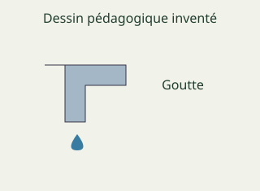
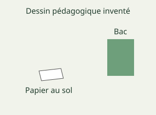

# French Form 5, Form Five French: drafts for review (Lessons 29 lessons (1–31))

Generated by `npm run review:f5-french` from `content/form-5/french/*.json`. Every question and drawing below was built by the engine.
All notes, teach cards, worked examples and paper tasks are **status: draft**. “Authored key” means a person fixed the
right answer (see `AUTHORED.md`); “computed by rule” means code worked it out (a formula, a conversion, a spelling rule).

Teach mode: cards (idea + example + 1 level-1 check) → worked example → practice (levels 1–3) → the note as a summary.

## Sample rendered lesson: Lesson 1 in teach mode

### Lesson 1: Lecture : Lecture des textes simples adossé au module

**Card fr5-1-c1** (draft)

> Distingue les notions avant de choisir.
>
> _information explicite : un détail réellement donné par le texte._  
> _indice de sens : un élément du contexte éclairant une interprétation._  
> _projet : une action envisagée sans résultat nécessairement acquis._  
> _limite du texte : ce que les informations fournies ne permettent pas de conclure._  

Check question: `fr5-1-notions` · multiple choice, level 1 · **authored key**, reused from practice

> Quel terme désigne un détail réellement donné par le texte ?

- ◻️ indice de sens  
  _↳ feedback if chosen: Cela désigne un élément du contexte éclairant une interprétation, plutôt que la notion demandée._
- ◻️ limite du texte  
  _↳ feedback if chosen: Cela désigne ce que les informations fournies ne permettent pas de conclure, plutôt que la notion demandée._
- ◻️ projet  
  _↳ feedback if chosen: Cela désigne une action envisagée sans résultat nécessairement acquis, plutôt que la notion demandée._
- ✅ information explicite

Full working after a second miss:

> Il faut retrouver le détail dans le support.  
> Donc la réponse est « information explicite ».  

**Card fr5-1-c2** (draft)

> Lis le contexte avant de nommer la notion.
>
> _Une action annoncée dans le passage peut être citée._  
> _Une demande de confirmation indique une incertitude._  
> _Une rencontre prévue n’est pas encore un bilan de participation._  
> _L’absence de résultat oblige à laisser une question ouverte._  

Check question: `fr5-1-cas` · multiple choice, level 1 · **authored key**, reused from practice

> L’absence de résultat oblige à laisser une question ouverte.
> Quelle notion convient ?

- ◻️ projet  
  _↳ feedback if chosen: Cela concerne une action envisagée sans résultat nécessairement acquis. Compare cette définition avec le cas présenté._
- ◻️ information explicite  
  _↳ feedback if chosen: Cela concerne un détail réellement donné par le texte. Compare cette définition avec le cas présenté._
- ◻️ indice de sens  
  _↳ feedback if chosen: Cela concerne un élément du contexte éclairant une interprétation. Compare cette définition avec le cas présenté._
- ✅ limite du texte

Full working after a second miss:

> Le cas ne permet pas cette généralisation.  
> Donc la réponse est « limite du texte ».  

**Card fr5-1-c3** (draft)

> Corrige sans changer le sens voulu.
>
> _Une invention plausible est automatiquement une information du texte. Correction : Il faut retrouver le détail dans le support._  
> _Tous les sens d’un mot conviennent également dans chaque phrase. Correction : Le contexte aide à sélectionner un sens._  
> _Chaque projet annoncé est un succès mesuré. Correction : Intention et résultat sont distincts._  
> _Un récit inventé décrit obligatoirement toutes les familles. Correction : Le cas ne permet pas cette généralisation._  

Check question: `fr5-1-corriger-card` · spot the error, level 1 · **authored key**

> Repère la formulation ou l’affirmation incorrecte.

- ◻️ projet : une action envisagée sans résultat nécessairement acquis.  
  _↳ explanation: Cette distinction est correcte : Intention et résultat sont distincts. Cherche plutôt une phrase qui contredit le sens ou la règle._
- ✅ Un récit inventé décrit obligatoirement toutes les familles.  
  _↳ explanation: Le cas ne permet pas cette généralisation._
- ◻️ information explicite : un détail réellement donné par le texte.  
  _↳ explanation: Cette distinction est correcte : Il faut retrouver le détail dans le support. Cherche plutôt une phrase qui contredit le sens ou la règle._
- ◻️ limite du texte : ce que les informations fournies ne permettent pas de conclure.  
  _↳ explanation: Cette distinction est correcte : Le cas ne permet pas cette généralisation. Cherche plutôt une phrase qui contredit le sens ou la règle._

Full working after a second miss:

> La phrase fausse est « Un récit inventé décrit obligatoirement toutes les familles. ».  
> Le cas ne permet pas cette généralisation.  

**Worked example** (draft)

> Une action annoncée dans le passage peut être citée. Explique le choix.

1. un détail réellement donné par le texte.
2. Il faut retrouver le détail dans le support.

**Answer:** information explicite

**Practice** (one generated question per template, easiest first)

Practice 1: `fr5-1-notions` · multiple choice, level 1 · **authored key**

> Quel terme désigne un détail réellement donné par le texte ?

- ◻️ limite du texte  
  _↳ feedback if chosen: Cela désigne ce que les informations fournies ne permettent pas de conclure, plutôt que la notion demandée._
- ◻️ projet  
  _↳ feedback if chosen: Cela désigne une action envisagée sans résultat nécessairement acquis, plutôt que la notion demandée._
- ✅ information explicite
- ◻️ indice de sens  
  _↳ feedback if chosen: Cela désigne un élément du contexte éclairant une interprétation, plutôt que la notion demandée._

Full working after a second miss:

> Il faut retrouver le détail dans le support.  
> Donc la réponse est « information explicite ».  

Practice 2: `fr5-1-cas` · multiple choice, level 1 · **authored key**

> Une action annoncée dans le passage peut être citée.
> Quelle notion convient ?

- ◻️ limite du texte  
  _↳ feedback if chosen: Cela concerne ce que les informations fournies ne permettent pas de conclure. Compare cette définition avec le cas présenté._
- ◻️ projet  
  _↳ feedback if chosen: Cela concerne une action envisagée sans résultat nécessairement acquis. Compare cette définition avec le cas présenté._
- ◻️ indice de sens  
  _↳ feedback if chosen: Cela concerne un élément du contexte éclairant une interprétation. Compare cette définition avec le cas présenté._
- ✅ information explicite

Full working after a second miss:

> Il faut retrouver le détail dans le support.  
> Donc la réponse est « information explicite ».  

Practice 3: `fr5-1-appliquer` · multiple choice, level 2 · **authored key**

> Quelle difficulté est donnée ?

- ◻️ Personne ne veut jamais travailler.  
  _↳ feedback if chosen: Cette intention n’est pas établie._
- ◻️ Le programme a déjà tout résolu.  
  _↳ feedback if chosen: Le programme reste à essayer._
- ◻️ La famille n’a aucun livre.  
  _↳ feedback if chosen: Aucun manque de livres n’est annoncé._
- ✅ Les activités de révision et de lecture se gênent.

Full working after a second miss:

> Le début décrit un chevauchement d’activités.  
> Donc la réponse est « Les activités de révision et de lecture se gênent. ».  

Practice 4: `fr5-1-relier` · matching, level 2 · **authored key**

> Relie chaque notion à son exemple.

Right-hand side (shuffled): Une rencontre prévue n’est pas encore un bilan de participation. · Une action annoncée dans le passage peut être citée. · L’absence de résultat oblige à laisser une question ouverte.
- limite du texte → **L’absence de résultat oblige à laisser une question ouverte.**
- projet → **Une rencontre prévue n’est pas encore un bilan de participation.**
- information explicite → **Une action annoncée dans le passage peut être citée.**

Full working after a second miss:

> Les bonnes paires sont :  
> limite du texte → L’absence de résultat oblige à laisser une question ouverte.  
> projet → Une rencontre prévue n’est pas encore un bilan de participation.  
> information explicite → Une action annoncée dans le passage peut être citée.  

Practice 5: `fr5-1-corriger` · spot the error, level 3 · **authored key**

> Repère la formulation ou l’affirmation incorrecte.

- ◻️ limite du texte : ce que les informations fournies ne permettent pas de conclure.  
  _↳ explanation: Cette distinction est correcte : Le cas ne permet pas cette généralisation. Cherche plutôt une phrase qui contredit le sens ou la règle._
- ✅ Chaque projet annoncé est un succès mesuré.  
  _↳ explanation: Intention et résultat sont distincts._
- ◻️ projet : une action envisagée sans résultat nécessairement acquis.  
  _↳ explanation: Cette distinction est correcte : Intention et résultat sont distincts. Cherche plutôt une phrase qui contredit le sens ou la règle._
- ◻️ information explicite : un détail réellement donné par le texte.  
  _↳ explanation: Cette distinction est correcte : Il faut retrouver le détail dans le support. Cherche plutôt une phrase qui contredit le sens ou la règle._

Full working after a second miss:

> La phrase fausse est « Chaque projet annoncé est un succès mesuré. ».  
> Intention et résultat sont distincts.  

**Summary (the note)**

> Lis le passage entier avant de répondre. Repère personnes, actions, raisons et étapes. Une réponse doit s’appuyer sur un détail ou un indice, non sur une information inventée. Distingue un fait raconté, une proposition et un résultat encore inconnu. Le support original ci-dessous est une fiction pédagogique : il ne représente ni toutes les familles ni une œuvre prescrite.

## All drafts

| Lesson | Title (sheet) | Status | Cards | Practice | Paper task |
|---|---|---|---|---|---|
| 1 | Lecture : Lecture des textes simples adossé au module | draft | 3 | 5 | — |
| 2 | Expression orale : Dialogue sur la présentation de soi et autrui | draft | 3 | 5 | — |
| 4 | Conjugaison : Les verbes pronominaux | draft | 3 | 5 | — |
| 5 | Grammaire : Les adjectifs et pronoms indéfinis | draft | 3 | 5 | — |
| 6 | Orthographe : Les homophones voir – voire / voix - voie | draft | 3 | 5 | — |
| 7 | Grammaire: Les adjectifs et pronoms interrogatifs | draft | 3 | 5 | — |
| 8 | Vocabulaire : lexique lié au mariage | draft | 3 | 5 | — |
| 9 | Expression écrite : la narration : introduction et conclusion (révision) | draft | 3 | 5 | yes |
| 10 | Conjugaison : les verbes irréguliers | draft | 3 | 5 | — |
| 11 | Traduction : traduction de courts textes liés au module | draft | 3 | 5 | — |
| 12 | Grammaire: La proposition subordonnée conjonctive | draft | 3 | 5 | — |
| 13 | Conjugaison: les stuctures conditionnelles avec "si" | draft | 3 | 5 | — |
| 14 | Grammaire: Les pronoms personnels "en" et "y" | draft | 3 | 5 | — |
| 15 | Vocabulaire: Les emprunts | draft | 3 | 5 | — |
| 17 | Vocabulaire : Mots et expressions liés aux changements climatiques | draft | 3 | 5 | — |
| 18 | Conjugaison : L' imparfait et le plus - que - parfait | draft | 3 | 5 | — |
| 19 | Expression orale : Interprétation d'images liés au module | draft | 3 | 5 | — |
| 20 | Grammaire : style direct / style indirect | draft | 3 | 5 | — |
| 21 | Vocabulaire : Mots et expressions liés aux maladies hydriques | draft | 3 | 5 | — |
| 22 | Conjugaison : le subjonctif présent : formation et emploi | draft | 3 | 5 | — |
| 23 | Grammaire : Les adverbes irréguliers | draft | 3 | 5 | — |
| 24 | Vocabulaire : Mots et expressions liés aux recettes culinaires | draft | 3 | 5 | — |
| 25 | Lecture : lecture d’un texte adossé au module | draft | 3 | 5 | — |
| 26 | Orthographe : Initiation à la transcription phonétique de quelques mots simples liés au module Les homophones (soit-soient-soie-soi-sois | draft | 3 | 5 | — |
| 27 | Traduction : Traduire les expressions idiomatiques et des proverbes | draft | 3 | 5 | — |
| 28 | Grammaire : L'article partitif | draft | 3 | 5 | — |
| 29 | Orthographe: Les homophones: quelque/ quelques/ quel que/ quels que/ quelle que/ quelles que | draft | 3 | 5 | — |
| 30 | Grammaire : Le pluriel des noms composés | draft | 3 | 5 | — |
| 31 | Expression écrite : Description / portrait | draft | 3 | 5 | yes |

## Lesson 1: Lecture : Lecture des textes simples adossé au module

Prerequisites: none · Skill: fr5-1 (Lire un texte de vie familiale et sociale)

**Note** (draft)

> Lis le passage entier avant de répondre. Repère personnes, actions, raisons et étapes. Une réponse doit s’appuyer sur un détail ou un indice, non sur une information inventée. Distingue un fait raconté, une proposition et un résultat encore inconnu. Le support original ci-dessous est une fiction pédagogique : il ne représente ni toutes les familles ni une œuvre prescrite.

**Learn: Ton objectif et les liens** (draft)

> À la fin, tu pourras repérer un désaccord, une raison et une proposition dans un récit original. Acquis mobilisés : la lecture attentive et les relations familiales de la classe précédente. Pour la suite : dialoguer, raconter et justifier une interprétation.

**Learn: Comprendre la règle ou le sens** (draft)

> Lis le passage entier avant de répondre. Repère personnes, actions, raisons et étapes. Une réponse doit s’appuyer sur un détail ou un indice, non sur une information inventée. Distingue un fait raconté, une proposition et un résultat encore inconnu. Le support original ci-dessous est une fiction pédagogique : il ne représente ni toutes les familles ni une œuvre prescrite.

**Learn: Lire le modèle original** (draft)

> Texte original : Dans une famille imaginaire à Bamenda, Bih doit réviser pendant que son cousin prépare une lecture à voix haute. Leurs activités se gênent. Au lieu de conclure que l’autre ne veut pas travailler, Bih propose de noter les contraintes de chacun. Un adulte les aide à envisager un autre horaire. Le nouveau programme reste à essayer ; le récit ne dit pas que toutes les difficultés ont disparu.

**Learn: Appliquer et vérifier** (draft)

> Relis la phrase utile, réponds clairement puis explique l’indice. Préserve les personnes, le moment et la portée du passage. Ne transforme pas un projet en résultat.

**Learn: key words and examples** (draft)

- **information explicite**: un détail réellement donné par le texte
- **indice de sens**: un élément du contexte éclairant une interprétation
- **projet**: une action envisagée sans résultat nécessairement acquis
- **limite du texte**: ce que les informations fournies ne permettent pas de conclure

Common mistake: “Une invention plausible est automatiquement une information du texte.” → “un détail réellement donné par le texte.”. Il faut retrouver le détail dans le support.

**Card fr5-1-c1** (draft)

> Distingue les notions avant de choisir.
>
> _information explicite : un détail réellement donné par le texte._  
> _indice de sens : un élément du contexte éclairant une interprétation._  
> _projet : une action envisagée sans résultat nécessairement acquis._  
> _limite du texte : ce que les informations fournies ne permettent pas de conclure._  

Check question: `fr5-1-notions` · multiple choice, level 1 · **authored key**, reused from practice

> Quel terme désigne ce que les informations fournies ne permettent pas de conclure ?

- ✅ limite du texte
- ◻️ information explicite  
  _↳ feedback if chosen: Cela désigne un détail réellement donné par le texte, plutôt que la notion demandée._
- ◻️ indice de sens  
  _↳ feedback if chosen: Cela désigne un élément du contexte éclairant une interprétation, plutôt que la notion demandée._
- ◻️ projet  
  _↳ feedback if chosen: Cela désigne une action envisagée sans résultat nécessairement acquis, plutôt que la notion demandée._

Full working after a second miss:

> Le cas ne permet pas cette généralisation.  
> Donc la réponse est « limite du texte ».  

**Card fr5-1-c2** (draft)

> Lis le contexte avant de nommer la notion.
>
> _Une action annoncée dans le passage peut être citée._  
> _Une demande de confirmation indique une incertitude._  
> _Une rencontre prévue n’est pas encore un bilan de participation._  
> _L’absence de résultat oblige à laisser une question ouverte._  

Check question: `fr5-1-cas` · multiple choice, level 1 · **authored key**, reused from practice

> Une demande de confirmation indique une incertitude.
> Quelle notion convient ?

- ◻️ information explicite  
  _↳ feedback if chosen: Cela concerne un détail réellement donné par le texte. Compare cette définition avec le cas présenté._
- ◻️ projet  
  _↳ feedback if chosen: Cela concerne une action envisagée sans résultat nécessairement acquis. Compare cette définition avec le cas présenté._
- ✅ indice de sens
- ◻️ limite du texte  
  _↳ feedback if chosen: Cela concerne ce que les informations fournies ne permettent pas de conclure. Compare cette définition avec le cas présenté._

Full working after a second miss:

> Le contexte aide à sélectionner un sens.  
> Donc la réponse est « indice de sens ».  

**Card fr5-1-c3** (draft)

> Corrige sans changer le sens voulu.
>
> _Une invention plausible est automatiquement une information du texte. Correction : Il faut retrouver le détail dans le support._  
> _Tous les sens d’un mot conviennent également dans chaque phrase. Correction : Le contexte aide à sélectionner un sens._  
> _Chaque projet annoncé est un succès mesuré. Correction : Intention et résultat sont distincts._  
> _Un récit inventé décrit obligatoirement toutes les familles. Correction : Le cas ne permet pas cette généralisation._  

Check question: `fr5-1-corriger-card` · spot the error, level 1 · **authored key**

> Repère la formulation ou l’affirmation incorrecte.

- ◻️ projet : une action envisagée sans résultat nécessairement acquis.  
  _↳ explanation: Cette distinction est correcte : Intention et résultat sont distincts. Cherche plutôt une phrase qui contredit le sens ou la règle._
- ✅ Tous les sens d’un mot conviennent également dans chaque phrase.  
  _↳ explanation: Le contexte aide à sélectionner un sens._
- ◻️ indice de sens : un élément du contexte éclairant une interprétation.  
  _↳ explanation: Cette distinction est correcte : Le contexte aide à sélectionner un sens. Cherche plutôt une phrase qui contredit le sens ou la règle._
- ◻️ information explicite : un détail réellement donné par le texte.  
  _↳ explanation: Cette distinction est correcte : Il faut retrouver le détail dans le support. Cherche plutôt une phrase qui contredit le sens ou la règle._

Full working after a second miss:

> La phrase fausse est « Tous les sens d’un mot conviennent également dans chaque phrase. ».  
> Le contexte aide à sélectionner un sens.  

**Worked example** (draft)

> Une action annoncée dans le passage peut être citée. Explique le choix.

1. un détail réellement donné par le texte.
2. Il faut retrouver le détail dans le support.

**Answer:** information explicite

**Practice** `fr5-1-notions` · multiple choice, level 1 · **authored key**

> Quel terme désigne une action envisagée sans résultat nécessairement acquis ?

- ◻️ information explicite  
  _↳ feedback if chosen: Cela désigne un détail réellement donné par le texte, plutôt que la notion demandée._
- ◻️ indice de sens  
  _↳ feedback if chosen: Cela désigne un élément du contexte éclairant une interprétation, plutôt que la notion demandée._
- ◻️ limite du texte  
  _↳ feedback if chosen: Cela désigne ce que les informations fournies ne permettent pas de conclure, plutôt que la notion demandée._
- ✅ projet

Full working after a second miss:

> Intention et résultat sont distincts.  
> Donc la réponse est « projet ».  

> Quel terme désigne un détail réellement donné par le texte ?

- ◻️ indice de sens  
  _↳ feedback if chosen: Cela désigne un élément du contexte éclairant une interprétation, plutôt que la notion demandée._
- ◻️ limite du texte  
  _↳ feedback if chosen: Cela désigne ce que les informations fournies ne permettent pas de conclure, plutôt que la notion demandée._
- ✅ information explicite
- ◻️ projet  
  _↳ feedback if chosen: Cela désigne une action envisagée sans résultat nécessairement acquis, plutôt que la notion demandée._

Full working after a second miss:

> Il faut retrouver le détail dans le support.  
> Donc la réponse est « information explicite ».  

**Practice** `fr5-1-cas` · multiple choice, level 1 · **authored key**

> Une action annoncée dans le passage peut être citée.
> Quelle notion convient ?

- ✅ information explicite
- ◻️ limite du texte  
  _↳ feedback if chosen: Cela concerne ce que les informations fournies ne permettent pas de conclure. Compare cette définition avec le cas présenté._
- ◻️ projet  
  _↳ feedback if chosen: Cela concerne une action envisagée sans résultat nécessairement acquis. Compare cette définition avec le cas présenté._
- ◻️ indice de sens  
  _↳ feedback if chosen: Cela concerne un élément du contexte éclairant une interprétation. Compare cette définition avec le cas présenté._

Full working after a second miss:

> Il faut retrouver le détail dans le support.  
> Donc la réponse est « information explicite ».  

> Une demande de confirmation indique une incertitude.
> Quelle notion convient ?

- ◻️ information explicite  
  _↳ feedback if chosen: Cela concerne un détail réellement donné par le texte. Compare cette définition avec le cas présenté._
- ◻️ projet  
  _↳ feedback if chosen: Cela concerne une action envisagée sans résultat nécessairement acquis. Compare cette définition avec le cas présenté._
- ◻️ limite du texte  
  _↳ feedback if chosen: Cela concerne ce que les informations fournies ne permettent pas de conclure. Compare cette définition avec le cas présenté._
- ✅ indice de sens

Full working after a second miss:

> Le contexte aide à sélectionner un sens.  
> Donc la réponse est « indice de sens ».  

**Practice** `fr5-1-appliquer` · multiple choice, level 2 · **authored key**

> Quel rôle joue l’adulte ?

- ◻️ Supprimer définitivement les études.  
  _↳ feedback if chosen: Ce n’est pas annoncé._
- ◻️ Remplacer tous les livres.  
  _↳ feedback if chosen: Aucun remplacement n’est décrit._
- ◻️ Garantir un résultat à chaque famille.  
  _↳ feedback if chosen: Le cas ne garantit rien de général._
- ✅ Aider à envisager un autre horaire.

Full working after a second miss:

> Le passage précise cette aide.  
> Donc la réponse est « Aider à envisager un autre horaire. ».  

> Que peut-on conclure ?

- ◻️ Chaque problème a disparu.  
  _↳ feedback if chosen: Le résultat reste à observer._
- ◻️ Le cousin refuse forcément tout effort.  
  _↳ feedback if chosen: L’intention n’est pas établie._
- ◻️ Toutes les familles ont les mêmes horaires.  
  _↳ feedback if chosen: Le cas ne porte pas cette généralité._
- ✅ Une adaptation est envisagée, mais son efficacité reste inconnue.

Full working after a second miss:

> Respecte la limite finale du texte.  
> Donc la réponse est « Une adaptation est envisagée, mais son efficacité reste inconnue. ».  

**Practice** `fr5-1-relier` · matching, level 2 · **authored key**

> Relie chaque notion à son exemple.

Right-hand side (shuffled): L’absence de résultat oblige à laisser une question ouverte. · Une demande de confirmation indique une incertitude. · Une rencontre prévue n’est pas encore un bilan de participation.
- indice de sens → **Une demande de confirmation indique une incertitude.**
- limite du texte → **L’absence de résultat oblige à laisser une question ouverte.**
- projet → **Une rencontre prévue n’est pas encore un bilan de participation.**

Full working after a second miss:

> Les bonnes paires sont :  
> indice de sens → Une demande de confirmation indique une incertitude.  
> limite du texte → L’absence de résultat oblige à laisser une question ouverte.  
> projet → Une rencontre prévue n’est pas encore un bilan de participation.  

> Relie chaque notion à son exemple.

Right-hand side (shuffled): Une rencontre prévue n’est pas encore un bilan de participation. · L’absence de résultat oblige à laisser une question ouverte. · Une demande de confirmation indique une incertitude.
- indice de sens → **Une demande de confirmation indique une incertitude.**
- projet → **Une rencontre prévue n’est pas encore un bilan de participation.**
- limite du texte → **L’absence de résultat oblige à laisser une question ouverte.**

Full working after a second miss:

> Les bonnes paires sont :  
> indice de sens → Une demande de confirmation indique une incertitude.  
> projet → Une rencontre prévue n’est pas encore un bilan de participation.  
> limite du texte → L’absence de résultat oblige à laisser une question ouverte.  

**Practice** `fr5-1-corriger` · spot the error, level 3 · **authored key**

> Repère la formulation ou l’affirmation incorrecte.

- ◻️ projet : une action envisagée sans résultat nécessairement acquis.  
  _↳ explanation: Cette distinction est correcte : Intention et résultat sont distincts. Cherche plutôt une phrase qui contredit le sens ou la règle._
- ✅ Chaque projet annoncé est un succès mesuré.  
  _↳ explanation: Intention et résultat sont distincts._
- ◻️ indice de sens : un élément du contexte éclairant une interprétation.  
  _↳ explanation: Cette distinction est correcte : Le contexte aide à sélectionner un sens. Cherche plutôt une phrase qui contredit le sens ou la règle._
- ◻️ information explicite : un détail réellement donné par le texte.  
  _↳ explanation: Cette distinction est correcte : Il faut retrouver le détail dans le support. Cherche plutôt une phrase qui contredit le sens ou la règle._

Full working after a second miss:

> La phrase fausse est « Chaque projet annoncé est un succès mesuré. ».  
> Intention et résultat sont distincts.  

> Repère la formulation ou l’affirmation incorrecte.

- ✅ Une invention plausible est automatiquement une information du texte.  
  _↳ explanation: Il faut retrouver le détail dans le support._
- ◻️ limite du texte : ce que les informations fournies ne permettent pas de conclure.  
  _↳ explanation: Cette distinction est correcte : Le cas ne permet pas cette généralisation. Cherche plutôt une phrase qui contredit le sens ou la règle._
- ◻️ information explicite : un détail réellement donné par le texte.  
  _↳ explanation: Cette distinction est correcte : Il faut retrouver le détail dans le support. Cherche plutôt une phrase qui contredit le sens ou la règle._
- ◻️ projet : une action envisagée sans résultat nécessairement acquis.  
  _↳ explanation: Cette distinction est correcte : Intention et résultat sont distincts. Cherche plutôt une phrase qui contredit le sens ou la règle._

Full working after a second miss:

> La phrase fausse est « Une invention plausible est automatiquement une information du texte. ».  
> Il faut retrouver le détail dans le support.  

## Lesson 2: Expression orale : Dialogue sur la présentation de soi et autrui

Prerequisites: 1 · Skill: fr5-2 (Préparer un dialogue de présentation de soi et d’autrui)

**Note** (draft)

> Une présentation adapte les renseignements à la situation. On peut donner un prénom fictif, un rôle et un intérêt pertinent sans demander d’adresse privée. Présenter autrui exige de conserver son nom, ses pronoms et ce qu’il a réellement déclaré. Une question de clarification sert à vérifier une information, non à l’inventer. Ce travail prépare un dialogue écrit ; l’écoute, la voix et les échanges spontanés devront être pratiqués séparément.

**Learn: Ton objectif et les liens** (draft)

> À la fin, tu pourras présenter une personne et demander une précision sans inventer ses informations. Acquis mobilisés : le récit familial, les pronoms sujets et la politesse. Pour la suite : verbes pronominaux et dialogues plus développés.

**Learn: Comprendre la règle ou le sens** (draft)

> Une présentation adapte les renseignements à la situation. On peut donner un prénom fictif, un rôle et un intérêt pertinent sans demander d’adresse privée. Présenter autrui exige de conserver son nom, ses pronoms et ce qu’il a réellement déclaré. Une question de clarification sert à vérifier une information, non à l’inventer. Ce travail prépare un dialogue écrit ; l’écoute, la voix et les échanges spontanés devront être pratiqués séparément.

**Learn: Lire le modèle original** (draft)

> Dialogue original : « Bonjour, je m’appelle Bih. Je participe au club de lecture. Voici Ayuk ; il aime préparer les affiches. — Bonjour. Quel rôle voudrais-tu essayer ? — Je voudrais accueillir les nouveaux membres. Peux-tu préciser l’heure prévue ? » Les personnages sont fictifs. La dernière question n’établit pas encore une heure confirmée.

**Learn: Appliquer et vérifier** (draft)

> Précise qui parle, à qui et pourquoi. Choisis des informations fictives utiles, puis ajoute une question pertinente et une réponse qui conserve les mêmes références. Un partenaire pourra ensuite écouter et vérifier l’intelligibilité.

**Learn: key words and examples** (draft)

- **présentation de soi**: des informations pertinentes que le locuteur donne sur lui-même
- **présentation d’autrui**: une introduction fidèle de la personne présentée
- **clarification**: une demande destinée à vérifier une information
- **référence stable**: le maintien de la même personne dans le dialogue

Common mistake: “Se présenter exige de publier son adresse privée.” → “des informations pertinentes que le locuteur donne sur lui-même.”. On peut utiliser des informations fictives adaptées.

**Card fr5-2-c1** (draft)

> Distingue les notions avant de choisir.
>
> _présentation de soi : des informations pertinentes que le locuteur donne sur lui-même._  
> _présentation d’autrui : une introduction fidèle de la personne présentée._  
> _clarification : une demande destinée à vérifier une information._  
> _référence stable : le maintien de la même personne dans le dialogue._  

Check question: `fr5-2-notions` · multiple choice, level 1 · **authored key**, reused from practice

> Quel terme désigne le maintien de la même personne dans le dialogue ?

- ◻️ présentation d’autrui  
  _↳ feedback if chosen: Cela désigne une introduction fidèle de la personne présentée, plutôt que la notion demandée._
- ◻️ clarification  
  _↳ feedback if chosen: Cela désigne une demande destinée à vérifier une information, plutôt que la notion demandée._
- ◻️ présentation de soi  
  _↳ feedback if chosen: Cela désigne des informations pertinentes que le locuteur donne sur lui-même, plutôt que la notion demandée._
- ✅ référence stable

Full working after a second miss:

> Les pronoms doivent garder une référence claire.  
> Donc la réponse est « référence stable ».  

**Card fr5-2-c2** (draft)

> Lis le contexte avant de nommer la notion.
>
> _Je participe au club de lecture présente mon rôle._  
> _Voici Ayuk ; il aime préparer les affiches._  
> _Peux-tu préciser l’heure prévue ?_  
> _Il renvoie à Ayuk dans le modèle._  

Check question: `fr5-2-cas` · multiple choice, level 1 · **authored key**, reused from practice

> Je participe au club de lecture présente mon rôle.
> Quelle notion convient ?

- ✅ présentation de soi
- ◻️ clarification  
  _↳ feedback if chosen: Cela concerne une demande destinée à vérifier une information. Compare cette définition avec le cas présenté._
- ◻️ référence stable  
  _↳ feedback if chosen: Cela concerne le maintien de la même personne dans le dialogue. Compare cette définition avec le cas présenté._
- ◻️ présentation d’autrui  
  _↳ feedback if chosen: Cela concerne une introduction fidèle de la personne présentée. Compare cette définition avec le cas présenté._

Full working after a second miss:

> On peut utiliser des informations fictives adaptées.  
> Donc la réponse est « présentation de soi ».  

**Card fr5-2-c3** (draft)

> Corrige sans changer le sens voulu.
>
> _Se présenter exige de publier son adresse privée. Correction : On peut utiliser des informations fictives adaptées._  
> _Présenter une personne autorise à inventer ses préférences. Correction : Il faut préserver les informations données._  
> _Demander une heure prouve qu’elle est déjà confirmée. Correction : La question signale un renseignement encore nécessaire._  
> _On peut changer les référents des pronoms sans changer le sens. Correction : Les pronoms doivent garder une référence claire._  

Check question: `fr5-2-corriger-card` · spot the error, level 1 · **authored key**

> Repère la formulation ou l’affirmation incorrecte.

- ✅ Demander une heure prouve qu’elle est déjà confirmée.  
  _↳ explanation: La question signale un renseignement encore nécessaire._
- ◻️ présentation d’autrui : une introduction fidèle de la personne présentée.  
  _↳ explanation: Cette distinction est correcte : Il faut préserver les informations données. Cherche plutôt une phrase qui contredit le sens ou la règle._
- ◻️ référence stable : le maintien de la même personne dans le dialogue.  
  _↳ explanation: Cette distinction est correcte : Les pronoms doivent garder une référence claire. Cherche plutôt une phrase qui contredit le sens ou la règle._
- ◻️ présentation de soi : des informations pertinentes que le locuteur donne sur lui-même.  
  _↳ explanation: Cette distinction est correcte : On peut utiliser des informations fictives adaptées. Cherche plutôt une phrase qui contredit le sens ou la règle._

Full working after a second miss:

> La phrase fausse est « Demander une heure prouve qu’elle est déjà confirmée. ».  
> La question signale un renseignement encore nécessaire.  

**Worked example** (draft)

> Je participe au club de lecture présente mon rôle. Explique le choix.

1. des informations pertinentes que le locuteur donne sur lui-même.
2. On peut utiliser des informations fictives adaptées.

**Answer:** présentation de soi

**Practice** `fr5-2-notions` · multiple choice, level 1 · **authored key**

> Quel terme désigne des informations pertinentes que le locuteur donne sur lui-même ?

- ◻️ clarification  
  _↳ feedback if chosen: Cela désigne une demande destinée à vérifier une information, plutôt que la notion demandée._
- ◻️ référence stable  
  _↳ feedback if chosen: Cela désigne le maintien de la même personne dans le dialogue, plutôt que la notion demandée._
- ◻️ présentation d’autrui  
  _↳ feedback if chosen: Cela désigne une introduction fidèle de la personne présentée, plutôt que la notion demandée._
- ✅ présentation de soi

Full working after a second miss:

> On peut utiliser des informations fictives adaptées.  
> Donc la réponse est « présentation de soi ».  

> Quel terme désigne une demande destinée à vérifier une information ?

- ◻️ présentation d’autrui  
  _↳ feedback if chosen: Cela désigne une introduction fidèle de la personne présentée, plutôt que la notion demandée._
- ◻️ présentation de soi  
  _↳ feedback if chosen: Cela désigne des informations pertinentes que le locuteur donne sur lui-même, plutôt que la notion demandée._
- ◻️ référence stable  
  _↳ feedback if chosen: Cela désigne le maintien de la même personne dans le dialogue, plutôt que la notion demandée._
- ✅ clarification

Full working after a second miss:

> La question signale un renseignement encore nécessaire.  
> Donc la réponse est « clarification ».  

**Practice** `fr5-2-cas` · multiple choice, level 1 · **authored key**

> Voici Ayuk ; il aime préparer les affiches.
> Quelle notion convient ?

- ◻️ présentation de soi  
  _↳ feedback if chosen: Cela concerne des informations pertinentes que le locuteur donne sur lui-même. Compare cette définition avec le cas présenté._
- ◻️ clarification  
  _↳ feedback if chosen: Cela concerne une demande destinée à vérifier une information. Compare cette définition avec le cas présenté._
- ✅ présentation d’autrui
- ◻️ référence stable  
  _↳ feedback if chosen: Cela concerne le maintien de la même personne dans le dialogue. Compare cette définition avec le cas présenté._

Full working after a second miss:

> Il faut préserver les informations données.  
> Donc la réponse est « présentation d’autrui ».  

> Peux-tu préciser l’heure prévue ?
> Quelle notion convient ?

- ✅ clarification
- ◻️ présentation d’autrui  
  _↳ feedback if chosen: Cela concerne une introduction fidèle de la personne présentée. Compare cette définition avec le cas présenté._
- ◻️ présentation de soi  
  _↳ feedback if chosen: Cela concerne des informations pertinentes que le locuteur donne sur lui-même. Compare cette définition avec le cas présenté._
- ◻️ référence stable  
  _↳ feedback if chosen: Cela concerne le maintien de la même personne dans le dialogue. Compare cette définition avec le cas présenté._

Full working after a second miss:

> La question signale un renseignement encore nécessaire.  
> Donc la réponse est « clarification ».  

**Practice** `fr5-2-appliquer` · multiple choice, level 2 · **authored key**

> Ayuk a déclaré aimer les affiches. Quelle présentation garde cette information ?

- ◻️ Voici Bih ; elle a donné toutes les informations d’Ayuk.  
  _↳ feedback if chosen: La personne et le rôle sont modifiés._
- ✅ Voici Ayuk ; il aime préparer les affiches.
- ◻️ Voici Ayuk ; il déteste forcément les affiches.  
  _↳ feedback if chosen: La préférence est inversée._
- ◻️ Ayuk est le nom de l’horaire confirmé.  
  _↳ feedback if chosen: Le nom désigne une personne._

Full working after a second miss:

> Préserve personne et préférence.  
> Donc la réponse est « Voici Ayuk ; il aime préparer les affiches. ».  

> Tu veux te présenter au club avec des renseignements fictifs pertinents. Quelle phrase convient ?

- ◻️ Je sais toutes les pensées privées d’Ayuk.  
  _↳ feedback if chosen: Cette connaissance n’est pas donnée._
- ◻️ Toute question prouve que l’horaire est fixé.  
  _↳ feedback if chosen: Une question peut signaler une incertitude._
- ◻️ Voici le mot de passe réel de mon voisin.  
  _↳ feedback if chosen: Ce détail privé n’est pas nécessaire._
- ✅ Je m’appelle Bih et je participe au club de lecture.

Full working after a second miss:

> Donne une identité fictive et un rôle utile.  
> Donc la réponse est « Je m’appelle Bih et je participe au club de lecture. ».  

**Practice** `fr5-2-relier` · matching, level 2 · **authored key**

> Relie chaque notion à son exemple.

Right-hand side (shuffled): Il renvoie à Ayuk dans le modèle. · Peux-tu préciser l’heure prévue ? · Je participe au club de lecture présente mon rôle.
- présentation de soi → **Je participe au club de lecture présente mon rôle.**
- référence stable → **Il renvoie à Ayuk dans le modèle.**
- clarification → **Peux-tu préciser l’heure prévue ?**

Full working after a second miss:

> Les bonnes paires sont :  
> présentation de soi → Je participe au club de lecture présente mon rôle.  
> référence stable → Il renvoie à Ayuk dans le modèle.  
> clarification → Peux-tu préciser l’heure prévue ?  

> Relie chaque notion à son exemple.

Right-hand side (shuffled): Il renvoie à Ayuk dans le modèle. · Je participe au club de lecture présente mon rôle. · Peux-tu préciser l’heure prévue ?
- présentation de soi → **Je participe au club de lecture présente mon rôle.**
- référence stable → **Il renvoie à Ayuk dans le modèle.**
- clarification → **Peux-tu préciser l’heure prévue ?**

Full working after a second miss:

> Les bonnes paires sont :  
> présentation de soi → Je participe au club de lecture présente mon rôle.  
> référence stable → Il renvoie à Ayuk dans le modèle.  
> clarification → Peux-tu préciser l’heure prévue ?  

**Practice** `fr5-2-corriger` · spot the error, level 3 · **authored key**

> Repère la formulation ou l’affirmation incorrecte.

- ◻️ clarification : une demande destinée à vérifier une information.  
  _↳ explanation: Cette distinction est correcte : La question signale un renseignement encore nécessaire. Cherche plutôt une phrase qui contredit le sens ou la règle._
- ◻️ référence stable : le maintien de la même personne dans le dialogue.  
  _↳ explanation: Cette distinction est correcte : Les pronoms doivent garder une référence claire. Cherche plutôt une phrase qui contredit le sens ou la règle._
- ✅ Présenter une personne autorise à inventer ses préférences.  
  _↳ explanation: Il faut préserver les informations données._
- ◻️ présentation d’autrui : une introduction fidèle de la personne présentée.  
  _↳ explanation: Cette distinction est correcte : Il faut préserver les informations données. Cherche plutôt une phrase qui contredit le sens ou la règle._

Full working after a second miss:

> La phrase fausse est « Présenter une personne autorise à inventer ses préférences. ».  
> Il faut préserver les informations données.  

> Repère la formulation ou l’affirmation incorrecte.

- ◻️ référence stable : le maintien de la même personne dans le dialogue.  
  _↳ explanation: Cette distinction est correcte : Les pronoms doivent garder une référence claire. Cherche plutôt une phrase qui contredit le sens ou la règle._
- ◻️ clarification : une demande destinée à vérifier une information.  
  _↳ explanation: Cette distinction est correcte : La question signale un renseignement encore nécessaire. Cherche plutôt une phrase qui contredit le sens ou la règle._
- ✅ Présenter une personne autorise à inventer ses préférences.  
  _↳ explanation: Il faut préserver les informations données._
- ◻️ présentation de soi : des informations pertinentes que le locuteur donne sur lui-même.  
  _↳ explanation: Cette distinction est correcte : On peut utiliser des informations fictives adaptées. Cherche plutôt une phrase qui contredit le sens ou la règle._

Full working after a second miss:

> La phrase fausse est « Présenter une personne autorise à inventer ses préférences. ».  
> Il faut préserver les informations données.  

## Lesson 4: Conjugaison : Les verbes pronominaux

Prerequisites: 1, 2 · Skill: fr5-4 (Les verbes pronominaux au présent)

**Note** (draft)

> Une construction pronominale associe un verbe à me, te, se, nous ou vous selon le sujet. Dans je me lave, me reprend le sujet ; nous nous lavons associe le pronom sujet à un pronom réfléchi de même personne. Devant une voyelle, me, te et se s’élident : je m’appelle. Le verbe garde ses règles de conjugaison et ses changements de radical. Les valeurs des constructions pronominales sont variées ; cette leçon travaille les formes au présent, non toutes les règles d’accord du participe passé.

**Learn: Ton objectif et les liens** (draft)

> À la fin, tu pourras associer le pronom réfléchi au sujet et former le présent des modèles étudiés. Acquis mobilisés : présentations, sujets et présent des verbes. Pour la suite : pronoms, récit et relecture des phrases.

**Learn: Comprendre la règle ou le sens** (draft)

> Une construction pronominale associe un verbe à me, te, se, nous ou vous selon le sujet. Dans je me lave, me reprend le sujet ; nous nous lavons associe le pronom sujet à un pronom réfléchi de même personne. Devant une voyelle, me, te et se s’élident : je m’appelle. Le verbe garde ses règles de conjugaison et ses changements de radical. Les valeurs des constructions pronominales sont variées ; cette leçon travaille les formes au présent, non toutes les règles d’accord du participe passé.

**Learn: Lire le modèle original** (draft)

> Modèles calculés : je me lave ; nous nous levons ; elle s’appelle. Dans nous nous levons, le premier nous est sujet et le second appartient à la construction pronominale. La forme elle s’appelle conserve le double l du verbe appeler au présent.

**Learn: Appliquer et vérifier** (draft)

> Repère le sujet, choisis son pronom réfléchi puis conjugue le verbe. Vérifie l’élision devant appeler et les changements de radical. Ne remplace pas un pronom réfléchi par un pronom de personne différente.

**Learn: key words and examples** (draft)

- **construction pronominale**: l’association du verbe et d’un pronom reprenant le sujet dans le modèle
- **correspondance de personne**: le choix du pronom réfléchi selon le sujet
- **élision**: la réduction de me, te ou se devant une voyelle
- **conjugaison du verbe**: la forme personnelle conservant les règles du verbe

Common mistake: “Je lave est toujours la même construction que je me lave.” → “l’association du verbe et d’un pronom reprenant le sujet dans le modèle.”. La présence et le rôle du pronom changent la construction.

**Card fr5-4-c1** (draft)

> Distingue les notions avant de choisir.
>
> _construction pronominale : l’association du verbe et d’un pronom reprenant le sujet dans le modèle._  
> _correspondance de personne : le choix du pronom réfléchi selon le sujet._  
> _élision : la réduction de me, te ou se devant une voyelle._  
> _conjugaison du verbe : la forme personnelle conservant les règles du verbe._  

Check question: `fr5-4-notions` · multiple choice, level 1 · **authored key**, reused from practice

> Quel terme désigne l’association du verbe et d’un pronom reprenant le sujet dans le modèle ?

- ◻️ conjugaison du verbe  
  _↳ feedback if chosen: Cela désigne la forme personnelle conservant les règles du verbe, plutôt que la notion demandée._
- ◻️ élision  
  _↳ feedback if chosen: Cela désigne la réduction de me, te ou se devant une voyelle, plutôt que la notion demandée._
- ◻️ correspondance de personne  
  _↳ feedback if chosen: Cela désigne le choix du pronom réfléchi selon le sujet, plutôt que la notion demandée._
- ✅ construction pronominale

Full working after a second miss:

> La présence et le rôle du pronom changent la construction.  
> Donc la réponse est « construction pronominale ».  

**Card fr5-4-c2** (draft)

> Lis le contexte avant de nommer la notion.
>
> _Je me lave contient le pronom réfléchi demandé._  
> _Nous nous levons garde la même personne._  
> _Je m’appelle emploie la forme élidée._  
> _Elle s’appelle garde le radical appelle._  

Check question: `fr5-4-cas` · multiple choice, level 1 · **authored key**, reused from practice

> Je m’appelle emploie la forme élidée.
> Quelle notion convient ?

- ✅ élision
- ◻️ conjugaison du verbe  
  _↳ feedback if chosen: Cela concerne la forme personnelle conservant les règles du verbe. Compare cette définition avec le cas présenté._
- ◻️ correspondance de personne  
  _↳ feedback if chosen: Cela concerne le choix du pronom réfléchi selon le sujet. Compare cette définition avec le cas présenté._
- ◻️ construction pronominale  
  _↳ feedback if chosen: Cela concerne l’association du verbe et d’un pronom reprenant le sujet dans le modèle. Compare cette définition avec le cas présenté._

Full working after a second miss:

> Me s’élide devant la voyelle initiale.  
> Donc la réponse est « élision ».  

**Card fr5-4-c3** (draft)

> Corrige sans changer le sens voulu.
>
> _Je lave est toujours la même construction que je me lave. Correction : La présence et le rôle du pronom changent la construction._  
> _Nous se levons respecte la correspondance étudiée. Correction : Avec nous, le modèle demande nous, non se._  
> _Je me appelle est la graphie du modèle écrit. Correction : Me s’élide devant la voyelle initiale._  
> _Le pronom réfléchi autorise à laisser appeler à l’infinitif après elle. Correction : La construction au présent demande un verbe conjugué._  

Check question: `fr5-4-corriger-card` · spot the error, level 1 · **authored key**

> Repère la formulation ou l’affirmation incorrecte.

- ◻️ conjugaison du verbe : la forme personnelle conservant les règles du verbe.  
  _↳ explanation: Cette distinction est correcte : La construction au présent demande un verbe conjugué. Cherche plutôt une phrase qui contredit le sens ou la règle._
- ◻️ correspondance de personne : le choix du pronom réfléchi selon le sujet.  
  _↳ explanation: Cette distinction est correcte : Avec nous, le modèle demande nous, non se. Cherche plutôt une phrase qui contredit le sens ou la règle._
- ◻️ élision : la réduction de me, te ou se devant une voyelle.  
  _↳ explanation: Cette distinction est correcte : Me s’élide devant la voyelle initiale. Cherche plutôt une phrase qui contredit le sens ou la règle._
- ✅ Le pronom réfléchi autorise à laisser appeler à l’infinitif après elle.  
  _↳ explanation: La construction au présent demande un verbe conjugué._

Full working after a second miss:

> La phrase fausse est « Le pronom réfléchi autorise à laisser appeler à l’infinitif après elle. ».  
> La construction au présent demande un verbe conjugué.  

**Worked example** (draft)

> Je me lave contient le pronom réfléchi demandé. Explique le choix.

1. l’association du verbe et d’un pronom reprenant le sujet dans le modèle.
2. La présence et le rôle du pronom changent la construction.

**Answer:** construction pronominale

**Practice** `fr5-4-notions` · multiple choice, level 1 · **authored key**

> Quel terme désigne la réduction de me, te ou se devant une voyelle ?

- ✅ élision
- ◻️ correspondance de personne  
  _↳ feedback if chosen: Cela désigne le choix du pronom réfléchi selon le sujet, plutôt que la notion demandée._
- ◻️ construction pronominale  
  _↳ feedback if chosen: Cela désigne l’association du verbe et d’un pronom reprenant le sujet dans le modèle, plutôt que la notion demandée._
- ◻️ conjugaison du verbe  
  _↳ feedback if chosen: Cela désigne la forme personnelle conservant les règles du verbe, plutôt que la notion demandée._

Full working after a second miss:

> Me s’élide devant la voyelle initiale.  
> Donc la réponse est « élision ».  

> Quel terme désigne la forme personnelle conservant les règles du verbe ?

- ◻️ construction pronominale  
  _↳ feedback if chosen: Cela désigne l’association du verbe et d’un pronom reprenant le sujet dans le modèle, plutôt que la notion demandée._
- ◻️ élision  
  _↳ feedback if chosen: Cela désigne la réduction de me, te ou se devant une voyelle, plutôt que la notion demandée._
- ◻️ correspondance de personne  
  _↳ feedback if chosen: Cela désigne le choix du pronom réfléchi selon le sujet, plutôt que la notion demandée._
- ✅ conjugaison du verbe

Full working after a second miss:

> La construction au présent demande un verbe conjugué.  
> Donc la réponse est « conjugaison du verbe ».  

**Practice** `fr5-4-cas` · multiple choice, level 1 · **authored key**

> Elle s’appelle garde le radical appelle.
> Quelle notion convient ?

- ◻️ correspondance de personne  
  _↳ feedback if chosen: Cela concerne le choix du pronom réfléchi selon le sujet. Compare cette définition avec le cas présenté._
- ◻️ élision  
  _↳ feedback if chosen: Cela concerne la réduction de me, te ou se devant une voyelle. Compare cette définition avec le cas présenté._
- ✅ conjugaison du verbe
- ◻️ construction pronominale  
  _↳ feedback if chosen: Cela concerne l’association du verbe et d’un pronom reprenant le sujet dans le modèle. Compare cette définition avec le cas présenté._

Full working after a second miss:

> La construction au présent demande un verbe conjugué.  
> Donc la réponse est « conjugaison du verbe ».  

> Nous nous levons garde la même personne.
> Quelle notion convient ?

- ◻️ construction pronominale  
  _↳ feedback if chosen: Cela concerne l’association du verbe et d’un pronom reprenant le sujet dans le modèle. Compare cette définition avec le cas présenté._
- ◻️ conjugaison du verbe  
  _↳ feedback if chosen: Cela concerne la forme personnelle conservant les règles du verbe. Compare cette définition avec le cas présenté._
- ✅ correspondance de personne
- ◻️ élision  
  _↳ feedback if chosen: Cela concerne la réduction de me, te ou se devant une voyelle. Compare cette définition avec le cas présenté._

Full working after a second miss:

> Avec nous, le modèle demande nous, non se.  
> Donc la réponse est « correspondance de personne ».  

**Practice** `fr5-4-formes` · multiple choice, level 2 · computed by rule

> Mets « s’appeler » au présent avec « je ». Conserve la construction pronominale.

- ✅ je m’appelle
- ◻️ je se appelle  
  _↳ feedback if chosen: Ce pronom ne reprend pas le sujet demandé dans cette construction._
- ◻️ j’appelle  
  _↳ feedback if chosen: Le verbe est conjugué, mais le pronom réfléchi demandé manque._
- ◻️ je m’appeler  
  _↳ feedback if chosen: L’infinitif ne remplace pas la forme personnelle du présent._

Full working after a second miss:

> Choisis le pronom réfléchi correspondant au sujet.  
> Conjugue le verbe avec le même sujet et vérifie l’élision : je m’appelle.  

> Mets « se laver » au présent avec « elles ». Conserve la construction pronominale.

- ◻️ elles se laver  
  _↳ feedback if chosen: L’infinitif ne remplace pas la forme personnelle du présent._
- ◻️ elles me lavent  
  _↳ feedback if chosen: Ce pronom ne reprend pas le sujet demandé dans cette construction._
- ◻️ elles lavent  
  _↳ feedback if chosen: Le verbe est conjugué, mais le pronom réfléchi demandé manque._
- ✅ elles se lavent

Full working after a second miss:

> Choisis le pronom réfléchi correspondant au sujet.  
> Conjugue le verbe avec le même sujet et vérifie l’élision : elles se lavent.  

**Practice** `fr5-4-relier` · matching, level 2 · **authored key**

> Relie chaque notion à son exemple.

Right-hand side (shuffled): Je m’appelle emploie la forme élidée. · Je me lave contient le pronom réfléchi demandé. · Nous nous levons garde la même personne.
- correspondance de personne → **Nous nous levons garde la même personne.**
- construction pronominale → **Je me lave contient le pronom réfléchi demandé.**
- élision → **Je m’appelle emploie la forme élidée.**

Full working after a second miss:

> Les bonnes paires sont :  
> correspondance de personne → Nous nous levons garde la même personne.  
> construction pronominale → Je me lave contient le pronom réfléchi demandé.  
> élision → Je m’appelle emploie la forme élidée.  

> Relie chaque notion à son exemple.

Right-hand side (shuffled): Je me lave contient le pronom réfléchi demandé. · Je m’appelle emploie la forme élidée. · Nous nous levons garde la même personne.
- élision → **Je m’appelle emploie la forme élidée.**
- construction pronominale → **Je me lave contient le pronom réfléchi demandé.**
- correspondance de personne → **Nous nous levons garde la même personne.**

Full working after a second miss:

> Les bonnes paires sont :  
> élision → Je m’appelle emploie la forme élidée.  
> construction pronominale → Je me lave contient le pronom réfléchi demandé.  
> correspondance de personne → Nous nous levons garde la même personne.  

**Practice** `fr5-4-corriger` · spot the error, level 3 · **authored key**

> Repère la formulation ou l’affirmation incorrecte.

- ◻️ élision : la réduction de me, te ou se devant une voyelle.  
  _↳ explanation: Cette distinction est correcte : Me s’élide devant la voyelle initiale. Cherche plutôt une phrase qui contredit le sens ou la règle._
- ◻️ conjugaison du verbe : la forme personnelle conservant les règles du verbe.  
  _↳ explanation: Cette distinction est correcte : La construction au présent demande un verbe conjugué. Cherche plutôt une phrase qui contredit le sens ou la règle._
- ◻️ correspondance de personne : le choix du pronom réfléchi selon le sujet.  
  _↳ explanation: Cette distinction est correcte : Avec nous, le modèle demande nous, non se. Cherche plutôt une phrase qui contredit le sens ou la règle._
- ✅ Je me appelle est la graphie du modèle écrit.  
  _↳ explanation: Me s’élide devant la voyelle initiale._

Full working after a second miss:

> La phrase fausse est « Je me appelle est la graphie du modèle écrit. ».  
> Me s’élide devant la voyelle initiale.  

> Repère la formulation ou l’affirmation incorrecte.

- ✅ Je lave est toujours la même construction que je me lave.  
  _↳ explanation: La présence et le rôle du pronom changent la construction._
- ◻️ correspondance de personne : le choix du pronom réfléchi selon le sujet.  
  _↳ explanation: Cette distinction est correcte : Avec nous, le modèle demande nous, non se. Cherche plutôt une phrase qui contredit le sens ou la règle._
- ◻️ élision : la réduction de me, te ou se devant une voyelle.  
  _↳ explanation: Cette distinction est correcte : Me s’élide devant la voyelle initiale. Cherche plutôt une phrase qui contredit le sens ou la règle._
- ◻️ construction pronominale : l’association du verbe et d’un pronom reprenant le sujet dans le modèle.  
  _↳ explanation: Cette distinction est correcte : La présence et le rôle du pronom changent la construction. Cherche plutôt une phrase qui contredit le sens ou la règle._

Full working after a second miss:

> La phrase fausse est « Je lave est toujours la même construction que je me lave. ».  
> La présence et le rôle du pronom changent la construction.  

## Lesson 5: Grammaire : Les adjectifs et pronoms indéfinis

Prerequisites: 4 · Skill: fr5-5 (Adjectifs et pronoms indéfinis)

**Note** (draft)

> Un indéfini peut déterminer un nom : quelques membres, certains élèves. Dans certains participent, certains est pronom et occupe seul une place nominale. La grammaire traditionnelle appelle adjectifs indéfinis les déterminants correspondants. Le contexte distingue les emplois. Chacun est singulier dans chacun des membres propose ; certains et plusieurs commandent le pluriel dans les modèles étudiés. Quelques ou certains n’affirment ni tous ni un nombre exact. Vérifie le noyau du sujet plutôt que le nom le plus proche du verbe.

**Learn: Ton objectif et les liens** (draft)

> À la fin, tu pourras distinguer le déterminant accompagnant un nom du pronom et conserver la portée d’un indéfini. Acquis mobilisés : groupes nominaux, sujets et formes pronominales. Pour la suite : interrogation, reprises et accords.

**Learn: Comprendre la règle ou le sens** (draft)

> Un indéfini peut déterminer un nom : quelques membres, certains élèves. Dans certains participent, certains est pronom et occupe seul une place nominale. La grammaire traditionnelle appelle adjectifs indéfinis les déterminants correspondants. Le contexte distingue les emplois. Chacun est singulier dans chacun des membres propose ; certains et plusieurs commandent le pluriel dans les modèles étudiés. Quelques ou certains n’affirment ni tous ni un nombre exact. Vérifie le noyau du sujet plutôt que le nom le plus proche du verbe.

**Learn: Lire le modèle original** (draft)

> Modèles originaux : Quelques membres discutent ; certains préparent une affiche. Chacun des élèves propose une idée. Le premier groupe contient un nom exprimé ; certains remplace un groupe nominal ; chacun reste le noyau singulier malgré élèves.

**Learn: Appliquer et vérifier** (draft)

> Cherche le nom accompagné ou la place nominale occupée. Nomme l’emploi, relève le noyau du sujet et accorde le verbe. Reformule ensuite la quantité sans la transformer en totalité ni en absence.

**Learn: key words and examples** (draft)

- **déterminant indéfini**: un mot indéfini accompagnant un nom exprimé
- **pronom indéfini**: un indéfini occupant une place nominale sans nom qui le suit ici
- **noyau singulier**: le terme singulier commandant l’accord dans le sujet étudié
- **portée indéfinie**: une quantité ou identité non entièrement précisée

Common mistake: “Chaque emploi de quelques remplace obligatoirement un nom absent.” → “un mot indéfini accompagnant un nom exprimé.”. Le nom est présent dans cet emploi.

**Card fr5-5-c1** (draft)

> Distingue les notions avant de choisir.
>
> _déterminant indéfini : un mot indéfini accompagnant un nom exprimé._  
> _pronom indéfini : un indéfini occupant une place nominale sans nom qui le suit ici._  
> _noyau singulier : le terme singulier commandant l’accord dans le sujet étudié._  
> _portée indéfinie : une quantité ou identité non entièrement précisée._  

Check question: `fr5-5-notions` · multiple choice, level 1 · **authored key**, reused from practice

> Quel terme désigne le terme singulier commandant l’accord dans le sujet étudié ?

- ✅ noyau singulier
- ◻️ déterminant indéfini  
  _↳ feedback if chosen: Cela désigne un mot indéfini accompagnant un nom exprimé, plutôt que la notion demandée._
- ◻️ portée indéfinie  
  _↳ feedback if chosen: Cela désigne une quantité ou identité non entièrement précisée, plutôt que la notion demandée._
- ◻️ pronom indéfini  
  _↳ feedback if chosen: Cela désigne un indéfini occupant une place nominale sans nom qui le suit ici, plutôt que la notion demandée._

Full working after a second miss:

> Le complément ne remplace pas le noyau chacun.  
> Donc la réponse est « noyau singulier ».  

**Card fr5-5-c2** (draft)

> Lis le contexte avant de nommer la notion.
>
> _Quelques accompagne membres dans quelques membres._  
> _Certains participent utilise certains comme sujet._  
> _Chacun des membres propose garde chacun au singulier._  
> _Quelques membres n’indique pas tous les membres._  

Check question: `fr5-5-cas` · multiple choice, level 1 · **authored key**, reused from practice

> Chacun des membres propose garde chacun au singulier.
> Quelle notion convient ?

- ◻️ déterminant indéfini  
  _↳ feedback if chosen: Cela concerne un mot indéfini accompagnant un nom exprimé. Compare cette définition avec le cas présenté._
- ◻️ pronom indéfini  
  _↳ feedback if chosen: Cela concerne un indéfini occupant une place nominale sans nom qui le suit ici. Compare cette définition avec le cas présenté._
- ◻️ portée indéfinie  
  _↳ feedback if chosen: Cela concerne une quantité ou identité non entièrement précisée. Compare cette définition avec le cas présenté._
- ✅ noyau singulier

Full working after a second miss:

> Le complément ne remplace pas le noyau chacun.  
> Donc la réponse est « noyau singulier ».  

**Card fr5-5-c3** (draft)

> Corrige sans changer le sens voulu.
>
> _Chaque emploi de quelques remplace obligatoirement un nom absent. Correction : Le nom est présent dans cet emploi._  
> _Certains ne peut jamais être pronom. Correction : La fonction dépend de la construction._  
> _Membres impose proposent dans ce modèle avec chacun. Correction : Le complément ne remplace pas le noyau chacun._  
> _Quelques signifie nécessairement la totalité. Correction : Le mot indique ici un nombre non précisé._  

Check question: `fr5-5-corriger-card` · spot the error, level 1 · **authored key**

> Repère la formulation ou l’affirmation incorrecte.

- ◻️ pronom indéfini : un indéfini occupant une place nominale sans nom qui le suit ici.  
  _↳ explanation: Cette distinction est correcte : La fonction dépend de la construction. Cherche plutôt une phrase qui contredit le sens ou la règle._
- ◻️ noyau singulier : le terme singulier commandant l’accord dans le sujet étudié.  
  _↳ explanation: Cette distinction est correcte : Le complément ne remplace pas le noyau chacun. Cherche plutôt une phrase qui contredit le sens ou la règle._
- ◻️ portée indéfinie : une quantité ou identité non entièrement précisée.  
  _↳ explanation: Cette distinction est correcte : Le mot indique ici un nombre non précisé. Cherche plutôt une phrase qui contredit le sens ou la règle._
- ✅ Quelques signifie nécessairement la totalité.  
  _↳ explanation: Le mot indique ici un nombre non précisé._

Full working after a second miss:

> La phrase fausse est « Quelques signifie nécessairement la totalité. ».  
> Le mot indique ici un nombre non précisé.  

**Worked example** (draft)

> Quelques accompagne membres dans quelques membres. Explique le choix.

1. un mot indéfini accompagnant un nom exprimé.
2. Le nom est présent dans cet emploi.

**Answer:** déterminant indéfini

**Practice** `fr5-5-notions` · multiple choice, level 1 · **authored key**

> Quel terme désigne une quantité ou identité non entièrement précisée ?

- ◻️ noyau singulier  
  _↳ feedback if chosen: Cela désigne le terme singulier commandant l’accord dans le sujet étudié, plutôt que la notion demandée._
- ◻️ pronom indéfini  
  _↳ feedback if chosen: Cela désigne un indéfini occupant une place nominale sans nom qui le suit ici, plutôt que la notion demandée._
- ◻️ déterminant indéfini  
  _↳ feedback if chosen: Cela désigne un mot indéfini accompagnant un nom exprimé, plutôt que la notion demandée._
- ✅ portée indéfinie

Full working after a second miss:

> Le mot indique ici un nombre non précisé.  
> Donc la réponse est « portée indéfinie ».  

> Quel terme désigne un indéfini occupant une place nominale sans nom qui le suit ici ?

- ◻️ noyau singulier  
  _↳ feedback if chosen: Cela désigne le terme singulier commandant l’accord dans le sujet étudié, plutôt que la notion demandée._
- ◻️ portée indéfinie  
  _↳ feedback if chosen: Cela désigne une quantité ou identité non entièrement précisée, plutôt que la notion demandée._
- ◻️ déterminant indéfini  
  _↳ feedback if chosen: Cela désigne un mot indéfini accompagnant un nom exprimé, plutôt que la notion demandée._
- ✅ pronom indéfini

Full working after a second miss:

> La fonction dépend de la construction.  
> Donc la réponse est « pronom indéfini ».  

**Practice** `fr5-5-cas` · multiple choice, level 1 · **authored key**

> Certains participent utilise certains comme sujet.
> Quelle notion convient ?

- ◻️ portée indéfinie  
  _↳ feedback if chosen: Cela concerne une quantité ou identité non entièrement précisée. Compare cette définition avec le cas présenté._
- ◻️ déterminant indéfini  
  _↳ feedback if chosen: Cela concerne un mot indéfini accompagnant un nom exprimé. Compare cette définition avec le cas présenté._
- ◻️ noyau singulier  
  _↳ feedback if chosen: Cela concerne le terme singulier commandant l’accord dans le sujet étudié. Compare cette définition avec le cas présenté._
- ✅ pronom indéfini

Full working after a second miss:

> La fonction dépend de la construction.  
> Donc la réponse est « pronom indéfini ».  

> Chacun des membres propose garde chacun au singulier.
> Quelle notion convient ?

- ◻️ déterminant indéfini  
  _↳ feedback if chosen: Cela concerne un mot indéfini accompagnant un nom exprimé. Compare cette définition avec le cas présenté._
- ◻️ portée indéfinie  
  _↳ feedback if chosen: Cela concerne une quantité ou identité non entièrement précisée. Compare cette définition avec le cas présenté._
- ◻️ pronom indéfini  
  _↳ feedback if chosen: Cela concerne un indéfini occupant une place nominale sans nom qui le suit ici. Compare cette définition avec le cas présenté._
- ✅ noyau singulier

Full working after a second miss:

> Le complément ne remplace pas le noyau chacun.  
> Donc la réponse est « noyau singulier ».  

**Practice** `fr5-5-appliquer` · multiple choice, level 2 · **authored key**

> Quelques membres répondent. Quelle reformulation préserve la portée ?

- ◻️ Le nombre exact est donné par quelques.  
  _↳ feedback if chosen: Aucun total exact n’est fourni._
- ◻️ Tous répondent nécessairement.  
  _↳ feedback if chosen: La totalité n’est pas affirmée._
- ✅ Un certain nombre de membres répondent.
- ◻️ Aucun ne répond.  
  _↳ feedback if chosen: Quelques indique ici une quantité positive._

Full working after a second miss:

> Préserve l’indétermination de la quantité.  
> Donc la réponse est « Un certain nombre de membres répondent. ».  

> Dans certains participent, quel rôle joue certains ?

- ◻️ Déterminer un nom exprimé juste après lui.  
  _↳ feedback if chosen: Aucun nom n’est exprimé après certains ici._
- ◻️ Marquer la fin d’une phrase.  
  _↳ feedback if chosen: Ce n’est pas un signe de ponctuation._
- ✅ Occuper seul la place du groupe nominal sujet.
- ◻️ Exprimer obligatoirement chaque personne sans exception.  
  _↳ feedback if chosen: Certains ne signifie pas tous._

Full working after a second miss:

> C’est le pronom dans cet emploi.  
> Donc la réponse est « Occuper seul la place du groupe nominal sujet. ».  

**Practice** `fr5-5-relier` · matching, level 2 · **authored key**

> Relie chaque notion à son exemple.

Right-hand side (shuffled): Quelques membres n’indique pas tous les membres. · Chacun des membres propose garde chacun au singulier. · Certains participent utilise certains comme sujet.
- pronom indéfini → **Certains participent utilise certains comme sujet.**
- noyau singulier → **Chacun des membres propose garde chacun au singulier.**
- portée indéfinie → **Quelques membres n’indique pas tous les membres.**

Full working after a second miss:

> Les bonnes paires sont :  
> pronom indéfini → Certains participent utilise certains comme sujet.  
> noyau singulier → Chacun des membres propose garde chacun au singulier.  
> portée indéfinie → Quelques membres n’indique pas tous les membres.  

> Relie chaque notion à son exemple.

Right-hand side (shuffled): Quelques accompagne membres dans quelques membres. · Quelques membres n’indique pas tous les membres. · Chacun des membres propose garde chacun au singulier.
- noyau singulier → **Chacun des membres propose garde chacun au singulier.**
- portée indéfinie → **Quelques membres n’indique pas tous les membres.**
- déterminant indéfini → **Quelques accompagne membres dans quelques membres.**

Full working after a second miss:

> Les bonnes paires sont :  
> noyau singulier → Chacun des membres propose garde chacun au singulier.  
> portée indéfinie → Quelques membres n’indique pas tous les membres.  
> déterminant indéfini → Quelques accompagne membres dans quelques membres.  

**Practice** `fr5-5-corriger` · spot the error, level 3 · **authored key**

> Repère la formulation ou l’affirmation incorrecte.

- ◻️ noyau singulier : le terme singulier commandant l’accord dans le sujet étudié.  
  _↳ explanation: Cette distinction est correcte : Le complément ne remplace pas le noyau chacun. Cherche plutôt une phrase qui contredit le sens ou la règle._
- ✅ Quelques signifie nécessairement la totalité.  
  _↳ explanation: Le mot indique ici un nombre non précisé._
- ◻️ déterminant indéfini : un mot indéfini accompagnant un nom exprimé.  
  _↳ explanation: Cette distinction est correcte : Le nom est présent dans cet emploi. Cherche plutôt une phrase qui contredit le sens ou la règle._
- ◻️ portée indéfinie : une quantité ou identité non entièrement précisée.  
  _↳ explanation: Cette distinction est correcte : Le mot indique ici un nombre non précisé. Cherche plutôt une phrase qui contredit le sens ou la règle._

Full working after a second miss:

> La phrase fausse est « Quelques signifie nécessairement la totalité. ».  
> Le mot indique ici un nombre non précisé.  

> Repère la formulation ou l’affirmation incorrecte.

- ◻️ déterminant indéfini : un mot indéfini accompagnant un nom exprimé.  
  _↳ explanation: Cette distinction est correcte : Le nom est présent dans cet emploi. Cherche plutôt une phrase qui contredit le sens ou la règle._
- ◻️ noyau singulier : le terme singulier commandant l’accord dans le sujet étudié.  
  _↳ explanation: Cette distinction est correcte : Le complément ne remplace pas le noyau chacun. Cherche plutôt une phrase qui contredit le sens ou la règle._
- ◻️ portée indéfinie : une quantité ou identité non entièrement précisée.  
  _↳ explanation: Cette distinction est correcte : Le mot indique ici un nombre non précisé. Cherche plutôt une phrase qui contredit le sens ou la règle._
- ✅ Quelques signifie nécessairement la totalité.  
  _↳ explanation: Le mot indique ici un nombre non précisé._

Full working after a second miss:

> La phrase fausse est « Quelques signifie nécessairement la totalité. ».  
> Le mot indique ici un nombre non précisé.  

## Lesson 6: Orthographe : Les homophones voir – voire / voix - voie

Prerequisites: 4, 5 · Skill: fr5-6 (Les homophones voir, voire, voix et voie)

**Note** (draft)

> Voir est un infinitif qui peut signifier percevoir ou examiner. Voire est un adverbe de renforcement proche de et même. Voix désigne notamment le son de la parole ; voie désigne notamment un passage. Voir et voire ont une même prononciation dans le modèle, comme voix et voie entre eux. Cela ne rend pas les graphies interchangeables. Choisis selon le sens et la construction, non d’après le seul son. Les autres sens possibles des noms demandent leur propre contexte.

**Learn: Ton objectif et les liens** (draft)

> À la fin, tu pourras choisir une graphie selon la classe et le sens de son contexte. Acquis mobilisés : classes de mots et compléments. Pour la suite : questions, traduction et relecture contextuelle.

**Learn: Comprendre la règle ou le sens** (draft)

> Voir est un infinitif qui peut signifier percevoir ou examiner. Voire est un adverbe de renforcement proche de et même. Voix désigne notamment le son de la parole ; voie désigne notamment un passage. Voir et voire ont une même prononciation dans le modèle, comme voix et voie entre eux. Cela ne rend pas les graphies interchangeables. Choisis selon le sens et la construction, non d’après le seul son. Les autres sens possibles des noms demandent leur propre contexte.

**Learn: Lire le modèle original** (draft)

> Modèles originaux : Je voudrais voir le plan. Ce passage est utile, voire indispensable. Sa voix porte jusqu’au fond de la salle. Cette voie mène à la cour. Remplacer voire par et même conserve l’intensification du modèle ; remplacer voix par chemin change son sens.

**Learn: Appliquer et vérifier** (draft)

> Cherche d’abord une action à l’infinitif, une intensification ou un nom. Essaie une paraphrase précise : examiner, et même, son de parole ou passage. Vérifie le mot dans la phrase entière.

**Learn: key words and examples** (draft)

- **voir**: l’infinitif exprimant ici percevoir ou examiner
- **voire**: le renforcement au sens de et même
- **voix**: le nom désignant ici le son de la parole
- **voie**: le nom désignant ici un passage

Common mistake: “Voire est l’infinitif de perception.” → “l’infinitif exprimant ici percevoir ou examiner.”. Le verbe s’écrit voir sans e final.

**Card fr5-6-c1** (draft)

> Distingue les notions avant de choisir.
>
> _voir : l’infinitif exprimant ici percevoir ou examiner._  
> _voire : le renforcement au sens de et même._  
> _voix : le nom désignant ici le son de la parole._  
> _voie : le nom désignant ici un passage._  

Check question: `fr5-6-notions` · multiple choice, level 1 · **authored key**, reused from practice

> Quel terme désigne le nom désignant ici le son de la parole ?

- ◻️ voie  
  _↳ feedback if chosen: Cela désigne le nom désignant ici un passage, plutôt que la notion demandée._
- ✅ voix
- ◻️ voire  
  _↳ feedback if chosen: Cela désigne le renforcement au sens de et même, plutôt que la notion demandée._
- ◻️ voir  
  _↳ feedback if chosen: Cela désigne l’infinitif exprimant ici percevoir ou examiner, plutôt que la notion demandée._

Full working after a second miss:

> Voix porte le sens vocal demandé.  
> Donc la réponse est « voix ».  

**Card fr5-6-c2** (draft)

> Lis le contexte avant de nommer la notion.
>
> _Je voudrais voir le plan contient l’infinitif._  
> _Utile, voire indispensable renforce utile._  
> _Sa voix est audible dans la salle._  
> _Cette voie mène à la cour._  

Check question: `fr5-6-cas` · multiple choice, level 1 · **authored key**, reused from practice

> Je voudrais voir le plan contient l’infinitif.
> Quelle notion convient ?

- ◻️ voie  
  _↳ feedback if chosen: Cela concerne le nom désignant ici un passage. Compare cette définition avec le cas présenté._
- ◻️ voix  
  _↳ feedback if chosen: Cela concerne le nom désignant ici le son de la parole. Compare cette définition avec le cas présenté._
- ◻️ voire  
  _↳ feedback if chosen: Cela concerne le renforcement au sens de et même. Compare cette définition avec le cas présenté._
- ✅ voir

Full working after a second miss:

> Le verbe s’écrit voir sans e final.  
> Donc la réponse est « voir ».  

**Card fr5-6-c3** (draft)

> Corrige sans changer le sens voulu.
>
> _Voire est l’infinitif de perception. Correction : Le verbe s’écrit voir sans e final._  
> _Voir remplace et même dans cet emploi. Correction : L’adverbe de renforcement prend un e._  
> _Voie désigne le son de sa parole dans ce modèle. Correction : Voix porte le sens vocal demandé._  
> _Voix est le chemin représenté dans ce modèle. Correction : Le nom de passage s’écrit voie._  

Check question: `fr5-6-corriger-card` · spot the error, level 1 · **authored key**

> Repère la formulation ou l’affirmation incorrecte.

- ✅ Voie désigne le son de sa parole dans ce modèle.  
  _↳ explanation: Voix porte le sens vocal demandé._
- ◻️ voir : l’infinitif exprimant ici percevoir ou examiner.  
  _↳ explanation: Cette distinction est correcte : Le verbe s’écrit voir sans e final. Cherche plutôt une phrase qui contredit le sens ou la règle._
- ◻️ voie : le nom désignant ici un passage.  
  _↳ explanation: Cette distinction est correcte : Le nom de passage s’écrit voie. Cherche plutôt une phrase qui contredit le sens ou la règle._
- ◻️ voire : le renforcement au sens de et même.  
  _↳ explanation: Cette distinction est correcte : L’adverbe de renforcement prend un e. Cherche plutôt une phrase qui contredit le sens ou la règle._

Full working after a second miss:

> La phrase fausse est « Voie désigne le son de sa parole dans ce modèle. ».  
> Voix porte le sens vocal demandé.  

**Worked example** (draft)

> Je voudrais voir le plan contient l’infinitif. Explique le choix.

1. l’infinitif exprimant ici percevoir ou examiner.
2. Le verbe s’écrit voir sans e final.

**Answer:** voir

**Practice** `fr5-6-notions` · multiple choice, level 1 · **authored key**

> Quel terme désigne le nom désignant ici un passage ?

- ◻️ voire  
  _↳ feedback if chosen: Cela désigne le renforcement au sens de et même, plutôt que la notion demandée._
- ✅ voie
- ◻️ voix  
  _↳ feedback if chosen: Cela désigne le nom désignant ici le son de la parole, plutôt que la notion demandée._
- ◻️ voir  
  _↳ feedback if chosen: Cela désigne l’infinitif exprimant ici percevoir ou examiner, plutôt que la notion demandée._

Full working after a second miss:

> Le nom de passage s’écrit voie.  
> Donc la réponse est « voie ».  

> Quel terme désigne le nom désignant ici un passage ?

- ✅ voie
- ◻️ voix  
  _↳ feedback if chosen: Cela désigne le nom désignant ici le son de la parole, plutôt que la notion demandée._
- ◻️ voire  
  _↳ feedback if chosen: Cela désigne le renforcement au sens de et même, plutôt que la notion demandée._
- ◻️ voir  
  _↳ feedback if chosen: Cela désigne l’infinitif exprimant ici percevoir ou examiner, plutôt que la notion demandée._

Full working after a second miss:

> Le nom de passage s’écrit voie.  
> Donc la réponse est « voie ».  

**Practice** `fr5-6-cas` · multiple choice, level 1 · **authored key**

> Je voudrais voir le plan contient l’infinitif.
> Quelle notion convient ?

- ✅ voir
- ◻️ voix  
  _↳ feedback if chosen: Cela concerne le nom désignant ici le son de la parole. Compare cette définition avec le cas présenté._
- ◻️ voie  
  _↳ feedback if chosen: Cela concerne le nom désignant ici un passage. Compare cette définition avec le cas présenté._
- ◻️ voire  
  _↳ feedback if chosen: Cela concerne le renforcement au sens de et même. Compare cette définition avec le cas présenté._

Full working after a second miss:

> Le verbe s’écrit voir sans e final.  
> Donc la réponse est « voir ».  

> Cette voie mène à la cour.
> Quelle notion convient ?

- ◻️ voir  
  _↳ feedback if chosen: Cela concerne l’infinitif exprimant ici percevoir ou examiner. Compare cette définition avec le cas présenté._
- ✅ voie
- ◻️ voire  
  _↳ feedback if chosen: Cela concerne le renforcement au sens de et même. Compare cette définition avec le cas présenté._
- ◻️ voix  
  _↳ feedback if chosen: Cela concerne le nom désignant ici le son de la parole. Compare cette définition avec le cas présenté._

Full working after a second miss:

> Le nom de passage s’écrit voie.  
> Donc la réponse est « voie ».  

**Practice** `fr5-6-appliquer` · multiple choice, level 2 · **authored key**

> Cette ___ mène à la cour. Choisis la graphie adaptée.

- ◻️ voire  
  _↳ feedback if chosen: voire désigne ou exprime renforcer une idée au sens de et même, plutôt que le sens demandé._
- ◻️ voix  
  _↳ feedback if chosen: voix désigne ou exprime le son produit pour parler ou chanter dans le modèle, plutôt que le sens demandé._
- ✅ voie
- ◻️ voir  
  _↳ feedback if chosen: voir désigne ou exprime percevoir ou examiner dans le modèle, plutôt que le sens demandé._

Full working after a second miss:

> Le sens et la construction demandent voie.  
> Donc la réponse est « voie ».  

> Je voudrais ___ le plan. Choisis la graphie adaptée.

- ◻️ voire  
  _↳ feedback if chosen: voire désigne ou exprime renforcer une idée au sens de et même, plutôt que le sens demandé._
- ◻️ voie  
  _↳ feedback if chosen: voie désigne ou exprime un passage ou chemin dans le modèle, plutôt que le sens demandé._
- ✅ voir
- ◻️ voix  
  _↳ feedback if chosen: voix désigne ou exprime le son produit pour parler ou chanter dans le modèle, plutôt que le sens demandé._

Full working after a second miss:

> Le sens et la construction demandent voir.  
> Donc la réponse est « voir ».  

**Practice** `fr5-6-relier` · matching, level 2 · **authored key**

> Relie chaque notion à son exemple.

Right-hand side (shuffled): Cette voie mène à la cour. · Sa voix est audible dans la salle. · Utile, voire indispensable renforce utile.
- voix → **Sa voix est audible dans la salle.**
- voire → **Utile, voire indispensable renforce utile.**
- voie → **Cette voie mène à la cour.**

Full working after a second miss:

> Les bonnes paires sont :  
> voix → Sa voix est audible dans la salle.  
> voire → Utile, voire indispensable renforce utile.  
> voie → Cette voie mène à la cour.  

> Relie chaque notion à son exemple.

Right-hand side (shuffled): Utile, voire indispensable renforce utile. · Je voudrais voir le plan contient l’infinitif. · Sa voix est audible dans la salle.
- voire → **Utile, voire indispensable renforce utile.**
- voix → **Sa voix est audible dans la salle.**
- voir → **Je voudrais voir le plan contient l’infinitif.**

Full working after a second miss:

> Les bonnes paires sont :  
> voire → Utile, voire indispensable renforce utile.  
> voix → Sa voix est audible dans la salle.  
> voir → Je voudrais voir le plan contient l’infinitif.  

**Practice** `fr5-6-corriger` · spot the error, level 3 · **authored key**

> Repère la formulation ou l’affirmation incorrecte.

- ◻️ voie : le nom désignant ici un passage.  
  _↳ explanation: Cette distinction est correcte : Le nom de passage s’écrit voie. Cherche plutôt une phrase qui contredit le sens ou la règle._
- ◻️ voix : le nom désignant ici le son de la parole.  
  _↳ explanation: Cette distinction est correcte : Voix porte le sens vocal demandé. Cherche plutôt une phrase qui contredit le sens ou la règle._
- ✅ Voix est le chemin représenté dans ce modèle.  
  _↳ explanation: Le nom de passage s’écrit voie._
- ◻️ voir : l’infinitif exprimant ici percevoir ou examiner.  
  _↳ explanation: Cette distinction est correcte : Le verbe s’écrit voir sans e final. Cherche plutôt une phrase qui contredit le sens ou la règle._

Full working after a second miss:

> La phrase fausse est « Voix est le chemin représenté dans ce modèle. ».  
> Le nom de passage s’écrit voie.  

> Repère la formulation ou l’affirmation incorrecte.

- ◻️ voix : le nom désignant ici le son de la parole.  
  _↳ explanation: Cette distinction est correcte : Voix porte le sens vocal demandé. Cherche plutôt une phrase qui contredit le sens ou la règle._
- ◻️ voie : le nom désignant ici un passage.  
  _↳ explanation: Cette distinction est correcte : Le nom de passage s’écrit voie. Cherche plutôt une phrase qui contredit le sens ou la règle._
- ◻️ voire : le renforcement au sens de et même.  
  _↳ explanation: Cette distinction est correcte : L’adverbe de renforcement prend un e. Cherche plutôt une phrase qui contredit le sens ou la règle._
- ✅ Voix est le chemin représenté dans ce modèle.  
  _↳ explanation: Le nom de passage s’écrit voie._

Full working after a second miss:

> La phrase fausse est « Voix est le chemin représenté dans ce modèle. ».  
> Le nom de passage s’écrit voie.  

## Lesson 7: Grammaire: Les adjectifs et pronoms interrogatifs

Prerequisites: 2, 5, 6 · Skill: fr5-7 (Adjectifs et pronoms interrogatifs)

**Note** (draft)

> Quel, quelle, quels et quelles accompagnent un nom interrogé et s’accordent avec lui. On les nomme déterminants interrogatifs ou, en grammaire traditionnelle, adjectifs interrogatifs. Lequel, laquelle, lesquels et lesquelles remplacent un groupe nominal identifié par le contexte. Le choix dépend du genre et du nombre du référent, pas seulement de la personne qui parle. Une question doit laisser un référent reconnaissable pour éviter une reprise vide.

**Learn: Ton objectif et les liens** (draft)

> À la fin, tu pourras choisir une forme interrogative accordée et distinguer déterminant et pronom. Acquis mobilisés : groupes nominaux et emplois des indéfinis. Pour la suite : dialogues précis et propositions interrogatives.

**Learn: Comprendre la règle ou le sens** (draft)

> Quel, quelle, quels et quelles accompagnent un nom interrogé et s’accordent avec lui. On les nomme déterminants interrogatifs ou, en grammaire traditionnelle, adjectifs interrogatifs. Lequel, laquelle, lesquels et lesquelles remplacent un groupe nominal identifié par le contexte. Le choix dépend du genre et du nombre du référent, pas seulement de la personne qui parle. Une question doit laisser un référent reconnaissable pour éviter une reprise vide.

**Learn: Lire le modèle original** (draft)

> Modèles originaux : Quelle activité proposes-tu ? Le club a présenté plusieurs activités ; laquelle préfères-tu ? Quels projets comparez-vous ? Parmi ces projets, lesquels retient-on ? Quelle accompagne activité ; laquelle le reprend sans le répéter.

**Learn: Appliquer et vérifier** (draft)

> Repère le nom accompagné ou le référent repris. Détermine genre et nombre, choisis la forme puis vérifie le sens de la question. Ne remplace pas automatiquement un déterminant par un pronom devant un nom encore exprimé.

**Learn: key words and examples** (draft)

- **déterminant interrogatif**: un mot interrogatif accompagnant le nom
- **pronom interrogatif**: une forme remplaçant le groupe nominal interrogé
- **accord interrogatif**: le choix de genre et nombre selon le nom ou référent
- **référent identifiable**: l’élément que le contexte permet de reprendre

Common mistake: “Quel est toujours un pronom sans nom associé.” → “un mot interrogatif accompagnant le nom.”. Le nom est exprimé dans ce modèle.

**Card fr5-7-c1** (draft)

> Distingue les notions avant de choisir.
>
> _déterminant interrogatif : un mot interrogatif accompagnant le nom._  
> _pronom interrogatif : une forme remplaçant le groupe nominal interrogé._  
> _accord interrogatif : le choix de genre et nombre selon le nom ou référent._  
> _référent identifiable : l’élément que le contexte permet de reprendre._  

Check question: `fr5-7-notions` · multiple choice, level 1 · **authored key**, reused from practice

> Quel terme désigne l’élément que le contexte permet de reprendre ?

- ✅ référent identifiable
- ◻️ pronom interrogatif  
  _↳ feedback if chosen: Cela désigne une forme remplaçant le groupe nominal interrogé, plutôt que la notion demandée._
- ◻️ déterminant interrogatif  
  _↳ feedback if chosen: Cela désigne un mot interrogatif accompagnant le nom, plutôt que la notion demandée._
- ◻️ accord interrogatif  
  _↳ feedback if chosen: Cela désigne le choix de genre et nombre selon le nom ou référent, plutôt que la notion demandée._

Full working after a second miss:

> Le lecteur doit comprendre ce qui est repris.  
> Donc la réponse est « référent identifiable ».  

**Card fr5-7-c2** (draft)

> Lis le contexte avant de nommer la notion.
>
> _Quel accompagne projet dans quel projet._  
> _Laquelle reprend une activité connue du contexte._  
> _Quelles reprend des activités au féminin pluriel._  
> _Parmi ces projets donne un repère à lesquels._  

Check question: `fr5-7-cas` · multiple choice, level 1 · **authored key**, reused from practice

> Laquelle reprend une activité connue du contexte.
> Quelle notion convient ?

- ◻️ accord interrogatif  
  _↳ feedback if chosen: Cela concerne le choix de genre et nombre selon le nom ou référent. Compare cette définition avec le cas présenté._
- ✅ pronom interrogatif
- ◻️ référent identifiable  
  _↳ feedback if chosen: Cela concerne l’élément que le contexte permet de reprendre. Compare cette définition avec le cas présenté._
- ◻️ déterminant interrogatif  
  _↳ feedback if chosen: Cela concerne un mot interrogatif accompagnant le nom. Compare cette définition avec le cas présenté._

Full working after a second miss:

> La reprise pronominale évite ce nom dans le modèle.  
> Donc la réponse est « pronom interrogatif ».  

**Card fr5-7-c3** (draft)

> Corrige sans changer le sens voulu.
>
> _Quel est toujours un pronom sans nom associé. Correction : Le nom est exprimé dans ce modèle._  
> _Laquelle doit toujours être suivie du même nom répété. Correction : La reprise pronominale évite ce nom dans le modèle._  
> _La forme dépend seulement du sexe du locuteur. Correction : Elle dépend ici du nom ou du référent._  
> _Une reprise claire exige de cacher tout référent. Correction : Le lecteur doit comprendre ce qui est repris._  

Check question: `fr5-7-corriger-card` · spot the error, level 1 · **authored key**

> Repère la formulation ou l’affirmation incorrecte.

- ◻️ pronom interrogatif : une forme remplaçant le groupe nominal interrogé.  
  _↳ explanation: Cette distinction est correcte : La reprise pronominale évite ce nom dans le modèle. Cherche plutôt une phrase qui contredit le sens ou la règle._
- ✅ La forme dépend seulement du sexe du locuteur.  
  _↳ explanation: Elle dépend ici du nom ou du référent._
- ◻️ déterminant interrogatif : un mot interrogatif accompagnant le nom.  
  _↳ explanation: Cette distinction est correcte : Le nom est exprimé dans ce modèle. Cherche plutôt une phrase qui contredit le sens ou la règle._
- ◻️ référent identifiable : l’élément que le contexte permet de reprendre.  
  _↳ explanation: Cette distinction est correcte : Le lecteur doit comprendre ce qui est repris. Cherche plutôt une phrase qui contredit le sens ou la règle._

Full working after a second miss:

> La phrase fausse est « La forme dépend seulement du sexe du locuteur. ».  
> Elle dépend ici du nom ou du référent.  

**Worked example** (draft)

> Quel accompagne projet dans quel projet. Explique le choix.

1. un mot interrogatif accompagnant le nom.
2. Le nom est exprimé dans ce modèle.

**Answer:** déterminant interrogatif

**Practice** `fr5-7-notions` · multiple choice, level 1 · **authored key**

> Quel terme désigne une forme remplaçant le groupe nominal interrogé ?

- ◻️ accord interrogatif  
  _↳ feedback if chosen: Cela désigne le choix de genre et nombre selon le nom ou référent, plutôt que la notion demandée._
- ◻️ référent identifiable  
  _↳ feedback if chosen: Cela désigne l’élément que le contexte permet de reprendre, plutôt que la notion demandée._
- ✅ pronom interrogatif
- ◻️ déterminant interrogatif  
  _↳ feedback if chosen: Cela désigne un mot interrogatif accompagnant le nom, plutôt que la notion demandée._

Full working after a second miss:

> La reprise pronominale évite ce nom dans le modèle.  
> Donc la réponse est « pronom interrogatif ».  

> Quel terme désigne une forme remplaçant le groupe nominal interrogé ?

- ◻️ accord interrogatif  
  _↳ feedback if chosen: Cela désigne le choix de genre et nombre selon le nom ou référent, plutôt que la notion demandée._
- ◻️ référent identifiable  
  _↳ feedback if chosen: Cela désigne l’élément que le contexte permet de reprendre, plutôt que la notion demandée._
- ✅ pronom interrogatif
- ◻️ déterminant interrogatif  
  _↳ feedback if chosen: Cela désigne un mot interrogatif accompagnant le nom, plutôt que la notion demandée._

Full working after a second miss:

> La reprise pronominale évite ce nom dans le modèle.  
> Donc la réponse est « pronom interrogatif ».  

**Practice** `fr5-7-cas` · multiple choice, level 1 · **authored key**

> Parmi ces projets donne un repère à lesquels.
> Quelle notion convient ?

- ✅ référent identifiable
- ◻️ déterminant interrogatif  
  _↳ feedback if chosen: Cela concerne un mot interrogatif accompagnant le nom. Compare cette définition avec le cas présenté._
- ◻️ accord interrogatif  
  _↳ feedback if chosen: Cela concerne le choix de genre et nombre selon le nom ou référent. Compare cette définition avec le cas présenté._
- ◻️ pronom interrogatif  
  _↳ feedback if chosen: Cela concerne une forme remplaçant le groupe nominal interrogé. Compare cette définition avec le cas présenté._

Full working after a second miss:

> Le lecteur doit comprendre ce qui est repris.  
> Donc la réponse est « référent identifiable ».  

> Parmi ces projets donne un repère à lesquels.
> Quelle notion convient ?

- ◻️ accord interrogatif  
  _↳ feedback if chosen: Cela concerne le choix de genre et nombre selon le nom ou référent. Compare cette définition avec le cas présenté._
- ◻️ pronom interrogatif  
  _↳ feedback if chosen: Cela concerne une forme remplaçant le groupe nominal interrogé. Compare cette définition avec le cas présenté._
- ◻️ déterminant interrogatif  
  _↳ feedback if chosen: Cela concerne un mot interrogatif accompagnant le nom. Compare cette définition avec le cas présenté._
- ✅ référent identifiable

Full working after a second miss:

> Le lecteur doit comprendre ce qui est repris.  
> Donc la réponse est « référent identifiable ».  

**Practice** `fr5-7-appliquer` · multiple choice, level 2 · **authored key**

> Quel rôle a lequel dans Lequel choisissez-vous ?

- ◻️ Signifier tous sans question.  
  _↳ feedback if chosen: Il interroge sur une sélection._
- ✅ Remplacer le groupe nominal interrogé.
- ◻️ Accompagner un nom exprimé juste après lui.  
  _↳ feedback if chosen: Le nom n’est pas exprimé dans cette reprise._
- ◻️ Conjuguer choisir.  
  _↳ feedback if chosen: Lequel n’est pas une forme verbale._

Full working after a second miss:

> C’est un pronom interrogatif.  
> Donc la réponse est « Remplacer le groupe nominal interrogé. ».  

> Le groupe a présenté plusieurs activités. Tu demandes d’en choisir une, au féminin singulier. Quelle reprise convient ?

- ◻️ Lesquels préfères-tu ?  
  _↳ feedback if chosen: Lesquels est masculin pluriel._
- ✅ Laquelle préfères-tu ?
- ◻️ Lequel préfères-tu ?  
  _↳ feedback if chosen: Lequel est masculin._
- ◻️ Lesquelles préfères-tu ?  
  _↳ feedback if chosen: Lesquelles demande plusieurs activités._

Full working after a second miss:

> La reprise remplace une activité.  
> Donc la réponse est « Laquelle préfères-tu ? ».  

**Practice** `fr5-7-relier` · matching, level 2 · **authored key**

> Relie chaque notion à son exemple.

Right-hand side (shuffled): Quelles reprend des activités au féminin pluriel. · Quel accompagne projet dans quel projet. · Parmi ces projets donne un repère à lesquels.
- déterminant interrogatif → **Quel accompagne projet dans quel projet.**
- accord interrogatif → **Quelles reprend des activités au féminin pluriel.**
- référent identifiable → **Parmi ces projets donne un repère à lesquels.**

Full working after a second miss:

> Les bonnes paires sont :  
> déterminant interrogatif → Quel accompagne projet dans quel projet.  
> accord interrogatif → Quelles reprend des activités au féminin pluriel.  
> référent identifiable → Parmi ces projets donne un repère à lesquels.  

> Relie chaque notion à son exemple.

Right-hand side (shuffled): Laquelle reprend une activité connue du contexte. · Quelles reprend des activités au féminin pluriel. · Quel accompagne projet dans quel projet.
- déterminant interrogatif → **Quel accompagne projet dans quel projet.**
- pronom interrogatif → **Laquelle reprend une activité connue du contexte.**
- accord interrogatif → **Quelles reprend des activités au féminin pluriel.**

Full working after a second miss:

> Les bonnes paires sont :  
> déterminant interrogatif → Quel accompagne projet dans quel projet.  
> pronom interrogatif → Laquelle reprend une activité connue du contexte.  
> accord interrogatif → Quelles reprend des activités au féminin pluriel.  

**Practice** `fr5-7-corriger` · spot the error, level 3 · **authored key**

> Repère la formulation ou l’affirmation incorrecte.

- ✅ Quel est toujours un pronom sans nom associé.  
  _↳ explanation: Le nom est exprimé dans ce modèle._
- ◻️ déterminant interrogatif : un mot interrogatif accompagnant le nom.  
  _↳ explanation: Cette distinction est correcte : Le nom est exprimé dans ce modèle. Cherche plutôt une phrase qui contredit le sens ou la règle._
- ◻️ pronom interrogatif : une forme remplaçant le groupe nominal interrogé.  
  _↳ explanation: Cette distinction est correcte : La reprise pronominale évite ce nom dans le modèle. Cherche plutôt une phrase qui contredit le sens ou la règle._
- ◻️ accord interrogatif : le choix de genre et nombre selon le nom ou référent.  
  _↳ explanation: Cette distinction est correcte : Elle dépend ici du nom ou du référent. Cherche plutôt une phrase qui contredit le sens ou la règle._

Full working after a second miss:

> La phrase fausse est « Quel est toujours un pronom sans nom associé. ».  
> Le nom est exprimé dans ce modèle.  

> Repère la formulation ou l’affirmation incorrecte.

- ◻️ pronom interrogatif : une forme remplaçant le groupe nominal interrogé.  
  _↳ explanation: Cette distinction est correcte : La reprise pronominale évite ce nom dans le modèle. Cherche plutôt une phrase qui contredit le sens ou la règle._
- ◻️ déterminant interrogatif : un mot interrogatif accompagnant le nom.  
  _↳ explanation: Cette distinction est correcte : Le nom est exprimé dans ce modèle. Cherche plutôt une phrase qui contredit le sens ou la règle._
- ◻️ accord interrogatif : le choix de genre et nombre selon le nom ou référent.  
  _↳ explanation: Cette distinction est correcte : Elle dépend ici du nom ou du référent. Cherche plutôt une phrase qui contredit le sens ou la règle._
- ✅ Laquelle doit toujours être suivie du même nom répété.  
  _↳ explanation: La reprise pronominale évite ce nom dans le modèle._

Full working after a second miss:

> La phrase fausse est « Laquelle doit toujours être suivie du même nom répété. ».  
> La reprise pronominale évite ce nom dans le modèle.  

## Lesson 8: Vocabulaire : lexique lié au mariage

Prerequisites: 1, 2, 7 · Skill: fr5-8 (Le lexique du mariage)

**Note** (draft)

> Le lexique distingue une union, les personnes concernées et la manière dont une célébration est racontée. Conjoint ou conjointe désigne une personne unie par mariage à l’autre dans le contexte présenté. Une cérémonie est un déroulement organisé de célébration ; une invitation est une demande de participation, non une présence déjà constatée. Les pratiques, familles et cadres juridiques varient. Cette leçon de langue n’établit ni règle de mariage au Cameroun ni histoire personnelle de l’élève.

**Learn: Ton objectif et les liens** (draft)

> À la fin, tu pourras distinguer les personnes, la cérémonie et l’invitation dans un récit fictif de mariage. Acquis mobilisés : relations familiales, présentation et contexte. Pour la suite : raconter une rencontre sans généraliser une coutume.

**Learn: Comprendre la règle ou le sens** (draft)

> Le lexique distingue une union, les personnes concernées et la manière dont une célébration est racontée. Conjoint ou conjointe désigne une personne unie par mariage à l’autre dans le contexte présenté. Une cérémonie est un déroulement organisé de célébration ; une invitation est une demande de participation, non une présence déjà constatée. Les pratiques, familles et cadres juridiques varient. Cette leçon de langue n’établit ni règle de mariage au Cameroun ni histoire personnelle de l’élève.

**Learn: Lire le modèle original** (draft)

> Récit original : Une famille imaginaire prépare une invitation à une cérémonie. Bih vérifie les noms des personnes concernées et demande quelles informations sont confirmées. Le texte mentionne des conjoints sans prétendre décrire toutes les unions ou toutes les traditions. Recevoir une invitation ne prouve pas qu’on a assisté à la cérémonie.

**Learn: Appliquer et vérifier** (draft)

> Lis la phrase entière, repère la relation de sens et choisis un mot adapté au contexte. Une proximité de thème ne rend pas tous les mots interchangeables. Réemploie ensuite un mot dans une phrase originale et vérifie ce que tu veux dire.

**Learn: key words and examples** (draft)

- **conjoint ou conjointe**: une personne unie par mariage à l’autre dans le contexte
- **cérémonie**: un déroulement organisé de célébration dans ce récit
- **invitation**: une demande adressée pour participer
- **coutume**: une pratique sociale transmise dans un groupe

Common mistake: “Chaque invité devient conjoint par sa présence.” → “une personne unie par mariage à l’autre dans le contexte.”. Participer à une cérémonie n’attribue pas ce lien.

**Card fr5-8-c1** (draft)

> Distingue les notions avant de choisir.
>
> _conjoint ou conjointe : une personne unie par mariage à l’autre dans le contexte._  
> _cérémonie : un déroulement organisé de célébration dans ce récit._  
> _invitation : une demande adressée pour participer._  
> _coutume : une pratique sociale transmise dans un groupe._  

Check question: `fr5-8-notions` · multiple choice, level 1 · **authored key**, reused from practice

> Quel terme désigne une demande adressée pour participer ?

- ◻️ cérémonie  
  _↳ feedback if chosen: Cela désigne un déroulement organisé de célébration dans ce récit, plutôt que la notion demandée._
- ✅ invitation
- ◻️ coutume  
  _↳ feedback if chosen: Cela désigne une pratique sociale transmise dans un groupe, plutôt que la notion demandée._
- ◻️ conjoint ou conjointe  
  _↳ feedback if chosen: Cela désigne une personne unie par mariage à l’autre dans le contexte, plutôt que la notion demandée._

Full working after a second miss:

> Une demande de participation ne constate pas sa réalisation.  
> Donc la réponse est « invitation ».  

**Card fr5-8-c2** (draft)

> Lis le contexte avant de nommer la notion.
>
> _Le récit nomme les conjoints de l’union décrite._  
> _Le programme indique les étapes de la cérémonie._  
> _La famille envoie une invitation avant la rencontre._  
> _Le récit décrit une pratique sans la rendre universelle._  

Check question: `fr5-8-cas` · multiple choice, level 1 · **authored key**, reused from practice

> Le récit nomme les conjoints de l’union décrite.
> Quelle notion convient ?

- ✅ conjoint ou conjointe
- ◻️ cérémonie  
  _↳ feedback if chosen: Cela concerne un déroulement organisé de célébration dans ce récit. Compare cette définition avec le cas présenté._
- ◻️ coutume  
  _↳ feedback if chosen: Cela concerne une pratique sociale transmise dans un groupe. Compare cette définition avec le cas présenté._
- ◻️ invitation  
  _↳ feedback if chosen: Cela concerne une demande adressée pour participer. Compare cette définition avec le cas présenté._

Full working after a second miss:

> Participer à une cérémonie n’attribue pas ce lien.  
> Donc la réponse est « conjoint ou conjointe ».  

**Card fr5-8-c3** (draft)

> Corrige sans changer le sens voulu.
>
> _Chaque invité devient conjoint par sa présence. Correction : Participer à une cérémonie n’attribue pas ce lien._  
> _Cérémonie signifie la liste de tous les invités présents. Correction : Le déroulement diffère d’un relevé de présence._  
> _Une invitation prouve que chaque destinataire est déjà venu. Correction : Une demande de participation ne constate pas sa réalisation._  
> _Une pratique racontée doit être identique dans toutes les familles. Correction : Un exemple ne représente pas toute la diversité._  

Check question: `fr5-8-corriger-card` · spot the error, level 1 · **authored key**

> Repère la formulation ou l’affirmation incorrecte.

- ◻️ cérémonie : un déroulement organisé de célébration dans ce récit.  
  _↳ explanation: Cette distinction est correcte : Le déroulement diffère d’un relevé de présence. Cherche plutôt une phrase qui contredit le sens ou la règle._
- ◻️ coutume : une pratique sociale transmise dans un groupe.  
  _↳ explanation: Cette distinction est correcte : Un exemple ne représente pas toute la diversité. Cherche plutôt une phrase qui contredit le sens ou la règle._
- ◻️ conjoint ou conjointe : une personne unie par mariage à l’autre dans le contexte.  
  _↳ explanation: Cette distinction est correcte : Participer à une cérémonie n’attribue pas ce lien. Cherche plutôt une phrase qui contredit le sens ou la règle._
- ✅ Une pratique racontée doit être identique dans toutes les familles.  
  _↳ explanation: Un exemple ne représente pas toute la diversité._

Full working after a second miss:

> La phrase fausse est « Une pratique racontée doit être identique dans toutes les familles. ».  
> Un exemple ne représente pas toute la diversité.  

**Worked example** (draft)

> Le récit nomme les conjoints de l’union décrite. Explique le choix.

1. une personne unie par mariage à l’autre dans le contexte.
2. Participer à une cérémonie n’attribue pas ce lien.

**Answer:** conjoint ou conjointe

**Practice** `fr5-8-notions` · multiple choice, level 1 · **authored key**

> Quel terme désigne une demande adressée pour participer ?

- ✅ invitation
- ◻️ cérémonie  
  _↳ feedback if chosen: Cela désigne un déroulement organisé de célébration dans ce récit, plutôt que la notion demandée._
- ◻️ conjoint ou conjointe  
  _↳ feedback if chosen: Cela désigne une personne unie par mariage à l’autre dans le contexte, plutôt que la notion demandée._
- ◻️ coutume  
  _↳ feedback if chosen: Cela désigne une pratique sociale transmise dans un groupe, plutôt que la notion demandée._

Full working after a second miss:

> Une demande de participation ne constate pas sa réalisation.  
> Donc la réponse est « invitation ».  

> Quel terme désigne une personne unie par mariage à l’autre dans le contexte ?

- ◻️ invitation  
  _↳ feedback if chosen: Cela désigne une demande adressée pour participer, plutôt que la notion demandée._
- ◻️ coutume  
  _↳ feedback if chosen: Cela désigne une pratique sociale transmise dans un groupe, plutôt que la notion demandée._
- ✅ conjoint ou conjointe
- ◻️ cérémonie  
  _↳ feedback if chosen: Cela désigne un déroulement organisé de célébration dans ce récit, plutôt que la notion demandée._

Full working after a second miss:

> Participer à une cérémonie n’attribue pas ce lien.  
> Donc la réponse est « conjoint ou conjointe ».  

**Practice** `fr5-8-cas` · multiple choice, level 1 · **authored key**

> Le récit décrit une pratique sans la rendre universelle.
> Quelle notion convient ?

- ✅ coutume
- ◻️ invitation  
  _↳ feedback if chosen: Cela concerne une demande adressée pour participer. Compare cette définition avec le cas présenté._
- ◻️ conjoint ou conjointe  
  _↳ feedback if chosen: Cela concerne une personne unie par mariage à l’autre dans le contexte. Compare cette définition avec le cas présenté._
- ◻️ cérémonie  
  _↳ feedback if chosen: Cela concerne un déroulement organisé de célébration dans ce récit. Compare cette définition avec le cas présenté._

Full working after a second miss:

> Un exemple ne représente pas toute la diversité.  
> Donc la réponse est « coutume ».  

> Le récit nomme les conjoints de l’union décrite.
> Quelle notion convient ?

- ◻️ coutume  
  _↳ feedback if chosen: Cela concerne une pratique sociale transmise dans un groupe. Compare cette définition avec le cas présenté._
- ◻️ invitation  
  _↳ feedback if chosen: Cela concerne une demande adressée pour participer. Compare cette définition avec le cas présenté._
- ✅ conjoint ou conjointe
- ◻️ cérémonie  
  _↳ feedback if chosen: Cela concerne un déroulement organisé de célébration dans ce récit. Compare cette définition avec le cas présenté._

Full working after a second miss:

> Participer à une cérémonie n’attribue pas ce lien.  
> Donc la réponse est « conjoint ou conjointe ».  

**Practice** `fr5-8-contexte` · multiple choice, level 2 · **authored key**

> Quel terme nomme le déroulement organisé de la célébration ?
> Quel mot ou groupe de la leçon convient ?

- ✅ cérémonie
- ◻️ coutume  
  _↳ feedback if chosen: Ce mot désigne une pratique sociale transmise dans un groupe. La phrase demande plutôt un déroulement organisé de célébration dans ce récit._
- ◻️ conjoint ou conjointe  
  _↳ feedback if chosen: Ce mot désigne une personne unie par mariage à l’autre dans le contexte. La phrase demande plutôt un déroulement organisé de célébration dans ce récit._
- ◻️ invitation  
  _↳ feedback if chosen: Ce mot désigne une demande adressée pour participer. La phrase demande plutôt un déroulement organisé de célébration dans ce récit._

Full working after a second miss:

> Le déroulement diffère d’un relevé de présence.  
> Donc la réponse est « cérémonie ».  

> Quel terme nomme le déroulement organisé de la célébration ?
> Quel mot ou groupe de la leçon convient ?

- ◻️ coutume  
  _↳ feedback if chosen: Ce mot désigne une pratique sociale transmise dans un groupe. La phrase demande plutôt un déroulement organisé de célébration dans ce récit._
- ◻️ invitation  
  _↳ feedback if chosen: Ce mot désigne une demande adressée pour participer. La phrase demande plutôt un déroulement organisé de célébration dans ce récit._
- ◻️ conjoint ou conjointe  
  _↳ feedback if chosen: Ce mot désigne une personne unie par mariage à l’autre dans le contexte. La phrase demande plutôt un déroulement organisé de célébration dans ce récit._
- ✅ cérémonie

Full working after a second miss:

> Le déroulement diffère d’un relevé de présence.  
> Donc la réponse est « cérémonie ».  

**Practice** `fr5-8-relier` · matching, level 2 · **authored key**

> Relie chaque notion à son exemple.

Right-hand side (shuffled): Le récit décrit une pratique sans la rendre universelle. · La famille envoie une invitation avant la rencontre. · Le programme indique les étapes de la cérémonie.
- invitation → **La famille envoie une invitation avant la rencontre.**
- cérémonie → **Le programme indique les étapes de la cérémonie.**
- coutume → **Le récit décrit une pratique sans la rendre universelle.**

Full working after a second miss:

> Les bonnes paires sont :  
> invitation → La famille envoie une invitation avant la rencontre.  
> cérémonie → Le programme indique les étapes de la cérémonie.  
> coutume → Le récit décrit une pratique sans la rendre universelle.  

> Relie chaque notion à son exemple.

Right-hand side (shuffled): Le récit décrit une pratique sans la rendre universelle. · La famille envoie une invitation avant la rencontre. · Le récit nomme les conjoints de l’union décrite.
- conjoint ou conjointe → **Le récit nomme les conjoints de l’union décrite.**
- invitation → **La famille envoie une invitation avant la rencontre.**
- coutume → **Le récit décrit une pratique sans la rendre universelle.**

Full working after a second miss:

> Les bonnes paires sont :  
> conjoint ou conjointe → Le récit nomme les conjoints de l’union décrite.  
> invitation → La famille envoie une invitation avant la rencontre.  
> coutume → Le récit décrit une pratique sans la rendre universelle.  

**Practice** `fr5-8-corriger` · spot the error, level 3 · **authored key**

> Repère la formulation ou l’affirmation incorrecte.

- ◻️ invitation : une demande adressée pour participer.  
  _↳ explanation: Cette distinction est correcte : Une demande de participation ne constate pas sa réalisation. Cherche plutôt une phrase qui contredit le sens ou la règle._
- ◻️ coutume : une pratique sociale transmise dans un groupe.  
  _↳ explanation: Cette distinction est correcte : Un exemple ne représente pas toute la diversité. Cherche plutôt une phrase qui contredit le sens ou la règle._
- ◻️ conjoint ou conjointe : une personne unie par mariage à l’autre dans le contexte.  
  _↳ explanation: Cette distinction est correcte : Participer à une cérémonie n’attribue pas ce lien. Cherche plutôt une phrase qui contredit le sens ou la règle._
- ✅ Une invitation prouve que chaque destinataire est déjà venu.  
  _↳ explanation: Une demande de participation ne constate pas sa réalisation._

Full working after a second miss:

> La phrase fausse est « Une invitation prouve que chaque destinataire est déjà venu. ».  
> Une demande de participation ne constate pas sa réalisation.  

> Repère la formulation ou l’affirmation incorrecte.

- ◻️ invitation : une demande adressée pour participer.  
  _↳ explanation: Cette distinction est correcte : Une demande de participation ne constate pas sa réalisation. Cherche plutôt une phrase qui contredit le sens ou la règle._
- ◻️ conjoint ou conjointe : une personne unie par mariage à l’autre dans le contexte.  
  _↳ explanation: Cette distinction est correcte : Participer à une cérémonie n’attribue pas ce lien. Cherche plutôt une phrase qui contredit le sens ou la règle._
- ✅ Chaque invité devient conjoint par sa présence.  
  _↳ explanation: Participer à une cérémonie n’attribue pas ce lien._
- ◻️ cérémonie : un déroulement organisé de célébration dans ce récit.  
  _↳ explanation: Cette distinction est correcte : Le déroulement diffère d’un relevé de présence. Cherche plutôt une phrase qui contredit le sens ou la règle._

Full working after a second miss:

> La phrase fausse est « Chaque invité devient conjoint par sa présence. ».  
> Participer à une cérémonie n’attribue pas ce lien.  

## Lesson 9: Expression écrite : la narration : introduction et conclusion (révision)

Prerequisites: 1, 2, 4, 5, 6, 7, 8 · Skill: fr5-9 (La narration : introduction et conclusion)

**Note** (draft)

> Un récit situe des personnages, un cadre et des événements. Les connecteurs aident le lecteur à suivre l’ordre et les relations : d’abord, puis et enfin organisent la succession ; parce que explique une cause ; pourtant marque un contraste. Ils ne sont pas interchangeables. Une liste de connecteurs ne remplace pas des actions liées. Choisis un point de vue et conserve les référents des pronoms. Le décor et l’événement peuvent employer des temps différents de façon cohérente.

**Learn: Ton objectif et les liens** (draft)

> À la fin, tu pourras encadrer un récit par une situation initiale et une fin liée au changement raconté. Acquis mobilisés : les textes familiaux et les repères du récit. Pour la suite : traduire et décrire sans perdre la chronologie.

**Learn: Comprendre la règle ou le sens** (draft)

> Un récit situe des personnages, un cadre et des événements. Les connecteurs aident le lecteur à suivre l’ordre et les relations : d’abord, puis et enfin organisent la succession ; parce que explique une cause ; pourtant marque un contraste. Ils ne sont pas interchangeables. Une liste de connecteurs ne remplace pas des actions liées. Choisis un point de vue et conserve les référents des pronoms. Le décor et l’événement peuvent employer des temps différents de façon cohérente.

**Learn: Lire le modèle original** (draft)

> Modèle original : Un soir, Bih rangeait les livres du club. D’abord, elle chercha le cahier de prêt, mais il manquait. Elle demanda alors à Ayuk où il l’avait posé. Il montra une étagère voisine. Bih y retrouva le cahier et vérifia les retours. Enfin, le groupe put préparer la séance. La recherche prit du temps ; pourtant, personne n’accusa un camarade sans vérifier.

**Learn: Appliquer et vérifier** (draft)

> Prépare cadre, difficulté, actions et issue. Choisis un connecteur selon la relation voulue, puis relis le temps et les reprises. N’ajoute pas parce que pour une simple succession. Le récit peut être entièrement inventé ; aucun événement privé n’est exigé.

**Learn: key words and examples** (draft)

- **cadre**: le lieu le moment et les circonstances de l’histoire
- **succession**: l’ordre des événements dans la narration
- **cause**: une relation expliquant pourquoi un fait se produit
- **cohérence**: la continuité des temps référents et actions

Common mistake: “Un récit doit empêcher le lecteur de situer toute action.” → “le lieu le moment et les circonstances de l’histoire.”. Le cadre aide à comprendre le déroulement.

**Card fr5-9-c1** (draft)

> Distingue les notions avant de choisir.
>
> _cadre : le lieu le moment et les circonstances de l’histoire._  
> _succession : l’ordre des événements dans la narration._  
> _cause : une relation expliquant pourquoi un fait se produit._  
> _cohérence : la continuité des temps référents et actions._  

Check question: `fr5-9-notions` · multiple choice, level 1 · **authored key**, reused from practice

> Quel terme désigne une relation expliquant pourquoi un fait se produit ?

- ◻️ cadre  
  _↳ feedback if chosen: Cela désigne le lieu le moment et les circonstances de l’histoire, plutôt que la notion demandée._
- ✅ cause
- ◻️ succession  
  _↳ feedback if chosen: Cela désigne l’ordre des événements dans la narration, plutôt que la notion demandée._
- ◻️ cohérence  
  _↳ feedback if chosen: Cela désigne la continuité des temps référents et actions, plutôt que la notion demandée._

Full working after a second miss:

> Le mot de liaison doit correspondre au lien voulu.  
> Donc la réponse est « cause ».  

**Card fr5-9-c2** (draft)

> Lis le contexte avant de nommer la notion.
>
> _Un soir situe l’activité du club._  
> _D’abord, puis et enfin peuvent organiser la suite._  
> _Parce que introduit une explication dans une phrase adaptée._  
> _Le lecteur peut suivre qui cherche puis retrouve le cahier._  

Check question: `fr5-9-cas` · multiple choice, level 1 · **authored key**, reused from practice

> Le lecteur peut suivre qui cherche puis retrouve le cahier.
> Quelle notion convient ?

- ◻️ cadre  
  _↳ feedback if chosen: Cela concerne le lieu le moment et les circonstances de l’histoire. Compare cette définition avec le cas présenté._
- ◻️ succession  
  _↳ feedback if chosen: Cela concerne l’ordre des événements dans la narration. Compare cette définition avec le cas présenté._
- ✅ cohérence
- ◻️ cause  
  _↳ feedback if chosen: Cela concerne une relation expliquant pourquoi un fait se produit. Compare cette définition avec le cas présenté._

Full working after a second miss:

> Les reprises doivent permettre de suivre la même situation.  
> Donc la réponse est « cohérence ».  

**Card fr5-9-c3** (draft)

> Corrige sans changer le sens voulu.
>
> _Un récit doit empêcher le lecteur de situer toute action. Correction : Le cadre aide à comprendre le déroulement._  
> _Parce que signifie toujours exactement ensuite. Correction : Cause et succession sont des relations différentes._  
> _Tout connecteur peut exprimer n’importe quelle relation sans changer le sens. Correction : Le mot de liaison doit correspondre au lien voulu._  
> _Un personnage peut changer d’identité sans explication à chaque phrase. Correction : Les reprises doivent permettre de suivre la même situation._  

Check question: `fr5-9-corriger-card` · spot the error, level 1 · **authored key**

> Repère la formulation ou l’affirmation incorrecte.

- ◻️ succession : l’ordre des événements dans la narration.  
  _↳ explanation: Cette distinction est correcte : Cause et succession sont des relations différentes. Cherche plutôt une phrase qui contredit le sens ou la règle._
- ◻️ cohérence : la continuité des temps référents et actions.  
  _↳ explanation: Cette distinction est correcte : Les reprises doivent permettre de suivre la même situation. Cherche plutôt une phrase qui contredit le sens ou la règle._
- ◻️ cadre : le lieu le moment et les circonstances de l’histoire.  
  _↳ explanation: Cette distinction est correcte : Le cadre aide à comprendre le déroulement. Cherche plutôt une phrase qui contredit le sens ou la règle._
- ✅ Tout connecteur peut exprimer n’importe quelle relation sans changer le sens.  
  _↳ explanation: Le mot de liaison doit correspondre au lien voulu._

Full working after a second miss:

> La phrase fausse est « Tout connecteur peut exprimer n’importe quelle relation sans changer le sens. ».  
> Le mot de liaison doit correspondre au lien voulu.  

**Worked example** (draft)

> Un soir situe l’activité du club. Explique le choix.

1. le lieu le moment et les circonstances de l’histoire.
2. Le cadre aide à comprendre le déroulement.

**Answer:** cadre

**Paper task** (draft; not marked by the app, mastery stays unknown)

> Raconte une difficulté résolue dans un club ou une situation communautaire fictive. Situe le cadre, lie les actions et donne une issue. Emploie des connecteurs adaptés, sans imposer le même temps à tous les verbes.

Model answer, shown after the pupil has written:

> Un soir, Bih rangeait les livres du club. D’abord, elle chercha le cahier de prêt, mais il manquait. Elle demanda alors à Ayuk où il l’avait posé. Il montra une étagère voisine. Bih y retrouva le cahier et vérifia les retours. Enfin, le groupe put préparer la séance. La recherche prit du temps ; pourtant, personne n’accusa un camarade sans vérifier.  

Self-check list:

- [ ] Le lecteur suit les personnages et l’ordre des actions.
- [ ] Chaque connecteur exprime la relation voulue.
- [ ] Les pronoms, temps, accords et détails restent cohérents.

**Practice** `fr5-9-notions` · multiple choice, level 1 · **authored key**

> Quel terme désigne l’ordre des événements dans la narration ?

- ✅ succession
- ◻️ cadre  
  _↳ feedback if chosen: Cela désigne le lieu le moment et les circonstances de l’histoire, plutôt que la notion demandée._
- ◻️ cause  
  _↳ feedback if chosen: Cela désigne une relation expliquant pourquoi un fait se produit, plutôt que la notion demandée._
- ◻️ cohérence  
  _↳ feedback if chosen: Cela désigne la continuité des temps référents et actions, plutôt que la notion demandée._

Full working after a second miss:

> Cause et succession sont des relations différentes.  
> Donc la réponse est « succession ».  

> Quel terme désigne le lieu le moment et les circonstances de l’histoire ?

- ◻️ cause  
  _↳ feedback if chosen: Cela désigne une relation expliquant pourquoi un fait se produit, plutôt que la notion demandée._
- ◻️ cohérence  
  _↳ feedback if chosen: Cela désigne la continuité des temps référents et actions, plutôt que la notion demandée._
- ◻️ succession  
  _↳ feedback if chosen: Cela désigne l’ordre des événements dans la narration, plutôt que la notion demandée._
- ✅ cadre

Full working after a second miss:

> Le cadre aide à comprendre le déroulement.  
> Donc la réponse est « cadre ».  

**Practice** `fr5-9-cas` · multiple choice, level 1 · **authored key**

> Un soir situe l’activité du club.
> Quelle notion convient ?

- ◻️ succession  
  _↳ feedback if chosen: Cela concerne l’ordre des événements dans la narration. Compare cette définition avec le cas présenté._
- ◻️ cohérence  
  _↳ feedback if chosen: Cela concerne la continuité des temps référents et actions. Compare cette définition avec le cas présenté._
- ◻️ cause  
  _↳ feedback if chosen: Cela concerne une relation expliquant pourquoi un fait se produit. Compare cette définition avec le cas présenté._
- ✅ cadre

Full working after a second miss:

> Le cadre aide à comprendre le déroulement.  
> Donc la réponse est « cadre ».  

> D’abord, puis et enfin peuvent organiser la suite.
> Quelle notion convient ?

- ◻️ cohérence  
  _↳ feedback if chosen: Cela concerne la continuité des temps référents et actions. Compare cette définition avec le cas présenté._
- ✅ succession
- ◻️ cadre  
  _↳ feedback if chosen: Cela concerne le lieu le moment et les circonstances de l’histoire. Compare cette définition avec le cas présenté._
- ◻️ cause  
  _↳ feedback if chosen: Cela concerne une relation expliquant pourquoi un fait se produit. Compare cette définition avec le cas présenté._

Full working after a second miss:

> Cause et succession sont des relations différentes.  
> Donc la réponse est « succession ».  

**Practice** `fr5-9-construire` · word order, level 2 · **authored key**

> Touche les mots dans le bon ordre.

Tiles: liens · Les · compréhensible · texte · rendent · le (then “.”)
Answer: **Les liens rendent le texte compréhensible.**

Full working after a second miss:

> La phrase est : Les liens rendent le texte compréhensible.  

> Touche les mots dans le bon ordre.

Tiles: relis · de · terminer · accords · Je · les · avant (then “.”)
Answer: **Je relis les accords avant de terminer.**

Full working after a second miss:

> La phrase est : Je relis les accords avant de terminer.  

**Practice** `fr5-9-relier` · matching, level 2 · **authored key**

> Relie chaque notion à son exemple.

Right-hand side (shuffled): Parce que introduit une explication dans une phrase adaptée. · D’abord, puis et enfin peuvent organiser la suite. · Un soir situe l’activité du club.
- succession → **D’abord, puis et enfin peuvent organiser la suite.**
- cause → **Parce que introduit une explication dans une phrase adaptée.**
- cadre → **Un soir situe l’activité du club.**

Full working after a second miss:

> Les bonnes paires sont :  
> succession → D’abord, puis et enfin peuvent organiser la suite.  
> cause → Parce que introduit une explication dans une phrase adaptée.  
> cadre → Un soir situe l’activité du club.  

> Relie chaque notion à son exemple.

Right-hand side (shuffled): Parce que introduit une explication dans une phrase adaptée. · Le lecteur peut suivre qui cherche puis retrouve le cahier. · D’abord, puis et enfin peuvent organiser la suite.
- cohérence → **Le lecteur peut suivre qui cherche puis retrouve le cahier.**
- succession → **D’abord, puis et enfin peuvent organiser la suite.**
- cause → **Parce que introduit une explication dans une phrase adaptée.**

Full working after a second miss:

> Les bonnes paires sont :  
> cohérence → Le lecteur peut suivre qui cherche puis retrouve le cahier.  
> succession → D’abord, puis et enfin peuvent organiser la suite.  
> cause → Parce que introduit une explication dans une phrase adaptée.  

**Practice** `fr5-9-corriger` · spot the error, level 3 · **authored key**

> Repère la formulation ou l’affirmation incorrecte.

- ◻️ cohérence : la continuité des temps référents et actions.  
  _↳ explanation: Cette distinction est correcte : Les reprises doivent permettre de suivre la même situation. Cherche plutôt une phrase qui contredit le sens ou la règle._
- ◻️ succession : l’ordre des événements dans la narration.  
  _↳ explanation: Cette distinction est correcte : Cause et succession sont des relations différentes. Cherche plutôt une phrase qui contredit le sens ou la règle._
- ✅ Tout connecteur peut exprimer n’importe quelle relation sans changer le sens.  
  _↳ explanation: Le mot de liaison doit correspondre au lien voulu._
- ◻️ cause : une relation expliquant pourquoi un fait se produit.  
  _↳ explanation: Cette distinction est correcte : Le mot de liaison doit correspondre au lien voulu. Cherche plutôt une phrase qui contredit le sens ou la règle._

Full working after a second miss:

> La phrase fausse est « Tout connecteur peut exprimer n’importe quelle relation sans changer le sens. ».  
> Le mot de liaison doit correspondre au lien voulu.  

> Repère la formulation ou l’affirmation incorrecte.

- ◻️ cohérence : la continuité des temps référents et actions.  
  _↳ explanation: Cette distinction est correcte : Les reprises doivent permettre de suivre la même situation. Cherche plutôt une phrase qui contredit le sens ou la règle._
- ✅ Tout connecteur peut exprimer n’importe quelle relation sans changer le sens.  
  _↳ explanation: Le mot de liaison doit correspondre au lien voulu._
- ◻️ cadre : le lieu le moment et les circonstances de l’histoire.  
  _↳ explanation: Cette distinction est correcte : Le cadre aide à comprendre le déroulement. Cherche plutôt une phrase qui contredit le sens ou la règle._
- ◻️ succession : l’ordre des événements dans la narration.  
  _↳ explanation: Cette distinction est correcte : Cause et succession sont des relations différentes. Cherche plutôt une phrase qui contredit le sens ou la règle._

Full working after a second miss:

> La phrase fausse est « Tout connecteur peut exprimer n’importe quelle relation sans changer le sens. ».  
> Le mot de liaison doit correspondre au lien voulu.  

## Lesson 10: Conjugaison : les verbes irréguliers

Prerequisites: 4, 9 · Skill: fr5-10 (Les verbes irréguliers au présent)

**Note** (draft)

> Un verbe irrégulier ne suit pas entièrement un modèle régulier unique. Il faut reconnaître le verbe et apprendre ses formes de référence. Aller donne je vais et nous allons ; faire donne nous faisons et vous faites. Les personnes peuvent employer des bases différentes. Un changement de radical ne permet pas de changer librement le temps ou le sujet. Les exercices portent sur les verbes étudiés au présent, pas sur tous les temps de tous les verbes irréguliers.

**Learn: Ton objectif et les liens** (draft)

> À la fin, tu pourras retrouver une forme irrégulière en conservant le sujet et le temps demandés. Acquis mobilisés : présent, pronoms et récit. Pour la suite : traduction, condition et formes composées.

**Learn: Comprendre la règle ou le sens** (draft)

> Un verbe irrégulier ne suit pas entièrement un modèle régulier unique. Il faut reconnaître le verbe et apprendre ses formes de référence. Aller donne je vais et nous allons ; faire donne nous faisons et vous faites. Les personnes peuvent employer des bases différentes. Un changement de radical ne permet pas de changer librement le temps ou le sujet. Les exercices portent sur les verbes étudiés au présent, pas sur tous les temps de tous les verbes irréguliers.

**Learn: Lire le modèle original** (draft)

> Modèles calculés : je vais ; nous allons ; vous faites ; ils viennent. Compare j’ai avec j’avais : ce sont des temps différents, même si le sujet reste identique.

**Learn: Appliquer et vérifier** (draft)

> Lis le verbe, le temps et le sujet avant de choisir. Vérifie radical et terminaison, puis l’élision éventuelle de je. Ne cherche pas une graphie plausible en ajoutant les terminaisons régulières à n’importe quel infinitif.

**Learn: key words and examples** (draft)

- **irrégularité**: un écart au modèle régulier unique dans les formes étudiées
- **personne conservée**: le maintien du sujet demandé
- **temps conservé**: le maintien du présent demandé
- **forme de référence**: une forme reconnue du paradigme étudié

Common mistake: “Tout verbe en -er suit toutes les formes de parler sans exception.” → “un écart au modèle régulier unique dans les formes étudiées.”. Aller présente des formes particulières.

**Card fr5-10-c1** (draft)

> Distingue les notions avant de choisir.
>
> _irrégularité : un écart au modèle régulier unique dans les formes étudiées._  
> _personne conservée : le maintien du sujet demandé._  
> _temps conservé : le maintien du présent demandé._  
> _forme de référence : une forme reconnue du paradigme étudié._  

Check question: `fr5-10-notions` · multiple choice, level 1 · **authored key**, reused from practice

> Quel terme désigne un écart au modèle régulier unique dans les formes étudiées ?

- ◻️ temps conservé  
  _↳ feedback if chosen: Cela désigne le maintien du présent demandé, plutôt que la notion demandée._
- ◻️ forme de référence  
  _↳ feedback if chosen: Cela désigne une forme reconnue du paradigme étudié, plutôt que la notion demandée._
- ◻️ personne conservée  
  _↳ feedback if chosen: Cela désigne le maintien du sujet demandé, plutôt que la notion demandée._
- ✅ irrégularité

Full working after a second miss:

> Aller présente des formes particulières.  
> Donc la réponse est « irrégularité ».  

**Card fr5-10-c2** (draft)

> Lis le contexte avant de nommer la notion.
>
> _Aller donne je vais, non une simple forme régulière en -er._  
> _Vous faites correspond au sujet vous._  
> _Nous faisons diffère de nous faisions._  
> _Ils viennent illustre une base de venir._  

Check question: `fr5-10-cas` · multiple choice, level 1 · **authored key**, reused from practice

> Ils viennent illustre une base de venir.
> Quelle notion convient ?

- ✅ forme de référence
- ◻️ temps conservé  
  _↳ feedback if chosen: Cela concerne le maintien du présent demandé. Compare cette définition avec le cas présenté._
- ◻️ irrégularité  
  _↳ feedback if chosen: Cela concerne un écart au modèle régulier unique dans les formes étudiées. Compare cette définition avec le cas présenté._
- ◻️ personne conservée  
  _↳ feedback if chosen: Cela concerne le maintien du sujet demandé. Compare cette définition avec le cas présenté._

Full working after a second miss:

> Le verbe doit porter la forme personnelle.  
> Donc la réponse est « forme de référence ».  

**Card fr5-10-c3** (draft)

> Corrige sans changer le sens voulu.
>
> _Tout verbe en -er suit toutes les formes de parler sans exception. Correction : Aller présente des formes particulières._  
> _Je fais répond à toute consigne avec vous. Correction : Le changement de sujet ne satisfait pas la demande._  
> _Une forme correcte à l’imparfait est toujours la réponse au présent. Correction : La correction dépend aussi du temps requis._  
> _Un infinitif seul est toujours le présent complet avec un sujet. Correction : Le verbe doit porter la forme personnelle._  

Check question: `fr5-10-corriger-card` · spot the error, level 1 · **authored key**

> Repère la formulation ou l’affirmation incorrecte.

- ◻️ temps conservé : le maintien du présent demandé.  
  _↳ explanation: Cette distinction est correcte : La correction dépend aussi du temps requis. Cherche plutôt une phrase qui contredit le sens ou la règle._
- ✅ Tout verbe en -er suit toutes les formes de parler sans exception.  
  _↳ explanation: Aller présente des formes particulières._
- ◻️ forme de référence : une forme reconnue du paradigme étudié.  
  _↳ explanation: Cette distinction est correcte : Le verbe doit porter la forme personnelle. Cherche plutôt une phrase qui contredit le sens ou la règle._
- ◻️ personne conservée : le maintien du sujet demandé.  
  _↳ explanation: Cette distinction est correcte : Le changement de sujet ne satisfait pas la demande. Cherche plutôt une phrase qui contredit le sens ou la règle._

Full working after a second miss:

> La phrase fausse est « Tout verbe en -er suit toutes les formes de parler sans exception. ».  
> Aller présente des formes particulières.  

**Worked example** (draft)

> Aller donne je vais, non une simple forme régulière en -er. Explique le choix.

1. un écart au modèle régulier unique dans les formes étudiées.
2. Aller présente des formes particulières.

**Answer:** irrégularité

**Practice** `fr5-10-notions` · multiple choice, level 1 · **authored key**

> Quel terme désigne le maintien du présent demandé ?

- ✅ temps conservé
- ◻️ personne conservée  
  _↳ feedback if chosen: Cela désigne le maintien du sujet demandé, plutôt que la notion demandée._
- ◻️ irrégularité  
  _↳ feedback if chosen: Cela désigne un écart au modèle régulier unique dans les formes étudiées, plutôt que la notion demandée._
- ◻️ forme de référence  
  _↳ feedback if chosen: Cela désigne une forme reconnue du paradigme étudié, plutôt que la notion demandée._

Full working after a second miss:

> La correction dépend aussi du temps requis.  
> Donc la réponse est « temps conservé ».  

> Quel terme désigne une forme reconnue du paradigme étudié ?

- ✅ forme de référence
- ◻️ irrégularité  
  _↳ feedback if chosen: Cela désigne un écart au modèle régulier unique dans les formes étudiées, plutôt que la notion demandée._
- ◻️ personne conservée  
  _↳ feedback if chosen: Cela désigne le maintien du sujet demandé, plutôt que la notion demandée._
- ◻️ temps conservé  
  _↳ feedback if chosen: Cela désigne le maintien du présent demandé, plutôt que la notion demandée._

Full working after a second miss:

> Le verbe doit porter la forme personnelle.  
> Donc la réponse est « forme de référence ».  

**Practice** `fr5-10-cas` · multiple choice, level 1 · **authored key**

> Nous faisons diffère de nous faisions.
> Quelle notion convient ?

- ✅ temps conservé
- ◻️ forme de référence  
  _↳ feedback if chosen: Cela concerne une forme reconnue du paradigme étudié. Compare cette définition avec le cas présenté._
- ◻️ personne conservée  
  _↳ feedback if chosen: Cela concerne le maintien du sujet demandé. Compare cette définition avec le cas présenté._
- ◻️ irrégularité  
  _↳ feedback if chosen: Cela concerne un écart au modèle régulier unique dans les formes étudiées. Compare cette définition avec le cas présenté._

Full working after a second miss:

> La correction dépend aussi du temps requis.  
> Donc la réponse est « temps conservé ».  

> Aller donne je vais, non une simple forme régulière en -er.
> Quelle notion convient ?

- ◻️ personne conservée  
  _↳ feedback if chosen: Cela concerne le maintien du sujet demandé. Compare cette définition avec le cas présenté._
- ◻️ temps conservé  
  _↳ feedback if chosen: Cela concerne le maintien du présent demandé. Compare cette définition avec le cas présenté._
- ◻️ forme de référence  
  _↳ feedback if chosen: Cela concerne une forme reconnue du paradigme étudié. Compare cette définition avec le cas présenté._
- ✅ irrégularité

Full working after a second miss:

> Aller présente des formes particulières.  
> Donc la réponse est « irrégularité ».  

**Practice** `fr5-10-present` · multiple choice, level 2 · computed by rule

> Conjugue « être » au présent de l’indicatif avec « vous ».

- ◻️ vous étiez  
  _↳ feedback if chosen: Cette forme est à l’imparfait et non au présent demandé._
- ◻️ vous êtez  
  _↳ feedback if chosen: Le modèle régulier en -er ne donne pas cette forme irrégulière demandée._
- ◻️ vous être  
  _↳ feedback if chosen: L’infinitif ne porte pas la personne du présent._
- ✅ vous êtes

Full working after a second miss:

> Identifie le verbe, le sujet et le temps.  
> La forme irrégulière complète est vous êtes.  

> Conjugue « prendre » au présent de l’indicatif avec « elles ».

- ✅ elles prennent
- ◻️ elles prendent  
  _↳ feedback if chosen: Le modèle régulier en -er ne donne pas cette forme irrégulière demandée._
- ◻️ elles prendre  
  _↳ feedback if chosen: L’infinitif ne porte pas la personne du présent._
- ◻️ elles prenaient  
  _↳ feedback if chosen: Cette forme est à l’imparfait et non au présent demandé._

Full working after a second miss:

> Identifie le verbe, le sujet et le temps.  
> La forme irrégulière complète est elles prennent.  

**Practice** `fr5-10-relier` · matching, level 2 · **authored key**

> Relie chaque notion à son exemple.

Right-hand side (shuffled): Nous faisons diffère de nous faisions. · Vous faites correspond au sujet vous. · Ils viennent illustre une base de venir.
- personne conservée → **Vous faites correspond au sujet vous.**
- forme de référence → **Ils viennent illustre une base de venir.**
- temps conservé → **Nous faisons diffère de nous faisions.**

Full working after a second miss:

> Les bonnes paires sont :  
> personne conservée → Vous faites correspond au sujet vous.  
> forme de référence → Ils viennent illustre une base de venir.  
> temps conservé → Nous faisons diffère de nous faisions.  

> Relie chaque notion à son exemple.

Right-hand side (shuffled): Aller donne je vais, non une simple forme régulière en -er. · Nous faisons diffère de nous faisions. · Ils viennent illustre une base de venir.
- forme de référence → **Ils viennent illustre une base de venir.**
- temps conservé → **Nous faisons diffère de nous faisions.**
- irrégularité → **Aller donne je vais, non une simple forme régulière en -er.**

Full working after a second miss:

> Les bonnes paires sont :  
> forme de référence → Ils viennent illustre une base de venir.  
> temps conservé → Nous faisons diffère de nous faisions.  
> irrégularité → Aller donne je vais, non une simple forme régulière en -er.  

**Practice** `fr5-10-corriger` · spot the error, level 3 · **authored key**

> Repère la formulation ou l’affirmation incorrecte.

- ✅ Une forme correcte à l’imparfait est toujours la réponse au présent.  
  _↳ explanation: La correction dépend aussi du temps requis._
- ◻️ irrégularité : un écart au modèle régulier unique dans les formes étudiées.  
  _↳ explanation: Cette distinction est correcte : Aller présente des formes particulières. Cherche plutôt une phrase qui contredit le sens ou la règle._
- ◻️ personne conservée : le maintien du sujet demandé.  
  _↳ explanation: Cette distinction est correcte : Le changement de sujet ne satisfait pas la demande. Cherche plutôt une phrase qui contredit le sens ou la règle._
- ◻️ forme de référence : une forme reconnue du paradigme étudié.  
  _↳ explanation: Cette distinction est correcte : Le verbe doit porter la forme personnelle. Cherche plutôt une phrase qui contredit le sens ou la règle._

Full working after a second miss:

> La phrase fausse est « Une forme correcte à l’imparfait est toujours la réponse au présent. ».  
> La correction dépend aussi du temps requis.  

> Repère la formulation ou l’affirmation incorrecte.

- ◻️ temps conservé : le maintien du présent demandé.  
  _↳ explanation: Cette distinction est correcte : La correction dépend aussi du temps requis. Cherche plutôt une phrase qui contredit le sens ou la règle._
- ◻️ personne conservée : le maintien du sujet demandé.  
  _↳ explanation: Cette distinction est correcte : Le changement de sujet ne satisfait pas la demande. Cherche plutôt une phrase qui contredit le sens ou la règle._
- ✅ Une forme correcte à l’imparfait est toujours la réponse au présent.  
  _↳ explanation: La correction dépend aussi du temps requis._
- ◻️ forme de référence : une forme reconnue du paradigme étudié.  
  _↳ explanation: Cette distinction est correcte : Le verbe doit porter la forme personnelle. Cherche plutôt une phrase qui contredit le sens ou la règle._

Full working after a second miss:

> La phrase fausse est « Une forme correcte à l’imparfait est toujours la réponse au présent. ».  
> La correction dépend aussi du temps requis.  

## Lesson 11: Traduction : traduction de courts textes liés au module

Prerequisites: 9, 10 · Skill: fr5-11 (Traduire de courts textes familiaux et communautaires)

**Note** (draft)

> Traduire demande de conserver le sens, les personnes, les relations et le temps dans une construction naturelle. On ne remplace pas simplement chaque mot anglais par le premier mot français rencontré. Repère qui fait quoi, à qui et quand. Une traduction peut avoir plusieurs formulations justes ; les choix proposés testent ici des contrastes explicitement définis. Les courts textes sources anglais sont nécessaires à l’exercice, tandis que les consignes et les explications restent en français.

**Learn: Ton objectif et les liens** (draft)

> À la fin, tu pourras conserver les personnes, le temps et le sens d’un court message en passant de l’anglais au français. Acquis mobilisés : la narration et les formes irrégulières. Pour la suite : propositions, pronoms et récit rapporté.

**Learn: Comprendre la règle ou le sens** (draft)

> Traduire demande de conserver le sens, les personnes, les relations et le temps dans une construction naturelle. On ne remplace pas simplement chaque mot anglais par le premier mot français rencontré. Repère qui fait quoi, à qui et quand. Une traduction peut avoir plusieurs formulations justes ; les choix proposés testent ici des contrastes explicitement définis. Les courts textes sources anglais sont nécessaires à l’exercice, tandis que les consignes et les explications restent en français.

**Learn: Lire le modèle original** (draft)

> Sources originales et modèles : “We help our neighbour.” → Nous aidons notre voisin. “She has finished her letter.” → Elle a fini sa lettre. Le modèle garde le sujet et l’action sans inventer un autre destinataire.

**Learn: Appliquer et vérifier** (draft)

> Lis la source, repère les informations essentielles et rédige une proposition en français. Vérifie ensuite personne, temps et sens. N’ajoute pas un traitement, une identité ou un événement absent. Compare la fidélité du message plutôt que l’identité absolue des mots.

**Learn: key words and examples** (draft)

- **fidélité**: la conservation des informations et relations du texte source
- **personne grammaticale**: le sujet ou destinataire à conserver dans la traduction
- **temps et aspect**: la manière de situer et présenter l’action à conserver selon le contexte
- **formulation naturelle**: une construction française correcte plutôt qu’un calque mécanique

Common mistake: “Traduire autorise à inventer les faits qui plaisent.” → “la conservation des informations et relations du texte source.”. Les informations ajoutées sans source changent le message.

**Card fr5-11-c1** (draft)

> Distingue les notions avant de choisir.
>
> _fidélité : la conservation des informations et relations du texte source._  
> _personne grammaticale : le sujet ou destinataire à conserver dans la traduction._  
> _temps et aspect : la manière de situer et présenter l’action à conserver selon le contexte._  
> _formulation naturelle : une construction française correcte plutôt qu’un calque mécanique._  

Check question: `fr5-11-notions` · multiple choice, level 1 · **authored key**, reused from practice

> Quel terme désigne la manière de situer et présenter l’action à conserver selon le contexte ?

- ◻️ fidélité  
  _↳ feedback if chosen: Cela désigne la conservation des informations et relations du texte source, plutôt que la notion demandée._
- ◻️ personne grammaticale  
  _↳ feedback if chosen: Cela désigne le sujet ou destinataire à conserver dans la traduction, plutôt que la notion demandée._
- ✅ temps et aspect
- ◻️ formulation naturelle  
  _↳ feedback if chosen: Cela désigne une construction française correcte plutôt qu’un calque mécanique, plutôt que la notion demandée._

Full working after a second miss:

> La situation temporelle contribue à l’information.  
> Donc la réponse est « temps et aspect ».  

**Card fr5-11-c2** (draft)

> Lis le contexte avant de nommer la notion.
>
> _Une traduction garde qui aide qui dans le modèle._  
> _We ne devient pas automatiquement elle._  
> _Un événement accompli n’est pas remplacé sans raison par une habitude actuelle._  
> _Une phrase est reformulée avec l’ordre attendu en français._  

Check question: `fr5-11-cas` · multiple choice, level 1 · **authored key**, reused from practice

> Une traduction garde qui aide qui dans le modèle.
> Quelle notion convient ?

- ◻️ personne grammaticale  
  _↳ feedback if chosen: Cela concerne le sujet ou destinataire à conserver dans la traduction. Compare cette définition avec le cas présenté._
- ◻️ formulation naturelle  
  _↳ feedback if chosen: Cela concerne une construction française correcte plutôt qu’un calque mécanique. Compare cette définition avec le cas présenté._
- ◻️ temps et aspect  
  _↳ feedback if chosen: Cela concerne la manière de situer et présenter l’action à conserver selon le contexte. Compare cette définition avec le cas présenté._
- ✅ fidélité

Full working after a second miss:

> Les informations ajoutées sans source changent le message.  
> Donc la réponse est « fidélité ».  

**Card fr5-11-c3** (draft)

> Corrige sans changer le sens voulu.
>
> _Traduire autorise à inventer les faits qui plaisent. Correction : Les informations ajoutées sans source changent le message._  
> _Chaque pronom anglais peut être remplacé par un sujet français au hasard. Correction : Les référents font partie du sens à préserver._  
> _Le temps du verbe n’a aucune incidence sur le message. Correction : La situation temporelle contribue à l’information._  
> _Une traduction fidèle doit toujours copier chaque ordre de mots anglais. Correction : Les langues peuvent organiser différemment un même sens._  

Check question: `fr5-11-corriger-card` · spot the error, level 1 · **authored key**

> Repère la formulation ou l’affirmation incorrecte.

- ✅ Traduire autorise à inventer les faits qui plaisent.  
  _↳ explanation: Les informations ajoutées sans source changent le message._
- ◻️ formulation naturelle : une construction française correcte plutôt qu’un calque mécanique.  
  _↳ explanation: Cette distinction est correcte : Les langues peuvent organiser différemment un même sens. Cherche plutôt une phrase qui contredit le sens ou la règle._
- ◻️ personne grammaticale : le sujet ou destinataire à conserver dans la traduction.  
  _↳ explanation: Cette distinction est correcte : Les référents font partie du sens à préserver. Cherche plutôt une phrase qui contredit le sens ou la règle._
- ◻️ fidélité : la conservation des informations et relations du texte source.  
  _↳ explanation: Cette distinction est correcte : Les informations ajoutées sans source changent le message. Cherche plutôt une phrase qui contredit le sens ou la règle._

Full working after a second miss:

> La phrase fausse est « Traduire autorise à inventer les faits qui plaisent. ».  
> Les informations ajoutées sans source changent le message.  

**Worked example** (draft)

> Une traduction garde qui aide qui dans le modèle. Explique le choix.

1. la conservation des informations et relations du texte source.
2. Les informations ajoutées sans source changent le message.

**Answer:** fidélité

**Practice** `fr5-11-notions` · multiple choice, level 1 · **authored key**

> Quel terme désigne la manière de situer et présenter l’action à conserver selon le contexte ?

- ◻️ personne grammaticale  
  _↳ feedback if chosen: Cela désigne le sujet ou destinataire à conserver dans la traduction, plutôt que la notion demandée._
- ◻️ fidélité  
  _↳ feedback if chosen: Cela désigne la conservation des informations et relations du texte source, plutôt que la notion demandée._
- ✅ temps et aspect
- ◻️ formulation naturelle  
  _↳ feedback if chosen: Cela désigne une construction française correcte plutôt qu’un calque mécanique, plutôt que la notion demandée._

Full working after a second miss:

> La situation temporelle contribue à l’information.  
> Donc la réponse est « temps et aspect ».  

> Quel terme désigne la conservation des informations et relations du texte source ?

- ✅ fidélité
- ◻️ personne grammaticale  
  _↳ feedback if chosen: Cela désigne le sujet ou destinataire à conserver dans la traduction, plutôt que la notion demandée._
- ◻️ formulation naturelle  
  _↳ feedback if chosen: Cela désigne une construction française correcte plutôt qu’un calque mécanique, plutôt que la notion demandée._
- ◻️ temps et aspect  
  _↳ feedback if chosen: Cela désigne la manière de situer et présenter l’action à conserver selon le contexte, plutôt que la notion demandée._

Full working after a second miss:

> Les informations ajoutées sans source changent le message.  
> Donc la réponse est « fidélité ».  

**Practice** `fr5-11-cas` · multiple choice, level 1 · **authored key**

> Un événement accompli n’est pas remplacé sans raison par une habitude actuelle.
> Quelle notion convient ?

- ◻️ fidélité  
  _↳ feedback if chosen: Cela concerne la conservation des informations et relations du texte source. Compare cette définition avec le cas présenté._
- ◻️ formulation naturelle  
  _↳ feedback if chosen: Cela concerne une construction française correcte plutôt qu’un calque mécanique. Compare cette définition avec le cas présenté._
- ✅ temps et aspect
- ◻️ personne grammaticale  
  _↳ feedback if chosen: Cela concerne le sujet ou destinataire à conserver dans la traduction. Compare cette définition avec le cas présenté._

Full working after a second miss:

> La situation temporelle contribue à l’information.  
> Donc la réponse est « temps et aspect ».  

> We ne devient pas automatiquement elle.
> Quelle notion convient ?

- ◻️ temps et aspect  
  _↳ feedback if chosen: Cela concerne la manière de situer et présenter l’action à conserver selon le contexte. Compare cette définition avec le cas présenté._
- ◻️ formulation naturelle  
  _↳ feedback if chosen: Cela concerne une construction française correcte plutôt qu’un calque mécanique. Compare cette définition avec le cas présenté._
- ◻️ fidélité  
  _↳ feedback if chosen: Cela concerne la conservation des informations et relations du texte source. Compare cette définition avec le cas présenté._
- ✅ personne grammaticale

Full working after a second miss:

> Les référents font partie du sens à préserver.  
> Donc la réponse est « personne grammaticale ».  

**Practice** `fr5-11-traduire` · multiple choice, level 2 · **authored key**

> Traduis : “She has finished her letter.”

- ✅ Elle a fini sa lettre.
- ◻️ Ils ont fini sa lettre.  
  _↳ feedback if chosen: She désigne ici elle._
- ◻️ Elle a fini sa maison.  
  _↳ feedback if chosen: Letter signifie ici lettre._
- ◻️ Elle finit sa lettre.  
  _↳ feedback if chosen: La forme proposée perd le fait accompli du modèle._

Full working after a second miss:

> Le passé composé convient au modèle accompli.  
> Donc la réponse est « Elle a fini sa lettre. ».  

> Traduis : “She has finished her letter.”

- ◻️ Elle a fini sa maison.  
  _↳ feedback if chosen: Letter signifie ici lettre._
- ✅ Elle a fini sa lettre.
- ◻️ Elle finit sa lettre.  
  _↳ feedback if chosen: La forme proposée perd le fait accompli du modèle._
- ◻️ Ils ont fini sa lettre.  
  _↳ feedback if chosen: She désigne ici elle._

Full working after a second miss:

> Le passé composé convient au modèle accompli.  
> Donc la réponse est « Elle a fini sa lettre. ».  

**Practice** `fr5-11-relier` · matching, level 2 · **authored key**

> Relie chaque notion à son exemple.

Right-hand side (shuffled): Une traduction garde qui aide qui dans le modèle. · Une phrase est reformulée avec l’ordre attendu en français. · Un événement accompli n’est pas remplacé sans raison par une habitude actuelle.
- formulation naturelle → **Une phrase est reformulée avec l’ordre attendu en français.**
- fidélité → **Une traduction garde qui aide qui dans le modèle.**
- temps et aspect → **Un événement accompli n’est pas remplacé sans raison par une habitude actuelle.**

Full working after a second miss:

> Les bonnes paires sont :  
> formulation naturelle → Une phrase est reformulée avec l’ordre attendu en français.  
> fidélité → Une traduction garde qui aide qui dans le modèle.  
> temps et aspect → Un événement accompli n’est pas remplacé sans raison par une habitude actuelle.  

> Relie chaque notion à son exemple.

Right-hand side (shuffled): Un événement accompli n’est pas remplacé sans raison par une habitude actuelle. · We ne devient pas automatiquement elle. · Une traduction garde qui aide qui dans le modèle.
- personne grammaticale → **We ne devient pas automatiquement elle.**
- fidélité → **Une traduction garde qui aide qui dans le modèle.**
- temps et aspect → **Un événement accompli n’est pas remplacé sans raison par une habitude actuelle.**

Full working after a second miss:

> Les bonnes paires sont :  
> personne grammaticale → We ne devient pas automatiquement elle.  
> fidélité → Une traduction garde qui aide qui dans le modèle.  
> temps et aspect → Un événement accompli n’est pas remplacé sans raison par une habitude actuelle.  

**Practice** `fr5-11-corriger` · spot the error, level 3 · **authored key**

> Repère la formulation ou l’affirmation incorrecte.

- ◻️ temps et aspect : la manière de situer et présenter l’action à conserver selon le contexte.  
  _↳ explanation: Cette distinction est correcte : La situation temporelle contribue à l’information. Cherche plutôt une phrase qui contredit le sens ou la règle._
- ◻️ fidélité : la conservation des informations et relations du texte source.  
  _↳ explanation: Cette distinction est correcte : Les informations ajoutées sans source changent le message. Cherche plutôt une phrase qui contredit le sens ou la règle._
- ◻️ personne grammaticale : le sujet ou destinataire à conserver dans la traduction.  
  _↳ explanation: Cette distinction est correcte : Les référents font partie du sens à préserver. Cherche plutôt une phrase qui contredit le sens ou la règle._
- ✅ Le temps du verbe n’a aucune incidence sur le message.  
  _↳ explanation: La situation temporelle contribue à l’information._

Full working after a second miss:

> La phrase fausse est « Le temps du verbe n’a aucune incidence sur le message. ».  
> La situation temporelle contribue à l’information.  

> Repère la formulation ou l’affirmation incorrecte.

- ✅ Une traduction fidèle doit toujours copier chaque ordre de mots anglais.  
  _↳ explanation: Les langues peuvent organiser différemment un même sens._
- ◻️ temps et aspect : la manière de situer et présenter l’action à conserver selon le contexte.  
  _↳ explanation: Cette distinction est correcte : La situation temporelle contribue à l’information. Cherche plutôt une phrase qui contredit le sens ou la règle._
- ◻️ formulation naturelle : une construction française correcte plutôt qu’un calque mécanique.  
  _↳ explanation: Cette distinction est correcte : Les langues peuvent organiser différemment un même sens. Cherche plutôt une phrase qui contredit le sens ou la règle._
- ◻️ personne grammaticale : le sujet ou destinataire à conserver dans la traduction.  
  _↳ explanation: Cette distinction est correcte : Les référents font partie du sens à préserver. Cherche plutôt une phrase qui contredit le sens ou la règle._

Full working after a second miss:

> La phrase fausse est « Une traduction fidèle doit toujours copier chaque ordre de mots anglais. ».  
> Les langues peuvent organiser différemment un même sens.  

## Lesson 12: Grammaire: La proposition subordonnée conjonctive

Prerequisites: 10, 11 · Skill: fr5-12 (La proposition subordonnée conjonctive)

**Note** (draft)

> Une subordonnée dépend d’une autre construction et contient son propre groupe verbal. Une conjonction ou locution conjonctive peut l’introduire. Que peut introduire une complétive ; parce que une cause ; quand un repère de temps ; si une condition. Le sens et la fonction doivent être examinés dans la phrase. Ne confonds pas tout que avec un relatif reprenant un antécédent, ni toute subordonnée avec une complétive. Cette leçon distingue les modèles présentés plutôt que de dresser une liste exhaustive.

**Learn: Ton objectif et les liens** (draft)

> À la fin, tu pourras délimiter une subordonnée et identifier sa fonction ou sa relation dans les modèles étudiés. Acquis mobilisés : phrase complexe, traduction et formes verbales. Pour la suite : conditions avec si et style indirect.

**Learn: Comprendre la règle ou le sens** (draft)

> Une subordonnée dépend d’une autre construction et contient son propre groupe verbal. Une conjonction ou locution conjonctive peut l’introduire. Que peut introduire une complétive ; parce que une cause ; quand un repère de temps ; si une condition. Le sens et la fonction doivent être examinés dans la phrase. Ne confonds pas tout que avec un relatif reprenant un antécédent, ni toute subordonnée avec une complétive. Cette leçon distingue les modèles présentés plutôt que de dresser une liste exhaustive.

**Learn: Lire le modèle original** (draft)

> Modèles originaux : Je pense que le club est prêt. Nous attendons parce que la salle est occupée. Quand la salle se libère, le groupe entre. Si la salle est libre, le groupe entre. La première subordonnée complète pense ; les autres donnent une relation de cause, de temps ou de condition.

**Learn: Appliquer et vérifier** (draft)

> Repère les verbes, délimite la partie introduite puis explique ce qu’elle complète ou la relation exprimée. Vérifie l’introducteur sans le traiter comme une étiquette automatique pour tous ses emplois.

**Learn: key words and examples** (draft)

- **complétive**: une subordonnée complétant ici le verbe de pensée
- **cause**: la relation donnant ici une raison
- **temps**: la relation situant un fait dans le temps
- **condition**: une relation dont dépend la conséquence dans le modèle

Common mistake: “Toute subordonnée conjonctive exprime obligatoirement une cause.” → “une subordonnée complétant ici le verbe de pensée.”. Une complétive peut remplir une fonction de complément.

**Card fr5-12-c1** (draft)

> Distingue les notions avant de choisir.
>
> _complétive : une subordonnée complétant ici le verbe de pensée._  
> _cause : la relation donnant ici une raison._  
> _temps : la relation situant un fait dans le temps._  
> _condition : une relation dont dépend la conséquence dans le modèle._  

Check question: `fr5-12-notions` · multiple choice, level 1 · **authored key**, reused from practice

> Quel terme désigne la relation situant un fait dans le temps ?

- ◻️ complétive  
  _↳ feedback if chosen: Cela désigne une subordonnée complétant ici le verbe de pensée, plutôt que la notion demandée._
- ◻️ condition  
  _↳ feedback if chosen: Cela désigne une relation dont dépend la conséquence dans le modèle, plutôt que la notion demandée._
- ◻️ cause  
  _↳ feedback if chosen: Cela désigne la relation donnant ici une raison, plutôt que la notion demandée._
- ✅ temps

Full working after a second miss:

> Il donne ici un repère temporel.  
> Donc la réponse est « temps ».  

**Card fr5-12-c2** (draft)

> Lis le contexte avant de nommer la notion.
>
> _Que le club est prêt complète pense._  
> _Parce que la salle est occupée explique l’attente._  
> _Quand la salle se libère situe l’entrée._  
> _Si la salle est libre pose la condition de l’entrée._  

Check question: `fr5-12-cas` · multiple choice, level 1 · **authored key**, reused from practice

> Si la salle est libre pose la condition de l’entrée.
> Quelle notion convient ?

- ✅ condition
- ◻️ temps  
  _↳ feedback if chosen: Cela concerne la relation situant un fait dans le temps. Compare cette définition avec le cas présenté._
- ◻️ complétive  
  _↳ feedback if chosen: Cela concerne une subordonnée complétant ici le verbe de pensée. Compare cette définition avec le cas présenté._
- ◻️ cause  
  _↳ feedback if chosen: Cela concerne la relation donnant ici une raison. Compare cette définition avec le cas présenté._

Full working after a second miss:

> La condition et sa réalisation sont distinctes.  
> Donc la réponse est « condition ».  

**Card fr5-12-c3** (draft)

> Corrige sans changer le sens voulu.
>
> _Toute subordonnée conjonctive exprime obligatoirement une cause. Correction : Une complétive peut remplir une fonction de complément._  
> _Parce que signale uniquement une date. Correction : La locution introduit ici une raison._  
> _Quand signifie toujours une conséquence déjà mesurée. Correction : Il donne ici un repère temporel._  
> _Si transforme chaque condition en fait déjà accompli. Correction : La condition et sa réalisation sont distinctes._  

Check question: `fr5-12-corriger-card` · spot the error, level 1 · **authored key**

> Repère la formulation ou l’affirmation incorrecte.

- ✅ Si transforme chaque condition en fait déjà accompli.  
  _↳ explanation: La condition et sa réalisation sont distinctes._
- ◻️ temps : la relation situant un fait dans le temps.  
  _↳ explanation: Cette distinction est correcte : Il donne ici un repère temporel. Cherche plutôt une phrase qui contredit le sens ou la règle._
- ◻️ condition : une relation dont dépend la conséquence dans le modèle.  
  _↳ explanation: Cette distinction est correcte : La condition et sa réalisation sont distinctes. Cherche plutôt une phrase qui contredit le sens ou la règle._
- ◻️ cause : la relation donnant ici une raison.  
  _↳ explanation: Cette distinction est correcte : La locution introduit ici une raison. Cherche plutôt une phrase qui contredit le sens ou la règle._

Full working after a second miss:

> La phrase fausse est « Si transforme chaque condition en fait déjà accompli. ».  
> La condition et sa réalisation sont distinctes.  

**Worked example** (draft)

> Que le club est prêt complète pense. Explique le choix.

1. une subordonnée complétant ici le verbe de pensée.
2. Une complétive peut remplir une fonction de complément.

**Answer:** complétive

**Practice** `fr5-12-notions` · multiple choice, level 1 · **authored key**

> Quel terme désigne la relation donnant ici une raison ?

- ◻️ temps  
  _↳ feedback if chosen: Cela désigne la relation situant un fait dans le temps, plutôt que la notion demandée._
- ◻️ complétive  
  _↳ feedback if chosen: Cela désigne une subordonnée complétant ici le verbe de pensée, plutôt que la notion demandée._
- ✅ cause
- ◻️ condition  
  _↳ feedback if chosen: Cela désigne une relation dont dépend la conséquence dans le modèle, plutôt que la notion demandée._

Full working after a second miss:

> La locution introduit ici une raison.  
> Donc la réponse est « cause ».  

> Quel terme désigne la relation donnant ici une raison ?

- ✅ cause
- ◻️ condition  
  _↳ feedback if chosen: Cela désigne une relation dont dépend la conséquence dans le modèle, plutôt que la notion demandée._
- ◻️ temps  
  _↳ feedback if chosen: Cela désigne la relation situant un fait dans le temps, plutôt que la notion demandée._
- ◻️ complétive  
  _↳ feedback if chosen: Cela désigne une subordonnée complétant ici le verbe de pensée, plutôt que la notion demandée._

Full working after a second miss:

> La locution introduit ici une raison.  
> Donc la réponse est « cause ».  

**Practice** `fr5-12-cas` · multiple choice, level 1 · **authored key**

> Si la salle est libre pose la condition de l’entrée.
> Quelle notion convient ?

- ◻️ cause  
  _↳ feedback if chosen: Cela concerne la relation donnant ici une raison. Compare cette définition avec le cas présenté._
- ✅ condition
- ◻️ temps  
  _↳ feedback if chosen: Cela concerne la relation situant un fait dans le temps. Compare cette définition avec le cas présenté._
- ◻️ complétive  
  _↳ feedback if chosen: Cela concerne une subordonnée complétant ici le verbe de pensée. Compare cette définition avec le cas présenté._

Full working after a second miss:

> La condition et sa réalisation sont distinctes.  
> Donc la réponse est « condition ».  

> Que le club est prêt complète pense.
> Quelle notion convient ?

- ◻️ temps  
  _↳ feedback if chosen: Cela concerne la relation situant un fait dans le temps. Compare cette définition avec le cas présenté._
- ✅ complétive
- ◻️ cause  
  _↳ feedback if chosen: Cela concerne la relation donnant ici une raison. Compare cette définition avec le cas présenté._
- ◻️ condition  
  _↳ feedback if chosen: Cela concerne une relation dont dépend la conséquence dans le modèle. Compare cette définition avec le cas présenté._

Full working after a second miss:

> Une complétive peut remplir une fonction de complément.  
> Donc la réponse est « complétive ».  

**Practice** `fr5-12-appliquer` · multiple choice, level 2 · **authored key**

> Je pense que le club est prêt. Quelle partie complète pense ?

- ◻️ le club uniquement  
  _↳ feedback if chosen: Ce groupe n’inclut pas toute la proposition complément._
- ✅ que le club est prêt
- ◻️ Je uniquement  
  _↳ feedback if chosen: Je est le sujet de pense._
- ◻️ est uniquement  
  _↳ feedback if chosen: Le verbe seul n’est pas la proposition._

Full working after a second miss:

> Que introduit ici la proposition complétive.  
> Donc la réponse est « que le club est prêt ».  

> Je pense que le club est prêt. Quelle partie complète pense ?

- ◻️ est uniquement  
  _↳ feedback if chosen: Le verbe seul n’est pas la proposition._
- ◻️ Je uniquement  
  _↳ feedback if chosen: Je est le sujet de pense._
- ✅ que le club est prêt
- ◻️ le club uniquement  
  _↳ feedback if chosen: Ce groupe n’inclut pas toute la proposition complément._

Full working after a second miss:

> Que introduit ici la proposition complétive.  
> Donc la réponse est « que le club est prêt ».  

**Practice** `fr5-12-relier` · matching, level 2 · **authored key**

> Relie chaque notion à son exemple.

Right-hand side (shuffled): Parce que la salle est occupée explique l’attente. · Quand la salle se libère situe l’entrée. · Que le club est prêt complète pense.
- temps → **Quand la salle se libère situe l’entrée.**
- cause → **Parce que la salle est occupée explique l’attente.**
- complétive → **Que le club est prêt complète pense.**

Full working after a second miss:

> Les bonnes paires sont :  
> temps → Quand la salle se libère situe l’entrée.  
> cause → Parce que la salle est occupée explique l’attente.  
> complétive → Que le club est prêt complète pense.  

> Relie chaque notion à son exemple.

Right-hand side (shuffled): Si la salle est libre pose la condition de l’entrée. · Que le club est prêt complète pense. · Parce que la salle est occupée explique l’attente.
- condition → **Si la salle est libre pose la condition de l’entrée.**
- cause → **Parce que la salle est occupée explique l’attente.**
- complétive → **Que le club est prêt complète pense.**

Full working after a second miss:

> Les bonnes paires sont :  
> condition → Si la salle est libre pose la condition de l’entrée.  
> cause → Parce que la salle est occupée explique l’attente.  
> complétive → Que le club est prêt complète pense.  

**Practice** `fr5-12-corriger` · spot the error, level 3 · **authored key**

> Repère la formulation ou l’affirmation incorrecte.

- ◻️ complétive : une subordonnée complétant ici le verbe de pensée.  
  _↳ explanation: Cette distinction est correcte : Une complétive peut remplir une fonction de complément. Cherche plutôt une phrase qui contredit le sens ou la règle._
- ◻️ condition : une relation dont dépend la conséquence dans le modèle.  
  _↳ explanation: Cette distinction est correcte : La condition et sa réalisation sont distinctes. Cherche plutôt une phrase qui contredit le sens ou la règle._
- ◻️ temps : la relation situant un fait dans le temps.  
  _↳ explanation: Cette distinction est correcte : Il donne ici un repère temporel. Cherche plutôt une phrase qui contredit le sens ou la règle._
- ✅ Quand signifie toujours une conséquence déjà mesurée.  
  _↳ explanation: Il donne ici un repère temporel._

Full working after a second miss:

> La phrase fausse est « Quand signifie toujours une conséquence déjà mesurée. ».  
> Il donne ici un repère temporel.  

> Repère la formulation ou l’affirmation incorrecte.

- ◻️ cause : la relation donnant ici une raison.  
  _↳ explanation: Cette distinction est correcte : La locution introduit ici une raison. Cherche plutôt une phrase qui contredit le sens ou la règle._
- ◻️ condition : une relation dont dépend la conséquence dans le modèle.  
  _↳ explanation: Cette distinction est correcte : La condition et sa réalisation sont distinctes. Cherche plutôt une phrase qui contredit le sens ou la règle._
- ✅ Si transforme chaque condition en fait déjà accompli.  
  _↳ explanation: La condition et sa réalisation sont distinctes._
- ◻️ complétive : une subordonnée complétant ici le verbe de pensée.  
  _↳ explanation: Cette distinction est correcte : Une complétive peut remplir une fonction de complément. Cherche plutôt une phrase qui contredit le sens ou la règle._

Full working after a second miss:

> La phrase fausse est « Si transforme chaque condition en fait déjà accompli. ».  
> La condition et sa réalisation sont distinctes.  

## Lesson 13: Conjugaison: les stuctures conditionnelles avec "si"

Prerequisites: 10, 12 · Skill: fr5-13 (Les structures conditionnelles avec si)

**Note** (draft)

> Dans les modèles étudiés, si de condition peut être suivi du présent avec une conséquence au futur, de l’imparfait avec une conséquence au conditionnel présent, ou du plus-que-parfait avec une conséquence au conditionnel passé. Le temps exprime une perspective, pas un simple accord de terminaisons. N’emploie pas le futur ou le conditionnel à la place du temps attendu après ce si de condition. La règle ne vise pas tout si : une interrogation indirecte peut avoir une autre construction.

**Learn: Ton objectif et les liens** (draft)

> À la fin, tu pourras associer condition et conséquence sans appliquer la règle au si interrogatif. Acquis mobilisés : subordonnées, temps et sens hypothétique. Pour la suite : reprises pronominales et cohérence du récit.

**Learn: Comprendre la règle ou le sens** (draft)

> Dans les modèles étudiés, si de condition peut être suivi du présent avec une conséquence au futur, de l’imparfait avec une conséquence au conditionnel présent, ou du plus-que-parfait avec une conséquence au conditionnel passé. Le temps exprime une perspective, pas un simple accord de terminaisons. N’emploie pas le futur ou le conditionnel à la place du temps attendu après ce si de condition. La règle ne vise pas tout si : une interrogation indirecte peut avoir une autre construction.

**Learn: Lire le modèle original** (draft)

> Modèles calculés : Si nous finissons tôt, nous préparerons l’affiche. Si nous avions plus de temps, nous aiderions le groupe. Pour un irréel passé : si elle avait fini, elle aurait aidé. Dans je me demande si le groupe viendrait, si introduit plutôt une question rapportée.

**Learn: Appliquer et vérifier** (draft)

> Précise le sens de si, puis la perspective temporelle. Choisis le modèle complet et vérifie chaque proposition. Ne déplace pas mécaniquement le conditionnel de la conséquence vers la condition.

**Learn: key words and examples** (draft)

- **condition possible**: le modèle si au présent et conséquence au futur étudié
- **hypothèse au présent**: le modèle avec imparfait puis conditionnel présent
- **irréel passé**: le modèle avec plus-que-parfait puis conditionnel passé
- **si interrogatif**: un si introduisant une question indirecte plutôt qu’une condition

Common mistake: “Le futur doit obligatoirement suivre le si de condition dans ce modèle.” → “le modèle si au présent et conséquence au futur étudié.”. Le présent se trouve dans la condition.

**Card fr5-13-c1** (draft)

> Distingue les notions avant de choisir.
>
> _condition possible : le modèle si au présent et conséquence au futur étudié._  
> _hypothèse au présent : le modèle avec imparfait puis conditionnel présent._  
> _irréel passé : le modèle avec plus-que-parfait puis conditionnel passé._  
> _si interrogatif : un si introduisant une question indirecte plutôt qu’une condition._  

Check question: `fr5-13-notions` · multiple choice, level 1 · **authored key**, reused from practice

> Quel terme désigne le modèle avec imparfait puis conditionnel présent ?

- ✅ hypothèse au présent
- ◻️ si interrogatif  
  _↳ feedback if chosen: Cela désigne un si introduisant une question indirecte plutôt qu’une condition, plutôt que la notion demandée._
- ◻️ irréel passé  
  _↳ feedback if chosen: Cela désigne le modèle avec plus-que-parfait puis conditionnel passé, plutôt que la notion demandée._
- ◻️ condition possible  
  _↳ feedback if chosen: Cela désigne le modèle si au présent et conséquence au futur étudié, plutôt que la notion demandée._

Full working after a second miss:

> L’imparfait est demandé dans cette condition.  
> Donc la réponse est « hypothèse au présent ».  

**Card fr5-13-c2** (draft)

> Lis le contexte avant de nommer la notion.
>
> _Si nous finissons tôt, nous préparerons l’affiche._  
> _Si nous avions du temps, nous aiderions._  
> _Si elle avait fini, elle aurait aidé._  
> _Je me demande si le groupe viendrait est interrogatif._  

Check question: `fr5-13-cas` · multiple choice, level 1 · **authored key**, reused from practice

> Si nous finissons tôt, nous préparerons l’affiche.
> Quelle notion convient ?

- ✅ condition possible
- ◻️ si interrogatif  
  _↳ feedback if chosen: Cela concerne un si introduisant une question indirecte plutôt qu’une condition. Compare cette définition avec le cas présenté._
- ◻️ irréel passé  
  _↳ feedback if chosen: Cela concerne le modèle avec plus-que-parfait puis conditionnel passé. Compare cette définition avec le cas présenté._
- ◻️ hypothèse au présent  
  _↳ feedback if chosen: Cela concerne le modèle avec imparfait puis conditionnel présent. Compare cette définition avec le cas présenté._

Full working after a second miss:

> Le présent se trouve dans la condition.  
> Donc la réponse est « condition possible ».  

**Card fr5-13-c3** (draft)

> Corrige sans changer le sens voulu.
>
> _Le futur doit obligatoirement suivre le si de condition dans ce modèle. Correction : Le présent se trouve dans la condition._  
> _Si nous aurions du temps est la condition du modèle écrit. Correction : L’imparfait est demandé dans cette condition._  
> _Avait fini décrit ici un futur simple. Correction : Le temps composé est au plus-que-parfait._  
> _Toute présence de si suffit à imposer une règle unique sans contexte. Correction : Les fonctions de si doivent être distinguées._  

Check question: `fr5-13-corriger-card` · spot the error, level 1 · **authored key**

> Repère la formulation ou l’affirmation incorrecte.

- ◻️ si interrogatif : un si introduisant une question indirecte plutôt qu’une condition.  
  _↳ explanation: Cette distinction est correcte : Les fonctions de si doivent être distinguées. Cherche plutôt une phrase qui contredit le sens ou la règle._
- ◻️ condition possible : le modèle si au présent et conséquence au futur étudié.  
  _↳ explanation: Cette distinction est correcte : Le présent se trouve dans la condition. Cherche plutôt une phrase qui contredit le sens ou la règle._
- ◻️ irréel passé : le modèle avec plus-que-parfait puis conditionnel passé.  
  _↳ explanation: Cette distinction est correcte : Le temps composé est au plus-que-parfait. Cherche plutôt une phrase qui contredit le sens ou la règle._
- ✅ Avait fini décrit ici un futur simple.  
  _↳ explanation: Le temps composé est au plus-que-parfait._

Full working after a second miss:

> La phrase fausse est « Avait fini décrit ici un futur simple. ».  
> Le temps composé est au plus-que-parfait.  

**Worked example** (draft)

> Si nous finissons tôt, nous préparerons l’affiche. Explique le choix.

1. le modèle si au présent et conséquence au futur étudié.
2. Le présent se trouve dans la condition.

**Answer:** condition possible

**Practice** `fr5-13-notions` · multiple choice, level 1 · **authored key**

> Quel terme désigne le modèle avec plus-que-parfait puis conditionnel passé ?

- ◻️ hypothèse au présent  
  _↳ feedback if chosen: Cela désigne le modèle avec imparfait puis conditionnel présent, plutôt que la notion demandée._
- ◻️ si interrogatif  
  _↳ feedback if chosen: Cela désigne un si introduisant une question indirecte plutôt qu’une condition, plutôt que la notion demandée._
- ✅ irréel passé
- ◻️ condition possible  
  _↳ feedback if chosen: Cela désigne le modèle si au présent et conséquence au futur étudié, plutôt que la notion demandée._

Full working after a second miss:

> Le temps composé est au plus-que-parfait.  
> Donc la réponse est « irréel passé ».  

> Quel terme désigne le modèle avec plus-que-parfait puis conditionnel passé ?

- ◻️ hypothèse au présent  
  _↳ feedback if chosen: Cela désigne le modèle avec imparfait puis conditionnel présent, plutôt que la notion demandée._
- ✅ irréel passé
- ◻️ condition possible  
  _↳ feedback if chosen: Cela désigne le modèle si au présent et conséquence au futur étudié, plutôt que la notion demandée._
- ◻️ si interrogatif  
  _↳ feedback if chosen: Cela désigne un si introduisant une question indirecte plutôt qu’une condition, plutôt que la notion demandée._

Full working after a second miss:

> Le temps composé est au plus-que-parfait.  
> Donc la réponse est « irréel passé ».  

**Practice** `fr5-13-cas` · multiple choice, level 1 · **authored key**

> Si elle avait fini, elle aurait aidé.
> Quelle notion convient ?

- ◻️ condition possible  
  _↳ feedback if chosen: Cela concerne le modèle si au présent et conséquence au futur étudié. Compare cette définition avec le cas présenté._
- ◻️ hypothèse au présent  
  _↳ feedback if chosen: Cela concerne le modèle avec imparfait puis conditionnel présent. Compare cette définition avec le cas présenté._
- ✅ irréel passé
- ◻️ si interrogatif  
  _↳ feedback if chosen: Cela concerne un si introduisant une question indirecte plutôt qu’une condition. Compare cette définition avec le cas présenté._

Full working after a second miss:

> Le temps composé est au plus-que-parfait.  
> Donc la réponse est « irréel passé ».  

> Si nous avions du temps, nous aiderions.
> Quelle notion convient ?

- ✅ hypothèse au présent
- ◻️ condition possible  
  _↳ feedback if chosen: Cela concerne le modèle si au présent et conséquence au futur étudié. Compare cette définition avec le cas présenté._
- ◻️ si interrogatif  
  _↳ feedback if chosen: Cela concerne un si introduisant une question indirecte plutôt qu’une condition. Compare cette définition avec le cas présenté._
- ◻️ irréel passé  
  _↳ feedback if chosen: Cela concerne le modèle avec plus-que-parfait puis conditionnel passé. Compare cette définition avec le cas présenté._

Full working after a second miss:

> L’imparfait est demandé dans cette condition.  
> Donc la réponse est « hypothèse au présent ».  

**Practice** `fr5-13-appliquer` · multiple choice, level 2 · **authored key**

> Modèle d’irréel passé : Si elle avait fini, elle aurait aidé le groupe. Quel temps est dans la condition ?

- ◻️ L’impératif.  
  _↳ feedback if chosen: La proposition n’est pas un ordre._
- ◻️ Le conditionnel présent.  
  _↳ feedback if chosen: Le conditionnel est dans la conséquence, pas cette condition._
- ◻️ Le futur simple.  
  _↳ feedback if chosen: Avait fini est un temps composé du passé._
- ✅ Le plus-que-parfait de l’indicatif.

Full working after a second miss:

> La conséquence est ici au conditionnel passé.  
> Donc la réponse est « Le plus-que-parfait de l’indicatif. ».  

> Modèle de condition possible : Si nous finissons tôt, nous ___ l’affiche demain. Choisis le futur de préparer.

- ◻️ préparerions  
  _↳ feedback if chosen: Ce modèle demande le futur, non le conditionnel._
- ✅ préparerons
- ◻️ préparant  
  _↳ feedback if chosen: Le participe présent ne fournit pas ce futur._
- ◻️ préparer  
  _↳ feedback if chosen: L’infinitif n’est pas la forme personnelle demandée._

Full working after a second miss:

> Si au présent peut accompagner une conséquence au futur.  
> Donc la réponse est « préparerons ».  

**Practice** `fr5-13-relier` · matching, level 2 · **authored key**

> Relie chaque notion à son exemple.

Right-hand side (shuffled): Je me demande si le groupe viendrait est interrogatif. · Si elle avait fini, elle aurait aidé. · Si nous finissons tôt, nous préparerons l’affiche.
- condition possible → **Si nous finissons tôt, nous préparerons l’affiche.**
- irréel passé → **Si elle avait fini, elle aurait aidé.**
- si interrogatif → **Je me demande si le groupe viendrait est interrogatif.**

Full working after a second miss:

> Les bonnes paires sont :  
> condition possible → Si nous finissons tôt, nous préparerons l’affiche.  
> irréel passé → Si elle avait fini, elle aurait aidé.  
> si interrogatif → Je me demande si le groupe viendrait est interrogatif.  

> Relie chaque notion à son exemple.

Right-hand side (shuffled): Si elle avait fini, elle aurait aidé. · Si nous avions du temps, nous aiderions. · Si nous finissons tôt, nous préparerons l’affiche.
- condition possible → **Si nous finissons tôt, nous préparerons l’affiche.**
- irréel passé → **Si elle avait fini, elle aurait aidé.**
- hypothèse au présent → **Si nous avions du temps, nous aiderions.**

Full working after a second miss:

> Les bonnes paires sont :  
> condition possible → Si nous finissons tôt, nous préparerons l’affiche.  
> irréel passé → Si elle avait fini, elle aurait aidé.  
> hypothèse au présent → Si nous avions du temps, nous aiderions.  

**Practice** `fr5-13-corriger` · spot the error, level 3 · **authored key**

> Repère la formulation ou l’affirmation incorrecte.

- ✅ Toute présence de si suffit à imposer une règle unique sans contexte.  
  _↳ explanation: Les fonctions de si doivent être distinguées._
- ◻️ irréel passé : le modèle avec plus-que-parfait puis conditionnel passé.  
  _↳ explanation: Cette distinction est correcte : Le temps composé est au plus-que-parfait. Cherche plutôt une phrase qui contredit le sens ou la règle._
- ◻️ condition possible : le modèle si au présent et conséquence au futur étudié.  
  _↳ explanation: Cette distinction est correcte : Le présent se trouve dans la condition. Cherche plutôt une phrase qui contredit le sens ou la règle._
- ◻️ si interrogatif : un si introduisant une question indirecte plutôt qu’une condition.  
  _↳ explanation: Cette distinction est correcte : Les fonctions de si doivent être distinguées. Cherche plutôt une phrase qui contredit le sens ou la règle._

Full working after a second miss:

> La phrase fausse est « Toute présence de si suffit à imposer une règle unique sans contexte. ».  
> Les fonctions de si doivent être distinguées.  

> Repère la formulation ou l’affirmation incorrecte.

- ◻️ si interrogatif : un si introduisant une question indirecte plutôt qu’une condition.  
  _↳ explanation: Cette distinction est correcte : Les fonctions de si doivent être distinguées. Cherche plutôt une phrase qui contredit le sens ou la règle._
- ◻️ hypothèse au présent : le modèle avec imparfait puis conditionnel présent.  
  _↳ explanation: Cette distinction est correcte : L’imparfait est demandé dans cette condition. Cherche plutôt une phrase qui contredit le sens ou la règle._
- ✅ Toute présence de si suffit à imposer une règle unique sans contexte.  
  _↳ explanation: Les fonctions de si doivent être distinguées._
- ◻️ condition possible : le modèle si au présent et conséquence au futur étudié.  
  _↳ explanation: Cette distinction est correcte : Le présent se trouve dans la condition. Cherche plutôt une phrase qui contredit le sens ou la règle._

Full working after a second miss:

> La phrase fausse est « Toute présence de si suffit à imposer une règle unique sans contexte. ».  
> Les fonctions de si doivent être distinguées.  

## Lesson 14: Grammaire: Les pronoms personnels "en" et "y"

Prerequisites: 5, 12, 13 · Skill: fr5-14 (Les pronoms personnels en et y)

**Note** (draft)

> Un pronom complément reprend une information identifiable. Dans les modèles de parler à une personne, lui reprend un destinataire singulier et leur un destinataire pluriel, sans marque de genre. Y peut reprendre un lieu ou certains compléments en à ; en peut reprendre un complément en de ou une quantité. Le choix dépend du verbe : on ne transforme pas mécaniquement tout à en lui. Avec penser à une personne, on garde par exemple une forme tonique comme à elle. Leur pronom reste invariable.

**Learn: Ton objectif et les liens** (draft)

> À la fin, tu pourras reprendre un lieu ou un complément en de avec en ou y selon le modèle. Acquis mobilisés : les compléments, la phrase complexe et les conditions. Pour la suite : reprises cohérentes et style indirect.

**Learn: Comprendre la règle ou le sens** (draft)

> Un pronom complément reprend une information identifiable. Dans les modèles de parler à une personne, lui reprend un destinataire singulier et leur un destinataire pluriel, sans marque de genre. Y peut reprendre un lieu ou certains compléments en à ; en peut reprendre un complément en de ou une quantité. Le choix dépend du verbe : on ne transforme pas mécaniquement tout à en lui. Avec penser à une personne, on garde par exemple une forme tonique comme à elle. Leur pronom reste invariable.

**Learn: Lire le modèle original** (draft)

> Modèles originaux : Bih parle à sa tante → Bih lui parle. Elle parle aux voisins → elle leur parle. Elle va à Buea → elle y va. Elle parle du projet → elle en parle. La reprise conserve le référent et le sens de la construction.

**Learn: Appliquer et vérifier** (draft)

> Souligne le groupe remplacé, repère la préposition et vérifie ce qu’il désigne. Ne remplace pas le sujet à la place du complément. Pour une quantité, conserve l’indication nécessaire : elle en prend une. Écris ensuite un échange original avec un référent clairement annoncé.

**Learn: key words and examples** (draft)

- **lui**: le pronom reprenant un destinataire singulier dans le modèle de parler à
- **leur**: le pronom reprenant plusieurs destinataires dans ce modèle
- **y**: un pronom reprenant notamment un lieu dans le modèle étudié
- **en**: un pronom reprenant notamment un complément en de ou une quantité

Common mistake: “Lui désigne obligatoirement un homme.” → “le pronom reprenant un destinataire singulier dans le modèle de parler à.”. Le pronom complément lui peut reprendre une personne de genre féminin ou masculin.

**Card fr5-14-c1** (draft)

> Distingue les notions avant de choisir.
>
> _lui : le pronom reprenant un destinataire singulier dans le modèle de parler à._  
> _leur : le pronom reprenant plusieurs destinataires dans ce modèle._  
> _y : un pronom reprenant notamment un lieu dans le modèle étudié._  
> _en : un pronom reprenant notamment un complément en de ou une quantité._  

Check question: `fr5-14-notions` · multiple choice, level 1 · **authored key**, reused from practice

> Quel terme désigne un pronom reprenant notamment un complément en de ou une quantité ?

- ◻️ lui  
  _↳ feedback if chosen: Cela désigne le pronom reprenant un destinataire singulier dans le modèle de parler à, plutôt que la notion demandée._
- ◻️ leur  
  _↳ feedback if chosen: Cela désigne le pronom reprenant plusieurs destinataires dans ce modèle, plutôt que la notion demandée._
- ◻️ y  
  _↳ feedback if chosen: Cela désigne un pronom reprenant notamment un lieu dans le modèle étudié, plutôt que la notion demandée._
- ✅ en

Full working after a second miss:

> La reprise doit garder les précisions nécessaires à l’énoncé.  
> Donc la réponse est « en ».  

**Card fr5-14-c2** (draft)

> Lis le contexte avant de nommer la notion.
>
> _Elle lui parle reprend à sa tante._  
> _Elle leur parle reprend aux voisins._  
> _Elle y va reprend à Buea._  
> _Elle en parle reprend du projet._  

Check question: `fr5-14-cas` · multiple choice, level 1 · **authored key**, reused from practice

> Elle en parle reprend du projet.
> Quelle notion convient ?

- ◻️ lui  
  _↳ feedback if chosen: Cela concerne le pronom reprenant un destinataire singulier dans le modèle de parler à. Compare cette définition avec le cas présenté._
- ✅ en
- ◻️ y  
  _↳ feedback if chosen: Cela concerne un pronom reprenant notamment un lieu dans le modèle étudié. Compare cette définition avec le cas présenté._
- ◻️ leur  
  _↳ feedback if chosen: Cela concerne le pronom reprenant plusieurs destinataires dans ce modèle. Compare cette définition avec le cas présenté._

Full working after a second miss:

> La reprise doit garder les précisions nécessaires à l’énoncé.  
> Donc la réponse est « en ».  

**Card fr5-14-c3** (draft)

> Corrige sans changer le sens voulu.
>
> _Lui désigne obligatoirement un homme. Correction : Le pronom complément lui peut reprendre une personne de genre féminin ou masculin._  
> _Le pronom complément leur prend toujours un s. Correction : Leur pronom complément est invariable, contrairement à certains déterminants possessifs._  
> _Y remplace ici le sujet elle. Correction : Il reprend le lieu, sans changer le sujet._  
> _En impose de supprimer toute quantité utile au sens. Correction : La reprise doit garder les précisions nécessaires à l’énoncé._  

Check question: `fr5-14-corriger-card` · spot the error, level 1 · **authored key**

> Repère la formulation ou l’affirmation incorrecte.

- ◻️ lui : le pronom reprenant un destinataire singulier dans le modèle de parler à.  
  _↳ explanation: Cette distinction est correcte : Le pronom complément lui peut reprendre une personne de genre féminin ou masculin. Cherche plutôt une phrase qui contredit le sens ou la règle._
- ◻️ en : un pronom reprenant notamment un complément en de ou une quantité.  
  _↳ explanation: Cette distinction est correcte : La reprise doit garder les précisions nécessaires à l’énoncé. Cherche plutôt une phrase qui contredit le sens ou la règle._
- ◻️ y : un pronom reprenant notamment un lieu dans le modèle étudié.  
  _↳ explanation: Cette distinction est correcte : Il reprend le lieu, sans changer le sujet. Cherche plutôt une phrase qui contredit le sens ou la règle._
- ✅ Lui désigne obligatoirement un homme.  
  _↳ explanation: Le pronom complément lui peut reprendre une personne de genre féminin ou masculin._

Full working after a second miss:

> La phrase fausse est « Lui désigne obligatoirement un homme. ».  
> Le pronom complément lui peut reprendre une personne de genre féminin ou masculin.  

**Worked example** (draft)

> Elle lui parle reprend à sa tante. Explique le choix.

1. le pronom reprenant un destinataire singulier dans le modèle de parler à.
2. Le pronom complément lui peut reprendre une personne de genre féminin ou masculin.

**Answer:** lui

**Practice** `fr5-14-notions` · multiple choice, level 1 · **authored key**

> Quel terme désigne un pronom reprenant notamment un lieu dans le modèle étudié ?

- ◻️ en  
  _↳ feedback if chosen: Cela désigne un pronom reprenant notamment un complément en de ou une quantité, plutôt que la notion demandée._
- ◻️ lui  
  _↳ feedback if chosen: Cela désigne le pronom reprenant un destinataire singulier dans le modèle de parler à, plutôt que la notion demandée._
- ✅ y
- ◻️ leur  
  _↳ feedback if chosen: Cela désigne le pronom reprenant plusieurs destinataires dans ce modèle, plutôt que la notion demandée._

Full working after a second miss:

> Il reprend le lieu, sans changer le sujet.  
> Donc la réponse est « y ».  

> Quel terme désigne un pronom reprenant notamment un complément en de ou une quantité ?

- ◻️ y  
  _↳ feedback if chosen: Cela désigne un pronom reprenant notamment un lieu dans le modèle étudié, plutôt que la notion demandée._
- ◻️ lui  
  _↳ feedback if chosen: Cela désigne le pronom reprenant un destinataire singulier dans le modèle de parler à, plutôt que la notion demandée._
- ✅ en
- ◻️ leur  
  _↳ feedback if chosen: Cela désigne le pronom reprenant plusieurs destinataires dans ce modèle, plutôt que la notion demandée._

Full working after a second miss:

> La reprise doit garder les précisions nécessaires à l’énoncé.  
> Donc la réponse est « en ».  

**Practice** `fr5-14-cas` · multiple choice, level 1 · **authored key**

> Elle leur parle reprend aux voisins.
> Quelle notion convient ?

- ◻️ lui  
  _↳ feedback if chosen: Cela concerne le pronom reprenant un destinataire singulier dans le modèle de parler à. Compare cette définition avec le cas présenté._
- ◻️ y  
  _↳ feedback if chosen: Cela concerne un pronom reprenant notamment un lieu dans le modèle étudié. Compare cette définition avec le cas présenté._
- ✅ leur
- ◻️ en  
  _↳ feedback if chosen: Cela concerne un pronom reprenant notamment un complément en de ou une quantité. Compare cette définition avec le cas présenté._

Full working after a second miss:

> Leur pronom complément est invariable, contrairement à certains déterminants possessifs.  
> Donc la réponse est « leur ».  

> Elle y va reprend à Buea.
> Quelle notion convient ?

- ◻️ en  
  _↳ feedback if chosen: Cela concerne un pronom reprenant notamment un complément en de ou une quantité. Compare cette définition avec le cas présenté._
- ✅ y
- ◻️ leur  
  _↳ feedback if chosen: Cela concerne le pronom reprenant plusieurs destinataires dans ce modèle. Compare cette définition avec le cas présenté._
- ◻️ lui  
  _↳ feedback if chosen: Cela concerne le pronom reprenant un destinataire singulier dans le modèle de parler à. Compare cette définition avec le cas présenté._

Full working after a second miss:

> Il reprend le lieu, sans changer le sujet.  
> Donc la réponse est « y ».  

**Practice** `fr5-14-appliquer` · multiple choice, level 2 · **authored key**

> Elle parle du projet. Remplace du projet.

- ◻️ lui  
  _↳ feedback if chosen: Le projet n’est pas la personne à qui elle parle._
- ◻️ y  
  _↳ feedback if chosen: Le complément du verbe est ici en de._
- ◻️ leur  
  _↳ feedback if chosen: Il ne s’agit pas de plusieurs destinataires._
- ✅ en

Full working after a second miss:

> En reprend de ce projet.  
> Donc la réponse est « en ».  

> Elle parle du projet. Remplace du projet.

- ◻️ leur  
  _↳ feedback if chosen: Il ne s’agit pas de plusieurs destinataires._
- ◻️ y  
  _↳ feedback if chosen: Le complément du verbe est ici en de._
- ◻️ lui  
  _↳ feedback if chosen: Le projet n’est pas la personne à qui elle parle._
- ✅ en

Full working after a second miss:

> En reprend de ce projet.  
> Donc la réponse est « en ».  

**Practice** `fr5-14-relier` · matching, level 2 · **authored key**

> Relie chaque notion à son exemple.

Right-hand side (shuffled): Elle y va reprend à Buea. · Elle en parle reprend du projet. · Elle leur parle reprend aux voisins.
- leur → **Elle leur parle reprend aux voisins.**
- en → **Elle en parle reprend du projet.**
- y → **Elle y va reprend à Buea.**

Full working after a second miss:

> Les bonnes paires sont :  
> leur → Elle leur parle reprend aux voisins.  
> en → Elle en parle reprend du projet.  
> y → Elle y va reprend à Buea.  

> Relie chaque notion à son exemple.

Right-hand side (shuffled): Elle leur parle reprend aux voisins. · Elle en parle reprend du projet. · Elle y va reprend à Buea.
- leur → **Elle leur parle reprend aux voisins.**
- y → **Elle y va reprend à Buea.**
- en → **Elle en parle reprend du projet.**

Full working after a second miss:

> Les bonnes paires sont :  
> leur → Elle leur parle reprend aux voisins.  
> y → Elle y va reprend à Buea.  
> en → Elle en parle reprend du projet.  

**Practice** `fr5-14-corriger` · spot the error, level 3 · **authored key**

> Repère la formulation ou l’affirmation incorrecte.

- ◻️ en : un pronom reprenant notamment un complément en de ou une quantité.  
  _↳ explanation: Cette distinction est correcte : La reprise doit garder les précisions nécessaires à l’énoncé. Cherche plutôt une phrase qui contredit le sens ou la règle._
- ◻️ y : un pronom reprenant notamment un lieu dans le modèle étudié.  
  _↳ explanation: Cette distinction est correcte : Il reprend le lieu, sans changer le sujet. Cherche plutôt une phrase qui contredit le sens ou la règle._
- ✅ En impose de supprimer toute quantité utile au sens.  
  _↳ explanation: La reprise doit garder les précisions nécessaires à l’énoncé._
- ◻️ lui : le pronom reprenant un destinataire singulier dans le modèle de parler à.  
  _↳ explanation: Cette distinction est correcte : Le pronom complément lui peut reprendre une personne de genre féminin ou masculin. Cherche plutôt une phrase qui contredit le sens ou la règle._

Full working after a second miss:

> La phrase fausse est « En impose de supprimer toute quantité utile au sens. ».  
> La reprise doit garder les précisions nécessaires à l’énoncé.  

> Repère la formulation ou l’affirmation incorrecte.

- ◻️ en : un pronom reprenant notamment un complément en de ou une quantité.  
  _↳ explanation: Cette distinction est correcte : La reprise doit garder les précisions nécessaires à l’énoncé. Cherche plutôt une phrase qui contredit le sens ou la règle._
- ◻️ lui : le pronom reprenant un destinataire singulier dans le modèle de parler à.  
  _↳ explanation: Cette distinction est correcte : Le pronom complément lui peut reprendre une personne de genre féminin ou masculin. Cherche plutôt une phrase qui contredit le sens ou la règle._
- ✅ Le pronom complément leur prend toujours un s.  
  _↳ explanation: Leur pronom complément est invariable, contrairement à certains déterminants possessifs._
- ◻️ leur : le pronom reprenant plusieurs destinataires dans ce modèle.  
  _↳ explanation: Cette distinction est correcte : Leur pronom complément est invariable, contrairement à certains déterminants possessifs. Cherche plutôt une phrase qui contredit le sens ou la règle._

Full working after a second miss:

> La phrase fausse est « Le pronom complément leur prend toujours un s. ».  
> Leur pronom complément est invariable, contrairement à certains déterminants possessifs.  

## Lesson 15: Vocabulaire: Les emprunts

Prerequisites: 6, 11, 14 · Skill: fr5-15 (Les emprunts lexicaux)

**Note** (draft)

> Un emprunt lexical est un élément reçu d’une autre langue et employé dans la langue d’accueil. Son origine ne détermine pas à elle seule tous ses emplois actuels. Football est un emprunt à l’anglais employé comme nom français. Un mot peut recevoir des marques de la langue d’accueil ; son orthographe ou son pluriel dépend de l’usage et de la convention retenue. N’invente pas l’origine d’un mot parce que sa graphie semble étrangère. Distingue un emprunt lexical d’une traduction du sens.

**Learn: Ton objectif et les liens** (draft)

> À la fin, tu pourras reconnaître un emprunt et distinguer origine, sens actuel et intégration dans la phrase. Acquis mobilisés : classes de mots, sens contextuel et traduction. Pour la suite : vocabulaire thématique et interprétation d’un texte.

**Learn: Comprendre la règle ou le sens** (draft)

> Un emprunt lexical est un élément reçu d’une autre langue et employé dans la langue d’accueil. Son origine ne détermine pas à elle seule tous ses emplois actuels. Football est un emprunt à l’anglais employé comme nom français. Un mot peut recevoir des marques de la langue d’accueil ; son orthographe ou son pluriel dépend de l’usage et de la convention retenue. N’invente pas l’origine d’un mot parce que sa graphie semble étrangère. Distingue un emprunt lexical d’une traduction du sens.

**Learn: Lire le modèle original** (draft)

> Modèle original : Le club prépare une affiche sur le football. Bih reconnaît un nom emprunté mais l’insère dans un groupe nominal français. Elle vérifie le sens actuel et la graphie dans un dictionnaire avant de l’utiliser. L’origine du mot ne prouve pas l’origine de chaque personne qui le prononce.

**Learn: Appliquer et vérifier** (draft)

> Lis la phrase entière, repère la relation de sens et choisis un mot adapté au contexte. Une proximité de thème ne rend pas tous les mots interchangeables. Réemploie ensuite un mot dans une phrase originale et vérifie ce que tu veux dire.

**Learn: key words and examples** (draft)

- **emprunt lexical**: un élément reçu d’une autre langue et employé dans la langue d’accueil
- **intégration**: l’insertion d’un mot reçu dans les usages de la langue d’accueil
- **sens actuel**: la valeur du mot dans son emploi présent et son contexte
- **vérification étymologique**: la recherche d’une origine attestée plutôt que devinée

Common mistake: “Tout mot de français a été inventé isolément sans contact linguistique.” → “un élément reçu d’une autre langue et employé dans la langue d’accueil.”. Les langues peuvent recevoir des éléments d’autres langues.

**Card fr5-15-c1** (draft)

> Distingue les notions avant de choisir.
>
> _emprunt lexical : un élément reçu d’une autre langue et employé dans la langue d’accueil._  
> _intégration : l’insertion d’un mot reçu dans les usages de la langue d’accueil._  
> _sens actuel : la valeur du mot dans son emploi présent et son contexte._  
> _vérification étymologique : la recherche d’une origine attestée plutôt que devinée._  

Check question: `fr5-15-notions` · multiple choice, level 1 · **authored key**, reused from practice

> Quel terme désigne un élément reçu d’une autre langue et employé dans la langue d’accueil ?

- ◻️ vérification étymologique  
  _↳ feedback if chosen: Cela désigne la recherche d’une origine attestée plutôt que devinée, plutôt que la notion demandée._
- ✅ emprunt lexical
- ◻️ intégration  
  _↳ feedback if chosen: Cela désigne l’insertion d’un mot reçu dans les usages de la langue d’accueil, plutôt que la notion demandée._
- ◻️ sens actuel  
  _↳ feedback if chosen: Cela désigne la valeur du mot dans son emploi présent et son contexte, plutôt que la notion demandée._

Full working after a second miss:

> Les langues peuvent recevoir des éléments d’autres langues.  
> Donc la réponse est « emprunt lexical ».  

**Card fr5-15-c2** (draft)

> Lis le contexte avant de nommer la notion.
>
> _Football est employé dans une phrase française._  
> _Le nom football reçoit ici un déterminant français._  
> _Le dictionnaire aide à choisir le sens pertinent._  
> _Bih consulte une entrée de dictionnaire pour l’origine._  

Check question: `fr5-15-cas` · multiple choice, level 1 · **authored key**, reused from practice

> Le dictionnaire aide à choisir le sens pertinent.
> Quelle notion convient ?

- ◻️ vérification étymologique  
  _↳ feedback if chosen: Cela concerne la recherche d’une origine attestée plutôt que devinée. Compare cette définition avec le cas présenté._
- ◻️ intégration  
  _↳ feedback if chosen: Cela concerne l’insertion d’un mot reçu dans les usages de la langue d’accueil. Compare cette définition avec le cas présenté._
- ◻️ emprunt lexical  
  _↳ feedback if chosen: Cela concerne un élément reçu d’une autre langue et employé dans la langue d’accueil. Compare cette définition avec le cas présenté._
- ✅ sens actuel

Full working after a second miss:

> L’évolution et le contexte comptent aussi.  
> Donc la réponse est « sens actuel ».  

**Card fr5-15-c3** (draft)

> Corrige sans changer le sens voulu.
>
> _Tout mot de français a été inventé isolément sans contact linguistique. Correction : Les langues peuvent recevoir des éléments d’autres langues._  
> _Un mot emprunté ne peut jamais entrer dans un groupe nominal français. Correction : Son emploi peut suivre la syntaxe française._  
> _L’origine suffit à imposer tous les sens actuels possibles. Correction : L’évolution et le contexte comptent aussi._  
> _Une apparence étrangère prouve une langue d’origine précise. Correction : La ressemblance ne remplace pas une attestation._  

Check question: `fr5-15-corriger-card` · spot the error, level 1 · **authored key**

> Repère la formulation ou l’affirmation incorrecte.

- ✅ L’origine suffit à imposer tous les sens actuels possibles.  
  _↳ explanation: L’évolution et le contexte comptent aussi._
- ◻️ vérification étymologique : la recherche d’une origine attestée plutôt que devinée.  
  _↳ explanation: Cette distinction est correcte : La ressemblance ne remplace pas une attestation. Cherche plutôt une phrase qui contredit le sens ou la règle._
- ◻️ emprunt lexical : un élément reçu d’une autre langue et employé dans la langue d’accueil.  
  _↳ explanation: Cette distinction est correcte : Les langues peuvent recevoir des éléments d’autres langues. Cherche plutôt une phrase qui contredit le sens ou la règle._
- ◻️ sens actuel : la valeur du mot dans son emploi présent et son contexte.  
  _↳ explanation: Cette distinction est correcte : L’évolution et le contexte comptent aussi. Cherche plutôt une phrase qui contredit le sens ou la règle._

Full working after a second miss:

> La phrase fausse est « L’origine suffit à imposer tous les sens actuels possibles. ».  
> L’évolution et le contexte comptent aussi.  

**Worked example** (draft)

> Football est employé dans une phrase française. Explique le choix.

1. un élément reçu d’une autre langue et employé dans la langue d’accueil.
2. Les langues peuvent recevoir des éléments d’autres langues.

**Answer:** emprunt lexical

**Practice** `fr5-15-notions` · multiple choice, level 1 · **authored key**

> Quel terme désigne un élément reçu d’une autre langue et employé dans la langue d’accueil ?

- ◻️ intégration  
  _↳ feedback if chosen: Cela désigne l’insertion d’un mot reçu dans les usages de la langue d’accueil, plutôt que la notion demandée._
- ◻️ vérification étymologique  
  _↳ feedback if chosen: Cela désigne la recherche d’une origine attestée plutôt que devinée, plutôt que la notion demandée._
- ✅ emprunt lexical
- ◻️ sens actuel  
  _↳ feedback if chosen: Cela désigne la valeur du mot dans son emploi présent et son contexte, plutôt que la notion demandée._

Full working after a second miss:

> Les langues peuvent recevoir des éléments d’autres langues.  
> Donc la réponse est « emprunt lexical ».  

> Quel terme désigne la recherche d’une origine attestée plutôt que devinée ?

- ✅ vérification étymologique
- ◻️ intégration  
  _↳ feedback if chosen: Cela désigne l’insertion d’un mot reçu dans les usages de la langue d’accueil, plutôt que la notion demandée._
- ◻️ emprunt lexical  
  _↳ feedback if chosen: Cela désigne un élément reçu d’une autre langue et employé dans la langue d’accueil, plutôt que la notion demandée._
- ◻️ sens actuel  
  _↳ feedback if chosen: Cela désigne la valeur du mot dans son emploi présent et son contexte, plutôt que la notion demandée._

Full working after a second miss:

> La ressemblance ne remplace pas une attestation.  
> Donc la réponse est « vérification étymologique ».  

**Practice** `fr5-15-cas` · multiple choice, level 1 · **authored key**

> Le nom football reçoit ici un déterminant français.
> Quelle notion convient ?

- ◻️ sens actuel  
  _↳ feedback if chosen: Cela concerne la valeur du mot dans son emploi présent et son contexte. Compare cette définition avec le cas présenté._
- ◻️ emprunt lexical  
  _↳ feedback if chosen: Cela concerne un élément reçu d’une autre langue et employé dans la langue d’accueil. Compare cette définition avec le cas présenté._
- ◻️ vérification étymologique  
  _↳ feedback if chosen: Cela concerne la recherche d’une origine attestée plutôt que devinée. Compare cette définition avec le cas présenté._
- ✅ intégration

Full working after a second miss:

> Son emploi peut suivre la syntaxe française.  
> Donc la réponse est « intégration ».  

> Bih consulte une entrée de dictionnaire pour l’origine.
> Quelle notion convient ?

- ✅ vérification étymologique
- ◻️ intégration  
  _↳ feedback if chosen: Cela concerne l’insertion d’un mot reçu dans les usages de la langue d’accueil. Compare cette définition avec le cas présenté._
- ◻️ sens actuel  
  _↳ feedback if chosen: Cela concerne la valeur du mot dans son emploi présent et son contexte. Compare cette définition avec le cas présenté._
- ◻️ emprunt lexical  
  _↳ feedback if chosen: Cela concerne un élément reçu d’une autre langue et employé dans la langue d’accueil. Compare cette définition avec le cas présenté._

Full working after a second miss:

> La ressemblance ne remplace pas une attestation.  
> Donc la réponse est « vérification étymologique ».  

**Practice** `fr5-15-contexte` · multiple choice, level 2 · **authored key**

> Quel terme nomme un élément reçu d’une autre langue ?
> Quel mot ou groupe de la leçon convient ?

- ◻️ vérification étymologique  
  _↳ feedback if chosen: Ce mot désigne la recherche d’une origine attestée plutôt que devinée. La phrase demande plutôt un élément reçu d’une autre langue et employé dans la langue d’accueil._
- ✅ emprunt lexical
- ◻️ intégration  
  _↳ feedback if chosen: Ce mot désigne l’insertion d’un mot reçu dans les usages de la langue d’accueil. La phrase demande plutôt un élément reçu d’une autre langue et employé dans la langue d’accueil._
- ◻️ sens actuel  
  _↳ feedback if chosen: Ce mot désigne la valeur du mot dans son emploi présent et son contexte. La phrase demande plutôt un élément reçu d’une autre langue et employé dans la langue d’accueil._

Full working after a second miss:

> Les langues peuvent recevoir des éléments d’autres langues.  
> Donc la réponse est « emprunt lexical ».  

> Quel terme concerne la valeur du mot dans la phrase d’aujourd’hui ?
> Quel mot ou groupe de la leçon convient ?

- ◻️ emprunt lexical  
  _↳ feedback if chosen: Ce mot désigne un élément reçu d’une autre langue et employé dans la langue d’accueil. La phrase demande plutôt la valeur du mot dans son emploi présent et son contexte._
- ✅ sens actuel
- ◻️ intégration  
  _↳ feedback if chosen: Ce mot désigne l’insertion d’un mot reçu dans les usages de la langue d’accueil. La phrase demande plutôt la valeur du mot dans son emploi présent et son contexte._
- ◻️ vérification étymologique  
  _↳ feedback if chosen: Ce mot désigne la recherche d’une origine attestée plutôt que devinée. La phrase demande plutôt la valeur du mot dans son emploi présent et son contexte._

Full working after a second miss:

> L’évolution et le contexte comptent aussi.  
> Donc la réponse est « sens actuel ».  

**Practice** `fr5-15-relier` · matching, level 2 · **authored key**

> Relie chaque notion à son exemple.

Right-hand side (shuffled): Football est employé dans une phrase française. · Le dictionnaire aide à choisir le sens pertinent. · Le nom football reçoit ici un déterminant français.
- sens actuel → **Le dictionnaire aide à choisir le sens pertinent.**
- emprunt lexical → **Football est employé dans une phrase française.**
- intégration → **Le nom football reçoit ici un déterminant français.**

Full working after a second miss:

> Les bonnes paires sont :  
> sens actuel → Le dictionnaire aide à choisir le sens pertinent.  
> emprunt lexical → Football est employé dans une phrase française.  
> intégration → Le nom football reçoit ici un déterminant français.  

> Relie chaque notion à son exemple.

Right-hand side (shuffled): Bih consulte une entrée de dictionnaire pour l’origine. · Le dictionnaire aide à choisir le sens pertinent. · Le nom football reçoit ici un déterminant français.
- vérification étymologique → **Bih consulte une entrée de dictionnaire pour l’origine.**
- intégration → **Le nom football reçoit ici un déterminant français.**
- sens actuel → **Le dictionnaire aide à choisir le sens pertinent.**

Full working after a second miss:

> Les bonnes paires sont :  
> vérification étymologique → Bih consulte une entrée de dictionnaire pour l’origine.  
> intégration → Le nom football reçoit ici un déterminant français.  
> sens actuel → Le dictionnaire aide à choisir le sens pertinent.  

**Practice** `fr5-15-corriger` · spot the error, level 3 · **authored key**

> Repère la formulation ou l’affirmation incorrecte.

- ◻️ vérification étymologique : la recherche d’une origine attestée plutôt que devinée.  
  _↳ explanation: Cette distinction est correcte : La ressemblance ne remplace pas une attestation. Cherche plutôt une phrase qui contredit le sens ou la règle._
- ✅ Une apparence étrangère prouve une langue d’origine précise.  
  _↳ explanation: La ressemblance ne remplace pas une attestation._
- ◻️ intégration : l’insertion d’un mot reçu dans les usages de la langue d’accueil.  
  _↳ explanation: Cette distinction est correcte : Son emploi peut suivre la syntaxe française. Cherche plutôt une phrase qui contredit le sens ou la règle._
- ◻️ emprunt lexical : un élément reçu d’une autre langue et employé dans la langue d’accueil.  
  _↳ explanation: Cette distinction est correcte : Les langues peuvent recevoir des éléments d’autres langues. Cherche plutôt une phrase qui contredit le sens ou la règle._

Full working after a second miss:

> La phrase fausse est « Une apparence étrangère prouve une langue d’origine précise. ».  
> La ressemblance ne remplace pas une attestation.  

> Repère la formulation ou l’affirmation incorrecte.

- ✅ Tout mot de français a été inventé isolément sans contact linguistique.  
  _↳ explanation: Les langues peuvent recevoir des éléments d’autres langues._
- ◻️ vérification étymologique : la recherche d’une origine attestée plutôt que devinée.  
  _↳ explanation: Cette distinction est correcte : La ressemblance ne remplace pas une attestation. Cherche plutôt une phrase qui contredit le sens ou la règle._
- ◻️ intégration : l’insertion d’un mot reçu dans les usages de la langue d’accueil.  
  _↳ explanation: Cette distinction est correcte : Son emploi peut suivre la syntaxe française. Cherche plutôt une phrase qui contredit le sens ou la règle._
- ◻️ emprunt lexical : un élément reçu d’une autre langue et employé dans la langue d’accueil.  
  _↳ explanation: Cette distinction est correcte : Les langues peuvent recevoir des éléments d’autres langues. Cherche plutôt une phrase qui contredit le sens ou la règle._

Full working after a second miss:

> La phrase fausse est « Tout mot de français a été inventé isolément sans contact linguistique. ».  
> Les langues peuvent recevoir des éléments d’autres langues.  

## Lesson 17: Vocabulaire : Mots et expressions liés aux changements climatiques

Prerequisites: 12, 13, 15 · Skill: fr5-17 (Mots et expressions des changements climatiques)

**Note** (draft)

> La météo décrit les conditions atmosphériques à court terme ; le climat concerne des caractéristiques statistiques observées sur de longues périodes. Une journée de pluie ne prouve pas à elle seule une tendance climatique. L’atténuation vise notamment à réduire les émissions de gaz à effet de serre ou renforcer leur absorption ; l’adaptation ajuste les pratiques aux effets présents ou attendus. Une action peut avoir plusieurs effets : précise le but décrit au lieu de choisir une étiquette sans contexte. Le cours apprend le vocabulaire, sans donner de prévision locale.

**Learn: Ton objectif et les liens** (draft)

> À la fin, tu pourras distinguer météo, climat, atténuation et adaptation dans un contexte précis. Acquis mobilisés : sens des mots et propositions de cause. Pour la suite : temps du récit et interprétation d’images environnementales.

**Learn: Comprendre la règle ou le sens** (draft)

> La météo décrit les conditions atmosphériques à court terme ; le climat concerne des caractéristiques statistiques observées sur de longues périodes. Une journée de pluie ne prouve pas à elle seule une tendance climatique. L’atténuation vise notamment à réduire les émissions de gaz à effet de serre ou renforcer leur absorption ; l’adaptation ajuste les pratiques aux effets présents ou attendus. Une action peut avoir plusieurs effets : précise le but décrit au lieu de choisir une étiquette sans contexte. Le cours apprend le vocabulaire, sans donner de prévision locale.

**Learn: Lire le modèle original** (draft)

> Modèles originaux : Il pleut aujourd’hui décrit la météo. Un texte comparant des observations sur une longue période concerne le climat. Un projet visant à réduire des émissions illustre l’atténuation ; un aménagement conçu pour mieux supporter des chaleurs attendues illustre l’adaptation. Le but déclaré aide à distinguer les derniers emplois.

**Learn: Appliquer et vérifier** (draft)

> Lis la phrase entière, repère la relation de sens et choisis un mot adapté au contexte. Une proximité de thème ne rend pas tous les mots interchangeables. Réemploie ensuite un mot dans une phrase originale et vérifie ce que tu veux dire.

**Learn: key words and examples** (draft)

- **météo**: les conditions atmosphériques à court terme
- **climat**: des caractéristiques statistiques des conditions atmosphériques sur une longue période
- **atténuation**: une action visant notamment à réduire les émissions ou renforcer leur absorption
- **adaptation**: un ajustement aux effets climatiques présents ou attendus

Common mistake: “Une journée suffit à mesurer tout le climat d’un pays.” → “les conditions atmosphériques à court terme.”. L’échelle temporelle et les observations nécessaires diffèrent.

**Card fr5-17-c1** (draft)

> Distingue les notions avant de choisir.
>
> _météo : les conditions atmosphériques à court terme._  
> _climat : des caractéristiques statistiques des conditions atmosphériques sur une longue période._  
> _atténuation : une action visant notamment à réduire les émissions ou renforcer leur absorption._  
> _adaptation : un ajustement aux effets climatiques présents ou attendus._  

Check question: `fr5-17-notions` · multiple choice, level 1 · **authored key**, reused from practice

> Quel terme désigne une action visant notamment à réduire les émissions ou renforcer leur absorption ?

- ✅ atténuation
- ◻️ climat  
  _↳ feedback if chosen: Cela désigne des caractéristiques statistiques des conditions atmosphériques sur une longue période, plutôt que la notion demandée._
- ◻️ météo  
  _↳ feedback if chosen: Cela désigne les conditions atmosphériques à court terme, plutôt que la notion demandée._
- ◻️ adaptation  
  _↳ feedback if chosen: Cela désigne un ajustement aux effets climatiques présents ou attendus, plutôt que la notion demandée._

Full working after a second miss:

> Il faut examiner le but et le mécanisme décrits.  
> Donc la réponse est « atténuation ».  

**Card fr5-17-c2** (draft)

> Lis le contexte avant de nommer la notion.
>
> _Le bulletin décrit la pluie d’aujourd’hui._  
> _Un texte compare des observations de longue durée._  
> _Le projet a pour but explicite de réduire les émissions._  
> _L’aménagement vise à mieux supporter des chaleurs attendues._  

Check question: `fr5-17-cas` · multiple choice, level 1 · **authored key**, reused from practice

> Le projet a pour but explicite de réduire les émissions.
> Quelle notion convient ?

- ✅ atténuation
- ◻️ adaptation  
  _↳ feedback if chosen: Cela concerne un ajustement aux effets climatiques présents ou attendus. Compare cette définition avec le cas présenté._
- ◻️ météo  
  _↳ feedback if chosen: Cela concerne les conditions atmosphériques à court terme. Compare cette définition avec le cas présenté._
- ◻️ climat  
  _↳ feedback if chosen: Cela concerne des caractéristiques statistiques des conditions atmosphériques sur une longue période. Compare cette définition avec le cas présenté._

Full working after a second miss:

> Il faut examiner le but et le mécanisme décrits.  
> Donc la réponse est « atténuation ».  

**Card fr5-17-c3** (draft)

> Corrige sans changer le sens voulu.
>
> _Une journée suffit à mesurer tout le climat d’un pays. Correction : L’échelle temporelle et les observations nécessaires diffèrent._  
> _Climat signifie uniquement la pluie observée à cet instant. Correction : Le climat ne se réduit pas à une observation ponctuelle._  
> _Toute action environnementale vise exactement le même mécanisme. Correction : Il faut examiner le but et le mécanisme décrits._  
> _Adapter une pratique prouve que tout changement est supprimé. Correction : L’ajustement aux effets n’est pas leur disparition._  

Check question: `fr5-17-corriger-card` · spot the error, level 1 · **authored key**

> Repère la formulation ou l’affirmation incorrecte.

- ◻️ météo : les conditions atmosphériques à court terme.  
  _↳ explanation: Cette distinction est correcte : L’échelle temporelle et les observations nécessaires diffèrent. Cherche plutôt une phrase qui contredit le sens ou la règle._
- ◻️ climat : des caractéristiques statistiques des conditions atmosphériques sur une longue période.  
  _↳ explanation: Cette distinction est correcte : Le climat ne se réduit pas à une observation ponctuelle. Cherche plutôt une phrase qui contredit le sens ou la règle._
- ✅ Toute action environnementale vise exactement le même mécanisme.  
  _↳ explanation: Il faut examiner le but et le mécanisme décrits._
- ◻️ atténuation : une action visant notamment à réduire les émissions ou renforcer leur absorption.  
  _↳ explanation: Cette distinction est correcte : Il faut examiner le but et le mécanisme décrits. Cherche plutôt une phrase qui contredit le sens ou la règle._

Full working after a second miss:

> La phrase fausse est « Toute action environnementale vise exactement le même mécanisme. ».  
> Il faut examiner le but et le mécanisme décrits.  

**Worked example** (draft)

> Le bulletin décrit la pluie d’aujourd’hui. Explique le choix.

1. les conditions atmosphériques à court terme.
2. L’échelle temporelle et les observations nécessaires diffèrent.

**Answer:** météo

**Practice** `fr5-17-notions` · multiple choice, level 1 · **authored key**

> Quel terme désigne des caractéristiques statistiques des conditions atmosphériques sur une longue période ?

- ◻️ adaptation  
  _↳ feedback if chosen: Cela désigne un ajustement aux effets climatiques présents ou attendus, plutôt que la notion demandée._
- ◻️ atténuation  
  _↳ feedback if chosen: Cela désigne une action visant notamment à réduire les émissions ou renforcer leur absorption, plutôt que la notion demandée._
- ◻️ météo  
  _↳ feedback if chosen: Cela désigne les conditions atmosphériques à court terme, plutôt que la notion demandée._
- ✅ climat

Full working after a second miss:

> Le climat ne se réduit pas à une observation ponctuelle.  
> Donc la réponse est « climat ».  

> Quel terme désigne un ajustement aux effets climatiques présents ou attendus ?

- ◻️ météo  
  _↳ feedback if chosen: Cela désigne les conditions atmosphériques à court terme, plutôt que la notion demandée._
- ◻️ atténuation  
  _↳ feedback if chosen: Cela désigne une action visant notamment à réduire les émissions ou renforcer leur absorption, plutôt que la notion demandée._
- ◻️ climat  
  _↳ feedback if chosen: Cela désigne des caractéristiques statistiques des conditions atmosphériques sur une longue période, plutôt que la notion demandée._
- ✅ adaptation

Full working after a second miss:

> L’ajustement aux effets n’est pas leur disparition.  
> Donc la réponse est « adaptation ».  

**Practice** `fr5-17-cas` · multiple choice, level 1 · **authored key**

> Un texte compare des observations de longue durée.
> Quelle notion convient ?

- ✅ climat
- ◻️ adaptation  
  _↳ feedback if chosen: Cela concerne un ajustement aux effets climatiques présents ou attendus. Compare cette définition avec le cas présenté._
- ◻️ atténuation  
  _↳ feedback if chosen: Cela concerne une action visant notamment à réduire les émissions ou renforcer leur absorption. Compare cette définition avec le cas présenté._
- ◻️ météo  
  _↳ feedback if chosen: Cela concerne les conditions atmosphériques à court terme. Compare cette définition avec le cas présenté._

Full working after a second miss:

> Le climat ne se réduit pas à une observation ponctuelle.  
> Donc la réponse est « climat ».  

> Le projet a pour but explicite de réduire les émissions.
> Quelle notion convient ?

- ◻️ météo  
  _↳ feedback if chosen: Cela concerne les conditions atmosphériques à court terme. Compare cette définition avec le cas présenté._
- ◻️ climat  
  _↳ feedback if chosen: Cela concerne des caractéristiques statistiques des conditions atmosphériques sur une longue période. Compare cette définition avec le cas présenté._
- ◻️ adaptation  
  _↳ feedback if chosen: Cela concerne un ajustement aux effets climatiques présents ou attendus. Compare cette définition avec le cas présenté._
- ✅ atténuation

Full working after a second miss:

> Il faut examiner le but et le mécanisme décrits.  
> Donc la réponse est « atténuation ».  

**Practice** `fr5-17-contexte` · multiple choice, level 2 · **authored key**

> Le bulletin parle de la pluie de ce matin : quel terme convient ?
> Quel mot ou groupe de la leçon convient ?

- ◻️ atténuation  
  _↳ feedback if chosen: Ce mot désigne une action visant notamment à réduire les émissions ou renforcer leur absorption. La phrase demande plutôt les conditions atmosphériques à court terme._
- ✅ météo
- ◻️ climat  
  _↳ feedback if chosen: Ce mot désigne des caractéristiques statistiques des conditions atmosphériques sur une longue période. La phrase demande plutôt les conditions atmosphériques à court terme._
- ◻️ adaptation  
  _↳ feedback if chosen: Ce mot désigne un ajustement aux effets climatiques présents ou attendus. La phrase demande plutôt les conditions atmosphériques à court terme._

Full working after a second miss:

> L’échelle temporelle et les observations nécessaires diffèrent.  
> Donc la réponse est « météo ».  

> Le but déclaré est de réduire les émissions : quel terme convient ?
> Quel mot ou groupe de la leçon convient ?

- ◻️ adaptation  
  _↳ feedback if chosen: Ce mot désigne un ajustement aux effets climatiques présents ou attendus. La phrase demande plutôt une action visant notamment à réduire les émissions ou renforcer leur absorption._
- ◻️ météo  
  _↳ feedback if chosen: Ce mot désigne les conditions atmosphériques à court terme. La phrase demande plutôt une action visant notamment à réduire les émissions ou renforcer leur absorption._
- ◻️ climat  
  _↳ feedback if chosen: Ce mot désigne des caractéristiques statistiques des conditions atmosphériques sur une longue période. La phrase demande plutôt une action visant notamment à réduire les émissions ou renforcer leur absorption._
- ✅ atténuation

Full working after a second miss:

> Il faut examiner le but et le mécanisme décrits.  
> Donc la réponse est « atténuation ».  

**Practice** `fr5-17-relier` · matching, level 2 · **authored key**

> Relie chaque notion à son exemple.

Right-hand side (shuffled): Le bulletin décrit la pluie d’aujourd’hui. · L’aménagement vise à mieux supporter des chaleurs attendues. · Le projet a pour but explicite de réduire les émissions.
- adaptation → **L’aménagement vise à mieux supporter des chaleurs attendues.**
- atténuation → **Le projet a pour but explicite de réduire les émissions.**
- météo → **Le bulletin décrit la pluie d’aujourd’hui.**

Full working after a second miss:

> Les bonnes paires sont :  
> adaptation → L’aménagement vise à mieux supporter des chaleurs attendues.  
> atténuation → Le projet a pour but explicite de réduire les émissions.  
> météo → Le bulletin décrit la pluie d’aujourd’hui.  

> Relie chaque notion à son exemple.

Right-hand side (shuffled): Un texte compare des observations de longue durée. · Le bulletin décrit la pluie d’aujourd’hui. · L’aménagement vise à mieux supporter des chaleurs attendues.
- adaptation → **L’aménagement vise à mieux supporter des chaleurs attendues.**
- climat → **Un texte compare des observations de longue durée.**
- météo → **Le bulletin décrit la pluie d’aujourd’hui.**

Full working after a second miss:

> Les bonnes paires sont :  
> adaptation → L’aménagement vise à mieux supporter des chaleurs attendues.  
> climat → Un texte compare des observations de longue durée.  
> météo → Le bulletin décrit la pluie d’aujourd’hui.  

**Practice** `fr5-17-corriger` · spot the error, level 3 · **authored key**

> Repère la formulation ou l’affirmation incorrecte.

- ◻️ climat : des caractéristiques statistiques des conditions atmosphériques sur une longue période.  
  _↳ explanation: Cette distinction est correcte : Le climat ne se réduit pas à une observation ponctuelle. Cherche plutôt une phrase qui contredit le sens ou la règle._
- ◻️ météo : les conditions atmosphériques à court terme.  
  _↳ explanation: Cette distinction est correcte : L’échelle temporelle et les observations nécessaires diffèrent. Cherche plutôt une phrase qui contredit le sens ou la règle._
- ✅ Adapter une pratique prouve que tout changement est supprimé.  
  _↳ explanation: L’ajustement aux effets n’est pas leur disparition._
- ◻️ atténuation : une action visant notamment à réduire les émissions ou renforcer leur absorption.  
  _↳ explanation: Cette distinction est correcte : Il faut examiner le but et le mécanisme décrits. Cherche plutôt une phrase qui contredit le sens ou la règle._

Full working after a second miss:

> La phrase fausse est « Adapter une pratique prouve que tout changement est supprimé. ».  
> L’ajustement aux effets n’est pas leur disparition.  

> Repère la formulation ou l’affirmation incorrecte.

- ◻️ climat : des caractéristiques statistiques des conditions atmosphériques sur une longue période.  
  _↳ explanation: Cette distinction est correcte : Le climat ne se réduit pas à une observation ponctuelle. Cherche plutôt une phrase qui contredit le sens ou la règle._
- ✅ Toute action environnementale vise exactement le même mécanisme.  
  _↳ explanation: Il faut examiner le but et le mécanisme décrits._
- ◻️ météo : les conditions atmosphériques à court terme.  
  _↳ explanation: Cette distinction est correcte : L’échelle temporelle et les observations nécessaires diffèrent. Cherche plutôt une phrase qui contredit le sens ou la règle._
- ◻️ adaptation : un ajustement aux effets climatiques présents ou attendus.  
  _↳ explanation: Cette distinction est correcte : L’ajustement aux effets n’est pas leur disparition. Cherche plutôt une phrase qui contredit le sens ou la règle._

Full working after a second miss:

> La phrase fausse est « Toute action environnementale vise exactement le même mécanisme. ».  
> Il faut examiner le but et le mécanisme décrits.  

## Lesson 18: Conjugaison : L' imparfait et le plus - que - parfait

Prerequisites: 9, 10, 13, 17 · Skill: fr5-18 (L’imparfait et le plus-que-parfait)

**Note** (draft)

> L’imparfait peut installer un cadre ou une habitude passée. Le plus-que-parfait présente notamment un événement antérieur à un repère passé. Il associe avoir ou être à l’imparfait et un participe passé. Le choix d’auxiliaire et les règles d’accord ne disparaissent pas parce que l’auxiliaire change de temps. Les exercices variables emploient ici des verbes avec avoir sans complément direct antéposé. Le sens temporel d’une phrase ne se réduit pas à repérer une terminaison.

**Learn: Ton objectif et les liens** (draft)

> À la fin, tu pourras former les temps étudiés et distinguer arrière-plan et antériorité dans un récit. Acquis mobilisés : présent, événements narratifs et verbes irréguliers. Pour la suite : style indirect et chronologie d’une description.

**Learn: Comprendre la règle ou le sens** (draft)

> L’imparfait peut installer un cadre ou une habitude passée. Le plus-que-parfait présente notamment un événement antérieur à un repère passé. Il associe avoir ou être à l’imparfait et un participe passé. Le choix d’auxiliaire et les règles d’accord ne disparaissent pas parce que l’auxiliaire change de temps. Les exercices variables emploient ici des verbes avec avoir sans complément direct antéposé. Le sens temporel d’une phrase ne se réduit pas à repérer une terminaison.

**Learn: Lire le modèle original** (draft)

> Modèle original : Le club préparait une affiche quand Bih arriva. Elle avait fini son plan avant la rencontre. Préparait situe l’activité de fond ; avait fini place le plan avant le repère passé. Compare nous faisions et nous avions fait.

**Learn: Appliquer et vérifier** (draft)

> Repère le sujet et le point passé de référence. Pour le temps composé, conjugue l’auxiliaire à l’imparfait puis ajoute le participe. Vérifie l’ordre des événements sans présenter toute forme passée comme la même chronologie.

**Learn: key words and examples** (draft)

- **imparfait de cadre**: un emploi de l’imparfait décrivant l’arrière-plan
- **antériorité passée**: la relation d’un événement situé avant un autre repère passé
- **auxiliaire à l’imparfait**: la partie conjuguée du plus-que-parfait
- **participe conservé**: le participe requis après l’auxiliaire du temps composé

Common mistake: “L’imparfait signifie toujours une action encore actuelle.” → “un emploi de l’imparfait décrivant l’arrière-plan.”. Le cadre du modèle est passé.

**Card fr5-18-c1** (draft)

> Distingue les notions avant de choisir.
>
> _imparfait de cadre : un emploi de l’imparfait décrivant l’arrière-plan._  
> _antériorité passée : la relation d’un événement situé avant un autre repère passé._  
> _auxiliaire à l’imparfait : la partie conjuguée du plus-que-parfait._  
> _participe conservé : le participe requis après l’auxiliaire du temps composé._  

Check question: `fr5-18-notions` · multiple choice, level 1 · **authored key**, reused from practice

> Quel terme désigne la relation d’un événement situé avant un autre repère passé ?

- ✅ antériorité passée
- ◻️ auxiliaire à l’imparfait  
  _↳ feedback if chosen: Cela désigne la partie conjuguée du plus-que-parfait, plutôt que la notion demandée._
- ◻️ participe conservé  
  _↳ feedback if chosen: Cela désigne le participe requis après l’auxiliaire du temps composé, plutôt que la notion demandée._
- ◻️ imparfait de cadre  
  _↳ feedback if chosen: Cela désigne un emploi de l’imparfait décrivant l’arrière-plan, plutôt que la notion demandée._

Full working after a second miss:

> Antérieur situe le fait avant ce repère.  
> Donc la réponse est « antériorité passée ».  

**Card fr5-18-c2** (draft)

> Lis le contexte avant de nommer la notion.
>
> _Le club préparait une affiche installe l’activité de fond._  
> _Le plan avait été terminé avant la rencontre racontée._  
> _Avait porte la personne et le temps dans avait fini._  
> _Avait fait emploie fait, non faire._  

Check question: `fr5-18-cas` · multiple choice, level 1 · **authored key**, reused from practice

> Le plan avait été terminé avant la rencontre racontée.
> Quelle notion convient ?

- ✅ antériorité passée
- ◻️ imparfait de cadre  
  _↳ feedback if chosen: Cela concerne un emploi de l’imparfait décrivant l’arrière-plan. Compare cette définition avec le cas présenté._
- ◻️ participe conservé  
  _↳ feedback if chosen: Cela concerne le participe requis après l’auxiliaire du temps composé. Compare cette définition avec le cas présenté._
- ◻️ auxiliaire à l’imparfait  
  _↳ feedback if chosen: Cela concerne la partie conjuguée du plus-que-parfait. Compare cette définition avec le cas présenté._

Full working after a second miss:

> Antérieur situe le fait avant ce repère.  
> Donc la réponse est « antériorité passée ».  

**Card fr5-18-c3** (draft)

> Corrige sans changer le sens voulu.
>
> _L’imparfait signifie toujours une action encore actuelle. Correction : Le cadre du modèle est passé._  
> _Antérieur signifie nécessairement après le repère. Correction : Antérieur situe le fait avant ce repère._  
> _A fini est le même temps composé que avait fini. Correction : Le temps de l’auxiliaire distingue les constructions._  
> _Avait faire fournit le plus-que-parfait du modèle. Correction : Le temps composé demande un participe._  

Check question: `fr5-18-corriger-card` · spot the error, level 1 · **authored key**

> Repère la formulation ou l’affirmation incorrecte.

- ✅ L’imparfait signifie toujours une action encore actuelle.  
  _↳ explanation: Le cadre du modèle est passé._
- ◻️ participe conservé : le participe requis après l’auxiliaire du temps composé.  
  _↳ explanation: Cette distinction est correcte : Le temps composé demande un participe. Cherche plutôt une phrase qui contredit le sens ou la règle._
- ◻️ imparfait de cadre : un emploi de l’imparfait décrivant l’arrière-plan.  
  _↳ explanation: Cette distinction est correcte : Le cadre du modèle est passé. Cherche plutôt une phrase qui contredit le sens ou la règle._
- ◻️ antériorité passée : la relation d’un événement situé avant un autre repère passé.  
  _↳ explanation: Cette distinction est correcte : Antérieur situe le fait avant ce repère. Cherche plutôt une phrase qui contredit le sens ou la règle._

Full working after a second miss:

> La phrase fausse est « L’imparfait signifie toujours une action encore actuelle. ».  
> Le cadre du modèle est passé.  

**Worked example** (draft)

> Le club préparait une affiche installe l’activité de fond. Explique le choix.

1. un emploi de l’imparfait décrivant l’arrière-plan.
2. Le cadre du modèle est passé.

**Answer:** imparfait de cadre

**Practice** `fr5-18-notions` · multiple choice, level 1 · **authored key**

> Quel terme désigne le participe requis après l’auxiliaire du temps composé ?

- ◻️ auxiliaire à l’imparfait  
  _↳ feedback if chosen: Cela désigne la partie conjuguée du plus-que-parfait, plutôt que la notion demandée._
- ◻️ antériorité passée  
  _↳ feedback if chosen: Cela désigne la relation d’un événement situé avant un autre repère passé, plutôt que la notion demandée._
- ◻️ imparfait de cadre  
  _↳ feedback if chosen: Cela désigne un emploi de l’imparfait décrivant l’arrière-plan, plutôt que la notion demandée._
- ✅ participe conservé

Full working after a second miss:

> Le temps composé demande un participe.  
> Donc la réponse est « participe conservé ».  

> Quel terme désigne la partie conjuguée du plus-que-parfait ?

- ◻️ participe conservé  
  _↳ feedback if chosen: Cela désigne le participe requis après l’auxiliaire du temps composé, plutôt que la notion demandée._
- ◻️ imparfait de cadre  
  _↳ feedback if chosen: Cela désigne un emploi de l’imparfait décrivant l’arrière-plan, plutôt que la notion demandée._
- ◻️ antériorité passée  
  _↳ feedback if chosen: Cela désigne la relation d’un événement situé avant un autre repère passé, plutôt que la notion demandée._
- ✅ auxiliaire à l’imparfait

Full working after a second miss:

> Le temps de l’auxiliaire distingue les constructions.  
> Donc la réponse est « auxiliaire à l’imparfait ».  

**Practice** `fr5-18-cas` · multiple choice, level 1 · **authored key**

> Le plan avait été terminé avant la rencontre racontée.
> Quelle notion convient ?

- ◻️ auxiliaire à l’imparfait  
  _↳ feedback if chosen: Cela concerne la partie conjuguée du plus-que-parfait. Compare cette définition avec le cas présenté._
- ✅ antériorité passée
- ◻️ imparfait de cadre  
  _↳ feedback if chosen: Cela concerne un emploi de l’imparfait décrivant l’arrière-plan. Compare cette définition avec le cas présenté._
- ◻️ participe conservé  
  _↳ feedback if chosen: Cela concerne le participe requis après l’auxiliaire du temps composé. Compare cette définition avec le cas présenté._

Full working after a second miss:

> Antérieur situe le fait avant ce repère.  
> Donc la réponse est « antériorité passée ».  

> Avait fait emploie fait, non faire.
> Quelle notion convient ?

- ◻️ antériorité passée  
  _↳ feedback if chosen: Cela concerne la relation d’un événement situé avant un autre repère passé. Compare cette définition avec le cas présenté._
- ◻️ auxiliaire à l’imparfait  
  _↳ feedback if chosen: Cela concerne la partie conjuguée du plus-que-parfait. Compare cette définition avec le cas présenté._
- ◻️ imparfait de cadre  
  _↳ feedback if chosen: Cela concerne un emploi de l’imparfait décrivant l’arrière-plan. Compare cette définition avec le cas présenté._
- ✅ participe conservé

Full working after a second miss:

> Le temps composé demande un participe.  
> Donc la réponse est « participe conservé ».  

**Practice** `fr5-18-formes` · multiple choice, level 2 · computed by rule

> Conjugue « aider » à le plus-que-parfait, à la voix active, avec « ils ».

- ◻️ ils aident  
  _↳ feedback if chosen: Le présent ne fournit pas le cadre passé demandé._
- ✅ ils avaient aidé
- ◻️ ils aidaient  
  _↳ feedback if chosen: Cette forme échange le temps simple et le temps composé demandés._
- ◻️ ils ont aidé  
  _↳ feedback if chosen: Le passé composé emploie un auxiliaire au présent et ne répond pas au temps demandé._

Full working after a second miss:

> Repère le temps et le sujet.  
> L’imparfait est simple ; le plus-que-parfait associe un auxiliaire à l’imparfait et le participe.  
> La forme est ils avaient aidé.  

> Conjugue « voir » à l’imparfait, à la voix active, avec « elles ».

- ✅ elles voyaient
- ◻️ elles voient  
  _↳ feedback if chosen: Le présent ne fournit pas le cadre passé demandé._
- ◻️ elles avaient vu  
  _↳ feedback if chosen: Cette forme échange le temps simple et le temps composé demandés._
- ◻️ elles ont vu  
  _↳ feedback if chosen: Le passé composé emploie un auxiliaire au présent et ne répond pas au temps demandé._

Full working after a second miss:

> Repère le temps et le sujet.  
> L’imparfait est simple ; le plus-que-parfait associe un auxiliaire à l’imparfait et le participe.  
> La forme est elles voyaient.  

**Practice** `fr5-18-relier` · matching, level 2 · **authored key**

> Relie chaque notion à son exemple.

Right-hand side (shuffled): Le club préparait une affiche installe l’activité de fond. · Avait fait emploie fait, non faire. · Le plan avait été terminé avant la rencontre racontée.
- imparfait de cadre → **Le club préparait une affiche installe l’activité de fond.**
- antériorité passée → **Le plan avait été terminé avant la rencontre racontée.**
- participe conservé → **Avait fait emploie fait, non faire.**

Full working after a second miss:

> Les bonnes paires sont :  
> imparfait de cadre → Le club préparait une affiche installe l’activité de fond.  
> antériorité passée → Le plan avait été terminé avant la rencontre racontée.  
> participe conservé → Avait fait emploie fait, non faire.  

> Relie chaque notion à son exemple.

Right-hand side (shuffled): Avait fait emploie fait, non faire. · Le plan avait été terminé avant la rencontre racontée. · Avait porte la personne et le temps dans avait fini.
- participe conservé → **Avait fait emploie fait, non faire.**
- auxiliaire à l’imparfait → **Avait porte la personne et le temps dans avait fini.**
- antériorité passée → **Le plan avait été terminé avant la rencontre racontée.**

Full working after a second miss:

> Les bonnes paires sont :  
> participe conservé → Avait fait emploie fait, non faire.  
> auxiliaire à l’imparfait → Avait porte la personne et le temps dans avait fini.  
> antériorité passée → Le plan avait été terminé avant la rencontre racontée.  

**Practice** `fr5-18-corriger` · spot the error, level 3 · **authored key**

> Repère la formulation ou l’affirmation incorrecte.

- ◻️ antériorité passée : la relation d’un événement situé avant un autre repère passé.  
  _↳ explanation: Cette distinction est correcte : Antérieur situe le fait avant ce repère. Cherche plutôt une phrase qui contredit le sens ou la règle._
- ✅ Avait faire fournit le plus-que-parfait du modèle.  
  _↳ explanation: Le temps composé demande un participe._
- ◻️ imparfait de cadre : un emploi de l’imparfait décrivant l’arrière-plan.  
  _↳ explanation: Cette distinction est correcte : Le cadre du modèle est passé. Cherche plutôt une phrase qui contredit le sens ou la règle._
- ◻️ participe conservé : le participe requis après l’auxiliaire du temps composé.  
  _↳ explanation: Cette distinction est correcte : Le temps composé demande un participe. Cherche plutôt une phrase qui contredit le sens ou la règle._

Full working after a second miss:

> La phrase fausse est « Avait faire fournit le plus-que-parfait du modèle. ».  
> Le temps composé demande un participe.  

> Repère la formulation ou l’affirmation incorrecte.

- ✅ Antérieur signifie nécessairement après le repère.  
  _↳ explanation: Antérieur situe le fait avant ce repère._
- ◻️ auxiliaire à l’imparfait : la partie conjuguée du plus-que-parfait.  
  _↳ explanation: Cette distinction est correcte : Le temps de l’auxiliaire distingue les constructions. Cherche plutôt une phrase qui contredit le sens ou la règle._
- ◻️ participe conservé : le participe requis après l’auxiliaire du temps composé.  
  _↳ explanation: Cette distinction est correcte : Le temps composé demande un participe. Cherche plutôt une phrase qui contredit le sens ou la règle._
- ◻️ antériorité passée : la relation d’un événement situé avant un autre repère passé.  
  _↳ explanation: Cette distinction est correcte : Antérieur situe le fait avant ce repère. Cherche plutôt une phrase qui contredit le sens ou la règle._

Full working after a second miss:

> La phrase fausse est « Antérieur signifie nécessairement après le repère. ».  
> Antérieur situe le fait avant ce repère.  

## Lesson 19: Expression orale : Interprétation d'images liés au module

Prerequisites: 17, 18 · Skill: fr5-19 (Préparer l’interprétation d’images environnementales)

**Note** (draft)

> Décrire une image commence par des indices réellement visibles : objets, positions, mots écrits. L’interprétation relie ces indices à un sens possible sans inventer une identité, une cause ou un résultat. Une affiche peut demander une action sans prouver qu’elle est déjà accomplie. Les dessins ci-dessous sont des supports pédagogiques inventés, non des photographies documentaires ou des mesures. L’activité prépare une réponse écrite ; la présentation orale devra être pratiquée séparément.

**Learn: Ton objectif et les liens** (draft)

> À la fin, tu pourras décrire un indice visible, proposer une lecture et distinguer les informations absentes. Acquis mobilisés : climat, vocabulaire et lecture d’indices. Pour la suite : style indirect et description argumentée.

**Learn: Comprendre la règle ou le sens** (draft)

> Décrire une image commence par des indices réellement visibles : objets, positions, mots écrits. L’interprétation relie ces indices à un sens possible sans inventer une identité, une cause ou un résultat. Une affiche peut demander une action sans prouver qu’elle est déjà accomplie. Les dessins ci-dessous sont des supports pédagogiques inventés, non des photographies documentaires ou des mesures. L’activité prépare une réponse écrite ; la présentation orale devra être pratiquée séparément.

**Learn: Lire le modèle original** (draft)

> Modèle original : Je vois un papier au sol près d’un bac. Cette proximité peut inviter à parler de propreté. Le dessin ne permet pas d’identifier la personne qui a laissé le papier ni de mesurer les déchets de la ville. La formule je vois distingue l’observation de cela peut évoquer, qui propose une interprétation.

**Learn: Appliquer et vérifier** (draft)

> Nomme un indice, situe-le et propose une interprétation prudente. Ajoute une limite explicite. Prépare ensuite une courte présentation pour un partenaire, qui pourra demander quel détail soutient ton explication.

**Learn: key words and examples** (draft)

- **observation**: un élément directement représenté
- **position**: la relation spatiale entre les éléments visibles
- **interprétation prudente**: un sens proposé avec un appui et une limite
- **limite du support**: une information que l’image ne donne pas

Common mistake: “Le dessin donne automatiquement le nom de son auteur.” → “un élément directement représenté.”. Aucune identité n’est représentée.

**Card fr5-19-c1** (draft)

> Distingue les notions avant de choisir.
>
> _observation : un élément directement représenté._  
> _position : la relation spatiale entre les éléments visibles._  
> _interprétation prudente : un sens proposé avec un appui et une limite._  
> _limite du support : une information que l’image ne donne pas._  

Check question: `fr5-19-notions` · multiple choice, level 1 · **authored key**, reused from practice

> Quel terme désigne un sens proposé avec un appui et une limite ?

- ◻️ limite du support  
  _↳ feedback if chosen: Cela désigne une information que l’image ne donne pas, plutôt que la notion demandée._
- ◻️ position  
  _↳ feedback if chosen: Cela désigne la relation spatiale entre les éléments visibles, plutôt que la notion demandée._
- ◻️ observation  
  _↳ feedback if chosen: Cela désigne un élément directement représenté, plutôt que la notion demandée._
- ✅ interprétation prudente

Full working after a second miss:

> Le dessin ne mesure pas cette conclusion.  
> Donc la réponse est « interprétation prudente ».  

**Card fr5-19-c2** (draft)

> Lis le contexte avant de nommer la notion.
>
> _Un papier apparaît près du bac._  
> _Le papier est près du bac._  
> _La scène peut évoquer la propreté sans prouver un comportement réel._  
> _Le volume réel de déchets reste inconnu._  

Check question: `fr5-19-cas` · multiple choice, level 1 · **authored key**, reused from practice

> La scène peut évoquer la propreté sans prouver un comportement réel.
> Quelle notion convient ?

- ◻️ limite du support  
  _↳ feedback if chosen: Cela concerne une information que l’image ne donne pas. Compare cette définition avec le cas présenté._
- ✅ interprétation prudente
- ◻️ position  
  _↳ feedback if chosen: Cela concerne la relation spatiale entre les éléments visibles. Compare cette définition avec le cas présenté._
- ◻️ observation  
  _↳ feedback if chosen: Cela concerne un élément directement représenté. Compare cette définition avec le cas présenté._

Full working after a second miss:

> Le dessin ne mesure pas cette conclusion.  
> Donc la réponse est « interprétation prudente ».  

**Card fr5-19-c3** (draft)

> Corrige sans changer le sens voulu.
>
> _Le dessin donne automatiquement le nom de son auteur. Correction : Aucune identité n’est représentée._  
> _Près de signifie exactement dans le bac. Correction : Les positions ne sont pas interchangeables._  
> _Toute interprétation plausible devient un fait mesuré. Correction : Le dessin ne mesure pas cette conclusion._  
> _Un dessin sans quantité fournit quand même un total exact. Correction : Une mesure exige des données absentes ici._  

Check question: `fr5-19-corriger-card` · spot the error, level 1 · **authored key**

> Repère la formulation ou l’affirmation incorrecte.

- ◻️ limite du support : une information que l’image ne donne pas.  
  _↳ explanation: Cette distinction est correcte : Une mesure exige des données absentes ici. Cherche plutôt une phrase qui contredit le sens ou la règle._
- ◻️ position : la relation spatiale entre les éléments visibles.  
  _↳ explanation: Cette distinction est correcte : Les positions ne sont pas interchangeables. Cherche plutôt une phrase qui contredit le sens ou la règle._
- ✅ Un dessin sans quantité fournit quand même un total exact.  
  _↳ explanation: Une mesure exige des données absentes ici._
- ◻️ interprétation prudente : un sens proposé avec un appui et une limite.  
  _↳ explanation: Cette distinction est correcte : Le dessin ne mesure pas cette conclusion. Cherche plutôt une phrase qui contredit le sens ou la règle._

Full working after a second miss:

> La phrase fausse est « Un dessin sans quantité fournit quand même un total exact. ».  
> Une mesure exige des données absentes ici.  

**Worked example** (draft)

> Un papier apparaît près du bac. Explique le choix.

1. un élément directement représenté.
2. Aucune identité n’est représentée.

**Answer:** observation

**Practice** `fr5-19-notions` · multiple choice, level 1 · **authored key**

> Quel terme désigne un sens proposé avec un appui et une limite ?

- ◻️ limite du support  
  _↳ feedback if chosen: Cela désigne une information que l’image ne donne pas, plutôt que la notion demandée._
- ◻️ position  
  _↳ feedback if chosen: Cela désigne la relation spatiale entre les éléments visibles, plutôt que la notion demandée._
- ◻️ observation  
  _↳ feedback if chosen: Cela désigne un élément directement représenté, plutôt que la notion demandée._
- ✅ interprétation prudente

Full working after a second miss:

> Le dessin ne mesure pas cette conclusion.  
> Donc la réponse est « interprétation prudente ».  

> Quel terme désigne un élément directement représenté ?

- ◻️ limite du support  
  _↳ feedback if chosen: Cela désigne une information que l’image ne donne pas, plutôt que la notion demandée._
- ◻️ interprétation prudente  
  _↳ feedback if chosen: Cela désigne un sens proposé avec un appui et une limite, plutôt que la notion demandée._
- ◻️ position  
  _↳ feedback if chosen: Cela désigne la relation spatiale entre les éléments visibles, plutôt que la notion demandée._
- ✅ observation

Full working after a second miss:

> Aucune identité n’est représentée.  
> Donc la réponse est « observation ».  

**Practice** `fr5-19-cas` · multiple choice, level 1 · **authored key**

> Le volume réel de déchets reste inconnu.
> Quelle notion convient ?

- ◻️ position  
  _↳ feedback if chosen: Cela concerne la relation spatiale entre les éléments visibles. Compare cette définition avec le cas présenté._
- ◻️ interprétation prudente  
  _↳ feedback if chosen: Cela concerne un sens proposé avec un appui et une limite. Compare cette définition avec le cas présenté._
- ◻️ observation  
  _↳ feedback if chosen: Cela concerne un élément directement représenté. Compare cette définition avec le cas présenté._
- ✅ limite du support

Full working after a second miss:

> Une mesure exige des données absentes ici.  
> Donc la réponse est « limite du support ».  

> Le papier est près du bac.
> Quelle notion convient ?

- ◻️ interprétation prudente  
  _↳ feedback if chosen: Cela concerne un sens proposé avec un appui et une limite. Compare cette définition avec le cas présenté._
- ✅ position
- ◻️ observation  
  _↳ feedback if chosen: Cela concerne un élément directement représenté. Compare cette définition avec le cas présenté._
- ◻️ limite du support  
  _↳ feedback if chosen: Cela concerne une information que l’image ne donne pas. Compare cette définition avec le cas présenté._

Full working after a second miss:

> Les positions ne sont pas interchangeables.  
> Donc la réponse est « position ».  

**Practice** `fr5-19-image` · multiple choice, level 2 · **authored key**

> Quelle observation est soutenue par le dessin ?

- ✅ Une goutte est représentée sous le robinet.
- ◻️ Le nom du propriétaire du robinet.  
  _↳ feedback if chosen: Aucun propriétaire n’est nommé._
- ◻️ Le prix réel d’une réparation.  
  _↳ feedback if chosen: Aucun prix n’est indiqué._
- ◻️ Un volume exact d’eau perdu chaque jour.  
  _↳ feedback if chosen: Le dessin ne mesure aucun volume._

Full working after a second miss:

> Décris l’indice visible sans ajouter une cause, une mesure ou un résultat absent.  
> Donc la réponse est « Une goutte est représentée sous le robinet. ».  

> Que montre ce dessin ?

- ✅ Un papier au sol près d’un bac.
- ◻️ Le nom certain de la personne qui l’a jeté.  
  _↳ feedback if chosen: Aucune personne responsable n’est identifiée._
- ◻️ La preuve que toute la ville est sale.  
  _↳ feedback if chosen: La portée du dessin est locale et fictive._
- ◻️ Un bilan national de déchets.  
  _↳ feedback if chosen: Aucune mesure nationale n’est fournie._

Full working after a second miss:

> Décris l’indice visible sans ajouter une cause, une mesure ou un résultat absent.  
> Donc la réponse est « Un papier au sol près d’un bac. ».  

**Practice** `fr5-19-relier` · matching, level 2 · **authored key**

> Relie chaque notion à son exemple.

Right-hand side (shuffled): Un papier apparaît près du bac. · La scène peut évoquer la propreté sans prouver un comportement réel. · Le volume réel de déchets reste inconnu.
- interprétation prudente → **La scène peut évoquer la propreté sans prouver un comportement réel.**
- limite du support → **Le volume réel de déchets reste inconnu.**
- observation → **Un papier apparaît près du bac.**

Full working after a second miss:

> Les bonnes paires sont :  
> interprétation prudente → La scène peut évoquer la propreté sans prouver un comportement réel.  
> limite du support → Le volume réel de déchets reste inconnu.  
> observation → Un papier apparaît près du bac.  

> Relie chaque notion à son exemple.

Right-hand side (shuffled): Le volume réel de déchets reste inconnu. · La scène peut évoquer la propreté sans prouver un comportement réel. · Le papier est près du bac.
- interprétation prudente → **La scène peut évoquer la propreté sans prouver un comportement réel.**
- limite du support → **Le volume réel de déchets reste inconnu.**
- position → **Le papier est près du bac.**

Full working after a second miss:

> Les bonnes paires sont :  
> interprétation prudente → La scène peut évoquer la propreté sans prouver un comportement réel.  
> limite du support → Le volume réel de déchets reste inconnu.  
> position → Le papier est près du bac.  

**Practice** `fr5-19-corriger` · spot the error, level 3 · **authored key**

> Repère la formulation ou l’affirmation incorrecte.

- ◻️ observation : un élément directement représenté.  
  _↳ explanation: Cette distinction est correcte : Aucune identité n’est représentée. Cherche plutôt une phrase qui contredit le sens ou la règle._
- ✅ Toute interprétation plausible devient un fait mesuré.  
  _↳ explanation: Le dessin ne mesure pas cette conclusion._
- ◻️ interprétation prudente : un sens proposé avec un appui et une limite.  
  _↳ explanation: Cette distinction est correcte : Le dessin ne mesure pas cette conclusion. Cherche plutôt une phrase qui contredit le sens ou la règle._
- ◻️ position : la relation spatiale entre les éléments visibles.  
  _↳ explanation: Cette distinction est correcte : Les positions ne sont pas interchangeables. Cherche plutôt une phrase qui contredit le sens ou la règle._

Full working after a second miss:

> La phrase fausse est « Toute interprétation plausible devient un fait mesuré. ».  
> Le dessin ne mesure pas cette conclusion.  

> Repère la formulation ou l’affirmation incorrecte.

- ◻️ position : la relation spatiale entre les éléments visibles.  
  _↳ explanation: Cette distinction est correcte : Les positions ne sont pas interchangeables. Cherche plutôt une phrase qui contredit le sens ou la règle._
- ✅ Un dessin sans quantité fournit quand même un total exact.  
  _↳ explanation: Une mesure exige des données absentes ici._
- ◻️ limite du support : une information que l’image ne donne pas.  
  _↳ explanation: Cette distinction est correcte : Une mesure exige des données absentes ici. Cherche plutôt une phrase qui contredit le sens ou la règle._
- ◻️ observation : un élément directement représenté.  
  _↳ explanation: Cette distinction est correcte : Aucune identité n’est représentée. Cherche plutôt une phrase qui contredit le sens ou la règle._

Full working after a second miss:

> La phrase fausse est « Un dessin sans quantité fournit quand même un total exact. ».  
> Une mesure exige des données absentes ici.  

## Lesson 20: Grammaire : style direct / style indirect

Prerequisites: 11, 12, 14, 18, 19 · Skill: fr5-20 (Style direct et style indirect)

**Note** (draft)

> Le style direct représente des paroles entre guillemets. Le style indirect les intègre à la phrase du rapporteur : une déclaration peut être introduite par que, une question par son mot interrogatif ou par si selon sa forme. Les pronoms et repères doivent conserver les mêmes personnes et événements. Un recul temporel peut être demandé sous un cadre passé ; la perspective et la validité de l’information comptent aussi. Les exercices précisent le modèle attendu plutôt que d’exclure toute autre construction valable dans un autre contexte.

**Learn: Ton objectif et les liens** (draft)

> À la fin, tu pourras rapporter une déclaration ou une question en conservant références, sens et perspective temporelle. Acquis mobilisés : pronoms, subordonnées et plus-que-parfait. Pour la suite : traduction et phrases de souhait au subjonctif.

**Learn: Comprendre la règle ou le sens** (draft)

> Le style direct représente des paroles entre guillemets. Le style indirect les intègre à la phrase du rapporteur : une déclaration peut être introduite par que, une question par son mot interrogatif ou par si selon sa forme. Les pronoms et repères doivent conserver les mêmes personnes et événements. Un recul temporel peut être demandé sous un cadre passé ; la perspective et la validité de l’information comptent aussi. Les exercices précisent le modèle attendu plutôt que d’exclure toute autre construction valable dans un autre contexte.

**Learn: Lire le modèle original** (draft)

> Modèles originaux : Bih dit : « Je prépare l’affiche. » devient Bih dit qu’elle prépare l’affiche. Ayuk demande : « Où est la salle ? » devient Ayuk demande où est la salle. Avec recul explicitement demandé : Bih a dit qu’elle avait fini. Les guillemets, le pronom et la forme de la question changent sans inventer l’action.

**Learn: Appliquer et vérifier** (draft)

> Repère locuteur, rapporteur et type de parole. Préserve les référents, choisis la construction puis vérifie les temps selon la consigne. Relis pour t’assurer que la question n’est pas devenue une réponse certaine.

**Learn: key words and examples** (draft)

- **style direct**: la présentation de paroles sous forme de citation
- **déclaration rapportée**: une affirmation intégrée à la phrase du rapporteur
- **interrogation indirecte**: une question intégrée sans devenir une réponse établie
- **perspective conservée**: le maintien cohérent des références et du cadre temporel

Common mistake: “Tout style direct doit supprimer les marques de citation du modèle.” → “la présentation de paroles sous forme de citation.”. Le modèle écrit marque les paroles citées.

**Card fr5-20-c1** (draft)

> Distingue les notions avant de choisir.
>
> _style direct : la présentation de paroles sous forme de citation._  
> _déclaration rapportée : une affirmation intégrée à la phrase du rapporteur._  
> _interrogation indirecte : une question intégrée sans devenir une réponse établie._  
> _perspective conservée : le maintien cohérent des références et du cadre temporel._  

Check question: `fr5-20-notions` · multiple choice, level 1 · **authored key**, reused from practice

> Quel terme désigne une question intégrée sans devenir une réponse établie ?

- ✅ interrogation indirecte
- ◻️ déclaration rapportée  
  _↳ feedback if chosen: Cela désigne une affirmation intégrée à la phrase du rapporteur, plutôt que la notion demandée._
- ◻️ perspective conservée  
  _↳ feedback if chosen: Cela désigne le maintien cohérent des références et du cadre temporel, plutôt que la notion demandée._
- ◻️ style direct  
  _↳ feedback if chosen: Cela désigne la présentation de paroles sous forme de citation, plutôt que la notion demandée._

Full working after a second miss:

> Une question n’établit pas sa réponse.  
> Donc la réponse est « interrogation indirecte ».  

**Card fr5-20-c2** (draft)

> Lis le contexte avant de nommer la notion.
>
> _Bih dit : « Je prépare l’affiche. » montre les paroles._  
> _Bih dit qu’elle prépare l’affiche intègre la déclaration._  
> _Ayuk demande où est la salle garde la demande de lieu._  
> _Elle avait fini correspond au recul explicitement demandé._  

Check question: `fr5-20-cas` · multiple choice, level 1 · **authored key**, reused from practice

> Bih dit qu’elle prépare l’affiche intègre la déclaration.
> Quelle notion convient ?

- ◻️ perspective conservée  
  _↳ feedback if chosen: Cela concerne le maintien cohérent des références et du cadre temporel. Compare cette définition avec le cas présenté._
- ✅ déclaration rapportée
- ◻️ style direct  
  _↳ feedback if chosen: Cela concerne la présentation de paroles sous forme de citation. Compare cette définition avec le cas présenté._
- ◻️ interrogation indirecte  
  _↳ feedback if chosen: Cela concerne une question intégrée sans devenir une réponse établie. Compare cette définition avec le cas présenté._

Full working after a second miss:

> Le sens de l’action doit être préservé.  
> Donc la réponse est « déclaration rapportée ».  

**Card fr5-20-c3** (draft)

> Corrige sans changer le sens voulu.
>
> _Tout style direct doit supprimer les marques de citation du modèle. Correction : Le modèle écrit marque les paroles citées._  
> _Que permet de changer l’action sans changer le message. Correction : Le sens de l’action doit être préservé._  
> _Rapporter la question prouve que le lieu est confirmé. Correction : Une question n’établit pas sa réponse._  
> _On peut changer les pronoms au hasard sans effet de sens. Correction : Les référents doivent rester identifiables._  

Check question: `fr5-20-corriger-card` · spot the error, level 1 · **authored key**

> Repère la formulation ou l’affirmation incorrecte.

- ◻️ style direct : la présentation de paroles sous forme de citation.  
  _↳ explanation: Cette distinction est correcte : Le modèle écrit marque les paroles citées. Cherche plutôt une phrase qui contredit le sens ou la règle._
- ◻️ interrogation indirecte : une question intégrée sans devenir une réponse établie.  
  _↳ explanation: Cette distinction est correcte : Une question n’établit pas sa réponse. Cherche plutôt une phrase qui contredit le sens ou la règle._
- ◻️ déclaration rapportée : une affirmation intégrée à la phrase du rapporteur.  
  _↳ explanation: Cette distinction est correcte : Le sens de l’action doit être préservé. Cherche plutôt une phrase qui contredit le sens ou la règle._
- ✅ On peut changer les pronoms au hasard sans effet de sens.  
  _↳ explanation: Les référents doivent rester identifiables._

Full working after a second miss:

> La phrase fausse est « On peut changer les pronoms au hasard sans effet de sens. ».  
> Les référents doivent rester identifiables.  

**Worked example** (draft)

> Bih dit : « Je prépare l’affiche. » montre les paroles. Explique le choix.

1. la présentation de paroles sous forme de citation.
2. Le modèle écrit marque les paroles citées.

**Answer:** style direct

**Practice** `fr5-20-notions` · multiple choice, level 1 · **authored key**

> Quel terme désigne une affirmation intégrée à la phrase du rapporteur ?

- ◻️ interrogation indirecte  
  _↳ feedback if chosen: Cela désigne une question intégrée sans devenir une réponse établie, plutôt que la notion demandée._
- ◻️ perspective conservée  
  _↳ feedback if chosen: Cela désigne le maintien cohérent des références et du cadre temporel, plutôt que la notion demandée._
- ◻️ style direct  
  _↳ feedback if chosen: Cela désigne la présentation de paroles sous forme de citation, plutôt que la notion demandée._
- ✅ déclaration rapportée

Full working after a second miss:

> Le sens de l’action doit être préservé.  
> Donc la réponse est « déclaration rapportée ».  

> Quel terme désigne le maintien cohérent des références et du cadre temporel ?

- ◻️ style direct  
  _↳ feedback if chosen: Cela désigne la présentation de paroles sous forme de citation, plutôt que la notion demandée._
- ✅ perspective conservée
- ◻️ déclaration rapportée  
  _↳ feedback if chosen: Cela désigne une affirmation intégrée à la phrase du rapporteur, plutôt que la notion demandée._
- ◻️ interrogation indirecte  
  _↳ feedback if chosen: Cela désigne une question intégrée sans devenir une réponse établie, plutôt que la notion demandée._

Full working after a second miss:

> Les référents doivent rester identifiables.  
> Donc la réponse est « perspective conservée ».  

**Practice** `fr5-20-cas` · multiple choice, level 1 · **authored key**

> Ayuk demande où est la salle garde la demande de lieu.
> Quelle notion convient ?

- ◻️ style direct  
  _↳ feedback if chosen: Cela concerne la présentation de paroles sous forme de citation. Compare cette définition avec le cas présenté._
- ◻️ déclaration rapportée  
  _↳ feedback if chosen: Cela concerne une affirmation intégrée à la phrase du rapporteur. Compare cette définition avec le cas présenté._
- ◻️ perspective conservée  
  _↳ feedback if chosen: Cela concerne le maintien cohérent des références et du cadre temporel. Compare cette définition avec le cas présenté._
- ✅ interrogation indirecte

Full working after a second miss:

> Une question n’établit pas sa réponse.  
> Donc la réponse est « interrogation indirecte ».  

> Ayuk demande où est la salle garde la demande de lieu.
> Quelle notion convient ?

- ◻️ style direct  
  _↳ feedback if chosen: Cela concerne la présentation de paroles sous forme de citation. Compare cette définition avec le cas présenté._
- ◻️ perspective conservée  
  _↳ feedback if chosen: Cela concerne le maintien cohérent des références et du cadre temporel. Compare cette définition avec le cas présenté._
- ✅ interrogation indirecte
- ◻️ déclaration rapportée  
  _↳ feedback if chosen: Cela concerne une affirmation intégrée à la phrase du rapporteur. Compare cette définition avec le cas présenté._

Full working after a second miss:

> Une question n’établit pas sa réponse.  
> Donc la réponse est « interrogation indirecte ».  

**Practice** `fr5-20-appliquer` · multiple choice, level 2 · **authored key**

> Rapporte la question : Ayuk demande : « Où est la salle ? »

- ✅ Ayuk demande où est la salle.
- ◻️ Ayuk demande la date de toute salle.  
  _↳ feedback if chosen: Le lieu demandé n’est pas une date._
- ◻️ Ayuk affirme que la salle est détruite.  
  _↳ feedback if chosen: La question devient une affirmation inventée._
- ◻️ Ayuk demande où est-ce que la salle est ?  
  _↳ feedback if chosen: L’interrogation indirecte étudiée n’emploie pas cette formule de question directe._

Full working after a second miss:

> Préserve la demande de lieu.  
> Donc la réponse est « Ayuk demande où est la salle. ».  

> Consigne explicite de recul temporel : Bih a dit : « J’ai fini. »

- ◻️ Bih a dit qu’elle finira demain.  
  _↳ feedback if chosen: L’accompli passé est remplacé par un futur absent._
- ✅ Bih a dit qu’elle avait fini.
- ◻️ Bih a dit qu’elles avaient fini, elles désignant uniquement Bih.  
  _↳ feedback if chosen: Le référent demandé est singulier._
- ◻️ Bih a dit qu’elle avait finir.  
  _↳ feedback if chosen: Après avait, il faut le participe fini._

Full working after a second miss:

> Le modèle demandé passe de l’accompli au plus-que-parfait.  
> Donc la réponse est « Bih a dit qu’elle avait fini. ».  

**Practice** `fr5-20-relier` · matching, level 2 · **authored key**

> Relie chaque notion à son exemple.

Right-hand side (shuffled): Elle avait fini correspond au recul explicitement demandé. · Ayuk demande où est la salle garde la demande de lieu. · Bih dit : « Je prépare l’affiche. » montre les paroles.
- style direct → **Bih dit : « Je prépare l’affiche. » montre les paroles.**
- interrogation indirecte → **Ayuk demande où est la salle garde la demande de lieu.**
- perspective conservée → **Elle avait fini correspond au recul explicitement demandé.**

Full working after a second miss:

> Les bonnes paires sont :  
> style direct → Bih dit : « Je prépare l’affiche. » montre les paroles.  
> interrogation indirecte → Ayuk demande où est la salle garde la demande de lieu.  
> perspective conservée → Elle avait fini correspond au recul explicitement demandé.  

> Relie chaque notion à son exemple.

Right-hand side (shuffled): Bih dit : « Je prépare l’affiche. » montre les paroles. · Elle avait fini correspond au recul explicitement demandé. · Ayuk demande où est la salle garde la demande de lieu.
- perspective conservée → **Elle avait fini correspond au recul explicitement demandé.**
- style direct → **Bih dit : « Je prépare l’affiche. » montre les paroles.**
- interrogation indirecte → **Ayuk demande où est la salle garde la demande de lieu.**

Full working after a second miss:

> Les bonnes paires sont :  
> perspective conservée → Elle avait fini correspond au recul explicitement demandé.  
> style direct → Bih dit : « Je prépare l’affiche. » montre les paroles.  
> interrogation indirecte → Ayuk demande où est la salle garde la demande de lieu.  

**Practice** `fr5-20-corriger` · spot the error, level 3 · **authored key**

> Repère la formulation ou l’affirmation incorrecte.

- ◻️ perspective conservée : le maintien cohérent des références et du cadre temporel.  
  _↳ explanation: Cette distinction est correcte : Les référents doivent rester identifiables. Cherche plutôt une phrase qui contredit le sens ou la règle._
- ◻️ interrogation indirecte : une question intégrée sans devenir une réponse établie.  
  _↳ explanation: Cette distinction est correcte : Une question n’établit pas sa réponse. Cherche plutôt une phrase qui contredit le sens ou la règle._
- ◻️ style direct : la présentation de paroles sous forme de citation.  
  _↳ explanation: Cette distinction est correcte : Le modèle écrit marque les paroles citées. Cherche plutôt une phrase qui contredit le sens ou la règle._
- ✅ Tout style direct doit supprimer les marques de citation du modèle.  
  _↳ explanation: Le modèle écrit marque les paroles citées._

Full working after a second miss:

> La phrase fausse est « Tout style direct doit supprimer les marques de citation du modèle. ».  
> Le modèle écrit marque les paroles citées.  

> Repère la formulation ou l’affirmation incorrecte.

- ◻️ interrogation indirecte : une question intégrée sans devenir une réponse établie.  
  _↳ explanation: Cette distinction est correcte : Une question n’établit pas sa réponse. Cherche plutôt une phrase qui contredit le sens ou la règle._
- ◻️ déclaration rapportée : une affirmation intégrée à la phrase du rapporteur.  
  _↳ explanation: Cette distinction est correcte : Le sens de l’action doit être préservé. Cherche plutôt une phrase qui contredit le sens ou la règle._
- ◻️ perspective conservée : le maintien cohérent des références et du cadre temporel.  
  _↳ explanation: Cette distinction est correcte : Les référents doivent rester identifiables. Cherche plutôt une phrase qui contredit le sens ou la règle._
- ✅ Que permet de changer l’action sans changer le message.  
  _↳ explanation: Le sens de l’action doit être préservé._

Full working after a second miss:

> La phrase fausse est « Que permet de changer l’action sans changer le message. ».  
> Le sens de l’action doit être préservé.  

## Lesson 21: Vocabulaire : Mots et expressions liés aux maladies hydriques

Prerequisites: 17, 20 · Skill: fr5-21 (Le lexique des maladies hydriques)

**Note** (draft)

> Hydrique signifie lié à l’eau. Une maladie à transmission hydrique peut se transmettre par de l’eau contaminée selon son agent et son mode de transmission ; le choléra en est un exemple documenté. Contamination désigne la présence d’un élément indésirable ; un agent pathogène peut provoquer une maladie. Transmission nomme le passage de l’agent vers un hôte. Prévention concerne les actions visant à réduire le risque. Le sens d’un mot ou l’aspect clair d’une eau ne suffit pas à établir une analyse sanitaire ou un diagnostic.

**Learn: Ton objectif et les liens** (draft)

> À la fin, tu pourras expliquer des mots d’un texte sur la transmission par l’eau sans poser de diagnostic. Acquis mobilisés : vocabulaire thématique et distinction entre texte et constat. Pour la suite : lecture, souhaits et traduction de messages.

**Learn: Comprendre la règle ou le sens** (draft)

> Hydrique signifie lié à l’eau. Une maladie à transmission hydrique peut se transmettre par de l’eau contaminée selon son agent et son mode de transmission ; le choléra en est un exemple documenté. Contamination désigne la présence d’un élément indésirable ; un agent pathogène peut provoquer une maladie. Transmission nomme le passage de l’agent vers un hôte. Prévention concerne les actions visant à réduire le risque. Le sens d’un mot ou l’aspect clair d’une eau ne suffit pas à établir une analyse sanitaire ou un diagnostic.

**Learn: Lire le modèle original** (draft)

> Texte original : Un club lit une fiche expliquant transmission, contamination et prévention. Bih demande ce que ces mots signifient avant de rédiger une affiche. Le passage n’analyse aucun échantillon et ne décrit aucun patient. Il sert à comprendre un message, non à prescrire un traitement.

**Learn: Appliquer et vérifier** (draft)

> Lis la phrase entière, repère la relation de sens et choisis un mot adapté au contexte. Une proximité de thème ne rend pas tous les mots interchangeables. Réemploie ensuite un mot dans une phrase originale et vérifie ce que tu veux dire.

**Learn: key words and examples** (draft)

- **contamination**: la présence d’un élément indésirable dans le milieu évoqué
- **agent pathogène**: un agent susceptible de provoquer une maladie
- **transmission**: le passage de l’agent vers un hôte selon le mode évoqué
- **prévention**: des actions visant à réduire un risque

Common mistake: “Une eau claire est nécessairement exempte de toute contamination.” → “la présence d’un élément indésirable dans le milieu évoqué.”. L’aspect seul ne remplace pas une analyse.

**Card fr5-21-c1** (draft)

> Distingue les notions avant de choisir.
>
> _contamination : la présence d’un élément indésirable dans le milieu évoqué._  
> _agent pathogène : un agent susceptible de provoquer une maladie._  
> _transmission : le passage de l’agent vers un hôte selon le mode évoqué._  
> _prévention : des actions visant à réduire un risque._  

Check question: `fr5-21-notions` · multiple choice, level 1 · **authored key**, reused from practice

> Quel terme désigne un agent susceptible de provoquer une maladie ?

- ◻️ transmission  
  _↳ feedback if chosen: Cela désigne le passage de l’agent vers un hôte selon le mode évoqué, plutôt que la notion demandée._
- ◻️ contamination  
  _↳ feedback if chosen: Cela désigne la présence d’un élément indésirable dans le milieu évoqué, plutôt que la notion demandée._
- ✅ agent pathogène
- ◻️ prévention  
  _↳ feedback if chosen: Cela désigne des actions visant à réduire un risque, plutôt que la notion demandée._

Full working after a second miss:

> Le sens renvoie à la capacité de provoquer une maladie.  
> Donc la réponse est « agent pathogène ».  

**Card fr5-21-c2** (draft)

> Lis le contexte avant de nommer la notion.
>
> _La fiche parle d’une eau contenant un agent indésirable._  
> _Le texte distingue un agent pathogène d’un simple mot difficile._  
> _La fiche explique une voie de passage par l’eau._  
> _La fiche distingue réduction du risque et garantie absolue._  

Check question: `fr5-21-cas` · multiple choice, level 1 · **authored key**, reused from practice

> La fiche distingue réduction du risque et garantie absolue.
> Quelle notion convient ?

- ◻️ contamination  
  _↳ feedback if chosen: Cela concerne la présence d’un élément indésirable dans le milieu évoqué. Compare cette définition avec le cas présenté._
- ◻️ transmission  
  _↳ feedback if chosen: Cela concerne le passage de l’agent vers un hôte selon le mode évoqué. Compare cette définition avec le cas présenté._
- ◻️ agent pathogène  
  _↳ feedback if chosen: Cela concerne un agent susceptible de provoquer une maladie. Compare cette définition avec le cas présenté._
- ✅ prévention

Full working after a second miss:

> Réduire un risque n’est pas une garantie universelle.  
> Donc la réponse est « prévention ».  

**Card fr5-21-c3** (draft)

> Corrige sans changer le sens voulu.
>
> _Une eau claire est nécessairement exempte de toute contamination. Correction : L’aspect seul ne remplace pas une analyse._  
> _Tout objet cité dans une phrase est forcément pathogène. Correction : Le sens renvoie à la capacité de provoquer une maladie._  
> _Transmission signifie uniquement la couleur du récipient. Correction : Le terme décrit un passage, non une couleur._  
> _Prévention signifie qu’aucun risque ne peut jamais subsister. Correction : Réduire un risque n’est pas une garantie universelle._  

Check question: `fr5-21-corriger-card` · spot the error, level 1 · **authored key**

> Repère la formulation ou l’affirmation incorrecte.

- ◻️ transmission : le passage de l’agent vers un hôte selon le mode évoqué.  
  _↳ explanation: Cette distinction est correcte : Le terme décrit un passage, non une couleur. Cherche plutôt une phrase qui contredit le sens ou la règle._
- ✅ Transmission signifie uniquement la couleur du récipient.  
  _↳ explanation: Le terme décrit un passage, non une couleur._
- ◻️ contamination : la présence d’un élément indésirable dans le milieu évoqué.  
  _↳ explanation: Cette distinction est correcte : L’aspect seul ne remplace pas une analyse. Cherche plutôt une phrase qui contredit le sens ou la règle._
- ◻️ agent pathogène : un agent susceptible de provoquer une maladie.  
  _↳ explanation: Cette distinction est correcte : Le sens renvoie à la capacité de provoquer une maladie. Cherche plutôt une phrase qui contredit le sens ou la règle._

Full working after a second miss:

> La phrase fausse est « Transmission signifie uniquement la couleur du récipient. ».  
> Le terme décrit un passage, non une couleur.  

**Worked example** (draft)

> La fiche parle d’une eau contenant un agent indésirable. Explique le choix.

1. la présence d’un élément indésirable dans le milieu évoqué.
2. L’aspect seul ne remplace pas une analyse.

**Answer:** contamination

**Practice** `fr5-21-notions` · multiple choice, level 1 · **authored key**

> Quel terme désigne la présence d’un élément indésirable dans le milieu évoqué ?

- ◻️ prévention  
  _↳ feedback if chosen: Cela désigne des actions visant à réduire un risque, plutôt que la notion demandée._
- ✅ contamination
- ◻️ transmission  
  _↳ feedback if chosen: Cela désigne le passage de l’agent vers un hôte selon le mode évoqué, plutôt que la notion demandée._
- ◻️ agent pathogène  
  _↳ feedback if chosen: Cela désigne un agent susceptible de provoquer une maladie, plutôt que la notion demandée._

Full working after a second miss:

> L’aspect seul ne remplace pas une analyse.  
> Donc la réponse est « contamination ».  

> Quel terme désigne la présence d’un élément indésirable dans le milieu évoqué ?

- ◻️ prévention  
  _↳ feedback if chosen: Cela désigne des actions visant à réduire un risque, plutôt que la notion demandée._
- ◻️ transmission  
  _↳ feedback if chosen: Cela désigne le passage de l’agent vers un hôte selon le mode évoqué, plutôt que la notion demandée._
- ✅ contamination
- ◻️ agent pathogène  
  _↳ feedback if chosen: Cela désigne un agent susceptible de provoquer une maladie, plutôt que la notion demandée._

Full working after a second miss:

> L’aspect seul ne remplace pas une analyse.  
> Donc la réponse est « contamination ».  

**Practice** `fr5-21-cas` · multiple choice, level 1 · **authored key**

> La fiche distingue réduction du risque et garantie absolue.
> Quelle notion convient ?

- ✅ prévention
- ◻️ agent pathogène  
  _↳ feedback if chosen: Cela concerne un agent susceptible de provoquer une maladie. Compare cette définition avec le cas présenté._
- ◻️ transmission  
  _↳ feedback if chosen: Cela concerne le passage de l’agent vers un hôte selon le mode évoqué. Compare cette définition avec le cas présenté._
- ◻️ contamination  
  _↳ feedback if chosen: Cela concerne la présence d’un élément indésirable dans le milieu évoqué. Compare cette définition avec le cas présenté._

Full working after a second miss:

> Réduire un risque n’est pas une garantie universelle.  
> Donc la réponse est « prévention ».  

> La fiche explique une voie de passage par l’eau.
> Quelle notion convient ?

- ◻️ agent pathogène  
  _↳ feedback if chosen: Cela concerne un agent susceptible de provoquer une maladie. Compare cette définition avec le cas présenté._
- ◻️ contamination  
  _↳ feedback if chosen: Cela concerne la présence d’un élément indésirable dans le milieu évoqué. Compare cette définition avec le cas présenté._
- ◻️ prévention  
  _↳ feedback if chosen: Cela concerne des actions visant à réduire un risque. Compare cette définition avec le cas présenté._
- ✅ transmission

Full working after a second miss:

> Le terme décrit un passage, non une couleur.  
> Donc la réponse est « transmission ».  

**Practice** `fr5-21-contexte` · multiple choice, level 2 · **authored key**

> Quel mot concerne la réduction du risque ?
> Quel mot ou groupe de la leçon convient ?

- ◻️ agent pathogène  
  _↳ feedback if chosen: Ce mot désigne un agent susceptible de provoquer une maladie. La phrase demande plutôt des actions visant à réduire un risque._
- ✅ prévention
- ◻️ contamination  
  _↳ feedback if chosen: Ce mot désigne la présence d’un élément indésirable dans le milieu évoqué. La phrase demande plutôt des actions visant à réduire un risque._
- ◻️ transmission  
  _↳ feedback if chosen: Ce mot désigne le passage de l’agent vers un hôte selon le mode évoqué. La phrase demande plutôt des actions visant à réduire un risque._

Full working after a second miss:

> Réduire un risque n’est pas une garantie universelle.  
> Donc la réponse est « prévention ».  

> Quel mot concerne la réduction du risque ?
> Quel mot ou groupe de la leçon convient ?

- ◻️ agent pathogène  
  _↳ feedback if chosen: Ce mot désigne un agent susceptible de provoquer une maladie. La phrase demande plutôt des actions visant à réduire un risque._
- ◻️ transmission  
  _↳ feedback if chosen: Ce mot désigne le passage de l’agent vers un hôte selon le mode évoqué. La phrase demande plutôt des actions visant à réduire un risque._
- ✅ prévention
- ◻️ contamination  
  _↳ feedback if chosen: Ce mot désigne la présence d’un élément indésirable dans le milieu évoqué. La phrase demande plutôt des actions visant à réduire un risque._

Full working after a second miss:

> Réduire un risque n’est pas une garantie universelle.  
> Donc la réponse est « prévention ».  

**Practice** `fr5-21-relier` · matching, level 2 · **authored key**

> Relie chaque notion à son exemple.

Right-hand side (shuffled): La fiche explique une voie de passage par l’eau. · La fiche distingue réduction du risque et garantie absolue. · Le texte distingue un agent pathogène d’un simple mot difficile.
- agent pathogène → **Le texte distingue un agent pathogène d’un simple mot difficile.**
- transmission → **La fiche explique une voie de passage par l’eau.**
- prévention → **La fiche distingue réduction du risque et garantie absolue.**

Full working after a second miss:

> Les bonnes paires sont :  
> agent pathogène → Le texte distingue un agent pathogène d’un simple mot difficile.  
> transmission → La fiche explique une voie de passage par l’eau.  
> prévention → La fiche distingue réduction du risque et garantie absolue.  

> Relie chaque notion à son exemple.

Right-hand side (shuffled): Le texte distingue un agent pathogène d’un simple mot difficile. · La fiche parle d’une eau contenant un agent indésirable. · La fiche explique une voie de passage par l’eau.
- transmission → **La fiche explique une voie de passage par l’eau.**
- agent pathogène → **Le texte distingue un agent pathogène d’un simple mot difficile.**
- contamination → **La fiche parle d’une eau contenant un agent indésirable.**

Full working after a second miss:

> Les bonnes paires sont :  
> transmission → La fiche explique une voie de passage par l’eau.  
> agent pathogène → Le texte distingue un agent pathogène d’un simple mot difficile.  
> contamination → La fiche parle d’une eau contenant un agent indésirable.  

**Practice** `fr5-21-corriger` · spot the error, level 3 · **authored key**

> Repère la formulation ou l’affirmation incorrecte.

- ✅ Prévention signifie qu’aucun risque ne peut jamais subsister.  
  _↳ explanation: Réduire un risque n’est pas une garantie universelle._
- ◻️ prévention : des actions visant à réduire un risque.  
  _↳ explanation: Cette distinction est correcte : Réduire un risque n’est pas une garantie universelle. Cherche plutôt une phrase qui contredit le sens ou la règle._
- ◻️ transmission : le passage de l’agent vers un hôte selon le mode évoqué.  
  _↳ explanation: Cette distinction est correcte : Le terme décrit un passage, non une couleur. Cherche plutôt une phrase qui contredit le sens ou la règle._
- ◻️ agent pathogène : un agent susceptible de provoquer une maladie.  
  _↳ explanation: Cette distinction est correcte : Le sens renvoie à la capacité de provoquer une maladie. Cherche plutôt une phrase qui contredit le sens ou la règle._

Full working after a second miss:

> La phrase fausse est « Prévention signifie qu’aucun risque ne peut jamais subsister. ».  
> Réduire un risque n’est pas une garantie universelle.  

> Repère la formulation ou l’affirmation incorrecte.

- ◻️ prévention : des actions visant à réduire un risque.  
  _↳ explanation: Cette distinction est correcte : Réduire un risque n’est pas une garantie universelle. Cherche plutôt une phrase qui contredit le sens ou la règle._
- ✅ Une eau claire est nécessairement exempte de toute contamination.  
  _↳ explanation: L’aspect seul ne remplace pas une analyse._
- ◻️ contamination : la présence d’un élément indésirable dans le milieu évoqué.  
  _↳ explanation: Cette distinction est correcte : L’aspect seul ne remplace pas une analyse. Cherche plutôt une phrase qui contredit le sens ou la règle._
- ◻️ transmission : le passage de l’agent vers un hôte selon le mode évoqué.  
  _↳ explanation: Cette distinction est correcte : Le terme décrit un passage, non une couleur. Cherche plutôt une phrase qui contredit le sens ou la règle._

Full working after a second miss:

> La phrase fausse est « Une eau claire est nécessairement exempte de toute contamination. ».  
> L’aspect seul ne remplace pas une analyse.  

## Lesson 22: Conjugaison : le subjonctif présent : formation et emploi

Prerequisites: 10, 18, 20, 21 · Skill: fr5-22 (Le subjonctif présent : formation et emploi)

**Note** (draft)

> Le subjonctif est un mode employé dans certaines constructions, notamment après il faut que ou un verbe de volonté comme vouloir que. Le présent du subjonctif a souvent les terminaisons -e, -es, -e, -ions, -iez, -ent, mais plusieurs radicaux et verbes sont irréguliers. Être et avoir ont des formes particulières. Que ne déclenche pas toujours le subjonctif : je constate que présente habituellement un constat à l’indicatif. Lis l’expression qui commande la proposition.

**Learn: Ton objectif et les liens** (draft)

> À la fin, tu pourras former le subjonctif étudié et choisir une construction qui le demande. Acquis mobilisés : les verbes irréguliers et les propos rapportés. Pour la suite : accords après quel que et expression de souhaits.

**Learn: Comprendre la règle ou le sens** (draft)

> Le subjonctif est un mode employé dans certaines constructions, notamment après il faut que ou un verbe de volonté comme vouloir que. Le présent du subjonctif a souvent les terminaisons -e, -es, -e, -ions, -iez, -ent, mais plusieurs radicaux et verbes sont irréguliers. Être et avoir ont des formes particulières. Que ne déclenche pas toujours le subjonctif : je constate que présente habituellement un constat à l’indicatif. Lis l’expression qui commande la proposition.

**Learn: Lire le modèle original** (draft)

> Modèle original : Il faut que nous finissions l’affiche. Je souhaite qu’elle soit prête. Compare avec je constate qu’elle est prête : la présence de que ne suffit donc pas à choisir le mode. Apprends la construction complète et vérifie le sujet.

**Learn: Appliquer et vérifier** (draft)

> Repère l’expression de nécessité ou de volonté, puis le sujet de la subordonnée. Choisis la forme adaptée plutôt que d’ajouter que à un infinitif. Écris un souhait original avec un sujet différent de celui du verbe principal et vérifie les accords.

**Learn: key words and examples** (draft)

- **nécessité**: ce que la construction il faut que présente comme nécessaire
- **volonté ou souhait**: une attitude pouvant commander une subordonnée au subjonctif
- **forme irrégulière**: une forme ne suivant pas simplement le radical régulier attendu
- **choix du mode**: la sélection dépendant de la construction et du sens

Common mistake: “Il faut que est toujours suivi d’un futur simple.” → “ce que la construction il faut que présente comme nécessaire.”. Dans le modèle étudié, cette construction commande le subjonctif.

**Card fr5-22-c1** (draft)

> Distingue les notions avant de choisir.
>
> _nécessité : ce que la construction il faut que présente comme nécessaire._  
> _volonté ou souhait : une attitude pouvant commander une subordonnée au subjonctif._  
> _forme irrégulière : une forme ne suivant pas simplement le radical régulier attendu._  
> _choix du mode : la sélection dépendant de la construction et du sens._  

Check question: `fr5-22-notions` · multiple choice, level 1 · **authored key**, reused from practice

> Quel terme désigne la sélection dépendant de la construction et du sens ?

- ✅ choix du mode
- ◻️ forme irrégulière  
  _↳ feedback if chosen: Cela désigne une forme ne suivant pas simplement le radical régulier attendu, plutôt que la notion demandée._
- ◻️ nécessité  
  _↳ feedback if chosen: Cela désigne ce que la construction il faut que présente comme nécessaire, plutôt que la notion demandée._
- ◻️ volonté ou souhait  
  _↳ feedback if chosen: Cela désigne une attitude pouvant commander une subordonnée au subjonctif, plutôt que la notion demandée._

Full working after a second miss:

> Le mot introducteur seul ne décide pas de tous les emplois.  
> Donc la réponse est « choix du mode ».  

**Card fr5-22-c2** (draft)

> Lis le contexte avant de nommer la notion.
>
> _Il faut que nous fassions attention._  
> _Je souhaite qu’elle aille au club._  
> _qu’ils soient comporte une forme particulière de être._  
> _Je constate qu’elle est prête présente un constat._  

Check question: `fr5-22-cas` · multiple choice, level 1 · **authored key**, reused from practice

> Je souhaite qu’elle aille au club.
> Quelle notion convient ?

- ◻️ forme irrégulière  
  _↳ feedback if chosen: Cela concerne une forme ne suivant pas simplement le radical régulier attendu. Compare cette définition avec le cas présenté._
- ◻️ nécessité  
  _↳ feedback if chosen: Cela concerne ce que la construction il faut que présente comme nécessaire. Compare cette définition avec le cas présenté._
- ◻️ choix du mode  
  _↳ feedback if chosen: Cela concerne la sélection dépendant de la construction et du sens. Compare cette définition avec le cas présenté._
- ✅ volonté ou souhait

Full working after a second miss:

> Un sujet propre dans la subordonnée demande la construction adaptée.  
> Donc la réponse est « volonté ou souhait ».  

**Card fr5-22-c3** (draft)

> Corrige sans changer le sens voulu.
>
> _Il faut que est toujours suivi d’un futur simple. Correction : Dans le modèle étudié, cette construction commande le subjonctif._  
> _Tout souhait après que se forme seulement avec un infinitif non conjugué. Correction : Un sujet propre dans la subordonnée demande la construction adaptée._  
> _Tous les verbes gardent exactement le radical de parler. Correction : Certains verbes exigent un apprentissage spécifique._  
> _Chaque que impose automatiquement le subjonctif. Correction : Le mot introducteur seul ne décide pas de tous les emplois._  

Check question: `fr5-22-corriger-card` · spot the error, level 1 · **authored key**

> Repère la formulation ou l’affirmation incorrecte.

- ◻️ nécessité : ce que la construction il faut que présente comme nécessaire.  
  _↳ explanation: Cette distinction est correcte : Dans le modèle étudié, cette construction commande le subjonctif. Cherche plutôt une phrase qui contredit le sens ou la règle._
- ◻️ choix du mode : la sélection dépendant de la construction et du sens.  
  _↳ explanation: Cette distinction est correcte : Le mot introducteur seul ne décide pas de tous les emplois. Cherche plutôt une phrase qui contredit le sens ou la règle._
- ◻️ forme irrégulière : une forme ne suivant pas simplement le radical régulier attendu.  
  _↳ explanation: Cette distinction est correcte : Certains verbes exigent un apprentissage spécifique. Cherche plutôt une phrase qui contredit le sens ou la règle._
- ✅ Il faut que est toujours suivi d’un futur simple.  
  _↳ explanation: Dans le modèle étudié, cette construction commande le subjonctif._

Full working after a second miss:

> La phrase fausse est « Il faut que est toujours suivi d’un futur simple. ».  
> Dans le modèle étudié, cette construction commande le subjonctif.  

**Worked example** (draft)

> Il faut que nous fassions attention. Explique le choix.

1. ce que la construction il faut que présente comme nécessaire.
2. Dans le modèle étudié, cette construction commande le subjonctif.

**Answer:** nécessité

**Practice** `fr5-22-notions` · multiple choice, level 1 · **authored key**

> Quel terme désigne la sélection dépendant de la construction et du sens ?

- ◻️ nécessité  
  _↳ feedback if chosen: Cela désigne ce que la construction il faut que présente comme nécessaire, plutôt que la notion demandée._
- ◻️ forme irrégulière  
  _↳ feedback if chosen: Cela désigne une forme ne suivant pas simplement le radical régulier attendu, plutôt que la notion demandée._
- ◻️ volonté ou souhait  
  _↳ feedback if chosen: Cela désigne une attitude pouvant commander une subordonnée au subjonctif, plutôt que la notion demandée._
- ✅ choix du mode

Full working after a second miss:

> Le mot introducteur seul ne décide pas de tous les emplois.  
> Donc la réponse est « choix du mode ».  

> Quel terme désigne ce que la construction il faut que présente comme nécessaire ?

- ◻️ volonté ou souhait  
  _↳ feedback if chosen: Cela désigne une attitude pouvant commander une subordonnée au subjonctif, plutôt que la notion demandée._
- ◻️ forme irrégulière  
  _↳ feedback if chosen: Cela désigne une forme ne suivant pas simplement le radical régulier attendu, plutôt que la notion demandée._
- ✅ nécessité
- ◻️ choix du mode  
  _↳ feedback if chosen: Cela désigne la sélection dépendant de la construction et du sens, plutôt que la notion demandée._

Full working after a second miss:

> Dans le modèle étudié, cette construction commande le subjonctif.  
> Donc la réponse est « nécessité ».  

**Practice** `fr5-22-cas` · multiple choice, level 1 · **authored key**

> Je constate qu’elle est prête présente un constat.
> Quelle notion convient ?

- ◻️ volonté ou souhait  
  _↳ feedback if chosen: Cela concerne une attitude pouvant commander une subordonnée au subjonctif. Compare cette définition avec le cas présenté._
- ✅ choix du mode
- ◻️ nécessité  
  _↳ feedback if chosen: Cela concerne ce que la construction il faut que présente comme nécessaire. Compare cette définition avec le cas présenté._
- ◻️ forme irrégulière  
  _↳ feedback if chosen: Cela concerne une forme ne suivant pas simplement le radical régulier attendu. Compare cette définition avec le cas présenté._

Full working after a second miss:

> Le mot introducteur seul ne décide pas de tous les emplois.  
> Donc la réponse est « choix du mode ».  

> Je souhaite qu’elle aille au club.
> Quelle notion convient ?

- ◻️ choix du mode  
  _↳ feedback if chosen: Cela concerne la sélection dépendant de la construction et du sens. Compare cette définition avec le cas présenté._
- ✅ volonté ou souhait
- ◻️ forme irrégulière  
  _↳ feedback if chosen: Cela concerne une forme ne suivant pas simplement le radical régulier attendu. Compare cette définition avec le cas présenté._
- ◻️ nécessité  
  _↳ feedback if chosen: Cela concerne ce que la construction il faut que présente comme nécessaire. Compare cette définition avec le cas présenté._

Full working after a second miss:

> Un sujet propre dans la subordonnée demande la construction adaptée.  
> Donc la réponse est « volonté ou souhait ».  

**Practice** `fr5-22-conjuguer` · multiple choice, level 2 · computed by rule

> Après « Il faut », choisis la suite avec « il » et « faire » au subjonctif présent.

- ◻️ qu’il faire  
  _↳ feedback if chosen: Un sujet exprimé après que demande ici une forme conjuguée._
- ✅ qu’il fasse
- ◻️ qu’il fait  
  _↳ feedback if chosen: Cette forme est à l’indicatif présent, différent dans ce cas._
- ◻️ qu’il fera  
  _↳ feedback if chosen: La construction demandée n’emploie pas ici le futur de l’indicatif._

Full working after a second miss:

> La construction exige ici le subjonctif présent.  
> La suite est qu’il fasse.  

> Après « Il faut », choisis la suite avec « ils » et « être » au subjonctif présent.

- ✅ qu’ils soient
- ◻️ qu’ils sont  
  _↳ feedback if chosen: Cette forme est à l’indicatif présent, différent dans ce cas._
- ◻️ qu’ils seront  
  _↳ feedback if chosen: La construction demandée n’emploie pas ici le futur de l’indicatif._
- ◻️ qu’ils être  
  _↳ feedback if chosen: Un sujet exprimé après que demande ici une forme conjuguée._

Full working after a second miss:

> La construction exige ici le subjonctif présent.  
> La suite est qu’ils soient.  

**Practice** `fr5-22-relier` · matching, level 2 · **authored key**

> Relie chaque notion à son exemple.

Right-hand side (shuffled): Je souhaite qu’elle aille au club. · Je constate qu’elle est prête présente un constat. · qu’ils soient comporte une forme particulière de être.
- choix du mode → **Je constate qu’elle est prête présente un constat.**
- forme irrégulière → **qu’ils soient comporte une forme particulière de être.**
- volonté ou souhait → **Je souhaite qu’elle aille au club.**

Full working after a second miss:

> Les bonnes paires sont :  
> choix du mode → Je constate qu’elle est prête présente un constat.  
> forme irrégulière → qu’ils soient comporte une forme particulière de être.  
> volonté ou souhait → Je souhaite qu’elle aille au club.  

> Relie chaque notion à son exemple.

Right-hand side (shuffled): Je souhaite qu’elle aille au club. · Je constate qu’elle est prête présente un constat. · Il faut que nous fassions attention.
- choix du mode → **Je constate qu’elle est prête présente un constat.**
- nécessité → **Il faut que nous fassions attention.**
- volonté ou souhait → **Je souhaite qu’elle aille au club.**

Full working after a second miss:

> Les bonnes paires sont :  
> choix du mode → Je constate qu’elle est prête présente un constat.  
> nécessité → Il faut que nous fassions attention.  
> volonté ou souhait → Je souhaite qu’elle aille au club.  

**Practice** `fr5-22-corriger` · spot the error, level 3 · **authored key**

> Repère la formulation ou l’affirmation incorrecte.

- ◻️ nécessité : ce que la construction il faut que présente comme nécessaire.  
  _↳ explanation: Cette distinction est correcte : Dans le modèle étudié, cette construction commande le subjonctif. Cherche plutôt une phrase qui contredit le sens ou la règle._
- ◻️ forme irrégulière : une forme ne suivant pas simplement le radical régulier attendu.  
  _↳ explanation: Cette distinction est correcte : Certains verbes exigent un apprentissage spécifique. Cherche plutôt une phrase qui contredit le sens ou la règle._
- ◻️ choix du mode : la sélection dépendant de la construction et du sens.  
  _↳ explanation: Cette distinction est correcte : Le mot introducteur seul ne décide pas de tous les emplois. Cherche plutôt une phrase qui contredit le sens ou la règle._
- ✅ Tous les verbes gardent exactement le radical de parler.  
  _↳ explanation: Certains verbes exigent un apprentissage spécifique._

Full working after a second miss:

> La phrase fausse est « Tous les verbes gardent exactement le radical de parler. ».  
> Certains verbes exigent un apprentissage spécifique.  

> Repère la formulation ou l’affirmation incorrecte.

- ◻️ forme irrégulière : une forme ne suivant pas simplement le radical régulier attendu.  
  _↳ explanation: Cette distinction est correcte : Certains verbes exigent un apprentissage spécifique. Cherche plutôt une phrase qui contredit le sens ou la règle._
- ◻️ nécessité : ce que la construction il faut que présente comme nécessaire.  
  _↳ explanation: Cette distinction est correcte : Dans le modèle étudié, cette construction commande le subjonctif. Cherche plutôt une phrase qui contredit le sens ou la règle._
- ✅ Il faut que est toujours suivi d’un futur simple.  
  _↳ explanation: Dans le modèle étudié, cette construction commande le subjonctif._
- ◻️ volonté ou souhait : une attitude pouvant commander une subordonnée au subjonctif.  
  _↳ explanation: Cette distinction est correcte : Un sujet propre dans la subordonnée demande la construction adaptée. Cherche plutôt une phrase qui contredit le sens ou la règle._

Full working after a second miss:

> La phrase fausse est « Il faut que est toujours suivi d’un futur simple. ».  
> Dans le modèle étudié, cette construction commande le subjonctif.  

## Lesson 23: Grammaire : Les adverbes irréguliers

Prerequisites: 5, 10, 22 · Skill: fr5-23 (Les adverbes : exceptions et formes particulières)

**Note** (draft)

> Tous les adverbes ne se forment pas en ajoutant mécaniquement -ment au masculin. Gentil donne gentiment. Les modèles prudent et patient donnent prudemment et patiemment ; courant et bruyant donnent couramment et bruyamment. Bien et mieux ont une relation comparative particulière : elle parle mieux compare la manière, tandis que meilleure décrit un nom ou un sujet dans une construction adjectivale. La fonction dans la phrase reste déterminante. Ces modèles ne dispensent pas de vérifier les autres exceptions.

**Learn: Ton objectif et les liens** (draft)

> À la fin, tu pourras former les adverbes étudiés et distinguer mieux d’un adjectif comparatif. Acquis mobilisés : classes de mots et comparaison. Pour la suite : lexique des recettes et précision d’une description.

**Learn: Comprendre la règle ou le sens** (draft)

> Tous les adverbes ne se forment pas en ajoutant mécaniquement -ment au masculin. Gentil donne gentiment. Les modèles prudent et patient donnent prudemment et patiemment ; courant et bruyant donnent couramment et bruyamment. Bien et mieux ont une relation comparative particulière : elle parle mieux compare la manière, tandis que meilleure décrit un nom ou un sujet dans une construction adjectivale. La fonction dans la phrase reste déterminante. Ces modèles ne dispensent pas de vérifier les autres exceptions.

**Learn: Lire le modèle original** (draft)

> Modèles calculés : gentiment, prudemment, patiemment, couramment. Dans elle explique mieux, mieux modifie la manière d’expliquer. Dans une meilleure explication, meilleure accompagne le nom. Remplacer automatiquement l’un par l’autre ne conserve pas la construction.

**Learn: Appliquer et vérifier** (draft)

> Identifie la fonction attendue, puis le modèle de formation. Vérifie la graphie propre à l’exception. Pour comparer, demande si tu modifies une manière ou un nom avant de choisir mieux ou meilleur.

**Learn: key words and examples** (draft)

- **exception gentiment**: la formation particulière de l’adverbe issu de gentil
- **comparatif adverbial**: la comparaison de bien par mieux dans le modèle
- **modèle en -emment**: la graphie de prudemment ou patiemment dans les exemples
- **modèle en -amment**: la graphie de couramment ou bruyamment dans les exemples

Common mistake: “Gentillement est la graphie du modèle étudié.” → “la formation particulière de l’adverbe issu de gentil.”. L’exception s’écrit gentiment.

**Card fr5-23-c1** (draft)

> Distingue les notions avant de choisir.
>
> _exception gentiment : la formation particulière de l’adverbe issu de gentil._  
> _comparatif adverbial : la comparaison de bien par mieux dans le modèle._  
> _modèle en -emment : la graphie de prudemment ou patiemment dans les exemples._  
> _modèle en -amment : la graphie de couramment ou bruyamment dans les exemples._  

Check question: `fr5-23-notions` · multiple choice, level 1 · **authored key**, reused from practice

> Quel terme désigne la graphie de prudemment ou patiemment dans les exemples ?

- ◻️ exception gentiment  
  _↳ feedback if chosen: Cela désigne la formation particulière de l’adverbe issu de gentil, plutôt que la notion demandée._
- ✅ modèle en -emment
- ◻️ comparatif adverbial  
  _↳ feedback if chosen: Cela désigne la comparaison de bien par mieux dans le modèle, plutôt que la notion demandée._
- ◻️ modèle en -amment  
  _↳ feedback if chosen: Cela désigne la graphie de couramment ou bruyamment dans les exemples, plutôt que la notion demandée._

Full working after a second miss:

> Le modèle donne patiemment.  
> Donc la réponse est « modèle en -emment ».  

**Card fr5-23-c2** (draft)

> Lis le contexte avant de nommer la notion.
>
> _Gentil donne gentiment._  
> _Elle explique mieux compare la manière._  
> _Patient donne patiemment._  
> _Courant donne couramment._  

Check question: `fr5-23-cas` · multiple choice, level 1 · **authored key**, reused from practice

> Elle explique mieux compare la manière.
> Quelle notion convient ?

- ◻️ modèle en -emment  
  _↳ feedback if chosen: Cela concerne la graphie de prudemment ou patiemment dans les exemples. Compare cette définition avec le cas présenté._
- ◻️ exception gentiment  
  _↳ feedback if chosen: Cela concerne la formation particulière de l’adverbe issu de gentil. Compare cette définition avec le cas présenté._
- ✅ comparatif adverbial
- ◻️ modèle en -amment  
  _↳ feedback if chosen: Cela concerne la graphie de couramment ou bruyamment dans les exemples. Compare cette définition avec le cas présenté._

Full working after a second miss:

> La fonction adjectivale diffère de la fonction adverbiale.  
> Donc la réponse est « comparatif adverbial ».  

**Card fr5-23-c3** (draft)

> Corrige sans changer le sens voulu.
>
> _Gentillement est la graphie du modèle étudié. Correction : L’exception s’écrit gentiment._  
> _Meilleure et mieux sont interchangeables dans toute phrase. Correction : La fonction adjectivale diffère de la fonction adverbiale._  
> _Patientment est la forme requise. Correction : Le modèle donne patiemment._  
> _Courantment est la forme requise. Correction : Le modèle donne couramment._  

Check question: `fr5-23-corriger-card` · spot the error, level 1 · **authored key**

> Repère la formulation ou l’affirmation incorrecte.

- ◻️ comparatif adverbial : la comparaison de bien par mieux dans le modèle.  
  _↳ explanation: Cette distinction est correcte : La fonction adjectivale diffère de la fonction adverbiale. Cherche plutôt une phrase qui contredit le sens ou la règle._
- ◻️ modèle en -emment : la graphie de prudemment ou patiemment dans les exemples.  
  _↳ explanation: Cette distinction est correcte : Le modèle donne patiemment. Cherche plutôt une phrase qui contredit le sens ou la règle._
- ✅ Patientment est la forme requise.  
  _↳ explanation: Le modèle donne patiemment._
- ◻️ exception gentiment : la formation particulière de l’adverbe issu de gentil.  
  _↳ explanation: Cette distinction est correcte : L’exception s’écrit gentiment. Cherche plutôt une phrase qui contredit le sens ou la règle._

Full working after a second miss:

> La phrase fausse est « Patientment est la forme requise. ».  
> Le modèle donne patiemment.  

**Worked example** (draft)

> Gentil donne gentiment. Explique le choix.

1. la formation particulière de l’adverbe issu de gentil.
2. L’exception s’écrit gentiment.

**Answer:** exception gentiment

**Practice** `fr5-23-notions` · multiple choice, level 1 · **authored key**

> Quel terme désigne la formation particulière de l’adverbe issu de gentil ?

- ◻️ comparatif adverbial  
  _↳ feedback if chosen: Cela désigne la comparaison de bien par mieux dans le modèle, plutôt que la notion demandée._
- ◻️ modèle en -amment  
  _↳ feedback if chosen: Cela désigne la graphie de couramment ou bruyamment dans les exemples, plutôt que la notion demandée._
- ✅ exception gentiment
- ◻️ modèle en -emment  
  _↳ feedback if chosen: Cela désigne la graphie de prudemment ou patiemment dans les exemples, plutôt que la notion demandée._

Full working after a second miss:

> L’exception s’écrit gentiment.  
> Donc la réponse est « exception gentiment ».  

> Quel terme désigne la comparaison de bien par mieux dans le modèle ?

- ◻️ exception gentiment  
  _↳ feedback if chosen: Cela désigne la formation particulière de l’adverbe issu de gentil, plutôt que la notion demandée._
- ◻️ modèle en -amment  
  _↳ feedback if chosen: Cela désigne la graphie de couramment ou bruyamment dans les exemples, plutôt que la notion demandée._
- ✅ comparatif adverbial
- ◻️ modèle en -emment  
  _↳ feedback if chosen: Cela désigne la graphie de prudemment ou patiemment dans les exemples, plutôt que la notion demandée._

Full working after a second miss:

> La fonction adjectivale diffère de la fonction adverbiale.  
> Donc la réponse est « comparatif adverbial ».  

**Practice** `fr5-23-cas` · multiple choice, level 1 · **authored key**

> Courant donne couramment.
> Quelle notion convient ?

- ◻️ modèle en -emment  
  _↳ feedback if chosen: Cela concerne la graphie de prudemment ou patiemment dans les exemples. Compare cette définition avec le cas présenté._
- ◻️ exception gentiment  
  _↳ feedback if chosen: Cela concerne la formation particulière de l’adverbe issu de gentil. Compare cette définition avec le cas présenté._
- ◻️ comparatif adverbial  
  _↳ feedback if chosen: Cela concerne la comparaison de bien par mieux dans le modèle. Compare cette définition avec le cas présenté._
- ✅ modèle en -amment

Full working after a second miss:

> Le modèle donne couramment.  
> Donc la réponse est « modèle en -amment ».  

> Elle explique mieux compare la manière.
> Quelle notion convient ?

- ◻️ exception gentiment  
  _↳ feedback if chosen: Cela concerne la formation particulière de l’adverbe issu de gentil. Compare cette définition avec le cas présenté._
- ✅ comparatif adverbial
- ◻️ modèle en -emment  
  _↳ feedback if chosen: Cela concerne la graphie de prudemment ou patiemment dans les exemples. Compare cette définition avec le cas présenté._
- ◻️ modèle en -amment  
  _↳ feedback if chosen: Cela concerne la graphie de couramment ou bruyamment dans les exemples. Compare cette définition avec le cas présenté._

Full working after a second miss:

> La fonction adjectivale diffère de la fonction adverbiale.  
> Donc la réponse est « comparatif adverbial ».  

**Practice** `fr5-23-former` · multiple choice, level 2 · computed by rule

> Donne l’adverbe de manière étudié dérivé de « prudent ».

- ◻️ prudent  
  _↳ feedback if chosen: Tu as conservé l’adjectif au lieu de former l’adverbe._
- ✅ prudemment
- ◻️ prudentment  
  _↳ feedback if chosen: Cette addition mécanique ne respecte pas la graphie étudiée._
- ◻️ mieux  
  _↳ feedback if chosen: Mieux est le comparatif de bien, pas la dérivation demandée ici._

Full working after a second miss:

> Retrouve le modèle ou l’exception de cet adjectif.  
> -ent devient -emment. La forme est prudemment.  

> Donne l’adverbe de manière étudié dérivé de « gentil ».

- ◻️ gentilment  
  _↳ feedback if chosen: Cette addition mécanique ne respecte pas la graphie étudiée._
- ◻️ mieux  
  _↳ feedback if chosen: Mieux est le comparatif de bien, pas la dérivation demandée ici._
- ✅ gentiment
- ◻️ gentil  
  _↳ feedback if chosen: Tu as conservé l’adjectif au lieu de former l’adverbe._

Full working after a second miss:

> Retrouve le modèle ou l’exception de cet adjectif.  
> « gentil » est une exception : gentiment. La forme est gentiment.  

**Practice** `fr5-23-sens` · multiple choice, level 2 · **authored key**

> Compare la manière de parler : elle parle bien, et maintenant elle parle encore ___.

- ◻️ gentille  
  _↳ feedback if chosen: Gentille décrit une personne plutôt que la comparaison demandée._
- ◻️ bonnes  
  _↳ feedback if chosen: Bonnes est un adjectif féminin pluriel._
- ◻️ meilleure  
  _↳ feedback if chosen: Meilleure est adjectif et ne compare pas ici la manière du verbe._
- ✅ mieux

Full working after a second miss:

> Mieux compare bien.  
> Donc la réponse est « mieux ».  

> Compare la manière de parler : elle parle bien, et maintenant elle parle encore ___.

- ✅ mieux
- ◻️ meilleure  
  _↳ feedback if chosen: Meilleure est adjectif et ne compare pas ici la manière du verbe._
- ◻️ bonnes  
  _↳ feedback if chosen: Bonnes est un adjectif féminin pluriel._
- ◻️ gentille  
  _↳ feedback if chosen: Gentille décrit une personne plutôt que la comparaison demandée._

Full working after a second miss:

> Mieux compare bien.  
> Donc la réponse est « mieux ».  

**Practice** `fr5-23-corriger` · spot the error, level 3 · **authored key**

> Repère la formulation ou l’affirmation incorrecte.

- ◻️ modèle en -amment : la graphie de couramment ou bruyamment dans les exemples.  
  _↳ explanation: Cette distinction est correcte : Le modèle donne couramment. Cherche plutôt une phrase qui contredit le sens ou la règle._
- ◻️ comparatif adverbial : la comparaison de bien par mieux dans le modèle.  
  _↳ explanation: Cette distinction est correcte : La fonction adjectivale diffère de la fonction adverbiale. Cherche plutôt une phrase qui contredit le sens ou la règle._
- ✅ Patientment est la forme requise.  
  _↳ explanation: Le modèle donne patiemment._
- ◻️ modèle en -emment : la graphie de prudemment ou patiemment dans les exemples.  
  _↳ explanation: Cette distinction est correcte : Le modèle donne patiemment. Cherche plutôt une phrase qui contredit le sens ou la règle._

Full working after a second miss:

> La phrase fausse est « Patientment est la forme requise. ».  
> Le modèle donne patiemment.  

> Repère la formulation ou l’affirmation incorrecte.

- ✅ Meilleure et mieux sont interchangeables dans toute phrase.  
  _↳ explanation: La fonction adjectivale diffère de la fonction adverbiale._
- ◻️ modèle en -emment : la graphie de prudemment ou patiemment dans les exemples.  
  _↳ explanation: Cette distinction est correcte : Le modèle donne patiemment. Cherche plutôt une phrase qui contredit le sens ou la règle._
- ◻️ exception gentiment : la formation particulière de l’adverbe issu de gentil.  
  _↳ explanation: Cette distinction est correcte : L’exception s’écrit gentiment. Cherche plutôt une phrase qui contredit le sens ou la règle._
- ◻️ comparatif adverbial : la comparaison de bien par mieux dans le modèle.  
  _↳ explanation: Cette distinction est correcte : La fonction adjectivale diffère de la fonction adverbiale. Cherche plutôt une phrase qui contredit le sens ou la règle._

Full working after a second miss:

> La phrase fausse est « Meilleure et mieux sont interchangeables dans toute phrase. ».  
> La fonction adjectivale diffère de la fonction adverbiale.  

## Lesson 24: Vocabulaire : Mots et expressions liés aux recettes culinaires

Prerequisites: 23 · Skill: fr5-24 (Le lexique des recettes culinaires)

**Note** (draft)

> Une recette organise des ingrédients, des outils et une suite d’étapes. Un ingrédient entre dans la préparation ; un ustensile sert à la réaliser. Une étape situe une action dans l’ordre annoncé. Une quantité indique une mesure et doit garder son unité. Ces catégories aident à lire sans confondre un objet avec un aliment ou une action avec une mesure. L’exercice porte sur le vocabulaire d’un texte inventé, pas sur l’exécution d’une cuisson ni une prescription nutritionnelle.

**Learn: Ton objectif et les liens** (draft)

> À la fin, tu pourras distinguer ingrédient, ustensile, étape et quantité dans un texte de recette. Acquis mobilisés : verbes d’action et adverbes. Pour la suite : lecture précise, partitif et production d’une description.

**Learn: Comprendre la règle ou le sens** (draft)

> Une recette organise des ingrédients, des outils et une suite d’étapes. Un ingrédient entre dans la préparation ; un ustensile sert à la réaliser. Une étape situe une action dans l’ordre annoncé. Une quantité indique une mesure et doit garder son unité. Ces catégories aident à lire sans confondre un objet avec un aliment ou une action avec une mesure. L’exercice porte sur le vocabulaire d’un texte inventé, pas sur l’exécution d’une cuisson ni une prescription nutritionnelle.

**Learn: Lire le modèle original** (draft)

> Modèle original : Une fiche distingue le riz comme ingrédient, la cuillère comme ustensile et mélanger comme action d’une étape. Elle demande de conserver les unités d’une quantité annoncée. Nommer un ustensile ne fournit pas sa quantité d’aliment ; comprendre l’ordre du texte ne prouve pas qu’une préparation a été réalisée.

**Learn: Appliquer et vérifier** (draft)

> Lis la phrase entière, repère la relation de sens et choisis un mot adapté au contexte. Une proximité de thème ne rend pas tous les mots interchangeables. Réemploie ensuite un mot dans une phrase originale et vérifie ce que tu veux dire.

**Learn: key words and examples** (draft)

- **ingrédient**: un élément entrant dans la préparation
- **ustensile**: un outil utilisé pour la préparation
- **étape**: une partie ordonnée du déroulement de la recette
- **quantité**: une mesure annoncée avec son unité

Common mistake: “La cuillère devient un aliment parce qu’elle est citée dans une recette.” → “un élément entrant dans la préparation.”. Un outil ne se confond pas avec un ingrédient.

**Card fr5-24-c1** (draft)

> Distingue les notions avant de choisir.
>
> _ingrédient : un élément entrant dans la préparation._  
> _ustensile : un outil utilisé pour la préparation._  
> _étape : une partie ordonnée du déroulement de la recette._  
> _quantité : une mesure annoncée avec son unité._  

Check question: `fr5-24-notions` · multiple choice, level 1 · **authored key**, reused from practice

> Quel terme désigne un élément entrant dans la préparation ?

- ✅ ingrédient
- ◻️ quantité  
  _↳ feedback if chosen: Cela désigne une mesure annoncée avec son unité, plutôt que la notion demandée._
- ◻️ ustensile  
  _↳ feedback if chosen: Cela désigne un outil utilisé pour la préparation, plutôt que la notion demandée._
- ◻️ étape  
  _↳ feedback if chosen: Cela désigne une partie ordonnée du déroulement de la recette, plutôt que la notion demandée._

Full working after a second miss:

> Un outil ne se confond pas avec un ingrédient.  
> Donc la réponse est « ingrédient ».  

**Card fr5-24-c2** (draft)

> Lis le contexte avant de nommer la notion.
>
> _Le riz figure parmi les ingrédients de la fiche._  
> _La cuillère est l’ustensile du modèle._  
> _La fiche situe mélanger après une autre action annoncée._  
> _Une quantité conserve l’unité demandée par la fiche._  

Check question: `fr5-24-cas` · multiple choice, level 1 · **authored key**, reused from practice

> Le riz figure parmi les ingrédients de la fiche.
> Quelle notion convient ?

- ◻️ étape  
  _↳ feedback if chosen: Cela concerne une partie ordonnée du déroulement de la recette. Compare cette définition avec le cas présenté._
- ◻️ ustensile  
  _↳ feedback if chosen: Cela concerne un outil utilisé pour la préparation. Compare cette définition avec le cas présenté._
- ✅ ingrédient
- ◻️ quantité  
  _↳ feedback if chosen: Cela concerne une mesure annoncée avec son unité. Compare cette définition avec le cas présenté._

Full working after a second miss:

> Un outil ne se confond pas avec un ingrédient.  
> Donc la réponse est « ingrédient ».  

**Card fr5-24-c3** (draft)

> Corrige sans changer le sens voulu.
>
> _La cuillère devient un aliment parce qu’elle est citée dans une recette. Correction : Un outil ne se confond pas avec un ingrédient._  
> _Tout ingrédient est obligatoirement un ustensile. Correction : Le rôle d’aliment diffère de celui d’outil._  
> _L’ordre n’a jamais d’importance dans un texte de procédure. Correction : Les étapes organisent les relations entre actions._  
> _Changer l’unité sans changer la valeur conserve toute mesure. Correction : La valeur et l’unité doivent rester cohérentes._  

Check question: `fr5-24-corriger-card` · spot the error, level 1 · **authored key**

> Repère la formulation ou l’affirmation incorrecte.

- ◻️ étape : une partie ordonnée du déroulement de la recette.  
  _↳ explanation: Cette distinction est correcte : Les étapes organisent les relations entre actions. Cherche plutôt une phrase qui contredit le sens ou la règle._
- ◻️ ustensile : un outil utilisé pour la préparation.  
  _↳ explanation: Cette distinction est correcte : Le rôle d’aliment diffère de celui d’outil. Cherche plutôt une phrase qui contredit le sens ou la règle._
- ◻️ ingrédient : un élément entrant dans la préparation.  
  _↳ explanation: Cette distinction est correcte : Un outil ne se confond pas avec un ingrédient. Cherche plutôt une phrase qui contredit le sens ou la règle._
- ✅ Tout ingrédient est obligatoirement un ustensile.  
  _↳ explanation: Le rôle d’aliment diffère de celui d’outil._

Full working after a second miss:

> La phrase fausse est « Tout ingrédient est obligatoirement un ustensile. ».  
> Le rôle d’aliment diffère de celui d’outil.  

**Worked example** (draft)

> Le riz figure parmi les ingrédients de la fiche. Explique le choix.

1. un élément entrant dans la préparation.
2. Un outil ne se confond pas avec un ingrédient.

**Answer:** ingrédient

**Practice** `fr5-24-notions` · multiple choice, level 1 · **authored key**

> Quel terme désigne un élément entrant dans la préparation ?

- ◻️ étape  
  _↳ feedback if chosen: Cela désigne une partie ordonnée du déroulement de la recette, plutôt que la notion demandée._
- ◻️ quantité  
  _↳ feedback if chosen: Cela désigne une mesure annoncée avec son unité, plutôt que la notion demandée._
- ◻️ ustensile  
  _↳ feedback if chosen: Cela désigne un outil utilisé pour la préparation, plutôt que la notion demandée._
- ✅ ingrédient

Full working after a second miss:

> Un outil ne se confond pas avec un ingrédient.  
> Donc la réponse est « ingrédient ».  

> Quel terme désigne une mesure annoncée avec son unité ?

- ◻️ ustensile  
  _↳ feedback if chosen: Cela désigne un outil utilisé pour la préparation, plutôt que la notion demandée._
- ✅ quantité
- ◻️ ingrédient  
  _↳ feedback if chosen: Cela désigne un élément entrant dans la préparation, plutôt que la notion demandée._
- ◻️ étape  
  _↳ feedback if chosen: Cela désigne une partie ordonnée du déroulement de la recette, plutôt que la notion demandée._

Full working after a second miss:

> La valeur et l’unité doivent rester cohérentes.  
> Donc la réponse est « quantité ».  

**Practice** `fr5-24-cas` · multiple choice, level 1 · **authored key**

> Le riz figure parmi les ingrédients de la fiche.
> Quelle notion convient ?

- ◻️ ustensile  
  _↳ feedback if chosen: Cela concerne un outil utilisé pour la préparation. Compare cette définition avec le cas présenté._
- ◻️ quantité  
  _↳ feedback if chosen: Cela concerne une mesure annoncée avec son unité. Compare cette définition avec le cas présenté._
- ◻️ étape  
  _↳ feedback if chosen: Cela concerne une partie ordonnée du déroulement de la recette. Compare cette définition avec le cas présenté._
- ✅ ingrédient

Full working after a second miss:

> Un outil ne se confond pas avec un ingrédient.  
> Donc la réponse est « ingrédient ».  

> La cuillère est l’ustensile du modèle.
> Quelle notion convient ?

- ✅ ustensile
- ◻️ ingrédient  
  _↳ feedback if chosen: Cela concerne un élément entrant dans la préparation. Compare cette définition avec le cas présenté._
- ◻️ étape  
  _↳ feedback if chosen: Cela concerne une partie ordonnée du déroulement de la recette. Compare cette définition avec le cas présenté._
- ◻️ quantité  
  _↳ feedback if chosen: Cela concerne une mesure annoncée avec son unité. Compare cette définition avec le cas présenté._

Full working after a second miss:

> Le rôle d’aliment diffère de celui d’outil.  
> Donc la réponse est « ustensile ».  

**Practice** `fr5-24-contexte` · multiple choice, level 2 · **authored key**

> La fiche annonce une mesure avec unité : quelle notion ?
> Quel mot ou groupe de la leçon convient ?

- ✅ quantité
- ◻️ ingrédient  
  _↳ feedback if chosen: Ce mot désigne un élément entrant dans la préparation. La phrase demande plutôt une mesure annoncée avec son unité._
- ◻️ étape  
  _↳ feedback if chosen: Ce mot désigne une partie ordonnée du déroulement de la recette. La phrase demande plutôt une mesure annoncée avec son unité._
- ◻️ ustensile  
  _↳ feedback if chosen: Ce mot désigne un outil utilisé pour la préparation. La phrase demande plutôt une mesure annoncée avec son unité._

Full working after a second miss:

> La valeur et l’unité doivent rester cohérentes.  
> Donc la réponse est « quantité ».  

> Une action prend sa place dans l’ordre de la fiche : quelle notion ?
> Quel mot ou groupe de la leçon convient ?

- ✅ étape
- ◻️ ingrédient  
  _↳ feedback if chosen: Ce mot désigne un élément entrant dans la préparation. La phrase demande plutôt une partie ordonnée du déroulement de la recette._
- ◻️ quantité  
  _↳ feedback if chosen: Ce mot désigne une mesure annoncée avec son unité. La phrase demande plutôt une partie ordonnée du déroulement de la recette._
- ◻️ ustensile  
  _↳ feedback if chosen: Ce mot désigne un outil utilisé pour la préparation. La phrase demande plutôt une partie ordonnée du déroulement de la recette._

Full working after a second miss:

> Les étapes organisent les relations entre actions.  
> Donc la réponse est « étape ».  

**Practice** `fr5-24-relier` · matching, level 2 · **authored key**

> Relie chaque notion à son exemple.

Right-hand side (shuffled): La fiche situe mélanger après une autre action annoncée. · Le riz figure parmi les ingrédients de la fiche. · Une quantité conserve l’unité demandée par la fiche.
- ingrédient → **Le riz figure parmi les ingrédients de la fiche.**
- étape → **La fiche situe mélanger après une autre action annoncée.**
- quantité → **Une quantité conserve l’unité demandée par la fiche.**

Full working after a second miss:

> Les bonnes paires sont :  
> ingrédient → Le riz figure parmi les ingrédients de la fiche.  
> étape → La fiche situe mélanger après une autre action annoncée.  
> quantité → Une quantité conserve l’unité demandée par la fiche.  

> Relie chaque notion à son exemple.

Right-hand side (shuffled): Le riz figure parmi les ingrédients de la fiche. · La fiche situe mélanger après une autre action annoncée. · La cuillère est l’ustensile du modèle.
- ustensile → **La cuillère est l’ustensile du modèle.**
- ingrédient → **Le riz figure parmi les ingrédients de la fiche.**
- étape → **La fiche situe mélanger après une autre action annoncée.**

Full working after a second miss:

> Les bonnes paires sont :  
> ustensile → La cuillère est l’ustensile du modèle.  
> ingrédient → Le riz figure parmi les ingrédients de la fiche.  
> étape → La fiche situe mélanger après une autre action annoncée.  

**Practice** `fr5-24-corriger` · spot the error, level 3 · **authored key**

> Repère la formulation ou l’affirmation incorrecte.

- ◻️ ingrédient : un élément entrant dans la préparation.  
  _↳ explanation: Cette distinction est correcte : Un outil ne se confond pas avec un ingrédient. Cherche plutôt une phrase qui contredit le sens ou la règle._
- ◻️ étape : une partie ordonnée du déroulement de la recette.  
  _↳ explanation: Cette distinction est correcte : Les étapes organisent les relations entre actions. Cherche plutôt une phrase qui contredit le sens ou la règle._
- ✅ Tout ingrédient est obligatoirement un ustensile.  
  _↳ explanation: Le rôle d’aliment diffère de celui d’outil._
- ◻️ quantité : une mesure annoncée avec son unité.  
  _↳ explanation: Cette distinction est correcte : La valeur et l’unité doivent rester cohérentes. Cherche plutôt une phrase qui contredit le sens ou la règle._

Full working after a second miss:

> La phrase fausse est « Tout ingrédient est obligatoirement un ustensile. ».  
> Le rôle d’aliment diffère de celui d’outil.  

> Repère la formulation ou l’affirmation incorrecte.

- ◻️ ingrédient : un élément entrant dans la préparation.  
  _↳ explanation: Cette distinction est correcte : Un outil ne se confond pas avec un ingrédient. Cherche plutôt une phrase qui contredit le sens ou la règle._
- ◻️ étape : une partie ordonnée du déroulement de la recette.  
  _↳ explanation: Cette distinction est correcte : Les étapes organisent les relations entre actions. Cherche plutôt une phrase qui contredit le sens ou la règle._
- ◻️ ustensile : un outil utilisé pour la préparation.  
  _↳ explanation: Cette distinction est correcte : Le rôle d’aliment diffère de celui d’outil. Cherche plutôt une phrase qui contredit le sens ou la règle._
- ✅ L’ordre n’a jamais d’importance dans un texte de procédure.  
  _↳ explanation: Les étapes organisent les relations entre actions._

Full working after a second miss:

> La phrase fausse est « L’ordre n’a jamais d’importance dans un texte de procédure. ».  
> Les étapes organisent les relations entre actions.  

## Lesson 25: Lecture : lecture d’un texte adossé au module

Prerequisites: 19, 21, 23, 24 · Skill: fr5-25 (Lire un texte lié à l’environnement et à l’eau)

**Note** (draft)

> Lis le passage entier avant de répondre. Repère personnes, actions, raisons et étapes. Une réponse doit s’appuyer sur un détail ou un indice, non sur une information inventée. Distingue un fait raconté, une proposition et un résultat encore inconnu. Le support original ci-dessous est une fiction pédagogique : il ne représente ni toutes les familles ni une œuvre prescrite.

**Learn: Ton objectif et les liens** (draft)

> À la fin, tu pourras distinguer ce qu’une fiche explique de ce qu’elle ne mesure pas. Acquis mobilisés : lexique de l’eau, lecture d’images et adverbes. Pour la suite : phonétique écrite, traduction et description.

**Learn: Comprendre la règle ou le sens** (draft)

> Lis le passage entier avant de répondre. Repère personnes, actions, raisons et étapes. Une réponse doit s’appuyer sur un détail ou un indice, non sur une information inventée. Distingue un fait raconté, une proposition et un résultat encore inconnu. Le support original ci-dessous est une fiction pédagogique : il ne représente ni toutes les familles ni une œuvre prescrite.

**Learn: Lire le modèle original** (draft)

> Texte original : Un club prépare une affiche sur l’eau. Bih apporte une fiche qui définit contamination et transmission. Ayuk propose d’écrire que l’eau du quartier est analysée, mais aucune analyse n’est jointe. Manka suggère de conserver seulement l’explication des mots et de demander à une personne compétente quelle information locale est disponible. Le groupe accepte de marquer la différence entre comprendre un terme et établir un résultat. L’affiche n’est pas encore publiée.

**Learn: Appliquer et vérifier** (draft)

> Relis la phrase utile, réponds clairement puis explique l’indice. Préserve les personnes, le moment et la portée du passage. Ne transforme pas un projet en résultat.

**Learn: key words and examples** (draft)

- **information explicite**: un détail réellement donné par le texte
- **indice de sens**: un élément du contexte éclairant une interprétation
- **projet**: une action envisagée sans résultat nécessairement acquis
- **limite du texte**: ce que les informations fournies ne permettent pas de conclure

Common mistake: “Une invention plausible est automatiquement une information du texte.” → “un détail réellement donné par le texte.”. Il faut retrouver le détail dans le support.

**Card fr5-25-c1** (draft)

> Distingue les notions avant de choisir.
>
> _information explicite : un détail réellement donné par le texte._  
> _indice de sens : un élément du contexte éclairant une interprétation._  
> _projet : une action envisagée sans résultat nécessairement acquis._  
> _limite du texte : ce que les informations fournies ne permettent pas de conclure._  

Check question: `fr5-25-notions` · multiple choice, level 1 · **authored key**, reused from practice

> Quel terme désigne ce que les informations fournies ne permettent pas de conclure ?

- ◻️ indice de sens  
  _↳ feedback if chosen: Cela désigne un élément du contexte éclairant une interprétation, plutôt que la notion demandée._
- ✅ limite du texte
- ◻️ information explicite  
  _↳ feedback if chosen: Cela désigne un détail réellement donné par le texte, plutôt que la notion demandée._
- ◻️ projet  
  _↳ feedback if chosen: Cela désigne une action envisagée sans résultat nécessairement acquis, plutôt que la notion demandée._

Full working after a second miss:

> Le cas ne permet pas cette généralisation.  
> Donc la réponse est « limite du texte ».  

**Card fr5-25-c2** (draft)

> Lis le contexte avant de nommer la notion.
>
> _Une action annoncée dans le passage peut être citée._  
> _Une demande de confirmation indique une incertitude._  
> _Une rencontre prévue n’est pas encore un bilan de participation._  
> _L’absence de résultat oblige à laisser une question ouverte._  

Check question: `fr5-25-cas` · multiple choice, level 1 · **authored key**, reused from practice

> L’absence de résultat oblige à laisser une question ouverte.
> Quelle notion convient ?

- ◻️ projet  
  _↳ feedback if chosen: Cela concerne une action envisagée sans résultat nécessairement acquis. Compare cette définition avec le cas présenté._
- ✅ limite du texte
- ◻️ information explicite  
  _↳ feedback if chosen: Cela concerne un détail réellement donné par le texte. Compare cette définition avec le cas présenté._
- ◻️ indice de sens  
  _↳ feedback if chosen: Cela concerne un élément du contexte éclairant une interprétation. Compare cette définition avec le cas présenté._

Full working after a second miss:

> Le cas ne permet pas cette généralisation.  
> Donc la réponse est « limite du texte ».  

**Card fr5-25-c3** (draft)

> Corrige sans changer le sens voulu.
>
> _Une invention plausible est automatiquement une information du texte. Correction : Il faut retrouver le détail dans le support._  
> _Tous les sens d’un mot conviennent également dans chaque phrase. Correction : Le contexte aide à sélectionner un sens._  
> _Chaque projet annoncé est un succès mesuré. Correction : Intention et résultat sont distincts._  
> _Un récit inventé décrit obligatoirement toutes les familles. Correction : Le cas ne permet pas cette généralisation._  

Check question: `fr5-25-corriger-card` · spot the error, level 1 · **authored key**

> Repère la formulation ou l’affirmation incorrecte.

- ◻️ indice de sens : un élément du contexte éclairant une interprétation.  
  _↳ explanation: Cette distinction est correcte : Le contexte aide à sélectionner un sens. Cherche plutôt une phrase qui contredit le sens ou la règle._
- ◻️ limite du texte : ce que les informations fournies ne permettent pas de conclure.  
  _↳ explanation: Cette distinction est correcte : Le cas ne permet pas cette généralisation. Cherche plutôt une phrase qui contredit le sens ou la règle._
- ✅ Chaque projet annoncé est un succès mesuré.  
  _↳ explanation: Intention et résultat sont distincts._
- ◻️ information explicite : un détail réellement donné par le texte.  
  _↳ explanation: Cette distinction est correcte : Il faut retrouver le détail dans le support. Cherche plutôt une phrase qui contredit le sens ou la règle._

Full working after a second miss:

> La phrase fausse est « Chaque projet annoncé est un succès mesuré. ».  
> Intention et résultat sont distincts.  

**Worked example** (draft)

> Une action annoncée dans le passage peut être citée. Explique le choix.

1. un détail réellement donné par le texte.
2. Il faut retrouver le détail dans le support.

**Answer:** information explicite

**Practice** `fr5-25-notions` · multiple choice, level 1 · **authored key**

> Quel terme désigne ce que les informations fournies ne permettent pas de conclure ?

- ◻️ information explicite  
  _↳ feedback if chosen: Cela désigne un détail réellement donné par le texte, plutôt que la notion demandée._
- ◻️ projet  
  _↳ feedback if chosen: Cela désigne une action envisagée sans résultat nécessairement acquis, plutôt que la notion demandée._
- ✅ limite du texte
- ◻️ indice de sens  
  _↳ feedback if chosen: Cela désigne un élément du contexte éclairant une interprétation, plutôt que la notion demandée._

Full working after a second miss:

> Le cas ne permet pas cette généralisation.  
> Donc la réponse est « limite du texte ».  

> Quel terme désigne ce que les informations fournies ne permettent pas de conclure ?

- ◻️ information explicite  
  _↳ feedback if chosen: Cela désigne un détail réellement donné par le texte, plutôt que la notion demandée._
- ◻️ indice de sens  
  _↳ feedback if chosen: Cela désigne un élément du contexte éclairant une interprétation, plutôt que la notion demandée._
- ◻️ projet  
  _↳ feedback if chosen: Cela désigne une action envisagée sans résultat nécessairement acquis, plutôt que la notion demandée._
- ✅ limite du texte

Full working after a second miss:

> Le cas ne permet pas cette généralisation.  
> Donc la réponse est « limite du texte ».  

**Practice** `fr5-25-cas` · multiple choice, level 1 · **authored key**

> L’absence de résultat oblige à laisser une question ouverte.
> Quelle notion convient ?

- ◻️ projet  
  _↳ feedback if chosen: Cela concerne une action envisagée sans résultat nécessairement acquis. Compare cette définition avec le cas présenté._
- ✅ limite du texte
- ◻️ information explicite  
  _↳ feedback if chosen: Cela concerne un détail réellement donné par le texte. Compare cette définition avec le cas présenté._
- ◻️ indice de sens  
  _↳ feedback if chosen: Cela concerne un élément du contexte éclairant une interprétation. Compare cette définition avec le cas présenté._

Full working after a second miss:

> Le cas ne permet pas cette généralisation.  
> Donc la réponse est « limite du texte ».  

> L’absence de résultat oblige à laisser une question ouverte.
> Quelle notion convient ?

- ✅ limite du texte
- ◻️ information explicite  
  _↳ feedback if chosen: Cela concerne un détail réellement donné par le texte. Compare cette définition avec le cas présenté._
- ◻️ indice de sens  
  _↳ feedback if chosen: Cela concerne un élément du contexte éclairant une interprétation. Compare cette définition avec le cas présenté._
- ◻️ projet  
  _↳ feedback if chosen: Cela concerne une action envisagée sans résultat nécessairement acquis. Compare cette définition avec le cas présenté._

Full working after a second miss:

> Le cas ne permet pas cette généralisation.  
> Donc la réponse est « limite du texte ».  

**Practice** `fr5-25-appliquer` · multiple choice, level 2 · **authored key**

> Pourquoi la proposition d’Ayuk pose-t-elle un problème ?

- ◻️ Elle remplace simplement un pluriel par un singulier.  
  _↳ feedback if chosen: L’enjeu est la portée factuelle._
- ✅ Elle annonce une analyse qui n’est pas fournie.
- ◻️ Elle établit le nom d’un personnage absent.  
  _↳ feedback if chosen: Ayuk est déjà nommé._
- ◻️ Elle contient toute preuve locale nécessaire.  
  _↳ feedback if chosen: La preuve manque explicitement._

Full working after a second miss:

> Ne présente pas une analyse absente comme acquise.  
> Donc la réponse est « Elle annonce une analyse qui n’est pas fournie. ».  

> Que contient la fiche apportée ?

- ✅ Des définitions de contamination et transmission.
- ◻️ Une analyse de chaque point d’eau.  
  _↳ feedback if chosen: Aucune analyse n’est jointe._
- ◻️ Un diagnostic de chaque élève.  
  _↳ feedback if chosen: Aucun patient n’est décrit._
- ◻️ La preuve d’une publication déjà achevée.  
  _↳ feedback if chosen: La publication reste à venir._

Full working after a second miss:

> Le début donne le contenu de la fiche.  
> Donc la réponse est « Des définitions de contamination et transmission. ».  

**Practice** `fr5-25-relier` · matching, level 2 · **authored key**

> Relie chaque notion à son exemple.

Right-hand side (shuffled): L’absence de résultat oblige à laisser une question ouverte. · Une rencontre prévue n’est pas encore un bilan de participation. · Une demande de confirmation indique une incertitude.
- projet → **Une rencontre prévue n’est pas encore un bilan de participation.**
- limite du texte → **L’absence de résultat oblige à laisser une question ouverte.**
- indice de sens → **Une demande de confirmation indique une incertitude.**

Full working after a second miss:

> Les bonnes paires sont :  
> projet → Une rencontre prévue n’est pas encore un bilan de participation.  
> limite du texte → L’absence de résultat oblige à laisser une question ouverte.  
> indice de sens → Une demande de confirmation indique une incertitude.  

> Relie chaque notion à son exemple.

Right-hand side (shuffled): Une action annoncée dans le passage peut être citée. · Une demande de confirmation indique une incertitude. · L’absence de résultat oblige à laisser une question ouverte.
- indice de sens → **Une demande de confirmation indique une incertitude.**
- limite du texte → **L’absence de résultat oblige à laisser une question ouverte.**
- information explicite → **Une action annoncée dans le passage peut être citée.**

Full working after a second miss:

> Les bonnes paires sont :  
> indice de sens → Une demande de confirmation indique une incertitude.  
> limite du texte → L’absence de résultat oblige à laisser une question ouverte.  
> information explicite → Une action annoncée dans le passage peut être citée.  

**Practice** `fr5-25-corriger` · spot the error, level 3 · **authored key**

> Repère la formulation ou l’affirmation incorrecte.

- ◻️ projet : une action envisagée sans résultat nécessairement acquis.  
  _↳ explanation: Cette distinction est correcte : Intention et résultat sont distincts. Cherche plutôt une phrase qui contredit le sens ou la règle._
- ◻️ indice de sens : un élément du contexte éclairant une interprétation.  
  _↳ explanation: Cette distinction est correcte : Le contexte aide à sélectionner un sens. Cherche plutôt une phrase qui contredit le sens ou la règle._
- ◻️ information explicite : un détail réellement donné par le texte.  
  _↳ explanation: Cette distinction est correcte : Il faut retrouver le détail dans le support. Cherche plutôt une phrase qui contredit le sens ou la règle._
- ✅ Tous les sens d’un mot conviennent également dans chaque phrase.  
  _↳ explanation: Le contexte aide à sélectionner un sens._

Full working after a second miss:

> La phrase fausse est « Tous les sens d’un mot conviennent également dans chaque phrase. ».  
> Le contexte aide à sélectionner un sens.  

> Repère la formulation ou l’affirmation incorrecte.

- ◻️ indice de sens : un élément du contexte éclairant une interprétation.  
  _↳ explanation: Cette distinction est correcte : Le contexte aide à sélectionner un sens. Cherche plutôt une phrase qui contredit le sens ou la règle._
- ◻️ limite du texte : ce que les informations fournies ne permettent pas de conclure.  
  _↳ explanation: Cette distinction est correcte : Le cas ne permet pas cette généralisation. Cherche plutôt une phrase qui contredit le sens ou la règle._
- ✅ Une invention plausible est automatiquement une information du texte.  
  _↳ explanation: Il faut retrouver le détail dans le support._
- ◻️ projet : une action envisagée sans résultat nécessairement acquis.  
  _↳ explanation: Cette distinction est correcte : Intention et résultat sont distincts. Cherche plutôt une phrase qui contredit le sens ou la règle._

Full working after a second miss:

> La phrase fausse est « Une invention plausible est automatiquement une information du texte. ».  
> Il faut retrouver le détail dans le support.  

## Lesson 26: Orthographe : Initiation à la transcription phonétique de quelques mots simples liés au module Les homophones (soit-soient-soie-soi-sois

Prerequisites: 4, 10, 22, 25 · Skill: fr5-26 (Transcription écrite et homophones : soit, soient, soie, soi, sois)

**Note** (draft)

> Soit, soient et sois peuvent être des formes de être ; la personne et la construction commandent l’écriture. Après il faut qu’il, on trouve soit ; après il faut qu’ils, soient. Sois peut être une forme de tu au subjonctif ou un impératif. Soie est un nom de matière ; soi est un pronom tonique, notamment dans un emploi général avec on. Certains mots, comme soit, ont d’autres fonctions : on se limite ici aux contextes explicitement présentés. Le son seul ne décide pas de la graphie.

**Learn: Ton objectif et les liens** (draft)

> À la fin, tu pourras relier les homophones étudiés à leur sens et reconnaître leur modèle phonétique écrit. Acquis mobilisés : les formes verbales, le subjonctif et la lecture. Pour la suite : traduction idiomatique et choix d’une graphie justifiée.

**Learn: Comprendre la règle ou le sens** (draft)

> Soit, soient et sois peuvent être des formes de être ; la personne et la construction commandent l’écriture. Après il faut qu’il, on trouve soit ; après il faut qu’ils, soient. Sois peut être une forme de tu au subjonctif ou un impératif. Soie est un nom de matière ; soi est un pronom tonique, notamment dans un emploi général avec on. Certains mots, comme soit, ont d’autres fonctions : on se limite ici aux contextes explicitement présentés. Le son seul ne décide pas de la graphie.

**Learn: Lire le modèle original** (draft)

> Modèles originaux : Il faut qu’il soit prêt et qu’ils soient prêts. Le tissu est en soie. On garde confiance en soi. sois prudent ! La valeur de conseil diffère de la matière et du pronom, même si les graphies se ressemblent à l’oral. Préparation phonétique écrite : ces mots ont ici le modèle /swa/. Les barres encadrent des sons, pas une orthographe. Ce repérage ne teste ni écoute ni prononciation réelle ; un modèle oral reste nécessaire.

**Learn: Appliquer et vérifier** (draft)

> Identifie le sujet du verbe éventuel et l’expression qui le commande. Cherche ensuite si la place exige un nom de matière ou un pronom. Vérifie les marques écrites que l’oral ne distingue pas forcément. Réemploie un modèle dans une phrase originale.

**Learn: key words and examples** (draft)

- **forme verbale singulière**: une forme de être correspondant au sujet singulier et à la construction
- **forme verbale plurielle**: la forme soient dans le modèle avec ils
- **nom de matière**: la catégorie de soie dans le groupe en soie
- **pronom tonique**: la catégorie de soi dans un emploi général comme confiance en soi

Common mistake: “Le sujet il impose ici soient.” → “une forme de être correspondant au sujet singulier et à la construction.”. Au subjonctif présent, il et ils n’ont pas la même graphie.

**Card fr5-26-c1** (draft)

> Distingue les notions avant de choisir.
>
> _forme verbale singulière : une forme de être correspondant au sujet singulier et à la construction._  
> _forme verbale plurielle : la forme soient dans le modèle avec ils._  
> _nom de matière : la catégorie de soie dans le groupe en soie._  
> _pronom tonique : la catégorie de soi dans un emploi général comme confiance en soi._  

Check question: `fr5-26-notions` · multiple choice, level 1 · **authored key**, reused from practice

> Quel terme désigne une forme de être correspondant au sujet singulier et à la construction ?

- ◻️ pronom tonique  
  _↳ feedback if chosen: Cela désigne la catégorie de soi dans un emploi général comme confiance en soi, plutôt que la notion demandée._
- ◻️ nom de matière  
  _↳ feedback if chosen: Cela désigne la catégorie de soie dans le groupe en soie, plutôt que la notion demandée._
- ✅ forme verbale singulière
- ◻️ forme verbale plurielle  
  _↳ feedback if chosen: Cela désigne la forme soient dans le modèle avec ils, plutôt que la notion demandée._

Full working after a second miss:

> Au subjonctif présent, il et ils n’ont pas la même graphie.  
> Donc la réponse est « forme verbale singulière ».  

**Card fr5-26-c2** (draft)

> Lis le contexte avant de nommer la notion.
>
> _Il faut qu’il soit prêt._  
> _Il faut qu’ils soient prêts._  
> _Un tissu en soie contient un nom._  
> _On garde confiance en soi._  

Check question: `fr5-26-cas` · multiple choice, level 1 · **authored key**, reused from practice

> On garde confiance en soi.
> Quelle notion convient ?

- ✅ pronom tonique
- ◻️ nom de matière  
  _↳ feedback if chosen: Cela concerne la catégorie de soie dans le groupe en soie. Compare cette définition avec le cas présenté._
- ◻️ forme verbale plurielle  
  _↳ feedback if chosen: Cela concerne la forme soient dans le modèle avec ils. Compare cette définition avec le cas présenté._
- ◻️ forme verbale singulière  
  _↳ feedback if chosen: Cela concerne une forme de être correspondant au sujet singulier et à la construction. Compare cette définition avec le cas présenté._

Full working after a second miss:

> Le pronom renvoie au sujet dans cette construction générale.  
> Donc la réponse est « pronom tonique ».  

**Card fr5-26-c3** (draft)

> Corrige sans changer le sens voulu.
>
> _Le sujet il impose ici soient. Correction : Au subjonctif présent, il et ils n’ont pas la même graphie._  
> _Le sujet ils impose ici la graphie soie. Correction : Soie est un nom de matière, pas la forme verbale demandée._  
> _Soie est toujours un pronom reprenant on. Correction : Le contexte du tissu demande la matière._  
> _Soi est le nom d’un tissu dans cette phrase. Correction : Le pronom renvoie au sujet dans cette construction générale._  

Check question: `fr5-26-corriger-card` · spot the error, level 1 · **authored key**

> Repère la formulation ou l’affirmation incorrecte.

- ◻️ nom de matière : la catégorie de soie dans le groupe en soie.  
  _↳ explanation: Cette distinction est correcte : Le contexte du tissu demande la matière. Cherche plutôt une phrase qui contredit le sens ou la règle._
- ✅ Soie est toujours un pronom reprenant on.  
  _↳ explanation: Le contexte du tissu demande la matière._
- ◻️ forme verbale plurielle : la forme soient dans le modèle avec ils.  
  _↳ explanation: Cette distinction est correcte : Soie est un nom de matière, pas la forme verbale demandée. Cherche plutôt une phrase qui contredit le sens ou la règle._
- ◻️ forme verbale singulière : une forme de être correspondant au sujet singulier et à la construction.  
  _↳ explanation: Cette distinction est correcte : Au subjonctif présent, il et ils n’ont pas la même graphie. Cherche plutôt une phrase qui contredit le sens ou la règle._

Full working after a second miss:

> La phrase fausse est « Soie est toujours un pronom reprenant on. ».  
> Le contexte du tissu demande la matière.  

**Worked example** (draft)

> Il faut qu’il soit prêt. Explique le choix.

1. une forme de être correspondant au sujet singulier et à la construction.
2. Au subjonctif présent, il et ils n’ont pas la même graphie.

**Answer:** forme verbale singulière

**Practice** `fr5-26-notions` · multiple choice, level 1 · **authored key**

> Quel terme désigne la forme soient dans le modèle avec ils ?

- ◻️ nom de matière  
  _↳ feedback if chosen: Cela désigne la catégorie de soie dans le groupe en soie, plutôt que la notion demandée._
- ◻️ pronom tonique  
  _↳ feedback if chosen: Cela désigne la catégorie de soi dans un emploi général comme confiance en soi, plutôt que la notion demandée._
- ✅ forme verbale plurielle
- ◻️ forme verbale singulière  
  _↳ feedback if chosen: Cela désigne une forme de être correspondant au sujet singulier et à la construction, plutôt que la notion demandée._

Full working after a second miss:

> Soie est un nom de matière, pas la forme verbale demandée.  
> Donc la réponse est « forme verbale plurielle ».  

> Quel terme désigne la catégorie de soi dans un emploi général comme confiance en soi ?

- ◻️ forme verbale plurielle  
  _↳ feedback if chosen: Cela désigne la forme soient dans le modèle avec ils, plutôt que la notion demandée._
- ◻️ forme verbale singulière  
  _↳ feedback if chosen: Cela désigne une forme de être correspondant au sujet singulier et à la construction, plutôt que la notion demandée._
- ✅ pronom tonique
- ◻️ nom de matière  
  _↳ feedback if chosen: Cela désigne la catégorie de soie dans le groupe en soie, plutôt que la notion demandée._

Full working after a second miss:

> Le pronom renvoie au sujet dans cette construction générale.  
> Donc la réponse est « pronom tonique ».  

**Practice** `fr5-26-cas` · multiple choice, level 1 · **authored key**

> On garde confiance en soi.
> Quelle notion convient ?

- ◻️ forme verbale plurielle  
  _↳ feedback if chosen: Cela concerne la forme soient dans le modèle avec ils. Compare cette définition avec le cas présenté._
- ◻️ forme verbale singulière  
  _↳ feedback if chosen: Cela concerne une forme de être correspondant au sujet singulier et à la construction. Compare cette définition avec le cas présenté._
- ✅ pronom tonique
- ◻️ nom de matière  
  _↳ feedback if chosen: Cela concerne la catégorie de soie dans le groupe en soie. Compare cette définition avec le cas présenté._

Full working after a second miss:

> Le pronom renvoie au sujet dans cette construction générale.  
> Donc la réponse est « pronom tonique ».  

> On garde confiance en soi.
> Quelle notion convient ?

- ◻️ forme verbale plurielle  
  _↳ feedback if chosen: Cela concerne la forme soient dans le modèle avec ils. Compare cette définition avec le cas présenté._
- ◻️ nom de matière  
  _↳ feedback if chosen: Cela concerne la catégorie de soie dans le groupe en soie. Compare cette définition avec le cas présenté._
- ◻️ forme verbale singulière  
  _↳ feedback if chosen: Cela concerne une forme de être correspondant au sujet singulier et à la construction. Compare cette définition avec le cas présenté._
- ✅ pronom tonique

Full working after a second miss:

> Le pronom renvoie au sujet dans cette construction générale.  
> Donc la réponse est « pronom tonique ».  

**Practice** `fr5-26-graphie` · multiple choice, level 2 · **authored key**

> On garde confiance en ___.

- ◻️ soie  
  _↳ feedback if chosen: Cette graphie correspond ici à un nom de matière, pas à la construction demandée._
- ✅ soi
- ◻️ soient  
  _↳ feedback if chosen: Cette graphie correspond ici à la forme de être au subjonctif avec ils, pas à la construction demandée._
- ◻️ soit  
  _↳ feedback if chosen: Cette graphie correspond ici à la forme de être au subjonctif avec il, pas à la construction demandée._

Full working after a second miss:

> Le contexte demande un pronom tonique.  
> Donc la réponse est « soi ».  

> ___ prudent ! On donne un conseil à tu.

- ◻️ soie  
  _↳ feedback if chosen: Cette graphie correspond ici à un nom de matière, pas à la construction demandée._
- ◻️ soient  
  _↳ feedback if chosen: Cette graphie correspond ici à la forme de être au subjonctif avec ils, pas à la construction demandée._
- ◻️ soit  
  _↳ feedback if chosen: Cette graphie correspond ici à la forme de être au subjonctif avec il, pas à la construction demandée._
- ✅ sois

Full working after a second miss:

> Le contexte demande l’impératif de être à la personne de tu.  
> Donc la réponse est « sois ».  

**Practice** `fr5-26-relier` · matching, level 2 · **authored key**

> Relie chaque notion à son exemple.

Right-hand side (shuffled): Il faut qu’ils soient prêts. · On garde confiance en soi. · Un tissu en soie contient un nom.
- forme verbale plurielle → **Il faut qu’ils soient prêts.**
- nom de matière → **Un tissu en soie contient un nom.**
- pronom tonique → **On garde confiance en soi.**

Full working after a second miss:

> Les bonnes paires sont :  
> forme verbale plurielle → Il faut qu’ils soient prêts.  
> nom de matière → Un tissu en soie contient un nom.  
> pronom tonique → On garde confiance en soi.  

> Relie chaque notion à son exemple.

Right-hand side (shuffled): Il faut qu’ils soient prêts. · On garde confiance en soi. · Il faut qu’il soit prêt.
- forme verbale singulière → **Il faut qu’il soit prêt.**
- pronom tonique → **On garde confiance en soi.**
- forme verbale plurielle → **Il faut qu’ils soient prêts.**

Full working after a second miss:

> Les bonnes paires sont :  
> forme verbale singulière → Il faut qu’il soit prêt.  
> pronom tonique → On garde confiance en soi.  
> forme verbale plurielle → Il faut qu’ils soient prêts.  

**Practice** `fr5-26-corriger` · spot the error, level 3 · **authored key**

> Repère la formulation ou l’affirmation incorrecte.

- ◻️ forme verbale plurielle : la forme soient dans le modèle avec ils.  
  _↳ explanation: Cette distinction est correcte : Soie est un nom de matière, pas la forme verbale demandée. Cherche plutôt une phrase qui contredit le sens ou la règle._
- ◻️ forme verbale singulière : une forme de être correspondant au sujet singulier et à la construction.  
  _↳ explanation: Cette distinction est correcte : Au subjonctif présent, il et ils n’ont pas la même graphie. Cherche plutôt une phrase qui contredit le sens ou la règle._
- ✅ Le sujet ils impose ici la graphie soie.  
  _↳ explanation: Soie est un nom de matière, pas la forme verbale demandée._
- ◻️ pronom tonique : la catégorie de soi dans un emploi général comme confiance en soi.  
  _↳ explanation: Cette distinction est correcte : Le pronom renvoie au sujet dans cette construction générale. Cherche plutôt une phrase qui contredit le sens ou la règle._

Full working after a second miss:

> La phrase fausse est « Le sujet ils impose ici la graphie soie. ».  
> Soie est un nom de matière, pas la forme verbale demandée.  

> Repère la formulation ou l’affirmation incorrecte.

- ◻️ pronom tonique : la catégorie de soi dans un emploi général comme confiance en soi.  
  _↳ explanation: Cette distinction est correcte : Le pronom renvoie au sujet dans cette construction générale. Cherche plutôt une phrase qui contredit le sens ou la règle._
- ◻️ nom de matière : la catégorie de soie dans le groupe en soie.  
  _↳ explanation: Cette distinction est correcte : Le contexte du tissu demande la matière. Cherche plutôt une phrase qui contredit le sens ou la règle._
- ✅ Soi est le nom d’un tissu dans cette phrase.  
  _↳ explanation: Le pronom renvoie au sujet dans cette construction générale._
- ◻️ forme verbale plurielle : la forme soient dans le modèle avec ils.  
  _↳ explanation: Cette distinction est correcte : Soie est un nom de matière, pas la forme verbale demandée. Cherche plutôt une phrase qui contredit le sens ou la règle._

Full working after a second miss:

> La phrase fausse est « Soi est le nom d’un tissu dans cette phrase. ».  
> Le pronom renvoie au sujet dans cette construction générale.  

## Lesson 27: Traduction : Traduire les expressions idiomatiques et des proverbes

Prerequisites: 6, 11, 15, 26 · Skill: fr5-27 (Traduire des expressions idiomatiques et des proverbes)

**Note** (draft)

> Traduire demande de conserver le sens, les personnes, les relations et le temps dans une construction naturelle. On ne remplace pas simplement chaque mot anglais par le premier mot français rencontré. Repère qui fait quoi, à qui et quand. Une traduction peut avoir plusieurs formulations justes ; les choix proposés testent ici des contrastes explicitement définis. Les courts textes sources anglais sont nécessaires à l’exercice, tandis que les consignes et les explications restent en français.

**Learn: Ton objectif et les liens** (draft)

> À la fin, tu pourras préserver une intention figurée par une formulation française naturelle. Acquis mobilisés : sens contextuel, homophones et fidélité de traduction. Pour la suite : portrait et reformulations autonomes.

**Learn: Comprendre la règle ou le sens** (draft)

> Traduire demande de conserver le sens, les personnes, les relations et le temps dans une construction naturelle. On ne remplace pas simplement chaque mot anglais par le premier mot français rencontré. Repère qui fait quoi, à qui et quand. Une traduction peut avoir plusieurs formulations justes ; les choix proposés testent ici des contrastes explicitement définis. Les courts textes sources anglais sont nécessaires à l’exercice, tandis que les consignes et les explications restent en français.

**Learn: Lire le modèle original** (draft)

> Modèles de traduction : “Better late than never.” → Mieux vaut tard que jamais. “Do not put the cart before the horse.” → Ne mets pas la charrue avant les bœufs. On vise le sens conventionnel, non une nouvelle histoire d’animaux. “All that glitters is not gold” avertit de ne pas confondre apparence et valeur, sans dire que rien de brillant ne peut être de l’or.

**Learn: Appliquer et vérifier** (draft)

> Lis la source, repère les informations essentielles et rédige une proposition en français. Vérifie ensuite personne, temps et sens. N’ajoute pas un traitement, une identité ou un événement absent. Compare la fidélité du message plutôt que l’identité absolue des mots.

**Learn: key words and examples** (draft)

- **fidélité**: la conservation des informations et relations du texte source
- **personne grammaticale**: le sujet ou destinataire à conserver dans la traduction
- **temps et aspect**: la manière de situer et présenter l’action à conserver selon le contexte
- **formulation naturelle**: une construction française correcte plutôt qu’un calque mécanique

Common mistake: “Traduire autorise à inventer les faits qui plaisent.” → “la conservation des informations et relations du texte source.”. Les informations ajoutées sans source changent le message.

**Card fr5-27-c1** (draft)

> Distingue les notions avant de choisir.
>
> _fidélité : la conservation des informations et relations du texte source._  
> _personne grammaticale : le sujet ou destinataire à conserver dans la traduction._  
> _temps et aspect : la manière de situer et présenter l’action à conserver selon le contexte._  
> _formulation naturelle : une construction française correcte plutôt qu’un calque mécanique._  

Check question: `fr5-27-notions` · multiple choice, level 1 · **authored key**, reused from practice

> Quel terme désigne la manière de situer et présenter l’action à conserver selon le contexte ?

- ◻️ personne grammaticale  
  _↳ feedback if chosen: Cela désigne le sujet ou destinataire à conserver dans la traduction, plutôt que la notion demandée._
- ◻️ formulation naturelle  
  _↳ feedback if chosen: Cela désigne une construction française correcte plutôt qu’un calque mécanique, plutôt que la notion demandée._
- ◻️ fidélité  
  _↳ feedback if chosen: Cela désigne la conservation des informations et relations du texte source, plutôt que la notion demandée._
- ✅ temps et aspect

Full working after a second miss:

> La situation temporelle contribue à l’information.  
> Donc la réponse est « temps et aspect ».  

**Card fr5-27-c2** (draft)

> Lis le contexte avant de nommer la notion.
>
> _Une traduction garde qui aide qui dans le modèle._  
> _We ne devient pas automatiquement elle._  
> _Un événement accompli n’est pas remplacé sans raison par une habitude actuelle._  
> _Une phrase est reformulée avec l’ordre attendu en français._  

Check question: `fr5-27-cas` · multiple choice, level 1 · **authored key**, reused from practice

> Un événement accompli n’est pas remplacé sans raison par une habitude actuelle.
> Quelle notion convient ?

- ◻️ fidélité  
  _↳ feedback if chosen: Cela concerne la conservation des informations et relations du texte source. Compare cette définition avec le cas présenté._
- ✅ temps et aspect
- ◻️ personne grammaticale  
  _↳ feedback if chosen: Cela concerne le sujet ou destinataire à conserver dans la traduction. Compare cette définition avec le cas présenté._
- ◻️ formulation naturelle  
  _↳ feedback if chosen: Cela concerne une construction française correcte plutôt qu’un calque mécanique. Compare cette définition avec le cas présenté._

Full working after a second miss:

> La situation temporelle contribue à l’information.  
> Donc la réponse est « temps et aspect ».  

**Card fr5-27-c3** (draft)

> Corrige sans changer le sens voulu.
>
> _Traduire autorise à inventer les faits qui plaisent. Correction : Les informations ajoutées sans source changent le message._  
> _Chaque pronom anglais peut être remplacé par un sujet français au hasard. Correction : Les référents font partie du sens à préserver._  
> _Le temps du verbe n’a aucune incidence sur le message. Correction : La situation temporelle contribue à l’information._  
> _Une traduction fidèle doit toujours copier chaque ordre de mots anglais. Correction : Les langues peuvent organiser différemment un même sens._  

Check question: `fr5-27-corriger-card` · spot the error, level 1 · **authored key**

> Repère la formulation ou l’affirmation incorrecte.

- ◻️ personne grammaticale : le sujet ou destinataire à conserver dans la traduction.  
  _↳ explanation: Cette distinction est correcte : Les référents font partie du sens à préserver. Cherche plutôt une phrase qui contredit le sens ou la règle._
- ◻️ formulation naturelle : une construction française correcte plutôt qu’un calque mécanique.  
  _↳ explanation: Cette distinction est correcte : Les langues peuvent organiser différemment un même sens. Cherche plutôt une phrase qui contredit le sens ou la règle._
- ✅ Chaque pronom anglais peut être remplacé par un sujet français au hasard.  
  _↳ explanation: Les référents font partie du sens à préserver._
- ◻️ temps et aspect : la manière de situer et présenter l’action à conserver selon le contexte.  
  _↳ explanation: Cette distinction est correcte : La situation temporelle contribue à l’information. Cherche plutôt une phrase qui contredit le sens ou la règle._

Full working after a second miss:

> La phrase fausse est « Chaque pronom anglais peut être remplacé par un sujet français au hasard. ».  
> Les référents font partie du sens à préserver.  

**Worked example** (draft)

> Une traduction garde qui aide qui dans le modèle. Explique le choix.

1. la conservation des informations et relations du texte source.
2. Les informations ajoutées sans source changent le message.

**Answer:** fidélité

**Practice** `fr5-27-notions` · multiple choice, level 1 · **authored key**

> Quel terme désigne la conservation des informations et relations du texte source ?

- ◻️ formulation naturelle  
  _↳ feedback if chosen: Cela désigne une construction française correcte plutôt qu’un calque mécanique, plutôt que la notion demandée._
- ✅ fidélité
- ◻️ temps et aspect  
  _↳ feedback if chosen: Cela désigne la manière de situer et présenter l’action à conserver selon le contexte, plutôt que la notion demandée._
- ◻️ personne grammaticale  
  _↳ feedback if chosen: Cela désigne le sujet ou destinataire à conserver dans la traduction, plutôt que la notion demandée._

Full working after a second miss:

> Les informations ajoutées sans source changent le message.  
> Donc la réponse est « fidélité ».  

> Quel terme désigne le sujet ou destinataire à conserver dans la traduction ?

- ◻️ formulation naturelle  
  _↳ feedback if chosen: Cela désigne une construction française correcte plutôt qu’un calque mécanique, plutôt que la notion demandée._
- ◻️ temps et aspect  
  _↳ feedback if chosen: Cela désigne la manière de situer et présenter l’action à conserver selon le contexte, plutôt que la notion demandée._
- ◻️ fidélité  
  _↳ feedback if chosen: Cela désigne la conservation des informations et relations du texte source, plutôt que la notion demandée._
- ✅ personne grammaticale

Full working after a second miss:

> Les référents font partie du sens à préserver.  
> Donc la réponse est « personne grammaticale ».  

**Practice** `fr5-27-cas` · multiple choice, level 1 · **authored key**

> Une phrase est reformulée avec l’ordre attendu en français.
> Quelle notion convient ?

- ✅ formulation naturelle
- ◻️ personne grammaticale  
  _↳ feedback if chosen: Cela concerne le sujet ou destinataire à conserver dans la traduction. Compare cette définition avec le cas présenté._
- ◻️ fidélité  
  _↳ feedback if chosen: Cela concerne la conservation des informations et relations du texte source. Compare cette définition avec le cas présenté._
- ◻️ temps et aspect  
  _↳ feedback if chosen: Cela concerne la manière de situer et présenter l’action à conserver selon le contexte. Compare cette définition avec le cas présenté._

Full working after a second miss:

> Les langues peuvent organiser différemment un même sens.  
> Donc la réponse est « formulation naturelle ».  

> Une traduction garde qui aide qui dans le modèle.
> Quelle notion convient ?

- ◻️ temps et aspect  
  _↳ feedback if chosen: Cela concerne la manière de situer et présenter l’action à conserver selon le contexte. Compare cette définition avec le cas présenté._
- ◻️ personne grammaticale  
  _↳ feedback if chosen: Cela concerne le sujet ou destinataire à conserver dans la traduction. Compare cette définition avec le cas présenté._
- ◻️ formulation naturelle  
  _↳ feedback if chosen: Cela concerne une construction française correcte plutôt qu’un calque mécanique. Compare cette définition avec le cas présenté._
- ✅ fidélité

Full working after a second miss:

> Les informations ajoutées sans source changent le message.  
> Donc la réponse est « fidélité ».  

**Practice** `fr5-27-traduire` · multiple choice, level 2 · **authored key**

> Quelle reformulation garde l’idée de “All that glitters is not gold” ?

- ✅ Une apparence attirante ne garantit pas la valeur.
- ◻️ Seule la couleur donne toute valeur.  
  _↳ feedback if chosen: L’apparence ne suffit pas._
- ◻️ Tout ce qui attire est nécessairement précieux.  
  _↳ feedback if chosen: C’est la généralisation contestée par le proverbe._
- ◻️ Aucun objet brillant ne peut être en or.  
  _↳ feedback if chosen: Le proverbe n’exclut pas tout objet brillant en or._

Full working after a second miss:

> Préserve la portée : pas tout, et non aucun.  
> Donc la réponse est « Une apparence attirante ne garantit pas la valeur. ».  

> Quelle reformulation garde l’idée de “All that glitters is not gold” ?

- ◻️ Tout ce qui attire est nécessairement précieux.  
  _↳ feedback if chosen: C’est la généralisation contestée par le proverbe._
- ✅ Une apparence attirante ne garantit pas la valeur.
- ◻️ Aucun objet brillant ne peut être en or.  
  _↳ feedback if chosen: Le proverbe n’exclut pas tout objet brillant en or._
- ◻️ Seule la couleur donne toute valeur.  
  _↳ feedback if chosen: L’apparence ne suffit pas._

Full working after a second miss:

> Préserve la portée : pas tout, et non aucun.  
> Donc la réponse est « Une apparence attirante ne garantit pas la valeur. ».  

**Practice** `fr5-27-relier` · matching, level 2 · **authored key**

> Relie chaque notion à son exemple.

Right-hand side (shuffled): Une traduction garde qui aide qui dans le modèle. · Un événement accompli n’est pas remplacé sans raison par une habitude actuelle. · We ne devient pas automatiquement elle.
- fidélité → **Une traduction garde qui aide qui dans le modèle.**
- personne grammaticale → **We ne devient pas automatiquement elle.**
- temps et aspect → **Un événement accompli n’est pas remplacé sans raison par une habitude actuelle.**

Full working after a second miss:

> Les bonnes paires sont :  
> fidélité → Une traduction garde qui aide qui dans le modèle.  
> personne grammaticale → We ne devient pas automatiquement elle.  
> temps et aspect → Un événement accompli n’est pas remplacé sans raison par une habitude actuelle.  

> Relie chaque notion à son exemple.

Right-hand side (shuffled): Une traduction garde qui aide qui dans le modèle. · Une phrase est reformulée avec l’ordre attendu en français. · Un événement accompli n’est pas remplacé sans raison par une habitude actuelle.
- temps et aspect → **Un événement accompli n’est pas remplacé sans raison par une habitude actuelle.**
- fidélité → **Une traduction garde qui aide qui dans le modèle.**
- formulation naturelle → **Une phrase est reformulée avec l’ordre attendu en français.**

Full working after a second miss:

> Les bonnes paires sont :  
> temps et aspect → Un événement accompli n’est pas remplacé sans raison par une habitude actuelle.  
> fidélité → Une traduction garde qui aide qui dans le modèle.  
> formulation naturelle → Une phrase est reformulée avec l’ordre attendu en français.  

**Practice** `fr5-27-corriger` · spot the error, level 3 · **authored key**

> Repère la formulation ou l’affirmation incorrecte.

- ◻️ personne grammaticale : le sujet ou destinataire à conserver dans la traduction.  
  _↳ explanation: Cette distinction est correcte : Les référents font partie du sens à préserver. Cherche plutôt une phrase qui contredit le sens ou la règle._
- ✅ Chaque pronom anglais peut être remplacé par un sujet français au hasard.  
  _↳ explanation: Les référents font partie du sens à préserver._
- ◻️ formulation naturelle : une construction française correcte plutôt qu’un calque mécanique.  
  _↳ explanation: Cette distinction est correcte : Les langues peuvent organiser différemment un même sens. Cherche plutôt une phrase qui contredit le sens ou la règle._
- ◻️ temps et aspect : la manière de situer et présenter l’action à conserver selon le contexte.  
  _↳ explanation: Cette distinction est correcte : La situation temporelle contribue à l’information. Cherche plutôt une phrase qui contredit le sens ou la règle._

Full working after a second miss:

> La phrase fausse est « Chaque pronom anglais peut être remplacé par un sujet français au hasard. ».  
> Les référents font partie du sens à préserver.  

> Repère la formulation ou l’affirmation incorrecte.

- ◻️ fidélité : la conservation des informations et relations du texte source.  
  _↳ explanation: Cette distinction est correcte : Les informations ajoutées sans source changent le message. Cherche plutôt une phrase qui contredit le sens ou la règle._
- ◻️ temps et aspect : la manière de situer et présenter l’action à conserver selon le contexte.  
  _↳ explanation: Cette distinction est correcte : La situation temporelle contribue à l’information. Cherche plutôt une phrase qui contredit le sens ou la règle._
- ◻️ personne grammaticale : le sujet ou destinataire à conserver dans la traduction.  
  _↳ explanation: Cette distinction est correcte : Les référents font partie du sens à préserver. Cherche plutôt une phrase qui contredit le sens ou la règle._
- ✅ Une traduction fidèle doit toujours copier chaque ordre de mots anglais.  
  _↳ explanation: Les langues peuvent organiser différemment un même sens._

Full working after a second miss:

> La phrase fausse est « Une traduction fidèle doit toujours copier chaque ordre de mots anglais. ».  
> Les langues peuvent organiser différemment un même sens.  

## Lesson 28: Grammaire : L'article partitif

Prerequisites: 5, 24, 27 · Skill: fr5-28 (L’article partitif)

**Note** (draft)

> Le partitif introduit une quantité non précisée d’une réalité envisagée sans dénombrement : du riz, de la farine, de l’eau. Le choix dépend notamment du genre et de l’élision. Certains noms pluriels à sens global peuvent aussi employer des, comme des pâtes. Dans elle ne prend pas de riz, la quantité est niée et le modèle demande de. Mais ce n’est pas du riz conserve le partitif après être ; contraste et constructions particulières demandent aussi attention. Ne remplace donc pas tout article par de dès qu’une négation apparaît.

**Learn: Ton objectif et les liens** (draft)

> À la fin, tu pourras choisir un partitif et traiter la négation selon la construction étudiée. Acquis mobilisés : lexique des recettes, noms et quantités. Pour la suite : graphies contextuelles et portrait précis.

**Learn: Comprendre la règle ou le sens** (draft)

> Le partitif introduit une quantité non précisée d’une réalité envisagée sans dénombrement : du riz, de la farine, de l’eau. Le choix dépend notamment du genre et de l’élision. Certains noms pluriels à sens global peuvent aussi employer des, comme des pâtes. Dans elle ne prend pas de riz, la quantité est niée et le modèle demande de. Mais ce n’est pas du riz conserve le partitif après être ; contraste et constructions particulières demandent aussi attention. Ne remplace donc pas tout article par de dès qu’une négation apparaît.

**Learn: Lire le modèle original** (draft)

> Modèles originaux : Elle prend du riz et ajoute de la farine. Il apporte de l’eau. Elle ne prend pas de riz. Ce n’est pas du riz. Dans du, de la ou de l’, le déterminant participe à la représentation d’une quantité. Il ne précise pas à lui seul une mesure exacte.

**Learn: Appliquer et vérifier** (draft)

> Identifie le nom et son emploi, puis le genre et l’élision. En négation, vérifie la construction et ce qui est nié. Distingue une masse non dénombrée d’un ensemble d’objets comptés et conserve la portée du message.

**Learn: key words and examples** (draft)

- **partitif masculin**: le modèle du devant le nom de masse masculin étudié
- **partitif féminin**: le modèle de la devant le nom féminin sans élision
- **partitif élidé**: la forme de l’ devant la voyelle dans le modèle
- **négation contextualisée**: le choix de de ou du selon la construction étudiée

Common mistake: “Du riz donne un nombre exact de grains.” → “le modèle du devant le nom de masse masculin étudié.”. Le déterminant ne mesure pas un total exact.

**Card fr5-28-c1** (draft)

> Distingue les notions avant de choisir.
>
> _partitif masculin : le modèle du devant le nom de masse masculin étudié._  
> _partitif féminin : le modèle de la devant le nom féminin sans élision._  
> _partitif élidé : la forme de l’ devant la voyelle dans le modèle._  
> _négation contextualisée : le choix de de ou du selon la construction étudiée._  

Check question: `fr5-28-notions` · multiple choice, level 1 · **authored key**, reused from practice

> Quel terme désigne le modèle de la devant le nom féminin sans élision ?

- ✅ partitif féminin
- ◻️ partitif masculin  
  _↳ feedback if chosen: Cela désigne le modèle du devant le nom de masse masculin étudié, plutôt que la notion demandée._
- ◻️ négation contextualisée  
  _↳ feedback if chosen: Cela désigne le choix de de ou du selon la construction étudiée, plutôt que la notion demandée._
- ◻️ partitif élidé  
  _↳ feedback if chosen: Cela désigne la forme de l’ devant la voyelle dans le modèle, plutôt que la notion demandée._

Full working after a second miss:

> Farine demande ici de la.  
> Donc la réponse est « partitif féminin ».  

**Card fr5-28-c2** (draft)

> Lis le contexte avant de nommer la notion.
>
> _Du riz introduit une quantité non précisée._  
> _De la farine emploie le féminin du modèle._  
> _De l’eau présente l’élision._  
> _Pas de riz après prendre diffère de ce n’est pas du riz._  

Check question: `fr5-28-cas` · multiple choice, level 1 · **authored key**, reused from practice

> De la farine emploie le féminin du modèle.
> Quelle notion convient ?

- ◻️ partitif masculin  
  _↳ feedback if chosen: Cela concerne le modèle du devant le nom de masse masculin étudié. Compare cette définition avec le cas présenté._
- ◻️ partitif élidé  
  _↳ feedback if chosen: Cela concerne la forme de l’ devant la voyelle dans le modèle. Compare cette définition avec le cas présenté._
- ◻️ négation contextualisée  
  _↳ feedback if chosen: Cela concerne le choix de de ou du selon la construction étudiée. Compare cette définition avec le cas présenté._
- ✅ partitif féminin

Full working after a second miss:

> Farine demande ici de la.  
> Donc la réponse est « partitif féminin ».  

**Card fr5-28-c3** (draft)

> Corrige sans changer le sens voulu.
>
> _Du riz donne un nombre exact de grains. Correction : Le déterminant ne mesure pas un total exact._  
> _Du farine respecte le genre du nom. Correction : Farine demande ici de la._  
> _De la eau est le modèle écrit attendu. Correction : L’élision s’applique devant la voyelle._  
> _Toute négation exige de sans aucune exception de construction. Correction : Le cas avec être suffit à réfuter cette généralisation._  

Check question: `fr5-28-corriger-card` · spot the error, level 1 · **authored key**

> Repère la formulation ou l’affirmation incorrecte.

- ◻️ négation contextualisée : le choix de de ou du selon la construction étudiée.  
  _↳ explanation: Cette distinction est correcte : Le cas avec être suffit à réfuter cette généralisation. Cherche plutôt une phrase qui contredit le sens ou la règle._
- ✅ Du riz donne un nombre exact de grains.  
  _↳ explanation: Le déterminant ne mesure pas un total exact._
- ◻️ partitif élidé : la forme de l’ devant la voyelle dans le modèle.  
  _↳ explanation: Cette distinction est correcte : L’élision s’applique devant la voyelle. Cherche plutôt une phrase qui contredit le sens ou la règle._
- ◻️ partitif féminin : le modèle de la devant le nom féminin sans élision.  
  _↳ explanation: Cette distinction est correcte : Farine demande ici de la. Cherche plutôt une phrase qui contredit le sens ou la règle._

Full working after a second miss:

> La phrase fausse est « Du riz donne un nombre exact de grains. ».  
> Le déterminant ne mesure pas un total exact.  

**Worked example** (draft)

> Du riz introduit une quantité non précisée. Explique le choix.

1. le modèle du devant le nom de masse masculin étudié.
2. Le déterminant ne mesure pas un total exact.

**Answer:** partitif masculin

**Practice** `fr5-28-notions` · multiple choice, level 1 · **authored key**

> Quel terme désigne le modèle du devant le nom de masse masculin étudié ?

- ✅ partitif masculin
- ◻️ négation contextualisée  
  _↳ feedback if chosen: Cela désigne le choix de de ou du selon la construction étudiée, plutôt que la notion demandée._
- ◻️ partitif féminin  
  _↳ feedback if chosen: Cela désigne le modèle de la devant le nom féminin sans élision, plutôt que la notion demandée._
- ◻️ partitif élidé  
  _↳ feedback if chosen: Cela désigne la forme de l’ devant la voyelle dans le modèle, plutôt que la notion demandée._

Full working after a second miss:

> Le déterminant ne mesure pas un total exact.  
> Donc la réponse est « partitif masculin ».  

> Quel terme désigne le modèle de la devant le nom féminin sans élision ?

- ◻️ négation contextualisée  
  _↳ feedback if chosen: Cela désigne le choix de de ou du selon la construction étudiée, plutôt que la notion demandée._
- ✅ partitif féminin
- ◻️ partitif masculin  
  _↳ feedback if chosen: Cela désigne le modèle du devant le nom de masse masculin étudié, plutôt que la notion demandée._
- ◻️ partitif élidé  
  _↳ feedback if chosen: Cela désigne la forme de l’ devant la voyelle dans le modèle, plutôt que la notion demandée._

Full working after a second miss:

> Farine demande ici de la.  
> Donc la réponse est « partitif féminin ».  

**Practice** `fr5-28-cas` · multiple choice, level 1 · **authored key**

> De l’eau présente l’élision.
> Quelle notion convient ?

- ◻️ négation contextualisée  
  _↳ feedback if chosen: Cela concerne le choix de de ou du selon la construction étudiée. Compare cette définition avec le cas présenté._
- ◻️ partitif féminin  
  _↳ feedback if chosen: Cela concerne le modèle de la devant le nom féminin sans élision. Compare cette définition avec le cas présenté._
- ◻️ partitif masculin  
  _↳ feedback if chosen: Cela concerne le modèle du devant le nom de masse masculin étudié. Compare cette définition avec le cas présenté._
- ✅ partitif élidé

Full working after a second miss:

> L’élision s’applique devant la voyelle.  
> Donc la réponse est « partitif élidé ».  

> Du riz introduit une quantité non précisée.
> Quelle notion convient ?

- ✅ partitif masculin
- ◻️ négation contextualisée  
  _↳ feedback if chosen: Cela concerne le choix de de ou du selon la construction étudiée. Compare cette définition avec le cas présenté._
- ◻️ partitif élidé  
  _↳ feedback if chosen: Cela concerne la forme de l’ devant la voyelle dans le modèle. Compare cette définition avec le cas présenté._
- ◻️ partitif féminin  
  _↳ feedback if chosen: Cela concerne le modèle de la devant le nom féminin sans élision. Compare cette définition avec le cas présenté._

Full working after a second miss:

> Le déterminant ne mesure pas un total exact.  
> Donc la réponse est « partitif masculin ».  

**Practice** `fr5-28-appliquer` · multiple choice, level 2 · **authored key**

> Complète la quantité non précisée : Il apporte ___ eau.

- ◻️ des  
  _↳ feedback if chosen: Le nom est ici une masse au singulier._
- ✅ de l’
- ◻️ de la  
  _↳ feedback if chosen: La forme s’élide devant la voyelle initiale._
- ◻️ du  
  _↳ feedback if chosen: L’élision est nécessaire devant eau._

Full working after a second miss:

> La forme attendue est de l’eau.  
> Donc la réponse est « de l’ ».  

> Dans le modèle négatif étudié : Elle ne prend pas ___ riz.

- ◻️ du  
  _↳ feedback if chosen: La quantité est niée dans ce modèle avec prendre._
- ◻️ des  
  _↳ feedback if chosen: Le modèle ne porte pas un pluriel compté._
- ✅ de
- ◻️ de la  
  _↳ feedback if chosen: Le modèle demande de et le nom n’est pas féminin._

Full working after a second miss:

> La négation de quantité demande ici de.  
> Donc la réponse est « de ».  

**Practice** `fr5-28-relier` · matching, level 2 · **authored key**

> Relie chaque notion à son exemple.

Right-hand side (shuffled): De la farine emploie le féminin du modèle. · Pas de riz après prendre diffère de ce n’est pas du riz. · De l’eau présente l’élision.
- négation contextualisée → **Pas de riz après prendre diffère de ce n’est pas du riz.**
- partitif élidé → **De l’eau présente l’élision.**
- partitif féminin → **De la farine emploie le féminin du modèle.**

Full working after a second miss:

> Les bonnes paires sont :  
> négation contextualisée → Pas de riz après prendre diffère de ce n’est pas du riz.  
> partitif élidé → De l’eau présente l’élision.  
> partitif féminin → De la farine emploie le féminin du modèle.  

> Relie chaque notion à son exemple.

Right-hand side (shuffled): De la farine emploie le féminin du modèle. · Pas de riz après prendre diffère de ce n’est pas du riz. · Du riz introduit une quantité non précisée.
- partitif masculin → **Du riz introduit une quantité non précisée.**
- partitif féminin → **De la farine emploie le féminin du modèle.**
- négation contextualisée → **Pas de riz après prendre diffère de ce n’est pas du riz.**

Full working after a second miss:

> Les bonnes paires sont :  
> partitif masculin → Du riz introduit une quantité non précisée.  
> partitif féminin → De la farine emploie le féminin du modèle.  
> négation contextualisée → Pas de riz après prendre diffère de ce n’est pas du riz.  

**Practice** `fr5-28-corriger` · spot the error, level 3 · **authored key**

> Repère la formulation ou l’affirmation incorrecte.

- ◻️ partitif féminin : le modèle de la devant le nom féminin sans élision.  
  _↳ explanation: Cette distinction est correcte : Farine demande ici de la. Cherche plutôt une phrase qui contredit le sens ou la règle._
- ◻️ partitif masculin : le modèle du devant le nom de masse masculin étudié.  
  _↳ explanation: Cette distinction est correcte : Le déterminant ne mesure pas un total exact. Cherche plutôt une phrase qui contredit le sens ou la règle._
- ◻️ négation contextualisée : le choix de de ou du selon la construction étudiée.  
  _↳ explanation: Cette distinction est correcte : Le cas avec être suffit à réfuter cette généralisation. Cherche plutôt une phrase qui contredit le sens ou la règle._
- ✅ Du farine respecte le genre du nom.  
  _↳ explanation: Farine demande ici de la._

Full working after a second miss:

> La phrase fausse est « Du farine respecte le genre du nom. ».  
> Farine demande ici de la.  

> Repère la formulation ou l’affirmation incorrecte.

- ◻️ partitif masculin : le modèle du devant le nom de masse masculin étudié.  
  _↳ explanation: Cette distinction est correcte : Le déterminant ne mesure pas un total exact. Cherche plutôt une phrase qui contredit le sens ou la règle._
- ✅ Toute négation exige de sans aucune exception de construction.  
  _↳ explanation: Le cas avec être suffit à réfuter cette généralisation._
- ◻️ partitif élidé : la forme de l’ devant la voyelle dans le modèle.  
  _↳ explanation: Cette distinction est correcte : L’élision s’applique devant la voyelle. Cherche plutôt une phrase qui contredit le sens ou la règle._
- ◻️ négation contextualisée : le choix de de ou du selon la construction étudiée.  
  _↳ explanation: Cette distinction est correcte : Le cas avec être suffit à réfuter cette généralisation. Cherche plutôt une phrase qui contredit le sens ou la règle._

Full working after a second miss:

> La phrase fausse est « Toute négation exige de sans aucune exception de construction. ».  
> Le cas avec être suffit à réfuter cette généralisation.  

## Lesson 29: Orthographe: Les homophones: quelque/ quelques/ quel que/ quels que/ quelle que/ quelles que

Prerequisites: 5, 22, 28 · Skill: fr5-29 (Quelque, quelques, quel que et leurs accords)

**Note** (draft)

> Quelque en un mot peut être déterminant : quelque temps, quelques affiches. Il peut aussi être adverbe au sens d’environ devant une expression numérique et reste alors invariable. Quel que en deux mots signifie ici peu importe et s’emploie dans une construction attributive avec être au subjonctif. Quel s’accorde avec le sujet : quel que soit le projet, quelle que soit l’activité, quels que soient les projets, quelles que soient les activités. Le son ne suffit pas à choisir l’orthographe.

**Learn: Ton objectif et les liens** (draft)

> À la fin, tu pourras choisir la graphie selon le sens, la construction et l’accord du sujet. Acquis mobilisés : indéfinis, subjonctif et partitif. Pour la suite : pluriel des composés et relecture du portrait.

**Learn: Comprendre la règle ou le sens** (draft)

> Quelque en un mot peut être déterminant : quelque temps, quelques affiches. Il peut aussi être adverbe au sens d’environ devant une expression numérique et reste alors invariable. Quel que en deux mots signifie ici peu importe et s’emploie dans une construction attributive avec être au subjonctif. Quel s’accorde avec le sujet : quel que soit le projet, quelle que soit l’activité, quels que soient les projets, quelles que soient les activités. Le son ne suffit pas à choisir l’orthographe.

**Learn: Lire le modèle original** (draft)

> Modèles originaux : quelques affiches, quelque temps, quelque 20 personnes au sens d’environ. Puis : quel que soit le projet ; quelle que soit l’activité ; quels que soient les projets ; quelles que soient les activités. Les formes en deux mots gardent le sens peu importe.

**Learn: Appliquer et vérifier** (draft)

> Cherche le sens et le mot qui suit. Distingue déterminant, adverbe approximatif et construction attributive. Pour quel que, retrouve le sujet de être puis vérifie genre et nombre ; ne laisse pas la proximité des sons remplacer cette analyse.

**Learn: key words and examples** (draft)

- **quelque déterminant singulier**: le modèle en un mot accompagnant le nom singulier étudié
- **quelques déterminant pluriel**: le modèle en un mot accompagnant un nom pluriel
- **quelque adverbe**: la forme invariable exprimant environ devant le nombre
- **quel que singulier**: la structure en deux mots accordée au sujet singulier
- **quel que pluriel**: la structure en deux mots accordée au sujet pluriel

Common mistake: “Quelque temps exige toujours quelques au pluriel.” → “le modèle en un mot accompagnant le nom singulier étudié.”. L’expression étudiée conserve le singulier.

**Card fr5-29-c1** (draft)

> Distingue les notions avant de choisir.
>
> _quelque déterminant singulier : le modèle en un mot accompagnant le nom singulier étudié._  
> _quelques déterminant pluriel : le modèle en un mot accompagnant un nom pluriel._  
> _quelque adverbe : la forme invariable exprimant environ devant le nombre._  
> _quel que singulier : la structure en deux mots accordée au sujet singulier._  
> _quel que pluriel : la structure en deux mots accordée au sujet pluriel._  

Check question: `fr5-29-notions` · multiple choice, level 1 · **authored key**, reused from practice

> Quel terme désigne la forme invariable exprimant environ devant le nombre ?

- ✅ quelque adverbe
- ◻️ quel que singulier  
  _↳ feedback if chosen: Cela désigne la structure en deux mots accordée au sujet singulier, plutôt que la notion demandée._
- ◻️ quelque déterminant singulier  
  _↳ feedback if chosen: Cela désigne le modèle en un mot accompagnant le nom singulier étudié, plutôt que la notion demandée._
- ◻️ quelques déterminant pluriel  
  _↳ feedback if chosen: Cela désigne le modèle en un mot accompagnant un nom pluriel, plutôt que la notion demandée._

Full working after a second miss:

> L’adverbe reste invariable.  
> Donc la réponse est « quelque adverbe ».  

**Card fr5-29-c2** (draft)

> Lis le contexte avant de nommer la notion.
>
> _Quelque temps signifie ici un peu de temps._  
> _Quelques affiches indique un petit nombre non exact._  
> _Quelque 20 personnes signifie environ 20._  
> _Quel que soit le projet et quelle que soit l’activité ont des sujets singuliers._  
> _Quels que soient les projets et quelles que soient les activités gardent le pluriel._  

Check question: `fr5-29-cas` · multiple choice, level 1 · **authored key**, reused from practice

> Quel que soit le projet et quelle que soit l’activité ont des sujets singuliers.
> Quelle notion convient ?

- ◻️ quelques déterminant pluriel  
  _↳ feedback if chosen: Cela concerne le modèle en un mot accompagnant un nom pluriel. Compare cette définition avec le cas présenté._
- ✅ quel que singulier
- ◻️ quelque déterminant singulier  
  _↳ feedback if chosen: Cela concerne le modèle en un mot accompagnant le nom singulier étudié. Compare cette définition avec le cas présenté._
- ◻️ quelque adverbe  
  _↳ feedback if chosen: Cela concerne la forme invariable exprimant environ devant le nombre. Compare cette définition avec le cas présenté._

Full working after a second miss:

> Devant soit dans ce modèle, les mots sont séparés.  
> Donc la réponse est « quel que singulier ».  

**Card fr5-29-c3** (draft)

> Corrige sans changer le sens voulu.
>
> _Quelque temps exige toujours quelques au pluriel. Correction : L’expression étudiée conserve le singulier._  
> _Quelques affiches fournit un total exact. Correction : Le nombre reste non précisé._  
> _L’adverbe environ exige un s à quelque dans ce modèle. Correction : L’adverbe reste invariable._  
> _Quelque soit remplace la construction attributive en deux mots. Correction : Devant soit dans ce modèle, les mots sont séparés._  
> _Le sujet pluriel impose de supprimer tout accord de quel. Correction : Quel prend le genre et le nombre du sujet._  

Check question: `fr5-29-corriger-card` · spot the error, level 1 · **authored key**

> Repère la formulation ou l’affirmation incorrecte.

- ◻️ quel que singulier : la structure en deux mots accordée au sujet singulier.  
  _↳ explanation: Cette distinction est correcte : Devant soit dans ce modèle, les mots sont séparés. Cherche plutôt une phrase qui contredit le sens ou la règle._
- ◻️ quelques déterminant pluriel : le modèle en un mot accompagnant un nom pluriel.  
  _↳ explanation: Cette distinction est correcte : Le nombre reste non précisé. Cherche plutôt une phrase qui contredit le sens ou la règle._
- ◻️ quel que pluriel : la structure en deux mots accordée au sujet pluriel.  
  _↳ explanation: Cette distinction est correcte : Quel prend le genre et le nombre du sujet. Cherche plutôt une phrase qui contredit le sens ou la règle._
- ✅ Le sujet pluriel impose de supprimer tout accord de quel.  
  _↳ explanation: Quel prend le genre et le nombre du sujet._

Full working after a second miss:

> La phrase fausse est « Le sujet pluriel impose de supprimer tout accord de quel. ».  
> Quel prend le genre et le nombre du sujet.  

**Worked example** (draft)

> Quelque temps signifie ici un peu de temps. Explique le choix.

1. le modèle en un mot accompagnant le nom singulier étudié.
2. L’expression étudiée conserve le singulier.

**Answer:** quelque déterminant singulier

**Practice** `fr5-29-notions` · multiple choice, level 1 · **authored key**

> Quel terme désigne la structure en deux mots accordée au sujet singulier ?

- ✅ quel que singulier
- ◻️ quelques déterminant pluriel  
  _↳ feedback if chosen: Cela désigne le modèle en un mot accompagnant un nom pluriel, plutôt que la notion demandée._
- ◻️ quelque déterminant singulier  
  _↳ feedback if chosen: Cela désigne le modèle en un mot accompagnant le nom singulier étudié, plutôt que la notion demandée._
- ◻️ quelque adverbe  
  _↳ feedback if chosen: Cela désigne la forme invariable exprimant environ devant le nombre, plutôt que la notion demandée._

Full working after a second miss:

> Devant soit dans ce modèle, les mots sont séparés.  
> Donc la réponse est « quel que singulier ».  

> Quel terme désigne le modèle en un mot accompagnant un nom pluriel ?

- ◻️ quelque adverbe  
  _↳ feedback if chosen: Cela désigne la forme invariable exprimant environ devant le nombre, plutôt que la notion demandée._
- ✅ quelques déterminant pluriel
- ◻️ quelque déterminant singulier  
  _↳ feedback if chosen: Cela désigne le modèle en un mot accompagnant le nom singulier étudié, plutôt que la notion demandée._
- ◻️ quel que singulier  
  _↳ feedback if chosen: Cela désigne la structure en deux mots accordée au sujet singulier, plutôt que la notion demandée._

Full working after a second miss:

> Le nombre reste non précisé.  
> Donc la réponse est « quelques déterminant pluriel ».  

**Practice** `fr5-29-cas` · multiple choice, level 1 · **authored key**

> Quels que soient les projets et quelles que soient les activités gardent le pluriel.
> Quelle notion convient ?

- ✅ quel que pluriel
- ◻️ quelques déterminant pluriel  
  _↳ feedback if chosen: Cela concerne le modèle en un mot accompagnant un nom pluriel. Compare cette définition avec le cas présenté._
- ◻️ quelque adverbe  
  _↳ feedback if chosen: Cela concerne la forme invariable exprimant environ devant le nombre. Compare cette définition avec le cas présenté._
- ◻️ quelque déterminant singulier  
  _↳ feedback if chosen: Cela concerne le modèle en un mot accompagnant le nom singulier étudié. Compare cette définition avec le cas présenté._

Full working after a second miss:

> Quel prend le genre et le nombre du sujet.  
> Donc la réponse est « quel que pluriel ».  

> Quelques affiches indique un petit nombre non exact.
> Quelle notion convient ?

- ◻️ quelque adverbe  
  _↳ feedback if chosen: Cela concerne la forme invariable exprimant environ devant le nombre. Compare cette définition avec le cas présenté._
- ✅ quelques déterminant pluriel
- ◻️ quelque déterminant singulier  
  _↳ feedback if chosen: Cela concerne le modèle en un mot accompagnant le nom singulier étudié. Compare cette définition avec le cas présenté._
- ◻️ quel que singulier  
  _↳ feedback if chosen: Cela concerne la structure en deux mots accordée au sujet singulier. Compare cette définition avec le cas présenté._

Full working after a second miss:

> Le nombre reste non précisé.  
> Donc la réponse est « quelques déterminant pluriel ».  

**Practice** `fr5-29-appliquer` · multiple choice, level 2 · **authored key**

> Le groupe prépare ___ affiches : on parle d’un petit nombre d’affiches.

- ✅ quelques
- ◻️ quel que  
  _↳ feedback if chosen: Ce n’est pas le modèle attributif demandé._
- ◻️ quelles que  
  _↳ feedback if chosen: La construction en deux mots demande un autre environnement syntaxique._
- ◻️ quelque  
  _↳ feedback if chosen: Le nom pluriel demande quelques dans cet emploi déterminant._

Full working after a second miss:

> Quelques détermine le nom pluriel.  
> Donc la réponse est « quelques ».  

> Complète au sens de peu importe : ___ soient les projets, lis la consigne.

- ◻️ quelques  
  _↳ feedback if chosen: Le modèle attributif devant soient s’écrit en deux mots._
- ◻️ quel que  
  _↳ feedback if chosen: Projets est pluriel._
- ◻️ quelles que  
  _↳ feedback if chosen: Projets est masculin._
- ✅ quels que

Full working after a second miss:

> Quels s’accorde avec projets.  
> Donc la réponse est « quels que ».  

**Practice** `fr5-29-relier` · matching, level 2 · **authored key**

> Relie chaque notion à son exemple.

Right-hand side (shuffled): Quelques affiches indique un petit nombre non exact. · Quelque 20 personnes signifie environ 20. · Quel que soit le projet et quelle que soit l’activité ont des sujets singuliers.
- quelque adverbe → **Quelque 20 personnes signifie environ 20.**
- quelques déterminant pluriel → **Quelques affiches indique un petit nombre non exact.**
- quel que singulier → **Quel que soit le projet et quelle que soit l’activité ont des sujets singuliers.**

Full working after a second miss:

> Les bonnes paires sont :  
> quelque adverbe → Quelque 20 personnes signifie environ 20.  
> quelques déterminant pluriel → Quelques affiches indique un petit nombre non exact.  
> quel que singulier → Quel que soit le projet et quelle que soit l’activité ont des sujets singuliers.  

> Relie chaque notion à son exemple.

Right-hand side (shuffled): Quelque 20 personnes signifie environ 20. · Quels que soient les projets et quelles que soient les activités gardent le pluriel. · Quelques affiches indique un petit nombre non exact.
- quel que pluriel → **Quels que soient les projets et quelles que soient les activités gardent le pluriel.**
- quelque adverbe → **Quelque 20 personnes signifie environ 20.**
- quelques déterminant pluriel → **Quelques affiches indique un petit nombre non exact.**

Full working after a second miss:

> Les bonnes paires sont :  
> quel que pluriel → Quels que soient les projets et quelles que soient les activités gardent le pluriel.  
> quelque adverbe → Quelque 20 personnes signifie environ 20.  
> quelques déterminant pluriel → Quelques affiches indique un petit nombre non exact.  

**Practice** `fr5-29-corriger` · spot the error, level 3 · **authored key**

> Repère la formulation ou l’affirmation incorrecte.

- ◻️ quelques déterminant pluriel : le modèle en un mot accompagnant un nom pluriel.  
  _↳ explanation: Cette distinction est correcte : Le nombre reste non précisé. Cherche plutôt une phrase qui contredit le sens ou la règle._
- ✅ Quelques affiches fournit un total exact.  
  _↳ explanation: Le nombre reste non précisé._
- ◻️ quel que singulier : la structure en deux mots accordée au sujet singulier.  
  _↳ explanation: Cette distinction est correcte : Devant soit dans ce modèle, les mots sont séparés. Cherche plutôt une phrase qui contredit le sens ou la règle._
- ◻️ quel que pluriel : la structure en deux mots accordée au sujet pluriel.  
  _↳ explanation: Cette distinction est correcte : Quel prend le genre et le nombre du sujet. Cherche plutôt une phrase qui contredit le sens ou la règle._

Full working after a second miss:

> La phrase fausse est « Quelques affiches fournit un total exact. ».  
> Le nombre reste non précisé.  

> Repère la formulation ou l’affirmation incorrecte.

- ✅ Quelque soit remplace la construction attributive en deux mots.  
  _↳ explanation: Devant soit dans ce modèle, les mots sont séparés._
- ◻️ quel que singulier : la structure en deux mots accordée au sujet singulier.  
  _↳ explanation: Cette distinction est correcte : Devant soit dans ce modèle, les mots sont séparés. Cherche plutôt une phrase qui contredit le sens ou la règle._
- ◻️ quelque déterminant singulier : le modèle en un mot accompagnant le nom singulier étudié.  
  _↳ explanation: Cette distinction est correcte : L’expression étudiée conserve le singulier. Cherche plutôt une phrase qui contredit le sens ou la règle._
- ◻️ quelque adverbe : la forme invariable exprimant environ devant le nombre.  
  _↳ explanation: Cette distinction est correcte : L’adverbe reste invariable. Cherche plutôt une phrase qui contredit le sens ou la règle._

Full working after a second miss:

> La phrase fausse est « Quelque soit remplace la construction attributive en deux mots. ».  
> Devant soit dans ce modèle, les mots sont séparés.  

## Lesson 30: Grammaire : Le pluriel des noms composés

Prerequisites: 5, 15, 29 · Skill: fr5-30 (Le pluriel des noms composés)

**Note** (draft)

> Le pluriel des noms composés dépend de leur structure et parfois de leur sens. Dans les graphies traditionnelles retenues ici, les noms et adjectifs peuvent varier, tandis que les éléments verbaux et les prépositions ne prennent pas cette marque nominale. On écrit des coffres-forts, des choux-fleurs, des pommes de terre et des tire-bouchons. Il existe des exceptions et des graphies rectifiées admises ; une règle unique ajouter un s partout ne convient pas. Les exercices précisent leur convention et emploient des cas attestés.

**Learn: Ton objectif et les liens** (draft)

> À la fin, tu pourras justifier le pluriel d’un nom composé selon la structure et la convention étudiées. Acquis mobilisés : les classes de mots, l’accord et les graphies contextuelles. Pour la suite : un portrait relu avec des groupes nominaux précis.

**Learn: Comprendre la règle ou le sens** (draft)

> Le pluriel des noms composés dépend de leur structure et parfois de leur sens. Dans les graphies traditionnelles retenues ici, les noms et adjectifs peuvent varier, tandis que les éléments verbaux et les prépositions ne prennent pas cette marque nominale. On écrit des coffres-forts, des choux-fleurs, des pommes de terre et des tire-bouchons. Il existe des exceptions et des graphies rectifiées admises ; une règle unique ajouter un s partout ne convient pas. Les exercices précisent leur convention et emploient des cas attestés.

**Learn: Lire le modèle original** (draft)

> Modèles traditionnels : un coffre-fort → des coffres-forts ; un chou-fleur → des choux-fleurs ; une pomme de terre → des pommes de terre ; un tire-bouchon → des tire-bouchons. Tire garde sa forme verbale. Dans pommes de terre, le nom complément terre ne devient pas automatiquement pluriel.

**Learn: Appliquer et vérifier** (draft)

> Identifie les composants, consulte la graphie du composé et applique la convention demandée. Explique les marques sans traiter une graphie rectifiée admise comme une faute universelle.

**Learn: key words and examples** (draft)

- **nom et adjectif variables**: le modèle traditionnel de coffres-forts
- **pluriel nominal particulier**: une forme comme choux dans choux-fleurs
- **élément verbal invariable**: une forme verbale restant sans marque nominale plurielle
- **complément conservé**: le groupe de terre maintenu dans pommes de terre

Common mistake: “Des coffre-fort est le pluriel traditionnel retenu.” → “le modèle traditionnel de coffres-forts.”. Les deux éléments varient dans ce modèle.

**Card fr5-30-c1** (draft)

> Distingue les notions avant de choisir.
>
> _nom et adjectif variables : le modèle traditionnel de coffres-forts._  
> _pluriel nominal particulier : une forme comme choux dans choux-fleurs._  
> _élément verbal invariable : une forme verbale restant sans marque nominale plurielle._  
> _complément conservé : le groupe de terre maintenu dans pommes de terre._  

Check question: `fr5-30-notions` · multiple choice, level 1 · **authored key**, reused from practice

> Quel terme désigne une forme comme choux dans choux-fleurs ?

- ◻️ élément verbal invariable  
  _↳ feedback if chosen: Cela désigne une forme verbale restant sans marque nominale plurielle, plutôt que la notion demandée._
- ✅ pluriel nominal particulier
- ◻️ complément conservé  
  _↳ feedback if chosen: Cela désigne le groupe de terre maintenu dans pommes de terre, plutôt que la notion demandée._
- ◻️ nom et adjectif variables  
  _↳ feedback if chosen: Cela désigne le modèle traditionnel de coffres-forts, plutôt que la notion demandée._

Full working after a second miss:

> Le pluriel du nom doit être connu.  
> Donc la réponse est « pluriel nominal particulier ».  

**Card fr5-30-c2** (draft)

> Lis le contexte avant de nommer la notion.
>
> _Coffre et fort prennent ici la marque plurielle._  
> _Chou devient choux dans ce composé._  
> _Tire reste tire dans des tire-bouchons._  
> _Pommes reçoit la marque, de terre reste inchangé._  

Check question: `fr5-30-cas` · multiple choice, level 1 · **authored key**, reused from practice

> Chou devient choux dans ce composé.
> Quelle notion convient ?

- ◻️ élément verbal invariable  
  _↳ feedback if chosen: Cela concerne une forme verbale restant sans marque nominale plurielle. Compare cette définition avec le cas présenté._
- ✅ pluriel nominal particulier
- ◻️ complément conservé  
  _↳ feedback if chosen: Cela concerne le groupe de terre maintenu dans pommes de terre. Compare cette définition avec le cas présenté._
- ◻️ nom et adjectif variables  
  _↳ feedback if chosen: Cela concerne le modèle traditionnel de coffres-forts. Compare cette définition avec le cas présenté._

Full working after a second miss:

> Le pluriel du nom doit être connu.  
> Donc la réponse est « pluriel nominal particulier ».  

**Card fr5-30-c3** (draft)

> Corrige sans changer le sens voulu.
>
> _Des coffre-fort est le pluriel traditionnel retenu. Correction : Les deux éléments varient dans ce modèle._  
> _Chou prend toujours chous dans le modèle donné. Correction : Le pluriel du nom doit être connu._  
> _Tire devient tires seulement parce que plusieurs objets sont nommés. Correction : Le premier élément est verbal, pas un nom à accorder._  
> _Chaque élément de pommes de terre doit recevoir s. Correction : La préposition et le complément ne varient pas ainsi dans ce modèle._  

Check question: `fr5-30-corriger-card` · spot the error, level 1 · **authored key**

> Repère la formulation ou l’affirmation incorrecte.

- ✅ Tire devient tires seulement parce que plusieurs objets sont nommés.  
  _↳ explanation: Le premier élément est verbal, pas un nom à accorder._
- ◻️ nom et adjectif variables : le modèle traditionnel de coffres-forts.  
  _↳ explanation: Cette distinction est correcte : Les deux éléments varient dans ce modèle. Cherche plutôt une phrase qui contredit le sens ou la règle._
- ◻️ complément conservé : le groupe de terre maintenu dans pommes de terre.  
  _↳ explanation: Cette distinction est correcte : La préposition et le complément ne varient pas ainsi dans ce modèle. Cherche plutôt une phrase qui contredit le sens ou la règle._
- ◻️ élément verbal invariable : une forme verbale restant sans marque nominale plurielle.  
  _↳ explanation: Cette distinction est correcte : Le premier élément est verbal, pas un nom à accorder. Cherche plutôt une phrase qui contredit le sens ou la règle._

Full working after a second miss:

> La phrase fausse est « Tire devient tires seulement parce que plusieurs objets sont nommés. ».  
> Le premier élément est verbal, pas un nom à accorder.  

**Worked example** (draft)

> Coffre et fort prennent ici la marque plurielle. Explique le choix.

1. le modèle traditionnel de coffres-forts.
2. Les deux éléments varient dans ce modèle.

**Answer:** nom et adjectif variables

**Practice** `fr5-30-notions` · multiple choice, level 1 · **authored key**

> Quel terme désigne une forme verbale restant sans marque nominale plurielle ?

- ✅ élément verbal invariable
- ◻️ pluriel nominal particulier  
  _↳ feedback if chosen: Cela désigne une forme comme choux dans choux-fleurs, plutôt que la notion demandée._
- ◻️ nom et adjectif variables  
  _↳ feedback if chosen: Cela désigne le modèle traditionnel de coffres-forts, plutôt que la notion demandée._
- ◻️ complément conservé  
  _↳ feedback if chosen: Cela désigne le groupe de terre maintenu dans pommes de terre, plutôt que la notion demandée._

Full working after a second miss:

> Le premier élément est verbal, pas un nom à accorder.  
> Donc la réponse est « élément verbal invariable ».  

> Quel terme désigne le modèle traditionnel de coffres-forts ?

- ◻️ élément verbal invariable  
  _↳ feedback if chosen: Cela désigne une forme verbale restant sans marque nominale plurielle, plutôt que la notion demandée._
- ✅ nom et adjectif variables
- ◻️ complément conservé  
  _↳ feedback if chosen: Cela désigne le groupe de terre maintenu dans pommes de terre, plutôt que la notion demandée._
- ◻️ pluriel nominal particulier  
  _↳ feedback if chosen: Cela désigne une forme comme choux dans choux-fleurs, plutôt que la notion demandée._

Full working after a second miss:

> Les deux éléments varient dans ce modèle.  
> Donc la réponse est « nom et adjectif variables ».  

**Practice** `fr5-30-cas` · multiple choice, level 1 · **authored key**

> Chou devient choux dans ce composé.
> Quelle notion convient ?

- ◻️ complément conservé  
  _↳ feedback if chosen: Cela concerne le groupe de terre maintenu dans pommes de terre. Compare cette définition avec le cas présenté._
- ◻️ élément verbal invariable  
  _↳ feedback if chosen: Cela concerne une forme verbale restant sans marque nominale plurielle. Compare cette définition avec le cas présenté._
- ✅ pluriel nominal particulier
- ◻️ nom et adjectif variables  
  _↳ feedback if chosen: Cela concerne le modèle traditionnel de coffres-forts. Compare cette définition avec le cas présenté._

Full working after a second miss:

> Le pluriel du nom doit être connu.  
> Donc la réponse est « pluriel nominal particulier ».  

> Chou devient choux dans ce composé.
> Quelle notion convient ?

- ◻️ élément verbal invariable  
  _↳ feedback if chosen: Cela concerne une forme verbale restant sans marque nominale plurielle. Compare cette définition avec le cas présenté._
- ◻️ complément conservé  
  _↳ feedback if chosen: Cela concerne le groupe de terre maintenu dans pommes de terre. Compare cette définition avec le cas présenté._
- ✅ pluriel nominal particulier
- ◻️ nom et adjectif variables  
  _↳ feedback if chosen: Cela concerne le modèle traditionnel de coffres-forts. Compare cette définition avec le cas présenté._

Full working after a second miss:

> Le pluriel du nom doit être connu.  
> Donc la réponse est « pluriel nominal particulier ».  

**Practice** `fr5-30-appliquer` · multiple choice, level 2 · **authored key**

> Choisis le pluriel traditionnel de un chou-fleur.

- ✅ des choux-fleurs
- ◻️ des chous-fleurs  
  _↳ feedback if chosen: Chou prend x au pluriel._
- ◻️ des choux-fleur  
  _↳ feedback if chosen: Fleur doit aussi porter le pluriel ici._
- ◻️ des chou-fleurs  
  _↳ feedback if chosen: La première marque nominale manque._

Full working after a second miss:

> Les deux noms varient dans ce modèle.  
> Donc la réponse est « des choux-fleurs ».  

> Choisis le pluriel traditionnel de un chou-fleur.

- ✅ des choux-fleurs
- ◻️ des chous-fleurs  
  _↳ feedback if chosen: Chou prend x au pluriel._
- ◻️ des choux-fleur  
  _↳ feedback if chosen: Fleur doit aussi porter le pluriel ici._
- ◻️ des chou-fleurs  
  _↳ feedback if chosen: La première marque nominale manque._

Full working after a second miss:

> Les deux noms varient dans ce modèle.  
> Donc la réponse est « des choux-fleurs ».  

**Practice** `fr5-30-relier` · matching, level 2 · **authored key**

> Relie chaque notion à son exemple.

Right-hand side (shuffled): Pommes reçoit la marque, de terre reste inchangé. · Tire reste tire dans des tire-bouchons. · Coffre et fort prennent ici la marque plurielle.
- élément verbal invariable → **Tire reste tire dans des tire-bouchons.**
- complément conservé → **Pommes reçoit la marque, de terre reste inchangé.**
- nom et adjectif variables → **Coffre et fort prennent ici la marque plurielle.**

Full working after a second miss:

> Les bonnes paires sont :  
> élément verbal invariable → Tire reste tire dans des tire-bouchons.  
> complément conservé → Pommes reçoit la marque, de terre reste inchangé.  
> nom et adjectif variables → Coffre et fort prennent ici la marque plurielle.  

> Relie chaque notion à son exemple.

Right-hand side (shuffled): Tire reste tire dans des tire-bouchons. · Coffre et fort prennent ici la marque plurielle. · Pommes reçoit la marque, de terre reste inchangé.
- nom et adjectif variables → **Coffre et fort prennent ici la marque plurielle.**
- élément verbal invariable → **Tire reste tire dans des tire-bouchons.**
- complément conservé → **Pommes reçoit la marque, de terre reste inchangé.**

Full working after a second miss:

> Les bonnes paires sont :  
> nom et adjectif variables → Coffre et fort prennent ici la marque plurielle.  
> élément verbal invariable → Tire reste tire dans des tire-bouchons.  
> complément conservé → Pommes reçoit la marque, de terre reste inchangé.  

**Practice** `fr5-30-corriger` · spot the error, level 3 · **authored key**

> Repère la formulation ou l’affirmation incorrecte.

- ◻️ complément conservé : le groupe de terre maintenu dans pommes de terre.  
  _↳ explanation: Cette distinction est correcte : La préposition et le complément ne varient pas ainsi dans ce modèle. Cherche plutôt une phrase qui contredit le sens ou la règle._
- ✅ Tire devient tires seulement parce que plusieurs objets sont nommés.  
  _↳ explanation: Le premier élément est verbal, pas un nom à accorder._
- ◻️ pluriel nominal particulier : une forme comme choux dans choux-fleurs.  
  _↳ explanation: Cette distinction est correcte : Le pluriel du nom doit être connu. Cherche plutôt une phrase qui contredit le sens ou la règle._
- ◻️ nom et adjectif variables : le modèle traditionnel de coffres-forts.  
  _↳ explanation: Cette distinction est correcte : Les deux éléments varient dans ce modèle. Cherche plutôt une phrase qui contredit le sens ou la règle._

Full working after a second miss:

> La phrase fausse est « Tire devient tires seulement parce que plusieurs objets sont nommés. ».  
> Le premier élément est verbal, pas un nom à accorder.  

> Repère la formulation ou l’affirmation incorrecte.

- ✅ Tire devient tires seulement parce que plusieurs objets sont nommés.  
  _↳ explanation: Le premier élément est verbal, pas un nom à accorder._
- ◻️ nom et adjectif variables : le modèle traditionnel de coffres-forts.  
  _↳ explanation: Cette distinction est correcte : Les deux éléments varient dans ce modèle. Cherche plutôt une phrase qui contredit le sens ou la règle._
- ◻️ complément conservé : le groupe de terre maintenu dans pommes de terre.  
  _↳ explanation: Cette distinction est correcte : La préposition et le complément ne varient pas ainsi dans ce modèle. Cherche plutôt une phrase qui contredit le sens ou la règle._
- ◻️ pluriel nominal particulier : une forme comme choux dans choux-fleurs.  
  _↳ explanation: Cette distinction est correcte : Le pluriel du nom doit être connu. Cherche plutôt une phrase qui contredit le sens ou la règle._

Full working after a second miss:

> La phrase fausse est « Tire devient tires seulement parce que plusieurs objets sont nommés. ».  
> Le premier élément est verbal, pas un nom à accorder.  

## Lesson 31: Expression écrite : Description / portrait

Prerequisites: 9, 18, 23, 27, 29, 30 · Skill: fr5-31 (Rédiger une description et un portrait)

**Note** (draft)

> Un portrait sélectionne et organise des détails selon un point de vue et un but. On peut situer la personne, décrire quelques éléments concrets puis développer une attitude à partir d’actions. Une couleur ou un vêtement n’établit pas une valeur morale. Les traits de caractère doivent être soutenus et formulés avec une portée raisonnable. Distingue ce que le narrateur observe de ce qu’il interprète. Relis les accords et la cohérence des temps plutôt que de multiplier les adjectifs sans développement.

**Learn: Ton objectif et les liens** (draft)

> À la fin, tu pourras organiser un portrait fictif en appuyant les traits sur des détails et des actions. Acquis mobilisés : lecture, accords, temps et sens contextuel. Pour la suite : écriture autonome et révision d’une production développée.

**Learn: Comprendre la règle ou le sens** (draft)

> Un portrait sélectionne et organise des détails selon un point de vue et un but. On peut situer la personne, décrire quelques éléments concrets puis développer une attitude à partir d’actions. Une couleur ou un vêtement n’établit pas une valeur morale. Les traits de caractère doivent être soutenus et formulés avec une portée raisonnable. Distingue ce que le narrateur observe de ce qu’il interprète. Relis les accords et la cohérence des temps plutôt que de multiplier les adjectifs sans développement.

**Learn: Lire le modèle original** (draft)

> Extrait du modèle original : Manka, personnage imaginaire de notre récit, accueille les nouveaux membres du club. Son carnet bleu dépasse de sa poche et ses gestes sont mesurés. Ces détails permettent de la situer dans la scène sans prétendre révéler toute sa personnalité.

**Learn: Appliquer et vérifier** (draft)

> Choisis un personnage fictif et un effet d’ensemble. Planifie les détails et leurs liens, puis appuie une interprétation sur une action. Termine par une impression cohérente sans généralisation injustifiée. Révise pronoms, accords, noms composés et temps.

**Learn: key words and examples** (draft)

- **organisation du portrait**: un ordre reliant présentation et détails choisis
- **détail descriptif**: un élément concret de l’apparence ou du cadre
- **trait appuyé**: une interprétation soutenue par une action racontée
- **portée mesurée**: une formulation évitant un jugement définitif sans preuves

Common mistake: “Un portrait doit empiler des détails sans relation.” → “un ordre reliant présentation et détails choisis.”. Le lecteur a besoin d’une progression.

**Card fr5-31-c1** (draft)

> Distingue les notions avant de choisir.
>
> _organisation du portrait : un ordre reliant présentation et détails choisis._  
> _détail descriptif : un élément concret de l’apparence ou du cadre._  
> _trait appuyé : une interprétation soutenue par une action racontée._  
> _portée mesurée : une formulation évitant un jugement définitif sans preuves._  

Check question: `fr5-31-notions` · multiple choice, level 1 · **authored key**, reused from practice

> Quel terme désigne une formulation évitant un jugement définitif sans preuves ?

- ◻️ trait appuyé  
  _↳ feedback if chosen: Cela désigne une interprétation soutenue par une action racontée, plutôt que la notion demandée._
- ◻️ détail descriptif  
  _↳ feedback if chosen: Cela désigne un élément concret de l’apparence ou du cadre, plutôt que la notion demandée._
- ✅ portée mesurée
- ◻️ organisation du portrait  
  _↳ feedback if chosen: Cela désigne un ordre reliant présentation et détails choisis, plutôt que la notion demandée._

Full working after a second miss:

> La portée de l’indice reste limitée.  
> Donc la réponse est « portée mesurée ».  

**Card fr5-31-c2** (draft)

> Lis le contexte avant de nommer la notion.
>
> _Le début situe Manka avant de développer ses gestes._  
> _Le carnet bleu dépasse de sa poche._  
> _Laisser le temps de questionner suggère ici la patience._  
> _La scène suggère une attitude sans établir tous les comportements futurs._  

Check question: `fr5-31-cas` · multiple choice, level 1 · **authored key**, reused from practice

> La scène suggère une attitude sans établir tous les comportements futurs.
> Quelle notion convient ?

- ◻️ trait appuyé  
  _↳ feedback if chosen: Cela concerne une interprétation soutenue par une action racontée. Compare cette définition avec le cas présenté._
- ✅ portée mesurée
- ◻️ organisation du portrait  
  _↳ feedback if chosen: Cela concerne un ordre reliant présentation et détails choisis. Compare cette définition avec le cas présenté._
- ◻️ détail descriptif  
  _↳ feedback if chosen: Cela concerne un élément concret de l’apparence ou du cadre. Compare cette définition avec le cas présenté._

Full working after a second miss:

> La portée de l’indice reste limitée.  
> Donc la réponse est « portée mesurée ».  

**Card fr5-31-c3** (draft)

> Corrige sans changer le sens voulu.
>
> _Un portrait doit empiler des détails sans relation. Correction : Le lecteur a besoin d’une progression._  
> _La couleur d’un carnet prouve toute la valeur morale de sa propriétaire. Correction : Un détail visible ne justifie pas ce jugement._  
> _Attribuer un trait exige d’ignorer tous les gestes du récit. Correction : L’action fournit l’appui de l’interprétation._  
> _Une scène prouve que la personne agit toujours exactement ainsi. Correction : La portée de l’indice reste limitée._  

Check question: `fr5-31-corriger-card` · spot the error, level 1 · **authored key**

> Repère la formulation ou l’affirmation incorrecte.

- ◻️ organisation du portrait : un ordre reliant présentation et détails choisis.  
  _↳ explanation: Cette distinction est correcte : Le lecteur a besoin d’une progression. Cherche plutôt une phrase qui contredit le sens ou la règle._
- ✅ Attribuer un trait exige d’ignorer tous les gestes du récit.  
  _↳ explanation: L’action fournit l’appui de l’interprétation._
- ◻️ trait appuyé : une interprétation soutenue par une action racontée.  
  _↳ explanation: Cette distinction est correcte : L’action fournit l’appui de l’interprétation. Cherche plutôt une phrase qui contredit le sens ou la règle._
- ◻️ portée mesurée : une formulation évitant un jugement définitif sans preuves.  
  _↳ explanation: Cette distinction est correcte : La portée de l’indice reste limitée. Cherche plutôt une phrase qui contredit le sens ou la règle._

Full working after a second miss:

> La phrase fausse est « Attribuer un trait exige d’ignorer tous les gestes du récit. ».  
> L’action fournit l’appui de l’interprétation.  

**Worked example** (draft)

> Le début situe Manka avant de développer ses gestes. Explique le choix.

1. un ordre reliant présentation et détails choisis.
2. Le lecteur a besoin d’une progression.

**Answer:** organisation du portrait

**Paper task** (draft; not marked by the app, mastery stays unknown)

> Rédige le portrait original d’un membre fictif d’un club. Situe-le, organise des détails concrets et développe un trait à partir d’une action. Distingue observation et interprétation. Suis la longueur demandée par ton enseignant.

Model answer, shown after the pupil has written:

> Manka, personnage imaginaire de notre récit, accueille les nouveaux membres du club. Son carnet bleu dépasse de sa poche et ses gestes sont mesurés. Ces détails permettent de la situer dans la scène sans prétendre révéler toute sa personnalité.  
> Quand un camarade hésite devant la liste des tâches, elle lui laisse le temps de poser une question. Elle reformule la consigne et vérifie ce qu’il a compris. Ces actions suggèrent de la patience dans cette situation. Elles ne prouvent pas qu’elle ne se met jamais en colère.  
> Son rôle dans le groupe apparaît ainsi à travers une apparence choisie et des gestes significatifs. Le portrait ne transforme ni ses vêtements en preuve de valeur morale ni une scène en jugement définitif sur sa vie.  

Self-check list:

- [ ] Présenter un personnage fictif sans information privée.
- [ ] Organiser les détails selon un point de vue et un but.
- [ ] Appuyer un trait sur une action précise.
- [ ] Ne pas déduire une valeur morale d’une apparence.
- [ ] Conserver une portée raisonnable pour chaque interprétation.
- [ ] Vérifier accords, reprises, pluriels composés et temps.

**Practice** `fr5-31-notions` · multiple choice, level 1 · **authored key**

> Quel terme désigne une formulation évitant un jugement définitif sans preuves ?

- ✅ portée mesurée
- ◻️ trait appuyé  
  _↳ feedback if chosen: Cela désigne une interprétation soutenue par une action racontée, plutôt que la notion demandée._
- ◻️ organisation du portrait  
  _↳ feedback if chosen: Cela désigne un ordre reliant présentation et détails choisis, plutôt que la notion demandée._
- ◻️ détail descriptif  
  _↳ feedback if chosen: Cela désigne un élément concret de l’apparence ou du cadre, plutôt que la notion demandée._

Full working after a second miss:

> La portée de l’indice reste limitée.  
> Donc la réponse est « portée mesurée ».  

> Quel terme désigne une interprétation soutenue par une action racontée ?

- ◻️ détail descriptif  
  _↳ feedback if chosen: Cela désigne un élément concret de l’apparence ou du cadre, plutôt que la notion demandée._
- ◻️ organisation du portrait  
  _↳ feedback if chosen: Cela désigne un ordre reliant présentation et détails choisis, plutôt que la notion demandée._
- ◻️ portée mesurée  
  _↳ feedback if chosen: Cela désigne une formulation évitant un jugement définitif sans preuves, plutôt que la notion demandée._
- ✅ trait appuyé

Full working after a second miss:

> L’action fournit l’appui de l’interprétation.  
> Donc la réponse est « trait appuyé ».  

**Practice** `fr5-31-cas` · multiple choice, level 1 · **authored key**

> Le début situe Manka avant de développer ses gestes.
> Quelle notion convient ?

- ◻️ trait appuyé  
  _↳ feedback if chosen: Cela concerne une interprétation soutenue par une action racontée. Compare cette définition avec le cas présenté._
- ◻️ détail descriptif  
  _↳ feedback if chosen: Cela concerne un élément concret de l’apparence ou du cadre. Compare cette définition avec le cas présenté._
- ✅ organisation du portrait
- ◻️ portée mesurée  
  _↳ feedback if chosen: Cela concerne une formulation évitant un jugement définitif sans preuves. Compare cette définition avec le cas présenté._

Full working after a second miss:

> Le lecteur a besoin d’une progression.  
> Donc la réponse est « organisation du portrait ».  

> La scène suggère une attitude sans établir tous les comportements futurs.
> Quelle notion convient ?

- ◻️ détail descriptif  
  _↳ feedback if chosen: Cela concerne un élément concret de l’apparence ou du cadre. Compare cette définition avec le cas présenté._
- ◻️ organisation du portrait  
  _↳ feedback if chosen: Cela concerne un ordre reliant présentation et détails choisis. Compare cette définition avec le cas présenté._
- ◻️ trait appuyé  
  _↳ feedback if chosen: Cela concerne une interprétation soutenue par une action racontée. Compare cette définition avec le cas présenté._
- ✅ portée mesurée

Full working after a second miss:

> La portée de l’indice reste limitée.  
> Donc la réponse est « portée mesurée ».  

**Practice** `fr5-31-construire` · word order, level 2 · **authored key**

> Touche les mots dans le bon ordre.

Tiles: le · suggère · patience · Laisser · la · temps · ici · de · questionner (then “.”)
Answer: **Laisser le temps de questionner suggère ici la patience.**

Full working after a second miss:

> La phrase est : Laisser le temps de questionner suggère ici la patience.  

> Touche les mots dans le bon ordre.

Tiles: bleu · Le · de · sa · carnet · dépasse · poche (then “.”)
Answer: **Le carnet bleu dépasse de sa poche.**

Full working after a second miss:

> La phrase est : Le carnet bleu dépasse de sa poche.  

**Practice** `fr5-31-relier` · matching, level 2 · **authored key**

> Relie chaque notion à son exemple.

Right-hand side (shuffled): Laisser le temps de questionner suggère ici la patience. · Le carnet bleu dépasse de sa poche. · Le début situe Manka avant de développer ses gestes.
- détail descriptif → **Le carnet bleu dépasse de sa poche.**
- organisation du portrait → **Le début situe Manka avant de développer ses gestes.**
- trait appuyé → **Laisser le temps de questionner suggère ici la patience.**

Full working after a second miss:

> Les bonnes paires sont :  
> détail descriptif → Le carnet bleu dépasse de sa poche.  
> organisation du portrait → Le début situe Manka avant de développer ses gestes.  
> trait appuyé → Laisser le temps de questionner suggère ici la patience.  

> Relie chaque notion à son exemple.

Right-hand side (shuffled): Le carnet bleu dépasse de sa poche. · Laisser le temps de questionner suggère ici la patience. · La scène suggère une attitude sans établir tous les comportements futurs.
- trait appuyé → **Laisser le temps de questionner suggère ici la patience.**
- détail descriptif → **Le carnet bleu dépasse de sa poche.**
- portée mesurée → **La scène suggère une attitude sans établir tous les comportements futurs.**

Full working after a second miss:

> Les bonnes paires sont :  
> trait appuyé → Laisser le temps de questionner suggère ici la patience.  
> détail descriptif → Le carnet bleu dépasse de sa poche.  
> portée mesurée → La scène suggère une attitude sans établir tous les comportements futurs.  

**Practice** `fr5-31-corriger` · spot the error, level 3 · **authored key**

> Repère la formulation ou l’affirmation incorrecte.

- ◻️ organisation du portrait : un ordre reliant présentation et détails choisis.  
  _↳ explanation: Cette distinction est correcte : Le lecteur a besoin d’une progression. Cherche plutôt une phrase qui contredit le sens ou la règle._
- ◻️ trait appuyé : une interprétation soutenue par une action racontée.  
  _↳ explanation: Cette distinction est correcte : L’action fournit l’appui de l’interprétation. Cherche plutôt une phrase qui contredit le sens ou la règle._
- ◻️ détail descriptif : un élément concret de l’apparence ou du cadre.  
  _↳ explanation: Cette distinction est correcte : Un détail visible ne justifie pas ce jugement. Cherche plutôt une phrase qui contredit le sens ou la règle._
- ✅ Une scène prouve que la personne agit toujours exactement ainsi.  
  _↳ explanation: La portée de l’indice reste limitée._

Full working after a second miss:

> La phrase fausse est « Une scène prouve que la personne agit toujours exactement ainsi. ».  
> La portée de l’indice reste limitée.  

> Repère la formulation ou l’affirmation incorrecte.

- ◻️ portée mesurée : une formulation évitant un jugement définitif sans preuves.  
  _↳ explanation: Cette distinction est correcte : La portée de l’indice reste limitée. Cherche plutôt une phrase qui contredit le sens ou la règle._
- ◻️ détail descriptif : un élément concret de l’apparence ou du cadre.  
  _↳ explanation: Cette distinction est correcte : Un détail visible ne justifie pas ce jugement. Cherche plutôt une phrase qui contredit le sens ou la règle._
- ◻️ organisation du portrait : un ordre reliant présentation et détails choisis.  
  _↳ explanation: Cette distinction est correcte : Le lecteur a besoin d’une progression. Cherche plutôt une phrase qui contredit le sens ou la règle._
- ✅ Un portrait doit empiler des détails sans relation.  
  _↳ explanation: Le lecteur a besoin d’une progression._

Full working after a second miss:

> La phrase fausse est « Un portrait doit empiler des détails sans relation. ».  
> Le lecteur a besoin d’une progression.  

